# Page: Overview

# Overview

<details>
<summary>Relevant source files</summary>

The following files were used as context for generating this wiki page:

- [README.md](README.md)
- [docs/index.md](docs/index.md)
- [vision_agent/agent/__init__.py](vision_agent/agent/__init__.py)

</details>


VisionAgent is a Visual AI Pilot from LandingAI that enables rapid development of computer vision applications. It takes a prompt and image as input, selects appropriate vision models, and generates executable code for the specified task. This document provides a high-level introduction to the VisionAgent system, its architecture, and core components.

For detailed installation instructions, see [Installation and Dependencies](#1.2). For in-depth information about specific system components, refer to the dedicated sections linked throughout this document.

Sources: [README.md:14-15]()

## System Purpose

VisionAgent is designed to bridge the gap between natural language instructions and computer vision code implementation. The system:

- Converts natural language prompts and images into executable Python code
- Automatically selects the most appropriate vision models for specific tasks
- Executes generated code to verify functionality
- Provides a range of vision capabilities through a unified interface
- Enables both code generation and direct tool usage workflows

Sources: [README.md:14-21](), [README.md:17-20]()

## High-Level Architecture

### System Components Diagram

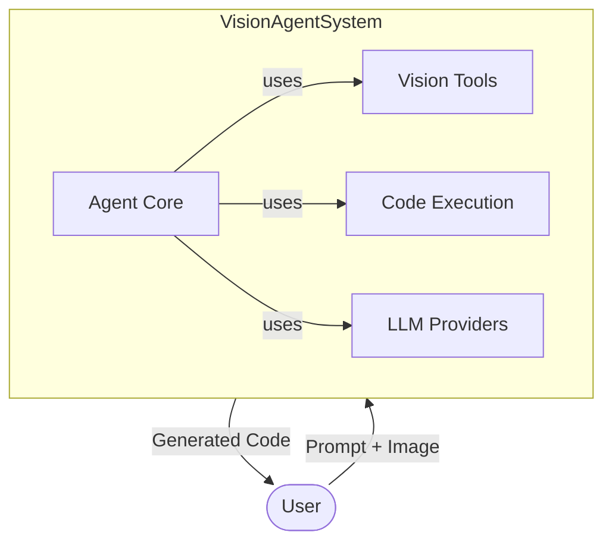

VisionAgent consists of four primary subsystems:

1. **Agent Core**: Orchestrates the conversion of user inputs to executable code
2. **Vision Tools**: Collection of computer vision capabilities (object detection, segmentation, OCR, etc.)
3. **Code Execution**: Safely executes and tests generated code
4. **LLM Integration**: Interfaces with language models for planning, code generation, and testing

Sources: [README.md:14-21](), [vision_agent/agent/__init__.py:1-4]()

### Agent Core Architecture


The Agent Core is organized into three main components:

- **VisionAgentV2**: Main system entry point and orchestrator
- **VisionAgentCoderV2**: Handles code generation based on plans
- **VisionAgentPlannerV2**: Creates structured plans from user prompts and images

For more details on these components, see [Agent System](#2), [VisionAgentV2](#2.1), [VisionAgentCoderV2](#2.2), and [VisionAgentPlannerV2](#2.3).

Sources: [vision_agent/agent/__init__.py:1-4]()

### Vision Tools Architecture

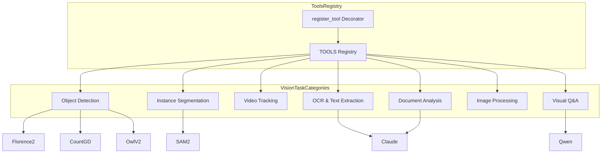

The Vision Tools subsystem provides a comprehensive set of computer vision capabilities:

- Tools are registered in a central registry using the `register_tool` decorator
- Tools are organized by vision task categories (detection, segmentation, OCR, etc.)
- Multiple AI models power different vision capabilities
- Direct access to specific tools is provided for developers through the `vision_agent.tools` namespace

For more details on the vision tools, see [Vision Tools](#3) and [Tools Registry](#3.1).

Sources: [README.md:119-125]()

### Code Execution Architecture

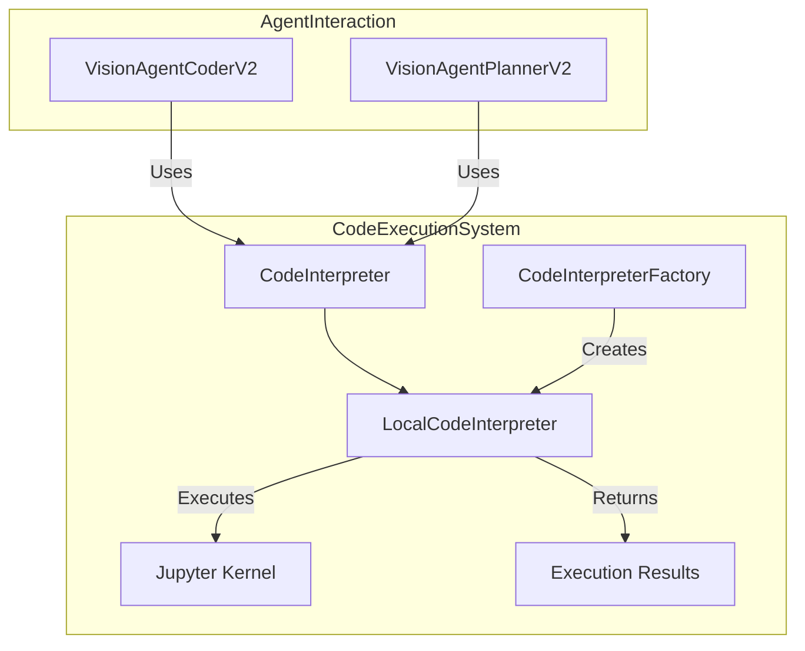

The Code Execution subsystem:

- Provides a `CodeInterpreter` interface for executing generated code
- Implements execution through a Jupyter kernel via `LocalCodeInterpreter`
- Returns structured execution results (outputs, logs, errors)
- Is used by agent components to run exploratory code during planning and to test generated code

For more details on code execution, see [Code Execution System](#4).

Sources: Architecture diagrams from provided information

### LLM Integration Architecture

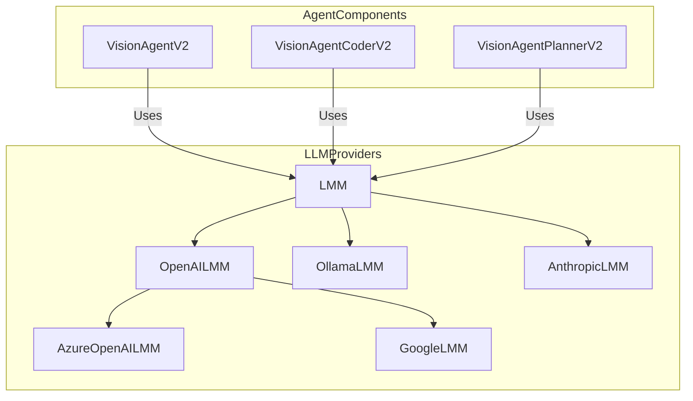

The LLM Integration subsystem:
- Provides a unified `LMM` interface for interacting with language models
- Supports multiple providers including Anthropic, OpenAI, Google, Azure, and Ollama
- Is used by agent components for planning, code generation, testing, and debugging
- Can be configured to use specific models through environment variables and configuration settings

For more details on LLM integration, see [LLM Integration](#2.4).

Sources: [README.md:176-211]()

## Operation Workflow

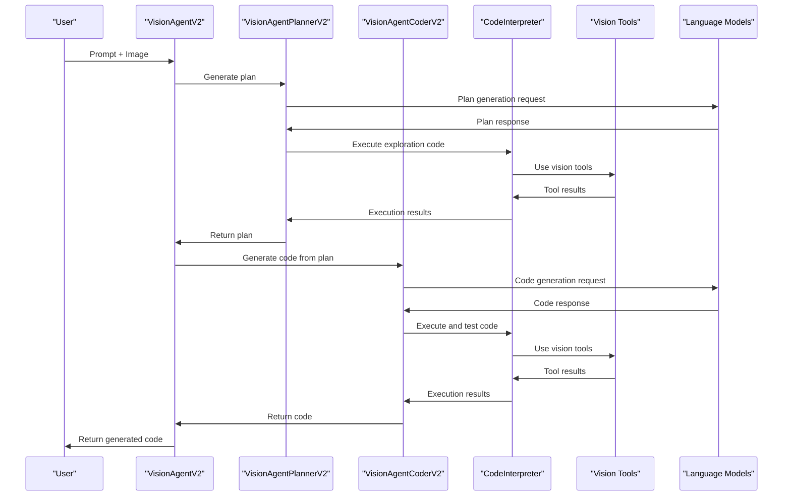

The typical workflow when using VisionAgent follows these steps:

1. **Input**: User provides a prompt and an image
2. **Planning**: VisionAgentPlannerV2 generates a structured plan using language models
3. **Exploration**: The planner executes exploratory code to analyze the image
4. **Code Generation**: VisionAgentCoderV2 generates code based on the plan
5. **Testing**: The generated code is executed and tested
6. **Output**: The final, working code is returned to the user

Sources: [README.md:106-112]()

## Usage Patterns

VisionAgent supports two primary usage patterns:

### 1. Prompting VisionAgent (Code Generation)

```python
from vision_agent.agent import VisionAgentCoderV2
from vision_agent.models import AgentMessage

agent = VisionAgentCoderV2(verbose=True)

code_context = agent.generate_code(
    [
        AgentMessage(
            role="user",
            content="Describe the image",
            media=["friends.jpg"]
        )
    ]
)

with open("generated_code.py", "w") as f:
    f.write(code_context.code + "\n" + code_context.test)
```

### 2. Direct Tool Usage

```python
import vision_agent.tools as T
import matplotlib.pyplot as plt

image = T.load_image("people.png")
dets = T.countgd_object_detection("person", image)
viz = T.overlay_bounding_boxes(image, dets)
T.save_image(viz, "people_detected.png")
```

Sources: [README.md:80-105](), [README.md:127-151]()

## Prerequisites and Requirements

VisionAgent requires:
- Python 3.9 or higher
- API keys for:
  - LandingAI (Vision Agent API key)
  - Anthropic (for Claude models)
  - Google (for Gemini models)

For detailed installation instructions, see [Installation and Dependencies](#1.2).

Sources: [README.md:26-52](), [README.md:54-57]()

---

# Page: System Architecture

# System Architecture

<details>
<summary>Relevant source files</summary>

The following files were used as context for generating this wiki page:

- [README.md](README.md)
- [docs/index.md](docs/index.md)
- [vision_agent/agent/__init__.py](vision_agent/agent/__init__.py)
- [vision_agent/agent/vision_agent_coder_v2.py](vision_agent/agent/vision_agent_coder_v2.py)
- [vision_agent/agent/vision_agent_prompts_v2.py](vision_agent/agent/vision_agent_prompts_v2.py)
- [vision_agent/agent/vision_agent_v2.py](vision_agent/agent/vision_agent_v2.py)

</details>


This document describes the overall system architecture of the vision-agent repository, detailing how different components interact to process user inputs, generate plans, create code, and execute vision tasks. For installation instructions, see [Installation and Dependencies](#1.2). For detailed information about specific components, refer to their dedicated wiki pages in the [Agent System](#2) and [Vision Tools](#3) sections.

## Core Architecture Overview

The Vision Agent system transforms user prompts and images into functional code that utilizes various computer vision capabilities. The system consists of several interconnected subsystems working together to plan, generate, test, and debug vision-related code.

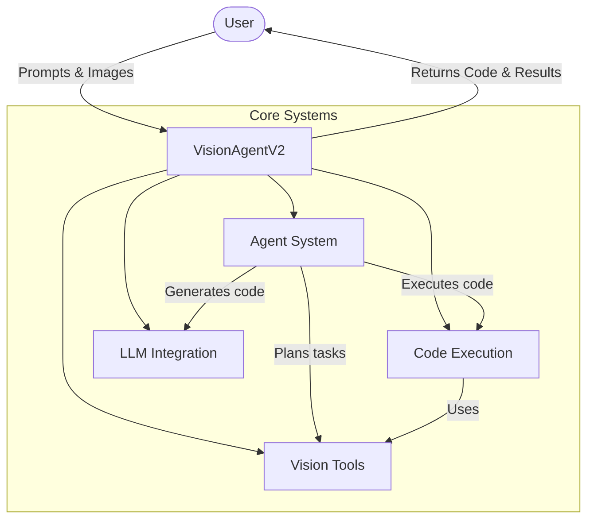

Sources: [README.md:14-16](), [vision_agent/agent/vision_agent_v2.py:159-164]()

## Agent System Components

The agent system is composed of three main components that work together to process user inputs and generate code:

```mermaid
classDiagram
    class "Agent" {
        <<abstract>>
        +__call__(input, media) str
        +log_progress(data) None
    }
    
    class "AgentCoder" {
        <<abstract>>
        +generate_code(chat, max_steps, code_interpreter) CodeContext
        +generate_code_from_plan(chat, plan_context, code_interpreter) CodeContext
    }
    
    class "AgentPlanner" {
        <<abstract>>
        +generate_plan(chat, max_steps, code_interpreter) PlanContext
    }
    
    class "VisionAgentV2" {
        -LMM agent
        -AgentCoder coder
        -bool verbose
        +__call__(input, media) str
        +chat(chat, code_interpreter) List[AgentMessage]
    }
    
    class "VisionAgentCoderV2" {
        -AgentPlanner planner
        -LMM coder
        -LMM tester
        -LMM debugger
        -Sim tool_recommender
        +generate_code(chat, max_steps, code_interpreter) CodeContext
        +generate_code_from_plan(chat, plan_context, code_interpreter) CodeContext
    }
    
    class "VisionAgentPlannerV2" {
        -LMM planner
        -LMM summarizer
        -LMM critic
        +generate_plan(chat, max_steps, code_interpreter) PlanContext
    }
    
    Agent <|-- VisionAgentV2
    Agent <|-- AgentCoder
    Agent <|-- AgentPlanner
    AgentCoder <|-- VisionAgentCoderV2
    AgentPlanner <|-- VisionAgentPlannerV2
    
    VisionAgentV2 o-- VisionAgentCoderV2
    VisionAgentCoderV2 o-- VisionAgentPlannerV2
```

Sources: [vision_agent/agent/__init__.py:1-4](), [vision_agent/agent/vision_agent_v2.py:159-205](), [vision_agent/agent/vision_agent_coder_v2.py:291-347]()

### VisionAgentV2

The `VisionAgentV2` class serves as the primary entry point for the system. It manages user interactions, orchestrates the overall process, and delegates code generation to `VisionAgentCoderV2`. This component:

1. Receives user input (prompts and images)
2. Processes the conversation
3. Determines which action to take (generate code, edit code)
4. Returns results to the user

```python
def __init__(self, agent=None, coder=None, hil=False, verbose=False, 
             code_sandbox_runtime=None, update_callback=lambda x: None)
```

Key methods:
- `__call__(input, media)`: Main interface that accepts user inputs
- `chat(chat, code_interpreter)`: Processes conversation and returns responses
- `extract_conversation(chat)`: Extracts relevant messages from conversation history
- `run_conversation(agent, chat)`: Generates agent responses to user queries

Sources: [vision_agent/agent/vision_agent_v2.py:159-227](), [vision_agent/agent/vision_agent_v2.py:228-292]()

### VisionAgentCoderV2

The `VisionAgentCoderV2` class is responsible for code generation. It works with `VisionAgentPlannerV2` to plan tasks and then generates, tests, and debugs code. This component:

1. Requests plans from `VisionAgentPlannerV2`
2. Recommends tools based on the plan
3. Generates code using the recommended tools
4. Tests and debugs the generated code
5. Returns the final code and execution results

```python
def __init__(self, planner=None, coder=None, tester=None, debugger=None,
             tool_recommender=None, hil=False, verbose=False,
             code_sandbox_runtime=None, update_callback=lambda _: None)
```

Key methods:
- `generate_code(chat, max_steps, code_interpreter)`: Generates code from user inputs
- `generate_code_from_plan(chat, plan_context, code_interpreter)`: Generates code from a previously created plan

Sources: [vision_agent/agent/vision_agent_coder_v2.py:291-376](), [vision_agent/agent/vision_agent_coder_v2.py:377-506]()

### VisionAgentPlannerV2

The `VisionAgentPlannerV2` class (detailed further in [VisionAgentPlannerV2](#2.3)) creates plans for code generation based on user inputs. It:

1. Analyzes user queries and available media
2. Creates a structured plan for solving the task
3. Returns a `PlanContext` with task instructions

Sources: [vision_agent/agent/__init__.py:3]()

## Request Processing Flow

The following sequence diagram illustrates how user requests flow through the system:

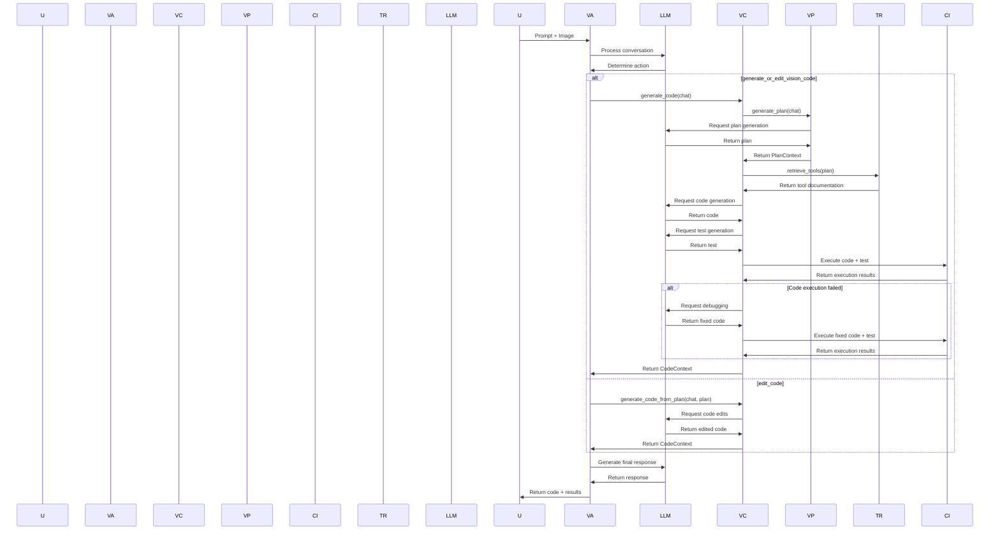

Sources: [vision_agent/agent/vision_agent_v2.py:229-292](), [vision_agent/agent/vision_agent_coder_v2.py:377-422](), [vision_agent/agent/vision_agent_v2.py:100-156]()

## Vision Tools System

The Vision Tools system provides the computer vision capabilities that the generated code can utilize:

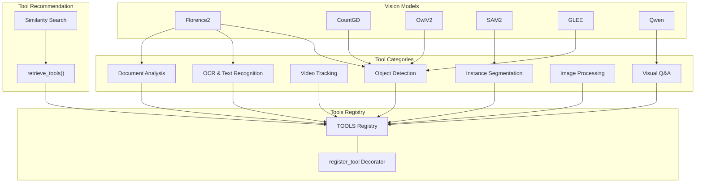

The tool selection process is guided by the `retrieve_tools` function, which uses similarity search to match user requirements with the most appropriate tools. For more details on available tools, see [Vision Tools](#3).

Sources: [README.md:118-147](), [vision_agent/agent/vision_agent_coder_v2.py:51-61]()

## Code Execution System

The Code Execution system safely runs the generated code in an isolated environment:

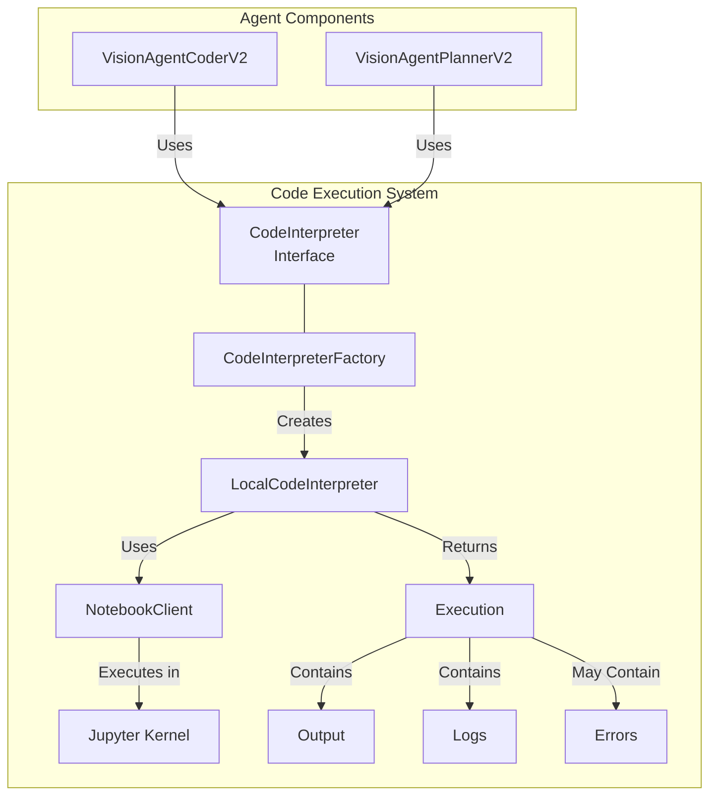

The `CodeInterpreter` interface provides a common API for executing code, while the `LocalCodeInterpreter` implementation uses Jupyter's notebook client to run the code in a controlled environment. For more details on code execution, see [Code Execution System](#4).

Sources: [vision_agent/agent/vision_agent_coder_v2.py:253-258](), [vision_agent/agent/vision_agent_v2.py:254-258]()

## LLM Integration

Vision Agent integrates with multiple Language Model providers to power its functionality:

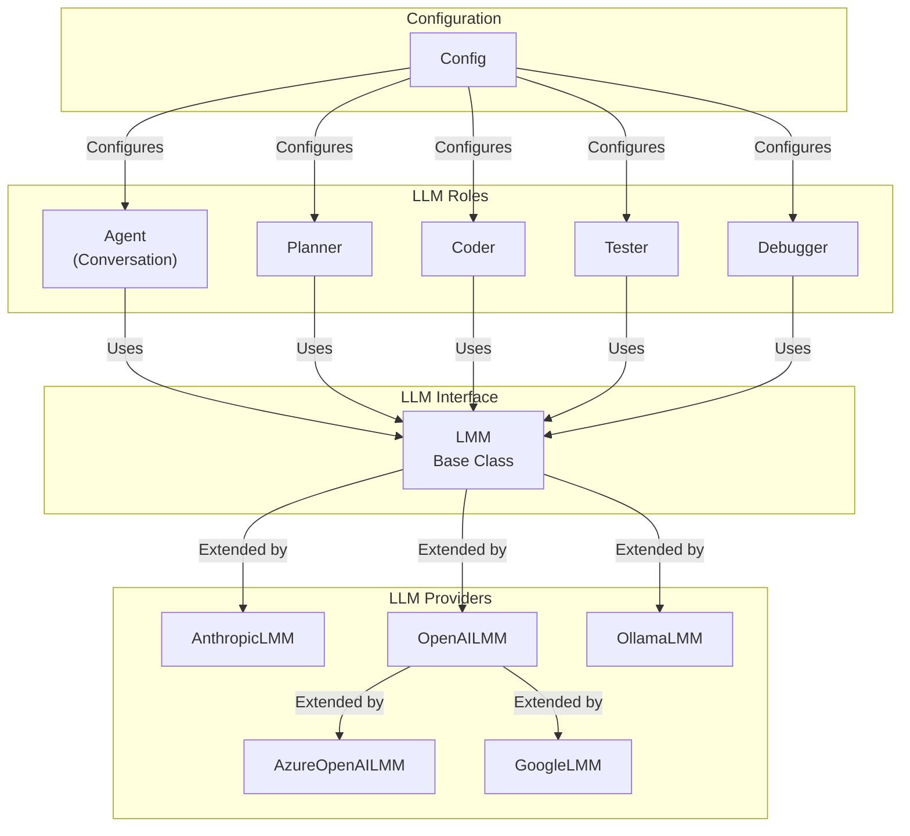

The system uses different LLM providers for different roles within the system, which can be configured through the `Config` class. For more details on LLM integration, see [LLM Integration](#2.4).

Sources: [README.md:176-210](), [vision_agent/agent/vision_agent_coder_v2.py:334-336](), [vision_agent/agent/vision_agent_v2.py:189-190]()

## Data Models and Message Flow

Vision Agent uses several data models to structure information as it flows through the system:

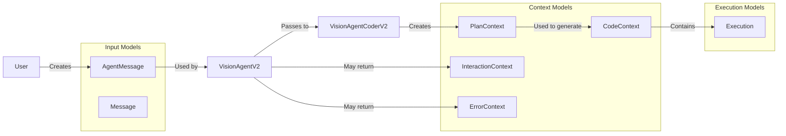

Key data models:
- `AgentMessage`: Represents messages in the conversation
- `PlanContext`: Contains planning information
- `CodeContext`: Contains generated code and test results
- `InteractionContext`: Used for user interactions
- `ErrorContext`: Contains error information
- `Execution`: Contains execution results and logs

Sources: [vision_agent/agent/vision_agent_coder_v2.py:45-48](), [vision_agent/agent/vision_agent_v2.py:11-18]()

## Configuration System

The configuration system allows customizing which LLM providers are used for different roles:

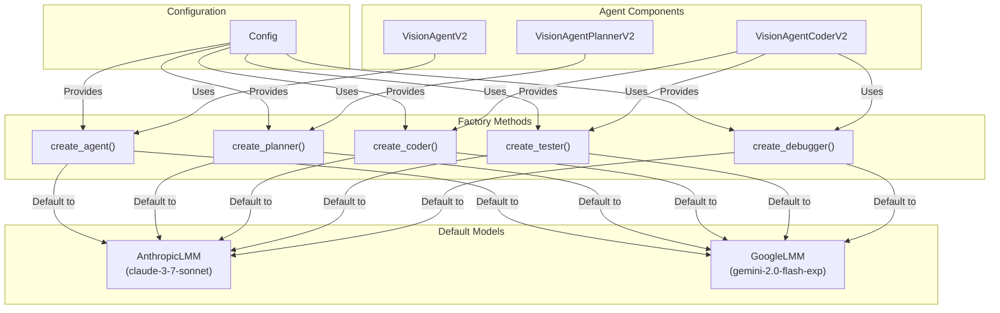

The default configuration uses Anthropic Claude 3.7 Sonnet and Gemini 2.0 Flash Experimental models, but this can be customized.

Sources: [README.md:176-210](), [vision_agent/agent/vision_agent_v2.py:27](), [vision_agent/agent/vision_agent_coder_v2.py:41]()

## Summary

The Vision Agent architecture is designed with several key principles:

1. **Modularity**: Clear separation between planning, code generation, and execution
2. **Extensibility**: Easy to add new vision tools and LLM providers
3. **Safety**: Isolated code execution environment
4. **Customization**: Configurable LLM providers for different roles

This architecture enables Vision Agent to effectively translate natural language prompts and images into executable code that leverages state-of-the-art vision models.

Sources: [README.md:14-19]()

---

# Page: Installation and Dependencies

# Installation and Dependencies

<details>
<summary>Relevant source files</summary>

The following files were used as context for generating this wiki page:

- [README.md](README.md)
- [docs/index.md](docs/index.md)
- [poetry.lock](poetry.lock)
- [pyproject.toml](pyproject.toml)
- [vision_agent/utils/execute.py](vision_agent/utils/execute.py)

</details>


This page documents the installation process and required dependencies for the vision-agent library. It covers prerequisites, installation steps, API key configuration, and dependency structure. For information about the system architecture, see [System Architecture](#1.1).

## Prerequisites

Before installing the vision-agent library, you need:

- Python version 3.9 or higher
- Three API keys:
  - Vision Agent API key (from LandingAI)
  - Anthropic API key
  - Gemini API key 

### Installation Workflow

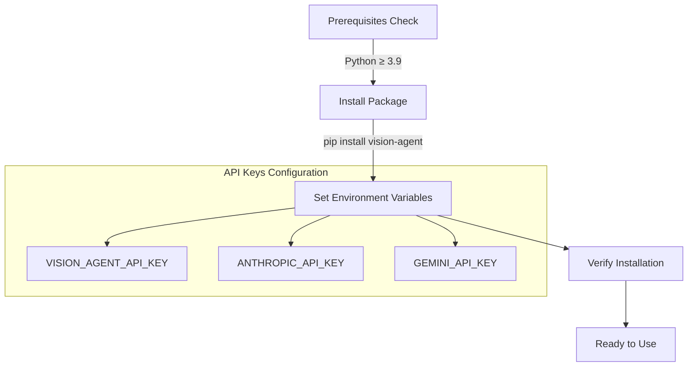

Sources: [README.md:54-69](). [README.md:23-52]()

## Why API Keys Are Required

VisionAgent uses models from Anthropic and Google to respond to prompts and generate code. When using the web-based version, the app uses LandingAI's API keys to access these models. However, when running VisionAgent programmatically, your personal API keys are required to:

1. Ensure your projects aren't limited by LandingAI's rate limits
2. Prevent multiple users from overloading LandingAI's rate limits

Each service (Anthropic and Google) has its own rate limits and pricing tiers.

Sources: [README.md:31-40]()

## Basic Installation

Install the vision-agent library using pip:

```bash
pip install vision-agent
```

This command installs the package and all required dependencies.

Sources: [README.md:54-57]()

## API Key Configuration

### Obtaining API Keys

1. **Vision Agent API Key**:
   - Sign up at [va.landing.ai/agent](https://va.landing.ai/agent)
   - Obtain your API key from [va.landing.ai/account/api-key](https://va.landing.ai/account/api-key)

2. **Anthropic API Key**:
   - Create an Anthropic Console account at [console.anthropic.com](https://console.anthropic.com)
   - Go to the API Keys page
   - Generate an API key

3. **Gemini API Key**:
   - Create a Google AI Studio account at [aistudio.google.com](https://aistudio.google.com)
   - Go to the Get API Key page
   - Generate an API key

Sources: [README.md:23-52]()

### Setting Environment Variables

Before running VisionAgent code, set the API keys as environment variables:

```bash
export VISION_AGENT_API_KEY="your-api-key"
export ANTHROPIC_API_KEY="your-api-key"
export GEMINI_API_KEY="your-api-key"
```

The library automatically loads these variables using the `dotenv` package as shown in [vision_agent/utils/execute.py:16-27]().

Sources: [README.md:71-79](). [vision_agent/utils/execute.py:16-27]()

## Dependency Structure

The vision-agent system has a comprehensive set of dependencies organized by their functional purpose:

```mermaid
graph TD
    VA["vision-agent"] --> Core["Core Libraries"]
    VA --> Vision["Vision Processing"]
    VA --> Execution["Code Execution"]
    VA --> LLM["LLM Integrations"]
    VA --> Utils["Utilities"]
    
    subgraph "Core Libraries"
        Core --> Python["Python ≥ 3.9"]
        Core --> Numpy["numpy ≥ 1.21.0"]
        Core --> Pandas["pandas 2.*"]
        Core --> Typing["typing_extensions 4.*"]
        Core --> Pydantic["pydantic ≥ 2.0.0"]
    end
    
    subgraph "Vision Processing"
        Vision --> OpenCV["opencv-python 4.*"]
        Vision --> Pillow["pillow 10.*"]
        Vision --> PillowHeif["pillow-heif 0.16.0"]
        Vision --> PyMuPDF["pymupdf 1.23.0"]
        Vision --> AV["av 11.0.0"]
        Vision --> SciPy["scipy 1.13.*"]
    end
    
    subgraph "Code Execution"
        Execution --> NBClient["nbclient 0.10.0"]
        Execution --> NBFormat["nbformat 5.10.4"]
        Execution --> IPyKernel["ipykernel 6.29.4"]
    end
    
    subgraph "LLM Integrations"
        LLM --> OpenAI["openai 1.*"]
        LLM --> Anthropic["anthropic 0.31.0"]
    end
    
    subgraph "Utilities"
        Utils --> Tabulate["tabulate 0.9.0"]
        Utils --> Rich["rich 13.7.1"]
        Utils --> Requests["requests 2.*"]
        Utils --> Matplotlib["matplotlib 3.9.2"]
        Utils --> ScikitLearn["scikit-learn 1.5.2"]
        Utils --> PyTube["pytube 15.0.0"]
    end
```

Sources: [pyproject.toml:19-49]()

### Main Dependencies

The following table lists key dependencies and their purposes:

| Dependency | Version | Purpose |
|------------|---------|---------|
| Python | >=3.9,<4.0 | Runtime environment |
| numpy | >=1.21.0,<2.0.0 | Numerical computing |
| pillow | 10.* | Image processing |
| opencv-python | 4.* | Computer vision algorithms |
| pandas | 2.* | Data manipulation |
| openai | 1.* | OpenAI API integration |
| anthropic | ^0.31.0 | Anthropic API integration |
| nbclient | ^0.10.0 | Notebook execution |
| nbformat | ^5.10.4 | Notebook format handling |
| ipykernel | ^6.29.4 | Jupyter kernel for code execution |
| matplotlib | ^3.9.2 | Plotting and visualization |
| scikit-learn | ^1.5.2 | Machine learning utilities |
| av | ^11.0.0 | Audio/video processing |
| pymupdf | ^1.23.0 | PDF document processing |
| pytube | 15.0.0 | YouTube video downloading |

Sources: [pyproject.toml:19-49]()

### Development Dependencies

For development and contributing to the project, additional dependencies are required:

| Dependency | Version | Purpose |
|------------|---------|---------|
| pytest | 7.* | Testing framework |
| black | >=23,<25 | Code formatting |
| isort | 5.* | Import sorting |
| mypy | <1.8.0 | Static type checking |
| pre-commit | ^3.8.0 | Pre-commit hooks |

Sources: [pyproject.toml:50-68]()

## Code Execution System

Vision-agent uses a notebook-based execution system for running generated code:

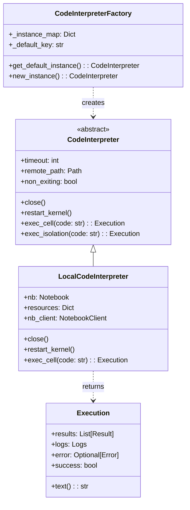

Sources: [vision_agent/utils/execute.py:345-553]()

The execution system relies on:
- `nbclient` to execute code cells
- `nbformat` to handle notebook format
- `ipykernel` to provide the Python kernel

The `LocalCodeInterpreter` class implements the execution environment that runs generated code in a Jupyter notebook context.

Sources: [vision_agent/utils/execute.py:391-512]()

## Alternative LLM Provider Configuration

VisionAgent uses Anthropic Claude 3.7 Sonnet and Gemini Flash 2.0 Experimental by default, but you can configure different LLM providers:

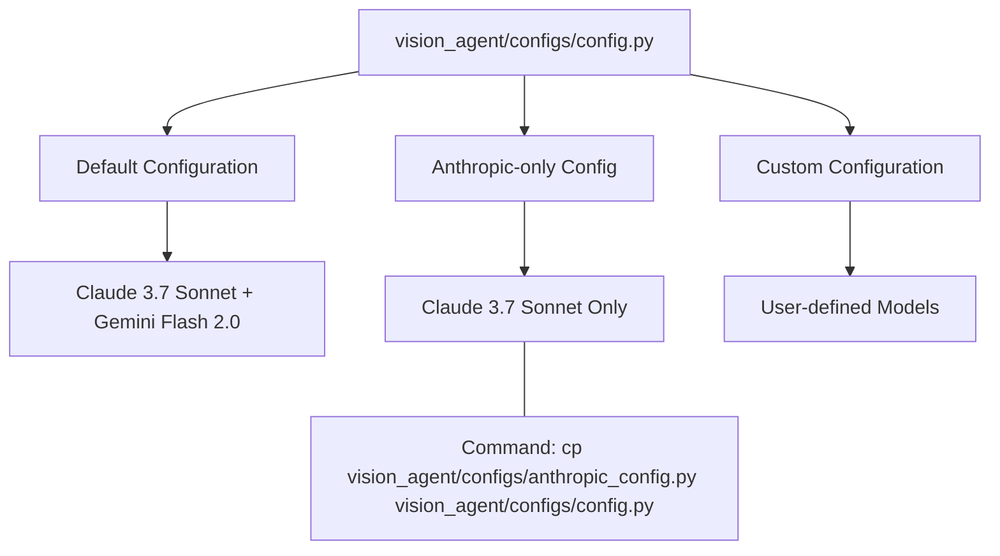

To use only the Anthropic model:

```bash
cp vision_agent/configs/anthropic_config.py vision_agent/configs/config.py
```

Alternatively, you can manually modify the configuration file to use different LLM providers.

Sources: [README.md:176-210]()

## Troubleshooting

### Common Installation Issues

1. **API Keys Not Found**:
   - Verify environment variables are set correctly
   - Ensure `.env` file is in the correct directory if using one

2. **Dependency Conflicts**:
   Consider using a virtual environment:

   ```bash
   python -m venv visionagent-env
   source visionagent-env/bin/activate  # On Windows: visionagent-env\Scripts\activate
   pip install vision-agent
   ```

3. **Code Execution Errors**:
   - Ensure `ipykernel` is properly installed
   - Check that your Python environment has all required dependencies
   - Try restarting the kernel with the `restart_kernel()` method

## Next Steps

After installation, you can:

- See [Basic Usage](#7.1) for getting started with vision-agent
- Check [Custom Tools](#7.2) for extending functionality
- Explore [Vision Tools](#3) to understand available capabilities

Sources: [README.md:114-153]()

---

# Page: Agent System

# Agent System

<details>
<summary>Relevant source files</summary>

The following files were used as context for generating this wiki page:

- [examples/chat/app.py](examples/chat/app.py)
- [vision_agent/agent/__init__.py](vision_agent/agent/__init__.py)
- [vision_agent/agent/agent.py](vision_agent/agent/agent.py)
- [vision_agent/agent/vision_agent_coder_v2.py](vision_agent/agent/vision_agent_coder_v2.py)
- [vision_agent/agent/vision_agent_prompts_v2.py](vision_agent/agent/vision_agent_prompts_v2.py)
- [vision_agent/agent/vision_agent_v2.py](vision_agent/agent/vision_agent_v2.py)

</details>


The Agent System is the core orchestration layer of the vision-agent framework. It manages the interaction between users, language models, code generation, and vision tools to create solutions for computer vision tasks. This document explains the architecture and components of the agent system, how they interact, and the workflow from user input to generated code execution.

For information on the available vision tools, see [Vision Tools](#3). For details on code execution, see [Code Execution System](#4).

## Architecture Overview

The Agent System is built around abstract base classes that define the core interfaces, with concrete implementations that provide the actual functionality. 

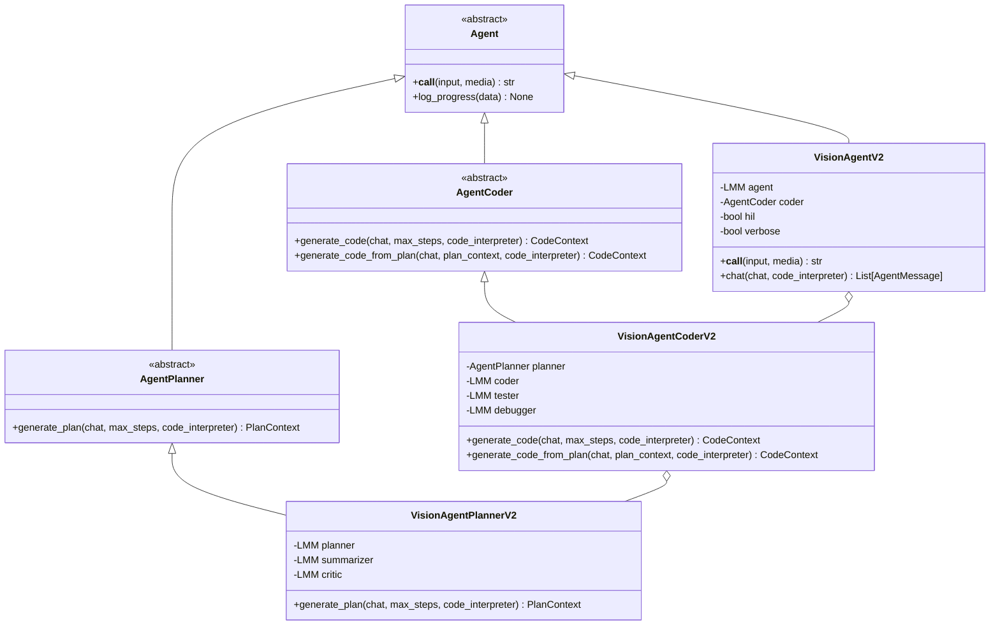

**Sources:**
- [vision_agent/agent/agent.py:16-61]()
- [vision_agent/agent/__init__.py:1-4]()
- [vision_agent/agent/vision_agent_v2.py:159-296]()
- [vision_agent/agent/vision_agent_coder_v2.py:291-509]()

## Core Components

### Agent Base Classes

The agent system is built on three key abstract base classes:

1. **Agent**: The root interface for all agents, defining the core method `__call__` for processing input.

2. **AgentCoder**: Extends Agent with code generation capabilities, defining methods for generating code from chat history or from a plan.

3. **AgentPlanner**: Extends Agent with planning capabilities, defining methods for generating execution plans.

Each of these abstract classes defines the interface contract that concrete implementations must adhere to.

**Sources:**
- [vision_agent/agent/agent.py:16-61]()

### VisionAgentV2

The `VisionAgentV2` class is the main entry point for user interaction with the system. It orchestrates the code generation process by:

1. Processing user input (text + images/videos)
2. Delegating to specialized components for planning and code generation
3. Managing the conversation flow
4. Executing generated code and returning results

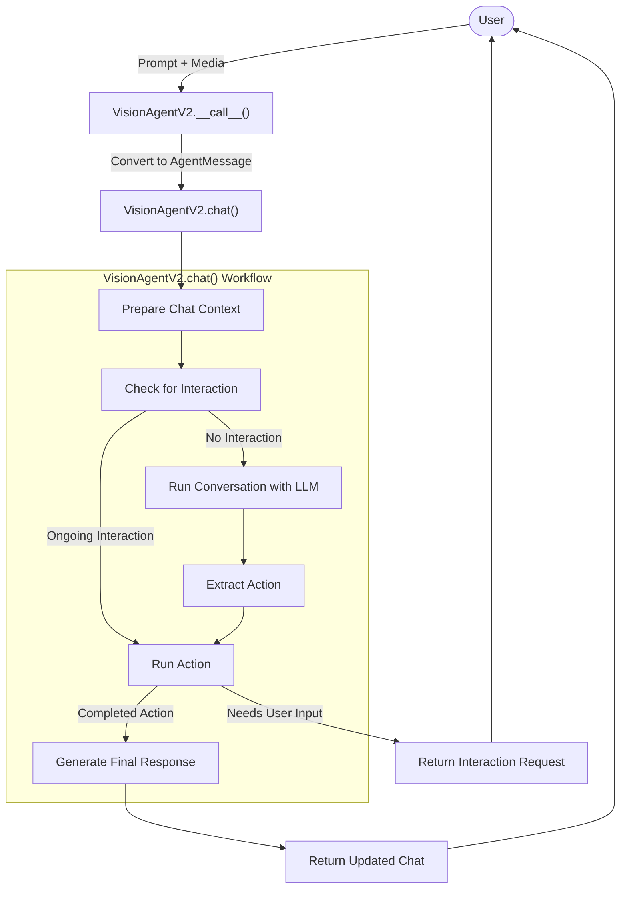

Key functionalities:
- Manages the conversation state
- Processes user messages and media
- Delegates to the coder agent for code generation
- Supports human-in-the-loop interaction when clarification is needed
- Uses callbacks to provide real-time updates during code generation

**Sources:**
- [vision_agent/agent/vision_agent_v2.py:159-296]()
- [vision_agent/agent/vision_agent_prompts_v2.py:1-86]()

### VisionAgentCoderV2

The `VisionAgentCoderV2` class is responsible for generating, testing, and debugging vision code. It:

1. Uses a planner to generate a plan for solving the vision task
2. Generates code based on the plan
3. Tests the generated code using a code interpreter
4. Debugs and fixes code when there are issues

```mermaid
flowchart TB
    Input["Chat History + Media"] --> GenerateCode["generate_code()"]
    Plan["Plan Context"] --> GenerateCodeFromPlan["generate_code_from_plan()"]
    
    subgraph "Code Generation Process"
        GenPlan["Generate Plan"]
        RetrieveTools["Retrieve Relevant Tools"]
        WriteCode["Write Code"]
        TestCode["Test & Debug Code"]
        FormatResult["Format Result"]
    end
    
    GenerateCode --> GenPlan
    GenPlan -->|"Plan Context"| RetrieveTools
    GenerateCodeFromPlan --> RetrieveTools
    
    RetrieveTools --> WriteCode
    WriteCode --> TestCode
    TestCode -->|"Success"| FormatResult
    TestCode -->|"Failure"| DebugLoop["Debug Loop"]
    DebugLoop --> TestCode
    
    FormatResult --> CodeContext["Code Context"]
```

Key functionalities:
- Plan generation delegation to VisionAgentPlannerV2
- Tool recommendation and retrieval
- Code generation with language models
- Test generation and execution
- Automated debugging and fixing

**Sources:**
- [vision_agent/agent/vision_agent_coder_v2.py:291-509]()
- [vision_agent/agent/vision_agent_coder_v2.py:45-289]()

## Interaction and Execution Flow

The agent system processes requests through a series of well-defined steps:

```mermaid
sequenceDiagram
    participant User
    participant VisionAgentV2
    participant VisionAgentCoderV2
    participant VisionAgentPlannerV2
    participant CodeInterpreter
    participant LLM
    
    User->>VisionAgentV2: Prompt + Media
    
    VisionAgentV2->>LLM: Determine action
    LLM->>VisionAgentV2: Action decision
    
    alt generate_or_edit_vision_code
        VisionAgentV2->>VisionAgentCoderV2: generate_code(chat)
        VisionAgentCoderV2->>VisionAgentPlannerV2: generate_plan(chat)
        VisionAgentPlannerV2->>LLM: Request plan generation
        LLM->>VisionAgentPlannerV2: Plan
        
        VisionAgentCoderV2->>LLM: Generate code
        LLM->>VisionAgentCoderV2: Code
        
        VisionAgentCoderV2->>LLM: Generate test
        LLM->>VisionAgentCoderV2: Test
        
        VisionAgentCoderV2->>CodeInterpreter: Execute code & test
        CodeInterpreter->>VisionAgentCoderV2: Execution result
        
        alt Code execution failed
            VisionAgentCoderV2->>LLM: Debug and fix code
            LLM->>VisionAgentCoderV2: Fixed code
            VisionAgentCoderV2->>CodeInterpreter: Re-execute code
            CodeInterpreter->>VisionAgentCoderV2: Execution result
        end
        
        VisionAgentCoderV2->>VisionAgentV2: CodeContext
    else edit_code
        VisionAgentV2->>VisionAgentCoderV2: generate_code_from_plan
        VisionAgentCoderV2->>LLM: Generate code
        LLM->>VisionAgentCoderV2: Code
        VisionAgentCoderV2->>CodeInterpreter: Execute code
        CodeInterpreter->>VisionAgentCoderV2: Execution result
        VisionAgentCoderV2->>VisionAgentV2: CodeContext
    end
    
    VisionAgentV2->>LLM: Generate final response
    LLM->>VisionAgentV2: Response
    
    VisionAgentV2->>User: Response + Generated Code
```

This sequence shows how the different components interact to process a user request, generate code, test it, and return the result.

**Sources:**
- [vision_agent/agent/vision_agent_v2.py:229-291]()
- [vision_agent/agent/vision_agent_coder_v2.py:377-422]()
- [vision_agent/agent/vision_agent_coder_v2.py:424-506]()

## Human-in-the-Loop Interaction

The agent system supports human-in-the-loop (HIL) interactions, where the agent can pause execution to request additional input from the user.

```mermaid
flowchart TD
    Start["Process User Request"] --> ShouldInteract{"Needs User\nClarification?"}
    
    ShouldInteract -->|"Yes"| CreateInteraction["Create Interaction\nContext"]
    ShouldInteract -->|"No"| ContinueExecution["Continue Normal\nExecution"]
    
    CreateInteraction --> ReturnInteraction["Return Interaction\nRequest to User"]
    ReturnInteraction --> UserResponse["User Provides\nAdditional Information"]
    UserResponse --> ResumeExecution["Resume Execution\nWith New Information"]
    
    ResumeExecution --> ContinueExecution
    ContinueExecution --> Complete["Complete Request\nand Return Results"]
```

This interaction model allows the agent to:
1. Identify when it needs additional information
2. Formulate specific questions for the user
3. Pause execution while waiting for a response
4. Resume execution with the new information

The HIL mode is enabled through the `hil` parameter in the agent constructors and is especially useful for complex vision tasks where the agent might need clarification about the user's intent.

**Sources:**
- [vision_agent/agent/vision_agent_v2.py:165-187]()
- [vision_agent/agent/vision_agent_v2.py:92-97]()
- [vision_agent/agent/vision_agent_coder_v2.py:294-324]()
- [examples/chat/app.py:48-61]()

## Code Structure and Key Methods

The Agent System's functionality is distributed across several key methods:

| Class | Method | Purpose |
|-------|--------|---------|
| VisionAgentV2 | __call__() | Entry point for processing string input and media |
| VisionAgentV2 | chat() | Main processing method for conversational interaction |
| VisionAgentCoderV2 | generate_code() | Generate code from chat history, including planning |
| VisionAgentCoderV2 | generate_code_from_plan() | Generate code from a predefined plan |
| - | write_code() | Function to generate initial code using LLM |
| - | write_test() | Function to generate test code using LLM |
| - | test_code() | Function to test and debug code until it works |
| - | debug_code() | Function to fix issues found during testing |

These methods form the backbone of the agent system's functionality and represent the key processing steps in the workflow.

**Sources:**
- [vision_agent/agent/vision_agent_v2.py:206-227]()
- [vision_agent/agent/vision_agent_v2.py:229-291]()
- [vision_agent/agent/vision_agent_coder_v2.py:377-422]()
- [vision_agent/agent/vision_agent_coder_v2.py:424-506]()
- [vision_agent/agent/vision_agent_coder_v2.py:64-86]()
- [vision_agent/agent/vision_agent_coder_v2.py:89-113]()
- [vision_agent/agent/vision_agent_coder_v2.py:195-258]()
- [vision_agent/agent/vision_agent_coder_v2.py:116-192]()

## Communication and Callback Mechanism

The agent system uses a callback mechanism to provide real-time updates during code generation and execution. This is especially useful for web applications or UIs that need to show progress to the user.

```mermaid
flowchart LR
    subgraph "Agent System"
        VA2["VisionAgentV2"]
        VAC2["VisionAgentCoderV2"]
        VAP2["VisionAgentPlannerV2"]
    end
    
    subgraph "Client Application"
        Callback["update_callback"]
        UI["User Interface"]
    end
    
    VA2 -->|"Register"| Callback
    VA2 -->|"Forward"| VAC2
    VAC2 -->|"Forward"| VAP2
    
    VAP2 -->|"Progress Update"| Callback
    VAC2 -->|"Code Generation Update"| Callback
    VA2 -->|"Conversation Update"| Callback
    
    Callback -->|"Update"| UI
```

The update_callback function is:
1. Initialized in the VisionAgentV2 constructor
2. Passed to the constituent components
3. Called at various stages with progress updates
4. Used to update UIs or log progress

In the example chat application, this callback mechanism is used to send WebSocket updates to connected clients, providing a real-time view of the agent's progress.

**Sources:**
- [vision_agent/agent/vision_agent_v2.py:165-187]()
- [vision_agent/agent/vision_agent_v2.py:294-295]()
- [vision_agent/agent/vision_agent_coder_v2.py:294-324]()
- [vision_agent/agent/vision_agent_coder_v2.py:493-505]()
- [examples/chat/app.py:33-45]()

## Integration with Other Components

The Agent System integrates with several other components of the vision-agent framework:

```mermaid
flowchart TB
    subgraph "Agent System"
        VA2["VisionAgentV2"]
        VAC2["VisionAgentCoderV2"]
        VAP2["VisionAgentPlannerV2"]
    end
    
    subgraph "Language Model Module"
        LMM["LMM Interface"]
        OAILMM["OpenAILMM"]
        ANLMM["AnthropicLMM"]
    end
    
    subgraph "Code Execution"
        CI["CodeInterpreter"]
        LCI["LocalCodeInterpreter"]
    end
    
    subgraph "Vision Tools"
        TOOLS["TOOLS Registry"]
        TR["Tool Recommender"]
    end
    
    VA2 -->|"Uses"| LMM
    VAC2 -->|"Uses"| LMM
    VAP2 -->|"Uses"| LMM
    
    VA2 -->|"Uses"| CI
    VAC2 -->|"Uses"| CI
    VAP2 -->|"Uses"| CI
    
    VAC2 -->|"Recommends"| TR
    TR -->|"Queries"| TOOLS
    
    CI -->|"Imports"| TOOLS
```

Key integration points:
1. **Language Models**: Used for planning, code generation, testing, and debugging
2. **Code Interpreter**: Used to safely execute and test generated code
3. **Tool Recommender**: Used to find relevant vision tools for a given task
4. **Tools Registry**: Provides access to the vision tools used in generated code

These integrations allow the Agent System to leverage specialized components while maintaining a clean separation of concerns.

**Sources:**
- [vision_agent/agent/vision_agent_v2.py:165-187]()
- [vision_agent/agent/vision_agent_coder_v2.py:294-324]()
- [vision_agent/agent/vision_agent_coder_v2.py:51-61]()
- [vision_agent/agent/vision_agent_v2.py:254-258]()

---

# Page: VisionAgentV2

# VisionAgentV2

<details>
<summary>Relevant source files</summary>

The following files were used as context for generating this wiki page:

- [examples/chat/app.py](examples/chat/app.py)
- [vision_agent/agent/agent.py](vision_agent/agent/agent.py)
- [vision_agent/agent/vision_agent_coder_v2.py](vision_agent/agent/vision_agent_coder_v2.py)
- [vision_agent/agent/vision_agent_prompts_v2.py](vision_agent/agent/vision_agent_prompts_v2.py)
- [vision_agent/agent/vision_agent_v2.py](vision_agent/agent/vision_agent_v2.py)

</details>


VisionAgentV2 is the primary conversational agent in the vision-agent system, serving as the main orchestrator for user interactions involving vision code generation. This document details the VisionAgentV2 class, its architecture, and how it integrates with other system components.

For information about the code generation process specifically, see [VisionAgentCoderV2](#2.2). For information about the planning component, see [VisionAgentPlannerV2](#2.3).

## Purpose and Functionality

VisionAgentV2 acts as a conversational interface that allows users to:

1. Generate computer vision code based on natural language requests
2. Execute the generated code against provided images or videos
3. Engage in interactive debugging and code refinement
4. Receive human-readable explanations of the generated solutions

The agent handles the conversation flow, delegates code generation tasks to specialized components, and manages the execution of generated code.

Sources: [vision_agent/agent/vision_agent_v2.py:159-162]()

## Class Structure and Components

```mermaid
classDiagram
    class Agent {
        <<abstract>>
        +__call__(input, media) str
        +log_progress(data) None
    }
    
    class VisionAgentV2 {
        -LMM agent
        -AgentCoder coder
        -bool hil
        -bool verbose
        -CodeSandboxRuntime code_sandbox_runtime
        -Callable update_callback
        +__init__(agent, coder, hil, verbose, code_sandbox_runtime, update_callback)
        +__call__(input, media) str
        +chat(chat, code_interpreter) List[AgentMessage]
        +log_progress(data) None
    }
    
    class AgentCoder {
        <<abstract>>
        +generate_code(chat, max_steps, code_interpreter) CodeContext
        +generate_code_from_plan(chat, plan_context, code_interpreter) CodeContext
    }
    
    Agent <|-- VisionAgentV2
    VisionAgentV2 o-- AgentCoder : uses
```

Sources: [vision_agent/agent/vision_agent_v2.py:159-202](), [vision_agent/agent/agent.py:16-30]()

## Constructor Parameters

VisionAgentV2 accepts the following parameters during initialization:

| Parameter | Type | Description | Default |
|-----------|------|-------------|---------|
| agent | LMM | Language model for conversation | Config default |
| coder | AgentCoder | Agent for code generation | VisionAgentCoderV2 |
| hil | bool | Enable human-in-the-loop mode | False |
| verbose | bool | Enable debug output | False |
| code_sandbox_runtime | str | Runtime for code execution | None (uses env var) |
| update_callback | Callable | Function for progress updates | lambda x: None |

Sources: [vision_agent/agent/vision_agent_v2.py:164-187]()

## Interaction Flow

```mermaid
sequenceDiagram
    participant User
    participant VisionAgentV2
    participant LMM as "Conversation LMM"
    participant VisionAgentCoderV2
    participant CodeInterpreter
    
    User->>VisionAgentV2: __call__(input, media)
    VisionAgentV2->>VisionAgentV2: convert_message_to_agentmessage()
    VisionAgentV2->>VisionAgentV2: chat(input_msg)
    
    alt Needs interaction
        VisionAgentV2->>VisionAgentCoderV2: generate_code()
        VisionAgentCoderV2->>VisionAgentV2: return InteractionContext
        VisionAgentV2->>User: Return interaction message
    else Normal flow
        VisionAgentV2->>CodeInterpreter: Create instance
        VisionAgentV2->>VisionAgentV2: add_media_to_chat()
        VisionAgentV2->>LMM: run_conversation()
        LMM->>VisionAgentV2: Response with action
        
        alt action = "generate_or_edit_vision_code"
            VisionAgentV2->>VisionAgentCoderV2: generate_code()
            VisionAgentCoderV2->>VisionAgentV2: return CodeContext
            VisionAgentV2->>LMM: run_conversation with results
            LMM->>VisionAgentV2: Final response
        else action = "edit_code"
            VisionAgentV2->>VisionAgentCoderV2: generate_code_from_plan()
            VisionAgentCoderV2->>VisionAgentV2: return CodeContext
            VisionAgentV2->>LMM: run_conversation with results
            LMM->>VisionAgentV2: Final response
        end
        
        VisionAgentV2->>User: Return response
    end
```

Sources: [vision_agent/agent/vision_agent_v2.py:206-292](), [vision_agent/agent/vision_agent_v2.py:75-89](), [vision_agent/agent/vision_agent_v2.py:100-156]()

## Key Methods

### `__call__` Method

The `__call__` method serves as the primary entry point for user interaction:

```python
def __call__(self, input: Union[str, List[Message]], media: Optional[Union[str, Path]] = None) -> str:
    input_msg = convert_message_to_agentmessage(input, media)
    return self.chat(input_msg)[-1].content
```

This method takes either a string or a list of message objects, along with optional media files (images or videos), and returns the agent's response as a string.

Sources: [vision_agent/agent/vision_agent_v2.py:206-227]()

### `chat` Method

The `chat` method implements the core conversation logic:

1. Validates the input chat messages
2. Creates a code interpreter if not provided
3. Adds media to the chat messages
4. Determines if an interaction is needed
5. Runs the conversation through the LMM
6. Executes actions based on the LMM's response
7. Returns the conversation messages

This method is responsible for the entire workflow from user input to generating the response.

Sources: [vision_agent/agent/vision_agent_v2.py:229-292]()

## Message Processing Workflow

```mermaid
flowchart TD
    Start["User Message"] --> ChatMethod["VisionAgentV2.chat()"]
    
    ChatMethod --> ValidateChat["Validate chat messages"]
    ValidateChat --> CreateInterpreter["Create CodeInterpreter"]
    CreateInterpreter --> AddMedia["add_media_to_chat()"]
    
    AddMedia --> CheckInteraction{"check_for_interaction()"}
    
    CheckInteraction -->|"Yes"| RunAction["maybe_run_action()"]
    CheckInteraction -->|"No"| RunConversation["run_conversation()"]
    
    RunConversation --> ExtractAction["extract_tag() for action"]
    ExtractAction --> MaybeRunAction["maybe_run_action()"]
    
    RunAction --> ProcessResult["Process action result"]
    MaybeRunAction --> ProcessResult
    
    ProcessResult --> RunObsConversation["run_conversation() with observation"]
    RunObsConversation --> Return["Return conversation messages"]
```

Sources: [vision_agent/agent/vision_agent_v2.py:229-292](), [vision_agent/agent/vision_agent_v2.py:92-97](), [vision_agent/agent/vision_agent_v2.py:30-73]()

## Action Handling

VisionAgentV2 supports several actions that can be triggered by the conversation LMM:

1. `generate_or_edit_vision_code`: Generates new code or edits existing code for vision tasks
2. `edit_code`: Specifically for editing existing code with minimal changes
3. `view_image`: For viewing images (placeholder, not implemented)

These actions are processed by the `maybe_run_action` function, which delegates to the appropriate AgentCoder methods.

Sources: [vision_agent/agent/vision_agent_v2.py:100-156](), [vision_agent/agent/vision_agent_prompts_v2.py:4-7]()

## Conversation Management

VisionAgentV2 uses a specialized conversation prompt template to guide the LMM's responses. The conversation flow is managed through the `run_conversation` function, which:

1. Extracts relevant messages from the chat history
2. Formats the conversation for the LMM
3. Sends the formatted prompt to the LMM
4. Returns the LMM's response

The agent maintains conversation context across multiple turns, allowing for interactive refinement of code.

Sources: [vision_agent/agent/vision_agent_v2.py:75-89](), [vision_agent/agent/vision_agent_prompts_v2.py:1-86]()

## Human-in-the-Loop Mode

When the `hil` parameter is set to `True`, VisionAgentV2 operates in human-in-the-loop mode, which:

1. Allows for interactive debugging sessions
2. Returns intermediate results for human feedback
3. Pauses execution at key points for user input
4. Enables more complex reasoning through human guidance

This mode is particularly useful for complex vision tasks that might require refinement.

Sources: [vision_agent/agent/vision_agent_v2.py:164-187](), [examples/chat/app.py:48-54]()

## Code Execution Security

VisionAgentV2 uses the CodeInterpreter system for executing generated code in a controlled environment:

```mermaid
flowchart TD
    VisionAgentV2 --> CodeInterpreterFactory["CodeInterpreterFactory.new_instance()"]
    CodeInterpreterFactory --> CodeInterpreter["CodeInterpreter"]
    
    VisionAgentV2 -->|"Uses for execution"| CodeInterpreter
    
    CodeInterpreter --> ExecIsolation["exec_isolation()"]
    ExecIsolation --> ExecutionResult["Execution Result"]
    
    VisionAgentV2 -->|"Processes"| ExecutionResult
    ExecutionResult -->|"Feeds back to"| VisionAgentV2
```

The CodeInterpreter provides isolation and safety for executing the generated code, protecting both the system and user data.

Sources: [vision_agent/agent/vision_agent_v2.py:254-258](), [vision_agent/utils/execute.py]()

## Usage Example

A typical usage of VisionAgentV2 in an application:

```python
# Initialize the agent
agent = VisionAgentV2(
    verbose=True,
    update_callback=update_callback,
    hil=False,  # Set to True for human-in-the-loop mode
)

# Create a code interpreter
code_interpreter = CodeInterpreterFactory.new_instance()

# Use the agent
response = agent("Detect faces in this image", media="path/to/image.jpg")
```

For more complex scenarios, the `chat` method can be used directly with a list of AgentMessage objects to maintain conversation context.

Sources: [examples/chat/app.py:57-61](), [examples/chat/app.py:69-79]()

## Integration with Application Frameworks

VisionAgentV2 can be integrated into various application frameworks, such as FastAPI for web applications:

```mermaid
flowchart LR
    Client["Web Client"] -->|"WebSocket"| FastAPI["FastAPI Server"]
    FastAPI -->|"process_messages_background()"| VisionAgentV2
    
    VisionAgentV2 -->|"update_callback()"| CallbackHandler["Callback Handler"]
    CallbackHandler -->|"send_message()"| FastAPI
    FastAPI -->|"WebSocket"| Client
```

This enables real-time, interactive vision applications with a conversational interface.

Sources: [examples/chat/app.py:119-129](), [examples/chat/app.py:143-146]()

---

# Page: VisionAgentCoderV2

# VisionAgentCoderV2

<details>
<summary>Relevant source files</summary>

The following files were used as context for generating this wiki page:

- [vision_agent/agent/vision_agent_coder_prompts_v2.py](vision_agent/agent/vision_agent_coder_prompts_v2.py)
- [vision_agent/agent/vision_agent_coder_v2.py](vision_agent/agent/vision_agent_coder_v2.py)
- [vision_agent/agent/vision_agent_planner_prompts_v2.py](vision_agent/agent/vision_agent_planner_prompts_v2.py)
- [vision_agent/agent/vision_agent_prompts_v2.py](vision_agent/agent/vision_agent_prompts_v2.py)
- [vision_agent/agent/vision_agent_v2.py](vision_agent/agent/vision_agent_v2.py)

</details>


VisionAgentCoderV2 is a specialized agent component responsible for generating, testing, and debugging computer vision code based on user requests and plans. It serves as the code generation engine within the Vision Agent system, working closely with the VisionAgentPlannerV2 to transform high-level plans into executable Python code that leverages various vision tools.

For information about the overall agent architecture, see [System Architecture](#1.1). For details about the main agent interface, see [VisionAgentV2](#2.1). For information about the planning component, see [VisionAgentPlannerV2](#2.3).

## Overview

VisionAgentCoderV2 implements the abstract `AgentCoder` interface and provides a complete workflow for generating functional computer vision code. It follows a multi-stage process:

1. Receiving a task plan from VisionAgentPlannerV2
2. Selecting appropriate vision tools based on the plan
3. Generating initial code using LLMs
4. Writing test code to verify the implementation
5. Executing and testing the code
6. Debugging and fixing any issues
7. Delivering the final, working code

The agent uses multiple language models for different stages (code generation, testing, debugging) and incorporates a feedback loop to iteratively improve the code until it successfully executes.

```mermaid
flowchart TD
    subgraph "VisionAgentCoderV2 Workflow"
        direction TB
        Plan["Plan from VisionAgentPlannerV2"]
        ToolSelection["Select Appropriate Tools"]
        CodeGen["Generate Initial Code"]
        TestGen["Write Test Code"]
        Execution["Execute Code"]
        
        Decision{"Execution\nSuccessful?"}
        Debug["Debug and Fix Code"]
        FinalCode["Return Code Context"]
        
        Plan --> ToolSelection
        ToolSelection --> CodeGen
        CodeGen --> TestGen
        TestGen --> Execution
        Execution --> Decision
        Decision -- "No" --> Debug
        Debug --> Execution
        Decision -- "Yes" --> FinalCode
    end
```

Sources: [vision_agent/agent/vision_agent_coder_v2.py:291-507]()

## Class Architecture

VisionAgentCoderV2 inherits from the abstract `AgentCoder` class and collaborates with several other components to perform its function.

```mermaid
classDiagram
    class AgentCoder {
        <<abstract>>
        +generate_code(chat, max_steps, code_interpreter)
        +generate_code_from_plan(chat, plan_context, code_interpreter)
    }
    
    class VisionAgentCoderV2 {
        -planner: AgentPlanner
        -coder: LMM
        -tester: LMM
        -debugger: LMM
        -tool_recommender: Sim
        -verbose: bool
        -code_sandbox_runtime: str
        -update_callback: function
        +__init__(planner, coder, tester, debugger, tool_recommender, hil, verbose, code_sandbox_runtime, update_callback)
        +__call__(input, media) str
        +generate_code(chat, max_steps, code_interpreter) CodeContext
        +generate_code_from_plan(chat, plan_context, code_interpreter) CodeContext
        +log_progress(data) None
    }
    
    class CodeContext {
        +code: str
        +test: str
        +success: bool
        +test_result: Execution
    }
    
    class InteractionContext {
        +chat: List[Message]
    }
    
    class ErrorContext {
        +error: str
    }
    
    class VisionAgentPlannerV2 {
        +generate_plan(chat, max_steps, code_interpreter) PlanContext
    }
    
    AgentCoder <|-- VisionAgentCoderV2
    VisionAgentCoderV2 o-- VisionAgentPlannerV2
    VisionAgentCoderV2 ..> CodeContext
    VisionAgentCoderV2 ..> InteractionContext
    VisionAgentCoderV2 ..> ErrorContext
```

Sources: [vision_agent/agent/vision_agent_coder_v2.py:291-350]()

## Initialization and Components

VisionAgentCoderV2 is constructed with several key components that enable its code generation capabilities:

```python
def __init__(
    self,
    planner: Optional[AgentPlanner] = None,
    coder: Optional[LMM] = None,
    tester: Optional[LMM] = None,
    debugger: Optional[LMM] = None,
    tool_recommender: Optional[Union[str, Sim]] = None,
    hil: bool = False,
    verbose: bool = False,
    code_sandbox_runtime: Optional[str] = None,
    update_callback: Callable[[Dict[str, Any]], None] = lambda _: None,
) -> None:
```

### Key Components:

1. **Planner**: An `AgentPlanner` instance (typically `VisionAgentPlannerV2`) responsible for generating plans from user requests.

2. **Language Models**: Three separate LMMs are used for different aspects of code generation:
   - `coder`: Generates the initial code implementation
   - `tester`: Creates test code to verify functionality
   - `debugger`: Analyzes and fixes errors in the code

3. **Tool Recommender**: A similarity search system that recommends appropriate vision tools based on the tasks in the plan.

4. **Code Interpreter**: Executes the generated code in a safe environment, providing execution results for testing and debugging.

5. **Update Callback**: A function for sending back progress updates and intermediate results during the code generation process.

Sources: [vision_agent/agent/vision_agent_coder_v2.py:294-350]()

## Code Generation Process

The core functionality of VisionAgentCoderV2 is implemented through two main methods:

### generate_code

This method takes a conversation history, generates a plan using the planner, and then creates code based on the generated plan:

```mermaid
sequenceDiagram
    participant U as User
    participant VC as VisionAgentCoderV2
    participant VP as VisionAgentPlannerV2
    participant TR as ToolRecommender
    participant CI as CodeInterpreter
    participant LMMs as "Language Models"
    
    U ->> VC: chat messages + media
    VC ->> VP: generate_plan(chat)
    VP -->> VC: PlanContext
    
    VC ->> TR: retrieve_tools(plan)
    TR -->> VC: tool_docs
    
    VC ->> LMMs: write_code(chat, tool_docs, plan)
    LMMs -->> VC: code
    
    VC ->> LMMs: write_test(chat, tool_docs, code)
    LMMs -->> VC: test
    
    VC ->> CI: exec_isolation(code + test)
    CI -->> VC: execution_result
    
    alt execution not successful
        VC ->> LMMs: debug_code(tool_docs, plan, code, test, result)
        LMMs -->> VC: fixed_code, fixed_test
        VC ->> CI: exec_isolation(fixed_code + fixed_test)
        CI -->> VC: execution_result
    end
    
    VC -->> U: CodeContext
```

Sources: [vision_agent/agent/vision_agent_coder_v2.py:377-422]()

### generate_code_from_plan

This method is similar to `generate_code` but takes a pre-existing plan, allowing the code generation process to skip the planning phase:

```python
def generate_code_from_plan(
    self,
    chat: List[AgentMessage],
    plan_context: PlanContext,
    code_interpreter: Optional[CodeInterpreter] = None,
) -> CodeContext:
```

This is particularly useful when the user provides feedback on an initial solution and wants to modify the code without regenerating the plan.

Sources: [vision_agent/agent/vision_agent_coder_v2.py:424-506]()

## Tool Selection and Code Generation

### Tool Recommendation

VisionAgentCoderV2 uses a similarity search system to recommend appropriate vision tools based on the tasks in the plan:

```python
def retrieve_tools(
    plan: List[str],
    tool_recommender: Sim,
) -> str:
    tool_docs = []
    for inst in plan:
        tools = tool_recommender.top_k(inst, k=1, thresh=0.3)
        tool_docs.extend([e["doc"] for e in tools])

    tool_docs_str = "\n\n".join(set(tool_docs))
    return tool_docs_str
```

The recommended tools are provided as documentation to the language models for use in code generation.

Sources: [vision_agent/agent/vision_agent_coder_v2.py:51-61]()

### Code Writing

The `write_code` function uses a specialized language model to generate code based on the plan and tool documentation:

```python
def write_code(
    coder: LMM,
    chat: List[AgentMessage],
    tool_docs: str,
    plan: str,
) -> str:
```

It formats a prompt using the `CODE` template and sends it to the coder LMM, which generates Python code implementing the plan using the recommended tools.

Sources: [vision_agent/agent/vision_agent_coder_v2.py:64-86]()

## Testing and Debugging

A key strength of VisionAgentCoderV2 is its ability to test and debug the generated code.

### Test Generation

The `write_test` function creates test code to verify the functionality of the generated solution:

```python
def write_test(
    tester: LMM,
    chat: List[AgentMessage],
    tool_util_docs: str,
    code: str,
    media_list: Optional[Sequence[Union[str, Path]]] = None,
) -> str:
```

This test code is designed to validate that the solution works with the provided media files and produces the expected output.

Sources: [vision_agent/agent/vision_agent_coder_v2.py:89-113]()

### Code Execution and Debugging

The `test_code` function executes the generated code and tests, and if there are issues, uses the `debug_code` function to fix them:

```python
def test_code(
    tester: LMM,
    debugger: LMM,
    chat: List[AgentMessage],
    plan: str,
    code: str,
    tool_docs: str,
    code_interpreter: CodeInterpreter,
    media_list: List[Union[str, Path]],
    verbose: bool,
) -> CodeContext:
```

The debugging process is iterative, with up to three rounds of fixing and retesting to produce working code.

Sources: [vision_agent/agent/vision_agent_coder_v2.py:195-258]()

## Output Format

The final output of VisionAgentCoderV2 is a `CodeContext` object that contains:

```python
return CodeContext(
    code=f"{DefaultImports.to_code_string()}\n{code}",
    test=f"{DefaultImports.to_code_string()}\n{test}",
    success=result.success,
    test_result=result,
)
```

This is formatted into a user-friendly format using the `format_code_context` function:

```python
def format_code_context(
    code_context: CodeContext,
) -> str:
    return f"<final_code>{code_context.code}</final_code>\n<final_test>{code_context.test}</final_test>"
```

Sources: [vision_agent/agent/vision_agent_coder_v2.py:45-48](), [vision_agent/agent/vision_agent_coder_v2.py:253-258]()

## Integration with VisionAgentV2

VisionAgentCoderV2 is primarily used by VisionAgentV2, which provides a user-friendly interface for generating vision code:

```mermaid
sequenceDiagram
    participant User
    participant VAV2 as "VisionAgentV2"
    participant VAC as "VisionAgentCoderV2"
    participant VAP as "VisionAgentPlannerV2"
    
    User->>VAV2: Request vision code
    VAV2->>VAV2: run_conversation
    
    alt generate_or_edit_vision_code action
        VAV2->>VAC: generate_code(chat)
        VAC->>VAP: generate_plan(chat)
        VAP-->>VAC: plan_context
        VAC->>VAC: generate_code_from_plan(chat, plan_context)
        VAC-->>VAV2: code_context
    else edit_code action
        VAV2->>VAC: generate_code_from_plan(chat, plan_context)
        VAC-->>VAV2: code_context
    end
    
    VAV2->>VAV2: run_conversation
    VAV2-->>User: Response with code
```

Sources: [vision_agent/agent/vision_agent_v2.py:159-296]()

## Prompts and Templates

VisionAgentCoderV2 uses specific prompt templates for different stages of the code generation process:

1. **CODE**: Used by the coder LMM to generate the initial code implementation
2. **TEST**: Used by the tester LMM to create test code
3. **FIX_BUG**: Used by the debugger LMM to fix errors in the code

These prompts define the role, task, and expected output format for each stage, and are imported from `vision_agent.agent.vision_agent_coder_prompts_v2`.

Sources: [vision_agent/agent/vision_agent_coder_prompts_v2.py:1-119]()

## API Reference

### Main Methods

| Method | Purpose | Parameters | Return Type |
|--------|---------|------------|-------------|
| `__init__` | Initialize the VisionAgentCoderV2 | planner, coder, tester, debugger, tool_recommender, hil, verbose, code_sandbox_runtime, update_callback | None |
| `__call__` | Generate code from a conversation | input (str or List[Message]), media (Optional[str or Path]) | str |
| `generate_code` | Generate code from a conversation | chat (List[AgentMessage]), max_steps (Optional[int]), code_interpreter (Optional[CodeInterpreter]) | Union[CodeContext, InteractionContext, ErrorContext] |
| `generate_code_from_plan` | Generate code from a plan | chat (List[AgentMessage]), plan_context (PlanContext), code_interpreter (Optional[CodeInterpreter]) | CodeContext |
| `log_progress` | Log progress information | data (Dict[str, Any]) | None |

Sources: [vision_agent/agent/vision_agent_coder_v2.py:294-508]()

### Support Functions

| Function | Purpose | Parameters | Return Type |
|----------|---------|------------|-------------|
| `format_code_context` | Format code context for display | code_context (CodeContext) | str |
| `retrieve_tools` | Get tool documentation for a plan | plan (List[str]), tool_recommender (Sim) | str |
| `write_code` | Generate initial code | coder (LMM), chat (List[AgentMessage]), tool_docs (str), plan (str) | str |
| `write_test` | Generate test code | tester (LMM), chat (List[AgentMessage]), tool_util_docs (str), code (str), media_list (Optional[Sequence[Union[str, Path]]]) | str |
| `debug_code` | Debug and fix code | debugger (LMM), tool_docs (str), plan (str), code (str), test (str), result (Execution), debug_info (str), verbose (bool) | tuple[str, str, str] |
| `test_code` | Test generated code | tester (LMM), debugger (LMM), chat (List[AgentMessage]), plan (str), code (str), tool_docs (str), code_interpreter (CodeInterpreter), media_list (List[Union[str, Path]]), verbose (bool) | CodeContext |
| `write_and_test_code` | Write and test code | coder (LMM), tester (LMM), debugger (LMM), chat (List[AgentMessage]), plan (str), tool_docs (str), code_interpreter (CodeInterpreter), media_list (List[Union[str, Path]]), verbose (bool) | CodeContext |

Sources: [vision_agent/agent/vision_agent_coder_v2.py:45-289]()

---

# Page: VisionAgentPlannerV2

# VisionAgentPlannerV2

<details>
<summary>Relevant source files</summary>

The following files were used as context for generating this wiki page:

- [vision_agent/agent/vision_agent_coder_prompts_v2.py](vision_agent/agent/vision_agent_coder_prompts_v2.py)
- [vision_agent/agent/vision_agent_planner_prompts_v2.py](vision_agent/agent/vision_agent_planner_prompts_v2.py)
- [vision_agent/agent/vision_agent_planner_v2.py](vision_agent/agent/vision_agent_planner_v2.py)
- [vision_agent/tools/planner_tools.py](vision_agent/tools/planner_tools.py)

</details>


## Purpose and Scope

The `VisionAgentPlannerV2` is a crucial component of the Vision Agent system that generates plans to solve vision-related tasks. It serves as the strategic brain that breaks down complex vision problems into actionable steps, explores potential solutions through code execution, and produces a comprehensive plan that can be executed by the VisionAgentCoderV2 component.

This document covers the architecture, functionality, and implementation details of the planning system. For information about the code generation system that uses these plans, see [VisionAgentCoderV2](#2.2).

Sources: [vision_agent/agent/vision_agent_planner_v2.py:416-418]()

## System Architecture

`VisionAgentPlannerV2` implements the `AgentPlanner` abstract interface and operates as a distinct phase in the overall Vision Agent workflow, sitting between the initial user input and the code generation phase.

```mermaid
classDiagram
    class AgentPlanner {
        <<abstract>>
        +generate_plan(chat, max_steps, code_interpreter) PlanContext
    }
    
    class VisionAgentPlannerV2 {
        -LMM planner
        -LMM summarizer
        -LMM critic
        -int max_steps
        -bool use_multi_trial_planning
        -int critique_steps
        -bool hil
        -bool verbose
        -str code_sandbox_runtime
        -Callable update_callback
        +generate_plan(chat, max_steps, code_interpreter) PlanContext
    }
    
    class PlanContext {
        +str plan
        +List[str] instructions
        +str code
    }
    
    class InteractionContext {
        +List[AgentMessage] chat
    }
    
    class ErrorContext {
        +str error
    }
    
    AgentPlanner <|-- VisionAgentPlannerV2
    VisionAgentPlannerV2 ..> PlanContext : produces
    VisionAgentPlannerV2 ..> InteractionContext : produces for HIL
    VisionAgentPlannerV2 ..> ErrorContext : produces on error
```

Sources: [vision_agent/agent/vision_agent_planner_v2.py:416-469]()

### Component Integration

The planner integrates with multiple components in the system:

```mermaid
flowchart TB
    User([User]) --> |"Prompt + Image"| VA["VisionAgentV2"]
    VA --> |"Chat Messages"| VAP["VisionAgentPlannerV2"]
    
    subgraph "VisionAgentPlannerV2"
        Planning["Planning Process"] --> |uses| LMMs
        Planning --> |executes| CodeExec["Code Execution"]
        Planning --> |uses| Tools["Planning Tools"]
        Planning --> |produces| Plan["PlanContext"]
    end
    
    subgraph "External Components"
        LMMs["Language Models"]
        CodeExec --> |uses| ITPT["Code Interpreter"]
        Tools --> |uses| TReg["Tools Registry"]
    end
    
    VAP --> |"Plan or Interaction"| VAC["VisionAgentCoderV2"]
    VAC --> |"Generated Code"| User
```

Sources: [vision_agent/agent/vision_agent_planner_v2.py:497-606]()

## Planning Process

The planning process in `VisionAgentPlannerV2` is a sophisticated multi-step workflow that combines language model generation, code execution, and iterative refinement.

### Initialization

The planner is initialized with several LLMs and configuration parameters:

```python
def __init__(
    self,
    planner: Optional[LMM] = None,
    summarizer: Optional[LMM] = None,
    critic: Optional[LMM] = None,
    max_steps: int = 10,
    use_multi_trial_planning: bool = False,
    critique_steps: int = 11,
    hil: bool = False,
    verbose: bool = False,
    code_sandbox_runtime: Optional[str] = None,
    update_callback: Callable[[Dict[str, Any]], None] = lambda _: None,
) -> None:
```

- `planner`: The main LLM for generating planning steps
- `summarizer`: LLM for creating the final plan summary
- `critic`: LLM for evaluating and critiquing the plan
- `max_steps`: Maximum number of planning iterations
- `use_multi_trial_planning`: Whether to generate multiple plans and select the best one
- `critique_steps`: Interval for plan critiques
- `hil`: Human-in-the-loop mode for interactive planning
- `verbose`: Whether to output detailed logs
- `code_sandbox_runtime`: Configuration for code execution environment
- `update_callback`: Callback function for progress updates

Sources: [vision_agent/agent/vision_agent_planner_v2.py:419-469]()

### Planning Workflow

The core planning workflow is implemented in the `generate_plan` method:

```mermaid
sequenceDiagram
    participant User
    participant Planner as VisionAgentPlannerV2
    participant LLM
    participant CodeInterpreter
    participant Critic
    
    User->>Planner: Chat messages + Media
    Planner->>Planner: Initialize planning environment
    
    loop Planning Steps
        Planner->>LLM: Generate planning step
        LLM->>Planner: Return step with code
        
        alt Code included
            Planner->>CodeInterpreter: Execute code
            CodeInterpreter->>Planner: Return execution results
            
            alt Human-in-the-Loop enabled and tool selection
                Planner->>User: Request tool selection
                User->>Planner: Select tool
            end
        end
        
        alt Critique interval reached
            Planner->>Critic: Evaluate current plan
            Critic->>Planner: Return critique
        end
        
        Planner->>Planner: Update internal state
    end
    
    Planner->>LLM: Finalize plan
    LLM->>Planner: Return finalized plan
    
    Planner->>User: Return PlanContext or InteractionContext
```

Sources: [vision_agent/agent/vision_agent_planner_v2.py:497-606]()

## Key Components

### Planning-Specific Tools

The planner has access to specialized tools designed specifically for the planning phase:

| Tool | Purpose |
|------|---------|
| `get_tool_for_task` | Identifies appropriate vision tools for specific subtasks |
| `vqa` | Visual Question Answering for understanding image content |
| `suggestion` | Provides suggested approaches for solving a problem |

These tools are registered in `PLANNER_TOOLS` and are available only during the planning phase, not in the final generated code.

Sources: [vision_agent/tools/planner_tools.py:322-543]()

### Multi-Trial Planning

When enabled, the planner can generate multiple solutions in parallel and select the best one:

```python
def run_multi_trial_planning(
    chat: List[AgentMessage],
    media_list: List[Union[str, Path]],
    model: LMM,
) -> str:
    # ... code for generating multiple plans ...
    with ThreadPoolExecutor() as executor:
        futures = [
            executor.submit(lambda: model.chat([message], temperature=1.0))
            for _ in range(3)
        ]
        for future in as_completed(futures):
            responses.append(future.result())
    
    # ... code for selecting the best plan ...
    return cast(str, responses[best])
```

This approach generates three different plans with higher temperature (more creativity) and uses another LLM call to select the best one.

Sources: [vision_agent/agent/vision_agent_planner_v2.py:124-163]()

### Plan Critique and Refinement

At specified intervals, the planner can critique its own plan using a separate LLM:

```python
if critque_steps % self.critique_steps == 0:
    critique = run_critic(int_chat, media_list, self.critic)
    if critique is not None and int_chat[-1].role == "observation":
        # ... add critique to chat ...
        # if plan was critiqued, ensure we don't finish so we can
        # respond to the critique
        finished = False
```

This self-critique mechanism allows the planner to identify and fix potential issues before finalizing the plan.

Sources: [vision_agent/agent/vision_agent_planner_v2.py:576-586]()

### Tool Selection

One of the most important aspects of the planner is its ability to find appropriate tools for specific vision tasks:

```mermaid
flowchart TD
    Task["User Task"] --> TR["Tool Request Analysis"]
    TR --> TRT["Tool Recommender"]
    TR --> EMT["Explicit Model Testing"]
    
    TRT --> |"similarity search"| ToolDocs["Tool Documentation"]
    EMT --> |"run actual tools"| TestCode["Test Execution"]
    
    ToolDocs --> |"candidate tools"| Judge["Tool Judge LLM"]
    TestCode --> |"test results"| Judge
    
    Judge --> |"selects best tool"| BestTool["Selected Tool + Documentation"]
```

The `get_tool_for_task` function orchestrates this process, running multiple tool trials and using an LLM to judge which tool performs best for the specific task.

Sources: [vision_agent/tools/planner_tools.py:322-409]()

## Human-in-the-Loop Mode

The planner supports a human-in-the-loop (HIL) mode, which allows user intervention during the planning process:

```python
if check_function_call(code, "get_tool_for_task") and hil:
    return return_chat + [create_hil_response(execution)]
```

In HIL mode, when the planner attempts to select a tool using `get_tool_for_task`, it pauses and requests input from the user. This enables users to guide the planning process by selecting specific tools or adjusting parameters.

Sources: [vision_agent/agent/vision_agent_planner_v2.py:315-316](), [vision_agent/tools/planner_tools.py:412-465]()

## Plan Finalization

The final step in the planning process is to create a structured plan that can be passed to the code generation phase:

```python
def create_finalize_plan(
    model: LMM,
    chat: List[AgentMessage],
    verbose: bool = False,
) -> Tuple[List[AgentMessage], Union[PlanContext, ErrorContext]]:
    # ... code to generate the final plan ...
    
    # parse the plan into a structured format
    plan = {
        "plan": plan_str,
        "instructions": [],
        "code": code_snippets if code_snippets is not None else ""
    }
    
    return return_chat, PlanContext(**plan)
```

The finalized plan includes:
- A natural language description of the solution
- Step-by-step instructions
- Code snippets that can be used in the final solution

Sources: [vision_agent/agent/vision_agent_planner_v2.py:329-370]()

## Safety Mechanisms

The planner implements several safety features to prevent potential issues:

### Code Safety

```python
def code_safeguards(code: str) -> str:
    code = remove_installs_from_code(code)
    if "get_tool_for_task" in code:
        # ... limit code that includes get_tool_for_task ...
    return code
```

This function prevents potentially harmful operations like package installations and truncates code at certain points to avoid issues.

Sources: [vision_agent/agent/vision_agent_planner_v2.py:190-200]()

### Response Safety

```python
def response_safeguards(response: str) -> str:
    if "<execute_python>" in response:
        response = response[
            : response.index("</execute_python>") + len("</execute_python>")
        ]
    return response
```

This ensures that responses are properly formatted and don't include extraneous or potentially harmful content.

Sources: [vision_agent/agent/vision_agent_planner_v2.py:202-208]()

## Conclusion

The `VisionAgentPlannerV2` represents a sophisticated planning system that combines language model reasoning with code execution to develop comprehensive plans for solving vision tasks. Its multi-step approach, ability to critique and refine its own plans, and specialized planning tools make it effective at breaking down complex problems into manageable steps.

By separating the planning phase from code generation, the system can explore the problem space efficiently and produce well-structured plans that can be implemented reliably by the code generation components.

---

# Page: LLM Integration

# LLM Integration

<details>
<summary>Relevant source files</summary>

The following files were used as context for generating this wiki page:

- [docs/api/lmm.md](docs/api/lmm.md)
- [docs/api/tools.md](docs/api/tools.md)
- [vision_agent/lmm/__init__.py](vision_agent/lmm/__init__.py)
- [vision_agent/lmm/lmm.py](vision_agent/lmm/lmm.py)

</details>


This document explains how the vision-agent system integrates with different Large Language Model (LLM) providers through a unified abstraction layer. The LMM (Language Model Manager) classes provide a consistent interface for accessing various LLM providers while handling the specifics of each provider's API, image encoding, and response formatting.

For information about how these LLM components are used within the agent system, see [Agent System](#2).

## Architecture Overview

The LLM integration follows an object-oriented design with a base abstract class (`LMM`) that defines the interface and multiple concrete implementations for different providers. This architecture allows the vision-agent to work with different LLM backends while maintaining a consistent API.

### LMM Class Hierarchy

```mermaid
classDiagram
    LMM <|-- OpenAILMM
    LMM <|-- OllamaLMM
    LMM <|-- AnthropicLMM
    OpenAILMM <|-- AzureOpenAILMM
    OpenAILMM <|-- GoogleLMM
    
    class LMM {
        <<abstract>>
        +generate(prompt, media) str
        +chat(chat) str
        +__call__(input) str
    }
    
    class OpenAILMM {
        -OpenAI client
        -str model_name
        -int image_size
        -str image_detail
        +generate(prompt, media) str
        +chat(chat) str
    }
    
    class AzureOpenAILMM {
        -AzureOpenAI client
    }
    
    class OllamaLMM {
        -str url
        -str model_name
        -int image_size
        +generate(prompt, media) str
        +chat(chat) str
    }
    
    class AnthropicLMM {
        -Anthropic client
        -str model_name
        -int image_size
        +generate(prompt, media) str
        +chat(chat) str
    }
    
    class GoogleLMM {
        -OpenAI client (with custom base_url)
    }
```

Sources: [vision_agent/lmm/lmm.py:16-40](), [vision_agent/lmm/lmm.py:43-195](), [vision_agent/lmm/lmm.py:198-236](), [vision_agent/lmm/lmm.py:239-386](), [vision_agent/lmm/lmm.py:389-516](), [vision_agent/lmm/lmm.py:519-543]()

### LMM Integration with Vision Agent Components

```mermaid
graph TD
    VisionAgentV2[VisionAgentV2] -->|"uses agent LMM"| LMM
    VisionAgentCoderV2[VisionAgentCoderV2] -->|"uses coder LMM"| LMM
    VisionAgentCoderV2 -->|"uses tester LMM"| LMM
    VisionAgentCoderV2 -->|"uses debugger LMM"| LMM
    VisionAgentPlannerV2[VisionAgentPlannerV2] -->|"uses planner LMM"| LMM
    VisionAgentPlannerV2 -->|"uses summarizer LMM"| LMM
    VisionAgentPlannerV2 -->|"uses critic LMM"| LMM
    
    subgraph "LMM Provider Implementations"
        LMM{{"LMM Abstract Interface"}}
        OpenAILMM -->|implements| LMM
        AzureOpenAILMM -->|implements| LMM
        OllamaLMM -->|implements| LMM
        AnthropicLMM -->|implements| LMM
        GoogleLMM -->|implements| LMM
    end
    
    User(["User"]) -->|"Prompt + Image"| VisionAgentV2
    VisionAgentV2 -->|uses| VisionAgentCoderV2
    VisionAgentCoderV2 -->|uses| VisionAgentPlannerV2
```

Sources: [vision_agent/lmm/lmm.py:16-40](), [vision_agent/lmm/__init__.py:1-2]()

## Core Interface

The LMM abstract base class defines the interface that all LLM provider implementations must follow. It provides three key methods that form the core API:

### LMM Abstract Methods

| Method | Signature | Description |
|--------|-----------|-------------|
| `generate` | `generate(prompt, media=None, **kwargs)` | Generates a response from a prompt with optional media attachments |
| `chat` | `chat(chat, **kwargs)` | Generates a response from a conversation history |
| `__call__` | `__call__(input, **kwargs)` | Unified interface that routes to either generate or chat based on input type |

Each method can return either a string response or an iterator for streaming responses.

Sources: [vision_agent/lmm/lmm.py:16-40]()

## Provider Implementations

The vision-agent system includes implementations for multiple LLM providers with varying capabilities.

### Provider Comparison

| Provider | Class | Models | Image Support | Streaming | JSON Mode |
|----------|-------|--------|---------------|-----------|-----------|
| OpenAI | `OpenAILMM` | GPT-4o, etc. | Yes | Yes | Yes |
| Azure OpenAI | `AzureOpenAILMM` | Azure-hosted models | Yes | Yes | Yes |
| Ollama | `OllamaLMM` | Locally-hosted models | Yes | Yes | Yes |
| Anthropic | `AnthropicLMM` | Claude models | Yes | Yes | No |
| Google | `GoogleLMM` | Gemini models | Yes | Yes | Yes |

Sources: [vision_agent/lmm/lmm.py:43-543](), [vision_agent/lmm/__init__.py:1-2]()

### OpenAILMM

The `OpenAILMM` class provides integration with OpenAI's models including GPT-4o. It handles image encoding, request formatting, and response parsing specific to OpenAI's API.

Key features:
- Supports image inputs with customizable size and detail level
- Handles response streaming
- Supports JSON mode for structured output
- Model-specific parameter handling (e.g., o1/o3 models)

```mermaid
sequenceDiagram
    participant VA as VisionAgent
    participant OAILLM as OpenAILMM
    participant OAIAPI as OpenAI API
    
    VA->>OAILLM: generate(prompt, media)
    OAILLM->>OAILLM: Encode media as base64
    OAILLM->>OAILLM: Format message with text and images
    OAILLM->>OAIAPI: chat.completions.create()
    OAIAPI->>OAILLM: Response
    OAILLM->>VA: Extracted content
```

Sources: [vision_agent/lmm/lmm.py:43-195]()

### AzureOpenAILMM

The `AzureOpenAILMM` class extends `OpenAILMM` to work with Azure-hosted OpenAI models, handling Azure-specific authentication and endpoints.

Key differences from `OpenAILMM`:
- Uses Azure endpoint and API key
- Requires Azure model deployment name
- Uses Azure-specific API version

Sources: [vision_agent/lmm/lmm.py:198-236]()

### OllamaLMM

The `OllamaLMM` class provides integration with locally-hosted models through the Ollama API. This allows using open-source models without relying on external API services.

Key features:
- Connects to a local Ollama server (default: http://localhost:11434/api)
- Supports a variety of locally-hosted models
- Handles image encoding and formatting for multimodal models
- Customizable context window size

```mermaid
sequenceDiagram
    participant VA as VisionAgent
    participant OLLM as OllamaLMM
    participant OllamaAPI as Ollama API
    
    VA->>OLLM: generate(prompt, media)
    OLLM->>OLLM: Encode media as base64
    OLLM->>OLLM: Format request JSON
    OLLM->>OllamaAPI: POST /api/generate
    alt Streaming
        OllamaAPI->>OLLM: Stream of chunks
        OLLM->>VA: Yield tokens incrementally
    else Normal
        OllamaAPI->>OLLM: Complete response
        OLLM->>VA: Return full response
    end
```

Sources: [vision_agent/lmm/lmm.py:239-386]()

### AnthropicLMM

The `AnthropicLMM` class integrates with Anthropic's Claude models. It handles the specific message format and API requirements of Anthropic's services.

Key features:
- Supports Claude 3 models (Sonnet, Opus, Haiku)
- Formats images according to Anthropic's API requirements
- Handles streaming with Anthropic's specific event types
- Custom token limits configurable via max_tokens

Sources: [vision_agent/lmm/lmm.py:389-516]()

### GoogleLMM

The `GoogleLMM` class extends `OpenAILMM` to work with Google's Gemini models through Google's implementation of the OpenAI-compatible API.

Key features:
- Uses a custom base URL for Google's API
- Supports Gemini models (Gemini 2.0 Flash, etc.)
- Reuses OpenAI's API format and handling

Sources: [vision_agent/lmm/lmm.py:519-543]()

## Image Handling

All LMM implementations support multimodal inputs by handling images alongside text. The implementations use a common image encoding utility from `vision_agent.utils.image_utils` but adapt the encoded images to each provider's specific API requirements.

### Image Processing Workflow

```mermaid
flowchart TD
    A["Input: prompt + media paths"] --> B["encode_media() utility"]
    B --> C["Resize image (if configured)"]
    C --> D["Convert to base64"]
    D --> E{"Provider-specific formatting"}
    E --> F["OpenAI: image_url format"]
    E --> G["Anthropic: ImageBlockParam"]
    E --> H["Ollama: images array"]
    F & G & H --> I["Send to provider API"]
```

Key aspects of image handling:
- Images are resized based on the `image_size` parameter (default: 768px)
- For OpenAI/Azure, images use the `image_detail` parameter (low/high)
- Anthropic uses a specific block-based format
- Ollama requires images in an array format

Sources: [vision_agent/lmm/lmm.py:100-124](), [vision_agent/lmm/lmm.py:157-179](), [vision_agent/lmm/lmm.py:298-302](), [vision_agent/lmm/lmm.py:426-441]()

## Response Streaming

All LMM implementations support streaming responses, which is crucial for providing incremental feedback during long-running generations. Each implementation handles streaming according to its provider's specific API:

- OpenAI/Azure: Yields from `chunk.choices[0].delta.content`
- Ollama: Parses JSON chunks and yields from `chunk_data["response"]` or `chunk_data["message"]["content"]`
- Anthropic: Filters different event types and yields from `chunk.delta.text`

The streaming mode is activated by passing `stream=True` in the kwargs to any LMM method.

Sources: [vision_agent/lmm/lmm.py:132-141](), [vision_agent/lmm/lmm.py:186-193](), [vision_agent/lmm/lmm.py:314-327](), [vision_agent/lmm/lmm.py:362-375](), [vision_agent/lmm/lmm.py:451-463](), [vision_agent/lmm/lmm.py:502-514]()

## Usage Example

A typical usage pattern for LMM classes involves creating an instance with the desired provider and model, then calling it with either a prompt or chat history:

1. Create an LMM instance:
   ```python
   from vision_agent.lmm import OpenAILMM
   
   # Create an OpenAI LMM instance
   lmm = OpenAILMM(model_name="gpt-4o-2024-05-13")
   ```

2. Generate from a prompt with an image:
   ```python
   # Generate a response from a prompt with an image
   response = lmm.generate("Describe what you see in this image", media=["image.jpg"])
   ```

3. Chat with a conversation history:
   ```python
   # Chat with a conversation history
   chat_history = [
       {"role": "user", "content": "Hello!", "media": ["image.jpg"]},
       {"role": "assistant", "content": "I see a cat in the image."},
       {"role": "user", "content": "What color is the cat?"}
   ]
   response = lmm.chat(chat_history)
   ```

Sources: [vision_agent/lmm/lmm.py:16-40](), [vision_agent/lmm/lmm.py:43-63](), [vision_agent/lmm/lmm.py:143-195]()

---

# Page: Vision Tools

# Vision Tools

<details>
<summary>Relevant source files</summary>

The following files were used as context for generating this wiki page:

- [vision_agent/tools/__init__.py](vision_agent/tools/__init__.py)
- [vision_agent/tools/tools.py](vision_agent/tools/tools.py)

</details>


The Vision Tools system is a comprehensive collection of computer vision capabilities that form the foundation of the vision-agent's ability to perceive and understand visual content. These tools provide a wide range of vision-related functions, from object detection and segmentation to text extraction and visual question-answering. This document explains the structure of the vision tools system, the categories of available tools, and how they integrate with the rest of the vision-agent architecture.

For information about how agents use these tools, see [Agent System](#2). For technical details about the code execution system, see [Code Execution System](#4).

## Tools Registry System

Vision tools in the vision-agent codebase are managed through a central registry system. This registry allows tools to be registered, discovered, and used by the agent components. 

```mermaid
classDiagram
    class "TOOLS Registry" {
        +List[Callable] tools
        +register_tool(tool) Callable
    }

    class "register_tool()" {
        <<decorator>>
        +__call__(tool) Callable
    }

    class "Tool Function" {
        +name: str
        +parameters: Dict
        +returns: Any
        +docstring: str
    }

    class "Agent" {
        +use_tools()
    }

    "TOOLS Registry" --> "Tool Function" : contains
    "register_tool()" --> "TOOLS Registry" : adds to
    "Tool Function" <-- "Agent" : uses
```
*Diagram: Vision Tools Registry System*

Sources: [vision_agent/tools/__init__.py:73-90](), [vision_agent/tools/tools.py:93-123]()

### Tool Registration

Tools are registered using the `register_tool` decorator, which adds them to the global `TOOLS` list. This registry mechanism allows new vision capabilities to be easily added to the system without modifying core components.

```python
@register_tool
def my_vision_tool(image: np.ndarray) -> Dict[str, Any]:
    """Tool documentation describing purpose and usage"""
    # Tool implementation
    ...
```

The registration system allows for:
- Dynamic discovery of available tools
- Automatic documentation generation
- Tool introspection by the agent

Sources: [vision_agent/tools/__init__.py:73-90]()

### Tool Structure

Each vision tool follows a common structure:

1. **Function signature** - Clearly defined inputs and outputs
2. **Comprehensive docstring** - Explains purpose, parameters, returns, and provides usage examples
3. **Input validation** - Checks for valid inputs
4. **Processing logic** - Implements the vision capability
5. **Result formatting** - Standardizes output format
6. **Visualization support** - Provides data for UI visualization

For visualization purposes, tools use the `_display_tool_trace` function to send data through IPython's display function so the front-end can show results of tool execution.

Sources: [vision_agent/tools/tools.py:93-124]()

## Vision Tool Categories

The vision tools are organized into several functional categories based on their capabilities:

```mermaid
graph TB
    subgraph "Vision Tools System"
        TOOLS["TOOLS Registry"]
        
        subgraph "Object Detection"
            OD_1["OwlV2"]
            OD_2["CountGD"]
            OD_3["Florence2"]
            OD_4["GLEE"]
            OD_5["Agentic"]
            OD_6["Custom"]
        end
        
        subgraph "Instance Segmentation"
            IS_1["SAM2"]
            IS_2["OwlV2 + SAM2"]
            IS_3["CountGD + SAM2"]
            IS_4["Florence2 + SAM2"]
            IS_5["Agentic + SAM2"]
            IS_6["GLEE + SAM2"]
            IS_7["DETR"]
        end
        
        subgraph "Video Tracking"
            VT_1["OwlV2 + SAM2"]
            VT_2["CountGD + SAM2"]
            VT_3["Florence2 + SAM2"]
            VT_4["Agentic + SAM2"]
            VT_5["GLEE + SAM2"]
            VT_6["Custom + SAM2"]
        end
        
        subgraph "OCR & Text"
            OCR_1["Florence2 OCR"]
            OCR_2["OCR"]
            OCR_3["Claude Text Extraction"]
        end
        
        subgraph "Document Analysis"
            DOC_1["Document Extraction"]
            DOC_2["Agentic Document Extraction"]
            DOC_3["Document QA"]
        end
        
        subgraph "Visual Q&A"
            VQA_1["Qwen2 VL"]
            VQA_2["Qwen2.5 VL"]
        end
        
        subgraph "Image Processing"
            IP_1["Depth Estimation"]
            IP_2["Pose Generation"]
            IP_3["Classification"]
        end
    end
    
    OD_1 & OD_2 & OD_3 & OD_4 & OD_5 & OD_6 --> TOOLS
    IS_1 & IS_2 & IS_3 & IS_4 & IS_5 & IS_6 & IS_7 --> TOOLS
    VT_1 & VT_2 & VT_3 & VT_4 & VT_5 & VT_6 --> TOOLS
    OCR_1 & OCR_2 & OCR_3 --> TOOLS
    DOC_1 & DOC_2 & DOC_3 --> TOOLS
    VQA_1 & VQA_2 --> TOOLS
    IP_1 & IP_2 & IP_3 --> TOOLS
```
*Diagram: Vision Tools Categories*

Sources: [vision_agent/tools/tools.py:14-2652]()

### Object Detection Tools

Object detection tools identify and locate objects in images by drawing bounding boxes around them. These tools take an image and a prompt describing the objects to find.

| Tool | Function | Description |
|------|----------|-------------|
| OwlV2 | `owlv2_object_detection` | Text-to-object detection using OwlV2 model |
| CountGD | `countgd_object_detection` | Specialized for counting many instances of objects |
| Florence2 | `florence2_object_detection` | General-purpose object detection |
| Agentic | `agentic_object_detection` | Detailed object detection for specific descriptions |
| GLEE | `glee_object_detection` | Object detection for detailed descriptive prompts |
| Custom | `custom_object_detection` | Custom fine-tuned object detection models |

Example input/output for object detection:

```python
# Input
image = load_image("street_scene.jpg")
results = owlv2_object_detection("car, person", image)

# Output
[
    {'score': 0.98, 'label': 'car', 'bbox': [0.2, 0.21, 0.45, 0.5]},
    {'score': 0.95, 'label': 'person', 'bbox': [0.6, 0.3, 0.7, 0.8]}
]
```

Sources: [vision_agent/tools/tools.py:372-493](), [vision_agent/tools/tools.py:603-669](), [vision_agent/tools/tools.py:910-1012](), [vision_agent/tools/tools.py:1438-1529](), [vision_agent/tools/tools.py:1654-1742](), [vision_agent/tools/tools.py:1302-1373]()

### Instance Segmentation Tools

Instance segmentation tools build on object detection by adding precise pixel-level masks that outline objects. These tools combine object detection and SAM2 (Segment Anything Model 2) to create detailed segmentation masks.

| Tool | Function | Description |
|------|----------|-------------|
| SAM2 | `sam2` | Segment objects given bounding boxes |
| OwlV2 + SAM2 | `owlv2_sam2_instance_segmentation` | Text-to-instance segmentation using OwlV2 and SAM2 |
| CountGD + SAM2 | `countgd_sam2_instance_segmentation` | Instance segmentation for many similar objects |
| Florence2 + SAM2 | `florence2_sam2_instance_segmentation` | General-purpose instance segmentation |
| Agentic + SAM2 | `agentic_sam2_instance_segmentation` | Detailed instance segmentation |
| GLEE + SAM2 | `glee_sam2_instance_segmentation` | Instance segmentation for detailed prompts |
| DETR | `detr_segmentation` | Zero-shot segmentation without prompts |

Example input/output for instance segmentation:

```python
# Input
image = load_image("flowers.jpg")
results = countgd_sam2_instance_segmentation("flower", image)

# Output
[
    {
        'score': 0.49,
        'label': 'flower',
        'bbox': [0.1, 0.11, 0.35, 0.4],
        'mask': array([[0, 0, 0, ..., 0, 0, 0],
                       [0, 0, 0, ..., 0, 0, 0],
                       ...,
                       [0, 0, 0, ..., 0, 0, 0],
                       [0, 0, 0, ..., 0, 0, 0]], dtype=uint8)
    },
    # More instances...
]
```

Sources: [vision_agent/tools/tools.py:126-231](), [vision_agent/tools/tools.py:475-532](), [vision_agent/tools/tools.py:1015-1072](), [vision_agent/tools/tools.py:672-745](), [vision_agent/tools/tools.py:1532-1586](), [vision_agent/tools/tools.py:1745-1798](), [vision_agent/tools/tools.py:2541-2606]()

### Video Tracking Tools

Video tracking tools extend instance segmentation capabilities to videos, tracking objects across multiple frames. These tools are essential for analyzing movement, counting objects without duplication, and understanding temporal dynamics.

```mermaid
sequenceDiagram
    participant User
    participant VT as "Video Tracking Tool"
    participant OD as "Object Detection"
    participant SAM2 as "SAM2 Segmentation"
    participant VP as "Video Processing"
    
    User->>VT: frames, prompt
    VT->>VP: split_frames_into_segments()
    loop For each segment
        VT->>OD: Detect objects (first frame)
        OD->>VT: Detection results
        loop For each frame in segment
            VT->>SAM2: Generate masks
            SAM2->>VT: Segmentation masks
        end
    end
    VT->>VP: merge_segments(), post_process()
    VP->>VT: Final tracking results
    VT->>User: Frame-by-frame tracking results
```
*Diagram: Video Tracking Process Flow*

Sources: [vision_agent/tools/tools.py:234-369]()

Each video tracking tool follows a similar pattern but uses different object detection models as their foundation:

| Tool | Function | Description |
|------|----------|-------------|
| OwlV2 + SAM2 | `owlv2_sam2_video_tracking` | Text-based object tracking |
| CountGD + SAM2 | `countgd_sam2_video_tracking` | Tracking for many similar objects |
| Florence2 + SAM2 | `florence2_sam2_video_tracking` | General-purpose object tracking |
| Agentic + SAM2 | `agentic_sam2_video_tracking` | Detailed object tracking |
| GLEE + SAM2 | `glee_sam2_video_tracking` | Detailed object tracking |
| Custom + SAM2 | `custom_od_sam2_video_tracking` | Custom model-based tracking |

Example input/output for video tracking:

```python
# Input
frames = extract_frames_from_video("wildlife.mp4")
results = florence2_sam2_video_tracking("bear, deer", frames)

# Output (list of frames, each with list of detected objects)
[
    [  # Frame 1
        {
            'label': '0: bear',
            'bbox': [0.1, 0.11, 0.35, 0.4],
            'mask': array([[...]])
        }
    ],
    [  # Frame 2
        {
            'label': '0: bear',  # Same bear as in frame 1
            'bbox': [0.12, 0.11, 0.37, 0.4],
            'mask': array([[...]])
        }
    ],
    # More frames...
]
```

Sources: [vision_agent/tools/tools.py:535-597](), [vision_agent/tools/tools.py:1075-1137](), [vision_agent/tools/tools.py:748-851](), [vision_agent/tools/tools.py:1589-1649](), [vision_agent/tools/tools.py:1801-1862](), [vision_agent/tools/tools.py:1376-1432]()

### OCR & Text Extraction

OCR (Optical Character Recognition) tools identify and extract text from images. These tools are essential for understanding text-based content in images and documents.

| Tool | Function | Description |
|------|----------|-------------|
| Florence2 OCR | `florence2_ocr` | Detects text regions with bounding boxes |
| OCR | `ocr` | General-purpose OCR tool |
| Claude Text Extraction | `claude35_text_extraction` | Uses Claude 3.5 for text extraction |

Example input/output for OCR:

```python
# Input
image = load_image("document.jpg")
results = florence2_ocr(image)

# Output
[
    {'label': 'hello world', 'bbox': [0.1, 0.11, 0.35, 0.4], 'score': 0.99},
    {'label': 'vision agent', 'bbox': [0.2, 0.5, 0.6, 0.55], 'score': 0.97}
]
```

Sources: [vision_agent/tools/tools.py:854-904](), [vision_agent/tools/tools.py:2034-2092](), [vision_agent/tools/tools.py:2095-2116]()

### Document Analysis

Document analysis tools extract structured information from document images, including text, layout, and semantic understanding.

```mermaid
graph TD
    subgraph "Document Analysis System"
        DE["document_extraction()"]
        ADE["agentic_document_extraction()"]
        DQA["document_qa()"]
        
        subgraph "Extraction Process"
            Doc["Document Image"]
            Recognition["Layout Recognition"]
            TextExtraction["Text Extraction"]
            StructureAnalysis["Structure Analysis"]
            JSONOutput["Structured JSON"]
        end
        
        subgraph "QA Process"
            Question["User Question"]
            DocumentContext["Document Context"]
            LLM["LLM (Anthropic)"]
            Answer["Generated Answer"]
        end
    end
    
    Doc --> DE & ADE
    DE & ADE --> Recognition
    Recognition --> TextExtraction
    TextExtraction --> StructureAnalysis
    StructureAnalysis --> JSONOutput
    
    Doc --> DQA
    Question --> DQA
    DQA --> DocumentContext
    DocumentContext --> LLM
    LLM --> Answer
```
*Diagram: Document Analysis Process*

Sources: [vision_agent/tools/tools.py:2119-2329]()

| Tool | Function | Description |
|------|----------|-------------|
| Document Extraction | `document_extraction` | Extracts structured info from documents (deprecated) |
| Agentic Document Extraction | `agentic_document_extraction` | Improved document information extraction |
| Document QA | `document_qa` | Answers questions about document content |

Example input/output for document analysis:

```python
# Input
image = load_image("financial_report.jpg")
result = agentic_document_extraction(image)

# Output
{
    "markdown": "# Financial Report 2023\n\n## Q2 Results\n\nRevenue: $10.5M",
    "chunks": [
        {
            "text": "# Financial Report 2023",
            "grounding": [{"box": [0.06, 0.02, 0.17, 0.03], "page": 0}],
            "chunk_type": "page_header",
            "chunk_id": "622e0374-c50e-4960-a013-650138b42528"
        },
        # More chunks...
    ]
}
```

Sources: [vision_agent/tools/tools.py:2119-2191](), [vision_agent/tools/tools.py:2194-2261](), [vision_agent/tools/tools.py:2264-2329]()

### Visual Question-Answering Tools

Visual Question-Answering (VQA) tools interpret images or videos and answer natural language questions about them. These tools leverage multimodal large language models to understand both visual content and text queries.

| Tool | Function | Description |
|------|----------|-------------|
| Qwen2 VL Images | `qwen2_vl_images_vqa` | VQA for images using Qwen2 VL |
| Qwen2 VL Video | `qwen2_vl_video_vqa` | VQA for videos using Qwen2 VL |
| Qwen2.5 VL Images | `qwen25_vl_images_vqa` | VQA for images using Qwen2.5 VL |
| Qwen2.5 VL Video | `qwen25_vl_video_vqa` | VQA for videos using Qwen2.5 VL |
| Activity Recognition | `activity_recognition` | Detects activities in videos |

Example input/output for VQA:

```python
# Input
image = load_image("chart.jpg")
result = qwen25_vl_images_vqa("What is the highest value in this chart?", [image])

# Output
"The highest value in the chart is 87% in the third quarter."
```

Sources: [vision_agent/tools/tools.py:1868-1908](), [vision_agent/tools/tools.py:1911-1948](), [vision_agent/tools/tools.py:1951-1991](), [vision_agent/tools/tools.py:1994-2031](), [vision_agent/tools/tools.py:2384-2465]()

### Image Processing Tools

Image processing tools analyze images to extract specific information or generate new visual representations.

| Tool | Function | Description |
|------|----------|-------------|
| Depth Estimation | `depth_anything_v2` | Generates depth maps from images |
| Pose Generation | `generate_pose_image` | Creates pose skeleton images |
| Image Classification | `vit_image_classification` | Classifies image content |
| NSFW Classification | `vit_nsfw_classification` | Detects inappropriate content |

Example input/output for image processing:

```python
# Input
image = load_image("outdoor_scene.jpg")
result = depth_anything_v2(image)

# Output
# Depth map as numpy array
array([[0, 0, 0, ..., 0, 0, 0],
       [0, 20, 24, ..., 0, 100, 103],
       ...,
       [10, 11, 15, ..., 202, 202, 205],
       [10, 10, 10, ..., 200, 200, 200]], dtype=uint8)
```

Sources: [vision_agent/tools/tools.py:2609-2651](), [vision_agent/tools/tools.py:2654-2691](), [vision_agent/tools/tools.py:2468-2501](), [vision_agent/tools/tools.py:2504-2538]()

## Remote Inference System

Most vision tools rely on remote inference services to execute computationally intensive vision models. This architecture allows the vision-agent to access state-of-the-art models without requiring local hardware acceleration.

```mermaid
sequenceDiagram
    participant VT as "Vision Tool"
    participant Infer as "send_inference_request()"
    participant TaskInfer as "send_task_inference_request()"
    participant Remote as "Remote Inference API"
    participant Cache as "Response Cache"
    
    VT->>VT: Prepare image/video
    VT->>Infer: Request with payload
    alt Task-specific inference
        VT->>TaskInfer: Request with payload
        TaskInfer->>Remote: HTTP POST request
        Remote->>TaskInfer: JSON response
        TaskInfer->>VT: Processed results
    else General inference
        Infer->>Remote: HTTP POST request
        Remote->>Infer: JSON response
        Infer->>VT: Processed results
    end
    VT->>VT: Format results
```
*Diagram: Remote Inference Request Flow*

Sources: [vision_agent/tools/tools.py:645-650](), [vision_agent/tools/tools.py:393-398]()

The remote inference system:
1. Prepares data (images, videos) for transport
2. Sends appropriate API requests to remote endpoints
3. Processes and standardizes results
4. Handles errors and retries
5. Provides visualization data

Most tools rely on the utility functions `send_inference_request` and `send_task_inference_request` to communicate with remote inference servers.

## Tool Integration with Agent System

The vision tools are designed to be used by the agent system, particularly the code generation components. The tools are automatically discovered and documented, allowing the agent to intelligently choose the right tool for a given task.

```mermaid
graph TB
    subgraph "Agent System"
        Agent["VisionAgentV2"]
        Planner["VisionAgentPlannerV2"]
        Coder["VisionAgentCoderV2"]
    end
    
    subgraph "Vision Tools System"
        Registry["TOOLS Registry"]
        ToolDoc["Tool Documentation"]
        
        OD["Object Detection Tools"]
        IS["Instance Segmentation Tools"]
        VT["Video Tracking Tools"]
        OCR["OCR & Text Tools"]
        DOC["Document Analysis Tools"]
        VQA["Visual Q&A Tools"]
        IMG["Image Processing Tools"]
    end
    
    subgraph "Code Execution"
        CodeInter["CodeInterpreter"]
        GeneratedCode["Generated Python Code"]
    end
    
    Agent --> Planner
    Planner --> ToolDoc
    Planner --> Coder
    Coder --> GeneratedCode
    GeneratedCode --> CodeInter
    
    Registry --> ToolDoc
    OD & IS & VT & OCR & DOC & VQA & IMG --> Registry
    
    CodeInter --> OD & IS & VT & OCR & DOC & VQA & IMG
```
*Diagram: Tool Integration with Agent System*

Sources: [vision_agent/tools/__init__.py:1-91]()

The integration process involves:

1. Tools are registered in the central registry
2. Tool documentation is generated automatically from docstrings
3. The agent planner uses tool documentation to select appropriate tools
4. The agent coder generates code that imports and calls the tools
5. The code interpreter executes the generated code, using the tools to process visual inputs

### Tool Documentation

The system provides several utility functions to access tool documentation:

| Function | Description |
|----------|-------------|
| `get_tools()` | Returns a list of all available tools |
| `get_tools_descriptions()` | Returns tool descriptions for consumption by LLMs |
| `get_tools_df()` | Returns a DataFrame with tool information |
| `get_tools_docstring()` | Returns detailed docstrings for all tools |

This documentation system ensures that both human developers and AI agents can discover and understand the available vision capabilities.

Sources: [vision_agent/tools/__init__.py:1-91]()

## Summary

The Vision Tools system provides a rich set of computer vision capabilities that serve as the foundation for the vision-agent's ability to understand and interact with visual content. The modular design allows for easy extension with new tools, while the comprehensive documentation enables effective use by both human developers and AI agents.

Key strengths of the system include:
- Diverse vision capabilities covering most common computer vision tasks
- Consistent interfaces and documentation patterns
- Integration with state-of-the-art vision models
- Flexible registration system for extending functionality
- Seamless integration with the agent system

For developers looking to extend the system, the `register_tool` decorator provides a straightforward way to add new vision capabilities.

---

# Page: Tools Registry

# Tools Registry

<details>
<summary>Relevant source files</summary>

The following files were used as context for generating this wiki page:

- [vision_agent/tools/__init__.py](vision_agent/tools/__init__.py)
- [vision_agent/tools/meta_tools.py](vision_agent/tools/meta_tools.py)

</details>


The Tools Registry is a core component of the Vision Agent system that manages the registration, discovery, and access to vision-related tools. It provides a centralized mechanism for organizing all available vision capabilities and makes them accessible to the agent for executing vision tasks. For information about specific vision tools, see [Object Detection Tools](#3.2), [Video Processing Tools](#3.3), and [Document Analysis Tools](#3.4).

## Purpose and Functionality

The Tools Registry serves several critical functions:

1. **Tool Cataloging**: Maintains a comprehensive catalog of all available vision tools
2. **Registration Mechanism**: Provides a simple decorator-based system for registering new tools
3. **Discovery Interface**: Offers methods to discover and describe available tools
4. **Organization**: Groups tools by functionality categories
5. **Documentation**: Preserves tool documentation and usage information

## Registry Architecture

The Tools Registry is implemented as a global `TOOLS` list that stores all registered tool functions. This central registry allows the Vision Agent to access all available vision capabilities through a unified interface.

```mermaid
classDiagram
    class "TOOLS Registry" {
        List~Callable~ TOOLS
        register_tool() decorator
        get_tools() function
        get_tools_descriptions() function
        get_tools_df() function
    }
    
    class "Tool Functions" {
        object_detection() function
        instance_segmentation() function
        ocr() function
        document_extraction() function
        video_tracking() function
        ...
    }
    
    class "Meta Tools" {
        get_tool_descriptions() function
        view_media_artifact() function
    }
    
    "TOOLS Registry" --* "Tool Functions" : contains
    "TOOLS Registry" --* "Meta Tools" : contains
```

**Registry Components Diagram**

Sources: [vision_agent/tools/__init__.py:9-65](vision_agent/tools/__init__.py:9-65), [vision_agent/tools/meta_tools.py:175-179](vision_agent/tools/meta_tools.py:175-179)

## Tool Registration Mechanism

The Tools Registry provides a decorator-based mechanism for registering vision tools. The `register_tool` decorator simplifies adding new tools to the system by automatically handling the registration process.

```mermaid
sequenceDiagram
    participant "Developer" as dev
    participant "@register_tool" as decorator
    participant "TOOLS Registry" as registry
    participant "Global Namespace" as globals
    
    dev->>decorator: Apply to tool function
    decorator->>registry: Add tool to TOOLS list
    decorator->>globals: Add tool to global namespace
    decorator->>registry: Store function source code
    decorator->>dev: Return decorated function
    
    Note over registry: Tool now available to agent
```

**Tool Registration Workflow**

Sources: [vision_agent/tools/__init__.py:73-90](vision_agent/tools/__init__.py:73-90)

### Registration Decorator Implementation

The `register_tool` decorator adds the decorated function to the global `TOOLS` list and makes it available in the global namespace. It also optionally adds required imports to support the tool.

```python
def register_tool(imports: Optional[List] = None) -> Callable:
    def decorator(tool: Callable) -> Callable:
        import inspect

        global TOOLS, TOOLS_DF, TOOL_DESCRIPTIONS, TOOL_DOCSTRING, TOOLS_INFO
        from vision_agent.tools.tools import TOOLS

        if tool not in TOOLS:  # type: ignore
            TOOLS.append(tool)  # type: ignore

            globals()[tool.__name__] = tool
            if imports is not None:
                for import_ in imports:
                    __new_tools__.append(import_)
            __new_tools__.append(inspect.getsource(tool))
        return tool

    return decorator
```

Sources: [vision_agent/tools/__init__.py:73-90](vision_agent/tools/__init__.py:73-90)

## Tool Organization

The Tools Registry organizes vision tools into functional categories, making it easier for the agent to identify and select the appropriate tools for specific tasks.

```mermaid
graph TB
    subgraph "TOOLS Registry"
        TOOLS(["TOOLS List"])
    end
    
    subgraph "Tool Categories"
        OD["Object Detection"]
        IS["Instance Segmentation"]
        OCR["OCR & Text Extraction"]
        DOC["Document Analysis"]
        VID["Video Processing"]
        VQA["Visual Question Answering"]
        IMG["Image Processing"]
        MET["Meta Tools"]
    end
    
    subgraph "Specific Tools"
        florence["florence2_object_detection()"]
        countgd["countgd_object_detection()"]
        owlv2["owlv2_object_detection()"]
        sam2["sam2()"]
        flor_ocr["florence2_ocr()"]
        claude["claude35_text_extraction()"]
        doc_qa["document_qa()"]
        qwen["qwen2_vl_images_vqa()"]
        meta["get_tool_descriptions()"]
    end
    
    TOOLS --- OD & IS & OCR & DOC & VID & VQA & IMG & MET
    
    OD --- florence & countgd & owlv2
    IS --- sam2
    OCR --- flor_ocr & claude
    DOC --- doc_qa
    VQA --- qwen
    MET --- meta
```

**Tool Category Organization**

Sources: [vision_agent/tools/__init__.py:9-65](vision_agent/tools/__init__.py:9-65)

## Tool Discovery and Description

The Tools Registry provides several functions to discover and describe available tools:

1. `get_tools()`: Returns a list of all registered tools
2. `get_tools_descriptions()`: Returns descriptions of all available tools
3. `get_tools_df()`: Returns a DataFrame with tool information
4. `get_tools_docstring()`: Returns docstrings of all tools
5. `get_utilties_docstring()`: Returns docstrings of utility functions

The `get_tool_descriptions()` meta-tool is particularly useful for the agent to understand what capabilities are available:

```python
def get_tool_descriptions() -> str:
    """Returns a description of all the tools that `generate_vision_code` has access to.
    Helpful for answering questions about what types of vision tasks you can do with
    `generate_vision_code`."""
    return _get_tool_descriptions()
```

Sources: [vision_agent/tools/meta_tools.py:175-179](vision_agent/tools/meta_tools.py:175-179), [vision_agent/tools/__init__.py:35-39](vision_agent/tools/__init__.py:35-39)

## Integration with the Agent System

The Tools Registry is a critical component that connects the Vision Agent's planning and code generation capabilities with concrete vision processing functionality. When the agent needs to execute a vision task, it uses the Tools Registry to identify and access the appropriate tools.

```mermaid
graph TB
    subgraph "VisionAgentV2 System"
        VA["VisionAgentV2"]
        VAC["VisionAgentCoderV2"]
        VAP["VisionAgentPlannerV2"]
        CI["CodeInterpreter"]
    end
    
    subgraph "Tools Registry System"
        TR["TOOLS Registry"]
        RTD["register_tool Decorator"]
        GTD["get_tools_descriptions()"]
    end
    
    subgraph "Tool Categories"
        OD["Object Detection Tools"]
        IS["Instance Segmentation Tools"]
        OCR["OCR Tools"]
        VID["Video Tools"]
        VQA["VQA Tools"]
    end
    
    VA --> VAC
    VAC --> VAP
    VAC --> CI
    VAP --> CI
    
    CI --> TR
    TR --- RTD
    TR --- GTD
    
    TR --> OD & IS & OCR & VID & VQA
    
    classDef plain fill:#fff,stroke:#333,stroke-width:1px;
    class VA,VAC,VAP,CI,TR,RTD,GTD,OD,IS,OCR,VID,VQA plain;
```

**Tools Registry Integration with Agent System**

Sources: [vision_agent/tools/__init__.py:73-90](vision_agent/tools/__init__.py:73-90), [vision_agent/tools/meta_tools.py:175-179](vision_agent/tools/meta_tools.py:175-179)

## Extending the Tools Registry

Developers can extend the Vision Agent's capabilities by creating and registering custom tools. The `register_tool` decorator makes this process straightforward:

1. Define a function that implements the vision capability
2. Apply the `@register_tool` decorator
3. Specify any required imports

For example, to register a custom object detection tool:

```python
from vision_agent.tools import register_tool

@register_tool(imports=["import custom_vision_library"])
def custom_object_detection(image, prompt):
    """Detects objects in an image based on the given prompt.
    
    Parameters:
        image: The input image
        prompt: Text description of objects to detect
        
    Returns:
        List of detected objects with bounding boxes
    """
    # Implementation using custom_vision_library
    ...
    return results
```

Once registered, the custom tool becomes available to the Vision Agent for use in vision tasks.

Sources: [vision_agent/tools/__init__.py:67-90](vision_agent/tools/__init__.py:67-90)

## Meta Tools

The Tools Registry also includes meta-tools that provide functionality for tool discovery and artifact management:

1. `get_tool_descriptions()`: Returns descriptions of all available tools
2. `view_media_artifact()`: Allows the agent to view media artifacts

```python
def view_media_artifact(artifacts: Artifacts, name: str) -> str:
    """Allows only the agent to view the media artifact with the given name. DO NOT use
    this to show media to the user, the user can already see all media saved in the
    artifacts.

    Parameters:
        artifacts (Artifacts): The artifacts object to show the image from.
        name (str): The name of the image artifact to show.
    """
    if name not in artifacts:
        output_str = f"[Artifact {name} does not exist]"
    else:
        output_str = f"[Image {name} displayed]"
    print(output_str)
    return output_str
```

Sources: [vision_agent/tools/meta_tools.py:158-172](vision_agent/tools/meta_tools.py:158-172), [vision_agent/tools/meta_tools.py:175-179](vision_agent/tools/meta_tools.py:175-179)

## Summary

The Tools Registry is a central component of the Vision Agent system that provides a unified interface for registering, discovering, and accessing vision-related tools. It organizes tools by functionality, preserves tool documentation, and enables the agent to select and use the appropriate tools for specific vision tasks. The registry's flexible architecture allows for easy extension with custom tools, making the Vision Agent system highly adaptable to new vision capabilities.

---

# Page: Object Detection Tools

# Object Detection Tools

<details>
<summary>Relevant source files</summary>

The following files were used as context for generating this wiki page:

- [tests/integ/test_tools.py](tests/integ/test_tools.py)
- [vision_agent/tools/tools.py](vision_agent/tools/tools.py)
- [vision_agent/utils/exceptions.py](vision_agent/utils/exceptions.py)
- [vision_agent/utils/video_tracking.py](vision_agent/utils/video_tracking.py)

</details>


## Purpose and Scope

This document details the object detection tools provided in the Vision Agent system. These tools enable detection, segmentation, and tracking of objects in images and videos using various AI models. For information about video-specific processing, see [Video Processing Tools](#3.3). For document analysis and OCR, see [Document Analysis Tools](#3.4).

The object detection tools provide capabilities for:
- Detecting objects from text prompts
- Segmenting detected objects with precise masks
- Tracking objects across video frames
- Counting multiple instances of objects
- Using custom fine-tuned detection models

## Object Detection System Overview

```mermaid
graph TD
    subgraph "Object Detection System"
        TextPrompt["Text Prompt"] -->|"Used by"| Detection["Detection Models"]
        VisualPrompt["Visual Prompt"] -->|"Used by"| Detection
        Image["Input Image"] -->|"Processed by"| Detection
        
        subgraph "Detection Models"
            OwlV2["owlv2_object_detection"]
            Florence2["florence2_object_detection"]
            CountGD["countgd_object_detection"]
            Custom["custom_object_detection"]
            GLEE["glee_object_detection"]
        end
        
        Detection -->|"Produces"| Bboxes["Bounding Boxes"]
        Bboxes -->|"Optional input to"| SAM2["sam2"]
        SAM2 -->|"Produces"| Masks["Segmentation Masks"]
        
        VideoFrames["Video Frames"] -->|"Processed by"| ODVideoTracking["od_sam2_video_tracking"]
        Detection -->|"Used by"| ODVideoTracking
        SAM2 -->|"Used by"| ODVideoTracking
        ODVideoTracking -->|"Produces"| TrackingResults["Tracked Objects"]
    end
    
    class Detection,Bboxes,SAM2,Masks,ODVideoTracking highlight
```

Sources: [vision_agent/tools/tools.py:72-1295](). [vision_agent/utils/video_tracking.py:1-20]().

## Available Object Detection Models

The Vision Agent system provides several object detection models, each with different strengths and use cases:

| Model | Function | Strengths | Typical Use Cases |
|-------|----------|-----------|-------------------|
| OwlV2 | `owlv2_object_detection` | Text-to-object grounding | General object detection, fine-grained categories |
| Florence2 | `florence2_object_detection` | Zero-shot detection with captions | General object detection, caption-based detection |
| CountGD | `countgd_object_detection` | Counting many instances of objects | Precise counting, inventory applications |
| Custom | `custom_object_detection` | Domain-specific fine-tuned models | Specialized applications with custom training |
| GLEE | `glee_object_detection` | Not detailed in code | General detection (mentioned in enum) |

Models can be selected based on the specific requirements of the task at hand.

Sources: [vision_agent/tools/tools.py:372-672](). [vision_agent/tools/tools.py:600-745](). [vision_agent/tools/tools.py:906-1296]().

## Basic Object Detection Workflow

```mermaid
sequenceDiagram
    participant User as "User Code"
    participant ODTool as "Object Detection Tool"
    participant API as "Remote Inference API"
    participant Utils as "Image Utilities"
    
    User->>ODTool: "Call with image & prompt"
    ODTool->>Utils: "Convert image to bytes"
    ODTool->>API: "send_task_inference_request()"
    API->>ODTool: "Return bounding boxes"
    ODTool->>Utils: "normalize_bbox()"
    ODTool->>User: "Return normalized detections"
```

Sources: [vision_agent/tools/tools.py:425-469](). [vision_agent/tools/tools.py:603-669]().

## Common Object Detection Tools

### OwlV2 Object Detection

The OwlV2 model specializes in detecting objects from text prompts and is particularly effective at fine-grained categories and visual grounding.

```python
# Example usage
detections = owlv2_object_detection(
    prompt="car, person",  # Comma-separated categories
    image=image_array,
    box_threshold=0.10  # Confidence threshold
)
```

Function signature:
```python
def owlv2_object_detection(
    prompt: str,
    image: np.ndarray,
    box_threshold: float = 0.10,
) -> List[Dict[str, Any]]
```

Returns a list of dictionaries with:
- `label`: The detected object class
- `bbox`: Normalized coordinates [xmin, ymin, xmax, ymax]
- `score`: Confidence score (0-1)

Sources: [vision_agent/tools/tools.py:375-472](). [tests/integ/test_tools.py:40-68]().

### Florence2 Object Detection

Florence2 offers object detection capabilities that work well with both categorical prompts and caption-based prompts.

```python
# Example usage
detections = florence2_object_detection(
    prompt="person looking at a coyote",  # Can be caption or categories
    image=image_array
)
```

Function signature:
```python
def florence2_object_detection(
    prompt: str,
    image: np.ndarray,
) -> List[Dict[str, Any]]
```

Returns the same format as OwlV2 but always assigns a score of 1.0 to detections.

Sources: [vision_agent/tools/tools.py:600-669](). [tests/integ/test_tools.py:130-147]().

### CountGD Object Detection

CountGD specializes in precise counting of many instances of the same object type, making it ideal for inventory or density analysis.

```python
# Example usage
detections = countgd_object_detection(
    prompt="flower",  # Object to count
    image=image_array,
    box_threshold=0.23  # Default threshold
)
```

Function signature:
```python
def countgd_object_detection(
    prompt: str,
    image: np.ndarray,
    box_threshold: float = 0.23,
) -> List[Dict[str, Any]]
```

CountGD also supports visual prompts through `countgd_visual_object_detection`, where you provide example bounding boxes instead of text.

Sources: [vision_agent/tools/tools.py:910-1012](). [vision_agent/tools/tools.py:1140-1239](). [tests/integ/test_tools.py:346-384]().

### Custom Object Detection

For domain-specific applications, you can use previously fine-tuned detection models:

```python
# Example usage
detections = custom_object_detection(
    deployment_id="your-model-id",  # ID of your fine-tuned model
    image=image_array,
    box_threshold=0.1
)
```

Function signature:
```python
def custom_object_detection(
    deployment_id: str,
    image: np.ndarray,
    box_threshold: float = 0.1,
) -> List[Dict[str, Any]]
```

Sources: [vision_agent/tools/tools.py:1299-1312](). [tests/integ/test_tools.py:498-505](). [vision_agent/utils/exceptions.py:54-57]().

## Instance Segmentation Tools

### SAM2 Segmentation

SAM2 (Segment Anything Model 2) provides precise instance segmentation masks from bounding boxes:

```mermaid
graph LR
    subgraph "Instance Segmentation Process"
        OD["Object Detection"]
        SAM["SAM2 Model"]
        
        Img["Input Image"] -->|"Input to"| OD
        Prompt["Text Prompt"] -->|"Input to"| OD
        OD -->|"Produces"| Boxes["Bounding Boxes"]
        
        Img -->|"Input to"| SAM
        Boxes -->|"Input to"| SAM
        SAM -->|"Produces"| Masks["Segmentation Masks"]
    end
    
    class OD,SAM highlight
```

The system provides several combined detection-segmentation tools:

| Tool | Description | Use Case |
|------|-------------|----------|
| `owlv2_sam2_instance_segmentation` | Combines OwlV2 detection with SAM2 segmentation | When precise masks are needed |
| `florence2_sam2_instance_segmentation` | Combines Florence2 detection with SAM2 | Caption-based segmentation |
| `countgd_sam2_instance_segmentation` | Combines CountGD with SAM2 | Counting with precise instance masks |
| `countgd_sam2_visual_instance_segmentation` | Uses visual prompts with SAM2 | When examples are available |

All these tools return bounding boxes with the addition of a `mask` field containing a binary numpy array.

Sources: [vision_agent/tools/tools.py:126-231](). [vision_agent/tools/tools.py:475-532](). [vision_agent/tools/tools.py:672-745](). [vision_agent/tools/tools.py:1015-1072](). [vision_agent/tools/tools.py:1242-1296]().

## Video Tracking

The system includes tools for tracking and segmenting objects across video frames:

```mermaid
graph TD
    subgraph "Video Object Tracking System"
        Frames["Video Frames"] -->|"Split by"| Splitter["split_frames_into_segments()"]
        Splitter -->|"Creates"| Segments["Frame Segments"]
        
        Segments -->|"Processed by"| ProcessSegment["process_segment()"]
        
        Model["Object Detection Model"] -->|"Used by"| ProcessSegment
        ProcessSegment -->|"Generates"| SegDetections["Segment Detections"]
        
        SegDetections -->|"Merged by"| Merger["merge_segments()"]
        Merger -->|"Processed by"| PostProcess["post_process()"]
        PostProcess -->|"Produces"| Results["Tracking Results"]
    end
    
    class Frames,Splitter,ProcessSegment,Merger,PostProcess highlight
```

The main video tracking tools are:

| Tool | Description |
|------|-------------|
| `owlv2_sam2_video_tracking` | Tracks objects using OwlV2 and segments with SAM2 |
| `florence2_sam2_video_tracking` | Tracks objects using Florence2 and segments with SAM2 |
| `countgd_sam2_video_tracking` | Tracks objects using CountGD and segments with SAM2 |
| `od_sam2_video_tracking` | Generic function that can use any model from the `ODModels` enum |

Each returns a list of frames, where each frame contains a list of detected objects with labels, bounding boxes, masks, and scores. The video tracking tools assign consistent IDs to objects across frames, making them useful for counting unique objects.

Sources: [vision_agent/tools/tools.py:234-369](). [vision_agent/tools/tools.py:535-597](). [vision_agent/tools/tools.py:748-851](). [vision_agent/tools/tools.py:1074-1137](). [vision_agent/utils/video_tracking.py:22-347]().

## Implementation Details

### ODModels Enum

The system uses an enum to represent available detection models:

```python
class ODModels(str, Enum):
    COUNTGD = "countgd"
    FLORENCE2 = "florence2"
    OWLV2 = "owlv2"
    AGENTIC = "agentic"
    GLEE = "glee"
    CUSTOM = "custom"
```

This enum is used by the generic `od_sam2_video_tracking` function to select the appropriate detection model.

Sources: [vision_agent/utils/video_tracking.py:13-19]().

### Output Format

All object detection tools follow a consistent output format:

```json
[
    {
        "label": "person",
        "bbox": [0.1, 0.11, 0.35, 0.4],
        "score": 0.98
    },
    {
        "label": "car",
        "bbox": [0.2, 0.21, 0.45, 0.5],
        "score": 0.87
    }
]
```

Segmentation tools add a `mask` field containing a binary 2D numpy array.

Video tracking tools return a list of such lists, with one list per frame, and labels prefixed with consistent IDs (e.g., "0: person").

Sources: [vision_agent/tools/tools.py:425-472](). [vision_agent/tools/tools.py:180-231](). [vision_agent/utils/video_tracking.py:282-347]().

## Error Handling

The object detection tools include several validation checks:

1. Empty or invalid images return empty results rather than errors
2. Remote API failures raise `RemoteToolCallFailed` exceptions
3. For custom models, `FineTuneModelNotFound` exceptions may occur if the model ID is invalid

Sources: [vision_agent/tools/tools.py:998-1001](). [vision_agent/tools/tools.py:633-635](). [vision_agent/utils/exceptions.py:16-57]().

## Usage Considerations

When selecting an object detection tool, consider:

1. **Task requirements**: For precise counting, use CountGD; for general detection, use OwlV2 or Florence2
2. **Performance**: Florence2 always returns a score of 1.0, making it unsuitable for threshold filtering
3. **Prompt format**: 
   - OwlV2 and CountGD work best with comma-separated category names
   - Florence2 can handle more natural language description prompts
4. **Video tracking**: Use when unique counting across frames is needed, with the `chunk_length` parameter controlling how often new objects are detected

The object detection tools form the foundation for many of the vision agent's capabilities, providing building blocks that can be combined for complex visual analysis tasks.

---

# Page: Video Processing Tools

# Video Processing Tools

<details>
<summary>Relevant source files</summary>

The following files were used as context for generating this wiki page:

- [tests/integ/test_tools.py](tests/integ/test_tools.py)
- [tests/unit/tools/test_video.py](tests/unit/tools/test_video.py)
- [vision_agent/tools/tools.py](vision_agent/tools/tools.py)
- [vision_agent/utils/exceptions.py](vision_agent/utils/exceptions.py)
- [vision_agent/utils/video.py](vision_agent/utils/video.py)
- [vision_agent/utils/video_tracking.py](vision_agent/utils/video_tracking.py)

</details>


## Purpose and Scope

This document details the video processing tools available in the Vision Agent system, focusing on the capabilities for video analysis, object tracking, and segmentation across video frames. These tools extend the object detection and segmentation capabilities (described in [Object Detection Tools](#3.2)) to handle temporal data, enabling consistent object tracking and counting throughout video sequences.

## Video Processing Architecture

The video processing system consists of three main layers:

1. **Core Video Utilities** - Low-level functions for video manipulation
2. **Video Tracking Utilities** - Algorithms for tracking objects across frames
3. **High-level Video Tools** - User-facing tools combining detection, segmentation, and tracking

```mermaid
flowchart TD
    subgraph "Video Processing System"
        direction TB
        VidUtils["Video Utilities\n(video.py)"]
        TrackUtils["Video Tracking Utilities\n(video_tracking.py)"]
        VideoTools["High-level Video Tools\n(tools.py)"]
        
        VideoTools -->|uses| TrackUtils
        TrackUtils -->|uses| VidUtils
    end
    
    subgraph "Object Detection Models"
        ODModels["ODModels Enum"]
        Florence2["Florence2"]
        OwlV2["OwlV2"]
        CountGD["CountGD"]
        Agentic["Agentic"]
        GLEE["GLEE"]
        Custom["Custom Models"]
        
        ODModels -->|variants| Florence2 & OwlV2 & CountGD & Agentic & GLEE & Custom
    end
    
    subgraph "Related Components"
        SAM2["SAM2 Segmentation"]
        ObjDet["Object Detection Tools"]
        ThreadPool["ThreadPoolExecutor"]
    end
    
    VideoTools -->|uses| ODModels
    VideoTools -->|uses| SAM2
    TrackUtils -->|parallelizes with| ThreadPool
    ObjDet -->|provides detections for| VideoTools
```

Sources: [vision_agent/utils/video.py:1-148](), [vision_agent/utils/video_tracking.py:1-347](), [vision_agent/tools/tools.py:534-596](), [vision_agent/tools/tools.py:748-850]()

## Video Tracking Data Flow

The data flow for video tracking shows how frames are processed from input to output:

```mermaid
sequenceDiagram
    participant User
    participant VideoTools as "Video Tracking Tools"
    participant Segments as "Frame Segmentation"
    participant OD as "Object Detection"
    participant SAM2 as "SAM2 Segmentation"
    participant Tracking as "Identity Tracking"
    participant Merging as "Result Merging"
    
    User->>VideoTools: Frames + Prompt
    VideoTools->>Segments: Split into segments
    
    loop For each segment
        Segments->>OD: Run detection on key frames
        OD->>SAM2: Generate masks for detections
        SAM2->>Tracking: Track objects across frames
    end
    
    Tracking->>Merging: Merge segment results
    Merging->>VideoTools: Post-process results
    VideoTools->>User: Return tracking results
```

Sources: [vision_agent/utils/video_tracking.py:22-52](), [vision_agent/utils/video_tracking.py:54-122](), [vision_agent/utils/video_tracking.py:251-279](), [vision_agent/utils/video_tracking.py:282-347]()

## Core Utilities

### Video Manipulation Functions

These low-level functions handle basic video operations:

| Function | Purpose | Key Parameters |
|----------|---------|----------------|
| `video_writer` | Creates video files from frames | `frames`, `fps`, `file` |
| `frames_to_bytes` | Converts frames to video byte stream | `frames`, `fps`, `file_ext` |
| `rescale` | Resizes frames to fit constraints | `frame`, `max_size` |
| `extract_frames_from_video` | Extracts frames at specified FPS | `video_uri`, `fps` |

Sources: [vision_agent/utils/video.py:24-52](), [vision_agent/utils/video.py:55-72](), [vision_agent/utils/video.py:75-86](), [vision_agent/utils/video.py:94-148]()

### Video Tracking Utilities

The tracking system includes these core functions:

| Function | Purpose |
|----------|---------|
| `split_frames_into_segments` | Divides videos into segments with overlap |
| `process_segment` | Processes a segment with object detection and SAM2 |
| `merge_segments` | Combines results from all segments with matching IDs |
| `post_process` | Applies final processing to create consistent results |

Sources: [vision_agent/utils/video_tracking.py:22-52](), [vision_agent/utils/video_tracking.py:54-122](), [vision_agent/utils/video_tracking.py:251-279](), [vision_agent/utils/video_tracking.py:282-347]()

## Object Tracking System

Video tracking works by maintaining object identity across frames:

```mermaid
flowchart TD
    subgraph "Object Tracking Process"
        direction TB
        Detection["Object Detection\n(on key frames)"]
        Segmentation["SAM2 Segmentation\n(for masks)"]
        IOUCalc["IoU Calculation\n(between masks)"]
        IDAssign["ID Assignment\n(based on IoU matching)"]
        PostProc["Post-processing\n(label remapping)"]
        
        Detection --> Segmentation
        Segmentation --> IOUCalc
        IOUCalc --> IDAssign
        IDAssign --> PostProc
    end
    
    subgraph "ID Assignment Logic"
        direction TB
        PrevFrameObjs["Previous Frame Objects"]
        CurrFrameObjs["Current Frame Objects"]
        CostMatrix["Cost Matrix\n(1 - IoU)"]
        Hungarian["Hungarian Algorithm\n(linear_sum_assignment)"]
        Mapping["ID Mapping"]
        
        PrevFrameObjs --> CostMatrix
        CurrFrameObjs --> CostMatrix
        CostMatrix --> Hungarian
        Hungarian --> Mapping
    end
    
    IDAssign -->|uses| Hungarian
```

Sources: [vision_agent/utils/video_tracking.py:195-207](), [vision_agent/utils/video_tracking.py:210-248](), [vision_agent/utils/video_tracking.py:251-279]()

## High-Level Video Tools

The Vision Agent provides these user-facing video processing tools:

### Generic Video Tracking

`od_sam2_video_tracking` is the core function that powers all model-specific tracking tools:

```python
def od_sam2_video_tracking(
    od_model: ODModels,
    prompt: str,
    frames: List[np.ndarray],
    box_threshold: float = 0.30,
    chunk_length: Optional[int] = 50,
    deployment_id: Optional[str] = None,
) -> Dict[str, Any]
```

This function:
1. Splits video frames into segments with overlap
2. Processes each segment with the specified object detection model
3. Uses SAM2 to generate masks for detected objects
4. Tracks objects across frames with consistent IDs
5. Merges results from all segments

Sources: [vision_agent/tools/tools.py:234-369]()

### Model-Specific Video Tracking Tools

| Tool | Model | Description |
|------|-------|-------------|
| `owlv2_sam2_video_tracking` | OwlV2 | Text-to-object tracking with OwlV2 detector |
| `florence2_sam2_video_tracking` | Florence2 | Text-to-object tracking with Florence2 detector |
| `countgd_sam2_video_tracking` | CountGD | Object counting and tracking with CountGD detector |
| `agentic_sam2_video_tracking` | Agentic | Agent-based object tracking |

Each of these tools uses the generic `od_sam2_video_tracking` with a specific detection model.

Sources: [vision_agent/tools/tools.py:535-597](), [vision_agent/tools/tools.py:748-851]()

### Example: Florence2 Video Tracking

```python
def florence2_sam2_video_tracking(
    prompt: str,
    frames: List[np.ndarray],
    chunk_length: Optional[int] = 25,
) -> List[List[Dict[str, Any]]]
```

Returns tracking data where:
- Outer list represents each frame
- Inner list contains objects per frame
- Each object has `label`, `bbox`, `mask`, and `score`
- Labels are prefixed with their ID (e.g., "0: car")

Sources: [vision_agent/tools/tools.py:748-851]()

## Object Detection Models

The video tracking system supports multiple object detection models through the `ODModels` enum:

```mermaid
classDiagram
    class ODModels {
        <<enum>>
        COUNTGD
        FLORENCE2
        OWLV2
        AGENTIC
        GLEE
        CUSTOM
    }
    
    class VideoTrackingTool {
        +od_sam2_video_tracking(ODModels, prompt, frames, box_threshold, chunk_length, deployment_id)
        +owlv2_sam2_video_tracking(prompt, frames, box_threshold, chunk_length)
        +florence2_sam2_video_tracking(prompt, frames, chunk_length)
        +countgd_sam2_video_tracking(prompt, frames, box_threshold, chunk_length)
        +agentic_sam2_video_tracking(prompt, frames, chunk_length)
    }
    
    VideoTrackingTool --> ODModels: uses
```

Sources: [vision_agent/utils/video_tracking.py:13-19](), [vision_agent/tools/tools.py:234-369]()

## Implementation Details

### Chunk-based Processing

Video tracking operates in chunks to balance performance and accuracy:

- `chunk_length` parameter controls how often object detection runs
- Object detection runs on first frame of each chunk
- SAM2 generates masks for all frames in the chunk
- Objects are tracked across chunks using IoU-based matching

### Object Identity Preservation

The system maintains consistent object IDs throughout the video:

1. Objects are detected and segmented in key frames
2. Masks are compared across frames using IoU (Intersection over Union)
3. The Hungarian algorithm (linear_sum_assignment) matches objects between frames
4. A cost matrix based on (1-IoU) is used for optimal assignment
5. Objects with high IoU get the same ID across frames
6. New IDs are assigned for new objects or poor matches

Sources: [vision_agent/utils/video_tracking.py:195-207](), [vision_agent/utils/video_tracking.py:210-248]()

### Post-processing

Final results undergo post-processing:

1. IDs are remapped to be consecutive for each object class
2. Labels are prefixed with their ID (e.g., "0: car")
3. Bounding boxes are derived from masks if needed
4. Non-maximum suppression removes duplicate detections

Sources: [vision_agent/utils/video_tracking.py:282-347]()

## Integration with Other Systems

Video processing tools integrate with these components:

1. **Core Video Utilities** - For basic video operations
2. **Object Detection Models** - For detecting objects in frames
3. **SAM2 Segmentation** - For generating precise masks
4. **ThreadPoolExecutor** - For parallel processing
5. **Remote Inference System** - For running models on remote servers

Sources: [vision_agent/tools/tools.py:234-369](), [vision_agent/utils/video_tracking.py:54-122]()

---

# Page: Document Analysis Tools

# Document Analysis Tools

<details>
<summary>Relevant source files</summary>

The following files were used as context for generating this wiki page:

- [vision_agent/.sim_tools/df.csv](vision_agent/.sim_tools/df.csv)
- [vision_agent/.sim_tools/embs.npy](vision_agent/.sim_tools/embs.npy)
- [vision_agent/tools/tools.py](vision_agent/tools/tools.py)

</details>


## Purpose and Scope

This page documents the document analysis capabilities of the Vision Agent system. These tools enable the analysis, extraction, and understanding of text and structured information from document images. The document analysis tools encompass optical character recognition (OCR), text extraction, structured document parsing, and document question-answering functionalities.

For information about general object detection and image analysis, see [Object Detection Tools](#3.2).

Sources: [vision_agent/tools/tools.py:854-904](). [vision_agent/.sim_tools/df.csv:218-399]()

## Document Analysis Tools Overview

The Vision Agent provides several specialized tools for working with documents and text in images. These tools can be categorized into three main groups:

1. **Text Recognition Tools**: Extract raw text and text regions from images
2. **Document Understanding Tools**: Extract structured content and perform reasoning on documents
3. **Visual Question Answering**: Answer questions about document content

```mermaid
flowchart TD
    subgraph "Document Analysis Tools"
        direction LR
        subgraph "Text Recognition"
            florence2_ocr["florence2_ocr"]
            ocr["ocr"]
            claude35_text_extraction["claude35_text_extraction"]
        end

        subgraph "Document Understanding"
            document_extraction["document_extraction"]
            document_qa["document_qa"]
        end

        subgraph "Visual QA for Documents"
            qwen25_vl_images_vqa["qwen25_vl_images_vqa"]
        end
    end

    Input["Document Image"] --> "Text Recognition"
    Input --> "Document Understanding"
    Input --> "Visual QA for Documents"
    "Text Recognition" --> TextOutput["Extracted Text & Regions"]
    "Document Understanding" --> StructuredOutput["Structured Document Data"]
    "Visual QA for Documents" --> AnswerOutput["Answers to Questions"]

    classDef toolNode fill:#f9f,stroke:#333,stroke-width:2px;
    class florence2_ocr,ocr,claude35_text_extraction,document_extraction,document_qa,qwen25_vl_images_vqa toolNode;
```

Sources: [vision_agent/tools/tools.py:854-904](). [vision_agent/.sim_tools/df.csv:218-399]()

## Text Recognition Tools

Text recognition tools focus on extracting text content and text regions from images. These tools employ different underlying models for optical character recognition and text extraction.

### Florence2 OCR

The `florence2_ocr` function detects text and text regions in images. Each text region typically contains one line of text. The function returns a list of detected text segments along with their bounding boxes in normalized coordinates and confidence scores.

```python
# Example usage of florence2_ocr
detected_text = florence2_ocr(document_image)
# Returns: [{'label': 'hello world', 'bbox': [0.1, 0.11, 0.35, 0.4], 'score': 0.99}, ...]
```

The function uses the Florence2 model for text detection and sends the image to a remote inference service for processing.

### Generic OCR

The `ocr` function provides a general-purpose text extraction capability. Like `florence2_ocr`, it returns a list of text regions with bounding boxes and confidence scores, but may use a different underlying OCR model.

### Claude35 Text Extraction

The `claude35_text_extraction` function uses the Claude 3.5 language model to extract text from images. Unlike the OCR functions, it returns the extracted text as a string without bounding box information. This is useful when you only need the text content and not the spatial information.

```mermaid
sequenceDiagram
    participant User
    participant VisionAgent as "Vision Agent"
    participant OCRTool as "OCR Tool (florence2_ocr)"
    participant API as "Remote Inference API"
    
    User->>VisionAgent: Image with text
    VisionAgent->>OCRTool: Process image
    OCRTool->>OCRTool: Convert image to base64
    OCRTool->>API: Send image with OCR task
    API->>API: Run Florence2 OCR model
    API->>OCRTool: Return text detection results
    OCRTool->>OCRTool: Process and normalize results
    OCRTool->>VisionAgent: Return detected text with coordinates
    VisionAgent->>User: Display results
```

Sources: [vision_agent/tools/tools.py:854-904](). [vision_agent/.sim_tools/df.csv:218-237](), [vision_agent/.sim_tools/df.csv:400-418](), [vision_agent/.sim_tools/df.csv:342-352]()

## Document Understanding Tools

Document understanding tools go beyond simple text extraction to provide structured parsing of documents and the ability to answer questions about document content.

### Document Extraction

The `document_extraction` function extracts structured information from documents with different layouts. It returns a hierarchical representation of the document, including:

- Text blocks with their positions
- Tables with their content and structure
- Images and charts
- Document sections and their relationships

This is particularly useful for analyzing complex documents like forms, reports, or structured business documents.

### Document QA

The `document_qa` function combines document understanding with question answering capabilities. It takes a document image and a prompt (question) as input and returns an answer based on the document's content.

This tool is versatile and can be used for:
- Extracting specific information from documents
- Summarizing document content
- Answering complex questions that require reasoning about the document
- Returning structured data in formats like JSON

```mermaid
graph TD
    subgraph "Document Understanding Pipeline"
        Input["Document Image"] --> Extraction["Document Extraction"]
        Extraction --> Structure["Structured Document Data"]
        
        Input --> QA["Document QA"]
        QA --> Answer["Answers to Questions"]
        
        Question["User Question"] --> QA
        Structure -.-> QA
    end
    
    subgraph "Returned Document Structure"
        Structure --> Pages["Pages"]
        Pages --> PageBboxes["Page Bounding Boxes"]
        Pages --> Chunks["Content Chunks"]
        Chunks --> ChunkLabel["Chunk Label (header/table/etc)"]
        Chunks --> ChunkBbox["Chunk Bounding Box"]
        Chunks --> ChunkContent["Chunk Content"]
        Chunks --> ChunkSummary["Chunk Summary"]
    end
```

Sources: [vision_agent/.sim_tools/df.csv:353-381](), [vision_agent/.sim_tools/df.csv:382-399]()

## Visual Question Answering for Documents

### Qwen 2.5 Visual Language Model for Documents

The `qwen25_vl_images_vqa` function provides visual question answering capabilities that work well with document images. It can:

- Answer questions about document content
- Extract text from documents
- Understand the structure and meaning of document elements
- Process multiple images in a single query

This tool is versatile and can handle various document types, including regular documents, presentations, and forms.

```python
# Example usage for document analysis
document_summary = qwen25_vl_images_vqa('Give a summary of this document', [document_image])
table_contents = qwen25_vl_images_vqa('Extract the contents of the table in this document', [document_image])
```

The tool also works with `qwen25_vl_video_vqa` for analyzing documents in video format.

Sources: [vision_agent/.sim_tools/df.csv:419-453]()

## Document Analysis Tools Integration

The document analysis tools are integrated with the core Vision Agent system through the tools registry mechanism. This allows them to be dynamically discovered and used by the agent when processing user requests.

```mermaid
classDiagram
    class Agent {
        <<abstract>>
        +__call__(input, media) str
    }
    
    class VisionAgentV2 {
        -LMM agent
        -AgentCoder coder
        +__call__(input, media) str
        +chat(chat, code_interpreter) List[AgentMessage]
    }
    
    class TOOLS {
        +register_tool(func) func
        +get_tool(name) func
        +list_tools() List[str]
    }
    
    class OCRTools {
        +florence2_ocr(image) List[Dict]
        +ocr(image) List[Dict]
        +claude35_text_extraction(image) str
    }
    
    class DocumentTools {
        +document_extraction(image) Dict
        +document_qa(prompt, image) str
        +qwen25_vl_images_vqa(prompt, images) str
    }
    
    Agent <|-- VisionAgentV2
    VisionAgentV2 --> TOOLS : uses
    TOOLS --> OCRTools : registers
    TOOLS --> DocumentTools : registers
```

Each document analysis tool is registered using a decorator pattern with metadata describing its function and parameters. This allows the agent to:

1. Discover available document analysis capabilities
2. Select the appropriate tool for the task
3. Execute the tool with proper parameters
4. Process and present the results

Sources: [vision_agent/tools/tools.py:46-51](), [vision_agent/tools/tools.py:854-904]()

## Implementation Details

### OCR Implementation

The `florence2_ocr` function implements OCR using the Florence2 model and remote inference:

1. It takes an image in numpy array format
2. Validates the image dimensions
3. Converts the image to base64 encoding
4. Prepares an API request with the OCR task
5. Sends the request to a remote inference endpoint
6. Processes the response to normalize bounding boxes
7. Returns the detected text with normalized coordinates

```python
# Key implementation from florence2_ocr
image_b64 = convert_to_b64(image)
data = {
    "image": image_b64,
    "task": "<OCR_WITH_REGION>",
    "function_name": "florence2_ocr",
}
detections = send_inference_request(data, "florence2", v2=True)
detections = detections["<OCR_WITH_REGION>"]
```

The function uses utility functions like `convert_to_b64`, `send_inference_request`, and `normalize_bbox` from the vision-agent's utility modules.

Sources: [vision_agent/tools/tools.py:854-904]()

### Result Display and Visualization

Document analysis results are displayed using the `_display_tool_trace` function, which:

1. Captures the function name, request parameters, and response
2. Encodes any binary data for display
3. Creates a `ToolCallTrace` object with the relevant information
4. Passes the data to IPython's display mechanism

This enables interactive visualization in notebook environments and integration with the Vision Agent's frontend.

```mermaid
graph TD
    subgraph "Document Analysis Execution Flow"
        Tool["Document Analysis Tool"] --> Process["Process Document"]
        Process --> Results["Generate Results"]
        Results --> Display["_display_tool_trace"]
        Display --> ToolCallTrace["Create ToolCallTrace"]
        ToolCallTrace --> IPythonDisplay["IPython Display"]
    end
```

Sources: [vision_agent/tools/tools.py:94-123](), [vision_agent/tools/tools.py:896-903]()

## Usage Examples

### Basic Text Extraction

The following example shows how to use `florence2_ocr` to extract text from a document image:

```python
import numpy as np
from vision_agent.tools.tools import florence2_ocr

# Load document image
document_image = load_image("invoice.jpg")

# Extract text with positions
text_regions = florence2_ocr(document_image)

# Display results
for region in text_regions:
    print(f"Text: {region['label']}")
    print(f"Position: {region['bbox']}")
    print(f"Confidence: {region['score']}")
```

### Document Question Answering

This example demonstrates using `document_qa` to answer questions about a document:

```python
from vision_agent.tools.tools import document_qa

# Load document image
document_image = load_image("financial_report.jpg")

# Ask questions about the document
revenue = document_qa("What was the total revenue for Q2?", document_image)
print(f"Revenue: {revenue}")

# Extract structured data
data = document_qa("Extract all quarterly revenue figures as a JSON object", document_image)
print(f"Structured data: {data}")
```

### Structured Document Extraction

The following example shows how to use `document_extraction` to get a structured representation of a document:

```python
from vision_agent.tools.tools import document_extraction

# Load document image
document_image = load_image("business_report.jpg")

# Extract structured content
document_structure = document_extraction(document_image)

# Process document structure
for page in document_structure['pages']:
    for chunk in page['chunks']:
        if chunk['label'] == 'table':
            print(f"Found table: {chunk['caption']}")
            print(f"Table data: {chunk['content']}")
        elif chunk['label'] == 'text':
            print(f"Text content: {chunk['content']}")
```

Sources: [vision_agent/.sim_tools/df.csv:218-418]()

## Future Directions

The document analysis tools provide a robust foundation for working with documents in the Vision Agent system. Future enhancements could include:

1. Support for document table extraction and processing
2. Specialized tools for specific document types (invoices, receipts, etc.)
3. Enhanced support for multi-page documents
4. Document comparison capabilities
5. Integration with structured data storage

These tools continue to evolve as the underlying models and capabilities improve.

---

# Page: Meta Tools

# Meta Tools

<details>
<summary>Relevant source files</summary>

The following files were used as context for generating this wiki page:

- [tests/unit/test_meta_tools.py](tests/unit/test_meta_tools.py)
- [tests/unit/test_vac.py](tests/unit/test_vac.py)
- [vision_agent/tools/meta_tools.py](vision_agent/tools/meta_tools.py)

</details>


Meta Tools provide supporting functionality for the Vision Agent system, focusing on artifact management, media viewing, and tool discovery. Unlike standard vision tools that perform direct image processing, Meta Tools facilitate operations across the agent's workflow, such as managing files, displaying media, and accessing tool documentation.

## Overview

Meta Tools serve as a bridge between the agent's execution environment and its operational context. They enable the agent to:

1. Manage files and artifacts created during execution
2. View and inspect media artifacts
3. Discover available vision tools
4. Display execution results
5. Track progress of operations

```mermaid
graph TD
    subgraph "Vision Agent System"
        VACore["VisionAgentV2"]
        VACode["VisionAgentCoderV2"]
        VAPlan["VisionAgentPlannerV2"]
    end
    
    subgraph "Meta Tools"
        AM["Artifacts Management"]
        MV["Media Viewing"]
        TD["Tool Discovery"]
        RD["Result Display"]
    end
    
    subgraph "Code Execution"
        CI["CodeInterpreter"]
        EX["Execution"]
    end
    
    VACore --> CI
    CI --> EX
    
    EX --> |"uses"| AM
    EX --> |"uses"| MV
    VACode --> |"uses"| TD
    EX --> |"uses"| RD
    
    AM --> |"manages"| ART["Artifacts"]
    MV --> |"displays"| MEDIA["Media Files"]
    TD --> |"documents"| TOOLS["Vision Tools"]
    RD --> |"formats"| RESULTS["Execution Results"]
```

Sources: [vision_agent/tools/meta_tools.py:1-201]()

## Artifact Management System

The Artifacts class provides a mechanism to synchronize files between the local environment where code is written and the remote environment where the Vision Agent executes code. This is particularly important when the agent adds or modifies images, files, or other artifacts.

### Artifacts Class

The `Artifacts` class implements a dictionary-like interface for managing files in a specific working directory:

```mermaid
classDiagram
    class "Artifacts" {
        +Path cwd
        +__init__(cwd: Union[str, Path])
        +show(): str
        +__iter__(): Any
        +__getitem__(name: str): Any
        +__setitem__(name: str, value: Any): None
        +__contains__(name: str): bool
    }
```

Key methods:
- `show()`: Lists all artifacts in the working directory
- `__getitem__()`: Retrieves file content by name
- `__setitem__()`: Writes content to a file
- `__contains__()`: Checks if an artifact exists

Sources: [vision_agent/tools/meta_tools.py:59-100]()

### File Operations Workflow

```mermaid
sequenceDiagram
    participant "Agent" as A
    participant "Artifacts" as AR
    participant "File System" as FS
    
    A->>AR: Create Artifacts(cwd="/path/to/files")
    A->>AR: artifacts["file.txt"] = "content"
    AR->>FS: Save to /path/to/files/file.txt
    A->>AR: content = artifacts["file.txt"]
    AR->>FS: Read from /path/to/files/file.txt
    FS-->>AR: Return file content
    AR-->>A: Return content
    A->>AR: artifacts.show()
    AR->>FS: List files in directory
    FS-->>AR: File list
    AR-->>A: Formatted list of artifacts
```

Sources: [vision_agent/tools/meta_tools.py:59-100](), [tests/unit/test_meta_tools.py:1-22]()

## Media Artifact Handling

Meta Tools include functions for viewing and handling media artifacts, which are essential for vision-based tasks.

### Media Functions

- `view_media_artifact(artifacts, name)`: Allows the agent to view a media artifact with the given name
- `check_and_load_image(code)`: Extracts image references from code by looking for calls to `view_media_artifact`
- `filter_file(file_name)`: Determines if a file is a valid artifact and whether it's a media file

```mermaid
graph TD
    subgraph "Media Artifact Functions"
        VMF["view_media_artifact()"]
        CLF["check_and_load_image()"]
        FF["filter_file()"]
    end
    
    CODE["Agent Generated Code"] --> |"analyzed by"| CLF
    CLF --> |"extracts references to"| IMG["Image Files"]
    
    ARTIFACTS["Artifacts"] --> |"accessed by"| VMF
    VMF --> |"displays"| IMG
    
    FILE["File Path"] --> |"classified by"| FF
    FF --> |"identifies"| VALID["Valid Artifacts"]
    FF --> |"identifies"| MEDIA["Media Files"]
```

Sources: [vision_agent/tools/meta_tools.py:103-172](), [tests/unit/test_meta_tools.py:9-22]()

## Code and Text Utilities

Meta Tools provide utilities for working with code and text, which help in debugging and visualization.

### Line Viewing and Diffing

- `format_lines(lines, start_idx)`: Formats a list of lines with line numbers
- `view_lines(lines, line_num, window_size, name, total_lines)`: Displays lines around a specified line number
- `get_diff(before, after)`: Generates a unified diff between two strings
- `get_diff_with_prompts(name, before, after)`: Formats a diff with prompts for display

```mermaid
flowchart TD
    subgraph "Code Viewing System"
        FL["format_lines()"]
        VL["view_lines()"]
        GD["get_diff()"]
        GDP["get_diff_with_prompts()"]
    end
    
    CODE1["Source Code"] --> |"formatted by"| FL
    FL --> |"used by"| VL
    LINE["Line Number"] --> |"centered in"| VL
    WINDOW["Window Size"] --> |"determines range in"| VL
    VL --> |"produces"| DISPLAY["Formatted Code Display"]
    
    BEFORE["Before Text"] --> |"compared with"| GD
    AFTER["After Text"] --> |"compared with"| GD
    GD --> |"produces"| DIFF["Unified Diff"]
    DIFF --> |"formatted by"| GDP
    NAME["Artifact Name"] --> |"included in"| GDP
    GDP --> |"produces"| FORMATTED["Formatted Diff"]
```

Sources: [vision_agent/tools/meta_tools.py:117-192]()

## Tool Discovery

Meta Tools include functionality to discover and document available vision tools.

### Tool Description

- `get_tool_descriptions()`: Returns a description of all the tools that the Vision Agent has access to
- `META_TOOL_DOCSTRING`: Documentation string for Meta Tools

This functionality is crucial for the agent to understand what vision capabilities are available and how to use them.

```mermaid
graph TD
    subgraph "Tool Discovery System"
        GTD["get_tool_descriptions()"]
        MTD["META_TOOL_DOCSTRING"]
    end
    
    GTD --> |"calls"| CORE["_get_tool_descriptions()"]
    CORE --> |"returns"| DESC["Tool Descriptions"]
    
    MTD --> |"documents"| META["Meta Tools"]
    GTD --> |"included in"| MTD
    VIEW["view_media_artifact()"] --> |"included in"| MTD
```

Sources: [vision_agent/tools/meta_tools.py:175-200]()

## Result Display

Meta Tools facilitate the display of execution results, especially in notebook environments.

### Result Display System

- `redisplay_results(execution)`: Adds previous execution results to the current output
- `report_progress_callback(port, inp)`: Reports progress via ZMQ

```mermaid
flowchart TD
    subgraph "Result Display System"
        RDR["redisplay_results()"]
        RPC["report_progress_callback()"]
    end
    
    EXEC["Execution Object"] --> |"passed to"| RDR
    RDR --> |"iterates through"| RESULTS["Execution Results"]
    RESULTS --> |"displays as"| TEXT["Text"]
    RESULTS --> |"displays as"| HTML["HTML"]
    RESULTS --> |"displays as"| MD["Markdown"]
    RESULTS --> |"displays as"| IMG["Images"]
    RESULTS --> |"displays as"| VID["Videos"]
    RESULTS --> |"displays as"| JSON["JSON"]
    RESULTS --> |"displays as"| ART["Artifacts"]
    
    PORT["ZMQ Port"] --> |"used by"| RPC
    INPUT["Progress Data"] --> |"sent via"| RPC
    RPC --> |"connects to"| ZMQ["ZMQ Socket"]
    ZMQ --> |"sends"| MSG["JSON Message"]
```

Sources: [vision_agent/tools/meta_tools.py:19-56]()

## Integration with Vision Agent System

Meta Tools integrate with the Vision Agent system to provide essential supporting functionality for the agent's operations.

```mermaid
graph TD
    subgraph "Vision Agent System"
        VA["VisionAgentV2"]
        VAC["VisionAgentCoderV2"]
        VAP["VisionAgentPlannerV2"]
    end
    
    subgraph "Code Execution"
        CI["CodeInterpreter"]
        EX["Execution"]
    end
    
    subgraph "Meta Tools"
        ART["Artifacts"]
        MEDIA["Media Viewing"]
        TOOL["Tool Discovery"]
        DISP["Result Display"]
        DIFF["Code Diffing"]
    end
    
    VA --> |"uses"| CI
    CI --> |"produces"| EX
    
    VAC --> |"generates"| CODE["Generated Code"]
    CODE --> |"executed by"| CI
    
    CODE --> |"creates and modifies"| ART
    EX --> |"displays results with"| DISP
    VAC --> |"discovers tools with"| TOOL
    EX --> |"views media with"| MEDIA
    VAC --> |"compares code versions with"| DIFF
```

Sources: [vision_agent/tools/meta_tools.py:1-201]()

## Usage Patterns

Common usage patterns for Meta Tools in the Vision Agent system:

1. **Artifact Creation and Management**:
   ```python
   # Create an artifacts object for a specific working directory
   artifacts = Artifacts("/path/to/chat_files")
   
   # Save content to a file
   artifacts["result.txt"] = "Analysis results"
   
   # List all available artifacts
   artifacts.show()
   ```

2. **Media Viewing**:
   ```python
   # View a media artifact
   view_media_artifact(artifacts, "image.jpg")
   
   # Check for image references in code
   image_references = check_and_load_image(generated_code)
   ```

3. **Tool Discovery**:
   ```python
   # Get descriptions of available vision tools
   tool_descriptions = get_tool_descriptions()
   ```

4. **Result Display**:
   ```python
   # Display execution results
   redisplay_results(execution)
   ```

Sources: [vision_agent/tools/meta_tools.py:1-201]()

## Relationship to Other Systems

Meta Tools provide supporting functionality to several other systems in the Vision Agent architecture:

| System | Relationship to Meta Tools |
|--------|----------------------------|
| Vision Agent Core | Uses Meta Tools for artifact management and tool discovery |
| Code Execution | Uses Meta Tools to display execution results and manage files |
| Vision Tools | Documented and discovered through Meta Tools |
| Agent Coder | Uses Meta Tools for code comparison and debugging |

Meta Tools serve as a bridge between the core vision processing capabilities and the agent's operational environment, facilitating file management, result display, and tool discovery.

Sources: [vision_agent/tools/meta_tools.py:1-201]()

---

# Page: Code Execution System

# Code Execution System

<details>
<summary>Relevant source files</summary>

The following files were used as context for generating this wiki page:

- [poetry.lock](poetry.lock)
- [pyproject.toml](pyproject.toml)
- [vision_agent/agent/vision_agent_coder_v2.py](vision_agent/agent/vision_agent_coder_v2.py)
- [vision_agent/agent/vision_agent_prompts_v2.py](vision_agent/agent/vision_agent_prompts_v2.py)
- [vision_agent/agent/vision_agent_v2.py](vision_agent/agent/vision_agent_v2.py)
- [vision_agent/utils/execute.py](vision_agent/utils/execute.py)

</details>


## Purpose and Overview

The Code Execution System provides a safe and structured environment for executing AI-generated code in the vision-agent framework. This system is responsible for running Python code in isolated kernels, capturing execution results, handling errors, and providing standardized interfaces for the agent components to interact with code execution.

For information about the Agent System that uses this system, see [Agent System](#2). For information about how the Code Execution System fits into the broader architecture, see [System Architecture](#1.1).

Sources: [vision_agent/utils/execute.py:345-374](), [pyproject.toml:33-36]()

## System Architecture

The Code Execution System is built around Jupyter notebook infrastructure, using `nbclient` to execute code in isolated Python kernels. It provides a clean abstraction layer that allows agent components to execute code and receive structured results.

```mermaid
graph TD
    subgraph "Code Execution System"
        CI["CodeInterpreter<br>(Abstract Interface)"] -->|"defines"| LCI["LocalCodeInterpreter"]
        CIF["CodeInterpreterFactory"] -->|"creates"| LCI
        
        LCI -->|"uses"| NB["nbclient.NotebookClient"]
        NB -->|"executes via"| KC["Jupyter Kernel"]
        
        LCI -->|"returns"| EX["Execution"]
        EX -->|"contains"| RES["Results"]
        EX -->|"contains"| LOGS["Logs"]
        EX -->|"may contain"| ERR["Error"]
    end
    
    subgraph "Agent Components"
        VA2["VisionAgentV2"] -->|"uses"| CI
        VAC["VisionAgentCoderV2"] -->|"uses"| CI
    end
```

Sources: [vision_agent/utils/execute.py:33-588](), [vision_agent/agent/vision_agent_v2.py:254-258](), [vision_agent/agent/vision_agent_coder_v2.py:402-406]()

## Key Components

### CodeInterpreter Interface

The `CodeInterpreter` abstract base class defines the interface for all code interpreter implementations. It outlines methods for executing code, managing kernel state, and handling file operations.

```mermaid
classDiagram
    class CodeInterpreter {
        <<abstract>>
        +timeout: int
        +remote_path: Path
        +non_exiting: bool
        +__enter__() Self
        +__exit__(*exc_info) None
        +close() None
        +restart_kernel() None
        +exec_cell(code: str) Execution
        +exec_isolation(code: str) Execution
        +upload_file(file) Path
        +download_file(remote_file_path, local_file_path) Path
    }
    
    class LocalCodeInterpreter {
        -nb: nbformat.v4.notebook
        -resources: Dict
        -nb_client: NotebookClient
        +__init__(timeout, remote_path, non_exiting)
        -_new_kernel() None
        +close() None
        +restart_kernel() None
        +exec_cell(code: str) Execution
        +upload_file(file_path) Path
        +download_file(remote_file_path, local_file_path) Path
    }
    
    CodeInterpreter <|-- LocalCodeInterpreter
```

Key methods:
- `exec_cell(code: str) -> Execution`: Executes the provided code and returns execution results
- `exec_isolation(code: str) -> Execution`: Restarts the kernel for clean state, then executes code
- `restart_kernel() -> None`: Explicitly restarts the kernel
- `close() -> None`: Cleans up resources, shutting down the kernel

Sources: [vision_agent/utils/execute.py:345-389]()

### LocalCodeInterpreter

The `LocalCodeInterpreter` is the primary implementation of the `CodeInterpreter` interface. It leverages Jupyter notebook infrastructure to execute code locally in a controlled environment.

Key features:
- Creates and manages a Jupyter notebook and kernel
- Executes code cells and captures all outputs
- Handles kernel lifecycle (creation, restart, shutdown)
- Provides telemetry for code execution through OpenTelemetry

Sources: [vision_agent/utils/execute.py:391-511]()

### CodeInterpreterFactory

The `CodeInterpreterFactory` is responsible for creating code interpreter instances. It provides a clean interface for creating interpreter instances with configurable parameters.

```mermaid
classDiagram
    class CodeInterpreterFactory {
        -_instance_map: Dict[str, CodeInterpreter]
        -_default_key: str
        +get_default_instance() CodeInterpreter
        +new_instance(code_sandbox_runtime, remote_path, non_exiting) CodeInterpreter
    }
    
    CodeInterpreterFactory ..> CodeInterpreter: creates
    CodeInterpreterFactory ..> LocalCodeInterpreter: creates
```

Methods:
- `new_instance(code_sandbox_runtime=None, remote_path=None, non_exiting=False) -> CodeInterpreter`: Creates a new code interpreter instance
- `get_default_instance() -> CodeInterpreter`: Gets a singleton instance for testing purposes

Sources: [vision_agent/utils/execute.py:514-553]()

### Result Data Models

The execution system uses a set of structured data models to represent execution results:

```mermaid
classDiagram
    class Execution {
        +results: List[Result]
        +logs: Logs
        +error: Optional[Error]
        +text(include_logs, include_results) str
        +success: bool
        +get_main_result() Optional[Result]
        +to_json() str
        +from_exception(exec, traceback_raw) Execution
    }
    
    class Result {
        +text: Optional[str]
        +html: Optional[str]
        +markdown: Optional[str]
        +svg: Optional[str]
        +png: Optional[str]
        +jpeg: Optional[str]
        +mp4: Optional[str]
        +json: Optional[Dict]
        +is_main_result: bool
        +formats() Iterable[str]
    }
    
    class Logs {
        +stdout: List[str]
        +stderr: List[str]
        +to_json() dict
    }
    
    class Error {
        +name: str
        +value: str
        +traceback_raw: List[str]
        +traceback: str
        +from_exception(e) Error
    }
    
    Execution o-- "0..*" Result: contains
    Execution o-- "1" Logs: contains
    Execution o-- "0..1" Error: may contain
```

- `Execution`: Top-level container for all execution results
- `Result`: Represents rich results that may include text, images, HTML, etc.
- `Logs`: Captures stdout and stderr output from the execution
- `Error`: Represents errors that occur during execution

Sources: [vision_agent/utils/execute.py:70-342]()

## Execution Workflow

The execution workflow illustrates how code flows through the system from generation to execution and result processing.

```mermaid
sequenceDiagram
    participant Agent as "Agent Component"
    participant Factory as "CodeInterpreterFactory"
    participant Interpreter as "LocalCodeInterpreter"
    participant Notebook as "NotebookClient"
    participant Kernel as "Jupyter Kernel"
    
    Agent->>Factory: new_instance()
    Factory->>Interpreter: create instance
    Interpreter->>Notebook: initialize notebook
    Notebook->>Kernel: start kernel
    
    Agent->>Interpreter: exec_cell(code)
    Interpreter->>Notebook: append code cell
    Interpreter->>Notebook: execute_cell()
    Notebook->>Kernel: execute code
    
    alt Success Case
        Kernel-->>Notebook: execution results
        Notebook-->>Interpreter: cell outputs
        Interpreter->>Interpreter: parse outputs
        Interpreter-->>Agent: Execution with results
    else Error Case
        Kernel-->>Notebook: error traceback
        Notebook-->>Interpreter: error output
        Interpreter->>Interpreter: create Error object
        Interpreter-->>Agent: Execution with error
    end
    
    Agent->>Interpreter: close()
    Interpreter->>Notebook: shutdown kernel
```

### Code Execution Process

1. Agent obtains a `CodeInterpreter` instance via the factory
2. Code is sent to the interpreter via `exec_cell`
3. The code is added to a notebook cell and executed
4. Execution outputs (text, images, errors) are captured
5. Outputs are processed into an `Execution` object
6. The `Execution` object is returned to the agent
7. The agent analyzes the results and may attempt debugging if needed

Sources: [vision_agent/utils/execute.py:454-492](), [vision_agent/agent/vision_agent_coder_v2.py:222-252]()

### Error Handling and Recovery

The system has robust error handling mechanisms:

1. **Timeout Handling**: Long-running executions are interrupted after a configured timeout
   ```python
   except CellTimeoutError as e:
       run_sync(self.nb_client.km.interrupt_kernel)()
       # ...
       return Execution.from_exception(e, traceback_raw)
   ```

2. **Kernel Failure Recovery**: Dead kernels are automatically restarted
   ```python
   except DeadKernelError as e:
       self.restart_kernel()
       # ...
       return Execution.from_exception(e, traceback_raw)
   ```

3. **Structured Error Reporting**: All exceptions are captured and formatted in a standardized way
   ```python
   except Exception as e:
       # ...
       return Execution.from_exception(e, traceback_raw)
   ```

Sources: [vision_agent/utils/execute.py:475-492]()

## Integration with Agent Components

The Code Execution System is tightly integrated with the Agent components that generate and test vision code.

```mermaid
graph TD
    subgraph "Agent Components"
        VA2["VisionAgentV2"] -->|"manages conversation"| VAC["VisionAgentCoderV2"]
        VA2 -->|"executes code"| CI["CodeInterpreter"]
        VAC -->|"executes and tests"| CI
    end
    
    subgraph "Code Execution System"
        CI -->|"managed by"| CIF["CodeInterpreterFactory"]
        CI -->|"returns"| EX["Execution Results"]
    end
    
    VAC -->|"generates"| CODE["Code"]
    VAC -->|"writes"| TEST["Test"]
    
    CODE -->|"sent to"| CI
    TEST -->|"sent to"| CI
    
    EX -->|"analyzed by"| VAC
    EX -->|"may trigger debug"| VAC
    EX -->|"shown to user"| VA2
```

### VisionAgentV2 Integration

`VisionAgentV2` uses the Code Execution System to:
- Initialize a code interpreter for the chat session
- Execute code generated by the coder component
- Present execution results to the user

```python
# In VisionAgentV2.chat
with CodeInterpreterFactory.new_instance(self.code_sandbox_runtime) as code_interpreter:
    int_chat, _, _ = add_media_to_chat(chat, code_interpreter)
    # ...
    updated_chat = maybe_run_action(self.coder, action, int_chat, code_interpreter=code_interpreter)
```

Sources: [vision_agent/agent/vision_agent_v2.py:254-276]()

### VisionAgentCoderV2 Integration

`VisionAgentCoderV2` uses the Code Execution System to:
- Execute generated code to validate it works
- Run test code to verify functionality
- Debug and fix code that produces errors

```python
# In VisionAgentCoderV2.generate_code_from_plan
with CodeInterpreterFactory.new_instance(self.code_sandbox_runtime) as code_interpreter:
    # ...
    code_context = test_code(
        tester=self.tester,
        debugger=self.debugger,
        chat=int_chat,
        plan=format_plan_v2(plan_context),
        code=code,
        tool_docs=tool_docs,
        code_interpreter=code_interpreter,
        media_list=media_list,
        verbose=self.verbose,
    )
```

Sources: [vision_agent/agent/vision_agent_coder_v2.py:461-491](), [vision_agent/agent/vision_agent_coder_v2.py:222-252]()

## Implementation Details

### Execution Result Parsing

The `_parse_local_code_interpreter_outputs` function transforms Jupyter notebook cell outputs into structured `Execution` objects:

```python
def _parse_local_code_interpreter_outputs(outputs: List[Dict[str, Any]]) -> Execution:
    execution = Execution()
    for data in outputs:
        if data["output_type"] == "error":
            execution.error = Error(
                name=data["ename"],
                value=data["evalue"],
                traceback_raw=data["traceback"],
            )
        elif data["output_type"] == "stream":
            if data["name"] == "stdout":
                execution.logs.stdout.append(data["text"])
            elif data["name"] == "stderr":
                execution.logs.stderr.append(data["text"])
        elif data["output_type"] in "display_data":
            result = Result(is_main_result=False, data=data["data"])
            execution.results.append(result)
        elif data["output_type"] == "execute_result":
            result = Result(is_main_result=True, data=data["data"])
            execution.results.append(result)
    return execution
```

This function maps Jupyter notebook output types to the corresponding execution model:
- `error` outputs → `Error` objects
- `stream` outputs → `Logs.stdout` or `Logs.stderr`
- `display_data` outputs → intermediate `Result` objects
- `execute_result` outputs → main `Result` objects

Sources: [vision_agent/utils/execute.py:556-582]()

### MIME Type Support

The system supports various MIME types for rich output representation:

```python
class MimeType(str, Enum):
    TEXT_PLAIN = "text/plain"
    TEXT_HTML = "text/html"
    TEXT_MARKDOWN = "text/markdown"
    IMAGE_SVG = "image/svg+xml"
    IMAGE_PNG = "image/png"
    IMAGE_JPEG = "image/jpeg"
    VIDEO_MP4_B64 = "video/mp4/base64"
    APPLICATION_PDF = "application/pdf"
    TEXT_LATEX = "text/latex"
    APPLICATION_JSON = "application/json"
    APPLICATION_JAVASCRIPT = "application/javascript"
    APPLICATION_ARTIFACT = "application/artifact"
```

This allows the system to handle various output types including:
- Text outputs (plain text, HTML, markdown)
- Image outputs (PNG, JPEG, SVG)
- Video outputs (MP4)
- Structured data (JSON)

Sources: [vision_agent/utils/execute.py:33-47]()

## Usage Examples

### Basic Usage Pattern

```python
from vision_agent.utils.execute import CodeInterpreterFactory

# Use as a context manager to ensure proper cleanup
with CodeInterpreterFactory.new_instance() as interpreter:
    # Execute some code
    execution = interpreter.exec_cell("""
        import numpy as np
        
        # Create and display a sample array
        arr = np.random.rand(5, 5)
        print("Sample array:")
        print(arr)
        
        # Return the sum
        arr.sum()
    """)
    
    # Check execution success
    if execution.success:
        # Access the main result (the last expression value)
        main_result = execution.get_main_result()
        print(f"Result: {main_result.text}")
        
        # Access logs (stdout/stderr)
        print(f"Logs: {execution.logs}")
    else:
        # Handle error
        print(f"Error: {execution.error.name}: {execution.error.value}")
        print(execution.error.traceback)
```

### Executing Code in Isolation

```python
from vision_agent.utils.execute import CodeInterpreterFactory

with CodeInterpreterFactory.new_instance() as interpreter:
    # First execution defines a variable
    execution1 = interpreter.exec_cell("x = 42")
    
    # Second execution can access the variable
    execution2 = interpreter.exec_cell("print(x)")  # Outputs: 42
    
    # Execution in isolation starts with a fresh kernel
    execution3 = interpreter.exec_isolation("print(x)")  # Error: name 'x' is not defined
```

### Working with Files

```python
from vision_agent.utils.execute import CodeInterpreterFactory
from pathlib import Path

with CodeInterpreterFactory.new_instance() as interpreter:
    # Upload a local file to the execution environment
    local_path = Path("local_image.jpg")
    remote_path = interpreter.upload_file(local_path)
    
    # Execute code that uses the file
    execution = interpreter.exec_cell(f"""
        from PIL import Image
        
        # Open the uploaded image
        img = Image.open("{remote_path}")
        print(f"Image size: {{img.size}}")
        
        # Save a processed version
        img = img.convert("L")  # Convert to grayscale
        img.save("processed_image.jpg")
    """)
    
    # Download the processed file
    interpreter.download_file("processed_image.jpg", "local_processed_image.jpg")
```

Sources: [vision_agent/utils/execute.py:374-388](), [vision_agent/utils/execute.py:494-511]()

## Conclusion

The Code Execution System provides a robust framework for safely executing generated code in the Vision Agent ecosystem. By leveraging Jupyter notebook infrastructure, it enables secure code execution with rich result handling, error management, and kernel lifecycle management.

This system is a critical component that bridges the gap between code generation and execution, allowing the agent to test, validate, and debug its generated code before presenting results to users.

---

# Page: Code Interpreter

# Code Interpreter

<details>
<summary>Relevant source files</summary>

The following files were used as context for generating this wiki page:

- [poetry.lock](poetry.lock)
- [pyproject.toml](pyproject.toml)
- [vision_agent/utils/execute.py](vision_agent/utils/execute.py)

</details>


The Code Interpreter system provides a controlled environment for executing Python code generated by Vision Agent components. It serves as the execution engine that runs, monitors, and captures outputs from AI-generated code that performs computer vision tasks. This page documents the Code Interpreter interface and its implementation.

For information about the overall execution workflow, see [Execution Workflow](#4.2).

## Architecture Overview

The Code Interpreter employs an abstract interface pattern with concrete implementations based on execution environments. The current primary implementation executes code in a Jupyter notebook kernel.

```mermaid
classDiagram
    class CodeInterpreter {
        <<abstract>>
        +__init__(timeout, remote_path, non_exiting)
        +exec_cell(code) Execution
        +restart_kernel()
        +close()
        +exec_isolation(code) Execution
        +upload_file(file) Path
        +download_file(remote_file_path, local_file_path) Path
    }
    
    class LocalCodeInterpreter {
        -nb: Notebook
        -nb_client: NotebookClient
        -resources: Dict
        -remote_path: Path
        +__init__(timeout, remote_path, non_exiting)
        +_new_kernel()
        +close()
        +restart_kernel()
        +exec_cell(code) Execution
        +upload_file(file_path) Path
        +download_file(remote_file_path, local_file_path) Path
    }
    
    class CodeInterpreterFactory {
        -_instance_map: Dict
        -_default_key: str
        +get_default_instance() CodeInterpreter
        +new_instance(code_sandbox_runtime, remote_path, non_exiting) CodeInterpreter
    }
    
    CodeInterpreter <|-- LocalCodeInterpreter
    CodeInterpreterFactory ..> CodeInterpreter: creates
    CodeInterpreterFactory ..> LocalCodeInterpreter: creates
```

Sources: [vision_agent/utils/execute.py:345-553]()

## Interface and Implementation

### CodeInterpreter Abstract Interface

`CodeInterpreter` is an abstract base class that defines the interface for executing code:

- `exec_cell(code)`: Executes a single cell of code and returns the results
- `restart_kernel()`: Restarts the execution kernel
- `close()`: Closes and cleans up resources
- `exec_isolation(code)`: Executes code in isolation (restarts kernel first)
- `upload_file(file)`: Uploads a file to the execution environment
- `download_file(remote_file_path, local_file_path)`: Downloads a file from the execution environment

Sources: [vision_agent/utils/execute.py:345-389]()

### LocalCodeInterpreter Implementation

`LocalCodeInterpreter` implements the `CodeInterpreter` interface using Jupyter notebooks and nbclient:

- Creates and manages a Jupyter notebook kernel
- Executes code cells and captures outputs
- Handles kernel lifecycle (start, restart, shutdown)
- Provides file upload/download capabilities for the local execution environment

Sources: [vision_agent/utils/execute.py:391-512]()

### Factory Pattern

The `CodeInterpreterFactory` creates appropriate CodeInterpreter instances based on configuration:

- `new_instance()`: Creates a new CodeInterpreter instance
- `get_default_instance()`: Returns a shared default instance (primarily for testing)

Sources: [vision_agent/utils/execute.py:514-553]()

## Integration with Vision Agent

```mermaid
sequenceDiagram
    participant Agent as "VisionAgentV2"
    participant Coder as "VisionAgentCoderV2"
    participant Planner as "VisionAgentPlannerV2"
    participant Factory as "CodeInterpreterFactory"
    participant CI as "CodeInterpreter"
    participant Kernel as "Jupyter Kernel"
    
    Agent->>Factory: new_instance()
    Factory->>CI: create
    
    Agent->>Planner: generate_plan(chat, max_steps, code_interpreter)
    Planner->>CI: exec_cell(exploration_code)
    CI->>Kernel: execute
    Kernel-->>CI: outputs
    CI-->>Planner: Execution
    
    Planner-->>Agent: PlanContext
    
    Agent->>Coder: generate_code_from_plan(chat, plan_context, code_interpreter)
    Coder->>CI: exec_cell(code)
    CI->>Kernel: execute
    Kernel-->>CI: outputs
    CI-->>Coder: Execution
    
    Coder-->>Agent: CodeContext
    
    Agent->>CI: close()
```

Sources: [vision_agent/utils/execute.py:345-375]()

## Execution Data Models

The system uses several data models to represent execution results:

### Execution

The `Execution` class is the primary container for code execution results:

```mermaid
classDiagram
    class Execution {
        +results: List[Result]
        +logs: Logs
        +error: Optional[Error]
        +text(include_logs, include_results) str
        +success bool
        +get_main_result() Optional[Result]
        +to_json() str
    }
    
    class Result {
        +text: Optional[str]
        +html: Optional[str]
        +png: Optional[str]
        +jpeg: Optional[str]
        +svg: Optional[str]
        +mp4: Optional[str]
        +is_main_result: bool
        +formats() Iterable[str]
    }
    
    class Logs {
        +stdout: List[str]
        +stderr: List[str]
        +to_json() dict
    }
    
    class Error {
        +name: str
        +value: str
        +traceback_raw: List[str]
        +traceback str
    }
    
    Execution --> "0..*" Result: contains
    Execution --> "1" Logs: contains
    Execution --> "0..1" Error: contains
```

Sources: [vision_agent/utils/execute.py:70-203](), [vision_agent/utils/execute.py:205-342]()

### Result Types and MIME Types

The Result class captures different output types produced by code execution:

- Text output (`text/plain`)
- Rich media (HTML, Markdown, SVG, PNG, JPEG, etc.)
- Structured data (JSON)
- Video (`video/mp4/base64`)
- Custom artifacts

The `MimeType` enum defines all supported MIME types for results.

Sources: [vision_agent/utils/execute.py:33-48](), [vision_agent/utils/execute.py:70-203]()

## Execution Process

When executing code through the CodeInterpreter:

1. Code is submitted as a string to `exec_cell()`
2. The interpreter creates a Jupyter notebook cell with the code
3. The cell is executed in the kernel
4. Outputs, including stdout/stderr streams and rich media, are captured
5. Results are parsed into an `Execution` object
6. Any errors are caught and included in the `Execution`
7. The `Execution` object is returned to the caller

```mermaid
flowchart TD
    A["exec_cell(code)"] --> B["Create notebook cell"]
    B --> C["Execute cell in kernel"]
    C -->|Success| D["Capture outputs"]
    C -->|Error| E["Capture error info"]
    D --> F["Parse into Execution object"]
    E --> F
    F --> G["Return Execution object"]
```

Sources: [vision_agent/utils/execute.py:454-492](), [vision_agent/utils/execute.py:556-582]()

## Error Handling

The system handles several types of errors:

- **CellTimeoutError**: When code execution exceeds the timeout limit
- **DeadKernelError**: When the Jupyter kernel crashes or becomes unresponsive
- **General exceptions**: Any other errors during execution

For all error types, the system:
1. Captures traceback information
2. Creates an `Error` object with name, value, and traceback
3. Returns an `Execution` object with the error information
4. In some cases, attempts recovery (e.g., interrupting the kernel or restarting it)

Sources: [vision_agent/utils/execute.py:474-492]()

## Example Usage

The following example shows how a typical interaction with the Code Interpreter works:

```python
# Create a new code interpreter
code_interpreter = CodeInterpreterFactory.new_instance()

try:
    # Execute some code
    execution = code_interpreter.exec_cell("""
        import numpy as np
        import matplotlib.pyplot as plt
        
        # Generate some data
        x = np.linspace(0, 10, 100)
        y = np.sin(x)
        
        # Plot the data
        plt.figure(figsize=(8, 4))
        plt.plot(x, y)
        plt.title('Sine Wave')
        plt.xlabel('x')
        plt.ylabel('sin(x)')
        plt.grid(True)
        plt.show()
        
        # Return a value
        'Execution complete'
    """)
    
    # Check if execution was successful
    if execution.success:
        # Access the main result
        main_result = execution.get_main_result()
        if main_result:
            print(f"Main result: {main_result.text}")
        
        # Access plot outputs
        for result in execution.results:
            if 'png' in result.formats():
                print("Plot generated successfully")
    else:
        # Handle error
        print(f"Error: {execution.error.name}: {execution.error.value}")
        print(execution.error.traceback)
        
finally:
    # Always close the interpreter to clean up resources
    code_interpreter.close()
```

Sources: [vision_agent/utils/execute.py:345-389](), [vision_agent/utils/execute.py:258-316]()

## Integration with Other Components

The CodeInterpreter is a critical supporting component used by the following Vision Agent components:

- **VisionAgentV2**: Uses it to execute generated code for processing images
- **VisionAgentCoderV2**: Uses it to test and debug generated code
- **VisionAgentPlannerV2**: Uses it for exploratory code execution during plan generation
- **Vision Tools**: The generated code uses vision tools to perform image processing tasks

Sources: [vision_agent/utils/execute.py:345-389]()

---

# Page: Execution Workflow

# Execution Workflow

<details>
<summary>Relevant source files</summary>

The following files were used as context for generating this wiki page:

- [poetry.lock](poetry.lock)
- [pyproject.toml](pyproject.toml)
- [vision_agent/agent/vision_agent_coder_v2.py](vision_agent/agent/vision_agent_coder_v2.py)
- [vision_agent/agent/vision_agent_prompts_v2.py](vision_agent/agent/vision_agent_prompts_v2.py)
- [vision_agent/agent/vision_agent_v2.py](vision_agent/agent/vision_agent_v2.py)
- [vision_agent/utils/execute.py](vision_agent/utils/execute.py)

</details>


This document explains how code is executed, tested, and debugged within the Vision Agent system. The execution workflow is a critical component that enables the Vision Agent to run generated code safely, capture outputs, handle errors, and debug issues.

For information about the Code Interpreter interface itself, see [Code Interpreter](#4.1).

## Execution System Architecture

The execution system in Vision Agent is responsible for running generated code in a controlled environment, capturing all outputs, errors, and results.

```mermaid
classDiagram
    class "CodeInterpreter" {
        <<abstract>>
        +exec_cell(code: str): Execution
        +exec_isolation(code: str): Execution
        +restart_kernel(): None
        +close(): None
    }
    
    class "LocalCodeInterpreter" {
        -nb: NotebookNode
        -nb_client: NotebookClient
        -resources: Dict
        -remote_path: Path
        +exec_cell(code: str): Execution
        +restart_kernel(): None
        +close(): None
    }
    
    class "CodeInterpreterFactory" {
        <<static>>
        +new_instance(): CodeInterpreter
        +get_default_instance(): CodeInterpreter
    }
    
    class "Execution" {
        +results: List[Result]
        +logs: Logs
        +error: Optional[Error]
        +text(): str
        +success: bool
        +get_main_result(): Result
    }
    
    class "Result" {
        +text: str
        +html: str
        +markdown: str
        +png: str
        +formats(): List[str]
    }
    
    class "Logs" {
        +stdout: List[str]
        +stderr: List[str]
        +to_json(): dict
    }
    
    class "Error" {
        +name: str
        +value: str
        +traceback_raw: List[str]
        +traceback(): str
    }
    
    "CodeInterpreter" <|-- "LocalCodeInterpreter"
    "CodeInterpreterFactory" --> "CodeInterpreter"
    "CodeInterpreter" --> "Execution"
    "Execution" o-- "Result"
    "Execution" o-- "Logs"
    "Execution" o-- "Error"
```

Sources:
- [vision_agent/utils/execute.py:345-389]() - CodeInterpreter abstract base class
- [vision_agent/utils/execute.py:391-511]() - LocalCodeInterpreter implementation
- [vision_agent/utils/execute.py:514-553]() - CodeInterpreterFactory
- [vision_agent/utils/execute.py:258-342]() - Execution class
- [vision_agent/utils/execute.py:70-203]() - Result class
- [vision_agent/utils/execute.py:205-223]() - Logs class
- [vision_agent/utils/execute.py:226-255]() - Error class

## Execution Workflow

The execution workflow follows a systematic process from code generation to execution and result handling:

```mermaid
sequenceDiagram
    participant "Agent" as VisionAgentV2
    participant "Coder" as VisionAgentCoderV2
    participant "Factory" as CodeInterpreterFactory
    participant "Interpreter" as LocalCodeInterpreter
    participant "NotebookClient" as NB
    
    "Agent"->>+"Factory": new_instance()
    "Factory"-->>-"Agent": code_interpreter
    
    "Agent"->>+"Coder": generate_code(chat, code_interpreter)
    "Coder"->>+"Coder": write_code()
    "Coder"->>+"Coder": test_code()
    
    "Coder"->>+"Interpreter": exec_isolation(code)
    Note over "Interpreter": Restart kernel for isolation
    "Interpreter"->>+"Interpreter": restart_kernel()
    "Interpreter"->>-"Interpreter": _new_kernel()
    
    "Interpreter"->>+"NB": execute_cell(cell)
    "NB"-->>-"Interpreter": outputs
    
    "Interpreter"->>+"Interpreter": _parse_local_code_interpreter_outputs(outputs)
    "Interpreter"-->>-"Interpreter": execution
    
    "Interpreter"-->>-"Coder": execution
    
    alt execution not successful
        "Coder"->>+"Coder": debug_code()
        "Coder"->>+"Interpreter": exec_isolation(fixed_code)
        "Interpreter"-->>-"Coder": execution
    end
    
    "Coder"-->>-"Agent": code_context
    
    "Agent"->>+"Interpreter": close()
    "Interpreter"->>-"NB": shutdown_kernel()
```

Sources:
- [vision_agent/utils/execute.py:454-492]() - exec_cell method
- [vision_agent/utils/execute.py:376-378]() - exec_isolation method
- [vision_agent/agent/vision_agent_v2.py:254-258]() - Creating code interpreters
- [vision_agent/agent/vision_agent_coder_v2.py:223-227]() - Code execution in test_code

## Code Execution Process

The core of the execution workflow is implemented in the `LocalCodeInterpreter` class, which handles the execution of code in a Jupyter notebook environment:

1. The agent creates a code interpreter using `CodeInterpreterFactory.new_instance()`
2. Code is executed using `exec_cell()` or `exec_isolation()` methods
3. The `exec_cell()` method adds the code to a notebook and executes it using `NotebookClient`
4. Outputs from the cell execution are parsed into an `Execution` object
5. The execution result is returned to the calling agent

Key technical points about code execution:

1. **Isolation**: The `exec_isolation()` method restarts the kernel before executing code, ensuring a clean environment
2. **Tracing**: Code execution is wrapped with OpenTelemetry tracing for monitoring and debugging
3. **Timeout Handling**: Cell execution has a timeout (default 10 minutes) to prevent infinite loops
4. **Kernel Management**: The interpreter manages Jupyter kernels, including creation, restart, and shutdown

Sources:
- [vision_agent/utils/execute.py:419-423]() - _new_kernel method
- [vision_agent/utils/execute.py:445-452]() - restart_kernel method
- [vision_agent/utils/execute.py:454-492]() - exec_cell method
- [vision_agent/utils/execute.py:556-582]() - _parse_local_code_interpreter_outputs function

## Result Processing

Execution results are processed and represented through a hierarchy of classes:

```mermaid
flowchart TD
    CodeExecution["Code Execution\n(NotebookClient)"] --> Outputs["Notebook Outputs"]
    Outputs --> Parser["_parse_local_code_interpreter_outputs()"]
    
    Parser --> Execution["Execution Object"]
    
    Execution --> Results["Results\n(Text, HTML, Images, etc.)"]
    Execution --> LogsOutput["Logs\n(stdout, stderr)"]
    Execution --> ErrorOutput["Error\n(if execution failed)"]
    
    Results --> |"Success"| AgentProcess["Agent Processing"]
    ErrorOutput --> |"Failure"| DebugProcess["Debug Processing"]
    
    AgentProcess --> FinalResponse["Final Response to User"]
    DebugProcess --> |"Fix and Retry"| CodeExecution
    DebugProcess --> |"Max retries reached"| FinalResponse
```

The result processing system uses several specialized classes:

1. **Execution**: The top-level class representing the overall execution result
   - Contains `results`, `logs`, and optional `error`
   - Provides methods to access the main result and check for success/failure
   
2. **Result**: Represents individual outputs from the code execution
   - Supports multiple output formats (text, HTML, images, etc.)
   - Implements methods to access different representations of the data
   
3. **Logs**: Captures stdout and stderr outputs from the execution
   - Stores outputs in separate lists for stdout and stderr
   - Provides methods to access and format the logs
   
4. **Error**: Represents errors that occur during execution
   - Stores the error name, value, and traceback
   - Provides methods to access the formatted traceback

The system supports many output formats including text, HTML, Markdown, images (PNG, JPEG, SVG), videos, and JSON, enabling rich visual outputs essential for vision tasks.

Sources:
- [vision_agent/utils/execute.py:33-47]() - MimeType enum defining supported formats
- [vision_agent/utils/execute.py:70-203]() - Result class supporting multiple formats
- [vision_agent/utils/execute.py:258-342]() - Execution class combining results, logs, and errors

## Error Handling and Debugging Workflow

The execution system includes robust error handling and debugging capabilities to fix failing code:

```mermaid
stateDiagram-v2
    [*] --> GenerateCode
    GenerateCode --> ExecuteCode
    
    ExecuteCode --> EvaluateResult
    
    EvaluateResult --> Success: Execution successful
    EvaluateResult --> Failure: Execution failed or no output
    
    Failure --> DebugCode: Attempt < max_attempts
    DebugCode --> GenerateFixed: Generate fix using LLM
    GenerateFixed --> ExecuteFixed: Execute fixed code
    
    ExecuteFixed --> EvaluateFixed
    EvaluateFixed --> Success: Fixed execution successful
    EvaluateFixed --> Failure: Fixed execution failed
    
    Failure --> MaxRetries: Max attempts reached
    
    Success --> [*]: Return successful code
    MaxRetries --> [*]: Return best attempt
```

The debugging process works as follows:

1. When code execution fails, the `test_code()` function initiates debugging
2. The `debug_code()` function is called with the failing code and error information
3. The debugging LLM analyzes the error and generates fixed code
4. The fixed code is executed to verify if the fix resolves the issue
5. This process repeats up to a maximum of 3 attempts if necessary
6. The best available code is returned, even if all debugging attempts fail

Key aspects of the debugging process:

1. **Error Analysis**: The LLM debugger receives the original code, test code, error message, and execution logs
2. **Structured Fix Generation**: The debugger generates both fixed code and explanatory thoughts
3. **Code Diffing**: Changes between original and fixed code are tracked using `get_diff()` function
4. **Progressive Debugging**: Each debugging attempt builds on previous attempts

Sources:
- [vision_agent/agent/vision_agent_coder_v2.py:116-192]() - debug_code function
- [vision_agent/agent/vision_agent_coder_v2.py:232-251]() - Debugging loop in test_code
- [vision_agent/utils/execute.py:332-342]() - Creating Execution from exceptions

## Integration with Agent System

The execution system is integrated with the broader Vision Agent system:

```mermaid
flowchart TB
    User["User Input"] --> VisionAgentV2["VisionAgentV2"]
    
    subgraph "Agent System"
        VisionAgentV2 --> VisionAgentCoderV2["VisionAgentCoderV2"]
        VisionAgentCoderV2 --> VisionAgentPlannerV2["VisionAgentPlannerV2"]
        VisionAgentPlannerV2 --> Plan["Generate Plan"]
        VisionAgentCoderV2 --> WriteCode["write_code()"]
        VisionAgentCoderV2 --> TestCode["test_code()"]
    end
    
    subgraph "Execution System"
        WriteCode --> CodeGen["Generated Code"]
        TestCode --> TestGen["Generated Test"]
        
        CodeGen --> CodeInterpreterFactory["CodeInterpreterFactory"]
        TestGen --> CodeInterpreterFactory
        
        CodeInterpreterFactory --> LocalCodeInterpreter["LocalCodeInterpreter"]
        LocalCodeInterpreter --> NotebookExecution["exec_cell()"]
        NotebookExecution --> ExecutionResults["Execution Object"]
        
        ExecutionResults --> |"Success"| SuccessPath["Return Results"]
        ExecutionResults --> |"Failure"| DebugPath["debug_code()"]
        DebugPath --> CodeFix["Fixed Code"]
        CodeFix --> NotebookExecution
    end
    
    SuccessPath --> VisionAgentCoderV2
    VisionAgentCoderV2 --> VisionAgentV2
    VisionAgentV2 --> Response["Response to User"]
```

The integration points between the agent and execution systems include:

1. **Code Interpreter Creation**:
   - In `VisionAgentV2.chat()`, a code interpreter is created using `CodeInterpreterFactory.new_instance()`
   - The interpreter is passed to various agent methods for code execution

2. **Code Execution in Agents**:
   - `VisionAgentCoderV2.test_code()` uses the interpreter to execute generated code
   - `VisionAgentV2.maybe_run_action()` uses the interpreter to execute user-requested actions

3. **Result Handling**:
   - Execution results are processed by the agents to determine next steps
   - Successful results are formatted and returned to the user
   - Failed results trigger debugging attempts

4. **Resource Management**:
   - Code interpreters are used within context managers (`with` statements) to ensure proper cleanup
   - The `close()` method is called to shut down kernels and release resources

Sources:
- [vision_agent/agent/vision_agent_v2.py:254-258]() - Creating code interpreters in VisionAgentV2
- [vision_agent/agent/vision_agent_coder_v2.py:402-407]() - Using code interpreters in VisionAgentCoderV2
- [vision_agent/agent/vision_agent_coder_v2.py:223-227]() - Executing code in test_code
- [vision_agent/agent/vision_agent_v2.py:100-156]() - maybe_run_action function

## Execution Callbacks and Telemetry

The execution system includes callback mechanisms and telemetry features:

1. **Update Callbacks**:
   - The `VisionAgentCoderV2` class includes an `update_callback` function
   - After code execution, results are sent back through this callback
   - This enables real-time feedback during lengthy operations

2. **OpenTelemetry Tracing**:
   - The `exec_cell()` method is instrumented with OpenTelemetry tracing
   - Spans are created for each cell execution
   - Errors are recorded in the trace for debugging purposes

3. **Logging**:
   - Execution details are logged using Python's logging system
   - Includes information about initialization, errors, and results

The callback and telemetry systems provide visibility into the execution process, making it easier to debug and optimize the system.

Sources:
- [vision_agent/agent/vision_agent_coder_v2.py:493-505]() - Update callback in VisionAgentCoderV2
- [vision_agent/utils/execute.py:456-461]() - OpenTelemetry tracing in exec_cell
- [vision_agent/utils/execute.py:408-415]() - Logging in LocalCodeInterpreter initialization

## Execution Formats and MIME Types

The execution system supports a wide range of output formats through the `MimeType` enum:

| MIME Type | Description | Example Use Case |
|-----------|-------------|------------------|
| text/plain | Plain text output | Code execution results, textual data |
| text/html | HTML content | Formatted tables, rich text |
| text/markdown | Markdown content | Formatted documentation |
| image/svg+xml | SVG images | Vector graphics, plots |
| image/png | PNG images | Image processing results |
| image/jpeg | JPEG images | Photo analysis results |
| video/mp4/base64 | Base64-encoded MP4 videos | Video processing results |
| application/pdf | PDF documents | Document analysis |
| text/latex | LaTeX equations | Mathematical expressions |
| application/json | JSON data | Structured data results |
| application/artifact | Custom artifacts | Tool-specific outputs |

This support for multiple formats enables the Vision Agent to handle rich visual outputs that are essential for computer vision tasks.

Sources:
- [vision_agent/utils/execute.py:33-47]() - MimeType enum definition
- [vision_agent/utils/execute.py:70-203]() - Result class handling multiple formats

---

# Page: Utility Systems

# Utility Systems

<details>
<summary>Relevant source files</summary>

The following files were used as context for generating this wiki page:

- [.github/workflows/ci_cd.yml](.github/workflows/ci_cd.yml)
- [vision_agent/sim/sim.py](vision_agent/sim/sim.py)
- [vision_agent/utils/image_utils.py](vision_agent/utils/image_utils.py)
- [vision_agent/utils/tools.py](vision_agent/utils/tools.py)

</details>


The Utility Systems in Vision Agent provide foundational support functions that enable the core components to operate effectively. These utilities handle common tasks like image processing, remote tool execution, and similarity-based tool recommendation. This page documents the various utility systems, their architecture, and how they support the Vision Agent's operation.

For information about the core agent system, see [Agent System](#2). For information about vision tools, see [Vision Tools](#3).

## Overview of Utility Systems

The Vision Agent's utility systems serve as the infrastructure that supports the agent's operation across various contexts. These systems handle essential functions that are used repeatedly throughout the codebase, ensuring consistent behavior and reducing code duplication.

```mermaid
graph TB
    subgraph "Utility Systems"
        ImageUtils["Image Utilities"]
        VideoUtils["Video Utilities"]
        RemoteToolExec["Remote Tool Execution"]
        SimilaritySearch["Similarity Search"]
    end
    
    subgraph "Agent Core"
        VisionAgentV2["VisionAgentV2"]
        VisionAgentCoderV2["VisionAgentCoderV2"]
        VisionAgentPlannerV2["VisionAgentPlannerV2"]
    end
    
    subgraph "Vision Tools"
        ToolsRegistry["Tools Registry"]
        VisionToolCategories["Vision Tool Categories"]
    end
    
    subgraph "Code Execution"
        CodeInterpreter["CodeInterpreter"]
    end
    
    VisionToolCategories -->|"uses"| ImageUtils
    VisionToolCategories -->|"uses"| VideoUtils
    VisionToolCategories -->|"uses"| RemoteToolExec
    VisionAgentV2 -->|"uses"| SimilaritySearch
    VisionAgentCoderV2 -->|"uses"| ImageUtils
    VisionAgentPlannerV2 -->|"uses"| ImageUtils
    CodeInterpreter -->|"uses"| RemoteToolExec
    ToolsRegistry -->|"recommends via"| SimilaritySearch
```

*Diagram: Utility Systems in the Vision Agent Architecture*

Sources: [.github/workflows/ci_cd.yml:1-126](), [vision_agent/utils/image_utils.py:1-401](), [vision_agent/utils/tools.py:1-258](), [vision_agent/sim/sim.py:1-325]()

## Image Utilities

The Image Utilities system provides a comprehensive suite of functions for working with images in various formats and representations. It handles conversions between different image formats, manipulates bounding boxes and masks, and provides visualization tools for overlaying information on images.

```mermaid
classDiagram
    class "ImageUtilities" {
        +convert_to_b64(data)
        +b64_to_pil(b64_str)
        +encode_media(media, resize)
        +get_image_size(data)
        +normalize_bbox(bbox, image_size)
        +denormalize_bbox(bbox, image_size)
        +overlay_bboxes(image, bboxes)
        +overlay_masks(image, masks, alpha)
        +overlay_heat_map(image, heat_map, alpha)
        +rle_decode(mask_rle, shape)
        +rle_decode_array(rle)
        +rle_encode_array(mask)
    }

    class "ImageFormats" {
        <<enumeration>>
        Path
        String
        Base64String
        NumpyArray
        PILImage
    }
    
    class "VisualizationUtilities" {
        +overlay_bboxes(image, bboxes)
        +overlay_masks(image, masks, alpha)
        +overlay_heat_map(image, heat_map, alpha)
    }
    
    class "BoundingBoxUtilities" {
        +normalize_bbox(bbox, image_size)
        +denormalize_bbox(bbox, image_size)
        +convert_quad_box_to_bbox(quad_box)
    }
    
    class "MaskUtilities" {
        +rle_decode(mask_rle, shape)
        +rle_decode_array(rle)
        +rle_encode_array(mask)
    }
    
    "ImageUtilities" --> "ImageFormats" : supports
    "ImageUtilities" --> "VisualizationUtilities" : includes
    "ImageUtilities" --> "BoundingBoxUtilities" : includes
    "ImageUtilities" --> "MaskUtilities" : includes
```

*Diagram: Image Utilities System Architecture*

Sources: [vision_agent/utils/image_utils.py:1-401]()

### Image Format Conversion

The image utilities system supports multiple image formats and provides functions to convert between them:

| Function | Description | Input Types | Output Type |
|----------|-------------|-------------|-------------|
| `convert_to_b64` | Converts image to base64 string | Path, String, NumPy array, PIL Image | Base64 string |
| `b64_to_pil` | Converts base64 string to PIL Image | Base64 string | PIL Image |
| `encode_media` | Encodes media (image/video) for agent input | Path, URL, NumPy array, PIL Image | Base64 string |
| `numpy_to_bytes` | Converts NumPy array to bytes | NumPy array | Bytes |
| `encode_image_bytes` | Converts image bytes to base64 string | Bytes | Base64 string |

Sources: [vision_agent/utils/image_utils.py:107-244]()

### Bounding Box Utilities

The bounding box utilities provide functions for working with bounding boxes, supporting both normalized (0-1) and absolute coordinate systems:

| Function | Description | Input | Output |
|----------|-------------|-------|--------|
| `normalize_bbox` | Normalizes bounding box coordinates to 0-1 range | Bounding box, Image size | Normalized bounding box |
| `denormalize_bbox` | Converts normalized coordinates to absolute pixels | Normalized bounding box, Image size | Absolute bounding box |
| `convert_quad_box_to_bbox` | Converts quadrilateral box to rectangular box | Quadrilateral box | Rectangular box |

Sources: [vision_agent/utils/image_utils.py:40-263](), [vision_agent/utils/tools.py:191-214]()

### Mask Utilities

For handling segmentation masks, the system provides run-length encoding (RLE) utilities:

| Function | Description | Input | Output |
|----------|-------------|-------|--------|
| `rle_decode` | Decodes run-length encoded mask | RLE string, Shape | Binary mask array |
| `rle_decode_array` | Decodes RLE array format | RLE dictionary | Binary mask array |
| `rle_encode_array` | Encodes binary mask to RLE format | Binary mask array | RLE dictionary |
| `add_bboxes_from_masks` | Generates bounding boxes from masks | Predictions with masks | Predictions with bboxes |

Sources: [vision_agent/utils/image_utils.py:52-104](), [vision_agent/utils/tools.py:191-214]()

### Visualization Utilities

The visualization utilities allow for overlaying detection results on images:

| Function | Description | Input | Output |
|----------|-------------|-------|--------|
| `overlay_bboxes` | Draws bounding boxes on image | Image, Bounding boxes | Annotated image |
| `overlay_masks` | Draws segmentation masks on image | Image, Masks, Alpha | Annotated image |
| `overlay_heat_map` | Draws heat map on image | Image, Heat map, Alpha | Annotated image |

Sources: [vision_agent/utils/image_utils.py:283-401]()

## Remote Tool Execution

The Remote Tool Execution system handles communication with external API endpoints for vision tasks that require server-side processing. It manages API requests, authentication, error handling, and tracing for tool calls.

```mermaid
sequenceDiagram
    participant Client as "Vision Agent"
    participant Tools as "tools.py"
    participant Session as "Requests Session"
    participant API as "Remote API Endpoint"
    
    Client->>Tools: send_inference_request(payload, endpoint_name)
    Note over Tools: Add authentication headers
    Tools->>Tools: get_vision_agent_api_key()
    Tools->>Tools: _create_requests_session(url, retry, headers)
    Tools->>Session: Create session with retry policy
    Tools->>Tools: _call_post(url, payload, session, files)
    Tools->>Session: session.post(url, json=payload)
    Session->>API: HTTP POST Request
    API->>Session: HTTP Response
    Session->>Tools: response
    
    alt response.status_code != 200
        Tools->>Tools: Create ToolCallTrace with error
        Tools->>Client: Raise RemoteToolCallFailed
    else response.status_code == 200
        Tools->>Tools: Create ToolCallTrace with response
        Tools->>Client: Return response.json()["data"]
    end
    
    opt should_report_tool_traces() == True
        Tools->>Client: Display tool call trace
    end
```

*Diagram: Remote Tool Execution Flow*

Sources: [vision_agent/utils/tools.py:1-189]()

### API Request Management

The Remote Tool Execution system provides functions for making API requests to external vision tool endpoints:

| Function | Description | Key Parameters |
|----------|-------------|----------------|
| `send_inference_request` | Sends request to inference endpoint | payload, endpoint_name, files, v2 |
| `send_task_inference_request` | Sends request to task-specific endpoint | payload, task_name, files, metadata |
| `_call_post` | Internal function that handles the actual HTTP request | url, payload, session, files |
| `_create_requests_session` | Creates a requests session with retry functionality | url, num_retry, headers |

Sources: [vision_agent/utils/tools.py:48-134]()

### Authentication and Error Handling

The system manages authentication and handles errors for remote tool execution:

| Function/Class | Description |
|----------------|-------------|
| `get_vision_agent_api_key` | Retrieves the API key from environment variables |
| `should_report_tool_traces` | Checks if tool traces should be reported for debugging |
| `ToolCallTrace` | Pydantic model for tracking tool call details |
| `RemoteToolCallFailed` | Exception raised when a remote tool call fails |

Sources: [vision_agent/utils/tools.py:24-37](), [vision_agent/utils/tools.py:39-46]()

### Auxiliary Tool Functions

The system also provides supporting functions for processing tool outputs and working with bounding boxes:

| Function | Description |
|----------|-------------|
| `add_bboxes_from_masks` | Generates bounding boxes from segmentation masks |
| `calculate_iou` | Calculates Intersection over Union between two bounding boxes |
| `nms`, `single_nms` | Performs Non-Maximum Suppression on detection results |

Sources: [vision_agent/utils/tools.py:191-258]()

## Similarity Search System

The Similarity Search system provides semantic search functionality using embeddings, primarily for tool recommendation based on natural language queries. It supports multiple embedding providers and includes caching mechanisms to improve performance.

```mermaid
graph TB
    subgraph "Similarity Search System"
        SimClass["Sim Base Class"]
        AzureSim["AzureSim"]
        OllamaSim["OllamaSim"]
        StellaSim["StellaSim"]
        ToolRecommender["get_tool_recommender()"]
        
        SimClass --> AzureSim
        SimClass --> OllamaSim
        SimClass --> StellaSim
        StellaSim --> ToolRecommender
    end
    
    subgraph "Embedding Providers"
        OpenAI["OpenAI Embeddings"]
        Azure["Azure OpenAI Embeddings"]
        Ollama["Ollama Embeddings"]
        Stella["Stella Embeddings"]
    end
    
    subgraph "Tool Registry"
        ToolsDF["Tools DataFrame"]
        ToolsMetadata["Tool Metadata"]
        ToolSearch["Tool Search Function"]
    end
    
    OpenAI -->|"used by"| SimClass
    Azure -->|"used by"| AzureSim
    Ollama -->|"used by"| OllamaSim
    Stella -->|"used by"| StellaSim
    
    ToolsDF -->|"provides"| ToolsMetadata
    ToolRecommender -->|"uses"| ToolsDF
    ToolRecommender -->|"enables"| ToolSearch
    
    User([User Query]) -->|"input to"| ToolSearch
    ToolSearch -->|"find similar tools"| ToolRecommender
    ToolSearch -->|"returns"| RecommendedTool([Recommended Tool])
```

*Diagram: Similarity Search System Architecture*

Sources: [vision_agent/sim/sim.py:1-325]()

### Base Similarity Class

The `Sim` class provides the foundation for similarity search functionality:

| Method/Function | Description |
|-----------------|-------------|
| `__init__` | Initializes the similarity object with a dataframe and embedding function |
| `top_k` | Returns the top k most similar items to a query |
| `save` | Saves the similarity data to disk |
| `load` | Loads similarity data from disk |
| `check_load` | Checks if cached similarity data matches the current dataframe |

Sources: [vision_agent/sim/sim.py:78-186]()

### Embedding Providers

The system supports multiple embedding providers through specialized classes:

| Class | Description | Embedding Source |
|-------|-------------|-----------------|
| `Sim` | Base class using OpenAI embeddings | OpenAI API |
| `AzureSim` | Uses Azure OpenAI embeddings | Azure OpenAI API |
| `OllamaSim` | Uses local Ollama embeddings | Ollama API |
| `StellaSim` | Uses LandingAI's Stella embeddings | Landing AI API |

Sources: [vision_agent/sim/sim.py:78-324]()

### Tool Recommendation

The system includes functions specifically for tool recommendation:

| Function | Description |
|----------|-------------|
| `get_tool_recommender` | Returns a cached Sim object for tool recommendation |
| `load_cached_sim` | Loads or creates a cached similarity object |
| `get_embedding` | Gets embeddings for text with caching |
| `stella_embeddings` | Gets embeddings from Stella model |

Sources: [vision_agent/sim/sim.py:23-75]()

### Caching Mechanisms

The system implements several caching mechanisms to improve performance:

| Mechanism | Description |
|-----------|-------------|
| `@lru_cache` | Python's built-in LRU cache decorator used for functions |
| Disk caching | Similarity data saved to disk to avoid recalculation |
| Embedding caching | Embeddings cached to avoid repeated API calls |

Sources: [vision_agent/sim/sim.py:24-34](), [vision_agent/sim/sim.py:36-50](), [vision_agent/sim/sim.py:158-186]()

## Summary

The Utility Systems provide essential infrastructure for the Vision Agent, handling common tasks like image processing, remote API communication, and similarity search. These systems are designed to be modular, reusable, and efficient, enabling the core agent components to focus on their primary tasks without reimplementing common functionality.

---

# Page: Image Utilities

# Image Utilities

<details>
<summary>Relevant source files</summary>

The following files were used as context for generating this wiki page:

- [.github/workflows/ci_cd.yml](.github/workflows/ci_cd.yml)
- [vision_agent/.sim_tools/df.csv](vision_agent/.sim_tools/df.csv)
- [vision_agent/.sim_tools/embs.npy](vision_agent/.sim_tools/embs.npy)
- [vision_agent/utils/image_utils.py](vision_agent/utils/image_utils.py)

</details>


This document provides technical documentation for the Image Utilities module in the vision-agent system. This module offers essential image processing functions that support various vision tools throughout the codebase.

For information about video processing, see [Video Utilities](#5.2).

## Purpose and Scope

The Image Utilities module (`image_utils.py`) provides fundamental image manipulation capabilities including:
- Image format conversion (between NumPy, PIL, base64, and bytes)
- Bounding box coordinate operations (normalization/denormalization)
- Segmentation mask encoding/decoding
- Visualization utilities for detection and segmentation results

These utilities serve as core building blocks that enable the vision tools to process, transform, and visualize image data consistently across the system.

Sources: [vision_agent/utils/image_utils.py:1-401]()

## System Context

The following diagram illustrates how Image Utilities fit within the larger Vision Agent system architecture:

```mermaid
graph TD
    subgraph "Vision Agent System"
        Tools["Vision Tools"]
        subgraph "Utilities"
            ImgUtils["Image Utilities"]
            VidUtils["Video Utilities"]
            VisUtils["Visualization"]
        end
    end
    
    Tools --> ImgUtils
    Tools --> VidUtils
    ImgUtils --> VisUtils
    VidUtils --> ImgUtils
    
    classDef utility fill:#f5f5f5,stroke:#333,stroke-width:1px;
    class ImgUtils,VidUtils,VisUtils utility;
```

Sources: [vision_agent/utils/image_utils.py:1-15]()

## Functional Components

The Image Utilities module is organized around four primary functional areas:

```mermaid
classDiagram
    class ImageUtilities {
        "Image Format Conversion"
        "Bounding Box Operations"
        "Mask Encoding & Decoding"
        "Visualization Functions"
    }
    
    class FormatConversion {
        "convert_to_b64()"
        "b64_to_pil()"
        "numpy_to_bytes()"
        "encode_image_bytes()"
        "encode_media()"
    }
    
    class BoundingBoxOps {
        "normalize_bbox()"
        "denormalize_bbox()"
        "convert_quad_box_to_bbox()"
    }
    
    class MaskOps {
        "rle_decode()"
        "rle_decode_array()" 
        "rle_encode_array()"
    }
    
    class VisualizationUtils {
        "overlay_bboxes()"
        "overlay_masks()"
        "overlay_heat_map()"
    }
    
    ImageUtilities --> FormatConversion
    ImageUtilities --> BoundingBoxOps
    ImageUtilities --> MaskOps
    ImageUtilities --> VisualizationUtils
```

Sources: [vision_agent/utils/image_utils.py:1-401]()

## Image Format Conversion

The module provides functions to convert between different image representations that are commonly used throughout the system.

### Key Functions

| Function | Description | Input Types | Output |
|----------|-------------|-------------|--------|
| `convert_to_b64()` | Converts image to base64 string | str, Path, np.ndarray, PIL.Image | base64 string |
| `b64_to_pil()` | Converts base64 string to PIL Image | base64 string | PIL.Image |
| `numpy_to_bytes()` | Converts NumPy array to bytes | np.ndarray | bytes |
| `encode_image_bytes()` | Encodes image bytes as base64 with optional resizing | bytes | base64 string |
| `encode_media()` | General-purpose media encoder for various formats | str, Path, np.ndarray, PIL.Image | base64 string or URL |

The `encode_media()` function is particularly versatile, handling different input formats including file paths, URLs, NumPy arrays, PIL Images, and even video files.

Sources: [vision_agent/utils/image_utils.py:107-244]()

## Bounding Box Operations

Bounding box operations facilitate standardized coordinate handling for object detection tasks.

### Key Functions

| Function | Description | Input | Output |
|----------|-------------|-------|--------|
| `normalize_bbox()` | Normalizes coordinates to 0-1 range | bbox, image_size | normalized bbox |
| `denormalize_bbox()` | Converts normalized coordinates to absolute pixel values | normalized bbox, image_size | absolute bbox |
| `convert_quad_box_to_bbox()` | Converts 8-point quadrilateral to 4-point rectangle | quad_box | bbox |

These functions support consistent coordinate representation across different image sizes and formats.

```mermaid
graph LR
    subgraph "Bounding Box Coordinate Flow"
        AbsCoords["Absolute Coordinates\n[x1, y1, x2, y2]"]
        NormCoords["Normalized Coordinates\n[0-1 range]"]
        AbsCoords --> |"normalize_bbox()"| NormCoords
        NormCoords --> |"denormalize_bbox()"| AbsCoords
    end
```

Sources: [vision_agent/utils/image_utils.py:40-49](), [vision_agent/utils/image_utils.py:246-280]()

## Mask Encoding and Decoding

Run-length encoding (RLE) functions enable efficient storage and transmission of segmentation masks.

### Key Functions

| Function | Description | Input | Output |
|----------|-------------|-------|--------|
| `rle_decode()` | Decodes RLE string format to binary mask | mask_rle, shape | np.ndarray |
| `rle_decode_array()` | Decodes RLE dictionary format to binary mask | rle | np.ndarray |
| `rle_encode_array()` | Encodes binary mask as RLE dictionary | mask | dict |

RLE representation significantly reduces the memory and bandwidth requirements for transmitting binary masks, which is essential for efficient segmentation workflows.

Sources: [vision_agent/utils/image_utils.py:52-105]()

## Visualization Functions

The module provides functions to visualize detection and segmentation results on images.

### Key Functions

| Function | Description | Input | Output |
|----------|-------------|-------|--------|
| `overlay_bboxes()` | Overlays bounding boxes on an image | image, bboxes | PIL.Image |
| `overlay_masks()` | Overlays segmentation masks on an image | image, masks, alpha | PIL.Image |
| `overlay_heat_map()` | Overlays heat map on an image | image, heat_map, alpha | PIL.Image |

These visualization functions use a predefined color palette (`COLORS`) to ensure consistent visual representation.

Sources: [vision_agent/utils/image_utils.py:16-37](), [vision_agent/utils/image_utils.py:283-401]()

## Common Usage Patterns

The Image Utilities are used extensively throughout the vision tools system. Here are some typical usage patterns:

### Processing Detection Results

```python
# Load and prepare image
image = load_image("example.jpg")
image_size = get_image_size(image)

# Run detection
detections = glee_object_detection("person", image)

# Visualize results
result_image = overlay_bounding_boxes(image, detections)
save_image(result_image, "result.jpg")
```

### Handling Segmentation Masks

```python
# Run instance segmentation
results = florence2_sam2_instance_segmentation("car", image)

# Extract masks
for result in results:
    # Access normalized bbox
    bbox = result['bbox']  # [x1, y1, x2, y2] in 0-1 range
    
    # Access binary mask
    mask = result['mask']  # 2D binary array
    
    # For storage: encode mask to save space
    encoded_mask = rle_encode_array(mask)
```

### Format Conversion for API Integration

```python
# Prepare image for API request
image_path = "example.jpg"
encoded_image = convert_to_b64(image_path)

# Later: decode response that contains base64 images
response_image = b64_to_pil(response_data["image"])
```

Sources: [vision_agent/.sim_tools/df.csv:1-671]()

## Integration with Vision Tools

Image Utilities functions are used by various vision tools as shown in this simplified workflow:

```mermaid
sequenceDiagram
    participant User
    participant VisionTool as "Vision Tool"
    participant ImgUtils as "Image Utilities"
    participant API as "Vision API"
    
    User->>VisionTool: Call with image
    VisionTool->>ImgUtils: convert_to_b64(image)
    ImgUtils-->>VisionTool: encoded_image
    VisionTool->>API: Send API request
    API-->>VisionTool: Results (boxes/masks)
    VisionTool->>ImgUtils: overlay_bounding_boxes()
    ImgUtils-->>VisionTool: visualization
    VisionTool-->>User: Return result
```

Sources: [vision_agent/.sim_tools/df.csv:671-722]()

## Summary

The Image Utilities module provides a comprehensive set of functions that form the foundation of image processing capabilities in the Vision Agent system. By standardizing common operations like format conversion, coordinate normalization, and visualization, these utilities ensure consistent behavior across all vision tools while reducing code duplication.

---

# Page: Video Utilities

# Video Utilities

<details>
<summary>Relevant source files</summary>

The following files were used as context for generating this wiki page:

- [tests/integ/test_tools.py](tests/integ/test_tools.py)
- [tests/unit/tools/test_video.py](tests/unit/tools/test_video.py)
- [vision_agent/utils/exceptions.py](vision_agent/utils/exceptions.py)
- [vision_agent/utils/video.py](vision_agent/utils/video.py)
- [vision_agent/utils/video_tracking.py](vision_agent/utils/video_tracking.py)

</details>


This document details the video processing utilities provided by the Vision Agent system. These utilities facilitate video loading, frame extraction, video creation, and video object tracking. For information about image processing, see [Image Utilities](#5.1).

## Overview

The video utilities module provides core functionality for handling video data within the Vision Agent system. These utilities support various video-related tasks, including frame extraction, video creation from frames, and pre-processing for video tracking applications.

```mermaid
graph TB
    subgraph "Video Utilities System"
        videoModule["video.py"]
        trackingModule["video_tracking.py"]
        
        videoModule -->|"Provides core\nvideo functions"| extractFrames["extract_frames_from_video()"]
        videoModule -->|"Provides core\nvideo functions"| videoWriter["video_writer()"]
        videoModule -->|"Provides core\nvideo functions"| framesToBytes["frames_to_bytes()"]
        videoModule -->|"Provides core\nvideo functions"| rescale["rescale()"]
        
        trackingModule -->|"Provides tracking\nfunctionality"| splitFrames["split_frames_into_segments()"]
        trackingModule -->|"Provides tracking\nfunctionality"| processSegment["process_segment()"]
        trackingModule -->|"Provides tracking\nfunctionality"| mergeSegments["merge_segments()"]
        trackingModule -->|"Provides tracking\nfunctionality"| postProcess["post_process()"]
    end
    
    subgraph "Vision Tools"
        OD["Object Detection Tools"]
        VT["Video Tracking Tools"]
    end
    
    subgraph "External Libraries"
        av["PyAV Library"]
        cv2["OpenCV (cv2)"]
        np["NumPy"]
    end
    
    extractFrames --> VT
    videoWriter --> VT
    framesToBytes --> VT
    
    splitFrames --> VT
    processSegment --> VT
    mergeSegments --> VT
    postProcess --> VT
    
    av -->|"Used by"| videoWriter
    av -->|"Used by"| framesToBytes
    cv2 -->|"Used by"| extractFrames
    cv2 -->|"Used by"| rescale
    np -->|"Used by"| All
```

Sources: [vision_agent/utils/video.py](), [vision_agent/utils/video_tracking.py]()

## Core Video Processing Functions

The core video utilities handle basic video operations and are primarily defined in the `video.py` module.

### Video Creation

The system provides functions to create videos from frames:

- `video_writer(frames, fps, file)`: Creates a video file from a list of frames
- `frames_to_bytes(frames, fps, file_ext)`: Converts frames to a video encoded as bytes

Both functions support configurable frame rates and use the PyAV library for efficient video encoding with the h264 codec.

```mermaid
sequenceDiagram
    participant Client as "Client Code"
    participant VW as "video_writer()"
    participant FTB as "frames_to_bytes()"
    participant AV as "av.open()"
    participant Stream as "container.add_stream()"
    
    Client->>FTB: frames, fps, file_ext
    FTB->>VW: frames, fps, temp_file
    VW->>AV: Open file for writing
    AV->>Stream: Add h264 stream
    
    loop For each frame
        VW->>VW: _resize_frame() to ensure even dimensions
        VW->>Stream: Convert to av.VideoFrame and encode
    end
    
    VW->>Client: Returns file name
    FTB->>Client: Returns video as bytes
```

Sources: [vision_agent/utils/video.py:24-72]()

### Frame Extraction

The `extract_frames_from_video` function extracts frames from a video at a specified rate:

```
extract_frames_from_video(video_uri, fps=1.0) -> List[Tuple[np.ndarray, float]]
```

Key features:
- Supports both local video files and URLs
- Configurable frame extraction rate
- Returns frames with their corresponding timestamps
- Includes caching to prevent redundant processing of the same video
- Automatically handles videos with missing FPS metadata
- Rescales large frames to a maximum of 1024x1024 pixels

Sources: [vision_agent/utils/video.py:94-148](), [tests/unit/tools/test_video.py:10-44]()

## Video Tracking Utilities

The video tracking utilities provide support for object tracking across video frames and are defined in the `video_tracking.py` module.

### Tracking Workflow

```mermaid
graph TB
    subgraph "Video Tracking Workflow"
        frames["Input Frames"]
        split["split_frames_into_segments()"]
        process["process_segment()"]
        merge["merge_segments()"]
        post["post_process()"]
        result["Tracking Results"]
        
        frames -->|"Long video"| split
        split -->|"Manageable segments"| process
        process -->|"Per-segment detections"| merge
        merge -->|"Unified detections"| post
        post --> result
    end
    
    subgraph "Object Detection Models"
        florence["Florence2"]
        owlv2["OwlV2"]
        countgd["CountGD"]
        agentic["Agentic"]
        glee["GLEE"]
        custom["Custom"]
    end
    
    subgraph "Object Detection Tools"
        odTools["Object Detection Tools"]
    end
    
    process -->|"Uses"| odTools
    odTools -->|"Uses"| florence
    odTools -->|"Uses"| owlv2
    odTools -->|"Uses"| countgd
    odTools -->|"Uses"| agentic
    odTools -->|"Uses"| glee
    odTools -->|"Uses"| custom
```

Sources: [vision_agent/utils/video_tracking.py:22-347]()

### Key Components

#### 1. Frame Segmentation

The `split_frames_into_segments` function divides a long video into manageable segments:

```python
split_frames_into_segments(
    frames: List[np.ndarray], 
    segment_size: int = 50, 
    overlap: int = 1
) -> List[List[np.ndarray]]
```

This is important for processing long videos efficiently and avoiding memory issues.

Sources: [vision_agent/utils/video_tracking.py:22-51]()

#### 2. Segment Processing

The `process_segment` function handles the detection of objects within a segment:

```python
process_segment(
    segment_frames: List[np.ndarray],
    od_model: ODModels,
    prompt: str,
    deployment_id: Optional[str],
    chunk_length: Optional[int],
    image_size: Tuple[int, ...],
    segment_index: int,
    object_detection_tool: Callable
) -> Any
```

This function:
- Applies the specified object detection model to frames
- Transforms detections into a standardized format
- Sends the detections to SAM2 for instance segmentation
- Joins detection scores with segmentation results

Sources: [vision_agent/utils/video_tracking.py:54-122]()

#### 3. Segment Merging

The `merge_segments` function combines detections across segments:

```python
merge_segments(detections_per_segment: List[Any], overlap: int = 1) -> List[Any]
```

This function:
- Decodes masks from their run-length encoded (RLE) format
- Matches objects across segment boundaries using IoU (Intersection over Union)
- Maintains consistent object IDs throughout the video

The matching process uses the `_match_by_iou` function, which employs the Hungarian algorithm (via `linear_sum_assignment`) to find optimal matches between objects in consecutive frames.

Sources: [vision_agent/utils/video_tracking.py:195-279]()

#### 4. Post-Processing

The `post_process` function performs final processing on the merged detections:

```python
post_process(
    merged_detections: List[Any],
    image_size: Tuple[int, ...],
) -> Dict[str, Any]
```

This function:
- Remaps object IDs to make them more user-friendly
- Adds bounding boxes derived from masks
- Prepares both return data and display data formats

The return value contains:
- `return_data`: Complete detection data with masks as numpy arrays
- `display_data`: Streamlined format for visualization with RLE-encoded masks

Sources: [vision_agent/utils/video_tracking.py:282-347]()

## Integration with Vision Tools

The video utilities are integral to several video-related vision tools. Here are key tools that use these utilities:

```mermaid
graph TB
    subgraph "Video Utilities"
        vidUtils["video.py"]
        trackUtils["video_tracking.py"]
    end
    
    subgraph "Video Tracking Tools"
        owl["owlv2_sam2_video_tracking"]
        countgd["countgd_sam2_video_tracking"]
        florence["florence2_sam2_video_tracking"]
        agentic["agentic_sam2_video_tracking"]
        od["od_sam2_video_tracking"]
    end
    
    subgraph "Video Analysis Tools"
        activity["activity_recognition"]
        qwen["qwen2_vl_video_vqa"]
    end
    
    vidUtils -->|"Provides frame extraction"| owl
    vidUtils -->|"Provides frame extraction"| countgd
    vidUtils -->|"Provides frame extraction"| florence
    vidUtils -->|"Provides frame extraction"| agentic
    vidUtils -->|"Provides frame extraction"| od
    vidUtils -->|"Provides frame extraction"| activity
    vidUtils -->|"Provides frame extraction"| qwen
    
    trackUtils -->|"Provides tracking"| owl
    trackUtils -->|"Provides tracking"| countgd
    trackUtils -->|"Provides tracking"| florence
    trackUtils -->|"Provides tracking"| agentic
    trackUtils -->|"Provides tracking"| od
```

Sources: [tests/integ/test_tools.py:70-82](), [tests/integ/test_tools.py:116-127](), [tests/integ/test_tools.py:150-160](), [tests/integ/test_tools.py:191-201](), [tests/integ/test_tools.py:254-262](), [tests/integ/test_tools.py:265-274](), [tests/integ/test_tools.py:454-496]()

## Error Handling

The video utilities include robust error handling to manage various failure scenarios:

| Error Scenario | Handling Approach |
|----------------|-------------------|
| Invalid video URI | Returns empty list of frames |
| Invalid FPS values | Falls back to default FPS (1.0) |
| Video with no FPS metadata | Uses default FPS (24.0) |
| Memory constraints with large videos | Segments video for processing |
| Remote tool failures | Raises `RemoteToolCallFailed` exception |

Sources: [tests/unit/tools/test_video.py:23-44](), [vision_agent/utils/exceptions.py:16-22]()

## Performance Considerations

Several optimizations are implemented to enhance performance:

1. **Frame Caching**: `extract_frames_from_video` uses `@lru_cache` to avoid reprocessing the same video.
   ```python
   @lru_cache(maxsize=8)
   def extract_frames_from_video(video_uri: str, fps: float = _DEFAULT_INPUT_FPS) -> List[Tuple[np.ndarray, float]]:
   ```

2. **Frame Rescaling**: Large frames are automatically rescaled to 1024x1024 max dimensions.

3. **Video Segmentation**: Long videos are processed in segments to manage memory usage.

4. **Efficient Video Encoding**: Uses h264 codec with optimized settings for good quality-to-size ratio.

Sources: [vision_agent/utils/video.py:93](), [vision_agent/utils/video.py:141](), [vision_agent/utils/video_tracking.py:22-51](), [vision_agent/utils/video.py:40]()

## Usage Examples

Here's an example of how to use the video utilities for frame extraction and processing:

```python
# Extract frames from a video at 1 fps
frames_with_timestamps = extract_frames_from_video("path/to/video.mp4", fps=1.0)
frames = [frame for frame, _ in frames_with_timestamps]

# Process frames with a video tracking tool
results = owlv2_sam2_video_tracking(
    prompt="person",
    frames=frames
)

# Create a new video from processed frames
processed_frames = [...] # frames with visualizations
video_path = video_writer(processed_frames, fps=24)
```

For video tracking across a long video, the workflow typically includes:

```python
# Extract frames
frames = [...]

# Split into segments
segments = split_frames_into_segments(frames, segment_size=50)

# Process each segment
detections = []
for i, segment in enumerate(segments):
    segment_results = process_segment(
        segment,
        od_model=ODModels.OWLV2,
        prompt="car",
        deployment_id=None,
        chunk_length=None,
        image_size=frames[0].shape,
        segment_index=i,
        object_detection_tool=my_detection_function
    )
    detections.append(segment_results)

# Merge segments and post-process
merged = merge_segments(detections)
final_results = post_process(merged, frames[0].shape)
```

Sources: [tests/integ/test_tools.py:70-82](), [tests/integ/test_tools.py:454-496]()

---

# Page: Remote Tool Execution

# Remote Tool Execution

<details>
<summary>Relevant source files</summary>

The following files were used as context for generating this wiki page:

- [vision_agent/sim/sim.py](vision_agent/sim/sim.py)
- [vision_agent/utils/tools.py](vision_agent/utils/tools.py)

</details>


This document describes the remote tool execution system used in the vision-agent framework. Remote tool execution enables the vision agent to access powerful computer vision models and tools that run on remote servers rather than locally, providing access to state-of-the-art inference capabilities without requiring local GPU resources.

For information about the tools themselves, see [Vision Tools](#3) and for similarity-based tool recommendations, see [Similarity Search](#5.4).

## System Overview

The remote tool execution system facilitates communication between the vision agent and remote inference endpoints hosted on Landing AI's infrastructure. This allows the agent to leverage powerful vision models for tasks such as object detection, instance segmentation, OCR, and other vision tasks.

```mermaid
flowchart TB
    subgraph "Vision Agent"
        Agent["VisionAgent"]
        Tools["Vision Tools"]
        RemoteExec["Remote Tool Execution"]
    end
    
    subgraph "Remote Services"
        APIGateway["Landing AI API Gateway"]
        Models["Vision Models"]
        ToolsAPI["Tools API"]
    end
    
    Agent --> |"uses"| Tools
    Tools --> |"calls"| RemoteExec
    RemoteExec --> |"authenticates & sends requests"| APIGateway
    APIGateway --> |"routes requests"| Models
    APIGateway --> |"routes requests"| ToolsAPI
    Models --> |"inference results"| RemoteExec
    ToolsAPI --> |"tool outputs"| RemoteExec
    RemoteExec --> |"processed results"| Tools
    Tools --> |"provides capabilities"| Agent
```

Sources: [vision_agent/utils/tools.py:19-21](). [vision_agent/utils/tools.py:47-83]().

## Authentication and Configuration

Remote tool execution requires authentication using a Vision Agent API key. This key is retrieved from environment variables or can be provided programmatically.

```mermaid
sequenceDiagram
    participant "Developer" as Dev
    participant "Environment" as Env
    participant "get_vision_agent_api_key()" as KeyFunc
    participant "Remote Tool Functions" as Tools
    
    Dev->>Env: Set VISION_AGENT_API_KEY
    Tools->>KeyFunc: Request API key
    KeyFunc->>Env: Check for VISION_AGENT_API_KEY
    alt Key exists
        Env->>KeyFunc: Return API key
        KeyFunc->>Tools: Provide API key
    else Key not found
        Env->>KeyFunc: Return None
        KeyFunc->>Tools: Raise ValueError
    end
```

Sources: [vision_agent/utils/tools.py:24-32]().

The authentication system uses a basic authentication header with the API key and includes additional metadata about the request source:

```
Headers = {
    "Authorization": f"Basic {vision_agent_api_key}",
    "X-Source": "vision_agent",
    "runtime_tag": "<optional runtime tag>"
}
```

Sources: [vision_agent/utils/tools.py:61-67]().

## Core API Functions

The remote tool execution system provides two main functions for sending requests to remote endpoints:

1. `send_inference_request` - For general model inference requests
2. `send_task_inference_request` - For specific task-oriented requests

### Inference Request Workflow

```mermaid
sequenceDiagram
    participant "Vision Tool" as Tool
    participant "send_inference_request()" as SendFunc
    participant "_create_requests_session()" as Session
    participant "_call_post()" as Post
    participant "Landing AI API" as API
    
    Tool->>SendFunc: payload, endpoint_name, files, options
    SendFunc->>SendFunc: Determine URL and build headers
    SendFunc->>Session: Create session with retry
    SendFunc->>Post: Call POST endpoint
    Post->>API: Send HTTP request
    API->>Post: Return response
    
    alt Success (200)
        Post->>SendFunc: Return parsed JSON data
        SendFunc->>Tool: Return result["data"]
    else Error
        Post->>Post: Create error trace
        Post->>Tool: Raise RemoteToolCallFailed
    end
```

Sources: [vision_agent/utils/tools.py:48-83](), [vision_agent/utils/tools.py:86-109](), [vision_agent/utils/tools.py:136-188]().

## Request Types and Data Handling

The system supports different types of requests:

| Request Type | Description | Function Support |
|-------------|-------------|-----------------|
| JSON payload | Standard JSON request body | Both functions |
| Form data | Multi-part form data | Both functions |
| File upload | Binary file uploads | Both functions |

### File Handling

When sending files to remote endpoints, the system accepts a list of file tuples and properly formats them for transmission:

```python
# Example of files parameter format
files = [
    ("image", binary_data),
    ("mask", binary_data)
]
```

For tracing purposes, files are encoded in base64 when included in the trace data.

Sources: [vision_agent/utils/tools.py:144-146]().

## Retry and Error Handling

The system implements a robust retry mechanism for handling transient network issues and server errors:

```mermaid
flowchart TD
    Start["Send Request"] --> CreateSession["Create Requests Session"]
    CreateSession --> ConfigRetry["Configure Retry Policy"]
    ConfigRetry --> SendRequest["Send HTTP Request"]
    
    SendRequest --> CheckResponse{"Check Response\nStatus Code"}
    
    CheckResponse -->|"Status: 200"| Success["Process Response Data"]
    CheckResponse -->|"Status: 408, 429, 502, 503, 504"| Retry{"Retry\nAttempts Left?"}
    CheckResponse -->|"Other Error"| Error["Raise RemoteToolCallFailed"]
    
    Retry -->|"Yes"| Wait["Exponential Backoff"]
    Wait --> SendRequest
    Retry -->|"No"| Error
    
    Success --> Return["Return Processed Data"]
    Error --> ThrowError["Throw Exception"]
```

The retry policy uses exponential backoff with a factor of 2 and retries for specific status codes that indicate temporary failures.

Sources: [vision_agent/utils/tools.py:112-133](), [vision_agent/utils/tools.py:117-130]().

## Tool Call Tracing

The system includes functionality to trace tool calls for debugging and monitoring purposes. When enabled, traces include:

- Endpoint URL
- Request type
- Request payload
- Response data
- Error information (if any)
- File data (base64 encoded)

Traces can be enabled by setting the environment variable `REPORT_TOOL_TRACES` to a truthy value.

Sources: [vision_agent/utils/tools.py:35-45](), [vision_agent/utils/tools.py:162-188]().

## Remote Embedding Requests

In addition to standard remote tool execution, the system also supports remote embedding generation through the `stella_embeddings` function:

```mermaid
sequenceDiagram
    participant "Similarity Search" as Sim
    participant "stella_embeddings()" as Stella
    participant "Remote Endpoint" as API
    
    Sim->>Stella: Send text prompts
    Stella->>Stella: Prepare payload with model=stella1.5b
    Stella->>API: POST request to /v1/tools/embeddings
    API->>Stella: Return embedding vectors
    Stella->>Sim: Return numpy arrays of embeddings
```

This functionality is primarily used for similarity search in the tool recommendation system.

Sources: [vision_agent/sim/sim.py:53-75](), [vision_agent/sim/sim.py:284-286]().

## Remote Endpoints

The system is configured to use the following remote endpoints:

| Endpoint | Purpose | URL Construction |
|----------|---------|-----------------|
| Model API (v1) | Legacy model inference | `{base_url}/v1/agent/model/{endpoint_name}` |
| Tools API (v2) | New tools API | `{base_url}/v1/tools/{endpoint_name}` |
| Embeddings API | Text embeddings | `{base_url}/v1/tools/embeddings` |

The base URL defaults to `https://api.va.landing.ai` but can be overridden using the `LANDINGAI_URL` environment variable.

Sources: [vision_agent/utils/tools.py:19-21](), [vision_agent/utils/tools.py:56-58](), [vision_agent/sim/sim.py:60]().

## Integration with the Vision Agent System

Remote tool execution is a foundational component that enables many of the vision capabilities in the system. Vision tools register themselves and use the remote execution system to perform inference and processing:

```mermaid
classDiagram
    class "Vision Tool" {
        +execute()
        +process_results()
    }
    
    class "Remote Tool Execution" {
        +send_inference_request()
        +send_task_inference_request()
        +_create_requests_session()
        +_call_post()
    }
    
    class "Tool Registry" {
        +TOOLS
        +register_tool()
    }
    
    class "VisionAgent" {
        +__call__()
        +chat()
    }
    
    "Vision Tool" --> "Remote Tool Execution": uses
    "Tool Registry" --> "Vision Tool": registers
    "VisionAgent" --> "Tool Registry": accesses tools
```

Sources: [vision_agent/utils/tools.py:48-83](), [vision_agent/utils/tools.py:86-109]().

## Environment Variables

The remote tool execution system uses several environment variables for configuration:

| Environment Variable | Purpose | Default |
|---------------------|---------|---------|
| `VISION_AGENT_API_KEY` | Authentication key | None (Required) |
| `LANDINGAI_URL` | Base URL for API endpoints | `https://api.va.landing.ai` |
| `REPORT_TOOL_TRACES` | Enable tool call tracing | `False` |
| `TOOL_ENDPOINT_URL` | Override the entire endpoint URL | None |
| `RUNTIME_TAG` | Tag included in request headers | `vision-agent` |

Sources: [vision_agent/utils/tools.py:19-21](), [vision_agent/utils/tools.py:24-32](), [vision_agent/utils/tools.py:35-36](), [vision_agent/utils/tools.py:57-58](), [vision_agent/utils/tools.py:66-67]().

---

# Page: Similarity Search

# Similarity Search

<details>
<summary>Relevant source files</summary>

The following files were used as context for generating this wiki page:

- [vision_agent/.sim_tools/df.csv](vision_agent/.sim_tools/df.csv)
- [vision_agent/.sim_tools/embs.npy](vision_agent/.sim_tools/embs.npy)
- [vision_agent/sim/sim.py](vision_agent/sim/sim.py)
- [vision_agent/utils/tools.py](vision_agent/utils/tools.py)

</details>


## Purpose and Scope

The Similarity Search system provides semantic search capabilities for tool discovery and recommendation within the Vision Agent framework. It allows the agent to find the most appropriate vision tools based on natural language descriptions of tasks. The system embeds textual descriptions using language model embeddings and calculates cosine similarity to match user queries with available tools.

This document covers:
- The architecture of the similarity search system
- Available similarity search implementations
- How tool recommendations are generated
- Usage patterns for finding similar tools

For information about the vision tools themselves that are being searched, see [Vision Tools](#3).

## Architecture Overview

The similarity search system is designed around a core `Sim` class with specialized implementations for different embedding providers. The system maintains a database of tool descriptions with their pre-computed embeddings and provides efficient query mechanisms.

```mermaid
flowchart TD
    subgraph "Natural Language Space"
        Query["User Query (Natural Language)"]
    end
    
    subgraph "Similarity Search System"
        Embedder["Embedding Generation (get_embedding)"]
        SimilarityCalculator["Similarity Calculator (top_k)"]
        
        ToolsDF["Tools DataFrame\n(with descriptions)"]
        PrecomputedEmbeddings["Precomputed Tool Embeddings\n(.sim_tools/embs.npy)"]
        
        Query --> Embedder
        Embedder --> |"Query Embedding"| SimilarityCalculator
        PrecomputedEmbeddings --> SimilarityCalculator
        ToolsDF --> |"Tool Metadata"| Results
    end
    
    subgraph "Code Entity Space"
        Results["Ranked Tool Recommendations"]
        VisionTools["Vision Tools Registry (TOOLS)"]
        Results --> |"Tool Selection"| VisionTools
    end
```

The system follows these key steps:
1. Tool descriptions are embedded and cached (during initialization)
2. User queries are embedded using the same embedding model
3. Similarity is calculated between the query and all tool descriptions
4. The most similar tools are returned ranked by similarity score

Sources: [vision_agent/sim/sim.py:78-186](), [vision_agent/.sim_tools/df.csv:1-723]()

## Core Components

### Sim Class

The `Sim` class is the core component of the similarity search system. It manages tool embeddings and provides methods for finding similar tools based on natural language queries.

```mermaid
classDiagram
    class Sim {
        +DataFrame df
        +OpenAI client
        +Function emb_call
        +String model
        +__init__(df, sim_key, api_key, model)
        +save(save_dir)
        +top_k(query, k, thresh) Sequence[Dict]
    }
    
    class AzureSim {
        +__init__(df, sim_key, api_key, api_version, azure_endpoint, model)
    }
    
    class OllamaSim {
        +__init__(df, sim_key, model_name, base_url)
    }
    
    class StellaSim {
        +__init__(df, sim_key)
        +load(load_dir, api_key, model)
    }
    
    Sim <|-- AzureSim
    Sim <|-- OllamaSim
    Sim <|-- StellaSim
    
    class ToolRecommender {
        +get_tool_recommender()
        +load_cached_sim(tools_df, sim_key, cached_dir)
    }
    
    ToolRecommender --> Sim : creates/loads
```

Sources: [vision_agent/sim/sim.py:78-186](), [vision_agent/sim/sim.py:190-313]()

### Embedding and Caching

The system uses different embedding providers (OpenAI, Azure, Ollama, Stella) to convert text descriptions to vector embeddings. These embeddings are cached both in memory and on disk for efficiency.

```mermaid
flowchart TD
    subgraph "Embedding Generation"
        TextInput["Tool Description Text"]
        EmbCache["get_embedding (LRU Cache)"]
        OpenAI["OpenAI Embeddings API"]
        Azure["Azure OpenAI API"]
        Ollama["Ollama Local API"]
        Stella["Stella Embeddings API"]
        
        TextInput --> EmbCache
        EmbCache --> |"Cache Miss"| EmbProvider
        
        subgraph "EmbProvider"
            OpenAI
            Azure
            Ollama
            Stella
        end
        
        EmbProvider --> |"Vector Embedding"| EmbCache
    end
    
    subgraph "Disk Caching"
        SimTools[".sim_tools Directory"]
        DFCache["df.csv (Tool Descriptions)"]
        EmbsCache["embs.npy (Precomputed Embeddings)"]
        
        SimTools --> DFCache
        SimTools --> EmbsCache
    end
    
    EmbCache --> |"Store"| EmbsCache
```

Sources: [vision_agent/sim/sim.py:22-37](), [vision_agent/sim/sim.py:117-156]()

## Implementation Details

### Data Storage

The tools are stored in a pandas DataFrame with the following structure:

| Column | Description |
|--------|-------------|
| desc   | Short description of the tool's purpose |
| doc    | Full documentation including parameters and return values |
| name   | Tool function name (callable entity) |
| embs   | Vector embeddings of the tool description |

Each tool's description is embedded using the configured embedding model, and these embeddings are cached both in memory (via `lru_cache`) and on disk (as .npy files).

Sources: [vision_agent/.sim_tools/df.csv:1-723](), [vision_agent/sim/sim.py:117-156]()

### Similarity Calculation

The similarity between a query and tool descriptions is calculated using cosine similarity:

```
similarity = 1 - cosine(query_embedding, tool_embedding)
```

Higher values indicate greater similarity. The `top_k` method returns the k most similar tools, optionally filtering by a similarity threshold.

Sources: [vision_agent/sim/sim.py:159-186]()

## Specialized Implementations

The system provides several implementations to work with different embedding providers:

### 1. OpenAI Embeddings (Base Sim)

The base `Sim` class uses OpenAI's embedding models (default: `text-embedding-3-small`). It requires an OpenAI API key.

### 2. Azure OpenAI Embeddings

`AzureSim` uses Azure OpenAI's embedding models. It requires Azure-specific configuration including API key, endpoint, and deployment name.

### 3. Ollama Embeddings

`OllamaSim` connects to a local Ollama server for embeddings, defaulting to the `mxbai-embed-large` model.

### 4. Stella Embeddings

`StellaSim` uses Landing AI's Stella embedding model, which is the default implementation used in the Vision Agent system.

Sources: [vision_agent/sim/sim.py:190-313](), [vision_agent/sim/sim.py:53-75]()

## Usage

### Tool Recommendation

The primary use case for the Similarity Search system is tool recommendation. The `get_tool_recommender()` function provides a cached `Sim` instance configured with the tools registry:

```mermaid
sequenceDiagram
    participant Agent as "Vision Agent"
    participant Recommender as "get_tool_recommender()"
    participant Sim as "StellaSim"
    participant API as "Stella Embeddings API"
    
    Agent->>Recommender: Query for similar tools
    Note over Recommender: Retrieves cached Sim instance
    Recommender->>Sim: top_k(query, k=5)
    Sim->>API: get_embedding(query)
    API-->>Sim: query_embedding
    Note over Sim: Calculate similarity with all tools
    Sim->>Sim: Sort by similarity
    Sim-->>Recommender: Top k most similar tools
    Recommender-->>Agent: Tool recommendations
```

Sources: [vision_agent/sim/sim.py:22-25](), [vision_agent/sim/sim.py:159-186]()

### Embedding Workflow

The system follows these steps to compute and use embeddings:

1. During initialization, all tool descriptions are embedded using the selected model
2. These embeddings are cached to disk in the `.sim_tools` directory
3. When a query is made, it is embedded using the same model
4. Cosine similarity is calculated between the query embedding and all tool embeddings
5. Tools are ranked by similarity and returned

Sources: [vision_agent/sim/sim.py:78-116](), [vision_agent/sim/sim.py:159-186]()

## Caching Mechanisms

The system implements several caching strategies to optimize performance:

1. **Function-level caching**: The `get_embedding` function is decorated with `lru_cache` to avoid repetitive API calls for the same text.
2. **Result caching**: The `top_k` method is decorated with `lru_cache` to cache search results for recurring queries.
3. **Disk caching**: Precomputed embeddings are stored in `.sim_tools/embs.npy` to avoid recalculation during initialization.

```mermaid
flowchart TD
    subgraph "Memory Caching"
        GetToolRecommender["get_tool_recommender()"]
        GetEmbedding["get_embedding()"]
        TopK["top_k()"]
        
        GetToolRecommender --> |"@lru_cache(maxsize=1)"| SimInstance["Sim Instance"]
        QueryText --> |"Input"| GetEmbedding
        GetEmbedding --> |"@lru_cache(maxsize=512)"| QueryEmbedding["Query Embedding"]
        Query --> |"Input"| TopK
        TopK --> |"@lru_cache(maxsize=256)"| Results["Search Results"]
    end
    
    subgraph "Disk Caching"
        LoadCachedSim["load_cached_sim()"]
        CheckLoad["check_load()"]
        SaveMethod["save()"]
        
        LoadCachedSim --> CheckLoad
        CheckLoad --> |"Cache valid"| LoadMethod["load()"]
        CheckLoad --> |"Cache invalid"| NewSim["new Sim instance"]
        NewSim --> SaveMethod
        SaveMethod --> DiskCache[".sim_tools directory"]
    end
    
    QueryText["Query Text"]
    Query["Search Query"]
```

Sources: [vision_agent/sim/sim.py:22-37](), [vision_agent/sim/sim.py:117-156](), [vision_agent/sim/sim.py:159-186]()

## Integration with Tool Registry

The Similarity Search system integrates with the Vision Agent's Tools Registry to enable semantic search of available vision tools. This allows the agent to find appropriate tools based on natural language descriptions of tasks.

```mermaid
flowchart LR
    subgraph "Tool Discovery"
        UserPrompt["User Prompt\n(e.g., 'I need to detect objects')"]
        AgentPlanner["Vision Agent Planner"]
        SimSearch["Similarity Search System\n(get_tool_recommender().top_k())"]
        ToolsRegistry["Vision Tools Registry (TOOLS)"]
        
        UserPrompt --> AgentPlanner
        AgentPlanner --> |"Parse intent"| SimSearch
        SimSearch --> |"Find similar tools"| RecommendedTools["Recommended Tools"]
        RecommendedTools --> |"Select appropriate tool"| ToolsRegistry
        ToolsRegistry --> |"Execute tool"| Result["Vision Processing Result"]
    end
```

Sources: [vision_agent/sim/sim.py:22-25](), [vision_agent/utils/tools.py:14-17]()

## Configuration

The Similarity Search system can be configured in several ways:

1. **Embedding model**: Different embedding providers can be selected by using the appropriate `Sim` class.
2. **Similarity threshold**: A threshold can be specified when calling `top_k()` to filter results.
3. **Number of results**: The `k` parameter in `top_k()` controls how many similar tools are returned.
4. **API keys and endpoints**: Various API configurations can be provided when initializing the `Sim` classes.

Sources: [vision_agent/sim/sim.py:159-186](), [vision_agent/sim/sim.py:190-313]()

## Summary

The Similarity Search system provides a powerful mechanism for semantic search and tool recommendation in the Vision Agent framework. By embedding tool descriptions and calculating similarity with user queries, it helps bridge the gap between natural language instructions and executable vision tools. The system's efficient caching mechanisms and support for multiple embedding providers make it both performant and flexible.

---

# Page: Frontend Applications

# Frontend Applications

<details>
<summary>Relevant source files</summary>

The following files were used as context for generating this wiki page:

- [.gitignore](.gitignore)
- [examples/chat/chat-app/ResultVisualizer.tsx](examples/chat/chat-app/ResultVisualizer.tsx)
- [examples/chat/chat-app/src/app/page.tsx](examples/chat/chat-app/src/app/page.tsx)
- [examples/chat/chat-app/src/components/ChatSection.tsx](examples/chat/chat-app/src/components/ChatSection.tsx)
- [examples/chat/chat-app/src/components/ImageVisualizer.tsx](examples/chat/chat-app/src/components/ImageVisualizer.tsx)
- [examples/chat/chat-app/src/components/PolygonDrawer.tsx](examples/chat/chat-app/src/components/PolygonDrawer.tsx)
- [examples/chat/chat-app/src/components/PreviewSection.tsx](examples/chat/chat-app/src/components/PreviewSection.tsx)
- [vision_agent/sim/__init__.py](vision_agent/sim/__init__.py)

</details>


This document provides an overview of the frontend applications in the vision-agent repository, focusing on the user interface components and how they interact with the backend system. The frontend application provides a visual interface for users to interact with the vision agent, upload media, and view processing results.

## Overview

The vision-agent repository includes a React-based chat application built with Next.js that serves as the primary user interface. This application allows users to have conversations with the vision agent, upload images or videos, draw polygons on media for region-specific processing, and view generated code and results.

```mermaid
graph TD
    subgraph "User Interface Flow"
        User(["User"]) -->|"Uploads Media"| MediaHandling
        User -->|"Sends Prompts"| ChatInterface
        User -->|"Draws Regions"| PolygonDrawing
        
        MediaHandling -->|"Processes"| Backend
        ChatInterface -->|"Sends Messages"| Backend
        PolygonDrawing -->|"Defines Regions"| Backend
        
        Backend -->|"Returns Results"| ResultsDisplay
        ResultsDisplay -->|"Shows to"| User
    end
    
    classDef components fill:#f9f,stroke:#333,stroke-width:1px;
```

Sources: [examples/chat/chat-app/src/app/page.tsx](), [examples/chat/chat-app/src/components/ChatSection.tsx]()

## Main Components

The frontend application is organized into several key components that work together to provide a cohesive user experience:

```mermaid
classDiagram
    class "page.tsx" {
        Main application component
        State management
        Component orchestration
    }
    
    class "ChatSection" {
        uploadedMedia: string
        uploadedFile: string
        uploadedResult: string
        polygons: Polygon[]
        messages: Message[]
        sendMessages()
        handleSubmit()
        interactionCallback()
    }
    
    class "PreviewSection" {
        uploadedMedia: string
        uploadedFile: string
        uploadedResult: string
        onPolygonsChange()
    }
    
    class "PolygonDrawer" {
        media: string
        polygons: Polygon[]
        currentPoints: Point[]
        handleSvgClick()
        handleFinishPolygon()
        handleDeletePolygon()
    }
    
    class "MessageBubble" {
        message: Message
        onSubmit: Function
        formatAssistantContent()
    }
    
    class "ImageVisualizer" {
        detectionItem: DetectionItem
        threshold: number
        drawBoundingBox()
    }
    
    "page.tsx" --> ChatSection
    "page.tsx" --> PreviewSection
    PreviewSection --> PolygonDrawer
    ChatSection --> MessageBubble
    ChatSection --> ImageVisualizer
```

Sources: [examples/chat/chat-app/src/app/page.tsx](), [examples/chat/chat-app/src/components/ChatSection.tsx](), [examples/chat/chat-app/src/components/PreviewSection.tsx](), [examples/chat/chat-app/src/components/PolygonDrawer.tsx](), [examples/chat/chat-app/src/components/ImageVisualizer.tsx]()

## Application Layout

The application utilizes a two-panel layout:

```mermaid
graph TD
    subgraph "Chat Application Layout"
        MainPage["page.tsx"] --> LeftPanel["ChatSection"]
        MainPage --> RightPanel["PreviewSection"]
        
        subgraph "Left Panel - ChatSection"
            LeftPanel --> MessageHistory["Message History"]
            LeftPanel --> InputForm["Input Form"]
            LeftPanel --> UploadButton["Media Upload Button"]
            MessageHistory --> MessageBubbles["MessageBubbles"]
            MessageBubbles --> Visualizers["Result Visualizers"]
        end
        
        subgraph "Right Panel - PreviewSection"
            RightPanel --> Tabs["Tab Navigation"]
            Tabs --> MediaTab["Media Tab"]
            Tabs --> CodeTab["Code Tab"]
            Tabs --> ResultTab["Result Tab"]
            MediaTab --> PolygonTool["Polygon Drawing Tool"]
            CodeTab --> CodeHighlighter["Syntax Highlighter"]
            ResultTab --> ResultDisplay["Result Image Display"]
        end
    end
```

Sources: [examples/chat/chat-app/src/app/page.tsx:21-39]()

## Message Handling and Display

The chat interface manages different types of messages with specialized display formats:

| Message Role | Description | Display Format |
|--------------|-------------|----------------|
| `user` | User input messages | Text bubble aligned right |
| `assistant` | Main agent responses | Text with optional code blocks |
| `planner` | Planning messages from agent | Plan display with instructions |
| `coder` | Code generation messages | Text with syntax-highlighted code |
| `interaction` | Interactive tool calls | Visual tool results with UI controls |
| `observation` | System observations | Collapsible text blocks |

Sources: [examples/chat/chat-app/src/components/ChatSection.tsx:26-39](), [examples/chat/chat-app/src/components/ChatSection.tsx:158-181]()

## Component Functionality

### ChatSection

The `ChatSection` component handles:
- Message submission and display
- WebSocket communication with the backend
- Media upload functionality
- Message parsing and formatting
- Human-in-the-loop interactions

```mermaid
sequenceDiagram
    participant User
    participant ChatSection as "ChatSection"
    participant Backend as "Backend API"
    participant WebSocket as "WebSocket Connection"
    
    User->>ChatSection: Uploads media
    User->>ChatSection: Types message
    ChatSection->>Backend: POST /chat (messages[])
    Backend-->>ChatSection: Response (initial)
    
    Note over ChatSection,WebSocket: Real-time updates
    
    WebSocket->>ChatSection: Agent message
    WebSocket->>ChatSection: Planner message
    WebSocket->>ChatSection: Code message
    WebSocket->>ChatSection: Final result
    
    Note over ChatSection,User: Human-in-the-loop
    
    ChatSection->>User: Shows interaction UI
    User->>ChatSection: Selects options
    ChatSection->>Backend: POST /chat (interaction response)
    WebSocket->>ChatSection: Updated results
```

Sources: [examples/chat/chat-app/src/components/ChatSection.tsx:184-362](), [examples/chat/chat-app/src/components/ChatSection.tsx:195-231](), [examples/chat/chat-app/src/components/ChatSection.tsx:308-317]()

### PolygonDrawer

The `PolygonDrawer` component provides functionality for users to:
- Draw polygon regions on uploaded media
- Name and save multiple polygons
- Delete existing polygons
- Convert between displayed and intrinsic coordinates

```mermaid
graph TD
    subgraph "PolygonDrawer Workflow"
        Start["User Loads Media"] --> Draw["User Clicks on Image"]
        Draw --> Points["Points Added to currentPoints"]
        Points --> Complete["User Clicks 'Add Polygon'"]
        Complete --> Name["User Names Polygon"]
        Name --> Save["Polygon Saved"]
        Save --> Add["Can Add More Polygons"]
        Save --> Delete["Can Delete Polygons"]
        Save --> Chat["Polygons Available to Chat"]
    end
```

Sources: [examples/chat/chat-app/src/components/PolygonDrawer.tsx]()

### PreviewSection

The `PreviewSection` component provides a tabbed interface displaying:
1. Media Tab - Uploaded media with polygon drawing capabilities
2. Code Tab - Generated Python code with syntax highlighting
3. Result Tab - Result images or visualizations

Sources: [examples/chat/chat-app/src/components/PreviewSection.tsx]()

## Communication with Backend

The frontend communicates with the backend through:

1. RESTful API Endpoints:
   - `POST /chat` - Sends messages and receives responses

2. WebSocket Connection:
   - Real-time updates during agent processing
   - Streaming results and intermediate steps

```mermaid
graph LR
    subgraph "Frontend-Backend Communication"
        Frontend["ChatSection Component"]
        
        subgraph "Backend API"
            REST["REST API Endpoint (/chat)"]
            WS["WebSocket Endpoint (/ws)"]
            Agent["Vision Agent System"]
        end
        
        Frontend -->|"POST messages"| REST
        REST -->|"Process request"| Agent
        Agent -->|"Initial response"| REST
        REST -->|"Return response"| Frontend
        
        Frontend -->|"Connect"| WS
        Agent -->|"Stream updates"| WS
        WS -->|"Real-time messages"| Frontend
    end
```

Sources: [examples/chat/chat-app/src/components/ChatSection.tsx:195-231](), [examples/chat/chat-app/src/components/ChatSection.tsx:308-317]()

## Human-in-the-Loop Interaction

The frontend supports human-in-the-loop interactions with the vision agent, allowing users to:

1. Review detection results with visual overlays
2. Adjust confidence thresholds for detections
3. Select specific functions to apply
4. Provide feedback to guide the agent

This functionality is implemented through the `interactionCallback` method and visualization components.

Sources: [examples/chat/chat-app/src/components/ChatSection.tsx:233-247](), [examples/chat/chat-app/ResultVisualizer.tsx]()

## Visualization Components

The application includes specialized components for visualizing different types of results:

1. `ImageVisualizer` - Displays images with:
   - Bounding boxes for object detections
   - Segmentation masks
   - Text overlays for labels and scores

2. `ResultVisualizer` - Interactive visualization with:
   - Confidence threshold sliders
   - Navigation for multiple results
   - Function selection buttons

Sources: [examples/chat/chat-app/src/components/ImageVisualizer.tsx](), [examples/chat/chat-app/ResultVisualizer.tsx]()

## State Management

The application uses React's useState hooks for state management:

| Component | State Variables | Purpose |
|-----------|----------------|---------|
| `page.tsx` | uploadedFile, uploadedImage, uploadedResult, polygons | Shared application state |
| ChatSection | messages | Chat message history |
| PolygonDrawer | polygons, currentPoints, previewPoint | Polygon drawing state |
| PreviewSection | N/A (receives props) | Display tabs state |

Sources: [examples/chat/chat-app/src/app/page.tsx:9-19](), [examples/chat/chat-app/src/components/ChatSection.tsx:193](), [examples/chat/chat-app/src/components/PolygonDrawer.tsx:27-31]()

## Frontend Technologies

The frontend application is built with:

- **Next.js** - React framework
- **TypeScript** - Type-safe JavaScript
- **TailwindCSS** - Utility-first CSS framework
- **shadcn/ui** - Component library (Button, Card, ScrollArea, etc.)
- **WebSockets** - Real-time communication
- **Canvas API** - Drawing visualizations

Sources: [examples/chat/chat-app/src/components/ChatSection.tsx:3-14](), [examples/chat/chat-app/src/components/PreviewSection.tsx:3-9]()

---

# Page: Chat Interface

# Chat Interface

<details>
<summary>Relevant source files</summary>

The following files were used as context for generating this wiki page:

- [examples/chat/app.py](examples/chat/app.py)
- [examples/chat/chat-app/src/app/page.tsx](examples/chat/chat-app/src/app/page.tsx)
- [examples/chat/chat-app/src/components/ChatSection.tsx](examples/chat/chat-app/src/components/ChatSection.tsx)
- [examples/chat/chat-app/src/components/ImageVisualizer.tsx](examples/chat/chat-app/src/components/ImageVisualizer.tsx)
- [examples/chat/chat-app/src/components/PreviewSection.tsx](examples/chat/chat-app/src/components/PreviewSection.tsx)
- [vision_agent/agent/agent.py](vision_agent/agent/agent.py)
- [vision_agent/sim/__init__.py](vision_agent/sim/__init__.py)

</details>


This document details the chat interface components in the Vision Agent system, which provides an interactive frontend for users to communicate with the vision agent, upload media files, and visualize results. The interface consists of a backend server and a React-based frontend application that communicate via WebSockets and REST API calls.

## Overview

The chat interface serves as the primary method for users to interact with the Vision Agent system. It provides:

1. A real-time chat application for sending prompts and receiving responses
2. Media upload capabilities for images and videos
3. Visualization of AI-generated results
4. Code generation and execution display
5. Interactive region selection through polygon drawing

```mermaid
graph TD
    subgraph "Chat Interface System"
        User["User"]
        WebClient["Web Client (React)"]
        Server["Backend Server (FastAPI)"]
        VisionAgent["VisionAgentV2"]
    end
    
    User -->|"Sends prompts,\nUploads media"| WebClient
    WebClient -->|"REST API\n/chat"| Server
    WebClient <-->|"WebSocket\n/ws"| Server
    Server -->|"Processes messages"| VisionAgent
    VisionAgent -->|"Returns results"| Server
    Server -->|"Updates UI"| WebClient
    WebClient -->|"Displays results"| User
```

Sources: [examples/chat/app.py:1-147](), [examples/chat/chat-app/src/app/page.tsx:1-41]()

## Architecture Components

The chat interface consists of two main components:

1. **Backend Server**: A FastAPI application that processes user requests, manages WebSocket connections, and interacts with the Vision Agent system
2. **Frontend Client**: A React application that provides the user interface for chat interaction, media uploads, and result visualization

```mermaid
classDiagram
    class FastAPIServer {
        +WebSocketEndpoint /ws
        +ChatEndpoint /chat
        +SendMessageEndpoint /send_message
        +VisionAgentV2 agent
        +CodeInterpreter code_interpreter
        +process_messages_background()
    }
    
    class ReactClient {
        +ChatSection
        +PreviewSection
        +uploadedMedia
        +uploadedFile
        +uploadedResult
        +polygons
    }
    
    class ChatSection {
        +messages[]
        +sendMessages()
        +handleSubmit()
        +handleFileUpload()
        +interactionCallback()
    }
    
    class PreviewSection {
        +Tabs
        +PolygonDrawer
        +CodeDisplay
        +ResultDisplay
    }
    
    ReactClient o-- ChatSection
    ReactClient o-- PreviewSection
    ChatSection --> FastAPIServer: HTTP/WebSocket
```

Sources: [examples/chat/app.py:1-147](), [examples/chat/chat-app/src/app/page.tsx:1-41](), [examples/chat/chat-app/src/components/ChatSection.tsx:1-362](), [examples/chat/chat-app/src/components/PreviewSection.tsx:1-86]()

## Backend Server

The backend server is implemented using FastAPI and provides the following endpoints:

1. `/chat` - HTTP POST endpoint for receiving chat messages
2. `/ws` - WebSocket endpoint for real-time communication
3. `/send_message` - Internal endpoint for sending messages to connected clients

The server initializes a `VisionAgentV2` instance with human-in-the-loop (HIL) capability and a `CodeInterpreter` for executing generated code.

```mermaid
sequenceDiagram
    participant Client as "Web Client"
    participant Server as "FastAPI Server"
    participant Agent as "VisionAgentV2"
    participant Executor as "CodeInterpreter"
    
    Client->>Server: POST /chat (message + media)
    Server->>Server: Add background task
    Server-->>Client: 200 OK (Processing started)
    
    Server->>Agent: process_messages_background()
    Agent->>Executor: Execute code
    Executor-->>Agent: Execution results
    
    Agent-->>Server: Update callback with results
    Server->>Client: WebSocket message
    
    Note over Client, Server: Real-time Updates via WebSocket
```

Sources: [examples/chat/app.py:18-62](), [examples/chat/app.py:119-147]()

### Key Components

#### VisionAgentV2 Configuration

```python
agent = VisionAgentV2(
    verbose=True,
    update_callback=update_callback,
    hil=True,  # Human-in-the-loop mode
)
```

The `update_callback` function sends progress updates to connected WebSocket clients, providing real-time feedback during processing.

#### Background Task Processing

Messages are processed in a background task to prevent blocking the API response:

```python
@app.post("/chat")
async def chat(
    messages: List[Message], background_tasks: BackgroundTasks
) -> Dict[str, Any]:
    background_tasks.add_task(
        process_messages_background, [elt.model_dump() for elt in messages]
    )
    return {
        "status": "Processing started",
        "message": "Your messages are being processed in the background",
    }
```

Sources: [examples/chat/app.py:119-129]()

## Frontend Client

The frontend is a React application that provides the user interface for interacting with the Vision Agent. It consists of two main sections:

1. **Chat Section**: Displays the conversation and provides input for messages
2. **Preview Section**: Shows uploaded media, generated code, and results

```mermaid
graph TD
    subgraph "React Frontend Structure"
        RootComponent["Page Component"]
        ChatSection["ChatSection\nComponent"]
        PreviewSection["PreviewSection\nComponent"]
        
        subgraph "Chat Components"
            MessageList["Message List"]
            MessageInput["Message Input"]
            FileUpload["File Upload"]
            MessageBubble["MessageBubble"]
            CollapsibleMessage["CollapsibleMessage"]
        end
        
        subgraph "Preview Components"
            MediaTab["Media Tab"]
            CodeTab["Code Tab"]
            ResultTab["Result Tab"]
            PolygonDrawer["PolygonDrawer"]
            SyntaxHighlighter["SyntaxHighlighter"]
        end
    end
    
    RootComponent --> ChatSection
    RootComponent --> PreviewSection
    
    ChatSection --> MessageList
    ChatSection --> MessageInput
    ChatSection --> FileUpload
    MessageList --> MessageBubble
    MessageBubble --> CollapsibleMessage
    
    PreviewSection --> MediaTab
    PreviewSection --> CodeTab
    PreviewSection --> ResultTab
    MediaTab --> PolygonDrawer
    CodeTab --> SyntaxHighlighter
```

Sources: [examples/chat/chat-app/src/app/page.tsx:1-41](), [examples/chat/chat-app/src/components/ChatSection.tsx:1-362](), [examples/chat/chat-app/src/components/PreviewSection.tsx:1-86]()

### Chat Section

The Chat Section manages:

1. Message display and sending
2. File uploads
3. WebSocket communication
4. Message formatting and visualization

#### Message Types

The system supports different message roles with specific formatting:

| Role | Description | Visualization |
|------|-------------|---------------|
| `user` | User prompts | Right-aligned bubbles |
| `assistant` | Main agent responses | Left-aligned bubbles with optional code blocks |
| `conversation` | Conversational responses | Left-aligned with regular formatting |
| `interaction` | Tools requesting user input | Visual component with controls |
| `interaction_response` | User response to tool | Right-aligned bubble |
| `planner` | Planning phase messages | Left-aligned with special formatting |
| `coder` | Code generation messages | Left-aligned with code blocks |
| `observation` | System observations | Collapsible messages |

Sources: [examples/chat/chat-app/src/components/ChatSection.tsx:26-39](), [examples/chat/chat-app/src/components/ChatSection.tsx:158-182]()

### WebSocket Communication

The frontend establishes a WebSocket connection to receive real-time updates:

```typescript
useEffect(() => {
  const ws = new WebSocket("ws://localhost:8000/ws");
  ws.onmessage = (event) => {
    const data = JSON.parse(event.data);
    setMessages((prev) => [...prev, data]);
    handleFinalCode(data);
  };
  return () => ws.close();
}, []);
```

Sources: [examples/chat/chat-app/src/components/ChatSection.tsx:308-317]()

### Message Formatting

The system parses special message formats using regex patterns:

```typescript
const responseMatch = content.match(/<response>(.*?)<\/response>/s);
const thinkingMatch = content.match(/<thinking>(.*?)<\/thinking>/s);
const pythonMatch = content.match(/<execute_python>(.*?)<\/execute_python>/s);
const finalPlanJsonMatch = content.match(/<json>(.*?)<\/json>/s);
const interactionMatch = content.match(/<interaction>(.*?)<\/interaction>/s);
```

Sources: [examples/chat/chat-app/src/components/ChatSection.tsx:89-95]()

## Interactive Features

### Human-in-the-Loop (HIL) Mode

The system supports a human-in-the-loop mode where users can interactively provide input to guide the agent:

```mermaid
sequenceDiagram
    participant User
    participant Frontend
    participant Backend
    participant Agent
    
    User->>Frontend: Send initial prompt with image
    Frontend->>Backend: POST /chat with message + media
    Backend->>Agent: Process with VisionAgentV2
    Agent-->>Agent: Generate detection results
    Agent-->>Backend: Request user interaction
    Backend->>Frontend: WebSocket message (interaction)
    Frontend->>User: Display options (e.g., select detection function)
    
    User->>Frontend: Provide selection
    Frontend->>Backend: POST /chat with interaction_response
    Backend->>Agent: Continue processing with user input
    Agent-->>Backend: Return final results
    Backend->>Frontend: WebSocket message (final code)
    Frontend->>User: Display results and code
```

Sources: [examples/chat/app.py:48-61](), [examples/chat/chat-app/src/components/ChatSection.tsx:233-247]()

### Polygon Drawing

The system allows users to draw polygons on images to specify regions of interest:

```typescript
const [polygons, setPolygons] = useState<Polygon[]>([]);
const handlePolygonChange = (polygons: Polygon[]) => setPolygons(polygons);
```

When sending a message, polygon coordinates are appended to the user's message:

```typescript
if (polygons.length > 0 && lastMessage.role === "user") {
  const polygonStrings = polygons.map(polygon => 
    `${polygon.name}: [${polygon.points.map(p => `(${p.x}, ${p.y})`).join(', ')}]`
  );
  lastMessage.content += "\nPolygons: " + polygonStrings.join('; ');
}
```

Sources: [examples/chat/chat-app/src/app/page.tsx:18-19](), [examples/chat/chat-app/src/components/ChatSection.tsx:198-203]()

## Preview Section

The Preview Section provides tabs for:

1. **Media**: Displays uploaded images or videos with polygon drawing capabilities
2. **Code**: Shows the generated Python code with syntax highlighting
3. **Result**: Displays the output of the executed code (usually images)

```typescript
<Tabs defaultValue="media">
  <TabsList className="w-full justify-start border-b rounded-none">
    <TabsTrigger value="media">Media</TabsTrigger>
    <TabsTrigger value="code">Code</TabsTrigger>
    <TabsTrigger value="result">Result</TabsTrigger>
  </TabsList>
  <TabsContent value="media" className="p-4">
    {/* Media Display with PolygonDrawer */}
  </TabsContent>
  <TabsContent value="code" className="p-4">
    {/* Code Display with SyntaxHighlighter */}
  </TabsContent>
  <TabsContent value="result" className="p-4">
    {/* Result Display */}
  </TabsContent>
</Tabs>
```

Sources: [examples/chat/chat-app/src/components/PreviewSection.tsx:31-83]()

## Agent Integration

The chat interface integrates with the Vision Agent system through the `VisionAgentV2` class, which implements the `Agent` interface defined in the core system:

```mermaid
graph TD
    subgraph "Vision Agent Integration"
        ChatInterface["Chat Interface"]
        VisionAgentV2["VisionAgentV2"]
        AgentCoder["AgentCoder"]
        AgentPlanner["AgentPlanner"]
        CodeInterpreter["CodeInterpreter"]
        
        subgraph "Message Types"
            AgentMessage["AgentMessage"]
            Message["Message"]
            CodeContext["CodeContext"]
            PlanContext["PlanContext"]
        end
    end
    
    ChatInterface -->|"Instantiates"| VisionAgentV2
    ChatInterface -->|"Creates"| CodeInterpreter
    ChatInterface -->|"Sends"| AgentMessage
    
    VisionAgentV2 -->|"Implements"| Agent
    VisionAgentV2 -->|"Uses"| AgentCoder
    VisionAgentV2 -->|"Uses"| AgentPlanner
    VisionAgentV2 -->|"Calls"| CodeInterpreter
    
    VisionAgentV2 -->|"Returns"| CodeContext
    VisionAgentV2 -->|"Returns"| PlanContext
```

Sources: [examples/chat/app.py:48-61](), [vision_agent/agent/agent.py:1-62]()

## Communication Protocol

### Backend to Frontend

Messages from the backend to frontend follow this structure:

```json
{
  "role": "assistant",
  "content": "<thinking>Analyzing image...</thinking><response>I see several objects...</response>",
  "media": ["data:image/png;base64,..."]
}
```

Special markers in the content field are used for formatting:
- `<thinking>...</thinking>` - Agent's thought process
- `<response>...</response>` - Final response to display
- `<execute_python>...</execute_python>` - Python code
- `<json>...</json>` - Structured data
- `<interaction>...</interaction>` - User interaction requests
- `<final_code>...</final_code>` - Final code generated

Sources: [examples/chat/chat-app/src/components/ChatSection.tsx:89-95](), [examples/chat/chat-app/src/components/ChatSection.tsx:296-305]()

### Frontend to Backend

Messages from frontend to backend follow this structure:

```json
{
  "role": "user",
  "content": "Analyze this image and count the people",
  "media": ["data:image/png;base64,..."]
}
```

Interaction responses use this structure:

```json
{
  "role": "interaction_response",
  "content": "{\"function_name\":\"detect_people\",\"box_threshold\":0.5}"
}
```

Sources: [examples/chat/chat-app/src/components/ChatSection.tsx:237-247](), [examples/chat/chat-app/src/components/ChatSection.tsx:262-267]()

## Usage Example

A typical interaction flow consists of:

1. User uploads an image and sends a prompt
2. Agent processes the request and may ask for clarification
3. User provides additional input if needed
4. Agent generates and executes code
5. Results are displayed to the user

For example:

```
User: "Count the number of people in this image" + [uploaded image]
Agent: [Thinking process and detection visualization]
Agent: "I've detected 5 people in the image. Here's the code I used:"
Agent: [Python code block showing person detection]
```

Sources: [examples/chat/chat-app/src/components/ChatSection.tsx:323-331]()

## Starting the Chat Interface

To start the chat interface:

1. Start the FastAPI backend:
   ```bash
   python examples/chat/app.py
   ```

2. Start the React frontend:
   ```bash
   cd examples/chat/chat-app
   npm install
   npm run dev
   ```

3. Access the interface at http://localhost:3000

Sources: [examples/chat/app.py:1-147](), [examples/chat/chat-app/src/app/page.tsx:1-41]()

---

# Page: Visualization Components

# Visualization Components

<details>
<summary>Relevant source files</summary>

The following files were used as context for generating this wiki page:

- [.gitignore](.gitignore)
- [examples/chat/chat-app/ResultVisualizer.tsx](examples/chat/chat-app/ResultVisualizer.tsx)
- [examples/chat/chat-app/src/app/page.tsx](examples/chat/chat-app/src/app/page.tsx)
- [examples/chat/chat-app/src/components/ChatSection.tsx](examples/chat/chat-app/src/components/ChatSection.tsx)
- [examples/chat/chat-app/src/components/ImageVisualizer.tsx](examples/chat/chat-app/src/components/ImageVisualizer.tsx)
- [examples/chat/chat-app/src/components/PolygonDrawer.tsx](examples/chat/chat-app/src/components/PolygonDrawer.tsx)
- [examples/chat/chat-app/src/components/PreviewSection.tsx](examples/chat/chat-app/src/components/PreviewSection.tsx)
- [vision_agent/sim/__init__.py](vision_agent/sim/__init__.py)

</details>


## Purpose and Scope

This document details the visualization components of the Vision Agent system that render detection results, provide user annotation capabilities, and display processing results in the chat interface. These components are primarily part of the frontend application layer, enabling users to view and interact with computer vision analysis results.

For information about the chat interface itself, see [Chat Interface](#6.1).

## Component Overview

The visualization system consists of several specialized components that handle different aspects of rendering and interaction:

1. **Detection Visualizers** - Components for rendering object detection, segmentation, and other computer vision results
2. **Annotation Tools** - Components for user drawing and region selection
3. **Preview and Display Components** - Components for showing media, code, and results

```mermaid
graph TD
    subgraph "Visualization Components"
        GV["GroupedVisualizer"]
        VH["VisualizerHiL"]
        IV["ImageVisualizer"]
        PD["PolygonDrawer"]
        PS["PreviewSection"]
        CS["ChatSection"]
        
        GV --> VH
        CS --> GV
        PS --> PD
        VH --> IV
    end
    
    subgraph "Agent System"
        VA["VisionAgent"]
        Tools["Vision Tools"]
        
        VA --> Tools
        Tools --> |"Detection Results"| GV
    end
    
    subgraph "User Interface"
        User["User"]
        User --> |"Interacts with"| CS
        User --> |"Draws on"| PD
        CS --> |"Displays to"| User
        PS --> |"Shows results to"| User
    end
```

Sources: [examples/chat/chat-app/src/components/ChatSection.tsx](), [examples/chat/chat-app/src/components/PolygonDrawer.tsx](), [examples/chat/chat-app/ResultVisualizer.tsx](), [examples/chat/chat-app/src/components/PreviewSection.tsx](), [examples/chat/chat-app/src/components/ImageVisualizer.tsx]()

## Detection Visualization Components

The detection visualization components are responsible for rendering computer vision results such as bounding boxes, segmentation masks, and labels.

### Component Hierarchy

```mermaid
classDiagram
    class GroupedVisualizer {
        +detectionResults: DetectionItem[]
        +onSubmit: function
        +render()
    }
    
    class VisualizerHiL {
        +detectionResults: DetectionItem[]
        +onSubmit: function
        +threshold: number
        +currentIndex: number
        +handleThresholdChange()
        +handleNext()
        +handlePrevious()
        +render()
    }
    
    class ImageVisualizer {
        +detectionItem: DetectionItem
        +threshold: number
        +canvasRef: React.Ref
        +render()
    }
    
    class DetectionItem {
        +request: Request
        +response: Response
        +files: Array<[string, string]>
    }
    
    class Detection {
        +label: string
        +score: number
        +bbox: [number, number, number, number]
        +mask: Mask
    }
    
    GroupedVisualizer --> VisualizerHiL : uses
    VisualizerHiL --> ImageVisualizer : renders images with
    VisualizerHiL --> DetectionItem : visualizes
    ImageVisualizer --> Detection : renders
```

Sources: [examples/chat/chat-app/ResultVisualizer.tsx](), [examples/chat/chat-app/src/components/ImageVisualizer.tsx](), [examples/chat/chat-app/src/components/ChatSection.tsx:125-128]()

### VisualizerHiL

The `VisualizerHiL` component (from ResultVisualizer.tsx) is the main component for visualizing detection results. It provides:

1. Canvas-based visualization of detection outputs
2. Threshold adjustment for filtering detection results
3. Navigation controls for multiple results
4. Support for both image and video content

Key functionality:

- Renders bounding boxes around detected objects
- Visualizes segmentation masks
- Displays confidence scores and labels
- Allows users to adjust the confidence threshold
- Provides a "Choose" button for human-in-the-loop interaction

```mermaid
sequenceDiagram
    participant User
    participant VH as VisualizerHiL
    participant IV as ImageVisualizer
    participant Canvas
    
    User->>VH: Set threshold
    VH->>IV: Update threshold
    IV->>Canvas: Redraw with new threshold
    Canvas->>User: Display filtered results
    
    User->>VH: Click "Next"
    VH->>VH: Update currentIndex
    VH->>IV: Render new detection
    IV->>Canvas: Draw new image with detections
    Canvas->>User: Display new result
    
    User->>VH: Click "Choose"
    VH->>User: Submit selected function/threshold
```

Sources: [examples/chat/chat-app/ResultVisualizer.tsx:33-252]()

### ImageVisualizer

The `ImageVisualizer` component specializes in rendering image-based detection results. It handles:

1. Drawing bounding boxes for object detection
2. Rendering segmentation masks
3. Displaying text-based responses
4. Scaling visualizations to fit the available space

Key features:

- Canvas-based rendering
- Support for instance segmentation masks
- Text wrapping for text-based responses
- Filtering detections by confidence threshold

Sources: [examples/chat/chat-app/src/components/ImageVisualizer.tsx:1-144]()

## User Annotation Components

### PolygonDrawer

The `PolygonDrawer` component allows users to draw polygonal regions on images or videos. This is useful for:

1. Region of interest selection
2. Custom annotation
3. Area definition for processing

Key functionality:

- Interactive polygon drawing
- Named polygon storage and management
- Coordinate conversion between displayed and intrinsic coordinates
- Support for both images and videos

```mermaid
sequenceDiagram
    participant User
    participant PD as PolygonDrawer
    participant SVG
    participant Parent
    
    User->>PD: Click on image
    PD->>SVG: Add point to current polygon
    SVG->>User: Display updated polygon
    
    User->>PD: Click "Add Polygon"
    PD->>User: Prompt for polygon name
    User->>PD: Enter name
    PD->>PD: Save polygon
    PD->>Parent: Update polygons via onPolygonsChange
    PD->>SVG: Render saved polygon
    SVG->>User: Display saved polygon
    
    User->>PD: Click "Delete" on polygon
    PD->>PD: Remove polygon
    PD->>Parent: Update polygons via onPolygonsChange
    PD->>SVG: Update display
    SVG->>User: Display updated polygons
```

Key implementation details:

- Uses SVG for drawing and interaction
- Maintains two coordinate spaces: displayed (SVG) and intrinsic (media)
- Converts between coordinate spaces for accurate annotation
- Supports both video and image annotation

Sources: [examples/chat/chat-app/src/components/PolygonDrawer.tsx:1-313]()

## Display and Preview Components

### PreviewSection

The `PreviewSection` component provides a tabbed interface for users to view and interact with:

1. Media (images/videos) with annotation capabilities
2. Generated code with syntax highlighting
3. Processing results

It serves as the main workspace area in the chat application, allowing users to:
- Draw polygons on media using PolygonDrawer
- Review generated Python code
- View the results of code execution

```mermaid
graph TD
    PS["PreviewSection"]
    Tabs["Tabs Component"]
    MD["Media Display"]
    CD["Code Display"]
    RD["Result Display"]
    PD["PolygonDrawer"]
    SH["SyntaxHighlighter"]
    
    PS --> Tabs
    Tabs --> MD
    Tabs --> CD
    Tabs --> RD
    
    MD --> PD
    CD --> SH
    
    PD --> |"polygons"| PS
    PS --> |"onPolygonsChange"| Parent["Parent Component"]
```

Sources: [examples/chat/chat-app/src/components/PreviewSection.tsx:1-86]()

### ChatSection Visualization Handling

The `ChatSection` component integrates visualization into the chat interface by:

1. Rendering different message types with appropriate visualizations
2. Handling human-in-the-loop interactions with visualizers
3. Processing and formatting detection results for display

Key visualization-related functionality:

- `formatAssistantContent`: Formats different types of content including visualizations
- `MessageBubble`: Renders different message types with appropriate styling and visualization
- `interactionCallback`: Handles user interaction with visualization components

Table of Message Visualization Types:

| Message Role | Visualization Method | Description |
|--------------|----------------------|-------------|
| assistant | Text formatting + code blocks | Shows agent responses and code |
| interaction | GroupedVisualizer | Shows detection results with interactive controls |
| observation | CollapsibleMessage | Shows collapsible observation content |
| planner | Text + code formatting | Shows planning information |
| user | Simple text display | Shows user input |

Sources: [examples/chat/chat-app/src/components/ChatSection.tsx:41-182](), [examples/chat/chat-app/src/components/ChatSection.tsx:233-247]()

## Data Flow and Integration

The visualization components integrate with the agent system through a well-defined data flow:

```mermaid
sequenceDiagram
    participant User
    participant CS as ChatSection
    participant API as Backend API
    participant VA as VisionAgent
    participant VT as Vision Tools
    participant GV as GroupedVisualizer
    
    User->>CS: Send prompt + image
    CS->>API: POST /chat with message
    API->>VA: Process request
    VA->>VT: Execute vision tools
    VT->>VA: Return detection results
    VA->>API: Return formatted response
    API->>CS: Send WebSocket message
    CS->>CS: Process message
    
    alt Contains visualization data
        CS->>GV: Render detection results
        GV->>User: Display visualizations
        User->>GV: Adjust threshold/select function
        GV->>CS: Submit selection
        CS->>API: Send interaction response
        API->>VA: Continue processing
    end
```

### Detection Data Structure

The visualization components work with a standardized detection data structure:

```typescript
interface DetectionItem {
  request: {
    prompts: string | string[];
    confidence: number;
    function_name: string;
  };
  response: {
    data: Array<{
      label: string;
      score: number;
      bbox: [number, number, number, number];
      mask?: {
        counts: number[];
        size: number[];
      };
    }>;
  };
  files: Array<[string, string]>; // [type, base64data]
}
```

This structure allows the visualization components to render:
- Bounding boxes from `bbox` coordinates
- Labels and confidence scores
- Segmentation masks when available
- Original image/video for context

Sources: [examples/chat/chat-app/ResultVisualizer.tsx:6-26](), [examples/chat/chat-app/src/components/ChatSection.tsx:72-128]()

## Human-in-the-Loop (HIL) Interaction

The visualization components support human-in-the-loop interaction, allowing users to:

1. Review detection results
2. Adjust confidence thresholds
3. Select specific functions or detection outputs
4. Draw regions of interest

This interaction flow is critical for refining vision agent results and providing feedback to the system.

```mermaid
graph TD
    User["User"]
    VA["Vision Agent"]
    VH["VisualizerHiL"]
    CS["ChatSection"]
    
    User --> |"Upload media"| CS
    CS --> |"Send to agent"| VA
    VA --> |"Return detection results"| CS
    CS --> |"Display results in"| VH
    User --> |"Adjust threshold"| VH
    User --> |"Choose detection"| VH
    VH --> |"Submit selection"| CS
    CS --> |"Send interaction response"| VA
    VA --> |"Continue processing"| CS
    CS --> |"Show final result"| User
```

Sources: [examples/chat/chat-app/src/components/ChatSection.tsx:233-247](), [examples/chat/chat-app/ResultVisualizer.tsx:233-249]()

## Integration with Main Application

The visualization components are integrated into the main chat application through component composition:

```mermaid
graph TD
    Page["Page Component"]
    CS["ChatSection"]
    PS["PreviewSection"]
    GV["GroupedVisualizer"]
    PD["PolygonDrawer"]
    
    Page --> |"Contains"| CS
    Page --> |"Contains"| PS
    CS --> |"Uses"| GV
    PS --> |"Uses"| PD
    
    Page --> |"Manages state"| CS
    Page --> |"Manages state"| PS
    PS --> |"Updates polygons"| Page
    Page --> |"Provides polygons"| CS
```

The main application page manages shared state between components, including:
- Uploaded media
- Generated code
- Processing results
- User-drawn polygons

This state management ensures that all components have access to the data they need for visualization and interaction.

Sources: [examples/chat/chat-app/src/app/page.tsx:1-41]()

---

# Page: Examples and Usage

# Examples and Usage

<details>
<summary>Relevant source files</summary>

The following files were used as context for generating this wiki page:

- [README.md](README.md)
- [docs/index.md](docs/index.md)
- [examples/custom_tools/README.md](examples/custom_tools/README.md)
- [examples/custom_tools/run_custom_tool.py](examples/custom_tools/run_custom_tool.py)

</details>


This page provides practical examples and usage patterns for the Vision Agent system. It demonstrates how to interact with the system through prompts, use specific tools directly in your code, and extend the system with custom tools to fit specialized requirements.

For information about system architecture, see [System Architecture](#1.1). For installation instructions and setup requirements, see [Installation and Dependencies](#1.2).

## Basic Usage Patterns

There are two primary ways to use the Vision Agent system:

1. **Prompt-Based Usage**: Submit a prompt and image to generate code for visual AI tasks
2. **Direct Tool Usage**: Call specific vision tools directly in your code

### Prompt-Based Usage Workflow

The following diagram illustrates the prompt-based workflow:

```mermaid
sequenceDiagram
    participant "User" as User
    participant "VisionAgentV2" as VA2
    participant "VisionAgentCoderV2" as VAC2
    participant "VisionAgentPlannerV2" as VAP2
    participant "CodeInterpreter" as CI
    participant "Vision Tools" as Tools
    
    User->>VA2: Submit prompt + image
    VA2->>VAP2: Generate plan
    VAP2->>VA2: Return plan steps
    VA2->>VAC2: Generate code based on plan
    VAC2->>CI: Execute code with tools
    CI->>Tools: Use vision tools
    Tools->>CI: Return results
    CI->>VAC2: Return execution results
    VAC2->>VA2: Return code with test
    VA2->>User: Return final code
```

Sources: [README.md:83-104]()

To use the prompt-based approach:

1. Set up the required API keys as environment variables
2. Create an instance of `VisionAgentCoderV2`
3. Call the `generate_code` method with your prompt and image
4. Save or execute the generated code

```python
# Basic example of prompt-based usage
from vision_agent.agent import VisionAgentCoderV2
from vision_agent.models import AgentMessage

agent = VisionAgentCoderV2(verbose=True)

code_context = agent.generate_code(
    [
        AgentMessage(
            role="user",
            content="Describe the image",
            media=["friends.jpg"]
        )
    ]
)

with open("generated_code.py", "w") as f:
    f.write(code_context.code + "\n" + code_context.test)
```

Sources: [README.md:83-104]()

### Direct Tool Usage

For more control over the specific vision capabilities you need, you can directly use the vision tools provided by the library:

```mermaid
graph TD
    subgraph "User Code"
        Imports["Import vision_agent.tools"]
        ToolCalls["Call specific tools"]
        Visualization["Visualize results"]
    end
    
    subgraph "Vision Tool Registry"
        TOOLS["TOOLS Registry"]
        ObjDetection["Object Detection Tools"]
        SegTools["Segmentation Tools"]
        VideoTools["Video Processing Tools"]
        OCRTools["Document Analysis Tools"]
    end
    
    Imports --> ToolCalls
    ToolCalls --> TOOLS
    TOOLS --> ObjDetection & SegTools & VideoTools & OCRTools
    ObjDetection & SegTools & VideoTools & OCRTools --> Visualization
```

Sources: [README.md:118-152]()

#### Image Analysis Example

```python
# Example for direct tool usage with image analysis
import vision_agent.tools as T
import matplotlib.pyplot as plt

# Load the image
image = T.load_image("people.png")

# Detect people in the image
dets = T.countgd_object_detection("person", image)

# Visualize the results
viz = T.overlay_bounding_boxes(image, dets)
T.save_image(viz, "people_detected.png")
plt.imshow(viz)
plt.show()
```

Sources: [README.md:127-151]()

#### Video Processing Example

```python
# Example for direct tool usage with video processing
import vision_agent.tools as T

# Extract frames from video
frames_and_ts = T.extract_frames_and_timestamps("people.mp4")
frames = [f["frame"] for f in frames_and_ts]

# Track people across frames
tracks = T.countgd_sam2_video_tracking("person", frames)

# Visualize the tracking results
viz = T.overlay_segmentation_masks(frames, tracks)
T.save_video(viz, "people_detected.mp4")
```

Sources: [README.md:153-173]()

## Creating Custom Tools

The Vision Agent system can be extended with custom tools to address specific use cases. This allows you to integrate domain-specific algorithms into the agent workflow.

### Custom Tool Architecture

```mermaid
graph TD
    subgraph "Custom Tool Registration Process"
        Define["Define function"]
        Decorate["Apply @register_tool decorator"]
        Specify["Specify required imports"]
        Document["Create detailed docstring"]
    end
    
    subgraph "Tool Registration System"
        Registry["TOOLS Registry"]
        register_tool["register_tool Decorator"]
    end
    
    subgraph "Usage in Agent"
        Prompt["User prompt mentions tool"]
        AgentUse["VisionAgentCoderV2"]
        CodeGen["Generated code uses tool"]
    end
    
    Define --> Decorate
    Decorate --> Specify
    Specify --> Document
    
    Decorate --> register_tool
    register_tool --> Registry
    
    Prompt --> AgentUse
    AgentUse --> Registry
    Registry --> CodeGen
```

Sources: [examples/custom_tools/run_custom_tool.py:11-40](), [examples/custom_tools/README.md:33-51]()

### Creating a Custom Tool

To create a custom tool:

1. Define a function that implements the tool's functionality
2. Register it using the `@register_tool` decorator
3. Specify required imports for the execution environment
4. Provide a descriptive docstring with parameters and examples

```python
# Example of creating a custom tool
import numpy as np
from vision_agent.utils.image_utils import get_image_size, normalize_bbox

import vision_agent as va

@va.tools.register_tool(
    imports=[
        "import numpy as np",
        "from vision_agent.utils.image_utils import get_image_size, normalize_bbox",
        "from template_match import template_matching_with_rotation",
    ]
)
def template_match(target_image: np.ndarray, template_image: np.ndarray) -> dict:
    """'template_match' tool that finds the locations of the template image in the
    target image.

    Parameters:
        target_image (np.ndarray): The target image.
        template_image (np.ndarray): The template image.

    Returns:
        dict: A dictionary containing the bounding boxes of the matches.

    Example
    -------
    >>> import cv2
    >>> target_image = cv2.imread("pid.png")
    >>> template_image = cv2.imread("pid_template.png")
    >>> matches = template_match(target_image, template_image)
    """
    image_size = get_image_size(target_image)
    matches = template_matching_with_rotation(target_image, template_image)
    matches["bboxes"] = [normalize_bbox(box, image_size) for box in matches["bboxes"]]
    return matches
```

Sources: [examples/custom_tools/run_custom_tool.py:11-40]()

### Important Considerations for Custom Tools

When creating custom tools, keep these points in mind:

1. The `register_tool` decorator copies the source code of your function but cannot automatically copy imports.
2. You must explicitly specify all required imports in the `imports` parameter of the decorator.
3. Provide a comprehensive docstring that explains parameters, return values, and includes examples.
4. Use type hints to help the agent understand input and output types.

Sources: [examples/custom_tools/README.md:33-51]()

### Using Custom Tools

Once registered, custom tools can be used in two ways:

1. **Through Direct API Calls**:
   ```python
   import vision_agent.tools as T
   
   # Use your custom tool directly
   results = T.template_match(target_image, template_image)
   ```

2. **Through Prompts**:
   ```python
   import vision_agent as va
   from vision_agent.models import AgentMessage
   
   agent = va.agent.VisionAgentCoderV2(verbose=True)
   result = agent.generate_code(
       [
           AgentMessage(
               role="user",
               content="Can you use the 'template_match' tool to find the location of pid_template.png in pid.png?",
               media=["pid.png", "pid_template.png"],
           )
       ]
   )
   ```

Sources: [examples/custom_tools/run_custom_tool.py:43-53](), [examples/custom_tools/README.md:19-30]()

## Common Use Cases and Workflows

The following table outlines common use cases for the Vision Agent system:

| Use Case | Description | Tools Used | Example Task |
|----------|-------------|------------|--------------|
| Object Detection | Detect and locate objects in images | `countgd_object_detection`, `florence2_object_detection`, `owlv2_object_detection` | "Count the number of cars in this parking lot image" |
| Image Segmentation | Create detailed segmentation masks | `sam2_instance_segmentation` | "Segment the people in this crowd photo" |
| Video Tracking | Track objects across video frames | `owlv2_sam2_video_tracking`, `countgd_sam2_video_tracking` | "Track the movement of this athlete through the video" |
| Document Analysis | Extract and analyze text from documents | OCR tools | "Extract the invoice information from this document" |
| Custom Analysis | Specialized domain-specific analysis | Custom tools | "Find all instances of this circuit symbol in the diagram" |

Sources: [README.md:118-173]()

### End-to-End Workflow Example

This diagram shows a complete workflow from user input to final output:

```mermaid
graph TD
    subgraph "User Input"
        Prompt["User prompt + image"]
    end
    
    subgraph "VisionAgentV2 System"
        Planning["VisionAgentPlannerV2: Generate plan"]
        Coding["VisionAgentCoderV2: Generate code"]
        Testing["Test code with tools"]
        Debugging["Debug and iterate if needed"]
    end
    
    subgraph "Tool Execution"
        CoreTools["Core vision_agent.tools"]
        CustomTools["Custom registered tools"]
        Execution["CodeInterpreter: Execute code"]
    end
    
    subgraph "Output"
        Code["Generated code"]
        Results["Execution results"]
        Visualization["Visualized output"]
    end
    
    Prompt --> Planning
    Planning --> Coding
    Coding --> Testing
    Testing --> Debugging
    Debugging --> |If needed| Coding
    
    Testing --> CoreTools
    Testing --> CustomTools
    CoreTools --> Execution
    CustomTools --> Execution
    
    Execution --> Results
    Results --> Visualization
    Coding --> Code
```

Sources: [README.md:14-15](), [README.md:106-112]()

## LLM Provider Configuration

The Vision Agent system can be configured to use different LLM providers based on your preferences and requirements.

By default, it uses Anthropic Claude 3.7 Sonnet and Gemini Flash 2.0 Experimental models. This configuration can be modified:

1. **Using a Predefined Configuration**:
   ```bash
   # To use only Anthropic models
   cp vision_agent/configs/anthropic_config.py vision_agent/configs/config.py
   ```

2. **Manual Configuration**:
   ```python
   # Example: Changing the planner from Anthropic to OpenAI
   planner: Type[LMM] = Field(default=OpenAILMM)
   planner_kwargs: dict = Field(
       default_factory=lambda: {
           "model_name": "gpt-4o-2024-11-20",
           "temperature": 0.0,
           "image_size": 768,
           "image_detail": "low",
       }
   )
   ```

Sources: [README.md:176-210]()

## Available Models and When to Use Them

The Vision Agent system integrates with various foundation models for different visual tasks:

| Model | Type | Best For | When to Use |
|-------|------|----------|------------|
| Florence2 | Multimodal | General object detection, OCR, document analysis | General-purpose visual understanding |
| CountGD | Object detection | Accurate object counting | When precise counts are needed |
| OwlV2 | Open-vocabulary detection | Finding custom objects | When detecting unusual or custom objects |
| SAM2 | Segmentation | High-quality masks | When detailed shape information is needed |
| Claude | Multimodal LLM | OCR, document analysis | For text-heavy visual tasks |
| Qwen | Visual Q&A | Visual question answering | For open-ended visual queries |
| GLEE | Object detection | Specialized detection | For certain detection scenarios |

Sources: [README.md:118-120]()

By understanding the strengths of each model, you can either let the agent automatically select the appropriate ones for your task or explicitly request specific models in your prompts or direct tool calls.

---

# Page: Basic Usage

# Basic Usage

<details>
<summary>Relevant source files</summary>

The following files were used as context for generating this wiki page:

- [README.md](README.md)
- [docs/index.md](docs/index.md)

</details>


This document provides a comprehensive guide for getting started with the Vision Agent system. It covers the installation process, setting up required API keys, prompting VisionAgent to generate code, and using specific vision tools directly in your applications.

For information about creating custom tools, see [Custom Tools](#7.2).

## Prerequisites

Before using VisionAgent, you need to obtain the following API keys:

| API Key | Purpose | Source |
| ------- | ------- | ------ |
| VisionAgent API key | Access to VisionAgent services | [VisionAgent signup](https://va.landing.ai/agent) |
| Anthropic API key | Powers Claude 3.7 Sonnet LLM for planning and code generation | [Anthropic Console](https://console.anthropic.com/settings/keys) |
| Gemini API key | Powers Gemini Flash 2.0 Experimental LLM for planning and code generation | [Google AI Studio](https://aistudio.google.com/app/apikey) |

Sources: [README.md:23-52]()

## Installation

Install VisionAgent using pip:

```bash
pip install vision-agent
```

Sources: [README.md:54-57]()

## Setting Up API Keys

Set the required API keys as environment variables before running VisionAgent:

```bash
export VISION_AGENT_API_KEY="your-api-key"
export ANTHROPIC_API_KEY="your-api-key"
export GEMINI_API_KEY="your-api-key"
```

Sources: [README.md:71-79]()

## Basic Usage Patterns

VisionAgent offers two primary usage patterns:

### Usage Pattern Workflow

```mermaid
graph TD
    A["pip install vision-agent"] --> B["Set API Keys as Environment Variables"]
    B --> C["Choose Usage Pattern"]
    C --> D["VisionAgentCoderV2.generate_code()"]
    C --> E["vision_agent.tools Functions"]
    D --> F["CodeContext Object"]
    E --> G["Tool-specific Results"]
    F --> H["Execute Generated Code"]
    G --> I["Process Tool Results"]
```

Sources: [README.md:17-21]()

## Prompting VisionAgent

The main usage pattern is to provide a prompt and image to `VisionAgentCoderV2`, which analyzes the task, selects appropriate vision tools, and generates executable code.

### VisionAgent Prompting System

```mermaid
sequenceDiagram
    participant User
    participant VAC as "VisionAgentCoderV2"
    participant VAP as "VisionAgentPlannerV2"
    participant CI as "CodeInterpreter"
    participant Tools as "vision_agent.tools"

    User->>VAC: generate_code(AgentMessage)
    VAC->>VAP: generate_plan(chat, max_steps, code_interpreter)
    VAP->>VAC: Return PlanContext
    VAC->>VAC: generate_code_from_plan(chat, plan_context, code_interpreter)
    VAC->>CI: execute(code)
    CI->>Tools: Call tool functions
    Tools->>CI: Return tool results
    CI->>VAC: Return Execution object
    VAC->>User: Return CodeContext object
```

Sources: [README.md:59-106]()

### Sample Code for Prompting VisionAgent

To prompt VisionAgent, create an instance of `VisionAgentCoderV2` and use the `generate_code` method:

```python
# Import the classes you need from the VisionAgent package
from vision_agent.agent import VisionAgentCoderV2
from vision_agent.models import AgentMessage

# Enable verbose output 
agent = VisionAgentCoderV2(verbose=True)

# Add your prompt (content) and image file (media)
code_context = agent.generate_code(
    [
        AgentMessage(
            role="user",
            content="Describe the image",
            media=["friends.jpg"]
        )
    ]
)

# Write the output to a file
with open("generated_code.py", "w") as f:
    f.write(code_context.code + "\n" + code_context.test)
```

Sources: [README.md:80-105]()

### What Happens During Execution

When you prompt VisionAgent with verbose output enabled, the system performs the following operations:

1. **Plan Generation**: The `VisionAgentPlannerV2` creates a step-by-step plan for the code generation task. With verbose mode enabled, you'll see the numbered steps displayed in the console.

2. **Code Generation**: The `VisionAgentCoderV2` uses the plan to generate Python code and a corresponding test case.

3. **Code Testing**: The system tests the generated code using the `CodeInterpreter`. If the test fails, the system will iterate on the code generation process until the test passes.

The final output is stored in the `CodeContext` object, which contains:
- `code`: The main generated Python code
- `test`: A test case to verify the code's functionality
- `feedback`: Information about the code execution

Sources: [README.md:106-112]()

## Using Specific Tools Directly

The second usage pattern is to directly use the vision tools provided in the `vision_agent.tools` module within your own code, bypassing the prompt-based code generation.

### Vision Tools System

```mermaid
graph TD
    A["import vision_agent.tools as T"] --> B["Input Processing"]
    B --> B1["T.load_image()"]
    B --> B2["T.extract_frames_and_timestamps()"]
    
    B1 & B2 --> C["Vision Processing Tools"]
    
    C --> D1["Object Detection"]
    D1 --> D1a["T.countgd_object_detection()"]
    D1 --> D1b["T.florence2_object_detection()"]
    D1 --> D1c["T.owlv2_object_detection()"]
    
    C --> D2["Segmentation"]
    D2 --> D2a["T.sam2_instance_segmentation()"]
    
    C --> D3["Video Analysis"]
    D3 --> D3a["T.owlv2_sam2_video_tracking()"]
    D3 --> D3b["T.countgd_sam2_video_tracking()"]
    
    C --> D4["Text & Document"]
    D4 --> D4a["T.claude_ocr()"]
    D4 --> D4b["T.florence2_ocr()"]
    
    C --> D5["Visual Q&A"]
    D5 --> D5a["T.qwen_vl_chat()"]
    
    D1a & D1b & D1c & D2a & D3a & D3b & D4a & D4b & D5a --> E["Visualization"]
    
    E --> E1["T.overlay_bounding_boxes()"]
    E --> E2["T.overlay_segmentation_masks()"]
    
    E1 & E2 --> F["Output"]
    F --> F1["T.save_image()"]
    F --> F2["T.save_video()"]
```

Sources: [README.md:118-125]()

### Example: Object Detection

This example demonstrates how to use the `countgd_object_detection` tool to detect and count people in an image:

```python
# Import the VisionAgent Tools library and Matplotlib for visualization
import vision_agent.tools as T
import matplotlib.pyplot as plt

# Load the image
image = T.load_image("people.png")

# Call the function to count objects in an image, specifying "person" as the target
dets = T.countgd_object_detection("person", image)

# Visualize the countgd bounding boxes on the image
viz = T.overlay_bounding_boxes(image, dets)

# Save the visualization to a file
T.save_image(viz, "people_detected.png")

# Display the visualization
plt.imshow(viz)
plt.show()
```

Sources: [README.md:127-151]()

### Example: Video Tracking

This example shows how to track people across video frames:

```python
# Import the VisionAgent Tools library
import vision_agent.tools as T

# Call the function to get the frames and timestamps
frames_and_ts = T.extract_frames_and_timestamps("people.mp4")

# Extract the frames from the frames_and_ts list
frames = [f["frame"] for f in frames_and_ts]

# Call the function to track objects, specifying "person" as the target
tracks = T.countgd_sam2_video_tracking("person", frames)

# Visualize the countgd tracking results on the frames and save the video
viz = T.overlay_segmentation_masks(frames, tracks)
T.save_video(viz, "people_detected.mp4")
```

Sources: [README.md:153-173]()

## Configuring LLM Providers

By default, VisionAgent uses Anthropic Claude 3.7 Sonnet and Gemini Flash 2.0 Experimental. You can configure VisionAgent to use different LLM providers if needed:

### Using Only Anthropic Models

```bash
cp vision_agent/configs/anthropic_config.py vision_agent/configs/config.py
```

### Manually Configuring LLM Providers

You can edit the configuration file directly to change which model is used for specific tasks:

```python
# Example: Changing planner from Anthropic to OpenAI
planner: Type[LMM] = Field(default=OpenAILMM)
planner_kwargs: dict = Field(
    default_factory=lambda: {
        "model_name": "gpt-4o-2024-11-20",
        "temperature": 0.0,
        "image_size": 768,
        "image_detail": "low",
    }
)
```

Sources: [README.md:176-211]()

## Complete Workflow Example

Here's a complete workflow diagram showing how to use VisionAgent from installation to results:

```mermaid
flowchart TD
    A["Install VisionAgent\npip install vision-agent"] --> B["Set Environment Variables\nVISION_AGENT_API_KEY\nANTHROPIC_API_KEY\nGEMINI_API_KEY"]
    
    B --> C["Choose Usage Pattern"]
    
    C --> D["Prompt-Based Generation"]
    C --> E["Direct Tool Usage"]
    
    D --> D1["Create VisionAgentCoderV2 instance"]
    D1 --> D2["Prepare AgentMessage with prompt and image"]
    D2 --> D3["Call generate_code() method"]
    D3 --> D4["Get CodeContext result"]
    D4 --> D5["Save or execute generated code"]
    
    E --> E1["Import vision_agent.tools"]
    E1 --> E2["Load image/video data"]
    E2 --> E3["Call specific tool functions"]
    E3 --> E4["Process and visualize results"]
    
    D5 --> F["Achieve Vision Task Goal"]
    E4 --> F
```

Sources: [README.md:59-173]()

---

# Page: Custom Tools

# Custom Tools

<details>
<summary>Relevant source files</summary>

The following files were used as context for generating this wiki page:

- [examples/custom_tools/README.md](examples/custom_tools/README.md)
- [examples/custom_tools/run_custom_tool.py](examples/custom_tools/run_custom_tool.py)
- [vision_agent/tools/__init__.py](vision_agent/tools/__init__.py)

</details>


This page explains how to create and register custom tools to extend the Vision Agent's capabilities with your own vision-processing functions. Custom tools allow you to add domain-specific functionality beyond what's available in the built-in toolset. For information about the built-in tools system architecture, see [Vision Tools](#3).

## Tool Registration System

The Vision Agent uses a dynamic tool registration system that allows you to add your own tools to the agent's available toolset. When you register a custom tool, it becomes available for the agent to use when generating and executing code.

```mermaid
graph TD
    subgraph "Custom Tool System"
        CT["Custom Tool Function"] -->|Decorated with| RT["@register_tool Decorator"]
        RT -->|Adds to| TR["Tools Registry"]
        TR -->|Available to| VA["Vision Agent"]
        VA -->|Uses during execution| CT
    end

    subgraph "Registration Process"
        RT -->|1. Adds tool to registry| TR
        RT -->|2. Makes function globally available| GV["Global Namespace"]
        RT -->|3. Captures source code| SC["Source Code Cache"]
        SC -->|Used when executing in| NP["New Process"]
    end

    classDef system font-weight:bold;
    class CT,TR,VA system;
```

Sources: [vision_agent/tools/__init__.py:73-90]()

The tool registration works through the `register_tool` decorator, which:

1. Adds your function to the `TOOLS` list (the global tools registry)
2. Makes your function available in the global namespace
3. Captures the function source code and imports for execution in a new process

## Creating a Custom Tool

To create a custom tool, you need to define a function with proper documentation and register it using the `@register_tool` decorator.

### Required Structure

```mermaid
classDiagram
    class "Custom Tool Function" {
        +Documentation
        +Parameters
        +Processing Logic
        +Return Value
    }

    class "Documentation" {
        +Description
        +Parameter details
        +Return value details
        +Example usage
    }

    class "@register_tool" {
        +imports: List[str]
    }

    "Custom Tool Function" --|> "Documentation"
    "@register_tool" --|> "Custom Tool Function"
```

Sources: [examples/custom_tools/run_custom_tool.py:11-40]()

Your custom tool function should follow these requirements:

1. **Clear Function Signature**: Define input parameters with proper type hints
2. **Comprehensive Docstring**: Include description, parameters, return values, and examples
3. **Proper Return Value**: Return structured data that the agent can use
4. **Required Imports**: Specify all necessary imports in the decorator

## Example: Template Matching Tool

Here's an example of creating a custom template matching tool:

```python
@va.tools.register_tool(
    imports=[
        "import numpy as np",
        "from vision_agent.utils.image_utils import get_image_size, normalize_bbox",
        "from template_match import template_matching_with_rotation",
    ]
)
def template_match(target_image: np.ndarray, template_image: np.ndarray) -> dict:
    """'template_match' tool that finds the locations of the template image in the
    target image.

    Parameters:
        target_image (np.ndarray): The target image.
        template_image (np.ndarray): The template image.

    Returns:
        dict: A dictionary containing the bounding boxes of the matches.

    Example
    -------
    >>> import cv2
    >>> target_image = cv2.imread("pid.png")
    >>> template_image = cv2.imread("pid_template.png")
    >>> matches = template_match(target_image, template_image)
    """

    image_size = get_image_size(target_image)
    matches = template_matching_with_rotation(target_image, template_image)
    matches["bboxes"] = [normalize_bbox(box, image_size) for box in matches["bboxes"]]
    return matches
```

Sources: [examples/custom_tools/run_custom_tool.py:11-40]()

This example illustrates the key components:

1. The `@register_tool` decorator with required imports
2. Well-documented function with clear parameter types
3. A descriptive docstring with an example
4. Structured return value (a dictionary with bounding boxes)

## Import Requirements

When registering a custom tool, you must specify all necessary imports using the `imports` parameter of the `@register_tool` decorator. This is crucial because the code is executed in a separate process where imports from your current environment are not automatically available.

```mermaid
sequenceDiagram
    participant User
    participant Main as "Main Process"
    participant Registry as "Tools Registry"
    participant Code as "Code Interpreter"
    participant Exec as "Execution Process"

    User->>Main: Define custom tool
    Main->>Registry: Register tool with @register_tool
    Registry->>Registry: Store function code
    Registry->>Registry: Store import statements
    User->>Main: Run agent with prompt
    Main->>Code: Generate code using tools
    Code->>Exec: Execute generated code
    Exec->>Registry: Get tool code and imports
    Registry->>Exec: Provide tool source + imports
    Exec->>Exec: Execute code with custom tool
    Exec->>Main: Return results
    Main->>User: Display results
```

Sources: [examples/custom_tools/README.md:32-50](), [vision_agent/tools/__init__.py:73-90]()

The `imports` parameter should contain a list of import statements as strings. These imports will be added to the generated code before execution.

## Using Custom Tools

After registering your tool, you can use it with the Vision Agent. Sometimes, it helps to explicitly mention the tool in your prompt:

```python
import vision_agent as va

agent = va.agent.VisionAgentCoderV2(verbose=True)
result = agent.generate_code(
    [
        AgentMessage(
            role="user",
            content="Can you use the 'template_match' tool to find the locations of the template image in the target image?",
            media=["target.png", "template.png"],
        )
    ]
)
```

Sources: [examples/custom_tools/run_custom_tool.py:43-54](), [examples/custom_tools/README.md:19-30]()

## Best Practices

When creating custom tools, follow these best practices:

| Practice | Description |
|----------|-------------|
| **Descriptive Name** | Use a clear, descriptive name that indicates what the tool does |
| **Comprehensive Documentation** | Include detailed docstrings with examples |
| **Complete Imports** | List all required imports in the decorator |
| **Structured Returns** | Return structured data (dictionaries, lists) with clear keys |
| **Error Handling** | Implement proper error handling in your tool |
| **Input Validation** | Validate input parameters to avoid runtime errors |
| **Type Hints** | Use Python type hints for all parameters and return values |

Sources: [examples/custom_tools/README.md](), [examples/custom_tools/run_custom_tool.py]()

## Implementation Details

The `register_tool` decorator function performs three main actions:

1. Adds the tool function to the global `TOOLS` list
2. Makes the function available in the global namespace
3. Captures the source code of the function and appends it to `__new_tools__`

```python
def register_tool(imports: Optional[List] = None) -> Callable:
    def decorator(tool: Callable) -> Callable:
        import inspect

        global TOOLS, TOOLS_DF, TOOL_DESCRIPTIONS, TOOL_DOCSTRING, TOOLS_INFO
        from vision_agent.tools.tools import TOOLS

        if tool not in TOOLS:  # type: ignore
            TOOLS.append(tool)  # type: ignore

            globals()[tool.__name__] = tool
            if imports is not None:
                for import_ in imports:
                    __new_tools__.append(import_)
            __new_tools__.append(inspect.getsource(tool))
        return tool

    return decorator
```

Sources: [vision_agent/tools/__init__.py:73-90]()

When the generated code is executed in a new process, the contents of `__new_tools__` are prepended to the code, making your custom tools available during execution.

## Integration with Vision Agent

Custom tools integrate seamlessly with the Vision Agent system, appearing alongside built-in tools in the tool selection process.

```mermaid
graph TB
    subgraph "Vision Agent Tools Ecosystem"
        BTR["Built-in Tools Registry"]
        CTR["Custom Tools Registry"]
        TS["Tool Selection"]
        
        BTR -->|Available tools| TS
        CTR -->|Available tools| TS
        TS -->|Selected tool| EX["Code Execution"]
        EX -->|Results| OUT["Output"]
    end
    
    subgraph "Custom Tools"
        CT1["template_match"]
        CT2["custom_object_detection"]
        CT3["Your Custom Tool"]
        
        CT1 & CT2 & CT3 --> CTR
    end
    
    subgraph "Built-in Tools"
        BT1["florence2_object_detection"]
        BT2["sam2_instance_segmentation"]
        BT3["ocr"]
        
        BT1 & BT2 & BT3 --> BTR
    end
    
    USER["User"] -->|Creates| CT3
    USER -->|Prompt + Images| TS
    OUT -->|Results| USER
```

Sources: [vision_agent/tools/__init__.py:3-65](), [examples/custom_tools/run_custom_tool.py:43-54]()

The Vision Agent first explores the available tools (both built-in and custom), then selects the appropriate tools based on the task requirements, and finally generates and executes code using these tools.

---

# Page: Developer Guide

# Developer Guide

<details>
<summary>Relevant source files</summary>

The following files were used as context for generating this wiki page:

- [.github/workflows/ci_cd.yml](.github/workflows/ci_cd.yml)
- [.github/workflows/docs.yml](.github/workflows/docs.yml)
- [vision_agent/models/__init__.py](vision_agent/models/__init__.py)
- [vision_agent/models/agent_types.py](vision_agent/models/agent_types.py)
- [vision_agent/utils/agent.py](vision_agent/utils/agent.py)
- [vision_agent/utils/image_utils.py](vision_agent/utils/image_utils.py)

</details>


This document provides essential information for developers working on the vision-agent codebase. It covers development workflows, continuous integration and deployment systems, documentation processes, and best practices. For information about specific system components, see [Agent System](#2) or [Vision Tools](#3).

## Development Environment Setup

The vision-agent project uses Poetry for dependency management. Before contributing, ensure you have Python 3.9+ and Poetry 2.1.1+ installed.

```mermaid
flowchart TD
    A["Install Dependencies"] --> B["Configure Environment"]
    B --> C["Run Tests"]
    B --> D["Start Development"]
    
    subgraph "Install Dependencies"
        A1["poetry install --all-extras"]
    end
    
    subgraph "Configure Environment"
        B1["Set API Keys"]
        B2["poetry env info"]
    end
    
    subgraph "Run Tests"
        C1["poetry run pytest -v tests/unit"]
        C2["poetry run pytest -v tests/integ"]
    end
    
    subgraph "Start Development"
        D1["Create Feature Branch"]
        D2["Run linting/format checks"]
    end
```

Sources: [.github/workflows/ci_cd.yml:26-45]()

## CI/CD Pipeline

The project uses GitHub Actions for continuous integration and deployment. The CI/CD pipeline automatically runs tests, checks code quality, and handles releases.

```mermaid
flowchart TD
    PR["Pull Request"] --> CI["CI Pipeline"]
    Push["Push to main"] --> CI
    
    subgraph "CI Pipeline"
        Unit["unit_test job"] -->|on success| Release{"release job\neligible?"}
        Integ["integ_test job"]
    end
    
    Release -- "Yes\n(push to main &\nnot skip release)" --> Bump["Bump version"]
    Release -- "No" --> Skip["Skip Release"]
    Bump --> Publish["Publish to PyPI"]
    
    subgraph "unit_test job"
        Matrix["Matrix Testing\n- Python: 3.9, 3.11\n- OS: Ubuntu, Windows, macOS"]
        Setup["Setup Python & Poetry"]
        Install["Install Dependencies"]
        Lint["Linting (flake8)"]
        Format["Format Check (black)"]
        Type["Type Check (mypy)"]
        Test["Run Tests (pytest)"]
        
        Matrix --> Setup
        Setup --> Install
        Install --> Lint
        Lint --> Format
        Format --> Type
        Type --> Test
    end
```

Sources: [.github/workflows/ci_cd.yml:15-125]()

### Automated Testing

The CI pipeline runs tests across multiple environments:

| Test Type | Python Versions | Operating Systems | Command |
|-----------|-----------------|-------------------|---------|
| Unit Tests | 3.9, 3.11 | Ubuntu, Windows, macOS | `pytest -s -vvv tests/unit` |
| Integration Tests | 3.11 | Ubuntu | `pytest -v tests/integ` |
| Linting | All | All | `flake8 . --exclude .venv,examples,tests --count --show-source --statistics` |
| Format Check | All | All | `black --check --diff --color vision_agent/` |
| Type Check | All | All | `mypy vision_agent` |

Sources: [.github/workflows/ci_cd.yml:46-58](), [.github/workflows/ci_cd.yml:86-88]()

### Release Process

The release process is automated and triggered when a push to the main branch occurs, unless the commit message contains "chore(release):" or "[skip release]".

Release workflow:
1. Bumps the version in `pyproject.toml` using `poetry version patch`
2. Commits the change with message "[skip ci] chore(release): {new_version}"
3. Pushes the commit to GitHub
4. Publishes the package to PyPI

Sources: [.github/workflows/ci_cd.yml:90-125]()

## Documentation System

The project documentation is built and deployed automatically using GitHub Actions.

```mermaid
flowchart TD
    Push["Push to main"] --> DocCI["Documentation Pipeline"]
    
    subgraph "Documentation Build Process"
        Setup["Setup Python 3.10.11"] --> Poetry["Setup Poetry 2.1.1"]
        Poetry --> Install["Install Dependencies"]
        Install --> Build["Build Documentation with MkDocs"]
        Build --> Upload["Upload as GitHub Pages Artifact"]
        Upload --> Deploy["Deploy to GitHub Pages"]
    end
    
    DocCI --> Setup
```

Sources: [.github/workflows/docs.yml:1-48]()

### Documentation Workflow

When new changes are pushed to the main branch:

1. The documentation workflow is triggered
2. Python 3.10.11 and Poetry 2.1.1 are set up
3. Dependencies are installed with `poetry install --all-extras`
4. Documentation is built with `poetry run mkdocs build -f mkdocs.yml -d docs-build/`
5. Built documentation is uploaded as a GitHub Pages artifact
6. The artifact is deployed to GitHub Pages

Sources: [.github/workflows/docs.yml:15-48]()

## Code Architecture

The vision-agent uses a modular architecture with several key components that developers should understand.

```mermaid
classDiagram
    class AgentMessage {
        +role: Literal["user"|"assistant"|...]
        +content: str
        +media: Optional[List[Union[str, Path]]]
    }
    
    class PlanContext {
        +plan: str
        +instructions: List[str]
        +code: str
    }
    
    class CodeContext {
        +code: str
        +test: str
        +success: bool
        +test_result: Execution
    }
    
    class Execution {
        +code: str
        +results: List
        +error: Optional[str]
    }
    
    class DefaultImports {
        +common_imports: List[str]
        +to_code_string(): str
        +prepend_imports(code): str
    }
    
    AgentMessage -- PlanContext: "used in planning"
    AgentMessage -- CodeContext: "used in coding"
    CodeContext -- Execution: "contains"
    DefaultImports -- Execution: "used in"
```

Sources: [vision_agent/models/agent_types.py:1-93](), [vision_agent/utils/agent.py:195-217]()

### Core Data Models

The system defines several core data models that are used throughout the codebase:

| Model | Purpose | Attributes |
|-------|---------|------------|
| `AgentMessage` | Represents messages between components | `role`, `content`, `media` |
| `PlanContext` | Represents a planning context | `plan`, `instructions`, `code` |
| `CodeContext` | Represents code generation context | `code`, `test`, `success`, `test_result` |
| `InteractionContext` | Represents user interaction context | `chat` |
| `ErrorContext` | Represents error information | `error` |

Sources: [vision_agent/models/agent_types.py:9-93](), [vision_agent/models/__init__.py:1-17]()

## Image Utilities

The vision-agent provides utilities for image processing that are essential for many development tasks.

```mermaid
flowchart TD
    Input["Input Image\n(str/Path/numpy/PIL)"] --> Process["Image Processing"]
    Process --> Output["Output Image\n(PIL/b64/bytes)"]
    
    subgraph "Image Processing Functions"
        Convert["convert_to_b64()"]
        Normalize["normalize_bbox()"]
        Denormalize["denormalize_bbox()"]
        Decode["rle_decode()/rle_decode_array()"]
        Encode["rle_encode_array()"]
        Overlay["overlay_bboxes()/overlay_masks()"]
    end
    
    Process --> Convert
    Process --> Normalize
    Process --> Denormalize
    Process --> Decode
    Process --> Encode
    Process --> Overlay
```

Sources: [vision_agent/utils/image_utils.py:1-401]()

### Key Image Utility Functions

| Function | Purpose | Input | Output |
|----------|---------|-------|--------|
| `convert_to_b64()` | Convert image to base64 | Image (various formats) | Base64 string |
| `b64_to_pil()` | Convert base64 to PIL | Base64 string | PIL Image |
| `normalize_bbox()` | Normalize bbox to 0-1 range | Bbox coordinates, image size | Normalized coordinates |
| `denormalize_bbox()` | Convert normalized bbox to absolute values | Normalized coordinates, image size | Absolute coordinates |
| `overlay_bboxes()` | Draw bounding boxes on image | Image, bboxes dict | PIL Image with boxes |
| `overlay_masks()` | Draw masks on image | Image, masks dict | PIL Image with masks |

Sources: [vision_agent/utils/image_utils.py:40-401]()

## Agent Utilities

The agent utility functions help with code extraction, JSON parsing, and other common operations when working with LLM outputs.

```mermaid
flowchart TD
    LLMOutput["LLM Output"] --> Processing["Processing Utilities"]
    Processing --> ExtractedContent["Extracted Content"]
    
    subgraph "Processing Utilities"
        ExtractCode["extract_code()"]
        ExtractJSON["extract_json()"]
        ExtractTag["extract_tag()"]
        ExtractMarkdown["extract_markdown()"]
        Format["format_conversation()/format_plan_v2()"]
    end
```

Sources: [vision_agent/utils/agent.py:1-444]()

### Code and Content Extraction

Several utility functions are provided for extracting content from LLM outputs:

| Function | Purpose | Input | Output |
|----------|---------|-------|--------|
| `extract_code()` | Extract code from markdown | Text with code blocks | Code string |
| `extract_json()` | Extract and parse JSON | Text with JSON | Python dict |
| `extract_tag()` | Extract content from HTML-like tags | Text with tags | Content string |
| `extract_markdown()` | Extract content from markdown blocks | Text with markdown | Content string |
| `remove_installs_from_code()` | Remove pip install commands | Code string | Cleaned code string |

Sources: [vision_agent/utils/agent.py:28-143]()

## Development Best Practices

When contributing to the vision-agent codebase, follow these best practices:

1. **Code Formatting**: Use Black to format your code
   ```bash
   poetry run black vision_agent/
   ```

2. **Type Checking**: Use mypy to check types
   ```bash
   poetry run mypy vision_agent
   ```

3. **Linting**: Use flake8 to lint your code
   ```bash
   poetry run flake8 vision_agent/
   ```

4. **Testing**: Write tests for new functionality
   ```bash
   poetry run pytest tests/unit
   ```

5. **Commit Messages**: Use semantic commit messages
   - `feat:` for new features
   - `fix:` for bug fixes
   - `docs:` for documentation changes
   - `chore:` for maintenance tasks
   - Add `[skip release]` to skip the release process

6. **Pull Requests**: Make sure CI passes before requesting review

7. **Documentation**: Update documentation for new features

Sources: [.github/workflows/ci_cd.yml:46-58]()

## Conclusion

This Developer Guide provides an overview of the key components and processes required for contributing to the vision-agent project. For more detailed information on specific system components, refer to the other sections of the wiki.

---

# Page: CI/CD Pipeline

# CI/CD Pipeline

<details>
<summary>Relevant source files</summary>

The following files were used as context for generating this wiki page:

- [.github/workflows/ci_cd.yml](.github/workflows/ci_cd.yml)
- [vision_agent/utils/image_utils.py](vision_agent/utils/image_utils.py)

</details>


This document describes the Continuous Integration and Continuous Deployment (CI/CD) pipeline implemented for the vision-agent repository. The pipeline automates testing, validation, and deployment processes to ensure code quality and streamline releases.

## Overview

The vision-agent project uses GitHub Actions to implement its CI/CD pipeline. The pipeline is defined in the workflow file [.github/workflows/ci_cd.yml]() and consists of three primary jobs: unit testing, integration testing, and automated releases.

```mermaid
flowchart TD
    subgraph "CI/CD Workflow"
        direction TB
        A["GitHub Event"]
        B["unit_test Job"]
        C["integ_test Job"]
        D["release Job"]
        
        A -->|"push to main or\npull request"| B
        A -->|"push to main or\npull request"| C
        B -->|"successful on main\n(with conditions)"| D
    end
    
    subgraph "External Systems"
        E["PyPI Repository"]
    end
    
    D -->|"publish package"| E
```

Sources: [.github/workflows/ci_cd.yml:1-15](), [.github/workflows/ci_cd.yml:90-95]()

## Workflow Triggers

The CI/CD pipeline is triggered by the following events:

1. **Push to main branch**: Runs all jobs, including potential release
2. **Pull request to main branch**: Runs test jobs only

The workflow also defines environment variables that are used during execution:

| Environment Variable | Purpose |
|----------------------|---------|
| VISION_AGENT_API_KEY | Authentication for vision agent services |
| ANTHROPIC_API_KEY | Authentication for Anthropic API |
| OPENAI_API_KEY | Authentication for OpenAI API (set to test value) |
| PYTHONUTF8 | Ensures Python uses UTF-8 encoding |

Sources: [.github/workflows/ci_cd.yml:3-13]()

## Unit Test Job

The unit test job ensures that the code passes all basic quality checks and tests across multiple environments.

```mermaid
flowchart TD
    subgraph "unit_test Matrix"
        direction TB
        A1["Python 3.9 on Ubuntu"]
        A2["Python 3.9 on Windows"]
        A3["Python 3.9 on macOS"]
        B1["Python 3.11 on Ubuntu"]
        B2["Python 3.11 on Windows"]
        B3["Python 3.11 on macOS"]
    end
    
    subgraph "Test Steps"
        direction TB
        C1["Setup Environment"]
        C2["Install Dependencies"]
        C3["Linting (flake8)"]
        C4["Format Check (black)"]
        C5["Type Check (mypy)"]
        C6["Run Unit Tests (pytest)"]
        
        C1 --> C2 --> C3 --> C4 --> C5 --> C6
    end
    
    A1 & A2 & A3 & B1 & B2 & B3 -->|"runs"| C1
```

The unit test job:

1. **Runs a matrix strategy** testing on:
   - Python versions: 3.9 and 3.11 
   - Operating systems: Ubuntu 22.04, Windows 2022, and macOS 14

2. **Environment setup**:
   - Uses Poetry for dependency management
   - Configures a virtual environment within the project

3. **Quality checks**:
   - Linting with flake8 to catch syntax errors and undefined names
   - Format checking with black to ensure consistent code style
   - Type checking with mypy to verify type annotations

4. **Test execution**:
   - Runs unit tests using pytest with verbose output

Sources: [.github/workflows/ci_cd.yml:16-58]()

## Integration Test Job

The integration test job validates that the system components work correctly together.

```mermaid
flowchart TD
    A["GitHub Event"] -->|"trigger"| B["integ_test Job"]
    
    subgraph "Integration Test Process"
        direction TB
        B -->|"run on\nUbuntu 22.04"| C["Setup Python 3.11"]
        C --> D["Install Poetry"]
        D --> E["Configure Poetry"]
        E --> F["Install Dependencies"]
        F --> G["Run Integration Tests\n(pytest -v tests/integ)"]
    end
```

Unlike the unit test job, the integration test:
- Runs only on Ubuntu 22.04 with Python 3.11
- Executes the integration test suite located in the `tests/integ` directory
- Tests interactions between system components rather than individual units

Sources: [.github/workflows/ci_cd.yml:60-88]()

## Release Job

The release job handles versioning and publishing the package to PyPI.

```mermaid
flowchart TD
    A["Push to main branch"] -->|"conditions met"| B["release Job"]
    
    subgraph "Release Process"
        direction TB
        B -->|"only if unit tests pass"| C["Setup Python 3.10.11"]
        C --> D["Install Poetry"]
        D --> E["Configure Poetry"]
        E --> F["Checkout code with token"]
        F --> G["Configure git identity"]
        G --> H["Bump version (patch)"]
        H --> I["Commit and push version update"]
        I --> J["Publish to PyPI"]
    end
    
    subgraph "Conditions"
        K["Is push to main"]
        L["Commit doesn't contain 'chore(release):'"]
        M["Commit doesn't contain '[skip release]'"]
    end
    
    K & L & M -->|"all must be true"| B
```

The release job:

1. **Only runs when**:
   - The event is a push to the main branch
   - The commit message doesn't contain "chore(release):" (to avoid loops)
   - The commit message doesn't contain "[skip release]" (for manual skipping)
   - The unit tests have passed successfully

2. **Version management**:
   - Automatically increments the patch version
   - Creates a commit with the updated version
   - Pushes the commit to the repository

3. **Publication**:
   - Builds the package using Poetry
   - Publishes the package to PyPI using stored credentials

Sources: [.github/workflows/ci_cd.yml:90-125]()

## Development Workflow Integration

The CI/CD pipeline integrates with the project's development workflow as follows:

```mermaid
flowchart TD
    A["Developer"] -->|"creates"| B["Feature Branch"]
    B -->|"implements feature\nand tests"| C["Pull Request"]
    C -->|"triggers"| D["CI Pipeline\n(unit + integration tests)"]
    D -->|"reviews and\napprovals"| E["Merge to main"]
    E -->|"triggers"| F["CI/CD Pipeline\n(tests + release)"]
    F -->|"automatic version\nincrement"| G["New Release Tag"]
    F -->|"publishes"| H["PyPI Package"]
    
    subgraph "Local Development"
        A
        B
    end
    
    subgraph "GitHub"
        C
        D
        E
    end
    
    subgraph "Automated Release"
        F
        G
        H
    end
```

This workflow ensures:
1. All code changes are tested before they reach the main branch
2. The main branch is always in a deployable state
3. Releases are automated and consistent
4. Version management is handled systematically

## Package Publishing Details

When the release job runs, it:

1. Uses Poetry to bump the version in `pyproject.toml`
2. Commits the version change with a message prefixed with "[skip ci] chore(release):"
3. Builds the package distribution files
4. Authenticates with PyPI using a stored token
5. Publishes the package to the PyPI repository

The release uses semantic versioning and increments the patch version by default, meaning it's intended for backward compatible bug fixes and minor updates.

Sources: [.github/workflows/ci_cd.yml:114-125]()

## Environment Setup and Dependencies

The CI/CD pipeline uses Poetry for dependency management. This approach ensures consistent environments across different build configurations and simplifies the management of Python dependencies.

Key aspects of the environment setup:

1. **Poetry configuration**:
   - Uses Poetry version 2.1.1
   - Configures virtualenvs to be created within the project directory
   - Installs all dependencies including extras

2. **Dependency installation**:
   - Uses `poetry install --all-extras` to install all dependencies
   - Ensures test dependencies are available for running the test suites

Sources: [.github/workflows/ci_cd.yml:30-45]()

## Skipping CI or Releases

The pipeline provides mechanisms to skip certain processes:

1. **Skip release only**: Include `[skip release]` in the commit message
2. **Skip subsequent CI runs**: The automatic version bump commit includes `[skip ci]` to prevent triggering another workflow run

These features help prevent unnecessary processing and avoid infinite loops in the automation.

Sources: [.github/workflows/ci_cd.yml:94](), [.github/workflows/ci_cd.yml:120]()

---

# Page: Documentation System

# Documentation System

<details>
<summary>Relevant source files</summary>

The following files were used as context for generating this wiki page:

- [.github/workflows/docs.yml](.github/workflows/docs.yml)
- [docs/api/agent.md](docs/api/agent.md)
- [mkdocs.yml](mkdocs.yml)
- [vision_agent/models/__init__.py](vision_agent/models/__init__.py)
- [vision_agent/models/agent_types.py](vision_agent/models/agent_types.py)
- [vision_agent/utils/agent.py](vision_agent/utils/agent.py)

</details>


The Documentation System for the vision-agent repository provides a framework for generating, building, and deploying comprehensive documentation. It combines manually written content with automatically generated API documentation from Python docstrings.

For information about the continuous integration and deployment pipeline used for the overall project building and testing, see [CI/CD Pipeline](#8.1).

## System Architecture

The documentation system consists of several integrated components that together generate and deploy the documentation website:

```mermaid
graph TD
    MDFiles["Markdown Files\n(docs/*.md)"] --> MkDocs["MkDocs Engine"]
    PyFiles["Python Source Files\n(vision_agent/**/*.py)"] --> Docstrings["Python Docstrings"] 
    Docstrings --> MkDocstrings["mkdocstrings Plugin"]
    MkDocstrings --> MkDocs
    MkDocsYml["Configuration\n(mkdocs.yml)"] --> MkDocs
    MkDocs --> StaticSite["Static HTML Site\n(docs-build)"]
    GHWorkflow["GitHub Actions Workflow\n(.github/workflows/docs.yml)"] --> Deploy["Deployment Process"]
    StaticSite --> Deploy
    Deploy --> GHPages["GitHub Pages Site"]
```

Key components:
- **MkDocs** - Core documentation generator
- **mkdocstrings** - Plugin for extracting Python API documentation
- **Material theme** - Documentation site theme with customizations
- **GitHub Actions** - Automated build and deployment pipeline

Sources: [mkdocs.yml](), [.github/workflows/docs.yml]()

## Build and Deployment Workflow

Documentation builds and deployments are fully automated through GitHub Actions:

```mermaid
sequenceDiagram
    participant Dev as "Developer"
    participant Repo as "GitHub Repository"
    participant Actions as "GitHub Actions"
    participant Pages as "GitHub Pages"
    
    Dev->>Repo: Push to main branch
    Repo->>Actions: Trigger 'publish-doc' workflow
    
    Actions->>Actions: Set up Python 3.10.11
    Actions->>Actions: Set up Poetry 2.1.1
    Actions->>Actions: Install dependencies
    Actions->>Actions: Build docs with MkDocs
    Actions->>Actions: Upload artifact
    
    Actions->>Pages: Deploy to GitHub Pages
    Pages->>Dev: Documentation available online
```

The workflow automatically executes whenever changes are pushed to the main branch, ensuring the documentation remains synchronized with the codebase.

Sources: [.github/workflows/docs.yml:3-48]()

## Documentation Configuration

The documentation system is configured through the `mkdocs.yml` file, which defines the site structure, theme settings, and plugin configurations.

### Site Settings

```yaml
site_name: LandingAI VisionAgent Library Documentation
site_url: https://landing-ai.github.io/
repo_url: https://github.com/landing-ai/vision-agent
```

### Theme Configuration

The documentation uses Material for MkDocs with custom settings:

| Feature | Description |
|---------|-------------|
| Light/Dark modes | Automatic color scheme switching based on user preference |
| Search | Advanced search with suggestions and highlighting |
| Code features | Syntax highlighting, code annotations, copy buttons |
| Navigation | Tab navigation, path breadcrumbs |

Sources: [mkdocs.yml:6-36]()

### Navigation Structure

The documentation follows a structured organization defined in the `nav` section:

```mermaid
graph TD
    Root["Documentation Root"] --> HomePage["VisionAgent\n(index.md)"]
    Root --> APIsSection["APIs Section"]
    
    APIsSection --> ToolsAPI["vision_agent.tools"]
    APIsSection --> AgentAPI["vision_agent.agent"]
    APIsSection --> LMMAPI["vision_agent.lmm"]
    APIsSection --> SimAPI["vision_agent.sim"]
    APIsSection --> ConfigsAPI["vision_agent.configs"]
    APIsSection --> ModelsAPI["vision_agent.models"]
```

This organization separates high-level documentation from API reference materials.

Sources: [mkdocs.yml:74-83]()

## API Documentation Generation

The system automatically generates API documentation from Python docstrings using the `mkdocstrings` plugin.

### Docstring Extraction

To document a Python class or module, a reference is added to the appropriate Markdown file:

```markdown
::: vision_agent.agent.agent.Agent

::: vision_agent.agent.vision_agent_v2.VisionAgentV2
```

This directive instructs `mkdocstrings` to extract documentation from the specified module/class and render it in the documentation site.

Sources: [docs/api/agent.md:1-7]()

### Plugin Configuration

The `mkdocstrings` plugin is configured with specific options for Python code:

| Option | Value | Description |
|--------|-------|-------------|
| `show_root_heading` | `true` | Display class/module name as heading |
| `show_if_no_docstring` | `true` | Show entries even without docstrings |
| `inherited_members` | `true` | Include inherited members in class docs |
| `members_order` | `source` | Order members as they appear in source code |
| `filters` | `'!^_'` | Exclude private members (starting with underscore) |
| `merge_init_into_class` | `true` | Include `__init__` docs in class docs |

Sources: [mkdocs.yml:39-57]()

## Markdown Extensions

The documentation system uses several Markdown extensions to enhance content presentation:

```mermaid
graph TD
    MarkdownExtensions["Markdown Extensions"] --> Highlighting["pymdownx.highlight\nCode Syntax Highlighting"]
    MarkdownExtensions --> Snippets["pymdownx.snippets\nCode Snippet Inclusion"]
    MarkdownExtensions --> SuperFences["pymdownx.superfences\nNested Code Blocks"]
    MarkdownExtensions --> Admonitions["admonition\nNote & Warning Blocks"]
    MarkdownExtensions --> Details["pymdownx.details\nCollapsible Sections"]
```

These extensions provide enhanced formatting capabilities for technical documentation, including advanced code presentation features.

Sources: [mkdocs.yml:60-72]()

## Local Development

For local documentation development, the system provides a workflow that allows previewing changes before pushing them:

### Setup and Preview

```bash
# Install dependencies
poetry install --all-extras

# Serve documentation with live reload
poetry run mkdocs serve

# Build documentation to static files
poetry run mkdocs build -f mkdocs.yml -d docs-build/
```

The `serve` command starts a local development server with live reload, enabling real-time previews as you edit documentation files.

Sources: [.github/workflows/docs.yml:27-29]()

## Contributing to Documentation

When contributing to the vision-agent documentation:

### API Documentation

- Write clear, comprehensive docstrings in the Python code
- Follow a consistent style for docstrings (parameters, return values, examples)
- Ensure classes and methods have descriptive docstrings

### Manual Documentation

- Create Markdown files in the `docs/` directory
- Update the navigation structure in `mkdocs.yml` when adding new pages
- Utilize available Markdown extensions for better formatting

### Documentation Organization

- Modify the `nav` section in `mkdocs.yml` to add or reorganize documentation pages
- Group related documentation together for better user experience

Sources: [mkdocs.yml:74-83]()

## Model Documentation

The documentation system also supports documenting data models that are used throughout the codebase. For example, the `AgentMessage` class which is documented in the generated API documentation:

```python
class AgentMessage:
    """AgentMessage encompasses messages sent to the entire Agentic system, which includes
    both LMMs and sub-agents.
    
    user: The user's message.
    assistant: The assistant's message.
    ...
    """
```

This ensures that data structures and models are properly documented alongside the functional components of the system.

Sources: [vision_agent/models/agent_types.py:9-44](), [vision_agent/models/__init__.py:1-17]()