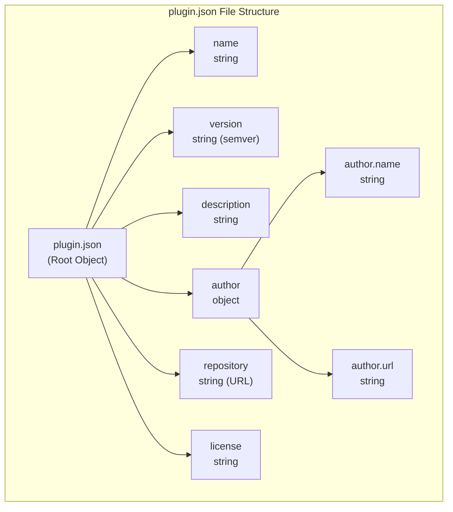
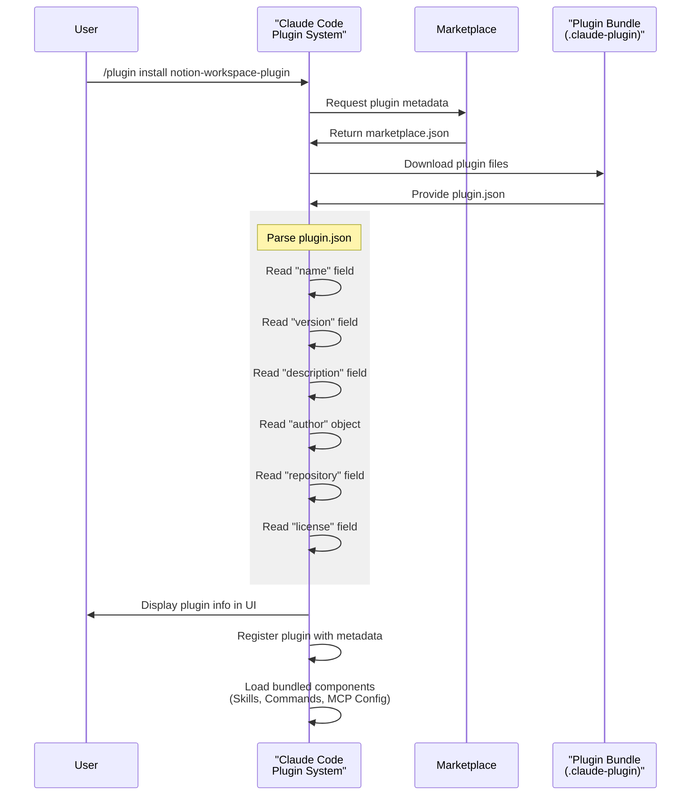
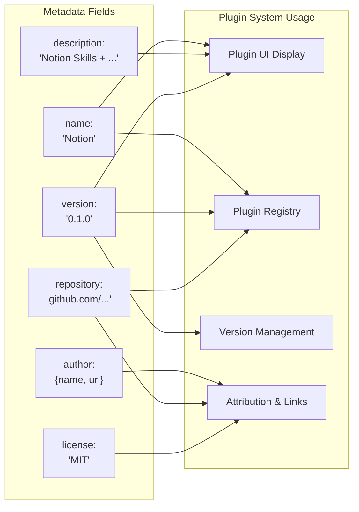

<!-- source: DeepWiki mcp.deepwiki.com · repo makenotion/claude-code-notion-plugin · page 8.1 Plugin Manifest Structure · fetched 2026-10-27 -->

# Plugin Manifest Structure

<details>
<summary>Relevant source files</summary>

The following files were used as context for generating this wiki page:

- [.claude-plugin/plugin.json](.claude-plugin/plugin.json)

</details>


## Purpose and Scope

This document explains the structure and fields of the `plugin.json` manifest file that defines a Claude Code plugin. This manifest contains metadata used by the plugin system for installation, identification, and attribution.

For information about distributing the plugin via marketplace, see [Marketplace Distribution](#8.2). For the overall plugin architecture, see [Core Components](#3.1).

## Manifest File Location

The plugin manifest is located at [.claude-plugin/plugin.json:1-11]() and serves as the primary metadata descriptor for the Notion Workspace Plugin. This file is required by the Claude Code plugin system to identify, load, and display plugin information.

**Sources**: [.claude-plugin/plugin.json:1-11]()

## Manifest Structure Overview

The `plugin.json` file contains a flat JSON object with six top-level fields that define the plugin's identity, authorship, and licensing information.



**Sources**: [.claude-plugin/plugin.json:1-11]()

## Field Specifications

The following table documents all fields present in the plugin manifest:

| Field | Type | Required | Description | Example Value |
|-------|------|----------|-------------|---------------|
| `name` | string | Yes | Display name of the plugin shown in Claude Code UI and marketplace | `"Notion"` |
| `version` | string | Yes | Semantic version number following semver format (MAJOR.MINOR.PATCH) | `"0.1.0"` |
| `description` | string | Yes | Brief description of plugin functionality and components | `"Notion Skills + Notion MCP server packaged as a Claude Code plugin."` |
| `author` | object | Yes | Object containing author/organization information | See `author.*` fields below |
| `author.name` | string | Yes | Name of the plugin author or organization | `"Notion Labs"` |
| `author.url` | string | Yes | URL to author's website or organization homepage | `"https://www.notion.so"` |
| `repository` | string | Yes | Git repository URL where plugin source code is hosted | `"https://github.com/makenotion/claude-code-notion-plugin"` |
| `license` | string | Yes | SPDX license identifier or license name | `"MIT"` |

**Sources**: [.claude-plugin/plugin.json:2-10]()

## Manifest in Plugin Lifecycle

The `plugin.json` file plays a critical role during plugin installation and initialization:



The `plugin.json` manifest is read immediately after the plugin bundle is downloaded and before any plugin components (Skills, Slash Commands, MCP configuration) are loaded. The metadata fields are used for:

1. **Display**: The `name` and `description` fields appear in the plugin UI and help output
2. **Attribution**: The `author` object provides attribution in the plugin registry
3. **Versioning**: The `version` field enables version tracking and updates
4. **Licensing**: The `license` field informs users of usage rights
5. **Source Access**: The `repository` field provides a link to source code

**Sources**: [.claude-plugin/plugin.json:1-11]()

## Field Usage in Plugin System



**Sources**: [.claude-plugin/plugin.json:1-11]()

## Minimal Valid Manifest

The minimum required fields for a valid plugin manifest are demonstrated in the Notion plugin's implementation:

```json
{
    "name": "string",
    "version": "string",
    "description": "string",
    "author": {
      "name": "string",
      "url": "string"
    },
    "repository": "string",
    "license": "string"
}
```

All six top-level fields shown in [.claude-plugin/plugin.json:2-10]() are required. The manifest does not support additional fields beyond those listed, though the structure may be extended in future plugin system versions.

**Sources**: [.claude-plugin/plugin.json:1-11]()

## Versioning Semantics

The `version` field at [.claude-plugin/plugin.json:3]() follows semantic versioning:

- **MAJOR version** (`0` in `0.1.0`): Incremented for breaking changes
- **MINOR version** (`1` in `0.1.0`): Incremented for new features with backward compatibility  
- **PATCH version** (`0` in `0.1.0`): Incremented for backward-compatible bug fixes

The version `0.1.0` indicates the plugin is in initial development, where the major version `0` signals that the API is not yet stable.

**Sources**: [.claude-plugin/plugin.json:3]()

## Author Object Structure

The `author` field at [.claude-plugin/plugin.json:5-8]() is a nested object containing two required sub-fields:

```json
"author": {
  "name": "Notion Labs",
  "url": "https://www.notion.so"
}
```

This structure enables:
- **Attribution**: The `name` field identifies the plugin creator
- **Linking**: The `url` field provides a clickable link to the author's site

The author URL should be a fully-qualified HTTP/HTTPS URL pointing to a valid web resource.

**Sources**: [.claude-plugin/plugin.json:5-8]()

## Repository and License Fields

The `repository` field at [.claude-plugin/plugin.json:9]() must be a valid Git repository URL. For the Notion plugin, this points to the GitHub repository:

```
"repository": "https://github.com/makenotion/claude-code-notion-plugin"
```

The `license` field at [.claude-plugin/plugin.json:10]() specifies the software license. The value `"MIT"` indicates the plugin is distributed under the MIT License, which permits free use, modification, and distribution with attribution.

**Sources**: [.claude-plugin/plugin.json:9-10]()

---

