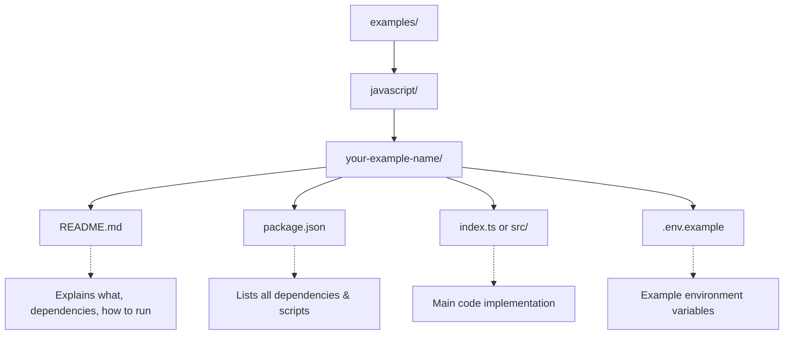
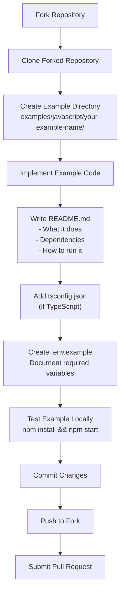
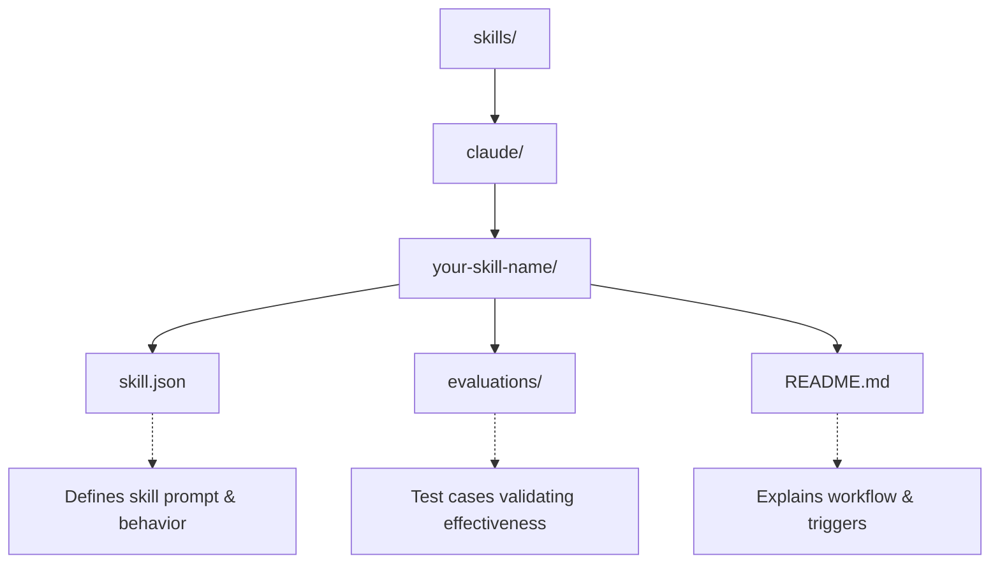
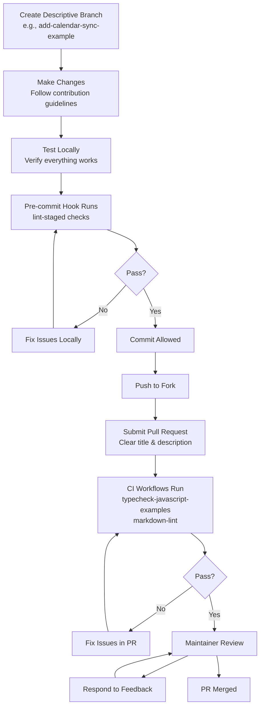
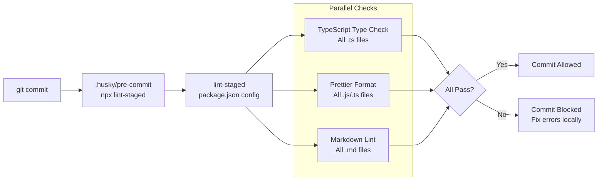
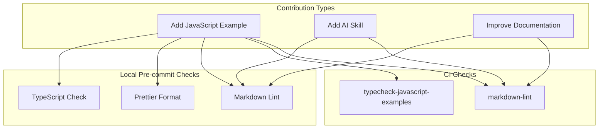

<!-- source: DeepWiki mcp.deepwiki.com · repo makenotion/notion-cookbook · page 6 Contributing · fetched 2026-10-27 -->

# Contributing

Relevant source files

The following files were used as context for generating this wiki page:

- [CONTRIBUTING.md](CONTRIBUTING.md)
- [README.md](README.md)

This document explains how to contribute to the Notion Cookbook repository, including adding examples, creating skills, improving documentation, and following code style guidelines. For information about the CI/CD pipeline that validates contributions, see [CI/CD Pipeline](#7.1). For detailed code formatting rules, see [Code Style Standards](#6.1).

## Purpose and Scope

The Notion Cookbook welcomes community contributions of all types: working code examples, AI skills, documentation improvements, and bug fixes. This guide covers the contribution process, quality standards, and workflow from initial fork to pull request merge.

## Contribution Types

The repository accepts three primary types of contributions, each with specific requirements and directory conventions.

### Adding Examples

Examples are self-contained code samples demonstrating Notion API integrations. They must be working, well-documented, and focused on specific techniques or use cases.

**Requirements:**

| Requirement | Description |
|-------------|-------------|
| Working code | Must execute successfully with documented setup |
| Documentation | Includes README with dependencies, setup, and usage |
| Focus | Demonstrates specific integration or technique |
| Self-contained | All necessary files included in example directory |

**Directory Structure:**

Sources: [CONTRIBUTING.md:7-22]()

**Example Addition Workflow:**

Sources: [CONTRIBUTING.md:7-22]()

### Adding Skills

Skills are AI-powered workflows that integrate Claude AI with Notion MCP. Each skill requires evaluation tests and clear workflow documentation.

**Requirements:**

| Requirement | Description |
|-------------|-------------|
| Evaluation tests | Tests demonstrating skill effectiveness |
| Workflow documentation | Clear explanation of what skill does and triggers |
| Best practices | Follow patterns from skills/README.md |
| Provider directory | Placed in appropriate provider folder (e.g., claude) |

**Skill Directory Structure:**

Sources: [CONTRIBUTING.md:24-31]()

### Improving Documentation

Documentation improvements include fixing typos, clarifying instructions, adding troubleshooting tips, and expanding READMEs.

**Common Documentation Improvements:**

- Fix typos or unclear language in existing docs
- Add missing setup steps to example READMEs
- Improve code comments for clarity
- Add common troubleshooting sections
- Update outdated dependency information

Sources: [CONTRIBUTING.md:33-40]()

## Code Style Guidelines

The repository enforces code style through automated tooling. JavaScript/TypeScript examples follow Prettier formatting, and Markdown follows markdownlint rules.

### JavaScript/TypeScript Standards

| Guideline | Enforcement |
|-----------|-------------|
| Code formatting | Prettier via `.prettierrc` |
| TypeScript configuration | Include `tsconfig.json` for TS examples |
| Code comments | Explain non-obvious logic |
| Consistency | Use existing examples as reference |

Sources: [CONTRIBUTING.md:42-49]()

### Markdown Standards

| Guideline | Rule |
|-----------|------|
| Heading style | Sentence case (not Title Case) |
| Language | Clear and concise, minimal jargon |
| Link validation | Test all links before submitting |
| Line length | Enforced by `.markdownlint.jsonc` |

Sources: [CONTRIBUTING.md:51-56]()

For detailed formatting rules and disabled markdown rules, see [Code Style Standards](#6.1).

## Pull Request Workflow

The contribution workflow follows a standard fork-and-pull-request model with quality gates at multiple stages.

Sources: [CONTRIBUTING.md:58-65]()

**Pull Request Checklist:**

1. Create descriptive branch name (e.g., `add-calendar-sync-example`)
2. Make changes following guidelines in [CONTRIBUTING.md:7-56]()
3. Test everything works as expected locally
4. Submit PR with clear title and description
5. Respond to maintainer feedback promptly

Sources: [CONTRIBUTING.md:58-65]()

## Quality Enforcement System

Contributions are validated through a multi-layered quality system that runs checks locally and in CI.

### Local Enforcement via Pre-commit Hooks

Sources: [CONTRIBUTING.md:42-56](), references to pre-commit system from high-level architecture

### CI Enforcement on Push

When code is pushed to GitHub, two workflows validate the contribution:

**typecheck-javascript-examples Workflow:**

| Step | Action | Files |
|------|--------|-------|
| Setup | Install Node.js 20.x | `.github/workflows/` |
| Install | Run `scripts/install-examples.sh` | All example directories |
| Type check | Run `scripts/typecheck-examples.sh` | All TypeScript files |

**markdown-lint Workflow:**

| Step | Action | Configuration |
|------|--------|---------------|
| Checkout | Clone repository | N/A |
| Lint | Check all .md files | `.markdownlint.jsonc` |

Sources: References from Diagram 2 (CI/CD Pipeline) in high-level architecture

## Contribution Type to Validation Mapping

This diagram shows which quality checks apply to each contribution type:

Sources: [CONTRIBUTING.md:7-56](), references to CI workflows from high-level architecture

## Directory Conventions by Contribution Type

This table maps contribution types to their expected directory locations:

| Contribution Type | Directory Path | Required Files |
|-------------------|----------------|----------------|
| JavaScript Example | `examples/javascript/example-name/` | README.md, package.json, tsconfig.json (if TS) |
| Claude Skill | `skills/claude/skill-name/` | skill.json, evaluations/, README.md |
| Core Documentation | `docs/` | .md files following naming conventions |
| README Updates | Repository root or subdirectories | README.md |

Sources: [CONTRIBUTING.md:7-40](), [README.md:9-28]()

## Getting Help

If you have questions about contributing:

**Community Resources:**

- Open an issue in the repository for clarification
- Join [Notion Developers Slack](https://join.slack.com/t/notiondevs/shared_invite/zt-20b5996xv-DzJdLiympy6jP0GGzu3AMg)
- Ask on Stack Overflow with tag `notion-api`

**Review Timeline:**

Pull requests are reviewed as maintainer availability permits. Contributors should be patient and respectful in all interactions.

Sources: [CONTRIBUTING.md:68-70](), [README.md:48-52]()

## Related Documentation

For more information on development practices:

- **[Code Style Standards](#6.1)**: Detailed formatting rules and configuration
- **[CI/CD Pipeline](#7.1)**: Automated testing workflows
- **[Pre-commit Hooks](#7.2)**: Local quality enforcement system
- **[Repository Structure](#8)**: Directory organization and conventions

---

