# Page: Home

# Home

<details>
<summary>Relevant source files</summary>

The following files were used as context for generating this wiki page:

- [LICENSE](LICENSE)
- [README.md](README.md)

</details>


## Purpose and Scope

This document provides an architectural overview of the Notion Cookbook repository, a community-driven collection of working code examples, AI-powered skills, and developer resources for building integrations with Notion's developer platform. The repository serves as both a learning resource for developers new to the Notion API and a reference implementation library for experienced developers building production integrations.

The scope of this documentation covers the overall repository structure, the relationship between its major components (examples, skills, and documentation), and the development infrastructure that maintains code quality. For detailed setup instructions, see [Getting Started](#2). For specific implementation guides, see [Examples](#3), [Skills](#4), or [Developer Documentation](#5).

**Sources:** [README.md:1-57]()

## Repository Overview

The Notion Cookbook is organized into three primary content areas (`examples/`, `skills/`, `docs/`) with supporting infrastructure for code quality enforcement and contribution management. All code is released under the MIT License.

### High-Level Structure

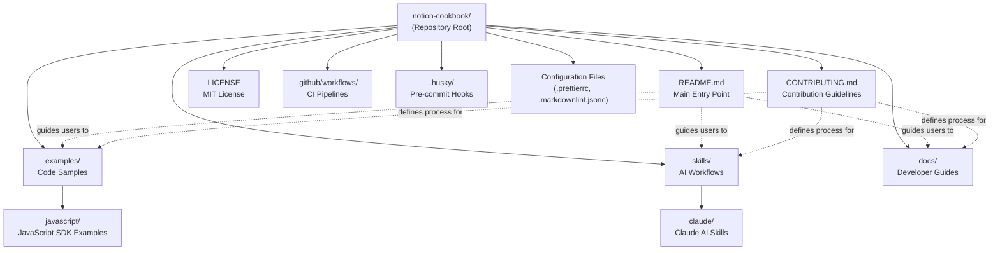

**Sources:** [README.md:1-57](), High-Level Architecture Diagram 1

### Directory Structure

| Directory | Purpose | Content Type |
|-----------|---------|--------------|
| `examples/` | Working code samples demonstrating Notion API integration patterns | Executable code with READMEs |
| `examples/javascript/` | JavaScript SDK-based examples using `@notionhq/client` | Node.js projects with `package.json` |
| `skills/` | AI-powered automation workflows | Declarative skill definitions |
| `skills/claude/` | Claude AI skills utilizing Notion MCP server | JSON skill configurations |
| `docs/` | Developer documentation and integration guides | Markdown documentation |
| `.github/workflows/` | CI/CD pipeline definitions | GitHub Actions YAML files |
| `.husky/` | Git hook configurations | Shell scripts for pre-commit checks |

**Sources:** [README.md:1-57](), Repository Structure Diagram from High-Level Architecture

## Main Components

### Examples System

The examples system contains self-contained code samples demonstrating various Notion API integration patterns. Each example is a standalone project with its own `package.json`, `README.md`, and configuration files.

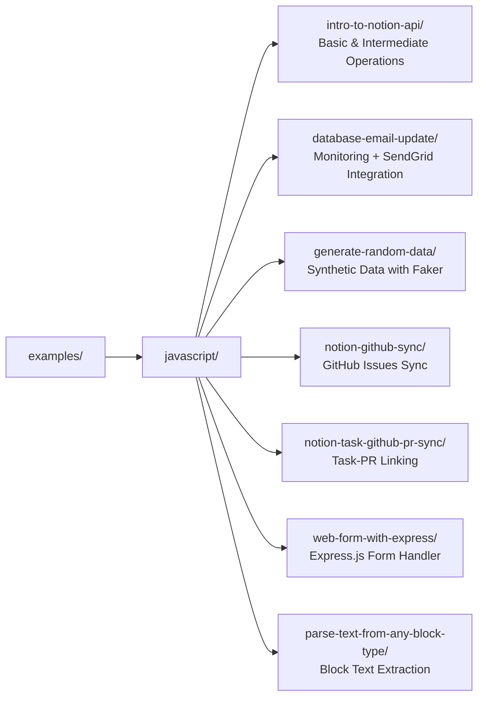

All JavaScript examples depend on `@notionhq/client` for Notion API access. Examples follow a standardized setup pattern: install dependencies, configure `.env` files with `NOTION_KEY` and other service credentials, share resources with the Notion integration, and execute via `npm start` or `npm run ts-run` scripts.

For detailed documentation of each example, see [Examples](#3) and its sub-pages.

**Sources:** [README.md:9-15](), Examples Ecosystem Diagram (Diagram 4)

### Skills System

The skills system provides AI-powered automation workflows that combine Claude AI with the Notion MCP (Model Context Protocol) server. Skills are declarative configurations that enable Claude to perform complex multi-step operations on Notion workspaces.

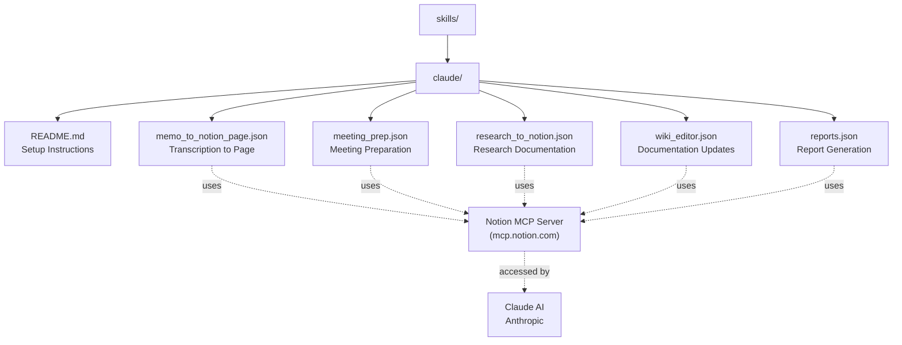

Skills require integration with the Notion MCP server, which provides Claude with authenticated access to Notion workspaces. For setup instructions and detailed skill documentation, see [Skills](#4).

**Sources:** [README.md:17-23](), High-Level Architecture Diagram 1

### Documentation System

The documentation system consists of developer guides for advanced integration patterns. The `docs/` directory currently contains specialized guides with plans to migrate Notion's core API documentation here in the future.

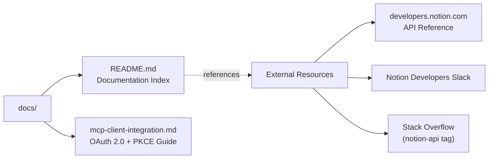

The MCP client integration guide provides comprehensive technical documentation for implementing OAuth 2.0 Authorization Code flow with PKCE for Notion MCP clients. For the full guide, see [MCP Client Integration](#5.1).

**Sources:** [README.md:25-28](), [README.md:48-52](), Documentation Structure Diagram (Diagram 3)

## Development Infrastructure

The repository enforces code quality through a multi-layered system: local pre-commit hooks using Husky and lint-staged, and remote CI pipelines using GitHub Actions.

### Code Quality Enforcement Flow

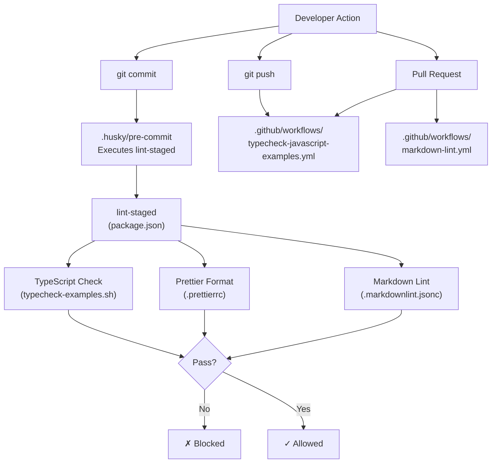

The pre-commit hook configuration is defined in [.husky/pre-commit]() and executes `lint-staged`, which applies checks only to staged files. The CI workflows run on all pushes to `main` and on pull requests to validate the entire codebase.

For detailed infrastructure documentation, see [Development Infrastructure](#7) and its sub-pages: [CI/CD Pipeline](#7.1) and [Pre-commit Hooks](#7.2).

**Sources:** CI/CD and Code Quality Pipeline Diagram (Diagram 2), High-Level Architecture Diagram 1

## Key Integrations

The repository demonstrates integrations with multiple external services through its examples:

| Service | Integration Examples | SDK/Library Used |
|---------|---------------------|------------------|
| Notion API | All examples | `@notionhq/client` |
| SendGrid | `database-email-update` | `@sendgrid/mail` |
| GitHub API | `notion-github-sync`, `notion-task-github-pr-sync` | Direct REST API calls |
| Faker.js | `generate-random-data` | `faker` |
| Express.js | `web-form-with-express` | `express` |
| Notion MCP | Claude skills | MCP SDK (`@modelcontextprotocol/sdk`) |

All examples require a Notion integration token (`NOTION_KEY` in `.env`) and appropriate resource sharing within Notion workspaces. Service-specific examples require additional API keys configured as environment variables.

**Sources:** [README.md:9-15](), Examples Ecosystem Diagram (Diagram 4), MCP Integration Architecture Diagram (Diagram 5)

## Navigation Guide

This wiki is organized hierarchically to support both learning paths and reference lookups:

**For Getting Started:**
1. [Getting Started](#2) - Setup and first run
2. [Introduction to Notion API](#3.1) - Basic operations tutorial
3. [Examples](#3) - Browse all available examples

**For Advanced Integration:**
1. [Developer Documentation](#5) - Integration guides
2. [MCP Client Integration](#5.1) - OAuth 2.0 + PKCE implementation
3. [Additional JavaScript Examples](#3.4) - Multi-service integrations

**For Contributors:**
1. [Contributing](#6) - Contribution guidelines
2. [Code Style Standards](#6.1) - Formatting and linting rules
3. [Development Infrastructure](#7) - CI/CD and tooling

Each section provides detailed technical documentation with code citations, diagrams, and implementation references.

**Sources:** [README.md:1-57](), Documentation Structure and Learning Path Diagram (Diagram 3)

## License

The Notion Cookbook is released under the MIT License, allowing free use, modification, and distribution. The full license text is available at [LICENSE:1-22]().

**Sources:** [LICENSE:1-22](), [README.md:54-56]()

---

# Page: Getting Started

# Getting Started

<details>
<summary>Relevant source files</summary>

The following files were used as context for generating this wiki page:

- [CONTRIBUTING.md](CONTRIBUTING.md)
- [README.md](README.md)
- [examples/README.md](examples/README.md)

</details>


This guide provides step-by-step instructions for setting up the Notion Cookbook repository, creating your first Notion integration, and running your initial example. By the end, you'll have a working development environment and understand the basic workflow for testing Notion API integrations.

For advanced integration patterns including OAuth 2.0 and MCP client setup, see [MCP Client Integration](#5.1). To learn about contributing new examples or modifying existing ones, see [Contributing](#6).

---

## Prerequisites

Before starting, ensure you have:

| Requirement | Version/Details | Purpose |
|------------|-----------------|---------|
| **Node.js** | 20.x or later | Runtime for JavaScript examples |
| **npm** | Included with Node.js | Package manager for dependencies |
| **Git** | Any recent version | Clone repository |
| **Notion account** | Free or paid | Create integrations and test pages |
| **Terminal/Command line** | Basic familiarity | Execute commands and scripts |

---

## Setup Workflow Overview

The following diagram illustrates the complete setup process from repository clone to running your first example:

**Setup Process Flow**

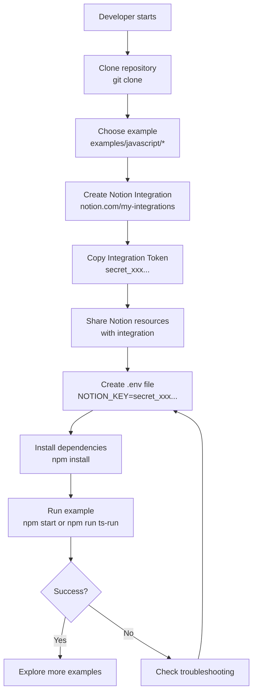

Sources: [README.md:29-42](), [examples/README.md:19-28]()

---

## Step 1: Clone the Repository

Clone the Notion Cookbook repository to your local machine:

```bash
git clone https://github.com/makenotion/notion-cookbook.git
cd notion-cookbook
```

The repository structure includes:

- `examples/` - Working code samples organized by language
- `skills/` - AI-powered automation workflows
- `docs/` - Developer documentation
- `.github/workflows/` - CI/CD pipeline configurations

Sources: [README.md:1-6]()

---

## Step 2: Choose an Example

Navigate to the JavaScript examples directory and select a starting point:

```bash
cd examples/javascript
```

**Recommended first example:** `intro-to-notion-api` - provides a progressive learning path from basic operations to intermediate concepts.

| Example | Complexity | Best For |
|---------|-----------|----------|
| `intro-to-notion-api` | Basic → Intermediate | Learning Notion API fundamentals |
| `database-email-update` | Intermediate | Database monitoring patterns |
| `generate-random-data` | Intermediate | Populating test data |
| `web-form-with-express` | Intermediate | Web application integration |

For detailed information about each example, see [Examples](#3).

Sources: [examples/README.md:6-18]()

---

## Step 3: Create a Notion Integration

Notion integrations are the authentication mechanism for API access. Each integration has a unique token that authorizes API requests.

### Creating the Integration

1. Visit [https://www.notion.com/my-integrations](https://www.notion.com/my-integrations)
2. Click **"+ New integration"**
3. Configure basic information:
   - **Name**: Choose a descriptive name (e.g., "My Cookbook Test")
   - **Associated workspace**: Select your workspace
   - **Type**: Internal integration (recommended for testing)
4. Click **"Submit"**
5. Copy the **"Internal Integration Token"** (format: `secret_xxx...`)

**Important:** Store this token securely. It provides full access to any Notion resources shared with the integration.

Sources: [examples/README.md:23]()

---

## Step 4: Share Notion Resources with Integration

Integrations can only access pages and databases that have been explicitly shared with them.

### Sharing a Page or Database

1. Open the Notion page or database you want to use
2. Click the **"⋯"** menu in the top-right corner
3. Scroll to **"Connections"** or **"Add connections"**
4. Select your integration from the list
5. Confirm the connection

The integration now has read/write access to this resource and its children.

**Example-specific requirements:**
- `intro-to-notion-api` examples require a shared page ID
- `database-email-update` requires a shared database ID
- `generate-random-data` requires a shared database ID

Sources: [examples/README.md:22]()

---

## Step 5: Configure Environment Variables

Each example requires configuration through environment variables. These typically include your integration token and resource identifiers.

**Environment Variable Configuration**

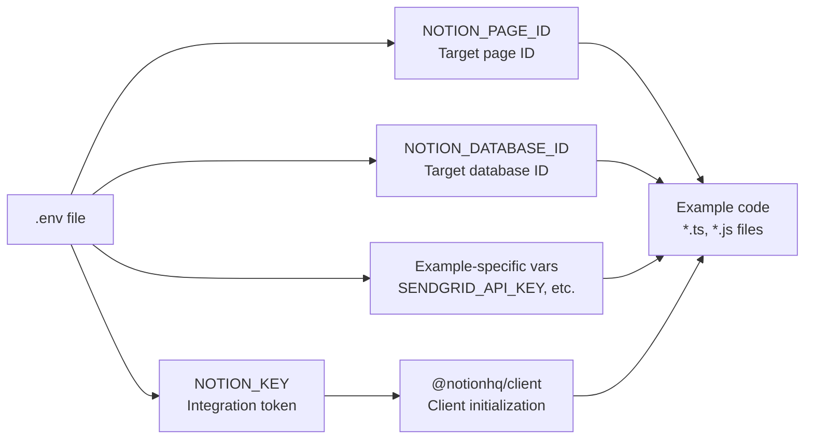

Sources: [examples/README.md:23]()

### Creating the `.env` File

Navigate to your chosen example directory and create a `.env` file:

```bash
cd intro-to-notion-api
touch .env
```

### Common Environment Variables

Add the following to your `.env` file (exact variables depend on the example):

```
# Required for all examples
NOTION_KEY=secret_xxx...

# Required for page-based examples
NOTION_PAGE_ID=abc123...

# Required for database-based examples
NOTION_DATABASE_ID=def456...

# Example-specific (if applicable)
SENDGRID_API_KEY=SG.xxx...
GITHUB_TOKEN=ghp_xxx...
```

**Finding Notion IDs:**
- **Page ID**: Copy the page URL - the ID is the 32-character hex string after the page name
  - Example: `notion.so/My-Page-abc123def456...` → `abc123def456...`
- **Database ID**: Same process as page ID - databases are pages with special properties

Sources: [examples/README.md:23]()

---

## Step 6: Install Dependencies

Each example has its own `package.json` defining required dependencies. Install them using npm:

```bash
npm install
```

**Common Dependencies Across Examples**

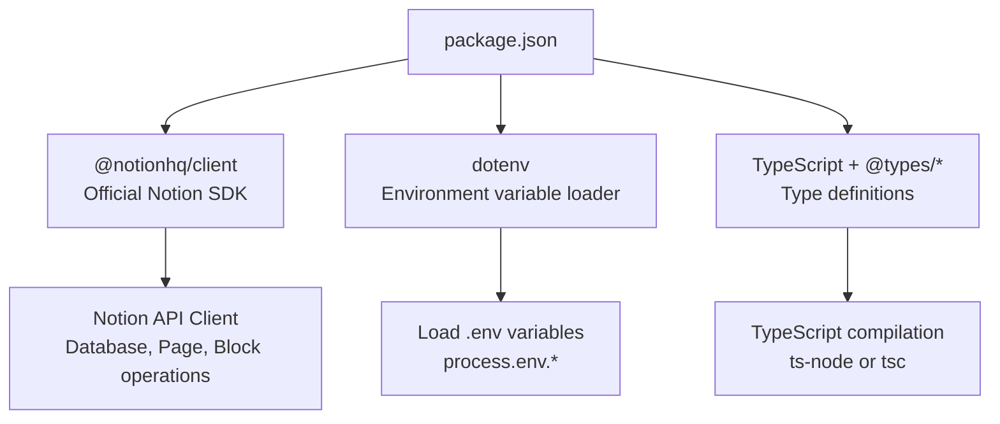

Sources: [examples/README.md:24](), [README.md:33]()

### What Gets Installed

The installation process downloads and configures:

- **`@notionhq/client`** - Official Notion JavaScript SDK for API interaction
- **`dotenv`** - Loads environment variables from `.env` into `process.env`
- **TypeScript tooling** - For type-checking and compilation (if using TypeScript examples)
- **Example-specific libraries** - e.g., `@sendgrid/mail`, `express`, `faker`

The `node_modules/` directory is created containing all dependencies. This directory is gitignored and should not be committed.

Sources: [README.md:33]()

---

## Step 7: Run Your First Example

With configuration complete and dependencies installed, execute the example code.

### Execution Commands

Most examples support these npm scripts:

```bash
# Run TypeScript files directly (if ts-node is available)
npm run ts-run

# Or use the standard start command
npm start
```

The specific command varies by example. Check the example's `package.json` scripts section for available commands.

### Expected Output

**Successful execution typically shows:**

- Connection confirmation to Notion API
- Operation descriptions (e.g., "Creating page...", "Querying database...")
- Created resource IDs (page IDs, block IDs)
- Completion status

**Example output from `intro-to-notion-api/basic/1-add-block.ts`:**

```
Connecting to Notion API...
Adding block to page abc123...
✓ Block created successfully
Block ID: block_xyz789
```

### Verifying Success

1. Check the terminal output for error messages
2. Open the shared Notion page/database in your browser
3. Refresh the page to see new content created by the example
4. Verify the changes match the example's expected behavior

Sources: [examples/README.md:25](), [README.md:35-38]()

---

## Common Setup Patterns

Understanding the file structure and configuration flow helps troubleshoot issues and customize examples.

**File Structure and Configuration Flow**

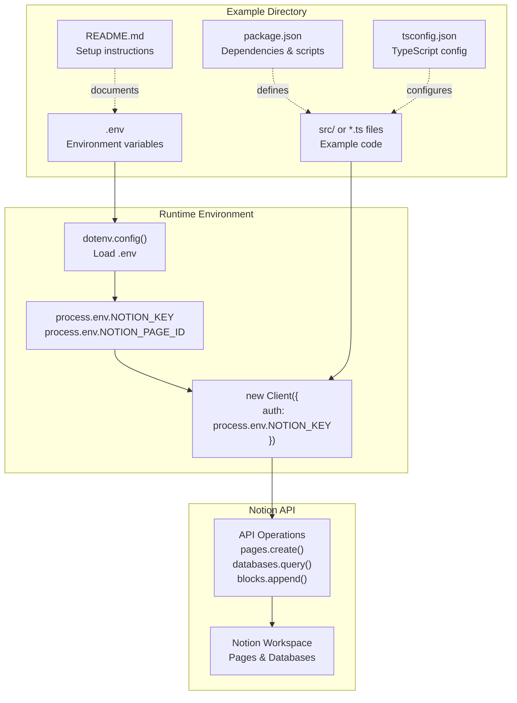

Sources: [examples/README.md:33-38]()

### Standard Files in Each Example

| File | Purpose | Required |
|------|---------|----------|
| `README.md` | Setup instructions and usage guide | Yes |
| `package.json` | Dependencies, scripts, metadata | Yes |
| `.env` | Environment variables (not committed) | Yes |
| `tsconfig.json` | TypeScript configuration | For TS examples |
| `*.ts` or `*.js` | Example source code | Yes |
| `.gitignore` | Excludes `.env` and `node_modules/` | Yes |

---

## Troubleshooting Common Issues

### Integration Token Not Working

**Symptoms:** `unauthorized` or `401` errors

**Solutions:**
- Verify the token starts with `secret_`
- Ensure no extra spaces in `.env` file
- Confirm the integration was created in the correct workspace
- Check that `.env` file is in the same directory as the example code

### Cannot Find Page or Database

**Symptoms:** `object_not_found` or `404` errors

**Solutions:**
- Verify the page/database ID is correct (32-character hex string)
- Ensure the resource is shared with the integration (see Step 4)
- Check that the resource exists and hasn't been deleted
- Confirm you're using the correct ID type (page vs database)

### Dependencies Not Installing

**Symptoms:** `npm install` fails or missing module errors

**Solutions:**
- Verify Node.js version is 20.x or later: `node --version`
- Clear npm cache: `npm cache clean --force`
- Delete `node_modules/` and `package-lock.json`, then retry
- Check for network connectivity issues

### TypeScript Compilation Errors

**Symptoms:** Type errors during `npm run ts-run`

**Solutions:**
- Ensure TypeScript is installed: `npm list typescript`
- Check `tsconfig.json` exists and is valid
- Verify `@types/*` packages are installed
- Try running with `npm start` if available (may use pre-compiled JS)

For CI/CD-related issues or pre-commit hook problems, see [Development Infrastructure](#7).

---

## Next Steps

After successfully running your first example, explore these resources:

### Learn More Examples

- **[Introduction to Notion API](#3.1)** - Comprehensive guide covering basic and intermediate operations
- **[Database Email Update](#3.2)** - Learn database monitoring patterns
- **[Additional JavaScript Examples](#3.4)** - GitHub sync, web forms, and utilities

### Try AI Skills

- **[Skills](#4)** - Explore AI-powered automation with Claude and Notion MCP

### Contribute Back

- **[Contributing](#6)** - Add your own examples or improve existing ones
- **[Code Style Standards](#6.1)** - Formatting and linting conventions

### Advanced Topics

- **[MCP Client Integration](#5.1)** - OAuth 2.0 and Model Context Protocol setup
- **[CI/CD Pipeline](#7.1)** - Automated testing and validation

---

## Quick Reference

**Essential Commands**

```bash
# Clone repository
git clone https://github.com/makenotion/notion-cookbook.git

# Navigate to example
cd examples/javascript/intro-to-notion-api

# Install dependencies
npm install

# Run example
npm start
# or
npm run ts-run
```

**Essential URLs**

- Create integrations: [https://www.notion.com/my-integrations](https://www.notion.com/my-integrations)
- Notion API docs: [https://developers.notion.com](https://developers.notion.com)
- Developer community: [Notion Developers Slack](https://join.slack.com/t/notiondevs/shared_invite/zt-20b5996xv-DzJdLiympy6jP0GGzu3AMg)

Sources: [README.md:49-52](), [examples/README.md:1-43]()

---

# Page: Examples

# Examples

<details>
<summary>Relevant source files</summary>

The following files were used as context for generating this wiki page:

- [examples/README.md](examples/README.md)
- [examples/javascript/README.md](examples/javascript/README.md)

</details>


## Purpose and Scope

This document provides an overview of all working code examples in the Notion Cookbook repository, organized by programming language and complexity level. These examples demonstrate practical integrations with Notion's API, from basic operations to advanced multi-service integrations.

For detailed documentation of specific examples, see:
- [Introduction to Notion API](#3.1) - Basic and intermediate Notion API operations
- [Database Email Update](#3.2) - Database monitoring with email notifications
- [Generate Random Data](#3.3) - Synthetic data population utilities
- [Additional JavaScript Examples](#3.4) - GitHub sync, web forms, and text parsing

For initial setup instructions, see [Getting Started](#2). For contribution guidelines, see [Contributing](#6).

**Sources:** [examples/README.md:1-43]()

## Example Organization

All examples are located in the `examples/` directory and organized by programming language. Currently, all available examples are in JavaScript and utilize the official `@notionhq/client` SDK.

### Directory Structure

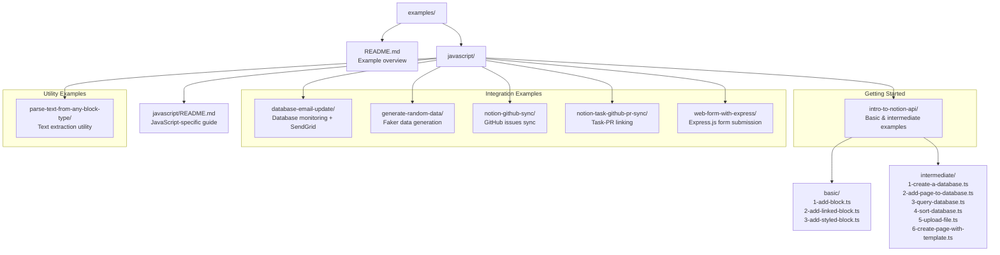

**Sources:** [examples/README.md:1-43](), [examples/javascript/README.md:1-62]()

## Example Categories

### Getting Started Examples

| Example | Purpose | Complexity | Key Concepts |
|---------|---------|------------|--------------|
| **intro-to-notion-api** | Learn fundamental Notion API operations | Basic → Intermediate | Blocks, pages, databases, file uploads, templates |

The `intro-to-notion-api` example serves as the entry point for developers new to Notion's API. It includes two subdirectories: `basic/` for fundamental operations and `intermediate/` for more complex interactions.

**Sources:** [examples/README.md:11](), [examples/javascript/README.md:15]()

### Integration Examples

| Example | Purpose | External Services | Key Concepts |
|---------|---------|-------------------|--------------|
| **database-email-update** | Monitor database changes and send notifications | SendGrid | Database queries, change detection, email delivery |
| **generate-random-data** | Populate databases with synthetic test data | Faker.js | Data generation, batch operations, database population |
| **notion-github-sync** | Sync GitHub issues to Notion database | GitHub API | Bidirectional sync, issue tracking, webhooks |
| **notion-task-github-pr-sync** | Link Notion tasks with GitHub pull requests | GitHub API | Task management, PR tracking, status updates |
| **web-form-with-express** | Submit web form data to Notion | Express.js | HTTP routing, form processing, page creation |

These examples demonstrate real-world integration patterns that combine Notion's API with external services.

**Sources:** [examples/README.md:12-17](), [examples/javascript/README.md:19-24]()

### Utility Examples

| Example | Purpose | Key Concepts |
|---------|---------|--------------|
| **parse-text-from-any-block-type** | Extract text content from various block types | Block traversal, type handling, text extraction |

This utility demonstrates how to handle Notion's diverse block types when extracting textual content.

**Sources:** [examples/README.md:16](), [examples/javascript/README.md:27]()

## Learning Progression

The examples are designed to support a progressive learning path, starting with fundamental concepts and advancing to complex integrations.

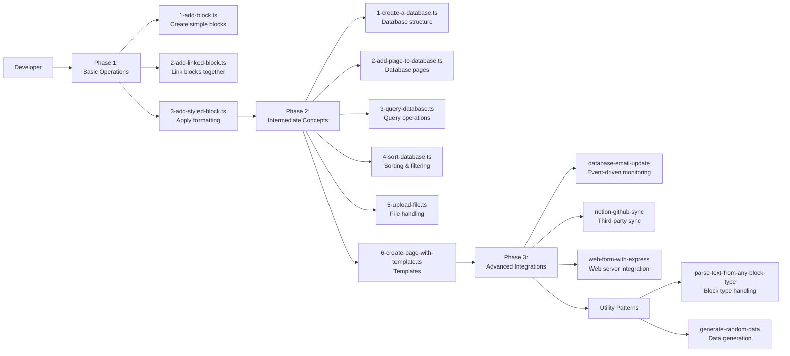

**Sources:** [examples/README.md:11](), [examples/javascript/README.md:13-28]()

## Common Setup Pattern

All JavaScript examples follow a standardized setup workflow, ensuring consistency and reducing cognitive load when switching between examples.

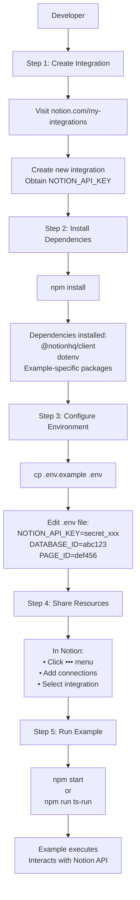

**Sources:** [examples/README.md:19-28](), [examples/javascript/README.md:29-56]()

## Prerequisites

### System Requirements

| Requirement | Version | Purpose |
|-------------|---------|---------|
| **Node.js** | 18 or higher | JavaScript runtime |
| **npm** | Included with Node.js | Package management |

**Sources:** [examples/javascript/README.md:7]()

### Notion Requirements

| Requirement | Acquisition Method |
|-------------|-------------------|
| **Notion Integration** | Create at [notion.com/my-integrations](https://www.notion.com/my-integrations) |
| **API Key** | Generated when creating integration (format: `secret_xxx...`) |
| **Shared Resources** | Page or database must be explicitly shared with integration |

All examples require a Notion integration with appropriate capabilities (read content, update content, insert content) depending on the example's operations.

**Sources:** [examples/README.md:23-24](), [examples/javascript/README.md:8-9]()

## Environment Configuration

Each example includes an `.env.example` file that serves as a template for required environment variables. The common pattern is:

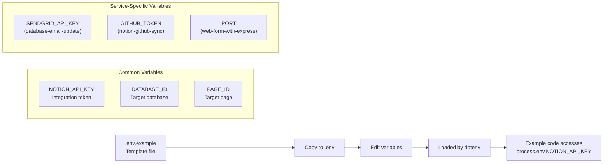

**Sources:** [examples/javascript/README.md:39-46]()

## Common Dependencies

All JavaScript examples share core dependencies, with additional packages required for specific integrations:

| Package | Purpose | Used In |
|---------|---------|---------|
| **@notionhq/client** | Official Notion SDK | All examples |
| **dotenv** | Environment variable management | All examples |
| **typescript** | Type checking and compilation | All examples |
| **@sendgrid/mail** | Email delivery | database-email-update |
| **@faker-js/faker** | Synthetic data generation | generate-random-data |
| **@octokit/rest** | GitHub API client | notion-github-sync, notion-task-github-pr-sync |
| **express** | Web server framework | web-form-with-express |

**Sources:** [examples/README.md:1-43](), [examples/javascript/README.md:1-62]()

## Running Examples

### Standard Execution

Most examples provide an `npm start` script that executes the main entry point:

```bash
npm install
npm start
```

For TypeScript examples with a custom runner:

```bash
npm run ts-run
```

### Resource Sharing

Before running any example, the target Notion page or database must be shared with the integration:

1. Navigate to the page/database in Notion
2. Click the `•••` menu (top right)
3. Select "Add connections"
4. Choose your integration from the list

Without this step, the API will return authorization errors when attempting operations.

**Sources:** [examples/README.md:19-27](), [examples/javascript/README.md:48-56]()

## Example Structure

Each example follows a consistent directory structure:

```
example-name/
├── README.md           # Specific setup and usage instructions
├── package.json        # Dependencies and npm scripts
├── tsconfig.json       # TypeScript configuration
├── .env.example        # Environment variable template
├── index.ts or index.js # Main entry point
└── src/                # Additional source files (if needed)
```

This standardization ensures developers can quickly navigate and understand any example in the repository.

**Sources:** [examples/README.md:33-38]()

## Contributing Examples

The repository welcomes new examples that demonstrate additional integration patterns or programming languages. When contributing an example, ensure it includes:

| Requirement | Purpose |
|-------------|---------|
| **Clear README** | Explains purpose, setup steps, and usage |
| **Configuration files** | `package.json`, `tsconfig.json`, `.env.example` |
| **Working code** | Tested and verified functionality |
| **Focused scope** | Demonstrates a specific technique or integration |

For complete contribution guidelines, see [Contributing](#6).

**Sources:** [examples/README.md:29-42]()

## Additional Resources

| Resource | Location |
|----------|----------|
| **Notion API Reference** | [developers.notion.com/reference](https://developers.notion.com/reference) |
| **JavaScript SDK Documentation** | [github.com/makenotion/notion-sdk-js](https://github.com/makenotion/notion-sdk-js) |
| **Getting Started Guide** | [developers.notion.com/docs/getting-started](https://developers.notion.com/docs/getting-started) |

**Sources:** [examples/javascript/README.md:58-62]()

---

# Page: Introduction to Notion API

# Introduction to Notion API

<details>
<summary>Relevant source files</summary>

The following files were used as context for generating this wiki page:

- [examples/javascript/intro-to-notion-api/.env.example](examples/javascript/intro-to-notion-api/.env.example)
- [examples/javascript/intro-to-notion-api/.prettierrc](examples/javascript/intro-to-notion-api/.prettierrc)
- [examples/javascript/intro-to-notion-api/README.md](examples/javascript/intro-to-notion-api/README.md)
- [examples/javascript/intro-to-notion-api/assets/page_id.png](examples/javascript/intro-to-notion-api/assets/page_id.png)

</details>


## Purpose and Scope

This page documents the `intro-to-notion-api` example, which provides a progressive learning path for developers new to the Notion API. The example demonstrates core Notion API concepts through TypeScript code samples organized by complexity level.

The material covers:
- Creating and appending blocks to pages
- Applying text formatting and links
- Creating and managing databases
- Querying and sorting database entries
- Uploading files and attachments
- Working with database templates

For integration with external services (email, GitHub), see [Database Email Update](#3.2) and [Additional JavaScript Examples](#3.4). For AI-powered workflows, see [Skills](#4).

**Sources:** [examples/javascript/intro-to-notion-api/README.md:1-19]()

---

## Project Structure

The example is organized into two progressive directories that build upon each other in complexity:

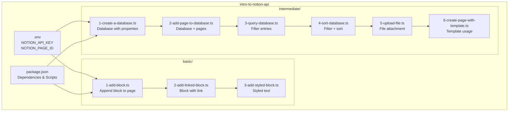

**Learning Progression Table:**

| Level | File | Concepts Introduced |
|-------|------|---------------------|
| Basic | `1-add-block.ts` | Block creation, `blocks.children.append` |
| Basic | `2-add-linked-block.ts` | Rich text, link annotations |
| Basic | `3-add-styled-block.ts` | Text styles (bold, italic, color) |
| Intermediate | `1-create-a-database.ts` | Database creation, property types |
| Intermediate | `2-add-page-to-database.ts` | Page creation in databases, property values |
| Intermediate | `3-query-database.ts` | Database queries, filter conditions |
| Intermediate | `4-sort-database.ts` | Query sorting, multiple filters |
| Intermediate | `5-upload-file.ts` | File uploads, external file URLs |
| Intermediate | `6-create-page-with-template.ts` | Template listing, template-based creation |

**Sources:** [examples/javascript/intro-to-notion-api/README.md:18-30]()

---

## Setup Process

### Integration and Environment Configuration

The setup process requires creating a Notion integration and configuring environment variables:

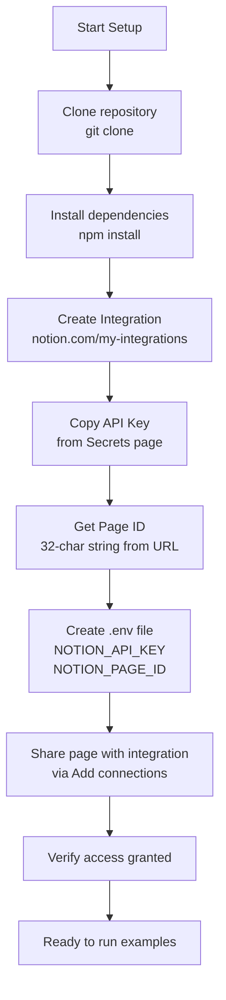

### Environment Variables

The `.env` file must define two required variables:

| Variable | Description | Source |
|----------|-------------|--------|
| `NOTION_API_KEY` | Integration API key | Integration Secrets page at `notion.com/my-integrations` |
| `NOTION_PAGE_ID` | Target page identifier | 32-character string at end of page URL |

**Example `.env` configuration:**

```
NOTION_API_KEY=secret_abcd1234...
NOTION_PAGE_ID=a1b2c3d4e5f6...
```

**Sources:** [examples/javascript/intro-to-notion-api/.env.example:1-2](), [examples/javascript/intro-to-notion-api/README.md:50-66]()

### Permission Granting

The integration must be explicitly granted access to the target page:

1. Navigate to the page in workspace
2. Click `•••` (more menu) in top-right corner
3. Select `Add connections` at bottom of menu
4. Search for and select the integration

**Authorization errors** indicate missing permissions at this step.

**Sources:** [examples/javascript/intro-to-notion-api/README.md:68-80]()

---

## Basic Operations

### Block Manipulation Workflow

The basic examples demonstrate fundamental block operations:

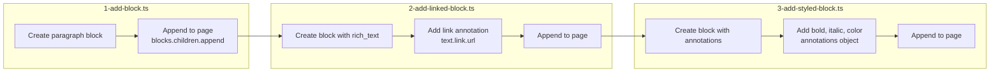

### Core Block Structure

All basic examples work with the block object structure:

```typescript
{
  object: "block",
  type: "paragraph",
  paragraph: {
    rich_text: [{
      type: "text",
      text: {
        content: "Block content",
        link: { url: "https://..." }  // Optional
      },
      annotations: {
        bold: true,      // Optional
        italic: true,    // Optional
        color: "blue"    // Optional
      }
    }]
  }
}
```

**Key API Methods:**

- `notion.blocks.children.append()` - Appends blocks to parent page or block
- `notion.pages.retrieve()` - Fetches page metadata

**Sources:** [examples/javascript/intro-to-notion-api/README.md:22-24]()

---

## Intermediate Operations

### Database Workflow Progression

The intermediate examples demonstrate database operations in increasing complexity:

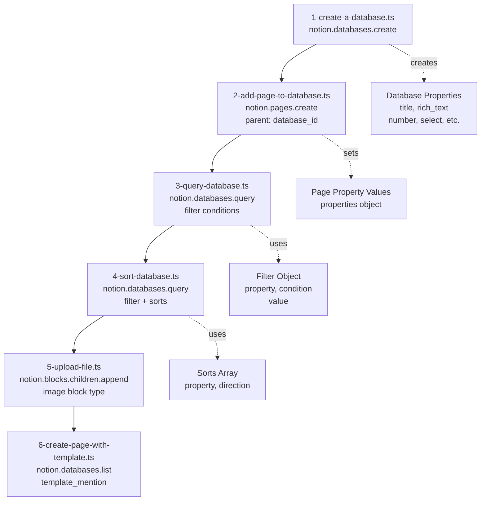

### Database Property Types

The examples demonstrate creating databases with various property types:

| Property Type | Purpose | Example Value |
|---------------|---------|---------------|
| `title` | Database title property | `"Task Name"` |
| `rich_text` | Multi-line text content | `"Description text"` |
| `number` | Numeric values | `42` |
| `select` | Single option from list | `{ name: "In Progress" }` |
| `multi_select` | Multiple options | `[{ name: "Tag1" }, { name: "Tag2" }]` |
| `date` | Date or date range | `{ start: "2024-01-01" }` |
| `checkbox` | Boolean value | `true` or `false` |
| `url` | Web link | `"https://example.com"` |
| `email` | Email address | `"user@example.com"` |
| `phone_number` | Phone number | `"+1234567890"` |

**Sources:** [examples/javascript/intro-to-notion-api/README.md:25-30]()

### Query and Filter Operations

Database queries support filtering and sorting:

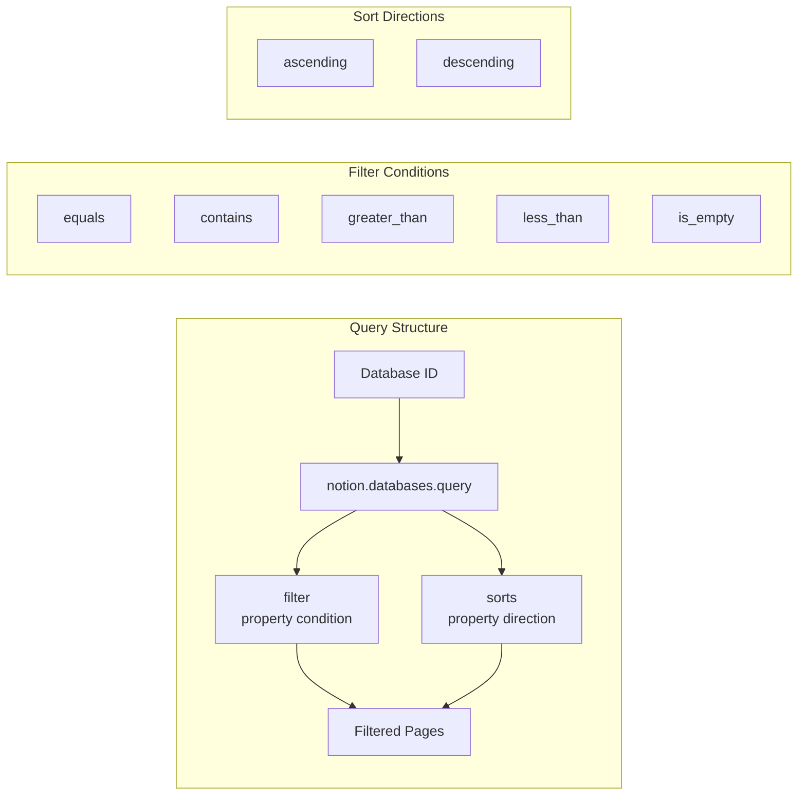

**Example filter structure:**

```typescript
{
  filter: {
    property: "Status",
    select: {
      equals: "Done"
    }
  },
  sorts: [
    {
      property: "Created",
      direction: "descending"
    }
  ]
}
```

**Sources:** [examples/javascript/intro-to-notion-api/README.md:27-28]()

### File Upload Operations

File uploads use external URLs attached as image blocks:

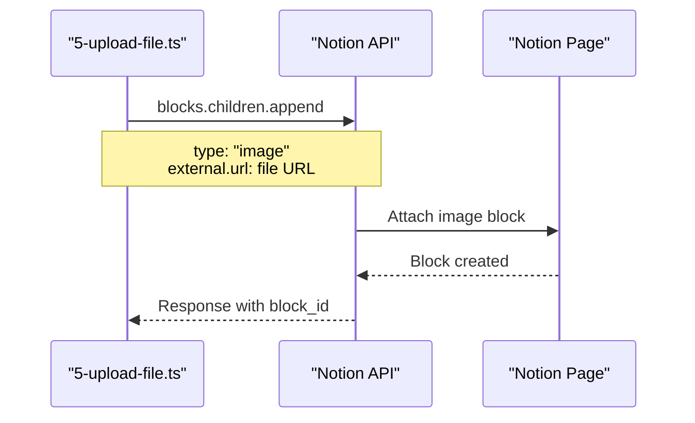

**Block structure for files:**

```typescript
{
  type: "image",
  image: {
    type: "external",
    external: {
      url: "https://example.com/image.png"
    }
  }
}
```

**Sources:** [examples/javascript/intro-to-notion-api/README.md:29]()

### Template Operations

Template operations involve listing available templates and creating pages from them:

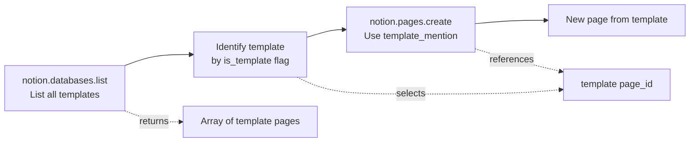

**Sources:** [examples/javascript/intro-to-notion-api/README.md:30]()

---

## Execution Methods

The example provides three methods to run individual TypeScript files:

### NPM Script Execution

Pre-configured scripts in `package.json` for direct execution:

```bash
npm run basic:1    # Runs basic/1-add-block.ts
npm run basic:2    # Runs basic/2-add-linked-block.ts
npm run basic:3    # Runs basic/3-add-styled-block.ts

npm run intermediate:1    # Runs intermediate/1-create-a-database.ts
npm run intermediate:2    # Runs intermediate/2-add-page-to-database.ts
npm run intermediate:3    # Runs intermediate/3-query-database.ts
npm run intermediate:4    # Runs intermediate/4-sort-database.ts
npm run intermediate:5    # Runs intermediate/5-upload-file.ts
npm run intermediate:6    # Runs intermediate/6-create-page-with-template.ts
```

### Path-Based Execution

Generic execution script accepting file paths:

```bash
npm run exec basic/1-add-block.ts
npm run exec intermediate/1-create-a-database.ts
```

### Direct Node Execution

Manual invocation with `ts-node` loader:

```bash
node --loader ts-node/esm basic/1-add-block.ts
node --loader ts-node/esm intermediate/3-query-database.ts
```

**Execution Flow:**

```mermaid
flowchart TD
    START["Developer wants to run example"] --> CHOICE{Choose method?}
    
    CHOICE -->|Easiest| NPM["npm run basic:1"]
    CHOICE -->|Flexible| EXEC["npm run exec basic/1-add-block.ts"]
    CHOICE -->|Manual| NODE["node --loader ts-node/esm basic/1-add-block.ts"]
    
    NPM --> LOAD["Load .env variables"]
    EXEC --> LOAD
    NODE --> LOAD
    
    LOAD --> INIT["Initialize @notionhq/client"]
    INIT --> EXECUTE["Execute TypeScript file"]
    EXECUTE --> API["Make Notion API calls"]
    API --> RESULT["View results in Notion"]
```

**Sources:** [examples/javascript/intro-to-notion-api/README.md:82-108]()

---

## API Client Initialization

All examples use the `@notionhq/client` package for API interaction:

```mermaid
graph TB
    ENV_VAR["process.env.NOTION_API_KEY"] --> CLIENT["new Client({ auth: apiKey })"]
    CLIENT --> METHODS["API Methods"]
    
    subgraph "Available Methods"
        BLOCKS["blocks.children.append<br/>blocks.retrieve"]
        PAGES["pages.create<br/>pages.retrieve<br/>pages.update"]
        DBS["databases.create<br/>databases.query<br/>databases.retrieve<br/>databases.list"]
    end
    
    METHODS --> BLOCKS
    METHODS --> PAGES
    METHODS --> DBS
```

**Typical initialization pattern:**

```typescript
import { Client } from "@notionhq/client"

const notion = new Client({
  auth: process.env.NOTION_API_KEY
})

const pageId = process.env.NOTION_PAGE_ID
```

**Sources:** [examples/javascript/intro-to-notion-api/README.md:1-5]()

---

## Dependencies and Configuration

### Package Dependencies

The example requires the following npm packages:

| Package | Purpose |
|---------|---------|
| `@notionhq/client` | Official Notion SDK for JavaScript |
| `dotenv` | Environment variable loading from `.env` |
| `typescript` | TypeScript compiler |
| `ts-node` | TypeScript execution engine |

### Code Formatting

The project uses Prettier with custom configuration:

| Setting | Value | Purpose |
|---------|-------|---------|
| `arrowParens` | `"avoid"` | Omit parentheses for single-parameter arrows |
| `tabWidth` | `2` | 2-space indentation |
| `semi` | `false` | No semicolons |
| `trailingComma` | `"es5"` | Trailing commas in ES5-compatible positions |
| `endOfLine` | `"lf"` | Unix-style line endings |
| `singleQuote` | `false` | Use double quotes |

**Sources:** [examples/javascript/intro-to-notion-api/.prettierrc:1-8]()

---

## Related Resources

For additional Notion API information:

- **Official API Documentation**: [developers.notion.com](https://developers.notion.com)
- **API Reference**: Complete endpoint documentation at [developers.notion.com/reference](https://developers.notion.com/reference/intro)
- **Integration Guides**: Step-by-step tutorials at [developers.notion.com/docs](https://developers.notion.com/docs)
- **Developer Community**: Notion Developers Slack group

For more advanced examples in this repository, see [Additional JavaScript Examples](#3.4).

**Sources:** [examples/javascript/intro-to-notion-api/README.md:112-118]()

---

# Page: Database Email Update

# Database Email Update

<details>
<summary>Relevant source files</summary>

The following files were used as context for generating this wiki page:

- [examples/javascript/database-email-update/README.md](examples/javascript/database-email-update/README.md)
- [examples/javascript/database-email-update/example.env](examples/javascript/database-email-update/example.env)
- [examples/javascript/database-email-update/index.ts](examples/javascript/database-email-update/index.ts)
- [examples/javascript/database-email-update/package.json](examples/javascript/database-email-update/package.json)
- [examples/javascript/database-email-update/tsconfig.json](examples/javascript/database-email-update/tsconfig.json)

</details>


## Purpose and Scope

This page documents the `database-email-update` example, which demonstrates event-driven monitoring of Notion databases. The integration polls a Notion database at regular intervals, detects when the `Status` property of pages changes, and sends email notifications via the SendGrid API. This example illustrates polling-based change detection, stateful caching, and third-party service integration.

For basic Notion API operations (creating databases, querying pages), see [Introduction to Notion API](#3.1). For other integration patterns, see [Additional JavaScript Examples](#3.4).

**Sources:** [examples/javascript/database-email-update/README.md:1-58](), [examples/javascript/database-email-update/index.ts:1-264]()

---

## System Overview

The `database-email-update` integration implements a monitoring system that continuously tracks status changes in a Notion database. The system maintains an in-memory cache (`taskPageIdToStatusMap`) of page IDs mapped to their last known status values. Every 5 seconds, the integration queries the Notion database, compares the current state with the cached state, and dispatches email notifications through SendGrid when changes are detected.

The integration is designed to work with a specific [database template](https://public-api-examples.notion.site/0def5dfb6d9b4cdaa907a0466834b9f4?v=aea75fc133e54b3382d12292291d9248) that includes `Name` (title) and `Status` (select) properties.

**Sources:** [examples/javascript/database-email-update/README.md:5-9](), [examples/javascript/database-email-update/index.ts:24-36]()

---

## Architecture and Data Flow

### High-Level Component Diagram

```mermaid
graph TB
    subgraph "Application Process"
        INIT["setInitialTaskPageIdToStatusMap()"]
        POLL["findAndSendEmailsForUpdatedTasks()"]
        CACHE["taskPageIdToStatusMap<br/>{[pageId: string]: string}"]
        INTERVAL["setInterval()<br/>5000ms"]
    end
    
    subgraph "Notion API Client"
        NOTION["Client<br/>@notionhq/client"]
        RETRIEVE["notion.databases.retrieve()"]
        QUERY["notion.dataSources.query()"]
        PROPS["notion.pages.properties.retrieve()"]
    end
    
    subgraph "SendGrid API Client"
        SENDGRID["SendGrid<br/>@sendgrid/mail"]
        SEND["SendGrid.send()"]
    end
    
    subgraph "Core Functions"
        GETTASKS["getTasksFromNotionDatabase()"]
        FINDUPDATED["findUpdatedTasks()"]
        SENDEMAIL["sendUpdateEmailWithSendgrid()"]
        GETPROP["getPropertyValue()"]
    end
    
    subgraph "External Services"
        NOTIONDB["Notion Database<br/>NOTION_DATABASE_ID"]
        EMAILSVC["SendGrid Email Service"]
    end
    
    INIT --> GETTASKS
    GETTASKS --> CACHE
    
    INIT --> INTERVAL
    INTERVAL --> POLL
    
    POLL --> GETTASKS
    GETTASKS --> NOTION
    NOTION --> RETRIEVE
    NOTION --> QUERY
    RETRIEVE --> NOTIONDB
    QUERY --> NOTIONDB
    
    GETTASKS --> GETPROP
    GETPROP --> PROPS
    PROPS --> NOTIONDB
    
    POLL --> FINDUPDATED
    FINDUPDATED --> CACHE
    
    POLL --> SENDEMAIL
    SENDEMAIL --> SENDGRID
    SENDGRID --> SEND
    SEND --> EMAILSVC
    
    SENDEMAIL --> CACHE
```

**Sources:** [examples/javascript/database-email-update/index.ts:10-20](), [examples/javascript/database-email-update/index.ts:34-62]()

---

## Initialization and Polling Loop

### Initialization Process

The application starts by executing `setInitialTaskPageIdToStatusMap()`, which populates the in-memory cache with the current state of all pages in the database. This baseline prevents false-positive notifications when the integration first starts.

```mermaid
sequenceDiagram
    participant Main as "Application Startup"
    participant Init as "setInitialTaskPageIdToStatusMap()"
    participant GetTasks as "getTasksFromNotionDatabase()"
    participant Cache as "taskPageIdToStatusMap"
    participant Timer as "setInterval()"
    
    Main->>Init: Execute initialization
    Init->>GetTasks: Fetch current tasks
    GetTasks-->>Init: Return TaskResult[]
    Init->>Cache: Populate {pageId: status}
    Init-->>Main: Initialization complete
    Main->>Timer: Start 5s polling
    Timer->>Timer: findAndSendEmailsForUpdatedTasks()
```

The initialization logic at [examples/javascript/database-email-update/index.ts:41-46]() iterates through the initial task set and stores each page's current status in `taskPageIdToStatusMap`. After initialization completes, `setInterval()` begins calling `findAndSendEmailsForUpdatedTasks()` every 5000 milliseconds [examples/javascript/database-email-update/index.ts:34-36]().

**Sources:** [examples/javascript/database-email-update/index.ts:34-46]()

### Polling Loop Execution

Each polling cycle performs three operations:

1. **Fetch Current State**: `getTasksFromNotionDatabase()` retrieves all pages from the database
2. **Detect Changes**: `findUpdatedTasks()` compares current state with cached state
3. **Notify and Update**: For each changed task, send email via `sendUpdateEmailWithSendgrid()` and update cache

```mermaid
flowchart TD
    START["findAndSendEmailsForUpdatedTasks()"]
    FETCH["getTasksFromNotionDatabase()<br/>Fetch current tasks"]
    COMPARE["findUpdatedTasks()<br/>Compare with taskPageIdToStatusMap"]
    CHECK{updatedTasks.length > 0?}
    LOOP["For each updated task"]
    UPDATE["taskPageIdToStatusMap[pageId] = status"]
    EMAIL["sendUpdateEmailWithSendgrid(task)"]
    WAIT["Wait 5000ms"]
    
    START --> FETCH
    FETCH --> COMPARE
    COMPARE --> CHECK
    CHECK -->|Yes| LOOP
    CHECK -->|No| WAIT
    LOOP --> UPDATE
    UPDATE --> EMAIL
    EMAIL --> LOOP
    LOOP --> WAIT
    WAIT --> START
```

**Sources:** [examples/javascript/database-email-update/index.ts:48-62]()

---

## Database Query Implementation

### Task Retrieval Process

The `getTasksFromNotionDatabase()` function implements a multi-step process to retrieve task data:

1. **Database Validation**: Retrieve database metadata to verify read permissions
2. **Page Pagination**: Query data source with cursor-based pagination
3. **Property Extraction**: Fetch individual properties (`Status` and `Name`) for each page
4. **Data Transformation**: Convert Notion API responses to `TaskResult` objects

**Type Definition:**

```typescript
type TaskResult = {
  pageId: string
  status: string
  title: string
}
```

**Sources:** [examples/javascript/database-email-update/index.ts:64-68](), [examples/javascript/database-email-update/index.ts:73-127]()

### Database Query Flow

```mermaid
flowchart TD
    START["getTasksFromNotionDatabase()"]
    RETRIEVE["notion.databases.retrieve()<br/>database_id"]
    CHECKDB{isFullDatabase()?}
    ERROR1["Log: No read permissions"]
    QUERY["notion.dataSources.query()<br/>data_source_id, start_cursor"]
    PAGES["Accumulate pages[]"]
    CURSOR{next_cursor exists?}
    ITERATE["For each page in pages[]"]
    FULLPAGE{isFullPage()?}
    ERROR2["Log: Not a full page"]
    GETSTAT["getPropertyValue()<br/>propertyId: Status"]
    GETTITLE["getPropertyValue()<br/>propertyId: Name"]
    EXTRACT["Extract status & title"]
    TASK["Create TaskResult object"]
    RETURN["Return TaskResult[]"]
    
    START --> RETRIEVE
    RETRIEVE --> CHECKDB
    CHECKDB -->|No| ERROR1
    CHECKDB -->|Yes| QUERY
    ERROR1 --> RETURN
    QUERY --> PAGES
    PAGES --> CURSOR
    CURSOR -->|Yes| QUERY
    CURSOR -->|No| ITERATE
    ITERATE --> FULLPAGE
    FULLPAGE -->|No| ERROR2
    FULLPAGE -->|Yes| GETSTAT
    ERROR2 --> ITERATE
    GETSTAT --> GETTITLE
    GETTITLE --> EXTRACT
    EXTRACT --> TASK
    TASK --> ITERATE
    ITERATE --> RETURN
```

The implementation at [examples/javascript/database-email-update/index.ts:73-127]() uses a `while` loop to handle pagination, accumulating pages until `next_cursor` is `null`. For each page, it retrieves the `Status` and `Name` properties using `getPropertyValue()`, then extracts the plain text values using type-specific extraction functions.

**Sources:** [examples/javascript/database-email-update/index.ts:73-127]()

---

## Property Value Extraction

### Property Retrieval with Pagination

The `getPropertyValue()` function handles both simple and paginated property responses from the Notion API. When a property contains more items than can fit in a single response, the API returns a paginated list with a `next_cursor`.

```mermaid
flowchart LR
    START["getPropertyValue<br/>(pageId, propertyId)"]
    RETRIEVE["notion.pages.properties.retrieve()"]
    CHECK{object === 'property_item'?}
    RETURN1["Return PropertyItemObjectResponse"]
    PAGINATE["Initialize results[], next_cursor"]
    LOOP{next_cursor !== null?}
    FETCH["Retrieve with start_cursor"]
    APPEND["Append to results[]"]
    RETURN2["Return PropertyItemObjectResponse[]"]
    
    START --> RETRIEVE
    RETRIEVE --> CHECK
    CHECK -->|Yes| RETURN1
    CHECK -->|No| PAGINATE
    PAGINATE --> LOOP
    LOOP -->|Yes| FETCH
    FETCH --> APPEND
    APPEND --> LOOP
    LOOP -->|No| RETURN2
```

**Sources:** [examples/javascript/database-email-update/index.ts:224-264]()

### Type-Specific Value Extraction

Two extraction functions convert Notion property responses to plain strings:

**`getStatusPropertyValue()`** [examples/javascript/database-email-update/index.ts:129-148](): Extracts the `name` field from a `select` property type, returning `"No Status"` as default.

**`getTitlePropertyValue()`** [examples/javascript/database-email-update/index.ts:150-169](): Extracts the `plain_text` field from a `title` property type, returning `"No Title"` as default.

Both functions handle responses that may be either a single `PropertyItemObjectResponse` or an array of such objects (for paginated properties).

**Sources:** [examples/javascript/database-email-update/index.ts:129-169]()

---

## Change Detection and State Management

### In-Memory Cache Structure

The `taskPageIdToStatusMap` variable [examples/javascript/database-email-update/index.ts:24-28]() serves as the application's state store:

```typescript
const taskPageIdToStatusMap = {}
// Structure: { [pageId: string]: string }
```

This JavaScript object maps Notion page IDs to their last observed status values. The cache is initialized during startup and updated after each email notification is sent.

**Sources:** [examples/javascript/database-email-update/index.ts:24-28]()

### Change Detection Algorithm

The `findUpdatedTasks()` function [examples/javascript/database-email-update/index.ts:171-182]() filters the current task list to identify pages whose status has changed:

```mermaid
flowchart TD
    INPUT["currentTasks: TaskResult[]"]
    FILTER["Array.filter()"]
    GETPREV["getPreviousTaskStatus(currentTask)"]
    CACHE["Read taskPageIdToStatusMap[pageId]"]
    COMPARE{currentTask.status !== previousStatus?}
    INCLUDE["Include in results"]
    EXCLUDE["Exclude from results"]
    OUTPUT["Return updated tasks"]
    
    INPUT --> FILTER
    FILTER --> GETPREV
    GETPREV --> CACHE
    CACHE --> COMPARE
    COMPARE -->|Yes| INCLUDE
    COMPARE -->|No| EXCLUDE
    INCLUDE --> OUTPUT
    EXCLUDE --> FILTER
```

The `getPreviousTaskStatus()` function [examples/javascript/database-email-update/index.ts:213-222]() retrieves the cached status for a page. If the page ID is not in the cache (indicating a newly created page), it initializes the cache entry with the current status to prevent a spurious notification.

**Sources:** [examples/javascript/database-email-update/index.ts:171-222]()

---

## Email Notification System

### SendGrid Integration

The `sendUpdateEmailWithSendgrid()` function [examples/javascript/database-email-update/index.ts:184-211]() formats and dispatches email notifications through the SendGrid API.

**Email Message Structure:**

| Field | Value | Source |
|-------|-------|--------|
| `to` | `process.env.EMAIL_TO_FIELD` | Configuration variable |
| `from` | `process.env.EMAIL_FROM_FIELD` | Configuration variable |
| `subject` | `"Notion Task Status Updated"` | Hardcoded string |
| `text` | Formatted message with task title and new status | Template string |

The message body follows the format: `Status of Notion task ("{title}") has been updated to "{status}".`

**Error Handling:**

The function wraps the `SendGrid.send()` call in a try-catch block [examples/javascript/database-email-update/index.ts:197-210](). Errors are logged to console but do not interrupt the polling loop.

**Sources:** [examples/javascript/database-email-update/index.ts:184-211]()

### Email Dispatch Flow

```mermaid
sequenceDiagram
    participant Loop as "Polling Loop"
    participant Send as "sendUpdateEmailWithSendgrid()"
    participant SG as "SendGrid.send()"
    participant API as "SendGrid API"
    participant Recipient as "Email Recipient"
    
    Loop->>Send: task {title, status}
    Send->>Send: Format message template
    Send->>SG: {to, from, subject, text}
    SG->>API: HTTP POST /v3/mail/send
    API->>Recipient: Deliver email
    API-->>SG: 202 Accepted
    SG-->>Send: Success
    Send->>Send: Log confirmation
    Send-->>Loop: Complete
    
    Note over Send,SG: Error handling:<br/>catch block logs errors
```

**Sources:** [examples/javascript/database-email-update/index.ts:184-211]()

---

## Configuration and Environment

### Environment Variables

The integration requires five environment variables defined in a `.env` file:

| Variable | Purpose | Example |
|----------|---------|---------|
| `NOTION_KEY` | Notion API integration token | `secret_abc123...` |
| `SENDGRID_KEY` | SendGrid API key | `SG.xyz789...` |
| `NOTION_DATABASE_ID` | Target database UUID | `0def5dfb-6d9b-4cda-a907-...` |
| `EMAIL_TO_FIELD` | Recipient email address(es) | `user@example.com` |
| `EMAIL_FROM_FIELD` | Sender email address (verified in SendGrid) | `notifications@example.com` |

The template file `example.env` [examples/javascript/database-email-update/example.env:1-6]() provides a reference for required variables.

**Sources:** [examples/javascript/database-email-update/example.env:1-6](), [examples/javascript/database-email-update/README.md:43-51]()

### Client Initialization

The integration initializes two API clients at module load:

```typescript
SendGrid.setApiKey(String(process.env.SENDGRID_KEY))
const notion = new Client({ auth: process.env.NOTION_KEY })
```

Both clients are configured using environment variables loaded by the `dotenv` package [examples/javascript/database-email-update/index.ts:18-20]().

**Sources:** [examples/javascript/database-email-update/index.ts:10-22]()

---

## Setup and Execution

### Prerequisites

1. **SendGrid Account**: Free account required; obtain API key from Email API integration settings
2. **Notion Integration**: Create integration at https://www.notion.com/my-integrations
3. **Database Access**: Share the target database with the Notion integration
4. **Database Template**: Use the [provided template](https://public-api-examples.notion.site/0def5dfb6d9b4cdaa907a0466834b9f4?v=aea75fc133e54b3382d12292291d9248) or create a database with `Name` (title) and `Status` (select) properties

**Sources:** [examples/javascript/database-email-update/README.md:24-39]()

### Installation and Execution

**Installation:**

```bash
cd notion-cookbook/examples/javascript/database-email-update
npm install
```

**Configuration:**

1. Copy `example.env` to `.env`
2. Populate all five required environment variables
3. Verify the SendGrid sender email is verified in your SendGrid account

**Execution:**

```bash
npm run ts-run
```

The `ts-run` script executes `node --loader ts-node/esm index.ts`, running the TypeScript file directly without compilation [examples/javascript/database-email-update/package.json:11]().

**Sources:** [examples/javascript/database-email-update/README.md:11-57](), [examples/javascript/database-email-update/package.json:9-12]()

---

## Dependencies

The integration relies on four npm packages:

| Package | Version | Purpose |
|---------|---------|---------|
| `@notionhq/client` | `^5.3.0` | Official Notion API SDK |
| `@sendgrid/mail` | `^8.1.5` | SendGrid email client |
| `dotenv` | `^16.0.1` | Environment variable loader |
| `ts-node` | `^10.8.2` | TypeScript execution runtime |

Node.js version `>=14` is required [examples/javascript/database-email-update/package.json:6-8]().

**Sources:** [examples/javascript/database-email-update/package.json:1-21]()

---

## TypeScript Configuration

The `tsconfig.json` [examples/javascript/database-email-update/tsconfig.json:1-24]() configures the TypeScript compiler with the following notable settings:

- `target: "ESNext"` - Use latest ECMAScript features
- `module: "commonjs"` - Generate CommonJS modules
- `strict: false` - Disable strict type checking
- `noUncheckedIndexedAccess: true` - Add undefined to index signature results
- `isolatedModules: true` - Ensure each file can be transpiled independently

The relaxed strict mode facilitates rapid prototyping while maintaining basic type safety.

**Sources:** [examples/javascript/database-email-update/tsconfig.json:1-24]()

---

## Operational Characteristics

### Polling Interval

The integration polls every **5000 milliseconds (5 seconds)** [examples/javascript/database-email-update/index.ts:35](). This interval represents a balance between responsiveness and API rate limit consumption. For lower-frequency monitoring, increase the interval value.

### State Persistence

The `taskPageIdToStatusMap` cache exists only in memory. Restarting the application re-initializes the cache, meaning the first poll after restart will not detect changes that occurred while the process was stopped.

### Concurrency

The polling loop uses `await` to serialize operations. Only one polling cycle executes at a time, preventing overlapping requests and duplicate notifications. If a cycle takes longer than 5 seconds, the next cycle will start immediately after completion.

### Error Handling

The implementation includes two error scenarios:

1. **Database Permission Errors**: Logged to console if `isFullDatabase()` returns false [examples/javascript/database-email-update/index.ts:82-85]()
2. **Email Send Errors**: Caught and logged without interrupting the polling loop [examples/javascript/database-email-update/index.ts:208-210]()

**Sources:** [examples/javascript/database-email-update/index.ts:35](), [examples/javascript/database-email-update/index.ts:82-85](), [examples/javascript/database-email-update/index.ts:208-210]()

---

# Page: Generate Random Data

# Generate Random Data

<details>
<summary>Relevant source files</summary>

The following files were used as context for generating this wiki page:

- [examples/javascript/generate-random-data/README.md](examples/javascript/generate-random-data/README.md)
- [examples/javascript/generate-random-data/example.env](examples/javascript/generate-random-data/example.env)
- [examples/javascript/generate-random-data/index.ts](examples/javascript/generate-random-data/index.ts)
- [examples/javascript/generate-random-data/package.json](examples/javascript/generate-random-data/package.json)
- [examples/javascript/generate-random-data/tsconfig.json](examples/javascript/generate-random-data/tsconfig.json)

</details>


This document describes the `generate-random-data` example, which demonstrates how to populate Notion databases with synthetic test data using the Faker library. The example automatically discovers an accessible database, generates appropriately typed random data for each property, and validates the data through read and filter operations.

For basic database operations, see [Introduction to Notion API](#3.1). For database monitoring patterns, see [Database Email Update](#3.2).

## Purpose and Scope

The `generate-random-data` example serves as a utility for:
- **Testing database schemas** with realistic synthetic data
- **Demonstrating property type handling** across Notion's API
- **Validating database operations** including creation, querying, and filtering
- **Providing a template** for programmatic data population

The example is self-contained within the `examples/javascript/generate-random-data/` directory and operates autonomously after configuration.

**Sources:** [examples/javascript/generate-random-data/README.md:1-43]()

## System Overview

The example implements a three-phase approach to database interaction:

```mermaid
flowchart TD
    START["main()"] --> SEARCH["Search for databases<br/>notion.search()"]
    SEARCH --> CHECK{"Database found?"}
    CHECK -->|No| ERROR["Throw Error"]
    CHECK -->|Yes| WRITE["exerciseWriting()<br/>Create 10 rows"]
    WRITE --> READ["exerciseReading()<br/>Query and display"]
    READ --> FILTER["exerciseFilters()<br/>Test filtering"]
    FILTER --> END["Process Complete"]
    
    WRITE --> FAKE["makeFakePropertiesData()"]
    FAKE --> CREATE["notion.pages.create()"]
    
    READ --> QUERY["notion.dataSources.query()"]
    QUERY --> RETRIEVE["notion.pages.properties.retrieve()"]
    
    FILTER --> QUERYFILTER["notion.dataSources.query()<br/>with filter"]
```

**Workflow phases:**
1. **Discovery**: Locates the first accessible database
2. **Writing**: Generates and inserts 10 synthetic rows
3. **Reading**: Retrieves and displays newly created pages
4. **Filtering**: Tests property-based query filters

**Sources:** [examples/javascript/generate-random-data/index.ts:383-406]()

## Configuration and Setup

### Environment Variables

The example requires a single environment variable:

| Variable | Description | Example Value |
|----------|-------------|---------------|
| `NOTION_KEY` | Notion API integration token | `secret_abc123...` |

Configuration is loaded via `dotenv` from a `.env` file.

**Sources:** [examples/javascript/generate-random-data/example.env:1-2](), [examples/javascript/generate-random-data/index.ts:13-14]()

### Dependencies

```mermaid
graph LR
    INDEX["index.ts"] --> NOTIONCLIENT["@notionhq/client"]
    INDEX --> FAKER["faker<br/>^5.5.3"]
    INDEX --> LODASH["lodash<br/>^4.17.21"]
    INDEX --> DOTENV["dotenv<br/>^8.2.0"]
    
    NOTIONCLIENT --> NOTIONAPI["Notion API"]
    FAKER --> SYNTHETIC["Synthetic Data Generation"]
```

The example uses:
- **@notionhq/client**: Official Notion SDK for API interactions
- **faker**: Library for generating realistic synthetic data
- **lodash**: Utility functions for array/object manipulation
- **dotenv**: Environment variable management

**Sources:** [examples/javascript/generate-random-data/package.json:11-19]()

## Architecture and Code Structure

### Main Components

```mermaid
graph TB
    MAIN["main()<br/>Entry Point"] --> SEARCH["Database Discovery<br/>notion.search()"]
    SEARCH --> EXERCISES["Exercise Functions"]
    
    EXERCISES --> WRITE["exerciseWriting()<br/>lines 255-278"]
    EXERCISES --> READ["exerciseReading()<br/>lines 280-317"]
    EXERCISES --> FILTERS["exerciseFilters()<br/>lines 319-381"]
    
    WRITE --> MAKEFAKE["makeFakePropertiesData()<br/>lines 25-103"]
    MAKEFAKE --> FAKER_LIB["faker library<br/>data generation"]
    
    READ --> EXTRACT["extractValueToString()<br/>lines 243-253"]
    EXTRACT --> EXTRACTITEM["extractPropertyItemValueToString()<br/>lines 135-241"]
    
    FILTERS --> FINDRANDOM["findRandomSelectColumnNameAndValue()<br/>lines 113-133"]
```

**Key function responsibilities:**

| Function | Lines | Purpose |
|----------|-------|---------|
| `main()` | 383-406 | Entry point, database discovery, orchestration |
| `makeFakePropertiesData()` | 25-103 | Maps property types to faker-generated values |
| `exerciseWriting()` | 255-278 | Creates 10 rows with synthetic data |
| `exerciseReading()` | 280-317 | Queries and displays created pages |
| `exerciseFilters()` | 319-381 | Tests filtering on select and text properties |
| `extractValueToString()` | 243-253 | Converts property values to strings |
| `extractPropertyItemValueToString()` | 135-241 | Handles individual property type extraction |
| `findRandomSelectColumnNameAndValue()` | 113-133 | Locates random select property for filtering |

**Sources:** [examples/javascript/generate-random-data/index.ts:1-407]()

## Data Generation Patterns

### Property Type Mapping

The `makeFakePropertiesData()` function maps Notion property types to appropriate faker methods:

```mermaid
graph LR
    PROPS["Database Properties"] --> MAKEFAKE["makeFakePropertiesData()"]
    
    MAKEFAKE --> DATE["date → faker.date.past()"]
    MAKEFAKE --> MULTISEL["multi_select → _.sample(options)"]
    MAKEFAKE --> SELECT["select → _.sample(options)"]
    MAKEFAKE --> EMAIL["email → faker.internet.email()"]
    MAKEFAKE --> CHECKBOX["checkbox → faker.datatype.boolean()"]
    MAKEFAKE --> URL["url → faker.internet.url()"]
    MAKEFAKE --> NUMBER["number → faker.datatype.number()"]
    MAKEFAKE --> TITLE["title → faker.lorem.words(3)"]
    MAKEFAKE --> RICHTEXT["rich_text → faker.name.firstName()"]
    MAKEFAKE --> PHONE["phone_number → faker.phone.phoneNumber()"]
    
    DATE --> OUTPUT["CreatePageParameters<br/>properties object"]
    MULTISEL --> OUTPUT
    SELECT --> OUTPUT
    EMAIL --> OUTPUT
    CHECKBOX --> OUTPUT
    URL --> OUTPUT
    NUMBER --> OUTPUT
    TITLE --> OUTPUT
    RICHTEXT --> OUTPUT
    PHONE --> OUTPUT
```

**Supported property types:**

| Property Type | Faker Method | Lines |
|---------------|--------------|-------|
| `date` | `faker.date.past()` | 30-36 |
| `multi_select` | Random option from schema | 37-44 |
| `select` | Random option from schema | 45-52 |
| `email` | `faker.internet.email()` | 53-57 |
| `checkbox` | `faker.datatype.boolean()` | 58-62 |
| `url` | `faker.internet.url()` | 63-67 |
| `number` | `faker.datatype.number()` | 68-72 |
| `title` | `faker.lorem.words(3)` | 73-82 |
| `rich_text` | `faker.name.firstName()` | 83-92 |
| `phone_number` | `faker.phone.phoneNumber()` | 93-97 |

**Unimplemented types** (line 99): Logs a warning for unsupported property types.

**Sources:** [examples/javascript/generate-random-data/index.ts:25-103]()

### Data Generation Flow

```mermaid
sequenceDiagram
    participant EW as exerciseWriting()
    participant MF as makeFakePropertiesData()
    participant Faker as faker library
    participant Lodash as lodash
    participant NC as notion.pages.create()
    
    EW->>EW: Loop 10 times
    loop For each row
        EW->>MF: Pass database properties
        MF->>MF: Iterate property definitions
        loop For each property
            alt Select/Multi-select
                MF->>Lodash: _.sample(options)
                Lodash-->>MF: Random option
            else Other types
                MF->>Faker: Generate value
                Faker-->>MF: Synthetic data
            end
        end
        MF-->>EW: propertyValues object
        EW->>NC: Create page with properties
        NC-->>EW: Page created
    end
```

**Sources:** [examples/javascript/generate-random-data/index.ts:255-278]()

## Database Operations

### Writing Data

The `exerciseWriting()` function creates pages with synthetic data:

```mermaid
flowchart LR
    START["exerciseWriting(dataSourceId, properties)"] --> LOOP["Loop: i = 0 to 9"]
    LOOP --> GEN["Generate fake data<br/>makeFakePropertiesData()"]
    GEN --> BUILD["Build CreatePageParameters"]
    BUILD --> CREATE["notion.pages.create(parameters)"]
    CREATE --> NEXT{"i < 9?"}
    NEXT -->|Yes| LOOP
    NEXT -->|No| LOG["Log completion message"]
```

**Key aspects:**
- Creates exactly 10 rows per execution
- Each row uses independently generated random data
- Parent is specified via `data_source_id` parameter
- Properties conform to database schema

**Sources:** [examples/javascript/generate-random-data/index.ts:255-278]()

### Reading Data

The `exerciseReading()` function queries and displays created pages:

```mermaid
flowchart TD
    START["exerciseReading(dataSourceId)"] --> QUERY["notion.dataSources.query()"]
    QUERY --> RESULTS["Iterate queryResponse.results"]
    RESULTS --> CHECK{"Page created after startTime?"}
    CHECK -->|No| SKIP["Increment numOldRows<br/>Skip page"]
    CHECK -->|Yes| DISPLAY["Display page.id"]
    DISPLAY --> PROPS["Iterate page.properties"]
    PROPS --> RETRIEVE["notion.pages.properties.retrieve()"]
    RETRIEVE --> EXTRACT["extractValueToString()"]
    EXTRACT --> PRINT["Console log property value"]
    PRINT --> NEXT{"More properties?"}
    NEXT -->|Yes| PROPS
    NEXT -->|No| NEXTPAGE{"More pages?"}
    NEXTPAGE -->|Yes| RESULTS
    NEXTPAGE -->|No| SUMMARY["Log summary"]
```

**Time filtering:** Uses `startTime` (set at script start) to distinguish new pages from pre-existing data [lines 20-21]().

**Property retrieval:** Makes individual API calls to `notion.pages.properties.retrieve()` for each property to get full data [lines 305-308]().

**Sources:** [examples/javascript/generate-random-data/index.ts:280-317](), [examples/javascript/generate-random-data/index.ts:20-21]()

### Filtering Data

The `exerciseFilters()` function demonstrates two filter types:

```mermaid
flowchart TD
    START["exerciseFilters(dataSourceId, properties)"] --> FINDSEL["findRandomSelectColumnNameAndValue()"]
    FINDSEL --> SELQUERY["Query with select filter<br/>property + select.equals"]
    SELQUERY --> SELLOG["Log matching count"]
    
    SELLOG --> FINDTEXT["Find random rich_text column"]
    FINDTEXT --> GENCHAR["Generate random letter<br/>faker.lorem.word(1)"]
    GENCHAR --> TEXTQUERY["Query with text filter<br/>property + rich_text.contains"]
    TEXTQUERY --> TEXTLOG["Log matching count"]
```

**Filter patterns demonstrated:**

1. **Select property filter** [lines 336-348]():
   ```typescript
   filter: {
     property: selectColumnName,
     select: { equals: selectColumnValue }
   }
   ```

2. **Rich text contains filter** [lines 367-380]():
   ```typescript
   filter: {
     property: textColumnId,
     rich_text: { contains: letterToFind }
   }
   ```

**Property identification:** Filters can reference properties by name or by decoded property ID [line 360]().

**Sources:** [examples/javascript/generate-random-data/index.ts:319-381]()

## Property Value Extraction

### Extraction Architecture

The example implements a two-tier extraction system for converting property values to strings:

```mermaid
graph TD
    EXTRACT["extractValueToString()"] --> TYPE{"property.object?"}
    TYPE -->|"property_item"| ITEM["extractPropertyItemValueToString()"]
    TYPE -->|"list"| LIST["Iterate results array"]
    LIST --> ITEM
    ITEM --> SWITCH{"property.type?"}
    
    SWITCH --> CHECKBOX["checkbox → boolean.toString()"]
    SWITCH --> CREATED["created_by → userToString()"]
    SWITCH --> DATE["date → Date.toISOString()"]
    SWITCH --> EMAIL["email → string ?? empty"]
    SWITCH --> URL["url → string ?? empty"]
    SWITCH --> NUMBER["number → toString()"]
    SWITCH --> PHONE["phone_number → string ?? empty"]
    SWITCH --> SELECT["select → id + name"]
    SWITCH --> MULTI["multi_select → join(id + name)"]
    SWITCH --> PEOPLE["people → userToString()"]
    SWITCH --> TITLE["title → plain_text"]
    SWITCH --> RICH["rich_text → plain_text"]
    SWITCH --> FILES["files → join(names)"]
    SWITCH --> FORMULA["formula → based on subtype"]
    SWITCH --> ROLLUP["rollup → based on subtype"]
    SWITCH --> RELATION["relation → id"]
    SWITCH --> STATUS["status → name"]
    SWITCH --> BUTTON["button → name"]
    SWITCH --> UNIQUE["unique_id → prefix + number"]
    SWITCH --> VERIFY["verification → state"]
```

**Sources:** [examples/javascript/generate-random-data/index.ts:135-253]()

### Property Type Coverage

The `extractPropertyItemValueToString()` function handles all standard Notion property types:

| Property Type | Extraction Logic | Lines |
|---------------|------------------|-------|
| `checkbox` | Boolean to string | 139-140 |
| `created_by` | User ID and name | 141-142 |
| `created_time` | ISO timestamp | 143-144 |
| `date` | Start date as ISO timestamp | 145-146 |
| `email` | Email string or empty | 147-148 |
| `url` | URL string or empty | 149-150 |
| `number` | Number to string | 151-154 |
| `phone_number` | Phone string or empty | 155-156 |
| `select` | ID and name combined | 157-161 |
| `multi_select` | Comma-separated ID + name pairs | 162-168 |
| `people` | User ID and name | 169-170 |
| `last_edited_by` | User ID and name | 171-172 |
| `last_edited_time` | ISO timestamp | 173-174 |
| `title` | Plain text content | 175-176 |
| `rich_text` | Plain text content | 177-178 |
| `files` | Comma-separated file names | 179-180 |
| `formula` | Value based on formula type | 181-196 |
| `rollup` | Value based on rollup type | 197-215 |
| `relation` | Related page ID | 216-220 |
| `status` | Status name | 221-222 |
| `button` | Button name | 223-224 |
| `unique_id` | Prefix + number | 225-228 |
| `verification` | Verification state | 229-230 |

**Formula handling**: Recursively extracts values for string, number, boolean, and date formula types [lines 181-196]().

**Rollup handling**: Handles number, date, array, incomplete, and unsupported rollup types [lines 197-215]().

**Type safety**: Uses `assertUnreachable()` helper to ensure exhaustive type checking [lines 105-107, 240]().

**Sources:** [examples/javascript/generate-random-data/index.ts:135-241]()

## API Interaction Patterns

### Database Discovery

```mermaid
sequenceDiagram
    participant Main as main()
    participant Search as notion.search()
    participant Check as Validation
    
    Main->>Search: filter: { property: "object", value: "data_source" }
    Search-->>Main: searchResults
    Main->>Check: results.length === 0?
    Check-->>Main: Throw Error if empty
    Main->>Check: isFullDataSource()?
    Check-->>Main: Throw Error if partial
    Main->>Main: Use dataSource.id and properties
```

The discovery process uses the `search()` API with an object filter to find databases [lines 385-390](). The `isFullDataSource()` type guard ensures the result contains complete property metadata [line 397]().

**Sources:** [examples/javascript/generate-random-data/index.ts:383-406]()

### Page Creation Pattern

```mermaid
sequenceDiagram
    participant Loop as Exercise Loop
    participant Faker as makeFakePropertiesData()
    participant API as notion.pages.create()
    
    Loop->>Faker: properties schema
    Faker->>Faker: Generate typed values
    Faker-->>Loop: propertyValues object
    Loop->>Loop: Build CreatePageParameters
    Note over Loop: parent: { data_source_id }
    Note over Loop: properties: propertyValues
    Loop->>API: CreatePageParameters
    API-->>Loop: Created page response
```

Pages are created with `parent.data_source_id` to specify the database parent [lines 267-272](). The `properties` object must conform to the database schema with correctly typed values [line 271]().

**Sources:** [examples/javascript/generate-random-data/index.ts:255-278]()

### Query and Filter Pattern

```mermaid
graph LR
    QUERY["notion.dataSources.query()"] --> PARAMS["Query Parameters"]
    PARAMS --> DATASOURCE["data_source_id: string"]
    PARAMS --> FILTER["filter?: QueryFilter"]
    
    FILTER --> SELECTFILTER["Select Filter<br/>property + select.equals"]
    FILTER --> TEXTFILTER["Text Filter<br/>property + rich_text.contains"]
    FILTER --> DATEFILTER["Date Filter<br/>property + date.after/before"]
```

The query API accepts:
- **Required**: `data_source_id` to specify the database
- **Optional**: `filter` object with property-specific conditions

**Sources:** [examples/javascript/generate-random-data/index.ts:286-288, 336-348, 367-380]()

## Execution and Output

### Script Execution

The example runs via:
```bash
npm run ts-run
```

This executes `node --loader ts-node/esm index.ts` as defined in [examples/javascript/generate-random-data/package.json:7]().

### Console Output Structure

The script produces three distinct output sections:

1. **Writing phase**: Confirms row creation count
2. **Reading phase**: Displays page IDs and property values
3. **Filtering phase**: Shows filter criteria and match counts

**Time tracking**: Uses `startTime` variable to filter out pre-existing data from output [lines 20-21, 297-299]().

**Sources:** [examples/javascript/generate-random-data/index.ts:20-21, 259, 277, 284, 302-311]()

## TypeScript Configuration

The project uses ES2022 module syntax with TypeScript:

| Setting | Value | Purpose |
|---------|-------|---------|
| `target` | ES2022 | Modern JavaScript features |
| `module` | ES2022 | ESM module system |
| `moduleResolution` | Node | Node.js-style resolution |
| `esModuleInterop` | true | CommonJS interop |
| `strict` | false | Relaxed type checking |

The `ts-node.esm` setting enables ESM loader mode [examples/javascript/generate-random-data/tsconfig.json:15-17]().

**Sources:** [examples/javascript/generate-random-data/tsconfig.json:1-18]()

---

# Page: Additional JavaScript Examples

# Additional JavaScript Examples

<details>
<summary>Relevant source files</summary>

The following files were used as context for generating this wiki page:

- [examples/README.md](examples/README.md)
- [examples/javascript/README.md](examples/javascript/README.md)

</details>


## Purpose and Scope

This document covers the remaining JavaScript examples in the Notion Cookbook repository that demonstrate advanced integration patterns and utility functions. These examples build upon the foundational concepts covered in the Introduction to Notion API ([3.1](#3.1)), Database Email Update ([3.2](#3.2)), and Generate Random Data ([3.3](#3.3)) examples.

The examples documented here include:
- GitHub integration examples for bidirectional synchronization
- Utility functions for text parsing across block types
- Web form integration patterns using Express.js

## Overview of Examples

The following table summarizes the additional JavaScript examples available in the repository:

| Example | Category | Primary Integration | Key Use Case |
|---------|----------|-------------------|--------------|
| `notion-github-sync` | Integration | GitHub API | Sync GitHub issues to Notion database |
| `notion-task-github-pr-sync` | Integration | GitHub API | Link Notion tasks with GitHub pull requests |
| `parse-text-from-any-block-type` | Utility | None | Extract text content from various block types |
| `web-form-with-express` | Integration | Express.js | Create web forms that write to Notion |

**Sources:** [examples/README.md:1-43](), [examples/javascript/README.md:1-62]()

## GitHub Integration Examples

The GitHub integration examples demonstrate bidirectional synchronization patterns between Notion and external services, specifically GitHub's issue tracking and pull request systems.

### Architecture: GitHub Integrations

```mermaid
graph TB
    subgraph "notion-github-sync"
        GHS["GitHub Issues Source"]
        GHSAPI["GitHub API Client"]
        GHSLOGIC["Sync Logic"]
        GHSNOTION["Notion Database Target"]
        GHSSDK["@notionhq/client"]
    end
    
    subgraph "notion-task-github-pr-sync"
        NTS["Notion Tasks Source"]
        NTSDK["@notionhq/client"]
        NTSLOGIC["Linking Logic"]
        NTSGH["GitHub API Client"]
        NTSPRS["GitHub Pull Requests"]
    end
    
    GHS --> GHSAPI
    GHSAPI --> GHSLOGIC
    GHSLOGIC --> GHSSDK
    GHSSDK --> GHSNOTION
    
    NTS --> NTSDK
    NTSDK --> NTSLOGIC
    NTSLOGIC --> NTSGH
    NTSGH --> NTSPRS
    
    subgraph "External Services"
        GHAPI["GitHub REST API"]
        NAPI["Notion API"]
    end
    
    GHSAPI -.-> GHAPI
    NTSGH -.-> GHAPI
    GHSSDK -.-> NAPI
    NTSDK -.-> NAPI
```

**Sources:** [examples/README.md:14-15](), [examples/javascript/README.md:21-22]()

### notion-github-sync

The `notion-github-sync` example implements a one-way synchronization pattern from GitHub issues to a Notion database. This pattern is useful for tracking external project items within Notion's workspace environment.

#### Key Features

- Fetches issues from a specified GitHub repository
- Creates or updates corresponding pages in a Notion database
- Maps GitHub issue properties to Notion database properties
- Maintains synchronization state to handle incremental updates

#### Common Use Cases

| Use Case | Description |
|----------|-------------|
| Project Management | Centralize issue tracking across multiple repositories |
| Status Monitoring | Track external dependencies and their progress |
| Reporting | Generate Notion-based reports from GitHub data |
| Cross-team Visibility | Share GitHub issues with non-technical stakeholders |

#### Setup Requirements

The example follows the standard JavaScript example setup pattern:

1. Install dependencies via `npm install`
2. Configure environment variables including `NOTION_API_KEY` and GitHub repository details
3. Share target Notion database with the integration
4. Execute synchronization script

**Sources:** [examples/README.md:14](), [examples/javascript/README.md:21](), [examples/javascript/README.md:29-56]()

### notion-task-github-pr-sync

The `notion-task-github-pr-sync` example demonstrates bidirectional linking between Notion tasks and GitHub pull requests. Unlike the one-way sync pattern, this example creates associations that enable workflow automation.

#### Key Features

- Links Notion database entries to GitHub pull requests
- Enables tracking PR status from within Notion
- Supports workflow automation based on PR state changes
- Maintains relationship mapping between systems

#### Integration Pattern

```mermaid
flowchart LR
    NT["Notion Task<br/>Database Entry"] -->|"task_id"| LINK["Link Mapping"]
    LINK -->|"pr_number"| GHPR["GitHub Pull Request"]
    GHPR -->|"status updates"| SYNC["Sync Logic"]
    SYNC -->|"property updates"| NT
```

**Sources:** [examples/README.md:15](), [examples/javascript/README.md:22]()

## Utility Examples

The utility examples provide reusable functions for common Notion API operations that are not specific to external service integrations.

### parse-text-from-any-block-type

The `parse-text-from-any-block-type` example implements text extraction logic that handles the varied structure of different Notion block types.

#### Block Type Coverage

Notion's API represents different content types with distinct block structures. This utility normalizes text extraction across block types including:

| Block Type | Text Location | Special Handling |
|------------|---------------|------------------|
| `paragraph` | `paragraph.rich_text` | Standard rich text array |
| `heading_1`, `heading_2`, `heading_3` | `heading_N.rich_text` | Standard rich text array |
| `bulleted_list_item`, `numbered_list_item` | `TYPE.rich_text` | Standard rich text array |
| `to_do` | `to_do.rich_text` | Includes checked state |
| `toggle` | `toggle.rich_text` | May contain children |
| `quote` | `quote.rich_text` | Standard rich text array |
| `callout` | `callout.rich_text` | Includes icon information |
| `code` | `code.rich_text` | Includes language property |

#### Text Extraction Pattern

```mermaid
flowchart TB
    BLOCK["Block Object"] --> TYPE{"Block Type?"}
    
    TYPE -->|"paragraph"| PARA["Extract paragraph.rich_text"]
    TYPE -->|"heading_*"| HEAD["Extract heading_N.rich_text"]
    TYPE -->|"list_item"| LIST["Extract list.rich_text"]
    TYPE -->|"code"| CODE["Extract code.rich_text"]
    TYPE -->|"other"| OTHER["Type-specific extraction"]
    
    PARA --> RT["Rich Text Array"]
    HEAD --> RT
    LIST --> RT
    CODE --> RT
    OTHER --> RT
    
    RT --> PLAIN["Plain Text String"]
```

#### Usage Scenarios

- **Content Analysis**: Extract text for search indexing or analysis
- **Export Functions**: Generate plain text exports of Notion content
- **Data Migration**: Extract content during database migrations
- **Reporting**: Generate text-based reports from Notion pages

**Sources:** [examples/README.md:16](), [examples/javascript/README.md:27]()

### web-form-with-express

The `web-form-with-express` example demonstrates building a web interface that submits data directly to Notion databases using Express.js as the backend framework.

#### Architecture: Web Form Integration

```mermaid
graph TB
    subgraph "Client Side"
        BROWSER["Web Browser"]
        FORM["HTML Form"]
    end
    
    subgraph "Express.js Server"
        SERVER["Express App"]
        ROUTES["Route Handlers"]
        VALIDATION["Input Validation"]
        NOTIONC["Notion Client"]
    end
    
    subgraph "External Services"
        NAPI["Notion API"]
    end
    
    BROWSER --> FORM
    FORM -->|"POST /submit"| SERVER
    SERVER --> ROUTES
    ROUTES --> VALIDATION
    VALIDATION --> NOTIONC
    NOTIONC --> NAPI
    NAPI -->|"success/error"| NOTIONC
    NOTIONC -->|"response"| SERVER
    SERVER -->|"confirmation"| BROWSER
```

#### Key Components

The web form example integrates several components working together:

| Component | Technology | Purpose |
|-----------|-----------|---------|
| Frontend | HTML/JavaScript | User interface for data entry |
| Backend | Express.js | Request handling and validation |
| API Client | `@notionhq/client` | Notion API communication |
| Database | Notion Database | Data storage target |

#### Implementation Pattern

The example follows a standard Express.js application structure:

1. **Server Setup**: Initialize Express application with middleware
2. **Route Definition**: Define POST endpoint for form submission
3. **Input Validation**: Validate and sanitize user input
4. **Database Writing**: Transform form data to Notion page properties
5. **Response Handling**: Return success or error responses to client

#### Security Considerations

- **API Key Protection**: Notion API key stored server-side, never exposed to client
- **Input Validation**: Server-side validation prevents malformed data submission
- **CORS Configuration**: Proper CORS headers for cross-origin requests
- **Rate Limiting**: Optional rate limiting to prevent abuse

**Sources:** [examples/README.md:17](), [examples/javascript/README.md:23]()

## Common Patterns Across Examples

### Dependency Management

All JavaScript examples share common dependencies and setup patterns:

```mermaid
graph TB
    subgraph "Core Dependencies"
        SDK["@notionhq/client<br/>Notion SDK"]
        NODE["Node.js 18+<br/>Runtime"]
    end
    
    subgraph "Example-Specific Dependencies"
        GITHUB["GitHub API Libraries<br/>notion-github-sync<br/>notion-task-github-pr-sync"]
        EXPRESS["express<br/>web-form-with-express"]
        UTIL["Standard Libraries<br/>parse-text-from-any-block-type"]
    end
    
    subgraph "Development Tools"
        TS["TypeScript<br/>Type Safety"]
        DOTENV["dotenv<br/>Configuration"]
    end
    
    NODE --> SDK
    SDK --> GITHUB
    SDK --> EXPRESS
    SDK --> UTIL
    
    TS -.->|"compile to"| NODE
    DOTENV -.->|"loads"| NODE
```

**Sources:** [examples/javascript/README.md:5-9](), [examples/javascript/README.md:29-56]()

### Setup Workflow

All examples follow a standardized setup workflow documented in the JavaScript README:

1. **Install Dependencies**: Execute `npm install` to install required packages
2. **Configure Environment**: Copy `.env.example` to `.env` and populate variables
3. **Share Resources**: Add integration connection to target Notion page/database
4. **Execute Example**: Run via `npm start` or example-specific command

**Sources:** [examples/javascript/README.md:29-56]()

### Environment Variable Pattern

Examples requiring configuration use environment variables for sensitive data:

| Variable | Purpose | Examples Using |
|----------|---------|----------------|
| `NOTION_API_KEY` | Notion integration authentication | All examples |
| `NOTION_DATABASE_ID` | Target database identifier | Most examples |
| `GITHUB_TOKEN` | GitHub API authentication | GitHub sync examples |
| `GITHUB_REPO` | Repository identifier | GitHub sync examples |
| `PORT` | Server port number | `web-form-with-express` |

**Sources:** [examples/javascript/README.md:39-46]()

## Running Examples

### General Execution Pattern

The JavaScript examples use npm scripts for execution. Most examples support:

- `npm start`: Run the example in production mode
- `npm run dev`: Run with development features (if available)
- `npm run ts-run`: Direct TypeScript execution via ts-node

### Example-Specific Commands

Some examples may implement custom npm scripts for specific workflows:

- **Sync Examples**: May include `npm run sync` for one-time synchronization
- **Server Examples**: May include `npm run dev` for development with hot reload
- **Utility Examples**: May export functions for programmatic usage

**Sources:** [examples/javascript/README.md:52-55]()

## Integration with Repository Infrastructure

### Type Checking

All JavaScript examples are validated through the CI/CD pipeline's type checking workflow. The `typecheck-javascript-examples` workflow ensures examples maintain type safety.

**Sources:** Diagram 2 from high-level architecture, [examples/javascript/README.md:5]()

### Documentation Standards

Each example includes:

- `README.md`: Setup instructions and usage guide
- `package.json`: Dependency manifest and script definitions
- `tsconfig.json`: TypeScript configuration (for TypeScript examples)
- `.env.example`: Template for required environment variables

**Sources:** [examples/README.md:34-38]()

## Resources and Further Reading

For detailed information about:
- **Basic Notion API operations**: See Introduction to Notion API ([3.1](#3.1))
- **Database monitoring patterns**: See Database Email Update ([3.2](#3.2))
- **Data population strategies**: See Generate Random Data ([3.3](#3.3))
- **Contributing new examples**: See Contributing ([6](#6))
- **Code quality standards**: See Code Style Standards ([6.1](#6.1))

External resources:
- Notion API Reference: https://developers.notion.com/reference
- JavaScript SDK Documentation: https://github.com/makenotion/notion-sdk-js
- Getting Started Guide: https://developers.notion.com/docs/getting-started

**Sources:** [examples/javascript/README.md:58-61]()

---

# Page: Skills

# Skills

<details>
<summary>Relevant source files</summary>

The following files were used as context for generating this wiki page:

- [README.md](README.md)
- [docs/README.md](docs/README.md)

</details>


## Purpose and Scope

This document describes the Skills system within the Notion Cookbook repository. Skills are AI-powered workflows that integrate AI assistants with the Notion API to automate common tasks like documentation generation, meeting preparation, and research aggregation. Unlike the code [Examples](#3) which demonstrate API usage patterns, Skills are production-ready automation tools designed to be executed by AI agents through the Model Context Protocol (MCP).

For information about the MCP client integration architecture that underpins Skills, see [MCP Client Integration](#5.1). For traditional code examples that demonstrate API patterns, see [Examples](#3).

**Sources:** [README.md:17-23](), [README.md:40-42]()

---

## Overview

Skills represent a distinct category of assets in the Notion Cookbook, separate from traditional code examples. While examples teach API patterns through standalone runnable code, Skills provide declarative workflow definitions that AI assistants execute through the Notion MCP server.

| Aspect | Skills | Examples |
|--------|--------|----------|
| **Execution Model** | AI agent interprets and executes | Developer runs directly |
| **Integration** | Claude AI + Notion MCP Server | Notion API + SDK |
| **Format** | Declarative workflow definitions | Imperative code samples |
| **Authentication** | OAuth 2.0 via MCP | API keys in `.env` files |
| **Target User** | AI-assisted workflows | Developers learning API |
| **Location** | `skills/` directory | `examples/` directory |

**Sources:** [README.md:9-23](), Diagram 1, Diagram 4

---

## Repository Structure

```mermaid
graph TB
    SKILLS["skills/<br/>Skills Root Directory"]
    SKILLS_README["skills/README.md<br/>Skills Setup Guide"]
    CLAUDE["skills/claude/<br/>Claude-Specific Skills"]
    
    SKILLS --> SKILLS_README
    SKILLS --> CLAUDE
    
    subgraph "Future Expansion"
        OTHER["skills/&lt;other-provider&gt;/<br/>Additional AI Providers"]
    end
    
    SKILLS -.->|"planned"| OTHER
    
    subgraph "Integration Layer"
        MCP["Notion MCP Server<br/>mcp.notion.com"]
        OAUTH["OAuth 2.0 Authorization<br/>User Consent Flow"]
        NOTIONAPI["Notion API<br/>Databases & Pages"]
    end
    
    CLAUDE --> MCP
    MCP --> OAUTH
    MCP --> NOTIONAPI
    
    OTHER -.-> MCP
    
    style SKILLS fill:#ffe1f5
    style CLAUDE fill:#e1f5ff
    style OTHER fill:#f0f0f0
```

**Diagram: Skills Directory Structure and Integration**

The Skills system is organized with a provider-specific structure to accommodate multiple AI platforms. Currently, only Claude skills are implemented in `skills/claude/`, but the architecture supports future expansion to other AI providers. All skills, regardless of provider, interact with Notion through the MCP server rather than direct API calls.

**Sources:** [README.md:17-23](), Diagram 1

---

## Skills Architecture

```mermaid
graph TB
    USER["User Initiates Task"]
    CLAUDE["Claude AI Assistant<br/>Interprets Request"]
    MCP_CLIENT["MCP Client<br/>@modelcontextprotocol/sdk"]
    TRANSPORT["HTTP/SSE Transport<br/>StreamableHTTPClientTransport"]
    MCP_SERVER["Notion MCP Server<br/>mcp.notion.com"]
    OAUTH["OAuth 2.0 Flow<br/>PKCE + Token Management"]
    NOTION_API["Notion API<br/>Workspaces, Databases, Pages"]
    
    USER --> CLAUDE
    CLAUDE --> MCP_CLIENT
    MCP_CLIENT --> TRANSPORT
    TRANSPORT --> MCP_SERVER
    
    MCP_SERVER --> OAUTH
    OAUTH -.->|"access_token"| MCP_SERVER
    MCP_SERVER --> NOTION_API
    
    NOTION_API -.->|"responses"| MCP_SERVER
    MCP_SERVER -.->|"results"| TRANSPORT
    TRANSPORT -.->|"data"| MCP_CLIENT
    MCP_CLIENT -.->|"formatted output"| CLAUDE
    CLAUDE -.->|"completed task"| USER
    
    subgraph "Skill Definition"
        SKILL["Skill File<br/>Declarative Workflow"]
        STEPS["Execution Steps"]
        CONTEXT["Required Context"]
    end
    
    CLAUDE --> SKILL
    SKILL --> STEPS
    SKILL --> CONTEXT
    
    STEPS --> MCP_CLIENT
    CONTEXT --> MCP_CLIENT
```

**Diagram: Skill Execution Flow**

When a user requests a task from Claude, the AI assistant consults the skill definition to understand the workflow steps and required context. Claude then acts as an MCP client, using the `@modelcontextprotocol/sdk` to communicate with the Notion MCP server via HTTP or SSE transport. The MCP server handles OAuth 2.0 authentication (including PKCE, token refresh, and rotation) before executing Notion API operations. Results flow back through the same chain, allowing Claude to format and present the completed task to the user.

**Sources:** [README.md:40-42](), [docs/README.md:7](), Diagram 5

---

## Claude Skills

The `skills/claude/` directory contains AI-powered workflows specifically designed for use with Anthropic's Claude assistant. These skills leverage Claude's ability to interpret natural language instructions and execute multi-step workflows through the Notion MCP server.

### Skill Categories

Based on the repository overview, Claude skills cover the following automation domains:

| Category | Purpose | Typical Operations |
|----------|---------|-------------------|
| **Documentation** | Automated document generation | Create pages, organize hierarchies, apply templates |
| **Meeting Preparation** | Pre-meeting research and setup | Query databases, aggregate information, create agendas |
| **Research** | Information gathering and synthesis | Search across workspaces, compile findings, link resources |
| **Additional Workflows** | General automation tasks | Database updates, content migration, bulk operations |

**Sources:** [README.md:21]()

---

## Setting Up Skills

Skills require a different setup process compared to traditional code examples because they execute through an AI assistant rather than directly on a developer's machine.

### Prerequisites

```mermaid
graph LR
    PREREQ1["Claude AI Access<br/>Anthropic Account"]
    PREREQ2["Notion Workspace<br/>Admin or Integration Permissions"]
    PREREQ3["Notion MCP Server<br/>mcp.notion.com Endpoint"]
    PREREQ4["OAuth Configuration<br/>Client Registration"]
    
    PREREQ1 --> SETUP["Skills Setup Process"]
    PREREQ2 --> SETUP
    PREREQ3 --> SETUP
    PREREQ4 --> SETUP
    
    SETUP --> OAUTH_FLOW["OAuth 2.0 Authorization"]
    OAUTH_FLOW --> SKILL_EXEC["Skill Execution"]
```

**Diagram: Skills Setup Prerequisites**

Unlike examples that use API keys in `.env` files, skills authenticate through OAuth 2.0, requiring users to authorize Claude's access to their Notion workspace. This provides more granular permission control and follows modern security practices.

### Setup Process

1. **Access Skill Documentation**: Navigate to [skills/README.md]() for provider-specific setup instructions
2. **Configure Claude**: Register the Notion MCP server as a resource Claude can access
3. **Authorize Access**: Complete the OAuth 2.0 flow to grant Claude permission to your Notion workspace
4. **Execute Skills**: Request Claude to perform skill-defined tasks through natural language

**Sources:** [README.md:40-42]()

---

## Skills vs Direct API Integration

Understanding when to use Skills versus traditional API integration helps developers choose the appropriate approach for their use case.

### Comparison Matrix

| Consideration | Use Skills | Use Examples/Direct API |
|---------------|------------|-------------------------|
| **Execution Frequency** | Occasional, ad-hoc tasks | Scheduled, automated workflows |
| **User Interaction** | Natural language requests | Programmatic triggers |
| **Deployment** | No deployment needed | Requires hosting/infrastructure |
| **Customization** | Limited to skill definition | Full code-level control |
| **Authentication** | OAuth (user authorization) | API keys (integration tokens) |
| **Error Handling** | AI interprets and retries | Explicit error handling code |
| **Learning Curve** | Minimal (natural language) | Moderate (SDK knowledge required) |

### Skill Use Cases

**Ideal for Skills:**
- One-time documentation tasks ("Create a project overview page with these sections...")
- Research aggregation ("Summarize all meeting notes from this month...")
- Exploratory workflows ("Find all databases related to customer feedback...")
- Quick data organization ("Move these pages to the correct parent...")

**Better Suited for Examples:**
- Production integrations (email notifications, GitHub sync)
- High-frequency operations (continuous monitoring, real-time updates)
- Complex business logic (conditional routing, data transformations)
- Third-party service integrations (SendGrid, web forms)

**Sources:** [README.md:11-23](), Diagram 1, Diagram 4

---

## Technical Implementation

### MCP Integration

Skills rely on the Model Context Protocol (MCP) for communication between Claude and Notion. The MCP server at `mcp.notion.com` acts as an intermediary, translating Claude's actions into Notion API calls.

```mermaid
graph TB
    subgraph "Skill Definition Layer"
        SKILL_FILE["Skill File<br/>Workflow Definition"]
        INSTRUCTIONS["Execution Instructions"]
        CONTEXT_REQ["Context Requirements"]
        EVAL["Evaluation Criteria"]
    end
    
    subgraph "Claude Interpretation Layer"
        CLAUDE_PARSE["Parse Skill Definition"]
        CLAUDE_PLAN["Plan Execution Steps"]
        CLAUDE_EXECUTE["Execute via MCP Client"]
    end
    
    subgraph "MCP Protocol Layer"
        MCP_CLIENT_LIB["@modelcontextprotocol/sdk"]
        TRANSPORT_LAYER["StreamableHTTPClientTransport<br/>or SSEClientTransport"]
        PROTOCOL["MCP Protocol Messages"]
    end
    
    subgraph "Notion Integration Layer"
        MCP_SERVER["Notion MCP Server<br/>mcp.notion.com"]
        AUTH["OAuth Token Manager"]
        API_CLIENT["Notion API Client"]
    end
    
    SKILL_FILE --> INSTRUCTIONS
    SKILL_FILE --> CONTEXT_REQ
    SKILL_FILE --> EVAL
    
    INSTRUCTIONS --> CLAUDE_PARSE
    CONTEXT_REQ --> CLAUDE_PARSE
    
    CLAUDE_PARSE --> CLAUDE_PLAN
    CLAUDE_PLAN --> CLAUDE_EXECUTE
    
    CLAUDE_EXECUTE --> MCP_CLIENT_LIB
    MCP_CLIENT_LIB --> TRANSPORT_LAYER
    TRANSPORT_LAYER --> PROTOCOL
    PROTOCOL --> MCP_SERVER
    
    MCP_SERVER --> AUTH
    AUTH --> API_CLIENT
    API_CLIENT --> NOTION["Notion Workspace"]
    
    EVAL -.->|"validates"| NOTION
```

**Diagram: Skills Technical Stack**

The skill definition file provides instructions, context requirements, and evaluation criteria. Claude interprets these and executes the workflow using the MCP SDK. The transport layer (preferably HTTP, with SSE fallback) communicates with the Notion MCP server, which handles OAuth token management before making Notion API calls.

**Sources:** Diagram 5, [docs/README.md:7]()

---

## OAuth 2.0 Authentication

Skills use a more sophisticated authentication mechanism than traditional examples. Instead of static API keys, skills authenticate through OAuth 2.0 with PKCE (Proof Key for Code Exchange).

### Authentication Flow

| Step | Component | Action |
|------|-----------|--------|
| 1 | User | Requests skill execution from Claude |
| 2 | Claude | Initiates OAuth flow if no valid token exists |
| 3 | MCP Server | Performs OAuth discovery (RFC 9470, RFC 8414) |
| 4 | MCP Server | Generates PKCE parameters (code_verifier, code_challenge) |
| 5 | User | Authorizes access via Notion's consent screen |
| 6 | MCP Server | Exchanges authorization code for access token |
| 7 | MCP Server | Stores tokens for subsequent skill executions |
| 8 | MCP Server | Refreshes access token before expiration |

### Token Management

The Notion MCP server handles token lifecycle automatically:

- **Proactive Refresh**: Tokens are refreshed before expiration
- **Invalid Grant Handling**: Re-authentication triggered when needed
- **Rotation Support**: Refresh tokens are rotated per OAuth best practices
- **Secure Storage**: Tokens stored according to platform security guidelines

**Sources:** Diagram 5, [docs/README.md:7]()

---

## Skill Development

While the repository currently contains Claude skills, the architecture supports future expansion to other AI providers. The modular structure ensures each provider has isolated skill definitions while sharing the underlying MCP integration.

### Skill Structure

Based on the repository's contribution guidelines and skill system architecture, skill definitions should include:

1. **Workflow Definition**: Clear steps for the AI to execute
2. **Context Requirements**: Specification of required Notion resources (databases, pages)
3. **Evaluation Criteria**: Success metrics for validating execution
4. **Examples**: Sample inputs and expected outputs

### Adding New Skills

Contributors adding skills should refer to [CONTRIBUTING.md]() for guidelines on:

- Skill documentation standards
- Evaluation requirement (demonstrating skill effectiveness)
- Provider-specific considerations
- Testing and validation procedures

**Sources:** [README.md:44-46]()

---

## Relationship to Other Systems

The Skills system interacts with several other components of the Notion Cookbook repository:

### Integration Points

```mermaid
graph TB
    SKILLS["Skills System<br/>skills/"]
    
    subgraph "Documentation"
        SKILLS_README["skills/README.md<br/>Setup Instructions"]
        MCP_GUIDE["docs/mcp-client-integration.md<br/>OAuth 2.0 Technical Details"]
    end
    
    subgraph "Examples System"
        EXAMPLES["examples/<br/>Code Samples"]
        JS_EXAMPLES["examples/javascript/<br/>SDK Usage Patterns"]
    end
    
    subgraph "External Services"
        MCP_SERVER["Notion MCP Server<br/>mcp.notion.com"]
        NOTION_API["Notion API<br/>api.notion.com"]
        CLAUDE_AI["Claude AI<br/>Anthropic"]
    end
    
    SKILLS --> SKILLS_README
    SKILLS_README --> MCP_GUIDE
    
    SKILLS -.->|"different approach than"| EXAMPLES
    EXAMPLES --> JS_EXAMPLES
    
    SKILLS --> MCP_SERVER
    MCP_SERVER --> NOTION_API
    
    SKILLS --> CLAUDE_AI
    CLAUDE_AI --> MCP_SERVER
```

**Diagram: Skills System Relationships**

Skills complement but do not replace the Examples system. Developers learning the Notion API should start with [Examples](#3) to understand API mechanics, while users seeking AI-powered automation should explore Skills. The [MCP Client Integration](#5.1) documentation provides the technical foundation for understanding how Skills authenticate and communicate with Notion.

**Sources:** [README.md:9-28](), [docs/README.md:1-8](), Diagram 1

---

## Future Expansion

The Skills system is designed for extensibility beyond Claude. The repository's architecture anticipates additional AI providers through the same MCP-based integration pattern.

### Planned Provider Support

Based on the repository structure and documentation:

- **Current**: `skills/claude/` - Claude AI skills (implemented)
- **Future**: `skills/<provider>/` - Additional AI platforms following similar patterns

New provider integrations will follow the same authentication and communication patterns established by the Claude skills implementation, ensuring consistency across the Skills ecosystem.

**Sources:** [README.md:23]()

---

# Page: Developer Documentation

# Developer Documentation

<details>
<summary>Relevant source files</summary>

The following files were used as context for generating this wiki page:

- [README.md](README.md)
- [docs/README.md](docs/README.md)

</details>


This page provides an index of developer documentation for advanced Notion integrations and references to external API resources. The documentation in this repository focuses on integration patterns and workflows that extend beyond basic API usage.

For working code examples and tutorials, see [Examples](#3). For AI-powered automation workflows, see [Skills](#4). For contribution guidelines and development infrastructure, see [Contributing](#6) and [Development Infrastructure](#7).

## Overview

The documentation system consists of two primary components:

| Component | Purpose | Location |
|-----------|---------|----------|
| **Internal Guides** | Integration patterns and advanced workflows specific to this repository | `docs/` directory |
| **External References** | Comprehensive API documentation, authorization guides, and getting started tutorials | [developers.notion.com](https://developers.notion.com) |

The `docs/` directory serves as the canonical location for developer documentation that will be migrated from the external portal in the future. Currently, it contains specialized integration guides not available elsewhere.

Sources: [docs/README.md:1-17](), [README.md:25-27]()

## Documentation Architecture

The following diagram illustrates the structure and organization of the documentation system:

```mermaid
graph TB
    subgraph "docs_directory[docs/ Directory]"
        README_DOCS["docs/README.md
        Documentation Index"]
        MCP_GUIDE["docs/mcp-client-integration.md
        OAuth 2.0 + PKCE Guide"]
    end
    
    subgraph "External_Portal[developers.notion.com]"
        API_REF["API Reference
        Endpoints & Data Types"]
        GET_STARTED["Getting Started Guides
        Quick Start & Tutorials"]
        EXAMPLES_EXT["Integration Examples
        Common Patterns"]
        AUTH_DOCS["Authorization Documentation
        OAuth & Internal Integrations"]
    end
    
    subgraph "Repository_Context[Repository Entry Points]"
        README_ROOT["README.md
        Main Repository Entry"]
        EXAMPLES_DIR["examples/
        Working Code Samples"]
        SKILLS_DIR["skills/
        AI Workflows"]
    end
    
    README_ROOT -->|"References docs/"| README_DOCS
    README_ROOT -->|"Links to portal"| External_Portal
    
    README_DOCS -->|"Contains"| MCP_GUIDE
    README_DOCS -->|"Links to"| API_REF
    README_DOCS -->|"Links to"| GET_STARTED
    README_DOCS -->|"Links to"| EXAMPLES_EXT
    README_DOCS -->|"Links to"| AUTH_DOCS
    
    EXAMPLES_DIR -.->|"Uses patterns from"| API_REF
    EXAMPLES_DIR -.->|"Follows guides from"| GET_STARTED
    
    SKILLS_DIR -.->|"Implements patterns from"| MCP_GUIDE
    
    MCP_GUIDE -.->|"References"| AUTH_DOCS
```

**Documentation Access Pattern by User Journey**

This diagram shows how developers navigate the documentation system based on their needs:

```mermaid
flowchart TD
    ENTRY["Developer at
    Repository Root"]
    
    NEED{{"Documentation Need?"}}
    
    ENTRY --> NEED
    
    NEED -->|"Learn API Basics"| EXT_GET["developers.notion.com
    /docs/getting-started"]
    
    NEED -->|"API Reference"| EXT_REF["developers.notion.com
    /reference"]
    
    NEED -->|"MCP Client Integration"| INT_MCP["docs/mcp-client-integration.md
    OAuth 2.0 + PKCE"]
    
    NEED -->|"Authorization Setup"| EXT_AUTH["developers.notion.com
    /docs/authorization"]
    
    NEED -->|"Example Code"| EXAMPLES["examples/
    Working Implementations"]
    
    EXT_GET --> CONCEPTS["API Concepts
    Pages, Blocks, Databases"]
    
    EXT_REF --> ENDPOINTS["Endpoint Specifications
    Request/Response Schemas"]
    
    INT_MCP --> OAUTH_IMPL["OAuth 2.0 Flow
    PKCE Implementation"]
    INT_MCP --> TRANSPORT["MCP Transport
    HTTP & SSE"]
    
    EXT_AUTH --> AUTH_TYPES["Integration Types
    OAuth vs Internal"]
    
    EXAMPLES --> CODE_SAMPLES["examples/javascript/
    SDK Implementations"]
    
    CODE_SAMPLES -.->|"References"| EXT_REF
    OAUTH_IMPL -.->|"References"| EXT_AUTH
```

Sources: [docs/README.md:1-17](), [README.md:1-57]()

## Available Guides

### MCP Client Integration

The primary guide currently available in the documentation system covers the complete implementation of an MCP (Model Context Protocol) client that integrates with Notion's MCP server using OAuth 2.0 Authorization Code flow with PKCE.

**Guide Location:** [docs/mcp-client-integration.md]()

**Detailed Coverage:** See [MCP Client Integration](#5.1) for the complete technical documentation.

**Topics Covered:**

| Section | Description | Key Specifications |
|---------|-------------|-------------------|
| **OAuth Discovery** | Metadata discovery process | RFC 9470, RFC 8414 |
| **Client Registration** | Dynamic registration (optional) | RFC 7591 |
| **PKCE Flow** | Authorization with code challenge | RFC 7636 (S256 method) |
| **Token Management** | Access and refresh token handling | Proactive refresh, rotation |
| **Transport Protocols** | MCP communication channels | HTTP (`/mcp`), SSE (`/sse`) |
| **Error Handling** | Common failure scenarios | `invalid_grant`, `invalid_client` |

This guide is designed for developers building AI tools, IDEs, or other clients that need to access Notion workspaces through the MCP protocol. It includes complete implementation details for the authentication flow, transport layer selection, and security best practices.

Sources: [docs/README.md:5-8]()

## External Documentation Resources

The Notion developer portal at [developers.notion.com](https://developers.notion.com) provides comprehensive documentation for the Notion API. The following resources are essential references for working with Notion integrations:

### API Reference

**Location:** [developers.notion.com/reference](https://developers.notion.com/reference)

The API reference provides detailed specifications for:
- All API endpoints (pages, blocks, databases, users, comments)
- Request and response schemas
- Property types and configurations
- Rate limits and pagination
- Error codes and responses

### Getting Started Guides

**Location:** [developers.notion.com/docs/getting-started](https://developers.notion.com/docs/getting-started)

Introductory tutorials covering:
- Creating Notion integrations
- Making first API calls
- Understanding page and database structures
- Working with blocks and rich text

### Integration Examples

**Location:** [developers.notion.com/docs/examples](https://developers.notion.com/docs/examples)

Pattern examples for:
- Database queries and filtering
- Page creation and updates
- File uploads
- Rich text formatting

### Authorization Documentation

**Location:** [developers.notion.com/docs/authorization](https://developers.notion.com/docs/authorization)

Authorization concepts including:
- OAuth 2.0 for public integrations
- Internal integrations (API keys)
- Scopes and capabilities
- User consent flows

**Relationship to Repository Examples**

The following table shows how repository examples relate to external documentation:

| Repository Example | External Documentation References |
|-------------------|----------------------------------|
| [examples/javascript/intro-to-notion-api]() | Getting Started, API Reference (blocks, pages, databases) |
| [examples/javascript/database-email-update]() | API Reference (databases), Authorization |
| [examples/javascript/generate-random-data]() | API Reference (databases, pages), Getting Started |
| [docs/mcp-client-integration.md]() | Authorization (OAuth 2.0), API Reference |

Sources: [docs/README.md:9-17](), [README.md:48-52]()

## Documentation Files and Structure

The following diagram maps the physical file structure of the documentation system to its logical components:

```mermaid
graph TB
    subgraph "docs_filesystem[docs/ Directory Structure]"
        README_FILE["README.md
        Lines 1-17
        Documentation index"]
        
        MCP_FILE["mcp-client-integration.md
        ~400 lines
        OAuth 2.0 + PKCE guide"]
    end
    
    subgraph "Referenced_Examples[Referenced Code Examples]"
        EXAMPLES_JS["examples/javascript/
        SDK implementations"]
        
        INTRO_EXAMPLE["intro-to-notion-api/
        Basic & intermediate patterns"]
        
        DB_EMAIL["database-email-update/
        Event monitoring pattern"]
    end
    
    subgraph "Referenced_Skills[Referenced Skills]"
        CLAUDE_SKILLS["skills/claude/
        MCP-based workflows"]
    end
    
    subgraph "External_Links[External Portal Links]"
        DEV_PORTAL["developers.notion.com
        Comprehensive API docs"]
    end
    
    README_FILE -->|"Line 7: Contains"| MCP_FILE
    README_FILE -->|"Lines 11-16: Links to"| DEV_PORTAL
    
    MCP_FILE -.->|"Used by"| CLAUDE_SKILLS
    MCP_FILE -.->|"References"| DEV_PORTAL
    
    EXAMPLES_JS -.->|"Implements patterns from"| DEV_PORTAL
    EXAMPLES_JS -->|"Contains"| INTRO_EXAMPLE
    EXAMPLES_JS -->|"Contains"| DB_EMAIL
    
    INTRO_EXAMPLE -.->|"Teaches concepts from"| DEV_PORTAL
    DB_EMAIL -.->|"Implements patterns from"| DEV_PORTAL
```

**File-Level Documentation Manifest**

| File Path | Lines | Purpose | Primary Audience |
|-----------|-------|---------|-----------------|
| `docs/README.md` | 17 | Documentation index and navigation | All developers |
| `docs/mcp-client-integration.md` | ~400 | Complete MCP client implementation guide | MCP client developers, AI tool builders |

Sources: [docs/README.md:1-17]()

## Documentation Roadmap

The documentation system is designed to expand as Notion's developer platform evolves. Based on the repository structure and current state, future documentation additions will include:

### Planned Documentation

1. **Core Developer Documentation Migration**
   - Content from [developers.notion.com](https://developers.notion.com) will be migrated to `docs/` directory
   - Referenced in [README.md:25-27]()

2. **Advanced Integration Patterns**
   - Database schema design
   - Bulk operations and pagination
   - Rate limiting strategies
   - Webhook event handling

3. **SDK-Specific Guides**
   - JavaScript SDK deep dive
   - Type definitions and TypeScript patterns
   - Error handling best practices

4. **Multi-Service Integration Guides**
   - Building on patterns from existing examples like `database-email-update` and GitHub sync examples
   - Third-party service authentication patterns

### Contributing Documentation

To contribute new documentation, follow the guidelines in [Contributing](#6). Documentation contributions should:
- Follow the established structure in `docs/README.md`
- Include practical code examples or references to repository examples
- Link to relevant external documentation
- Use clear technical language with minimal filler

Sources: [README.md:25-27](), [docs/README.md:1-17]()

## Usage Patterns

The documentation system supports multiple developer workflows:

### Workflow 1: Learning Notion API Basics

1. Start at [developers.notion.com/docs/getting-started](https://developers.notion.com/docs/getting-started)
2. Follow tutorials in [Introduction to Notion API](#3.1)
3. Reference API specifications at [developers.notion.com/reference](https://developers.notion.com/reference)

### Workflow 2: Building MCP Client Integration

1. Read authorization overview at [developers.notion.com/docs/authorization](https://developers.notion.com/docs/authorization)
2. Follow implementation guide at [MCP Client Integration](#5.1)
3. Reference OAuth specifications (RFC 7636, RFC 8414) as needed

### Workflow 3: Implementing Advanced Integration

1. Study relevant example in [Examples](#3) directory
2. Reference API documentation for specific endpoints
3. Consult `docs/` guides for integration-specific patterns
4. Refer to external authorization documentation for security requirements

Sources: [docs/README.md:1-17](), [README.md:29-42]()

## Summary

The Developer Documentation system provides a hybrid approach: internal guides for advanced integration patterns specific to this repository (currently focusing on MCP client integration), and comprehensive external references for general API usage. As the platform evolves, additional guides will be added to the `docs/` directory, while maintaining links to the authoritative API reference at developers.notion.com.

For implementation details of the MCP client integration, see [MCP Client Integration](#5.1). For working code examples that demonstrate these patterns, see [Examples](#3).

Sources: [docs/README.md:1-17](), [README.md:1-57]()

---

# Page: MCP Client Integration

# MCP Client Integration

<details>
<summary>Relevant source files</summary>

The following files were used as context for generating this wiki page:

- [docs/mcp-client-integration.md](docs/mcp-client-integration.md)

</details>


## Purpose and Scope

This document provides comprehensive technical documentation for integrating MCP (Model Context Protocol) clients with Notion's hosted MCP server using OAuth 2.0 Authorization Code flow with PKCE (Proof Key for Code Exchange). The integration enables AI tools and applications to securely access Notion workspaces through the standardized MCP protocol.

**Scope covered:**
- OAuth 2.0 discovery using RFC 9470 and RFC 8414
- PKCE parameter generation and validation
- Dynamic client registration (RFC 7591)
- Authorization flow and callback handling
- Token exchange and refresh mechanisms
- MCP transport protocol selection (Streamable HTTP and SSE)
- Security best practices and error handling

**Related documentation:** For information about AI-powered automation workflows using MCP, see [Skills](#4). For general Notion API examples, see [Examples](#3).

Sources: [docs/mcp-client-integration.md:1-89]()

---

## System Architecture

The MCP client integration system consists of four main components: OAuth discovery and authentication, PKCE security implementation, MCP transport layer, and token lifecycle management.

### High-Level Integration Architecture

```mermaid
graph TB
    subgraph "MCP Client Application"
        NotionMcpClient["NotionMcpClient class"]
        initialize["initialize()"]
        startAuthFlow["startAuthFlow()"]
        handleCallback["handleCallback()"]
        connect["connect()"]
        ensureValidToken["ensureValidToken()"]
    end
    
    subgraph "OAuth Discovery Layer"
        discoverOAuthMetadata["discoverOAuthMetadata()"]
        RFC9470["RFC 9470: /.well-known/oauth-protected-resource"]
        RFC8414["RFC 8414: /.well-known/oauth-authorization-server"]
        OAuthMetadata["OAuthMetadata type"]
    end
    
    subgraph "PKCE Security Layer"
        generateCodeVerifier["generateCodeVerifier()"]
        generateCodeChallenge["generateCodeChallenge()"]
        base64URLEncode["base64URLEncode()"]
        codeVerifier["codeVerifier: 32 bytes"]
        codeChallenge["codeChallenge: SHA256"]
    end
    
    subgraph "Client Registration"
        registerClient["registerClient()"]
        ClientRegistration["ClientRegistration type"]
        ClientCredentials["ClientCredentials type"]
    end
    
    subgraph "Authorization Flow"
        buildAuthorizationUrl["buildAuthorizationUrl()"]
        parseCallback["parseCallback()"]
        exchangeCodeForTokens["exchangeCodeForTokens()"]
        TokenResponse["TokenResponse type"]
    end
    
    subgraph "MCP Transport Layer"
        createMcpClient["createMcpClient()"]
        StreamableHTTPClientTransport["StreamableHTTPClientTransport"]
        SSEClientTransport["SSEClientTransport"]
        MCPClient["Client from @modelcontextprotocol/sdk"]
    end
    
    subgraph "Token Management"
        refreshAccessToken["refreshAccessToken()"]
        storeSecurely["storeSecurely()"]
        retrieveSecurely["retrieveSecurely()"]
    end
    
    subgraph "External Services"
        NotionMCPServer["mcp.notion.com/mcp"]
        NotionSSEServer["mcp.notion.com/sse"]
        AuthServer["Authorization Server"]
        TokenEndpoint["Token Endpoint"]
    end
    
    initialize --> discoverOAuthMetadata
    initialize --> registerClient
    discoverOAuthMetadata --> RFC9470
    RFC9470 --> RFC8414
    RFC8414 --> OAuthMetadata
    
    startAuthFlow --> generateCodeVerifier
    startAuthFlow --> generateCodeChallenge
    generateCodeVerifier --> base64URLEncode
    generateCodeChallenge --> base64URLEncode
    generateCodeVerifier --> codeVerifier
    generateCodeChallenge --> codeChallenge
    startAuthFlow --> buildAuthorizationUrl
    buildAuthorizationUrl --> AuthServer
    
    registerClient --> ClientRegistration
    registerClient --> ClientCredentials
    
    handleCallback --> parseCallback
    handleCallback --> exchangeCodeForTokens
    exchangeCodeForTokens --> TokenEndpoint
    exchangeCodeForTokens --> TokenResponse
    
    connect --> createMcpClient
    createMcpClient --> StreamableHTTPClientTransport
    createMcpClient --> SSEClientTransport
    StreamableHTTPClientTransport --> NotionMCPServer
    SSEClientTransport --> NotionSSEServer
    createMcpClient --> MCPClient
    
    ensureValidToken --> refreshAccessToken
    refreshAccessToken --> TokenEndpoint
    
    TokenResponse --> storeSecurely
    storeSecurely --> retrieveSecurely
```

**Key Components:**

| Component | Code Entity | Purpose |
|-----------|-------------|---------|
| **OAuth Discovery** | `discoverOAuthMetadata()` | Discovers authorization server endpoints using RFC 9470 → RFC 8414 |
| **PKCE Generator** | `generateCodeVerifier()`, `generateCodeChallenge()` | Creates cryptographically secure PKCE parameters |
| **Client Registration** | `registerClient()` | Dynamically registers OAuth client with authorization server |
| **Authorization Builder** | `buildAuthorizationUrl()` | Constructs authorization URL with PKCE challenge |
| **Token Exchange** | `exchangeCodeForTokens()` | Exchanges authorization code for access/refresh tokens |
| **MCP Transport** | `createMcpClient()` | Creates MCP client with Streamable HTTP or SSE transport |
| **Token Refresh** | `refreshAccessToken()` | Refreshes expired access tokens |
| **Complete Client** | `NotionMcpClient` class | Orchestrates entire OAuth + MCP integration flow |

Sources: [docs/mcp-client-integration.md:1-14](), [docs/mcp-client-integration.md:582-713](), [docs/mcp-client-integration.md:462-523]()

---

## OAuth Discovery Flow

The OAuth discovery process uses a two-step approach following RFC 9470 and RFC 8414 standards to locate and retrieve authorization server metadata.

### Discovery Process Flow

```mermaid
sequenceDiagram
    participant Client as "MCP Client"
    participant discoverOAuthMetadata as "discoverOAuthMetadata()"
    participant ProtectedResource as "/.well-known/oauth-protected-resource"
    participant AuthServerMeta as "/.well-known/oauth-authorization-server"
    participant Result as "OAuthMetadata"
    
    Client->>discoverOAuthMetadata: "mcpServerUrl"
    discoverOAuthMetadata->>ProtectedResource: "GET mcp.notion.com/mcp/.well-known/oauth-protected-resource"
    ProtectedResource-->>discoverOAuthMetadata: "{ authorization_servers: [authServerUrl] }"
    
    discoverOAuthMetadata->>AuthServerMeta: "GET authServerUrl/.well-known/oauth-authorization-server"
    AuthServerMeta-->>discoverOAuthMetadata: "{ authorization_endpoint, token_endpoint, ... }"
    
    discoverOAuthMetadata->>discoverOAuthMetadata: "Validate required fields"
    discoverOAuthMetadata->>discoverOAuthMetadata: "Check PKCE support (S256)"
    discoverOAuthMetadata-->>Result: "OAuthMetadata object"
    Result-->>Client: "metadata"
```

**Discovery Implementation:**

The `discoverOAuthMetadata()` function implements the complete RFC 9470 → RFC 8414 flow at [docs/mcp-client-integration.md:108-181](). Key steps:

1. **Protected Resource Metadata (RFC 9470)**: Fetches `/.well-known/oauth-protected-resource` from the MCP server URL to discover which authorization server(s) protect the resource
2. **Authorization Server Metadata (RFC 8414)**: Fetches `/.well-known/oauth-authorization-server` from the discovered authorization server URL
3. **Validation**: Ensures `authorization_endpoint` and `token_endpoint` are present
4. **PKCE Check**: Warns if `S256` method is not advertised in `code_challenge_methods_supported`

**OAuthMetadata Type:**

The discovery process returns an `OAuthMetadata` object containing:
- `issuer`: Authorization server identifier
- `authorization_endpoint`: URL for authorization requests
- `token_endpoint`: URL for token exchange/refresh
- `registration_endpoint`: URL for dynamic client registration (optional)
- `code_challenge_methods_supported`: PKCE methods supported
- `grant_types_supported`: OAuth grant types available
- `response_types_supported`: Response types supported
- `scopes_supported`: Available OAuth scopes

Sources: [docs/mcp-client-integration.md:91-194]()

---

## PKCE Implementation

PKCE (Proof Key for Code Exchange) prevents authorization code interception attacks by requiring the client to prove possession of a secret that never leaves the client.

### PKCE Parameter Generation

```mermaid
graph LR
    subgraph "PKCE Generation Process"
        randomBytes["randomBytes(32)"]
        codeVerifier["codeVerifier: base64url(32 bytes)"]
        sha256["createHash('sha256')"]
        codeChallenge["codeChallenge: base64url(SHA256(verifier))"]
        
        base64URLEncode["base64URLEncode()"]
        
        randomBytes --> base64URLEncode
        base64URLEncode --> codeVerifier
        codeVerifier --> sha256
        sha256 --> base64URLEncode
        base64URLEncode --> codeChallenge
    end
    
    subgraph "Usage"
        AuthorizationRequest["Authorization Request: code_challenge + S256"]
        TokenExchange["Token Exchange: code_verifier"]
        SecureStorage["Secure Storage"]
        
        codeChallenge --> AuthorizationRequest
        codeVerifier --> SecureStorage
        SecureStorage --> TokenExchange
    end
```

**PKCE Functions:**

| Function | Location | Purpose |
|----------|----------|---------|
| `generateCodeVerifier()` | [docs/mcp-client-integration.md:210-215]() | Generates 32 random bytes, encodes as base64url (~43 chars) |
| `generateCodeChallenge()` | [docs/mcp-client-integration.md:217-220]() | Creates SHA-256 hash of verifier, encodes as base64url |
| `base64URLEncode()` | [docs/mcp-client-integration.md:202-208]() | Converts Buffer to base64url format (replaces +/= with -_) |

**Security Requirements:**

1. **Verifier Generation**: Uses `randomBytes(32)` from Node.js crypto module to generate 256 bits of entropy
2. **Challenge Method**: Always uses `S256` (SHA-256), never plain text
3. **Storage Security**: `codeVerifier` must be stored securely until token exchange
4. **Single Use**: Each authorization flow requires new PKCE parameters
5. **Validation**: Server verifies `SHA256(codeVerifier) === codeChallenge` during token exchange

Sources: [docs/mcp-client-integration.md:195-231]()

---

## Client Registration

Notion MCP server supports dynamic client registration following RFC 7591, allowing clients to register programmatically without pre-registration.

### Client Registration Flow

```mermaid
sequenceDiagram
    participant Client as "MCP Client"
    participant registerClient as "registerClient()"
    participant RegistrationEndpoint as "registration_endpoint"
    participant Result as "ClientCredentials"
    
    Client->>registerClient: "metadata, redirectUri"
    registerClient->>registerClient: "Build ClientRegistration"
    
    Note over registerClient: "client_name: 'Your MCP Client'<br/>redirect_uris: [redirectUri]<br/>grant_types: ['authorization_code', 'refresh_token']<br/>response_types: ['code']<br/>token_endpoint_auth_method: 'none'"
    
    registerClient->>RegistrationEndpoint: "POST registration_endpoint<br/>Content-Type: application/json"
    RegistrationEndpoint-->>registerClient: "ClientCredentials response"
    
    registerClient->>registerClient: "Extract client_id, client_secret"
    registerClient-->>Result: "ClientCredentials object"
    Result-->>Client: "credentials"
```

**Registration Types:**

| Type | Location | Fields |
|------|----------|--------|
| `ClientRegistration` | [docs/mcp-client-integration.md:237-245]() | `client_name`, `client_uri`, `redirect_uris`, `grant_types`, `response_types`, `token_endpoint_auth_method`, `scope` |
| `ClientCredentials` | [docs/mcp-client-integration.md:247-252]() | `client_id`, `client_secret`, `client_id_issued_at`, `client_secret_expires_at` |

**Registration Configuration:**

The `registerClient()` function at [docs/mcp-client-integration.md:254-292]() registers with these parameters:
- `grant_types`: `["authorization_code", "refresh_token"]` for OAuth code flow with refresh capability
- `response_types`: `["code"]` for authorization code response
- `token_endpoint_auth_method`: `"none"` for public clients (PKCE provides security)
- `redirect_uris`: Array containing the callback URL where authorization codes are received

**Credential Storage:**

The returned `ClientCredentials` must be stored securely:
- `client_id`: Public identifier for the client application
- `client_secret`: Confidential secret (may be undefined for public clients)
- Credentials persist across multiple authorization flows
- Should be encrypted at rest in production environments

Sources: [docs/mcp-client-integration.md:233-292]()

---

## Authorization Flow

The authorization flow redirects users to Notion's authorization server to grant access, then captures the authorization code via callback.

### Authorization Request Construction

```mermaid
graph TB
    subgraph "Authorization Flow Components"
        buildAuthorizationUrl["buildAuthorizationUrl()"]
        generateState["generateState()"]
        Parameters["URLSearchParams"]
        AuthorizationURL["Authorization URL"]
    end
    
    subgraph "Request Parameters"
        response_type["response_type: 'code'"]
        client_id["client_id"]
        redirect_uri["redirect_uri"]
        scope["scope: space-separated"]
        state["state: CSRF token"]
        code_challenge["code_challenge"]
        code_challenge_method["code_challenge_method: 'S256'"]
        prompt["prompt: 'consent'"]
    end
    
    subgraph "Security Storage"
        storeSecurely["storeSecurely()"]
        StoredState["stored state"]
        StoredVerifier["stored codeVerifier"]
    end
    
    buildAuthorizationUrl --> Parameters
    generateState --> state
    
    response_type --> Parameters
    client_id --> Parameters
    redirect_uri --> Parameters
    scope --> Parameters
    state --> Parameters
    code_challenge --> Parameters
    code_challenge_method --> Parameters
    prompt --> Parameters
    
    Parameters --> AuthorizationURL
    
    state --> storeSecurely
    storeSecurely --> StoredState
    codeVerifier --> storeSecurely
    storeSecurely --> StoredVerifier
```

**Authorization Functions:**

| Function | Location | Purpose |
|----------|----------|---------|
| `buildAuthorizationUrl()` | [docs/mcp-client-integration.md:299-319]() | Constructs authorization URL with all required parameters |
| `generateState()` | [docs/mcp-client-integration.md:321-323]() | Generates random 32-byte CSRF protection token |

**URL Parameters:**

The authorization URL constructed at [docs/mcp-client-integration.md:307-316]() includes:
- `response_type=code`: Request authorization code
- `client_id`: Client identifier from registration
- `redirect_uri`: Callback URL for authorization code delivery
- `scope`: Space-separated list of requested permissions
- `state`: CSRF protection token (must be validated on callback)
- `code_challenge`: PKCE challenge from `generateCodeChallenge()`
- `code_challenge_method=S256`: SHA-256 challenge method
- `prompt=consent`: Force consent screen display

**Security Considerations:**

1. **State Parameter**: Generated with `randomBytes(32)` and stored securely; validated on callback to prevent CSRF attacks
2. **PKCE Challenge**: Sent in authorization request; verifier kept secret until token exchange
3. **Redirect URI**: Must use HTTPS in production (localhost HTTP allowed for development)
4. **Storage**: Both `state` and `codeVerifier` stored with 10-minute expiry

Sources: [docs/mcp-client-integration.md:294-347]()

---

## OAuth Callback Handling

After user authorization, the authorization server redirects back to the client's redirect URI with an authorization code or error.

### Callback Processing Flow

```mermaid
sequenceDiagram
    participant AuthServer as "Authorization Server"
    participant RedirectURI as "Redirect URI (callback)"
    participant parseCallback as "parseCallback()"
    participant handleCallback as "handleCallback()"
    participant Validation as "Validation Logic"
    participant exchangeCodeForTokens as "exchangeCodeForTokens()"
    
    AuthServer->>RedirectURI: "Redirect: ?code=xyz&state=abc"
    RedirectURI->>parseCallback: "callbackUrl"
    parseCallback->>parseCallback: "Parse URLSearchParams"
    parseCallback-->>handleCallback: "CallbackParams { code, state, error }"
    
    handleCallback->>Validation: "Check error field"
    alt Error Present
        Validation-->>handleCallback: "Throw OAuth error"
    end
    
    handleCallback->>Validation: "Validate state parameter"
    alt State Mismatch
        Validation-->>handleCallback: "Throw CSRF error"
    end
    
    handleCallback->>Validation: "Check code present"
    alt No Code
        Validation-->>handleCallback: "Throw missing code error"
    end
    
    handleCallback-->>exchangeCodeForTokens: "code"
    exchangeCodeForTokens->>exchangeCodeForTokens: "Exchange with codeVerifier"
```

**Callback Types:**

| Type | Location | Fields |
|------|----------|--------|
| `CallbackParams` | [docs/mcp-client-integration.md:353-358]() | `code`, `state`, `error`, `error_description` |

**Callback Functions:**

| Function | Location | Purpose |
|----------|----------|---------|
| `parseCallback()` | [docs/mcp-client-integration.md:360-369]() | Extracts query parameters from callback URL |
| `handleCallback()` | [docs/mcp-client-integration.md:371-394]() | Validates state and error parameters, returns authorization code |

**Validation Steps:**

The `handleCallback()` function performs three critical validations:

1. **Error Detection** ([docs/mcp-client-integration.md:378-382]()):
   - Checks for `error` parameter in callback
   - Throws exception with `error` and `error_description` if present
   - Common errors: `access_denied`, `invalid_request`, `server_error`

2. **State Validation** ([docs/mcp-client-integration.md:384-386]()):
   - Compares callback `state` with stored `storedState`
   - Throws "Invalid state parameter - possible CSRF attack" if mismatch
   - Critical for preventing cross-site request forgery

3. **Code Presence** ([docs/mcp-client-integration.md:388-390]()):
   - Ensures `code` parameter exists in callback
   - Throws "Missing authorization code" if absent

Sources: [docs/mcp-client-integration.md:349-394]()

---

## Token Exchange and Management

The token exchange process converts the authorization code into access and refresh tokens, which are then used for API authentication.

### Token Lifecycle Management

```mermaid
stateDiagram-v2
    [*] --> AuthorizationCode: "Authorization granted"
    
    AuthorizationCode --> TokenExchange: "exchangeCodeForTokens()"
    TokenExchange --> AccessToken: "POST token_endpoint with code + codeVerifier"
    
    AccessToken --> ValidToken: "Store tokens securely"
    ValidToken --> APIRequest: "Use access_token in Authorization header"
    
    APIRequest --> CheckExpiry: "Before each request"
    CheckExpiry --> ValidToken: "Token valid"
    CheckExpiry --> TokenRefresh: "Token expired or near expiry"
    
    TokenRefresh --> RefreshRequest: "refreshAccessToken()"
    RefreshRequest --> NewTokens: "POST token_endpoint with refresh_token"
    NewTokens --> ValidToken: "Update stored tokens"
    
    RefreshRequest --> InvalidGrant: "invalid_grant error"
    InvalidGrant --> Reauthentication: "Refresh token invalid/expired/rotated"
    Reauthentication --> [*]: "User must re-authorize"
    
    APIRequest --> [*]: "Successful API call"
```

**Token Exchange Function:**

The `exchangeCodeForTokens()` function at [docs/mcp-client-integration.md:409-451]() performs these operations:

1. **Request Construction**:
   - `grant_type=authorization_code`: Specifies authorization code exchange
   - `code`: Authorization code from callback
   - `client_id`: Client identifier
   - `redirect_uri`: Must match authorization request
   - `code_verifier`: PKCE verifier (proves code ownership)
   - `client_secret`: Optional, for confidential clients

2. **HTTP Request**:
   - Method: `POST`
   - Content-Type: `application/x-www-form-urlencoded`
   - User-Agent: Custom identifier for tracking

3. **Response Validation**:
   - Checks HTTP status code
   - Validates `access_token` presence
   - Returns `TokenResponse` object

**TokenResponse Type:**

The response at [docs/mcp-client-integration.md:401-407]() contains:
- `access_token`: Bearer token for API authentication (required)
- `token_type`: Always `"Bearer"` for OAuth 2.0
- `expires_in`: Seconds until access token expiration (typically 3600 for 1 hour)
- `refresh_token`: Token for obtaining new access tokens (optional)
- `scope`: Granted scopes (may differ from requested)

**Token Refresh Function:**

The `refreshAccessToken()` function at [docs/mcp-client-integration.md:530-577]() handles token renewal:

1. **Refresh Request**:
   - `grant_type=refresh_token`
   - `refresh_token`: Previously issued refresh token
   - `client_id`: Client identifier
   - `client_secret`: Optional, for confidential clients

2. **Error Handling**:
   - `invalid_grant`: Refresh token invalid/expired → triggers re-authentication
   - `invalid_client`: Client credentials invalid
   - Network errors: Retry with exponential backoff

3. **Token Rotation**:
   - Many servers issue new refresh token and invalidate old one
   - New `refresh_token` must be stored if present in response
   - Cloudflare's `workers-oauth-provider` (used by Notion) maintains two valid refresh tokens during rotation

**Refresh Token Rotation Details:**

As documented at [docs/mcp-client-integration.md:758-768](), Notion's implementation has specific characteristics:
- Access tokens expire after 1 hour
- At any time, a grant may have two valid refresh tokens
- When client uses one refresh token, the other is invalidated and a new token is issued
- Concurrent refresh attempts may result in `invalid_grant` for all but the first
- Failed token updates allow one retry with previously stored token

Sources: [docs/mcp-client-integration.md:396-451](), [docs/mcp-client-integration.md:528-577](), [docs/mcp-client-integration.md:757-799]()

---

## MCP Transport Protocols

Notion MCP server supports two transport protocols for different client capabilities and network environments.

### Transport Protocol Architecture

```mermaid
graph TB
    subgraph "Transport Selection Logic"
        connectToNotionMcp["connectToNotionMcp()"]
        createMcpClient["createMcpClient()"]
        TryHTTP["Try Streamable HTTP first"]
        FallbackSSE["Fallback to SSE on error"]
    end
    
    subgraph "Streamable HTTP Transport"
        StreamableHTTPClientTransport["StreamableHTTPClientTransport"]
        HTTPEndpoint["https://mcp.notion.com/mcp"]
        HTTPHeaders["Authorization: Bearer {token}<br/>User-Agent: YourApp-MCP-Client/1.0"]
    end
    
    subgraph "SSE Transport"
        SSEClientTransport["SSEClientTransport"]
        SSEEndpoint["https://mcp.notion.com/sse"]
        SSEHeaders["Authorization: Bearer {token}<br/>User-Agent: YourApp-MCP-Client/1.0"]
    end
    
    subgraph "MCP Client SDK"
        Client["Client from @modelcontextprotocol/sdk"]
        ClientConfig["name: 'your-mcp-client'<br/>version: '1.0.0'"]
        Capabilities["capabilities: { roots, sampling }"]
    end
    
    connectToNotionMcp --> TryHTTP
    TryHTTP --> createMcpClient
    createMcpClient --> StreamableHTTPClientTransport
    StreamableHTTPClientTransport --> HTTPEndpoint
    StreamableHTTPClientTransport --> HTTPHeaders
    
    TryHTTP -->|Error| FallbackSSE
    FallbackSSE --> createMcpClient
    createMcpClient --> SSEClientTransport
    SSEClientTransport --> SSEEndpoint
    SSEClientTransport --> SSEHeaders
    
    StreamableHTTPClientTransport --> Client
    SSEClientTransport --> Client
    ClientConfig --> Client
    Capabilities --> Client
```

**Transport Comparison:**

| Protocol | Endpoint | Advantages | Use Case |
|----------|----------|------------|----------|
| **Streamable HTTP** | `/mcp` | More efficient, better connection management, preferred by Notion | Default choice for all clients |
| **SSE** | `/sse` | Broader compatibility, works through some proxies | Fallback when HTTP transport fails |

**Transport Implementation:**

The `createMcpClient()` function at [docs/mcp-client-integration.md:471-510]() creates MCP clients with transport-specific configuration:

1. **Client Initialization**:
   - Creates `Client` instance from `@modelcontextprotocol/sdk/client/index.js`
   - Sets client metadata: `name` and `version`
   - Declares capabilities: `roots` and `sampling`

2. **Streamable HTTP** ([docs/mcp-client-integration.md:499-505]()):
   - Uses `StreamableHTTPClientTransport` from `@modelcontextprotocol/sdk/client/streamableHttp.js`
   - Endpoint: `{serverUrl}/mcp`
   - Headers: `Authorization: Bearer {accessToken}`, `User-Agent`

3. **SSE Fallback** ([docs/mcp-client-integration.md:492-497]()):
   - Uses `SSEClientTransport` from `@modelcontextprotocol/sdk/client/sse.js`
   - Endpoint: `{serverUrl}/sse`
   - Same authentication headers

**Automatic Fallback:**

The `connectToNotionMcp()` function at [docs/mcp-client-integration.md:513-522]() implements automatic transport selection:
1. Attempts Streamable HTTP first
2. Catches connection errors
3. Logs fallback warning
4. Retries with SSE transport
5. Returns connected client regardless of transport used

**Connection Lifecycle:**

```typescript
// Client connection established
await client.connect(transport)

// Client is ready for MCP protocol operations
// - List available tools
// - Execute tool calls
// - Access Notion workspace data
```

Sources: [docs/mcp-client-integration.md:462-523]()

---

## Complete Integration Example

The `NotionMcpClient` class provides a complete, production-ready implementation of the OAuth + MCP integration flow.

### NotionMcpClient Class Structure

```mermaid
classDiagram
    class NotionMcpClient {
        -serverUrl: string
        -metadata: OAuthMetadata
        -clientId: string
        -clientSecret?: string
        -accessToken?: string
        -refreshToken?: string
        -client?: Client
        
        +initialize(redirectUri: string) Promise~void~
        +startAuthFlow(redirectUri: string) Promise~string~
        +handleCallback(callbackUrl: string, redirectUri: string) Promise~void~
        +connect() Promise~Client~
        +ensureValidToken() Promise~void~
        -storeSecurely(key: string, value: string) void
        -retrieveSecurely(key: string) string
        -deleteSecurely(key: string) void
    }
    
    class OAuthMetadata {
        +issuer: string
        +authorization_endpoint: string
        +token_endpoint: string
        +registration_endpoint?: string
        +code_challenge_methods_supported?: string[]
        +grant_types_supported?: string[]
        +response_types_supported?: string[]
        +scopes_supported?: string[]
    }
    
    class ClientCredentials {
        +client_id: string
        +client_secret?: string
        +client_id_issued_at?: number
        +client_secret_expires_at?: number
    }
    
    class Client {
        <<external>>
        +connect(transport: Transport) Promise~void~
    }
    
    NotionMcpClient --> OAuthMetadata : uses
    NotionMcpClient --> ClientCredentials : stores
    NotionMcpClient --> Client : creates
```

**Integration Workflow:**

The `NotionMcpClient` class at [docs/mcp-client-integration.md:592-713]() orchestrates the complete integration:

1. **Initialization Phase** ([docs/mcp-client-integration.md:601-606]()):
   ```typescript
   async initialize(redirectUri: string)
   ```
   - Calls `discoverOAuthMetadata()` to fetch OAuth endpoints
   - Calls `registerClient()` to obtain client credentials
   - Stores `clientId` and optional `clientSecret`

2. **Authorization Phase** ([docs/mcp-client-integration.md:608-624]()):
   ```typescript
   async startAuthFlow(redirectUri: string): Promise<string>
   ```
   - Generates PKCE parameters (`codeVerifier`, `codeChallenge`)
   - Generates CSRF `state` token
   - Stores parameters securely with `storeSecurely()`
   - Returns authorization URL for user redirect

3. **Callback Phase** ([docs/mcp-client-integration.md:626-650]()):
   ```typescript
   async handleCallback(callbackUrl: string, redirectUri: string)
   ```
   - Retrieves stored `state` and `codeVerifier` with `retrieveSecurely()`
   - Validates callback with `handleCallback()`
   - Exchanges code for tokens with `exchangeCodeForTokens()`
   - Stores `accessToken` and `refreshToken`
   - Cleans up temporary storage with `deleteSecurely()`

4. **Connection Phase** ([docs/mcp-client-integration.md:652-673]()):
   ```typescript
   async connect(): Promise<Client>
   ```
   - Validates authentication state
   - Attempts Streamable HTTP connection
   - Falls back to SSE on failure
   - Returns connected MCP `Client` instance

5. **Token Refresh Phase** ([docs/mcp-client-integration.md:675-698]()):
   ```typescript
   async ensureValidToken(): Promise<void>
   ```
   - Checks `refreshToken` availability
   - Calls `refreshAccessToken()`
   - Updates `accessToken` and `refreshToken` if rotated
   - Throws "Re-authentication required" on `invalid_grant`

**Secure Storage Interface:**

The class defines three abstract methods for secure credential storage ([docs/mcp-client-integration.md:700-711]()):

| Method | Purpose | Implementation Requirements |
|--------|---------|---------------------------|
| `storeSecurely(key, value)` | Store sensitive data | Encrypt at rest, use secure keychain/credential manager |
| `retrieveSecurely(key)` | Retrieve sensitive data | Decrypt and return, handle missing keys gracefully |
| `deleteSecurely(key)` | Remove sensitive data | Securely wipe, not just delete reference |

**Usage Example:**

```typescript
const mcpClient = new NotionMcpClient()

// 1. Initialize
await mcpClient.initialize("http://localhost:3000/callback")

// 2. Get authorization URL and redirect user
const authUrl = await mcpClient.startAuthFlow("http://localhost:3000/callback")
// Redirect user to authUrl...

// 3. Handle callback after user authorization
await mcpClient.handleCallback(callbackUrl, "http://localhost:3000/callback")

// 4. Connect to MCP server
const client = await mcpClient.connect()

// 5. Ensure token is valid before operations
await mcpClient.ensureValidToken()
```

Sources: [docs/mcp-client-integration.md:582-713]()

---

## Security Best Practices

The integration implements multiple security layers following OAuth 2.0 and MCP security standards.

### Security Architecture

```mermaid
graph TB
    subgraph "Transport Security"
        HTTPS["HTTPS/TLS 1.2+"]
        HTTPSValidation["SSL Certificate Validation"]
        LocalhostException["HTTP allowed for localhost only"]
    end
    
    subgraph "PKCE Security"
        CodeVerifier["codeVerifier: 32 random bytes"]
        SHA256Challenge["code_challenge: SHA256(verifier)"]
        S256Method["code_challenge_method: S256"]
        SingleUse["Single use per authorization"]
    end
    
    subgraph "CSRF Protection"
        StateParameter["state: 32 random bytes"]
        StateValidation["Validate state on callback"]
        ShortExpiry["10 minute expiry"]
    end
    
    subgraph "Token Security"
        SecureStorage["Encrypted at-rest storage"]
        ServerSideOnly["Server-side storage for web apps"]
        KeychainAPI["OS keychain for desktop/mobile"]
        TokenRotation["Refresh token rotation"]
        ProactiveRefresh["Refresh 5-10 min before expiry"]
    end
    
    subgraph "Error Handling"
        InvalidGrant["invalid_grant → Re-authenticate"]
        RetryLogic["Network errors → Exponential backoff"]
        RateLimit["Rate limiting on token refresh"]
        AuditLog["Audit logging for OAuth operations"]
    end
    
    HTTPS --> HTTPSValidation
    HTTPS --> LocalhostException
    
    CodeVerifier --> SHA256Challenge
    SHA256Challenge --> S256Method
    S256Method --> SingleUse
    
    StateParameter --> StateValidation
    StateValidation --> ShortExpiry
    
    SecureStorage --> ServerSideOnly
    SecureStorage --> KeychainAPI
    SecureStorage --> TokenRotation
    TokenRotation --> ProactiveRefresh
    
    InvalidGrant --> AuditLog
    RetryLogic --> RateLimit
```

**Security Requirements:**

The documentation at [docs/mcp-client-integration.md:715-727]() mandates these practices:

| Practice | Implementation | Rationale |
|----------|----------------|-----------|
| **HTTPS Only** | All OAuth and MCP endpoints must use HTTPS (except localhost) | Prevents token interception |
| **State Validation** | Always verify `state` matches stored value | Prevents CSRF attacks |
| **Secure Token Storage** | Encrypt tokens at rest, never in localStorage/cookies for web | Prevents token theft |
| **PKCE Mandatory** | Use PKCE even if server doesn't advertise support | Prevents authorization code interception |
| **Token Expiry** | Check and refresh proactively (5-10 min before expiry) | Prevents failed requests |
| **Error Handling** | Handle `invalid_grant` gracefully | Enables proper re-authentication flow |
| **Certificate Validation** | Validate SSL certificates in production | Prevents MITM attacks |
| **Rate Limiting** | Limit token refresh requests | Prevents abuse and DoS |
| **Scope Minimization** | Only request necessary scopes | Principle of least privilege |
| **Audit Logging** | Log all OAuth operations | Security monitoring and forensics |

**Token Storage Security:**

As documented at [docs/mcp-client-integration.md:454-461]():

- **Web applications**: Store tokens server-side only, never in localStorage or client-side cookies
- **Desktop applications**: Use OS-specific secure storage (macOS Keychain, Windows Credential Manager)
- **Mobile applications**: Use platform keychain/keystore APIs (iOS Keychain, Android Keystore)
- **All platforms**: Always encrypt tokens at rest

**Authorization Security:**

The authorization flow at [docs/mcp-client-integration.md:340-347]() implements these safeguards:

- HTTPS-only redirect URIs in production (HTTP allowed for `localhost` development)
- Encrypted session storage for `state` and `codeVerifier`
- Short expiry (10 minutes) for stored values to limit exposure window
- State validation on callback to detect and reject CSRF attempts

**Refresh Token Security:**

Token refresh at [docs/mcp-client-integration.md:770-799]() requires careful handling:

1. **Refresh Token Rotation**: Always store new `refresh_token` if provided (RFC 6749 Section 10.4)
2. **Concurrent Request Protection**: Use mutex/lock to prevent multiple simultaneous refresh attempts
3. **Proactive Refresh**: Refresh 5-10 minutes before expiry to avoid race conditions
4. **Token Caching**: Cache access tokens with accurate expiry to minimize refresh requests
5. **Error Classification**: Distinguish `invalid_grant` (re-auth required) from transient errors (retry with backoff)

Sources: [docs/mcp-client-integration.md:715-727](), [docs/mcp-client-integration.md:454-461](), [docs/mcp-client-integration.md:770-799]()

---

## Error Handling and Troubleshooting

The integration must handle various error conditions across OAuth discovery, authorization, token exchange, and MCP connection.

### Common Error Scenarios

```mermaid
graph TB
    subgraph "Discovery Errors"
        DiscoveryFail["Discovery Failure"]
        Check9470["Check RFC 9470 endpoint"]
        Check8414["Check RFC 8414 endpoint"]
        ValidateURL["Validate server URL"]
    end
    
    subgraph "Authorization Errors"
        InvalidState["Invalid State Parameter"]
        ExpiredState["State expired (>10 min)"]
        StoreState["Verify secure storage"]
        
        InvalidVerifier["Invalid code_verifier"]
        VerifierMismatch["Verifier != challenge source"]
        Base64Encoding["Check base64url encoding"]
    end
    
    subgraph "Token Errors"
        InvalidGrant["invalid_grant"]
        RefreshRotation["Refresh token rotated"]
        TokenExpired["Refresh token expired"]
        Concurrent["Concurrent refresh attempts"]
        
        InvalidClient["invalid_client"]
        ClientMismatch["Client credentials mismatch"]
    end
    
    subgraph "Connection Errors"
        ConnectionTimeout["Connection Timeout"]
        TryHTTP["Try Streamable HTTP"]
        FallbackSSE["Fallback to SSE"]
        CheckProxy["Check proxy/firewall"]
        
        CORSError["CORS in Browser"]
        ServerSide["Do token exchange server-side"]
    end
    
    DiscoveryFail --> Check9470
    DiscoveryFail --> Check8414
    DiscoveryFail --> ValidateURL
    
    InvalidState --> ExpiredState
    InvalidState --> StoreState
    
    InvalidVerifier --> VerifierMismatch
    InvalidVerifier --> Base64Encoding
    
    InvalidGrant --> RefreshRotation
    InvalidGrant --> TokenExpired
    InvalidGrant --> Concurrent
    
    InvalidClient --> ClientMismatch
    
    ConnectionTimeout --> TryHTTP
    TryHTTP --> FallbackSSE
    ConnectionTimeout --> CheckProxy
    
    CORSError --> ServerSide
```

**Common Issues:**

The troubleshooting section at [docs/mcp-client-integration.md:728-756]() documents these issues:

| Error | Cause | Solution |
|-------|-------|----------|
| "Invalid state parameter" | State not stored or expired | Store state securely, expire after ~10 minutes |
| "Invalid code_verifier" | Wrong verifier or encoding error | Use exact verifier that produced code_challenge, ensure base64url encoding (no +, /, =) |
| Discovery fails | Wrong endpoint or unsupported OAuth | Use RFC 9470 then RFC 8414, confirm server supports OAuth |
| Connection timeout | Network issues or wrong transport | Prefer Streamable HTTP, fallback to SSE, check proxy/firewall |
| CORS in browser | Token exchange from browser | Perform token exchange server-side only |

**Invalid Grant Error Handling:**

The `invalid_grant` error ([docs/mcp-client-integration.md:757-799]()) is the most complex error scenario:

**Notion MCP Specifics:**
- Access tokens expire after 1 hour
- Refresh token rotation: Up to 2 valid tokens at any time
- When one token is used, the other is invalidated and new token issued
- Concurrent refreshes result in `invalid_grant` for all but first request

**Root Causes:**

1. **Rotation on Use** ([docs/mcp-client-integration.md:773-775]()):
   - OAuth provider rotates refresh tokens on use and revokes old one
   - Fix: Atomically persist new `refresh_token` with access token

2. **Expired Refresh Token** ([docs/mcp-client-integration.md:777-779]()):
   - Refresh tokens typically expire after 30-90 days
   - Fix: Initiate re-authentication, monitor for early expirations

3. **Client Credential Mismatch** ([docs/mcp-client-integration.md:781-783]()):
   - `client_id` or `client_secret` differs from initial authorization
   - Fix: Keep credentials consistent throughout token lifetime

4. **Explicit Revocation** ([docs/mcp-client-integration.md:785-787]()):
   - User revoked access, password change, or security policy
   - Fix: Show clear reconnection UI with explanation

5. **Concurrent Refreshes** ([docs/mcp-client-integration.md:789-791]()):
   - Multiple refresh requests in flight cause losers to fail
   - Fix: Use mutex or distributed lock around refresh operation

**Operational Guidance:**

The minimal refresh helper at [docs/mcp-client-integration.md:802-837]() demonstrates proper error handling:

```typescript
// Error classification
if (err.error === "invalid_grant") {
    throw new Error("REAUTH_REQUIRED")  // User must re-authorize
}

// Retry strategy
// - invalid_grant → Don't retry, re-authenticate
// - temporarily_unavailable or network errors → Retry with exponential backoff
// - Refresh 5-10 minutes before expiry to avoid races
// - Cache access tokens with accurate expiry tracking
```

**Retry Strategy:**

| Error Type | Action | Rationale |
|------------|--------|-----------|
| `invalid_grant` | Re-authenticate, don't retry | Refresh token is permanently invalid |
| `temporarily_unavailable` | Retry with exponential backoff | Transient server issue |
| Network timeout | Retry with exponential backoff | Transient network issue |
| `invalid_client` | Check client credentials | Configuration error |
| Rate limit | Back off, reduce refresh frequency | Prevent abuse |

Sources: [docs/mcp-client-integration.md:728-837]()

---

## External Dependencies and Resources

The MCP client integration relies on external packages, RFCs, and documentation resources.

### Required Libraries

**TypeScript/JavaScript:**
- `@modelcontextprotocol/sdk`: Official MCP SDK for client implementation
- `oauth` or `openid-client`: OAuth 2.0 client libraries
- `crypto`: Built-in Node.js module for PKCE generation

**Alternative Language Support:**

The documentation at [docs/mcp-client-integration.md:42-79]() provides library recommendations for multiple languages:

| Language | MCP SDK | OAuth Library | PKCE Support |
|----------|---------|---------------|--------------|
| **Python** | [mcp-python-sdk](https://github.com/modelcontextprotocol/python-sdk) | `authlib` or `requests-oauthlib` | Built into `authlib` or `pkce` package |
| **Go** | [mcp-go-sdk](https://github.com/modelcontextprotocol/go-sdk) | `golang.org/x/oauth2` | Built into `oauth2` package |
| **Rust** | [mcp-rust-sdk](https://github.com/modelcontextprotocol/rust-sdk) | `oauth2` crate | Built into `oauth2` crate |
| **Java** | Apache HttpClient / OkHttp | ScribeJava or Spring Security OAuth2 | Built into ScribeJava or `nimbus-jose-jwt` |
| **C# / .NET** | HttpClient / RestSharp | IdentityModel.OidcClient or OAuth.NET | Built into IdentityModel.OidcClient |
| **Ruby** | Net::HTTP or Faraday | `oauth2` gem | Built into `oauth2` gem |

### Key RFC References

The integration implements these OAuth and MCP specifications:

| RFC | Title | Purpose |
|-----|-------|---------|
| [RFC 6749](https://datatracker.ietf.org/doc/html/rfc6749) | OAuth 2.0 Authorization Framework | Core OAuth 2.0 protocol |
| [RFC 7636](https://datatracker.ietf.org/doc/html/rfc7636) | PKCE | Security enhancement for OAuth code flow |
| [RFC 8414](https://datatracker.ietf.org/doc/html/rfc8414) | OAuth 2.0 Authorization Server Metadata | Authorization server discovery |
| [RFC 9470](https://datatracker.ietf.org/doc/html/rfc9470) | OAuth 2.0 Protected Resource Metadata | Protected resource discovery |
| [RFC 7591](https://www.rfc-editor.org/rfc/rfc7591.html) | OAuth 2.0 Dynamic Client Registration | Dynamic client registration |

### External Documentation

| Resource | URL | Purpose |
|----------|-----|---------|
| **MCP Specification** | [spec.modelcontextprotocol.io](https://spec.modelcontextprotocol.io) | Model Context Protocol standard |
| **MCP Client Guide** | [Building an MCP client](https://modelcontextprotocol.io/docs/develop/build-client) | Client development guide |
| **Notion MCP Docs** | [developers.notion.com](https://developers.notion.com) | Notion-specific MCP documentation |
| **MCP Registry** | [github.com/modelcontextprotocol/registry](https://github.com/modelcontextprotocol/registry/tree/main/docs) | Anthropic's MCP server registry |
| **Notion MCP Server** | [github.com/makenotion/notion-mcp-server](https://github.com/makenotion/notion-mcp-server) | Notion MCP server implementation |
| **MCP SDK Docs** | [github.com/modelcontextprotocol/sdk](https://github.com/modelcontextprotocol/sdk) | MCP SDK documentation |

### Notion MCP Implementation Details

The Notion remote MCP server ([docs/mcp-client-integration.md:758-768]()):
- Built with [Cloudflare's `workers-oauth-provider`](https://github.com/cloudflare/workers-oauth-provider)
- Access token expiry: 1 hour
- Refresh token rotation: Up to 2 valid tokens during rotation period
- Supports both Streamable HTTP (`/mcp`) and SSE (`/sse`) transports
- Requires OAuth 2.0 Authorization Code flow with PKCE

Sources: [docs/mcp-client-integration.md:23-89](), [docs/mcp-client-integration.md:839-845]()

---

# Page: Contributing

# Contributing

<details>
<summary>Relevant source files</summary>

The following files were used as context for generating this wiki page:

- [CONTRIBUTING.md](CONTRIBUTING.md)
- [README.md](README.md)

</details>


This document explains how to contribute to the Notion Cookbook repository, including adding examples, creating skills, improving documentation, and following code style guidelines. For information about the CI/CD pipeline that validates contributions, see [CI/CD Pipeline](#7.1). For detailed code formatting rules, see [Code Style Standards](#6.1).

## Purpose and Scope

The Notion Cookbook welcomes community contributions of all types: working code examples, AI skills, documentation improvements, and bug fixes. This guide covers the contribution process, quality standards, and workflow from initial fork to pull request merge.

## Contribution Types

The repository accepts three primary types of contributions, each with specific requirements and directory conventions.

### Adding Examples

Examples are self-contained code samples demonstrating Notion API integrations. They must be working, well-documented, and focused on specific techniques or use cases.

**Requirements:**

| Requirement | Description |
|-------------|-------------|
| Working code | Must execute successfully with documented setup |
| Documentation | Includes README with dependencies, setup, and usage |
| Focus | Demonstrates specific integration or technique |
| Self-contained | All necessary files included in example directory |

**Directory Structure:**

```mermaid
graph TB
    examples["examples/"]
    javascript["javascript/"]
    yourexample["your-example-name/"]
    readme["README.md"]
    packagejson["package.json"]
    indexts["index.ts or src/"]
    env[".env.example"]
    
    examples --> javascript
    javascript --> yourexample
    yourexample --> readme
    yourexample --> packagejson
    yourexample --> indexts
    yourexample --> env
    
    readme -.-> explains["Explains what, dependencies, how to run"]
    packagejson -.-> deps["Lists all dependencies & scripts"]
    indexts -.-> code["Main code implementation"]
    env -.-> config["Example environment variables"]
```

Sources: [CONTRIBUTING.md:7-22]()

**Example Addition Workflow:**

```mermaid
flowchart TD
    fork["Fork Repository"]
    clone["Clone Forked Repository"]
    create["Create Example Directory<br/>examples/javascript/your-example-name/"]
    impl["Implement Example Code"]
    readme["Write README.md<br/>- What it does<br/>- Dependencies<br/>- How to run it"]
    test["Test Example Locally<br/>npm install && npm start"]
    tsconfig["Add tsconfig.json<br/>(if TypeScript)"]
    envexample["Create .env.example<br/>Document required variables"]
    commit["Commit Changes"]
    push["Push to Fork"]
    pr["Submit Pull Request"]
    
    fork --> clone
    clone --> create
    create --> impl
    impl --> readme
    readme --> tsconfig
    tsconfig --> envexample
    envexample --> test
    test --> commit
    commit --> push
    push --> pr
```

Sources: [CONTRIBUTING.md:7-22]()

### Adding Skills

Skills are AI-powered workflows that integrate Claude AI with Notion MCP. Each skill requires evaluation tests and clear workflow documentation.

**Requirements:**

| Requirement | Description |
|-------------|-------------|
| Evaluation tests | Tests demonstrating skill effectiveness |
| Workflow documentation | Clear explanation of what skill does and triggers |
| Best practices | Follow patterns from skills/README.md |
| Provider directory | Placed in appropriate provider folder (e.g., claude) |

**Skill Directory Structure:**

```mermaid
graph TB
    skills["skills/"]
    claude["claude/"]
    yourskill["your-skill-name/"]
    skill["skill.json"]
    evals["evaluations/"]
    readme["README.md"]
    
    skills --> claude
    claude --> yourskill
    yourskill --> skill
    yourskill --> evals
    yourskill --> readme
    
    skill -.-> defines["Defines skill prompt & behavior"]
    evals -.-> tests["Test cases validating effectiveness"]
    readme -.-> docs["Explains workflow & triggers"]
```

Sources: [CONTRIBUTING.md:24-31]()

### Improving Documentation

Documentation improvements include fixing typos, clarifying instructions, adding troubleshooting tips, and expanding READMEs.

**Common Documentation Improvements:**

- Fix typos or unclear language in existing docs
- Add missing setup steps to example READMEs
- Improve code comments for clarity
- Add common troubleshooting sections
- Update outdated dependency information

Sources: [CONTRIBUTING.md:33-40]()

## Code Style Guidelines

The repository enforces code style through automated tooling. JavaScript/TypeScript examples follow Prettier formatting, and Markdown follows markdownlint rules.

### JavaScript/TypeScript Standards

| Guideline | Enforcement |
|-----------|-------------|
| Code formatting | Prettier via `.prettierrc` |
| TypeScript configuration | Include `tsconfig.json` for TS examples |
| Code comments | Explain non-obvious logic |
| Consistency | Use existing examples as reference |

Sources: [CONTRIBUTING.md:42-49]()

### Markdown Standards

| Guideline | Rule |
|-----------|------|
| Heading style | Sentence case (not Title Case) |
| Language | Clear and concise, minimal jargon |
| Link validation | Test all links before submitting |
| Line length | Enforced by `.markdownlint.jsonc` |

Sources: [CONTRIBUTING.md:51-56]()

For detailed formatting rules and disabled markdown rules, see [Code Style Standards](#6.1).

## Pull Request Workflow

The contribution workflow follows a standard fork-and-pull-request model with quality gates at multiple stages.

```mermaid
flowchart TD
    branch["Create Descriptive Branch<br/>e.g., add-calendar-sync-example"]
    changes["Make Changes<br/>Follow contribution guidelines"]
    localtest["Test Locally<br/>Verify everything works"]
    precommit["Pre-commit Hook Runs<br/>lint-staged checks"]
    passhook{Pass?}
    fixlocal["Fix Issues Locally"]
    commit["Commit Allowed"]
    push["Push to Fork"]
    submitpr["Submit Pull Request<br/>Clear title & description"]
    cici["CI Workflows Run<br/>typecheck-javascript-examples<br/>markdown-lint"]
    passci{Pass?}
    fixpr["Fix Issues in PR"]
    review["Maintainer Review"]
    feedback["Respond to Feedback"]
    merge["PR Merged"]
    
    branch --> changes
    changes --> localtest
    localtest --> precommit
    precommit --> passhook
    passhook -->|No| fixlocal
    fixlocal --> precommit
    passhook -->|Yes| commit
    commit --> push
    push --> submitpr
    submitpr --> cici
    cici --> passci
    passci -->|No| fixpr
    fixpr --> cici
    passci -->|Yes| review
    review --> feedback
    feedback --> review
    review --> merge
```

Sources: [CONTRIBUTING.md:58-65]()

**Pull Request Checklist:**

1. Create descriptive branch name (e.g., `add-calendar-sync-example`)
2. Make changes following guidelines in [CONTRIBUTING.md:7-56]()
3. Test everything works as expected locally
4. Submit PR with clear title and description
5. Respond to maintainer feedback promptly

Sources: [CONTRIBUTING.md:58-65]()

## Quality Enforcement System

Contributions are validated through a multi-layered quality system that runs checks locally and in CI.

### Local Enforcement via Pre-commit Hooks

```mermaid
flowchart LR
    commit["git commit"]
    husky[".husky/pre-commit<br/>npx lint-staged"]
    lintstaged["lint-staged<br/>package.json config"]
    
    subgraph "Parallel Checks"
        typecheck["TypeScript Type Check<br/>All .ts files"]
        prettier["Prettier Format<br/>All .js/.ts files"]
        mdlint["Markdown Lint<br/>All .md files"]
    end
    
    pass{All Pass?}
    allow["Commit Allowed"]
    block["Commit Blocked<br/>Fix errors locally"]
    
    commit --> husky
    husky --> lintstaged
    lintstaged --> typecheck
    lintstaged --> prettier
    lintstaged --> mdlint
    
    typecheck --> pass
    prettier --> pass
    mdlint --> pass
    
    pass -->|Yes| allow
    pass -->|No| block
```

Sources: [CONTRIBUTING.md:42-56](), references to pre-commit system from high-level architecture

### CI Enforcement on Push

When code is pushed to GitHub, two workflows validate the contribution:

**typecheck-javascript-examples Workflow:**

| Step | Action | Files |
|------|--------|-------|
| Setup | Install Node.js 20.x | `.github/workflows/` |
| Install | Run `scripts/install-examples.sh` | All example directories |
| Type check | Run `scripts/typecheck-examples.sh` | All TypeScript files |

**markdown-lint Workflow:**

| Step | Action | Configuration |
|------|--------|---------------|
| Checkout | Clone repository | N/A |
| Lint | Check all .md files | `.markdownlint.jsonc` |

Sources: References from Diagram 2 (CI/CD Pipeline) in high-level architecture

## Contribution Type to Validation Mapping

This diagram shows which quality checks apply to each contribution type:

```mermaid
graph TD
    subgraph "Contribution Types"
        addexample["Add JavaScript Example"]
        addskill["Add AI Skill"]
        improvedoc["Improve Documentation"]
    end
    
    subgraph "Local Pre-commit Checks"
        tsclocal["TypeScript Check"]
        prettierlocal["Prettier Format"]
        mdlintlocal["Markdown Lint"]
    end
    
    subgraph "CI Checks"
        tscici["typecheck-javascript-examples"]
        mdlintci["markdown-lint"]
    end
    
    addexample --> tsclocal
    addexample --> prettierlocal
    addexample --> mdlintlocal
    addexample --> tscici
    addexample --> mdlintci
    
    addskill --> mdlintlocal
    addskill --> mdlintci
    
    improvedoc --> mdlintlocal
    improvedoc --> mdlintci
```

Sources: [CONTRIBUTING.md:7-56](), references to CI workflows from high-level architecture

## Directory Conventions by Contribution Type

This table maps contribution types to their expected directory locations:

| Contribution Type | Directory Path | Required Files |
|-------------------|----------------|----------------|
| JavaScript Example | `examples/javascript/example-name/` | README.md, package.json, tsconfig.json (if TS) |
| Claude Skill | `skills/claude/skill-name/` | skill.json, evaluations/, README.md |
| Core Documentation | `docs/` | .md files following naming conventions |
| README Updates | Repository root or subdirectories | README.md |

Sources: [CONTRIBUTING.md:7-40](), [README.md:9-28]()

## Getting Help

If you have questions about contributing:

**Community Resources:**

- Open an issue in the repository for clarification
- Join [Notion Developers Slack](https://join.slack.com/t/notiondevs/shared_invite/zt-20b5996xv-DzJdLiympy6jP0GGzu3AMg)
- Ask on Stack Overflow with tag `notion-api`

**Review Timeline:**

Pull requests are reviewed as maintainer availability permits. Contributors should be patient and respectful in all interactions.

Sources: [CONTRIBUTING.md:68-70](), [README.md:48-52]()

## Related Documentation

For more information on development practices:

- **[Code Style Standards](#6.1)**: Detailed formatting rules and configuration
- **[CI/CD Pipeline](#7.1)**: Automated testing workflows
- **[Pre-commit Hooks](#7.2)**: Local quality enforcement system
- **[Repository Structure](#8)**: Directory organization and conventions

---

# Page: Code Style Standards

# Code Style Standards

<details>
<summary>Relevant source files</summary>

The following files were used as context for generating this wiki page:

- [.markdownlint.jsonc](.markdownlint.jsonc)
- [.prettierrc](.prettierrc)

</details>


## Purpose and Scope

This page documents the code style and documentation formatting standards enforced in the Notion Cookbook repository. It covers:

- **Code Formatting**: Prettier configuration for JavaScript and TypeScript files
- **Markdown Linting**: Markdownlint rules for documentation consistency
- **Rationale**: Why certain rules are disabled for Notion-flavored content

For information about how these standards are enforced through automation, see [CI/CD Pipeline](#7.1) and [Pre-commit Hooks](#7.2). For information about the overall contribution workflow, see [Contributing](#6).

---

## Code Formatting with Prettier

The repository uses Prettier for automatic code formatting of JavaScript and TypeScript files. The configuration is defined in `.prettierrc` and enforces consistent formatting across all examples.

### Prettier Configuration

| Setting | Value | Purpose |
|---------|-------|---------|
| `semi` | `false` | Omit semicolons at the end of statements |
| `trailingComma` | `"es5"` | Add trailing commas where valid in ES5 (objects, arrays) |
| `singleQuote` | `false` | Use double quotes for strings |
| `printWidth` | `80` | Wrap lines at 80 characters |
| `tabWidth` | `2` | Use 2 spaces for indentation |
| `proseWrap` | `"preserve"` | Do not wrap prose in markdown files |

**Sources:** [.prettierrc:1-8]()

### Code Formatting Scope

```mermaid
graph TB
    PRETTIER[".prettierrc<br/>Configuration File"]
    
    subgraph "Formatted Files"
        JSFILES["JavaScript Files<br/>*.js"]
        TSFILES["TypeScript Files<br/>*.ts"]
        JSONFILES["JSON Files<br/>*.json, *.jsonc"]
    end
    
    subgraph "Example Directories"
        INTRO["intro-to-notion-api/<br/>basic/*.ts<br/>intermediate/*.ts"]
        DBEMAIL["database-email-update/<br/>index.js"]
        GENDATA["generate-random-data/<br/>index.js"]
        OTHER["Other JavaScript Examples"]
    end
    
    PRETTIER --> JSFILES
    PRETTIER --> TSFILES
    PRETTIER --> JSONFILES
    
    JSFILES --> INTRO
    TSFILES --> INTRO
    JSFILES --> DBEMAIL
    JSFILES --> GENDATA
    JSFILES --> OTHER
    
    subgraph "Enforcement Points"
        LINTSTAGED["lint-staged<br/>Pre-commit Hook"]
        CI["CI Workflow<br/>typecheck-javascript-examples"]
    end
    
    PRETTIER -.->|"used by"| LINTSTAGED
    PRETTIER -.->|"referenced by"| CI
```

**Diagram: Prettier Configuration and Application Scope**

**Sources:** [.prettierrc:1-8]()

### Key Formatting Rules

The Prettier configuration prioritizes readability and consistency:

- **No Semicolons**: Following modern JavaScript conventions, semicolons are omitted where automatic semicolon insertion applies
- **Double Quotes**: String literals use double quotes for consistency with JSON and HTML attributes
- **80 Character Line Width**: Keeps code readable without horizontal scrolling
- **ES5 Trailing Commas**: Reduces diff noise when adding items to arrays or objects

**Sources:** [.prettierrc:2-7]()

---

## Markdown Linting with Markdownlint

The repository uses Markdownlint to enforce documentation quality standards. However, **10 rules are intentionally disabled** to accommodate Notion-flavored markdown and Claude skills documentation patterns.

### Disabled Rules and Rationales

```mermaid
graph LR
    CONFIG[".markdownlint.jsonc<br/>Configuration"]
    
    subgraph "Disabled Rules - Content Structure"
        MD013["MD013<br/>line-length<br/>Disabled"]
        MD033["MD033<br/>no-inline-html<br/>Disabled"]
        MD041["MD041<br/>first-line-heading<br/>Disabled"]
    end
    
    subgraph "Disabled Rules - Spacing"
        MD012["MD012<br/>no-multiple-blanks<br/>Disabled"]
        MD022["MD022<br/>blanks-around-headings<br/>Disabled"]
        MD031["MD031<br/>blanks-around-fences<br/>Disabled"]
        MD032["MD032<br/>blanks-around-lists<br/>Disabled"]
    end
    
    subgraph "Disabled Rules - Content Type"
        MD034["MD034<br/>no-bare-urls<br/>Disabled"]
        MD036["MD036<br/>no-emphasis-as-heading<br/>Disabled"]
        MD040["MD040<br/>fenced-code-language<br/>Disabled"]
    end
    
    subgraph "Rationale Categories"
        NOTION["Notion-Flavored<br/>Markdown"]
        SKILLS["Claude Skills<br/>Documentation"]
        EXAMPLES["Code Examples<br/>& References"]
    end
    
    CONFIG --> MD013
    CONFIG --> MD033
    CONFIG --> MD041
    CONFIG --> MD012
    CONFIG --> MD022
    CONFIG --> MD031
    CONFIG --> MD032
    CONFIG --> MD034
    CONFIG --> MD036
    CONFIG --> MD040
    
    MD013 -.->|"long URLs"| EXAMPLES
    MD033 -.->|"mentions, spans"| NOTION
    MD041 -.->|"metadata"| SKILLS
    MD012 -.->|"readability spacing"| SKILLS
    MD022 -.->|"compact content"| SKILLS
    MD031 -.->|"inline code blocks"| SKILLS
    MD032 -.->|"compact lists"| SKILLS
    MD034 -.->|"placeholder URLs"| EXAMPLES
    MD036 -.->|"bold labels"| SKILLS
    MD040 -.->|"pseudo-code"| EXAMPLES
```

**Diagram: Markdownlint Disabled Rules and Their Rationales**

**Sources:** [.markdownlint.jsonc:1-43]()

### Detailed Rule Exemptions

| Rule | Name | Disabled Because |
|------|------|------------------|
| **MD013** | line-length | Code examples and URLs often exceed 80 characters |
| **MD033** | no-inline-html | Notion-flavored markdown uses HTML for mentions, spans, underlines |
| **MD041** | first-line-heading | Some files start with metadata or front matter |
| **MD012** | no-multiple-blanks | Claude skills use spacing for readability in structured content |
| **MD022** | blanks-around-headings | Tightly packed content in skills and examples for conciseness |
| **MD031** | blanks-around-fences | Skills documentation uses inline code blocks in workflows |
| **MD032** | blanks-around-lists | Compact list formatting in skills and reference documentation |
| **MD034** | no-bare-urls | Examples and skills contain placeholder URLs and references |
| **MD036** | no-emphasis-as-heading | Skills use bold text for labels and inline emphasis |
| **MD040** | fenced-code-language | Many code blocks are pseudo-code or generic examples without specific language |

**Sources:** [.markdownlint.jsonc:4-42]()

### Rule Categories

The disabled rules fall into three functional categories:

#### 1. Notion-Flavored Markdown Support

Notion's markdown flavor extends standard markdown with HTML elements:

- **MD033 (no-inline-html)**: Allows `<span>`, mentions, and semantic elements
- **MD036 (no-emphasis-as-heading)**: Supports bold text for inline labels

**Sources:** [.markdownlint.jsonc:8-10](), [.markdownlint.jsonc:36-38]()

#### 2. Claude Skills Documentation Patterns

AI skills documentation prioritizes structured, compact content:

- **MD012 (no-multiple-blanks)**: Allows spacing for visual grouping
- **MD022 (blanks-around-headings)**: Enables tight section packing
- **MD031 (blanks-around-fences)**: Supports inline code in workflows
- **MD032 (blanks-around-lists)**: Permits compact list formatting

**Sources:** [.markdownlint.jsonc:16-32]()

#### 3. Code Examples and Technical Content

Technical documentation often has special formatting needs:

- **MD013 (line-length)**: Accommodates long URLs and code snippets
- **MD040 (fenced-code-language)**: Allows pseudo-code and generic examples
- **MD034 (no-bare-urls)**: Permits placeholder URLs in examples
- **MD041 (first-line-heading)**: Supports metadata and front matter

**Sources:** [.markdownlint.jsonc:4-6](), [.markdownlint.jsonc:12-14](), [.markdownlint.jsonc:32-34](), [.markdownlint.jsonc:40-42]()

---

## Configuration File Structure

```mermaid
graph TB
    subgraph "Configuration Files"
        PRETTIERRC[".prettierrc<br/>JSON Format"]
        MDLINTCONFIG[".markdownlint.jsonc<br/>JSON with Comments"]
    end
    
    subgraph ".prettierrc Structure"
        PRETTIERDEFAULT["Line 1: Opening brace"]
        PRETTIERSEMI["Line 2: semi: false"]
        PRETTIERTRAIL["Line 3: trailingComma: es5"]
        PRETTIERQUOTE["Line 4: singleQuote: false"]
        PRETTIERWIDTH["Line 5: printWidth: 80"]
        PRETTIERTAB["Line 6: tabWidth: 2"]
        PRETTIERPROSE["Line 7: proseWrap: preserve"]
        PRETTIEREND["Line 8: Closing brace"]
    end
    
    subgraph ".markdownlint.jsonc Structure"
        MDDEFAULT["Line 2: default: true"]
        MDRULES["Lines 4-42:<br/>10 Disabled Rules<br/>with Comments"]
    end
    
    PRETTIERRC --> PRETTIERDEFAULT
    PRETTIERDEFAULT --> PRETTIERSEMI
    PRETTIERSEMI --> PRETTIERTRAIL
    PRETTIERTRAIL --> PRETTIERQUOTE
    PRETTIERQUOTE --> PRETTIERWIDTH
    PRETTIERWIDTH --> PRETTIERTAB
    PRETTIERTAB --> PRETTIERPROSE
    PRETTIERPROSE --> PRETTIEREND
    
    MDLINTCONFIG --> MDDEFAULT
    MDDEFAULT --> MDRULES
    
    subgraph "Used By"
        LINTSTAGED["lint-staged<br/>package.json"]
        HUSKYPRECOMMIT[".husky/pre-commit<br/>Script"]
        CICHECKS["CI Workflows<br/>.github/workflows/"]
    end
    
    PRETTIERRC -.->|"referenced"| LINTSTAGED
    MDLINTCONFIG -.->|"referenced"| LINTSTAGED
    LINTSTAGED -.->|"executed by"| HUSKYPRECOMMIT
    PRETTIERRC -.->|"enforced in"| CICHECKS
    MDLINTCONFIG -.->|"enforced in"| CICHECKS
```

**Diagram: Configuration File Structure and Usage**

**Sources:** [.prettierrc:1-8](), [.markdownlint.jsonc:1-43]()

---

## Enforcement Mechanism

These style standards are enforced at two levels:

### 1. Local Enforcement (Pre-commit)

When developers commit code, `lint-staged` automatically:

- Runs Prettier on staged JavaScript/TypeScript files
- Checks markdown files against `.markdownlint.jsonc` rules
- Blocks commits that fail formatting checks

See [Pre-commit Hooks](#7.2) for detailed implementation.

### 2. CI Enforcement (GitHub Actions)

The CI pipeline validates code quality on every push:

- **typecheck-javascript-examples**: Type checks all examples (implicitly validates Prettier formatting)
- **markdown-lint**: Validates all markdown files against `.markdownlint.jsonc`

See [CI/CD Pipeline](#7.1) for workflow details.

---

## Working with Style Standards

### Applying Code Formatting

To format JavaScript/TypeScript files manually:

```bash
# Format a specific file
npx prettier --write path/to/file.js

# Format all JavaScript files
npx prettier --write "examples/**/*.{js,ts}"
```

The pre-commit hook will automatically format staged files, so manual formatting is rarely needed.

### Checking Markdown Compliance

To check markdown files manually:

```bash
# Install markdownlint-cli if not already installed
npm install -g markdownlint-cli

# Check specific file
markdownlint path/to/file.md

# Check all markdown files
markdownlint "**/*.md"
```

### Handling Formatting Conflicts

If you encounter formatting issues:

1. **Pre-commit failures**: Run `npx prettier --write` on the affected files
2. **Markdown lint failures**: Review the error against disabled rules in `.markdownlint.jsonc`
3. **Legitimate exceptions**: Document the reason in the PR description

### When Rules Don't Apply

The disabled rules are intentionally broad to support:

- Notion-specific markdown features
- Claude AI skills documentation
- Technical content with special formatting needs

If a rule conflict arises that these exemptions don't cover, discuss it in the PR review process.

---

## Configuration Reference

### Complete Prettier Settings

All settings from [.prettierrc:1-8]():

```json
{
  "semi": false,
  "trailingComma": "es5",
  "singleQuote": false,
  "printWidth": 80,
  "tabWidth": 2,
  "proseWrap": "preserve"
}
```

### Complete Markdownlint Configuration

Base configuration from [.markdownlint.jsonc:2]():

- `"default": true` - Enable all rules by default
- 10 specific rules disabled with documented rationales

All disabled rules are explicitly listed in [.markdownlint.jsonc:4-42]() with inline comments explaining the rationale.

---

**Sources:** [.prettierrc:1-8](), [.markdownlint.jsonc:1-43]()

---

# Page: Development Infrastructure

# Development Infrastructure

<details>
<summary>Relevant source files</summary>

The following files were used as context for generating this wiki page:

- [.github/workflows/ci.yml](.github/workflows/ci.yml)
- [.github/workflows/markdown-lint.yml](.github/workflows/markdown-lint.yml)
- [.husky/pre-commit](.husky/pre-commit)

</details>


## Purpose and Scope

This document provides an overview of the development infrastructure that ensures code quality and consistency across the Notion Cookbook repository. It covers the tooling stack, automation systems, and local development setup that developers interact with when contributing to the project.

For detailed information about specific components:
- CI/CD workflows and GitHub Actions configuration: see [CI/CD Pipeline](#7.1)
- Pre-commit hooks and local enforcement: see [Pre-commit Hooks](#7.2)
- Code formatting and linting rules: see [Code Style Standards](#6.1)

**Sources:** [.github/workflows/ci.yml:1-26](), [.github/workflows/markdown-lint.yml:1-23](), [.husky/pre-commit:1-2]()

## Overview

The development infrastructure implements a defense-in-depth approach to code quality enforcement. It operates at two layers:

1. **Local enforcement**: Pre-commit hooks run before code is committed, providing immediate feedback to developers
2. **Remote validation**: GitHub Actions workflows validate all code pushed to the repository or submitted via pull requests

This dual-layer approach ensures that code quality issues are caught early in the development cycle, reducing the feedback loop and preventing broken code from being merged into the main branch.

**Sources:** [.github/workflows/ci.yml:1-26](), [.husky/pre-commit:1-2]()

## Tooling Stack

The infrastructure uses the following tools:

| Tool | Purpose | Configuration File |
|------|---------|-------------------|
| Husky | Git hooks management | `.husky/pre-commit` |
| lint-staged | Run linters on staged files | `package.json` |
| TypeScript Compiler | Type checking JavaScript examples | `tsconfig.json` files |
| Prettier | Code formatting | `.prettierrc` |
| markdownlint-cli | Markdown file linting | `.markdownlint.jsonc` |
| GitHub Actions | CI/CD automation | `.github/workflows/*.yml` |
| Node.js 20.x | JavaScript runtime environment | Specified in workflows |

**Sources:** [.github/workflows/ci.yml:17-21](), [.husky/pre-commit:1-2](), [.github/workflows/markdown-lint.yml:17-22]()

## Infrastructure Architecture

```mermaid
graph TB
    subgraph "Local_Development"
        DEV["Developer"]
        GITCOMMIT["git commit"]
        HUSKYDIR[".husky/pre-commit"]
        LINTSTAGED["npx lint-staged"]
    end
    
    subgraph "GitHub_Remote"
        PUSH["git push"]
        PR["Pull Request"]
        WORKFLOWS["GitHub Actions"]
    end
    
    subgraph "Workflows"
        CIWORKFLOW[".github/workflows/ci.yml<br/>typecheck-javascript-examples"]
        MDWORKFLOW[".github/workflows/markdown-lint.yml<br/>markdown-lint"]
    end
    
    subgraph "Validation_Scripts"
        INSTALLSH["scripts/install-examples.sh"]
        TYPECHECKSH["scripts/typecheck-examples.sh"]
        MDCLI["nosborn/github-action-markdown-cli"]
    end
    
    subgraph "Configuration"
        PRETTIERRC[".prettierrc"]
        MDCONFIG[".markdownlint.jsonc"]
        TSCONFIGS["tsconfig.json files"]
    end
    
    DEV --> GITCOMMIT
    GITCOMMIT --> HUSKYDIR
    HUSKYDIR --> LINTSTAGED
    LINTSTAGED -.->|"formats"| PRETTIERRC
    LINTSTAGED -.->|"type checks"| TSCONFIGS
    LINTSTAGED -.->|"lints"| MDCONFIG
    
    DEV --> PUSH
    DEV --> PR
    PUSH --> WORKFLOWS
    PR --> WORKFLOWS
    
    WORKFLOWS --> CIWORKFLOW
    WORKFLOWS --> MDWORKFLOW
    
    CIWORKFLOW --> INSTALLSH
    INSTALLSH --> TYPECHECKSH
    TYPECHECKSH -.->|"uses"| TSCONFIGS
    
    MDWORKFLOW --> MDCLI
    MDCLI -.->|"uses"| MDCONFIG
```

**Diagram: Complete Development Infrastructure Flow**

This diagram shows how the development infrastructure components interact from local development through CI validation. The `npx lint-staged` command invoked by `.husky/pre-commit` enforces code quality locally, while GitHub Actions workflows provide remote validation through shell scripts and third-party actions.

**Sources:** [.github/workflows/ci.yml:1-26](), [.github/workflows/markdown-lint.yml:1-23](), [.husky/pre-commit:1-2]()

## Workflow Trigger Configuration

Both CI workflows are configured with identical trigger conditions:

| Trigger Type | Configuration | Purpose |
|--------------|---------------|---------|
| `push` | Branches: `[main]` | Validate all commits to main branch |
| `pull_request` | Branches: `[main]` | Validate all PRs targeting main branch |
| `workflow_dispatch` | N/A | Allow manual workflow execution |

This configuration ensures that code quality checks run automatically on all changes to the main branch, whether through direct pushes or pull requests, while also allowing developers to manually trigger workflows when needed for debugging.

**Sources:** [.github/workflows/ci.yml:3-8](), [.github/workflows/markdown-lint.yml:3-8]()

## CI Workflow Execution Flow

```mermaid
flowchart TD
    TRIGGER["Workflow Trigger<br/>(push/PR/manual)"]
    
    subgraph "typecheck_javascript_examples_job"
        RUNNER["runs-on: ubuntu-latest"]
        CHECKOUT["actions/checkout@11bd71901bbe<br/>SHA: 11bd71901bbe5b1630ceea73d27597364c9af683"]
        SETUPNODE["actions/setup-node@39370e3970a6<br/>Node.js 20.x<br/>SHA: 39370e3970a6d050c480ffad4ff0ed4d3fdee5af"]
        INSTALLSCRIPT["./scripts/install-examples.sh"]
        TYPECHECKSCRIPT["./scripts/typecheck-examples.sh"]
    end
    
    subgraph "markdown_lint_job"
        MDRUNNER["runs-on: ubuntu-latest"]
        MDCHECKOUT["actions/checkout@11bd71901bbe<br/>SHA: 11bd71901bbe5b1630ceea73d27597364c9af683"]
        MDLINT["nosborn/github-action-markdown-cli@508d6cefd<br/>files: .<br/>config_file: .markdownlint.jsonc<br/>SHA: 508d6cefd8f0cc99eab5d2d4685b1d5f470042c1"]
    end
    
    TRIGGER --> RUNNER
    TRIGGER --> MDRUNNER
    
    RUNNER --> CHECKOUT
    CHECKOUT --> SETUPNODE
    SETUPNODE --> INSTALLSCRIPT
    INSTALLSCRIPT --> TYPECHECKSCRIPT
    
    MDRUNNER --> MDCHECKOUT
    MDCHECKOUT --> MDLINT
    
    TYPECHECKSCRIPT --> SUCCESS1["✓ Type Check Pass"]
    TYPECHECKSCRIPT --> FAIL1["✗ Type Check Fail"]
    
    MDLINT --> SUCCESS2["✓ Markdown Lint Pass"]
    MDLINT --> FAIL2["✗ Markdown Lint Fail"]
```

**Diagram: GitHub Actions Workflow Execution**

This diagram maps the exact execution flow of the CI workflows, including the specific action versions and SHA hashes used. Both workflows use `ubuntu-latest` runners and pin specific action versions for security and reproducibility. The `typecheck-javascript-examples` job executes custom shell scripts, while the `markdown-lint` job uses a third-party GitHub Action.

**Sources:** [.github/workflows/ci.yml:10-26](), [.github/workflows/markdown-lint.yml:10-23]()

## Action Version Pinning

The workflows implement security best practices by pinning GitHub Actions to specific commit SHAs rather than version tags:

| Action | Version Tag | Pinned SHA |
|--------|-------------|------------|
| `actions/checkout` | v4.2.2 | `11bd71901bbe5b1630ceea73d27597364c9af683` |
| `actions/setup-node` | v4.1.0 | `39370e3970a6d050c480ffad4ff0ed4d3fdee5af` |
| `nosborn/github-action-markdown-cli` | v3.5.0 | `508d6cefd8f0cc99eab5d2d4685b1d5f470042c1` |

SHA pinning prevents supply chain attacks by ensuring that workflow dependencies cannot be silently updated by compromised upstream repositories. Version tag comments provide human-readable context.

**Sources:** [.github/workflows/ci.yml:15-19](), [.github/workflows/markdown-lint.yml:15-19]()

## Local Pre-commit Hook

The local enforcement layer is implemented through a minimal pre-commit hook:

```bash
npx lint-staged
```

This single command invokes the `lint-staged` package, which is configured in the repository's `package.json` to run appropriate linters and formatters only on files that are staged for commit. The configuration determines which tools run on which file types.

The hook is installed in the `.husky/pre-commit` file and executes automatically before each commit is created.

**Sources:** [.husky/pre-commit:1-2]()

## CI Job Configuration Details

### Type Check Job Configuration

The `typecheck-javascript-examples` job executes with the following step sequence:

1. **Checkout** [.github/workflows/ci.yml:16](): Retrieves repository code using `actions/checkout`
2. **Node.js Setup** [.github/workflows/ci.yml:17-21](): Installs Node.js 20.x using `actions/setup-node`
3. **Install Dependencies** [.github/workflows/ci.yml:22-23](): Executes `./scripts/install-examples.sh`
4. **Type Checking** [.github/workflows/ci.yml:24-25](): Executes `./scripts/typecheck-examples.sh`

### Markdown Lint Job Configuration

The `markdown-lint` job executes with the following step sequence:

1. **Checkout** [.github/workflows/markdown-lint.yml:16](): Retrieves repository code using `actions/checkout`
2. **Lint Markdown** [.github/workflows/markdown-lint.yml:17-22](): Runs `nosborn/github-action-markdown-cli` with:
   - `files: .` - Lints all Markdown files in repository
   - `config_file: .markdownlint.jsonc` - Uses repository's Markdown linting rules

**Sources:** [.github/workflows/ci.yml:14-25](), [.github/workflows/markdown-lint.yml:14-22]()

## Validation Scripts

The CI workflow relies on two custom shell scripts for validation:

| Script | Purpose | Invoked By |
|--------|---------|------------|
| `scripts/install-examples.sh` | Installs dependencies for all JavaScript examples | CI workflow step 3 |
| `scripts/typecheck-examples.sh` | Type checks all JavaScript examples | CI workflow step 4 |

These scripts are executed sequentially in the `typecheck-javascript-examples` job. The installation script must complete successfully before type checking can proceed, ensuring that all dependencies are available for the TypeScript compiler.

**Sources:** [.github/workflows/ci.yml:22-25]()

## Manual Workflow Dispatch

Both workflows support manual execution through the `workflow_dispatch` event:

```yaml
on:
  push:
    branches: [main]
  pull_request:
    branches: [main]
  workflow_dispatch:
```

This allows developers to manually trigger workflows from the GitHub Actions UI without creating a push or pull request. This is useful for:

- Testing workflow changes
- Re-running failed workflows after external service issues
- Debugging CI issues in isolation

**Sources:** [.github/workflows/ci.yml:3-8](), [.github/workflows/markdown-lint.yml:3-8]()

## Runner Environment

Both workflows execute on `ubuntu-latest` runners provided by GitHub Actions:

```yaml
jobs:
  typecheck-javascript-examples:
    runs-on: ubuntu-latest
```

```yaml
jobs:
  markdown-lint:
    runs-on: ubuntu-latest
```

The `ubuntu-latest` runner provides a Linux environment with pre-installed tools and sufficient resources for the validation tasks. Using the same runner for both jobs ensures consistency in the execution environment.

**Sources:** [.github/workflows/ci.yml:11-12](), [.github/workflows/markdown-lint.yml:11-12]()

## Integration with Code Style Standards

The development infrastructure enforces the code style standards documented in [Code Style Standards](#6.1). The infrastructure consists of:

- **Prettier** for code formatting (enforced by `lint-staged`)
- **markdownlint-cli** for Markdown linting (enforced by both `lint-staged` and GitHub Actions)
- **TypeScript compiler** for type checking (enforced by both `lint-staged` and GitHub Actions)

The `.markdownlint.jsonc` configuration file contains custom rules for "Notion-flavored markdown" that disable certain default rules to accommodate the repository's documentation style.

**Sources:** [.github/workflows/markdown-lint.yml:22]()

---

# Page: CI/CD Pipeline

# CI/CD Pipeline

<details>
<summary>Relevant source files</summary>

The following files were used as context for generating this wiki page:

- [.github/workflows/ci.yml](.github/workflows/ci.yml)
- [.github/workflows/markdown-lint.yml](.github/workflows/markdown-lint.yml)

</details>


## Purpose and Scope

This document details the Continuous Integration and Continuous Deployment (CI/CD) pipeline implemented through GitHub Actions workflows. The pipeline enforces code quality through automated type checking of JavaScript examples and Markdown linting of documentation files.

For local development code quality enforcement before commits, see [Pre-commit Hooks](#7.2). For code formatting and linting configuration standards, see [Code Style Standards](#6.1).

## Overview

The CI/CD pipeline consists of two independent GitHub Actions workflows that run on every push to `main`, pull request to `main`, and manual workflow dispatch:

| Workflow | File | Primary Function | Run Time |
|----------|------|------------------|----------|
| `CI` | `.github/workflows/ci.yml` | TypeScript type checking of JavaScript examples | ~1-2 minutes |
| `Markdown lint` | `.github/workflows/markdown-lint.yml` | Markdown style validation | ~30 seconds |

Both workflows run in parallel and must pass for pull requests to be mergeable. The workflows act as a safety net that catches issues that may have bypassed local pre-commit hooks.

**Sources:** [.github/workflows/ci.yml:1-26](), [.github/workflows/markdown-lint.yml:1-23]()

## Workflow Architecture

```mermaid
graph TB
    subgraph "Trigger Events"
        PUSH["push to main"]
        PR["pull_request to main"]
        MANUAL["workflow_dispatch"]
    end
    
    subgraph "Parallel Workflows"
        CI_JOB["typecheck-javascript-examples"]
        LINT_JOB["markdown-lint"]
    end
    
    subgraph "CI Workflow Steps"
        CHECKOUT1["actions/checkout@11bd719"]
        NODE_SETUP["actions/setup-node@3937"]
        INSTALL["install-examples.sh"]
        TYPECHECK["typecheck-examples.sh"]
    end
    
    subgraph "Markdown Lint Workflow Steps"
        CHECKOUT2["actions/checkout@11bd719"]
        MD_ACTION["nosborn/github-action-markdown-cli@508d6ce"]
        MD_CONFIG[".markdownlint.jsonc"]
    end
    
    PUSH --> CI_JOB
    PUSH --> LINT_JOB
    PR --> CI_JOB
    PR --> LINT_JOB
    MANUAL --> CI_JOB
    MANUAL --> LINT_JOB
    
    CI_JOB --> CHECKOUT1
    CHECKOUT1 --> NODE_SETUP
    NODE_SETUP --> INSTALL
    INSTALL --> TYPECHECK
    
    LINT_JOB --> CHECKOUT2
    CHECKOUT2 --> MD_ACTION
    MD_ACTION --> MD_CONFIG
    
    TYPECHECK --> CI_RESULT{"Pass?"}
    MD_ACTION --> LINT_RESULT{"Pass?"}
    
    CI_RESULT -->|"Yes"| SUCCESS_CI["Build Success"]
    CI_RESULT -->|"No"| FAIL_CI["Build Failure"]
    LINT_RESULT -->|"Yes"| SUCCESS_LINT["Lint Success"]
    LINT_RESULT -->|"No"| FAIL_LINT["Lint Failure"]
```

**Diagram: CI/CD Workflow Trigger and Execution Flow**

This diagram shows how both workflows are triggered by the same events and execute in parallel. Each workflow has distinct steps but both must succeed for the overall CI to pass.

**Sources:** [.github/workflows/ci.yml:3-8](), [.github/workflows/markdown-lint.yml:3-8]()

## Workflow Triggers

Both workflows are configured with identical trigger events:

```yaml
on:
  push:
    branches: [main]
  pull_request:
    branches: [main]
  workflow_dispatch:
```

### Trigger Event Details

| Event | Branches | Purpose |
|-------|----------|---------|
| `push` | `main` | Validates commits pushed directly to main branch |
| `pull_request` | `main` | Validates proposed changes before merge |
| `workflow_dispatch` | all | Allows manual workflow execution from GitHub UI |

The `workflow_dispatch` trigger enables maintainers to manually re-run checks without creating new commits or pull requests.

**Sources:** [.github/workflows/ci.yml:3-8](), [.github/workflows/markdown-lint.yml:3-8]()

## CI Workflow: typecheck-javascript-examples

```mermaid
graph LR
    JOB["typecheck-javascript-examples<br/>ubuntu-latest"] --> STEP1["Step 1:<br/>actions/checkout@11bd719"]
    STEP1 --> STEP2["Step 2:<br/>actions/setup-node@39370e3<br/>Node.js 20.x"]
    STEP2 --> STEP3["Step 3:<br/>./scripts/install-examples.sh"]
    STEP3 --> STEP4["Step 4:<br/>./scripts/typecheck-examples.sh"]
    STEP4 --> RESULT{"TypeScript<br/>Errors?"}
    RESULT -->|"No errors"| PASS["Exit 0"]
    RESULT -->|"Errors found"| FAIL["Exit 1"]
```

**Diagram: CI Workflow Step Sequence**

**Sources:** [.github/workflows/ci.yml:11-25]()

### Job Configuration

The `typecheck-javascript-examples` job runs on `ubuntu-latest` with the following characteristics:

- **Job Name:** `typecheck-javascript-examples`
- **Runner:** `ubuntu-latest` (GitHub-hosted runner)
- **Timeout:** Default (360 minutes, typically completes in 1-2 minutes)

**Sources:** [.github/workflows/ci.yml:11-12]()

### Step-by-Step Execution

#### Step 1: Checkout Repository

```yaml
- uses: actions/checkout@11bd71901bbe5b1630ceea73d27597364c9af683
```

Uses GitHub's `checkout` action (pinned to commit `11bd719`, corresponding to v4.2.2) to clone the repository into the runner's workspace. This provides access to all source files and scripts.

**Sources:** [.github/workflows/ci.yml:16]()

#### Step 2: Setup Node.js Environment

```yaml
- name: Use Node.js 20.x
  uses: actions/setup-node@39370e3970a6d050c480ffad4ff0ed4d3fdee5af
  with:
    node-version: 20.x
```

Installs Node.js version 20.x using the `setup-node` action (pinned to commit `39370e3`, corresponding to v4.1.0). The workflow uses a specific commit SHA for security and reproducibility rather than a mutable tag.

**Sources:** [.github/workflows/ci.yml:17-21]()

#### Step 3: Install Dependencies

```yaml
- name: Install dependencies for JavaScript examples
  run: ./scripts/install-examples.sh
```

Executes the `install-examples.sh` script which iterates through all JavaScript example directories and runs `npm install` in each. This ensures all dependencies are available for type checking.

**Sources:** [.github/workflows/ci.yml:22-23]()

#### Step 4: Type Check Examples

```yaml
- name: Typecheck JavaScript examples
  run: ./scripts/typecheck-examples.sh
```

Executes the `typecheck-examples.sh` script which runs TypeScript type checking across all JavaScript examples. If any type errors are found, the script exits with a non-zero status code, causing the workflow to fail.

**Sources:** [.github/workflows/ci.yml:24-25]()

## Markdown Lint Workflow

```mermaid
graph LR
    JOB["markdown-lint<br/>ubuntu-latest"] --> STEP1["Step 1:<br/>actions/checkout@11bd719"]
    STEP1 --> STEP2["Step 2:<br/>nosborn/github-action-markdown-cli@508d6ce"]
    STEP2 --> CONFIG[".markdownlint.jsonc"]
    CONFIG --> SCAN["Scan files: ."]
    SCAN --> RESULT{"Markdown<br/>Violations?"}
    RESULT -->|"No violations"| PASS["Exit 0"]
    RESULT -->|"Violations found"| FAIL["Exit 1"]
```

**Diagram: Markdown Lint Workflow Step Sequence**

**Sources:** [.github/workflows/markdown-lint.yml:11-22]()

### Job Configuration

The `markdown-lint` job provides fast feedback on documentation quality:

- **Job Name:** `markdown-lint`
- **Runner:** `ubuntu-latest` (GitHub-hosted runner)
- **Target Files:** All Markdown files in repository (`.`)
- **Configuration:** `.markdownlint.jsonc`

**Sources:** [.github/workflows/markdown-lint.yml:11-12]()

### Step-by-Step Execution

#### Step 1: Checkout Repository

```yaml
- uses: actions/checkout@11bd71901bbe5b1630ceea73d27597364c9af683
```

Identical to the CI workflow, this step clones the repository to make all Markdown files available for linting.

**Sources:** [.github/workflows/markdown-lint.yml:16]()

#### Step 2: Lint Markdown Files

```yaml
- name: Lint markdown files
  uses: nosborn/github-action-markdown-cli@508d6cefd8f0cc99eab5d2d4685b1d5f470042c1
  with:
    files: .
    config_file: .markdownlint.jsonc
```

Uses the `github-action-markdown-cli` action (pinned to commit `508d6ce`, corresponding to v3.5.0) to validate all Markdown files in the repository (`.`) against the rules defined in `.markdownlint.jsonc`. This configuration file disables 10 rules to accommodate Notion-flavored Markdown syntax (see [Code Style Standards](#6.1) for details).

**Sources:** [.github/workflows/markdown-lint.yml:17-22]()

## Workflow Status and Pull Request Integration

```mermaid
graph TB
    subgraph "Pull Request"
        PR_OPEN["Pull Request Opened/Updated"]
    end
    
    subgraph "Required Checks"
        CHECK_CI["typecheck-javascript-examples"]
        CHECK_LINT["markdown-lint"]
    end
    
    subgraph "Check Results"
        CI_PASS["CI: Pass"]
        CI_FAIL["CI: Fail"]
        LINT_PASS["Lint: Pass"]
        LINT_FAIL["Lint: Fail"]
    end
    
    subgraph "Merge Status"
        MERGEABLE["Pull Request Mergeable"]
        BLOCKED["Pull Request Blocked"]
    end
    
    PR_OPEN --> CHECK_CI
    PR_OPEN --> CHECK_LINT
    
    CHECK_CI --> CI_PASS
    CHECK_CI --> CI_FAIL
    CHECK_LINT --> LINT_PASS
    CHECK_LINT --> LINT_FAIL
    
    CI_PASS --> AND_GATE{"Both Pass?"}
    LINT_PASS --> AND_GATE
    
    CI_FAIL --> BLOCKED
    LINT_FAIL --> BLOCKED
    
    AND_GATE -->|"Yes"| MERGEABLE
    AND_GATE -->|"No"| BLOCKED
```

**Diagram: Pull Request Check Requirements**

When a pull request is opened or updated, both workflows execute automatically. GitHub displays the status of each workflow as a check on the pull request. Both checks must pass for the pull request to be mergeable (assuming branch protection rules are configured).

**Sources:** [.github/workflows/ci.yml:6-7](), [.github/workflows/markdown-lint.yml:6-7]()

## Relationship to Pre-commit Hooks

The CI/CD pipeline serves as a safety net that complements local pre-commit hooks (documented in [Pre-commit Hooks](#7.2)). The relationship follows a defense-in-depth strategy:

| Stage | Tool | Speed | Enforcement | Purpose |
|-------|------|-------|-------------|---------|
| Local (pre-commit) | Husky + lint-staged | Fast (~5-10s) | Soft (can be bypassed with `--no-verify`) | Immediate developer feedback |
| Remote (CI/CD) | GitHub Actions | Moderate (~1-2min) | Hard (cannot be bypassed) | Repository-level quality gate |

Developers receive fast local feedback through pre-commit hooks, but the CI workflows ensure that code quality standards are enforced even if local checks are bypassed or not configured.

**Sources:** [.github/workflows/ci.yml:1-26](), [.github/workflows/markdown-lint.yml:1-23]()

## Security Considerations

Both workflows implement security best practices:

### Pinned Action Versions

All GitHub Actions are pinned to specific commit SHAs rather than mutable tags:

```yaml
# Pinned to commit SHA (corresponds to v4.2.2)
- uses: actions/checkout@11bd71901bbe5b1630ceea73d27597364c9af683

# Pinned to commit SHA (corresponds to v4.1.0)
- uses: actions/setup-node@39370e3970a6d050c480ffad4ff0ed4d3fdee5af

# Pinned to commit SHA (corresponds to v3.5.0)
- uses: nosborn/github-action-markdown-cli@508d6cefd8f0cc99eab5d2d4685b1d5f470042c1
```

This prevents supply chain attacks where a compromised action version could execute malicious code. Comments indicate the semantic version for human readability.

**Sources:** [.github/workflows/ci.yml:16-19](), [.github/workflows/markdown-lint.yml:16-19]()

### Minimal Permissions

Both workflows run with default permissions, which are read-only for the repository contents. No explicit permission grants are required since the workflows only perform static analysis and do not modify the repository.

**Sources:** [.github/workflows/ci.yml:1-26](), [.github/workflows/markdown-lint.yml:1-23]()

## Failure Handling and Debugging

### CI Workflow Failures

When the CI workflow fails, the failure typically originates from one of two steps:

1. **Dependency Installation Failure:** `install-examples.sh` exits non-zero
   - Cause: Network issues, invalid package.json, npm registry problems
   - Resolution: Check workflow logs for npm error messages

2. **Type Check Failure:** `typecheck-examples.sh` exits non-zero
   - Cause: TypeScript compilation errors in example code
   - Resolution: Review type errors in workflow logs, fix locally, and re-push

### Markdown Lint Failures

When the Markdown lint workflow fails, violations are reported inline:

- **Output:** List of files and specific rule violations (e.g., `MD001`, `MD013`)
- **Resolution:** Fix violations locally (pre-commit hook helps catch these early)
- **Reference:** See [Code Style Standards](#6.1) for disabled rules and Markdown conventions

### Viewing Workflow Logs

Workflow execution details are available in the GitHub Actions tab:

1. Navigate to repository → Actions tab
2. Select workflow run (CI or Markdown lint)
3. Click on job name (`typecheck-javascript-examples` or `markdown-lint`)
4. Expand individual steps to view output

**Sources:** [.github/workflows/ci.yml:1-26](), [.github/workflows/markdown-lint.yml:1-23]()

## Summary

The CI/CD pipeline provides automated quality gates through two parallel workflows:

- **`CI` workflow** validates TypeScript type correctness across all JavaScript examples
- **`Markdown lint` workflow** enforces documentation style consistency

Both workflows trigger on pushes to `main`, pull requests to `main`, and manual dispatch. They use pinned action versions for security and run on `ubuntu-latest` runners. The pipeline complements local pre-commit hooks by providing a final, enforceable quality check that cannot be bypassed.

**Sources:** [.github/workflows/ci.yml:1-26](), [.github/workflows/markdown-lint.yml:1-23]()

---

# Page: Pre-commit Hooks

# Pre-commit Hooks

<details>
<summary>Relevant source files</summary>

The following files were used as context for generating this wiki page:

- [.husky/pre-commit](.husky/pre-commit)
- [.prettierrc](.prettierrc)

</details>


## Purpose and Scope

This document describes the pre-commit hook system that enforces code quality standards before code is committed to the repository. The system uses Husky to manage Git hooks and lint-staged to run checks only on staged files, providing fast feedback to developers.

For information about the CI/CD workflows that serve as a safety net after code is pushed, see [CI/CD Pipeline](#7.1). For details on the formatting and linting rules enforced by these hooks, see [Code Style Standards](#6.1).

**Sources:** [.husky/pre-commit:1](), [.prettierrc:1-8]()

---

## System Architecture

The pre-commit hook system consists of two primary components working together:

| Component | Purpose | Configuration |
|-----------|---------|---------------|
| **Husky** | Git hook manager that intercepts `git commit` | [.husky/pre-commit:1]() |
| **lint-staged** | Runs linters/formatters only on staged files | `package.json` (root level) |

When a developer attempts to commit changes, Git triggers the Husky pre-commit hook, which executes `npx lint-staged`. The lint-staged tool then identifies staged files and routes them to appropriate checkers based on file patterns.

**Sources:** [.husky/pre-commit:1]()

---

## Pre-commit Execution Flow

```mermaid
flowchart TD
    DEV["Developer runs<br/>'git commit'"]
    HOOK["Git triggers<br/>.husky/pre-commit"]
    LINTSTAGED["npx lint-staged<br/>(from pre-commit:1)"]
    IDENTIFY["Identify staged files<br/>by file extension"]
    
    TSROUTE["*.ts, *.js files"]
    MDROUTE["*.md files"]
    
    TYPECHECK["TypeScript<br/>type checking"]
    PRETTIER["Prettier<br/>formatting"]
    MDLINT["Markdownlint<br/>validation"]
    
    PRETTIERCONF["Uses .prettierrc<br/>semi: false<br/>trailingComma: es5<br/>singleQuote: false<br/>printWidth: 80"]
    MDCONF["Uses<br/>.markdownlint.jsonc"]
    
    AGGREGATE["Aggregate results<br/>from all checks"]
    PASS{"All checks<br/>passed?"}
    
    ALLOW["✓ Commit proceeds<br/>Files staged"]
    BLOCK["✗ Commit blocked<br/>Error output shown"]
    
    DEV --> HOOK
    HOOK --> LINTSTAGED
    LINTSTAGED --> IDENTIFY
    IDENTIFY --> TSROUTE
    IDENTIFY --> MDROUTE
    
    TSROUTE --> TYPECHECK
    TSROUTE --> PRETTIER
    MDROUTE --> MDLINT
    
    PRETTIER -.-> PRETTIERCONF
    MDLINT -.-> MDCONF
    
    TYPECHECK --> AGGREGATE
    PRETTIER --> AGGREGATE
    MDLINT --> AGGREGATE
    
    AGGREGATE --> PASS
    PASS -->|Yes| ALLOW
    PASS -->|No| BLOCK
```

**Execution Path:**
1. Developer stages files and runs `git commit`
2. Git invokes [.husky/pre-commit:1]() which runs `npx lint-staged`
3. lint-staged scans staged files and groups them by type
4. TypeScript/JavaScript files undergo type checking and formatting
5. Markdown files undergo linting validation
6. If all checks pass, the commit proceeds; otherwise, it is blocked with error output

**Sources:** [.husky/pre-commit:1](), [.prettierrc:1-8]()

---

## File Type Routing and Checks

The lint-staged configuration (defined in the root `package.json`) routes files to different checkers based on glob patterns:

```mermaid
graph TB
    STAGED["Staged Files"]
    
    subgraph "TypeScript/JavaScript"
        TSFILES["**/*.ts<br/>**/*.js"]
        TSCCHECK["tsc --noEmit<br/>(Type checking)"]
        PRETTYTS["prettier --write<br/>(Auto-format)"]
    end
    
    subgraph "Markdown"
        MDFILES["**/*.md"]
        MDCHECK["markdownlint-cli2<br/>(Lint validation)"]
    end
    
    subgraph "Configuration Files"
        PRETTIERRC[".prettierrc<br/>semi: false<br/>trailingComma: es5<br/>singleQuote: false<br/>printWidth: 80<br/>tabWidth: 2<br/>proseWrap: preserve"]
        
        MDLINTRC[".markdownlint.jsonc<br/>Notion-flavored rules<br/>10 rules disabled"]
    end
    
    STAGED --> TSFILES
    STAGED --> MDFILES
    
    TSFILES --> TSCCHECK
    TSFILES --> PRETTYTS
    MDFILES --> MDCHECK
    
    PRETTYTS -.->|applies rules from| PRETTIERRC
    MDCHECK -.->|applies rules from| MDLINTRC
```

### TypeScript/JavaScript Files

For files matching `**/*.ts` and `**/*.js`:

1. **Type Checking**: Runs `tsc --noEmit` to validate TypeScript types without emitting compiled output
2. **Formatting**: Runs `prettier --write` to auto-format code according to [.prettierrc:2-7]()

The Prettier configuration enforces:
- No semicolons ([.prettierrc:2]())
- ES5-compatible trailing commas ([.prettierrc:3]())
- Double quotes ([.prettierrc:4]())
- 80-character line width ([.prettierrc:5]())
- 2-space indentation ([.prettierrc:6]())
- Preserved prose wrapping for Markdown ([.prettierrc:7]())

### Markdown Files

For files matching `**/*.md`:

1. **Linting**: Runs `markdownlint-cli2` to validate Markdown style according to `.markdownlint.jsonc`

The Markdown configuration disables 10 rules to accommodate Notion-flavored Markdown and Claude skills documentation patterns (see [Code Style Standards](#6.1) for details).

**Sources:** [.prettierrc:1-8]()

---

## Integration with CI/CD

The pre-commit hooks serve as the first line of defense in a multi-layered quality enforcement strategy:

```mermaid
flowchart LR
    subgraph "Local Machine"
        PRECOMMIT["Pre-commit Hook<br/>.husky/pre-commit<br/>npx lint-staged"]
        LOCAL["Immediate feedback<br/>Blocks bad commits"]
    end
    
    subgraph "GitHub Repository"
        PUSH["git push"]
        CI["CI Workflow<br/>typecheck-javascript-examples"]
        MDLINTCI["markdown-lint workflow"]
    end
    
    subgraph "Shared Checks"
        TYPECHECK["TypeScript type check<br/>tsc --noEmit"]
        FORMAT["Prettier format<br/>prettier --write"]
        MDLINT["Markdown lint<br/>markdownlint-cli2"]
    end
    
    PRECOMMIT --> LOCAL
    LOCAL -.->|same checks| TYPECHECK
    LOCAL -.->|same checks| FORMAT
    LOCAL -.->|same checks| MDLINT
    
    PUSH --> CI
    PUSH --> MDLINTCI
    
    CI -.->|verifies| TYPECHECK
    MDLINTCI -.->|verifies| MDLINT
```

**Defense-in-Depth Strategy:**

| Layer | Location | Timing | Purpose |
|-------|----------|--------|---------|
| Pre-commit Hook | Local machine | Before commit | Fast feedback, prevent bad commits |
| CI Workflow | GitHub Actions | After push | Safety net, verify all examples |
| PR Checks | GitHub | On pull request | Gate for code review |

This layered approach ensures that:
1. Developers get immediate local feedback (seconds)
2. Repository integrity is maintained by CI verification
3. Pull requests cannot be merged with failing checks

The pre-commit hook runs the **same checks** as CI, ensuring consistency between local and remote validation. This prevents the common scenario where code passes locally but fails in CI due to configuration drift.

**Sources:** [.husky/pre-commit:1]()

---

## Husky Configuration Details

The Husky hook is minimal and delegates all logic to lint-staged:

```
File: .husky/pre-commit
Line 1: npx lint-staged
```

### Why `npx`?

Using `npx` ensures that lint-staged is executed from the project's local `node_modules`, guaranteeing version consistency with the project's dependencies. This prevents issues where a globally installed version might have different behavior.

### Hook Installation

Husky hooks are installed via the `prepare` script in the root `package.json`, which runs automatically after `npm install`. This ensures that all developers have the hooks configured consistently without manual setup.

**Sources:** [.husky/pre-commit:1]()

---

## Prettier Configuration

The [.prettierrc:1-8]() file defines formatting rules applied to all JavaScript, TypeScript, and Markdown files:

| Rule | Value | Purpose |
|------|-------|---------|
| `semi` | `false` | No semicolons ([.prettierrc:2]()) |
| `trailingComma` | `"es5"` | Trailing commas where ES5 allows ([.prettierrc:3]()) |
| `singleQuote` | `false` | Use double quotes ([.prettierrc:4]()) |
| `printWidth` | `80` | Maximum line length ([.prettierrc:5]()) |
| `tabWidth` | `2` | Indentation size ([.prettierrc:6]()) |
| `proseWrap` | `"preserve"` | Don't rewrap prose in Markdown ([.prettierrc:7]()) |

The `proseWrap: "preserve"` setting is particularly important for maintaining manually formatted documentation and preventing unwanted line break changes in Markdown files.

**Sources:** [.prettierrc:1-8]()

---

## Bypassing Hooks (When Necessary)

In rare cases, developers may need to bypass the pre-commit hooks:

```bash
git commit --no-verify
```

**Use Cases for Bypassing:**
- Emergency hotfixes requiring immediate commit
- Work-in-progress commits on feature branches
- Known issues being tracked separately

**Important:** Bypassing hooks does not bypass CI checks. Any code pushed to GitHub will still be validated by the CI workflow, and pull requests will be blocked if checks fail.

**Sources:** [.husky/pre-commit:1]()

---

## Troubleshooting

### Hook Not Running

If the pre-commit hook doesn't execute:

1. Verify Husky is installed: Check for `.husky/pre-commit` file
2. Ensure hooks are executable: Run `chmod +x .husky/pre-commit`
3. Reinstall hooks: Run `npm install` (triggers `prepare` script)

### Type Check Failures

If `tsc --noEmit` fails:

1. Check that you're in the correct example directory
2. Verify `tsconfig.json` exists in the example folder
3. Ensure dependencies are installed: Run `npm install` in the example directory

### Prettier Formatting Conflicts

If Prettier changes create merge conflicts:

1. Run `prettier --write .` to format all files
2. Stage the formatted files: `git add .`
3. Commit again

### Performance Issues

If lint-staged is slow:

- It only processes staged files, not the entire repository
- Large files or many staged files will take longer
- Consider staging files in smaller batches

**Sources:** [.husky/pre-commit:1]()

---

## Relationship to Other Systems

The pre-commit hook system interacts with several other repository systems:

```mermaid
graph TB
    PRECOMMIT[".husky/pre-commit"]
    
    LINTSTAGED["lint-staged<br/>(package.json config)"]
    
    PRETTIER[".prettierrc<br/>Format rules"]
    
    MDLINT[".markdownlint.jsonc<br/>Markdown rules"]
    
    CIWORKFLOW["CI Workflow<br/>typecheck-javascript-examples"]
    
    MDWORKFLOW["CI Workflow<br/>markdown-lint"]
    
    EXAMPLES["examples/*<br/>JavaScript/TypeScript code"]
    
    DOCS["*.md files<br/>Documentation"]
    
    PRECOMMIT -->|executes| LINTSTAGED
    LINTSTAGED -->|applies| PRETTIER
    LINTSTAGED -->|applies| MDLINT
    LINTSTAGED -->|checks| EXAMPLES
    LINTSTAGED -->|checks| DOCS
    
    CIWORKFLOW -.->|mirrors checks from| LINTSTAGED
    MDWORKFLOW -.->|mirrors checks from| LINTSTAGED
```

**Integration Points:**

1. **Code Style Standards ([#6.1](#6.1))**: The pre-commit hooks enforce the rules documented in the style standards
2. **CI/CD Pipeline ([#7.1](#7.1))**: CI runs the same checks as a safety net
3. **Examples ([#3](#3))**: All JavaScript examples are type-checked before commit
4. **Documentation ([#5](#5))**: All Markdown files are linted before commit
5. **Contributing ([#6](#6))**: Contributors must pass pre-commit checks before submitting PRs

**Sources:** [.husky/pre-commit:1](), [.prettierrc:1-8]()

---

# Page: Repository Structure

# Repository Structure

<details>
<summary>Relevant source files</summary>

The following files were used as context for generating this wiki page:

- [.gitignore](.gitignore)
- [README.md](README.md)

</details>


This document explains the physical organization of the Notion Cookbook repository, describing the purpose and contents of each directory, configuration file, and build artifact. This provides a reference for understanding where different types of content are located and how the repository is organized for development and maintenance.

For information about how to contribute new content to this structure, see [Contributing](#6). For details about the development tooling and CI/CD processes that use these files, see [Development Infrastructure](#7).

## Overview

The repository follows a modular structure with clear separation between executable examples, AI skills, documentation, and development tooling. The top-level directories organize content by type and purpose, while configuration files at the root level control code quality, formatting, and build processes.

```mermaid
graph TB
    ROOT["notion-cookbook/"]
    
    subgraph "Primary Content Directories"
        EXAMPLES["examples/"]
        SKILLS["skills/"]
        DOCS["docs/"]
    end
    
    subgraph "Root Configuration Files"
        README["README.md"]
        CONTRIBUTING["CONTRIBUTING.md"]
        LICENSE["LICENSE"]
        GITIGNORE[".gitignore"]
        PRETTIER[".prettierrc"]
        MDLINT[".markdownlint.jsonc"]
        PACKAGE["package.json"]
        PACKAGELOCK["package-lock.json"]
    end
    
    subgraph "Development Infrastructure"
        GITHUB[".github/"]
        HUSKY[".husky/"]
        SCRIPTS["scripts/"]
    end
    
    ROOT --> EXAMPLES
    ROOT --> SKILLS
    ROOT --> DOCS
    ROOT --> README
    ROOT --> CONTRIBUTING
    ROOT --> LICENSE
    ROOT --> GITIGNORE
    ROOT --> PRETTIER
    ROOT --> MDLINT
    ROOT --> PACKAGE
    ROOT --> PACKAGELOCK
    ROOT --> GITHUB
    ROOT --> HUSKY
    ROOT --> SCRIPTS
    
    EXAMPLES --> JSDIR["javascript/"]
    JSDIR --> INTRO["intro-to-notion-api/"]
    JSDIR --> DBEMAIL["database-email-update/"]
    JSDIR --> GENDATA["generate-random-data/"]
    JSDIR --> GHSYNC["notion-github-sync/"]
    JSDIR --> TASKPR["notion-task-github-pr-sync/"]
    JSDIR --> WEBFORM["web-form-with-express/"]
    JSDIR --> PARSETEXT["parse-text-from-any-block-type/"]
    
    SKILLS --> CLAUDEDIR["claude/"]
    
    GITHUB --> WORKFLOWS[".github/workflows/"]
    WORKFLOWS --> TYPECHECK["typecheck-javascript-examples.yml"]
    WORKFLOWS --> MDLINTCI["markdown-lint.yml"]
    
    HUSKY --> PRECOMMIT[".husky/pre-commit"]
    
    SCRIPTS --> INSTALL["install-examples.sh"]
    SCRIPTS --> TYPECHECKSH["typecheck-examples.sh"]
```

**Directory Purpose:**
- `examples/`: Executable code samples demonstrating Notion API integration patterns
- `skills/`: AI-powered automation workflows using Claude and Notion MCP
- `docs/`: Developer documentation and integration guides
- `.github/`: GitHub Actions workflows and repository automation
- `.husky/`: Git hooks for local code quality enforcement
- `scripts/`: Build automation and utility scripts

**Sources:** [README.md:1-57](), [.gitignore:1-160]()

## Top-Level Configuration Files

The repository root contains several configuration files that control code quality, formatting, and development workflows:

| File | Purpose | Related Documentation |
|------|---------|----------------------|
| `README.md` | Main entry point providing repository overview and navigation | [Home](#1) |
| `CONTRIBUTING.md` | Guidelines for contributing examples, skills, and documentation | [Contributing](#6) |
| `LICENSE` | MIT license for the repository | N/A |
| `.gitignore` | Specifies files and directories excluded from version control | See below |
| `.prettierrc` | Code formatting rules for JavaScript/TypeScript | [Code Style Standards](#6.1) |
| `.markdownlint.jsonc` | Markdown linting configuration with Notion-specific rule exceptions | [Code Style Standards](#6.1) |
| `package.json` | Root package configuration with workspace scripts | See below |
| `package-lock.json` | Locked dependency versions for development tooling | See below |

**Sources:** [README.md:1-57](), [.gitignore:1-160]()

### Package Configuration

The root `package.json` serves as a workspace coordinator rather than a distributable package. It defines development scripts that operate across all examples:

**Key Scripts:**
- Installation scripts that traverse example directories
- Type-checking scripts that validate TypeScript across all examples
- Pre-commit hook setup via Husky and lint-staged

The root `package-lock.json` locks versions for development dependencies (Husky, lint-staged, Prettier) but does not include example-specific dependencies. Each example maintains its own `package.json` and `package-lock.json`.

**Sources:** [README.md:30-38]()

### Git Ignore Patterns

The `.gitignore` file excludes several categories of files from version control:

```mermaid
graph TB
    GITIGNORE[".gitignore"]
    
    subgraph "Custom Exclusions"
        BUILD["/build"]
        EXAMPLELOCKS["/examples/**/package-lock.json"]
        EXAMPLEENVS["/examples/**/.env"]
        VSCODE[".vscode"]
        ZED[".zed"]
        DS[".DS_Store"]
        SETTINGS["settings.local.json"]
    end
    
    subgraph "Node Standard Exclusions"
        NODEMODULES["node_modules/"]
        LOGS["*.log files"]
        COVERAGE["coverage/"]
        ENVFILES[".env files"]
        CACHE["Build and cache directories"]
    end
    
    GITIGNORE --> BUILD
    GITIGNORE --> EXAMPLELOCKS
    GITIGNORE --> EXAMPLEENVS
    GITIGNORE --> VSCODE
    GITIGNORE --> ZED
    GITIGNORE --> DS
    GITIGNORE --> SETTINGS
    GITIGNORE --> NODEMODULES
    GITIGNORE --> LOGS
    GITIGNORE --> COVERAGE
    GITIGNORE --> ENVFILES
    GITIGNORE --> CACHE
```

**Notable Exclusions:**
- **Example lock files:** [.gitignore:5]() excludes `/examples/**/package-lock.json` to prevent conflicts when contributors use different npm versions
- **Environment files:** [.gitignore:6]() excludes `/examples/**/.env` containing API keys and secrets, except `.env.example` templates [.gitignore:88]()
- **IDE settings:** [.gitignore:8-9]() excludes `.vscode` and `.zed` directories for personal editor configurations
- **Build artifacts:** [.gitignore:3]() excludes `/build` directory generated during development
- **Claude Code settings:** [.gitignore:14]() excludes `settings.local.json` for local Claude development configurations

**Sources:** [.gitignore:1-160]()

## Examples Directory Structure

The `examples/` directory contains working code samples organized by programming language. Currently, it contains only JavaScript examples, but the structure supports future additions of other languages.

```mermaid
graph TB
    EXAMPLES["examples/"]
    README_EX["examples/README.md"]
    
    EXAMPLES --> README_EX
    EXAMPLES --> JAVASCRIPT
    
    subgraph JAVASCRIPT["examples/javascript/"]
        README_JS["README.md"]
        
        subgraph INTRO["intro-to-notion-api/"]
            INTRO_README["README.md"]
            INTRO_PKG["package.json"]
            INTRO_ENV[".env.example"]
            INTRO_BASIC["basic/"]
            INTRO_INTER["intermediate/"]
        end
        
        subgraph DBEMAIL["database-email-update/"]
            DBEMAIL_README["README.md"]
            DBEMAIL_PKG["package.json"]
            DBEMAIL_ENV[".env.example"]
            DBEMAIL_INDEX["index.js"]
        end
        
        subgraph GENDATA["generate-random-data/"]
            GENDATA_README["README.md"]
            GENDATA_PKG["package.json"]
            GENDATA_ENV[".env.example"]
            GENDATA_INDEX["index.js"]
        end
        
        GHSYNC["notion-github-sync/"]
        TASKPR["notion-task-github-pr-sync/"]
        WEBFORM["web-form-with-express/"]
        PARSETEXT["parse-text-from-any-block-type/"]
    end
    
    INTRO_BASIC --> BLOCK1["1-add-block.ts"]
    INTRO_BASIC --> BLOCK2["2-add-linked-block.ts"]
    INTRO_BASIC --> BLOCK3["3-add-styled-block.ts"]
    
    INTRO_INTER --> DB1["1-create-a-database.ts"]
    INTRO_INTER --> DB2["2-add-page-to-database.ts"]
    INTRO_INTER --> DB3["3-query-database.ts"]
    INTRO_INTER --> DB4["4-sort-database.ts"]
    INTRO_INTER --> DB5["5-upload-file.ts"]
    INTRO_INTER --> DB6["6-create-page-with-template.ts"]
```

### Standard Example Structure

Each example follows a consistent directory layout:

| File/Directory | Purpose |
|----------------|---------|
| `README.md` | Setup instructions, configuration guide, and usage examples |
| `package.json` | npm package configuration with dependencies and run scripts |
| `.env.example` | Template for required environment variables (API keys, IDs) |
| `index.js` or `*.ts` files | Main executable code for the example |

**Environment Variables:**
- Each example includes `.env.example` showing required configuration
- Actual `.env` files are excluded via [.gitignore:6]()
- Common variables include `NOTION_KEY`, `NOTION_DATABASE_ID`, `NOTION_PAGE_ID`

**Dependencies:**
- All JavaScript examples depend on `@notionhq/client` for Notion API access
- Additional dependencies vary by example (e.g., `@sendgrid/mail`, `express`, `faker`)
- Each example has isolated dependencies in its own `node_modules/` directory

**Sources:** [README.md:9-15](), [.gitignore:5-6]()

### intro-to-notion-api Example Structure

The introductory example has a unique two-tier structure organizing scripts by complexity:

**Directory Layout:**
- `basic/`: Scripts 1-3 demonstrating fundamental block operations
- `intermediate/`: Scripts 1-6 covering databases, files, and templates

Each script is numbered for progressive learning: `1-add-block.ts`, `2-add-linked-block.ts`, etc.

**Sources:** [README.md:13]()

## Skills Directory Structure

The `skills/` directory contains AI-powered automation workflows designed to integrate with AI assistants:

```mermaid
graph TB
    SKILLS["skills/"]
    SKILLS_README["skills/README.md"]
    
    SKILLS --> SKILLS_README
    SKILLS --> CLAUDE
    
    subgraph CLAUDE["skills/claude/"]
        CLAUDE_README["README.md"]
        DAILYBRIEFING["daily-briefing.md"]
        MEETINGPREP["meeting-prep.md"]
        PROJECTPLAN["project-planning.md"]
        RESEARCH["research-synthesis.md"]
        TASKTRACKER["task-tracker.md"]
        WRITEPROPOSAL["write-proposal.md"]
    end
```

**Skills Structure:**
- Each skill is a standalone Markdown file containing instructions for AI assistants
- Skills use the Notion MCP server to interact with Notion workspaces
- The `claude/` subdirectory is organized for Claude AI, with room for other AI providers

**Skill File Format:**
- Markdown files contain natural language instructions
- Files describe workflows like "generate daily briefing from calendar and tasks"
- Skills rely on Claude's ability to use MCP tools for Notion API calls

**Sources:** [README.md:17-22]()

## Documentation Directory Structure

The `docs/` directory contains developer documentation for advanced integration patterns:

```mermaid
graph TB
    DOCS["docs/"]
    DOCS_README["docs/README.md"]
    
    DOCS --> DOCS_README
    DOCS --> MCP["mcp-client-integration.md"]
    
    MCP --> DISCOVERY["OAuth 2.0 Discovery (RFC 9470, 8414)"]
    MCP --> REGISTRATION["Dynamic Client Registration (RFC 7591)"]
    MCP --> PKCE["PKCE Flow (RFC 7636)"]
    MCP --> TOKENS["Token Management"]
    MCP --> TRANSPORT["Transport Protocols (HTTP, SSE)"]
```

**Current Contents:**
- `mcp-client-integration.md`: Comprehensive guide for implementing OAuth 2.0 + PKCE with Notion MCP

**Future Plans:**
- The `docs/` directory is reserved for Notion's core developer documentation
- Content will be migrated from `developers.notion.com` in the future
- For now, it contains project-specific integration guides

**Sources:** [README.md:25-27]()

## Development Infrastructure Files

### GitHub Workflows

The `.github/workflows/` directory contains CI/CD automation:

```mermaid
graph TB
    WORKFLOWS[".github/workflows/"]
    
    WORKFLOWS --> TYPECHECK["typecheck-javascript-examples.yml"]
    WORKFLOWS --> MDLINT["markdown-lint.yml"]
    
    subgraph TYPECHECK_FLOW["Type Check Workflow"]
        TC_TRIGGER["Triggers: push to main, pull_request"]
        TC_SETUP["Setup Node.js 20.x"]
        TC_INSTALL["Run scripts/install-examples.sh"]
        TC_CHECK["Run scripts/typecheck-examples.sh"]
    end
    
    subgraph MDLINT_FLOW["Markdown Lint Workflow"]
        MD_TRIGGER["Triggers: push, pull_request"]
        MD_ACTION["Run reviewdog/action-markdownlint"]
        MD_CONFIG["Use .markdownlint.jsonc"]
    end
    
    TYPECHECK --> TC_TRIGGER
    TC_TRIGGER --> TC_SETUP
    TC_SETUP --> TC_INSTALL
    TC_INSTALL --> TC_CHECK
    
    MDLINT --> MD_TRIGGER
    MD_TRIGGER --> MD_ACTION
    MD_ACTION --> MD_CONFIG
```

**Workflow Files:**
- `typecheck-javascript-examples.yml`: Validates TypeScript types across all JavaScript examples on every push and PR
- `markdown-lint.yml`: Enforces Markdown style rules on documentation files

For detailed workflow operation, see [CI/CD Pipeline](#7.1).

**Sources:** [README.md:1-57]()

### Husky Git Hooks

The `.husky/` directory contains Git hook scripts executed locally before commits:

```mermaid
graph LR
    HUSKYDIR[".husky/"]
    PRECOMMIT[".husky/pre-commit"]
    
    HUSKYDIR --> PRECOMMIT
    
    PRECOMMIT --> LINTSTAGED["npx lint-staged"]
    LINTSTAGED --> TSCHECK["TypeScript type check"]
    LINTSTAGED --> PRETTIERCHECK["Prettier format check"]
    LINTSTAGED --> MDLINTCHECK["Markdown lint"]
```

**Hook Configuration:**
- `.husky/pre-commit`: Executes `npx lint-staged` before each commit
- `lint-staged` configuration in root `package.json` defines file-specific checks
- Hooks block commits that fail quality checks

For hook configuration details, see [Pre-commit Hooks](#7.2).

**Sources:** [.gitignore:1-160]()

### Build Scripts

The `scripts/` directory contains shell scripts for build automation:

| Script | Purpose |
|--------|---------|
| `install-examples.sh` | Iterates through `examples/javascript/*/` and runs `npm install` in each subdirectory |
| `typecheck-examples.sh` | Runs TypeScript type checking on all JavaScript examples |

**Script Usage:**
- Called by CI workflows to prepare and validate examples
- Can be run locally during development
- Use Unix shell syntax (bash/sh)

**Sources:** [README.md:1-57]()

## File Naming Conventions

The repository follows consistent naming patterns for different file types:

| Pattern | Usage | Examples |
|---------|-------|----------|
| `README.md` | Entry point documentation for directories | `README.md`, `examples/README.md`, `examples/javascript/intro-to-notion-api/README.md` |
| `kebab-case.md` | Markdown documentation files | `mcp-client-integration.md`, `daily-briefing.md` |
| `kebab-case/` | Directory names | `intro-to-notion-api/`, `database-email-update/`, `generate-random-data/` |
| `.env.example` | Environment variable templates | `examples/javascript/*/env.example` |
| `[number]-description.ts` | Numbered tutorial scripts | `1-add-block.ts`, `2-add-linked-block.ts` |
| `index.js` | Main entry point for examples | `database-email-update/index.js` |
| `.dotfile` | Configuration files | `.gitignore`, `.prettierrc`, `.markdownlint.jsonc` |

**Sources:** [README.md:1-57](), [.gitignore:1-160]()

## Excluded Files and Build Artifacts

Files and directories excluded from version control fall into several categories:

### Security-Sensitive Files

```
/examples/**/.env              # API keys, tokens, database IDs
.env                           # Root environment variables
.env.*                         # All environment file variants
!.env.example                  # Except templates (included)
```

**Rationale:** Environment files contain secrets that must not be committed. Template files (`.env.example`) are included to guide configuration.

**Sources:** [.gitignore:6](), [.gitignore:86-88]()

### Development Dependencies

```
node_modules/                  # npm packages
/examples/**/package-lock.json # Example lock files
package-lock.json              # Root lock file (included)
```

**Rationale:** Example lock files [.gitignore:5]() are excluded to avoid conflicts between contributors using different npm versions. The root lock file is included because it tracks development tooling dependencies.

**Sources:** [.gitignore:5](), [.gitignore:58]()

### Build Outputs

```
/build                         # Compiled artifacts
coverage/                      # Test coverage reports
*.tsbuildinfo                  # TypeScript build cache
dist/                          # Distribution bundles
```

**Rationale:** Build artifacts are regenerated from source and don't need version control.

**Sources:** [.gitignore:3](), [.gitignore:39-40](), [.gitignore:65](), [.gitignore:100]()

### IDE and Editor Files

```
.vscode/                       # VS Code settings
.zed/                          # Zed editor settings
.DS_Store                      # macOS metadata
settings.local.json            # Claude Code local settings
```

**Rationale:** These files contain personal editor configurations that vary between developers.

**Sources:** [.gitignore:8-9](), [.gitignore:11](), [.gitignore:14]()

### Logs and Temporary Files

```
logs/
*.log
npm-debug.log*
.cache/
*.pid
*.seed
```

**Rationale:** Temporary files and logs are generated during development and should not be committed.

**Sources:** [.gitignore:18-24](), [.gitignore:91-92]()

## Directory Hierarchy Summary

The complete repository structure can be visualized as:

```
notion-cookbook/
├── .github/
│   └── workflows/              # CI/CD automation
│       ├── typecheck-javascript-examples.yml
│       └── markdown-lint.yml
├── .husky/
│   └── pre-commit              # Local quality checks
├── docs/                       # Developer documentation
│   ├── README.md
│   └── mcp-client-integration.md
├── examples/                   # Code samples
│   ├── README.md
│   └── javascript/             # JavaScript/TypeScript examples
│       ├── README.md
│       ├── intro-to-notion-api/
│       ├── database-email-update/
│       ├── generate-random-data/
│       ├── notion-github-sync/
│       ├── notion-task-github-pr-sync/
│       ├── web-form-with-express/
│       └── parse-text-from-any-block-type/
├── scripts/                    # Build automation
│   ├── install-examples.sh
│   └── typecheck-examples.sh
├── skills/                     # AI workflows
│   ├── README.md
│   └── claude/                 # Claude AI skills
│       ├── README.md
│       └── *.md                # Individual skill files
├── .gitignore                  # Version control exclusions
├── .markdownlint.jsonc         # Markdown linting rules
├── .prettierrc                 # Code formatting rules
├── CONTRIBUTING.md             # Contribution guidelines
├── LICENSE                     # MIT license
├── README.md                   # Repository entry point
├── package.json                # Root workspace configuration
└── package-lock.json           # Development dependency locks
```

**Sources:** [README.md:1-57](), [.gitignore:1-160]()