# Page: Overview

# Overview

<details>
<summary>Relevant source files</summary>

The following files were used as context for generating this wiki page:

- [.claude/skills/mastra-docs/SKILL.md](.claude/skills/mastra-docs/SKILL.md)
- [.claude/skills/mastra-docs/references/DOC.md](.claude/skills/mastra-docs/references/DOC.md)
- [.claude/skills/mastra-docs/references/GUIDE_INTEGRATION.md](.claude/skills/mastra-docs/references/GUIDE_INTEGRATION.md)
- [.claude/skills/mastra-docs/references/REFERENCE.md](.claude/skills/mastra-docs/references/REFERENCE.md)
- [.claude/skills/mastra-docs/references/STYLEGUIDE.md](.claude/skills/mastra-docs/references/STYLEGUIDE.md)
- [.github/ISSUE_TEMPLATE/bug_report.yml](.github/ISSUE_TEMPLATE/bug_report.yml)
- [.github/ISSUE_TEMPLATE/config.yml](.github/ISSUE_TEMPLATE/config.yml)
- [.github/ISSUE_TEMPLATE/feature_request.yml](.github/ISSUE_TEMPLATE/feature_request.yml)
- [.github/ISSUE_TEMPLATE/integration_request.yml](.github/ISSUE_TEMPLATE/integration_request.yml)
- [.github/PULL_REQUEST_TEMPLATE.md](.github/PULL_REQUEST_TEMPLATE.md)
- [CONTRIBUTING.md](CONTRIBUTING.md)
- [DEVELOPMENT.md](DEVELOPMENT.md)
- [README.md](README.md)
- [auth/better-auth/package.json](auth/better-auth/package.json)
- [deployers/cloud/package.json](deployers/cloud/package.json)
- [docs/.oxfmtrc.json](docs/.oxfmtrc.json)
- [docs/AGENTS.md](docs/AGENTS.md)
- [docs/CONTRIBUTING.md](docs/CONTRIBUTING.md)
- [docs/package.json](docs/package.json)
- [docs/src/content/en/docs/agents/code-mode.mdx](docs/src/content/en/docs/agents/code-mode.mdx)
- [docs/src/content/en/reference/tools/create-code-mode.mdx](docs/src/content/en/reference/tools/create-code-mode.mdx)
- [e2e-tests/_local-registry-setup/pnpm-lock.yaml](e2e-tests/_local-registry-setup/pnpm-lock.yaml)
- [e2e-tests/_local-registry-setup/pnpm-workspace.yaml](e2e-tests/_local-registry-setup/pnpm-workspace.yaml)
- [e2e-tests/commonjs/template/package.json](e2e-tests/commonjs/template/package.json)
- [e2e-tests/experiment-worker/pnpm-lock.yaml](e2e-tests/experiment-worker/pnpm-lock.yaml)
- [e2e-tests/experiment-worker/pnpm-workspace.yaml](e2e-tests/experiment-worker/pnpm-workspace.yaml)
- [e2e-tests/monorepo/template/package.json](e2e-tests/monorepo/template/package.json)
- [e2e-tests/no-bundling/template/package.json](e2e-tests/no-bundling/template/package.json)
- [e2e-tests/pkg-outputs/pnpm-lock.yaml](e2e-tests/pkg-outputs/pnpm-lock.yaml)
- [e2e-tests/softwarefactory/pnpm-lock.yaml](e2e-tests/softwarefactory/pnpm-lock.yaml)
- [e2e-tests/softwarefactory/pnpm-workspace.yaml](e2e-tests/softwarefactory/pnpm-workspace.yaml)
- [examples/README.md](examples/README.md)
- [examples/agent-builder/package.json](examples/agent-builder/package.json)
- [examples/agent-builder/pnpm-lock.yaml](examples/agent-builder/pnpm-lock.yaml)
- [examples/agent/package.json](examples/agent/package.json)
- [examples/agent/pnpm-lock.yaml](examples/agent/pnpm-lock.yaml)
- [examples/agent/pnpm-workspace.yaml](examples/agent/pnpm-workspace.yaml)
- [examples/durable-agents/package.json](examples/durable-agents/package.json)
- [examples/durable-agents/pnpm-lock.yaml](examples/durable-agents/pnpm-lock.yaml)
- [examples/evals-with-memory/package.json](examples/evals-with-memory/package.json)
- [examples/evals-with-memory/pnpm-lock.yaml](examples/evals-with-memory/pnpm-lock.yaml)
- [examples/evals-with-memory/pnpm-workspace.yaml](examples/evals-with-memory/pnpm-workspace.yaml)
- [examples/voice-agent/pnpm-lock.yaml](examples/voice-agent/pnpm-lock.yaml)
- [package.json](package.json)
- [packages/agent-builder/integration-tests/package.json](packages/agent-builder/integration-tests/package.json)
- [packages/agent-builder/integration-tests/pnpm-lock.yaml](packages/agent-builder/integration-tests/pnpm-lock.yaml)
- [packages/core/package.json](packages/core/package.json)
- [packages/deployer/package.json](packages/deployer/package.json)
- [packages/mcp/integration-tests/package.json](packages/mcp/integration-tests/package.json)
- [packages/mcp/integration-tests/pnpm-lock.yaml](packages/mcp/integration-tests/pnpm-lock.yaml)
- [packages/mcp/integration-tests/pnpm-workspace.yaml](packages/mcp/integration-tests/pnpm-workspace.yaml)
- [packages/memory/integration-tests/package.json](packages/memory/integration-tests/package.json)
- [packages/memory/integration-tests/pnpm-lock.yaml](packages/memory/integration-tests/pnpm-lock.yaml)
- [packages/memory/integration-tests/pnpm-workspace.yaml](packages/memory/integration-tests/pnpm-workspace.yaml)
- [packages/playground/e2e/kitchen-sink/package.json](packages/playground/e2e/kitchen-sink/package.json)
- [packages/playground/e2e/kitchen-sink/pnpm-lock.yaml](packages/playground/e2e/kitchen-sink/pnpm-lock.yaml)
- [packages/playground/e2e/kitchen-sink/pnpm-workspace.yaml](packages/playground/e2e/kitchen-sink/pnpm-workspace.yaml)
- [packages/server/package.json](packages/server/package.json)
- [pnpm-lock.yaml](pnpm-lock.yaml)
- [pnpm-workspace.yaml](pnpm-workspace.yaml)
- [scripts/gh-dane-command/index.ts](scripts/gh-dane-command/index.ts)
- [scripts/gh-dane-command/package.json](scripts/gh-dane-command/package.json)
- [server-adapters/express/package.json](server-adapters/express/package.json)
- [server-adapters/fastify/package.json](server-adapters/fastify/package.json)
- [server-adapters/hono/package.json](server-adapters/hono/package.json)
- [server-adapters/koa/package.json](server-adapters/koa/package.json)
- [templates/weather-agent/README.md](templates/weather-agent/README.md)
- [templates/weather-agent/package.json](templates/weather-agent/package.json)
- [voice/azure/package.json](voice/azure/package.json)
- [voice/gladia/package.json](voice/gladia/package.json)
- [voice/murf/package.json](voice/murf/package.json)
- [voice/murf/src/index.ts](voice/murf/src/index.ts)
- [voice/speechify/package.json](voice/speechify/package.json)

</details>


## Purpose and Scope

This document provides a high-level introduction to the Mastra framework, an AI application development platform for building agent-based systems, workflows, and tools. It covers the framework's architecture, package organization, and how the major systems interconnect.

For detailed information about specific subsystems, see:
- Package organization and dependencies → [Monorepo Structure and Package Organization](#1.1)
- High-level system architecture → [System Architecture Overview](#1.2)
- Core configuration and initialization → [Mastra Core and Configuration](#2)
- Agent execution → [Agent System](#3)
- Workflow orchestration → [Workflow System](#4)
- Model providers → [Model Provider System](#5)
- Memory architecture → [Memory and Storage Architecture](#7)
- Development and deployment → [CLI and Development Tools](#8)

Sources: [packages/core/package.json:1-165](), [packages/server/package.json:1-157](), [packages/deployer/package.json:1-165]()

## What is Mastra?

Mastra is a TypeScript-based framework for building production AI applications. It provides:

- **Agent execution engine**: LLM integration, tool calling, and memory management.
- **Workflow system**: Multi-step processes with state management, suspend/resume, and durability.
- **Model provider abstraction**: Supporting numerous providers and models through a unified interface.
- **Memory architecture**: Working memory, observational memory, and semantic recall.
- **Development tools**: CLI (`mastra`), hot-reload dev server, and deployment to multiple platforms.
- **API server**: HTTP endpoints (via `hono`) and client SDKs for browser and Node.js environments.

Sources: [packages/core/package.json:1-165](), [packages/server/package.json:1-157](), [packages/deployer/package.json:1-165]()

## Monorepo Structure

The Mastra codebase is organized as a pnpm monorepo using `pnpm workspaces` and `turbo`.

### Monorepo Organization
The following diagram maps the high-level system categories to their physical locations in the repository.

### Monorepo Layout Diagram
```mermaid
graph TB
    Root["mastra-turbo<br/>(monorepo root)"]
    
    Root --> Packages["packages/<br/>Core framework packages"]
    Root --> ClientSDKs["client-sdks/<br/>JS and React SDKs"]
    Root --> Deployers["deployers/<br/>Platform deployers"]
    Root --> Stores["stores/<br/>Storage adapters"]
    Root --> Voice["voice/<br/>Voice & Speech providers"]
    Root --> Examples["examples/<br/>Sample applications"]
    Root --> AgentSDKs["agent-sdks/<br/>External SDK Wrappers"]
    Root --> Workspaces["workspaces/<br/>Filesystem & Sandbox providers"]
    Root --> Mastracode["mastracode/<br/>Software Factory"]
    Root --> ServerAdapters["server-adapters/<br/>Framework-specific server integrations"]
    Root --> Integrations["integrations/<br/>Third-party tool integrations"]
    Root --> Auth["auth/<br/>Authentication providers"]
    Root --> Observability["observability/<br/>Tracing & Metrics"]
    Root --> Channels["channels/<br/>Agent communication channels"]
    Root --> Pubsub["pubsub/<br/>Event system"]
    Root --> Signals["signals/<br/>Agent signal providers"]
    Root --> Workflows["workflows/<br/>Workflow engines"]
    
    Packages --> Core["@mastra/core<br/>Agent, Workflow, Memory"]
    Packages --> CLI["mastra<br/>CLI commands"]
    Packages --> Server["@mastra/server<br/>API routes & handlers"]
    Packages --> Deployer["@mastra/deployer<br/>Build & bundle system"]
    Packages --> MCP["@mastra/mcp<br/>MCP client & server"]
    Packages --> RAG["@mastra/rag<br/>Document processing"]
    Packages --> AgentBuilder["@mastra/agent-builder<br/>Agent templating"]
    Packages --> Editor["@mastra/editor<br/>CMS-style editor"]
    Packages --> SchemaCompat["@mastra/schema-compat<br/>Schema compatibility"]
    Packages --> BackgroundTasks["@mastra/background-tasks<br/>Background task management"]
    Packages --> Browser["@mastra/browser<br/>Browser automation"]
    Packages --> Datasets["@mastra/datasets<br/>Evaluation datasets"]
    Packages --> Evals["@mastra/evals<br/>Evaluation system"]
    Packages --> Memory["@mastra/memory<br/>Memory system"]
    Packages --> ObservabilityCore["@mastra/observability<br/>Core observability"]
    Packages --> Scheduler["@mastra/scheduler<br/>Scheduling system"]
    Packages --> Tool["@mastra/tool<br/>Tool definitions"]
    Packages --> AgentController["@mastra/agent-controller<br/>Interactive agent sessions"]

    ClientSDKs --> ClientJS["@mastra/client-js<br/>HTTP client"]
    ClientSDKs --> React["@mastra/react<br/>React hooks & components"]
    ClientSDKs --> AISDK["@mastra/ai-sdk<br/>AI SDK adapter"]
    
    AgentSDKs --> Claude["@mastra/claude<br/>Claude SDK Agent"]
    AgentSDKs --> Cursor["@mastra/cursor<br/>Cursor SDK Agent"]
    AgentSDKs --> OpenAI["@mastra/openai<br/>OpenAI SDK Agent"]
    
    Deployers --> Cloud["@mastra/deployer-cloud<br/>Cloud deployer"]
    
    Stores --> PG["@mastra/pg<br/>PostgreSQL"]
    Stores --> LibSQL["@mastra/libsql<br/>LibSQL/SQLite"]
    Stores --> Upstash["@mastra/upstash<br/>Upstash Redis/Kafka"]
    
    Voice --> ElevenLabs["@mastra/voice-elevenlabs"]
    Voice --> Deepgram["@mastra/voice-deepgram"]

    Workspaces --> E2B["@mastra/e2b<br/>Sandbox"]
    Workspaces --> S3["@mastra/s3<br/>Filesystem"]
    Workspaces --> Railway["@mastra/railway<br/>Sandbox"]
    Workspaces --> Mesa["@mastra/mesa<br/>Filesystem"]
    Workspaces --> Apple["@mastra/apple-container<br/>Sandbox"]
    Workspaces --> CodeMode["@mastra/code-mode<br/>Isolated code execution"]

    Mastracode --> SDK["mastracode/sdk<br/>Harness SDK"]
    Mastracode --> TUI["mastracode/tui<br/>Terminal UI"]
    Mastracode --> Factory["mastracode/factory<br/>Software Factory server"]
    Mastracode --> FactoryUI["mastracode/factory-ui<br/>Factory UI"]
    Mastracode --> MastraFactory["mastracode/mastra-factory<br/>Factory scaffolding"]

    ServerAdapters --> Hono["@mastra/hono<br/>Hono adapter"]
    ServerAdapters --> Express["@mastra/express<br/>Express adapter"]
    ServerAdapters --> Fastify["@mastra/fastify<br/>Fastify adapter"]
    ServerAdapters --> Koa["@mastra/koa<br/>Koa adapter"]
    ServerAdapters --> NestJS["@mastra/nestjs<br/>NestJS adapter"]
    ServerAdapters --> NextJS["@mastra/nextjs<br/>Next.js adapter"]
    ServerAdapters --> TanStackStart["@mastra/tanstack-start<br/>TanStack Start adapter"]

    Integrations --> BrightData["@mastra/brightdata"]
    Integrations --> Perplexity["@mastra/perplexity"]
    Integrations --> Tavily["@mastra/tavily"]
    Integrations --> Parallel["@mastra/parallel"]
    Integrations --> OpenCode["@mastra/opencod"]
    Integrations --> LiveKit["@mastra/livekit"]
    Integrations --> Connect["@mastra/connect<br/>Platform connections"]

    Auth --> Auth0["@mastra/auth0"]
    Auth --> BetterAuth["@mastra/better-auth"]
    Auth --> Clerk["@mastra/clerk"]
    Auth --> Firebase["@mastra/firebase"]
    Auth --> Google["@mastra/google"]
    Auth --> Neon["@mastra/neon"]
    Auth --> Okta["@mastra/okta"]
    Auth --> Supabase["@mastra/supabase"]
    Auth --> WorkOS["@mastra/workos"]
    Auth --> StudioCloud["@mastra/studio-cloud"]

    Observability --> Braintrust["@mastra/braintrust"]
    Observability --> Langfuse["@mastra/langfuse"]
    Observability --> Langsmith["@mastra/langsmith"]
    Observability --> Datadog["@mastra/datadog"]
    Observability --> Arize["@mastra/arize"]
    Observability --> Sentry["@mastra/sentry"]
    Observability --> PostHog["@mastra/posthog"]
    Observability --> Laminar["@mastra/laminar"]
    Observability --> Arthur["@mastra/arthur"]
    Observability --> DeepEval["@mastra/deepeval"]
    Observability --> OTel["@mastra/otel"]

    Channels --> Slack["@mastra/slack"]
    Channels --> Telegram["@mastra/telegram"]
    Channels --> Discord["@mastra/discord"]

    Pubsub --> Redis["@mastra/redis"]
    Pubsub --> Valkey["@mastra/valkey"]
    Pubsub --> GoogleCloudPubSub["@mastra/google-cloud-pubsub"]

    Signals --> GitHub["@mastra/github-signals"]

    Workflows --> Inngest["@mastra/inngest<br/>Inngest durability"]
    Workflows --> Temporal["@mastra/temporal<br/>Temporal durability"]
```

Sources: [pnpm-workspace.yaml:1-34](), [packages/core/package.json:1-165](), [packages/deployer/package.json:1-165](), [packages/server/package.json:1-157](), [server-adapters/fastify/package.json:1-72](), [server-adapters/hono/package.json:1-76](), [server-adapters/koa/package.json:1-74](), [server-adapters/express/package.json:1-77](), [deployers/cloud/package.json:1-72]()

## Core Package Dependencies

The dependency graph shows how packages relate to each other:

| Package | Description | Key Dependencies |
|---------|-------------|------------------|
| `@mastra/core` | Framework core (Agent, Workflow, Tools, Memory) | `zod`, `hono` [packages/core/package.json:115]() |
| `mastra` (CLI) | Development server, build commands | `@mastra/core`, `@mastra/deployer`, `commander` [package.json:38]() |
| `@mastra/server` | HTTP API layer with handlers | `@mastra/core`, `hono` [packages/server/package.json:112](), [packages/server/package.json:155]() |
| `@mastra/deployer` | Build system and platform abstraction | `@mastra/server`, `rollup`, `esbuild` [packages/deployer/package.json:101](), [packages/deployer/package.json:111](), [packages/deployer/package.json:118]() |
| `@mastra/client-js` | Client SDK for HTTP API | `jose`, `@mastra/core` [packages/memory/integration-tests/pnpm-lock.yaml:31]() |
| `@mastra/playground-ui` | Studio UI components | `@mastra/react`, `@tanstack/react-query`, `zustand` |
| `@mastra/mcp` | Model Context Protocol client/server | `@mastra/core`, `@modelcontextprotocol/sdk` [packages/memory/integration-tests/pnpm-lock.yaml:35]() |
| `@mastra/rag` | RAG system and document processing | `@mastra/core`, `@mastra/memory` |

Sources: [packages/core/package.json:1-165](), [packages/server/package.json:1-157](), [packages/deployer/package.json:1-165](), [package.json:1-114](), [packages/memory/integration-tests/pnpm-lock.yaml:1-195]()

## Framework Entry Points

Mastra is accessed via configuration files, the CLI, or direct library imports.

### Framework Entry Points Flow
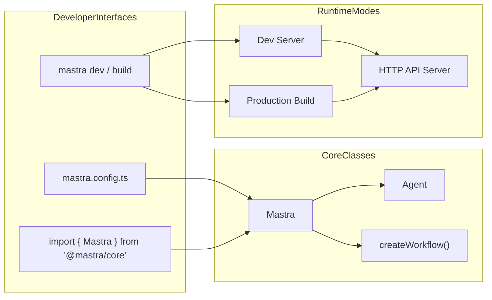

Sources: [packages/core/package.json:6-82](), [packages/server/package.json:11-93](), [package.json:38]()

## System Architecture Map

The following diagram bridges natural language concepts with their corresponding code entities in the codebase.

### System Architecture Code Entity Map
```mermaid
graph TB
    subgraph "UserConfiguration"
        ConfigFile["mastra.config.ts"]
    end
    
    subgraph "CoreAbstractions"
        Mastra["Mastra<br/>(packages/core/src/mastra.ts)"]
        
        Mastra --> Agents["agents: Map<Agent><br/>(packages/core/src/agent/agent.ts)"]
        Mastra --> Workflows["workflows: Map<Workflow><br/>(packages/core/src/workflow/workflow.ts)"]
        Mastra --> Memory["memory: MastraMemory<br/>(packages/memory/src/memory.ts)"]
        Mastra --> Storage["storage: MastraCompositeStore<br/>(packages/memory/src/storage/composite.ts)"]
    end
    
    subgraph "AgentExecution"
        AgentClass["Agent<br/>(packages/core/src/agent/agent.ts)"]
        AgentClass --> Stream["agent.stream()<br/>(packages/core/src/agent/agent.ts)"]
        AgentClass --> Generate["agent.generate()<br/>(packages/core/src/agent/agent.ts)"]
        AgentClass --> Controller["AgentController<br/>(packages/core/src/agent-controller/agent-controller.ts)"]
    end
    
    subgraph "WorkflowExecution"
        CreateWF["createWorkflow()<br/>(packages/core/src/workflow/workflow.ts)"]
        CreateWF --> Engine["ExecutionEngine<br/>(packages/core/src/workflow/execution-engine.ts)"]
        CreateWF --> Temporal["TemporalExecutionEngine<br/>(workflows/temporal/src/temporal-execution-engine.ts)"]
    end
    
    subgraph "APIServer"
        CreateServer["createHonoServer()<br/>(packages/server/src/server.ts)"]
        CreateServer --> AgentHandlers["agents.ts<br/>(packages/server/src/server/handlers/agents.ts)"]
        CreateServer --> WorkflowHandlers["workflows.ts<br/>(packages/server/src/server/handlers/workflows.ts)"]
        CreateServer --> MemoryHandlers["memory.ts<br/>(packages/server/src/server/handlers/memory.ts)"]
    end
    
    subgraph "CLICommands"
        CLIBin["mastra CLI<br/>(packages/cli/src/cli.ts)"]
        CLIBin --> DevCmd["dev command<br/>(packages/cli/src/commands/dev.ts)"]
        CLIBin --> BuildCmd["build command<br/>(packages/cli/src/commands/build.ts)"]
        CLIBin --> DeployCmd["deploy command<br/>(packages/cli/src/commands/deploy.ts)"]
    end
    
    ConfigFile --> Mastra
    Agents --> AgentClass
    Workflows --> CreateWF
    Mastra --> CreateServer
    CLIBin --> CreateServer
```

Sources: [packages/core/package.json:6-232](), [packages/server/package.json:13-93](), [package.json:38](), [packages/core/src/agent/agent.ts:1-162]()

## Key Framework Concepts

### Mastra Instance
The `Mastra` class is the central orchestrator that wires together all subsystems. It is configured via a `Config` object and provides registration for agents, workflows, and tools.
Sources: [packages/core/package.json:1-165]()

### Agent System
Agents combine an LLM, tools, and memory into an execution unit. They support streaming and non-streaming responses, tool approval, and structured output via schemas. The system also supports `SubAgents` and `SDKAgents` (like `ClaudeSDKAgent`, `CursorSDKAgent`, and `OpenAISDKAgent`) to bridge external agent SDKs into the Mastra runtime. Interactive sessions are managed via the `AgentController`.
Sources: [packages/core/package.json:54-61](), [packages/core/package.json:84-92]()

### Workflow System
Workflows orchestrate multi-step processes with state management. They support conditional branching, parallel execution, and durable execution via engines like `InngestExecutionEngine` or `TemporalExecutionEngine`.
Sources: [packages/core/package.json:234-239]()

### Model Provider System
The framework abstracts over LLM providers through a unified interface. It uses a registry for model discovery and supports unified model IDs like `"openai/gpt-4o"`.
Sources: [packages/memory/integration-tests/pnpm-lock.yaml:54-83]()

## Development and Deployment

Mastra provides a comprehensive CLI for the full development lifecycle:
- **`create-mastra`**: Scaffolding new projects from templates.
- **`mastra dev`**: Local development server with hot reloading and Studio UI. [package.json:65]()
- **`mastra build`**: Bundling the application using `rollup` and `esbuild` for target environments. [package.json:42]()
- **`mastra deploy`**: Deploying to platforms like Cloudflare Workers, Vercel, or Netlify using dedicated deployer packages.
- **`mastra studio`**: Launches the Playground UI for agent/workflow debugging.

Sources: [package.json:38-65](), [packages/deployer/package.json:86-87]()

## Next Steps

For deeper exploration of specific subsystems:

- Monorepo Structure and Package Organization → [Monorepo Structure and Package Organization](#1.1)
- System Architecture Overview → [System Architecture Overview](#1.2)
- Core configuration → [Mastra Core and Configuration](#2)
- Agent system → [Agent System](#3)
- Workflow system → [Workflow System](#4)
- Model providers → [Model Provider System](#5)
- Tool system → [Tool System](#6)
- Memory and storage → [Memory and Storage Architecture](#7)
- CLI and development → [CLI and Development Tools](#8)
- Server and API → [Server and API Layer](#9)
- Client SDKs → [Client SDK and UI Components](#10)

---

# Page: Monorepo Structure and Package Organization

# Monorepo Structure and Package Organization

<details>
<summary>Relevant source files</summary>

The following files were used as context for generating this wiki page:

- [.changeset/pre.json](.changeset/pre.json)
- [.changeset/tidy-pumas-invite.md](.changeset/tidy-pumas-invite.md)
- [.github/scripts/validate-pkg-json.mjs](.github/scripts/validate-pkg-json.mjs)
- [auth/better-auth/package.json](auth/better-auth/package.json)
- [client-sdks/react/CHANGELOG.md](client-sdks/react/CHANGELOG.md)
- [client-sdks/react/package.json](client-sdks/react/package.json)
- [e2e-tests/_local-registry-setup/pnpm-lock.yaml](e2e-tests/_local-registry-setup/pnpm-lock.yaml)
- [e2e-tests/_local-registry-setup/pnpm-workspace.yaml](e2e-tests/_local-registry-setup/pnpm-workspace.yaml)
- [e2e-tests/commonjs/template/package.json](e2e-tests/commonjs/template/package.json)
- [e2e-tests/experiment-worker/pnpm-lock.yaml](e2e-tests/experiment-worker/pnpm-lock.yaml)
- [e2e-tests/experiment-worker/pnpm-workspace.yaml](e2e-tests/experiment-worker/pnpm-workspace.yaml)
- [e2e-tests/monorepo/template/package.json](e2e-tests/monorepo/template/package.json)
- [e2e-tests/no-bundling/template/package.json](e2e-tests/no-bundling/template/package.json)
- [e2e-tests/pkg-outputs/pnpm-lock.yaml](e2e-tests/pkg-outputs/pnpm-lock.yaml)
- [e2e-tests/softwarefactory/pnpm-lock.yaml](e2e-tests/softwarefactory/pnpm-lock.yaml)
- [e2e-tests/softwarefactory/pnpm-workspace.yaml](e2e-tests/softwarefactory/pnpm-workspace.yaml)
- [examples/agent-builder/package.json](examples/agent-builder/package.json)
- [examples/agent-builder/pnpm-lock.yaml](examples/agent-builder/pnpm-lock.yaml)
- [examples/agent/package.json](examples/agent/package.json)
- [examples/agent/pnpm-lock.yaml](examples/agent/pnpm-lock.yaml)
- [examples/agent/pnpm-workspace.yaml](examples/agent/pnpm-workspace.yaml)
- [examples/durable-agents/package.json](examples/durable-agents/package.json)
- [examples/durable-agents/pnpm-lock.yaml](examples/durable-agents/pnpm-lock.yaml)
- [examples/evals-with-memory/package.json](examples/evals-with-memory/package.json)
- [examples/evals-with-memory/pnpm-lock.yaml](examples/evals-with-memory/pnpm-lock.yaml)
- [examples/evals-with-memory/pnpm-workspace.yaml](examples/evals-with-memory/pnpm-workspace.yaml)
- [examples/voice-agent/pnpm-lock.yaml](examples/voice-agent/pnpm-lock.yaml)
- [explorations/longmemeval/CHANGELOG.md](explorations/longmemeval/CHANGELOG.md)
- [explorations/longmemeval/package.json](explorations/longmemeval/package.json)
- [integrations/opencode/CHANGELOG.md](integrations/opencode/CHANGELOG.md)
- [integrations/opencode/package.json](integrations/opencode/package.json)
- [package.json](package.json)
- [packages/_external-types/package.json](packages/_external-types/package.json)
- [packages/_vendored/ai_v4/package.json](packages/_vendored/ai_v4/package.json)
- [packages/_vendored/ai_v5/package.json](packages/_vendored/ai_v5/package.json)
- [packages/_vendored/ai_v6/package.json](packages/_vendored/ai_v6/package.json)
- [packages/agent-builder/integration-tests/package.json](packages/agent-builder/integration-tests/package.json)
- [packages/agent-builder/integration-tests/pnpm-lock.yaml](packages/agent-builder/integration-tests/pnpm-lock.yaml)
- [packages/cli/CHANGELOG.md](packages/cli/CHANGELOG.md)
- [packages/cli/package.json](packages/cli/package.json)
- [packages/create-mastra/CHANGELOG.md](packages/create-mastra/CHANGELOG.md)
- [packages/create-mastra/package.json](packages/create-mastra/package.json)
- [packages/mcp-docs-server/CHANGELOG.md](packages/mcp-docs-server/CHANGELOG.md)
- [packages/mcp-docs-server/package.json](packages/mcp-docs-server/package.json)
- [packages/mcp/integration-tests/package.json](packages/mcp/integration-tests/package.json)
- [packages/mcp/integration-tests/pnpm-lock.yaml](packages/mcp/integration-tests/pnpm-lock.yaml)
- [packages/mcp/integration-tests/pnpm-workspace.yaml](packages/mcp/integration-tests/pnpm-workspace.yaml)
- [packages/memory/integration-tests/package.json](packages/memory/integration-tests/package.json)
- [packages/memory/integration-tests/pnpm-lock.yaml](packages/memory/integration-tests/pnpm-lock.yaml)
- [packages/memory/integration-tests/pnpm-workspace.yaml](packages/memory/integration-tests/pnpm-workspace.yaml)
- [packages/playground-ui/CHANGELOG.md](packages/playground-ui/CHANGELOG.md)
- [packages/playground-ui/package.json](packages/playground-ui/package.json)
- [packages/playground/CHANGELOG.md](packages/playground/CHANGELOG.md)
- [packages/playground/e2e/kitchen-sink/package.json](packages/playground/e2e/kitchen-sink/package.json)
- [packages/playground/e2e/kitchen-sink/pnpm-lock.yaml](packages/playground/e2e/kitchen-sink/pnpm-lock.yaml)
- [packages/playground/e2e/kitchen-sink/pnpm-workspace.yaml](packages/playground/e2e/kitchen-sink/pnpm-workspace.yaml)
- [packages/playground/package.json](packages/playground/package.json)
- [pnpm-lock.yaml](pnpm-lock.yaml)
- [pnpm-workspace.yaml](pnpm-workspace.yaml)
- [pubsub/google-cloud-pubsub/package.json](pubsub/google-cloud-pubsub/package.json)
- [pubsub/redis-streams/package.json](pubsub/redis-streams/package.json)
- [pubsub/valkey-streams/package.json](pubsub/valkey-streams/package.json)
- [stores/cloudflare-d1/package.json](stores/cloudflare-d1/package.json)
- [stores/cloudflare/package.json](stores/cloudflare/package.json)
- [stores/couchbase/package.json](stores/couchbase/package.json)
- [stores/dsql/package.json](stores/dsql/package.json)
- [stores/dynamodb/package.json](stores/dynamodb/package.json)
- [stores/elasticsearch/package.json](stores/elasticsearch/package.json)
- [stores/lance/package.json](stores/lance/package.json)
- [stores/opensearch/package.json](stores/opensearch/package.json)
- [stores/redis/CHANGELOG.md](stores/redis/CHANGELOG.md)
- [stores/redis/package.json](stores/redis/package.json)
- [stores/vectorize/package.json](stores/vectorize/package.json)
- [voice/azure/package.json](voice/azure/package.json)
- [voice/cloudflare/package.json](voice/cloudflare/package.json)
- [voice/gladia/package.json](voice/gladia/package.json)
- [voice/murf/package.json](voice/murf/package.json)
- [voice/murf/src/index.ts](voice/murf/src/index.ts)
- [voice/speechify/package.json](voice/speechify/package.json)

</details>


This document describes the organization of the Mastra monorepo, including its package hierarchy, dependencies, build system, and development workflows. The monorepo uses pnpm workspaces and Turborepo to manage over 150 packages across multiple categories.

For information about the overall system architecture and how components interact, see [System Architecture Overview]().

## Workspace Configuration

The Mastra monorepo is organized using **pnpm workspaces** with Turborepo for build orchestration. The workspace structure is defined at the root level and manages dependencies across all packages.

Title: Monorepo Workspace Hierarchy
```mermaid
graph TB
    subgraph "Root Workspace"
        [RootPkg] --> ["package.json<br/>pnpm workspaces"]
        [TurboConfig] --> ["turbo.json<br/>Build pipeline"]
        [PnpmLock] --> ["pnpm-lock.yaml<br/>Lockfile"]
        [PnpmWorkspace] --> ["pnpm-workspace.yaml"]
    end
    
    subgraph "Package Categories"
        [Core] --> ["packages/*<br/>Core framework"]
        [Clients] --> ["client-sdks/*<br/>Client libraries"]
        [Deploy] --> ["deployers/*<br/>Platform deployers"]
        [Stores] --> ["stores/*<br/>Storage adapters"]
        [Auth] --> ["auth/*<br/>Auth providers"]
        [ServerAdapters] --> ["server-adapters/*<br/>HTTP adapters"]
        [Obs] --> ["observability/*<br/>Telemetry vendors"]
        [Workspaces] --> ["workspaces/*<br/>File systems"]
        [Voice] --> ["voice/*<br/>Voice providers"]
        [Integrations] --> ["integrations/*<br/>Third-party tools"]
        [Examples] --> ["examples/*<br/>Sample projects"]
        [Templates] --> ["templates/*<br/>Project templates"]
        [Internal] --> ["packages/_internals/*<br/>Internal utilities"]
        [AgentSDKs] --> ["agent-sdks/*<br/>SDK Wrappers"]
        [Mastracode] --> ["mastracode/*<br/>Software Factory"]
        [Embedders] --> ["embedders/*<br/>Embedding providers"]
        [Browser] --> ["browser/*<br/>Browser automation"]
        [CodeMode] --> ["code-mode/*<br/>Isolated code execution"]
        [Workflows] --> ["workflows/*<br/>Workflow engines"]
        [Signals] --> ["signals/*<br/>Agent signals"]
        [PubSub] --> ["pubsub/*<br/>PubSub providers"]
        [Channels] --> ["channels/*<br/>Agent channels"]
        [Explorations] --> ["explorations/*<br/>Experimental features"]
        [E2ETests] --> ["e2e-tests/*<br/>End-to-end tests"]
    end
    
    [RootPkg] --> [Core]
    [RootPkg] --> [Clients]
    [RootPkg] --> [Deploy]
    [RootPkg] --> [Stores]
    [RootPkg] --> [Auth]
    [RootPkg] --> [ServerAdapters]
    [RootPkg] --> [Obs]
    [RootPkg] --> [Workspaces]
    [RootPkg] --> [Voice]
    [RootPkg] --> [Integrations]
    [RootPkg] --> [Examples]
    [RootPkg] --> [Templates]
    [RootPkg] --> [Internal]
    [RootPkg] --> [AgentSDKs]
    [RootPkg] --> [Mastracode]
    [RootPkg] --> [Embedders]
    [RootPkg] --> [Browser]
    [RootPkg] --> [CodeMode]
    [RootPkg] --> [Workflows]
    [RootPkg] --> [Signals]
    [RootPkg] --> [PubSub]
    [RootPkg] --> [Channels]
    [RootPkg] --> [Explorations]
    [RootPkg] --> [E2ETests]
    
    [TurboConfig] -.-> [Core]
    [TurboConfig] -.-> [Clients]
    [TurboConfig] -.-> [Deploy]
```

**Sources:** [pnpm-workspace.yaml:1-34](), [pnpm-lock.yaml:1-196]()

### Build System Organization

The root `package.json` defines granular build scripts that correspond to workspace categories, allowing for targeted compilation of specific subsystems using Turborepo filters.

| Script Pattern | Target Filter | Example Packages |
|----------------|---------------|------------------|
| `build:packages` | `./packages/*` | `@mastra/core`, `@mastra/server`, `@mastra/cli` |
| `build:clients` | `./client-sdks/*` | `@mastra/client-js`, `@mastra/react` |
| `build:deployers` | `./deployers/*` | `@mastra/deployer-cloudflare`, `@mastra/deployer-vercel` |
| `build:combined-stores` | `./stores/*` | `@mastra/pg`, `@mastra/libsql`, `@mastra/mongodb` |
| `build:auth` | `./auth/*`, `./packages/auth` | `@mastra/auth-clerk`, `@mastra/auth-workos` |
| `build:observability` | `./observability/*` | `@mastra/langfuse`, `@mastra/langsmith` |
| `build:voice` | `./voice/*` | `@mastra/voice-openai`, `@mastra/voice-deepgram` |
| `build:workspaces` | `./workspaces/*` | `@mastra/e2b`, `@mastra/daytona` |
| `build:integrations` | `./integrations/*` | `@mastra/brightdata`, `@mastra/tavily` |

**Sources:** [pnpm-workspace.yaml:1-34]()

## Core Packages (`packages/`)

The `packages/` directory contains the foundational components of the Mastra framework. These packages form the execution engine, developer tooling, and runtime infrastructure.

Title: Core Package Dependencies
```mermaid
graph TB
    subgraph "Core Runtime"
        [CorePkg] --> ["@mastra/core<br/>Main framework<br/>Agent/Workflow/Tools"]
        [MemoryPkg] --> ["@mastra/memory<br/>Thread/Message storage"]
        [RAGPkg] --> ["@mastra/rag<br/>Document processing"]
        [EvalsPkg] --> ["@mastra/evals<br/>Evaluation system"]
        [SchemaCompatPkg] --> ["@mastra/schema-compat<br/>Zod/JSON Schema"]
        [MCPPkg] --> ["@mastra/mcp<br/>Model Context Protocol"]
        [AgentBuilderPkg] --> ["@mastra/agent-builder<br/>Agent template merging"]
        [CodemodPkg] --> ["@mastra/codemod<br/>Code migrations"]
        [ConnectPkg] --> ["@mastra/connect<br/>Platform connections"]
    end
    
    subgraph "Server & API"
        [ServerPkg] --> ["@mastra/server<br/>Hono routes & handlers"]
        [AuthPkg] --> ["@mastra/auth<br/>Auth abstraction"]
    end
    
    subgraph "Developer Tools"
        [CLIPkg] --> ["mastra (CLI)<br/>@mastra/cli"]
        [CreateMastraPkg] --> ["create-mastra<br/>Project scaffolding"]
        [DeployerPkg] --> ["@mastra/deployer<br/>Base bundler & analyzer"]
        [PlaygroundUIPkg] --> ["@mastra/playground-ui<br/>Studio React components"]
        [EditorPkg] --> ["@mastra/editor<br/>CMS-style editor"]
        [MCPDocsServerPkg] --> ["@mastra/mcp-docs-server<br/>Docs as MCP server"]
        [MCPRegistryRegistryPkg] --> ["@mastra/mcp-registry-registry<br/>MCP registry"]
    end
    
    subgraph "Utilities"
        [LoggersPkg] --> ["@mastra/loggers"]
        [FastEmbedPkg] --> ["@mastra/fastembed"]
        [ACPPkg] --> ["@mastra/acp<br/>Agent Client Protocol"]
        [GoogleCloudPubSubPkg] --> ["@mastra/google-cloud-pubsub<br/>PubSub provider"]
        [RedisStreamsPkg] --> ["@mastra/redis-streams<br/>PubSub provider"]
        [ValkeyStreamsPkg] --> ["@mastra/valkey-streams<br/>PubSub provider"]
    end
    
    [CLIPkg] --> [CorePkg]
    [CLIPkg] --> [DeployerPkg]
    [CLIPkg] --> [PlaygroundUIPkg]
    [ServerPkg] --> [CorePkg]
    [ServerPkg] --> [AuthPkg]
    [MemoryPkg] --> [CorePkg]
    [RAGPkg] --> [CorePkg]
    [DeployerPkg] --> [ServerPkg]
    [PlaygroundUIPkg] --> [CorePkg]
    [MCPDocsServerPkg] --> [MCPPkg]
    [ACPPkg] --> [CorePkg]
    [GoogleCloudPubSubPkg] --> [CorePkg]
    [RedisStreamsPkg] --> [CorePkg]
    [ValkeyStreamsPkg] --> [CorePkg]
    [ConnectPkg] --> [CorePkg]
```

**Sources:** [packages/cli/package.json:1-114](), [packages/create-mastra/package.json:1-62](), [packages/deployer/package.json:1-165](), [packages/mcp-docs-server/package.json:1-70](), [packages/playground-ui/package.json:1-231](), [.changeset/pre.json:85-108]()

### `@mastra/core` Package Structure and Code Entity Mapping

The core package exports multiple subpath entry points corresponding to specific modules, enabling fine-grained imports and minimizing bundle size. The diagram below maps human-readable subsystem domains to their exact code export paths defined in `packages/core/package.json`.

Title: Core Subsystem Natural Language to Code Entity Mapping
```mermaid
graph TB
    subgraph "Natural Language Space"
        [DomainAgent] --> [DomainA2A] --> [DomainAuth] --> [DomainBrowser]
    end

    subgraph "Code Entity Space (packages/core/package.json)"
        [ExportMain] --> ["packages/core (dist/index.js)"]
        [ExportAgent] --> ["./agent (dist/agent/index.js)"]
        [ExportDurable] --> ["./agent/durable (dist/agent/durable/index.js)"]
        [ExportA2A] --> ["./a2a (dist/a2a/index.js)"]
        [ExportAuth] --> ["./auth (dist/auth/index.js)"]
        [ExportBrowser] --> ["./browser (dist/browser/index.js)"]
        [ExportController] --> ["./agent-controller (dist/agent-controller/index.js)"]
    end

    [DomainAgent] -.-> [ExportAgent]
    [DomainA2A] -.-> [ExportA2A]
    [DomainAuth] -.-> [ExportAuth]
    [DomainBrowser] -.-> [ExportBrowser]
```

**Sources:** [packages/core/package.json:14-256]()

### CLI and Scaffolding Code Entity Mapping

The CLI package (`mastra`) and `create-mastra` expose commands that invoke underlying compilation, bundling, and project generation routines.

Title: CLI Natural Language to Code Execution Mapping
```mermaid
graph LR
    subgraph "Natural Language Commands"
        [CmdDev] --> ["mastra dev"]
        [CmdBuild] --> ["mastra build"]
        [CmdInit] --> ["mastra init"]
    end

    subgraph "Code Execution Space"
        [DevBundler] --> ["DevBundler / watch loop"]
        [AnalyzeBundle] --> ["analyzeBundle() static analysis"]
        CreateMastra --> ["create-mastra scaffolder"]
    end

    [CmdDev] -.-> [DevBundler]
    [CmdBuild] -.-> [AnalyzeBundle]
    [CmdInit] -.-> CreateMastra
```

**Sources:** [packages/cli/package.json:9-11](), [packages/create-mastra/package.json:8-10]()

## Client SDKs (`client-sdks/`)

Client SDK packages provide typed interfaces for consuming Mastra APIs from frontend and backend applications.

Title: Client SDK Architecture
```mermaid
graph TB
    subgraph "Client Libraries"
        [ClientJS] --> ["@mastra/client-js<br/>BaseResource + HTTP client"]
        [React] --> ["@mastra/react<br/>Hooks + Context providers"]
        [AISDK] --> ["@mastra/ai-sdk<br/>AI SDK adapter"]
    end
    
    subgraph "Resources (client-js)"
        [AgentResource] --> ["AgentResource<br/>generate, stream, listAgents"]
        [MemoryResource] --> ["MemoryThreadResource<br/>getMessages, saveMessages"]
        [WorkflowResource] --> ["WorkflowResource<br/>run, status"]
    end
    
    subgraph "React Hooks"
        [UseAgent] --> ["useAgent<br/>Agent streaming"]
        [UseMemory] --> ["useMemory<br/>Thread operations"]
    end
    
    [React] --> [ClientJS]
    [ClientJS] --> [AgentResource]
    [ClientJS] --> [MemoryResource]
    [ClientJS] --> [WorkflowResource]
    [AISDK] --> [ClientJS]
```

**Sources:** [client-sdks/react/package.json:1-61](), [.changeset/pre.json:29-30]()

## Platform Deployers (`deployers/`)

Deployer packages extend the base `@mastra/deployer` infrastructure to produce platform-specific build artifacts.

Title: Deployer and Bundler Flow
```mermaid
graph TB
    subgraph "Base Bundler (@mastra/deployer)"
        [DeployerBase] --> ["Deployer class<br/>Base interface"]
        [AnalyzeBundle] --> ["analyze.ts<br/>Static analysis"]
        [BundlerClass] --> ["Bundler class<br/>Rollup orchestration"]
        [Loader] --> ["loader.ts<br/>Output validation"]
    end
    
    subgraph "Platform Deployers"
        [Cloudflare] --> ["@mastra/deployer-cloudflare"]
        [Vercel] --> ["@mastra/deployer-vercel"]
        [Netlify] --> ["@mastra/deployer-netlify"]
        [Cloud] --> ["@mastra/deployer-cloud"]
        [Sandbox] --> ["@mastra/deployer-sandbox"]
    end
    
    [DeployerBase] --> [Cloudflare]
    [DeployerBase] --> [Vercel]
    [DeployerBase] --> [Netlify]
    [DeployerBase] --> [Cloud]
    [DeployerBase] --> [Sandbox]
```

**Sources:** [packages/deployer/package.json:12-84](), [.changeset/pre.json:32-38]()

## Agent SDK Wrappers (`agent-sdks/`)

The `agent-sdks/` directory contains packages that wrap third-party agent SDKs as Mastra-compatible agents.

| Package | Purpose | Implementation |
|---------|---------|----------------|
| `@mastra/acp` | Agent Client Protocol | Wraps remote ACP agents |
| `@mastra/claude` | Anthropic Claude SDK | Wraps Claude Agent SDK |
| `@mastra/cursor` | Cursor SDK | Wraps Cursor SDK agents |
| `@mastra/openai` | OpenAI Agents SDK | Wraps OpenAI SDK agents |

**Sources:** [.changeset/pre.json:5-8]()

## Storage and Memory (`stores/` & `@mastra/memory`)

Storage adapter packages implement the `MastraCompositeStore` and `MastraVector` interfaces for various database backends.

Title: Storage Provider Ecosystem
```mermaid
graph TB
    subgraph "Storage Interfaces (core)"
        [CompositeStore] --> ["MastraCompositeStore<br/>Threads/Messages/OM"]
        [VectorInterface] --> ["MastraVector<br/>Embeddings + search"]
    end
    
    subgraph "SQL Adapters"
        [PG] --> ["@mastra/pg"]
        [LibSQL] --> ["@mastra/libsql"]
        [ClickHouse] --> ["@mastra/clickhouse"]
        [CloudflareD1] --> ["@mastra/cloudflare-d1"]
        [MySQL] --> ["@mastra/mysql"]
        [MSSQL] --> ["@mastra/mssql"]
        [OracleDB] --> ["@mastra/oracledb"]
        [DuckDB] --> ["@mastra/duckdb"]
        [DSQL] --> ["@mastra/dsql"]
        [Spanner] --> ["@mastra/spanner"]
    end
    
    subgraph "NoSQL & Vector"
        [MongoDB] --> ["@mastra/mongodb"]
        [Pinecone] --> ["@mastra/pinecone"]
        [Chroma] --> ["@mastra/chroma"]
        [Qdrant] --> ["@mastra/qdrant"]
        [DynamoDB] --> ["@mastra/dynamodb"]
        [Redis] --> ["@mastra/redis"]
        [Upstash] --> ["@mastra/upstash"]
        [Valkey] --> ["@mastra/valkey"]
        [Convex] --> ["@mastra/convex"]
        [Elasticsearch] --> ["@mastra/elasticsearch"]
        [OpenSearch] --> ["@mastra/opensearch"]
        [Weaviate] --> ["@mastra/weaviate"]
        [Lance] --> ["@mastra/lance"]
        [Turbopuffer] --> ["@mastra/turbopuffer"]
        [S3Vectors] --> ["@mastra/s3vectors"]
        [Astra] --> ["@mastra/astra"]
        [AzureAISearch] --> ["@mastra/azure-ai-search"]
        [Vectorize] --> ["@mastra/vectorize"]
        [Turso] --> ["@mastra/turso"]
        [Couchbase] --> ["@mastra/couchbase"]
    end
    
    [CompositeStore] -.implements.-> [PG]
    [CompositeStore] -.implements.-> [LibSQL]
    [CompositeStore] -.implements.-> [MongoDB]
    [VectorInterface] -.implements.-> [Pinecone]
    [VectorInterface] -.implements.-> [Chroma]
```

**Sources:** [.changeset/pre.json:120-150]()

## Authentication Providers (`auth/`)

Auth provider packages integrate external authentication services with the Mastra auth system via the `MastraAuthProvider` abstraction.

Title: Auth Provider Architecture
```mermaid
graph TB
    subgraph "Auth Base"
        [AuthCore] --> ["@mastra/auth<br/>Base auth abstraction"]
    end
    
    subgraph "Integrations"
        [Clerk] --> ["@mastra/auth-clerk"]
        [WorkOS] --> ["@mastra/auth-workos"]
        [Auth0] --> ["@mastra/auth-auth0"]
        [BetterAuth] --> ["@mastra/auth-better-auth"]
        [Supabase] --> ["@mastra/auth-supabase"]
        [Firebase] --> ["@mastra/auth-firebase"]
        [Google] --> ["@mastra/auth-google"]
        [Neon] --> ["@mastra/auth-neon"]
        [Okta] --> ["@mastra/auth-okta"]
        [Studio] --> ["@mastra/auth-studio"]
        [Cloud] --> ["@mastra/auth-cloud"]
    end
    
    [Clerk] --> [AuthCore]
    [WorkOS] --> [AuthCore]
    [Auth0] --> [AuthCore]
    [BetterAuth] --> [AuthCore]
    [Supabase] --> [AuthCore]
    [Firebase] --> [AuthCore]
    [Google] --> [AuthCore]
    [Neon] --> [AuthCore]
    [Okta] --> [AuthCore]
    [Studio] --> [AuthCore]
    [Cloud] --> [AuthCore]
```

**Sources:** [.changeset/pre.json:9-19]()

## Build Pipeline and Release Management

The monorepo uses Turborepo to orchestrate builds and Changesets for version management.

Title: Build and Release Flow
```mermaid
graph LR
    subgraph "Turbo Pipeline"
        [BuildAll] --> ["pnpm build"]
        [BuildPackages] --> ["build:packages"]
        [BuildCore] --> ["build:core"]
        
        [BuildAll] --> [BuildPackages]
        [BuildPackages] --> [BuildCore]
    end
    
    subgraph "Changeset Workflow"
        [AddChangeset] --> ["pnpm changeset"]
        [VersionBump] --> ["pnpm version"]
        [Publish] --> ["pnpm publish -r"]
        
        [AddChangeset] --> [VersionBump]
        [VersionBump] --> [Publish]
    end
```

**Sources:** [.changeset/pre.json:1-190]()

### Versioning Status
The repository is currently in pre-release mode (`"mode": "pre"`, `"tag": "alpha"`), meaning all published versions include the `-alpha.X` suffix. Baseline versions for all 150+ packages are tracked in `.changeset/pre.json`.

**Sources:** [.changeset/pre.json:1-190]()

---

# Page: System Architecture Overview

# System Architecture Overview

<details>
<summary>Relevant source files</summary>

The following files were used as context for generating this wiki page:

- [deployers/cloud/package.json](deployers/cloud/package.json)
- [docs/src/content/en/docs/harness/durable-agents.mdx](docs/src/content/en/docs/harness/durable-agents.mdx)
- [docs/src/content/en/reference/agents/durable-agent.mdx](docs/src/content/en/reference/agents/durable-agent.mdx)
- [docs/src/content/en/reference/core/mastra-class.mdx](docs/src/content/en/reference/core/mastra-class.mdx)
- [examples/agent/src/mastra/agents/weather-fs/README.md](examples/agent/src/mastra/agents/weather-fs/README.md)
- [packages/core/package.json](packages/core/package.json)
- [packages/core/src/agent/durable/__tests__/durable-agent-execution-fence.test.ts](packages/core/src/agent/durable/__tests__/durable-agent-execution-fence.test.ts)
- [packages/core/src/agent/durable/__tests__/durable-agent-memory.test.ts](packages/core/src/agent/durable/__tests__/durable-agent-memory.test.ts)
- [packages/core/src/agent/durable/__tests__/evented-split-transport.test.ts](packages/core/src/agent/durable/__tests__/evented-split-transport.test.ts)
- [packages/core/src/agent/durable/__tests__/observe-detach.test.ts](packages/core/src/agent/durable/__tests__/observe-detach.test.ts)
- [packages/core/src/agent/durable/__tests__/recover-active-runs.test.ts](packages/core/src/agent/durable/__tests__/recover-active-runs.test.ts)
- [packages/core/src/agent/durable/__tests__/stream-generation.test.ts](packages/core/src/agent/durable/__tests__/stream-generation.test.ts)
- [packages/core/src/agent/fs-routing/index.test.ts](packages/core/src/agent/fs-routing/index.test.ts)
- [packages/core/src/agent/fs-routing/index.ts](packages/core/src/agent/fs-routing/index.ts)
- [packages/core/src/agent/save-queue/index.ts](packages/core/src/agent/save-queue/index.ts)
- [packages/core/src/agent/save-queue/save-queue.test.ts](packages/core/src/agent/save-queue/save-queue.test.ts)
- [packages/core/src/loop/test-utils/aimock/scenarios/durable-input-persistence.scenario.test.ts](packages/core/src/loop/test-utils/aimock/scenarios/durable-input-persistence.scenario.test.ts)
- [packages/core/src/loop/test-utils/aimock/scenarios/observe-lifecycle.scenario.test.ts](packages/core/src/loop/test-utils/aimock/scenarios/observe-lifecycle.scenario.test.ts)
- [packages/core/src/loop/test-utils/aimock/scenarios/save-per-step-failed-save.scenario.test.ts](packages/core/src/loop/test-utils/aimock/scenarios/save-per-step-failed-save.scenario.test.ts)
- [packages/core/src/mastra/index.ts](packages/core/src/mastra/index.ts)
- [packages/core/src/mastra/recover-all-durable-agents.test.ts](packages/core/src/mastra/recover-all-durable-agents.test.ts)
- [packages/deployer/package.json](packages/deployer/package.json)
- [packages/deployer/src/build/fs-routing/codegen-eval.test.ts](packages/deployer/src/build/fs-routing/codegen-eval.test.ts)
- [packages/deployer/src/build/fs-routing/codegen.ts](packages/deployer/src/build/fs-routing/codegen.ts)
- [packages/deployer/src/build/fs-routing/discover.ts](packages/deployer/src/build/fs-routing/discover.ts)
- [packages/deployer/src/build/fs-routing/fs-routing.test.ts](packages/deployer/src/build/fs-routing/fs-routing.test.ts)
- [packages/deployer/src/build/fs-routing/prepare.ts](packages/deployer/src/build/fs-routing/prepare.ts)
- [packages/deployer/src/build/index.ts](packages/deployer/src/build/index.ts)
- [packages/memory/src/processors/observational-memory/__tests__/inflight-turn-preservation.test.ts](packages/memory/src/processors/observational-memory/__tests__/inflight-turn-preservation.test.ts)
- [packages/server/package.json](packages/server/package.json)
- [server-adapters/express/package.json](server-adapters/express/package.json)
- [server-adapters/fastify/package.json](server-adapters/fastify/package.json)
- [server-adapters/hono/package.json](server-adapters/hono/package.json)
- [server-adapters/koa/package.json](server-adapters/koa/package.json)
- [stores/libsql/src/storage/durable-agent-input-persistence.test.ts](stores/libsql/src/storage/durable-agent-input-persistence.test.ts)

</details>


## Purpose and Scope

This document provides a high-level technical overview of Mastra's system architecture, detailing how the major subsystems—`Agent`, `Workflow`, `Memory`, `Tools`, `Server`, and `CLI`—interoperate to form an AI application framework. It describes architectural boundaries, runtime state transitions, and component relationships using core code abstractions.

For deep dives into specific subsystems:
- For monorepo package layout, see [Monorepo Structure and Package Organization](#1.1)
- For `Mastra` class instantiation, see [Configuration Schema and Options](#2.1)
- For agent execution loops, see [Agent Configuration and Execution](#3.1)

Sources: [docs/src/content/en/docs/agents/overview.mdx:1-62](), [docs/src/content/en/docs/workflows/overview.mdx:1-35]()

## Central Orchestration: The `Mastra` Instance

At the center of the architecture is the `Mastra` class (`[packages/core/src/mastra/index.ts:50-162]()`), which functions as the primary dependency injection container and registry for runtime components. When instantiated, it aggregates instances of agents, workflows, tools, storage adapters, loggers, and vector stores, exposing them uniformly to the API server and CLI tools.

Title: "Mastra Instance Architecture"
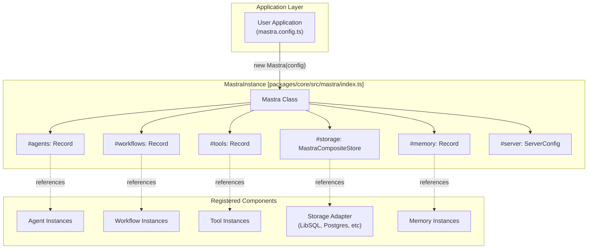

Sources: [packages/core/src/mastra/index.ts:50-162]()

## Major System Components

Mastra organizes functionality into decoupled packages and classes that communicate through defined interfaces:

| Subsystem | Primary Class / Interface | Role |
|-----------|--------------------------|------|
| **Agent** | `Agent`, `DurableAgent` [docs/src/content/en/docs/harness/durable-agents.mdx:77-85]() | Encapsulates LLM execution loops, prompts, tool selection, and memory bindings. |
| **Workflow** | `Workflow`, `ExecutionEngine` [docs/src/content/en/docs/workflows/overview.mdx:11-29]() | Manages deterministic multi-step state machines, persistence, and execution engines. |
| **Tools** | `ToolAction`, `CoreToolBuilder` [packages/core/src/mastra/index.ts:80-82]() | Exposes typed functions with Zod schema validation for models and workflow steps. |
| **Memory** | `MessageList`, `MastraMemory` [packages/core/src/mastra/index.ts:43-44]() | Handles thread persistence, message histories, and contextual recall. |
| **Server** | `MastraServerBase`, `Hono` [packages/core/src/mastra/index.ts:68-69]() | Exposes HTTP, SSE, and WebSockets endpoints via framework-agnostic adapters. |
| **CLI & Bundler** | `Bundler`, `MastraDeployer` [packages/core/src/mastra/index.ts:10-17]() | Provides project compilation, file watching, and cloud deployment targets. |

Sources: [packages/core/src/mastra/index.ts:10-162](), [docs/src/content/en/docs/agents/overview.mdx:34-45]()

## Bridging Natural Language to Code Entity Space

To understand how user intent becomes executed logic, Mastra maps high-level natural language inputs and declarative definitions onto executable TypeScript classes and functions.

### Bridge 1: Agent Request Translation

Title: "Agent Natural Language to Code Entity Space"
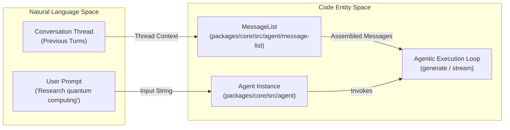

Sources: [docs/src/content/en/docs/agents/overview.mdx:78-105](), [packages/core/src/mastra/index.ts:4-6]()

### Bridge 2: Workflow and Tool Binding

Title: "Workflow and Tool Natural Language to Code Entity Space"
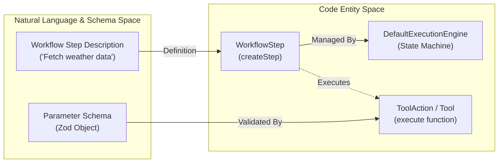

Sources: [docs/src/content/en/docs/workflows/overview.mdx:11-35](), [packages/core/src/mastra/index.ts:80-92]()

## Component Interaction Patterns

### Request Lifecycle and Execution Flow

When an HTTP request hits the API server or an application invokes an agent directly, the request flows through initialization, execution control, persistence, and event broadcasting.

Title: "System Component Interaction Sequence"
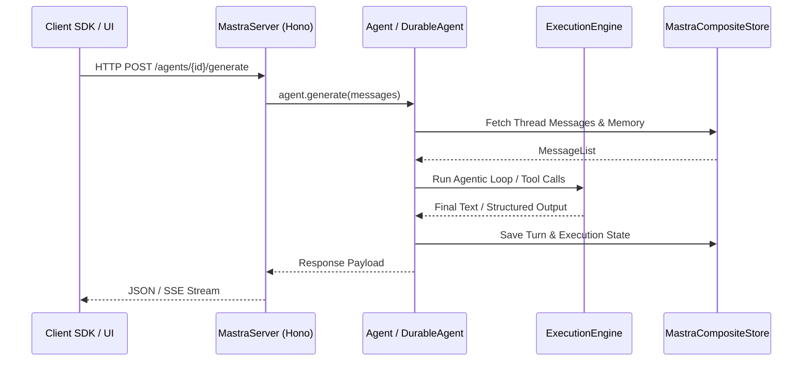

Sources: [docs/src/content/en/docs/agents/overview.mdx:78-105](), [packages/core/src/mastra/index.ts:50-95]()

## Observability and Storage Integration

Every execution path—whether an agent turn, tool call, or workflow step—can be intercepted by telemetry and persistence layers:
- **Tracing**: Managed via OpenTelemetry context propagation linked through `ObservabilityEntrypoint` [packages/core/src/mastra/index.ts:50-62]().
- **Persistence**: Abstracted via `MastraCompositeStore` (`[packages/core/src/mastra/index.ts:70-77]()`), which unifies transactional storage across workflows, runs, checkpoints, and conversational threads.

Sources: [packages/core/src/mastra/index.ts:50-77]()

## Summary

Mastra's architecture is anchored by the `Mastra` class orchestrator [packages/core/src/mastra/index.ts:50-162](). It connects autonomous agents [docs/src/content/en/docs/agents/overview.mdx:34-45](), deterministic workflows [docs/src/content/en/docs/workflows/overview.mdx:11-29](), and typed tools [packages/core/src/mastra/index.ts:80-82]() through structured storage adapters and API server wrappers.

Sources: [packages/core/src/mastra/index.ts:50-162](), [docs/src/content/en/docs/agents/overview.mdx:1-130](), [docs/src/content/en/docs/workflows/overview.mdx:1-145]()

---

# Page: Mastra Core and Configuration

# Mastra Core and Configuration

<details>
<summary>Relevant source files</summary>

The following files were used as context for generating this wiki page:

- [docs/src/content/en/docs/harness/durable-agents.mdx](docs/src/content/en/docs/harness/durable-agents.mdx)
- [docs/src/content/en/reference/agents/durable-agent.mdx](docs/src/content/en/reference/agents/durable-agent.mdx)
- [docs/src/content/en/reference/configuration.mdx](docs/src/content/en/reference/configuration.mdx)
- [docs/src/content/en/reference/core/mastra-class.mdx](docs/src/content/en/reference/core/mastra-class.mdx)
- [docs/src/content/en/reference/server/register-api-route.mdx](docs/src/content/en/reference/server/register-api-route.mdx)
- [e2e-tests/_local-registry-setup/package.json](e2e-tests/_local-registry-setup/package.json)
- [e2e-tests/_local-registry-setup/prepare.js](e2e-tests/_local-registry-setup/prepare.js)
- [e2e-tests/_local-registry-setup/publish-ci-registry.js](e2e-tests/_local-registry-setup/publish-ci-registry.js)
- [e2e-tests/_local-registry-setup/publish-roots.js](e2e-tests/_local-registry-setup/publish-roots.js)
- [e2e-tests/_local-registry-setup/publish.js](e2e-tests/_local-registry-setup/publish.js)
- [e2e-tests/commonjs/setup.ts](e2e-tests/commonjs/setup.ts)
- [e2e-tests/create-mastra/create-mastra.test.ts](e2e-tests/create-mastra/create-mastra.test.ts)
- [e2e-tests/create-mastra/setup.ts](e2e-tests/create-mastra/setup.ts)
- [e2e-tests/deployers/setup.ts](e2e-tests/deployers/setup.ts)
- [e2e-tests/no-bundling/setup.ts](e2e-tests/no-bundling/setup.ts)
- [e2e-tests/type-check/setup.ts](e2e-tests/type-check/setup.ts)
- [e2e-tests/type-check/template/core/agent-message-input.test-d.ts](e2e-tests/type-check/template/core/agent-message-input.test-d.ts)
- [e2e-tests/type-check/template/core/auth.test-d.ts](e2e-tests/type-check/template/core/auth.test-d.ts)
- [e2e-tests/type-check/template/package.json](e2e-tests/type-check/template/package.json)
- [e2e-tests/type-check/template/tsconfig.exact-optional.json](e2e-tests/type-check/template/tsconfig.exact-optional.json)
- [e2e-tests/type-check/template/tsconfig.mcp.json](e2e-tests/type-check/template/tsconfig.mcp.json)
- [e2e-tests/type-check/template/vitest.config.ts](e2e-tests/type-check/template/vitest.config.ts)
- [e2e-tests/type-check/template/vitest.mcp.config.ts](e2e-tests/type-check/template/vitest.mcp.config.ts)
- [e2e-tests/type-check/test.ts](e2e-tests/type-check/test.ts)
- [examples/agent/src/mastra/agents/weather-fs/README.md](examples/agent/src/mastra/agents/weather-fs/README.md)
- [packages/_internals/auth/src/provider/index.ts](packages/_internals/auth/src/provider/index.ts)
- [packages/_types-builder/AGENTS.md](packages/_types-builder/AGENTS.md)
- [packages/auth/src/index.ts](packages/auth/src/index.ts)
- [packages/core/src/agent/durable/__tests__/durable-agent-execution-fence.test.ts](packages/core/src/agent/durable/__tests__/durable-agent-execution-fence.test.ts)
- [packages/core/src/agent/durable/__tests__/durable-agent-memory.test.ts](packages/core/src/agent/durable/__tests__/durable-agent-memory.test.ts)
- [packages/core/src/agent/durable/__tests__/evented-split-transport.test.ts](packages/core/src/agent/durable/__tests__/evented-split-transport.test.ts)
- [packages/core/src/agent/durable/__tests__/observe-detach.test.ts](packages/core/src/agent/durable/__tests__/observe-detach.test.ts)
- [packages/core/src/agent/durable/__tests__/recover-active-runs.test.ts](packages/core/src/agent/durable/__tests__/recover-active-runs.test.ts)
- [packages/core/src/agent/durable/__tests__/stream-generation.test.ts](packages/core/src/agent/durable/__tests__/stream-generation.test.ts)
- [packages/core/src/agent/fs-routing/index.test.ts](packages/core/src/agent/fs-routing/index.test.ts)
- [packages/core/src/agent/fs-routing/index.ts](packages/core/src/agent/fs-routing/index.ts)
- [packages/core/src/agent/message-list/types.ts](packages/core/src/agent/message-list/types.ts)
- [packages/core/src/agent/save-queue/index.ts](packages/core/src/agent/save-queue/index.ts)
- [packages/core/src/agent/save-queue/save-queue.test.ts](packages/core/src/agent/save-queue/save-queue.test.ts)
- [packages/core/src/loop/test-utils/aimock/scenarios/durable-input-persistence.scenario.test.ts](packages/core/src/loop/test-utils/aimock/scenarios/durable-input-persistence.scenario.test.ts)
- [packages/core/src/loop/test-utils/aimock/scenarios/observe-lifecycle.scenario.test.ts](packages/core/src/loop/test-utils/aimock/scenarios/observe-lifecycle.scenario.test.ts)
- [packages/core/src/loop/test-utils/aimock/scenarios/save-per-step-failed-save.scenario.test.ts](packages/core/src/loop/test-utils/aimock/scenarios/save-per-step-failed-save.scenario.test.ts)
- [packages/core/src/mastra/index.ts](packages/core/src/mastra/index.ts)
- [packages/core/src/mastra/recover-all-durable-agents.test.ts](packages/core/src/mastra/recover-all-durable-agents.test.ts)
- [packages/core/src/server/auth.test.ts](packages/core/src/server/auth.test.ts)
- [packages/core/src/server/auth.ts](packages/core/src/server/auth.ts)
- [packages/core/src/server/composite-auth.ts](packages/core/src/server/composite-auth.ts)
- [packages/core/src/server/index.ts](packages/core/src/server/index.ts)
- [packages/core/src/server/server.test-d.ts](packages/core/src/server/server.test-d.ts)
- [packages/core/src/server/server.test.ts](packages/core/src/server/server.test.ts)
- [packages/core/src/server/types.ts](packages/core/src/server/types.ts)
- [packages/deployer/src/build/fs-routing/codegen-eval.test.ts](packages/deployer/src/build/fs-routing/codegen-eval.test.ts)
- [packages/deployer/src/build/fs-routing/codegen.ts](packages/deployer/src/build/fs-routing/codegen.ts)
- [packages/deployer/src/build/fs-routing/discover.ts](packages/deployer/src/build/fs-routing/discover.ts)
- [packages/deployer/src/build/fs-routing/fs-routing.test.ts](packages/deployer/src/build/fs-routing/fs-routing.test.ts)
- [packages/deployer/src/build/fs-routing/prepare.ts](packages/deployer/src/build/fs-routing/prepare.ts)
- [packages/deployer/src/build/index.ts](packages/deployer/src/build/index.ts)
- [packages/memory/src/processors/observational-memory/__tests__/inflight-turn-preservation.test.ts](packages/memory/src/processors/observational-memory/__tests__/inflight-turn-preservation.test.ts)
- [stores/libsql/src/storage/durable-agent-input-persistence.test.ts](stores/libsql/src/storage/durable-agent-input-persistence.test.ts)

</details>


## Purpose and Scope

This page provides a high-level overview of the `Mastra` class, its configuration system, and its core abstractions, which together form the central orchestration layer for Mastra applications [packages/core/src/mastra/index.ts:109-120](). The `Mastra` instance acts as a dependency injection container and registry that wires together agents, workflows, tools, memory systems, and storage adapters [packages/core/src/mastra/index.ts:69-85](). 

This is a **PARENT page**. Detailed technical breakdowns of configuration schemas, initialization parameters, tenant isolation, and dynamic runtime context are delegated to child pages:
- For comprehensive configuration properties and initialization options, see [Configuration Schema and Options](#2.1).
- For tenant isolation, dynamic agent configuration, and authorization rules, see [RequestContext and Dynamic Configuration](#2.2).

Sources: [packages/core/src/mastra/index.ts:69-120]()

---

## The Mastra Class and Application Lifecycle

The `Mastra` class serves as the primary entry point for constructing and running AI applications [packages/core/src/mastra/index.ts:109-120](). It coordinates initialization, validation, registration, and runtime orchestration across the framework. 

During initialization, the container sets up internal event systems, context storage, and logging adapters [packages/core/src/mastra/index.ts:21-41](). It then registers user-defined or file-system-routed components (such as agents discovered via `discoverFsAgents` and assembled via `assembleAgentFromFsEntry`) [packages/deployer/src/build/fs-routing/codegen.ts:19-24](). At runtime, it provides a stable registry that the server layer queries to handle HTTP endpoints and background execution.

### Runtime Component to Code Entity Mapping

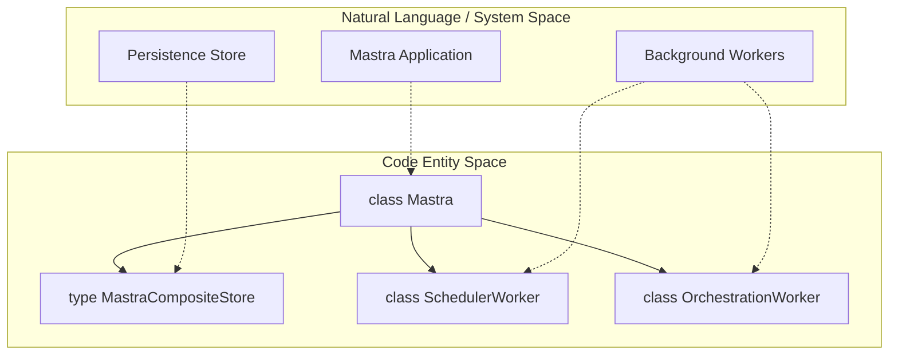

Sources: [packages/core/src/mastra/index.ts:109-120](), [packages/core/src/mastra/index.ts:69-87](), [packages/deployer/src/build/fs-routing/codegen.ts:19-24]()

---

## Configuration Architecture

The configuration system governs how a Mastra instance is set up, linking top-level definitions to underlying classes and TypeScript types [packages/core/src/mastra/index.ts:114-130](). It accepts configurations for agents, workflows, tools, storage engines, vector databases, and logging utilities, ensuring end-to-end type safety across packages [packages/core/src/mastra/index.ts:41-85]().

### Configuration to Code Entity Mapping

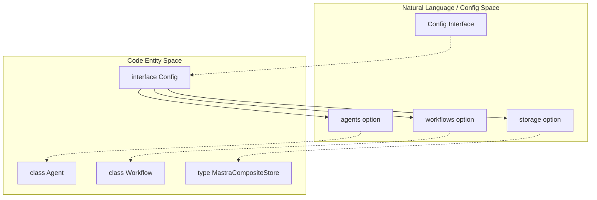

For detailed information on configuration schemas, optional initialization parameters, and build-time options, see [Configuration Schema and Options](#2.1).

Sources: [packages/core/src/mastra/index.ts:114-130](), [packages/core/src/mastra/index.ts:41-85]()

---

## Request Context and Dynamic Configuration

Mastra utilizes a modular context architecture centered around `RequestContext` to manage runtime data, environment overrides, and tenant-specific configurations without modifying static definitions [docs/src/content/en/docs/server/request-context.mdx:10-14](). 

This mechanism enables dynamic behavior such as injecting tenant-specific credentials, scoping memory threads and resources, and enforcing runtime authorization rules as requests pass through the server layer and execution loop.

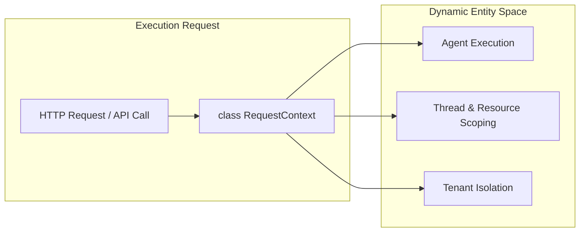

For detailed documentation on how to use `RequestContext` for tenant isolation and runtime modifications, see [RequestContext and Dynamic Configuration](#2.2).

Sources: [docs/src/content/en/docs/server/request-context.mdx:10-14](), [packages/core/src/mastra/index.ts:109-112]()

---

# Page: Configuration Schema and Options

# Configuration Schema and Options

<details>
<summary>Relevant source files</summary>

The following files were used as context for generating this wiki page:

- [docs/src/content/en/reference/configuration.mdx](docs/src/content/en/reference/configuration.mdx)
- [docs/src/content/en/reference/server/register-api-route.mdx](docs/src/content/en/reference/server/register-api-route.mdx)
- [e2e-tests/_local-registry-setup/package.json](e2e-tests/_local-registry-setup/package.json)
- [e2e-tests/_local-registry-setup/prepare.js](e2e-tests/_local-registry-setup/prepare.js)
- [e2e-tests/_local-registry-setup/publish-ci-registry.js](e2e-tests/_local-registry-setup/publish-ci-registry.js)
- [e2e-tests/_local-registry-setup/publish-roots.js](e2e-tests/_local-registry-setup/publish-roots.js)
- [e2e-tests/_local-registry-setup/publish.js](e2e-tests/_local-registry-setup/publish.js)
- [e2e-tests/commonjs/setup.ts](e2e-tests/commonjs/setup.ts)
- [e2e-tests/create-mastra/create-mastra.test.ts](e2e-tests/create-mastra/create-mastra.test.ts)
- [e2e-tests/create-mastra/setup.ts](e2e-tests/create-mastra/setup.ts)
- [e2e-tests/deployers/setup.ts](e2e-tests/deployers/setup.ts)
- [e2e-tests/no-bundling/setup.ts](e2e-tests/no-bundling/setup.ts)
- [e2e-tests/type-check/setup.ts](e2e-tests/type-check/setup.ts)
- [e2e-tests/type-check/template/core/agent-message-input.test-d.ts](e2e-tests/type-check/template/core/agent-message-input.test-d.ts)
- [e2e-tests/type-check/template/core/auth.test-d.ts](e2e-tests/type-check/template/core/auth.test-d.ts)
- [e2e-tests/type-check/template/package.json](e2e-tests/type-check/template/package.json)
- [e2e-tests/type-check/template/tsconfig.exact-optional.json](e2e-tests/type-check/template/tsconfig.exact-optional.json)
- [e2e-tests/type-check/template/tsconfig.mcp.json](e2e-tests/type-check/template/tsconfig.mcp.json)
- [e2e-tests/type-check/template/vitest.config.ts](e2e-tests/type-check/template/vitest.config.ts)
- [e2e-tests/type-check/template/vitest.mcp.config.ts](e2e-tests/type-check/template/vitest.mcp.config.ts)
- [e2e-tests/type-check/test.ts](e2e-tests/type-check/test.ts)
- [packages/_internals/auth/src/provider/index.ts](packages/_internals/auth/src/provider/index.ts)
- [packages/_types-builder/AGENTS.md](packages/_types-builder/AGENTS.md)
- [packages/auth/src/index.ts](packages/auth/src/index.ts)
- [packages/core/src/agent/message-list/types.ts](packages/core/src/agent/message-list/types.ts)
- [packages/core/src/server/auth.test.ts](packages/core/src/server/auth.test.ts)
- [packages/core/src/server/auth.ts](packages/core/src/server/auth.ts)
- [packages/core/src/server/composite-auth.ts](packages/core/src/server/composite-auth.ts)
- [packages/core/src/server/index.ts](packages/core/src/server/index.ts)
- [packages/core/src/server/server.test-d.ts](packages/core/src/server/server.test-d.ts)
- [packages/core/src/server/server.test.ts](packages/core/src/server/server.test.ts)
- [packages/core/src/server/types.ts](packages/core/src/server/types.ts)

</details>


## Overview and Scope

The purpose of this page is to detail the `Config` type, initialization options, and the mechanisms used to configure a `Mastra` instance. The `Config` interface acts as the primary declarative specification for the entire application, registering agents, workflows, tools, memory stores, storage adapters, logging, observability, and server options [packages/core/src/mastra/index.ts:120-181]().

---

## Configuration Overview

The `Config` interface defines all subsystems managed by the `Mastra` class. During instantiation, the `Mastra` constructor parses this configuration object to build internal registries, validate component dependencies, and set up event routing and background worker systems [packages/core/src/mastra/index.ts:210-240]().

### Configuration Component Map

Title: "Mastra Configuration Component Map"
```mermaid
graph TB
    Config["Config Interface"] --> Agents["agents: Record<string, Agent | ToolLoopAgentLike | DurableAgentLike>"]
    Config --> Workflows["workflows: Record<string, AnyWorkflow>"]
    Config --> Tools["tools: Record<string, ToolAction>"]
    Config --> Memory["memory: Record<string, MastraMemory>"]
    Config --> Storage["storage: MastraCompositeStore"]
    Config --> Vectors["vectors: Record<string, MastraVector>"]
    Config --> Logger["logger: IMastraLogger | false"]
    Config --> Observability["observability: ObservabilityEntrypoint"]
    Config --> Server["server: ServerConfig"]
    Config --> Background["backgroundTasks: BackgroundTaskManagerConfig"]
    Config --> Deployer["deployer: MastraDeployer"]
```
Sources: [packages/core/src/mastra/index.ts:120-181]()

---

## Core Component Configuration

### Agents Configuration

The `agents` configuration property accepts a record mapping agent identifiers to `Agent` instances, AI SDK v6 `ToolLoopAgentLike` objects, or `DurableAgentLike` runners. The `Mastra` runtime bridges these external types during initialization using conversion helpers [packages/core/src/mastra/index.ts:251-265]().

**Type Signature:**
```typescript
agents?: { [K in keyof TAgents]: TAgents[K] | ToolLoopAgentLike | DurableAgentLike };
```
Sources: [packages/core/src/mastra/index.ts:121-122](), [packages/core/src/mastra/index.ts:251-265]()

### Workflows Configuration

The `workflows` property registers executable multi-step workflow pipelines. Mastra processes these definitions to establish step dependency graphs, event processors, and scheduler bindings [packages/core/src/mastra/index.ts:314-330]().

**Type Signature:**
```typescript
workflows?: Record<string, AnyWorkflow>
```
Sources: [packages/core/src/mastra/index.ts:172-172](), [packages/core/src/mastra/index.ts:314-330]()

### Tools Configuration

The `tools` property registers global `ToolAction` instances that can be invoked by any agent, workflow step, or exposed via Model Context Protocol (MCP) endpoints [packages/deployer/src/server/index.ts:135-143]().

**Type Signature:**
```typescript
tools?: Record<string, ToolAction<any, any, any, any, any, any>>
```
Sources: [packages/core/src/mastra/index.ts:123-124](), [packages/deployer/src/server/index.ts:135-143]()

Sources: [packages/core/src/mastra/index.ts:120-181](), [packages/deployer/src/server/index.ts:135-143]()

---

## Memory and Storage Configuration

### Memory Configuration

The `memory` property stores a record of named `MastraMemory` instances. Memory subsystems handle conversation history persistence, semantic recall search indexes, and working memory buffers [packages/core/src/mastra/index.ts:143-143]().

### Storage Configuration

The `storage` property expects an implementation of `MastraCompositeStore`. Storage handles persistence domains including workflow execution states, thread messages, and background task queues [packages/core/src/mastra/index.ts:159-160](). If omitted, Mastra falls back to an `InMemoryStore` instance [packages/core/src/mastra/index.ts:222-222]().

Sources: [packages/core/src/mastra/index.ts:143-143](), [packages/core/src/mastra/index.ts:159-160](), [packages/core/src/mastra/index.ts:222-222]()

---

## Infrastructure Configuration

### Logger and Observability

The `logger` property accepts an `IMastraLogger` instance (such as `ConsoleLogger` or `DualLogger`) or `false` to disable logging [packages/core/src/mastra/index.ts:140-142](). The `observability` property accepts an `ObservabilityEntrypoint` instance to coordinate OpenTelemetry tracing, metrics collection, and span routing [packages/core/src/mastra/index.ts:149-152]().

### Server Configuration

The `server` property configures the HTTP server parameters via `ServerConfig`, including routing prefixes, CORS rules, custom Hono middleware, and endpoints registered via `registerApiRoute` [packages/core/src/server/types.ts:23-38](), [packages/core/src/server/index.ts:136-151]().

Sources: [packages/core/src/mastra/index.ts:140-158](), [packages/core/src/server/types.ts:23-38](), [packages/core/src/server/index.ts:136-151]()

---

## File-System Routing Configuration

Mastra provides automated discovery for file-system routed agents, workflows, and singleton configuration files (e.g., `storage.ts`, `observability.ts`, `server.ts`) [packages/deployer/src/build/fs-routing/prepare.ts:66-80](). The build system uses `prepareFsAgentsEntry` and `discoverFsAgents` to scan directories, parse frontmatter, and compile wrapper entry modules [packages/deployer/src/build/fs-routing/prepare.ts:66-105](), [packages/deployer/src/build/fs-routing/discover.ts:1-50]().

Sources: [packages/deployer/src/build/fs-routing/prepare.ts:66-105](), [packages/deployer/src/build/fs-routing/discover.ts:1-50]()

---

## Configuration Initialization Flow and Entity Mapping

### Natural Language to Code Entity Mapping: Core Registry

Title: "Core Configuration to Code Entity Mapping"
```mermaid
graph TD
    subgraph NaturalLanguageSpace["Natural Language Space"]
        ConfigObj["Config Object"]
        AgentEntry["Agents Record"]
        StoreEntry["Storage Adapter"]
        LoggerEntry["Logger Instance"]
        ServerEntry["Server Config"]
    end

    subgraph CodeEntitySpace["Code Entity Space"]
        MastraCtor["class Mastra [packages/core/src/mastra/index.ts]"]
        AgentClass["class Agent [packages/core/src/agent/index.ts]"]
        StoreInterface["interface MastraCompositeStore [packages/core/src/storage/index.ts]"]
        LoggerInterface["interface IMastraLogger [packages/core/src/logger/index.ts]"]
        ServerType["type ServerConfig [packages/core/src/server/types.ts]"]
    end

    ConfigObj --> MastraCtor
    AgentEntry --> AgentClass
    StoreEntry --> StoreInterface
    LoggerEntry --> LoggerInterface
    ServerEntry --> ServerType
```
Sources: [packages/core/src/mastra/index.ts:120-181]()

### Natural Language to Code Entity Mapping: File-System Routing

Title: "FS Routing Configuration to Code Entity Mapping"
```mermaid
graph TD
    subgraph NaturalLanguageSpace["Natural Language Space"]
        FsAgents["agents/* Directory"]
        FsWorkflows["workflows/* Directory"]
        FsSingletons["storage.ts / server.ts"]
    end

    subgraph CodeEntitySpace["Code Entity Space"]
        DiscoverFn["discoverFsAgents [packages/deployer/src/build/fs-routing/discover.ts]"]
        PrepareFn["prepareFsAgentsEntry [packages/deployer/src/build/fs-routing/prepare.ts]"]
        CodegenFn["generateFsAgentsModule [packages/deployer/src/build/fs-routing/codegen.ts]"]
        FsConfig["type FsAgentConfig [packages/core/src/agent/fs-routing/index.ts]"]
    end

    FsAgents --> DiscoverFn
    FsWorkflows --> PrepareFn
    FsSingletons --> CodegenFn
    DiscoverFn --> FsConfig
```
Sources: [packages/deployer/src/build/fs-routing/discover.ts:1-50](), [packages/deployer/src/build/fs-routing/prepare.ts:66-105](), [packages/deployer/src/build/fs-routing/codegen.ts:1-30](), [packages/core/src/agent/fs-routing/index.ts:32-39]()

---

## Detailed Config Schema Table

| Property | Type | Description |
| :--- | :--- | :--- |
| `agents` | `Record<string, Agent \| ToolLoopAgentLike \| DurableAgentLike>` | Autonomous decision-making systems registered in Mastra [packages/core/src/mastra/index.ts:121-122](). |
| `backgroundTasks` | `BackgroundTaskManagerConfig` | Configuration manager for asynchronous tool and subagent execution [packages/core/src/mastra/index.ts:125-127](). |
| `cache` | `MastraServerCache` | Server-side caching engine [packages/core/src/mastra/index.ts:128-129](). |
| `channels` | `ChannelProvider` | External messaging platform integration provider [packages/core/src/mastra/index.ts:130-131](). |
| `datasets` | `DatasetsManager` | Dataset management and experiment tracker [packages/core/src/mastra/index.ts:132-132](). |
| `deployer` | `MastraDeployer` | Deployment publisher for serverless or container targets [packages/core/src/mastra/index.ts:133-133](). |
| `gateways` | `Record<string, MastraModelGateway>` | Model gateway definitions for provider routing [packages/core/src/mastra/index.ts:138-139](). |
| `logger` | `IMastraLogger \| false` | Structured logging implementation or disable flag [packages/core/src/mastra/index.ts:140-142](). |
| `memory` | `Record<string, MastraMemory>` | Registry of memory and context backends [packages/core/src/mastra/index.ts:143-143](). |
| `mcpServers` | `Record<string, MCPServerBase>` | Model Context Protocol servers for tool discovery [packages/core/src/mastra/index.ts:144-144](). |
| `observability` | `ObservabilityEntrypoint` | Tracing and metrics collection entrypoint [packages/core/src/mastra/index.ts:149-152](). |
| `processors` | `Record<string, Processor>` | Global pipeline step processors [packages/core/src/mastra/index.ts:154-154](). |
| `server` | `ServerConfig` | API server and router configuration [packages/core/src/mastra/index.ts:157-158](). |
| `storage` | `MastraCompositeStore` | Persistence store for workflows, tasks, and memory [packages/core/src/mastra/index.ts:159-160](). |
| `workflows` | `Record<string, AnyWorkflow>` | Multi-step orchestration pipelines [packages/core/src/mastra/index.ts:172-172](). |
| `workspaces` | `Record<string, AnyWorkspace>` | Sandboxed filesystem and execution workspaces [packages/core/src/mastra/index.ts:176-176](). |

Sources: [packages/core/src/mastra/index.ts:120-181]()

---

# Page: RequestContext and Dynamic Configuration

# RequestContext and Dynamic Configuration

<details>
<summary>Relevant source files</summary>

The following files were used as context for generating this wiki page:

- [docs/src/content/en/docs/evals/custom-scorers.mdx](docs/src/content/en/docs/evals/custom-scorers.mdx)
- [docs/src/content/en/docs/workflows/agents-and-tools.mdx](docs/src/content/en/docs/workflows/agents-and-tools.mdx)
- [docs/src/content/en/reference/evals/create-scorer.mdx](docs/src/content/en/reference/evals/create-scorer.mdx)
- [docs/src/content/en/reference/evals/mastra-scorer.mdx](docs/src/content/en/reference/evals/mastra-scorer.mdx)
- [packages/_internal-core/src/request-context/index.ts](packages/_internal-core/src/request-context/index.ts)
- [packages/core/src/agent/__tests__/delegation-memory-inheritance.test.ts](packages/core/src/agent/__tests__/delegation-memory-inheritance.test.ts)
- [packages/core/src/agent/__tests__/structured-output-tool-calls.test.ts](packages/core/src/agent/__tests__/structured-output-tool-calls.test.ts)
- [packages/core/src/agent/__tests__/utils.test.ts](packages/core/src/agent/__tests__/utils.test.ts)
- [packages/core/src/agent/utils.test.ts](packages/core/src/agent/utils.test.ts)
- [packages/core/src/agent/utils.ts](packages/core/src/agent/utils.ts)
- [packages/core/src/evals/base.test.ts](packages/core/src/evals/base.test.ts)
- [packages/core/src/evals/base.ts](packages/core/src/evals/base.ts)
- [packages/core/src/loop/loop.test.ts](packages/core/src/loop/loop.test.ts)
- [packages/core/src/request-context/index.test.ts](packages/core/src/request-context/index.test.ts)
- [packages/core/src/request-context/index.ts](packages/core/src/request-context/index.ts)
- [packages/server/src/server/constants.test.ts](packages/server/src/server/constants.test.ts)
- [packages/server/src/server/constants.ts](packages/server/src/server/constants.ts)
- [server-adapters/hono/src/__tests__/agent-scopes-security.test.ts](server-adapters/hono/src/__tests__/agent-scopes-security.test.ts)

</details>


This page documents the `RequestContext` system for managing request-scoped state and the dynamic configuration pattern that enables runtime adaptation of agents, tools, workflows, and other Mastra components based on contextual data.

## Purpose and Scope

The `RequestContext` system provides:

1.  **Request-scoped key-value storage** for passing contextual data through the execution stack.
2.  **Tenant isolation** via reserved security keys that prevent unauthorized access to memory and threads.
3.  **Dynamic configuration resolution** enabling runtime adaptation of instructions, models, and tools based on context.
4.  **Authorization enforcement** through middleware-controlled reserved keys and resource ownership validation.

All components in Mastra (agents, workflows, tools, processors, memory) accept `RequestContext` as a parameter to provide runtime, request-specific configuration [docs/src/content/en/docs/server/request-context.mdx:8-10]().

Sources: [docs/src/content/en/docs/server/request-context.mdx:8-10]()

## RequestContext: Core Concepts

### Key-Value Store and Initialization

`RequestContext` acts as a specialized container for request-scoped state. It can be initialized from a plain object (e.g., during deserialization), an array of key-value tuples, or empty arguments [packages/core/src/request-context/index.test.ts:6-40]().

Title: "RequestContext Data Flow and Code Entities"
```mermaid
graph TB
    subgraph "Code Entity Space"
        RC["RequestContext<T><br/>[packages/_internal-core/src/request-context/index.ts:1]()"]
        JSON["toJSON()<br/>[packages/_internal-core/src/request-context/index.ts:162-167]()"]
        Check["isReservedRequestContextKey()<br/>[packages/_internal-core/src/request-context/index.ts:110-112]()"]
        Store["WeakSet<_toJSONInProgress><br/>[packages/_internal-core/src/request-context/index.ts:174-174]()"]
    end

    subgraph "Natural Language Space"
        UserReq["Incoming HTTP Request"] -->|Populates| RC
        RC -->|Serializes Payload| JSON
        JSON -->|Detects Cycles| Store
        Check -->|Secures Middleware Keys| RC
    end

    RC --> JSON
    RC --> Check
    JSON --> Store
```
Sources: [packages/_internal-core/src/request-context/index.ts:1-174](), [packages/core/src/request-context/index.test.ts:6-40]()

### Reserved Keys and Security Model

Specific keys are **reserved** and managed by server-side middleware to enforce multi-tenant isolation, authorization, and sub-agent version overrides [packages/_internal-core/src/request-context/index.ts:1-85](). Client bodies and query parameters are prohibited from injecting reserved keys [packages/server/src/server/constants.ts:63-85]().

| Constant | Purpose | File Reference |
| :--- | :--- | :--- |
| `MASTRA_RESOURCE_ID_KEY` | Identifies the authenticated tenant/user for memory isolation. | [packages/_internal-core/src/request-context/index.ts:17-17]() |
| `MASTRA_THREAD_ID_KEY` | Overrides client thread ID to force operation on a specific thread. | [packages/_internal-core/src/request-context/index.ts:31-31]() |
| `MASTRA_SCOPES_KEY` | Holds `string[]` addresses for organization and resource scoping. | [packages/_internal-core/src/request-context/index.ts:53-53]() |
| `MASTRA_VERSIONS_KEY` | Stores sub-agent version overrides (`VersionOverrides`). | [packages/_internal-core/src/request-context/index.ts:66-66]() |
| `MASTRA_AUTH_TOKEN_KEY` | Stores incoming request auth token for downstream RPC/MCP calls. | [packages/_internal-core/src/request-context/index.ts:73-73]() |
| `MASTRA_INHERITED_MEMORY_KEY` | Carries a delegating agent's memory into a delegated run. | [packages/_internal-core/src/request-context/index.ts:85-85]() |

Sources: [packages/_internal-core/src/request-context/index.ts:1-85](), [packages/server/src/server/constants.ts:63-85]()

### Serialization and Safety

`RequestContext` features a cycle-safe serialization mechanism via `.toJSON()` [packages/core/src/request-context/index.test.ts:42-105](). It filters out functions, symbols, and cross-context cycles using a `WeakSet` tracking mechanism (`_toJSONInProgress`) and throws `CyclicRequestContextToJSONError` to prevent runaway CPU loops during serialization [packages/_internal-core/src/request-context/index.ts:144-178]().

Sources: [packages/_internal-core/src/request-context/index.ts:144-178](), [packages/core/src/request-context/index.test.ts:42-197]()

## Dynamic Configuration Pattern

Dynamic configuration allows Mastra primitives to adapt based on the `RequestContext` provided at runtime.

### Dynamic Agent Configuration

Agents can resolve instructions, models, and tools dynamically by accepting functions that receive context parameters [docs/src/content/en/docs/server/request-context.mdx:143-156]().

```typescript
const agent = new Agent({
  instructions: async ({ requestContext }) => {
    const tier = requestContext.get('user-tier');
    return tier === 'enterprise' ? 'Detailed mode' : 'Concise mode';
  },
  model: ({ requestContext }) => {
     return requestContext.get('user-tier') === 'enterprise' ? 'openai/gpt-4o' : 'openai/gpt-4o-mini';
  }
});
```

Sources: [docs/src/content/en/docs/server/request-context.mdx:143-156]()

### Tool Context Injection and Dynamic Tool Resolution

When tools execute within an agent loop or workflow, configuration values (such as whether a workspace tool requires approval) can be resolved dynamically via helper functions like `resolveToolConfig` [packages/server/src/server/constants.ts:180-219]().

Title: "Dynamic Configuration and Tool Resolution"
```mermaid
graph TB
    subgraph "Code Entity Space"
        RTC["resolveToolConfig()<br/>[packages/server/src/server/constants.ts:180-219]()"]
        RDV["resolveDynamicValue()<br/>[packages/server/src/server/constants.ts:156-170]()"]
        IsRes["isReservedRequestContextKey()<br/>[packages/server/src/server/constants.ts:89-91]()"]
    end

    subgraph "Natural Language Space"
        Req["Incoming Request with Context"] -->|Inspects Key| IsRes
        IsRes -->|Validates Permissions| RTC
        RTC -->|Evaluates Dynamic Functions| RDV
        RDV -->|Returns Resolved Boolean| ToolExec["Tool Execution Runtime"]
    end

    RTC --> RDV
```
Sources: [packages/server/src/server/constants.ts:63-219]()

## Authorization and Middleware

### Middleware Enforcement

`RequestContext` is populated in server middleware before requests reach route handlers or custom API routes [docs/src/content/en/docs/server/middleware.mdx:115-133](). Middleware enforces security by populating reserved keys (`MASTRA_RESOURCE_ID_KEY`, `MASTRA_SCOPES_KEY`) which cannot be overwritten by client request payloads [packages/server/src/server/constants.ts:63-85]().

```typescript
const mastra = new Mastra({
  server: {
    middleware: [
      async (context, next) => {
        const country = context.req.header('CF-IPCountry');
        const requestContext = context.get('requestContext');

        requestContext.set('temperature-unit', country === 'US' ? 'fahrenheit' : 'celsius');

        await next();
      },
    ],
  },
});
```

Sources: [packages/server/src/server/constants.ts:63-85](), [docs/src/content/en/docs/server/request-context.mdx:93-113]()

---

# Page: Agent System

# Agent System

<details>
<summary>Relevant source files</summary>

The following files were used as context for generating this wiki page:

- [.changeset/peer-discovery-busy-caller.md](.changeset/peer-discovery-busy-caller.md)
- [.changeset/retake-lapsed-thread-lease.md](.changeset/retake-lapsed-thread-lease.md)
- [docs/src/content/en/docs/subagents.mdx](docs/src/content/en/docs/subagents.mdx)
- [mastracode/sdk/src/agent-connections/__tests__/cross-process-agent-signals.integration.test.ts](mastracode/sdk/src/agent-connections/__tests__/cross-process-agent-signals.integration.test.ts)
- [mastracode/sdk/src/agent-connections/__tests__/fixtures/cross-process-agent-signals-child.mts](mastracode/sdk/src/agent-connections/__tests__/fixtures/cross-process-agent-signals-child.mts)
- [observability/mastra/src/model-tracing.test.ts](observability/mastra/src/model-tracing.test.ts)
- [observability/mastra/src/model-tracing.ts](observability/mastra/src/model-tracing.ts)
- [packages/core/src/agent-controller/lease-lost-abort-reason.test.ts](packages/core/src/agent-controller/lease-lost-abort-reason.test.ts)
- [packages/core/src/agent/__tests__/delegation-thread-metadata.test.ts](packages/core/src/agent/__tests__/delegation-thread-metadata.test.ts)
- [packages/core/src/agent/__tests__/memory-metadata.test.ts](packages/core/src/agent/__tests__/memory-metadata.test.ts)
- [packages/core/src/agent/__tests__/signals-claimed-ownership.test.ts](packages/core/src/agent/__tests__/signals-claimed-ownership.test.ts)
- [packages/core/src/agent/__tests__/signals-idle-active-behavior.test.ts](packages/core/src/agent/__tests__/signals-idle-active-behavior.test.ts)
- [packages/core/src/agent/__tests__/stream.test.ts](packages/core/src/agent/__tests__/stream.test.ts)
- [packages/core/src/agent/__tests__/thread-lease-loss-abort.test.ts](packages/core/src/agent/__tests__/thread-lease-loss-abort.test.ts)
- [packages/core/src/agent/__tests__/tool-concurrency-called-strategy-resume.test.ts](packages/core/src/agent/__tests__/tool-concurrency-called-strategy-resume.test.ts)
- [packages/core/src/agent/__tests__/tool-concurrency-called-strategy.test.ts](packages/core/src/agent/__tests__/tool-concurrency-called-strategy.test.ts)
- [packages/core/src/agent/__tests__/tool-handling.test.ts](packages/core/src/agent/__tests__/tool-handling.test.ts)
- [packages/core/src/agent/agent-legacy.ts](packages/core/src/agent/agent-legacy.ts)
- [packages/core/src/agent/agent-types.test-d.ts](packages/core/src/agent/agent-types.test-d.ts)
- [packages/core/src/agent/agent.test.ts](packages/core/src/agent/agent.test.ts)
- [packages/core/src/agent/agent.ts](packages/core/src/agent/agent.ts)
- [packages/core/src/agent/agent.types.ts](packages/core/src/agent/agent.types.ts)
- [packages/core/src/agent/durable/durable-parity.test-d.ts](packages/core/src/agent/durable/durable-parity.test-d.ts)
- [packages/core/src/agent/subagent.ts](packages/core/src/agent/subagent.ts)
- [packages/core/src/agent/thread-stream-runtime.ts](packages/core/src/agent/thread-stream-runtime.ts)
- [packages/core/src/agent/types.ts](packages/core/src/agent/types.ts)
- [packages/core/src/agent/workflows/prepare-stream/index.ts](packages/core/src/agent/workflows/prepare-stream/index.ts)
- [packages/core/src/agent/workflows/prepare-stream/map-results-step.ts](packages/core/src/agent/workflows/prepare-stream/map-results-step.ts)
- [packages/core/src/agent/workflows/prepare-stream/prepare-memory-step.ts](packages/core/src/agent/workflows/prepare-stream/prepare-memory-step.ts)
- [packages/core/src/agent/workflows/prepare-stream/prepare-tools-step.ts](packages/core/src/agent/workflows/prepare-stream/prepare-tools-step.ts)
- [packages/core/src/agent/workflows/prepare-stream/run-scope-keys.ts](packages/core/src/agent/workflows/prepare-stream/run-scope-keys.ts)
- [packages/core/src/agent/workflows/prepare-stream/schema.ts](packages/core/src/agent/workflows/prepare-stream/schema.ts)
- [packages/core/src/agent/workflows/prepare-stream/stream-step.ts](packages/core/src/agent/workflows/prepare-stream/stream-step.ts)
- [packages/core/src/llm/model/model.loop.ts](packages/core/src/llm/model/model.loop.ts)
- [packages/core/src/loop/loop.ts](packages/core/src/loop/loop.ts)
- [packages/core/src/loop/network/index.ts](packages/core/src/loop/network/index.ts)
- [packages/core/src/loop/network/validation.test.ts](packages/core/src/loop/network/validation.test.ts)
- [packages/core/src/loop/network/validation.ts](packages/core/src/loop/network/validation.ts)
- [packages/core/src/loop/types.ts](packages/core/src/loop/types.ts)
- [packages/core/src/loop/workflows/agentic-execution/index.ts](packages/core/src/loop/workflows/agentic-execution/index.ts)
- [packages/core/src/loop/workflows/agentic-execution/tool-call-concurrency.test.ts](packages/core/src/loop/workflows/agentic-execution/tool-call-concurrency.test.ts)
- [packages/core/src/loop/workflows/agentic-execution/tool-call-concurrency.ts](packages/core/src/loop/workflows/agentic-execution/tool-call-concurrency.ts)
- [packages/core/src/loop/workflows/agentic-loop/index.ts](packages/core/src/loop/workflows/agentic-loop/index.ts)
- [packages/core/src/memory/index.ts](packages/core/src/memory/index.ts)
- [packages/core/src/memory/run-state.test.ts](packages/core/src/memory/run-state.test.ts)
- [packages/core/src/memory/run-state.ts](packages/core/src/memory/run-state.ts)
- [packages/core/src/tools/request-context-schema-types.test-d.ts](packages/core/src/tools/request-context-schema-types.test-d.ts)
- [packages/rag/src/document/validation.ts](packages/rag/src/document/validation.ts)

</details>


The Agent System is Mastra's execution engine for LLM-powered autonomous agents. It orchestrates the interaction between language models, tools, memory, processors, and multi-agent network topologies to enable robust agentic behavior. This page provides a high-level overview of the agent architecture and its subsystems. 

For detailed technical specifications, configuration options, and deep dives into individual subsystems, follow the links provided in each subsection below.

Sources: [packages/core/src/agent/agent.ts:1-200](), [packages/core/src/agent/types.ts:1-100]()

---

## Agent Architecture Overview

```mermaid
graph TB
    subgraph "Agent System Subsystems"
        Agent["AgentClass<br/>[packages/core/src/agent/agent.ts:165-220]()"]
        Loop["Agentic Loop (The Loop)<br/>[packages/core/src/llm/model/model.loop.ts:20-58]()"]
        LLM["LLM Integration & Router<br/>[packages/core/src/llm/model/router.ts:1-50]()"]
        Tools["Tools & Execution Context<br/>[packages/core/src/tools/index.ts:1-30]()"]
        Memory["Memory & MessageList<br/>[packages/core/src/memory/memory.ts:1-40]()"]
        Processors["Input/Output Processors<br/>[packages/core/src/processors/runner.ts:1-50]()"]
        Browser["Browser Automation<br/>[packages/core/src/browser/browser.ts:1-30]()"]
        Channels["Channels & Signals<br/>[packages/core/src/channels/agent-channels.ts:1-30]()"]
        Durable["Durable Agents<br/>[packages/core/src/agent/agent.ts:46-55]()"]
    end

    Agent --> Loop
    Loop --> LLM
    Loop --> Tools
    Agent --> Memory
    Loop --> Processors
    Agent --> Browser
    Agent --> Channels
    Agent --> Durable
```

Sources: [packages/core/src/agent/agent.ts:165-220](), [packages/core/src/llm/model/model.loop.ts:20-58]()

---

## 3.1. Agent Configuration and Execution
The `Agent` class serves as the primary entry point for managing agent lifecycle operations, constructor parameters, and execution triggers such as `generate()` and `stream()` [packages/core/src/agent/agent.ts:165-220](). It accepts a rich set of configuration options covering instructions, models, tools, memory, and processors.

For details on constructor options, method signatures, and execution flow, see [Agent Configuration and Execution](#3.1).

Sources: [packages/core/src/agent/agent.ts:165-220]()

---

## 3.2. LLM Integration and Model Router
Mastra integrates with various language model providers using the Vercel AI SDK and custom compatibility wrappers. The model router system handles model selection, fallback chains, and AI SDK version interoperability (v1, v2, v3) through `MastraLLMVNext` [packages/core/src/llm/model/model.loop.ts:20-58]().

For details on model routing, fallbacks, and version compatibility, see [LLM Integration and Model Router](#3.2).

Sources: [packages/core/src/llm/model/model.loop.ts:20-58](), [packages/core/src/llm/model/router.ts:1-50]()

---

## 3.3. Tool Integration and Execution
Agents can invoke tools defined via `CoreToolBuilder`, client-side tools, and Model Context Protocol (MCP) servers. The tool execution subsystem handles tool validation, execution context resolution, and interactive tool approval or suspension workflows.

For details on tool calling, builders, and approval mechanisms, see [Tool Integration and Execution](#3.3).

Sources: [packages/core/src/tools/index.ts:1-30]()

---

## 3.4. Agent Memory System
Conversation persistence and context management are handled by the agent memory system [packages/core/src/memory/memory.ts:1-40](). It utilizes `MessageList` to manage thread-based conversation state, resource scoping, semantic recall, and memory processors.

For details on thread scoping, message storage, and recall flows, see [Agent Memory System](#3.4).

Sources: [packages/core/src/agent/message-list/index.ts:1-30](), [packages/core/src/memory/memory.ts:1-40]()

---

## 3.5. Input and Output Processors
The processor pipeline inspects and transforms messages before and after LLM execution. Components like `PrepareStepProcessor` and the `TripWire` mechanism enable content moderation, early termination, and state management.

For details on the processor pipeline and TripWire semantics, see [Input and Output Processors](#3.5).

Sources: [packages/core/src/processors/runner.ts:1-50]()

---

## 3.6. Structured Output and Schema Validation
Agents support structured output generation by enforcing Zod schemas or JSON Schema definitions. This subsystem handles schema conversion, validation, and JSON repair routines for tool calls and model responses.

For details on structured output modes and schema validation, see [Structured Output and Schema Validation](#3.6).

Sources: [packages/core/src/schema/index.ts:1-16]()

---

## 3.7. Agent Networks and Multi-Agent Collaboration
Multi-agent systems allow agents to collaborate via network topologies and tool-based agent invocation. The network runner coordinates agent-to-agent communication, delegation hooks, and task completion evaluation.

For details on multi-agent routing and network topologies, see [Agent Networks and Multi-Agent Collaboration](#3.7).

Sources: [packages/core/src/loop/network/index.ts:1-50]()

---

## 3.8. Agentic Execution Loop (The Loop)
The agentic loop drives multi-turn reasoning, controlling the iteration cycle between LLM execution steps, tool calls, and stream processing.

For a deep dive into loop architecture and iteration control, see [Agentic Execution Loop (The Loop)](#3.8).

Sources: [packages/core/src/llm/model/model.loop.ts:100-227]()

---

## 3.9. Browser Automation and Web Interaction
Mastra provides a browser abstraction layer (`MastraBrowser`) alongside integrations with tools like AgentBrowser, Stagehand, and Firecrawl. Browser sessions are scoped to threads and resources for secure web interaction.

For details on browser sessions and tool surfaces, see [Browser Automation and Web Interaction](#3.9).

Sources: [packages/core/src/browser/browser.ts:1-30]()

---

## 3.10. Agent Channels and Signal System
Agent channels enable communication across external messaging platforms (Slack, Telegram, Discord) and inter-agent signaling via the `sendSignal` API and `AgentChannels` interface.

For details on channel providers and agent signals, see [Agent Channels and Signal System](#3.10).

Sources: [packages/core/src/channels/agent-channels.ts:1-30]()

---

## 3.11. Agent SDK Wrappers (Claude, Cursor, OpenAI)
The `agent-sdks` packages wrap third-party agent runtimes as Mastra-compatible SubAgents (`ClaudeSDKAgent`, `CursorSDKAgent`, `OpenAISDKAgent`), bridging external run loops into standard Mastra generate and stream pipelines.

For details on third-party SDK integration, see [Agent SDK Wrappers (Claude, Cursor, OpenAI)](#3.11).

Sources: [packages/core/src/agent/subagent.ts:1-50]()

---

## 3.12. AgentController and Interactive Sessions
`AgentController` manages interactive, long-running agent sessions with workspace resolution, thread locking, and built-in task tools.

For details on interactive session identity and workspace binding, see [AgentController and Interactive Sessions](#3.12).

Sources: [packages/core/src/agent/agent.ts:160-200]()

---

## 3.13. Durable Agents
Durable agents provide fault-tolerant execution via durable workflow steps (`llm-execution`, `tool-call`, `llm-mapping`), snapshot pruning, run recovery, and Inngest durable agent variants.

For details on durable agent runtimes and run recovery, see [Durable Agents](#3.13).

Sources: [packages/core/src/agent/agent.ts:46-55]()

---

# Page: Agent Configuration and Execution

# Agent Configuration and Execution

<details>
<summary>Relevant source files</summary>

The following files were used as context for generating this wiki page:

- [.changeset/peer-discovery-busy-caller.md](.changeset/peer-discovery-busy-caller.md)
- [.changeset/retake-lapsed-thread-lease.md](.changeset/retake-lapsed-thread-lease.md)
- [.changeset/wise-tabs-agree.md](.changeset/wise-tabs-agree.md)
- [docs/src/content/en/docs/agents/human-in-the-loop.mdx](docs/src/content/en/docs/agents/human-in-the-loop.mdx)
- [docs/src/content/en/docs/guides/context-engineering.mdx](docs/src/content/en/docs/guides/context-engineering.mdx)
- [docs/src/content/en/docs/observability/logging.mdx](docs/src/content/en/docs/observability/logging.mdx)
- [docs/src/content/en/docs/subagents.mdx](docs/src/content/en/docs/subagents.mdx)
- [docs/src/content/en/reference/agents/generate.mdx](docs/src/content/en/reference/agents/generate.mdx)
- [docs/src/content/en/reference/signals/task-signal-provider.mdx](docs/src/content/en/reference/signals/task-signal-provider.mdx)
- [docs/src/content/en/reference/streaming/agents/stream.mdx](docs/src/content/en/reference/streaming/agents/stream.mdx)
- [docs/src/plugins/docusaurus-plugin-llms-txt/__tests__/component-handlers.test.ts](docs/src/plugins/docusaurus-plugin-llms-txt/__tests__/component-handlers.test.ts)
- [docs/src/plugins/docusaurus-plugin-llms-txt/component-handlers.ts](docs/src/plugins/docusaurus-plugin-llms-txt/component-handlers.ts)
- [mastracode/sdk/src/agent-connections/__tests__/cross-process-agent-signals.integration.test.ts](mastracode/sdk/src/agent-connections/__tests__/cross-process-agent-signals.integration.test.ts)
- [mastracode/sdk/src/agent-connections/__tests__/fixtures/cross-process-agent-signals-child.mts](mastracode/sdk/src/agent-connections/__tests__/fixtures/cross-process-agent-signals-child.mts)
- [observability/mastra/src/model-tracing.test.ts](observability/mastra/src/model-tracing.test.ts)
- [observability/mastra/src/model-tracing.ts](observability/mastra/src/model-tracing.ts)
- [packages/core/src/agent-controller/lease-lost-abort-reason.test.ts](packages/core/src/agent-controller/lease-lost-abort-reason.test.ts)
- [packages/core/src/agent/__tests__/delegation-thread-metadata.test.ts](packages/core/src/agent/__tests__/delegation-thread-metadata.test.ts)
- [packages/core/src/agent/__tests__/memory-metadata.test.ts](packages/core/src/agent/__tests__/memory-metadata.test.ts)
- [packages/core/src/agent/__tests__/signals-claimed-ownership.test.ts](packages/core/src/agent/__tests__/signals-claimed-ownership.test.ts)
- [packages/core/src/agent/__tests__/signals-idle-active-behavior.test.ts](packages/core/src/agent/__tests__/signals-idle-active-behavior.test.ts)
- [packages/core/src/agent/__tests__/stream.test.ts](packages/core/src/agent/__tests__/stream.test.ts)
- [packages/core/src/agent/__tests__/thread-lease-loss-abort.test.ts](packages/core/src/agent/__tests__/thread-lease-loss-abort.test.ts)
- [packages/core/src/agent/__tests__/tool-concurrency-called-strategy-resume.test.ts](packages/core/src/agent/__tests__/tool-concurrency-called-strategy-resume.test.ts)
- [packages/core/src/agent/__tests__/tool-concurrency-called-strategy.test.ts](packages/core/src/agent/__tests__/tool-concurrency-called-strategy.test.ts)
- [packages/core/src/agent/__tests__/tool-handling.test.ts](packages/core/src/agent/__tests__/tool-handling.test.ts)
- [packages/core/src/agent/agent-legacy.ts](packages/core/src/agent/agent-legacy.ts)
- [packages/core/src/agent/agent-types.test-d.ts](packages/core/src/agent/agent-types.test-d.ts)
- [packages/core/src/agent/agent.test.ts](packages/core/src/agent/agent.test.ts)
- [packages/core/src/agent/agent.ts](packages/core/src/agent/agent.ts)
- [packages/core/src/agent/agent.types.ts](packages/core/src/agent/agent.types.ts)
- [packages/core/src/agent/durable/durable-parity.test-d.ts](packages/core/src/agent/durable/durable-parity.test-d.ts)
- [packages/core/src/agent/subagent.ts](packages/core/src/agent/subagent.ts)
- [packages/core/src/agent/thread-stream-runtime.ts](packages/core/src/agent/thread-stream-runtime.ts)
- [packages/core/src/agent/types.ts](packages/core/src/agent/types.ts)
- [packages/core/src/agent/workflows/prepare-stream/index.ts](packages/core/src/agent/workflows/prepare-stream/index.ts)
- [packages/core/src/agent/workflows/prepare-stream/map-results-step.ts](packages/core/src/agent/workflows/prepare-stream/map-results-step.ts)
- [packages/core/src/agent/workflows/prepare-stream/prepare-memory-step.ts](packages/core/src/agent/workflows/prepare-stream/prepare-memory-step.ts)
- [packages/core/src/agent/workflows/prepare-stream/prepare-tools-step.ts](packages/core/src/agent/workflows/prepare-stream/prepare-tools-step.ts)
- [packages/core/src/agent/workflows/prepare-stream/run-scope-keys.ts](packages/core/src/agent/workflows/prepare-stream/run-scope-keys.ts)
- [packages/core/src/agent/workflows/prepare-stream/schema.ts](packages/core/src/agent/workflows/prepare-stream/schema.ts)
- [packages/core/src/agent/workflows/prepare-stream/stream-step.ts](packages/core/src/agent/workflows/prepare-stream/stream-step.ts)
- [packages/core/src/llm/model/model.loop.ts](packages/core/src/llm/model/model.loop.ts)
- [packages/core/src/loop/loop.ts](packages/core/src/loop/loop.ts)
- [packages/core/src/loop/network/index.ts](packages/core/src/loop/network/index.ts)
- [packages/core/src/loop/network/validation.test.ts](packages/core/src/loop/network/validation.test.ts)
- [packages/core/src/loop/network/validation.ts](packages/core/src/loop/network/validation.ts)
- [packages/core/src/loop/types.ts](packages/core/src/loop/types.ts)
- [packages/core/src/loop/workflows/agentic-execution/index.ts](packages/core/src/loop/workflows/agentic-execution/index.ts)
- [packages/core/src/loop/workflows/agentic-execution/tool-call-concurrency.test.ts](packages/core/src/loop/workflows/agentic-execution/tool-call-concurrency.test.ts)
- [packages/core/src/loop/workflows/agentic-execution/tool-call-concurrency.ts](packages/core/src/loop/workflows/agentic-execution/tool-call-concurrency.ts)
- [packages/core/src/loop/workflows/agentic-loop/index.ts](packages/core/src/loop/workflows/agentic-loop/index.ts)
- [packages/core/src/memory/index.ts](packages/core/src/memory/index.ts)
- [packages/core/src/memory/run-state.test.ts](packages/core/src/memory/run-state.test.ts)
- [packages/core/src/memory/run-state.ts](packages/core/src/memory/run-state.ts)
- [packages/core/src/signals/task-signal-provider.ts](packages/core/src/signals/task-signal-provider.ts)
- [packages/core/src/tools/builtin/task-state-processor.ts](packages/core/src/tools/builtin/task-state-processor.ts)
- [packages/core/src/tools/builtin/task-tools.ts](packages/core/src/tools/builtin/task-tools.ts)
- [packages/core/src/tools/request-context-schema-types.test-d.ts](packages/core/src/tools/request-context-schema-types.test-d.ts)
- [packages/rag/src/document/validation.ts](packages/rag/src/document/validation.ts)

</details>


## Purpose and Scope

This document covers the configuration and execution architecture of agents in Mastra. It details the `Agent` class constructor options (`Agent` class defined in `packages/core/src/agent/agent.ts`), the `generate()` and `stream()` execution methods, and the internal `prepare-stream` workflow pipeline (`createPrepareStreamWorkflow` in `packages/core/src/agent/workflows/prepare-stream/index.ts`) that orchestrates execution.

For LLM provider integration and model router details, see [3.2 LLM Integration and Model Router](). For tool execution mechanics, see [3.3 Tool Integration and Execution](). For memory management, see [3.4 Agent Memory System]().

---

## Agent Configuration

### Agent Class Options

The `Agent` constructor accepts a configuration object defining identity, capabilities, and default behaviors [packages/core/src/agent/agent.ts:189-204]().

**Key Configuration Fields**

| Field | Type | Required | Description |
|-------|------|----------|-------------|
| `id` | `string` | Yes | Unique identifier for the agent [packages/core/src/agent/agent.ts:192]() |
| `name` | `string` | Yes | Display name for the agent [packages/core/src/agent/agent.ts:193]() |
| `instructions` | `DynamicArgument<AgentInstructions>` | Yes | System instructions guiding agent behavior [packages/core/src/agent/agent.ts:195]() |
| `model` | `DynamicArgument<MastraModelConfig \| ModelWithRetries[]>` | Yes | Language model configuration [packages/core/src/agent/agent.ts:196]() |
| `tools` | `DynamicArgument<ToolsInput>` | No | Tools available to the agent [packages/core/src/agent/agent.ts:198]() |
| `memory` | `DynamicArgument<MastraMemory>` | No | Memory module for stateful context [packages/core/src/agent/agent.ts:200]() |
| `inputProcessors` | `DynamicArgument<InputProcessorOrWorkflow[]>` | No | Pre-processing pipeline [packages/core/src/agent/agent.ts:201]() |
| `outputProcessors` | `DynamicArgument<OutputProcessorOrWorkflow[]>` | No | Post-processing pipeline [packages/core/src/agent/agent.ts:202]() |
| `scorers` | `DynamicArgument<MastraScorers>` | No | Evaluation scorers for task completion [packages/core/src/agent/agent.ts:203]() |

Sources: [packages/core/src/agent/agent.ts:189-204](), [packages/core/src/agent/types.ts:106-128]()

### Model Configuration Patterns

Agents support three model configuration patterns:

1.  **Single Model ID**: A string like `openai/gpt-4o`.
2.  **Dynamic Selection**: A function resolving the model based on `RequestContext` [packages/core/src/agent/agent.ts:216-236]().
3.  **Fallback Array**: An array of `ModelWithRetries` objects. The agent attempts each model in sequence if the primary fails [packages/core/src/agent/agent.ts:216-236]().

Sources: [packages/core/src/agent/agent.ts:139-147](), [packages/core/src/agent/agent.ts:216-236]()

---

## Agent Initialization

### Constructor Flow

The `Agent` constructor performs validation and internal state setup. Below is a diagram mapping the conceptual initialization steps to code execution entities within `packages/core/src/agent/agent.ts` and related modules, bridging natural language requirements to code entities.

Title: "Agent Constructor to Code Entity Mapping"
```mermaid
graph TD
    startNode["User Instantiates new Agent()"] --> validateModel["packages/core/src/agent/agent.ts:ValidateModelPresence"]
    validateModel --> processModel["packages/core/src/llm/index.ts:resolveModelConfig"]
    processModel --> setDefaults["packages/core/src/agent/agent.ts:setDefaultOptions"]
    setDefaults --> initVoice["packages/core/src/voice/index.ts:DefaultVoiceInitialization"]
    initVoice --> endNode["Agent Instance Ready"]
```
Sources: [packages/core/src/agent/agent.ts:189-308](), [packages/core/src/voice/index.ts]()

---

## Execution Methods

Agents provide two primary execution APIs: `generate()` and `stream()` [packages/core/src/agent/agent.ts:1097-1206](). Both utilize the modern `MastraLLMVNext` model loop (`packages/core/src/llm/model/model.loop.ts`) [packages/core/src/agent/agent.ts:39]().

### Method Comparison

| Method | Return Type | Primary Use Case |
|--------|-------------|------------------|
| `generate()` | `Promise<FullOutput>` | Synchronous execution; waits for the full response and tool loop completion [packages/core/src/agent/agent.ts:1097-1141](). |
| `stream()` | `Promise<MastraModelOutput>` | Streaming execution; returns a stream of text, tool calls, and usage data [packages/core/src/agent/agent.ts:1143-1206](). |

Sources: [packages/core/src/agent/agent.ts:1097-1206](), [packages/core/src/llm/model/model.loop.ts:107-147]()

### VNext Execution Flow

The `stream()` method is the core execution engine. `generate()` acts as a wrapper that consumes the stream returned by `stream()` [packages/core/src/agent/agent.ts:1134-1140]().

**Execution Sequence**:
1.  Initialize `runId` and start observability span [packages/core/src/agent/agent.ts:1146-1153]().
2.  Create and execute the `prepare-stream` workflow [packages/core/src/agent/agent.ts:1155-1175]().
3.  The workflow returns a `MastraModelOutput` which wraps the LLM stream [packages/core/src/agent/agent.ts:1203-1205]().

Sources: [packages/core/src/agent/agent.ts:1097-1206](), [packages/core/src/llm/model/model.loop.ts:107-147]()

---

## Prepare-Stream Workflow Pipeline

Mastra uses an internal workflow called `prepare-stream` (`packages/core/src/agent/workflows/prepare-stream/index.ts`) to orchestrate the steps required before the LLM loop starts.

### Pipeline Architecture

Title: "Prepare-Stream Architecture to Code Entity Mapping"
```mermaid
graph TB
    startPipeline["Agent.stream()"] --> createWF["packages/core/src/agent/workflows/prepare-stream/index.ts:createPrepareStreamWorkflow"]
    
    subgraph ParallelInitialization ["Parallel Initialization Phase"]
    prepTools["packages/core/src/agent/workflows/prepare-stream/prepare-tools-step.ts:prepare-tools-step"]
    prepMem["packages/core/src/agent/workflows/prepare-stream/prepare-memory-step.ts:prepare-memory-step"]
    end
    
    createWF --> prepTools
    createWF --> prepMem
    
    prepTools --> mapResults["packages/core/src/agent/workflows/prepare-stream/map-results-step.ts:createMapResultsStep"]
    prepMem --> mapResults
    
    mapResults --> buildArgs["Build ModelLoopStreamArgs"]
    buildArgs --> streamStep["packages/core/src/agent/workflows/prepare-stream/stream-step.ts:stream-step"]
    
    streamStep --> executeLLM["packages/core/src/llm/model/model.loop.ts:MastraLLMVNext.stream"]
    executeLLM --> endPipeline["MastraModelOutput"]
```

**1. prepare-tools-step**:
Resolves dynamic tools, adds built-in tools (like web search), and converts them to `CoreTool` format [packages/core/src/agent/workflows/prepare-stream/prepare-tools-step.ts:1-86]().

**2. prepare-memory-step**:
Loads thread history, initializes the `MessageList`, and runs input processors [packages/core/src/agent/workflows/prepare-stream/prepare-memory-step.ts:1-150]().

**3. map-results-step**:
Consolidates tools, memory, and options into `ModelLoopStreamArgs`. It also injects the `StructuredOutputProcessor` if a schema is provided in `AgentExecutionOptions` [packages/core/src/agent/workflows/prepare-stream/map-results-step.ts:66-187]().

**4. stream-step**:
Invokes the `MastraLLMVNext` model loop [packages/core/src/llm/model/model.loop.ts:107](). It manages the `SaveQueueManager` to ensure messages are persisted to memory after each step [packages/core/src/agent/workflows/prepare-stream/stream-step.ts:1-137]().

Sources: [packages/core/src/agent/workflows/prepare-stream/index.ts:1-197](), [packages/core/src/agent/workflows/prepare-stream/map-results-step.ts:66-187](), [packages/core/src/llm/model/model.loop.ts:107-147]()

---

## Agent Network and Delegation

The `network()` method enables multi-agent collaboration by treating sub-agents and workflows as tools [packages/core/src/loop/network/index.ts:1-180]().

### Network Execution Logic

Title: "Agent Network Execution Flow"
```mermaid
sequenceDiagram
    participant AgentNode as "Agent (packages/core/src/agent/agent.ts)"
    participant NetworkLoop as "networkLoop (packages/core/src/loop/network/index.ts)"
    participant SubAgentNode as "SubAgent/Workflow"

    AgentNode->>NetworkLoop: "Execute network prompt"
    NetworkLoop->>NetworkLoop: "Identify primitive via Tool Call"
    NetworkLoop->>SubAgentNode: "Execute SubAgent.stream()"
    SubAgentNode-->>NetworkLoop: "Return result"
    NetworkLoop->>NetworkLoop: "Validate Completion (isTaskComplete)"
    NetworkLoop-->>AgentNode: "Final result"
```

**Key Features**:
*   **Routing Agent**: Automatically created to decide which sub-agent or workflow to invoke [packages/core/src/loop/network/index.ts:169-180]().
*   **Message Filtering**: Uses `filterMessagesForSubAgent` to pass only relevant history to sub-agents, excluding internal network JSON markers [packages/core/src/loop/network/index.ts:132-166]().
*   **Delegation Hooks**: `onDelegationStart` and `onDelegationComplete` allow for monitoring and modifying the cross-agent communication [packages/core/src/agent/agent.types.ts:77-180]().
*   **Observational Memory Constraint**: Observational Memory is unsupported in `agent.network()` because the network does not propagate required `threadId`/`resourceId` context [packages/core/src/loop/network/index.ts:57-89]().

Sources: [packages/core/src/agent/agent.ts:46](), [packages/core/src/loop/network/index.ts:1-180](), [packages/core/src/agent/agent.types.ts:48-180]()

---

## Sources Summary

*   **Agent Class Definition**: [packages/core/src/agent/agent.ts:189-308]()
*   **Agent Configuration Types**: [packages/core/src/agent/types.ts:106-278]()
*   **Execution Methods (generate/stream)**: [packages/core/src/agent/agent.ts:1097-1206]()
*   **Prepare Stream Workflow**: [packages/core/src/agent/workflows/prepare-stream/index.ts:1-197]()
*   **Map Results Logic**: [packages/core/src/agent/workflows/prepare-stream/map-results-step.ts:66-187]()
*   **Network Loop Implementation**: [packages/core/src/loop/network/index.ts:1-180]()
*   **Network/Delegation Types**: [packages/core/src/agent/agent.types.ts:48-180]()
*   **Model Loop (VNext)**: [packages/core/src/llm/model/model.loop.ts:107-147]()
*   **Message List Logic**: [packages/core/src/agent/message-list/message-list.ts:108-180]()

---

# Page: LLM Integration and Model Router

# LLM Integration and Model Router

<details>
<summary>Relevant source files</summary>

The following files were used as context for generating this wiki page:

- [.changeset/peer-discovery-busy-caller.md](.changeset/peer-discovery-busy-caller.md)
- [.changeset/retake-lapsed-thread-lease.md](.changeset/retake-lapsed-thread-lease.md)
- [docs/src/content/en/docs/subagents.mdx](docs/src/content/en/docs/subagents.mdx)
- [docs/src/content/en/models/gateways/custom-gateways.mdx](docs/src/content/en/models/gateways/custom-gateways.mdx)
- [docs/src/content/en/reference/core/mastra-model-gateway.mdx](docs/src/content/en/reference/core/mastra-model-gateway.mdx)
- [mastracode/sdk/src/agent-connections/__tests__/cross-process-agent-signals.integration.test.ts](mastracode/sdk/src/agent-connections/__tests__/cross-process-agent-signals.integration.test.ts)
- [mastracode/sdk/src/agent-connections/__tests__/fixtures/cross-process-agent-signals-child.mts](mastracode/sdk/src/agent-connections/__tests__/fixtures/cross-process-agent-signals-child.mts)
- [mastracode/sdk/src/agents/mastracode-gateway-thinking.test.ts](mastracode/sdk/src/agents/mastracode-gateway-thinking.test.ts)
- [mastracode/sdk/src/providers/thinking-request.ts](mastracode/sdk/src/providers/thinking-request.ts)
- [mastracode/sdk/src/thinking.test.ts](mastracode/sdk/src/thinking.test.ts)
- [mastracode/tui/e2e/tui/think-picker-per-model.ts](mastracode/tui/e2e/tui/think-picker-per-model.ts)
- [observability/mastra/src/model-tracing.test.ts](observability/mastra/src/model-tracing.test.ts)
- [observability/mastra/src/model-tracing.ts](observability/mastra/src/model-tracing.ts)
- [packages/core/scripts/generate-providers.ts](packages/core/scripts/generate-providers.ts)
- [packages/core/src/agent-controller/lease-lost-abort-reason.test.ts](packages/core/src/agent-controller/lease-lost-abort-reason.test.ts)
- [packages/core/src/agent/__tests__/delegation-thread-metadata.test.ts](packages/core/src/agent/__tests__/delegation-thread-metadata.test.ts)
- [packages/core/src/agent/__tests__/memory-metadata.test.ts](packages/core/src/agent/__tests__/memory-metadata.test.ts)
- [packages/core/src/agent/__tests__/signals-claimed-ownership.test.ts](packages/core/src/agent/__tests__/signals-claimed-ownership.test.ts)
- [packages/core/src/agent/__tests__/signals-idle-active-behavior.test.ts](packages/core/src/agent/__tests__/signals-idle-active-behavior.test.ts)
- [packages/core/src/agent/__tests__/stream.test.ts](packages/core/src/agent/__tests__/stream.test.ts)
- [packages/core/src/agent/__tests__/thread-lease-loss-abort.test.ts](packages/core/src/agent/__tests__/thread-lease-loss-abort.test.ts)
- [packages/core/src/agent/__tests__/tool-concurrency-called-strategy-resume.test.ts](packages/core/src/agent/__tests__/tool-concurrency-called-strategy-resume.test.ts)
- [packages/core/src/agent/__tests__/tool-concurrency-called-strategy.test.ts](packages/core/src/agent/__tests__/tool-concurrency-called-strategy.test.ts)
- [packages/core/src/agent/__tests__/tool-handling.test.ts](packages/core/src/agent/__tests__/tool-handling.test.ts)
- [packages/core/src/agent/agent-legacy.ts](packages/core/src/agent/agent-legacy.ts)
- [packages/core/src/agent/agent-types.test-d.ts](packages/core/src/agent/agent-types.test-d.ts)
- [packages/core/src/agent/agent.test.ts](packages/core/src/agent/agent.test.ts)
- [packages/core/src/agent/agent.ts](packages/core/src/agent/agent.ts)
- [packages/core/src/agent/agent.types.ts](packages/core/src/agent/agent.types.ts)
- [packages/core/src/agent/durable/durable-parity.test-d.ts](packages/core/src/agent/durable/durable-parity.test-d.ts)
- [packages/core/src/agent/subagent.ts](packages/core/src/agent/subagent.ts)
- [packages/core/src/agent/thread-stream-runtime.ts](packages/core/src/agent/thread-stream-runtime.ts)
- [packages/core/src/agent/types.ts](packages/core/src/agent/types.ts)
- [packages/core/src/agent/workflows/prepare-stream/index.ts](packages/core/src/agent/workflows/prepare-stream/index.ts)
- [packages/core/src/agent/workflows/prepare-stream/map-results-step.ts](packages/core/src/agent/workflows/prepare-stream/map-results-step.ts)
- [packages/core/src/agent/workflows/prepare-stream/prepare-memory-step.ts](packages/core/src/agent/workflows/prepare-stream/prepare-memory-step.ts)
- [packages/core/src/agent/workflows/prepare-stream/prepare-tools-step.ts](packages/core/src/agent/workflows/prepare-stream/prepare-tools-step.ts)
- [packages/core/src/agent/workflows/prepare-stream/run-scope-keys.ts](packages/core/src/agent/workflows/prepare-stream/run-scope-keys.ts)
- [packages/core/src/agent/workflows/prepare-stream/schema.ts](packages/core/src/agent/workflows/prepare-stream/schema.ts)
- [packages/core/src/agent/workflows/prepare-stream/stream-step.ts](packages/core/src/agent/workflows/prepare-stream/stream-step.ts)
- [packages/core/src/llm/index.ts](packages/core/src/llm/index.ts)
- [packages/core/src/llm/model/gateways/base.ts](packages/core/src/llm/model/gateways/base.ts)
- [packages/core/src/llm/model/gateways/index.ts](packages/core/src/llm/model/gateways/index.ts)
- [packages/core/src/llm/model/gateways/models-dev.e2e.test.ts](packages/core/src/llm/model/gateways/models-dev.e2e.test.ts)
- [packages/core/src/llm/model/gateways/models-dev.test.ts](packages/core/src/llm/model/gateways/models-dev.test.ts)
- [packages/core/src/llm/model/gateways/models-dev.ts](packages/core/src/llm/model/gateways/models-dev.ts)
- [packages/core/src/llm/model/index.ts](packages/core/src/llm/model/index.ts)
- [packages/core/src/llm/model/model.loop.ts](packages/core/src/llm/model/model.loop.ts)
- [packages/core/src/llm/model/provider-options.ts](packages/core/src/llm/model/provider-options.ts)
- [packages/core/src/llm/model/provider-registry.test.ts](packages/core/src/llm/model/provider-registry.test.ts)
- [packages/core/src/llm/model/provider-registry.ts](packages/core/src/llm/model/provider-registry.ts)
- [packages/core/src/llm/model/registry-generator.test.ts](packages/core/src/llm/model/registry-generator.test.ts)
- [packages/core/src/llm/model/registry-generator.ts](packages/core/src/llm/model/registry-generator.ts)
- [packages/core/src/loop/loop.ts](packages/core/src/loop/loop.ts)
- [packages/core/src/loop/network/index.ts](packages/core/src/loop/network/index.ts)
- [packages/core/src/loop/network/validation.test.ts](packages/core/src/loop/network/validation.test.ts)
- [packages/core/src/loop/network/validation.ts](packages/core/src/loop/network/validation.ts)
- [packages/core/src/loop/types.ts](packages/core/src/loop/types.ts)
- [packages/core/src/loop/workflows/agentic-execution/index.ts](packages/core/src/loop/workflows/agentic-execution/index.ts)
- [packages/core/src/loop/workflows/agentic-execution/tool-call-concurrency.test.ts](packages/core/src/loop/workflows/agentic-execution/tool-call-concurrency.test.ts)
- [packages/core/src/loop/workflows/agentic-execution/tool-call-concurrency.ts](packages/core/src/loop/workflows/agentic-execution/tool-call-concurrency.ts)
- [packages/core/src/loop/workflows/agentic-loop/index.ts](packages/core/src/loop/workflows/agentic-loop/index.ts)
- [packages/core/src/memory/index.ts](packages/core/src/memory/index.ts)
- [packages/core/src/memory/run-state.test.ts](packages/core/src/memory/run-state.test.ts)
- [packages/core/src/memory/run-state.ts](packages/core/src/memory/run-state.ts)
- [packages/core/src/tools/request-context-schema-types.test-d.ts](packages/core/src/tools/request-context-schema-types.test-d.ts)
- [packages/rag/src/document/validation.ts](packages/rag/src/document/validation.ts)

</details>


The LLM Integration and Model Router system provides unified access to language models across a vast provider registry and model catalog through a single consistent interface. It handles model resolution, API credential management, and version compatibility across AI SDK generations (v1 through v5), supporting advanced agentic execution loops, reasoning capabilities, and streaming outputs [packages/core/src/llm/model/provider-registry.json:1-47](), [packages/core/src/llm/model/model.loop.ts:20-58]().

## Purpose and Scope

This page documents Mastra's LLM abstraction layer, focusing on model selection, the `MastraLLMVNext` loop coordinator, `ModelRouterLanguageModel` routing, AI SDK version compatibility bridging, and the underlying architecture that powers model generation and streaming execution steps.

Sources: [packages/core/src/llm/model/provider-registry.json:1-47](), [packages/core/src/llm/model/model.loop.ts:20-58]()

## Model Selection and Routing

Mastra resolves models via string identifiers matching the pattern `provider/model-name` or through explicit configuration objects (`MastraModelConfig`) [packages/core/src/llm/model/router.ts:1-50](). The `ModelRouterLanguageModel` acts as the primary adapter resolving these inputs to concrete AI SDK language model instances [packages/core/src/llm/model/router.ts:1-50]().

Diagram: Model Selection and Resolution Flow

```mermaid
graph TB
    subgraph "Natural_Language_Space"
        UserRequest["User Model Request ('openai/gpt-4o')"]
        ModelExecution["Model Generation / Streaming Output"]
    end

    subgraph "Code_Entity_Space"
        ConfigResolver["resolveModelConfig<br/>(packages/core/src/agent/agent.ts:30-30)"]
        Router["ModelRouterLanguageModel<br/>(packages/core/src/llm/model/router.ts:1-50)"]
        ModelLoop["MastraLLMVNext<br/>(packages/core/src/llm/model/model.loop.ts:20-58)"]
    end

    UserRequest --> ConfigResolver
    ConfigResolver --> Router
    Router --> ModelLoop
    ModelLoop --> ModelExecution
```

Sources: [packages/core/src/agent/agent.ts:30-30](), [packages/core/src/llm/model/router.ts:1-50](), [packages/core/src/llm/model/model.loop.ts:20-58]()

## MastraLLMVNext and Model Loop Architecture

`MastraLLMVNext` is the core orchestration class for handling model streaming and generation loops in modern Mastra agents [packages/core/src/llm/model/model.loop.ts:20-58](). It manages an array of model configurations (`ModelManagerModelConfig[]`), sets up OpenTelemetry spans (`SpanType.MODEL_GENERATION`), handles message formatting (`convertToMessages`), and delegates execution to the internal loop engine [packages/core/src/llm/model/model.loop.ts:20-195]().

Diagram: MastraLLMVNext Execution Flow

```mermaid
graph TB
    subgraph "Code_Entity_Space"
        NextClass["MastraLLMVNext<br/>(packages/core/src/llm/model/model.loop.ts:20-58)"]
        StreamMethod["MastraLLMVNext.stream()<br/>(packages/core/src/llm/model/model.loop.ts:107-150)"]
        ModelSpan["MODEL_GENERATION Span<br/>(packages/core/src/llm/model/model.loop.ts:175-195)"]
        LoopEngine["loop()<br/>(packages/core/src/loop/loop.ts:1-50)"]
    end

    subgraph "Natural_Language_Space"
        PromptInput["Agent Prompt & Message History"]
        ModelStream["ReadableStream<MastraModelOutput>"]
    end

    PromptInput --> NextClass
    NextClass --> StreamMethod
    StreamMethod --> ModelSpan
    ModelSpan --> LoopEngine
    LoopEngine --> ModelStream
```

### Key Methods of `MastraLLMVNext`
*   `constructor`: Validates model configurations and attaches the logger and Mastra instance [packages/core/src/llm/model/model.loop.ts:26-58]().
*   `convertToMessages`: Normalizes string inputs, string arrays, or `ModelMessage` objects into standard AI SDK message arrays [packages/core/src/llm/model/model.loop.ts:86-105]().
*   `stream`: Configures stop conditions (such as `maxSteps` combined with custom `stopWhen` rules), creates observability spans, captures tool definitions for tracing, and initiates the execution loop [packages/core/src/llm/model/model.loop.ts:107-227]().

Sources: [packages/core/src/llm/model/model.loop.ts:20-227]()

## AI SDK Version Compatibility

Mastra bridges multiple generations of the Vercel AI SDK to maintain backward compatibility while adopting modern features:
*   **Legacy AI SDK (v1/v2)**: Handled via classes like `MastraLLMV1` for older agent implementations [packages/core/src/agent/agent.ts:32-32]().
*   **Modern AI SDK (v5)**: Integrated via internal packages (`@internal/ai-sdk-v5`) supporting `LanguageModelV2` and `MastraLLMVNext` [packages/core/src/llm/model/model.loop.ts:1-15]().
*   **Schema Compatibility**: Leverages `@mastra/schema-compat` to adapt schemas across Zod versions (v3/v4) and standard schema specifications [packages/core/src/agent/agent.ts:3-6]().

Sources: [packages/core/src/agent/agent.ts:1-6](), [packages/core/src/llm/model/model.loop.ts:1-15]()

---

# Page: Tool Integration and Execution

# Tool Integration and Execution

<details>
<summary>Relevant source files</summary>

The following files were used as context for generating this wiki page:

- [.changeset/fluffy-oranges-end.md](.changeset/fluffy-oranges-end.md)
- [client-sdks/ai-sdk/src/__tests__/background-task-stream.test.ts](client-sdks/ai-sdk/src/__tests__/background-task-stream.test.ts)
- [docs/src/content/en/reference/agents/agent.mdx](docs/src/content/en/reference/agents/agent.mdx)
- [docs/src/content/en/reference/tools/create-tool.mdx](docs/src/content/en/reference/tools/create-tool.mdx)
- [packages/core/src/agent/__tests__/tools.test.ts](packages/core/src/agent/__tests__/tools.test.ts)
- [packages/core/src/agent/__tests__/working-memory-context.test.ts](packages/core/src/agent/__tests__/working-memory-context.test.ts)
- [packages/core/src/agent/durable/__tests__/durable-agent-client-tool-pending.test.ts](packages/core/src/agent/durable/__tests__/durable-agent-client-tool-pending.test.ts)
- [packages/core/src/agent/durable/__tests__/durable-agent-tools.test.ts](packages/core/src/agent/durable/__tests__/durable-agent-tools.test.ts)
- [packages/core/src/agent/durable/workflows/steps/llm-mapping-pending-client-tool.test.ts](packages/core/src/agent/durable/workflows/steps/llm-mapping-pending-client-tool.test.ts)
- [packages/core/src/loop/shared/auto-resume-system-message.test.ts](packages/core/src/loop/shared/auto-resume-system-message.test.ts)
- [packages/core/src/loop/shared/auto-resume-system-message.ts](packages/core/src/loop/shared/auto-resume-system-message.ts)
- [packages/core/src/loop/test-utils/aimock/scenarios/approval-conditional.scenario.test.ts](packages/core/src/loop/test-utils/aimock/scenarios/approval-conditional.scenario.test.ts)
- [packages/core/src/loop/test-utils/aimock/scenarios/approval-input-validation.scenario.test.ts](packages/core/src/loop/test-utils/aimock/scenarios/approval-input-validation.scenario.test.ts)
- [packages/core/src/loop/test-utils/aimock/scenarios/auto-resume-suspended-tools.scenario.test.ts](packages/core/src/loop/test-utils/aimock/scenarios/auto-resume-suspended-tools.scenario.test.ts)
- [packages/core/src/loop/test-utils/aimock/scenarios/background-task-agent-level.scenario.test.ts](packages/core/src/loop/test-utils/aimock/scenarios/background-task-agent-level.scenario.test.ts)
- [packages/core/src/loop/test-utils/aimock/scenarios/background-task-tool-level.scenario.test.ts](packages/core/src/loop/test-utils/aimock/scenarios/background-task-tool-level.scenario.test.ts)
- [packages/core/src/loop/test-utils/aimock/scenarios/client-tools.scenario.test.ts](packages/core/src/loop/test-utils/aimock/scenarios/client-tools.scenario.test.ts)
- [packages/core/src/loop/test-utils/aimock/scenarios/prepare-step.scenario.test.ts](packages/core/src/loop/test-utils/aimock/scenarios/prepare-step.scenario.test.ts)
- [packages/core/src/loop/test-utils/aimock/scenarios/supervisor-delegation-hooks.scenario.test.ts](packages/core/src/loop/test-utils/aimock/scenarios/supervisor-delegation-hooks.scenario.test.ts)
- [packages/core/src/loop/test-utils/aimock/scenarios/tool-lifecycle-hooks.scenario.test.ts](packages/core/src/loop/test-utils/aimock/scenarios/tool-lifecycle-hooks.scenario.test.ts)
- [packages/core/src/loop/workflows/agentic-execution/tool-approval-verdict.ts](packages/core/src/loop/workflows/agentic-execution/tool-approval-verdict.ts)
- [packages/core/src/loop/workflows/agentic-execution/tool-call-step-before-approval.test.ts](packages/core/src/loop/workflows/agentic-execution/tool-call-step-before-approval.test.ts)
- [packages/core/src/loop/workflows/agentic-execution/tool-call-step.test.ts](packages/core/src/loop/workflows/agentic-execution/tool-call-step.test.ts)
- [packages/core/src/loop/workflows/agentic-execution/tool-call-step.ts](packages/core/src/loop/workflows/agentic-execution/tool-call-step.ts)
- [packages/core/src/processors/processor-tool-request-context.test.ts](packages/core/src/processors/processor-tool-request-context.test.ts)
- [packages/core/src/tools/builtin/web-fetch.test.ts](packages/core/src/tools/builtin/web-fetch.test.ts)
- [packages/core/src/tools/builtin/web-fetch.ts](packages/core/src/tools/builtin/web-fetch.ts)
- [packages/core/src/tools/index.ts](packages/core/src/tools/index.ts)
- [packages/core/src/tools/tool-builder/background-override-injection.test.ts](packages/core/src/tools/tool-builder/background-override-injection.test.ts)
- [packages/core/src/tools/tool-builder/builder.e2e.test.ts](packages/core/src/tools/tool-builder/builder.e2e.test.ts)
- [packages/core/src/tools/tool-builder/builder.test.ts](packages/core/src/tools/tool-builder/builder.test.ts)
- [packages/core/src/tools/tool-builder/builder.ts](packages/core/src/tools/tool-builder/builder.ts)
- [packages/core/src/tools/tool-builder/schema-compat-validation.test.ts](packages/core/src/tools/tool-builder/schema-compat-validation.test.ts)
- [packages/core/src/tools/tool-builder/validation-error-paths.test.ts](packages/core/src/tools/tool-builder/validation-error-paths.test.ts)
- [packages/core/src/tools/tool.test.ts](packages/core/src/tools/tool.test.ts)
- [packages/core/src/tools/tool.ts](packages/core/src/tools/tool.ts)
- [packages/core/src/tools/toolchecks.ts](packages/core/src/tools/toolchecks.ts)
- [packages/core/src/tools/types.ts](packages/core/src/tools/types.ts)
- [packages/core/src/tools/validation.test.ts](packages/core/src/tools/validation.test.ts)
- [packages/core/src/tools/validation.ts](packages/core/src/tools/validation.ts)

</details>


This document describes how tools are integrated into agents and executed within the Mastra framework. It covers tool type conversion, schema compatibility, execution contexts, client-side vs server-side execution patterns, approval mechanisms, validation workflows, and the underlying builder and step execution logic.

For information about defining tools using `createTool`, see [6.1. Tool Definition and Execution Context](). For tool builder architecture and schema conversion internals, see [6.2. Tool Builder and Schema Conversion](). For agent configuration and general execution, see [3.1. Agent Configuration and Execution]().

## Tool Types and Formats

The Mastra framework supports multiple tool formats to ensure compatibility across different AI SDK versions and external tool providers.

### Supported Tool Types

```mermaid
graph TB
    subgraph "External Tool Formats"
        VercelTool["VercelTool<br/>packages/core/src/tools/types.ts"]
        VercelToolV5["VercelToolV5<br/>packages/core/src/tools/types.ts"]
        ProviderTool["ProviderDefinedTool<br/>packages/core/src/tools/tool-builder/builder.ts"]
    end
    
    subgraph "Mastra Tool Format"
        ToolAction["ToolAction<br/>packages/core/src/tools/types.ts"]
        Tool["Tool<br/>packages/core/src/tools/tool.ts"]
    end
    
    subgraph "Internal AI SDK Format"
        CoreTool["CoreTool<br/>packages/core/src/tools/types.ts"]
    end
    
    subgraph "Conversion Layer"
        CoreToolBuilder["CoreToolBuilder<br/>packages/core/src/tools/tool-builder/builder.ts"]
    end
    
    VercelTool --> CoreToolBuilder
    VercelToolV5 --> CoreToolBuilder
    ProviderTool --> CoreToolBuilder
    ToolAction --> CoreToolBuilder
    Tool --> CoreToolBuilder
    
    CoreToolBuilder --> CoreTool
    
    CoreTool --> AISDK["AI Model Execution<br/>packages/core/src/agent/"]
```

Sources: [packages/core/src/tools/types.ts:25-27](), [packages/core/src/tools/tool-builder/builder.ts:104-112](), [packages/core/src/tools/tool.ts:193-204]()

The framework distinguishes between several tool interfaces:

| Tool Type | Source | Execute Signature | Schema Property |
|-----------|--------|-------------------|-----------------|
| `ToolAction` | Mastra Core | `(inputData, context)` | `inputSchema` |
| `VercelTool` | AI SDK v4 | `(params, options)` | `parameters` |
| `VercelToolV5` | AI SDK v5 | `(params, options)` | `inputSchema` |
| `ProviderDefinedTool` | External providers | `(params, options)` | `parameters` or `inputSchema` |

All formats are converted to `CoreTool` format for execution via the `CoreToolBuilder` class [packages/core/src/tools/tool-builder/builder.ts:104-112]().

Sources: [packages/core/src/tools/types.ts:25-30](), [packages/core/src/tools/tool-builder/builder.ts:104-112]()

---

## CoreToolBuilder: Schema Conversion and Compatibility

The `CoreToolBuilder` class is responsible for converting tools from various formats into the AI SDK-compatible `CoreTool` format, applying schema compatibility transformations, and wrapping execute functions with validation and observability logic [packages/core/src/tools/tool-builder/builder.ts:18-28]().

### Tool Conversion Architecture

```mermaid
graph LR
    subgraph "Input Entity Space"
        OrigTool["ToolAction<br/>packages/core/src/tools/types.ts"]
    end
    
    subgraph "CoreToolBuilder Entity Space"
        DetectType["CoreToolBuilder<br/>packages/core/src/tools/tool-builder/builder.ts"]
        ApplyCompat["applyCompatLayer<br/>packages/core/src/tools/tool-builder/builder.ts"]
        CreateExec["createExecute<br/>packages/core/src/tools/tool-builder/builder.ts"]
    end
    
    subgraph "Schema Compatibility Layer"
        OpenAICompat["OpenAISchemaCompatLayer<br/>packages/schema-compat"]
        GoogleCompat["GoogleSchemaCompatLayer<br/>packages/schema-compat"]
        AnthropicCompat["AnthropicSchemaCompatLayer<br/>packages/schema-compat"]
    end
    
    subgraph "Output Entity Space"
        CoreToolOut["CoreTool<br/>packages/core/src/tools/types.ts"]
    end
    
    OrigTool --> DetectType
    DetectType --> ApplyCompat
    
    ApplyCompat --> OpenAICompat
    ApplyCompat --> GoogleCompat
    ApplyCompat --> AnthropicCompat
    
    OpenAICompat --> CreateExec
    GoogleCompat --> CreateExec
    AnthropicCompat --> CreateExec
    
    CreateExec --> CoreToolOut
```

Sources: [packages/core/src/tools/tool-builder/builder.ts:4-14](), [packages/core/src/tools/tool-builder/builder.ts:104-112]()

### Schema Extraction and Compatibility

The `CoreToolBuilder` handles schema extraction for different tool formats. Provider-specific schema compatibility is applied using layers defined in `@mastra/schema-compat`. For example, `OpenAISchemaCompatLayer` and `AnthropicSchemaCompatLayer` ensure the Zod or JSON schemas match the target model's specific capabilities [packages/core/src/tools/tool-builder/builder.ts:4-14]().

### Standard Schema Support

Mastra uses the Standard Schema specification to bridge different validation libraries. The `buildJsonOverrideSchema` function creates a Standard Schema that injects override fields like `_background` or `resumeData` while delegating runtime validation to the original schema [packages/core/src/tools/tool-builder/builder.ts:156-165]().

Sources: [packages/core/src/tools/tool-builder/builder.ts:156-171](), [packages/core/src/tools/tool-builder/builder.ts:26-31]()

---

## Tool Execution Context

Tools execute with different context properties depending on whether they're called from an agent, workflow, or MCP server.

### Unified Execution Context Structure

```mermaid
graph TB
    subgraph "Common Context Properties"
        Mastra["mastra: Mastra<br/>packages/core/src/mastra.ts"]
        ReqContext["requestContext: RequestContext<br/>packages/core/src/request-context/"]
        TracingCtx["ObservabilityContext<br/>packages/core/src/observability/"]
        AbortSig["AbortSignal<br/>node:global"]
    end
    
    subgraph "Agent-Specific Context"
        AgentCtx["agentId, toolCallId, messages<br/>suspend(), resumeData<br/>packages/core/src/tools/types.ts"]
    end
    
    subgraph "Workflow-Specific Context"
        WorkflowCtx["runId, workflowId, state, setState()<br/>suspend(), resumeData<br/>packages/core/src/tools/types.ts"]
    end
    
    subgraph "MCP-Specific Context"
        MCPCtx["extra: RequestHandlerExtra<br/>elicitation: ElicitRequest<br/>packages/core/src/tools/mcp-types.ts"]
    end
    
    subgraph "ToolExecutionContext"
        UnifiedCtx["ToolExecutionContext<br/>packages/core/src/tools/types.ts"]
    end
    
    Mastra --> UnifiedCtx
    ReqContext --> UnifiedCtx
    TracingCtx --> UnifiedCtx
    AbortSig --> UnifiedCtx
    
    AgentCtx --> UnifiedCtx
    WorkflowCtx --> UnifiedCtx
    MCPCtx --> UnifiedCtx
```

Sources: [packages/core/src/tools/types.ts:243-288]()

### Context Population Based on Execution Source

The context is populated differently based on where the tool is executed:

| Property | Agent Execution | Workflow Execution | MCP Execution |
|----------|----------------|-------------------|---------------|
| `agentId` | ✓ Always present [packages/core/src/tools/types.ts:246-246]() | ✗ | ✗ |
| `toolCallId` | ✓ Always present [packages/core/src/tools/types.ts:247-247]() | ✗ | ✗ |
| `runId` | ✗ | ✓ Always present [packages/core/src/tools/types.ts:270-270]() | ✗ |
| `workflowId` | ✗ | ✓ Always present [packages/core/src/tools/types.ts:271-271]() | ✗ |
| `mcp.extra` | ✗ | ✗ | ✓ MCP protocol context [packages/core/src/tools/types.ts:282-282]() |

Sources: [packages/core/src/tools/types.ts:243-288]()

---

## Client-Side Tools

Mastra supports executing tools on the client side, allowing agents to interact with browser-native APIs or UI state.

### Client-Side Execution Flow

When a tool is executed on the client, the server emits a tool call chunk with `providerExecuted: false`. The JS Client SDK intercepts this, executes the tool locally, and returns the result to the server [packages/core/src/loop/workflows/agentic-execution/tool-call-step.ts:251-270]().

Sources: [packages/core/src/loop/workflows/agentic-execution/tool-call-step.ts:251-270](), [packages/core/src/stream/types.ts:194-195]()

---

## Tool Approval and Suspension

Mastra supports sophisticated execution control including manual approval and long-running task suspension.

### Approval and Suspension Logic in CoreToolBuilder

When a tool is marked for approval or supports suspension, `CoreToolBuilder` injects specialized fields into the input schema via `buildJsonOverrideSchema` [packages/core/src/tools/tool-builder/builder.ts:156-171]():
* `_background`: For background task configuration [packages/core/src/tools/tool-builder/builder.ts:18-22]().
* `suspendedToolRunId`: To track the run being resumed [packages/core/src/tools/tool-builder/builder.ts:134-136]().
* `resumeData`: To pass data from the suspension point back to the tool [packages/core/src/tools/tool-builder/builder.ts:134-136]().

Sources: [packages/core/src/tools/tool-builder/builder.ts:18-22](), [packages/core/src/tools/tool-builder/builder.ts:134-171]()

### Suspension Context

The `ToolExecutionContext` provides a `suspend` function that tools can call to halt execution and wait for external input or approval [packages/core/src/tools/types.ts:249-249](), [packages/core/src/tools/types.ts:274-274]().

Sources: [packages/core/src/tools/types.ts:249-249](), [packages/core/src/tools/types.ts:274-274]()

---

## Tool Execution Flow in Agent Loop

The `createToolCallStep` manages the lifecycle of a tool call within the agent's execution loop, including handling background tasks and replayed tool calls [packages/core/src/loop/workflows/agentic-execution/tool-call-step.ts:106-112]().

### Tool Call Lifecycle

```mermaid
graph TB
    subgraph "createToolCallStep Execution"
        FindTool["Find tool by name<br/>packages/core/src/loop/workflows/agentic-execution/tool-call-step.ts"]
        CheckApproval["resolveToolApprovalVerdict<br/>packages/core/src/loop/workflows/agentic-execution/tool-approval-verdict.ts"]
        ExecStep["executeToolCall<br/>packages/core/src/loop/shared/steps/execute-tool-core.ts"]
        Transform["applyToolPayloadTransformToChunk<br/>packages/core/src/loop/shared/tool-payload-transform.ts"]
    end

    FindTool --> CheckApproval
    CheckApproval --> ExecStep
    ExecStep --> Transform
```

Sources: [packages/core/src/loop/workflows/agentic-execution/tool-call-step.ts:106-112](), [packages/core/src/loop/workflows/agentic-execution/tool-call-step.ts:49-66]()

---

## Model Context Protocol (MCP) Integration

Mastra allows exposing tools, agents, and workflows via MCP servers, and conversely, consuming tools from external MCP servers.

### MCP Server Integration
The `MCPServer` class exposes Mastra entities as MCP tools. Agents are converted to `ask_<agentId>` tools, and workflows to `run_<workflowId>` tools. It supports both `StdioServerTransport` and `SSEServerTransport`.

### MCP Client Integration
The `InternalMastraMCPClient` connects to external MCP servers and converts their tool definitions into Mastra `Tool` instances.

Sources: [packages/core/src/tools/types.ts:21-23]()

---

## Schema Validation and Compatibility

Tool input and output validation uses Standard Schema compliant objects with provider-specific compatibility transformations.

### Validation Pipeline

```mermaid
graph TB
    subgraph "Input Validation"
        InputArgs["LLM provides arguments"]
        ValidateIn["validateToolInput<br/>packages/core/src/tools/validation.ts"]
        InputOK["Validated Input"]
    end
    
    subgraph "Tool Execution"
        ExecuteTool["tool.execute<br/>packages/core/src/tools/tool.ts"]
    end
    
    subgraph "Output Validation"
        ValidateOut["validateToolOutput<br/>packages/core/src/tools/validation.ts"]
        OutputOK["Validated Output"]
    end
    
    InputArgs --> ValidateIn
    ValidateIn --> InputOK
    InputOK --> ExecuteTool
    ExecuteTool --> ValidateOut
    ValidateOut --> OutputOK
```

Sources: [packages/core/src/tools/tool.ts:17-19](), [packages/core/src/tools/validation.ts:50-55]()

### Advanced Schema Features
*   **Strict Mode**: Enables strict tool input generation for supported model providers [docs/src/content/en/reference/tools/create-tool.mdx:102-107]().
*   **ToModelOutput**: Allows transforming raw tool output before it is returned to the LLM [docs/src/content/en/reference/tools/create-tool.mdx:117-122]().
*   **Transform**: Provides target-aware (display/transcript) payload transformations [docs/src/content/en/reference/tools/create-tool.mdx:124-129]().

Sources: [docs/src/content/en/reference/tools/create-tool.mdx:102-130]()

---

# Page: Agent Memory System

# Agent Memory System

<details>
<summary>Relevant source files</summary>

The following files were used as context for generating this wiki page:

- [.changeset/replay-tool-call-without-args.md](.changeset/replay-tool-call-without-args.md)
- [.changeset/silent-steaks-yell.md](.changeset/silent-steaks-yell.md)
- [client-sdks/ai-sdk/src/__tests__/chat-route-v7.test.ts](client-sdks/ai-sdk/src/__tests__/chat-route-v7.test.ts)
- [client-sdks/ai-sdk/src/__tests__/convert-messages.test.ts](client-sdks/ai-sdk/src/__tests__/convert-messages.test.ts)
- [client-sdks/ai-sdk/src/__tests__/workflow-route.test.ts](client-sdks/ai-sdk/src/__tests__/workflow-route.test.ts)
- [client-sdks/ai-sdk/src/convert-messages.ts](client-sdks/ai-sdk/src/convert-messages.ts)
- [client-sdks/ai-sdk/src/workflow-route.ts](client-sdks/ai-sdk/src/workflow-route.ts)
- [docs/src/content/en/docs/memory/message-history.mdx](docs/src/content/en/docs/memory/message-history.mdx)
- [docs/src/content/en/docs/memory/observational-memory.mdx](docs/src/content/en/docs/memory/observational-memory.mdx)
- [docs/src/content/en/docs/memory/overview.mdx](docs/src/content/en/docs/memory/overview.mdx)
- [docs/src/content/en/docs/memory/semantic-recall.mdx](docs/src/content/en/docs/memory/semantic-recall.mdx)
- [docs/src/content/en/reference/ai-sdk/to-ai-sdk-messages.mdx](docs/src/content/en/reference/ai-sdk/to-ai-sdk-messages.mdx)
- [docs/src/content/en/reference/memory/memory-class.mdx](docs/src/content/en/reference/memory/memory-class.mdx)
- [docs/src/content/en/reference/memory/observational-memory.mdx](docs/src/content/en/reference/memory/observational-memory.mdx)
- [packages/core/src/agent-builder/ee/normalize-candidate.ts](packages/core/src/agent-builder/ee/normalize-candidate.ts)
- [packages/core/src/agent/durable/__tests__/durable-agent-background-task-prompt.test.ts](packages/core/src/agent/durable/__tests__/durable-agent-background-task-prompt.test.ts)
- [packages/core/src/agent/durable/workflows/steps/scorer-execution.ts](packages/core/src/agent/durable/workflows/steps/scorer-execution.ts)
- [packages/core/src/agent/message-list/adapters/AIV5Adapter-file-ui-part.test.ts](packages/core/src/agent/message-list/adapters/AIV5Adapter-file-ui-part.test.ts)
- [packages/core/src/agent/message-list/adapters/AIV5Adapter.ts](packages/core/src/agent/message-list/adapters/AIV5Adapter.ts)
- [packages/core/src/agent/message-list/adapters/AIV6Adapter-suspended-parts.test.ts](packages/core/src/agent/message-list/adapters/AIV6Adapter-suspended-parts.test.ts)
- [packages/core/src/agent/message-list/adapters/AIV6Adapter.ts](packages/core/src/agent/message-list/adapters/AIV6Adapter.ts)
- [packages/core/src/agent/message-list/adapters/agent-signal-ui-conversion.test.ts](packages/core/src/agent/message-list/adapters/agent-signal-ui-conversion.test.ts)
- [packages/core/src/agent/message-list/conversion/index.ts](packages/core/src/agent/message-list/conversion/index.ts)
- [packages/core/src/agent/message-list/conversion/output-converter-file-metadata.test.ts](packages/core/src/agent/message-list/conversion/output-converter-file-metadata.test.ts)
- [packages/core/src/agent/message-list/conversion/output-converter-mcp-media.test.ts](packages/core/src/agent/message-list/conversion/output-converter-mcp-media.test.ts)
- [packages/core/src/agent/message-list/conversion/output-converter-provider-executed.test.ts](packages/core/src/agent/message-list/conversion/output-converter-provider-executed.test.ts)
- [packages/core/src/agent/message-list/conversion/output-converter-provider-file-id.test.ts](packages/core/src/agent/message-list/conversion/output-converter-provider-file-id.test.ts)
- [packages/core/src/agent/message-list/conversion/output-converter.ts](packages/core/src/agent/message-list/conversion/output-converter.ts)
- [packages/core/src/agent/message-list/conversion/to-prompt-tool-name-sanitization.test.ts](packages/core/src/agent/message-list/conversion/to-prompt-tool-name-sanitization.test.ts)
- [packages/core/src/agent/message-list/conversion/to-prompt.ts](packages/core/src/agent/message-list/conversion/to-prompt.ts)
- [packages/core/src/agent/message-list/detection/TypeDetector.ts](packages/core/src/agent/message-list/detection/TypeDetector.ts)
- [packages/core/src/agent/message-list/index.ts](packages/core/src/agent/message-list/index.ts)
- [packages/core/src/agent/message-list/message-list-suspended-tool-calls.test.ts](packages/core/src/agent/message-list/message-list-suspended-tool-calls.test.ts)
- [packages/core/src/agent/message-list/message-list.ts](packages/core/src/agent/message-list/message-list.ts)
- [packages/core/src/agent/message-list/prompt/attachments-to-parts.test.ts](packages/core/src/agent/message-list/prompt/attachments-to-parts.test.ts)
- [packages/core/src/agent/message-list/prompt/attachments-to-parts.ts](packages/core/src/agent/message-list/prompt/attachments-to-parts.ts)
- [packages/core/src/agent/message-list/prompt/image-utils.test.ts](packages/core/src/agent/message-list/prompt/image-utils.test.ts)
- [packages/core/src/agent/message-list/prompt/image-utils.ts](packages/core/src/agent/message-list/prompt/image-utils.ts)
- [packages/core/src/agent/message-list/tests/message-list-v5.test.ts](packages/core/src/agent/message-list/tests/message-list-v5.test.ts)
- [packages/core/src/agent/message-list/tests/message-list-v6.test.ts](packages/core/src/agent/message-list/tests/message-list-v6.test.ts)
- [packages/core/src/agent/message-list/tests/split-tool-call-args.test.ts](packages/core/src/agent/message-list/tests/split-tool-call-args.test.ts)
- [packages/core/src/agent/message-list/tests/update-tool-invocation.test.ts](packages/core/src/agent/message-list/tests/update-tool-invocation.test.ts)
- [packages/core/src/agent/message-list/utils/provider-compat.test.ts](packages/core/src/agent/message-list/utils/provider-compat.test.ts)
- [packages/core/src/agent/message-list/utils/provider-compat.ts](packages/core/src/agent/message-list/utils/provider-compat.ts)
- [packages/core/src/loop/shared/build-llm-prompt-args.test.ts](packages/core/src/loop/shared/build-llm-prompt-args.test.ts)
- [packages/core/src/loop/shared/build-llm-prompt-args.ts](packages/core/src/loop/shared/build-llm-prompt-args.ts)
- [packages/core/src/loop/shared/compose-step-input.test.ts](packages/core/src/loop/shared/compose-step-input.test.ts)
- [packages/core/src/loop/shared/inject-background-task-prompt.test.ts](packages/core/src/loop/shared/inject-background-task-prompt.test.ts)
- [packages/core/src/loop/shared/inject-background-task-prompt.ts](packages/core/src/loop/shared/inject-background-task-prompt.ts)
- [packages/core/src/loop/test-utils/aimock/scenarios/invalid-tool-args-replay.scenario.test.ts](packages/core/src/loop/test-utils/aimock/scenarios/invalid-tool-args-replay.scenario.test.ts)
- [packages/core/src/loop/test-utils/aimock/scenarios/working-memory-gemini-thought-signature.scenario.test.ts](packages/core/src/loop/test-utils/aimock/scenarios/working-memory-gemini-thought-signature.scenario.test.ts)
- [packages/core/src/memory/memory.ts](packages/core/src/memory/memory.ts)
- [packages/core/src/memory/mock-working-memory-merge.test.ts](packages/core/src/memory/mock-working-memory-merge.test.ts)
- [packages/core/src/memory/mock.ts](packages/core/src/memory/mock.ts)
- [packages/core/src/memory/types.ts](packages/core/src/memory/types.ts)
- [packages/core/src/memory/working-memory-utils.test.ts](packages/core/src/memory/working-memory-utils.test.ts)
- [packages/core/src/memory/working-memory-utils.ts](packages/core/src/memory/working-memory-utils.ts)
- [packages/core/src/processors/memory/message-history.test.ts](packages/core/src/processors/memory/message-history.test.ts)
- [packages/core/src/processors/memory/message-history.ts](packages/core/src/processors/memory/message-history.ts)
- [packages/core/src/utils/deep-equal.test.ts](packages/core/src/utils/deep-equal.test.ts)
- [packages/core/src/utils/deep-equal.ts](packages/core/src/utils/deep-equal.ts)
- [packages/memory/src/index.test.ts](packages/memory/src/index.test.ts)
- [packages/memory/src/index.ts](packages/memory/src/index.ts)
- [packages/memory/src/processors/observational-memory/__tests__/idle-buffering.test.ts](packages/memory/src/processors/observational-memory/__tests__/idle-buffering.test.ts)
- [packages/memory/src/processors/observational-memory/__tests__/message-utils.test.ts](packages/memory/src/processors/observational-memory/__tests__/message-utils.test.ts)
- [packages/memory/src/processors/observational-memory/__tests__/mid-loop-observation.test.ts](packages/memory/src/processors/observational-memory/__tests__/mid-loop-observation.test.ts)
- [packages/memory/src/processors/observational-memory/__tests__/mock-om-agent.test.ts](packages/memory/src/processors/observational-memory/__tests__/mock-om-agent.test.ts)
- [packages/memory/src/processors/observational-memory/__tests__/observation-groups.test.ts](packages/memory/src/processors/observational-memory/__tests__/observation-groups.test.ts)
- [packages/memory/src/processors/observational-memory/__tests__/observational-memory-api.test.ts](packages/memory/src/processors/observational-memory/__tests__/observational-memory-api.test.ts)
- [packages/memory/src/processors/observational-memory/__tests__/observational-memory.test.ts](packages/memory/src/processors/observational-memory/__tests__/observational-memory.test.ts)
- [packages/memory/src/processors/observational-memory/index.ts](packages/memory/src/processors/observational-memory/index.ts)
- [packages/memory/src/processors/observational-memory/message-utils.ts](packages/memory/src/processors/observational-memory/message-utils.ts)
- [packages/memory/src/processors/observational-memory/observation-groups.ts](packages/memory/src/processors/observational-memory/observation-groups.ts)
- [packages/memory/src/processors/observational-memory/observation-strategies/async-buffer.ts](packages/memory/src/processors/observational-memory/observation-strategies/async-buffer.ts)
- [packages/memory/src/processors/observational-memory/observation-strategies/base.ts](packages/memory/src/processors/observational-memory/observation-strategies/base.ts)
- [packages/memory/src/processors/observational-memory/observation-strategies/resource-scoped.ts](packages/memory/src/processors/observational-memory/observation-strategies/resource-scoped.ts)
- [packages/memory/src/processors/observational-memory/observation-strategies/sync.ts](packages/memory/src/processors/observational-memory/observation-strategies/sync.ts)
- [packages/memory/src/processors/observational-memory/observation-strategies/types.ts](packages/memory/src/processors/observational-memory/observation-strategies/types.ts)
- [packages/memory/src/processors/observational-memory/observation-turn/step.ts](packages/memory/src/processors/observational-memory/observation-turn/step.ts)
- [packages/memory/src/processors/observational-memory/observation-turn/turn.ts](packages/memory/src/processors/observational-memory/observation-turn/turn.ts)
- [packages/memory/src/processors/observational-memory/observational-memory.ts](packages/memory/src/processors/observational-memory/observational-memory.ts)
- [packages/memory/src/processors/observational-memory/observer-agent.ts](packages/memory/src/processors/observational-memory/observer-agent.ts)
- [packages/memory/src/processors/observational-memory/observer-runner.ts](packages/memory/src/processors/observational-memory/observer-runner.ts)
- [packages/memory/src/processors/observational-memory/processor.ts](packages/memory/src/processors/observational-memory/processor.ts)
- [packages/memory/src/processors/observational-memory/reflector-agent.ts](packages/memory/src/processors/observational-memory/reflector-agent.ts)
- [packages/memory/src/processors/observational-memory/reflector-runner.ts](packages/memory/src/processors/observational-memory/reflector-runner.ts)
- [packages/memory/src/processors/observational-memory/types.ts](packages/memory/src/processors/observational-memory/types.ts)
- [packages/memory/src/tools/working-memory.test.ts](packages/memory/src/tools/working-memory.test.ts)
- [packages/memory/src/tools/working-memory.ts](packages/memory/src/tools/working-memory.ts)

</details>


## Purpose and Scope

This document covers how memory integrates with agents in Mastra, including memory configuration, message management via `MessageList`, thread/resource scoping, and the automatic injection of memory processors into the agent execution pipeline.

For information about:
- Memory storage backends and adapters, see [Memory System Architecture](7.1)()
- Storage interfaces and message persistence, see [Thread Management and Message Storage](7.2)()
- Three-tier observational memory implementation, see [Observational Memory System](7.9)()
- Working memory tool and schema modes, see [Working Memory and Tool Integration](7.10)()

---

## Memory Configuration in Agents

### Basic Setup

Agents accept a `memory` parameter that can be provided statically or resolved dynamically via a function. The `MastraMemory` abstract class is the foundation for concrete implementations like `Memory` (from `@mastra/memory`) which handle conversation history, working memory, and observational memory.

[packages/core/src/memory/memory.ts:114-216]()
[packages/memory/src/index.ts:128-138]()

The memory configuration includes:
- **lastMessages**: Number of historical messages to recall (default 10). [packages/core/src/memory/memory.ts:83]()
- **semanticRecall**: Enables vector-based similarity search for context retrieval. [packages/core/src/memory/memory.ts:170-216]()
- **workingMemory**: Configuration for structured conversation state. [packages/core/src/memory/memory.ts:86-101]()
- **observationalMemory**: Configuration for the three-tier background observation system. [packages/memory/src/index.ts:116-126]()

### Storage Injection

When an agent's memory doesn't have its own storage configured, the agent automatically injects storage from its parent `Mastra` instance. This happens during agent initialization.

[packages/core/src/memory/memory.ts:165-169]()
[packages/core/src/memory/memory.ts:223-228]()

The injection logic:
1. Resolves the memory (if it's a function).
2. Checks if memory has `_hasOwnStorage === false` via the internal flag in `MastraMemory`. [packages/core/src/memory/memory.ts:167]()
3. Injects `mastra.getStorage()` into the memory instance via `__registerMastra`. [packages/core/src/memory/memory.ts:223-228]()

Sources: [packages/core/src/memory/memory.ts:83-101](), [packages/core/src/memory/memory.ts:114-216](), [packages/core/src/memory/memory.ts:223-228](), [packages/memory/src/index.ts:128-138]()

---

## MessageList: Central Message Management

### MessageList Class

`MessageList` is the central data structure for managing agent messages. It provides a unified interface for converting between different message formats, including database records, AI SDK V4/V5/V6 types, and UI-compatible messages. It uses a `MessageStateManager` to track internal message categories (memory, user, response, context).

Title: "MessageList Format Mapping"
```mermaid
graph LR
    subgraph "Code Entity Space"
        V1["MastraMessageV1 (packages/core/src/memory/types.ts:22)"]
        V2["MastraDBMessage (packages/core/src/agent/message-list/state/types.ts:17)"]
        V4["UIMessageV4 (packages/core/src/agent/message-list/types.ts:31)"]
        V5["UIMessageV5 (packages/core/src/agent/message-list/types.ts:31)"]
        V6["AIV6Type (packages/core/src/agent/message-list/types.ts:31)"]
    end
    
    subgraph "MessageList Implementation"
        ML["MessageList (packages/core/src/agent/message-list/message-list.ts:108)"]
        AIV4["AIV4Adapter (packages/core/src/agent/message-list/adapters/index.ts)"]
        AIV5["AIV5Adapter (packages/core/src/agent/message-list/adapters/index.ts)"]
        AIV6["AIV6Adapter (packages/core/src/agent/message-list/adapters/index.ts)"]
        MSM["MessageStateManager (packages/core/src/agent/message-list/state/index.ts)"]
    end
    
    V2 --> MSM
    MSM --> ML
    ML -- "toAIV4UIMessages" --> AIV4
    ML -- "toAIV5UIMessages" --> AIV5
    ML -- "toAIV6UIMessages" --> AIV6
    AIV4 --> V4
    AIV5 --> V5
    AIV6 --> V6
    ML --> V1
```

[packages/core/src/agent/message-list/message-list.ts:108-163]()

### Format and Sanitization

**MastraDBMessage:**
- The canonical format for database storage.
- Contains `role`, `content` (with `parts`), `threadId`, and `resourceId`.
- [packages/core/src/agent/message-list/state/types.ts:17-28]()

**Message Sanitization:**
`MessageList` utilizes utility functions to ensure compatibility across providers.
- **Provider Compatibility**: Handles specific logic for Gemini and Anthropic, such as pairing orphaned tool calls via `pairOrphanedToolCalls`. [packages/core/src/agent/message-list/utils/provider-compat.ts:16-20]()
- **Text Merging**: `MessageMerger` handles the consolidation of message parts to maintain valid context windows for LLMs. [packages/core/src/agent/message-list/message-list.ts:30]()
- **Signal Merging**: Merges non-user signal data parts into adjacent assistant messages to match active-streaming behavior. [packages/core/src/agent/message-list/message-list.ts:60-81]()
- **Stale Tool States**: `withoutStaleToolStates` ensures that live tool invocation updates do not overwrite canonical stored outcomes, only advancing the state of pending calls or background results. [packages/core/src/agent/message-list/message-list.ts:127-150]()
- **Duplicate Item IDs**: `mergeTextPartsWithDuplicateItemIds` prevents issues with OpenAI's `item_reference` by merging consecutive text parts that share the same `itemId`. [packages/core/src/agent/message-list/conversion/output-converter.ts:47-95]()
- **Unreplayable Hosted Tool Search**: `isUnreplayableHostedToolSearchPart` detects and drops hosted `tool_search` parts that cannot be replayed due to missing item IDs, preventing API errors. [packages/core/src/agent/message-list/conversion/output-converter.ts:98-145]()

Sources: [packages/core/src/agent/message-list/message-list.ts:60-163](), [packages/core/src/agent/message-list/state/types.ts:17-28](), [packages/core/src/agent/message-list/utils/provider-compat.ts:16-20](), [packages/core/src/agent/message-list/conversion/output-converter.ts:47-145]()

---

## Memory Scoping and Retrieval

### Scoping Model

Memory in Mastra uses a two-level scoping model defined in the request context and storage layers:
- **Resource ID**: Represents the owner of the data (e.g., a User ID). [packages/core/src/memory/types.ts:127]()
- **Thread ID**: Represents a specific conversation instance. [packages/core/src/memory/types.ts:126]()

The `recall` process fetches messages based on the `MemoryConfigInternal` (e.g., `lastMessages` count). If `semanticRecall` is enabled, it uses the vector store and embedder to find relevant context via semantic search. [packages/core/src/memory/memory.ts:170-216]()

### Observational Memory Integration

Observational Memory (OM) introduces background agents that process message history.
- **Observer**: Watches conversations and creates observations. [packages/memory/src/processors/observational-memory/observational-memory.ts:33-161]()
- **Reflector**: Restructures and condenses observations. [packages/memory/src/processors/observational-memory/reflector-agent.ts:13-14]()

Title: "Observational Memory Component Interaction"
```mermaid
graph TD
    subgraph "Natural Language Space"
        Conv["Conversation Flow"]
    end

    subgraph "Code Entity Space"
        OM["ObservationalMemory (packages/memory/src/processors/observational-memory/observational-memory.ts:33)"]
        BC["BufferingCoordinator (packages/memory/src/processors/observational-memory/buffering-coordinator.ts:19)"]
        MS["MemoryStorage (packages/core/src/storage/types.ts)"]
        OR["ObserverRunner (packages/memory/src/processors/observational-memory/observer-runner.ts:48)"]
        RR["ReflectorRunner (packages/memory/src/processors/observational-memory/reflector-runner.ts:154)"]
    end

    Conv --> BC
    BC --> OM
    OM --> OR
    OM --> RR
    OR --> MS
    RR --> MS
```

**Temporal Markers**: OM can insert temporal gap markers when the gap between messages is at least 10 minutes, helping agents anchor memories to time. [packages/memory/src/processors/observational-memory/types.ts:109-112]()

Sources: [packages/core/src/memory/memory.ts:170-216](), [packages/core/src/memory/types.ts:124-127](), [packages/memory/src/processors/observational-memory/observational-memory.ts:33-161](), [packages/memory/src/processors/observational-memory/reflector-agent.ts:13-14](), [packages/memory/src/processors/observational-memory/types.ts:109-112]()

---

## Memory Processors and Working Memory

### Working Memory Integration

The memory system includes tools for updating working memory:
- `createWorkingMemoryTool`: Factory for creating the tool with custom schemas and templates. [packages/memory/src/tools/working-memory.ts:145-170]()
- `deepMergeWorkingMemory`: Logic for merging state updates into the existing memory store. [packages/memory/src/tools/working-memory.ts:57-89]()

**Deep Merge Semantics:**
For schema-based working memory, Mastra uses `deepMergeWorkingMemory` which recursively merges objects, replaces arrays, and deletes properties when a `null` value is provided. [packages/memory/src/tools/working-memory.ts:57-89]()

**Visibility and Tag Extraction:**
Mastra uses specific tags (`<working_memory>`) to identify working memory content in text.
- `extractWorkingMemoryTags`: Extracts all working memory blocks from text. [packages/memory/src/tools/working-memory.ts:165-181]()
- `removeWorkingMemoryTags`: Strips tags from text for clean output. [packages/memory/src/tools/working-memory.ts:183-206]()
- `extractWorkingMemoryContent`: Gets the raw content inside the tags. [packages/memory/src/tools/working-memory.ts:208-217]()

### Memory Retrieval in Streams

During agent execution (`generate`/`stream`), the memory system is integrated via the agentic execution loop:
1. `llmExecutionStep`: Composes step input by building LLM prompt arguments, which include historical messages from the `MessageList`. [packages/core/src/loop/workflows/agentic-execution/llm-execution-step.ts:80-81]()
2. `llmMappingStep`: Handles tool-result chunks, ensuring that results from tools like `updateWorkingMemory` are synced back into the `MessageList`. [packages/core/src/loop/workflows/agentic-execution/llm-mapping-step.ts:31-47]()

Sources: [packages/memory/src/tools/working-memory.ts:57-217](), [packages/core/src/loop/workflows/agentic-execution/llm-execution-step.ts:80-81](), [packages/core/src/loop/workflows/agentic-execution/llm-mapping-step.ts:31-47]()

---

# Page: Input and Output Processors

# Input and Output Processors

<details>
<summary>Relevant source files</summary>

The following files were used as context for generating this wiki page:

- [docs/src/content/en/docs/agents/processors.mdx](docs/src/content/en/docs/agents/processors.mdx)
- [docs/src/content/en/docs/signals/notifications.mdx](docs/src/content/en/docs/signals/notifications.mdx)
- [docs/src/content/en/docs/signals/overview.mdx](docs/src/content/en/docs/signals/overview.mdx)
- [docs/src/content/en/docs/signals/running-across-processes.mdx](docs/src/content/en/docs/signals/running-across-processes.mdx)
- [docs/src/content/en/docs/signals/sending-signals.mdx](docs/src/content/en/docs/signals/sending-signals.mdx)
- [docs/src/content/en/docs/signals/signal-providers.mdx](docs/src/content/en/docs/signals/signal-providers.mdx)
- [docs/src/content/en/reference/processors/processor-interface.mdx](docs/src/content/en/reference/processors/processor-interface.mdx)
- [docs/src/content/en/reference/processors/provider-history-compat.mdx](docs/src/content/en/reference/processors/provider-history-compat.mdx)
- [docs/src/content/en/reference/processors/stream-error-retry-processor.mdx](docs/src/content/en/reference/processors/stream-error-retry-processor.mdx)
- [docs/src/content/en/reference/signals/thread-events.mdx](docs/src/content/en/reference/signals/thread-events.mdx)
- [packages/core/src/agent/__tests__/memory-error-processors.test.ts](packages/core/src/agent/__tests__/memory-error-processors.test.ts)
- [packages/core/src/agent/__tests__/model-retry-after.test.ts](packages/core/src/agent/__tests__/model-retry-after.test.ts)
- [packages/core/src/agent/__tests__/user-first-turn.test.ts](packages/core/src/agent/__tests__/user-first-turn.test.ts)
- [packages/core/src/agent/durable/__tests__/durable-agent-error-processor-rotation.test.ts](packages/core/src/agent/durable/__tests__/durable-agent-error-processor-rotation.test.ts)
- [packages/core/src/agent/message-list/tests/anthropic-thinking-roundtrip.test.ts](packages/core/src/agent/message-list/tests/anthropic-thinking-roundtrip.test.ts)
- [packages/core/src/agent/message-list/tests/message-list-gemini.test.ts](packages/core/src/agent/message-list/tests/message-list-gemini.test.ts)
- [packages/core/src/processors/provider-history-compat.test.ts](packages/core/src/processors/provider-history-compat.test.ts)
- [packages/core/src/processors/provider-history-compat.ts](packages/core/src/processors/provider-history-compat.ts)
- [packages/core/src/processors/stream-error-retry-processor.test.ts](packages/core/src/processors/stream-error-retry-processor.test.ts)
- [packages/core/src/processors/stream-error-retry-processor.ts](packages/core/src/processors/stream-error-retry-processor.ts)
- [packages/core/src/utils/retry-after.test.ts](packages/core/src/utils/retry-after.test.ts)
- [packages/core/src/utils/retry-after.ts](packages/core/src/utils/retry-after.ts)
- [packages/memory/__recordings__/memory-integration-tests-src-working-memory-v4.json](packages/memory/__recordings__/memory-integration-tests-src-working-memory-v4.json)
- [packages/memory/__recordings__/memory-integration-tests-src-working-memory-v5.json](packages/memory/__recordings__/memory-integration-tests-src-working-memory-v5.json)
- [packages/memory/__recordings__/memory-integration-tests-src-working-memory-v6.json](packages/memory/__recordings__/memory-integration-tests-src-working-memory-v6.json)

</details>


Input and output processors provide a composable pipeline architecture for applying guardrails, transformations, and validation to agent interactions. Processors intercept and modify data at specific points in the execution flow—input processors transform messages before they reach the language model, while output processors modify responses before returning them to users. This enables security controls (prompt injection detection, PII filtering), content moderation, normalization, and response optimization without coupling these concerns to core agent logic.

## Processor Pipeline Architecture

The processor system integrates with the agent execution pipeline through the `ProcessorRunner`, which manages the execution of both individual `Processor` instances and `ProcessorWorkflow` structures [packages/core/src/processors/runner.ts:42-57](). The pipeline is orchestrated within the agentic loop, where processors are executed sequentially.

### Agentic Execution Loop Integration
In the agentic loop, processors are triggered within the execution flow to handle the transformation of inputs via `runInputProcessors` [packages/core/src/processors/runner.ts:461-464]() and outputs via `runOutputProcessors` [packages/core/src/processors/runner.ts:671-674]().

Title: Agent Execution Lifecycle and Processor Methods
```mermaid
graph TD
    UserInput["User Input"]
    ProcessInput["processInput<br/>(packages/core/src/processors/runner.ts)"]
    ProcessInputStep["processInputStep<br/>(packages/core/src/processors/runner.ts)"]
    ProcessLLMRequest["processLLMRequest<br/>(packages/core/src/processors/runner.ts)"]
    LLMExecution["LLM Execution"]
    ProcessAPIError["processAPIError<br/>(packages/core/src/processors/runner.ts)"]
    ProcessOutputStream["processOutputStream<br/>(packages/core/src/processors/runner.ts)"]
    ProcessLLMResponse["processLLMResponse<br/>(packages/core/src/processors/runner.ts)"]
    ProcessOutputStep["processOutputStep<br/>(packages/core/src/processors/runner.ts)"]
    ToolExecution["Tool Execution"]
    ProcessOutputResult["processOutputResult<br/>(packages/core/src/processors/runner.ts)"]
    FinalResponse["Final Response"]

    UserInput --> ProcessInput
    ProcessInput --> ProcessInputStep
    ProcessInputStep --> ProcessLLMRequest
    ProcessLLMRequest --> LLMExecution
    LLMExecution -- "API Error?" --> ProcessAPIError
    ProcessAPIError -- "Retry" --> LLMExecution
    LLMExecution --> ProcessOutputStream
    ProcessOutputStream --> ProcessLLMResponse
    ProcessLLMResponse --> ProcessOutputStep
    ProcessOutputStep --> ToolExecution
    ToolExecution -- "Loop back" --> ProcessInputStep
    ProcessOutputStep -- "Complete" --> ProcessOutputResult
    ProcessOutputResult --> FinalResponse
```

Sources: [packages/core/src/processors/runner.ts:42-57](), [packages/core/src/processors/runner.ts:461-464](), [packages/core/src/processors/runner.ts:671-674]()

Processors can implement one or more methods to handle different stages:
- **Transform**: Modify the input/output data via `processInput` [docs/src/content/en/reference/processors/processor-interface.mdx:60-63]() or `processOutputStream` [docs/src/content/en/reference/processors/processor-interface.mdx:93-95]()
- **Block**: Use the `TripWire` mechanism via the `abort()` function provided in `ProcessorContext` [docs/src/content/en/reference/processors/processor-interface.mdx:60-101]()
- **Validate**: Check data against rules or schemas (e.g., `StructuredOutputProcessor`) [packages/core/src/processors/processors/structured-output.ts:35-39]().
- **Maintain State**: Store data across stream chunks using `ProcessorState` [packages/core/src/processors/runner.ts:99-106]().

Sources: [packages/core/src/processors/runner.ts:42-57](), [packages/core/src/processors/processors/structured-output.ts:35-39](), [packages/core/src/processors/runner.ts:99-106](), [docs/src/content/en/reference/processors/processor-interface.mdx:60-63](), [docs/src/content/en/reference/processors/processor-interface.mdx:93-95](), [docs/src/content/en/reference/processors/processor-interface.mdx:60-101]()

## Configuration and Custom Processors

Processors are attached to an agent via `inputProcessors`, `outputProcessors`, and `errorProcessors`. These can be static arrays or dynamic functions using `RequestContext` [docs/src/content/en/docs/agents/processors.mdx:102-114]().

Title: Processor Subsystems and Code Entity Mapping
```mermaid
graph TD
    SubsystemSecurity["Security & Guardrails Concept"] --> PIIDetectorCode["PIIDetector<br/>(packages/core/src/processors/processors/pii-detector.ts)"]
    SubsystemSecurity --> ModerationCode["ModerationProcessor<br/>(packages/core/src/processors/processors/moderation.ts)"]
    SubsystemSecurity --> PromptInjectionCode["PromptInjectionDetector<br/>(packages/core/src/processors/processors/prompt-injection-detector.ts)"]

    SubsystemOptimization["Token & Performance Concept"] --> TokenLimiterCode["TokenLimiterProcessor<br/>(packages/core/src/processors/processors/token-limiter.ts)"]
    SubsystemOptimization --> BatchPartsCode["BatchPartsProcessor<br/>(packages/core/src/processors/processors/batch-parts.ts)"]

    SubsystemOrchestration["Pipeline Runner Concept"] --> RunnerCode["ProcessorRunner<br/>(packages/core/src/processors/runner.ts)"]
    SubsystemOrchestration --> StateCode["ProcessorState<br/>(packages/core/src/processors/runner.ts)"]
```

Sources: [packages/core/src/processors/processors/pii-detector.ts:200-205](), [packages/core/src/processors/runner.ts:42-57](), [packages/core/src/processors/runner.ts:108-115]()

When creating a custom processor, the `processInput()` method receives `messages`, `systemMessages`, and an `abort()` function [docs/src/content/en/reference/processors/processor-interface.mdx:60-63](). It can return a `MastraDBMessage[]` to replace messages, or a `ProcessInputResultWithSystemMessages` to also modify system messages [docs/src/content/en/reference/processors/processor-interface.mdx:60-63]()

### PrepareStepProcessor Mechanism
While not a single class, the `ProcessorRunner` implements a preparation phase for each step of the agentic loop. This includes:
- **Message Resolution**: Determining which messages from the `MessageList` should be sent to the model [packages/core/src/processors/runner.ts:77-97]().
- **Context Extraction**: Retrieving `threadId` and `resourceId` from `RequestContext` for use in processors like `MessageHistory` [packages/core/src/processors/memory/message-history.ts:41-64]().
- **Signal Handling**: Injecting `sendSignal` and `sendStateSignal` functions into the processor context [docs/src/content/en/reference/processors/processor-interface.mdx:60-101]()

Sources: [docs/src/content/en/docs/agents/processors.mdx:102-114](), [packages/core/src/processors/memory/message-history.ts:41-64](), [packages/core/src/processors/runner.ts:77-97](), [docs/src/content/en/reference/processors/processor-interface.mdx:60-63](), [docs/src/content/en/reference/processors/processor-interface.mdx:60-101]()

## Processor State Management

The `ProcessorState` class tracks data across stream processing iterations. It is used by both legacy processors and workflow processors to maintain context across chunks [packages/core/src/processors/runner.ts:99-106]().

- **Accumulation**: Tracks `inputAccumulatedText` and `outputAccumulatedText` from `text-delta` chunks [packages/core/src/processors/runner.ts:109-112]().
- **Custom State**: Provides a `customState` record for processor-specific persistence across method calls within a single request [packages/core/src/processors/runner.ts:112-112]().
- **Observability**: Automatically creates a child span of type `PROCESSOR_RUN` if `createSpan` is enabled [packages/core/src/processors/runner.ts:148-164]().
- **Stream Tracking**: The `streamParts` array accumulates all `ChunkType` objects processed [packages/core/src/processors/runner.ts:113-113]().

Sources: [packages/core/src/processors/runner.ts:99-106](), [packages/core/src/processors/runner.ts:109-113](), [packages/core/src/processors/runner.ts:112-112](), [packages/core/src/processors/runner.ts:148-164]()

## TripWire and Violation Handling

The `TripWire` mechanism provides early exit capabilities. Processors trigger this by calling the `abort()` function provided in the `ProcessorContext` [docs/src/content/en/reference/processors/processor-interface.mdx:60-101]()

### TripWire Mechanism
- **Reasoning**: `abort()` takes a reason string which is wrapped in a `TripWire` error [packages/core/src/processors/runner.ts:65-77]().
- **Retry Logic**: Tripwires can signal the loop to retry with different parameters if options are passed [docs/src/content/en/reference/processors/processor-interface.mdx:60-101]()
- **Violation Handling**: When a `TripWire` is caught, the `ProcessorRunner` invokes the processor's `onViolation` callback if defined [packages/core/src/processors/runner.ts:65-77]().

Sources: [packages/core/src/processors/runner.ts:65-77](), [docs/src/content/en/reference/processors/processor-interface.mdx:60-101]()

### Violation Strategies
Many built-in processors support multiple strategies:
- **block**: Reject the entire input/output with a `TripWire` error [packages/core/src/processors/processors/pii-detector.ts:117-117]().
- **warn**: Log a warning but allow content through [packages/core/src/processors/processors/pii-detector.ts:117-117]().
- **filter**: Remove flagged messages but continue [packages/core/src/processors/processors/pii-detector.ts:116-116]().
- **redact**: Replace detected sensitive info with redacted versions [packages/core/src/processors/processors/pii-detector.ts:117-117]().

Sources: [packages/core/src/processors/processors/pii-detector.ts:116-117]()

## Core Processor Implementations

Mastra provides several built-in processors for security, formatting, and reliability:

| Processor | Type | Purpose |
| :--- | :--- | :--- |
| `ModerationProcessor` | Hybrid | Detects inappropriate content (hate, harassment, etc.) [packages/core/src/processors/processors/moderation.ts:124-128](). |
| `PIIDetector` | Hybrid | Identifies and redacts sensitive info (emails, SSNs) [packages/core/src/processors/processors/pii-detector.ts:200-205](). |
| `PromptInjectionDetector` | Input | Scans for jailbreaks and system-override attempts [packages/core/src/processors/processors/prompt-injection-detector.ts:127-130](). |
| `StructuredOutputProcessor` | Output | Transforms unstructured LLM text into validated JSON objects [packages/core/src/processors/processors/structured-output.ts:35-39](). |
| `TokenLimiterProcessor` | Hybrid | Limits token usage. In `processInputStep`, it prunes history to fit budget [packages/core/src/processors/processors/token-limiter.ts:117-122](). |
| `MessageHistory` | Hybrid | Fetches historical messages on input and persists new ones on output [packages/core/src/processors/memory/message-history.ts:27-31](). |
| `UnicodeNormalizer` | Input | Standardizes Unicode characters and whitespace [packages/core/src/processors/processors/unicode-normalizer.ts:48-50](). |
| `ProviderHistoryCompat` | Error/Input | Handles provider-specific history incompatibilities, rewriting prompts or repairing messages [docs/src/content/en/reference/processors/provider-history-compat.mdx:10-11](). |
| `StreamErrorRetryProcessor` | Error | Retries transient LLM API and stream failures [docs/src/content/en/reference/processors/stream-error-retry-processor.mdx:10-11](). |

Sources: [packages/core/src/processors/processors/token-limiter.ts:117-122](), [packages/core/src/processors/processors/structured-output.ts:35-39](), [packages/core/src/processors/processors/pii-detector.ts:200-205](), [packages/core/src/processors/memory/message-history.ts:27-31](), [docs/src/content/en/reference/processors/provider-history-compat.mdx:10-11](), [docs/src/content/en/reference/processors/stream-error-retry-processor.mdx:10-11]()

## Processor Workflows

Processors can be composed into workflows using Mastra's workflow primitives. A `ProcessorWorkflow` is a specialized workflow that takes and returns `ProcessorStepOutput` [docs/src/content/en/reference/processors/processor-interface.mdx:60-101]() This allows for advanced logic like parallel moderation checks or conditional processing.

The `isProcessorWorkflow` utility function [packages/core/src/processors/is-processor-workflow.ts:6-8]() is used by the `ProcessorRunner` to determine if it should execute the processor as a simple function or as a workflow using the workflow engine.

Sources: [packages/core/src/processors/is-processor-workflow.ts:6-8](), [docs/src/content/en/reference/processors/processor-interface.mdx:60-101]()

---

# Page: Structured Output and Schema Validation

# Structured Output and Schema Validation

<details>
<summary>Relevant source files</summary>

The following files were used as context for generating this wiki page:

- [.changeset/fluffy-oranges-end.md](.changeset/fluffy-oranges-end.md)
- [client-sdks/ai-sdk/src/__tests__/background-task-stream.test.ts](client-sdks/ai-sdk/src/__tests__/background-task-stream.test.ts)
- [docs/src/content/en/reference/agents/agent.mdx](docs/src/content/en/reference/agents/agent.mdx)
- [docs/src/content/en/reference/tools/create-tool.mdx](docs/src/content/en/reference/tools/create-tool.mdx)
- [packages/core/src/agent/__tests__/tools.test.ts](packages/core/src/agent/__tests__/tools.test.ts)
- [packages/core/src/agent/__tests__/working-memory-context.test.ts](packages/core/src/agent/__tests__/working-memory-context.test.ts)
- [packages/core/src/agent/durable/__tests__/durable-agent-client-tool-pending.test.ts](packages/core/src/agent/durable/__tests__/durable-agent-client-tool-pending.test.ts)
- [packages/core/src/agent/durable/__tests__/durable-agent-tools.test.ts](packages/core/src/agent/durable/__tests__/durable-agent-tools.test.ts)
- [packages/core/src/agent/durable/workflows/steps/llm-mapping-pending-client-tool.test.ts](packages/core/src/agent/durable/workflows/steps/llm-mapping-pending-client-tool.test.ts)
- [packages/core/src/agent/message-list/adapters/AIV4Adapter.ts](packages/core/src/agent/message-list/adapters/AIV4Adapter.ts)
- [packages/core/src/agent/message-list/prompt/convert-to-mastra-v1.ts](packages/core/src/agent/message-list/prompt/convert-to-mastra-v1.ts)
- [packages/core/src/loop/__snapshots__/loop.test.ts.snap](packages/core/src/loop/__snapshots__/loop.test.ts.snap)
- [packages/core/src/loop/shared/auto-resume-system-message.test.ts](packages/core/src/loop/shared/auto-resume-system-message.test.ts)
- [packages/core/src/loop/shared/auto-resume-system-message.ts](packages/core/src/loop/shared/auto-resume-system-message.ts)
- [packages/core/src/loop/test-utils/aimock/scenarios/approval-conditional.scenario.test.ts](packages/core/src/loop/test-utils/aimock/scenarios/approval-conditional.scenario.test.ts)
- [packages/core/src/loop/test-utils/aimock/scenarios/approval-input-validation.scenario.test.ts](packages/core/src/loop/test-utils/aimock/scenarios/approval-input-validation.scenario.test.ts)
- [packages/core/src/loop/test-utils/aimock/scenarios/auto-resume-suspended-tools.scenario.test.ts](packages/core/src/loop/test-utils/aimock/scenarios/auto-resume-suspended-tools.scenario.test.ts)
- [packages/core/src/loop/test-utils/aimock/scenarios/background-task-agent-level.scenario.test.ts](packages/core/src/loop/test-utils/aimock/scenarios/background-task-agent-level.scenario.test.ts)
- [packages/core/src/loop/test-utils/aimock/scenarios/background-task-tool-level.scenario.test.ts](packages/core/src/loop/test-utils/aimock/scenarios/background-task-tool-level.scenario.test.ts)
- [packages/core/src/loop/test-utils/aimock/scenarios/client-tools.scenario.test.ts](packages/core/src/loop/test-utils/aimock/scenarios/client-tools.scenario.test.ts)
- [packages/core/src/loop/test-utils/aimock/scenarios/prepare-step.scenario.test.ts](packages/core/src/loop/test-utils/aimock/scenarios/prepare-step.scenario.test.ts)
- [packages/core/src/loop/test-utils/aimock/scenarios/supervisor-delegation-hooks.scenario.test.ts](packages/core/src/loop/test-utils/aimock/scenarios/supervisor-delegation-hooks.scenario.test.ts)
- [packages/core/src/loop/test-utils/aimock/scenarios/tool-lifecycle-hooks.scenario.test.ts](packages/core/src/loop/test-utils/aimock/scenarios/tool-lifecycle-hooks.scenario.test.ts)
- [packages/core/src/loop/test-utils/fullStream.ts](packages/core/src/loop/test-utils/fullStream.ts)
- [packages/core/src/loop/test-utils/generateText.ts](packages/core/src/loop/test-utils/generateText.ts)
- [packages/core/src/loop/test-utils/options.ts](packages/core/src/loop/test-utils/options.ts)
- [packages/core/src/loop/test-utils/resultObject.ts](packages/core/src/loop/test-utils/resultObject.ts)
- [packages/core/src/loop/test-utils/streamObject.ts](packages/core/src/loop/test-utils/streamObject.ts)
- [packages/core/src/loop/test-utils/tools.ts](packages/core/src/loop/test-utils/tools.ts)
- [packages/core/src/loop/workflows/agentic-execution/build-messages-from-chunks.test.ts](packages/core/src/loop/workflows/agentic-execution/build-messages-from-chunks.test.ts)
- [packages/core/src/loop/workflows/agentic-execution/build-messages-from-chunks.ts](packages/core/src/loop/workflows/agentic-execution/build-messages-from-chunks.ts)
- [packages/core/src/loop/workflows/agentic-execution/llm-execution-step.test.ts](packages/core/src/loop/workflows/agentic-execution/llm-execution-step.test.ts)
- [packages/core/src/loop/workflows/agentic-execution/llm-mapping-step.test.ts](packages/core/src/loop/workflows/agentic-execution/llm-mapping-step.test.ts)
- [packages/core/src/loop/workflows/agentic-execution/llm-mapping-step.ts](packages/core/src/loop/workflows/agentic-execution/llm-mapping-step.ts)
- [packages/core/src/loop/workflows/agentic-execution/tool-approval-verdict.ts](packages/core/src/loop/workflows/agentic-execution/tool-approval-verdict.ts)
- [packages/core/src/loop/workflows/agentic-execution/tool-call-step-before-approval.test.ts](packages/core/src/loop/workflows/agentic-execution/tool-call-step-before-approval.test.ts)
- [packages/core/src/loop/workflows/agentic-execution/tool-call-step.test.ts](packages/core/src/loop/workflows/agentic-execution/tool-call-step.test.ts)
- [packages/core/src/loop/workflows/agentic-execution/tool-call-step.ts](packages/core/src/loop/workflows/agentic-execution/tool-call-step.ts)
- [packages/core/src/processors/processor-tool-request-context.test.ts](packages/core/src/processors/processor-tool-request-context.test.ts)
- [packages/core/src/tools/builtin/web-fetch.test.ts](packages/core/src/tools/builtin/web-fetch.test.ts)
- [packages/core/src/tools/builtin/web-fetch.ts](packages/core/src/tools/builtin/web-fetch.ts)
- [packages/core/src/tools/index.ts](packages/core/src/tools/index.ts)
- [packages/core/src/tools/tool-builder/background-override-injection.test.ts](packages/core/src/tools/tool-builder/background-override-injection.test.ts)
- [packages/core/src/tools/tool-builder/builder.e2e.test.ts](packages/core/src/tools/tool-builder/builder.e2e.test.ts)
- [packages/core/src/tools/tool-builder/builder.test.ts](packages/core/src/tools/tool-builder/builder.test.ts)
- [packages/core/src/tools/tool-builder/builder.ts](packages/core/src/tools/tool-builder/builder.ts)
- [packages/core/src/tools/tool-builder/schema-compat-validation.test.ts](packages/core/src/tools/tool-builder/schema-compat-validation.test.ts)
- [packages/core/src/tools/tool-builder/validation-error-paths.test.ts](packages/core/src/tools/tool-builder/validation-error-paths.test.ts)
- [packages/core/src/tools/tool.test.ts](packages/core/src/tools/tool.test.ts)
- [packages/core/src/tools/tool.ts](packages/core/src/tools/tool.ts)
- [packages/core/src/tools/toolchecks.ts](packages/core/src/tools/toolchecks.ts)
- [packages/core/src/tools/types.ts](packages/core/src/tools/types.ts)
- [packages/core/src/tools/validation.test.ts](packages/core/src/tools/validation.test.ts)
- [packages/core/src/tools/validation.ts](packages/core/src/tools/validation.ts)
- [packages/core/src/utils.test.ts](packages/core/src/utils.test.ts)
- [packages/core/src/utils.ts](packages/core/src/utils.ts)

</details>


This page documents how Mastra handles structured output generation from language models, schema conversion across various specifications, Zod integration, tool input/output validation, and JSON repair mechanisms for tool calls and streams.

---

## Schema Type System & Conversion

Mastra accepts schemas in multiple formats—such as Zod, JSON Schema, and AI SDK schemas—and unifies them using the `StandardSchemaWithJSON` interface. This allows consistent runtime validation and schema extraction across different providers.

Title: Schema Format Conversion Flow
```mermaid
graph TB
    User["UserProvidedSchema"]
    ZodV4["ZodSchema (zod/v4)"]
    JSON7["JSONSchema7"]
    Standard["StandardSchemaWithJSON (packages/core/src/schema/index.ts)"]
    AiSdk["AISDKSchema (@internal/ai-v6)"]
    
    User -->|"z.object()"| ZodV4
    User -->|"JSON Schema object"| JSON7
    
    ZodV4 -->|"toStandardSchema()"| Standard
    JSON7 -->|"toStandardSchema()"| Standard
    
    Standard -->|"standardSchemaToJSONSchema()"| JSON7
    Standard -->|"convertZodSchemaToAISDKSchema()"| AiSdk
```

Key functions involved in schema conversion and inspection include:
- `toStandardSchema`: Normalizes public schema definitions [packages/core/src/schema/index.ts:3-3]().
- `standardSchemaToJSONSchema`: Converts standard schemas into JSON Schema format [packages/core/src/schema/index.ts:15-16]().
- `isZodV4Schema`: Detects Zod v4 schemas by inspecting the `_def.type` property [packages/core/src/tools/tool-builder/builder.ts:153-157]().

Sources: [packages/core/src/schema/index.ts:3-3](), [packages/core/src/schema/index.ts:15-16](), [packages/core/src/tools/tool-builder/builder.ts:153-157]()

---

## Tool Input and Output Validation

Every Mastra tool uses schema validation via `safeValidate` to guarantee data integrity before executing tool logic.

Title: Tool Input Validation Pipeline
```mermaid
graph TD
    subgraph "Natural Language Space"
        LLMArgs["RawToolCallArguments"]
        ToolSchema["ToolInputSchema"]
    end

    subgraph "Code Entity Space"
        ValidateInput["validateToolInput (packages/core/src/tools/validation.ts)"]
        SafeValidate["safeValidate (packages/core/src/tools/validation.ts)"]
        FormatErrors["buildFormattedErrors (packages/core/src/tools/validation.ts)"]
        ToolExec["tool.execute (packages/core/src/tools/tool.ts)"]
    end

    LLMArgs --> ValidateInput
    ToolSchema --> ValidateInput
    ValidateInput --> SafeValidate
    SafeValidate -->|"Success"| ToolExec
    SafeValidate -->|"Failure"| FormatErrors
    FormatErrors -->|"ValidationError"| AgentLoop["Agent Execution Loop"]
```

Key behaviors in tool validation:
- **Input Normalization**: Handles missing arguments or optional objects sent by LLMs by normalizing against the schema [packages/core/src/tools/validation.ts:189-210]().
- **Safe Validation**: `safeValidate` intercepts internal Zod evaluation errors (such as uninstantiated union options) and returns descriptive error structures [packages/core/src/tools/validation.ts:39-68]().
- **Structured Error Reporting**: Generates `ValidationError` instances containing nested `FormattedValidationErrors` for field-level feedback [packages/core/src/tools/validation.ts:79-93]().
- **Output Validation**: `validateToolOutput` is used to validate the return value of a tool against its `outputSchema` [packages/core/src/tools/validation.ts:290-309](). The output schema can be registered using `registerToolOutputValidationSchema` [packages/core/src/tools/validation.ts:14-22]().

Sources: [packages/core/src/tools/validation.ts:14-22](), [packages/core/src/tools/validation.ts:39-93](), [packages/core/src/tools/validation.ts:189-210](), [packages/core/src/tools/validation.ts:290-309](), [packages/core/src/tools/tool.ts:155-162]()

---

## JSON Repair, Sanitization, and Streaming Handlers

LLMs frequently generate malformed JSON, unescaped control characters within string values, or extraneous token markers during streaming. Mastra implements multi-layered repair utilities to recover valid objects.

Title: JSON Repair and Sanitization Architecture
```mermaid
graph TD
    subgraph "Natural Language Space"
        StreamChunks["LLMStreamChunksWithArtifacts"]
    end

    subgraph "Code Entity Space"
        Sanitizer["sanitizeToolCallInput (packages/core/src/stream/aisdk/v5/transform.ts)"]
        RepairJson["tryRepairJson (packages/core/src/stream/aisdk/v5/transform.ts)"]
        ControlEscaper["escapeUnescapedControlCharsInJsonStrings (packages/core/src/stream/base/output-format-handlers.ts)"]
        BalancedExtract["extractBalancedJsonObject (packages/core/src/stream/base/output-format-handlers.ts)"]
        Parser["JSON.parse"]
    end

    StreamChunks --> Sanitizer
    Sanitizer --> RepairJson
    RepairJson --> ControlEscaper
    ControlEscaper --> BalancedExtract
    BalancedExtract --> Parser
```

### Key Functions
- `sanitizeToolCallInput`: Strips out unexpected model tokens like `<|call|>` or `<|endoftext|>` from tool argument strings while preserving valid JSON payloads [packages/core/src/stream/aisdk/v5/transform.ts:31-44]().
- `tryRepairJson`: Applies sequential pattern fixes for unquoted property names, missing quotes after commas, single-quote string delimiters, and unquoted dates [packages/core/src/stream/aisdk/v5/transform.ts:62-99]().
- `escapeUnescapedControlCharsInJsonStrings`: Tracks string boundaries to escape raw newlines, carriage returns, and tabs inside JSON string values [packages/core/src/stream/base/output-format-handlers.ts:31-79]().
- `extractBalancedJsonObject`: Uses brace-counting algorithms to isolate complete JSON objects embedded within conversational LLM text [packages/core/src/stream/base/output-format-handlers.ts:81-126]().

Sources: [packages/core/src/stream/aisdk/v5/transform.ts:31-99](), [packages/core/src/stream/base/output-format-handlers.ts:31-126]()

---

## Provider Compatibility Layers

Different LLM providers enforce strict constraints on JSON Schema structures (such as requiring all object keys to be present in the `required` array for OpenAI strict mode). Mastra handles these adaptations through `CoreToolBuilder` and provider-specific mapping layers.

| Compatibility Layer | Target Provider / Feature | Role in Schema Handling |
| :--- | :--- | :--- |
| `OpenAISchemaCompatLayer` | OpenAI / Strict Mode | Ensures all properties are marked as required in JSON Schema output [packages/core/src/tools/tool-builder/builder.ts:5-5]() |
| `OpenAIReasoningSchemaCompatLayer` | OpenAI `o1`/`o3` models | Adjusts parameter bounds and strict configurations for reasoning endpoints [packages/core/src/tools/tool-builder/builder.ts:4-4]() |
| `GoogleSchemaCompatLayer` | Google Gemini | Translates constraints into Gemini-compatible schema definitions [packages/core/src/tools/tool-builder/builder.ts:6-6]() |
| `AnthropicSchemaCompatLayer` | Anthropic Claude | Adapts tool schemas for Anthropic tool calling and caching [packages/core/src/tools/tool-builder/builder.ts:7-7]() |
| `DeepSeekSchemaCompatLayer` | DeepSeek | Provides schema compatibility for DeepSeek models [packages/core/src/tools/tool-builder/builder.ts:8-8]() |
| `MetaSchemaCompatLayer` | Meta | Provides schema compatibility for Meta models [packages/core/src/tools/tool-builder/builder.ts:9-9]() |

These compatibility layers are applied via the `applyCompatLayer` function [packages/core/src/tools/tool-builder/builder.ts:10-10]().

Sources: [packages/core/src/tools/tool-builder/builder.ts:1-16](), [packages/core/src/tools/tool-builder/builder.ts:300-320]()

---

# Page: Agent Networks and Multi-Agent Collaboration

# Agent Networks and Multi-Agent Collaboration

<details>
<summary>Relevant source files</summary>

The following files were used as context for generating this wiki page:

- [.changeset/peer-discovery-busy-caller.md](.changeset/peer-discovery-busy-caller.md)
- [.changeset/retake-lapsed-thread-lease.md](.changeset/retake-lapsed-thread-lease.md)
- [docs/src/content/en/docs/subagents.mdx](docs/src/content/en/docs/subagents.mdx)
- [mastracode/sdk/src/agent-connections/__tests__/cross-process-agent-signals.integration.test.ts](mastracode/sdk/src/agent-connections/__tests__/cross-process-agent-signals.integration.test.ts)
- [mastracode/sdk/src/agent-connections/__tests__/fixtures/cross-process-agent-signals-child.mts](mastracode/sdk/src/agent-connections/__tests__/fixtures/cross-process-agent-signals-child.mts)
- [observability/mastra/src/model-tracing.test.ts](observability/mastra/src/model-tracing.test.ts)
- [observability/mastra/src/model-tracing.ts](observability/mastra/src/model-tracing.ts)
- [packages/core/src/agent-controller/lease-lost-abort-reason.test.ts](packages/core/src/agent-controller/lease-lost-abort-reason.test.ts)
- [packages/core/src/agent/__tests__/delegation-thread-metadata.test.ts](packages/core/src/agent/__tests__/delegation-thread-metadata.test.ts)
- [packages/core/src/agent/__tests__/memory-metadata.test.ts](packages/core/src/agent/__tests__/memory-metadata.test.ts)
- [packages/core/src/agent/__tests__/signals-claimed-ownership.test.ts](packages/core/src/agent/__tests__/signals-claimed-ownership.test.ts)
- [packages/core/src/agent/__tests__/signals-idle-active-behavior.test.ts](packages/core/src/agent/__tests__/signals-idle-active-behavior.test.ts)
- [packages/core/src/agent/__tests__/stream.test.ts](packages/core/src/agent/__tests__/stream.test.ts)
- [packages/core/src/agent/__tests__/thread-lease-loss-abort.test.ts](packages/core/src/agent/__tests__/thread-lease-loss-abort.test.ts)
- [packages/core/src/agent/__tests__/tool-concurrency-called-strategy-resume.test.ts](packages/core/src/agent/__tests__/tool-concurrency-called-strategy-resume.test.ts)
- [packages/core/src/agent/__tests__/tool-concurrency-called-strategy.test.ts](packages/core/src/agent/__tests__/tool-concurrency-called-strategy.test.ts)
- [packages/core/src/agent/__tests__/tool-handling.test.ts](packages/core/src/agent/__tests__/tool-handling.test.ts)
- [packages/core/src/agent/agent-legacy.ts](packages/core/src/agent/agent-legacy.ts)
- [packages/core/src/agent/agent-types.test-d.ts](packages/core/src/agent/agent-types.test-d.ts)
- [packages/core/src/agent/agent.test.ts](packages/core/src/agent/agent.test.ts)
- [packages/core/src/agent/agent.ts](packages/core/src/agent/agent.ts)
- [packages/core/src/agent/agent.types.ts](packages/core/src/agent/agent.types.ts)
- [packages/core/src/agent/durable/durable-parity.test-d.ts](packages/core/src/agent/durable/durable-parity.test-d.ts)
- [packages/core/src/agent/subagent.ts](packages/core/src/agent/subagent.ts)
- [packages/core/src/agent/thread-stream-runtime.ts](packages/core/src/agent/thread-stream-runtime.ts)
- [packages/core/src/agent/types.ts](packages/core/src/agent/types.ts)
- [packages/core/src/agent/workflows/prepare-stream/index.ts](packages/core/src/agent/workflows/prepare-stream/index.ts)
- [packages/core/src/agent/workflows/prepare-stream/map-results-step.ts](packages/core/src/agent/workflows/prepare-stream/map-results-step.ts)
- [packages/core/src/agent/workflows/prepare-stream/prepare-memory-step.ts](packages/core/src/agent/workflows/prepare-stream/prepare-memory-step.ts)
- [packages/core/src/agent/workflows/prepare-stream/prepare-tools-step.ts](packages/core/src/agent/workflows/prepare-stream/prepare-tools-step.ts)
- [packages/core/src/agent/workflows/prepare-stream/run-scope-keys.ts](packages/core/src/agent/workflows/prepare-stream/run-scope-keys.ts)
- [packages/core/src/agent/workflows/prepare-stream/schema.ts](packages/core/src/agent/workflows/prepare-stream/schema.ts)
- [packages/core/src/agent/workflows/prepare-stream/stream-step.ts](packages/core/src/agent/workflows/prepare-stream/stream-step.ts)
- [packages/core/src/llm/model/model.loop.ts](packages/core/src/llm/model/model.loop.ts)
- [packages/core/src/loop/loop.ts](packages/core/src/loop/loop.ts)
- [packages/core/src/loop/network/index.ts](packages/core/src/loop/network/index.ts)
- [packages/core/src/loop/network/validation.test.ts](packages/core/src/loop/network/validation.test.ts)
- [packages/core/src/loop/network/validation.ts](packages/core/src/loop/network/validation.ts)
- [packages/core/src/loop/types.ts](packages/core/src/loop/types.ts)
- [packages/core/src/loop/workflows/agentic-execution/index.ts](packages/core/src/loop/workflows/agentic-execution/index.ts)
- [packages/core/src/loop/workflows/agentic-execution/tool-call-concurrency.test.ts](packages/core/src/loop/workflows/agentic-execution/tool-call-concurrency.test.ts)
- [packages/core/src/loop/workflows/agentic-execution/tool-call-concurrency.ts](packages/core/src/loop/workflows/agentic-execution/tool-call-concurrency.ts)
- [packages/core/src/loop/workflows/agentic-loop/index.ts](packages/core/src/loop/workflows/agentic-loop/index.ts)
- [packages/core/src/memory/index.ts](packages/core/src/memory/index.ts)
- [packages/core/src/memory/run-state.test.ts](packages/core/src/memory/run-state.test.ts)
- [packages/core/src/memory/run-state.ts](packages/core/src/memory/run-state.ts)
- [packages/core/src/tools/request-context-schema-types.test-d.ts](packages/core/src/tools/request-context-schema-types.test-d.ts)
- [packages/rag/src/document/validation.ts](packages/rag/src/document/validation.ts)

</details>


## Purpose and Scope

This document describes the **Agent Network** and multi-agent collaboration systems in Mastra, which enable multiple agents, workflows, and tools to collaborate on complex tasks through automatic coordination and routing. An agent network uses a routing agent to dynamically select and orchestrate primitives (`Agent`, `Workflow`, `CoreTool`) across multiple iterations until task completion.

For information about individual agent execution, see [Agent Configuration and Execution (3.1)](). For workflow orchestration patterns, see [Workflow System (4)](). For agent memory in single-agent scenarios, see [Agent Memory System (3.4)]().

Sources: [packages/core/src/loop/network/index.ts:22-180](), [packages/core/src/loop/network/validation.ts:50-367](), [packages/core/src/agent/agent.types.ts:31-42]()

## System Overview

The agent network system implements a **multi-agent coordination pattern** where a routing agent intelligently selects which primitive to execute at each step. Unlike traditional multi-agent systems with fixed orchestration, Mastra's network loop dynamically adapts based on task context and previous execution results.

**Core Capabilities:**
- **Dynamic Primitive Selection**: LLM-based routing using `getRoutingAgent` [packages/core/src/loop/network/index.ts:169-180]().
- **Automatic Iteration**: Continues until task completion or `maxSteps` reached [packages/core/src/loop/network/index.ts:643-906]().
- **Validation-Driven Completion**: Uses `runValidation` and `runDefaultCompletionCheck` to verify results [packages/core/src/loop/network/validation.ts:50-367]().
- **Context-Aware Memory**: Filters conversation history for sub-agents using `filterMessagesForSubAgent` [packages/core/src/loop/network/index.ts:132-166]().
- **Streaming Execution**: Provides real-time feedback via `MastraAgentNetworkStream` [packages/core/src/loop/network/index.ts:22]().

Sources: [packages/core/src/loop/network/index.ts:22-180](), [packages/core/src/loop/network/validation.ts:50-367](), [packages/core/src/agent/agent.types.ts:31-42]()

## Architecture: Network Execution Pipeline

### Network Execution Flow
```mermaid
graph TD
    UserInput["UserInput"] --> PrepareMemory["prepareMemoryStep"]
    PrepareMemory --> RoutingAgent["getRoutingAgent"]
    
    subgraph NetworkLoop["Network Loop Iteration"]
        RouteDecision["RouteDecision"] --> RoutePrimitive["executePrimitive"]
        RoutePrimitive --> SaveMessages["saveMessagesWithProcessors"]
        SaveMessages --> Validation["runValidation"]
        Validation --> CompletionCheck["runDefaultCompletionCheck"]
    end
    
    RoutingAgent --> RouteDecision
    CompletionCheck -->|"Not Complete"| RouteDecision
    CompletionCheck -->|"Complete"| GenerateFinal["generateFinalResult"]
```
Sources: [packages/core/src/loop/network/index.ts:643-906](), [packages/core/src/loop/network/validation.ts:50-434]()

**Pipeline Stages:**
1. **Memory Preparation**: Creates or loads thread via `prepareMemoryStep` [packages/core/src/agent/workflows/prepare-stream/prepare-memory-step.ts:23-50]().
2. **Routing Agent Setup**: Constructs an agent instance with available primitives using `getRoutingAgent` [packages/core/src/loop/network/index.ts:169-180]().
3. **Iteration Loop**: Repeats the execution cycle until completion [packages/core/src/loop/network/index.ts:643-906]().
4. **Validation**: Checks results against `CompletionConfig` validators [packages/core/src/loop/network/validation.ts:50-143]().
5. **Completion Check**: Evaluates if the task objective is met [packages/core/src/loop/network/validation.ts:245-367]().
6. **Final Result**: Generates the final output summary [packages/core/src/loop/network/validation.ts:369-434]().

Sources: [packages/core/src/loop/network/index.ts:643-906](), [packages/core/src/loop/network/validation.ts:50-434]()

## Key Components and Topology

### Routing Agent
The routing agent is a specialized `Agent` instance that analyzes task context to select the next primitive.
- **Construction**: Defined in `getRoutingAgent` [packages/core/src/loop/network/index.ts:169-180]().
- **Capabilities**: Introspects available agents, workflows, and tools; uses a system prompt including input schemas for all available primitives [packages/core/src/loop/network/index.ts:211-280](). Marked with `_agentNetworkAppend: true` [packages/core/src/loop/network/index.ts:211]().

Sources: [packages/core/src/loop/network/index.ts:169-280](), [packages/core/src/agent/agent.ts:200-220]()

### Primitives
Primitives are the units of work the network can invoke.

| Primitive Type | Code Entity | Execution Method |
| :--- | :--- | :--- |
| **Agent** | `Agent` class [packages/core/src/agent/agent.ts:11]() | `agent.generate()` or `agent.stream()` |
| **Workflow** | `Workflow` class [packages/core/src/workflows/workflow.ts:146]() | `workflow.execute()` |
| **Tool** | `CoreTool` [packages/core/src/tools/types.ts:126]() | `tool.execute()` |

The `executePrimitive` function [packages/core/src/loop/network/index.ts:908-1178]() unifies these calls, handling parameter parsing and response normalization.

Sources: [packages/core/src/loop/network/index.ts:908-1178](), [packages/core/src/agent/agent.types.ts:50-57]()

### Validation and Completion
Validation ensures individual steps meet quality bars, while completion checks if the overall goal is reached.
- `runValidation()` executes configured validators [packages/core/src/loop/network/validation.ts:50-143]().
- `formatCompletionFeedback()` converts failures into LLM-readable feedback [packages/core/src/loop/network/validation.ts:145-243]().
- `runDefaultCompletionCheck()` uses the routing agent to determine completion status [packages/core/src/loop/network/validation.ts:245-367]().

Sources: [packages/core/src/loop/network/validation.ts:50-367](), [packages/core/src/agent/agent.types.ts:31-42]()

## Bridging Natural Language Space to Code Entity Space

### Network Loop Code Mapping
```mermaid
graph TD
    subgraph NaturalLanguageSpace["Natural Language Space"]
        UserRequest["User Task Request"]
        RoutingDecision["Routing Decision & Selection Reason"]
        TaskCompletion["Task Complete Evaluation"]
    end

    subgraph CodeEntitySpace["Code Entity Space"]
        NetworkLoop["networkLoop<br/>packages/core/src/loop/network/index.ts:643"]
        GetRoutingAgent["getRoutingAgent<br/>packages/core/src/loop/network/index.ts:169"]
        ExecutePrimitive["executePrimitive<br/>packages/core/src/loop/network/index.ts:908"]
        RunValidation["runValidation<br/>packages/core/src/loop/network/validation.ts:50"]
        CompletionCheck["runDefaultCompletionCheck<br/>packages/core/src/loop/network/validation.ts:245"]
        FilterMessages["filterMessagesForSubAgent<br/>packages/core/src/loop/network/index.ts:132"]
    end

    UserRequest --> NetworkLoop
    NetworkLoop --> GetRoutingAgent
    GetRoutingAgent --> RoutingDecision
    RoutingDecision --> ExecutePrimitive
    ExecutePrimitive --> FilterMessages
    NetworkLoop --> RunValidation
    RunValidation --> CompletionCheck
    CompletionCheck --> TaskCompletion
```
Sources: [packages/core/src/loop/network/index.ts:132-906](), [packages/core/src/loop/network/validation.ts:50-367]()

**Key Code Entities:**
- `networkLoop`: Central coordination function managing iteration state [packages/core/src/loop/network/index.ts:643-906]().
- `filterMessagesForSubAgent`: Removes internal routing JSON before passing history to sub-agents [packages/core/src/loop/network/index.ts:132-166]().
- `safeParseLLMJson`: Utility handling truncated or malformed JSON from LLM outputs during routing [packages/core/src/loop/network/index.ts:100-117]().

Sources: [packages/core/src/loop/network/index.ts:100-166](), [packages/core/src/loop/network/index.ts:643-1178](), [packages/core/src/agent/agent.ts:2353-2479]()

## Memory and Context Management

### Observational Memory Restriction
Observational Memory (OM) is **not supported** in agent networks. This is enforced by `assertNetworkSupportsMemory` [packages/core/src/loop/network/index.ts:67-89]().
- **Reason**: Network loops do not propagate the specific thread/resource context required for OM's tier-based storage [packages/core/src/loop/network/index.ts:57-58]().
- **Error**: Throws `AGENT_NETWORK_OBSERVATIONAL_MEMORY_UNSUPPORTED` if OM is detected [packages/core/src/loop/network/index.ts:79-88]().

### Context Filtering
The `filterMessagesForSubAgent` function [packages/core/src/loop/network/index.ts:132-166]() ensures sub-agents only see relevant conversation history:
- **Includes**: All user messages and assistant messages that are not internal network JSON.
- **Excludes**: Internal routing JSON (`primitiveId`, `selectionReason`), completion feedback metadata (`metadata.mode === 'network'`), and network result markers (`isNetwork: true`).

Sources: [packages/core/src/loop/network/index.ts:57-89](), [packages/core/src/loop/network/index.ts:132-166](), [packages/core/src/agent/agent-network.test.ts:28-50]()

## Delegation Hooks

Mastra provides hooks to monitor and intercept agent-to-agent communication, configured via the `delegation` option in `Agent.generate()` or `Agent.stream()`.

### `DelegationConfig`
The `DelegationConfig` interface [packages/core/src/agent/agent.types.ts:204-220]() defines the available hooks:
- `onDelegationStart`: Triggered before calling a sub-agent. Receives a `DelegationStartContext` [packages/core/src/agent/agent.types.ts:80-118]() and can modify prompts, limit `maxSteps`, or reject delegation via `{ proceed: false, rejectionReason: '...' }` [packages/core/src/agent/agent.types.ts:123-134]().
- `onDelegationComplete`: Triggered after the sub-agent returns. Receives a `DelegationCompleteContext` [packages/core/src/agent/agent.types.ts:147-191]() containing results or errors.
- `messageFilter`: Custom callback of type `MessageFilterContext` [packages/core/src/agent/agent.types.ts:51-74]() to override default filtering logic.

Sources: [packages/core/src/agent/agent.types.ts:51-220](), [packages/core/src/agent/agent.ts:151-160]()

## Agent Approval, Suspension, and Loop Resumption

### Pre-execution Approval and Runtime Suspension
- `requireToolApproval: true` pauses every tool call for a request [packages/core/src/agent/agent.ts:1300-1310]().
- Tools can pause mid-execution by invoking `context.agent.suspend()`, emitting a `tool-call-suspended` chunk which can be resumed via `agent.resumeStream()` [packages/core/src/agent/agent.ts:2500-2550]().

### Agentic Loop Resumption
The `agentic-loop` workflow [packages/core/src/loop/workflows/agentic-loop/index.ts:10-14]() manages recursive agent execution.
- When resumed (e.g. after tool approval), `isResumeContinuationPending` is set to `true` [packages/core/src/loop/workflows/agentic-loop/index.ts:14]().
- The runtime seals the previously flushed assistant message and rotates to a fresh `messageId` for continuation, preventing corruption of signed model blocks [packages/core/src/loop/workflows/agentic-loop/index.ts:14]().

Sources: [packages/core/src/agent/workflows/prepare-stream/map-results-step.ts:93-115](), [packages/core/src/agent/agent.ts:2500-2550](), [packages/core/src/loop/workflows/agentic-loop/index.ts:10-14]()

---

# Page: Agentic Execution Loop (The Loop)

# Agentic Execution Loop (The Loop)

<details>
<summary>Relevant source files</summary>

The following files were used as context for generating this wiki page:

- [.changeset/react-shows-accepted-steers.md](.changeset/react-shows-accepted-steers.md)
- [.changeset/steer-shows-when-accepted.md](.changeset/steer-shows-when-accepted.md)
- [client-sdks/react/src/lib/mastra-db/accumulator.test.ts](client-sdks/react/src/lib/mastra-db/accumulator.test.ts)
- [client-sdks/react/src/lib/mastra-db/accumulator.ts](client-sdks/react/src/lib/mastra-db/accumulator.ts)
- [docs/src/content/en/reference/streaming/ChunkType.mdx](docs/src/content/en/reference/streaming/ChunkType.mdx)
- [observability/mastra/src/usage.test.ts](observability/mastra/src/usage.test.ts)
- [observability/mastra/src/usage.ts](observability/mastra/src/usage.ts)
- [packages/core/src/agent/__tests__/signals-pending-steer-chunk.test.ts](packages/core/src/agent/__tests__/signals-pending-steer-chunk.test.ts)
- [packages/core/src/agent/durable/__tests__/durable-agent-approval-resume-data.test.ts](packages/core/src/agent/durable/__tests__/durable-agent-approval-resume-data.test.ts)
- [packages/core/src/agent/durable/__tests__/durable-agent-emit-error.test.ts](packages/core/src/agent/durable/__tests__/durable-agent-emit-error.test.ts)
- [packages/core/src/agent/durable/__tests__/durable-agent-structured-output-persistence.test.ts](packages/core/src/agent/durable/__tests__/durable-agent-structured-output-persistence.test.ts)
- [packages/core/src/agent/durable/__tests__/durable-agent-structured-output.test.ts](packages/core/src/agent/durable/__tests__/durable-agent-structured-output.test.ts)
- [packages/core/src/agent/durable/__tests__/durable-agent-to-model-output.test.ts](packages/core/src/agent/durable/__tests__/durable-agent-to-model-output.test.ts)
- [packages/core/src/agent/durable/__tests__/durable-agent-tracing.test.ts](packages/core/src/agent/durable/__tests__/durable-agent-tracing.test.ts)
- [packages/core/src/agent/durable/__tests__/durable-agent-version-resume.test.ts](packages/core/src/agent/durable/__tests__/durable-agent-version-resume.test.ts)
- [packages/core/src/agent/durable/__tests__/durable-agent.test.ts](packages/core/src/agent/durable/__tests__/durable-agent.test.ts)
- [packages/core/src/agent/durable/__tests__/recover-run.test.ts](packages/core/src/agent/durable/__tests__/recover-run.test.ts)
- [packages/core/src/agent/durable/__tests__/resume-api.test.ts](packages/core/src/agent/durable/__tests__/resume-api.test.ts)
- [packages/core/src/agent/durable/durable-agent.ts](packages/core/src/agent/durable/durable-agent.ts)
- [packages/core/src/agent/durable/evented-agent.ts](packages/core/src/agent/durable/evented-agent.ts)
- [packages/core/src/agent/durable/preparation.ts](packages/core/src/agent/durable/preparation.ts)
- [packages/core/src/agent/durable/stream-adapter.ts](packages/core/src/agent/durable/stream-adapter.ts)
- [packages/core/src/agent/durable/types.ts](packages/core/src/agent/durable/types.ts)
- [packages/core/src/agent/durable/utils/resolve-runtime.ts](packages/core/src/agent/durable/utils/resolve-runtime.ts)
- [packages/core/src/agent/durable/utils/serialize-state.test.ts](packages/core/src/agent/durable/utils/serialize-state.test.ts)
- [packages/core/src/agent/durable/utils/serialize-state.ts](packages/core/src/agent/durable/utils/serialize-state.ts)
- [packages/core/src/agent/durable/workflows/__tests__/finalize-run.test.ts](packages/core/src/agent/durable/workflows/__tests__/finalize-run.test.ts)
- [packages/core/src/agent/durable/workflows/create-durable-agentic-workflow.ts](packages/core/src/agent/durable/workflows/create-durable-agentic-workflow.ts)
- [packages/core/src/agent/durable/workflows/durable-loop-builder.ts](packages/core/src/agent/durable/workflows/durable-loop-builder.ts)
- [packages/core/src/agent/durable/workflows/finalize-run.ts](packages/core/src/agent/durable/workflows/finalize-run.ts)
- [packages/core/src/agent/durable/workflows/shared/iteration-state.test.ts](packages/core/src/agent/durable/workflows/shared/iteration-state.test.ts)
- [packages/core/src/agent/durable/workflows/shared/iteration-state.ts](packages/core/src/agent/durable/workflows/shared/iteration-state.ts)
- [packages/core/src/agent/durable/workflows/shared/schemas.ts](packages/core/src/agent/durable/workflows/shared/schemas.ts)
- [packages/core/src/agent/durable/workflows/steps/llm-execution.ts](packages/core/src/agent/durable/workflows/steps/llm-execution.ts)
- [packages/core/src/agent/durable/workflows/steps/llm-mapping.ts](packages/core/src/agent/durable/workflows/steps/llm-mapping.ts)
- [packages/core/src/agent/durable/workflows/steps/tool-call.ts](packages/core/src/agent/durable/workflows/steps/tool-call.ts)
- [packages/core/src/agent/message-list/adapters/AIV4Adapter.ts](packages/core/src/agent/message-list/adapters/AIV4Adapter.ts)
- [packages/core/src/agent/message-list/prompt/convert-to-mastra-v1.ts](packages/core/src/agent/message-list/prompt/convert-to-mastra-v1.ts)
- [packages/core/src/agent/workflows/prepare-stream/client-tool-output-hooks.test.ts](packages/core/src/agent/workflows/prepare-stream/client-tool-output-hooks.test.ts)
- [packages/core/src/agent/workflows/prepare-stream/client-tool-output-hooks.ts](packages/core/src/agent/workflows/prepare-stream/client-tool-output-hooks.ts)
- [packages/core/src/loop/__snapshots__/loop.test.ts.snap](packages/core/src/loop/__snapshots__/loop.test.ts.snap)
- [packages/core/src/loop/test-utils/aimock/scenarios/signal-queue-message.scenario.test.ts](packages/core/src/loop/test-utils/aimock/scenarios/signal-queue-message.scenario.test.ts)
- [packages/core/src/loop/test-utils/fullStream.ts](packages/core/src/loop/test-utils/fullStream.ts)
- [packages/core/src/loop/test-utils/generateText.ts](packages/core/src/loop/test-utils/generateText.ts)
- [packages/core/src/loop/test-utils/options.ts](packages/core/src/loop/test-utils/options.ts)
- [packages/core/src/loop/test-utils/resultObject.ts](packages/core/src/loop/test-utils/resultObject.ts)
- [packages/core/src/loop/test-utils/streamObject.ts](packages/core/src/loop/test-utils/streamObject.ts)
- [packages/core/src/loop/test-utils/tools.ts](packages/core/src/loop/test-utils/tools.ts)
- [packages/core/src/loop/workflows/agentic-execution/build-messages-from-chunks.test.ts](packages/core/src/loop/workflows/agentic-execution/build-messages-from-chunks.test.ts)
- [packages/core/src/loop/workflows/agentic-execution/build-messages-from-chunks.ts](packages/core/src/loop/workflows/agentic-execution/build-messages-from-chunks.ts)
- [packages/core/src/loop/workflows/agentic-execution/llm-execution-step.test.ts](packages/core/src/loop/workflows/agentic-execution/llm-execution-step.test.ts)
- [packages/core/src/loop/workflows/agentic-execution/llm-execution-step.ts](packages/core/src/loop/workflows/agentic-execution/llm-execution-step.ts)
- [packages/core/src/loop/workflows/agentic-execution/llm-mapping-step.test.ts](packages/core/src/loop/workflows/agentic-execution/llm-mapping-step.test.ts)
- [packages/core/src/loop/workflows/agentic-execution/llm-mapping-step.ts](packages/core/src/loop/workflows/agentic-execution/llm-mapping-step.ts)
- [packages/core/src/stream/aisdk/v5/transform.test.ts](packages/core/src/stream/aisdk/v5/transform.test.ts)
- [packages/core/src/stream/aisdk/v5/transform.ts](packages/core/src/stream/aisdk/v5/transform.ts)
- [packages/core/src/stream/base/output.test.ts](packages/core/src/stream/base/output.test.ts)
- [packages/core/src/stream/base/output.ts](packages/core/src/stream/base/output.ts)
- [packages/core/src/stream/index.ts](packages/core/src/stream/index.ts)
- [packages/core/src/stream/signal-exclusions.ts](packages/core/src/stream/signal-exclusions.ts)
- [packages/core/src/stream/types.ts](packages/core/src/stream/types.ts)
- [packages/core/src/utils.test.ts](packages/core/src/utils.test.ts)
- [packages/core/src/utils.ts](packages/core/src/utils.ts)

</details>


The purpose and scope of this page is to provide a deep technical dive into Mastra's agentic execution loop (`loop()`), which orchestrates multi-step LLM inference, tool calling, iteration control, and stream processing. For general agent-level configuration, see [Agent Configuration and Execution](3.1)[]. For message management and memory scoping during execution, see [Agent Memory System](3.4)[]. For request-level hooks, see [Input and Output Processors](3.5)[].

Sources: [packages/core/src/loop/workflows/agentic-execution/llm-execution-step.ts:1-113](), [packages/core/src/stream/base/output.ts:41-113]()

## Overview of the Loop Architecture

The execution loop implements an iterative **LLM → Tool → LLM** cycle using a workflow-based execution engine (`MastraLLMVNext`). Each complete iteration consists of:

1.  **LLM Execution Step**: Invokes the language model via `createLLMExecutionStep`, processes the resulting stream, and applies input/output processors [packages/core/src/loop/workflows/agentic-execution/llm-execution-step.ts:39-43]().
2.  **Tool Call & Mapping Step**: Evaluates tool calls, handles approvals, executes tools concurrently or sequentially via `createLLMMappingStep`, and commits tool results back to the message list [packages/core/src/loop/workflows/agentic-execution/llm-mapping-step.ts:22-52]().
3.  **Iteration Control**: Evaluates terminal finish reasons, maximum step constraints, and drains pending signals or background tasks [packages/core/src/loop/workflows/agentic-execution/llm-execution-step.ts:97-109]().

### Code Entity Mapping: Core Loop Architecture

```mermaid
graph TB
    subgraph "Natural Language Space"
        LoopConcept["Agent Loop"]
        StepConcept["Execution Step"]
        OutputConcept["Stream Output"]
        MapConcept["Tool Execution"]
    end

    subgraph "Code Entity Space"
        LoopFn["loop()<br/>packages/core/src/loop/loop.ts"]
        LLMStep["createLLMExecutionStep()<br/>packages/core/src/loop/workflows/agentic-execution/llm-execution-step.ts"]
        ToolStep["createLLMMappingStep()<br/>packages/core/src/loop/workflows/agentic-execution/llm-mapping-step.ts"]
        ModelOutput["MastraModelOutput<br/>packages/core/src/stream/base/output.ts"]
        LLMVNext["MastraLLMVNext<br/>packages/core/src/llm/model/model.loop.ts"]
    end

    LoopConcept -.-> LoopFn
    StepConcept -.-> LLMStep
    StepConcept -.-> ToolStep
    OutputConcept -.-> ModelOutput
    LoopFn --> LLMVNext
    LLMVNext --> LLMStep
    LLMStep --> ToolStep
```

Sources: [packages/core/src/loop/workflows/agentic-execution/llm-execution-step.ts:66-107](), [packages/core/src/loop/workflows/agentic-execution/llm-mapping-step.ts:22-51](), [packages/core/src/stream/base/output.ts:41-113]()

## Execution Steps and Flow

The execution engine delegates model calls and chunk handling to discrete step builders within `packages/core/src/loop/workflows/agentic-execution/` [packages/core/src/loop/workflows/agentic-execution/llm-execution-step.ts:39-66]().

### LLM Execution Step (`createLLMExecutionStep`)

`createLLMExecutionStep` encapsulates the model invocation lifecycle:
*   **Prompt and Message Assembly**: Prepares prompt arguments via `buildLlmPromptArgs` and manages system messages across iterations [packages/core/src/loop/workflows/agentic-execution/llm-execution-step.ts:100-100]().
*   **Terminal Finish Reasons**: Stops execution immediately upon encountering terminal reasons (`stop`, `error`, `length`, `content-filter`) defined in `TERMINAL_FINISH_REASONS` [packages/core/src/loop/workflows/agentic-execution/llm-execution-step.ts:104-104]().
*   **Processor Integration**: Passes stream chunks through `ProcessorRunner` to validate, transform, or block content via tripwires [packages/core/src/loop/workflows/agentic-execution/llm-execution-step.ts:41-42]().

Sources: [packages/core/src/loop/workflows/agentic-execution/llm-execution-step.ts:37-109]()

## Tool Integration and Execution Mapping

Once the LLM emits tool call requests, execution flows into `createLLMMappingStep` (`packages/core/src/loop/workflows/agentic-execution/llm-mapping-step.ts`) [packages/core/src/loop/workflows/agentic-execution/llm-mapping-step.ts:22-25]().

*   **Tool Result Processing**: Runs post-execution processors (`runToolResultProcessors`) to evaluate tool returns before they are committed to the message list [packages/core/src/loop/workflows/agentic-execution/llm-mapping-step.ts:90-132]().
*   **Human-in-the-Loop (HITL) & Bails**: Inspects tool invocation results; if tools lack execution handlers or require approval, the engine calls `bail` to suspend execution [packages/core/src/loop/test-utils/options.ts:26-89]().
*   **Payload Transformation**: Applies target-specific payload transforms to adapt tool inputs and outputs across provider boundaries [packages/core/src/loop/workflows/agentic-execution/llm-mapping-step.ts:18-19]()

Sources: [packages/core/src/loop/workflows/agentic-execution/llm-mapping-step.ts:22-129](), [packages/core/src/loop/test-utils/options.ts:26-89]()

## Stream Processing and Output Pipeline

Mastra utilizes `MastraModelOutput` to unify streaming and promise-based resolution for agent runs [packages/core/src/stream/base/output.ts:41-113]().

### Code Entity Mapping: Stream Processing & Validation

```mermaid
graph TB
    subgraph "Natural Language Space"
        StreamConcept["Stream Processing"]
        ProcessorConcept["Output Processors"]
        ValidationConcept["Schema Validation & JSON Repair"]
    end

    subgraph "Code Entity Space"
        ModelOutputCls["MastraModelOutput<br/>packages/core/src/stream/base/output.ts"]
        ProcessorRunnerCls["ProcessorRunner<br/>packages/core/src/processors/runner.ts"]
        SanitizeFn["sanitizeToolCallInput()<br/>packages/core/src/stream/aisdk/v5/transform.ts"]
        RepairFn["tryRepairJson()<br/>packages/core/src/stream/aisdk/v5/transform.ts"]
    end

    StreamConcept -.-> ModelOutputCls
    ProcessorConcept -.-> ProcessorRunnerCls
    ValidationConcept -.-> SanitizeFn
    ValidationConcept -.-> RepairFn
    ModelOutputCls --> ProcessorRunnerCls
```

Sources: [packages/core/src/stream/base/output.ts:41-113](), [packages/core/src/processors/runner.ts:17-18](), [packages/core/src/stream/aisdk/v5/transform.ts:31-99]()

### Chunk Types and JSON Repair

*   **Chunk Types**: Streams emit structured `ChunkType` objects representing `text-delta`, `tool-call`, `tool-result`, `reasoning-delta`, and `file` payloads [packages/core/src/stream/types.ts:104-162]().
*   **Input Sanitization**: `sanitizeToolCallInput` inspects streamed tool call arguments, stripping adversarial LLM tokens (e.g., `<|call|>`) while preserving valid JSON payloads [packages/core/src/stream/aisdk/v5/transform.ts:31-43]().
*   **JSON Malformation Repair**: `tryRepairJson` applies regex-based heuristics to fix unquoted keys, trailing commas, and single quotes in malformed LLM outputs [packages/core/src/stream/aisdk/v5/transform.ts:62-99]().

Sources: [packages/core/src/stream/types.ts:104-162](), [packages/core/src/stream/aisdk/v5/transform.ts:31-99]()

## Iteration Control and State Management

The loop tracks execution state across iterations using run scope contexts and scoped keys (`packages/core/src/loop/run-scope-keys.ts`) [packages/core/src/loop/workflows/agentic-execution/llm-execution-step.ts:75-93]().

*   **Signal Draining**: At the start of iterations, pending signals are drained and injected into the active message context [packages/core/src/loop/workflows/agentic-execution/llm-execution-step.ts:79-82]().
*   **Scope Isolation**: `readScoped` and `writeScoped` maintain thread IDs, resource IDs, and active tool states across workflow step boundaries [packages/core/src/loop/workflows/agentic-execution/llm-execution-step.ts:75-93]().

Sources: [packages/core/src/loop/workflows/agentic-execution/llm-execution-step.ts:75-93]()

---

# Page: Browser Automation and Web Interaction

# Browser Automation and Web Interaction

<details>
<summary>Relevant source files</summary>

The following files were used as context for generating this wiki page:

- [docs/src/content/en/docs/auth/composite-auth.mdx](docs/src/content/en/docs/auth/composite-auth.mdx)
- [docs/src/content/en/docs/auth/custom-auth-provider.mdx](docs/src/content/en/docs/auth/custom-auth-provider.mdx)
- [docs/src/content/en/docs/auth/jwt.mdx](docs/src/content/en/docs/auth/jwt.mdx)
- [docs/src/content/en/docs/auth/overview.mdx](docs/src/content/en/docs/auth/overview.mdx)
- [docs/src/content/en/docs/auth/simple-auth.mdx](docs/src/content/en/docs/auth/simple-auth.mdx)
- [docs/src/content/en/docs/browser.mdx](docs/src/content/en/docs/browser.mdx)
- [docs/src/content/en/docs/deployment/web-framework.mdx](docs/src/content/en/docs/deployment/web-framework.mdx)
- [docs/src/content/en/docs/observability/integrations/exporters/mastra-storage.mdx](docs/src/content/en/docs/observability/integrations/exporters/mastra-storage.mdx)
- [docs/src/content/en/docs/observability/overview.mdx](docs/src/content/en/docs/observability/overview.mdx)
- [docs/src/content/en/docs/observability/tracing/overview.mdx](docs/src/content/en/docs/observability/tracing/overview.mdx)
- [docs/src/content/en/docs/studio/observability.mdx](docs/src/content/en/docs/studio/observability.mdx)
- [docs/src/content/en/docs/studio/overview.mdx](docs/src/content/en/docs/studio/overview.mdx)
- [docs/src/content/en/reference/agents/createSkill.mdx](docs/src/content/en/reference/agents/createSkill.mdx)
- [docs/src/content/en/reference/agents/getModel.mdx](docs/src/content/en/reference/agents/getModel.mdx)
- [docs/src/content/en/reference/agents/getSkill.mdx](docs/src/content/en/reference/agents/getSkill.mdx)
- [docs/src/content/en/reference/agents/listSkills.mdx](docs/src/content/en/reference/agents/listSkills.mdx)
- [docs/src/content/en/reference/editor/processor-provider.mdx](docs/src/content/en/reference/editor/processor-provider.mdx)
- [docs/src/content/en/reference/memory/deleteMessages.mdx](docs/src/content/en/reference/memory/deleteMessages.mdx)
- [docs/src/content/en/reference/migrations/upgrade-to-v1/memory.mdx](docs/src/content/en/reference/migrations/upgrade-to-v1/memory.mdx)

</details>


## Purpose and Scope

This page documents Mastra's browser automation architecture, focusing on the core browser abstraction (`MastraBrowser`), provider implementations (`AgentBrowser`, `Stagehand`, `FirecrawlBrowser`, and `BrowserViewer`), tool surfaces, and browser session scoping.

Sources: [docs/src/content/en/docs/browser.mdx:14-22]()

## Overview of MastraBrowser

The `MastraBrowser` interface serves as the central entity for web interaction. It abstracts the underlying automation engine and provides a consistent API for navigating pages, taking snapshots, and executing AI-powered actions.

### Core Capabilities
- **Navigation and Interaction**: Moving between URLs and interacting with DOM elements.
- **Data Extraction**: Extracting structured data from web pages.
- **Form Filling**: Filling out forms and submitting data.
- **Screencasting**: Streaming a live video feed of the browser to the Mastra Studio UI [docs/src/content/en/docs/browser.mdx:133-135]().
- **Session Recording**: Recording browser runs for review, sharing, or debugging [docs/src/content/en/docs/browser.mdx:162-164]().
- **Tool Surface**: Exposing browser actions as tools that agents can invoke.

### Natural Language to Browser Interaction

Title: "Natural Language to Browser Action Flow"
```mermaid
graph TD
    subgraph "NaturalLanguageSpace"
        UserPrompt["'Go to github.com and find Mastra repo'"]
    end

    subgraph "CodeEntitySpace"
        Agent["Agent"]
        MastraBrowser["MastraBrowser (Abstraction)"]
        LLM["LLM (Model Router)"]
        BrowserTool["Browser Tool (e.g., browser_goto)"]
        Provider["Browser Provider (e.g., AgentBrowser)"]
    end

    UserPrompt --> Agent
    Agent --> LLM
    LLM --> BrowserTool
    BrowserTool --> MastraBrowser
    MastraBrowser --> Provider
```

Sources: [docs/src/content/en/docs/browser.mdx:33-36]()

## Provider Implementations

Mastra supports different browser drivers through a provider pattern. These providers wrap browser automation libraries or CLI tools [docs/src/content/en/docs/browser.mdx:14-16]().

### Supported Providers
- **`AgentBrowser`**: A Playwright-based provider with accessibility-first element targeting. Best for general web automation and scraping [docs/src/content/en/docs/browser.mdx:17-18]().
- **`Stagehand`**: A Browserbase provider with AI-powered element detection. Best for complex interactions that benefit from natural language selectors [docs/src/content/en/docs/browser.mdx:19-20]().
- **`FirecrawlBrowser`**: A Firecrawl Browser Sandbox provider that runs AgentBrowser tools against hosted browser sessions. Best for running automation on hosted browser sessions without managing local browser infrastructure [docs/src/content/en/docs/browser.mdx:21-22]().
- **`BrowserViewer`**: A CLI provider that launches Chrome and injects CDP URLs into CLI tools. Best for workspace agents that drive browsers through shell commands [docs/src/content/en/docs/browser.mdx:23-24]().

### Cloud Providers
All SDK providers support connecting to cloud browser services instead of launching a local browser [docs/src/content/en/docs/browser.mdx:77-78]().
- **Firecrawl Browser Sandbox**: `FirecrawlBrowser` provisions hosted sessions via the Firecrawl API [docs/src/content/en/docs/browser.mdx:81-89]().
- **Browserbase**: `Stagehand` has native Browserbase integration [docs/src/content/en/docs/browser.mdx:92-103]().
- **Browser Use Cloud**: `AgentBrowser` can connect to Browser Use Cloud browsers via CDP [docs/src/content/en/docs/browser.mdx:106-116]().
- **Generic CDP URL**: Any provider can connect to a browser exposing a Chrome DevTools Protocol (CDP) endpoint [docs/src/content/en/docs/browser.mdx:119-130]().

### MastraBrowser Interface (Conceptual)

| Property/Method | Role |
| :--- | :--- |
| `goto(url: string)` | Navigates the browser to a specified URL. |
| `type(selector: string, text: string)` | Types text into an input field identified by a selector. |
| `click(selector: string)` | Clicks an element identified by a selector. |
| `screenshot()` | Captures a visual representation (PNG/JPEG) of the current page. |
| `content()` | Returns the HTML content of the current page. |
| `extract(schema: ZodSchema)` | Extracts structured data from the page based on a Zod schema. |
| `screencast(options: ScreencastOptions)` | Manages video streaming/recording of the session [docs/src/content/en/docs/browser.mdx:151-159](). |
| `record(options: RecordingOptions)` | Starts, checks, and stops browser session recordings [docs/src/content/en/docs/browser.mdx:162-175]().

Sources: [docs/src/content/en/docs/browser.mdx:14-24](), [docs/src/content/en/docs/browser.mdx:77-130](), [docs/src/content/en/docs/browser.mdx:133-175]()

## Browser Sessions and Scoping

Browser sessions in Mastra are scoped to specific execution contexts, ensuring isolation across agent runs. When a browser is assigned to an agent, Mastra includes the provider's tools in the agent's toolset [docs/src/content/en/docs/browser.mdx:33-34]().

### Session Management
When an agent executes a task involving the browser, the session is managed by the chosen provider. The agent uses the provided tools to control the browser, opening URLs, selecting elements, typing text, and reading page content [docs/src/content/en/docs/browser.mdx:34-36]().

Title: "Browser Session Scoping and Resolution"
```mermaid
sequenceDiagram
    participant A as "Agent"
    participant MB as "MastraBrowser (Abstraction)"
    participant P as "Browser Provider"
    
    A->>MB: "Initialize Browser (e.g., new AgentBrowser())"
    MB->>P: "Launch/Connect Browser Instance"
    A->>A: "Agent receives browser tools"
    A->>P: "browser_goto('https://example.com')"
    P-->>A: "Navigation Result"
    A->>P: "browser_type('input[name=q]', 'search query')"
    P-->>A: "Typing Result"
    A->>P: "browser_screenshot()"
    P-->>A: "Screenshot Data"
```

Sources: [docs/src/content/en/docs/browser.mdx:33-36](), [docs/src/content/en/docs/browser.mdx:49-55]()

## Tool Surfaces

Mastra exposes browser capabilities to agents through a set of specialized tools provided by each browser implementation.

### Example Tools (AgentBrowser)
- `browser_goto(url: string)`: Navigates to a URL.
- `browser_click(selector: string)`: Clicks an element.
- `browser_type(selector: string, text: string)`: Types text into an input.
- `browser_content()`: Gets the full HTML content.
- `browser_screenshot()`: Takes a screenshot.
- `browser_extract(schema: ZodSchema)`: Extracts structured data.
- `browser_record_start(outputPath: string)`: Starts recording the session [docs/src/content/en/docs/browser.mdx:175-175]().
- `browser_record_stop()`: Stops recording the session [docs/src/content/en/docs/browser.mdx:175-175]().
- `browser_record_caption(caption: string)`: Adds a caption to the recording [docs/src/content/en/docs/browser.mdx:175-175]().

Each provider offers a different set of tools optimized for its approach [docs/src/content/en/docs/browser.mdx:36-36]().

Sources: [docs/src/content/en/docs/browser.mdx:36-36](), [docs/src/content/en/docs/browser.mdx:175-175]()

## Integration in Agent Execution

The `Agent` class integrates the browser by accepting a `browser` instance in its configuration. This automatically makes the browser's tools available to the agent [docs/src/content/en/docs/browser.mdx:67-71]().

### Execution Flow
1. **Browser Instance Creation**: A `MastraBrowser` implementation (e.g., `AgentBrowser`) is instantiated [docs/src/content/en/docs/browser.mdx:49-55]().
2. **Agent Configuration**: The browser instance is passed to the `Agent` constructor [docs/src/content/en/docs/browser.mdx:67-71]().
3. **Tool Provisioning**: The agent automatically receives all browser tools from the configured provider [docs/src/content/en/docs/browser.mdx:73-73]().
4. **Agentic Use**: The agent uses these tools within its `instructions` to interact with web pages.

Title: "Agent Browser Tool Execution"
```mermaid
graph LR
    subgraph "AgentExecutionLoop"
        Agent["Agent"]
        LLM["LLM (Model Router)"]
        BrowserTool["Browser Tool (e.g., browser_goto)"]
        MastraBrowser["MastraBrowser (Abstraction)"]
        Provider["Browser Provider (e.g., AgentBrowser)"]
    end

    Agent -- "Configures with browser" --> MastraBrowser
    Agent -- "Receives browser tools" --> BrowserTool
    Agent --> LLM
    LLM --> BrowserTool
    BrowserTool --> MastraBrowser
    MastraBrowser --> Provider
```

Sources: [docs/src/content/en/docs/browser.mdx:49-55](), [docs/src/content/en/docs/browser.mdx:67-71](), [docs/src/content/en/docs/browser.mdx:73-73]()

## Screencasting and Session Recording

For monitoring, debugging, and review, Mastra's browser providers support screencasting and session recording.

### Screencasting
Browser providers stream a live video feed of the browser to the Mastra Studio UI, allowing real-time observation of agent interactions [docs/src/content/en/docs/browser.mdx:133-135]().
- **Requirements**: Requires `ws` and `@hono/node-ws` packages for WebSocket support [docs/src/content/en/docs/browser.mdx:139-140]().
- **Configuration**: Enabled by default, with options for format, quality, and dimensions [docs/src/content/en/docs/browser.mdx:151-159]().

### Session Recording
`AgentBrowser` and `StagehandBrowser` can record browser runs for later review, sharing, or debugging [docs/src/content/en/docs/browser.mdx:162-164]().
- **Configuration**: Enabled by setting an `outputDir` in the `recording` option [docs/src/content/en/docs/browser.mdx:169-174]().
- **Tools**: Agents use `browser_record` to start, check, and stop recordings, and `browser_record_caption` to label actions [docs/src/content/en/docs/browser.mdx:175-175]().
- **Format**: Recordings use Motion-JPEG AVI and do not require `ffmpeg` [docs/src/content/en/docs/browser.mdx:177-177]().

Sources: [docs/src/content/en/docs/browser.mdx:133-179]()

---

# Page: Agent Channels and Signal System

# Agent Channels and Signal System

<details>
<summary>Relevant source files</summary>

The following files were used as context for generating this wiki page:

- [.changeset/bumpy-files-unite.md](.changeset/bumpy-files-unite.md)
- [.changeset/kind-pens-react.md](.changeset/kind-pens-react.md)
- [.changeset/salty-hands-shake.md](.changeset/salty-hands-shake.md)
- [.changeset/sharp-plums-speak.md](.changeset/sharp-plums-speak.md)
- [.changeset/smart-peas-grin.md](.changeset/smart-peas-grin.md)
- [.changeset/sparkly-camels-fold.md](.changeset/sparkly-camels-fold.md)
- [channels/slack/src/provider.test.ts](channels/slack/src/provider.test.ts)
- [channels/slack/src/provider.ts](channels/slack/src/provider.ts)
- [channels/slack/src/types.ts](channels/slack/src/types.ts)
- [docs/src/content/en/docs/agents/processors.mdx](docs/src/content/en/docs/agents/processors.mdx)
- [docs/src/content/en/docs/channels.mdx](docs/src/content/en/docs/channels.mdx)
- [docs/src/content/en/docs/signals/notifications.mdx](docs/src/content/en/docs/signals/notifications.mdx)
- [docs/src/content/en/docs/signals/overview.mdx](docs/src/content/en/docs/signals/overview.mdx)
- [docs/src/content/en/docs/signals/running-across-processes.mdx](docs/src/content/en/docs/signals/running-across-processes.mdx)
- [docs/src/content/en/docs/signals/sending-signals.mdx](docs/src/content/en/docs/signals/sending-signals.mdx)
- [docs/src/content/en/docs/signals/signal-providers.mdx](docs/src/content/en/docs/signals/signal-providers.mdx)
- [docs/src/content/en/reference/agents/channels.mdx](docs/src/content/en/reference/agents/channels.mdx)
- [docs/src/content/en/reference/channels/channel-provider.mdx](docs/src/content/en/reference/channels/channel-provider.mdx)
- [docs/src/content/en/reference/channels/slack-provider.mdx](docs/src/content/en/reference/channels/slack-provider.mdx)
- [docs/src/content/en/reference/processors/processor-interface.mdx](docs/src/content/en/reference/processors/processor-interface.mdx)
- [docs/src/content/en/reference/signals/thread-events.mdx](docs/src/content/en/reference/signals/thread-events.mdx)
- [packages/core/src/channels/__tests__/agent-channels.test.ts](packages/core/src/channels/__tests__/agent-channels.test.ts)
- [packages/core/src/channels/__tests__/agent-controller-channels-tenant-context.test.ts](packages/core/src/channels/__tests__/agent-controller-channels-tenant-context.test.ts)
- [packages/core/src/channels/__tests__/agent-controller-channels.test.ts](packages/core/src/channels/__tests__/agent-controller-channels.test.ts)
- [packages/core/src/channels/__tests__/integration.test.ts](packages/core/src/channels/__tests__/integration.test.ts)
- [packages/core/src/channels/__tests__/output-processor.test.ts](packages/core/src/channels/__tests__/output-processor.test.ts)
- [packages/core/src/channels/__tests__/stream-helpers.test.ts](packages/core/src/channels/__tests__/stream-helpers.test.ts)
- [packages/core/src/channels/agent-channels.ts](packages/core/src/channels/agent-channels.ts)
- [packages/core/src/channels/agent-controller-channels.ts](packages/core/src/channels/agent-controller-channels.ts)
- [packages/core/src/channels/chat-driver-static.ts](packages/core/src/channels/chat-driver-static.ts)
- [packages/core/src/channels/chat-driver-streaming.ts](packages/core/src/channels/chat-driver-streaming.ts)
- [packages/core/src/channels/formatting.test.ts](packages/core/src/channels/formatting.test.ts)
- [packages/core/src/channels/formatting.ts](packages/core/src/channels/formatting.ts)
- [packages/core/src/channels/output-processor.ts](packages/core/src/channels/output-processor.ts)
- [packages/core/src/channels/processor.test.ts](packages/core/src/channels/processor.test.ts)
- [packages/core/src/channels/processor.ts](packages/core/src/channels/processor.ts)
- [packages/core/src/channels/stream-helpers.ts](packages/core/src/channels/stream-helpers.ts)
- [packages/core/src/channels/types.ts](packages/core/src/channels/types.ts)

</details>


This page documents Mastra's agent channels abstraction (`AgentChannels`), which standardizes multi-platform bot integration (Slack, Telegram, Discord channel providers), and the agent signal system (`sendSignal`, `AgentThreadStreamRuntime`), which manages asynchronous inter-agent communication, state-based triggers, and thread-level execution control.

## Agent Channels Abstraction (`AgentChannels`)

The `AgentChannels` class manages a single bot identity across multiple platform adapters [packages/core/src/channels/agent-channels.ts:90-96](). It bridges external chat messaging providers and Mastra's internal agent execution loop by mapping external platform identities to internal Mastra threads [packages/core/src/channels/agent-channels.ts:90-96]().

### Configuration and Adapters

Agents are connected to messaging platforms via the `channels` property in the `Agent` constructor, which accepts a `ChannelConfig` object [packages/core/src/channels/types.ts:29](). 

Key components of `AgentChannels`:
- **`adapters`**: A record of platform-specific adapters (e.g., Slack, Discord) stored in `AgentChannels.adapters` [packages/core/src/channels/agent-channels.ts:98]().
- **Tool Generation**: Generates platform-specific action tools like `add_reaction` and `remove_reaction` via `getTools()` [packages/core/src/channels/__tests__/agent-channels.test.ts:101-109]().
- **Input Processing**: Automatically attaches `ChatChannelProcessor` to inject platform context (channel name, platform type) into the agent's system prompt [packages/core/src/channels/agent-channels.ts:161-165]().
- **Output Processing**: Uses `ChatChannelOutputProcessor` to format agent stream chunks (text deltas, tool calls, cards) back into provider-specific formats [packages/core/src/channels/output-processor.ts:153]().

Title: "AgentChannels Architecture and Processing Pipeline"
```mermaid
graph TD
    subgraph "ExternalPlatformSpace"
        SlackWebhook["Slack Webhook"] -- "HTTP POST" --> SlackProvider["SlackProvider"]
        DiscordGateway["Discord Gateway"] -- "WebSocket" --> DiscordAdapter["DiscordAdapter"]
    end

    subgraph "CodeEntitySpace"
        SlackProvider -- "handleWebhook()" --> AgentChannels["AgentChannels"]
        DiscordAdapter -- "handleWebhook()" --> AgentChannels
        AgentChannels -- "getInputProcessors()" --> ChatChannelProcessor["ChatChannelProcessor"]
        ChatChannelProcessor -- "processInputStep()" --> AgentStream["Agent.stream()"]
        AgentStream -- "stream chunks" --> ChatChannelOutputProcessor["ChatChannelOutputProcessor"]
        ChatChannelOutputProcessor -- "postMessage()" --> Adapter["Adapter (e.g., SlackAdapter)"]
    end
```

Sources:
- [packages/core/src/channels/agent-channels.ts:90-150]()
- [packages/core/src/channels/types.ts:25-55]()
- [packages/core/src/channels/output-processor.ts:153-172]()
- [packages/core/src/channels/__tests__/agent-channels.test.ts:101-109]()
- [packages/core/src/channels/__tests__/agent-channels.test.ts:161-165]()

## Platform Integrations: Slack, Telegram, and Discord

Platform providers wrap raw APIs into standard `Adapter` interfaces consumed by `AgentChannels`.

### Slack Integration (`SlackProvider`)
The `SlackProvider` class handles programmatic Slack app creation via the manifest API, OAuth workspace installation flows, and webhook routing for events and slash commands [channels/slack/src/provider.ts:155-159](). 

- **`resolveSlackAdapterConfig`**: Computes opinionated defaults optimized for Slack's AI Assistant UI (such as enabling native message streaming and grouping tools into a single thinking-steps widget) [channels/slack/src/provider.ts:55]().
- **`SlackManifestClient`**: Manages token resolution and app configuration lifecycle during deployment [channels/slack/src/provider.ts:178-182]().

### Generic and Specialized Adapters
Adapters such as those for Discord and Telegram conform to the Chat SDK `Adapter` interface [packages/core/src/channels/__tests__/agent-channels.test.ts:22-41](). They supply methods for posting messages, editing messages, handling reactions, and parsing incoming platform events.

Title: "Slack and Channel Provider Lifecycle"
```mermaid
graph TD
    subgraph "CodeEntitySpace"
        SlackProvider["SlackProvider"] -- "configure(config)" --> SlackManifestClient["SlackManifestClient"]
        SlackManifestClient -- "manifest API calls" --> SlackAPI["Slack API"]
        SlackProvider -- "connect(agentId, options)" --> ChannelConnectResult["ChannelConnectResult"]
        AgentChannels["AgentChannels"] -- "adapters: { slack: SlackAdapter }" --> SlackAdapter["SlackAdapter"]
        SlackAdapter -- "postMessage(thread, content)" --> ChatThread["Chat SDK Thread"]
    end
```

Sources:
- [channels/slack/src/provider.ts:155-159]()
- [channels/slack/src/provider.ts:55]()
- [channels/slack/src/provider.ts:178-182]()
- [packages/core/src/channels/__tests__/agent-channels.test.ts:22-41]()

## Agent Signal System

Signals are asynchronous events targeted at a specific `threadId` or `runId`, enabling inter-agent communication, external system notifications, and thread-level execution control.

### Signal Structure and Delivery API

A signal wraps content and metadata into structured objects:
- **`AgentSignalContents`**: Defines the payload structure for a signal [packages/core/src/agent/signals.ts:7]().
- **`AgentSignalInput`**: The input type for creating a signal, including target `threadId` or `runId` [packages/core/src/agent/signals.ts:7]().
- **`createSignal`**: A utility function to create an `AgentSignal` [packages/core/src/agent/signals.ts:6]().

The `sendSignal` API controls how signals interact with active or idle execution loops using delivery attributes:
- `deliver`: Immediately injects the signal into the running agent's next turn [docs/src/content/en/docs/signals/sending-signals.mdx:25]().
- `wake`: Starts a new execution loop if the agent is idle [docs/src/content/en/docs/signals/sending-signals.mdx:26]().
- `persist`: Saves the signal to the message list without triggering immediate execution [docs/src/content/en/docs/signals/sending-signals.mdx:27]().
- `ifIdle`: Conditional options applied when targeting idle threads [docs/src/content/en/docs/signals/sending-signals.mdx:28]().

### Thread Leasing and Runtime Management

To prevent race conditions when multiple signals target the same thread, the `AgentThreadStreamRuntime` utilizes a lease mechanism.
- **`AgentControllerChannels`**: Integrates `AgentController` with channels, handling session resolution and lifecycle events [packages/core/src/channels/agent-controller-channels.ts:148-150](). It can define `onSessionStart`, `resolveSession`, and `onStaleToolApproval` hooks to manage session state and authorization [packages/core/src/channels/agent-controller-channels.ts:127-145]().
- **`ChannelSessionRejectedError`**: Thrown when a session cannot be resolved or authorized, preventing agent execution [packages/core/src/channels/errors.ts:21]().

Title: "Signal Processing and Thread Leasing Architecture"
```mermaid
graph TD
    subgraph "CodeEntitySpace"
        sendSignal["sendSignal(input)"] -- "createSignal(input)" --> AgentSignalInput["AgentSignalInput"]
        AgentSignalInput -- "Target: threadId/runId" --> AgentThreadStreamRuntime["AgentThreadStreamRuntime"]
        AgentThreadStreamRuntime -- "acquireLease(threadId, runId)" --> LeaseProvider["LeaseProvider"]
        LeaseProvider -- "Conflict Detected" --> AgentThreadLeaseConflictError["AgentThreadLeaseConflictError"]
        LeaseProvider -- "Lease Acquired" --> AgentStream["Agent.stream()"]
        AgentStream -- "processSignal(signal)" --> MessageList["MessageList"]
        AgentControllerChannels["AgentControllerChannels"] -- "onSessionStart / resolveSession" --> SessionManagement["Session Management"]
        SessionManagement -- "Authorization Failure" --> ChannelSessionRejectedError["ChannelSessionRejectedError"]
    end
```

Sources:
- [packages/core/src/agent/signals.ts:6-7]()
- [docs/src/content/en/docs/signals/sending-signals.mdx:25-28]()
- [packages/core/src/channels/agent-controller-channels.ts:148-150]()
- [packages/core/src/channels/agent-controller-channels.ts:127-145]()
- [packages/core/src/channels/errors.ts:21]()

## GitHub Signals Provider

The GitHub Signals provider allows agents to participate in software development workflows by subscribing to repository events, issues, and pull request activity.

### PR Subscriptions and Automated Sync
- **`GithubSignals`**: Monitors GitHub webhooks and translates repository events into Mastra signals.
- **`GITHUB_SUBSCRIBE_PR_TAG`**: Metadata tag utilized to track which agent threads are observing specific Pull Requests.
- **Context Synchronization**: Fetches PR snapshots (such as CI check statuses, review comments, and commit updates) and injects them as signals into the agent's memory context, allowing autonomous code review and status management.

Sources:
- [docs/src/content/en/docs/harness/overview.mdx:25-29]()

---

# Page: Agent SDK Wrappers (Claude, Cursor, OpenAI)

# Agent SDK Wrappers (Claude, Cursor, OpenAI)

<details>
<summary>Relevant source files</summary>

The following files were used as context for generating this wiki page:

- [.changeset/peer-discovery-busy-caller.md](.changeset/peer-discovery-busy-caller.md)
- [.changeset/retake-lapsed-thread-lease.md](.changeset/retake-lapsed-thread-lease.md)
- [docs/src/content/en/docs/subagents.mdx](docs/src/content/en/docs/subagents.mdx)
- [mastracode/sdk/src/agent-connections/__tests__/cross-process-agent-signals.integration.test.ts](mastracode/sdk/src/agent-connections/__tests__/cross-process-agent-signals.integration.test.ts)
- [mastracode/sdk/src/agent-connections/__tests__/fixtures/cross-process-agent-signals-child.mts](mastracode/sdk/src/agent-connections/__tests__/fixtures/cross-process-agent-signals-child.mts)
- [observability/mastra/src/model-tracing.test.ts](observability/mastra/src/model-tracing.test.ts)
- [observability/mastra/src/model-tracing.ts](observability/mastra/src/model-tracing.ts)
- [packages/core/src/agent-controller/lease-lost-abort-reason.test.ts](packages/core/src/agent-controller/lease-lost-abort-reason.test.ts)
- [packages/core/src/agent/__tests__/delegation-thread-metadata.test.ts](packages/core/src/agent/__tests__/delegation-thread-metadata.test.ts)
- [packages/core/src/agent/__tests__/memory-metadata.test.ts](packages/core/src/agent/__tests__/memory-metadata.test.ts)
- [packages/core/src/agent/__tests__/signals-claimed-ownership.test.ts](packages/core/src/agent/__tests__/signals-claimed-ownership.test.ts)
- [packages/core/src/agent/__tests__/signals-idle-active-behavior.test.ts](packages/core/src/agent/__tests__/signals-idle-active-behavior.test.ts)
- [packages/core/src/agent/__tests__/stream.test.ts](packages/core/src/agent/__tests__/stream.test.ts)
- [packages/core/src/agent/__tests__/thread-lease-loss-abort.test.ts](packages/core/src/agent/__tests__/thread-lease-loss-abort.test.ts)
- [packages/core/src/agent/__tests__/tool-concurrency-called-strategy-resume.test.ts](packages/core/src/agent/__tests__/tool-concurrency-called-strategy-resume.test.ts)
- [packages/core/src/agent/__tests__/tool-concurrency-called-strategy.test.ts](packages/core/src/agent/__tests__/tool-concurrency-called-strategy.test.ts)
- [packages/core/src/agent/__tests__/tool-handling.test.ts](packages/core/src/agent/__tests__/tool-handling.test.ts)
- [packages/core/src/agent/agent-legacy.ts](packages/core/src/agent/agent-legacy.ts)
- [packages/core/src/agent/agent-types.test-d.ts](packages/core/src/agent/agent-types.test-d.ts)
- [packages/core/src/agent/agent.test.ts](packages/core/src/agent/agent.test.ts)
- [packages/core/src/agent/agent.ts](packages/core/src/agent/agent.ts)
- [packages/core/src/agent/agent.types.ts](packages/core/src/agent/agent.types.ts)
- [packages/core/src/agent/durable/durable-parity.test-d.ts](packages/core/src/agent/durable/durable-parity.test-d.ts)
- [packages/core/src/agent/subagent.ts](packages/core/src/agent/subagent.ts)
- [packages/core/src/agent/thread-stream-runtime.ts](packages/core/src/agent/thread-stream-runtime.ts)
- [packages/core/src/agent/types.ts](packages/core/src/agent/types.ts)
- [packages/core/src/agent/workflows/prepare-stream/index.ts](packages/core/src/agent/workflows/prepare-stream/index.ts)
- [packages/core/src/agent/workflows/prepare-stream/map-results-step.ts](packages/core/src/agent/workflows/prepare-stream/map-results-step.ts)
- [packages/core/src/agent/workflows/prepare-stream/prepare-memory-step.ts](packages/core/src/agent/workflows/prepare-stream/prepare-memory-step.ts)
- [packages/core/src/agent/workflows/prepare-stream/prepare-tools-step.ts](packages/core/src/agent/workflows/prepare-stream/prepare-tools-step.ts)
- [packages/core/src/agent/workflows/prepare-stream/run-scope-keys.ts](packages/core/src/agent/workflows/prepare-stream/run-scope-keys.ts)
- [packages/core/src/agent/workflows/prepare-stream/schema.ts](packages/core/src/agent/workflows/prepare-stream/schema.ts)
- [packages/core/src/agent/workflows/prepare-stream/stream-step.ts](packages/core/src/agent/workflows/prepare-stream/stream-step.ts)
- [packages/core/src/llm/model/model.loop.ts](packages/core/src/llm/model/model.loop.ts)
- [packages/core/src/loop/loop.ts](packages/core/src/loop/loop.ts)
- [packages/core/src/loop/network/index.ts](packages/core/src/loop/network/index.ts)
- [packages/core/src/loop/network/validation.test.ts](packages/core/src/loop/network/validation.test.ts)
- [packages/core/src/loop/network/validation.ts](packages/core/src/loop/network/validation.ts)
- [packages/core/src/loop/types.ts](packages/core/src/loop/types.ts)
- [packages/core/src/loop/workflows/agentic-execution/index.ts](packages/core/src/loop/workflows/agentic-execution/index.ts)
- [packages/core/src/loop/workflows/agentic-execution/tool-call-concurrency.test.ts](packages/core/src/loop/workflows/agentic-execution/tool-call-concurrency.test.ts)
- [packages/core/src/loop/workflows/agentic-execution/tool-call-concurrency.ts](packages/core/src/loop/workflows/agentic-execution/tool-call-concurrency.ts)
- [packages/core/src/loop/workflows/agentic-loop/index.ts](packages/core/src/loop/workflows/agentic-loop/index.ts)
- [packages/core/src/memory/index.ts](packages/core/src/memory/index.ts)
- [packages/core/src/memory/run-state.test.ts](packages/core/src/memory/run-state.test.ts)
- [packages/core/src/memory/run-state.ts](packages/core/src/memory/run-state.ts)
- [packages/core/src/tools/request-context-schema-types.test-d.ts](packages/core/src/tools/request-context-schema-types.test-d.ts)
- [packages/rag/src/document/validation.ts](packages/rag/src/document/validation.ts)

</details>


Mastra provides specialized wrapper packages that allow third-party agent SDKs to be integrated as first-class `SubAgent` entities within the Mastra ecosystem. These wrappers bridge the execution loops of external SDKs (like Anthropic's Claude Agent SDK, Cursor SDK, and OpenAI Agents SDK) into Mastra's standard `generate` and `stream` interfaces, enabling observability, tool sharing, and memory persistence.

## Overview

The `agent-sdks` packages wrap external SDK runtimes to make them compatible with Mastra's agentic execution system. This allows developers to use specialized agent logic from other providers while benefiting from Mastra's infrastructure for logging, storage, and multi-agent collaboration.

### Key Wrapper Classes
- `ClaudeSDKAgent`: Wraps the Anthropic Claude Agent SDK.
- `CursorSDKAgent`: Wraps the Cursor SDK.
- `OpenAISDKAgent`: Wraps the OpenAI Agents SDK.

These wrappers are tracked as distinct packages in the monorepo, such as `@mastra/claude`, `@mastra/cursor`, and `@mastra/openai` [packages/core/src/agent/subagent.ts:1-10]().

### Purpose and Data Flow
The wrappers implement the `SubAgent` interface [packages/core/src/agent/subagent.ts:12](), which defines how an agent responds to `generate` and `stream` requests. When a Mastra `Agent` delegates a task to an SDK wrapper via the `network()` loop [packages/core/src/loop/network/index.ts:4](), the wrapper translates Mastra's `CoreMessage` [packages/core/src/agent/types.ts:25]() format into the target SDK's native format, executes the external SDK's run loop, and maps the result back to `SubAgentGenerateResult` or `SubAgentStreamResult` [packages/core/src/agent/agent.types.ts:26]().

Sources: [packages/core/src/agent/types.ts:25](), [packages/core/src/loop/network/index.ts:4](), [packages/core/src/agent/subagent.ts:12](), [packages/core/src/agent/agent.types.ts:26]()

## Implementation Architecture

The wrappers act as a bridge between the Mastra agentic loop and the external SDK loop.

### Bridging the Run Loop
External SDKs often have their own internal "loop" for handling tool calls and multi-turn reasoning. The Mastra wrappers encapsulate this by:
1.  **Context Mapping**: Converting Mastra's `RequestContext` [packages/core/src/request-context/index.ts:1]() and thread history (from `MessageList` [packages/core/src/agent/message-list/index.ts:1]()) into the external SDK's session state.
2.  **Execution**: Calling the external SDK's primary execution function.
3.  **Stream Transformation**: Using Mastra's streaming utilities, such as `MastraAgentNetworkStream` [packages/core/src/stream/MastraAgentNetworkStream.ts:1](), to pipe external chunks into a format Mastra understands.

### Data Flow Diagram: Mastra to External SDK

This diagram illustrates how a request flows from a Mastra `Agent` through the `SubAgent` interface into a wrapped SDK agent.

Title: "Mastra Agent Execution Flow"
```mermaid
graph TD
    subgraph "NaturalLanguageSpace"
        UserPrompt["User Prompt / Task"]
    end

    subgraph "CodeEntitySpace_MastraCore"
        Agent["Agent"]
        SubAgentInterface["SubAgent (packages/core/src/agent/subagent.ts)"]
        MastraLoop["MastraLLMVNext (packages/core/src/llm/model/model.loop.ts)"]
        MessageList["MessageList (packages/core/src/agent/message-list/index.ts)"]
    end

    subgraph "CodeEntitySpace_SDKWrappers"
        ClaudeAgent["ClaudeSDKAgent (packages/claude/src/agent.ts)"]
        OpenAIAgent["OpenAISDKAgent (packages/openai/src/agent.ts)"]
        ExternalSDK["External SDK Runtime"]
    end

    UserPrompt --> Agent
    Agent -- "network() or generate() calls" --> MastraLoop
    MastraLoop -- "Uses" --> MessageList
    MastraLoop -- "delegates to SubAgent" --> SubAgentInterface
    SubAgentInterface --> ClaudeAgent
    SubAgentInterface --> OpenAIAgent
    
    ClaudeAgent -- "convertMessages() & execute()" --> ExternalSDK
    OpenAIAgent -- "convertMessages() & execute()" --> ExternalSDK
    
    ExternalSDK -- "Stream/Generate Result" --> SubAgentInterface
    SubAgentInterface -- "SubAgentStreamResult / SubAgentGenerateResult" --> MastraLoop
```
Sources: [packages/core/src/agent/agent.ts:1-150](), [packages/core/src/agent/subagent.ts:12](), [packages/core/src/llm/model/model.loop.ts:27](), [packages/core/src/agent/message-list/index.ts:1](), [packages/core/src/stream/MastraAgentNetworkStream.ts:1](), [packages/core/src/request-context/index.ts:1]()

## Integration Details

### Observability
All SDK wrappers integrate with Mastra's OpenTelemetry-based observability system. When an SDK agent is executed, Mastra creates spans using `getOrCreateSpan` [packages/core/src/observability/index.ts:17]() with a `SpanType` [packages/core/src/observability/index.ts:17](). This ensures that external SDK calls are traceable alongside native Mastra steps using `ObservabilityContext` [packages/core/src/observability/index.ts:17](). The `ModelSpanTracker` [observability/mastra/src/model-tracing.ts:9]() is used to track model generation spans, including `MODEL_STEP`, `MODEL_INFERENCE`, and `MODEL_CHUNK` [observability/mastra/src/model-tracing.ts:9-10]().

Sources: [packages/core/src/observability/index.ts:17](), [observability/mastra/src/model-tracing.ts:9-10]()

### Tool Integration
Wrappers bridge Mastra tools to the external SDK:
- Mastra `CoreTool` definitions [packages/core/src/tools/types.ts:145]() are converted to the JSON Schema format expected by the target SDK using `standardSchemaToJSONSchema` [packages/core/src/schema/index.ts:1]().
- The tool preparation logic ensures that tools are correctly formatted before being passed to the sub-agent via `prepare-tools-step` [packages/core/src/agent/workflows/prepare-stream/prepare-tools-step.ts:1]().

Sources: [packages/core/src/tools/types.ts:145](), [packages/core/src/schema/index.ts:1](), [packages/core/src/agent/workflows/prepare-stream/prepare-tools-step.ts:1]()

### Class Relationship Diagram

Title: "SDK Wrapper Class Hierarchy"
```mermaid
classDiagram
    class SubAgent {
        <<interface>>
        +generate(params) SubAgentGenerateResult
        +stream(params) SubAgentStreamResult
    }

    class ClaudeSDKAgent {
        -anthropicClient
        +generate(params)
        +stream(params)
    }

    class OpenAISDKAgent {
        -openaiClient
        +generate(params)
        +stream(params)
    }

    SubAgent <|.. ClaudeSDKAgent
    SubAgent <|.. OpenAISDKAgent

    class Agent {
        -messageList: MessageList
        +network(prompt, options)
        +generate(messages, options)
    }

    Agent o-- SubAgent : "delegates to via SubAgent interface"
    Agent o-- MessageList : "manages state with"
```
Sources: [packages/core/src/agent/agent.ts:1-150](), [packages/core/src/agent/subagent.ts:12](), [packages/core/src/agent/message-list/index.ts:1]()

## When to Use SDK Wrappers vs. Native Agents

| Feature | Native Mastra Agent | SDK Wrapper Agent |
| :--- | :--- | :--- |
| **Execution Loop** | `MastraLLMVNext` [packages/core/src/llm/model/model.loop.ts:27]() | External (Anthropic/OpenAI/Cursor) |
| **Model Support** | Any provider in registry | Provider-specific |
| **Tool Calling** | Native `CoreTool` execution | Bridged to SDK-native tool handling |
| **Memory** | `MastraMemory` & `MessageList` | Often uses SDK-native session management |
| **Observability** | Deeply integrated spans | Wrapped external spans |

### Usage Scenarios
-   **Native Mastra Agent**: Use when you need complex multi-step workflows, cross-provider model routing, or fine-grained control over the agentic loop [packages/core/src/llm/model/model.loop.ts:27]().
-   **SDK Wrapper**: Use when you want to utilize specific, high-performance agent logic provided by model creators (e.g., using Anthropic's specialized reasoning loops) while keeping them within your Mastra application's observability and management layer.

Sources: [packages/core/src/agent/agent.ts:1-150](), [packages/core/src/agent/subagent.ts:12](), [packages/core/src/llm/model/model.loop.ts:27](), [packages/core/src/observability/index.ts:17]()

---

# Page: AgentController and Interactive Sessions

# AgentController and Interactive Sessions

<details>
<summary>Relevant source files</summary>

The following files were used as context for generating this wiki page:

- [client-sdks/client-js/src/index.test.ts](client-sdks/client-js/src/index.test.ts)
- [client-sdks/client-js/src/resources/agent-controller.test.ts](client-sdks/client-js/src/resources/agent-controller.test.ts)
- [client-sdks/client-js/src/resources/agent-controller.ts](client-sdks/client-js/src/resources/agent-controller.ts)
- [docs/src/content/en/docs/harness/agent-controller.mdx](docs/src/content/en/docs/harness/agent-controller.mdx)
- [docs/src/content/en/docs/harness/overview.mdx](docs/src/content/en/docs/harness/overview.mdx)
- [docs/src/content/en/reference/agent-controller/agent-controller-class.mdx](docs/src/content/en/reference/agent-controller/agent-controller-class.mdx)
- [docs/src/content/en/reference/agent-controller/session.mdx](docs/src/content/en/reference/agent-controller/session.mdx)
- [docs/src/content/en/reference/client-js/agent-controller.mdx](docs/src/content/en/reference/client-js/agent-controller.mdx)
- [docs/src/content/en/reference/client-js/mastra-client.mdx](docs/src/content/en/reference/client-js/mastra-client.mdx)
- [docs/src/content/en/reference/code-sdk/mount-agent-controller.mdx](docs/src/content/en/reference/code-sdk/mount-agent-controller.mdx)
- [mastracode/sdk/src/__tests__/wake-owner-credentials.test.ts](mastracode/sdk/src/__tests__/wake-owner-credentials.test.ts)
- [mastracode/sdk/src/tools/workflows/__tests__/create-workflow.test.ts](mastracode/sdk/src/tools/workflows/__tests__/create-workflow.test.ts)
- [mastracode/sdk/src/tools/workflows/create-workflow.ts](mastracode/sdk/src/tools/workflows/create-workflow.ts)
- [mastracode/sdk/src/utils/__tests__/notification-dispatch.test.ts](mastracode/sdk/src/utils/__tests__/notification-dispatch.test.ts)
- [mastracode/sdk/src/utils/__tests__/signals-pubsub-cross-project.test.ts](mastracode/sdk/src/utils/__tests__/signals-pubsub-cross-project.test.ts)
- [mastracode/sdk/src/utils/__tests__/signals-pubsub.test.ts](mastracode/sdk/src/utils/__tests__/signals-pubsub.test.ts)
- [mastracode/sdk/src/utils/__tests__/wake-session.test.ts](mastracode/sdk/src/utils/__tests__/wake-session.test.ts)
- [mastracode/sdk/src/utils/notification-dispatch.ts](mastracode/sdk/src/utils/notification-dispatch.ts)
- [mastracode/sdk/src/utils/signals-pubsub.ts](mastracode/sdk/src/utils/signals-pubsub.ts)
- [mastracode/sdk/src/utils/wake-session.ts](mastracode/sdk/src/utils/wake-session.ts)
- [mastracode/tui/e2e/fixtures/goal-fresh-thread-persistence.json](mastracode/tui/e2e/fixtures/goal-fresh-thread-persistence.json)
- [mastracode/tui/e2e/fixtures/goal-max-runs-ends-goal.json](mastracode/tui/e2e/fixtures/goal-max-runs-ends-goal.json)
- [mastracode/tui/e2e/tui/goal-fresh-thread-persistence.ts](mastracode/tui/e2e/tui/goal-fresh-thread-persistence.ts)
- [mastracode/tui/e2e/tui/goal-max-runs-ends-goal.ts](mastracode/tui/e2e/tui/goal-max-runs-ends-goal.ts)
- [packages/core/src/agent-controller/__tests__/agent-controller-ask-user-snapshot-failure.test.ts](packages/core/src/agent-controller/__tests__/agent-controller-ask-user-snapshot-failure.test.ts)
- [packages/core/src/agent-controller/__tests__/agent-controller-ask-user.test.ts](packages/core/src/agent-controller/__tests__/agent-controller-ask-user.test.ts)
- [packages/core/src/agent-controller/__tests__/message-identity-integration.test.ts](packages/core/src/agent-controller/__tests__/message-identity-integration.test.ts)
- [packages/core/src/agent-controller/__tests__/mode-tools-after-approval.test.ts](packages/core/src/agent-controller/__tests__/mode-tools-after-approval.test.ts)
- [packages/core/src/agent-controller/__tests__/run-engine-abort-deadline.test.ts](packages/core/src/agent-controller/__tests__/run-engine-abort-deadline.test.ts)
- [packages/core/src/agent-controller/__tests__/run-engine-db-message.test.ts](packages/core/src/agent-controller/__tests__/run-engine-db-message.test.ts)
- [packages/core/src/agent-controller/__tests__/run-engine-delegated-subagent.test.ts](packages/core/src/agent-controller/__tests__/run-engine-delegated-subagent.test.ts)
- [packages/core/src/agent-controller/__tests__/session-abort-approval-suspension.test.ts](packages/core/src/agent-controller/__tests__/session-abort-approval-suspension.test.ts)
- [packages/core/src/agent-controller/__tests__/session-thread-derived-state.test.ts](packages/core/src/agent-controller/__tests__/session-thread-derived-state.test.ts)
- [packages/core/src/agent-controller/agent-controller.ts](packages/core/src/agent-controller/agent-controller.ts)
- [packages/core/src/agent-controller/errors.ts](packages/core/src/agent-controller/errors.ts)
- [packages/core/src/agent-controller/index.ts](packages/core/src/agent-controller/index.ts)
- [packages/core/src/agent-controller/session-run-engine.ts](packages/core/src/agent-controller/session-run-engine.ts)
- [packages/core/src/agent-controller/session.ts](packages/core/src/agent-controller/session.ts)
- [packages/core/src/agent-controller/signal-messages.test.ts](packages/core/src/agent-controller/signal-messages.test.ts)
- [packages/core/src/agent-controller/subagent-tool.test.ts](packages/core/src/agent-controller/subagent-tool.test.ts)
- [packages/core/src/agent-controller/tools.ts](packages/core/src/agent-controller/tools.ts)
- [packages/core/src/agent-controller/types.ts](packages/core/src/agent-controller/types.ts)
- [packages/core/src/agent/__tests__/goal.test.ts](packages/core/src/agent/__tests__/goal.test.ts)
- [packages/core/src/agent/__tests__/thread-stream-liveness.test.ts](packages/core/src/agent/__tests__/thread-stream-liveness.test.ts)
- [packages/core/src/agent/durable/__tests__/durable-agent-delegation-bail.test.ts](packages/core/src/agent/durable/__tests__/durable-agent-delegation-bail.test.ts)
- [packages/core/src/agent/durable/__tests__/durable-agent-goal.test.ts](packages/core/src/agent/durable/__tests__/durable-agent-goal.test.ts)
- [packages/core/src/agent/durable/__tests__/durable-agent-trailing-assistant-guard.test.ts](packages/core/src/agent/durable/__tests__/durable-agent-trailing-assistant-guard.test.ts)
- [packages/core/src/agent/durable/workflows/steps/goal.ts](packages/core/src/agent/durable/workflows/steps/goal.ts)
- [packages/core/src/agent/goal/activity.test.ts](packages/core/src/agent/goal/activity.test.ts)
- [packages/core/src/agent/goal/activity.ts](packages/core/src/agent/goal/activity.ts)
- [packages/core/src/agent/goal/index.ts](packages/core/src/agent/goal/index.ts)
- [packages/core/src/agent/goal/objective.ts](packages/core/src/agent/goal/objective.ts)
- [packages/core/src/agent/goal/scorer.test.ts](packages/core/src/agent/goal/scorer.test.ts)
- [packages/core/src/agent/goal/scorer.ts](packages/core/src/agent/goal/scorer.ts)
- [packages/core/src/agent/goal/state-processor.test.ts](packages/core/src/agent/goal/state-processor.test.ts)
- [packages/core/src/agent/goal/state-processor.ts](packages/core/src/agent/goal/state-processor.ts)
- [packages/core/src/loop/shared/steps/goal-core.ts](packages/core/src/loop/shared/steps/goal-core.ts)
- [packages/core/src/loop/test-utils/aimock/aimock-scenario.ts](packages/core/src/loop/test-utils/aimock/aimock-scenario.ts)
- [packages/core/src/loop/test-utils/aimock/scenarios/delegation-complete-bail.scenario.test.ts](packages/core/src/loop/test-utils/aimock/scenarios/delegation-complete-bail.scenario.test.ts)
- [packages/core/src/loop/test-utils/aimock/scenarios/goal-judge-guard-continuation.scenario.test.ts](packages/core/src/loop/test-utils/aimock/scenarios/goal-judge-guard-continuation.scenario.test.ts)
- [packages/core/src/loop/test-utils/aimock/scenarios/harness-stream-error.scenario.test.ts](packages/core/src/loop/test-utils/aimock/scenarios/harness-stream-error.scenario.test.ts)
- [packages/core/src/loop/test-utils/aimock/scenarios/iteration-complete.scenario.test.ts](packages/core/src/loop/test-utils/aimock/scenarios/iteration-complete.scenario.test.ts)
- [packages/core/src/loop/test-utils/aimock/scenarios/stop-condition-long-loop.scenario.test.ts](packages/core/src/loop/test-utils/aimock/scenarios/stop-condition-long-loop.scenario.test.ts)
- [packages/core/src/loop/test-utils/aimock/scenarios/trailing-assistant-guard-persistence.scenario.test.ts](packages/core/src/loop/test-utils/aimock/scenarios/trailing-assistant-guard-persistence.scenario.test.ts)
- [packages/core/src/loop/test-utils/aimock/types.ts](packages/core/src/loop/test-utils/aimock/types.ts)
- [packages/core/src/loop/workflows/agentic-execution/goal-step.test.ts](packages/core/src/loop/workflows/agentic-execution/goal-step.test.ts)
- [packages/core/src/loop/workflows/agentic-execution/goal-step.ts](packages/core/src/loop/workflows/agentic-execution/goal-step.ts)
- [packages/server/src/server/handlers/agent-controller.test.ts](packages/server/src/server/handlers/agent-controller.test.ts)
- [packages/server/src/server/handlers/agent-controller.ts](packages/server/src/server/handlers/agent-controller.ts)

</details>


The `AgentController` API provides a high-level orchestration layer for managing long-running, interactive agent sessions. Unlike standard `Agent.generate()` or `Agent.stream()` methods, which handle single request-response cycles, `AgentController` manages session identity, thread-level locking, state persistence across turns, and multi-channel integration [packages/core/src/agent-controller/agent-controller.ts:152-177]().

## Core Concepts and Session Identity

An interactive session is managed via a `Session` object, which encapsulates the agent's identity, the active conversation thread, and its associated resource scoping [packages/core/src/agent-controller/session.ts:163-170]().

### Session Scoping and Persistence
Sessions are keyed using a combination of identity and context attributes:
- **`resourceId`**: The memory resource identifier the session reads and writes under (e.g., a project or user ID) [packages/core/src/agent-controller/session.ts:146-148]().
- **`id`**: The unique identifier for the session itself. When omitted during creation, it defaults to `resourceId` [docs/src/content/en/docs/harness/agent-controller.mdx:104-106]().
- **`threadId`**: Identifies a specific execution stream or conversation history within the resource scope [packages/core/src/agent-controller/session.ts:182-184]().

Sources: [packages/core/src/agent-controller/session.ts:124-184](), [packages/server/src/server/handlers/agent-controller.ts:146-151](), [docs/src/content/en/docs/harness/agent-controller.mdx:104-106]()

### Thread Selection and Concurrency Control
To prevent race conditions during concurrent updates, `AgentController` coordinates thread access:
- **Active Run Management**: The controller tracks active execution states to ensure only one run executes per thread at a time [packages/core/src/agent-controller/agent-controller.ts:4-5]().
- **Thread Metadata**: Runtime bookkeeping and user preferences are persisted directly into thread metadata [packages/core/src/agent-controller/session.ts:130-155]().

Sources: [packages/core/src/agent-controller/agent-controller.ts:1-25](), [packages/core/src/agent-controller/session.ts:130-155]()

## System Architecture: Session Data Flow

The following diagram details how user messages flow through `AgentController`, `Session`, and `SessionRunEngine` into the memory and storage layers.

Title: "Interactive Session Execution Data Flow"
```mermaid
graph TD
    User["UserInteraction"] --> AC["AgentController.sendMessage()"]
    AC --> Session["Session.sendMessage()"]
    Session --> Engine["SessionRunEngine"]
    Engine --> Lock["ThreadLock"]
    Lock --> Agent["Agent.stream()"]
    Agent --> Memory["MastraMemory"]
    Agent --> Tools["BuiltinTaskTools"]
    Tools --> State["AgentControllerState"]
    State --> Storage["MastraCompositeStore"]
    Lock --> Release["ReleaseLock"]
```
Sources: [packages/core/src/agent-controller/agent-controller.ts:152-177](), [packages/core/src/agent-controller/session.ts:25-42](), [packages/core/src/agent-controller/session-run-engine.ts:23-30]()

## Built-in Task Tools

`AgentController` includes specialized tools for tracking plan progression, checking goals, and requesting user feedback.

| Tool Name | Purpose / Action | File Reference |
| :--- | :--- | :--- |
| `taskWriteTool` | Creates or updates the agent's task plan/goal structure. | [packages/core/src/agent-controller/tools.ts:100-102]() |
| `taskUpdateTool` | Updates an existing task item. | [packages/core/src/agent-controller/tools.ts:103-105]() |
| `taskCheckTool` | Verifies the status of ongoing tasks and goals. | [packages/core/src/agent-controller/tools.ts:106-108]() |
| `taskCompleteTool` | Marks a task as complete. | [packages/core/src/agent-controller/tools.ts:109-111]() |
| `submitPlanTool` | Submits a plan for review, often triggering mode transitions. | [packages/core/src/agent-controller/tools.ts:112-114]() |
| `askUserTool` | Suspends execution to prompt the user for input or clarification. | [packages/core/src/agent-controller/tools.ts:115-117]() |
| `createSubagentTool` | Spawns a subagent to delegate focused subtasks. | [packages/core/src/agent-controller/tools.ts:118-120]() |

Sources: [packages/core/src/agent-controller/tools.ts:100-120](), [packages/core/src/agent-controller/types.ts:74-80]()

## Workspace Resolution

Interactive sessions often execute within a `Workspace` to provide an isolated filesystem and tool execution context.
- **Dynamic Context**: The controller resolves workspace bindings per session or request context [packages/core/src/agent-controller/agent-controller.ts:191-195]().
- **Tool Integration**: Tools like file readers and shell executors operate safely within the boundaries of the assigned workspace instance [packages/core/src/agent-controller/agent-controller.ts:35-40]().

Sources: [packages/core/src/agent-controller/agent-controller.ts:191-195](), [packages/core/src/agent-controller/agent-controller.ts:35-40]()

## Channels Integration

`AgentController` supports bridging external communications platforms (such as Slack or Telegram) directly into active session threads.

### Signal System and Messaging
- **Platform Mapping**: Incoming platform threads are mapped to Mastra `resourceId` values via `AgentChannels` [packages/core/src/channels/agent-controller-channels.ts:1-15]().
- **Signal Dispatch**: Asynchronous events such as tool approvals or notifications are dispatched across channel adapters using the agent signal system [packages/core/src/agent-controller/session.ts:3-10]().

Title: "Channel to Agent Mapping Architecture"
```mermaid
graph LR
    subgraph NaturalLanguageSpace
        Slack["SlackMessage"]
        Telegram["TelegramMessage"]
    end

    subgraph CodeEntitySpace
        ACC["AgentControllerChannels"]
        CIS["MemoryThread"]
        Session["Session"]
        AC["AgentController"]
    end

    Slack --> ACC
    Telegram --> ACC
    ACC -->|resolveResourceId| CIS
    CIS -->|lookup| Session
    ACC -->|sendMessage| AC
```
Sources: [packages/core/src/agent-controller/agent-controller.ts:8-12](), [packages/core/src/agent-controller/session.ts:144-153](), [packages/core/src/channels/agent-controller-channels.ts:1-15]()

## Comparison: Plain Agent vs. AgentController

| Feature | Plain `Agent` (`generate`/`stream`) | `AgentController` Session |
| :--- | :--- | :--- |
| **Persistence** | Caller must explicitly manage `threadId` and message lists. | Automatically managed via `Session` persistence layers [packages/core/src/agent-controller/session.ts:91-97](). |
| **Concurrency** | No built-in locking; concurrent updates can race. | Coordinated thread locking and active run tracking [packages/core/src/agent-controller/agent-controller.ts:177-185](). |
| **State Management** | Stateless between requests unless memory is wired. | Persistent `AgentControllerState` with schema validation [packages/core/src/agent-controller/agent-controller.ts:160-162](). |
| **Execution Modes** | Single operating profile determined by static instructions. | Multi-mode architecture (e.g., plan vs. build) with transitions [packages/core/src/agent-controller/types.ts:44-80](). |
| **Interactive Tools** | Manual handling of tool outputs and suspension states. | Built-in `askUserTool` and automated approval loops [packages/core/src/agent-controller/session-run-engine.ts:78-80](). |

Sources: [packages/core/src/agent-controller/agent-controller.ts:152-177](), [packages/core/src/agent-controller/types.ts:44-135](), [packages/core/src/agent-controller/session-run-engine.ts:66-83]()

---

# Page: Durable Agents

# Durable Agents

<details>
<summary>Relevant source files</summary>

The following files were used as context for generating this wiki page:

- [docs/src/content/en/integrations/deploy/inngest.mdx](docs/src/content/en/integrations/deploy/inngest.mdx)
- [docs/src/content/en/reference/agents/inngest-agent.mdx](docs/src/content/en/reference/agents/inngest-agent.mdx)
- [examples/inngest/README.md](examples/inngest/README.md)
- [examples/inngest/package.json](examples/inngest/package.json)
- [packages/core/src/agent/durable/__tests__/durable-agent-approval-resume-data.test.ts](packages/core/src/agent/durable/__tests__/durable-agent-approval-resume-data.test.ts)
- [packages/core/src/agent/durable/__tests__/durable-agent-emit-error.test.ts](packages/core/src/agent/durable/__tests__/durable-agent-emit-error.test.ts)
- [packages/core/src/agent/durable/__tests__/durable-agent-structured-output-persistence.test.ts](packages/core/src/agent/durable/__tests__/durable-agent-structured-output-persistence.test.ts)
- [packages/core/src/agent/durable/__tests__/durable-agent-structured-output.test.ts](packages/core/src/agent/durable/__tests__/durable-agent-structured-output.test.ts)
- [packages/core/src/agent/durable/__tests__/durable-agent-to-model-output.test.ts](packages/core/src/agent/durable/__tests__/durable-agent-to-model-output.test.ts)
- [packages/core/src/agent/durable/__tests__/durable-agent-tracing.test.ts](packages/core/src/agent/durable/__tests__/durable-agent-tracing.test.ts)
- [packages/core/src/agent/durable/__tests__/durable-agent-version-resume.test.ts](packages/core/src/agent/durable/__tests__/durable-agent-version-resume.test.ts)
- [packages/core/src/agent/durable/__tests__/durable-agent.test.ts](packages/core/src/agent/durable/__tests__/durable-agent.test.ts)
- [packages/core/src/agent/durable/__tests__/recover-run.test.ts](packages/core/src/agent/durable/__tests__/recover-run.test.ts)
- [packages/core/src/agent/durable/__tests__/resume-api.test.ts](packages/core/src/agent/durable/__tests__/resume-api.test.ts)
- [packages/core/src/agent/durable/constants.ts](packages/core/src/agent/durable/constants.ts)
- [packages/core/src/agent/durable/durable-agent.ts](packages/core/src/agent/durable/durable-agent.ts)
- [packages/core/src/agent/durable/evented-agent.ts](packages/core/src/agent/durable/evented-agent.ts)
- [packages/core/src/agent/durable/index.ts](packages/core/src/agent/durable/index.ts)
- [packages/core/src/agent/durable/preparation.ts](packages/core/src/agent/durable/preparation.ts)
- [packages/core/src/agent/durable/stream-adapter.ts](packages/core/src/agent/durable/stream-adapter.ts)
- [packages/core/src/agent/durable/types.ts](packages/core/src/agent/durable/types.ts)
- [packages/core/src/agent/durable/utils/resolve-runtime.ts](packages/core/src/agent/durable/utils/resolve-runtime.ts)
- [packages/core/src/agent/durable/utils/serialize-state.test.ts](packages/core/src/agent/durable/utils/serialize-state.test.ts)
- [packages/core/src/agent/durable/utils/serialize-state.ts](packages/core/src/agent/durable/utils/serialize-state.ts)
- [packages/core/src/agent/durable/workflows/__tests__/finalize-run.test.ts](packages/core/src/agent/durable/workflows/__tests__/finalize-run.test.ts)
- [packages/core/src/agent/durable/workflows/create-durable-agentic-workflow.ts](packages/core/src/agent/durable/workflows/create-durable-agentic-workflow.ts)
- [packages/core/src/agent/durable/workflows/durable-loop-builder.ts](packages/core/src/agent/durable/workflows/durable-loop-builder.ts)
- [packages/core/src/agent/durable/workflows/finalize-run.ts](packages/core/src/agent/durable/workflows/finalize-run.ts)
- [packages/core/src/agent/durable/workflows/shared/iteration-state.test.ts](packages/core/src/agent/durable/workflows/shared/iteration-state.test.ts)
- [packages/core/src/agent/durable/workflows/shared/iteration-state.ts](packages/core/src/agent/durable/workflows/shared/iteration-state.ts)
- [packages/core/src/agent/durable/workflows/shared/schemas.ts](packages/core/src/agent/durable/workflows/shared/schemas.ts)
- [packages/core/src/agent/durable/workflows/steps/llm-execution.ts](packages/core/src/agent/durable/workflows/steps/llm-execution.ts)
- [packages/core/src/agent/durable/workflows/steps/llm-mapping.ts](packages/core/src/agent/durable/workflows/steps/llm-mapping.ts)
- [packages/core/src/agent/durable/workflows/steps/tool-call.ts](packages/core/src/agent/durable/workflows/steps/tool-call.ts)
- [packages/core/src/agent/workflows/prepare-stream/client-tool-output-hooks.test.ts](packages/core/src/agent/workflows/prepare-stream/client-tool-output-hooks.test.ts)
- [packages/core/src/agent/workflows/prepare-stream/client-tool-output-hooks.ts](packages/core/src/agent/workflows/prepare-stream/client-tool-output-hooks.ts)
- [packages/core/src/loop/workflows/agentic-execution/llm-execution-step.ts](packages/core/src/loop/workflows/agentic-execution/llm-execution-step.ts)
- [workflows/inngest/src/__tests__/create-inngest-agent.test.ts](workflows/inngest/src/__tests__/create-inngest-agent.test.ts)
- [workflows/inngest/src/__tests__/durable-abort.test.ts](workflows/inngest/src/__tests__/durable-abort.test.ts)
- [workflows/inngest/src/__tests__/durable-agent.test.utils.ts](workflows/inngest/src/__tests__/durable-agent.test.utils.ts)
- [workflows/inngest/src/__tests__/durable-finish-side-effects-serve.test.ts](workflows/inngest/src/__tests__/durable-finish-side-effects-serve.test.ts)
- [workflows/inngest/src/__tests__/fixtures/abort-agent.ts](workflows/inngest/src/__tests__/fixtures/abort-agent.ts)
- [workflows/inngest/src/__tests__/fixtures/abort-worker.ts](workflows/inngest/src/__tests__/fixtures/abort-worker.ts)
- [workflows/inngest/src/__tests__/inngest-agent-delegation-retry.test.ts](workflows/inngest/src/__tests__/inngest-agent-delegation-retry.test.ts)
- [workflows/inngest/src/connect.test.ts](workflows/inngest/src/connect.test.ts)
- [workflows/inngest/src/connect.ts](workflows/inngest/src/connect.ts)
- [workflows/inngest/src/durable-agent/create-inngest-agent.ts](workflows/inngest/src/durable-agent/create-inngest-agent.ts)
- [workflows/inngest/src/durable-agent/create-inngest-agentic-workflow.test.ts](workflows/inngest/src/durable-agent/create-inngest-agentic-workflow.test.ts)
- [workflows/inngest/src/durable-agent/create-inngest-agentic-workflow.ts](workflows/inngest/src/durable-agent/create-inngest-agentic-workflow.ts)
- [workflows/inngest/src/execution-engine.test.ts](workflows/inngest/src/execution-engine.test.ts)
- [workflows/inngest/src/execution-engine.ts](workflows/inngest/src/execution-engine.ts)
- [workflows/inngest/src/function-retries.test.ts](workflows/inngest/src/function-retries.test.ts)
- [workflows/inngest/src/functions.test.ts](workflows/inngest/src/functions.test.ts)
- [workflows/inngest/src/functions.ts](workflows/inngest/src/functions.ts)
- [workflows/inngest/src/index.test.ts](workflows/inngest/src/index.test.ts)
- [workflows/inngest/src/pubsub.ts](workflows/inngest/src/pubsub.ts)
- [workflows/inngest/src/realtime-subscription.test.ts](workflows/inngest/src/realtime-subscription.test.ts)
- [workflows/inngest/src/resume-async.test.ts](workflows/inngest/src/resume-async.test.ts)
- [workflows/inngest/src/resume-nested-workflow.test.ts](workflows/inngest/src/resume-nested-workflow.test.ts)
- [workflows/inngest/src/resume-snapshot-rehydration.test.ts](workflows/inngest/src/resume-snapshot-rehydration.test.ts)
- [workflows/inngest/src/run.ts](workflows/inngest/src/run.ts)
- [workflows/inngest/src/serve.test.ts](workflows/inngest/src/serve.test.ts)
- [workflows/inngest/src/serve.ts](workflows/inngest/src/serve.ts)
- [workflows/inngest/src/types.ts](workflows/inngest/src/types.ts)
- [workflows/inngest/src/workflow.ts](workflows/inngest/src/workflow.ts)
- [workflows/inngest/vitest.config.ts](workflows/inngest/vitest.config.ts)

</details>


## Purpose and Scope

This page documents the durable agent runtime in Mastra, designed to allow long-running or multi-step agent executions to survive process crashes, server restarts, and client disconnections. It details `DurableAgent`, the underlying durable agentic workflow steps (`llm-execution`, `tool-call`, `llm-mapping`), snapshot pruning mechanisms for state optimization, run recovery with lease management, and alternative execution engines like Inngest.

---

## 1. The `DurableAgent` Runtime & Abstractions

The `DurableAgent` class wraps a standard `Agent` instance to execute its agentic loop within a durable workflow engine [packages/core/src/agent/durable/durable-agent.ts:36-37](). It leverages Mastra's `PubSub` system and persistence layer to enable resumable streams and background execution.

### Key Factories and Classes
- **`DurableAgent`**: Extends or delegates to an `Agent`, intercepting `.generate()` and `.stream()` calls to coordinate run registration, state serialization, and PubSub emission [packages/core/src/agent/durable/durable-agent.ts:36-37]().
- **`createDurableAgenticWorkflow`**: This function composes the durable agentic workflow, defining its topology, options, and continuation predicate [packages/core/src/agent/durable/workflows/create-durable-agentic-workflow.ts:16-18]().

```mermaid
graph TD
    A["Client Request"] --> B["DurableAgent.stream()"]
    B --> C["prepareForDurableExecution()"]
    C --> D["ExtendedRunRegistry"]
    C --> E["createDurableAgenticWorkflow()"]
    E --> F["PubSub Topics (AGENT_STREAM_TOPIC)"]
    F --> G["MastraModelOutput"]
    G --> H["Client Consumer"]

    classDef default stroke:#000,fill:#fff;
```
*Diagram 1: `DurableAgent` streaming and execution coordination flow.*

Sources:
- [packages/core/src/agent/durable/durable-agent.ts:36-37]()
- [packages/core/src/agent/durable/workflows/create-durable-agentic-workflow.ts:16-18]()

---

## 2. Durable Agentic Workflow and Steps

Durable execution breaks the agentic loop into discrete, retriable workflow steps orchestrated by `DurableAgenticLoopBuilder` [packages/core/src/agent/durable/workflows/durable-loop-builder.ts:5](). Each iteration of the loop executes three primary steps:

1.  **`llm-execution` (`DurableStepIds.LLM_EXECUTION`)**: Invokes the language model via the AI SDK wrapper (`execute`), handling timeouts, model fallbacks, token counting, and step processors [packages/core/src/agent/durable/workflows/steps/llm-execution.ts:57](). This step is created by `createDurableLLMExecutionStep()` [packages/core/src/agent/durable/workflows/durable-loop-builder.ts:60]().
2.  **`tool-call` (`DurableStepIds.TOOL_CALL`)**: Executes requested tool calls (including parallel calls via `.foreach()`), managing tool approval workflows (`requireApproval`), background dispatch, and interceptor hooks [packages/core/src/agent/durable/workflows/steps/tool-call.ts:12](). This step is created by `createDurableToolCallStep()` [packages/core/src/agent/durable/workflows/durable-loop-builder.ts:61]().
3.  **`llm-mapping` (`DurableStepIds.LLM_MAPPING`)**: Collects tool results and LLM outputs, updates the serialized `MessageList`, commits tool execution states, and prepares the input for the next iteration [packages/core/src/agent/durable/workflows/steps/llm-mapping.ts:1-501](). This step is created by `createDurableLLMMappingStep()` [packages/core/src/agent/durable/workflows/durable-loop-builder.ts:62]().

```mermaid
graph TD
    Start["Agent Input"] --> Prep["prepareForDurableExecution()"]
    Prep --> LLM["createDurableLLMExecutionStep()"]
    LLM --> Tool{"Tool Calls Needed?"}
    Tool -- "Yes" --> ToolCall["createDurableToolCallStep() (.foreach)"]
    ToolCall --> Map["createDurableLLMMappingStep()"]
    Tool -- "No" --> Map
    Map --> Check{"Loop Complete?"}
    Check -- "No" --> LLM
    Check -- "Yes" --> Final["runDurableFinishSideEffects()"]

    classDef default stroke:#000,fill:#fff;
```
*Diagram 2: Agentic loop execution lifecycle across durable workflow steps.*

Sources:
- [packages/core/src/agent/durable/workflows/steps/llm-execution.ts:57]()
- [packages/core/src/agent/durable/workflows/steps/tool-call.ts:12]()
- [packages/core/src/agent/durable/workflows/steps/llm-mapping.ts:1-501]()
- [packages/core/src/agent/durable/workflows/durable-loop-builder.ts:5]()
- [packages/core/src/agent/durable/workflows/durable-loop-builder.ts:60]()
- [packages/core/src/agent/durable/workflows/durable-loop-builder.ts:61]()
- [packages/core/src/agent/durable/workflows/durable-loop-builder.ts:62]()

---

## 3. Snapshot Pruning and Memory Optimization

Because durable workflows persist state snapshots at every step transition, long-running agent threads with extensive message histories can rapidly bloat storage documents (exceeding database limits such as MongoDB's 16MB document cap). Mastra solves this via snapshot pruning implemented in `pruneAgentLoopSnapshot` [packages/core/src/loop/workflows/prune-snapshot.ts:10](). This function is used by `DurableAgenticLoopBuilder` [packages/core/src/agent/durable/workflows/durable-loop-builder.ts:10]().

### Pruning Rules and Policies
-   **Terminal Steps**: Completed, failed, or cancelled steps drop heavy iteration payloads (such as `messages`, `output.steps` prompt bodies, and `__`-prefixed stream states) while retaining structural result metadata [packages/core/src/loop/workflows/prune-snapshot.ts:17-46]().
-   **Non-Terminal Steps**: Suspended or waiting steps preserve their `suspendPayload` (required for human-in-the-loop resume and tool approval re-hydration) but strip redundant conversation copies from standard `payload` objects [packages/core/src/loop/workflows/prune-snapshot.ts:25-30]().
-   **Running Snapshots**: Active execution checkpoints selectively prune historical `messageListState` entries across completed boundaries to prevent write amplification [packages/core/src/loop/workflows/prune-snapshot.ts:35-38]().

```mermaid
graph TD
    Snapshot["Workflow Snapshot"] --> CheckStatus{Step Status?}
    CheckStatus -- "Terminal (success/failed)" --> PruneTerminal["Drop message arrays & heavy request bodies"]
    CheckStatus -- "Suspended / Waiting" --> RetainSuspend["Keep suspendPayload for resume; prune payload duplicates"]
    CheckStatus -- "Running" --> PruneRunning["Purge historical messageListState except restart reads"]

    classDef default stroke:#000,fill:#fff;
```
*Diagram 3: Workflow snapshot pruning decision tree.*

Sources:
- [packages/core/src/loop/workflows/prune-snapshot.ts:10]()
- [packages/core/src/loop/workflows/prune-snapshot.ts:17-46]()
- [packages/core/src/loop/workflows/prune-snapshot.ts:25-30]()
- [packages/core/src/loop/workflows/prune-snapshot.ts:35-38]()
- [packages/core/src/agent/durable/workflows/durable-loop-builder.ts:10]()

---

## 4. Run Recovery, Leases, and Crash Handling

When a worker node running a durable agent crashes or drops offline, active runs can be recovered via the run registry (`ExtendedRunRegistry`) and lease synchronization mechanisms [packages/core/src/agent/durable/durable-agent.ts:80-85]().

### Recovery Mechanics
-   **Recovery Leases**: Workers acquire transient execution leases to prevent split-brain execution across distributed instances. The `ExecutionFence` class manages these leases [packages/core/src/agent/durable/durable-agent.ts:62-72]().
-   **Run Registry**: `globalRunRegistry` tracks active run metadata, in-process `MessageList` references, tools, and tracing contexts in memory while persisting checkpoints to the underlying storage provider [packages/core/src/agent/durable/durable-agent.ts:80-85]().
-   **Active Run Scanning**: Storage adapters batch-fetch running snapshots to rehydrate and resume stranded execution paths. The `recoverActiveRuns` method in `DurableAgent` orchestrates this [packages/core/src/agent/durable/durable-agent.ts:120]().

```mermaid
sequenceDiagram
    participant Worker as Worker Node
    participant Store as WorkflowsStorage
    participant Registry as ExtendedRunRegistry
    participant Fence as ExecutionFence

    Worker->>Fence: Acquire Execution Lease
    Fence->>Store: Set Lease Claim
    Store-->>Fence: Lease Granted
    Fence-->>Worker: Lease Granted
    loop Lease Renewal
        Worker->>Fence: Renew Lease
    end
    Worker->>Registry: Register Active Run & MessageList
    Note over Worker,Store: Process crashes or disconnects
    Worker->>Fence: Lease Expires
    Fence->>Store: Release Lease
    Store->>Worker: Another worker claims run
    Worker->>Registry: Recover Active Run & Rehydrate State
```
*Diagram 4: Durable run recovery and lease renewal sequence.*

Sources:
- [packages/core/src/agent/durable/durable-agent.ts:62-72]()
- [packages/core/src/agent/durable/durable-agent.ts:80-85]()
- [packages/core/src/agent/durable/durable-agent.ts:120]()

---

## 5. Inngest Durable Agent Variants & Alternative Engines

For production environments requiring specialized durable execution runtimes beyond Mastra's built-in workflow engine, Mastra supports external durable orchestration providers such as Inngest.

-   **`createInngestAgent`**: Provided by `@mastra/inngest`, this factory function wraps a Mastra `Agent` with Inngest's durable execution engine [workflows/inngest/src/durable-agent/create-inngest-agent.ts:1-37](). It automatically registers the necessary workflow when added to Mastra [workflows/inngest/src/durable-agent/create-inngest-agent.ts:6-7]().
-   **`InngestDurableStepIds`**: Defines Inngest-prefixed workflow IDs to avoid collision with other engines, such as `inngest:durable-agentic-execution` and `inngest:durable-agentic-loop` [workflows/inngest/src/durable-agent/create-inngest-agentic-workflow.ts:138-141]().
-   **`createInngestDurableAgenticWorkflow`**: This function creates the Inngest-specific durable agentic workflow, implementing the agentic loop pattern using Inngest's execution engine [workflows/inngest/src/durable-agent/create-inngest-agentic-workflow.ts:118-133]().

```mermaid
graph TD
    A["Mastra Agent"] --> B["createInngestAgent()"]
    B --> C["InngestAgent"]
    C --> D["InngestDurableStepIds.AGENTIC_LOOP"]
    D --> E["createInngestDurableAgenticWorkflow()"]
    E --> F["Inngest Execution Engine"]
    F --> G["Inngest Functions (LLM, Tool Call, Mapping)"]

    classDef default stroke:#000,fill:#fff;
```
*Diagram 5: Inngest Durable Agent integration flow.*

Sources:
- [workflows/inngest/src/durable-agent/create-inngest-agent.ts:1-37]()
- [workflows/inngest/src/durable-agent/create-inngest-agent.ts:6-7]()
- [workflows/inngest/src/durable-agent/create-inngest-agentic-workflow.ts:138-141]()
- [workflows/inngest/src/durable-agent/create-inngest-agentic-workflow.ts:118-133]()

---

# Page: Workflow System

# Workflow System

<details>
<summary>Relevant source files</summary>

The following files were used as context for generating this wiki page:

- [.changeset/evented-foreach-running-status.md](.changeset/evented-foreach-running-status.md)
- [.changeset/strong-gifts-smell.md](.changeset/strong-gifts-smell.md)
- [packages/core/src/processors/index.ts](packages/core/src/processors/index.ts)
- [packages/core/src/processors/processor-model-settings.test-d.ts](packages/core/src/processors/processor-model-settings.test-d.ts)
- [packages/core/src/processors/runner.test.ts](packages/core/src/processors/runner.test.ts)
- [packages/core/src/processors/runner.ts](packages/core/src/processors/runner.ts)
- [packages/core/src/processors/step-schema.ts](packages/core/src/processors/step-schema.ts)
- [packages/core/src/workflows/concurrent-resume.test.ts](packages/core/src/workflows/concurrent-resume.test.ts)
- [packages/core/src/workflows/default.test.ts](packages/core/src/workflows/default.test.ts)
- [packages/core/src/workflows/default.ts](packages/core/src/workflows/default.ts)
- [packages/core/src/workflows/evented/evented-workflow.test.ts](packages/core/src/workflows/evented/evented-workflow.test.ts)
- [packages/core/src/workflows/evented/foreach-running-status.test.ts](packages/core/src/workflows/evented/foreach-running-status.test.ts)
- [packages/core/src/workflows/evented/step-executor.test.ts](packages/core/src/workflows/evented/step-executor.test.ts)
- [packages/core/src/workflows/evented/step-executor.ts](packages/core/src/workflows/evented/step-executor.ts)
- [packages/core/src/workflows/evented/workflow-event-processor/index.ts](packages/core/src/workflows/evented/workflow-event-processor/index.ts)
- [packages/core/src/workflows/evented/workflow-event-processor/loop.ts](packages/core/src/workflows/evented/workflow-event-processor/loop.ts)
- [packages/core/src/workflows/evented/workflow.ts](packages/core/src/workflows/evented/workflow.ts)
- [packages/core/src/workflows/execution-engine.ts](packages/core/src/workflows/execution-engine.ts)
- [packages/core/src/workflows/foreach-nested-workflow.test.ts](packages/core/src/workflows/foreach-nested-workflow.test.ts)
- [packages/core/src/workflows/foreach-running-status.test.ts](packages/core/src/workflows/foreach-running-status.test.ts)
- [packages/core/src/workflows/handlers/control-flow.ts](packages/core/src/workflows/handlers/control-flow.ts)
- [packages/core/src/workflows/handlers/entry.ts](packages/core/src/workflows/handlers/entry.ts)
- [packages/core/src/workflows/handlers/sleep.ts](packages/core/src/workflows/handlers/sleep.ts)
- [packages/core/src/workflows/handlers/step.ts](packages/core/src/workflows/handlers/step.ts)
- [packages/core/src/workflows/types.ts](packages/core/src/workflows/types.ts)
- [packages/core/src/workflows/utils.ts](packages/core/src/workflows/utils.ts)
- [packages/core/src/workflows/workflow.test.ts](packages/core/src/workflows/workflow.test.ts)
- [packages/core/src/workflows/workflow.ts](packages/core/src/workflows/workflow.ts)
- [workflows/inngest/src/index.ts](workflows/inngest/src/index.ts)

</details>


## Purpose and Scope

The Workflow System is a multi-step orchestration engine for building complex processes with agents, tools, and custom logic. It allows developers to define directed acyclic graphs (DAGs) of operations with built-in support for branching, parallel execution, state management, and durable suspension/resumption [packages/core/src/workflows/workflow.ts:1-100]().

- For defining steps and workflows, see [Workflow Definition and Step Composition](#4.1).
- For choosing between in-memory, event-driven, or durable engines, see [Execution Engines](#4.2).
- For managing shared data across steps, see [Workflow State Management and Persistence](#4.3).
- For human-in-the-loop patterns, see [Suspend and Resume Mechanism](#4.4).
- For advanced logic like loops and conditions, see [Control Flow Patterns](#4.5).
- For real-time updates and PubSub integration, see [Workflow Streaming and Events](#4.6).
- For serverless durability, see [Inngest Durability Integration](#4.7).
- For AI-guided project changes, see [Agent Builder and Template Merge Workflows](#4.8).
- For enterprise-grade durability, see [Temporal Durability Integration](#4.9).
- For time-based triggers, see [Scheduling and Cron Triggers](#4.10).

**Sources:** [packages/core/src/workflows/workflow.ts:1-100](), [packages/core/src/workflows/types.ts:41-50]()

---

## Workflow Architecture Overview

The system bridges high-level process definitions with low-level execution primitives. The `Workflow` class acts as the orchestrator, while `ExecutionEngine` implementations handle the mechanics of running steps [packages/core/src/workflows/workflow.ts:189-220]().

### System Concept to Code Mapping
The following diagrams map conceptual workflow elements to their corresponding classes and functions in the codebase.

**Workflow System Mapping**
```mermaid
graph TD
    subgraph "Natural Language Space"
        Process["Business Process"]
        Task["Individual Task"]
        Decision["Decision Point"]
        Pause["Wait for Approval"]
    end

    subgraph "Code Entity Space"
        WfClass["Workflow (packages/core/src/workflows/workflow.ts)"]
        StepObj["Step (packages/core/src/workflows/step.ts)"]
        CondFn["ConditionFunction (packages/core/src/workflows/step.ts)"]
        SuspFn["suspend() (packages/core/src/workflows/step.ts)"]
        EngClass["ExecutionEngine (packages/core/src/workflows/execution-engine.ts)"]
    end

    Process --- WfClass
    Task --- StepObj
    Decision --- CondFn
    Pause --- SuspFn

    WfClass -->|"uses"| EngClass
    WfClass -->|"contains"| StepObj
    StepObj -->|"defines"| ExecFn["execute()"]
```
**Sources:** [packages/core/src/workflows/workflow.ts:189-220](), [packages/core/src/workflows/execution-engine.ts:59-66](), [packages/core/src/workflows/types.ts:20-21]()

**Execution Infrastructure Mapping**
```mermaid
graph LR
    subgraph "Natural Language Space"
        Trigger["Time-based Trigger"]
        Persistence["Process Memory"]
        Messaging["Real-time Updates"]
    end

    subgraph "Code Entity Space"
        Scheduler["WorkflowScheduleConfig (packages/core/src/workflows/scheduler/types.ts)"]
        Store["MockStore / DefaultStorage (packages/core/src/storage/mock.ts)"]
        PubSub["PubSub (packages/core/src/events/pubsub.ts)"]
        Engine["DefaultExecutionEngine (packages/core/src/workflows/default.ts)"]
        EventProc["WorkflowEventProcessor (packages/core/src/workflows/evented/workflow-event-processor/index.ts)"]
    end

    Trigger --- Scheduler
    Persistence --- Store
    Messaging --- PubSub
    
    Engine -->|"writes to"| Store
    Engine -->|"publishes to"| PubSub
    EventProc -->|"manages"| PubSub
```
**Sources:** [packages/core/src/workflows/execution-engine.ts:59-66](), [packages/core/src/workflows/default.ts:72-132](), [packages/core/src/workflows/evented/workflow-event-processor/index.ts:148-158](), [packages/core/src/workflows/scheduler/types.ts:1-1](), [packages/core/src/storage/mock.ts:18-18](), [packages/core/src/events/pubsub.ts:1-1]()

---

## Core Components

### 4.1 Workflow Definition and Step Composition
Workflows are composed of modular steps. You can create steps from custom functions, existing agents, or tools. The system uses a builder pattern for defining the execution graph via `createWorkflow` and `.then()` [packages/core/src/workflows/workflow.ts:112-117]().

| Step Source | Creation Method | Description |
| :--- | :--- | :--- |
| **Custom Function** | `createStep(StepParams)` | Arbitrary TypeScript logic with Zod/StandardSchema validation [packages/core/src/workflows/types.ts:134-137](). |
| **Agent** | `createStepFromAgent(Agent)` | Wraps an agent's generation capabilities as a step [packages/core/src/workflows/step-factories.ts:1-1](). |
| **Tool** | `createStepFromTool(Tool)` | Executes a specific tool with its defined schema [packages/core/src/workflows/step-factories.ts:1-1](). |
| **Mapping** | `createMappingStep(MappingConfig)` | Logic for transforming data between steps [packages/core/src/workflows/step-factories.ts:1-1](). |

For details, see [Workflow Definition and Step Composition](#4.1).

**Sources:** [packages/core/src/workflows/workflow.ts:112-117](), [packages/core/src/workflows/types.ts:134-137](), [packages/core/src/workflows/step-factories.ts:1-1]()

### 4.2 Execution Engines
Mastra provides different engines depending on the environment and durability requirements:
- **DefaultExecutionEngine**: Standard in-memory execution for local or server environments [packages/core/src/workflows/default.ts:81-81]().
- **EventedExecutionEngine**: Uses a PubSub system to coordinate steps via events, supporting worker-based execution [packages/core/src/workflows/evented/execution-engine.ts:78-82]().
- **InngestExecutionEngine**: Leverages Inngest for durable, serverless execution with automatic retries and replay safety [workflows/inngest/src/index.ts:1-30]().
- **TemporalExecutionEngine**: Integration for running workflows on the Temporal durable execution platform [packages/core/src/workflows/types.ts:42-42]().

For details, see [Execution Engines](#4.2).

**Sources:** [packages/core/src/workflows/default.ts:81-81](), [packages/core/src/workflows/evented/execution-engine.ts:78-82](), [workflows/inngest/src/index.ts:1-30](), [packages/core/src/workflows/types.ts:42-42]()

### 4.3 Workflow State Management and Persistence
Workflows maintain a shared `state` object. Steps can read from this state and update it using `setState()`. The execution state, including `stepResults` and `activePaths`, can be persisted to support restarts and time travel [packages/core/src/workflows/types.ts:127-131]().

For details, see [Workflow State Management and Persistence](#4.3).

**Sources:** [packages/core/src/workflows/types.ts:127-131](), [packages/core/src/workflows/handlers/entry.ts:131-137]()

### 4.4 Suspend and Resume Mechanism
This mechanism allows a workflow to pause (e.g., waiting for human approval) and resume later. When `suspend()` is called, the engine halts and saves a snapshot. Execution resumes when `run.resume()` is called with `resumeData` [packages/core/src/workflows/step.ts:99-100]().

For details, see [Suspend and Resume Mechanism](#4.4).

**Sources:** [packages/core/src/workflows/step.ts:99-100](), [packages/core/src/workflows/workflow.test.ts:139-148]()

### 4.5 Control Flow Patterns
The system supports non-linear execution paths:
- **Conditional**: Execute different steps based on a `ConditionFunction` or declarative `Predicate` [packages/core/src/workflows/types.ts:20-20]().
- **Parallel**: Run multiple steps concurrently [packages/core/src/workflows/default.ts:26-27]().
- **Loop**: Execute a block of steps repeatedly (e.g., `doWhile`, `doUntil`, `forEach`) [packages/core/src/workflows/evented/workflow-event-processor/loop.ts:38-39]().

For details, see [Control Flow Patterns](#4.5).

**Sources:** [packages/core/src/workflows/types.ts:20-20](), [packages/core/src/workflows/default.ts:26-27](), [packages/core/src/workflows/evented/workflow-event-processor/loop.ts:38-39]()

### 4.6 Workflow Streaming and Events
Workflow execution can be streamed using `run.stream()` [packages/core/src/workflows/workflow.test.ts:120-127](). This provides real-time access to step lifecycle events and token streaming via `WorkflowRunOutput` [packages/core/src/workflows/workflow.ts:74-74]().

For details, see [Workflow Streaming and Events](#4.6).

**Sources:** [packages/core/src/workflows/workflow.test.ts:120-127](), [packages/core/src/workflows/workflow.ts:74-74]()

### 4.7 Inngest Durability Integration
The `InngestWorkflow` maps workflow steps to Inngest's durable primitives. It uses an `InngestExecutionEngine` to wrap operations in `step.run` for replay safety [workflows/inngest/src/workflow.ts:52-70]().

For details, see [Inngest Durability Integration](#4.7).

**Sources:** [workflows/inngest/src/workflow.ts:52-70](), [workflows/inngest/src/index.ts:1-30]()

### 4.8 Agent Builder and Template Merge Workflows
The `@mastra/agent-builder` system utilizes specialized workflows to manage code generation and project scaffolding, supporting AI-guided project changes through template merge and code editor modes [packages/core/src/workflows/workflow.ts:68-70]().

For details, see [Agent Builder and Template Merge Workflows](#4.8).

**Sources:** [packages/core/src/workflows/workflow.ts:68-70]()

### 4.9 Temporal Durability Integration
Mastra supports running durable workflows on Temporal clusters via the `TemporalExecutionEngine`, providing high-scale reliability for long-running processes [packages/core/src/workflows/types.ts:42-42]().

For details, see [Temporal Durability Integration](#4.9).

**Sources:** [packages/core/src/workflows/types.ts:42-42]()

### 4.10 Scheduling and Cron Triggers
Workflows can be scheduled using standard cron syntax. The `Scheduler` manages the tick/claim loop, dispatching `workflow.start` events into the evented processor when a schedule fires [packages/core/src/workflows/scheduler/types.ts:20-20]().

For details, see [Scheduling and Cron Triggers](#4.10).

**Sources:** [packages/core/src/workflows/scheduler/types.ts:20-20](), [packages/core/src/workflows/evented/workflow-event-processor/index.ts:26-26]()

---

## Execution Lifecycle

The following diagram illustrates how a `Run` instance interacts with the `ExecutionEngine` to move from input to result.

**Workflow Execution Flow**
```mermaid
sequenceDiagram
    participant User
    participant Run as "Run (packages/core/src/workflows/workflow.ts)"
    participant Engine as "DefaultExecutionEngine (packages/core/src/workflows/default.ts)"
    participant Step as "Step.execute() (packages/core/src/workflows/step.ts)"
    participant Store as "MockStore (packages/core/src/storage/mock.ts)"

    User->>Run: stream({ inputData })
    Run->>Engine: executeStep()
    Engine->>Step: execute()
    Step-->>Engine: output / suspend()
    Engine->>Store: persistStepUpdate()
    alt is Suspended
        Engine-->>Run: status: "suspended"
        Run-->>User: StepSuspended event
    else is Success
        Engine-->>Run: status: "success"
        Run-->>User: WorkflowResult
    end
```
**Sources:** [packages/core/src/workflows/workflow.ts:100-100](), [packages/core/src/workflows/default.ts:29-31](), [packages/core/src/workflows/handlers/step.ts:75-76](), [packages/core/src/workflows/handlers/entry.ts:170-172](), [packages/core/src/storage/mock.ts:18-18]()

---

# Page: Workflow Definition and Step Composition

# Workflow Definition and Step Composition

<details>
<summary>Relevant source files</summary>

The following files were used as context for generating this wiki page:

- [.changeset/evented-foreach-running-status.md](.changeset/evented-foreach-running-status.md)
- [.changeset/strong-gifts-smell.md](.changeset/strong-gifts-smell.md)
- [packages/core/src/processors/index.ts](packages/core/src/processors/index.ts)
- [packages/core/src/processors/processor-model-settings.test-d.ts](packages/core/src/processors/processor-model-settings.test-d.ts)
- [packages/core/src/processors/runner.test.ts](packages/core/src/processors/runner.test.ts)
- [packages/core/src/processors/runner.ts](packages/core/src/processors/runner.ts)
- [packages/core/src/processors/step-schema.ts](packages/core/src/processors/step-schema.ts)
- [packages/core/src/workflows/concurrent-resume.test.ts](packages/core/src/workflows/concurrent-resume.test.ts)
- [packages/core/src/workflows/default.test.ts](packages/core/src/workflows/default.test.ts)
- [packages/core/src/workflows/default.ts](packages/core/src/workflows/default.ts)
- [packages/core/src/workflows/evented/evented-workflow.test.ts](packages/core/src/workflows/evented/evented-workflow.test.ts)
- [packages/core/src/workflows/evented/foreach-running-status.test.ts](packages/core/src/workflows/evented/foreach-running-status.test.ts)
- [packages/core/src/workflows/evented/step-executor.test.ts](packages/core/src/workflows/evented/step-executor.test.ts)
- [packages/core/src/workflows/evented/step-executor.ts](packages/core/src/workflows/evented/step-executor.ts)
- [packages/core/src/workflows/evented/workflow-event-processor/index.ts](packages/core/src/workflows/evented/workflow-event-processor/index.ts)
- [packages/core/src/workflows/evented/workflow-event-processor/loop.ts](packages/core/src/workflows/evented/workflow-event-processor/loop.ts)
- [packages/core/src/workflows/evented/workflow.ts](packages/core/src/workflows/evented/workflow.ts)
- [packages/core/src/workflows/execution-engine.ts](packages/core/src/workflows/execution-engine.ts)
- [packages/core/src/workflows/foreach-nested-workflow.test.ts](packages/core/src/workflows/foreach-nested-workflow.test.ts)
- [packages/core/src/workflows/foreach-running-status.test.ts](packages/core/src/workflows/foreach-running-status.test.ts)
- [packages/core/src/workflows/handlers/control-flow.ts](packages/core/src/workflows/handlers/control-flow.ts)
- [packages/core/src/workflows/handlers/entry.ts](packages/core/src/workflows/handlers/entry.ts)
- [packages/core/src/workflows/handlers/sleep.ts](packages/core/src/workflows/handlers/sleep.ts)
- [packages/core/src/workflows/handlers/step.ts](packages/core/src/workflows/handlers/step.ts)
- [packages/core/src/workflows/types.ts](packages/core/src/workflows/types.ts)
- [packages/core/src/workflows/utils.ts](packages/core/src/workflows/utils.ts)
- [packages/core/src/workflows/workflow.test.ts](packages/core/src/workflows/workflow.test.ts)
- [packages/core/src/workflows/workflow.ts](packages/core/src/workflows/workflow.ts)
- [workflows/inngest/src/index.ts](workflows/inngest/src/index.ts)

</details>


This document covers the core APIs for defining workflows and composing steps in Mastra. It explains the `createWorkflow()` and `createStep()` functions, the fluent composition methods (`.then()`, `.parallel()`, `.branch()`, etc.), and how workflow execution graphs are constructed.

## Overview

Mastra workflows are created using a builder pattern that combines:
1.  **Workflow configuration** via `createWorkflow()` with schemas for input, output, and state.
2.  **Step creation** via `createStep()` supporting multiple step types (explicit params, agents, tools, processors, and nested workflows).
3.  **Fluent composition** via methods like `.then()`, `.parallel()`, `.branch()`, `.loop()`, `.foreach()`.
4.  **Graph finalization** via `.commit()` which validates and locks the execution graph.

The workflow system is engine-agnostic, supporting multiple execution engines (Default, Evented, Inngest, Temporal) through a consistent API.

### Workflow Definition Space to Code Entity Space
```mermaid
graph TB
    subgraph "Natural Language / Design Space"
        UserIntent["'Run a multi-step process'"]
    end

    subgraph "Workflow Definition Space (API)"
        CW["createWorkflow()<br/>[packages/core/src/workflows/workflow.ts]"]
        CS["createStep()<br/>[packages/core/src/workflows/workflow.ts]"]
        COMPOSE["Fluent Composition<br/>.then() .parallel() .branch()<br/>.loop() .foreach()"]
        COMMIT[".commit()<br/>Finalize graph"]
    end
    
    subgraph "Code Entities (Step Types)"
        PARAMS["StepParams<br/>[packages/core/src/workflows/step.ts]"]
        AGENT["Agent<br/>[packages/core/src/agent/agent.ts]"]
        TOOL["Tool<br/>[packages/core/src/tools/tool.ts]"]
        PROCESSOR["Processor<br/>[packages/core/src/processors/index.ts]"]
        NESTED["Workflow<br/>[packages/core/src/workflows/workflow.ts]"]
    end
    
    subgraph "Execution Graph Entities"
        GRAPH["ExecutionGraph<br/>[packages/core/src/workflows/execution-engine.ts]"]
        SERIAL["SerializedStepFlowEntry<br/>[packages/core/src/workflows/types.ts]"]
    end
    
    UserIntent --> CW
    CW --> COMPOSE
    CS --> PARAMS
    CS --> AGENT
    CS --> TOOL
    CS --> PROCESSOR
    CS --> NESTED
    
    PARAMS --> COMPOSE
    AGENT --> COMPOSE
    TOOL --> COMPOSE
    PROCESSOR --> COMPOSE
    NESTED --> COMPOSE
    
    COMPOSE --> COMMIT
    COMMIT --> GRAPH
    GRAPH --> SERIAL
```
Sources: [packages/core/src/workflows/workflow.ts:1513-2148](), [packages/core/src/workflows/types.ts:460-543](), [packages/core/src/workflows/execution-engine.ts:23-27](), [packages/core/src/workflows/step.ts:150-177]()

## Workflow Creation with createWorkflow

The `createWorkflow()` function is the entry point for defining workflows. It accepts a `WorkflowConfig` object and returns a `Workflow` instance.

### WorkflowConfig Parameters

| Parameter | Type | Required | Description |
| :--- | :--- | :--- | :--- |
| `id` | `string` | Yes | Unique workflow identifier [packages/core/src/workflows/types.ts:743]() |
| `inputSchema` | `StandardSchemaWithJSON` | Yes | Zod schema for workflow input validation [packages/core/src/workflows/types.ts:745]() |
| `outputSchema` | `StandardSchemaWithJSON` | Yes | Zod schema defining final output structure [packages/core/src/workflows/types.ts:746]() |
| `stateSchema` | `StandardSchemaWithJSON` | No | Zod schema for shared workflow state [packages/core/src/workflows/types.ts:747]() |
| `options` | `WorkflowOptions` | No | Configuration for tracing, persistence, and lifecycle hooks [packages/core/src/workflows/types.ts:763]() |

Sources: [packages/core/src/workflows/types.ts:742-771](), [packages/core/src/workflows/workflow.ts:1266-1321]()

## Step Creation with createStep

The `createStep()` function uses overloads to handle different underlying entities. It acts as a factory that converts various components into a unified `Step` interface [packages/core/src/workflows/workflow.ts:167-253]().

### 1. Explicit StepParams
The primary method for defining custom logic. It requires an `execute` function and schemas.

```typescript
const step = createStep({
  id: 'my-step',
  inputSchema: z.object({ value: z.number() }),
  outputSchema: z.object({ result: z.string() }),
  execute: async ({ inputData }) => {
    return { result: `Value is ${inputData.value}` };
  }
});
```
Sources: [packages/core/src/workflows/workflow.ts:167-194](), [packages/core/src/workflows/step.ts:150-177]()

### 2. Agent Steps
Wraps an `Agent` instance. If `structuredOutput` is provided, the step output matches that schema. Otherwise, it defaults to `{ text: string }`. The implementation uses `createStepFromAgent` internally [packages/core/src/workflows/workflow.ts:355-526]().

```typescript
const agentStep = createStep(myAgent, {
  structuredOutput: { schema: myZodSchema }
});
```
Sources: [packages/core/src/workflows/workflow.ts:198-215](), [packages/core/src/workflows/workflow.ts:355-526]()

### 3. Tool Steps
Wraps a `Tool` instance. The tool's schemas are automatically mapped to the step's schemas using `createStepFromTool` [packages/core/src/workflows/workflow.ts:528-579]().

```typescript
const toolStep = createStep(myTool);
```
Sources: [packages/core/src/workflows/workflow.ts:217-231](), [packages/core/src/workflows/workflow.ts:528-579]()

### 4. Processor Steps
Wraps a `Processor` instance, enabling data transformation phases (e.g., `processInput`, `processOutputResult`) to be executed as a workflow step [packages/core/src/workflows/workflow.ts:581-1115]().

Sources: [packages/core/src/workflows/workflow.ts:236-253](), [packages/core/src/workflows/workflow.ts:581-1115]()

### 5. Nested Workflows
A workflow can be passed to `createStep` or directly to `.then()`. The inner workflow's `inputSchema` and `outputSchema` are used for validation [packages/core/src/workflows/workflow.ts:1117-1240]().

Sources: [packages/core/src/workflows/workflow.ts:1117-1240]()

## The Execute Function

The `execute` function is the core of a step. It receives an `ExecuteFunctionParams` object containing data, state, and control operations.

| Property | Description |
| :--- | :--- |
| `inputData` | The validated data passed from the previous step [packages/core/src/workflows/step.ts:39]() |
| `state` | The current workflow state [packages/core/src/workflows/step.ts:40]() |
| `setState` | Function to update the shared workflow state [packages/core/src/workflows/step.ts:41]() |
| `suspend` | Pauses execution and saves a snapshot [packages/core/src/workflows/step.ts:52-54]() |
| `resumeData` | Data provided when resuming a suspended step [packages/core/src/workflows/step.ts:42]() |
| `suspendData` | Data provided when the step was originally suspended [packages/core/src/workflows/step.ts:43]() |
| `bail` | Exits the workflow immediately with a result [packages/core/src/workflows/step.ts:55-58]() |
| `getInitData` | Accesses the original workflow input [packages/core/src/workflows/step.ts:45-47]() |
| `retryCount` | Number of times the step has been retried [packages/core/src/workflows/step.ts:44]() |

Sources: [packages/core/src/workflows/step.ts:24-72]()

## Fluent Composition API

Workflows are built by chaining methods on the `Workflow` instance.

### Sequential (`.then()`)
The standard way to chain steps. The output of one step becomes the input of the next [packages/core/src/workflows/workflow.ts:1513-1565]().

Sources: [packages/core/src/workflows/workflow.ts:1513-1565]()

### Parallel (`.parallel()`)
Executes an array of steps concurrently. The output is an object where keys are step IDs [packages/core/src/workflows/workflow.ts:1589-1643]().

Sources: [packages/core/src/workflows/workflow.ts:1589-1643]()

### Branching (`.branch()`)
Executes one step from a list of branches based on the first condition that returns `true` [packages/core/src/workflows/workflow.ts:1667-1737]().

Sources: [packages/core/src/workflows/workflow.ts:1667-1737]()

### Loops (`.loop()`)
Repeatedly executes a step. Supports `.doWhile()` and `.doUntil()` patterns [packages/core/src/workflows/workflow.ts:1761-1810](), [packages/core/src/workflows/workflow.ts:1934-2013]().

Sources: [packages/core/src/workflows/workflow.ts:1761-1810](), [packages/core/src/workflows/workflow.ts:1934-2013]()

### Iteration (`.foreach()`)
Iterates over an array input, running a step for each item. Supports a `concurrency` option [packages/core/src/workflows/workflow.ts:1835-1893]().

Sources: [packages/core/src/workflows/workflow.ts:1835-1893]()

## Commit and Execution Graph

The `.commit()` method is required to finalize the workflow. It validates the connections between steps and locks the definition [packages/core/src/workflows/workflow.ts:2093-2148]().

### Code Entity Relationship - Workflow Composition
```mermaid
classDiagram
    class Workflow {
        +string id
        +StandardSchemaWithJSON inputSchema
        +StandardSchemaWithJSON outputSchema
        +StepFlowEntry[] stepGraph
        +then(step)
        +parallel(steps)
        +branch(branches)
        +commit()
    }
    class Step {
        +string id
        +StandardSchemaWithJSON inputSchema
        +StandardSchemaWithJSON outputSchema
        +execute(params)
    }
    class ExecutionGraph {
        +string id
        +StepFlowEntry[] steps
    }
    class DefaultExecutionEngine {
        +execute(workflow, input)
    }

    Workflow "1" *-- "many" Step : contains
    Workflow ..> ExecutionGraph : builds on commit
    ExecutionGraph ..> DefaultExecutionEngine : processed by
```
Sources: [packages/core/src/workflows/workflow.ts:2093-2148](), [packages/core/src/workflows/execution-engine.ts:23-27](), [packages/core/src/workflows/types.ts:460-487]()

### Serialization
For persistence, the graph is converted into `SerializedStepFlowEntry[]`. This format replaces function references with metadata and identifiers suitable for storage [packages/core/src/workflows/types.ts:499-543]().

Sources: [packages/core/src/workflows/types.ts:499-543]()

## Engine Context and Durability

The `engine` property in the `execute` function provides platform-specific primitives.

*   **Default Engine:** Provides standard in-memory execution. It implements `executeSleepDuration` using standard `setTimeout` [packages/core/src/workflows/default.ts:157-159]().
*   **Inngest Engine:** Provides durable primitives like `engine.step.run`, `engine.step.sleep`, and `engine.step.waitForEvent` to ensure execution survives restarts and failures. The `InngestExecutionEngine` wraps operations to leverage Inngest's step durability [workflows/inngest/src/index.ts:21-34]().
*   **Evented Engine:** Utilizes an event-driven approach where steps emit events upon completion, triggering subsequent steps in the graph. The `EventedExecutionEngine` handles the dispatching of events to the `WorkflowEventProcessor` [packages/core/src/workflows/evented/workflow.ts:102-105](), [packages/core/src/workflows/evented/workflow-event-processor/index.ts:148-168]().

Sources: [workflows/inngest/src/index.ts:21-34](), [packages/core/src/workflows/default.ts:71-171](), [packages/core/src/workflows/evented/workflow.ts:102-105](), [packages/core/src/workflows/evented/workflow-event-processor/index.ts:148-168]()

---

# Page: Execution Engines

# Execution Engines

<details>
<summary>Relevant source files</summary>

The following files were used as context for generating this wiki page:

- [.changeset/evented-foreach-running-status.md](.changeset/evented-foreach-running-status.md)
- [.changeset/strong-gifts-smell.md](.changeset/strong-gifts-smell.md)
- [packages/core/src/processors/index.ts](packages/core/src/processors/index.ts)
- [packages/core/src/processors/processor-model-settings.test-d.ts](packages/core/src/processors/processor-model-settings.test-d.ts)
- [packages/core/src/processors/runner.test.ts](packages/core/src/processors/runner.test.ts)
- [packages/core/src/processors/runner.ts](packages/core/src/processors/runner.ts)
- [packages/core/src/processors/step-schema.ts](packages/core/src/processors/step-schema.ts)
- [packages/core/src/workflows/concurrent-resume.test.ts](packages/core/src/workflows/concurrent-resume.test.ts)
- [packages/core/src/workflows/default.test.ts](packages/core/src/workflows/default.test.ts)
- [packages/core/src/workflows/default.ts](packages/core/src/workflows/default.ts)
- [packages/core/src/workflows/evented/evented-workflow.test.ts](packages/core/src/workflows/evented/evented-workflow.test.ts)
- [packages/core/src/workflows/evented/foreach-running-status.test.ts](packages/core/src/workflows/evented/foreach-running-status.test.ts)
- [packages/core/src/workflows/evented/step-executor.test.ts](packages/core/src/workflows/evented/step-executor.test.ts)
- [packages/core/src/workflows/evented/step-executor.ts](packages/core/src/workflows/evented/step-executor.ts)
- [packages/core/src/workflows/evented/workflow-event-processor/index.ts](packages/core/src/workflows/evented/workflow-event-processor/index.ts)
- [packages/core/src/workflows/evented/workflow-event-processor/loop.ts](packages/core/src/workflows/evented/workflow-event-processor/loop.ts)
- [packages/core/src/workflows/evented/workflow.ts](packages/core/src/workflows/evented/workflow.ts)
- [packages/core/src/workflows/execution-engine.ts](packages/core/src/workflows/execution-engine.ts)
- [packages/core/src/workflows/foreach-nested-workflow.test.ts](packages/core/src/workflows/foreach-nested-workflow.test.ts)
- [packages/core/src/workflows/foreach-running-status.test.ts](packages/core/src/workflows/foreach-running-status.test.ts)
- [packages/core/src/workflows/handlers/control-flow.ts](packages/core/src/workflows/handlers/control-flow.ts)
- [packages/core/src/workflows/handlers/entry.ts](packages/core/src/workflows/handlers/entry.ts)
- [packages/core/src/workflows/handlers/sleep.ts](packages/core/src/workflows/handlers/sleep.ts)
- [packages/core/src/workflows/handlers/step.ts](packages/core/src/workflows/handlers/step.ts)
- [packages/core/src/workflows/types.ts](packages/core/src/workflows/types.ts)
- [packages/core/src/workflows/utils.ts](packages/core/src/workflows/utils.ts)
- [packages/core/src/workflows/workflow.test.ts](packages/core/src/workflows/workflow.test.ts)
- [packages/core/src/workflows/workflow.ts](packages/core/src/workflows/workflow.ts)
- [workflows/inngest/CHANGELOG.md](workflows/inngest/CHANGELOG.md)
- [workflows/inngest/package.json](workflows/inngest/package.json)
- [workflows/inngest/src/index.ts](workflows/inngest/src/index.ts)

</details>


Execution engines orchestrate workflow runs by managing step execution order, state persistence, control flow patterns, and platform-specific durability primitives. Mastra provides three execution engines: `DefaultExecutionEngine` for in-memory execution, `InngestExecutionEngine` for durable serverless execution, and `EventedExecutionEngine` for event-driven distributed execution.

The engine abstraction uses a hook pattern that allows subclasses to override specific behaviors while inheriting common execution logic. This enables engines to integrate with platform-specific primitives (like Inngest's `step.run()` or sleep APIs) without duplicating workflow orchestration code.

Sources: `[packages/core/src/workflows/execution-engine.ts:59-193]()`, `[packages/core/src/workflows/default.ts:71-107]()`, `[workflows/inngest/src/index.ts:10-10]()`, `[packages/core/src/workflows/evented/execution-engine.ts:19-21]()`

---

## ExecutionEngine Base Class

The `ExecutionEngine` abstract class defines the interface all engines implement and provides lifecycle callback management. Engines must implement the `execute()` method to orchestrate workflow runs.

### Class Hierarchy

Title: Workflow Execution Engine Class Hierarchy

```mermaid
classDiagram
    class ExecutionEngine {
        <<abstract>>
        +mastra?: Mastra
        +options: ExecutionEngineOptions
        +__registerMastra(mastra)
        +execute(params)* Promise~TOutput~
        +invokeLifecycleCallbacks(result)
        +getLogger() IMastraLogger
    }
    
    class ExecutionEngineOptions {
        +tracingPolicy?: TracingPolicy
        +validateInputs: boolean
        +shouldPersistSnapshot: Function
        +onFinish?: Function
        +onError?: Function
    }
    
    class DefaultExecutionEngine {
        #retryCounts: Map~string,number~
        #lastPersistedStatusByRun: Map~string,WorkflowRunStatus~
        +isNestedWorkflowStep(step)
        +executeSleepDuration(duration, sleepId, workflowId)
        +executeSleepUntilDate(date, sleepUntilId, workflowId)
        +wrapDurableOperation(operationId, operationFn)
        +getEngineContext()
        +evaluateCondition(conditionFn, index, context, operationId)
        +onStepExecutionStart(params)
        +executeWorkflowStep(params)
        +executeStepWithRetry(stepId, runStep, params)
        +requiresDurableContextSerialization()
        +execute(params)
    }
    
    class InngestExecutionEngine {
        -inngestStep: BaseContext~Inngest~["step"]
        -inngestAttempts: number
        +isNestedWorkflowStep(step)
        +requiresDurableContextSerialization()
        +executeStepWithRetry(stepId, runStep, params)
        +executeSleepDuration(duration, sleepId, workflowId)
        +executeSleepUntilDate(date, sleepUntilId, workflowId)
        +wrapDurableOperation(operationId, operationFn)
        +getEngineContext()
        +evaluateCondition(conditionFn, index, context, operationId)
        +onStepExecutionStart(params)
        +executeWorkflowStep(params)
        +execute(params)
    }
    
    class EventedExecutionEngine {
        -eventProcessor: WorkflowEventProcessor
        +execute(params)
    }
    
    ExecutionEngine <|-- DefaultExecutionEngine
    DefaultExecutionEngine <|-- InngestExecutionEngine
    ExecutionEngine <|-- EventedExecutionEngine
    ExecutionEngine --> ExecutionEngineOptions
```

Sources: `[packages/core/src/workflows/execution-engine.ts:59-193]`, `[packages/core/src/workflows/default.ts:71-107]`, `[workflows/inngest/src/index.ts:10-10]`, `[packages/core/src/workflows/evented/execution-engine.ts:19-21]`

### Execute Method Signature

The `execute()` method orchestrates a complete workflow run:

| Parameter | Type | Description |
|-----------|------|-------------|
| `workflowId` | `string` | Unique workflow identifier |
| `runId` | `string` | Unique run identifier |
| `resourceId` | `string?` | Optional resource scoping identifier |
| `disableScorers` | `boolean?` | Disable evaluation scorers |
| `graph` | `ExecutionGraph` | Execution graph with step flow entries |
| `serializedStepGraph` | `SerializedStepFlowEntry[]` | Serialized version for persistence |
| `input` | `TInput?` | Initial workflow input data |
| `initialState` | `TState?` | Initial workflow state |
| `restart` | `RestartExecutionParams?` | Restart from specific paths |
| `timeTravel` | `TimeTravelExecutionParams?` | Time-travel debugging parameters |
| `resume` | `object?` | Resume from suspended state |
| `pubsub` | `PubSub` | Event bus for streaming |
| `requestContext` | `RequestContext` | Per-request context map |
| `workflowSpan` | `Span?` | Observability span |
| `retryConfig` | `object?` | Retry attempts and delay |
| `abortController` | `AbortController` | Cancellation control |
| `outputWriter` | `OutputWriter?` | Stream output writer |
| `format` | `'legacy'\|'vnext'?` | Streaming format |
| `outputOptions` | `object?` | Output formatting options |
| `perStep` | `boolean?` | Execute single step and pause |

Sources: `[packages/core/src/workflows/execution-engine.ts:156-192]()`

### Lifecycle Callbacks

Engines invoke `onFinish` and `onError` callbacks when workflows complete or fail. These callbacks run server-side without requiring client-side streaming.

The `invokeLifecycleCallbacks()` method calls these callbacks and catches errors to prevent propagation:
- `onFinish` is called for all terminal states (success, failed, suspended, or tripwire) `[packages/core/src/workflows/execution-engine.ts:115-130]()`.
- `onError` is called only for failure states (failed or tripwire) `[packages/core/src/workflows/execution-engine.ts:133-147]()`.
- Errors thrown in callbacks are logged via `this.logger.error` but do not affect workflow execution `[packages/core/src/workflows/execution-engine.ts:128-128]`, `[packages/core/src/workflows/execution-engine.ts:145-145]()`.

Sources: `[packages/core/src/workflows/execution-engine.ts:85-148]`, `[packages/core/src/workflows/execution-engine.ts:29-54]()`

---

## DefaultExecutionEngine (In-Memory)

The `DefaultExecutionEngine` executes workflows synchronously in-memory within a single process. It implements the core execution logic and provides hook methods that subclasses can override to integrate with platform-specific primitives.

### Status Guarding and Persistence

The engine maintains a `lastPersistedStatusByRun` map to guard against overwriting terminal snapshots with "running" updates during a resume cycle `[packages/core/src/workflows/default.ts:93-93]()`. This is process-local and ensures that a `suspended` record in storage is not clobbered by a transition back to `running` before the next step update is ready `[packages/core/src/workflows/default.ts:83-86]()`.

Sources: `[packages/core/src/workflows/default.ts:79-108]()`

### Execution Flow

The `DefaultExecutionEngine.execute()` method coordinates workflow execution by iterating through the execution graph. It handles resuming from specific steps, time travel, and parallel execution paths.

The engine delegates specialized logic to handlers:
- `executeEntry` in `packages/core/src/workflows/handlers/entry.ts` manages the routing to specific step types `[packages/core/src/workflows/handlers/entry.ts:26-26]()`.
- Control flow (parallel, conditional, loop, foreach) is managed in `packages/core/src/workflows/handlers/control-flow.ts` `[packages/core/src/workflows/default.ts:20-25]()`.

Sources: `[packages/core/src/workflows/default.ts:13-31]`, `[packages/core/src/workflows/handlers/entry.ts:24-150]()`

### Execution Hook Pattern

The `DefaultExecutionEngine` defines hook methods that subclasses can override to customize behavior for platform-specific primitives. This pattern enables `InngestExecutionEngine` to use Inngest's `step.run()` and sleep APIs while inheriting the core execution logic.

#### Hook Methods

| Hook Method | Purpose | Default Behavior |
|-------------|---------|------------------|
| `isNestedWorkflowStep(step)` | Detect nested workflows | Returns `false` `[packages/core/src/workflows/default.ts:147-149]()` |
| `executeSleepDuration(duration, sleepId, workflowId)` | Execute sleep for duration | `setTimeout(resolve, duration)` `[packages/core/src/workflows/default.ts:158-165]()` |
| `executeSleepUntilDate(date, sleepUntilId, workflowId)` | Execute sleep until date | `setTimeout(resolve, date - now)` `[packages/core/src/workflows/default.ts:174-181]()` |
| `wrapDurableOperation(operationId, operationFn)` | Wrap operation for durability | Directly calls `operationFn()` `[packages/core/src/workflows/default.ts:191-193]()` |
| `getEngineContext()` | Provide engine context to steps | Returns `{}` `[packages/core/src/workflows/default.ts:201-203]()` |
| `evaluateCondition(conditionFn, ...)` | Evaluate condition with durability | Wraps in `wrapDurableOperation()` `[packages/core/src/workflows/default.ts:215-225]()` |
| `onStepExecutionStart(params)` | Handle step start | Emits event, returns timestamp `[packages/core/src/workflows/default.ts:234-250]()` |
| `executeWorkflowStep(params)` | Execute nested workflow | Returns `null` (use default) `[packages/core/src/workflows/default.ts:262-275]()` |
| `executeStepWithRetry(stepId, runStep, params)` | Execute with retry logic | Loops with delay between attempts `[packages/core/src/workflows/default.ts:437-530]()` |
| `requiresDurableContextSerialization()` | Whether to serialize requestContext | Returns `false` `[packages/core/src/workflows/default.ts:539-541]()` |

Sources: `[packages/core/src/workflows/default.ts:139-541]()`

---

## InngestExecutionEngine (Durable)

The `InngestExecutionEngine` extends `DefaultExecutionEngine` and overrides hooks to use Inngest's durable primitives. It wraps the default execution logic inside Inngest functions that survive process restarts and provide built-in retry handling.

### Durable Agent and PubSub Integration

The `InngestWorkflow` class supports a `#pubsubFactory` that allows hosts (like `DurableAgent`) to provide a custom PubSub instance, such as a `CachingPubSub`, which enables replaying history during `observe()` calls `[workflows/inngest/src/index.ts:140-156]()`. This factory is automatically propagated to all nested workflows in the graph `[workflows/inngest/src/index.ts:159-171]()`.

### Code Entity Space Mapping: Inngest Execution Flow

Title: InngestExecutionEngine Durability Mapping

```mermaid
flowchart TD
    subcode ["Workflow Execution Space"]
        W[Workflow.createRun] --> E[InngestExecutionEngine.execute]
        E --> H[executeStepWithRetry]
    end
    subcode2 ["Inngest Runtime Space"]
        H --> IR["inngestStep.run(operationId, fn)"]
        IR --> IS["inngestStep.sleep(sleepId, duration)"]
        IR --> ISU["inngestStep.sleepUntil(sleepId, date)"]
    end
    subcode --> subcode2
```

Sources: `[workflows/inngest/src/index.ts:139-172]`, `[workflows/inngest/src/index.ts:20-287]()`

#### Hook Overrides

The `InngestExecutionEngine` overrides key hooks to integrate with Inngest:

| Hook | Override Behavior |
|------|------------------|
| `isNestedWorkflowStep()` | Returns `true` if step is `InngestWorkflow` instance `[workflows/inngest/src/index.ts:50-52]()` |
| `requiresDurableContextSerialization()` | Returns `true` (needed for memoization) `[workflows/inngest/src/index.ts:43-45]()` |
| `executeStepWithRetry()` | Throws `NonRetriableError` for fatal errors or relies on Inngest retry policy `[workflows/inngest/src/index.ts:128-130]()` |
| `executeSleepDuration()` | Uses `inngestStep.sleep(id, duration)` `[workflows/inngest/src/index.ts:53-55]()` |
| `executeSleepUntilDate()` | Uses `inngestStep.sleepUntil(id, date)` `[workflows/inngest/src/index.ts:63-65]()` |
| `wrapDurableOperation()` | Wraps in `inngestStep.run(id, fn)` for memoization `[workflows/inngest/src/index.ts:75-77]()` |
| `getEngineContext()` | Returns an object containing `inngestStep` and `inngestAttempts` `[workflows/inngest/src/index.ts:80-84]()` |

Sources: `[workflows/inngest/src/index.ts:20-287]`, `[workflows/inngest/src/index.ts:50-52]()`

---

## EventedExecutionEngine (Event-Driven)

The `EventedExecutionEngine` orchestrates workflows through PubSub events. Instead of executing steps directly, the engine publishes events that trigger step execution in separate event handlers managed by the `WorkflowEventProcessor`.

### WorkflowEventProcessor and Redelivery

The `WorkflowEventProcessor` manages delivery attempts to prevent "poisoned" events from hanging the system. It uses a `MAX_DELIVERY_ATTEMPTS` (default 3) before declaring a terminal failure `[packages/core/src/workflows/evented/workflow-event-processor/index.ts:166-166]()`. It also handles topic cleanup after a run reaches a terminal state, with a default delay of 30 seconds to allow watchers to drain the final events `[packages/core/src/workflows/evented/workflow-event-processor/index.ts:167-168]()`.

### Event Types and Flow

The `WorkflowEventProcessor` handles these event types:

| Event Type | Trigger | Handler |
|------------|---------|---------|
| `workflow.start` | `EventedRun.start()` | `processWorkflowStart()` `[packages/core/src/workflows/evented/workflow-event-processor/index.ts:182-197]()` |
| `workflow.step.run` | Step ready to execute | `processWorkflowStepRun()` `[packages/core/src/workflows/evented/workflow-event-processor/index.ts:199-260]()` |
| `workflow.step.end` | Step completed | `processWorkflowStepEnd()` `[packages/core/src/workflows/evented/workflow-event-processor/index.ts:262-472]()` |
| `workflow.fail` | Step failed or workflow error | `processWorkflowFail()` `[packages/core/src/workflows/evented/workflow-event-processor/index.ts:474-571]()` |
| `workflow.end` | Workflow completed | `processWorkflowEnd()` `[packages/core/src/workflows/evented/workflow-event-processor/index.ts:573-671]()` |

Sources: `[packages/core/src/workflows/evented/workflow-event-processor/index.ts:125-671]()`

---

## Comparison and Selection

### Engine Comparison Matrix

| Feature | DefaultExecutionEngine | InngestExecutionEngine | EventedExecutionEngine |
|---------|------------------------|------------------------|------------------------|
| **Execution Model** | In-memory loop | Inngest function with hooks | Event-driven PubSub |
| **Durability** | Process-bound | Survives restarts (Inngest) | Survives restarts (PubSub) |
| **State Persistence** | Optional | Automatic (Inngest + Storage) | Automatic (Storage) |
| **Retry Handling** | Internal loop | Delegates to Inngest | Internal loop |
| **Sleep Primitives** | `setTimeout()` | `inngestStep.sleep()` | `setTimeout()` |
| **Best For** | Simple workflows, dev | Production, long-running | Distributed, event-driven |

Sources: `[packages/core/src/workflows/execution-engine.ts:59-193]`, `[workflows/inngest/src/index.ts:20-287]`, `[packages/core/src/workflows/evented/execution-engine.ts:19-21]()`

---

# Page: Workflow State Management and Persistence

# Workflow State Management and Persistence

<details>
<summary>Relevant source files</summary>

The following files were used as context for generating this wiki page:

- [.changeset/dynamodb-consistent-snapshot-reads.md](.changeset/dynamodb-consistent-snapshot-reads.md)
- [.changeset/evented-foreach-running-status.md](.changeset/evented-foreach-running-status.md)
- [.changeset/strong-gifts-smell.md](.changeset/strong-gifts-smell.md)
- [docs/src/content/en/integrations/databases/cloudflare-kv.mdx](docs/src/content/en/integrations/databases/cloudflare-kv.mdx)
- [docs/src/content/en/integrations/databases/postgresql.mdx](docs/src/content/en/integrations/databases/postgresql.mdx)
- [packages/core/src/agent/__tests__/suspended-run-discovery.test.ts](packages/core/src/agent/__tests__/suspended-run-discovery.test.ts)
- [packages/core/src/processors/index.ts](packages/core/src/processors/index.ts)
- [packages/core/src/processors/processor-model-settings.test-d.ts](packages/core/src/processors/processor-model-settings.test-d.ts)
- [packages/core/src/processors/runner.test.ts](packages/core/src/processors/runner.test.ts)
- [packages/core/src/processors/runner.ts](packages/core/src/processors/runner.ts)
- [packages/core/src/processors/step-schema.ts](packages/core/src/processors/step-schema.ts)
- [packages/core/src/storage/domains/workflows/inmemory-get-by-id.test.ts](packages/core/src/storage/domains/workflows/inmemory-get-by-id.test.ts)
- [packages/core/src/storage/domains/workflows/inmemory.ts](packages/core/src/storage/domains/workflows/inmemory.ts)
- [packages/core/src/workflows/concurrent-resume.test.ts](packages/core/src/workflows/concurrent-resume.test.ts)
- [packages/core/src/workflows/default.test.ts](packages/core/src/workflows/default.test.ts)
- [packages/core/src/workflows/default.ts](packages/core/src/workflows/default.ts)
- [packages/core/src/workflows/evented/evented-workflow.test.ts](packages/core/src/workflows/evented/evented-workflow.test.ts)
- [packages/core/src/workflows/evented/foreach-running-status.test.ts](packages/core/src/workflows/evented/foreach-running-status.test.ts)
- [packages/core/src/workflows/evented/step-executor.test.ts](packages/core/src/workflows/evented/step-executor.test.ts)
- [packages/core/src/workflows/evented/step-executor.ts](packages/core/src/workflows/evented/step-executor.ts)
- [packages/core/src/workflows/evented/workflow-event-processor/index.ts](packages/core/src/workflows/evented/workflow-event-processor/index.ts)
- [packages/core/src/workflows/evented/workflow-event-processor/loop.ts](packages/core/src/workflows/evented/workflow-event-processor/loop.ts)
- [packages/core/src/workflows/evented/workflow.ts](packages/core/src/workflows/evented/workflow.ts)
- [packages/core/src/workflows/execution-engine.ts](packages/core/src/workflows/execution-engine.ts)
- [packages/core/src/workflows/foreach-nested-workflow.test.ts](packages/core/src/workflows/foreach-nested-workflow.test.ts)
- [packages/core/src/workflows/foreach-running-status.test.ts](packages/core/src/workflows/foreach-running-status.test.ts)
- [packages/core/src/workflows/handlers/control-flow.ts](packages/core/src/workflows/handlers/control-flow.ts)
- [packages/core/src/workflows/handlers/entry.ts](packages/core/src/workflows/handlers/entry.ts)
- [packages/core/src/workflows/handlers/sleep.ts](packages/core/src/workflows/handlers/sleep.ts)
- [packages/core/src/workflows/handlers/step.ts](packages/core/src/workflows/handlers/step.ts)
- [packages/core/src/workflows/types.ts](packages/core/src/workflows/types.ts)
- [packages/core/src/workflows/utils.ts](packages/core/src/workflows/utils.ts)
- [packages/core/src/workflows/workflow.test.ts](packages/core/src/workflows/workflow.test.ts)
- [packages/core/src/workflows/workflow.ts](packages/core/src/workflows/workflow.ts)
- [stores/_test-utils/src/domains/workflows/index.ts](stores/_test-utils/src/domains/workflows/index.ts)
- [stores/dsql/src/storage/client.ts](stores/dsql/src/storage/client.ts)
- [stores/dsql/src/storage/client.tx-serialize.test.ts](stores/dsql/src/storage/client.tx-serialize.test.ts)
- [stores/dsql/src/storage/domains/observability/index.ts](stores/dsql/src/storage/domains/observability/index.ts)
- [stores/dynamodb/src/storage/domains/workflows/consistent-reads.test.ts](stores/dynamodb/src/storage/domains/workflows/consistent-reads.test.ts)
- [stores/dynamodb/src/storage/domains/workflows/index.ts](stores/dynamodb/src/storage/domains/workflows/index.ts)
- [stores/libsql/src/storage/db/index.ts](stores/libsql/src/storage/db/index.ts)
- [stores/libsql/src/storage/db/safe-stringify.test.ts](stores/libsql/src/storage/db/safe-stringify.test.ts)
- [stores/libsql/src/storage/db/spans-read-indexes.test.ts](stores/libsql/src/storage/db/spans-read-indexes.test.ts)
- [stores/libsql/src/storage/db/utils.ts](stores/libsql/src/storage/db/utils.ts)
- [stores/libsql/src/storage/domains/workflows/index.test.ts](stores/libsql/src/storage/domains/workflows/index.test.ts)
- [stores/libsql/src/storage/domains/workflows/index.ts](stores/libsql/src/storage/domains/workflows/index.ts)
- [stores/libsql/src/storage/remote-init.unit.test.ts](stores/libsql/src/storage/remote-init.unit.test.ts)
- [stores/mysql/src/storage/db/schema-snapshot.test.ts](stores/mysql/src/storage/db/schema-snapshot.test.ts)
- [stores/mysql/src/storage/db/schema-snapshot.ts](stores/mysql/src/storage/db/schema-snapshot.ts)
- [stores/mysql/src/storage/domains/observability/index.ts](stores/mysql/src/storage/domains/observability/index.ts)
- [stores/mysql/src/storage/domains/operations/alter-table.unit.test.ts](stores/mysql/src/storage/domains/operations/alter-table.unit.test.ts)
- [stores/mysql/src/storage/domains/operations/index.ts](stores/mysql/src/storage/domains/operations/index.ts)
- [stores/mysql/src/storage/domains/workflows/index.ts](stores/mysql/src/storage/domains/workflows/index.ts)
- [stores/mysql/src/storage/index.ts](stores/mysql/src/storage/index.ts)
- [stores/pg/docker-compose.benchmark.yaml](stores/pg/docker-compose.benchmark.yaml)
- [stores/pg/scripts/init-benchmark.ts](stores/pg/scripts/init-benchmark.ts)
- [stores/pg/src/storage/client.ts](stores/pg/src/storage/client.ts)
- [stores/pg/src/storage/client.tx-serialize.test.ts](stores/pg/src/storage/client.tx-serialize.test.ts)
- [stores/pg/src/storage/db/constraint-utils.test.ts](stores/pg/src/storage/db/constraint-utils.test.ts)
- [stores/pg/src/storage/db/constraint-utils.ts](stores/pg/src/storage/db/constraint-utils.ts)
- [stores/pg/src/storage/db/index.ts](stores/pg/src/storage/db/index.ts)
- [stores/pg/src/storage/db/schema-snapshot.stress.test.ts](stores/pg/src/storage/db/schema-snapshot.stress.test.ts)
- [stores/pg/src/storage/db/schema-snapshot.test.ts](stores/pg/src/storage/db/schema-snapshot.test.ts)
- [stores/pg/src/storage/db/schema-snapshot.ts](stores/pg/src/storage/db/schema-snapshot.ts)
- [stores/pg/src/storage/db/timestamp-trigger.test.ts](stores/pg/src/storage/db/timestamp-trigger.test.ts)
- [stores/pg/src/storage/db/transaction-client.test.ts](stores/pg/src/storage/db/transaction-client.test.ts)
- [stores/pg/src/storage/domains/experiments/relax-not-null.test.ts](stores/pg/src/storage/domains/experiments/relax-not-null.test.ts)
- [stores/pg/src/storage/domains/favorites/index.ts](stores/pg/src/storage/domains/favorites/index.ts)
- [stores/pg/src/storage/domains/memory/save-messages.test.ts](stores/pg/src/storage/domains/memory/save-messages.test.ts)
- [stores/pg/src/storage/domains/memory/test-utils.ts](stores/pg/src/storage/domains/memory/test-utils.ts)
- [stores/pg/src/storage/domains/observability/v-next/integration.test.ts](stores/pg/src/storage/domains/observability/v-next/integration.test.ts)
- [stores/pg/src/storage/domains/workflows/concurrent-index-build.test.ts](stores/pg/src/storage/domains/workflows/concurrent-index-build.test.ts)
- [stores/pg/src/storage/domains/workflows/index.ts](stores/pg/src/storage/domains/workflows/index.ts)
- [stores/pg/src/storage/domains/workflows/sanitize-json.test.ts](stores/pg/src/storage/domains/workflows/sanitize-json.test.ts)
- [stores/pg/src/storage/domains/workflows/status-index.test.ts](stores/pg/src/storage/domains/workflows/status-index.test.ts)
- [stores/pg/src/storage/index.test.ts](stores/pg/src/storage/index.test.ts)
- [stores/pg/src/storage/index.ts](stores/pg/src/storage/index.ts)
- [stores/pg/src/storage/performance-indexes/performance-indexes.test.ts](stores/pg/src/storage/performance-indexes/performance-indexes.test.ts)
- [stores/pg/src/storage/pooler-init.pooler.test.ts](stores/pg/src/storage/pooler-init.pooler.test.ts)
- [stores/pg/src/storage/test-utils.ts](stores/pg/src/storage/test-utils.ts)
- [stores/pg/tsconfig.json](stores/pg/tsconfig.json)
- [stores/pg/vitest.config.ts](stores/pg/vitest.config.ts)
- [stores/upstash/src/storage/domains/workflows/index.ts](stores/upstash/src/storage/domains/workflows/index.ts)
- [workflows/inngest/src/index.ts](workflows/inngest/src/index.ts)

</details>


This page details how workflow execution state is structured, managed, and persisted across workflow runs in the Mastra framework. It covers the `ExecutionContext` and `MutableContext` abstractions, state update mechanisms (`setState`), step result tracking (`StepResult`), snapshot persistence across engines (`DefaultExecutionEngine`, `EventedExecutionEngine`, and `InngestExecutionEngine`), and storage integration via `MastraCompositeStore` and domain storage adapters.

---

## State Architecture Overview

Workflow execution state is split between immutable run metadata and mutable user state, managed via `ExecutionContext` and `MutableContext` respectively [packages/core/src/workflows/types.ts:830-878]().

| Structure | Mutability | Purpose | Code Entity |
|-----------|-----------|---------|-------------|
| `ExecutionContext` | Immutable during execution | Complete execution state including paths, configuration, and workflow state. | [packages/core/src/workflows/types.ts:830-855]() |
| `MutableContext` | Mutable via steps | Subset of fields that steps can modify: `state`, `suspendedPaths`, and `resumeLabels`. | [packages/core/src/workflows/types.ts:867-878]() |

**Sources:** [packages/core/src/workflows/types.ts:830-878]()

---

## ExecutionContext and MutableContext

The `ExecutionContext` tracks progress, path execution, and branching within the `ExecutionEngine`. 

Title: ExecutionContext and MutableContext Relationship
```mermaid
graph TB
    subgraph ExecutionContext["ExecutionContext (types.ts)"]
        WorkflowId["workflowId: string"]
        RunId["runId: string"]
        ExecPath["executionPath: number[]"]
        StepExecPath["stepExecutionPath?: string[]"]
        ActiveStepsPath["activeStepsPath: Record<string, number[]>"]
        SuspendedPaths["suspendedPaths: Record<string, number[]>"]
        ResumeLabels["resumeLabels: Record<string, {stepId, foreachIndex}>"]
        State["state: Record<string, any>"]
    end
    
    subgraph MutableSubset["MutableContext (types.ts)"]
        MState["state"]
        MSuspended["suspendedPaths"]
        MResume["resumeLabels"]
    end
    
    State -.->|"extracted"| MState
    SuspendedPaths -.->|"extracted"| MSuspended
    ResumeLabels -.->|"extracted"| MResume
    
    MutableSubset -.->|"applied"| ExecutionContext
```
Sources: [packages/core/src/workflows/types.ts:830-878]()

### State Updates via setState()

Steps interact with workflow-level state through the `setState` function provided in execution parameters [packages/core/src/workflows/step.ts:41]().

Title: Workflow State Update Flow
```mermaid
sequenceDiagram
    participant Step as "Step.execute() (step.ts)"
    participant Handler as "executeStep (handlers/step.ts)"
    participant MutableCtx as "MutableContext (types.ts)"
    participant ExecCtx as "ExecutionContext (types.ts)"
    
    Handler->>Handler: buildMutableContext(ExecCtx)
    Note over Handler: Extracts {state, suspendedPaths, resumeLabels}
    
    Handler->>Step: execute({setState, state, ...})
    Step->>MutableCtx: setState({key: value})
    Step-->>Handler: return output
    
    Handler->>Handler: applyMutableContext(ExecCtx, MutableCtx)
    Note over ExecCtx: Merges updates into ExecutionContext
```
Sources: [packages/core/src/workflows/default.ts:645-660](), [packages/core/src/workflows/step.ts:24-72]()

---

## Step Result Tracking

Every step execution produces a `StepResult` union tracking status, payloads, output, and execution timestamps [packages/core/src/workflows/types.ts:180-188]().

Title: StepResult Status Hierarchy
```mermaid
graph LR
    StepResult["StepResult (types.ts)"]
    
    StepResult --> StepSuccess["StepSuccess<br/>{status: 'success', output, payload}"]
    StepResult --> StepFailure["StepFailure<br/>{status: 'failed', error, tripwire}"]
    StepResult --> StepSuspended["StepSuspended<br/>{status: 'suspended', suspendPayload}"]
    StepResult --> StepRunning["StepRunning<br/>{status: 'running'}"]
    StepResult --> StepWaiting["StepWaiting<br/>{status: 'waiting'}"]
    StepResult --> StepPaused["StepPaused<br/>{status: 'paused'}"]
    StepResult --> StepSkipped["StepSkipped<br/>{status: 'skipped'}"]
    StepResult --> StepCanceled["StepCanceled<br/>{status: 'canceled'}"]
```
Sources: [packages/core/src/workflows/types.ts:73-188]()

---

## WorkflowRunState and Snapshot Persistence

The persistence layer maps runtime states to storage records via `WorkflowRunState` and domain storage adapters.

Title: Persistence Layer Entities
```mermaid
erDiagram
    "StorageWorkflowRun (storage/types.ts)" ||--|| "WorkflowRunState (types.ts)" : "contains snapshot"
    "WorkflowRunState (types.ts)" ||--o{ "StepResult (types.ts)" : "persists"
    
    "StorageWorkflowRun (storage/types.ts)" {
        string workflow_name
        string run_id
        string resourceId
        json snapshot
        timestamp createdAt
    }
    
    "WorkflowRunState (types.ts)" {
        string runId
        string status
        json context
        number[] activePaths
        string[] stepExecutionPath
    }
```
Sources: [packages/core/src/workflows/types.ts:296-324](), [packages/core/src/storage/types.ts:36-43]()

### Persistence Mechanisms Across Engines

- **`DefaultExecutionEngine`**: Manages process-local status tracking via `lastPersistedStatusByRun` to prevent overwriting suspended snapshots with intermediate running states [packages/core/src/workflows/default.ts:78-108](). The `persistStepUpdate` handler is responsible for writing the current workflow state to storage [packages/core/src/workflows/handlers/entry.ts:100-101]().
- **`EventedExecutionEngine` & `WorkflowEventProcessor`**: Publishes asynchronous execution events, tracks `deliveryAttempts` for poisoned event redelivery limits, and handles topic cleanup [packages/core/src/workflows/evented/workflow-event-processor/index.ts:155-166](). The `WorkflowEventProcessor` is responsible for persisting workflow run state changes by calling `workflowsStorage.saveWorkflowRun` [packages/core/src/workflows/evented/workflow-event-processor/index.ts:2900-2901]().
- **`InngestExecutionEngine` & `InngestWorkflow`**: Delegates execution durability to Inngest step wrappers (`step.run`, `step.sleep`) [workflows/inngest/src/index.ts:108-207]().

Sources: [packages/core/src/workflows/default.ts:78-108](), [packages/core/src/workflows/handlers/entry.ts:100-101](), [packages/core/src/workflows/evented/workflow-event-processor/index.ts:155-166](), [packages/core/src/workflows/evented/workflow-event-processor/index.ts:2900-2901](), [workflows/inngest/src/index.ts:108-207]()

---

## Storage Integration

Mastra connects workflows to persistent backends via `MastraCompositeStore` and domain-specific `WorkflowsStorage` interfaces.

Title: Workflow Storage Integration
```mermaid
graph TD
    MastraWorkflowRun["Mastra Workflow Run"] -->|Persists/Loads| MastraCompositeStore["MastraCompositeStore (base.ts)"]
    MastraCompositeStore -->|Delegates 'workflows' domain to| WorkflowsStorage["WorkflowsStorage Interface (base.ts)"]
    
    subgraph Implementations
        WorkflowsPG["WorkflowsPG (stores/pg/src/storage/domains/workflows/index.ts)"]
        WorkflowsLibSQL["WorkflowsLibSQL (stores/libsql/src/storage/domains/workflows/index.ts)"]
        WorkflowsDynamoDB["WorkflowsDynamoDB (stores/dynamodb/src/storage/domains/workflows/index.ts)"]
        WorkflowsInMemory["WorkflowsInMemory (packages/core/src/storage/domains/workflows/inmemory.ts)"]
    end

    WorkflowsStorage <|-- WorkflowsPG
    WorkflowsStorage <|-- WorkflowsLibSQL
    WorkflowsStorage <|-- WorkflowsDynamoDB
    WorkflowsStorage <|-- WorkflowsInMemory
```
Sources: [packages/core/src/storage/base.ts](), [stores/pg/src/storage/domains/workflows/index.ts](), [stores/libsql/src/storage/domains/workflows/index.ts](), [stores/dynamodb/src/storage/domains/workflows/index.ts](), [packages/core/src/storage/domains/workflows/inmemory.ts]()

---

# Page: Suspend and Resume Mechanism

# Suspend and Resume Mechanism

<details>
<summary>Relevant source files</summary>

The following files were used as context for generating this wiki page:

- [.changeset/evented-foreach-running-status.md](.changeset/evented-foreach-running-status.md)
- [.changeset/strong-gifts-smell.md](.changeset/strong-gifts-smell.md)
- [client-sdks/ai-sdk/src/__tests__/chat-route-credential-headers.test.ts](client-sdks/ai-sdk/src/__tests__/chat-route-credential-headers.test.ts)
- [deployers/cloud/src/utils/execa.ts](deployers/cloud/src/utils/execa.ts)
- [docs/src/content/en/docs/workflows/time-travel.mdx](docs/src/content/en/docs/workflows/time-travel.mdx)
- [docs/src/content/en/reference/client-js/workflows.mdx](docs/src/content/en/reference/client-js/workflows.mdx)
- [docs/src/content/en/reference/streaming/workflows/resumeStream.mdx](docs/src/content/en/reference/streaming/workflows/resumeStream.mdx)
- [docs/src/content/en/reference/workflows/run-methods/restart.mdx](docs/src/content/en/reference/workflows/run-methods/restart.mdx)
- [docs/src/content/en/reference/workflows/run-methods/resume.mdx](docs/src/content/en/reference/workflows/run-methods/resume.mdx)
- [docs/src/content/en/reference/workflows/run-methods/start.mdx](docs/src/content/en/reference/workflows/run-methods/start.mdx)
- [docs/src/content/en/reference/workflows/run-methods/timeTravel.mdx](docs/src/content/en/reference/workflows/run-methods/timeTravel.mdx)
- [docs/src/content/en/reference/workflows/workflow-methods/foreach.mdx](docs/src/content/en/reference/workflows/workflow-methods/foreach.mdx)
- [e2e-tests/deployers/template/cloudflare/src/mastra/index.ts](e2e-tests/deployers/template/cloudflare/src/mastra/index.ts)
- [packages/agent-builder/integration-tests/src/agent-template-behavior.test.ts](packages/agent-builder/integration-tests/src/agent-template-behavior.test.ts)
- [packages/agent-builder/integration-tests/src/workflow-builder-integration.test.ts](packages/agent-builder/integration-tests/src/workflow-builder-integration.test.ts)
- [packages/core/src/processors/index.ts](packages/core/src/processors/index.ts)
- [packages/core/src/processors/processor-model-settings.test-d.ts](packages/core/src/processors/processor-model-settings.test-d.ts)
- [packages/core/src/processors/runner.test.ts](packages/core/src/processors/runner.test.ts)
- [packages/core/src/processors/runner.ts](packages/core/src/processors/runner.ts)
- [packages/core/src/processors/step-schema.ts](packages/core/src/processors/step-schema.ts)
- [packages/core/src/workflows/concurrent-resume.test.ts](packages/core/src/workflows/concurrent-resume.test.ts)
- [packages/core/src/workflows/concurrent-time-travel.test.ts](packages/core/src/workflows/concurrent-time-travel.test.ts)
- [packages/core/src/workflows/default.test.ts](packages/core/src/workflows/default.test.ts)
- [packages/core/src/workflows/default.ts](packages/core/src/workflows/default.ts)
- [packages/core/src/workflows/evented/concurrent-time-travel.test.ts](packages/core/src/workflows/evented/concurrent-time-travel.test.ts)
- [packages/core/src/workflows/evented/evented-workflow.test.ts](packages/core/src/workflows/evented/evented-workflow.test.ts)
- [packages/core/src/workflows/evented/foreach-running-status.test.ts](packages/core/src/workflows/evented/foreach-running-status.test.ts)
- [packages/core/src/workflows/evented/step-executor.test.ts](packages/core/src/workflows/evented/step-executor.test.ts)
- [packages/core/src/workflows/evented/step-executor.ts](packages/core/src/workflows/evented/step-executor.ts)
- [packages/core/src/workflows/evented/workflow-event-processor/index.ts](packages/core/src/workflows/evented/workflow-event-processor/index.ts)
- [packages/core/src/workflows/evented/workflow-event-processor/loop.ts](packages/core/src/workflows/evented/workflow-event-processor/loop.ts)
- [packages/core/src/workflows/evented/workflow.ts](packages/core/src/workflows/evented/workflow.ts)
- [packages/core/src/workflows/execution-engine.ts](packages/core/src/workflows/execution-engine.ts)
- [packages/core/src/workflows/foreach-nested-workflow.test.ts](packages/core/src/workflows/foreach-nested-workflow.test.ts)
- [packages/core/src/workflows/foreach-running-status.test.ts](packages/core/src/workflows/foreach-running-status.test.ts)
- [packages/core/src/workflows/handlers/control-flow.ts](packages/core/src/workflows/handlers/control-flow.ts)
- [packages/core/src/workflows/handlers/entry.ts](packages/core/src/workflows/handlers/entry.ts)
- [packages/core/src/workflows/handlers/sleep.ts](packages/core/src/workflows/handlers/sleep.ts)
- [packages/core/src/workflows/handlers/step.ts](packages/core/src/workflows/handlers/step.ts)
- [packages/core/src/workflows/types.ts](packages/core/src/workflows/types.ts)
- [packages/core/src/workflows/utils.ts](packages/core/src/workflows/utils.ts)
- [packages/core/src/workflows/workflow.test.ts](packages/core/src/workflows/workflow.test.ts)
- [packages/core/src/workflows/workflow.ts](packages/core/src/workflows/workflow.ts)
- [packages/deployer/src/build/analyze/constants.ts](packages/deployer/src/build/analyze/constants.ts)
- [packages/deployer/src/deploy/log.ts](packages/deployer/src/deploy/log.ts)
- [packages/deployer/src/validator/custom-resolver.ts](packages/deployer/src/validator/custom-resolver.ts)
- [packages/deployer/src/validator/validate.test.ts](packages/deployer/src/validator/validate.test.ts)
- [packages/deployer/src/validator/validate.ts](packages/deployer/src/validator/validate.ts)
- [packages/server/src/server/agent-builder-ee-static-imports.test.ts](packages/server/src/server/agent-builder-ee-static-imports.test.ts)
- [packages/server/src/server/handlers/agent-builder.test.ts](packages/server/src/server/handlers/agent-builder.test.ts)
- [packages/server/src/server/handlers/authorship.ts](packages/server/src/server/handlers/authorship.ts)
- [packages/server/src/server/handlers/editor-builder.test.ts](packages/server/src/server/handlers/editor-builder.test.ts)
- [packages/server/src/server/handlers/editor-builder.ts](packages/server/src/server/handlers/editor-builder.ts)
- [packages/server/src/server/handlers/error.test.ts](packages/server/src/server/handlers/error.test.ts)
- [packages/server/src/server/handlers/error.ts](packages/server/src/server/handlers/error.ts)
- [packages/server/src/server/handlers/mcp.ts](packages/server/src/server/handlers/mcp.ts)
- [packages/server/src/server/handlers/tool-schema-overrides.ts](packages/server/src/server/handlers/tool-schema-overrides.ts)
- [packages/server/src/server/handlers/tools.test.ts](packages/server/src/server/handlers/tools.test.ts)
- [packages/server/src/server/handlers/tools.ts](packages/server/src/server/handlers/tools.ts)
- [packages/server/src/server/handlers/utils.test.ts](packages/server/src/server/handlers/utils.test.ts)
- [packages/server/src/server/handlers/utils.ts](packages/server/src/server/handlers/utils.ts)
- [packages/server/src/server/handlers/workflow-builder.test.ts](packages/server/src/server/handlers/workflow-builder.test.ts)
- [packages/server/src/server/handlers/workflow-builder.ts](packages/server/src/server/handlers/workflow-builder.ts)
- [packages/server/src/server/handlers/workflows.restart.test.ts](packages/server/src/server/handlers/workflows.restart.test.ts)
- [packages/server/src/server/handlers/workflows.test.ts](packages/server/src/server/handlers/workflows.test.ts)
- [packages/server/src/server/handlers/workflows.ts](packages/server/src/server/handlers/workflows.ts)
- [packages/server/src/server/schemas/editor-builder.ts](packages/server/src/server/schemas/editor-builder.ts)
- [packages/server/src/server/schemas/workflows.ts](packages/server/src/server/schemas/workflows.ts)
- [packages/server/src/server/server-adapter/mcp-auth.ts](packages/server/src/server/server-adapter/mcp-auth.ts)
- [packages/server/src/server/server-adapter/routes/editor-builder.ts](packages/server/src/server/server-adapter/routes/editor-builder.ts)
- [packages/server/src/server/utils.ts](packages/server/src/server/utils.ts)
- [packages/server/src/server/utils/resolve-builder-model-policy.ts](packages/server/src/server/utils/resolve-builder-model-policy.ts)
- [workflows/inngest/src/index.ts](workflows/inngest/src/index.ts)

</details>


## Purpose and Scope
This document explains the suspend and resume mechanism in Mastra workflows (`Workflow`, `DefaultExecutionEngine`, `EventedExecutionEngine`), allowing execution to pause at any step and later continue with new data (`resumeData`). This architecture powers human-in-the-loop approvals, external event integrations, and long-running workflows that survive server restarts through storage persistence.

Sources: [packages/core/src/workflows/workflow.ts:1-131](), [packages/core/src/workflows/default.ts:1-115]()

---

## Suspend and Resume Lifecycle
The lifecycle transitions a workflow run into a `suspended` status, persists its snapshot via `persistStepUpdate` [packages/core/src/workflows/handlers/entry.ts:169-172](), and resumes via `Run.resume()` [packages/core/src/workflows/workflow.ts:1612-1636]().

### Diagram: Lifecycle Flow from Natural Language to Code Entities
```mermaid
stateDiagram-v2
    [*] --> Running: "Run.start() [packages/core/src/workflows/workflow.ts:1451-1475]"
    Running --> Suspended: "Step.execute() calls suspend() [packages/core/src/workflows/step.ts:52-54]"
    Suspended --> Storage: "persistStepUpdate() [packages/core/src/workflows/handlers/entry.ts:169-172]"
    Storage --> Suspended: "State saved in storage provider"
    Suspended --> Running: "Run.resume(resumeData) [packages/core/src/workflows/workflow.ts:1612-1636]"
    Running --> Success: "Workflow completes"
    Running --> Failed: "Error during execution"
    Success --> [*]
    Failed --> [*]
```
Sources: [packages/core/src/workflows/workflow.ts:1451-1475](), [packages/core/src/workflows/workflow.ts:1612-1636](), [packages/core/src/workflows/step.ts:52-54](), [packages/core/src/workflows/handlers/entry.ts:169-172]()

---

## Suspend Function and Options
Steps suspend execution by invoking the `suspend` callback provided in `ExecuteFunctionParams` [packages/core/src/workflows/step.ts:52-54](). The `suspend` function takes a `payload` and `SuspendOptions` [packages/core/src/workflows/step.ts:99-100](). The `suspendSchema` defined on a `Step` [packages/core/src/workflows/workflow.ts:153]() is used to validate the `payload` provided to `suspend()` [packages/core/src/workflows/utils.ts:122-154]().

### Diagram: Suspend Function Signature and Branded Type
```mermaid
graph TB
    subgraph "Code_Entity_Space"
        ExecuteFunctionParams["ExecuteFunctionParams [packages/core/src/workflows/step.ts:24-72]"]
        suspendFn["suspend(payload, options) [packages/core/src/workflows/step.ts:52-54]"]
        SuspendOptions["SuspendOptions [packages/core/src/workflows/step.ts:99-100]"]
        InnerOutput["InnerOutput [packages/core/src/workflows/step.ts:22-22]"]
        StepSuspendSchema["Step.suspendSchema [packages/core/src/workflows/workflow.ts:153]"]
        ValidateSuspendData["validateStepSuspendData() [packages/core/src/workflows/utils.ts:122-154]"]
    end

    subgraph "Natural_Language_Space"
        PauseExec["Pause Workflow Execution"]
        ValidateSchema["Validate TSuspend Payload"]
        BrandedReturn["Prevent Normal Step Return"]
    end

    PauseExec --> ExecuteFunctionParams
    ExecuteFunctionParams --> suspendFn
    suspendFn --> ValidateSchema
    ValidateSchema --> SuspendOptions
    ValidateSchema --> StepSuspendSchema
    StepSuspendSchema --> ValidateSuspendData
    suspendFn --> InnerOutput
    InnerOutput --> BrandedReturn
```
Sources: [packages/core/src/workflows/step.ts:24-72](), [packages/core/src/workflows/step.ts:99-100](), [packages/core/src/workflows/workflow.ts:153](), [packages/core/src/workflows/utils.ts:122-154]()

---

## Resume Mechanism and Data Flow
Resuming loads the `WorkflowRunState` from storage and invokes `Run.resume()` [packages/core/src/workflows/workflow.ts:1612-1636](). The `resumeData` provided to `Run.resume()` is validated against the `resumeSchema` defined on the `Step` [packages/core/src/workflows/workflow.ts:153]() using `validateStepResumeData` [packages/core/src/workflows/utils.ts:90-120]().

### Diagram: Resume Data Flow and Validation
```mermaid
graph TB
    subgraph "Code_Entity_Space"
        RunResume["Run.resume() [packages/core/src/workflows/workflow.ts:1612-1636]"]
        LoadState["WorkflowsStorage.loadRunState()"]
        ValidateData["validateStepResumeData() [packages/core/src/workflows/utils.ts:90-120]"]
        StepResumeSchema["Step.resumeSchema [packages/core/src/workflows/workflow.ts:153]"]
        StepExec["StepExecutor.execute() [packages/core/src/workflows/evented/step-executor.ts:25-30]"]
    end

    subgraph "Natural_Language_Space"
        ClientTrigger["Client Initiates Resume"]
        StorageFetch["Fetch Suspended Snapshot"]
        SchemaCheck["Check against resumeSchema"]
        ResumeContinue["Continue Workflow Steps"]
    end

    ClientTrigger --> RunResume
    RunResume --> LoadState
    LoadState --> StorageFetch
    StorageFetch --> ValidateData
    ValidateData --> SchemaCheck
    SchemaCheck --> StepResumeSchema
    StepResumeSchema --> ValidateData
    ValidateData --> StepExec
    StepExec --> ResumeContinue
```
Sources: [packages/core/src/workflows/workflow.ts:1612-1636](), [packages/core/src/workflows/workflow.ts:153](), [packages/core/src/workflows/utils.ts:90-120](), [packages/core/src/workflows/evented/step-executor.ts:25-30]()

---

## Execution Engine Implementations
- **`DefaultExecutionEngine`**: Manages state snapshots using `persistStepUpdate` [packages/core/src/workflows/handlers/entry.ts:169-172]() and guards against race conditions via `lastPersistedStatusByRun` [packages/core/src/workflows/default.ts:93-108](). When a step is resumed, `recordResumedStepStart` is used in `persistStepUpdate` to ensure the `running` status is persisted, allowing the resume data to survive a crash mid-step [packages/core/src/workflows/handlers/entry.ts:164-166]().
- **`EventedExecutionEngine`**: Publishes suspension events handled by `WorkflowEventProcessor` [packages/core/src/workflows/evented/workflow-event-processor/index.ts:148-149](). The `WorkflowEventProcessor` handles `workflow.step.suspended` events and processes `resumeData` when a step is resumed [packages/core/src/workflows/evented/workflow-event-processor/index.ts:62-62]().
- **`InngestExecutionEngine`**: Maps suspend/resume onto durable platform primitives in Inngest [workflows/inngest/src/index.ts:108-126]().

Sources: [packages/core/src/workflows/default.ts:93-108](), [packages/core/src/workflows/handlers/entry.ts:164-172](), [packages/core/src/workflows/evented/workflow-event-processor/index.ts:62-62](), [packages/core/src/workflows/evented/workflow-event-processor/index.ts:148-149](), [workflows/inngest/src/index.ts:108-126]()

---

## Code Entities Reference

| Entity | File Path | Role |
|--------|-----------|------|
| `Step` | [packages/core/src/workflows/workflow.ts:98-100]() | Defines `suspendSchema` and `resumeSchema` on a step. |
| `ExecuteFunctionParams` | [packages/core/src/workflows/step.ts:24-72]() | Provides `suspend` and `resumeData` to step execution logic. |
| `InnerOutput` | [packages/core/src/workflows/step.ts:22-22]() | Branded type returned by `suspend()`. |
| `StepSuspended` | [packages/core/src/workflows/types.ts:115-123]() | Status container for suspended steps. |
| `persistStepUpdate` | [packages/core/src/workflows/handlers/entry.ts:169-172]() | Persists state updates to storage, including `suspended` status. |
| `DefaultExecutionEngine` | [packages/core/src/workflows/default.ts:78-115]() | Default engine for local workflow runs and snapshots, manages `lastPersistedStatusByRun`. |
| `validateStepResumeData` | [packages/core/src/workflows/utils.ts:90-120]() | Validates `resumeData` against `resumeSchema`. |
| `validateStepSuspendData` | [packages/core/src/workflows/utils.ts:122-154]() | Validates `suspendData` against `suspendSchema`. |

Sources: [packages/core/src/workflows/workflow.ts:98-100](), [packages/core/src/workflows/workflow.ts:153](), [packages/core/src/workflows/step.ts:22-72](), [packages/core/src/workflows/types.ts:115-123](), [packages/core/src/workflows/handlers/entry.ts:169-172](), [packages/core/src/workflows/default.ts:78-115](), [packages/core/src/workflows/utils.ts:90-154]()

---

# Page: Control Flow Patterns

# Control Flow Patterns

<details>
<summary>Relevant source files</summary>

The following files were used as context for generating this wiki page:

- [.changeset/evented-foreach-running-status.md](.changeset/evented-foreach-running-status.md)
- [.changeset/strong-gifts-smell.md](.changeset/strong-gifts-smell.md)
- [packages/core/src/processors/index.ts](packages/core/src/processors/index.ts)
- [packages/core/src/processors/processor-model-settings.test-d.ts](packages/core/src/processors/processor-model-settings.test-d.ts)
- [packages/core/src/processors/runner.test.ts](packages/core/src/processors/runner.test.ts)
- [packages/core/src/processors/runner.ts](packages/core/src/processors/runner.ts)
- [packages/core/src/processors/step-schema.ts](packages/core/src/processors/step-schema.ts)
- [packages/core/src/workflows/concurrent-resume.test.ts](packages/core/src/workflows/concurrent-resume.test.ts)
- [packages/core/src/workflows/default.test.ts](packages/core/src/workflows/default.test.ts)
- [packages/core/src/workflows/default.ts](packages/core/src/workflows/default.ts)
- [packages/core/src/workflows/evented/evented-workflow.test.ts](packages/core/src/workflows/evented/evented-workflow.test.ts)
- [packages/core/src/workflows/evented/foreach-running-status.test.ts](packages/core/src/workflows/evented/foreach-running-status.test.ts)
- [packages/core/src/workflows/evented/step-executor.test.ts](packages/core/src/workflows/evented/step-executor.test.ts)
- [packages/core/src/workflows/evented/step-executor.ts](packages/core/src/workflows/evented/step-executor.ts)
- [packages/core/src/workflows/evented/workflow-event-processor/index.ts](packages/core/src/workflows/evented/workflow-event-processor/index.ts)
- [packages/core/src/workflows/evented/workflow-event-processor/loop.ts](packages/core/src/workflows/evented/workflow-event-processor/loop.ts)
- [packages/core/src/workflows/evented/workflow.ts](packages/core/src/workflows/evented/workflow.ts)
- [packages/core/src/workflows/execution-engine.ts](packages/core/src/workflows/execution-engine.ts)
- [packages/core/src/workflows/foreach-nested-workflow.test.ts](packages/core/src/workflows/foreach-nested-workflow.test.ts)
- [packages/core/src/workflows/foreach-running-status.test.ts](packages/core/src/workflows/foreach-running-status.test.ts)
- [packages/core/src/workflows/handlers/control-flow.ts](packages/core/src/workflows/handlers/control-flow.ts)
- [packages/core/src/workflows/handlers/entry.ts](packages/core/src/workflows/handlers/entry.ts)
- [packages/core/src/workflows/handlers/sleep.ts](packages/core/src/workflows/handlers/sleep.ts)
- [packages/core/src/workflows/handlers/step.ts](packages/core/src/workflows/handlers/step.ts)
- [packages/core/src/workflows/types.ts](packages/core/src/workflows/types.ts)
- [packages/core/src/workflows/utils.ts](packages/core/src/workflows/utils.ts)
- [packages/core/src/workflows/workflow.test.ts](packages/core/src/workflows/workflow.test.ts)
- [packages/core/src/workflows/workflow.ts](packages/core/src/workflows/workflow.ts)
- [workflows/inngest/src/index.ts](workflows/inngest/src/index.ts)

</details>


This document describes the control flow patterns available in Mastra workflows for orchestrating multi-step execution. These patterns enable sequential, parallel, conditional, and iterative logic composition using a fluent API.

For information about workflow state management, see [Workflow State Management and Persistence](#4.3). For suspend/resume mechanics, see [Suspend and Resume Mechanism](#4.4). For workflow definition and step creation, see [Workflow Definition and Step Composition](#4.1).

## Overview of Control Flow Patterns

Workflows in Mastra support primary control flow patterns implemented as chainable methods on the `Workflow` class [packages/core/src/workflows/workflow.ts:511-967](). These patterns are represented by the `StepFlowEntry` type in `packages/core/src/workflows/types.ts` [packages/core/src/workflows/types.ts:290-373]().

| Pattern | Method | Purpose | Output Schema |
|---------|--------|---------|---------------|
| Sequential | `.then(step)` | Execute step after previous completes | Step's output schema |
| Parallel | `.parallel([steps])` | Execute multiple steps concurrently | Object with all step outputs |
| Conditional | `.branch([[cond, step]])` | Execute first step whose condition is true | Union of all branch outputs |
| Do-While Loop | `.dowhile(step, cond)` | Execute step, repeat while condition is true | Final iteration output |
| Do-Until Loop | `.dountil(step, cond)` | Execute step, repeat until condition is true | Final iteration output |
| ForEach | `.forEach(step, opts?)` | Execute step for each array element | Array of step outputs |
| Data Transform | `.map(config)` | Transform data between steps | Mapped object schema |

Each pattern is internally represented as a `StepFlowEntry` variant stored in the workflow's execution graph, which the execution engine traverses at runtime.

Sources: [packages/core/src/workflows/workflow.ts:511-967](), [packages/core/src/workflows/types.ts:290-373]()

## Sequential Execution with `.then()`

The `.then()` method chains steps sequentially, where each step receives the previous step's output as input. This is the fundamental building block of a Mastra workflow [packages/core/src/workflows/workflow.ts:511-540]().

```typescript
const workflow = createWorkflow({
  id: 'sequential-workflow',
  inputSchema: z.object({ value: z.string() }),
  outputSchema: z.object({ result: z.string() }),
})
  .then(step1)  // receives workflow input
  .then(step2)  // receives step1 output
  .then(step3)  // receives step2 output
  .commit();
```

The method signature enforces type safety by ensuring each step's `inputSchema` matches the previous step's `outputSchema` [packages/core/src/workflows/workflow.ts:511-525](). Internally, `.then()` creates a `StepFlowEntry` of type `'step'` and adds it to the workflow's execution graph [packages/core/src/workflows/workflow.ts:530-540]().

Sources: [packages/core/src/workflows/workflow.ts:511-540](), [packages/core/src/workflows/types.ts:291]()

## Parallel Execution with `.parallel()`

The `.parallel()` method executes multiple steps concurrently with the same input, returning an object containing all step outputs [packages/core/src/workflows/workflow.ts:756-803]().

### Parallel Execution Flow Diagram

```mermaid
graph TB
    Input["PreviousStepOutput"] --> Parallel["Workflow.parallel"]
    
    Parallel --> Step1["Step1.execute"]
    Parallel --> Step2["Step2.execute"]
    Parallel --> Step3["Step3.execute"]
    
    Step1 --> Output1["StepResult1"]
    Step2 --> Output2["StepResult2"]
    Step3 --> Output3["StepResult3"]
    
    Output1 --> Merged["MergedResultObject"]
    Output2 --> Merged
    Output3 --> Merged
    
    Merged --> NextStep["NextStepReceivesMergedObject"]
```
Sources: [packages/core/src/workflows/workflow.ts:756-803]()

The output schema transforms into a `z.ZodObject` with each step's output as a property [packages/core/src/workflows/workflow.ts:767-772](). The `DefaultExecutionEngine` processes parallel steps via `executeParallelHandler()` [packages/core/src/workflows/default.ts:24](), which manages concurrent execution.

Sources: [packages/core/src/workflows/workflow.ts:756-803](), [packages/core/src/workflows/types.ts:294-297](), [packages/core/src/workflows/default.ts:24]()

## Conditional Branching with `.branch()`

The `.branch()` method evaluates conditions sequentially and executes the first step whose condition returns `true` [packages/core/src/workflows/workflow.ts:807-862]().

### Conditional Branching Diagram

```mermaid
graph TB
    Input["PreviousStepOutput"] --> Branch["Workflow.branch"]
    
    Branch --> Cond1{"ConditionFunction1"}
    Cond1 -->|true| Exec1["Step1.execute"]
    Cond1 -->|false| Cond2{"ConditionFunction2"}
    
    Cond2 -->|true| Exec2["Step2.execute"]
    Cond2 -->|false| NoMatch["NoBranchExecuted"]
    
    Exec1 --> Output["MergedOutputObject"]
    Exec2 --> Output
    NoMatch --> Output
    
    Output --> NextStep["NextStepReceivesOutput"]
```
Sources: [packages/core/src/workflows/workflow.ts:807-862]()

Conditions are `ConditionFunction` instances that receive execution context [packages/core/src/workflows/step.ts:107-125](). The execution engine evaluates conditions via `evaluatePredicate` [packages/core/src/workflows/workflow.ts:87]() or `executeConditionalHandler` [packages/core/src/workflows/default.ts:21](). Declarative predicates can also be used, which are wrapped via `predicateToCondition` [packages/core/src/workflows/workflow.ts:87]().

Sources: [packages/core/src/workflows/workflow.ts:807-862](), [packages/core/src/workflows/workflow.ts:87](), [packages/core/src/workflows/default.ts:21](), [packages/core/src/workflows/step.ts:107-125]()

## Loop Patterns: `.dowhile()` and `.dountil()`

Loop patterns execute a step repeatedly based on a condition evaluated after each iteration [packages/core/src/workflows/workflow.ts:864-928]().

### Loop Execution Flow Diagram

```mermaid
graph TB
    subgraph DowhileLoop["Workflow.dowhile"]
        Input1["PreviousOutput"] --> Execute1["Step.execute"]
        Execute1 --> Output1["StepOutput"]
        Output1 --> CheckWhile{"LoopConditionFunction"}
        CheckWhile -->|Yes| Execute1
        CheckWhile -->|No| EndWhile["ExitLoop"]
    end
    
    subgraph DountilLoop["Workflow.dountil"]
        Input2["PreviousOutput"] --> Execute2["Step.execute"]
        Execute2 --> Output2["StepOutput"]
        Output2 --> CheckUntil{"LoopConditionFunction"}
        CheckUntil -->|No| Execute2
        CheckUntil -->|Yes| EndUntil["ExitLoop"]
    end
```
Sources: [packages/core/src/workflows/workflow.ts:864-928]()

Loop conditions are `LoopConditionFunction` instances that receive an `iterationCount` parameter [packages/core/src/workflows/step.ts:127-147](). The execution engine processes loops via `executeLoopHandler()` [packages/core/src/workflows/default.ts:23]().

Sources: [packages/core/src/workflows/workflow.ts:864-928](), [packages/core/src/workflows/types.ts:305-310](), [packages/core/src/workflows/default.ts:23](), [packages/core/src/workflows/step.ts:127-147]()

## ForEach Iteration with `.forEach()`

The `.forEach()` method executes a step for each element in an array from the previous step's output [packages/core/src/workflows/workflow.ts:930-967]().

### ForEach Execution Architecture Diagram

```mermaid
graph TB
    Input["PreviousOutputArray"] --> ForEach["Workflow.forEach"]
    
    ForEach --> Split["SplitArrayIntoElements"]
    Split --> Element1["ElementZero"]
    Split --> Element2["ElementOne"]
    
    Element1 --> Execute1["Step.execute"]
    Element2 --> Execute2["Step.execute"]
    
    Execute1 --> Result1["ResultZero"]
    Execute2 --> Result2["ResultOne"]
    
    Result1 --> Collect["CollectResultsIntoArray"]
    Result2 --> Collect
    
    Collect --> Output["NextStepArrayOutput"]
```
Sources: [packages/core/src/workflows/workflow.ts:930-967]()

The execution engine processes foreach via `executeForeachHandler()` [packages/core/src/workflows/default.ts:22](). In the `EventedExecutionEngine`, foreach is handled by `WorkflowEventProcessor` which tracks iterations via `forEachIndex` [packages/core/src/workflows/evented/workflow-event-processor/index.ts:76](). The state of foreach iterations is managed as a `ForeachStepResult` containing an array of iteration outputs [packages/core/src/workflows/evented/workflow-event-processor/index.ts:121-127]().

Sources: [packages/core/src/workflows/workflow.ts:930-967](), [packages/core/src/workflows/default.ts:22](), [packages/core/src/workflows/evented/workflow-event-processor/index.ts:76](), [packages/core/src/workflows/evented/workflow-event-processor/index.ts:121-127]()

## Sleep Operations: `.sleep()` and `.sleepUntil()`

Sleep operations pause workflow execution for a duration or until a specific time [packages/core/src/workflows/workflow.ts:547-599]().

### Sleep Implementation Architecture Diagram

```mermaid
graph TB
    subgraph StepCreation["Step Creation"]
        Sleep["Workflow.sleep"] --> Entry["StepFlowEntrySleep"]
    end
    
    subgraph ExecutionEngines["Execution Engines"]
        Entry --> Default["DefaultExecutionEngine"]
        Entry --> Inngest["InngestExecutionEngine"]
        
        Default --> SetTimeout["abortableSleep"]
        Inngest --> InngestSleep["step.sleep"]
    end
```
Sources: [packages/core/src/workflows/workflow.ts:547-599]()

The execution engine provides hooks for platform-specific sleep implementation, such as `executeSleepDuration` and `executeSleepUntilDate` [packages/core/src/workflows/default.ts:141-162](). In the `DefaultExecutionEngine`, these use `abortableSleep` [packages/core/src/workflows/default.ts:58](). Durable engines like Inngest override these to use platform-native timers.

Sources: [packages/core/src/workflows/workflow.ts:547-599](), [packages/core/src/workflows/default.ts:141-162](), [packages/core/src/workflows/types.ts:292-293]()

## Data Transformation with `.map()`

The `.map()` method transforms data between steps by extracting values from previous steps, initial data, or static values [packages/core/src/workflows/workflow.ts:624-753]().

Internally, `.map()` creates a synthetic step via `createMappingStep` [packages/core/src/workflows/workflow.ts:101](). It uses a `MappingConfig` to define how the output object is constructed from paths in the existing workflow state [packages/core/src/workflows/types.ts:108]().

Sources: [packages/core/src/workflows/workflow.ts:624-753](), [packages/core/src/workflows/workflow.ts:101](), [packages/core/src/workflows/types.ts:108]()

## Error Handling and Flow Control

### Early Exit with `bail()`

Workflow steps can explicitly terminate the workflow execution using the `bail()` function provided in the `ExecuteFunctionParams` [packages/core/src/workflows/step.ts:55-58](). When `bail()` is called, the workflow stops immediately, and the provided `result` is returned as the final output.

### Step Retries

Steps can be configured with a specific number of retries via the `retries` property [packages/core/src/workflows/step.ts:174](). The `DefaultExecutionEngine` tracks these attempts using the `retryCountStorage` mechanism [packages/core/src/workflows/default.ts:76](). Non-retryable errors can be signaled using `MastraNonRetryableError` [packages/core/src/error/index.ts:10]().

Sources: [packages/core/src/workflows/step.ts:55-58](), [packages/core/src/workflows/step.ts:174](), [packages/core/src/workflows/default.ts:76](), [packages/core/src/error/index.ts:10]()

## Control Flow Execution Architecture

### Natural Language to Code Entity Mapping

The following diagram bridges natural language control flow concepts to the internal classes and functions responsible for their execution.

```mermaid
graph TD
    subgraph NaturalLanguageSpace["Natural Language Space"]
        S1["SequentialFlow"]
        S2["ParallelBranches"]
        S3["ConditionalLogic"]
        S4["IterationLoops"]
        S5["EarlyExitErrorHandling"]
        S6["SleepDelay"]
    end

    subgraph CodeEntitySpace["Code Entity Space"]
        C1["Workflow.then"]
        C2["Workflow.parallel"]
        C3["Workflow.branch"]
        C4["Workflow.forEach"]
        C5["ExecuteFunctionParams.bail"]
        C6["Workflow.sleep"]
        C7["DefaultExecutionEngine"]
        C8["executeStepHandler"]
        C9["executeParallelHandler"]
        C10["executeConditionalHandler"]
        C11["executeForeachHandler"]
        C12["executeEntryHandler"]
        C13["executeSleepHandler"]
        C14["executeLoopHandler"]
    end

    S1 --- C1
    S2 --- C2
    S3 --- C3
    S4 --- C4
    S5 --- C5
    S6 --- C6

    C1 --> C7
    C2 --> C7
    C3 --> C7
    C4 --> C7
    C5 --> C7
    C6 --> C7

    C7 --> C8
    C7 --> C9
    C7 --> C10
    C7 --> C11
    C7 --> C12
    C7 --> C13
    C7 --> C14
```
Sources: [packages/core/src/workflows/default.ts:20-31](), [packages/core/src/workflows/types.ts:290-373](), [packages/core/src/workflows/evented/step-executor.ts:84-250](), [packages/core/src/workflows/step.ts:55-58]()

---

# Page: Workflow Streaming and Events

# Workflow Streaming and Events

<details>
<summary>Relevant source files</summary>

The following files were used as context for generating this wiki page:

- [.changeset/evented-foreach-running-status.md](.changeset/evented-foreach-running-status.md)
- [.changeset/react-shows-accepted-steers.md](.changeset/react-shows-accepted-steers.md)
- [.changeset/steer-shows-when-accepted.md](.changeset/steer-shows-when-accepted.md)
- [.changeset/strong-gifts-smell.md](.changeset/strong-gifts-smell.md)
- [client-sdks/react/src/lib/mastra-db/accumulator.test.ts](client-sdks/react/src/lib/mastra-db/accumulator.test.ts)
- [client-sdks/react/src/lib/mastra-db/accumulator.ts](client-sdks/react/src/lib/mastra-db/accumulator.ts)
- [docs/src/content/en/reference/streaming/ChunkType.mdx](docs/src/content/en/reference/streaming/ChunkType.mdx)
- [observability/mastra/src/usage.test.ts](observability/mastra/src/usage.test.ts)
- [observability/mastra/src/usage.ts](observability/mastra/src/usage.ts)
- [packages/core/src/agent/__tests__/signals-pending-steer-chunk.test.ts](packages/core/src/agent/__tests__/signals-pending-steer-chunk.test.ts)
- [packages/core/src/loop/test-utils/aimock/scenarios/signal-queue-message.scenario.test.ts](packages/core/src/loop/test-utils/aimock/scenarios/signal-queue-message.scenario.test.ts)
- [packages/core/src/processors/index.ts](packages/core/src/processors/index.ts)
- [packages/core/src/processors/processor-model-settings.test-d.ts](packages/core/src/processors/processor-model-settings.test-d.ts)
- [packages/core/src/processors/runner.test.ts](packages/core/src/processors/runner.test.ts)
- [packages/core/src/processors/runner.ts](packages/core/src/processors/runner.ts)
- [packages/core/src/processors/step-schema.ts](packages/core/src/processors/step-schema.ts)
- [packages/core/src/stream/aisdk/v5/transform.test.ts](packages/core/src/stream/aisdk/v5/transform.test.ts)
- [packages/core/src/stream/aisdk/v5/transform.ts](packages/core/src/stream/aisdk/v5/transform.ts)
- [packages/core/src/stream/base/output.test.ts](packages/core/src/stream/base/output.test.ts)
- [packages/core/src/stream/base/output.ts](packages/core/src/stream/base/output.ts)
- [packages/core/src/stream/index.ts](packages/core/src/stream/index.ts)
- [packages/core/src/stream/signal-exclusions.ts](packages/core/src/stream/signal-exclusions.ts)
- [packages/core/src/stream/types.ts](packages/core/src/stream/types.ts)
- [packages/core/src/workflows/concurrent-resume.test.ts](packages/core/src/workflows/concurrent-resume.test.ts)
- [packages/core/src/workflows/default.test.ts](packages/core/src/workflows/default.test.ts)
- [packages/core/src/workflows/default.ts](packages/core/src/workflows/default.ts)
- [packages/core/src/workflows/evented/evented-workflow.test.ts](packages/core/src/workflows/evented/evented-workflow.test.ts)
- [packages/core/src/workflows/evented/foreach-running-status.test.ts](packages/core/src/workflows/evented/foreach-running-status.test.ts)
- [packages/core/src/workflows/evented/step-executor.test.ts](packages/core/src/workflows/evented/step-executor.test.ts)
- [packages/core/src/workflows/evented/step-executor.ts](packages/core/src/workflows/evented/step-executor.ts)
- [packages/core/src/workflows/evented/workflow-event-processor/index.ts](packages/core/src/workflows/evented/workflow-event-processor/index.ts)
- [packages/core/src/workflows/evented/workflow-event-processor/loop.ts](packages/core/src/workflows/evented/workflow-event-processor/loop.ts)
- [packages/core/src/workflows/evented/workflow.ts](packages/core/src/workflows/evented/workflow.ts)
- [packages/core/src/workflows/execution-engine.ts](packages/core/src/workflows/execution-engine.ts)
- [packages/core/src/workflows/foreach-nested-workflow.test.ts](packages/core/src/workflows/foreach-nested-workflow.test.ts)
- [packages/core/src/workflows/foreach-running-status.test.ts](packages/core/src/workflows/foreach-running-status.test.ts)
- [packages/core/src/workflows/handlers/control-flow.ts](packages/core/src/workflows/handlers/control-flow.ts)
- [packages/core/src/workflows/handlers/entry.ts](packages/core/src/workflows/handlers/entry.ts)
- [packages/core/src/workflows/handlers/sleep.ts](packages/core/src/workflows/handlers/sleep.ts)
- [packages/core/src/workflows/handlers/step.ts](packages/core/src/workflows/handlers/step.ts)
- [packages/core/src/workflows/types.ts](packages/core/src/workflows/types.ts)
- [packages/core/src/workflows/utils.ts](packages/core/src/workflows/utils.ts)
- [packages/core/src/workflows/workflow.test.ts](packages/core/src/workflows/workflow.test.ts)
- [packages/core/src/workflows/workflow.ts](packages/core/src/workflows/workflow.ts)
- [workflows/inngest/src/index.ts](workflows/inngest/src/index.ts)

</details>


This page documents how Mastra workflows publish execution events in real-time and how clients consume them via streaming APIs. It covers the event publishing architecture, PubSub integration, stream formats, chunk types, and engine-specific streaming behavior.

For workflow execution fundamentals, see [Workflow Definition and Step Composition (4.1)](). For workflow state persistence, see [Workflow State Management and Persistence (4.3)](). For client-side consumption of workflow streams, see [Client SDK and UI Components (10)]().

---

## 1. Event Publishing Architecture

Workflows publish execution events through a `PubSub` abstraction [packages/core/src/events/pubsub.ts]() that enables real-time observability of workflow progress. All workflow engines use this common event infrastructure, though they differ in implementation (e.g., local `EventEmitterPubSub` vs. `InngestPubSub` or `RedisStreamsPubSub`).

### PubSub System Overview

Title: Workflow Event Publishing Architecture (`PubSub` and Event Channels)
```mermaid
graph TB
    subgraph "Execution Space"
        Engine["DefaultExecutionEngine"]
        EventedEngine["EventedExecutionEngine"]
        InngestWf["InngestWorkflow"]
    end
    
    subgraph "PubSub Implementations"
        PubSubAbstract["PubSub"]
        EventEmitter["EventEmitterPubSub"]
        InngestPub["InngestPubSub"]
        PolicyPub["WorkflowEventPolicyPubSub"]
    end
    
    subgraph "Event Topics"
        WorkflowTopic["'workflow.events.v2.{runId}'"]
        WorkflowsChannel["'workflows'"]
    end
    
    subgraph "Consumers & Processors"
        Processor["WorkflowEventProcessor"]
        RunOutput["WorkflowRunOutput"]
    end
    
    Engine -->|publishes to| PubSubAbstract
    EventedEngine -->|publishes to| PubSubAbstract
    InngestWf -->|publishes via| PolicyPub
    
    PubSubAbstract --> EventEmitter
    PubSubAbstract --> InngestPub
    PolicyPub --> InngestPub
    
    EventEmitter -->|broadcasts| WorkflowTopic
    InngestPub -->|broadcasts| WorkflowTopic
    
    WorkflowTopic -->|consumed by| RunOutput
    WorkflowsChannel -->|consumed by| Processor
```
**Sources:** [packages/core/src/workflows/workflow.ts:19-21](), [packages/core/src/workflows/default.ts:8-8](), [packages/core/src/workflows/evented/workflow-event-processor/index.ts:4-7]()

### Event Symbols and Workflow Context

Workflows pass the `PubSub` instance and stream format to steps via special runtime symbols (`PUBSUB_SYMBOL` and `STREAM_FORMAT_SYMBOL`). This ensures that steps can access streaming primitives without polluting the standard input data object.

Title: Context Propagation via Symbols (`PUBSUB_SYMBOL`)
```mermaid
graph LR
    subgraph "Run Context"
        Run["Run.stream()"]
        Format["'vnext' | 'legacy'"]
    end
    
    subgraph "Step Execution Context"
        PUBSUB["PUBSUB_SYMBOL"]
        STREAM_FORMAT["STREAM_FORMAT_SYMBOL"]
        Execute["Step.execute()"]
    end
    
    subgraph "Event Publishing"
        Publish["pubsub.publish()"]
    end
    
    Run -->|attaches| Format
    Run -->|attaches| PUBSUB
    
    PUBSUB --> Execute
    STREAM_FORMAT --> Execute
    
    Execute --> Publish
```
**Sources:** [packages/core/src/workflows/workflow.ts:81-81](), [packages/core/src/workflows/evented/workflow.ts:92-92]()

---

## 2. Stream Formats

Workflows support two stream formats: `legacy` (v1/v2 compatibility) and `vnext` (modern structured chunk format).

### Format Comparison

| Feature | Legacy Format | VNext Format |
|---------|---------------|--------------|
| **Event Types** | `tool-call-streaming-start`, `tool-call-delta`, `tool-call-streaming-finish` | `workflow-step-start`, `workflow-step-finish`, `text-delta`, `tool-call`, `data-*` |
| **Structure** | Flat event with `type` and `data` | Typed chunk objects via `ChunkType` union |
| **Agent Streaming** | Wrapped in tool-call events | Direct forwarding via `forwardAgentStreamChunk` |
| **Custom Data** | Not supported | `data-*` prefix for custom chunks |

**Sources:** [packages/core/src/stream/types.ts:32-38](), [packages/core/src/workflows/types.ts:39-39]()

### VNext Format Events

VNext format provides structured chunk types that align with the AI SDK streaming model. The `forwardAgentStreamChunk` utility translates agent-level streams into workflow-level events.

Title: VNext Stream Forwarding (`forwardAgentStreamChunk`)
```mermaid
graph TB
    subgraph "VNext Stream Processing"
        AgentStep["createStep(agent)"]
        ForwardChunk["forwardAgentStreamChunk()"]
        ChunkType["Discriminate ChunkType"]
    end
    
    subgraph "Supported Chunks"
        TextDelta["'text-delta'"]
        ToolCall["'tool-call'"]
        Finish["'finish'"]
        Tripwire["'tripwire'"]
    end
    
    subgraph "Output Channel"
        Writer["OutputWriter"]
        PubSubPublish["pubsub.publish()"]
    end
    
    AgentStep --> ForwardChunk
    ForwardChunk --> ChunkType
    ChunkType --> TextDelta
    ChunkType --> ToolCall
    ChunkType --> Finish
    ChunkType --> Tripwire
    
    TextDelta --> Writer
    Writer --> PubSubPublish
```
**Sources:** [packages/core/src/workflows/evented/workflow.ts:98-98](), [packages/core/src/stream/types.ts:32-38]()

---

## 3. Event Types and Chunk Types

### Workflow-Level Events

Workflow execution engines publish lifecycle events to coordination channels (`workflows` and `workflow.events.v2.{runId}`).

- **`workflow.start`**: Published when workflow execution begins.
- **`workflow.step`**: Published for each step execution start and completion.
- **`workflow.end`**: Published on successful completion.
- **`workflow.fail`**: Published on unhandled or non-retryable error.

**Sources:** [packages/core/src/workflows/evented/workflow-event-processor/index.ts:132-168]()

### ChunkType Discriminated Union

The `ChunkType` defines the structure of data emitted during step execution (especially for Agent and Tool steps):

```typescript
export type ChunkType = 
  | { type: 'text-delta'; textDelta: string }
  | { type: 'tool-call'; toolCallId: string; toolName: string; args: any }
  | { type: 'tool-result'; toolCallId: string; result: any }
  | { type: 'finish'; finishReason: string; usage?: LanguageModelUsage }
  | { type: 'error'; error: Error }
  | { type: 'tripwire'; payload: StepTripwireInfo }
  | { type: `data-${string}`; [key: string]: any };
```
**Sources:** [packages/core/src/stream/types.ts:32-38](), [packages/core/src/workflows/types.ts:39-39]()

---

## 4. Engine-Specific Streaming Behavior

### Default Engine Streaming

The `DefaultExecutionEngine` [packages/core/src/workflows/default.ts:81]() manages retries and status persistence while executing steps. It uses an `OutputWriter` to send chunks directly to the underlying web stream.

- **Status Guards:** Uses `setLastPersistedStatus()` [packages/core/src/workflows/default.ts:103-105]() to guard against overwriting suspended states with running states mid-execution.
- **Retry Integration:** Tracks retry counts via `AsyncLocalStorage` in `getOrGenerateRetryCount()` [packages/core/src/workflows/default.ts:113-115]().

**Sources:** [packages/core/src/workflows/default.ts:81-115]()

### Evented Engine Streaming

The `EventedExecutionEngine` and `WorkflowEventProcessor` [packages/core/src/workflows/evented/workflow-event-processor/index.ts:148]() drive event-driven workflow execution. 

- **Consuming Events:** Listens to pubsub topics and routes events to handlers like `processWorkflowStart()` and `processWorkflowStepStart()`.
- **Cancellation:** Maintains an `abortControllers` map [packages/core/src/workflows/evented/workflow-event-processor/index.ts:152-152]() to support real-time workflow cancellation.
- **Delivery Guarantees:** Tracks retry attempts using `deliveryAttempts` [packages/core/src/workflows/evented/workflow-event-processor/index.ts:155-155]() to prevent poisoned events from looping indefinitely.

**Sources:** [packages/core/src/workflows/evented/workflow-event-processor/index.ts:148-168]()

### Inngest Engine Streaming

The Inngest integration [workflows/inngest/src/index.ts]() leverages Inngest's durable execution primitives. 

- **`InngestWorkflow`**: Extends base `Workflow` with Inngest step memoization and concurrency rules.
- **`WorkflowEventPolicyPubSub`**: Wraps the pubsub instance to conditionally filter or route events based on `emitWorkflowEvents` flags.

**Sources:** [workflows/inngest/src/index.ts]()

---

## 5. Client Consumption Patterns

### Run Stream APIs

The `Run` class provides primary streaming entry points for clients:

- **`run.stream()`**: Returns a `WorkflowRunOutput` containing `fullStream` (a `ReadableStream<WorkflowStreamEvent>`) and a promise resolving to the final `WorkflowResult` [packages/core/src/workflows/workflow.ts:74-74]().
- **`run.streamLegacy()`**: Provides backward-compatibility streaming for v1 clients [packages/core/src/workflows/workflow.test.ts:179-182]().

**Sources:** [packages/core/src/workflows/workflow.ts:74-74](), [packages/core/src/workflows/workflow.test.ts:179-182]()

### Custom Data Streaming

Steps can publish custom data payloads using the `outputWriter` function supplied inside `ExecuteFunctionParams`. Data written via this hook is wrapped into a `data-*` prefixed chunk type and broadcast to all active stream listeners.

**Sources:** [packages/core/src/workflows/types.ts:23-23](), [packages/core/src/processors/index.ts:45-53]()

---

# Page: Inngest Durability Integration

# Inngest Durability Integration

<details>
<summary>Relevant source files</summary>

The following files were used as context for generating this wiki page:

- [docs/src/content/en/integrations/deploy/inngest.mdx](docs/src/content/en/integrations/deploy/inngest.mdx)
- [docs/src/content/en/reference/agents/inngest-agent.mdx](docs/src/content/en/reference/agents/inngest-agent.mdx)
- [examples/inngest/README.md](examples/inngest/README.md)
- [examples/inngest/package.json](examples/inngest/package.json)
- [packages/core/src/agent/durable/constants.ts](packages/core/src/agent/durable/constants.ts)
- [packages/core/src/agent/durable/index.ts](packages/core/src/agent/durable/index.ts)
- [workflows/inngest/CHANGELOG.md](workflows/inngest/CHANGELOG.md)
- [workflows/inngest/package.json](workflows/inngest/package.json)
- [workflows/inngest/src/__tests__/create-inngest-agent.test.ts](workflows/inngest/src/__tests__/create-inngest-agent.test.ts)
- [workflows/inngest/src/__tests__/durable-abort.test.ts](workflows/inngest/src/__tests__/durable-abort.test.ts)
- [workflows/inngest/src/__tests__/durable-agent.test.utils.ts](workflows/inngest/src/__tests__/durable-agent.test.utils.ts)
- [workflows/inngest/src/__tests__/durable-finish-side-effects-serve.test.ts](workflows/inngest/src/__tests__/durable-finish-side-effects-serve.test.ts)
- [workflows/inngest/src/__tests__/fixtures/abort-agent.ts](workflows/inngest/src/__tests__/fixtures/abort-agent.ts)
- [workflows/inngest/src/__tests__/fixtures/abort-worker.ts](workflows/inngest/src/__tests__/fixtures/abort-worker.ts)
- [workflows/inngest/src/__tests__/inngest-agent-delegation-retry.test.ts](workflows/inngest/src/__tests__/inngest-agent-delegation-retry.test.ts)
- [workflows/inngest/src/connect.test.ts](workflows/inngest/src/connect.test.ts)
- [workflows/inngest/src/connect.ts](workflows/inngest/src/connect.ts)
- [workflows/inngest/src/durable-agent/create-inngest-agent.ts](workflows/inngest/src/durable-agent/create-inngest-agent.ts)
- [workflows/inngest/src/durable-agent/create-inngest-agentic-workflow.test.ts](workflows/inngest/src/durable-agent/create-inngest-agentic-workflow.test.ts)
- [workflows/inngest/src/durable-agent/create-inngest-agentic-workflow.ts](workflows/inngest/src/durable-agent/create-inngest-agentic-workflow.ts)
- [workflows/inngest/src/execution-engine.test.ts](workflows/inngest/src/execution-engine.test.ts)
- [workflows/inngest/src/execution-engine.ts](workflows/inngest/src/execution-engine.ts)
- [workflows/inngest/src/function-retries.test.ts](workflows/inngest/src/function-retries.test.ts)
- [workflows/inngest/src/functions.test.ts](workflows/inngest/src/functions.test.ts)
- [workflows/inngest/src/functions.ts](workflows/inngest/src/functions.ts)
- [workflows/inngest/src/index.test.ts](workflows/inngest/src/index.test.ts)
- [workflows/inngest/src/pubsub.ts](workflows/inngest/src/pubsub.ts)
- [workflows/inngest/src/realtime-subscription.test.ts](workflows/inngest/src/realtime-subscription.test.ts)
- [workflows/inngest/src/resume-async.test.ts](workflows/inngest/src/resume-async.test.ts)
- [workflows/inngest/src/resume-nested-workflow.test.ts](workflows/inngest/src/resume-nested-workflow.test.ts)
- [workflows/inngest/src/resume-snapshot-rehydration.test.ts](workflows/inngest/src/resume-snapshot-rehydration.test.ts)
- [workflows/inngest/src/run.ts](workflows/inngest/src/run.ts)
- [workflows/inngest/src/serve.test.ts](workflows/inngest/src/serve.test.ts)
- [workflows/inngest/src/serve.ts](workflows/inngest/src/serve.ts)
- [workflows/inngest/src/types.ts](workflows/inngest/src/types.ts)
- [workflows/inngest/src/workflow.ts](workflows/inngest/src/workflow.ts)
- [workflows/inngest/vitest.config.ts](workflows/inngest/vitest.config.ts)

</details>


The Inngest Durability Integration provides durable, resilient workflow execution by leveraging the Inngest platform's built-in primitives for automatic memoization, retries, and state persistence. This integration extends the standard Mastra workflow system [workflows/inngest/src/workflow.ts:1-50]() with Inngest-specific capabilities that ensure workflows can survive failures and resume from the last successful step.

**Key capabilities:**
- **Automatic memoization**: Steps executed via `step.run()` are cached and never re-executed on retry [workflows/inngest/src/execution-engine.ts:143-143]().
- **Durable sleep**: `step.sleep()` and `step.sleepUntil()` primitives for time-based orchestration [workflows/inngest/src/execution-engine.ts:12-13]().
- **Durable Agents**: Specialized support for running agentic loops as durable Inngest functions [workflows/inngest/src/durable-agent/create-inngest-agent.ts:1-37]().
- **Nested workflows**: Detection and handling of platform-specific workflow types, allowing one Inngest workflow to invoke another as a durable step [workflows/inngest/src/execution-engine.ts:105-107]().
- **Built-in retries**: Failed steps automatically retry, with support for `MastraNonRetryableError` to bail early [workflows/inngest/src/execution-engine.ts:124-190]().

Sources: [workflows/inngest/src/workflow.ts:1-117](), [workflows/inngest/src/execution-engine.ts:1-70](), [workflows/inngest/src/durable-agent/create-inngest-agent.ts:39-63]()

---

## Architecture Overview

The Inngest integration introduces specialized workflow and execution components that wrap Inngest SDK primitives while maintaining compatibility with Mastra's standard workflow API.

### Natural Language to Code Entity Mapping
This diagram associates high-level durability concepts with the specific classes and functions in the `@mastra/inngest` package.

```mermaid
graph TB
    subgraph "Mastra Core Workflows"
        BaseWorkflow["Workflow<br/>(packages/core/src/workflows/workflow.ts)"]
        BaseEngine["ExecutionEngine<br/>(packages/core/src/workflows/execution-engine.ts)"]
        BaseStep["Step Interface<br/>(packages/core/src/workflows/step.ts)"]
    end
    
    subgraph "Inngest Integration (@mastra/inngest)"
        InngestWF["InngestWorkflow<br/>(workflows/inngest/src/workflow.ts)"]
        InngestEngine["InngestExecutionEngine<br/>(workflows/inngest/src/execution-engine.ts)"]
        InngestRun["InngestRun<br/>(workflows/inngest/src/run.ts)"]
        InngestAgent["createInngestAgent<br/>(workflows/inngest/src/durable-agent/create-inngest-agent.ts)"]
    end
    
    subgraph "Inngest SDK (External)"
        InngestClient["Inngest Client<br/>(inngest)"]
        StepTools["step.run, step.sleep,<br/>step.sleepUntil, step.invoke"]
    end
    
    BaseWorkflow --> InngestWF
    BaseEngine --> InngestEngine
    
    InngestWF --> InngestEngine
    InngestWF --> InngestRun
    
    InngestAgent --> InngestWF
    
    InngestEngine --> StepTools
    InngestRun --> InngestClient
```

Sources: [workflows/inngest/src/workflow.ts:52-70](), [workflows/inngest/src/execution-engine.ts:57-70](), [workflows/inngest/src/run.ts:27-42](), [workflows/inngest/src/durable-agent/create-inngest-agent.ts:92-113]()

---

## Core Classes and Functions

### InngestWorkflow Class
`InngestWorkflow` extends the base `Workflow` class to integrate with Inngest's execution model. It manages the conversion of Mastra workflow steps into Inngest-compatible function definitions [workflows/inngest/src/workflow.ts:147-165]().

| Property | Type | Description |
|----------|------|-------------|
| `inngest` | `Inngest` | The Inngest client instance [workflows/inngest/src/workflow.ts:167]() |
| `flowControlConfig` | `InngestFlowControlConfig` | Inngest-specific configuration (concurrency, rateLimit, throttle) [workflows/inngest/src/workflow.ts:171]() |
| `cronConfig` | `InngestFlowCronConfig` | Configuration for scheduled workflows [workflows/inngest/src/workflow.ts:173]() |

**Key methods:**
- `__setPubsubFactory()`: Propagates a PubSub factory to nested workflows, enabling `DurableAgent` to share a `CachingPubSub` across steps [workflows/inngest/src/workflow.ts:177-178]().
- `listWorkflowRuns()`: Retrieves run history from the Mastra storage layer [workflows/inngest/src/workflow.ts:290-308]().

Sources: [workflows/inngest/src/workflow.ts:147-308]()

### InngestExecutionEngine Class
`InngestExecutionEngine` implements the `ExecutionEngine` interface using Inngest's durable primitives [workflows/inngest/src/execution-engine.ts:61-75]().

**Key Differences from DefaultExecutionEngine:**

| Aspect | DefaultExecutionEngine | InngestExecutionEngine |
|--------|------------------------|------------------------|
| **Memoization** | In-memory retry count | Automatic via `step.run()` [workflows/inngest/src/execution-engine.ts:143-143]() |
| **Sleep** | `setTimeout` | Native `step.sleep()` primitive [workflows/inngest/src/execution-engine.ts:12-13]() |
| **Context Serialization** | Not required | `requiresDurableContextSerialization()` returns `true` [workflows/inngest/src/execution-engine.ts:110-112]() |
| **Error Handling** | Basic retry loop | Preserves `SerializedError` for Inngest debugging [workflows/inngest/src/execution-engine.ts:94-103]() |

Sources: [workflows/inngest/src/execution-engine.ts:61-190]()

---

## Durable Agent Integration

Mastra allows wrapping standard Agents in an Inngest durable layer using `createInngestAgent`. This creates a workflow that manages the agentic loop (LLM calls and tool executions) as a series of durable steps [workflows/inngest/src/durable-agent/create-inngest-agent.ts:1-37]().

### Replay and Observability Mapping
This diagram outlines how runtime execution states are restored during Inngest step replays across process boundaries.

```mermaid
sequenceDiagram
    participant Worker as Inngest Worker
    participant Engine as InngestExecutionEngine
    participant Resolve as resolveRuntimeDependencies
    participant Mastra as Mastra Instance

    Worker->>Engine: executeStep(stepId)
    Engine->>Resolve: Restore Context (requestContextEntries)
    Resolve->>Mastra: Rebuild Tools/Model from Registry
    Mastra-->>Resolve: Live Tool Instances
    Resolve-->>Engine: Resolved Dependencies
    Engine->>Worker: Run Step Logic
```

Sources: [workflows/inngest/src/durable-agent/create-inngest-agentic-workflow.ts:61-82](), [workflows/inngest/src/durable-agent/create-inngest-agent.ts:1-60]()

---

## Durable Primitives and Replay Safety

Replay safety is critical in durable workflows. `InngestExecutionEngine` ensures that side effects are only executed once by wrapping them in `step.run` identifiers derived from the Mastra step ID [workflows/inngest/src/execution-engine.ts:143-143]().

### executeStepWithRetry
The engine implements a manual retry loop that respects Inngest's `NonRetriableError`. If an error is flagged as non-retryable (e.g., via `MastraNonRetryableError`), the engine bails immediately to prevent infinite loops in the Inngest platform [workflows/inngest/src/execution-engine.ts:124-190]().

### Resume Mechanism
Inngest workflows support asynchronous resumption. `InngestRun.resumeAsync()` dispatches a resume event to the Inngest platform and returns the `runId` immediately, without waiting for the workflow to finish. This is useful for human-in-the-loop tool approvals [workflows/inngest/src/run.ts:290-320]().

```mermaid
sequenceDiagram
    participant Client as User/API
    participant Run as InngestRun
    participant Storage as Mastra Storage
    participant Platform as Inngest Platform
    
    Client->>Run: resumeAsync(resumeData)
    Run->>Storage: Update status to 'running'
    Run->>Platform: inngest.send(workflow.resume event)
    Run-->>Client: { runId }
    Note over Platform: Inngest re-triggers function handler
```

Sources: [workflows/inngest/src/run.ts:290-320](), [workflows/inngest/src/execution-engine.ts:124-190]()

---

## Observability and Realtime Streams

`InngestRun` uses a hybrid approach to provide realtime feedback to clients. It combines Inngest's `realtime.subscribe` mechanism for "watch" topics with a polling fallback against the Mastra storage layer [workflows/inngest/src/run.ts:84-176]().

### Resumable Streams
By wrapping the internal PubSub in a `CachingPubSub`, `InngestAgent` allows clients to disconnect and reconnect to a running agent. When a client calls `observe()`, the `CachingPubSub` replays all missed events from the configured `MastraServerCache` (e.g., Redis or memory) [workflows/inngest/src/durable-agent/create-inngest-agent.ts:104-110]().

Sources: [workflows/inngest/src/run.ts:84-176](), [workflows/inngest/src/durable-agent/create-inngest-agent.ts:104-110](), [workflows/inngest/src/workflow.ts:177-178]()

---

# Page: Agent Builder and Template Merge Workflows

# Agent Builder and Template Merge Workflows

<details>
<summary>Relevant source files</summary>

The following files were used as context for generating this wiki page:

- [packages/agent-builder/CHANGELOG.md](packages/agent-builder/CHANGELOG.md)
- [packages/agent-builder/package.json](packages/agent-builder/package.json)
- [packages/editor/CHANGELOG.md](packages/editor/CHANGELOG.md)
- [packages/editor/package.json](packages/editor/package.json)
- [packages/memory/CHANGELOG.md](packages/memory/CHANGELOG.md)
- [packages/memory/package.json](packages/memory/package.json)

</details>


The purpose of this page is to explain the `@mastra/agent-builder` system, detailing agent-builder workflows (such as template merge and code editor modes), server endpoints, and client SDK operations that drive builder runs.

## Overview of Agent Builder

The Agent Builder transforms plain-language descriptions into fully configured Mastra agents (including names, descriptions, models, capabilities, and system prompts) without requiring continuous user interaction.

### Authoring Loop
The builder operates through a structured execution loop:
1. **Step A — Understand Outcome**: Analyze the desired result.
2. **Step B — Define Identity**: Determine a concise name and description.
3. **Step C — Decide Capabilities**: Select the minimal necessary tools, workflows, or stored skills.
4. **Step D — Synthesize Instructions**: Formulate the internal execution contract.
5. **Step E — Finalize and Summarize**: Execute setters and return a summary of capabilities.

### System Architecture

The Agent Builder bridges natural language intents with underlying code entities via specialized workflows registered in the server.

Title: "Agent Builder Natural Language to Code Bridge"
```mermaid
graph TD
    subgraph "NaturalLanguageSpace"
        A["UserPrompt: 'Build a weather bot'"] -- "processed by" --> B["agentBuilderWorkflows"]
    end

    subgraph "CodeEntitySpace"
        B -- "generates" --> C["Agent Config"]
        B -- "generates" --> D["Workflow Config"]
        B -- "generates" --> E["Tool Definitions"]
    end

    subgraph "ExecutionRegistry"
        C & D & E -- "registered in" --> F["WorkflowRegistry"]
        F -- "serves" --> G["agentBuilderHandlers"]
    end
```
Sources: [packages/server/src/server/utils.ts:124-132](), [packages/server/src/server/handlers/agent-builder.ts:31-42]()

---

## Server Endpoints and Client SDK Operations

Builder operations are exposed through specific server handlers and consumed via the client SDK.

### Server Handlers
The server exposes routes for executing and streaming builder workflows:
* `LIST_AGENT_BUILDER_ACTIONS_ROUTE`: Lists available actions [packages/server/src/server/handlers/agent-builder.ts:48-73]().
* `GET_AGENT_BUILDER_ACTION_BY_ID_ROUTE`: Retrieves specific action details [packages/server/src/server/handlers/agent-builder.ts:75-107]().
* `CREATE_AGENT_BUILDER_ACTION_RUN_ROUTE`: Instantiates a builder run [packages/server/src/server/handlers/agent-builder.ts:182-205]().
* `STREAM_AGENT_BUILDER_ACTION_RUN_ROUTE`: Streams execution chunks [packages/server/src/server/handlers/agent-builder.ts:327-360]().

These handlers use `WorkflowRegistry.registerTemporaryWorkflows` to make builder workflows available [packages/server/src/server/handlers/agent-builder.ts:36-42]().

### Client SDK Operations
The client SDK provides an `AgentBuilder` resource that communicates with these endpoints.

Title: "Agent Builder Request Flow"
```mermaid
sequenceDiagram
    participant Client as "MastraClient"
    participant ABRes as "AgentBuilderResource"
    participant Srv as "MastraServer"
    participant Registry as "WorkflowRegistry"
    participant ABPkg as "agentBuilderWorkflows"

    Client->>ABRes: "streamBuilderRun(actionId, params)"
    ABRes->>Srv: "POST /agent-builder/:actionId/stream"
    Srv->>Registry: "getWorkflow(actionId)"
    Registry->>ABPkg: "loadAgentBuilderWorkflows()"
    ABPkg-->>Srv: "Workflow Instance"
    Srv-->>ABRes: "SSE Stream"
    ABRes-->>Client: "Async Generator"
```
Sources: [packages/server/src/server/handlers/agent-builder.ts:31-42](), [packages/server/src/server/utils.ts:124-132]()

---

## Template Merge Workflows and Code Editor Mode

Template merge workflows allow users to merge new requirements or project versions into existing templates. The `@mastra/agent-builder` package itself depends on various AI SDKs for different LLM providers, indicating its role in orchestrating LLM interactions for agent creation [packages/agent-builder/package.json:32-42](). It also leverages `@mastra/memory` and `@mastra/schema-compat` for memory management and schema compatibility during the building process [packages/agent-builder/package.json:43-44]().

### Workflow Integration and Lifecycle
Builder runs follow the standard workflow execution states (such as `success`, `failed`, and `tripwire`) and support cancellation through `CANCEL_AGENT_BUILDER_ACTION_RUN_ROUTE` [packages/server/src/server/handlers/agent-builder.ts:297-325](), [packages/server/src/server/handlers/workflows.ts:51-52](). Stream duplication is avoided by caching stream outputs [packages/server/src/server/handlers/workflows.ts:72-106]().

### Code Editor Mode
The builder supports a "code editor" mode utilizing `AgentEditorConfig` to adjust agent definitions directly [client-sdks/client-js/src/types.ts:11-12](). Default settings for observational memory and workspaces are automatically provisioned when not explicitly specified [packages/editor/src/namespaces/agent.ts:82-130](). The `@mastra/editor` package, which provides the `MastraEditor` system, is a key component for agent management and instantiation, allowing for CMS-style editing of agent configurations [packages/editor/package.json:4](). It integrates with `@mastra/memory` and `@mastra/schema-compat` [packages/editor/package.json:86-87]().

Sources: [packages/server/src/server/handlers/agent-builder.ts:297-325](), [packages/server/src/server/handlers/workflows.ts:51-106](), [client-sdks/client-js/src/types.ts:11-12](), [packages/editor/src/namespaces/agent.ts:82-130](), [packages/agent-builder/package.json:32-44](), [packages/editor/package.json:4](), [packages/editor/package.json:86-87]()

---

# Page: Temporal Durability Integration

# Temporal Durability Integration

<details>
<summary>Relevant source files</summary>

The following files were used as context for generating this wiki page:

- [workflows/temporal/CHANGELOG.md](workflows/temporal/CHANGELOG.md)
- [workflows/temporal/package.json](workflows/temporal/package.json)

</details>


This page documents the integration of the Temporal workflow engine with Mastra, enabling durable execution of Mastra workflows. It covers the core components like `TemporalWorkflow` and `TemporalExecutionEngine`, worker configuration, activity and workflow transforms, and how to run durable Mastra workflows on Temporal clusters.

## Purpose and Scope

Mastra's workflow system provides a powerful way to orchestrate multi-step processes. While the default execution engines offer durability within a single Mastra instance or across a cluster via a PubSub system, Temporal provides a robust, fault-tolerant, and scalable platform for long-running, complex workflows.

The `@mastra/temporal` package translates Mastra workflows into Temporal workflows and activities, allowing them to run on standard Temporal clusters. This integration allows Mastra users to leverage Temporal's advanced durability features, including automatic retries, state persistence, and replayability, for their AI-powered workflows.

| Package | Purpose | Version |
| :--- | :--- | :--- |
| `@mastra/temporal` | Mastra Temporal workflows integration | `0.4.17` [workflows/temporal/package.json:2-4]() |

Sources:
- [workflows/temporal/package.json:1-4]()

## TemporalWorkflow and Step Definition

The `TemporalWorkflow` implementation (and the corresponding `createStep` in the `@mastra/temporal` ecosystem) ensures that Mastra's base workflow abstractions are compatible with Temporal's execution model. It manages the registration and execution within a Temporal environment.

Key aspects include:
*   **Step Creation**: Durable steps are created using a specialized `createStep` function that ensures compatibility with durable execution platforms.
*   **Activity Transforms**: When an `Agent` or `Tool` is used as a step, it is treated as a Temporal Activity. This allows the execution of these potentially long-running or external operations to be managed by Temporal's activity workers with independent retry policies [workflows/temporal/package.json:58-62]().
*   **Workflow Definition**: It manages the serialization and deserialization of workflow state, ensuring that Temporal can correctly checkpoint and resume execution.

Sources:
- [workflows/temporal/package.json:45-64]()

## TemporalExecutionEngine

The `TemporalExecutionEngine` is a specialized implementation of Mastra's execution logic designed to interact with the Temporal runtime. It leverages Temporal's durable primitives to replace standard in-memory or evented operations.

Key functionalities include:
*   **Durable Sleep**: Uses Temporal's durable sleep primitives, ensuring that sleep operations are durable and replayable without consuming worker resources.
*   **Side Effects**: Wraps operations that need to be replay-safe within Temporal's side-effect or memoization logic.
*   **Child Workflows**: Detects platform-specific workflow types to trigger Temporal's `executeChildWorkflow` logic.
*   **Cancellation**: Maps Mastra's workflow cancellation signals to Temporal's workflow cancellation mechanisms.

### Temporal Execution Flow

The following diagram illustrates how the `TemporalExecutionEngine` bridges Mastra workflow steps to Temporal primitives:

```mermaid
graph TD
    A["MastraWorkflow"] --> B["TemporalExecutionEngine.executeStep"]
    B -- "Is_nested_workflow?" --> C["isNestedWorkflowStep"]
    C -- "Yes" --> D["workflow.executeChildWorkflow"]
    C -- "No,_is_Agent/Tool?" --> E["isAgentOrTool"]
    E -- "Yes" --> F["workflow.executeActivity"]
    E -- "No" --> G["wrapDurableOperation"]
    G --> H["workflow.sideEffect/memo"]
    D --> J["StepResult"]
    F --> J
    H --> J
    J --> K["Update_WorkflowRunState"]
```

Sources:
- [workflows/temporal/package.json:58-64]()

## Worker Configuration

To run Mastra workflows on Temporal, a Temporal worker must be configured to host the workflow and activity implementations. The `@mastra/temporal` package utilizes standard Temporal SDK dependencies and provides a `MastraPlugin` to simplify worker setup.

### MastraPlugin and Prebuild
Recent updates have improved the Temporal worker setup. The `MastraPlugin` now automatically compiles the Mastra entry file when the worker is configured [workflows/temporal/CHANGELOG.md:3-43]().

| Dependency | Role |
| :--- | :--- |
| `@temporalio/workflow` | Core workflow logic and primitives [workflows/temporal/package.json:62-62]() |
| `@temporalio/activity` | Activity implementation and context [workflows/temporal/package.json:58-58]() |
| `@temporalio/worker` | Worker process management [workflows/temporal/package.json:61-61]() |
| `@temporalio/client` | Client for starting and querying workflows [workflows/temporal/package.json:59-59]() |

### Worker Architecture

This diagram shows the relationship between Mastra entities and the Temporal worker infrastructure, bridging natural language concepts to explicit code entities:

```mermaid
graph TD
    subgraph "Natural_Language_Space"
        NL_A["Durable Workflow Execution"]
        NL_B["Worker Process"]
    end

    subgraph "Code_Entity_Space"
        CE_A["TemporalWorkerEntrypoint"]
        CE_B["TemporalWorkflow"]
        CE_C["TemporalExecutionEngine"]
        CE_D["@temporalio/worker"]
        CE_E["Mastra"]
        CE_F["MastraPlugin"]
    end

    NL_A -.-> CE_B
    NL_B -.-> CE_A
    CE_E --> CE_A
    CE_A --> CE_D
    CE_F --> CE_A
    CE_B --> CE_C
    CE_C --> CE_D
```

Sources:
- [workflows/temporal/package.json:58-64]()
- [workflows/temporal/CHANGELOG.md:3-43]()

## Activity and Workflow Transforms

Mastra converts declarative workflow steps into Temporal's imperative functions through a series of transforms.

### Agent and Tool Activity Mapping
Mastra converts agents and tools into activities to ensure their side-effect-heavy logic (like calling an LLM) is handled by Temporal's retry logic and history.

*   **Agent Step**: The `Agent`'s `generate` or `stream` methods are wrapped in a Temporal activity.
*   **Tool Step**: The `Tool`'s `execute` function is registered as a Temporal activity.

### Data Flow for Agent Step
When a workflow reaches an agent step, the execution follows this sequence:

```mermaid
sequenceDiagram
    participant MW as "TemporalWorkflow"
    participant TEE as "TemporalExecutionEngine"
    participant TWF as "Temporal Workflow Function"
    participant TAA as "Temporal Agent Activity"
    participant MA as "Mastra Agent"
    participant TS as "Temporal Server"

    TS->>TWF: Execute Workflow Task
    TWF->>TEE: executeStep(AgentStep)
    TEE->>TWF: Request executeActivity(Agent)
    TWF->>TS: Schedule Activity Task
    TS->>TAA: Execute Activity
    TAA->>MA: agent.generate()
    MA-->>TAA: LLM Response
    TAA-->>TS: Activity Success
    TS-->>TWF: Activity Result
    TWF->>TEE: Return Result
    TEE->>TWF: Update State (workflow.memo)
```

Sources:
- [workflows/temporal/package.json:58-64]()

## Running Durable Mastra Workflows

To run a durable Mastra workflow on a Temporal cluster:

1.  **Define Workflow**: Use the `TemporalWorkflow` definitions provided by the package.
2.  **Initialize Integration**: Bind your Mastra instance to the Temporal client and worker using the `MastraPlugin` [workflows/temporal/CHANGELOG.md:3-43]().
3.  **Start Worker**: Run a Node.js process that starts the Temporal worker using `@temporalio/worker` [workflows/temporal/package.json:61-61]().
4.  **Execute**: Trigger the workflow using the Mastra client. The `TemporalExecutionEngine` handles the interaction with the Temporal Server to persist progress.

This ensures that even if the worker process crashes, the workflow will resume from the last successful step once the worker is back online, leveraging Temporal's event sourcing and replay capabilities.

Sources:
- [workflows/temporal/package.json:1-4]()
- [workflows/temporal/package.json:58-64]()
- [workflows/temporal/CHANGELOG.md:3-43]()

---

# Page: Scheduling and Cron Triggers

# Scheduling and Cron Triggers

<details>
<summary>Relevant source files</summary>

The following files were used as context for generating this wiki page:

- [client-sdks/ai-sdk/src/__tests__/chat-route-credential-headers.test.ts](client-sdks/ai-sdk/src/__tests__/chat-route-credential-headers.test.ts)
- [deployers/cloud/src/utils/execa.ts](deployers/cloud/src/utils/execa.ts)
- [docs/src/content/en/docs/workflows/time-travel.mdx](docs/src/content/en/docs/workflows/time-travel.mdx)
- [docs/src/content/en/reference/client-js/workflows.mdx](docs/src/content/en/reference/client-js/workflows.mdx)
- [docs/src/content/en/reference/streaming/workflows/resumeStream.mdx](docs/src/content/en/reference/streaming/workflows/resumeStream.mdx)
- [docs/src/content/en/reference/workflows/run-methods/restart.mdx](docs/src/content/en/reference/workflows/run-methods/restart.mdx)
- [docs/src/content/en/reference/workflows/run-methods/resume.mdx](docs/src/content/en/reference/workflows/run-methods/resume.mdx)
- [docs/src/content/en/reference/workflows/run-methods/start.mdx](docs/src/content/en/reference/workflows/run-methods/start.mdx)
- [docs/src/content/en/reference/workflows/run-methods/timeTravel.mdx](docs/src/content/en/reference/workflows/run-methods/timeTravel.mdx)
- [docs/src/content/en/reference/workflows/workflow-methods/foreach.mdx](docs/src/content/en/reference/workflows/workflow-methods/foreach.mdx)
- [e2e-tests/deployers/template/cloudflare/src/mastra/index.ts](e2e-tests/deployers/template/cloudflare/src/mastra/index.ts)
- [packages/agent-builder/integration-tests/src/agent-template-behavior.test.ts](packages/agent-builder/integration-tests/src/agent-template-behavior.test.ts)
- [packages/agent-builder/integration-tests/src/workflow-builder-integration.test.ts](packages/agent-builder/integration-tests/src/workflow-builder-integration.test.ts)
- [packages/core/src/workflows/concurrent-time-travel.test.ts](packages/core/src/workflows/concurrent-time-travel.test.ts)
- [packages/core/src/workflows/evented/concurrent-time-travel.test.ts](packages/core/src/workflows/evented/concurrent-time-travel.test.ts)
- [packages/deployer/src/build/analyze/constants.ts](packages/deployer/src/build/analyze/constants.ts)
- [packages/deployer/src/deploy/log.ts](packages/deployer/src/deploy/log.ts)
- [packages/deployer/src/validator/custom-resolver.ts](packages/deployer/src/validator/custom-resolver.ts)
- [packages/deployer/src/validator/validate.test.ts](packages/deployer/src/validator/validate.test.ts)
- [packages/deployer/src/validator/validate.ts](packages/deployer/src/validator/validate.ts)
- [packages/server/src/server/agent-builder-ee-static-imports.test.ts](packages/server/src/server/agent-builder-ee-static-imports.test.ts)
- [packages/server/src/server/handlers/agent-builder.test.ts](packages/server/src/server/handlers/agent-builder.test.ts)
- [packages/server/src/server/handlers/authorship.ts](packages/server/src/server/handlers/authorship.ts)
- [packages/server/src/server/handlers/editor-builder.test.ts](packages/server/src/server/handlers/editor-builder.test.ts)
- [packages/server/src/server/handlers/editor-builder.ts](packages/server/src/server/handlers/editor-builder.ts)
- [packages/server/src/server/handlers/error.test.ts](packages/server/src/server/handlers/error.test.ts)
- [packages/server/src/server/handlers/error.ts](packages/server/src/server/handlers/error.ts)
- [packages/server/src/server/handlers/mcp.ts](packages/server/src/server/handlers/mcp.ts)
- [packages/server/src/server/handlers/tool-schema-overrides.ts](packages/server/src/server/handlers/tool-schema-overrides.ts)
- [packages/server/src/server/handlers/tools.test.ts](packages/server/src/server/handlers/tools.test.ts)
- [packages/server/src/server/handlers/tools.ts](packages/server/src/server/handlers/tools.ts)
- [packages/server/src/server/handlers/utils.test.ts](packages/server/src/server/handlers/utils.test.ts)
- [packages/server/src/server/handlers/utils.ts](packages/server/src/server/handlers/utils.ts)
- [packages/server/src/server/handlers/workflow-builder.test.ts](packages/server/src/server/handlers/workflow-builder.test.ts)
- [packages/server/src/server/handlers/workflow-builder.ts](packages/server/src/server/handlers/workflow-builder.ts)
- [packages/server/src/server/handlers/workflows.restart.test.ts](packages/server/src/server/handlers/workflows.restart.test.ts)
- [packages/server/src/server/handlers/workflows.test.ts](packages/server/src/server/handlers/workflows.test.ts)
- [packages/server/src/server/handlers/workflows.ts](packages/server/src/server/handlers/workflows.ts)
- [packages/server/src/server/schemas/editor-builder.ts](packages/server/src/server/schemas/editor-builder.ts)
- [packages/server/src/server/schemas/workflows.ts](packages/server/src/server/schemas/workflows.ts)
- [packages/server/src/server/server-adapter/mcp-auth.ts](packages/server/src/server/server-adapter/mcp-auth.ts)
- [packages/server/src/server/server-adapter/routes/editor-builder.ts](packages/server/src/server/server-adapter/routes/editor-builder.ts)
- [packages/server/src/server/utils.ts](packages/server/src/server/utils.ts)
- [packages/server/src/server/utils/resolve-builder-model-policy.ts](packages/server/src/server/utils/resolve-builder-model-policy.ts)

</details>


## Purpose and scope

This page covers workflow and agent scheduling, including cron validation, schedule storage, the scheduler tick/claim/publish loop, and dispatch of scheduled fires. **The supplied source excerpts do not include the scheduling implementation**, so those mechanics cannot be verified here. The available code does show how the server resolves public workflows and exposes workflow routes; it does not establish how schedules are validated, stored, claimed, or dispatched. [packages/server/src/server/handlers/utils.ts:10-22]()[packages/server/src/server/handlers/workflows.ts:158-176]()

Sources: [packages/server/src/server/handlers/utils.ts:10-22](), [packages/server/src/server/handlers/workflows.ts:158-176]()

## Overview and architecture

The available server code exposes workflow operations through route handlers and can resolve workflows from the public registry. `getPublicWorkflowById` looks up a workflow by its ID or registration key and excludes hidden internal workflows. The shown portion of `workflows.ts` defines a `GET /workflows` route that lists workflows from the `Mastra` instance. Neither excerpt shows a schedule registration path or a scheduler runtime. [packages/server/src/server/handlers/utils.ts:10-22]()[packages/server/src/server/handlers/workflows.ts:158-180]()

### Data flow diagram

This diagram maps only the workflow-resolution and listing entities visible in the supplied excerpts. It does **not** represent a verified scheduled-fire path.

Title: Workflow API Entities in the Available Source
```mermaid
flowchart LR
    Mastra["Mastra"] --> listWorkflows["mastra.listWorkflows()"]
    listWorkflows --> LIST_WORKFLOWS_ROUTE["LIST_WORKFLOWS_ROUTE"]
    LIST_WORKFLOWS_ROUTE --> getWorkflowInfo["getWorkflowInfo()"]
    getPublicWorkflowById["getPublicWorkflowById()"] --> mastraListWorkflows["mastra.listWorkflows()"]
    mastraListWorkflows --> workflow["Workflow"]
```
Sources: [packages/server/src/server/handlers/workflows.ts:162-180](), [packages/server/src/server/handlers/utils.ts:10-22]()

## Cron validation and schedule storage

The supplied excerpts do not show a cron validator, a schedule configuration type, or a schedule storage row/schema. Consequently, the supported cron syntax, validation timing, persisted fields, and storage adapter behavior cannot be documented from this material. The visible workflow handler code concerns workflow lookup and listing rather than schedules. [packages/server/src/server/handlers/workflows.ts:158-180]()

| Requested detail | Evidence in supplied excerpts |
| --- | --- |
| Cron syntax and validation | No validator or cron schema is shown. |
| Schedule configuration | No schedule configuration type is shown. |
| Schedule storage row | No schedule table, row type, or storage operation is shown. |
| Scheduler tick/claim/publish loop | No scheduler implementation is shown. |
| Scheduled fire dispatch | No schedule event or dispatch handler is shown. |

Sources: [packages/server/src/server/handlers/workflows.ts:158-180]()

### Code entities and evidence boundary

The diagram associates the visible API-level workflow entities with the scheduling concepts requested for this page. Dashed connections mark concepts whose implementation is not present in the excerpts; they are not claims of an established code path.

Title: Visible Workflow API and Unverified Scheduling Entities
```mermaid
flowchart LR
    LIST_WORKFLOWS_ROUTE["LIST_WORKFLOWS_ROUTE"] --> mastraListWorkflows["mastra.listWorkflows()"]
    mastraListWorkflows --> getWorkflowInfo["getWorkflowInfo()"]
    getPublicWorkflowById["getPublicWorkflowById()"] --> publicWorkflow["Workflow"]

    cronValidation["Cron validation not shown"] -.-> scheduleStorageRow["Schedule storage row not shown"]
    scheduleStorageRow -.-> schedulerLoop["Scheduler tick / claim / publish not shown"]
    schedulerLoop -.-> scheduledFireDispatch["Scheduled fire dispatch not shown"]
```
Sources: [packages/server/src/server/handlers/workflows.ts:162-180](), [packages/server/src/server/handlers/utils.ts:10-22]()

## Scheduler tick, claim, and publish loop

No scheduler class, tick function, claim operation, or publish call appears in the supplied implementation excerpts. The existence, ordering, locking strategy, retry behavior, and duplicate-fire guarantees of such a loop therefore cannot be verified here. [packages/server/src/server/handlers/workflows.ts:158-180]()

Sources: [packages/server/src/server/handlers/workflows.ts:158-180]()

## Scheduled fire dispatch

The shown workflow route code resolves workflows for API operations and lists workflows registered on `Mastra`; it does not show a scheduled-fire event or its consumer. The available material therefore does not establish whether a scheduled fire dispatches to an evented workflow engine, an agent, an external durable runtime, or another target. [packages/server/src/server/handlers/workflows.ts:115-155]()[packages/server/src/server/handlers/workflows.ts:162-180]()

Sources: [packages/server/src/server/handlers/workflows.ts:115-155](), [packages/server/src/server/handlers/workflows.ts:162-180]()

## Evidence needed to complete implementation details

A source-grounded description of scheduling requires the implementation files for cron validation, schedule persistence, the scheduler loop, and scheduled-fire handling. Those files are not included in the supplied excerpts, so this page intentionally does not assert their APIs or behavior.

Sources: [packages/server/src/server/handlers/workflows.ts:158-180]()

---

# Page: Model Provider System

# Model Provider System

<details>
<summary>Relevant source files</summary>

The following files were used as context for generating this wiki page:

- [docs/src/content/en/models/gateways/index.mdx](docs/src/content/en/models/gateways/index.mdx)
- [docs/src/content/en/models/gateways/netlify.mdx](docs/src/content/en/models/gateways/netlify.mdx)
- [docs/src/content/en/models/gateways/openrouter.mdx](docs/src/content/en/models/gateways/openrouter.mdx)
- [docs/src/content/en/models/gateways/vercel.mdx](docs/src/content/en/models/gateways/vercel.mdx)
- [docs/src/content/en/models/index.mdx](docs/src/content/en/models/index.mdx)
- [docs/src/content/en/models/providers/edenai.mdx](docs/src/content/en/models/providers/edenai.mdx)
- [docs/src/content/en/models/providers/index.mdx](docs/src/content/en/models/providers/index.mdx)
- [docs/src/content/en/models/providers/kilo.mdx](docs/src/content/en/models/providers/kilo.mdx)
- [docs/src/content/en/models/providers/nano-gpt.mdx](docs/src/content/en/models/providers/nano-gpt.mdx)
- [docs/src/content/en/models/providers/opencode.mdx](docs/src/content/en/models/providers/opencode.mdx)
- [packages/core/src/llm/model/capabilities/edenai.json](packages/core/src/llm/model/capabilities/edenai.json)
- [packages/core/src/llm/model/capabilities/kilo.json](packages/core/src/llm/model/capabilities/kilo.json)
- [packages/core/src/llm/model/capabilities/nano-gpt.json](packages/core/src/llm/model/capabilities/nano-gpt.json)
- [packages/core/src/llm/model/capabilities/openrouter.json](packages/core/src/llm/model/capabilities/openrouter.json)
- [packages/core/src/llm/model/capabilities/vercel.json](packages/core/src/llm/model/capabilities/vercel.json)
- [packages/core/src/llm/model/provider-registry.json](packages/core/src/llm/model/provider-registry.json)
- [packages/core/src/llm/model/provider-types.generated.d.ts](packages/core/src/llm/model/provider-types.generated.d.ts)

</details>


The Model Provider System provides unified access to 218+ AI providers and 8174+ models through a centralized registry, auto-generated TypeScript types, and a string-based model identification scheme [docs/src/content/en/models/index.mdx:3-15](). This system abstracts away provider-specific configuration, enabling developers to switch between models and providers without changing application code.

For details on provider registry and auto-generated types, see [Provider Registry and Model Catalog](#5.1). For configuration patterns and environment variable management, see [Model Configuration Patterns](#5.2). For contrasting direct and gateway providers, see [Gateway vs Direct Providers](#5.3). For dynamic model switching via `RequestContext`, see [Dynamic Model Selection](#5.4). For fallbacks and error handling, see [Model Fallbacks and Error Handling](#5.5). For schema compatibility adaptations, see [Schema Compatibility Layers](#5.6).

---

## Architecture Overview

The Model Provider System consists of four primary components: `provider-registry.json` which defines all provider configurations, `provider-types.generated.d.ts` which produces TypeScript definitions for IDE support, `router.ts` (`resolveModel`) that translates string-based model IDs into executable configurations, and `model-auth-resolver.ts` that handles API key management from environment variables [packages/core/src/llm/model/provider-registry.json:1-20](), [packages/core/src/llm/model/provider-types.generated.d.ts:1-10](), [docs/src/content/en/models/index.mdx:13-32]().

### Natural Language to Code Entity Mapping

The following diagram bridges the high-level concepts to the specific code entities used in the Mastra provider system.

**Model Provider System Architecture**
```mermaid
graph TB
    subgraph "RegistryAndTypes"
        Registry["provider-registry.json"]
        TypeGen["provider-types.generated.d.ts"]
        GenScript["generate-providers.ts"]
    end
    
    subgraph "ResolutionLogic"
        Resolver["router.ts"]
        BaseGateway["MastraModelGateway"]
        AuthResolver["model-auth-resolver.ts"]
    end
    
    subgraph "ConfigurationEntities"
        AgentConfig["Agent"]
        ProviderConfig["ProviderConfig"]
    end
    
    GenScript --> Registry
    Registry --> TypeGen
    Registry --> ProviderConfig
    
    AgentConfig --> Resolver
    Resolver --> AuthResolver
    Resolver --> BaseGateway
    
    TypeGen -.->|"Provides Autocomplete to"| AgentConfig
```
Sources: [packages/core/src/llm/model/provider-registry.json:1-20](), [packages/core/src/llm/model/provider-types.generated.d.ts:1-10](), [docs/src/content/en/models/index.mdx:13-32]()

---

## Provider Registry Structure

The provider registry is stored in `provider-registry.json` and defines all available providers and their models. Each provider entry contains metadata required for API calls, such as endpoint URLs, authentication headers, and supported models [packages/core/src/llm/model/provider-registry.json:3-21]().

### Registry Schema

The registry uses a top-level `providers` object mapping provider identifiers to `ProviderConfig` structures.

| Field | Type | Required | Description |
|-------|------|----------|-------------|
| `url` | string | No | Base URL for API requests. |
| `apiKeyEnvVar` | string | Yes | Environment variable name containing the API key (e.g., `OPENAI_API_KEY`). |
| `apiKeyHeader` | string | No | HTTP header name for API key (defaults to "Authorization"). |
| `name` | string | Yes | Human-readable provider name. |
| `models` | string[] | Yes | Array of model identifiers. |
| `gateway` | string | No | Identifies gateway providers (e.g., "models.dev"). |

For a complete breakdown of registry file layouts and automated generation scripts, see [Provider Registry and Model Catalog](#5.1).
Sources: [packages/core/src/llm/model/provider-registry.json:3-21]()

---

## Model Catalog and Type Generation

Mastra provides type-safe access to 8174+ models from 218 providers through auto-generated TypeScript definitions (`provider-types.generated.d.ts`) [packages/core/src/llm/model/provider-types.generated.d.ts:1-10](), [docs/src/content/en/models/index.mdx:3-15](). These types drive IDE autocomplete and compile-time validation.

During development, local model lists are auto-refreshed hourly to keep autocomplete and Studio synchronized with upstream provider updates. This behavior can be toggled via `MASTRA_AUTO_REFRESH_PROVIDERS=false` and is disabled by default in production environments [docs/src/content/en/models/index.mdx:161-165]().

For further details on catalog generation and type safety, see [Provider Registry and Model Catalog](#5.1).
Sources: [packages/core/src/llm/model/provider-types.generated.d.ts:1-10](), [docs/src/content/en/models/index.mdx:161-165]()

---

## Model ID Format and Resolution

Models are referenced via the string format `"provider/model-name"`. The resolution engine (`router.ts` and `model-auth-resolver.ts`) splits this identifier, evaluates environment credentials, and constructs the appropriate model instance [docs/src/content/en/models/index.mdx:33-104]().

**Model ID Resolution Flow**
```mermaid
graph LR
    subgraph "InputSpace"
        ID["'openrouter/anthropic/claude-haiku-4.5'"]
    end
    
    subgraph "ResolutionLogic"
        Parse["router.ts"]
        AuthRes["model-auth-resolver.ts"]
        Registry["ProviderRegistryLookup"]
    end
    
    subgraph "EnvironmentSpace"
        Env["process.env"]
        Key["OPENROUTER_API_KEY"]
    end
    
    subgraph "OutputSpace"
        ModelInstance["AIModelInstance"]
    end
    
    ID --> Parse
    Parse --> Registry
    Registry --> AuthRes
    AuthRes --> Env
    Env --> Key
    Key --> ModelInstance
```
Sources: [docs/src/content/en/models/index.mdx:33-104](), [docs/src/content/en/models/gateways/openrouter.mdx:18-27]()

For pattern details, environment variable bindings, and edge cases, see [Model Configuration Patterns](#5.2).
Sources: [docs/src/content/en/models/index.mdx:33-104]()

---

## Gateway vs Direct Providers

Mastra partitions integrations into **direct providers** (connecting straight to first-party APIs like OpenAI or Anthropic) and **gateway providers** (aggregators like OpenRouter, Vercel, Netlify, or Kilo Gateway that proxy multiple underlying providers) [docs/src/content/en/models/gateways/index.mdx:11-68](), [docs/src/content/en/models/providers/index.mdx:10-205]().

For architectural trade-offs, use cases, and setup guides, see [Gateway vs Direct Providers](#5.3).
Sources: [docs/src/content/en/models/gateways/index.mdx:11-68](), [docs/src/content/en/models/providers/index.mdx:10-205]()

---

## Child Pages

- [Provider Registry and Model Catalog](#5.1) — Document provider-registry.json structure, providers, models, and auto-generated types
- [Model Configuration Patterns](#5.2) — Explain model ID strings (provider/model-name), configuration objects, and environment variable management
- [Gateway vs Direct Providers](#5.3) — Contrast gateway providers (OpenRouter, Vercel, Netlify, LLMGateway) with direct providers and explain use cases
- [Dynamic Model Selection](#5.4) — Document RequestContext-based model selection and runtime model switching
- [Model Fallbacks and Error Handling](#5.5) — Explain fallback chains, retry configuration, and model selection on failure
- [Schema Compatibility Layers](#5.6) — Document provider-specific schema adaptations (OpenAI strict mode, Anthropic caching, etc.) in @mastra/schema-compat
Sources: [docs/src/content/en/models/index.mdx:1-4](), [docs/src/content/en/models/gateways/index.mdx:1-15]()

---

# Page: Provider Registry and Model Catalog

# Provider Registry and Model Catalog

<details>
<summary>Relevant source files</summary>

The following files were used as context for generating this wiki page:

- [docs/src/content/en/models/gateways/index.mdx](docs/src/content/en/models/gateways/index.mdx)
- [docs/src/content/en/models/gateways/netlify.mdx](docs/src/content/en/models/gateways/netlify.mdx)
- [docs/src/content/en/models/gateways/openrouter.mdx](docs/src/content/en/models/gateways/openrouter.mdx)
- [docs/src/content/en/models/gateways/vercel.mdx](docs/src/content/en/models/gateways/vercel.mdx)
- [docs/src/content/en/models/index.mdx](docs/src/content/en/models/index.mdx)
- [docs/src/content/en/models/providers/anthropic.mdx](docs/src/content/en/models/providers/anthropic.mdx)
- [docs/src/content/en/models/providers/deepseek.mdx](docs/src/content/en/models/providers/deepseek.mdx)
- [docs/src/content/en/models/providers/edenai.mdx](docs/src/content/en/models/providers/edenai.mdx)
- [docs/src/content/en/models/providers/google.mdx](docs/src/content/en/models/providers/google.mdx)
- [docs/src/content/en/models/providers/index.mdx](docs/src/content/en/models/providers/index.mdx)
- [docs/src/content/en/models/providers/kilo.mdx](docs/src/content/en/models/providers/kilo.mdx)
- [docs/src/content/en/models/providers/nano-gpt.mdx](docs/src/content/en/models/providers/nano-gpt.mdx)
- [docs/src/content/en/models/providers/openai.mdx](docs/src/content/en/models/providers/openai.mdx)
- [docs/src/content/en/models/providers/opencode.mdx](docs/src/content/en/models/providers/opencode.mdx)
- [packages/core/src/llm/model/capabilities/anthropic.json](packages/core/src/llm/model/capabilities/anthropic.json)
- [packages/core/src/llm/model/capabilities/edenai.json](packages/core/src/llm/model/capabilities/edenai.json)
- [packages/core/src/llm/model/capabilities/kilo.json](packages/core/src/llm/model/capabilities/kilo.json)
- [packages/core/src/llm/model/capabilities/nano-gpt.json](packages/core/src/llm/model/capabilities/nano-gpt.json)
- [packages/core/src/llm/model/capabilities/openrouter.json](packages/core/src/llm/model/capabilities/openrouter.json)
- [packages/core/src/llm/model/capabilities/vercel.json](packages/core/src/llm/model/capabilities/vercel.json)
- [packages/core/src/llm/model/provider-registry.json](packages/core/src/llm/model/provider-registry.json)
- [packages/core/src/llm/model/provider-types.generated.d.ts](packages/core/src/llm/model/provider-types.generated.d.ts)

</details>


This document describes the provider registry system that maintains Mastra's catalog of providers and models. The registry provides a single source of truth for provider configurations, model availability, authentication requirements, and API endpoints. This system powers Mastra's unified model router interface where any model can be accessed using the `"provider/model-name"` string format.

Sources: [packages/core/src/llm/model/provider-registry.json:1-50](), [packages/core/src/llm/model/provider-types.generated.d.ts:1-10](), [docs/src/content/en/models/index.mdx:6-15]()

## Provider Registry Architecture and Routing Flow

The provider registry links human-readable configuration strings (Natural Language Space) to runtime execution and type definitions (Code Entity Space). When an agent is initialized with a model string, the routing subsystem resolves the provider, validates environment variables, and delegates to the appropriate Vercel AI SDK provider or gateway.

Title: Model Resolution Flow from Config String to Code Entities
```mermaid
graph TB
    subgraph "NaturalLanguageSpace"
        MODEL_STR["Model String: 'openrouter/anthropic/claude-haiku-4.5'<br/>or 'openai/gpt-5.5'"]
    end

    subgraph "CodeEntitySpace"
        AGENT_INIT["Agent() constructor<br/>packages/core/src/agent/agent.ts"]
        ROUTER_RESOLVE["resolveModel()<br/>packages/core/src/llm/model/router.ts"]
        REGISTRY_LOOKUP["getProviderConfig()<br/>packages/core/src/llm/model/provider-registry.ts"]
        TYPES_MAP["ProviderModelsMap<br/>packages/core/src/llm/model/provider-types.generated.d.ts"]
        JSON_STORE["provider-registry.json<br/>packages/core/src/llm/model/provider-registry.json"]
    end

    MODEL_STR --> AGENT_INIT
    AGENT_INIT --> ROUTER_RESOLVE
    ROUTER_RESOLVE --> REGISTRY_LOOKUP
    REGISTRY_LOOKUP --> JSON_STORE
    TYPES_MAP -.->|"Type Safety / Autocomplete"| AGENT_INIT
```

Sources: [packages/core/src/llm/model/provider-registry.json:1-50](), [packages/core/src/llm/model/provider-types.generated.d.ts:10-25](), [docs/src/content/en/models/index.mdx:27-45]()

## Provider Registry JSON Structure

The `provider-registry.json` file at [packages/core/src/llm/model/provider-registry.json]() defines each provider's configuration. Each entry maps a provider key to its metadata, endpoints, authentication headers, and supported models.

Title: Registry Entry Schema and Code Mapping
```mermaid
graph LR
    subgraph "CodeEntitySpace"
        JSON_FILE["provider-registry.json"]
        GEN_TYPES["registry-generator.ts"]
        OUT_TYPES["provider-types.generated.d.ts"]
    end

    subgraph "MetadataFields"
        URL["url<br/>API base endpoint"]
        API_KEY["apiKeyEnvVar<br/>Environment variable name"]
        MODELS["models<br/>Supported model IDs array"]
        GATEWAY["gateway<br/>Aggregator identifier"]
    end

    JSON_FILE --> URL
    JSON_FILE --> API_KEY
    JSON_FILE --> MODELS
    JSON_FILE --> GATEWAY
    JSON_FILE --> GEN_TYPES
    GEN_TYPES --> OUT_TYPES
```

Sources: [packages/core/src/llm/model/provider-registry.json:1-124](), [packages/core/src/llm/model/provider-types.generated.d.ts:1-35]()

### Field Specifications

| Field | Type | Required | Purpose | Example |
|-------|------|----------|---------|---------
| `url` | string | Yes | API base endpoint | `"https://api.kilo.ai/api/gateway"` |
| `apiKeyEnvVar` | string | Yes | Env var for API key | `"KILO_API_KEY"` |
| `apiKeyHeader` | string | No | Header for auth | `"Authorization"` |
| `name` | string | Yes | Display name | `"Kilo Gateway"` |
| `models` | string[] | Yes | Array of model IDs | `["aion-labs/aion-2.0", "aion-labs/aion-3.0"]` |
| `docUrl` | string | No | Documentation link | `"https://kilo.ai"` |
| `gateway` | string | No | Aggregator indicator | `"models.dev"` |

Sources: [packages/core/src/llm/model/provider-registry.json:3-8]()

## Type Generation Pipeline

To ensure compile-time safety and IDE autocomplete for model strings, Mastra includes an automated generation pipeline managed by `registry-generator.ts`.

Title: Type Generation Pipeline from JSON to Generated Definitions
```mermaid
graph TB
    subgraph "SourceData"
        REG_JSON["provider-registry.json"]
    end

    subgraph "CodeGenerationEngine"
        GEN_SCRIPT["registry-generator.ts"]
        CLI_SCRIPT["generate-providers.ts"]
    end

    subgraph "TargetOutputs"
        GEN_DTS["provider-types.generated.d.ts"]
        DOCS_MDX["docs/src/content/en/models/providers/*.mdx"]
    end

    REG_JSON --> GEN_SCRIPT
    GEN_SCRIPT --> GEN_DTS
    GEN_SCRIPT --> DOCS_MDX
    CLI_SCRIPT -.->|"Invokes Generator"| GEN_SCRIPT
```

The resulting `ProviderModelsMap` type [packages/core/src/llm/model/provider-types.generated.d.ts:10-85]() guarantees that any model reference supplied in agent configurations is validated against the registry.

Sources: [packages/core/src/llm/model/provider-types.generated.d.ts:1-85](), [docs/src/content/en/models/index.mdx:157-159]()

## Model Catalog Organization and Naming

Mastra organizes thousands of models across direct providers and aggregators. Model identifiers follow strict naming conventions depending on whether they target a direct vendor or a gateway.

### Naming Conventions

| Provider Category | Identifier Format | Example Code Reference |
|-------------------|-------------------|------------------------|
| Direct Provider | `provider/model-id` | `"xai/grok-4.3"` [docs/src/content/en/models/index.mdx:85]() |
| Gateway Pass-through | `gateway/provider/model-id` | `"openrouter/anthropic/claude-haiku-4.5"` [docs/src/content/en/models/index.mdx:99]() |
| Gateway Normalized | `gateway/model-id` | `"kilo/aion-labs/aion-2.0"` [docs/src/content/en/models/providers/kilo.mdx:25]() |

Sources: [docs/src/content/en/models/index.mdx:27-104](), [docs/src/content/en/models/providers/kilo.mdx:18-27]()

### Direct vs. Gateway Providers

- **Direct Providers**: Connect directly to vendor infrastructure (e.g., OpenAI, Anthropic, Google, DeepSeek, Groq, Mistral, xAI). Authentication reads provider-specific environment variables like `ANTHROPIC_API_KEY` or `OPENAI_API_KEY`.
- **Gateway Providers**: Aggregate multiple backends under a single API (e.g., OpenRouter, Vercel, Netlify, Kilo Gateway, NanoGPT). Gateways provide failover, rate-limiting, and cost tracking.

Sources: [docs/src/content/en/models/gateways/index.mdx:11-68](), [docs/src/content/en/models/providers/index.mdx:10-55]()

## Capability Maps and Metadata Integration

In addition to model lists, Mastra maintains capability files under `packages/core/src/llm/model/capabilities/` that record specific model features such as image inputs, audio inputs, tool calling, reasoning tokens, and context window limits.

- **OpenRouter Capabilities**: Defined in `packages/core/src/llm/model/capabilities/openrouter.json`, tracking attachment support and multimodal capabilities.
- **Kilo Capabilities**: Defined in `packages/core/src/llm/model/capabilities/kilo.json`, tracking attachment support and multimodal capabilities.
- **NanoGPT Capabilities**: Defined in `packages/core/src/llm/model/capabilities/nano-gpt.json`, tracking attachment support and multimodal capabilities.
- **Cost and Limits**: Model documentation pages (such as Kilo [docs/src/content/en/models/providers/kilo.mdx:46-60]() and NanoGPT [docs/src/content/en/models/providers/nano-gpt.mdx:46-60]()) expose input/output token pricing, context windows, and maximum output lengths for runtime router decisions.

Sources: [packages/core/src/llm/model/capabilities/openrouter.json:1-50](), [packages/core/src/llm/model/capabilities/kilo.json:1-50](), [packages/core/src/llm/model/capabilities/nano-gpt.json:1-50](), [docs/src/content/en/models/providers/kilo.mdx:46-60](), [docs/src/content/en/models/providers/nano-gpt.mdx:46-60]()

---

# Page: Model Configuration Patterns

# Model Configuration Patterns

<details>
<summary>Relevant source files</summary>

The following files were used as context for generating this wiki page:

- [docs/src/content/en/models/environment-variables.mdx](docs/src/content/en/models/environment-variables.mdx)
- [docs/src/content/en/models/gateways/index.mdx](docs/src/content/en/models/gateways/index.mdx)
- [docs/src/content/en/models/gateways/netlify.mdx](docs/src/content/en/models/gateways/netlify.mdx)
- [docs/src/content/en/models/gateways/openrouter.mdx](docs/src/content/en/models/gateways/openrouter.mdx)
- [docs/src/content/en/models/gateways/vercel.mdx](docs/src/content/en/models/gateways/vercel.mdx)
- [docs/src/content/en/models/index.mdx](docs/src/content/en/models/index.mdx)
- [docs/src/content/en/models/providers/edenai.mdx](docs/src/content/en/models/providers/edenai.mdx)
- [docs/src/content/en/models/providers/index.mdx](docs/src/content/en/models/providers/index.mdx)
- [docs/src/content/en/models/providers/kilo.mdx](docs/src/content/en/models/providers/kilo.mdx)
- [docs/src/content/en/models/providers/nano-gpt.mdx](docs/src/content/en/models/providers/nano-gpt.mdx)
- [docs/src/content/en/models/providers/opencode.mdx](docs/src/content/en/models/providers/opencode.mdx)
- [docs/src/content/en/models/sidebars.js](docs/src/content/en/models/sidebars.js)
- [packages/core/src/llm/model/capabilities/edenai.json](packages/core/src/llm/model/capabilities/edenai.json)
- [packages/core/src/llm/model/capabilities/kilo.json](packages/core/src/llm/model/capabilities/kilo.json)
- [packages/core/src/llm/model/capabilities/nano-gpt.json](packages/core/src/llm/model/capabilities/nano-gpt.json)
- [packages/core/src/llm/model/capabilities/openrouter.json](packages/core/src/llm/model/capabilities/openrouter.json)
- [packages/core/src/llm/model/capabilities/vercel.json](packages/core/src/llm/model/capabilities/vercel.json)
- [packages/core/src/llm/model/provider-registry.json](packages/core/src/llm/model/provider-registry.json)
- [packages/core/src/llm/model/provider-types.generated.d.ts](packages/core/src/llm/model/provider-types.generated.d.ts)

</details>


This document describes the various patterns for configuring LLM models in Mastra agents and workflows. It covers model ID strings (`provider/model-name`), configuration objects, environment variable management, gateway routing, and dynamic selection strategies. Mastra abstracts numerous providers and models through a unified provider registry and model router [docs/src/content/en/models/index.mdx:15]().

## Overview

Mastra supports multiple configuration patterns for specifying which LLM model an agent or workflow should use. Configuration ranges from simple string identifiers to complex objects with custom authentication, headers, and dynamic resolution logic based on runtime context.

Model configuration accepts several primary formats:
1. **String format**: `"provider/model-name"` for registry-based models [docs/src/content/en/models/index.mdx:29]().
2. **Object format**: Configuration object specifying explicit model IDs, provider options, and custom headers.
3. **Dynamic function format**: A function taking `requestContext` to resolve the model ID at runtime.

Sources: [docs/src/content/en/models/index.mdx:29]()

## String-Based Model Configuration

The simplest and most common pattern uses a string in the format `"provider/model-name"`. This leverages the provider registry to automatically resolve API endpoints, authentication headers, and model-specific capabilities.

**Natural Language to Code Entity Space: String Resolution & Routing**

```mermaid
graph TD
    Agent["Agent/Workflow<br/>model: 'openai/gpt-4.1'"]
    MastraLLMVNext["MastraLLMVNext<br/>(packages/core/src/llm/model/model.loop.ts)"]
    ModelRouterLanguageModel["ModelRouterLanguageModel<br/>(packages/core/src/llm/model/router.ts)"]
    parseModelString["parseModelString<br/>(packages/core/src/llm/model/provider-registry.ts)"]
    PROVIDER_REGISTRY["PROVIDER_REGISTRY JSON<br/>(packages/core/src/llm/model/provider-registry.json)"]
    ProviderConfig["Provider Entry<br/>{url, apiKeyEnvVar, apiKeyHeader}"]
    EnvVar["process.env[apiKeyEnvVar]"]
    
    Agent -- "configures with model string" --> MastraLLMVNext
    MastraLLMVNext -- "uses" --> ModelRouterLanguageModel
    ModelRouterLanguageModel -- "calls" --> parseModelString
    parseModelString -- "looks up provider in" --> PROVIDER_REGISTRY
    PROVIDER_REGISTRY -- "returns" --> ProviderConfig
    ProviderConfig -- "references" --> EnvVar
```

Sources: [docs/src/content/en/models/index.mdx:43](), [packages/core/src/llm/model/provider-registry.json:1-181]()

### String Format Parsing and Execution Flow

When an agent initializes with a string model identifier (e.g., `"google/gemini-2.5-flash"` or `"kilo/aion-labs/aion-2.0"`), Mastra splits the string into provider and model segments [docs/src/content/en/models/index.mdx:68](), [docs/src/content/en/models/providers/kilo.mdx:25](). 

1. **Extraction**: `parseModelString` extracts the provider prefix (e.g., `google`) and model name (`gemini-2.5-flash`).
2. **Registry Lookup**: The registry maps the provider prefix to its configuration endpoint and required environment variables [packages/core/src/llm/model/provider-registry.json:3-7]().
3. **Client Initialization**: The AI SDK integration builds the underlying language model instance with automatic authentication.

Sources: [docs/src/content/en/models/index.mdx:68](), [docs/src/content/en/models/providers/kilo.mdx:25](), [packages/core/src/llm/model/provider-registry.json:3-7]()

## Object-Based Model Configuration & Advanced Options

For advanced scenarios—such as custom headers, explicit API keys, or provider-specific parameters—models can be configured using an object structure.

```typescript
const agent = new Agent({
  id: "custom-agent",
  name: "custom-agent",
  model: {
    id: "anthropic/claude-fable-5",
    apiKey: process.env.ANTHROPIC_API_KEY,
    headers: {
      "X-Custom-Header": "value"
    }
  }
});
```

### Provider Options and Reasoning Effort

Some providers support specialized configuration options (such as `reasoningEffort`, `parallel_function_calling`, or `logprobs`) passed via `providerOptions`. These are typically specific to the underlying LLM API.

```typescript
const response = await agent.generate("Hello!", {
  providerOptions: {
    openai: {
      logprobs: true
    }
  }
});
```

## Environment Variable Management

Mastra automatically resolves the correct environment variable for each provider based on the registry entry (`apiKeyEnvVar`) [packages/core/src/llm/model/provider-registry.json:5](). If an API key is missing at runtime, a descriptive error is thrown indicating which environment variable must be populated.

| Provider | Environment Variable | Source |
| :--- | :--- | :--- |
| **OpenAI** | `OPENAI_API_KEY` | [docs/src/content/en/models/environment-variables.mdx]() |
| **Anthropic** | `ANTHROPIC_API_KEY` | [docs/src/content/en/models/environment-variables.mdx]() |
| **Google** | `GOOGLE_API_KEY`, `GOOGLE_GENERATIVE_AI_API_KEY` | [docs/src/content/en/models/environment-variables.mdx]() |
| **DeepSeek** | `DEEPSEEK_API_KEY` | [docs/src/content/en/models/environment-variables.mdx]() |
| **Groq** | `GROQ_API_KEY` | [docs/src/content/en/models/environment-variables.mdx]() |
| **Mistral** | `MISTRAL_API_KEY` | [docs/src/content/en/models/environment-variables.mdx]() |
| **xAI** | `XAI_API_KEY` | [docs/src/content/en/models/environment-variables.mdx]() |
| **Kilo Gateway** | `KILO_API_KEY` | [docs/src/content/en/models/providers/kilo.mdx:10](), [packages/core/src/llm/model/provider-registry.json:5]() |
| **OpenRouter** | `OPENROUTER_API_KEY` | [docs/src/content/en/models/gateways/openrouter.mdx:39]() |
| **Vercel** | `AI_GATEWAY_API_KEY` | [docs/src/content/en/models/gateways/vercel.mdx:39]() |
| **Netlify** | `NETLIFY_API_KEY` | [docs/src/content/en/models/gateways/netlify.mdx]() |
| **NanoGPT** | `NANO_GPT_API_KEY` | [docs/src/content/en/models/providers/nano-gpt.mdx:15]() |
| **OpenCode** | `OPENCODE_API_KEY` | [docs/src/content/en/models/providers/opencode.mdx:15]() |
| **EdenAI** | `EDENAI_API_KEY` | [docs/src/content/en/models/providers/edenai.mdx]() |

Sources: [docs/src/content/en/models/environment-variables.mdx](), [docs/src/content/en/models/providers/kilo.mdx:10](), [packages/core/src/llm/model/provider-registry.json:5](), [docs/src/content/en/models/gateways/openrouter.mdx:39](), [docs/src/content/en/models/gateways/vercel.mdx:39](), [docs/src/content/en/models/gateways/netlify.mdx](), [docs/src/content/en/models/providers/nano-gpt.mdx:15](), [docs/src/content/en/models/providers/opencode.mdx:15](), [docs/src/content/en/models/providers/edenai.mdx]()

## Dynamic Model Selection

Mastra agents support dynamic model selection using a function that evaluates `requestContext` at runtime. This enables multi-tenant routing, task-complexity switching, or cost optimization.

**Natural Language to Code Entity Space: Dynamic Resolution Flow**

```mermaid
graph TD
    AgentCall["agent.generate() / agent.stream()"]
    RequestContext["RequestContext<br/>(Tenant, Task Type, Auth)"]
    ModelSelector["Model Selection Function<br/>({ requestContext }) => string"]
    Evaluator["Conditional Logic<br/>requestContext.task === 'complex'"]
    ResolvedModel["Resolved Model ID<br/>'openai/gpt-4o'"]
    
    AgentCall -- "passes context" --> ModelSelector
    RequestContext -- "provides data to" --> ModelSelector
    ModelSelector -- "evaluates" --> Evaluator
    Evaluator -- "returns" --> ResolvedModel
```

Example implementation for runtime model switching:

```typescript
const agent = new Agent({
  id: "dynamic-agent",
  name: "Dynamic Agent",
  model: ({ requestContext }) => {
    const useAdvanced = requestContext.task === "complex";
    return useAdvanced
      ? "openai/gpt-4o"
      : "openai/gpt-3.5-turbo";
  }
});
```

---

# Page: Gateway vs Direct Providers

# Gateway vs Direct Providers

<details>
<summary>Relevant source files</summary>

The following files were used as context for generating this wiki page:

- [docs/src/content/en/models/gateways/custom-gateways.mdx](docs/src/content/en/models/gateways/custom-gateways.mdx)
- [docs/src/content/en/models/providers/cortecs.mdx](docs/src/content/en/models/providers/cortecs.mdx)
- [docs/src/content/en/models/providers/deepinfra.mdx](docs/src/content/en/models/providers/deepinfra.mdx)
- [docs/src/content/en/models/providers/llmgateway-providers.mdx](docs/src/content/en/models/providers/llmgateway-providers.mdx)
- [docs/src/content/en/models/providers/llmgateway.mdx](docs/src/content/en/models/providers/llmgateway.mdx)
- [docs/src/content/en/models/providers/opencode-go.mdx](docs/src/content/en/models/providers/opencode-go.mdx)
- [docs/src/content/en/reference/core/mastra-model-gateway.mdx](docs/src/content/en/reference/core/mastra-model-gateway.mdx)
- [mastracode/sdk/src/agents/mastracode-gateway-thinking.test.ts](mastracode/sdk/src/agents/mastracode-gateway-thinking.test.ts)
- [mastracode/sdk/src/providers/thinking-request.ts](mastracode/sdk/src/providers/thinking-request.ts)
- [mastracode/sdk/src/thinking.test.ts](mastracode/sdk/src/thinking.test.ts)
- [mastracode/tui/e2e/tui/think-picker-per-model.ts](mastracode/tui/e2e/tui/think-picker-per-model.ts)
- [packages/core/scripts/generate-providers.ts](packages/core/scripts/generate-providers.ts)
- [packages/core/src/llm/index.ts](packages/core/src/llm/index.ts)
- [packages/core/src/llm/model/capabilities/cortecs.json](packages/core/src/llm/model/capabilities/cortecs.json)
- [packages/core/src/llm/model/capabilities/llmgateway-providers.json](packages/core/src/llm/model/capabilities/llmgateway-providers.json)
- [packages/core/src/llm/model/capabilities/llmgateway.json](packages/core/src/llm/model/capabilities/llmgateway.json)
- [packages/core/src/llm/model/capabilities/opencode-go.json](packages/core/src/llm/model/capabilities/opencode-go.json)
- [packages/core/src/llm/model/gateways/base.ts](packages/core/src/llm/model/gateways/base.ts)
- [packages/core/src/llm/model/gateways/index.ts](packages/core/src/llm/model/gateways/index.ts)
- [packages/core/src/llm/model/gateways/models-dev.e2e.test.ts](packages/core/src/llm/model/gateways/models-dev.e2e.test.ts)
- [packages/core/src/llm/model/gateways/models-dev.test.ts](packages/core/src/llm/model/gateways/models-dev.test.ts)
- [packages/core/src/llm/model/gateways/models-dev.ts](packages/core/src/llm/model/gateways/models-dev.ts)
- [packages/core/src/llm/model/index.ts](packages/core/src/llm/model/index.ts)
- [packages/core/src/llm/model/provider-options.ts](packages/core/src/llm/model/provider-options.ts)
- [packages/core/src/llm/model/provider-registry.test.ts](packages/core/src/llm/model/provider-registry.test.ts)
- [packages/core/src/llm/model/provider-registry.ts](packages/core/src/llm/model/provider-registry.ts)
- [packages/core/src/llm/model/registry-generator.test.ts](packages/core/src/llm/model/registry-generator.test.ts)
- [packages/core/src/llm/model/registry-generator.ts](packages/core/src/llm/model/registry-generator.ts)

</details>


This page details the architectural and configuration differences between gateway providers (such as OpenRouter, Vercel, Netlify, and LLMGateway) and direct providers within Mastra's model provider registry and model router system.

## Provider Type Overview

Mastra provides two distinct integration paths for Large Language Models (LLMs):
1.  **Direct Providers**: First-party creator APIs (e.g., OpenAI, Anthropic, Google) that communicate directly with model endpoints [docs/src/content/en/models/providers/llmgateway-providers.mdx:1-4]().
2.  **Gateway Providers**: Aggregation and proxy layers (e.g., OpenRouter, Vercel, Netlify, LLMGateway) that expose unified OpenAI-compatible `/chat/completions` endpoints, routing requests across multiple backends while providing centralized billing, caching, and rate limiting [docs/src/content/en/models/providers/llmgateway.mdx:38-42](), [docs/src/content/en/models/providers/llmgateway-providers.mdx:38-42]().

**Diagram: Provider Resolution & Architecture**

```mermaid
graph TB
    subgraph "Code Entity Space"
        Agent["Agent class constructor<br/>packages/core/src/agent/agent.ts"]
        Parser["parseModelRouterId()<br/>packages/core/src/llm/model/gateway-resolver.js"]
        Registry["provider-registry.json<br/>packages/core/src/llm/model/provider-registry.json"]
        ModelInst["MastraLLMVNext<br/>packages/core/src/llm/model/mastra-llm.ts"]
    end

    subgraph "Natural Language Space"
        UserAgent["Agent Model Definition<br/>model: 'openrouter/anthropic/claude-haiku-4.5'"]
        DirectRoute["Direct Provider API Endpoint<br/>api.openai.com/v1"]
        GatewayRoute["Gateway Proxy Endpoint<br/>llmgateway.io/v1"]
    end

    UserAgent --> Agent
    Agent --> Parser
    Parser --> Registry
    Registry --> CheckGateway{"Is Gateway Provider?"}
    CheckGateway -->|No| DirectRoute
    CheckGateway -->|Yes| GatewayRoute
    DirectRoute --> ModelInst
    GatewayRoute --> ModelInst
```
Sources: [packages/core/src/llm/model/provider-registry.ts:28-30](), [packages/core/src/llm/model/gateways/models-dev.ts:16-16](), [docs/src/content/en/models/providers/llmgateway.mdx:18-26]()

## Direct Providers

Direct providers map directly to primary model creators. Mastra stores their routing configurations in `provider-registry.json`, mapping identifiers to specific base URLs and environment variables [packages/core/src/llm/model/provider-registry.ts:36-36]().

### Configuration & Access

Direct configurations define specific authentication headers and endpoint URLs. For example, using an OpenAI model directly:

```typescript
import { Agent } from "@mastra/core/agent";

const agent = new Agent({
  id: "my-agent",
  name: "My Agent",
  instructions: "You are a helpful assistant",
  model: "openai/gpt-4o"
});
```
Sources: [packages/core/src/llm/model/provider-registry.ts:36-36]()

## Gateway Providers

Gateway providers aggregate multi-vendor models under unified endpoints. Gateways such as `llmgateway`, `opencode-go`, and `cortecs` expose extensive catalogs via OpenAI-compatible endpoints [docs/src/content/en/models/providers/llmgateway.mdx:38-42](), [docs/src/content/en/models/providers/opencode-go.mdx:38-42](), [docs/src/content/en/models/providers/cortecs.mdx:38-42]().

### Gateway Model Integration

Models routed via gateways use prefixed IDs corresponding to the gateway's registry definition. For example, using a model from LLMGateway:

```typescript
import { Agent } from "@mastra/core/agent";

const agent = new Agent({
  id: "gateway-agent",
  name: "My Agent",
  instructions: "You are a helpful assistant",
  model: "llmgateway/Qwen3.8-27B"
});
```
Sources: [docs/src/content/en/models/providers/llmgateway.mdx:18-26](), [docs/src/content/en/models/providers/opencode-go.mdx:18-26]()

**Diagram: Gateway Execution Flow**

```mermaid
graph LR
    subgraph "Code Entity Space"
        Gen["Agent.generate()<br/>packages/core/src/agent/agent.ts"]
        ParseId["parseModelRouterId()<br/>packages/core/src/llm/model/gateway-resolver.js"]
        LLMClass["MastraLLMVNext<br/>packages/core/src/llm/model/mastra-llm.ts"]
        ModelsDevGateway["ModelsDevGateway<br/>packages/core/src/llm/model/gateways/models-dev.ts"]
    end

    subgraph "Natural Language Space"
        EnvKey["Environment Variable<br/>LLMGATEWAY_API_KEY"]
        ExtGateway["Gateway API Server<br/>llmgateway.io/v1/chat/completions"]
    end

    Gen --> ParseId
    ParseId --> LLMClass
    LLMClass --> ModelsDevGateway
    ModelsDevGateway --> EnvKey
    EnvKey --> ExtGateway
```
Sources: [docs/src/content/en/models/providers/llmgateway.mdx:10-16](), [docs/src/content/en/models/providers/cortecs.mdx:10-16](), [packages/core/src/llm/model/gateways/models-dev.ts:149-150]()

## Implementation Details

### Type Generation and Autocomplete

Mastra statically generates TypeScript types from `provider-registry.json` and capabilities JSON files (`packages/core/src/llm/model/capabilities/`) to ensure full IDE autocomplete across thousands of provider models [packages/core/src/llm/model/capabilities/llmgateway.json:1-147](), [packages/core/src/llm/model/capabilities/opencode-go.json:1-77]().

The `ModelsDevGateway` class [packages/core/src/llm/model/gateways/models-dev.ts:149-149]() is responsible for fetching provider information from `https://models.dev/api.json` [packages/core/src/llm/model/gateways/models-dev.ts:165-165]() and populating the `providerConfigs` [packages/core/src/llm/model/gateways/models-dev.ts:153-153](), `attachmentCapabilities` [packages/core/src/llm/model/gateways/models-dev.ts:154-154](), `temperatureCapabilities` [packages/core/src/llm/model/gateways/models-dev.ts:155-155](), `structuredOutputCapabilities` [packages/core/src/llm/model/gateways/models-dev.ts:156-156](), and `reasoningCapabilities` [packages/core/src/llm/model/gateways/models-dev.ts:157-157]() maps. This data is then used by the `registry-generator.ts` script [packages/core/src/llm/model/registry-generator.ts:1-1]() to create the static `provider-registry.json` and `provider-types.generated.d.ts` files.

*   **Registry Source**: `packages/core/src/llm/model/provider-registry.json` [packages/core/src/llm/model/provider-registry.ts:18-18]()
*   **Generated Types**: `packages/core/src/llm/model/provider-types.generated.d.ts` [packages/core/src/llm/model/provider-registry.ts:21-21]()

Sources: [packages/core/src/llm/model/capabilities/llmgateway.json:1-10](), [packages/core/src/llm/model/capabilities/opencode-go.json:1-10](), [packages/core/src/llm/model/gateways/models-dev.ts:149-179](), [packages/core/src/llm/model/provider-registry.ts:18-21]()

## Summary Comparison

| Feature | Direct Providers | Gateway Providers |
| :--- | :--- | :--- |
| **Model ID Format** | `provider/model` | `gateway/model` or `gateway/provider/model` |
| **Authentication** | Provider-specific API key (e.g., `OPENAI_API_KEY`) | Unified gateway token (e.g., `LLMGATEWAY_API_KEY`) [packages/core/src/llm/model/gateways/models-dev.ts:86-97]() |
| **Routing** | Direct creator endpoints | Aggregated proxy endpoints [packages/core/src/llm/model/gateways/models-dev.ts:100-110]() |
| **Use Case** | Strict feature adherence, lower latency | High model variety, failover routing, cost tracking |

Sources: [docs/src/content/en/models/providers/llmgateway.mdx:10-16](), [docs/src/content/en/models/providers/llmgateway-providers.mdx:10-16](), [packages/core/src/llm/model/gateways/models-dev.ts:86-110]()

---

# Page: Dynamic Model Selection

# Dynamic Model Selection

<details>
<summary>Relevant source files</summary>

The following files were used as context for generating this wiki page:

- [docs/src/content/en/models/gateways/custom-gateways.mdx](docs/src/content/en/models/gateways/custom-gateways.mdx)
- [docs/src/content/en/reference/core/mastra-model-gateway.mdx](docs/src/content/en/reference/core/mastra-model-gateway.mdx)
- [mastracode/sdk/src/agents/mastracode-gateway-thinking.test.ts](mastracode/sdk/src/agents/mastracode-gateway-thinking.test.ts)
- [mastracode/sdk/src/providers/thinking-request.ts](mastracode/sdk/src/providers/thinking-request.ts)
- [mastracode/sdk/src/thinking.test.ts](mastracode/sdk/src/thinking.test.ts)
- [mastracode/tui/e2e/tui/think-picker-per-model.ts](mastracode/tui/e2e/tui/think-picker-per-model.ts)
- [packages/core/scripts/generate-providers.ts](packages/core/scripts/generate-providers.ts)
- [packages/core/src/llm/index.ts](packages/core/src/llm/index.ts)
- [packages/core/src/llm/model/gateways/base.ts](packages/core/src/llm/model/gateways/base.ts)
- [packages/core/src/llm/model/gateways/index.ts](packages/core/src/llm/model/gateways/index.ts)
- [packages/core/src/llm/model/gateways/models-dev.e2e.test.ts](packages/core/src/llm/model/gateways/models-dev.e2e.test.ts)
- [packages/core/src/llm/model/gateways/models-dev.test.ts](packages/core/src/llm/model/gateways/models-dev.test.ts)
- [packages/core/src/llm/model/gateways/models-dev.ts](packages/core/src/llm/model/gateways/models-dev.ts)
- [packages/core/src/llm/model/index.ts](packages/core/src/llm/model/index.ts)
- [packages/core/src/llm/model/provider-options.ts](packages/core/src/llm/model/provider-options.ts)
- [packages/core/src/llm/model/provider-registry.test.ts](packages/core/src/llm/model/provider-registry.test.ts)
- [packages/core/src/llm/model/provider-registry.ts](packages/core/src/llm/model/provider-registry.ts)
- [packages/core/src/llm/model/registry-generator.test.ts](packages/core/src/llm/model/registry-generator.test.ts)
- [packages/core/src/llm/model/registry-generator.ts](packages/core/src/llm/model/registry-generator.ts)

</details>


This document covers function-based model selection in Mastra, enabling runtime model resolution based on `RequestContext`, user preferences, or execution environment. This system allows agents to resolve their model configuration dynamically instead of using a static string.

## Overview

Dynamic model selection allows the `Agent` class to defer model resolution until the moment of execution. By providing a function to the `model` property in the `Agent` constructor, developers can implement sophisticated routing logic that responds to the specific context of an incoming request. Mastra provides a unified interface for working with LLMs, leveraging a `ModelRouterLanguageModel` to resolve IDs against a comprehensive registry [packages/core/src/llm/model/router.ts:110-135]().

**Diagram: Request to Model Resolution**
```mermaid
graph TB
    subgraph "Natural Language Space"
        USER_PROMPT["UserPromptAndIntent"]
    end

    subgraph "Code Entity Space"
        REQ_CTX["RequestContext (packages/core/src/request-context/index.ts)"]
        AGENT_INST["Agent (packages/core/src/agent/agent.ts)"]
        MODEL_ROUTER["ModelRouterLanguageModel (packages/core/src/llm/model/router.ts)"]
        GATEWAY_MGR["GatewayRegistry (packages/core/src/llm/model/provider-registry.ts)"]
        PROVIDER_REG["provider-registry.json (packages/core/src/llm/model/provider-registry.json)"]
    end

    USER_PROMPT --> AGENT_INST
    AGENT_INST -- "populates context" --> REQ_CTX
    AGENT_INST -- "resolves model via dynamic function" --> MODEL_ROUTER
    MODEL_ROUTER -- "resolveModelId()" --> GATEWAY_MGR
    GATEWAY_MGR -- "validates against" --> PROVIDER_REG

    style AGENT_INST fill:none
    style REQ_CTX fill:none
    style MODEL_ROUTER fill:none
    style GATEWAY_MGR fill:none
    style PROVIDER_REG fill:none
    style USER_PROMPT fill:none
```
*Sources: [packages/core/src/llm/model/router.ts:110-187](), [packages/core/src/llm/model/provider-registry.json:1-10](), [packages/core/src/request-context/index.ts:1-9]()*

## RequestContext Integration

The `RequestContext` is the primary vehicle for passing runtime data to the model selector. It typically contains tenant IDs, thread IDs, or custom user preferences. The `Agent` class uses this context to resolve execution parameters during `.generate()` or `.stream()` calls.

### Logic Flow for Multi-Tenant Selection

In multi-tenant environments, the `Agent` can use resource metadata from the context to look up which model provider the specific customer has configured.

**Diagram: Tenant-Based Model Routing**
```mermaid
graph LR
    subgraph "Natural Language Space"
        USER_QUERY["IncomingUserQuery"]
    end

    subgraph "Code Entity Space"
        CTX_DATA["RequestContext (packages/core/src/request-context/index.ts)"]
        CHECK_CTX["Agent.model() Resolver Function"]
        GPT4["openai/gpt-4o"]
        CLAUDE["anthropic/claude-3-opus"]
        GEMINI["google/gemini-1.5-pro"]
    end

    USER_QUERY --> CHECK_CTX
    CTX_DATA --> CHECK_CTX
    CHECK_CTX -- "Reasoning Task" --> CLAUDE
    CHECK_CTX -- "Cost Optimized" --> GPT4
    CHECK_CTX -- "Multimodal" --> GEMINI

    style CTX_DATA fill:none
    style CHECK_CTX fill:none
    style GPT4 fill:none
    style CLAUDE fill:none
    style GEMINI fill:none
    style USER_QUERY fill:none
```
*Sources: [packages/core/src/llm/model/router.ts:136-163](), [packages/core/src/request-context/index.ts:1-9]()*

## Interaction with the Provider Registry

All dynamic selections eventually resolve to a string or configuration object that must match the registry defined in `provider-registry.json` [packages/core/src/llm/model/provider-registry.json:1-10]().

*   **Validation:** The framework validates the resolved string using the `GatewayRegistry` which parses the model identifier [packages/core/src/llm/model/provider-registry.ts:10-16]().
*   **Gateway Routing:** If a gateway like `Netlify` or `Models.dev` is used, the resolved string follows the `gateway/provider/model` pattern [packages/core/src/llm/model/provider-registry.json:1-80]().
*   **Dynamic Sync:** Mastra can fetch and sync provider data at runtime, ensuring that dynamically added models are recognized by the runtime [packages/core/src/llm/model/provider-registry.ts:10-16](). The `ModelsDevGateway` [packages/core/src/llm/model/gateways/models-dev.ts:149-152]() is responsible for fetching provider configurations from `models.dev` and updating the registry.

*Sources: [packages/core/src/llm/model/provider-registry.ts:10-16](), [packages/core/src/llm/model/provider-registry.json:1-80](), [packages/core/src/llm/model/gateways/models-dev.ts:149-152]()*

## Implementation Patterns

### 1. User Preference Pattern
Users can select their preferred model through application settings. The `Agent` retrieves these from the `RequestContext`.

```typescript
const agent = new Agent({
  id: "personal-assistant",
  model: ({ requestContext }) => {
    // requestContext is injected at runtime
    const provider = requestContext?.get("preferred-provider");
    const modelName = requestContext?.get("preferred-model");
    return `${provider}/${modelName}` as any;
  }
});
```

### 2. Task-Based Routing
Mastra allows mixing and matching models for different tasks within the same application. The `ModelRouterLanguageModel` handles the underlying versioning and transport layers [packages/core/src/llm/index.ts:88]().

| Feature | Code Entity | Purpose |
|-----------|-------------------|-----------|
| Registry | `provider-registry.json` | Local structured definition of all known providers and models [packages/core/src/llm/model/provider-registry.json:1-10](). |
| Gateway | `GatewayRegistry` | Resolves gateway endpoints and fetches capabilities [packages/core/src/llm/model/provider-registry.ts:10-16](). |
| Resolver | `ModelRouterLanguageModel` | Parses strings into provider and model components during execution [packages/core/src/llm/index.ts:88](). |

*Sources: [packages/core/src/llm/index.ts:88](), [packages/core/src/llm/model/provider-registry.ts:10-16](), [packages/core/src/llm/model/provider-registry.json:1-10]()*

## Best Practices

1.  **Offline Resilience:** Rely on static registry configurations when operating in air-gapped or offline development environments. The `isOfflineMode()` function [packages/core/src/llm/model/provider-registry.ts:41-44]() checks for this.
2.  **Environment Variables:** Ensure provider API keys (e.g., `OPENAI_API_KEY`, `ANTHROPIC_API_KEY`) are properly populated corresponding to the dynamically resolved providers [packages/core/src/llm/model/provider-registry.json:1-80](). The `resolveApiKeyFromEnv` function [packages/core/src/llm/model/gateways/models-dev.ts:113-120]() handles API key resolution from environment variables.
3.  **Gateway Prefixes:** Always use the `gateway/provider/model` format for unambiguous routing when deploying across multiple aggregated gateways [packages/core/src/llm/index.ts:135]().

*Sources: [packages/core/src/llm/model/provider-registry.ts:41-44](), [packages/core/src/llm/model/gateways/models-dev.ts:113-120](), [packages/core/src/llm/model/provider-registry.json:1-80](), [packages/core/src/llm/index.ts:135]()*

---

# Page: Model Fallbacks and Error Handling

# Model Fallbacks and Error Handling

<details>
<summary>Relevant source files</summary>

The following files were used as context for generating this wiki page:

- [docs/src/content/en/reference/processors/provider-history-compat.mdx](docs/src/content/en/reference/processors/provider-history-compat.mdx)
- [docs/src/content/en/reference/processors/stream-error-retry-processor.mdx](docs/src/content/en/reference/processors/stream-error-retry-processor.mdx)
- [packages/core/src/agent/__tests__/memory-error-processors.test.ts](packages/core/src/agent/__tests__/memory-error-processors.test.ts)
- [packages/core/src/agent/__tests__/model-retry-after.test.ts](packages/core/src/agent/__tests__/model-retry-after.test.ts)
- [packages/core/src/agent/__tests__/user-first-turn.test.ts](packages/core/src/agent/__tests__/user-first-turn.test.ts)
- [packages/core/src/agent/durable/__tests__/durable-agent-error-processor-rotation.test.ts](packages/core/src/agent/durable/__tests__/durable-agent-error-processor-rotation.test.ts)
- [packages/core/src/agent/message-list/tests/anthropic-thinking-roundtrip.test.ts](packages/core/src/agent/message-list/tests/anthropic-thinking-roundtrip.test.ts)
- [packages/core/src/agent/message-list/tests/message-list-gemini.test.ts](packages/core/src/agent/message-list/tests/message-list-gemini.test.ts)
- [packages/core/src/processors/provider-history-compat.test.ts](packages/core/src/processors/provider-history-compat.test.ts)
- [packages/core/src/processors/provider-history-compat.ts](packages/core/src/processors/provider-history-compat.ts)
- [packages/core/src/processors/stream-error-retry-processor.test.ts](packages/core/src/processors/stream-error-retry-processor.test.ts)
- [packages/core/src/processors/stream-error-retry-processor.ts](packages/core/src/processors/stream-error-retry-processor.ts)
- [packages/core/src/utils/retry-after.test.ts](packages/core/src/utils/retry-after.test.ts)
- [packages/core/src/utils/retry-after.ts](packages/core/src/utils/retry-after.ts)
- [packages/memory/__recordings__/memory-integration-tests-src-working-memory-v4.json](packages/memory/__recordings__/memory-integration-tests-src-working-memory-v4.json)
- [packages/memory/__recordings__/memory-integration-tests-src-working-memory-v5.json](packages/memory/__recordings__/memory-integration-tests-src-working-memory-v5.json)
- [packages/memory/__recordings__/memory-integration-tests-src-working-memory-v6.json](packages/memory/__recordings__/memory-integration-tests-src-working-memory-v6.json)

</details>


This document covers the automatic failover, retry configuration, and error handling mechanisms in Mastra's model provider system.

## Purpose and Scope

Model fallbacks provide application-level automatic failover between language models and providers. When a primary model becomes unavailable due to outages, rate limits, or specific provider errors, Mastra can automatically switch to configured backup models. This creates resilient AI applications without requiring explicit error handling code for every model call.

The system operates at the model router level, independent of API gateways, minimizing latency by avoiding additional network hops while providing reliability benefits directly within the application logic.

Sources: [packages/core/src/llm/model/router.ts:13-14]()

## Fallback and Retry Architecture

The fallback logic is integrated into the `Agent` execution flow and the underlying `ModelRouterLanguageModel`. When an `Agent` is initialized, it can be configured with a fallback chain and retry settings. The `MastraLLMVNext` class acts as a wrapper around multiple `ModelManagerModelConfig` objects, managing the iteration through the model list during the agentic loop.

### Code Entity Space to Natural Language Space

The following diagram maps internal code entities to the fallback and routing process.

```mermaid
graph TB
    subgraph "Agent Layer [packages/core/src/agent/agent.ts]"
        AgentClass["Agent Class"]
        AgentConfig["AgentConfig (ModelFallbackSettings)"]
    end
    
    subgraph "Router Layer [packages/core/src/llm/model/router.ts]"
        Router["ModelRouterLanguageModel"]
        Resolve["resolveModelConfig()"]
        MastraLLMVNext["MastraLLMVNext Class"]
    end
    
    subgraph "Registry [packages/core/src/llm/model/provider-registry.ts]"
        Registry["RegistryData"]
        StaticJSON["provider-registry.json"]
        SyncGlobal["syncGlobalCacheToLocal()"]
    end

    subgraph "Execution Loop [packages/core/src/loop/workflows/agentic-execution/llm-execution-step.ts]"
        LLMStep["createLLMExecutionStep()"]
        TERMINAL_FINISH_REASONS["TERMINAL_FINISH_REASONS Constant"]
    end

    AgentConfig --> AgentClass
    AgentClass --> MastraLLMVNext
    MastraLLMVNext --> Router
    Router --> Resolve
    Resolve --> StaticJSON
    SyncGlobal --> StaticJSON
    LLMStep --> TERMINAL_FINISH_REASONS
    LLMStep --> MastraLLMVNext
```

**Diagram: Code Entity Mapping for Model Routing and Fallback Execution**

Sources: [packages/core/src/llm/model/router.ts:13-14](), [packages/core/src/llm/model/model.loop.ts:20-58](), [packages/core/src/loop/workflows/agentic-execution/llm-execution-step.ts:109-127](), [packages/core/src/llm/model/provider-registry.ts:26-34](), [packages/core/src/llm/model/provider-registry.ts:119-121]()

## Configuration Syntax

### Model Fallback Settings
The `AgentConfig` accepts a `model` property which can be a simple string or a `ModelFallbackSettings` object. This object allows defining a primary model and an array of fallbacks. Internally, these are converted into a list of `ModelManagerModelConfig` which are passed to the `MastraLLMVNext` constructor.

```typescript
import { Agent } from "@mastra/core/agent";

const agent = new Agent({
  id: "resilient-agent",
  model: {
    provider: "openai",
    name: "gpt-4o",
    fallbacks: [
      { provider: "anthropic", name: "claude-3-7-sonnet-20250219" },
      { provider: "google", name: "gemini-2.0-flash" }
    ],
    retries: 3
  }
});
```

Sources: [packages/core/src/llm/model/model.loop.ts:26-58](), [packages/core/src/loop/types.ts:41-44]()

### Registry and Provider Mapping
The `provider-registry.json` contains metadata for thousands of models. The `ModelsDevGateway` dynamically fetches provider data from `https://models.dev/api.json` and updates the local registry.

| Provider Key | Base URL | API Key Env Var |
|--------------|-----|-----------------|
| `openai` | `https://api.openai.com/v1` | `OPENAI_API_KEY` |
| `anthropic` | `https://api.anthropic.com/v1` | `ANTHROPIC_API_KEY` |
| `mistral` | `https://api.mistral.ai/v1` | `MISTRAL_API_KEY` |
| `google` | `https://generativelanguage.googleapis.com/v1beta` | `GOOGLE_API_KEY` |

Sources: [packages/core/src/llm/model/gateways/models-dev.ts:96-116](), [packages/core/src/llm/model/gateways/models-dev.ts:133-138](), [packages/core/src/llm/model/provider-registry.ts:34-35]()

## Error Handling and Recovery

### Execution Step Error Handling
During the agentic execution loop, LLM calls are managed by the `LLMExecutionStep`. This layer handles errors from the `ModelRouterLanguageModel` and manages the stream state. The loop identifies terminal finish reasons where retrying would be futile, such as content filters or length limits.

```mermaid
graph TD
    subgraph "Error Detection [packages/core/src/loop/workflows/agentic-execution/llm-execution-step.ts]"
        TerminalReasons["TERMINAL_FINISH_REASONS"]
        ContentChunks["STEP_CONTENT_CHUNK_TYPES"]
        APICallError["APICallError"]
    end

    subgraph "LLM Loop [packages/core/src/llm/model/model.loop.ts]"
        MastraLLMVNextLoop["MastraLLMVNext.stream()"]
        RetryLogic["maxRetries / maxProcessorRetries"]
    end

    subgraph "Stream Management [packages/core/src/stream/base/output.ts]"
        MastraModelOutput["MastraModelOutput"]
        FullOutput["FullOutput Interface"]
    end

    TerminalReasons --> MastraLLMVNextLoop
    ContentChunks --> MastraLLMVNextLoop
    APICallError --> MastraModelOutput
    MastraLLMVNextLoop --> MastraModelOutput
    MastraModelOutput --> FullOutput
```

**Diagram: Execution Error Handling and Stream Recovery Flow**

Mastra distinguishes between errors that should trigger a retry and those that fail fast. Terminal reasons include `stop`, `error`, `length`, and `content-filter`. The system also tracks `STEP_CONTENT_CHUNK_TYPES` to detect "zero-output" steps which could lead to infinite loops if not terminated.

Sources: [packages/core/src/loop/workflows/agentic-execution/llm-execution-step.ts:109-127](), [packages/core/src/loop/workflows/agentic-execution/llm-execution-step.ts:101-107](), [packages/core/src/stream/base/output.ts:109-165](), [packages/core/src/llm/model/model.loop.ts:107-148]()

### Error Processors

Mastra agents utilize `errorProcessors` to handle API errors and other issues during LLM calls. Two key processors for fallbacks and error handling are `ProviderHistoryCompat` and `StreamErrorRetryProcessor`.

#### `ProviderHistoryCompat`

The `ProviderHistoryCompat` processor handles provider-specific history incompatibilities. It can rewrite the outbound language model prompt before a provider call, or react to API errors and retry with repaired message history. This is crucial when an agent may switch between model providers or reuse message history across providers, especially when providers reject fields emitted by another provider.

It implements the `CompatRule` interface, which defines `errorPatterns` for reactive fixes and `applyToPrompt` for preemptive rewrites.
[packages/core/src/processors/provider-history-compat.ts:43-64]()

**Usage:**
`ProviderHistoryCompat` is added to every agent's `errorProcessors` by default. Custom instances can be provided to add `additionalRules`.
[docs/src/content/en/reference/processors/provider-history-compat.mdx:15-29]()

**Built-in Rules:**
The processor includes several built-in rules to address common provider incompatibilities:
*   `strip-foreign-provider-executed-tools`: Removes tool calls from different provider families.
*   `anthropic-tool-id-format`: Rewrites invalid Anthropic tool call IDs.
*   `cerebras-strip-reasoning-content`: Removes Cerebras-specific reasoning parts.
*   `anthropic-strip-empty-signed-reasoning-content`: Removes empty Anthropic reasoning parts with signatures.
*   `anthropic-strip-foreign-reasoning-content`: Removes non-Anthropic reasoning parts.
*   `anthropic-strip-foreign-signed-reasoning`: Drops signed thinking from different providers.
*   `azure-system-reminder-transform`: Renames system reminder wrappers for Azure OpenAI.

Sources: [packages/core/src/processors/provider-history-compat.ts:43-64](), [packages/core/src/processors/provider-history-compat.ts:99-159](), [packages/core/src/processors/provider-history-compat.ts:175-177](), [docs/src/content/en/reference/processors/provider-history-compat.mdx:15-29](), [docs/src/content/en/reference/processors/provider-history-compat.mdx:101-112]()

#### `StreamErrorRetryProcessor`

The `StreamErrorRetryProcessor` is an error processor that retries transient LLM API and stream failures. It includes built-in matching for OpenAI Responses stream errors and supports additional matchers for other provider-specific error shapes.
[docs/src/content/en/reference/processors/stream-error-retry-processor.mdx:10-12]()

**How it works:**
The processor checks the error and its cause chain for:
*   Provider retry metadata (`isRetryable === true`).
*   Built-in OpenAI Responses stream error matching (e.g., `isRetryableOpenAIResponsesStreamError`).
*   Custom matcher results.

If the error is retryable, it returns `{ retry: true }`. It can also introduce a `delayMs` before retrying, which can be a fixed number or a function for exponential backoff.
[docs/src/content/en/reference/processors/stream-error-retry-processor.mdx:36-40](), [docs/src/content/en/reference/processors/stream-error-retry-processor.mdx:44-47]()

**Configuration:**
The processor can be configured with `maxRetries`, `matchers`, `retryUnknownErrors`, `delayMs`, and `maxRetryAfterMs`.
[packages/core/src/processors/stream-error-retry-processor.ts:25-47]()

**Retry Limits:**
`maxRetries` defaults to `1` for this processor. The agent also has a `maxProcessorRetries` setting, which defaults to `3` if unset. Both should be considered for a unified retry budget.
[docs/src/content/en/reference/processors/stream-error-retry-processor.mdx:49-52]()

**`Retry-After` Handling:**
For retryable errors with a `Retry-After` response header, the processor reads the delay and waits for the longer of `delayMs` and the bounded server delay. `maxRetryAfterMs` (default `30_000`) caps provider-provided wait time.
[docs/src/content/en/reference/processors/stream-error-retry-processor.mdx:54-58]()

**Example:**
```typescript title="src/mastra/agents/resilient-agent.ts"
import { Agent } from '@mastra/core/agent'
import { StreamErrorRetryProcessor } from '@mastra/core/processors'

const isECONNRESET = (error: unknown) => {
  if (!error || typeof error !== 'object') return false
  const code = (error as { code?: unknown }).code
  if (typeof code === 'string' && code.toUpperCase() === 'ECONNRESET') return true
  const message = error instanceof Error ? error.message : undefined
  return typeof message === 'string' && /econnreset|socket hang up/i.test(message)
}

export const agent = new Agent({
  id: 'resilient-agent',
  name: 'resilient-agent',
  instructions: 'You are a helpful assistant.',
  model: '__GATEWAY_OPENAI_MODEL_BASE__',
  errorProcessors: [
    new StreamErrorRetryProcessor({
      maxRetries: 2,
      delayMs: ({ retryCount }) => Math.min(1000 * 2 ** retryCount, 30000),
      matchers: [isECONNRESET],
    }),
  ],
})
```
Sources: [packages/core/src/processors/stream-error-retry-processor.ts:25-47](), [packages/core/src/processors/stream-error-retry-processor.ts:122-129](), [packages/core/src/processors/stream-error-retry-processor.ts:138-145](), [docs/src/content/en/reference/processors/stream-error-retry-processor.mdx:10-12](), [docs/src/content/en/reference/processors/stream-error-retry-processor.mdx:36-40](), [docs/src/content/en/reference/processors/stream-error-retry-processor.mdx:44-47](), [docs/src/content/en/reference/processors/stream-error-retry-processor.mdx:49-52](), [docs/src/content/en/reference/processors/stream-error-retry-processor.mdx:54-58](), [docs/src/content/en/reference/processors/stream-error-retry-processor.mdx:89-113]()

## Gateway-Level Error Handling

Mastra supports specialized gateways that aggregate multiple providers and handle their own internal failover, caching, and rate limiting. The `ModelsDevGateway` handles the resolution of API keys and URL templates for these providers.

| Gateway | Description | Implementation |
|---------|-------------|----------------|
| `ModelsDev` | Fetches provider metadata and capabilities dynamically. | `ModelsDevGateway` |
| `Netlify` | Netlify AI Gateway for unified provider access. | `NetlifyGateway` |
| `Mastra` | Built-in gateway for Observational Memory and internal routing. | `MastraGateway` |

Sources: [packages/core/src/llm/model/gateways/models-dev.ts:118-126](), [packages/core/src/llm/model/provider-registry.ts:12-16]()

## Best Practices for Resilience

1.  **Mix and Match Providers**: Use models from different providers (e.g., OpenAI and Anthropic) to protect against single-provider outages.
2.  **Offline Mode**: Use `MASTRA_OFFLINE=true` to skip network fetches for provider data in air-gapped environments.
3.  **Terminal Reason Checks**: The execution loop prevents infinite spinning by checking `TERMINAL_FINISH_REASONS` before re-sending requests.
4.  **Atomic Registry Updates**: Mastra uses `atomicWriteFileSync` to prevent file corruption when multiple processes update the provider registry cache concurrently.
5.  **Capability Validation**: Use the global cache to sync model capabilities, ensuring that fallback models support the required features (e.g., structured output).

Sources: [packages/core/src/llm/model/provider-registry.ts:40-43](), [packages/core/src/llm/model/provider-registry.ts:96-112](), [packages/core/src/loop/workflows/agentic-execution/llm-execution-step.ts:109-127](), [packages/core/src/llm/model/provider-registry.ts:119-138]()

---

# Page: Schema Compatibility Layers

# Schema Compatibility Layers

<details>
<summary>Relevant source files</summary>

The following files were used as context for generating this wiki page:

- [.changeset/fluffy-oranges-end.md](.changeset/fluffy-oranges-end.md)
- [client-sdks/ai-sdk/src/__tests__/background-task-stream.test.ts](client-sdks/ai-sdk/src/__tests__/background-task-stream.test.ts)
- [docs/src/content/en/reference/agents/agent.mdx](docs/src/content/en/reference/agents/agent.mdx)
- [docs/src/content/en/reference/tools/create-tool.mdx](docs/src/content/en/reference/tools/create-tool.mdx)
- [packages/core/src/agent/__tests__/tools.test.ts](packages/core/src/agent/__tests__/tools.test.ts)
- [packages/core/src/agent/__tests__/working-memory-context.test.ts](packages/core/src/agent/__tests__/working-memory-context.test.ts)
- [packages/core/src/agent/durable/__tests__/durable-agent-client-tool-pending.test.ts](packages/core/src/agent/durable/__tests__/durable-agent-client-tool-pending.test.ts)
- [packages/core/src/agent/durable/__tests__/durable-agent-tools.test.ts](packages/core/src/agent/durable/__tests__/durable-agent-tools.test.ts)
- [packages/core/src/agent/durable/workflows/steps/llm-mapping-pending-client-tool.test.ts](packages/core/src/agent/durable/workflows/steps/llm-mapping-pending-client-tool.test.ts)
- [packages/core/src/loop/shared/auto-resume-system-message.test.ts](packages/core/src/loop/shared/auto-resume-system-message.test.ts)
- [packages/core/src/loop/shared/auto-resume-system-message.ts](packages/core/src/loop/shared/auto-resume-system-message.ts)
- [packages/core/src/loop/test-utils/aimock/scenarios/approval-conditional.scenario.test.ts](packages/core/src/loop/test-utils/aimock/scenarios/approval-conditional.scenario.test.ts)
- [packages/core/src/loop/test-utils/aimock/scenarios/approval-input-validation.scenario.test.ts](packages/core/src/loop/test-utils/aimock/scenarios/approval-input-validation.scenario.test.ts)
- [packages/core/src/loop/test-utils/aimock/scenarios/auto-resume-suspended-tools.scenario.test.ts](packages/core/src/loop/test-utils/aimock/scenarios/auto-resume-suspended-tools.scenario.test.ts)
- [packages/core/src/loop/test-utils/aimock/scenarios/background-task-agent-level.scenario.test.ts](packages/core/src/loop/test-utils/aimock/scenarios/background-task-agent-level.scenario.test.ts)
- [packages/core/src/loop/test-utils/aimock/scenarios/background-task-tool-level.scenario.test.ts](packages/core/src/loop/test-utils/aimock/scenarios/background-task-tool-level.scenario.test.ts)
- [packages/core/src/loop/test-utils/aimock/scenarios/client-tools.scenario.test.ts](packages/core/src/loop/test-utils/aimock/scenarios/client-tools.scenario.test.ts)
- [packages/core/src/loop/test-utils/aimock/scenarios/prepare-step.scenario.test.ts](packages/core/src/loop/test-utils/aimock/scenarios/prepare-step.scenario.test.ts)
- [packages/core/src/loop/test-utils/aimock/scenarios/supervisor-delegation-hooks.scenario.test.ts](packages/core/src/loop/test-utils/aimock/scenarios/supervisor-delegation-hooks.scenario.test.ts)
- [packages/core/src/loop/test-utils/aimock/scenarios/tool-lifecycle-hooks.scenario.test.ts](packages/core/src/loop/test-utils/aimock/scenarios/tool-lifecycle-hooks.scenario.test.ts)
- [packages/core/src/loop/workflows/agentic-execution/tool-approval-verdict.ts](packages/core/src/loop/workflows/agentic-execution/tool-approval-verdict.ts)
- [packages/core/src/loop/workflows/agentic-execution/tool-call-step-before-approval.test.ts](packages/core/src/loop/workflows/agentic-execution/tool-call-step-before-approval.test.ts)
- [packages/core/src/loop/workflows/agentic-execution/tool-call-step.test.ts](packages/core/src/loop/workflows/agentic-execution/tool-call-step.test.ts)
- [packages/core/src/loop/workflows/agentic-execution/tool-call-step.ts](packages/core/src/loop/workflows/agentic-execution/tool-call-step.ts)
- [packages/core/src/processors/processor-tool-request-context.test.ts](packages/core/src/processors/processor-tool-request-context.test.ts)
- [packages/core/src/tools/builtin/web-fetch.test.ts](packages/core/src/tools/builtin/web-fetch.test.ts)
- [packages/core/src/tools/builtin/web-fetch.ts](packages/core/src/tools/builtin/web-fetch.ts)
- [packages/core/src/tools/index.ts](packages/core/src/tools/index.ts)
- [packages/core/src/tools/tool-builder/background-override-injection.test.ts](packages/core/src/tools/tool-builder/background-override-injection.test.ts)
- [packages/core/src/tools/tool-builder/builder.e2e.test.ts](packages/core/src/tools/tool-builder/builder.e2e.test.ts)
- [packages/core/src/tools/tool-builder/builder.test.ts](packages/core/src/tools/tool-builder/builder.test.ts)
- [packages/core/src/tools/tool-builder/builder.ts](packages/core/src/tools/tool-builder/builder.ts)
- [packages/core/src/tools/tool-builder/schema-compat-validation.test.ts](packages/core/src/tools/tool-builder/schema-compat-validation.test.ts)
- [packages/core/src/tools/tool-builder/validation-error-paths.test.ts](packages/core/src/tools/tool-builder/validation-error-paths.test.ts)
- [packages/core/src/tools/tool.test.ts](packages/core/src/tools/tool.test.ts)
- [packages/core/src/tools/tool.ts](packages/core/src/tools/tool.ts)
- [packages/core/src/tools/toolchecks.ts](packages/core/src/tools/toolchecks.ts)
- [packages/core/src/tools/types.ts](packages/core/src/tools/types.ts)
- [packages/core/src/tools/validation.test.ts](packages/core/src/tools/validation.test.ts)
- [packages/core/src/tools/validation.ts](packages/core/src/tools/validation.ts)

</details>


Schema compatibility layers transform Zod and JSON schemas to accommodate provider-specific limitations and requirements. These layers reside in `@mastra/schema-compat` and ensure that tool definitions and structured output schemas work correctly across the model catalog, handling strict mode requirements, regex pattern restrictions, and field limitations [packages/core/src/tools/tool-builder/builder.ts:1-16]().

---

## Provider-Specific Schema Constraints

Different LLM providers impose strict constraints on the JSON schemas they accept for tool calling and structured output. Schema compatibility layers automatically apply transformations via `applyCompatLayer` to ensure compliance [packages/core/src/tools/tool-builder/builder.ts:3-13]().

| Provider | Compatibility Layer Class | Primary Constraints |
|----------|-------------------|-------------------|
| OpenAI | `OpenAISchemaCompatLayer` | Strict mode enforcement, `additionalProperties: false`, required field normalization [packages/core/src/tools/tool-builder/builder.ts:5]() |
| OpenAI (Reasoning) | `OpenAIReasoningSchemaCompatLayer` | Removal of regex patterns, specific type casting for `any`, compatibility for models like `o1`, `o3` [packages/core/src/tools/tool-builder/builder.ts:4]() |
| Google | `GoogleSchemaCompatLayer` | Gemini-specific format transformations, `nullable: true` usage, inlining `$ref` [packages/core/src/tools/tool-builder/builder.ts:6]() |
| Anthropic | `AnthropicSchemaCompatLayer` | Field description length limits and prompt caching adaptations [packages/core/src/tools/tool-builder/builder.ts:7]() |
| DeepSeek | `DeepSeekSchemaCompatLayer` | Handling for complex `anyOf` and `oneOf` types [packages/core/src/tools/tool-builder/builder.ts:8]() |
| Meta | `MetaSchemaCompatLayer` | Llama-specific JSON schema adaptations [packages/core/src/tools/tool-builder/builder.ts:9]() |

Sources: [packages/core/src/tools/tool-builder/builder.ts:1-16]()

---

## Architecture Overview

```mermaid
graph TB
    subgraph "NaturalLanguageSpace"
        UserIntent["UserRequestForStructuredData"]
    end

    subgraph "CodeEntitySpace"
        subgraph "SchemaDefinition"
            ZodSchema["ZodSchema<br/>z.object()"]
            StandardSchema["StandardSchema<br/>@standard-schema/spec"]
        end
        
        subgraph "CompatibilityCore"
            SCL["SchemaCompatLayer"]
            AC["applyCompatLayer()"]
        end
        
        subgraph "ProviderAdapters"
            OAI["OpenAISchemaCompatLayer"]
            OAIR["OpenAIReasoningSchemaCompatLayer"]
            GGL["GoogleSchemaCompatLayer"]
            ANT["AnthropicSchemaCompatLayer"]
            DSK["DeepSeekSchemaCompatLayer"]
            MET["MetaSchemaCompatLayer"]
        end
        
        subgraph "TransformationPipeline"
            CTAS["convertZodSchemaToAISDKSchema()"]
            JS["jsonSchema()"]
        end
    end
    
    UserIntent -.-> ZodSchema
    ZodSchema --> AC
    StandardSchema --> AC
    
    AC --> OAI
    AC --> OAIR
    AC --> GGL
    AC --> ANT
    AC --> DSK
    AC --> MET
    
    OAI --> CTAS
    OAIR --> JS
    GGL --> CTAS
    ANT --> CTAS
    DSK --> CTAS
    MET --> CTAS
```
**Schema Compatibility Layer Architecture**

The compatibility system uses `applyCompatLayer` inside `CoreToolBuilder` to dispatch the appropriate transformation logic based on the target model provider [packages/core/src/tools/tool-builder/builder.ts:3-13]().

Sources: [packages/core/src/tools/tool-builder/builder.ts:1-16]()

---

## OpenAI Strict Mode & Reasoning Transformations

OpenAI strict mode and reasoning models (`o1`, `o3`) enforce strict schema rules, such as requiring all object properties to be listed in `required` and `additionalProperties` set to `false`.

### Strict Mode Normalization
`CoreToolBuilder` builds model-facing schemas using `buildJsonOverrideSchema`, ensuring that internal runner fields (like `_background` or suspension run IDs) are correctly spliced into the schema passed to the LLM without breaking author-defined Zod validations [packages/core/src/tools/tool-builder/builder.ts:156-166]().

```mermaid
graph LR
    subgraph "NaturalLanguageSpace"
        ModelPrompt["ModelPromptExecution"]
    end

    subgraph "CodeEntitySpace"
        Opt["z.string().optional()"]
        Def["z.number().default(10)"]
        CTB["CoreToolBuilder.build()"]
        AC["applyCompatLayer()"]
        Req["RequiredArrayNormalization"]
        AddP["AdditionalPropertiesFalse"]
        BJOS["buildJsonOverrideSchema()"]
    end
    
    ModelPrompt -.-> Opt
    Opt --> CTB
    Def --> CTB
    CTB --> BJOS
    BJOS --> AC
    AC --> Req
    AC --> AddP
```
**OpenAI Strict Mode Transformation**

### Reasoning Model Restrictions
Reasoning models do not support regex patterns (`regex()`, `email()`, etc.). The `OpenAIReasoningSchemaCompatLayer` strips or adapts these patterns so tool registration succeeds [packages/core/src/tools/tool-builder/builder.ts:4]().

Sources: [packages/core/src/tools/tool-builder/builder.ts:4-16](), [packages/core/src/tools/tool-builder/background-override-injection.test.ts:1-100]()

---

## Schema Validation and Compat Integration

When tools are invoked, `CoreToolBuilder` and `validateToolInput` ensure that user schemas (whether Zod v3, Zod v4, or raw JSON Schema) execute correctly. Transformations like `min()`, `max()`, or `.transform()` are preserved during runtime validation even when the LLM-facing schema has been flattened or adapted by a compatibility layer [packages/core/src/tools/tool-builder/schema-compat-validation.test.ts:33-118]().

The `CoreToolBuilder` handles different Zod versions (v3 vs v4) by checking the schema definition structure (`_def.typeName` vs `_def.type`) to ensure correct schema processing [packages/core/src/tools/tool-builder/builder.ts:148-156](). It also ensures that injected override keys like `_background`, `suspendedToolRunId`, and `resumeData` are stripped before delegating validation to the original schema, then merged back into the validated value [packages/core/src/tools/tool-builder/builder.ts:167-171]().

```mermaid
graph TD
    subgraph "NaturalLanguageSpace"
        ToolInvocation["ToolInvocationRequest"]
    end

    subgraph "CodeEntitySpace"
        CTB["CoreToolBuilder.build()"]
        ZodV3["ZodSchemaV3"]
        ZodV4["ZodSchemaV4"]
        VTI["validateToolInput()"]
        SCL["SchemaCompatLayer"]
        OriginalSchema["OriginalUserSchema"]
        TransformedSchema["LLM-FacingSchema"]
        InjectedKeys["_background, suspendedToolRunId, resumeData"]
        ValidatedOutput["ValidatedToolInput"]
    end

    ToolInvocation --> CTB
    CTB --> ZodV3
    CTB --> ZodV4
    CTB --> SCL
    SCL --> TransformedSchema
    CTB --> VTI
    VTI -- "Strips InjectedKeys" --> OriginalSchema
    OriginalSchema -- "Validates" --> ValidatedOutput
    ValidatedOutput -- "Merges InjectedKeys" --> ValidatedOutput
```
**Schema Validation Flow with Compatibility Layers**

Sources: [packages/core/src/tools/tool-builder/schema-compat-validation.test.ts:33-118](), [packages/core/src/tools/tool-builder/builder.ts:148-171]()

---

## Model Router and Schema Compatibility

```mermaid
graph TD
    subgraph "NaturalLanguageSpace"
        AgentPrompt["AgentPromptExecution"]
    end

    subgraph "CodeEntitySpace"
        Agent["AgentClass"]
        ModelRouter["ModelRouterLanguageModel"]
        OSCL["OpenAISchemaCompatLayer"]
        GSCL["GoogleSchemaCompatLayer"]
        ASCL["AnthropicSchemaCompatLayer"]
        DSCL["DeepSeekSchemaCompatLayer"]
        MSCL["MetaSchemaCompatLayer"]
        AC["applyCompatLayer()"]
        Result["ProviderCompliantSchema"]
    end
    
    AgentPrompt -.-> Agent
    Agent --> ModelRouter
    ModelRouter --> AC
    AC --> OSCL
    AC --> GSCL
    AC --> ASCL
    AC --> DSCL
    AC --> MSCL
    OSCL --> Result
    GSCL --> Result
    ASCL --> Result
    DSCL --> Result
    MSCL --> Result
```
**Model Router and Schema Compatibility**

The model router resolves model identifiers to concrete provider specifications, which dictate which `SchemaCompatLayer` implementation is initialized during tool and structured output generation [packages/core/src/tools/tool-builder/builder.ts:3-13]().

Sources: [packages/core/src/tools/tool-builder/builder.ts:3-13]()

---

# Page: Tool System

# Tool System

<details>
<summary>Relevant source files</summary>

The following files were used as context for generating this wiki page:

- [.changeset/fluffy-oranges-end.md](.changeset/fluffy-oranges-end.md)
- [client-sdks/ai-sdk/src/__tests__/background-task-stream.test.ts](client-sdks/ai-sdk/src/__tests__/background-task-stream.test.ts)
- [docs/src/content/en/reference/agents/agent.mdx](docs/src/content/en/reference/agents/agent.mdx)
- [docs/src/content/en/reference/tools/create-tool.mdx](docs/src/content/en/reference/tools/create-tool.mdx)
- [packages/core/src/agent/__tests__/tools.test.ts](packages/core/src/agent/__tests__/tools.test.ts)
- [packages/core/src/agent/__tests__/working-memory-context.test.ts](packages/core/src/agent/__tests__/working-memory-context.test.ts)
- [packages/core/src/agent/durable/__tests__/durable-agent-client-tool-pending.test.ts](packages/core/src/agent/durable/__tests__/durable-agent-client-tool-pending.test.ts)
- [packages/core/src/agent/durable/__tests__/durable-agent-tools.test.ts](packages/core/src/agent/durable/__tests__/durable-agent-tools.test.ts)
- [packages/core/src/agent/durable/workflows/steps/llm-mapping-pending-client-tool.test.ts](packages/core/src/agent/durable/workflows/steps/llm-mapping-pending-client-tool.test.ts)
- [packages/core/src/loop/shared/auto-resume-system-message.test.ts](packages/core/src/loop/shared/auto-resume-system-message.test.ts)
- [packages/core/src/loop/shared/auto-resume-system-message.ts](packages/core/src/loop/shared/auto-resume-system-message.ts)
- [packages/core/src/loop/test-utils/aimock/scenarios/approval-conditional.scenario.test.ts](packages/core/src/loop/test-utils/aimock/scenarios/approval-conditional.scenario.test.ts)
- [packages/core/src/loop/test-utils/aimock/scenarios/approval-input-validation.scenario.test.ts](packages/core/src/loop/test-utils/aimock/scenarios/approval-input-validation.scenario.test.ts)
- [packages/core/src/loop/test-utils/aimock/scenarios/auto-resume-suspended-tools.scenario.test.ts](packages/core/src/loop/test-utils/aimock/scenarios/auto-resume-suspended-tools.scenario.test.ts)
- [packages/core/src/loop/test-utils/aimock/scenarios/background-task-agent-level.scenario.test.ts](packages/core/src/loop/test-utils/aimock/scenarios/background-task-agent-level.scenario.test.ts)
- [packages/core/src/loop/test-utils/aimock/scenarios/background-task-tool-level.scenario.test.ts](packages/core/src/loop/test-utils/aimock/scenarios/background-task-tool-level.scenario.test.ts)
- [packages/core/src/loop/test-utils/aimock/scenarios/client-tools.scenario.test.ts](packages/core/src/loop/test-utils/aimock/scenarios/client-tools.scenario.test.ts)
- [packages/core/src/loop/test-utils/aimock/scenarios/prepare-step.scenario.test.ts](packages/core/src/loop/test-utils/aimock/scenarios/prepare-step.scenario.test.ts)
- [packages/core/src/loop/test-utils/aimock/scenarios/supervisor-delegation-hooks.scenario.test.ts](packages/core/src/loop/test-utils/aimock/scenarios/supervisor-delegation-hooks.scenario.test.ts)
- [packages/core/src/loop/test-utils/aimock/scenarios/tool-lifecycle-hooks.scenario.test.ts](packages/core/src/loop/test-utils/aimock/scenarios/tool-lifecycle-hooks.scenario.test.ts)
- [packages/core/src/loop/workflows/agentic-execution/tool-approval-verdict.ts](packages/core/src/loop/workflows/agentic-execution/tool-approval-verdict.ts)
- [packages/core/src/loop/workflows/agentic-execution/tool-call-step-before-approval.test.ts](packages/core/src/loop/workflows/agentic-execution/tool-call-step-before-approval.test.ts)
- [packages/core/src/loop/workflows/agentic-execution/tool-call-step.test.ts](packages/core/src/loop/workflows/agentic-execution/tool-call-step.test.ts)
- [packages/core/src/loop/workflows/agentic-execution/tool-call-step.ts](packages/core/src/loop/workflows/agentic-execution/tool-call-step.ts)
- [packages/core/src/processors/processor-tool-request-context.test.ts](packages/core/src/processors/processor-tool-request-context.test.ts)
- [packages/core/src/tools/builtin/web-fetch.test.ts](packages/core/src/tools/builtin/web-fetch.test.ts)
- [packages/core/src/tools/builtin/web-fetch.ts](packages/core/src/tools/builtin/web-fetch.ts)
- [packages/core/src/tools/index.ts](packages/core/src/tools/index.ts)
- [packages/core/src/tools/tool-builder/background-override-injection.test.ts](packages/core/src/tools/tool-builder/background-override-injection.test.ts)
- [packages/core/src/tools/tool-builder/builder.e2e.test.ts](packages/core/src/tools/tool-builder/builder.e2e.test.ts)
- [packages/core/src/tools/tool-builder/builder.test.ts](packages/core/src/tools/tool-builder/builder.test.ts)
- [packages/core/src/tools/tool-builder/builder.ts](packages/core/src/tools/tool-builder/builder.ts)
- [packages/core/src/tools/tool-builder/schema-compat-validation.test.ts](packages/core/src/tools/tool-builder/schema-compat-validation.test.ts)
- [packages/core/src/tools/tool-builder/validation-error-paths.test.ts](packages/core/src/tools/tool-builder/validation-error-paths.test.ts)
- [packages/core/src/tools/tool.test.ts](packages/core/src/tools/tool.test.ts)
- [packages/core/src/tools/tool.ts](packages/core/src/tools/tool.ts)
- [packages/core/src/tools/toolchecks.ts](packages/core/src/tools/toolchecks.ts)
- [packages/core/src/tools/types.ts](packages/core/src/tools/types.ts)
- [packages/core/src/tools/validation.test.ts](packages/core/src/tools/validation.test.ts)
- [packages/core/src/tools/validation.ts](packages/core/src/tools/validation.ts)

</details>


The Tool System provides a unified interface for defining, converting, and executing functions that agents and workflows can call. It handles schema validation, context injection, observability tracing, and format conversion between Mastra tools, Vercel AI SDK tools, and provider-defined tools. For model provider integration, see [Model Provider System](#5). For agent execution that calls tools, see [Agent System](#3).

## Tool Definition and Types

Tools in Mastra are defined using the `Tool` class [packages/core/src/tools/tool.ts:193-204]() or the `createTool` helper function [packages/core/src/tools/tool.ts:152-191](). A tool consists of an identifier, description, input/output schemas, and an execute function. Mastra supports multiple schema libraries via the Standard Schema specification [packages/core/src/schema/index.ts:16]().

### Tool Definition Overview
```mermaid
graph TD
    subgraph "Natural Language Space"
        UserIntent["User Request<br/>'What is the weather?'"]
        ModelDecision["LLM Tool Selection<br/>'weather-tool'"]
    end

    subgraph "Code Entity Space"
        CreateTool["createTool()<br/>packages/core/src/tools/tool.ts"]
        ToolClass["Tool class<br/>packages/core/src/tools/tool.ts"]
        ToolAction["ToolAction interface<br/>packages/core/src/tools/types.ts"]
        
        subgraph "Schema Types"
            InputSchema["inputSchema<br/>StandardSchemaWithJSON"]
            OutputSchema["outputSchema<br/>StandardSchemaWithJSON"]
        end
    end
    
    UserIntent --> ModelDecision
    ModelDecision -.-> ToolClass
    CreateTool --> ToolClass
    ToolClass -.implements.-> ToolAction
    ToolAction --> InputSchema
    ToolAction --> OutputSchema
```
Sources: [packages/core/src/tools/tool.ts:152-204](), [packages/core/src/tools/types.ts:193-204](), [packages/core/src/tools/tool-builder/builder.ts:152-167]()

**Tool Format Types**

| Format | Signature | Use Case |
|--------|-----------|----------|
| **Mastra Tool** | `execute(inputData, context)` | User-defined tools with full Mastra context [packages/core/src/tools/tool.ts:142-191]() |
| **Vercel Tool** | `VercelTool` / `VercelToolV5` | AI SDK compatibility [packages/core/src/tools/types.ts:26-27]() |
| **Provider-Defined Tool** | `ProviderDefinedTool` | Native LLM tools like `openai.web_search` [packages/core/src/tools/tool-builder/builder.ts:132-132]() |
| **MCP Tool** | `mcpMetadata` | Tools from Model Context Protocol servers [packages/core/src/tools/types.ts:52-53]() |

For detailed information on defining tools, including interfaces and lifecycle, see [Tool Definition and Execution Context](#6.1).

Sources: [packages/core/src/tools/tool.ts:142-204](), [packages/core/src/tools/types.ts:26-27](), [packages/core/src/tools/tool-builder/builder.ts:132-132](), [packages/core/src/tools/types.ts:52-53]()

## Tool Execution Context

Tools receive different execution contexts based on their invocation source. The `ToolExecutionContext` type provides properties for each environment, including access to the Mastra instance, memory, and observability helpers [packages/core/src/tools/types.ts:215-261]().

### Tool Execution Context Flow
```mermaid
graph TD
    subgraph "Execution Context Flow"
        AgentLoop["Agentic Loop<br/>packages/core/src/loop/workflows/agentic-execution/tool-call-step.ts"]
        CoreToolBuilder["CoreToolBuilder<br/>packages/core/src/tools/tool-builder/builder.ts"]
    end

    subgraph "Code Entities (Context)"
        ToolExecCtx["ToolExecutionContext<br/>packages/core/src/tools/types.ts"]
        AgentToolCtx["AgentToolExecutionContext<br/>agentId, toolCallId, messages"]
        WorkflowToolCtx["WorkflowToolExecutionContext<br/>workflowId, stepId, runId"]
        Observe["ToolObserve<br/>span(), log()"]
    end

    AgentLoop --> CoreToolBuilder
    CoreToolBuilder --> ToolExecCtx
    ToolExecCtx --> AgentToolCtx
    ToolExecCtx --> WorkflowToolCtx
    ToolExecCtx --> Observe
```
Sources: [packages/core/src/tools/types.ts:215-261](), [packages/core/src/tools/tool-builder/builder.ts:78-98](), [packages/core/src/loop/workflows/agentic-execution/tool-call-step.ts:94-106]()

For details on the various contexts and their properties, see [Tool Definition and Execution Context](#6.1).

Sources: [packages/core/src/tools/types.ts:215-261](), [packages/core/src/tools/tool-builder/builder.ts:78-98]()

## CoreToolBuilder: Format Conversion

The `CoreToolBuilder` class converts between different tool formats and creates the AI SDK-compatible `CoreTool` format. It acts as an adapter layer that handles FGA (Fine-Grained Authorization) and observability wrapping [packages/core/src/tools/tool-builder/builder.ts:22-24]().

### CoreToolBuilder Overview
```mermaid
graph TD
    subgraph "Natural Language Space"
        ToolDefinition["Tool Definition<br/>(createTool, VercelTool, ProviderDefinedTool)"]
    end

    subgraph "Code Entity Space"
        CoreToolBuilder["CoreToolBuilder<br/>packages/core/src/tools/tool-builder/builder.ts"]
        ToolToConvert["ToolToConvert type<br/>packages/core/src/tools/tool-builder/builder.ts"]
        SchemaCompatLayer["SchemaCompatLayer<br/>packages/core/src/tools/tool-builder/builder.ts"]
        MastraFGAPermissions["MastraFGAPermissions<br/>packages/core/src/auth/ee.ts"]
        RequestContext["RequestContext<br/>packages/core/src/request-context.ts"]
        CoreTool["CoreTool interface<br/>packages/core/src/tools/types.ts"]
    end

    ToolDefinition --> ToolToConvert
    ToolToConvert --> CoreToolBuilder
    CoreToolBuilder -- "Applies" --> SchemaCompatLayer
    CoreToolBuilder -- "Integrates" --> MastraFGAPermissions
    CoreToolBuilder -- "Merges" --> RequestContext
    CoreToolBuilder -- "Outputs" --> CoreTool
```
Sources: [packages/core/src/tools/tool-builder/builder.ts:22-24](), [packages/core/src/tools/tool-builder/builder.ts:132-132](), [packages/core/src/tools/tool-builder/builder.ts:3-13](), [packages/core/src/tools/tool-builder/builder.ts:17-17](), [packages/core/src/tools/tool-builder/builder.ts:78-98]()

**Key Responsibilities:**
- **FGA Checks**: Evaluates `MastraFGAPermissions` before tool execution [packages/core/src/tools/tool-builder/builder.ts:18-18]().
- **Schema Mapping**: Maps Zod or Standard Schemas to provider-specific compat layers (OpenAI, Anthropic, Google, etc.) [packages/core/src/tools/tool-builder/builder.ts:3-13]().
- **Context Merging**: Merges `RequestContext` from closures and execution snapshots [packages/core/src/tools/tool-builder/builder.ts:78-98]().

For a deep dive into `CoreToolBuilder` and schema conversion, see [Tool Builder and Schema Conversion](#6.2).

Sources: [packages/core/src/tools/tool-builder/builder.ts:3-98](), [packages/core/src/tools/tool-builder/builder.test.ts:55-112]()

## Schema Validation System

Tools support schemas for comprehensive validation and type safety. Mastra uses a `StandardSchemaWithJSON` wrapper to ensure compatibility across Zod versions and other schema libraries [packages/core/src/schema/index.ts:16]().

**Validation Lifecycle**

| Stage | Function | Purpose |
|-------|----------|---------|
| **Before Execution** | `validateToolInput()` | Validate tool parameters before `execute()` [packages/core/src/tools/validation.ts:228-228]() |
| **After Execution** | `validateToolOutput()` | Validate tool result before returning to LLM [packages/core/src/tools/validation.ts:271-271]() |
| **On Suspend** | `validateToolSuspendData()` | Validate suspension payload [packages/core/src/tools/validation.ts:305-305]() |
| **Context Check** | `validateRequestContext()` | Validate `requestContext` against schema [packages/core/src/tools/validation.ts:311-311]() |

For more details on schema conversion and validation, see [Tool Builder and Schema Conversion](#6.2).

Sources: [packages/core/src/tools/validation.ts:228-311](), [packages/core/src/tools/tool-builder/builder.ts:146-167]()

## Tool Execution and Observability

Tool execution is wrapped with observability spans and structured logs. The system distinguishes between standard tool calls and `MCP_TOOL_CALL` spans for remote tools [packages/core/src/tools/tool-builder/builder.test.ts:204-215]().

**Observability Helpers:**
The `ToolObserve` interface provides `span()` and `log()` methods that are null-safe. When no tracing context is active, they act as no-ops or run functions directly [packages/core/src/tools/types.ts:185-199]().

Sources: [packages/core/src/tools/tool-builder/builder.ts:28-29](), [packages/core/src/tools/types.ts:185-199](), [packages/core/src/tools/tool-builder/builder.test.ts:204-215]()

## Suspend and Resume Mechanism

Tools can suspend execution to request human approval or additional input, then resume later with the provided data. This is enabled by the `suspendSchema` and `resumeSchema` defined on the tool [packages/core/src/tools/tool.ts:135-140]().

**Suspension Logic:**
- **Human-in-the-Loop**: `requireApproval` can be a boolean or a `RequireToolApprovalFn` [packages/core/src/tools/types.ts:51-55]().
- **NeedsApprovalFn**: A runtime-resolved predicate evaluated per call to decide if approval is required [packages/core/src/tools/types.ts:80-80]().
- **Auto-Resume**: Agents can automatically resume suspended tools by analyzing messages for required data [packages/core/src/loop/shared/auto-resume-system-message.ts:6-9]().

Sources: [packages/core/src/tools/tool.ts:135-140](), [packages/core/src/tools/types.ts:51-80](), [packages/core/src/loop/shared/auto-resume-system-message.ts:6-9]()

## Tool Streaming and Payloads

Tools can stream results using the `ToolStream` writer [packages/core/src/tools/stream.ts:35-35]() or the AI SDK `WritableStream`. This enables real-time feedback for long-running operations.

**Payload Transformation:**
Mastra provides a `transform` property on tools to adjust how inputs, outputs, and errors appear in display streams vs. transcripts [packages/core/src/tools/tool.ts:16-17](). This uses the `ToolPayloadTransform` interface to define functions for different phases like `input-delta` or `output-available` [packages/core/src/tools/types.ts:162-171]().

Sources: [packages/core/src/tools/tool.ts:16-17](), [packages/core/src/tools/types.ts:162-171](), [packages/core/src/tools/stream.ts:35-35]()

---

# Page: Tool Definition and Execution Context

# Tool Definition and Execution Context

<details>
<summary>Relevant source files</summary>

The following files were used as context for generating this wiki page:

- [.changeset/fluffy-oranges-end.md](.changeset/fluffy-oranges-end.md)
- [client-sdks/ai-sdk/src/__tests__/background-task-stream.test.ts](client-sdks/ai-sdk/src/__tests__/background-task-stream.test.ts)
- [docs/src/content/en/reference/agents/agent.mdx](docs/src/content/en/reference/agents/agent.mdx)
- [docs/src/content/en/reference/tools/create-tool.mdx](docs/src/content/en/reference/tools/create-tool.mdx)
- [packages/core/src/agent/__tests__/tools.test.ts](packages/core/src/agent/__tests__/tools.test.ts)
- [packages/core/src/agent/__tests__/working-memory-context.test.ts](packages/core/src/agent/__tests__/working-memory-context.test.ts)
- [packages/core/src/agent/durable/__tests__/durable-agent-client-tool-pending.test.ts](packages/core/src/agent/durable/__tests__/durable-agent-client-tool-pending.test.ts)
- [packages/core/src/agent/durable/__tests__/durable-agent-tools.test.ts](packages/core/src/agent/durable/__tests__/durable-agent-tools.test.ts)
- [packages/core/src/agent/durable/workflows/steps/llm-mapping-pending-client-tool.test.ts](packages/core/src/agent/durable/workflows/steps/llm-mapping-pending-client-tool.test.ts)
- [packages/core/src/loop/shared/auto-resume-system-message.test.ts](packages/core/src/loop/shared/auto-resume-system-message.test.ts)
- [packages/core/src/loop/shared/auto-resume-system-message.ts](packages/core/src/loop/shared/auto-resume-system-message.ts)
- [packages/core/src/loop/test-utils/aimock/scenarios/approval-conditional.scenario.test.ts](packages/core/src/loop/test-utils/aimock/scenarios/approval-conditional.scenario.test.ts)
- [packages/core/src/loop/test-utils/aimock/scenarios/approval-input-validation.scenario.test.ts](packages/core/src/loop/test-utils/aimock/scenarios/approval-input-validation.scenario.test.ts)
- [packages/core/src/loop/test-utils/aimock/scenarios/auto-resume-suspended-tools.scenario.test.ts](packages/core/src/loop/test-utils/aimock/scenarios/auto-resume-suspended-tools.scenario.test.ts)
- [packages/core/src/loop/test-utils/aimock/scenarios/background-task-agent-level.scenario.test.ts](packages/core/src/loop/test-utils/aimock/scenarios/background-task-agent-level.scenario.test.ts)
- [packages/core/src/loop/test-utils/aimock/scenarios/background-task-tool-level.scenario.test.ts](packages/core/src/loop/test-utils/aimock/scenarios/background-task-tool-level.scenario.test.ts)
- [packages/core/src/loop/test-utils/aimock/scenarios/client-tools.scenario.test.ts](packages/core/src/loop/test-utils/aimock/scenarios/client-tools.scenario.test.ts)
- [packages/core/src/loop/test-utils/aimock/scenarios/prepare-step.scenario.test.ts](packages/core/src/loop/test-utils/aimock/scenarios/prepare-step.scenario.test.ts)
- [packages/core/src/loop/test-utils/aimock/scenarios/supervisor-delegation-hooks.scenario.test.ts](packages/core/src/loop/test-utils/aimock/scenarios/supervisor-delegation-hooks.scenario.test.ts)
- [packages/core/src/loop/test-utils/aimock/scenarios/tool-lifecycle-hooks.scenario.test.ts](packages/core/src/loop/test-utils/aimock/scenarios/tool-lifecycle-hooks.scenario.test.ts)
- [packages/core/src/loop/workflows/agentic-execution/tool-approval-verdict.ts](packages/core/src/loop/workflows/agentic-execution/tool-approval-verdict.ts)
- [packages/core/src/loop/workflows/agentic-execution/tool-call-step-before-approval.test.ts](packages/core/src/loop/workflows/agentic-execution/tool-call-step-before-approval.test.ts)
- [packages/core/src/loop/workflows/agentic-execution/tool-call-step.test.ts](packages/core/src/loop/workflows/agentic-execution/tool-call-step.test.ts)
- [packages/core/src/loop/workflows/agentic-execution/tool-call-step.ts](packages/core/src/loop/workflows/agentic-execution/tool-call-step.ts)
- [packages/core/src/processors/processor-tool-request-context.test.ts](packages/core/src/processors/processor-tool-request-context.test.ts)
- [packages/core/src/tools/builtin/web-fetch.test.ts](packages/core/src/tools/builtin/web-fetch.test.ts)
- [packages/core/src/tools/builtin/web-fetch.ts](packages/core/src/tools/builtin/web-fetch.ts)
- [packages/core/src/tools/index.ts](packages/core/src/tools/index.ts)
- [packages/core/src/tools/tool-builder/background-override-injection.test.ts](packages/core/src/tools/tool-builder/background-override-injection.test.ts)
- [packages/core/src/tools/tool-builder/builder.e2e.test.ts](packages/core/src/tools/tool-builder/builder.e2e.test.ts)
- [packages/core/src/tools/tool-builder/builder.test.ts](packages/core/src/tools/tool-builder/builder.test.ts)
- [packages/core/src/tools/tool-builder/builder.ts](packages/core/src/tools/tool-builder/builder.ts)
- [packages/core/src/tools/tool-builder/schema-compat-validation.test.ts](packages/core/src/tools/tool-builder/schema-compat-validation.test.ts)
- [packages/core/src/tools/tool-builder/validation-error-paths.test.ts](packages/core/src/tools/tool-builder/validation-error-paths.test.ts)
- [packages/core/src/tools/tool.test.ts](packages/core/src/tools/tool.test.ts)
- [packages/core/src/tools/tool.ts](packages/core/src/tools/tool.ts)
- [packages/core/src/tools/toolchecks.ts](packages/core/src/tools/toolchecks.ts)
- [packages/core/src/tools/types.ts](packages/core/src/tools/types.ts)
- [packages/core/src/tools/validation.test.ts](packages/core/src/tools/validation.test.ts)
- [packages/core/src/tools/validation.ts](packages/core/src/tools/validation.ts)

</details>


This page details the implementation, data flow, key classes, and execution context of the Mastra tool system. It covers how tools are defined with `createTool()`, adapted via `CoreToolBuilder`, executed within agent, workflow, or Model Context Protocol (MCP) environments, and validated through standard schema pipelines.

---

## Purpose and Scope

Tools extend Mastra agents and workflows by connecting them to external APIs, databases, filesystems, and code execution environments. This document explains:
- The `Tool` class and `createTool()` definition interface [packages/core/src/tools/tool.ts:193]().
- The `CoreToolBuilder` adaptation pipeline and compatibility layers [packages/core/src/tools/tool-builder/builder.ts:3-13]().
- The `ToolExecutionContext` family and request context propagation [packages/core/src/tools/tool.ts:79-139]().
- The validation, authorization (FGA), and background execution lifecycles [packages/core/src/tools/tool-builder/builder.ts:17-54]().

---

## Tool Definition Structure

Custom tools are created using `createTool()`, which instantiates the `Tool` class [packages/core/src/tools/tool.ts:193](). A tool definition contract includes a unique identifier (`id`), descriptions for model routing, input and output schemas, and an asynchronous `execute` function [docs/src/content/en/reference/tools/create-tool.mdx:21-40]().

### Natural Language to Code Entity Mapping: Tool Definitions

```mermaid
graph TD
    subgraph "Natural Language Space"
        NL_Name["Tool Name & Description"]
        NL_Params["Parameter Descriptions & Examples"]
    end

    subgraph "Code Entity Space (packages/core/src/tools/tool.ts)"
        ToolClass["class Tool<TSchemaIn, TSchemaOut>"]
        ToolId["id: string"]
        ToolInputSchema["inputSchema: StandardSchemaWithJSON"]
        ToolOutputSchema["outputSchema: StandardSchemaWithJSON"]
        ToolExecute["execute(input, context)"]
    end

    NL_Name -.-> ToolId
    NL_Params -.-> ToolInputSchema
    ToolInputSchema --> ValidateInput["validateToolInput()"]
    ValidateInput --> ToolExecute
    ToolExecute --> ToolOutputSchema
```
Sources: [packages/core/src/tools/tool.ts:193](), [docs/src/content/en/reference/tools/create-tool.mdx:21-40]()

### Accepted Tool Formats

Mastra unifies multiple tool providers through `CoreToolBuilder` [packages/core/src/tools/tool-builder/builder.ts:104]():
- **Native Mastra Tools**: Created via `createTool()` [docs/src/content/en/reference/tools/create-tool.mdx:21]().
- **Vercel AI SDK Tools**: Tools from AI SDK v4/v5 (`tool()` function) [packages/core/src/tools/types.ts:25-26]().
- **ProviderDefinedTool**: Native tools supplied by external SDK integrations or MCP servers [packages/core/src/tools/tool-builder/builder.ts:104]().

Sources: [packages/core/src/tools/tool-builder/builder.ts:104](), [packages/core/src/tools/types.ts:25-26]()

---

## Tool Execution Context

When a tool's `execute` function runs, it receives two arguments: the validated/parsed input data, and a `ToolExecutionContext` object providing access to runtime services [docs/src/content/en/reference/tools/create-tool.mdx:42]().

### Natural Language to Code Entity Mapping: Execution Contexts

```mermaid
graph TD
    subgraph "Natural Language Space"
        NL_Tenant["Tenant / Resource Isolation"]
        NL_Tracing["Execution Tracing & Telemetry"]
        NL_Approval["Human-in-the-loop Approval"]
    end

    subgraph "Code Entity Space (packages/core/src/tools/types.ts)"
        BaseCtx["ToolExecutionContext"]
        RC["requestContext: RequestContext"]
        Observe["observe: ToolObserve"]
        Suspend["suspend: (payload, options) => Promise<void>"]
        MastraInstance["mastra: Mastra"]
    end

    NL_Tenant -.-> RC
    NL_Tracing -.-> Observe
    NL_Approval -.-> Suspend
    RC --> BaseCtx
    Observe --> BaseCtx
    Suspend --> BaseCtx
    MastraInstance --> BaseCtx
```
Sources: [packages/core/src/tools/types.ts:180-212](), [packages/core/src/tools/tool.ts:185-190]()

### Key Context Properties

1.  **`requestContext`**: Provides access to tenant data, authorization rules, and request-scoped variables [packages/core/src/request-context/index.ts](). Tools can use `TransformedRequestContext` to safely sync schema-transformed values back to the parent context [packages/core/src/tools/tool.ts:79-118]().
2.  **`suspend()`**: Allows a tool to halt execution and return control to the agent loop or workflow engine (e.g., waiting for human intervention or background completion) [docs/src/content/en/reference/tools/create-tool.mdx:101-105]().
3.  **`observe`**: Integrates tool calls into Mastra's telemetry and OpenTelemetry tracing engine [packages/core/src/observability/]().

Sources: [packages/core/src/tools/tool.ts:79-118](), [packages/core/src/tools/types.ts:180-212]()

---

## Tool Lifecycle and CoreToolBuilder

Before a tool is presented to an LLM or workflow step, it passes through `CoreToolBuilder` [packages/core/src/tools/tool-builder/builder.ts:104](). The builder handles schema compatibility adjustments, background task configuration injection, Fine-Grained Authorization (FGA) checks, and request context merging [packages/core/src/tools/tool-builder/builder.ts:17-106]().

### Request Context Merging

When workflows execute across asynchronous event boundaries, `RequestContext` objects are serialized [packages/core/src/tools/tool-builder/builder.ts:56-69](). `mergeRequestContexts()` ensures that non-serializable references (such as controllers or specialized function bindings) captured in the closure are restored at execution time [packages/core/src/tools/tool-builder/builder.ts:86-106]().

```typescript
function mergeRequestContexts(
  closureRC: RequestContext | undefined,
  execRC: RequestContext | undefined,
): RequestContext { ... }
```
Sources: [packages/core/src/tools/tool-builder/builder.ts:56-106]()

### Authorization and FGA

During tool execution, `CoreToolBuilder` evaluates Fine-Grained Authorization policies if a user session is active within the `requestContext`, verifying `tools:execute` permissions against the target resource [packages/core/src/tools/tool-builder/builder.test.ts:55-112]().

Sources: [packages/core/src/tools/tool-builder/builder.ts:17](), [packages/core/src/tools/tool-builder/builder.test.ts:55-112]()

---

## Schema Validation Pipeline

Mastra employs a multi-stage validation architecture to ensure payload reliability between models, runtimes, and user code:

| Validation Stage | Function / Module | Description |
|------------------|-------------------|-------------|
| **Input Validation** | `validateToolInput` | Validates model-generated JSON arguments against the tool's `inputSchema` [packages/core/src/tools/tool-builder/builder.ts:51]() |
| **Output Validation** | `validateToolOutput` | Validates data returned by `execute()` against `outputSchema` [packages/core/src/tools/tool-builder/builder.ts:52]() |
| **Suspend Validation** | `validateToolSuspendData` | Verifies payloads passed during tool suspension [packages/core/src/tools/tool-builder/builder.ts:53]() |

Sources: [packages/core/src/tools/tool-builder/builder.ts:50-54]()

---

# Page: Tool Builder and Schema Conversion

# Tool Builder and Schema Conversion

<details>
<summary>Relevant source files</summary>

The following files were used as context for generating this wiki page:

- [.changeset/fluffy-oranges-end.md](.changeset/fluffy-oranges-end.md)
- [client-sdks/ai-sdk/src/__tests__/background-task-stream.test.ts](client-sdks/ai-sdk/src/__tests__/background-task-stream.test.ts)
- [docs/src/content/en/reference/agents/agent.mdx](docs/src/content/en/reference/agents/agent.mdx)
- [docs/src/content/en/reference/tools/create-tool.mdx](docs/src/content/en/reference/tools/create-tool.mdx)
- [packages/core/src/agent/__tests__/tools.test.ts](packages/core/src/agent/__tests__/tools.test.ts)
- [packages/core/src/agent/__tests__/working-memory-context.test.ts](packages/core/src/agent/__tests__/working-memory-context.test.ts)
- [packages/core/src/agent/durable/__tests__/durable-agent-client-tool-pending.test.ts](packages/core/src/agent/durable/__tests__/durable-agent-client-tool-pending.test.ts)
- [packages/core/src/agent/durable/__tests__/durable-agent-tools.test.ts](packages/core/src/agent/durable/__tests__/durable-agent-tools.test.ts)
- [packages/core/src/agent/durable/workflows/steps/llm-mapping-pending-client-tool.test.ts](packages/core/src/agent/durable/workflows/steps/llm-mapping-pending-client-tool.test.ts)
- [packages/core/src/loop/shared/auto-resume-system-message.test.ts](packages/core/src/loop/shared/auto-resume-system-message.test.ts)
- [packages/core/src/loop/shared/auto-resume-system-message.ts](packages/core/src/loop/shared/auto-resume-system-message.ts)
- [packages/core/src/loop/test-utils/aimock/scenarios/approval-conditional.scenario.test.ts](packages/core/src/loop/test-utils/aimock/scenarios/approval-conditional.scenario.test.ts)
- [packages/core/src/loop/test-utils/aimock/scenarios/approval-input-validation.scenario.test.ts](packages/core/src/loop/test-utils/aimock/scenarios/approval-input-validation.scenario.test.ts)
- [packages/core/src/loop/test-utils/aimock/scenarios/auto-resume-suspended-tools.scenario.test.ts](packages/core/src/loop/test-utils/aimock/scenarios/auto-resume-suspended-tools.scenario.test.ts)
- [packages/core/src/loop/test-utils/aimock/scenarios/background-task-agent-level.scenario.test.ts](packages/core/src/loop/test-utils/aimock/scenarios/background-task-agent-level.scenario.test.ts)
- [packages/core/src/loop/test-utils/aimock/scenarios/background-task-tool-level.scenario.test.ts](packages/core/src/loop/test-utils/aimock/scenarios/background-task-tool-level.scenario.test.ts)
- [packages/core/src/loop/test-utils/aimock/scenarios/client-tools.scenario.test.ts](packages/core/src/loop/test-utils/aimock/scenarios/client-tools.scenario.test.ts)
- [packages/core/src/loop/test-utils/aimock/scenarios/prepare-step.scenario.test.ts](packages/core/src/loop/test-utils/aimock/scenarios/prepare-step.scenario.test.ts)
- [packages/core/src/loop/test-utils/aimock/scenarios/supervisor-delegation-hooks.scenario.test.ts](packages/core/src/loop/test-utils/aimock/scenarios/supervisor-delegation-hooks.scenario.test.ts)
- [packages/core/src/loop/test-utils/aimock/scenarios/tool-lifecycle-hooks.scenario.test.ts](packages/core/src/loop/test-utils/aimock/scenarios/tool-lifecycle-hooks.scenario.test.ts)
- [packages/core/src/loop/workflows/agentic-execution/tool-approval-verdict.ts](packages/core/src/loop/workflows/agentic-execution/tool-approval-verdict.ts)
- [packages/core/src/loop/workflows/agentic-execution/tool-call-step-before-approval.test.ts](packages/core/src/loop/workflows/agentic-execution/tool-call-step-before-approval.test.ts)
- [packages/core/src/loop/workflows/agentic-execution/tool-call-step.test.ts](packages/core/src/loop/workflows/agentic-execution/tool-call-step.test.ts)
- [packages/core/src/loop/workflows/agentic-execution/tool-call-step.ts](packages/core/src/loop/workflows/agentic-execution/tool-call-step.ts)
- [packages/core/src/processors/processor-tool-request-context.test.ts](packages/core/src/processors/processor-tool-request-context.test.ts)
- [packages/core/src/tools/builtin/web-fetch.test.ts](packages/core/src/tools/builtin/web-fetch.test.ts)
- [packages/core/src/tools/builtin/web-fetch.ts](packages/core/src/tools/builtin/web-fetch.ts)
- [packages/core/src/tools/index.ts](packages/core/src/tools/index.ts)
- [packages/core/src/tools/tool-builder/background-override-injection.test.ts](packages/core/src/tools/tool-builder/background-override-injection.test.ts)
- [packages/core/src/tools/tool-builder/builder.e2e.test.ts](packages/core/src/tools/tool-builder/builder.e2e.test.ts)
- [packages/core/src/tools/tool-builder/builder.test.ts](packages/core/src/tools/tool-builder/builder.test.ts)
- [packages/core/src/tools/tool-builder/builder.ts](packages/core/src/tools/tool-builder/builder.ts)
- [packages/core/src/tools/tool-builder/schema-compat-validation.test.ts](packages/core/src/tools/tool-builder/schema-compat-validation.test.ts)
- [packages/core/src/tools/tool-builder/validation-error-paths.test.ts](packages/core/src/tools/tool-builder/validation-error-paths.test.ts)
- [packages/core/src/tools/tool.test.ts](packages/core/src/tools/tool.test.ts)
- [packages/core/src/tools/tool.ts](packages/core/src/tools/tool.ts)
- [packages/core/src/tools/toolchecks.ts](packages/core/src/tools/toolchecks.ts)
- [packages/core/src/tools/types.ts](packages/core/src/tools/types.ts)
- [packages/core/src/tools/validation.test.ts](packages/core/src/tools/validation.test.ts)
- [packages/core/src/tools/validation.ts](packages/core/src/tools/validation.ts)

</details>


This document covers the tool builder system that normalizes tools from multiple formats into a unified AI SDK-compatible format. The `CoreToolBuilder` class and related utilities handle schema conversion, provider compatibility, and execution context transformation.

For information about tool definition and execution contexts, see [Tool Definition and Execution Context (6.1)](). For general tool system overview, see [Tool System (6)]().

## Purpose and Scope

The tool builder system serves as an adapter layer between Mastra's tool definitions and the AI SDK's expected tool format. It handles:

- Converting between tool formats, including Mastra `ToolAction`, AI SDK `VercelTool`, and external `ProviderDefinedTool` [packages/core/src/tools/tool-builder/builder.ts:128-132]().
- Transforming schemas from Zod, JSON Schema, or StandardSchema to the AI SDK `Schema` type [packages/core/src/tools/tool-builder/builder.ts:11-13](), [packages/core/src/tools/tool-builder/builder.ts:158-171]().
- Applying provider-specific schema compatibility layers for OpenAI, Anthropic, Google, Meta, DeepSeek, etc., ensuring schema compliance and runtime compatibility [packages/core/src/tools/tool-builder/builder.ts:4-10]().
- Bridging the execution signature from the AI SDK `Tool` call to Mastra's internal `ToolExecutionContext` abstractions [packages/core/src/tools/types.ts:14-16]().
- Handling tool suspension and resume schema extensions transparently for Human-In-The-Loop (HITL) and background task support [packages/core/src/tools/tool-builder/builder.ts:70-74]().
- Emitting observability spans with OpenTelemetry integration during tool execution for tracing and monitoring [packages/core/src/tools/tool-builder/builder.ts:28]().

Sources: [packages/core/src/tools/tool-builder/builder.ts:1-171](), [packages/core/src/tools/types.ts:1-181]()

---

## Tool Conversion Pipeline

### From Natural Language Intent to Code Entities

Tools are typically invoked in natural language contexts (e.g., an agent requesting weather data). The pipeline converts these calls into code entities responsible for schema validation, compatibility transformation, and execution.

**Tool Call Lifecycle**
```mermaid
graph TB
    subgraph "Natural Language Space"
        NL_CALL["'Get the weather in London'"]
    end
    
    subgraph "Code Entity Space: CoreToolBuilder & Schema Conversion"
        CTB["CoreToolBuilder"]
        CTB_BUILD["CoreToolBuilder.build()"]
        ZOD_CONV["convertZodSchemaToAISDKSchema"]
        COMPAT["applyCompatLayer"]
    end

    subgraph "Code Entity Space: Tool Execution"
        EXEC_WRAP["createExecute() wrapper"]
        VAL_IN["validateToolInput()"]
        TOOL_ACT["ToolAction.execute()"]
        VAL_OUT["validateToolOutput()"]
    end
    
    NL_CALL --> CTB
    CTB --> CTB_BUILD
    CTB_BUILD --> ZOD_CONV
    ZOD_CONV --> COMPAT
    COMPAT --> EXEC_WRAP
    EXEC_WRAP --> VAL_IN
    VAL_IN --> TOOL_ACT
    TOOL_ACT --> VAL_OUT
```

This sequence shows how inputs flow from the natural language request through the `CoreToolBuilder`, undergo schema conversion, compatibility application, and finally tool execution with input and output validation.

Sources: [packages/core/src/tools/tool-builder/builder.ts:1-171](), [packages/core/src/tools/validation.ts:34-68]()

---

## CoreToolBuilder Architecture

### Class and Responsibility Overview

The `CoreToolBuilder` class is the heart of the tool conversion system. It encapsulates the logic to accept various tool formats and adapt them to Mastra's runtime requirements.

**Tool Builder Class Structure**
```mermaid
classDiagram
    class CoreToolBuilder {
        -originalTool: ToolToConvert
        -options: ToolOptions
        -logType?: LogType
        +constructor(input)
        +build() CoreTool
        -getParameters() Schema
        -getOutputSchema() Schema|null
        -createExecute() Function
        -buildProviderTool() CoreTool
    }
    
    class ToolOptions {
        +name: string
        +description: string
        +mastra?: Mastra
        +requestContext?: RequestContext
        +tracingContext?: ObservabilityContext
    }
    
    class ToolToConvert {
        <<union>>
        VercelTool
        ToolAction
        VercelToolV5
        ProviderDefinedTool
    }
    
    CoreToolBuilder --> ToolOptions
    CoreToolBuilder --> ToolToConvert
```

Sources: [packages/core/src/tools/tool-builder/builder.ts:128-132](), [packages/core/src/tools/tool.ts:193-197]()

---

### Key Methods

#### `getParameters()`

Extracts and normalizes the input schema from the original tool, handling differences between Vercel tool versions and Mastra tools [packages/core/src/tools/tool-builder/builder.ts:1-171]().

- For Vercel Tools, supports parameters and input schemas [packages/core/src/tools/toolchecks.ts:36-39]().
- Detects if schema is a Zod object, a `StandardSchemaWithJSON`, or a function returning schema [packages/core/src/tools/tool-builder/builder.ts:32-33]().
- Injected override keys (`_background`, `suspendedToolRunId`, `resumeData`) are merged into the schema to ensure LLMs see these fields for background/HITL runs [packages/core/src/tools/tool-builder/builder.ts:70-74]().

#### `createExecute()`

Returns a wrapped `execute` function for the built tool that converts the AI SDK style tool invocation into Mastra’s expected `ToolExecutionContext` [packages/core/src/tools/tool-builder/builder.ts:1-171](). Responsibilities include:

- Creating observability spans based on whether the tool has MCP metadata (`MCP_TOOL_CALL`) or not (`TOOL_CALL`) [packages/core/src/tools/tool-builder/builder.ts:28]().
- Merging `RequestContext` from the closure and the execution to preserve non-serializable keys like `controller` [packages/core/src/tools/tool-builder/builder.ts:106-126]().
- Validating tool input before execution via `validateToolInput()` and output afterward via `validateToolOutput()` [packages/core/src/tools/validation.ts:639-643](), [packages/core/src/tools/validation.ts:670-674]().
- Handling tool suspension via an async `suspend` function passed into the context [packages/core/src/tools/tool-builder/builder.ts:43]().
- Checking Fine-Grained Authorization (FGA) permissions before execution via `MastraFGAPermissions` [packages/core/src/tools/tool-builder/builder.ts:18]().

Sources: [packages/core/src/tools/tool-builder/builder.ts:70-74](), [packages/core/src/tools/tool-builder/builder.ts:106-126](), [packages/core/src/tools/types.ts:14-16](), [packages/core/src/tools/tool-builder/builder.test.ts:13-67](), [packages/core/src/tools/validation.ts:639-643](), [packages/core/src/tools/validation.ts:670-674]()

---

## Schema Conversion Process

Mastra supports multiple schema types and normalizes them for LLM providers:

| Format | Detection | Conversion to AI SDK Schema |
| :--- | :--- | :--- |
| **Zod** | `isZodObject(schema)` [packages/core/src/utils/zod-utils.ts:34]() | `convertZodSchemaToAISDKSchema` [packages/core/src/tools/tool-builder/builder.ts:11-13]() |
| **StandardSchema** | `isStandardSchemaWithJSON(schema)` [packages/core/src/tools/tool-builder/builder.ts:32]() | `standardSchemaToJSONSchema` [packages/core/src/tools/tool-builder/builder.ts:32]() |
| **JSON Schema** | Raw object check | `toStandardSchema` [packages/core/src/tools/tool-builder/builder.ts:32]() |

The builder intelligently handles schemas that may be functions returning schemas, or already standardized `StandardSchemaWithJSON` types.

Sources: [packages/core/src/tools/tool-builder/builder.ts:11-33](), [packages/core/src/utils/zod-utils.ts:34]()

---

## Provider Compatibility Layers

To ensure schemas conform to provider-specific constraints (e.g., OpenAI's Strict Mode or Gemini's null handling), compatibility layers are applied to transformed schemas.

**Compatibility Layer Routing**
```mermaid
graph LR
    subgraph "Provider Compatibility Layers"
        OA["OpenAISchemaCompatLayer"]
        OAR["OpenAIReasoningSchemaCompatLayer"]
        G["GoogleSchemaCompatLayer"]
        A["AnthropicSchemaCompatLayer"]
        DS["DeepSeekSchemaCompatLayer"]
        M["MetaSchemaCompatLayer"]
    end
    
    OA --> APPLY["applyCompatLayer"]
    OAR --> APPLY["applyCompatLayer"]
    G --> APPLY["applyCompatLayer"]
    A --> APPLY["applyCompatLayer"]
    DS --> APPLY["applyCompatLayer"]
    M --> APPLY["applyCompatLayer"]
```

### Provider-Specific Notes

- **OpenAI**: Converts optional Zod properties into nullable types with transforms to satisfy OpenAI's strict mode [packages/core/src/tools/tool-builder/builder.ts:5]().
- **OpenAI Reasoning**: Applies specific transformations via `OpenAIReasoningSchemaCompatLayer` to handle reasoning model constraints [packages/core/src/tools/tool-builder/builder.ts:4]().
- **Google Gemini**: Handles schema adaptations via `GoogleSchemaCompatLayer` [packages/core/src/tools/tool-builder/builder.ts:6]().
- **Anthropic/Meta/DeepSeek**: Apply specific adjustments via their respective layers to handle unique JSON Schema requirements [packages/core/src/tools/tool-builder/builder.ts:7-9]().

Sources: [packages/core/src/tools/tool-builder/builder.ts:4-10]()

---

## Execution Flow and Contexts

Tools can be executed in different runtime contexts within Mastra. The `CoreToolBuilder` wraps the execution to provide the correct `ToolExecutionContext` [packages/core/src/tools/types.ts:14-16]().

| Context Environment | Provided Execution Context | Key Properties |
| :--- | :--- | :--- |
| **Agent Tool Call** | `ToolExecutionContext` | `toolCallId`, `messages`, `mastra`, `requestContext` [packages/core/src/tools/types.ts:14-16]() |
| **Workflow Execution** | `WorkflowToolExecutionContext` | `runId`, `workflowId`, `state`, `suspend()` [packages/core/src/tools/types.ts:14-16]() |
| **MCP** | `MCPToolExecutionContext` | MCP metadata and client elicitation APIs [packages/core/src/tools/types.ts:22-23]() |

Sources: [packages/core/src/tools/types.ts:14-23]()

---

## Tool Suspension and Auto-Resume Support

To enable Human-In-The-Loop (HITL) scenarios and background task support, `CoreToolBuilder` augments tool schemas transparently:

- **Background Tasks**: Adds `_background` field (using `backgroundOverrideZodSchema`) for background-eligible tools [packages/core/src/tools/tool-builder/builder.ts:21-23]().
- **HITL Suspension**: Adds `suspendedToolRunId` and `resumeData` fields to input schemas [packages/core/src/tools/tool-builder/builder.ts:70-74]().
- **Validation**: Uses `buildJsonOverrideSchema` to ensure that injected keys are validated but the runtime `validate` delegates to the original schema for custom transforms/refinements [packages/core/src/tools/tool-builder/builder.ts:167-171]().

Sources: [packages/core/src/tools/tool-builder/builder.ts:21-23](), [packages/core/src/tools/tool-builder/builder.ts:70-74](), [packages/core/src/tools/tool-builder/builder.ts:167-171]()

---

## Tracing and Observability

Tools built with `CoreToolBuilder` emit OpenTelemetry spans via observability context wrappers [packages/core/src/tools/tool-builder/builder.ts:28]().

- **Regular Tools**: Emit spans of type `SpanType.TOOL_CALL`.
- **MCP Tools**: Tools with `mcpMetadata` emit spans of type `SpanType.MCP_TOOL_CALL` with attributes like `mcpServer` and `serverVersion` [packages/core/src/tools/tool-builder/builder.test.ts:204-214]().

**Tool Execution Tracing**
```mermaid
sequenceDiagram
    participant Caller as Tool Invocation (AI SDK)
    participant CTB as CoreToolBuilder
    participant Span as OpenTelemetry Span
    participant Tool as ToolAction.execute

    Caller->>CTB: call build().execute(input, options)
    CTB->>Span: start span (TOOL_CALL or MCP_TOOL_CALL)
    CTB->>Tool: validateToolInput(input)
    CTB->>Tool: ToolAction.execute(input, context)
    Tool-->>CTB: result / error
    CTB->>Span: end span with success or error info
    CTB-->>Caller: result or throw error
```

Sources: [packages/core/src/tools/tool-builder/builder.ts:28](), [packages/core/src/tools/tool-builder/builder.test.ts:203-218]()

---

# Page: Memory and Storage Architecture

# Memory and Storage Architecture

<details>
<summary>Relevant source files</summary>

The following files were used as context for generating this wiki page:

- [.changeset/silent-steaks-yell.md](.changeset/silent-steaks-yell.md)
- [docs/src/content/en/docs/memory/message-history.mdx](docs/src/content/en/docs/memory/message-history.mdx)
- [docs/src/content/en/docs/memory/observational-memory.mdx](docs/src/content/en/docs/memory/observational-memory.mdx)
- [docs/src/content/en/docs/memory/overview.mdx](docs/src/content/en/docs/memory/overview.mdx)
- [docs/src/content/en/docs/memory/semantic-recall.mdx](docs/src/content/en/docs/memory/semantic-recall.mdx)
- [docs/src/content/en/reference/memory/memory-class.mdx](docs/src/content/en/reference/memory/memory-class.mdx)
- [docs/src/content/en/reference/memory/observational-memory.mdx](docs/src/content/en/reference/memory/observational-memory.mdx)
- [packages/core/src/loop/test-utils/aimock/scenarios/working-memory-gemini-thought-signature.scenario.test.ts](packages/core/src/loop/test-utils/aimock/scenarios/working-memory-gemini-thought-signature.scenario.test.ts)
- [packages/core/src/memory/memory.ts](packages/core/src/memory/memory.ts)
- [packages/core/src/memory/mock-working-memory-merge.test.ts](packages/core/src/memory/mock-working-memory-merge.test.ts)
- [packages/core/src/memory/mock.ts](packages/core/src/memory/mock.ts)
- [packages/core/src/memory/types.ts](packages/core/src/memory/types.ts)
- [packages/core/src/memory/working-memory-utils.test.ts](packages/core/src/memory/working-memory-utils.test.ts)
- [packages/core/src/memory/working-memory-utils.ts](packages/core/src/memory/working-memory-utils.ts)
- [packages/core/src/processors/memory/message-history.test.ts](packages/core/src/processors/memory/message-history.test.ts)
- [packages/core/src/processors/memory/message-history.ts](packages/core/src/processors/memory/message-history.ts)
- [packages/core/src/storage/domains/memory/base.ts](packages/core/src/storage/domains/memory/base.ts)
- [packages/core/src/storage/domains/memory/inmemory.ts](packages/core/src/storage/domains/memory/inmemory.ts)
- [packages/core/src/storage/types.ts](packages/core/src/storage/types.ts)
- [packages/memory/src/index.test.ts](packages/memory/src/index.test.ts)
- [packages/memory/src/index.ts](packages/memory/src/index.ts)
- [packages/memory/src/processors/observational-memory/__tests__/idle-buffering.test.ts](packages/memory/src/processors/observational-memory/__tests__/idle-buffering.test.ts)
- [packages/memory/src/processors/observational-memory/__tests__/message-utils.test.ts](packages/memory/src/processors/observational-memory/__tests__/message-utils.test.ts)
- [packages/memory/src/processors/observational-memory/__tests__/mid-loop-observation.test.ts](packages/memory/src/processors/observational-memory/__tests__/mid-loop-observation.test.ts)
- [packages/memory/src/processors/observational-memory/__tests__/mock-om-agent.test.ts](packages/memory/src/processors/observational-memory/__tests__/mock-om-agent.test.ts)
- [packages/memory/src/processors/observational-memory/__tests__/observation-groups.test.ts](packages/memory/src/processors/observational-memory/__tests__/observation-groups.test.ts)
- [packages/memory/src/processors/observational-memory/__tests__/observational-memory-api.test.ts](packages/memory/src/processors/observational-memory/__tests__/observational-memory-api.test.ts)
- [packages/memory/src/processors/observational-memory/__tests__/observational-memory.test.ts](packages/memory/src/processors/observational-memory/__tests__/observational-memory.test.ts)
- [packages/memory/src/processors/observational-memory/index.ts](packages/memory/src/processors/observational-memory/index.ts)
- [packages/memory/src/processors/observational-memory/message-utils.ts](packages/memory/src/processors/observational-memory/message-utils.ts)
- [packages/memory/src/processors/observational-memory/observation-groups.ts](packages/memory/src/processors/observational-memory/observation-groups.ts)
- [packages/memory/src/processors/observational-memory/observation-strategies/async-buffer.ts](packages/memory/src/processors/observational-memory/observation-strategies/async-buffer.ts)
- [packages/memory/src/processors/observational-memory/observation-strategies/base.ts](packages/memory/src/processors/observational-memory/observation-strategies/base.ts)
- [packages/memory/src/processors/observational-memory/observation-strategies/resource-scoped.ts](packages/memory/src/processors/observational-memory/observation-strategies/resource-scoped.ts)
- [packages/memory/src/processors/observational-memory/observation-strategies/sync.ts](packages/memory/src/processors/observational-memory/observation-strategies/sync.ts)
- [packages/memory/src/processors/observational-memory/observation-strategies/types.ts](packages/memory/src/processors/observational-memory/observation-strategies/types.ts)
- [packages/memory/src/processors/observational-memory/observation-turn/step.ts](packages/memory/src/processors/observational-memory/observation-turn/step.ts)
- [packages/memory/src/processors/observational-memory/observation-turn/turn.ts](packages/memory/src/processors/observational-memory/observation-turn/turn.ts)
- [packages/memory/src/processors/observational-memory/observational-memory.ts](packages/memory/src/processors/observational-memory/observational-memory.ts)
- [packages/memory/src/processors/observational-memory/observer-agent.ts](packages/memory/src/processors/observational-memory/observer-agent.ts)
- [packages/memory/src/processors/observational-memory/observer-runner.ts](packages/memory/src/processors/observational-memory/observer-runner.ts)
- [packages/memory/src/processors/observational-memory/processor.ts](packages/memory/src/processors/observational-memory/processor.ts)
- [packages/memory/src/processors/observational-memory/reflector-agent.ts](packages/memory/src/processors/observational-memory/reflector-agent.ts)
- [packages/memory/src/processors/observational-memory/reflector-runner.ts](packages/memory/src/processors/observational-memory/reflector-runner.ts)
- [packages/memory/src/processors/observational-memory/types.ts](packages/memory/src/processors/observational-memory/types.ts)
- [packages/memory/src/tools/working-memory.test.ts](packages/memory/src/tools/working-memory.test.ts)
- [packages/memory/src/tools/working-memory.ts](packages/memory/src/tools/working-memory.ts)
- [packages/server/src/server/handlers/memory.test.ts](packages/server/src/server/handlers/memory.test.ts)
- [packages/server/src/server/handlers/memory.ts](packages/server/src/server/handlers/memory.ts)
- [packages/server/src/server/schemas/memory.test.ts](packages/server/src/server/schemas/memory.test.ts)
- [packages/server/src/server/schemas/memory.ts](packages/server/src/server/schemas/memory.ts)
- [stores/dsql/src/storage/domains/memory/index.ts](stores/dsql/src/storage/domains/memory/index.ts)
- [stores/dsql/src/storage/domains/memory/save-timestamps.test.ts](stores/dsql/src/storage/domains/memory/save-timestamps.test.ts)
- [stores/dsql/src/storage/domains/workflows/index.ts](stores/dsql/src/storage/domains/workflows/index.ts)
- [stores/libsql/src/storage/domains/memory/index.ts](stores/libsql/src/storage/domains/memory/index.ts)
- [stores/mongodb/src/storage/domains/memory/index.ts](stores/mongodb/src/storage/domains/memory/index.ts)
- [stores/mssql/src/storage/domains/workflows/index.ts](stores/mssql/src/storage/domains/workflows/index.ts)
- [stores/mysql/src/storage/domains/memory/index.ts](stores/mysql/src/storage/domains/memory/index.ts)
- [stores/oracledb/src/storage/domains/workflows/index.ts](stores/oracledb/src/storage/domains/workflows/index.ts)
- [stores/pg/src/storage/domains/memory/index.ts](stores/pg/src/storage/domains/memory/index.ts)
- [stores/spanner/src/storage/domains/memory/index.ts](stores/spanner/src/storage/domains/memory/index.ts)
- [stores/spanner/src/storage/domains/memory/list-messages-where.test.ts](stores/spanner/src/storage/domains/memory/list-messages-where.test.ts)
- [stores/spanner/src/storage/domains/workflows/index.ts](stores/spanner/src/storage/domains/workflows/index.ts)
- [stores/spanner/src/storage/domains/workflows/update-workflow-state.test.ts](stores/spanner/src/storage/domains/workflows/update-workflow-state.test.ts)

</details>


## Purpose and Scope

This page provides a high-level overview of Mastra's memory and persistence subsystems, which enable agents to maintain contextual awareness, persist conversation history across sessions, execute semantic recall, and integrate with diverse storage adapters, vector stores, and external tools.

The architecture is divided into decoupled layers:
- **Memory Abstraction Layer**: Manages working memory, observational memory, semantic recall, and message history via `MastraMemory` and the user-facing `Memory` class [packages/core/src/memory/memory.ts:114-128](), [packages/memory/src/index.ts:10-10]().
- **Storage Domain Architecture**: Provides pluggable multi-domain persistence through `MastraCompositeStore` and domain-specific interfaces like `MemoryStorage` [packages/core/src/storage/types.ts:20-30]().
- **Vector and Embedding Layer**: Handles embedding generation, vector indexing, and semantic search via `MastraVector` and embedding provider integrations [packages/core/src/memory/memory.ts:170-193]().

For detailed technical specifications, refer to the child pages covering each subsystem.

---

## 7.1 Memory System Architecture

The memory system is built around the abstract base class `MastraMemory` [packages/core/src/memory/memory.ts:114-128]() and implemented concretely by the `Memory` class [packages/memory/src/index.ts:10-10](). It coordinates multiple memory tiers—including raw message history, structured working memory, vector-backed semantic recall, and advanced observational memory—to supply optimal context to agents during execution.

```mermaid
graph TB
    subgraph "NaturalLanguageSpace"
        UserConversation[""User Conversation & Context""]
    end

    subgraph "CodeEntitySpace"
        Memory_Class[""Memory (@mastra/memory)""] -->|extends| MastraMemory_Abstract[""MastraMemory (@mastra/core/memory)""]
        MastraMemory_Abstract -->|processes via| MessageHistory_Proc[""MessageHistory""]
        MastraMemory_Abstract -->|manages| WorkingMemory_Proc[""WorkingMemory""]
        MastraMemory_Abstract -->|queries| SemanticRecall_Proc[""SemanticRecall""]
        MastraMemory_Abstract -->|integrates| ObservationalMemory_Engine[""ObservationalMemory Engine""]
    end

    UserConversation --> Memory_Class

    classDef code font-family:monospace, font-size:12px;
```

For detailed class designs, configuration options, and memory type breakdowns, see [Memory System Architecture](#7.1).

**Sources**: [packages/core/src/memory/memory.ts:114-128](), [packages/memory/src/index.ts:10-10]()

---

## 7.2 Thread Management and Message Storage

Conversations in Mastra are organized hierarchically into resources (representing users or entities) and threads (representing distinct conversation sessions). Threads store serialized lists of messages (`MastraDBMessage`), support metadata tagging (such as pinned titles), and allow history persistence via the `saveMessages` and `listMessages` flows [packages/core/src/storage/types.ts:132-145](). The `MemoryStorage` interface defines operations for managing threads and messages [packages/core/src/storage/types.ts:20-30]().

For comprehensive details on threads, message lists, cloning, and storage flows, see [Thread Management and Message Storage](#7.2).

**Sources**: [packages/core/src/storage/types.ts:132-145](), [packages/core/src/storage/types.ts:20-30]()

---

## 7.3 Storage Domain Architecture

Mastra decouples persistence concerns using a domain pattern managed by `MastraCompositeStore` [packages/core/src/storage/types.ts:20-30](). Storage domains isolate memory, workflows, observability, and entity data, allowing different backends to power different parts of an application through uniform interfaces like `MemoryStorage`.

```mermaid
graph TB
    subgraph "NaturalLanguageSpace"
        AppPersistence[""Application Data & Memory Persistence""]
    end

    subgraph "CodeEntitySpace"
        CompositeStore[""MastraCompositeStore (@mastra/core/storage)""] -->|resolves domain| MemoryStorage_Interface[""MemoryStorage interface""]
        MemoryStorage_Interface -->|implemented by| PgMemoryStore[""PgMemoryStore (stores/pg)""]
        MemoryStorage_Interface -->|implemented by| LibSQLMemoryStore[""LibSQLMemoryStore (stores/libsql)""]
        MemoryStorage_Interface -->|implemented by| InMemoryMemoryStore[""InMemoryMemory (packages/core/storage)""]
    end

    AppPersistence --> CompositeStore

    classDef code font-family:monospace, font-size:12px;
```

For complete documentation on the composite store, domain interfaces, and adapter patterns, see [Storage Domain Architecture](#7.3).

**Sources**: [packages/core/src/storage/types.ts:20-30]()

---

## 7.4 PostgreSQL Storage Provider

The `@mastra/pg` package provides a robust PostgreSQL storage adapter that implements `MemoryStorage` and other domain interfaces [stores/pg/src/storage/domains/memory/index.ts:13-30](). It features specialized schema designs optimized for high-throughput message storage, thread metadata indexing, vector similarity support via `pgvector`, and ACID-compliant transaction handling. The `OBSERVATIONAL_MEMORY_TABLE_SCHEMA` is also defined here for OM persistence [stores/pg/src/storage/domains/memory/index.ts:18-18]().

For schema definitions, connection pooling, and Postgres-specific optimizations, see [PostgreSQL Storage Provider](#7.4).

**Sources**: [stores/pg/src/storage/domains/memory/index.ts:13-30](), [stores/pg/src/storage/domains/memory/index.ts:18-18]()

---

## 7.5 LibSQL and Edge Storage

The LibSQL adapter (`@mastra/libsql`) and in-memory storage options provide lightweight, edge-compatible persistence for serverless runtimes, local development, and embedded environments. They implement the full `MemoryStorage` contract while supporting local file URLs and remote LibSQL/Turso instances [stores/libsql/src/storage/domains/memory/index.ts:1-1]().

For details on configuring LibSQL, edge runtimes, and in-memory fallback stores, see [LibSQL and Edge Storage](#7.5).

**Sources**: [stores/libsql/src/storage/domains/memory/index.ts:1-1]()

---

## 7.6 Vector Storage and Semantic Search

Semantic recall allows agents to query historical conversation context based on vector similarity rather than strict chronological windows [packages/core/src/memory/memory.ts:170-193](). The vector subsystem relies on the `MastraVector` interface for upserting and querying embedding vectors generated by configured embedders.

For details on vector indexing, distance metrics, and similarity queries, see [Vector Storage and Semantic Search](#7.6).

**Sources**: [packages/core/src/memory/memory.ts:170-193]()

---

## 7.7 RAG System and Document Processing

The `@mastra/rag` package provides document parsing, chunking strategies, metadata extraction, and vector query tools via `Mdoc` (`MDocument`). It transforms unstructured documents into cleanly chunked and embedded knowledge items consumable by agents and vector stores.

For chunking strategies, parser configurations, and document query tools, see [RAG System and Document Processing](#7.7).

---

## 7.8 Model Context Protocol (MCP) Integration

The `@mastra/mcp` package implements the Model Context Protocol, enabling Mastra agents to discover and execute tools hosted on external MCP servers. It provides client and server abstractions for seamless interoperability with MCP-compliant documentation servers and registries.

For protocol specifications, server configuration, and tool discovery flows, see [Model Context Protocol (MCP) Integration](#7.8).

---

## 7.9 Observational Memory System

Observational Memory (OM) maintains long-term context for agents by employing a three-tier architecture featuring background **Observer** and **Reflector** agents [packages/memory/src/processors/observational-memory/observational-memory.ts:16-33](). OM buffers conversation turns, periodically compresses them into durable observation logs, and manages token budgets dynamically. The `ObservationalMemoryProcessor` integrates OM into the agent's processing pipeline [packages/memory/src/processors/observational-memory/processor.ts:149-166]().

```mermaid
graph TD
    AgentExecution[""Agent Execution Loop""] --> ObservationalMemoryProcessor[""ObservationalMemoryProcessor""]
    ObservationalMemoryProcessor --> OM_Engine[""ObservationalMemory Engine""]

    subgraph "Observational Memory Tiers"
        OM_Engine --> BufferingCoordinator[""BufferingCoordinator""]
        OM_Engine --> ObserverRunner[""ObserverRunner""]
        OM_Engine --> ReflectorRunner[""ReflectorRunner""]
    end

    ObserverRunner --> LLM_Observer[""LLM (Observer Agent)""]
    ReflectorRunner --> LLM_Reflector[""LLM (Reflector Agent)""]
    OM_Engine --> MemoryStorage[""MemoryStorage (for OM records)""]

    classDef code font-family:monospace, font-size:12px;
```

For details on background runners, buffering coordinators, and activation triggers, see [Observational Memory System](#7.9).

**Sources**: [packages/memory/src/processors/observational-memory/observational-memory.ts:16-33](), [packages/memory/src/processors/observational-memory/processor.ts:149-166]()

---

## 7.10 Working Memory and Tool Integration

Working memory provides structured agent state scoped to either resources or threads [packages/core/src/memory/types.ts:180-205](). It supports Markdown template or JSON schema modes and exposes the `updateWorkingMemory` tool, protected by mutex concurrency control, allowing agents to self-update their structured workspace during execution [packages/memory/src/tools/working-memory.ts:69-69](). The `WorkingMemoryExtractor` can be used with Observational Memory to manage working memory state [packages/memory/src/index.ts:78-78]().

For scoping rules, template configuration, and mutex protection mechanisms, see [Working Memory and Tool Integration](#7.10).

**Sources**: [packages/core/src/memory/types.ts:180-205](), [packages/memory/src/tools/working-memory.ts:69-69](), [packages/memory/src/index.ts:78-78]()

---

## 7.11 Extended Storage Providers

In addition to PostgreSQL and LibSQL, Mastra supports a wide array of storage adapters including MongoDB [stores/mongodb/src/storage/domains/memory/index.ts:1-1](), DynamoDB, Upstash, Cloudflare D1, MSSQL, ClickHouse, DuckDB, Redis, Convex, MySQL [stores/mysql/src/storage/domains/memory/index.ts:1-1](), OracleDB, Elasticsearch, Qdrant, Pinecone, Chroma, and others. Each adapter implements domain storage interfaces to fit specialized deployment environments.

For a comprehensive list of extended providers and connection examples, see [Extended Storage Providers](#7.11).

**Sources**: [stores/mongodb/src/storage/domains/memory/index.ts:1-1](), [stores/mysql/src/storage/domains/memory/index.ts:1-1]()

---

## 7.12 Embedders and Embedding Providers (FastEmbed, VoyageAI)

Mastra integrates various embedding provider packages—such as FastEmbed for local ONNX-based vector generation and VoyageAI for hosted semantic models—to power semantic recall, vector stores, and RAG pipelines. The `embedMany` functions from various AI SDK versions are used for embedding generation [packages/memory/src/index.ts:1-5]().

For wiring embedders into memory instances, vector stores, and RAG systems, see [Embedders and Embedding Providers (FastEmbed, VoyageAI)](#7.12).

**Sources**: [packages/memory/src/index.ts:1-5]()

---

# Page: Memory System Architecture

# Memory System Architecture

<details>
<summary>Relevant source files</summary>

The following files were used as context for generating this wiki page:

- [.changeset/silent-steaks-yell.md](.changeset/silent-steaks-yell.md)
- [docs/src/content/en/docs/memory/message-history.mdx](docs/src/content/en/docs/memory/message-history.mdx)
- [docs/src/content/en/docs/memory/observational-memory.mdx](docs/src/content/en/docs/memory/observational-memory.mdx)
- [docs/src/content/en/docs/memory/overview.mdx](docs/src/content/en/docs/memory/overview.mdx)
- [docs/src/content/en/docs/memory/semantic-recall.mdx](docs/src/content/en/docs/memory/semantic-recall.mdx)
- [docs/src/content/en/reference/memory/memory-class.mdx](docs/src/content/en/reference/memory/memory-class.mdx)
- [docs/src/content/en/reference/memory/observational-memory.mdx](docs/src/content/en/reference/memory/observational-memory.mdx)
- [packages/core/src/loop/test-utils/aimock/scenarios/working-memory-gemini-thought-signature.scenario.test.ts](packages/core/src/loop/test-utils/aimock/scenarios/working-memory-gemini-thought-signature.scenario.test.ts)
- [packages/core/src/memory/memory.ts](packages/core/src/memory/memory.ts)
- [packages/core/src/memory/mock-working-memory-merge.test.ts](packages/core/src/memory/mock-working-memory-merge.test.ts)
- [packages/core/src/memory/mock.ts](packages/core/src/memory/mock.ts)
- [packages/core/src/memory/types.ts](packages/core/src/memory/types.ts)
- [packages/core/src/memory/working-memory-utils.test.ts](packages/core/src/memory/working-memory-utils.test.ts)
- [packages/core/src/memory/working-memory-utils.ts](packages/core/src/memory/working-memory-utils.ts)
- [packages/core/src/processors/memory/message-history.test.ts](packages/core/src/processors/memory/message-history.test.ts)
- [packages/core/src/processors/memory/message-history.ts](packages/core/src/processors/memory/message-history.ts)
- [packages/memory/src/index.test.ts](packages/memory/src/index.test.ts)
- [packages/memory/src/index.ts](packages/memory/src/index.ts)
- [packages/memory/src/processors/observational-memory/__tests__/idle-buffering.test.ts](packages/memory/src/processors/observational-memory/__tests__/idle-buffering.test.ts)
- [packages/memory/src/processors/observational-memory/__tests__/message-utils.test.ts](packages/memory/src/processors/observational-memory/__tests__/message-utils.test.ts)
- [packages/memory/src/processors/observational-memory/__tests__/mid-loop-observation.test.ts](packages/memory/src/processors/observational-memory/__tests__/mid-loop-observation.test.ts)
- [packages/memory/src/processors/observational-memory/__tests__/mock-om-agent.test.ts](packages/memory/src/processors/observational-memory/__tests__/mock-om-agent.test.ts)
- [packages/memory/src/processors/observational-memory/__tests__/observation-groups.test.ts](packages/memory/src/processors/observational-memory/__tests__/observation-groups.test.ts)
- [packages/memory/src/processors/observational-memory/__tests__/observational-memory-api.test.ts](packages/memory/src/processors/observational-memory/__tests__/observational-memory-api.test.ts)
- [packages/memory/src/processors/observational-memory/__tests__/observational-memory.test.ts](packages/memory/src/processors/observational-memory/__tests__/observational-memory.test.ts)
- [packages/memory/src/processors/observational-memory/index.ts](packages/memory/src/processors/observational-memory/index.ts)
- [packages/memory/src/processors/observational-memory/message-utils.ts](packages/memory/src/processors/observational-memory/message-utils.ts)
- [packages/memory/src/processors/observational-memory/observation-groups.ts](packages/memory/src/processors/observational-memory/observation-groups.ts)
- [packages/memory/src/processors/observational-memory/observation-strategies/async-buffer.ts](packages/memory/src/processors/observational-memory/observation-strategies/async-buffer.ts)
- [packages/memory/src/processors/observational-memory/observation-strategies/base.ts](packages/memory/src/processors/observational-memory/observation-strategies/base.ts)
- [packages/memory/src/processors/observational-memory/observation-strategies/resource-scoped.ts](packages/memory/src/processors/observational-memory/observation-strategies/resource-scoped.ts)
- [packages/memory/src/processors/observational-memory/observation-strategies/sync.ts](packages/memory/src/processors/observational-memory/observation-strategies/sync.ts)
- [packages/memory/src/processors/observational-memory/observation-strategies/types.ts](packages/memory/src/processors/observational-memory/observation-strategies/types.ts)
- [packages/memory/src/processors/observational-memory/observation-turn/step.ts](packages/memory/src/processors/observational-memory/observation-turn/step.ts)
- [packages/memory/src/processors/observational-memory/observation-turn/turn.ts](packages/memory/src/processors/observational-memory/observation-turn/turn.ts)
- [packages/memory/src/processors/observational-memory/observational-memory.ts](packages/memory/src/processors/observational-memory/observational-memory.ts)
- [packages/memory/src/processors/observational-memory/observer-agent.ts](packages/memory/src/processors/observational-memory/observer-agent.ts)
- [packages/memory/src/processors/observational-memory/observer-runner.ts](packages/memory/src/processors/observational-memory/observer-runner.ts)
- [packages/memory/src/processors/observational-memory/processor.ts](packages/memory/src/processors/observational-memory/processor.ts)
- [packages/memory/src/processors/observational-memory/reflector-agent.ts](packages/memory/src/processors/observational-memory/reflector-agent.ts)
- [packages/memory/src/processors/observational-memory/reflector-runner.ts](packages/memory/src/processors/observational-memory/reflector-runner.ts)
- [packages/memory/src/processors/observational-memory/types.ts](packages/memory/src/processors/observational-memory/types.ts)
- [packages/memory/src/tools/working-memory.test.ts](packages/memory/src/tools/working-memory.test.ts)
- [packages/memory/src/tools/working-memory.ts](packages/memory/src/tools/working-memory.ts)

</details>


## Purpose and Scope

This document details the architectural foundations of Mastra's memory system. It covers the core abstractions (`MastraMemory`, `Memory`), memory types (Working Memory, Message History, Semantic Recall, and Observational Memory), configuration patterns (`MemoryConfigInternal`), tag-stripping behavior, and integration with storage/vector backends.

Sources:
- [packages/core/src/memory/memory.ts:71-114]()
- [packages/memory/src/index.ts:182-220]()

---

## Class Hierarchy and Abstraction Layers

The memory system implements a two-tier class hierarchy that separates abstract interfaces from concrete storage and search logic.

### Diagram: Class Hierarchy and Code Entities

```mermaid
graph TB
    subgraph "Natural Language Space"
        NL_Base[""Mastra Component Base""]
        NL_Memory[""Abstract Memory Interface""]
        NL_Concrete[""Concrete Memory Engine""]
    end

    subgraph "Code Entity Space"
        MastraBase["MastraBase<br/>(component: 'MEMORY')"]
        MastraMemory["MastraMemory<br/>(abstract base class)<br/>packages/core/src/memory/memory.ts"]
        Memory["Memory<br/>(concrete implementation)<br/>packages/memory/src/index.ts"]
    end

    NL_Base --> MastraBase
    NL_Memory --> MastraMemory
    NL_Concrete --> Memory

    MastraBase --> MastraMemory
    MastraMemory --> Memory

    subgraph "Abstract Operations (MastraMemory)"
        getThreadById["getThreadById()"]
        listThreads["listThreads()"]
        saveThread["saveThread()"]
        saveMessages["saveMessages()"]
        recall["recall()"]
        deleteThread["deleteThread()"]
        getWorkingMemory["getWorkingMemory()"]
        updateWorkingMemory["updateWorkingMemory()"]
    end

    MastraMemory --> getThreadById
    MastraMemory --> listThreads
    MastraMemory --> saveThread
    MastraMemory --> saveMessages
    MastraMemory --> recall
    MastraMemory --> deleteThread
    MastraMemory --> getWorkingMemory
    MastraMemory --> updateWorkingMemory

    Memory -.implements.-> getThreadById
    Memory -.implements.-> listThreads
    Memory -.implements.-> saveThread
    Memory -.implements.-> saveMessages
    Memory -.implements.-> recall
    Memory -.implements.-> deleteThread
    Memory -.implements.-> getWorkingMemory
    Memory -.implements.-> updateWorkingMemory
```

Sources:
- [packages/core/src/memory/memory.ts:71-114]()
- [packages/memory/src/index.ts:182-220]()

### MastraMemory Base Class

`MastraMemory` acts as the abstract base class defining the standard memory contract across Mastra applications.

- **Storage & Vector Integration**: Manages `_storage` (`MastraCompositeStore`) and vector search instances (`MastraVector`) [packages/core/src/memory/memory.ts:133-134]().
- **Configuration Management**: Merges user options with defaults using `getMergedThreadConfig()` [packages/core/src/memory/memory.ts:350-372]().
- **Processor Factory Methods**: Dynamically generates pipeline processors via `getInputProcessors()` and `getOutputProcessors()` [packages/core/src/memory/memory.ts:608-851]().

Sources:
- [packages/core/src/memory/memory.ts:124-138]()
- [packages/core/src/memory/memory.ts:608-743]()

### Memory Concrete Implementation

The `Memory` class in `@mastra/memory` extends `MastraMemory` to supply runtime persistence, vector indexing, working memory tool registration, and observational memory processing.

- **Observational Memory Integration**: Hooks into background Observer and Reflector agents with configurable retries (`maxRetries`) and failure policies (`failurePolicy: 'continue' | 'abort'`) [packages/memory/src/index.test.ts:70-81]().
- **Mutex Protection**: Protects concurrent updates to working memory using `async-mutex` inside `updateWorkingMemory()` [packages/memory/src/index.ts:62](), [packages/memory/src/index.ts:652]().
- **AI SDK Compatibility**: Works across Vercel AI SDK versions with embedding routers like `ModelRouterEmbeddingModel` [packages/core/src/llm/model/embedding-router.ts:114-125]().

Sources:
- [packages/memory/src/index.ts:182-220]()
- [packages/core/src/memory/types.ts:191-205]()
- [packages/memory/src/index.test.ts:70-81]()

---

## Memory Types and Their Purposes

Mastra supports four distinct memory tiers to balance context window constraints, structural persistence, and semantic retrieval.

### Diagram: Memory Architecture and Data Flow

```mermaid
graph TB
    subgraph "Natural Language Space"
        NL_Hist[""Conversation History""]
        NL_Work[""Structured State""]
        NL_Sem[""Semantic Retrieval""]
        NL_Obs[""Long-Term Observation""]
    end

    subgraph "Code Entity Space"
        subgraph "Message History"
            MH_Purpose["lastMessages: number | false"]
            MH_Storage["Messages Table"]
            MH_Processor["MessageHistory Processor"]
        end
        
        subgraph "Working Memory"
            WM_Purpose["Structured Mutable State"]
            WM_Storage["threads.metadata.workingMemory"]
            WM_Tool["updateWorkingMemoryTool"]
            WM_Processor["WorkingMemoryExtractor"]
        end
        
        subgraph "Semantic Recall"
            SR_Purpose["Vector Similarity Search"]
            SR_Embedder["ModelRouterEmbeddingModel"]
            SR_Processor["SemanticRecall Processor"]
        end
        
        subgraph "Observational Memory"
            OM_Purpose["Three-Tier Observation Log"]
            OM_Observer["Observer Agent"]
            OM_Reflector["Reflector Agent"]
        end
    end

    NL_Hist --> MH_Purpose
    NL_Work --> WM_Purpose
    NL_Sem --> SR_Purpose
    NL_Obs --> OM_Purpose

    MH_Purpose --> MH_Storage --> MH_Processor
    WM_Purpose --> WM_Storage --> WM_Tool --> WM_Processor
    SR_Purpose --> SR_Embedder --> SR_Processor
    OM_Purpose --> OM_Observer --> OM_Reflector
```

Sources:
- [packages/core/src/memory/types.ts:180-205]()
- [packages/core/src/memory/memory.ts:82-101]()
- [packages/memory/src/tools/working-memory.ts:69-160]()
- [packages/memory/src/processors/observational-memory/working-memory-extractor.ts]()

### Message History (Conversation Context)
Controlled via `lastMessages` or `messageHistory` token budgets [packages/core/src/memory/memory.ts:74-87](). Automatically loads recent messages and strips working memory tags before persistence [packages/memory/src/index.ts:157-162]().

Sources:
- [packages/core/src/memory/memory.ts:74-87]()
- [packages/memory/src/index.ts:157-162]()

### Working Memory (Structured State)
Maintains persistent user data across threads (`resource` scope) or specific conversations (`thread` scope) [packages/core/src/memory/types.ts:180-205](). Updated via the `updateWorkingMemory` tool using template replacement or deep schema merging [packages/memory/src/tools/working-memory.ts:69-160](). The `WorkingMemoryExtractor` can also manage working memory as part of Observational Memory [packages/memory/src/index.ts:78]().

Sources:
- [packages/core/src/memory/types.ts:180-205]()
- [packages/memory/src/tools/working-memory.ts:69-160]()
- [packages/memory/src/index.ts:78]()

### Semantic Recall (Vector-Based Retrieval)
Performs RAG-style similarity searches over historical messages [docs/src/content/en/docs/memory/semantic-recall.mdx:27-33](). Utilizes `ModelRouterEmbeddingModel` to generate embeddings and query vector collections [packages/core/src/llm/model/embedding-router.ts:114-125]().

Sources:
- [docs/src/content/en/docs/memory/semantic-recall.mdx:27-33]()
- [packages/core/src/llm/model/embedding-router.ts:114-125]()

### Observational Memory (Three-Tier Context)
Compresses aging conversations into observation logs and reflections via dedicated background agents [docs/src/content/en/docs/memory/observational-memory.mdx:13-16](). It uses an **Observer** to watch conversations and create observations, and a **Reflector** to restructure these observations [docs/src/content/en/reference/memory/observational-memory.mdx:13-14](). Includes error handling, `maxRetries`, and `failurePolicy` options [packages/memory/src/processors/observational-memory/types.ts:133-136](). Temporal gap markers can be enabled to insert reminders for long pauses in conversation [docs/src/content/en/docs/memory/observational-memory.mdx:130-133]().

Sources:
- [docs/src/content/en/docs/memory/observational-memory.mdx:13-16]()
- [docs/src/content/en/reference/memory/observational-memory.mdx:13-14]()
- [packages/memory/src/processors/observational-memory/types.ts:133-136]()
- [docs/src/content/en/docs/memory/observational-memory.mdx:130-133]()

---

## Configuration System

The memory configuration schema (`MemoryConfigInternal`) manages options across all storage, vector, and processor subsystems.

```mermaid
graph TB
    MemoryConfigInternal["MemoryConfigInternal"]
    
    subgraph "History Options"
        lastMessages["lastMessages: number | false"]
        readOnly["readOnly: boolean"]
        retainFullInput["retainFullInput: boolean"]
    end
    
    subgraph "Working Memory Options"
        WM_enabled["enabled: boolean"]
        WM_scope["scope: 'thread' | 'resource'"]
        WM_template["template: string"]
        WM_schema["schema: PublicSchema"]
        WM_version["version: 'v1' | 'vnext'"]
        WM_useStateSignals["useStateSignals: boolean"]
    end
    
    subgraph "Semantic Recall Options"
        SR_config["semanticRecall: boolean | Object"]
        SR_topK["topK: number"]
        SR_range["messageRange: number | Object"]
    end
    
    subgraph "Observational Memory Options"
        OM_config["observationalMemory: boolean | Object"]
        OM_model["model: 'auto' | string | LanguageModel | DynamicModel | ModelByInputTokens | ModelWithRetries[]"]
        OM_autoModels["autoModels: Record<string, string>"]
        OM_resolveModel["resolveModel: (modelId, context) => MastraModelConfig"]
        OM_scope["scope: 'resource' | 'thread'"]
        OM_activateAfterIdle["activateAfterIdle: number | string | false | 'auto' | Record<string, ...>"]
        OM_activateOnProviderChange["activateOnProviderChange: boolean"]
        OM_shareTokenBudget["shareTokenBudget: boolean"]
        OM_temporalMarkers["temporalMarkers: boolean"]
        OM_retrieval["retrieval: boolean | { vector?: boolean; scope?: 'thread' | 'resource'; instructions?: string }"]
        OM_observation["observation: ObservationConfig"]
        OM_reflection["reflection: ReflectionConfig"]
    end
    
    MemoryConfigInternal --> lastMessages
    MemoryConfigInternal --> readOnly
    MemoryConfigInternal --> retainFullInput
    MemoryConfigInternal --> WM_enabled
    WM_enabled --> WM_scope
    WM_enabled --> WM_template
    WM_enabled --> WM_schema
    WM_enabled --> WM_version
    WM_enabled --> WM_useStateSignals
    MemoryConfigInternal --> SR_config
    SR_config --> SR_topK
    SR_config --> SR_range
    MemoryConfigInternal --> OM_config
    OM_config --> OM_model
    OM_config --> OM_autoModels
    OM_config --> OM_resolveModel
    OM_config --> OM_scope
    OM_config --> OM_activateAfterIdle
    OM_config --> OM_activateOnProviderChange
    OM_config --> OM_shareTokenBudget
    OM_config --> OM_temporalMarkers
    OM_config --> OM_retrieval
    OM_config --> OM_observation
    OM_config --> OM_reflection
```

Sources:
- [packages/core/src/memory/memory.ts:82-101]()
- [packages/core/src/memory/types.ts:180-205]()
- [packages/memory/src/index.test.ts:48-63]()
- [docs/src/content/en/reference/memory/observational-memory.mdx:43-116]()
- [packages/memory/src/processors/observational-memory/types.ts:113-190]()

---

## Working Memory Tag Stripping and Internal Message Handling

To prevent exposing internal state mutations or `updateWorkingMemory` tool executions in user-facing message history, the memory subsystem intercepts saved messages.

- **Tag Removal**: Uses helper functions to strip `<working_memory>` blocks before persisting messages [packages/memory/src/index.ts:157-180]().
- **Tool Call Filtering**: Methods like `updateMessageToHideWorkingMemoryV2` remove working memory tool calls from stored conversation transcripts [packages/memory/src/index.ts:1042-1085]().

Sources:
- [packages/memory/src/index.ts:157-180]()
- [packages/memory/src/index.ts:1042-1085]()

---

# Page: Thread Management and Message Storage

# Thread Management and Message Storage

<details>
<summary>Relevant source files</summary>

The following files were used as context for generating this wiki page:

- [.changeset/replay-tool-call-without-args.md](.changeset/replay-tool-call-without-args.md)
- [client-sdks/ai-sdk/src/__tests__/chat-route-v7.test.ts](client-sdks/ai-sdk/src/__tests__/chat-route-v7.test.ts)
- [client-sdks/ai-sdk/src/__tests__/convert-messages.test.ts](client-sdks/ai-sdk/src/__tests__/convert-messages.test.ts)
- [client-sdks/ai-sdk/src/__tests__/workflow-route.test.ts](client-sdks/ai-sdk/src/__tests__/workflow-route.test.ts)
- [client-sdks/ai-sdk/src/convert-messages.ts](client-sdks/ai-sdk/src/convert-messages.ts)
- [client-sdks/ai-sdk/src/workflow-route.ts](client-sdks/ai-sdk/src/workflow-route.ts)
- [docs/src/content/en/reference/ai-sdk/to-ai-sdk-messages.mdx](docs/src/content/en/reference/ai-sdk/to-ai-sdk-messages.mdx)
- [packages/core/src/agent-builder/ee/normalize-candidate.ts](packages/core/src/agent-builder/ee/normalize-candidate.ts)
- [packages/core/src/agent/durable/__tests__/durable-agent-background-task-prompt.test.ts](packages/core/src/agent/durable/__tests__/durable-agent-background-task-prompt.test.ts)
- [packages/core/src/agent/durable/workflows/steps/scorer-execution.ts](packages/core/src/agent/durable/workflows/steps/scorer-execution.ts)
- [packages/core/src/agent/message-list/adapters/AIV5Adapter-file-ui-part.test.ts](packages/core/src/agent/message-list/adapters/AIV5Adapter-file-ui-part.test.ts)
- [packages/core/src/agent/message-list/adapters/AIV5Adapter.ts](packages/core/src/agent/message-list/adapters/AIV5Adapter.ts)
- [packages/core/src/agent/message-list/adapters/AIV6Adapter-suspended-parts.test.ts](packages/core/src/agent/message-list/adapters/AIV6Adapter-suspended-parts.test.ts)
- [packages/core/src/agent/message-list/adapters/AIV6Adapter.ts](packages/core/src/agent/message-list/adapters/AIV6Adapter.ts)
- [packages/core/src/agent/message-list/adapters/agent-signal-ui-conversion.test.ts](packages/core/src/agent/message-list/adapters/agent-signal-ui-conversion.test.ts)
- [packages/core/src/agent/message-list/conversion/index.ts](packages/core/src/agent/message-list/conversion/index.ts)
- [packages/core/src/agent/message-list/conversion/output-converter-file-metadata.test.ts](packages/core/src/agent/message-list/conversion/output-converter-file-metadata.test.ts)
- [packages/core/src/agent/message-list/conversion/output-converter-mcp-media.test.ts](packages/core/src/agent/message-list/conversion/output-converter-mcp-media.test.ts)
- [packages/core/src/agent/message-list/conversion/output-converter-provider-executed.test.ts](packages/core/src/agent/message-list/conversion/output-converter-provider-executed.test.ts)
- [packages/core/src/agent/message-list/conversion/output-converter-provider-file-id.test.ts](packages/core/src/agent/message-list/conversion/output-converter-provider-file-id.test.ts)
- [packages/core/src/agent/message-list/conversion/output-converter.ts](packages/core/src/agent/message-list/conversion/output-converter.ts)
- [packages/core/src/agent/message-list/conversion/to-prompt-tool-name-sanitization.test.ts](packages/core/src/agent/message-list/conversion/to-prompt-tool-name-sanitization.test.ts)
- [packages/core/src/agent/message-list/conversion/to-prompt.ts](packages/core/src/agent/message-list/conversion/to-prompt.ts)
- [packages/core/src/agent/message-list/detection/TypeDetector.ts](packages/core/src/agent/message-list/detection/TypeDetector.ts)
- [packages/core/src/agent/message-list/index.ts](packages/core/src/agent/message-list/index.ts)
- [packages/core/src/agent/message-list/message-list-suspended-tool-calls.test.ts](packages/core/src/agent/message-list/message-list-suspended-tool-calls.test.ts)
- [packages/core/src/agent/message-list/message-list.ts](packages/core/src/agent/message-list/message-list.ts)
- [packages/core/src/agent/message-list/prompt/attachments-to-parts.test.ts](packages/core/src/agent/message-list/prompt/attachments-to-parts.test.ts)
- [packages/core/src/agent/message-list/prompt/attachments-to-parts.ts](packages/core/src/agent/message-list/prompt/attachments-to-parts.ts)
- [packages/core/src/agent/message-list/prompt/image-utils.test.ts](packages/core/src/agent/message-list/prompt/image-utils.test.ts)
- [packages/core/src/agent/message-list/prompt/image-utils.ts](packages/core/src/agent/message-list/prompt/image-utils.ts)
- [packages/core/src/agent/message-list/tests/message-list-v5.test.ts](packages/core/src/agent/message-list/tests/message-list-v5.test.ts)
- [packages/core/src/agent/message-list/tests/message-list-v6.test.ts](packages/core/src/agent/message-list/tests/message-list-v6.test.ts)
- [packages/core/src/agent/message-list/tests/split-tool-call-args.test.ts](packages/core/src/agent/message-list/tests/split-tool-call-args.test.ts)
- [packages/core/src/agent/message-list/tests/update-tool-invocation.test.ts](packages/core/src/agent/message-list/tests/update-tool-invocation.test.ts)
- [packages/core/src/agent/message-list/utils/provider-compat.test.ts](packages/core/src/agent/message-list/utils/provider-compat.test.ts)
- [packages/core/src/agent/message-list/utils/provider-compat.ts](packages/core/src/agent/message-list/utils/provider-compat.ts)
- [packages/core/src/loop/shared/build-llm-prompt-args.test.ts](packages/core/src/loop/shared/build-llm-prompt-args.test.ts)
- [packages/core/src/loop/shared/build-llm-prompt-args.ts](packages/core/src/loop/shared/build-llm-prompt-args.ts)
- [packages/core/src/loop/shared/compose-step-input.test.ts](packages/core/src/loop/shared/compose-step-input.test.ts)
- [packages/core/src/loop/shared/inject-background-task-prompt.test.ts](packages/core/src/loop/shared/inject-background-task-prompt.test.ts)
- [packages/core/src/loop/shared/inject-background-task-prompt.ts](packages/core/src/loop/shared/inject-background-task-prompt.ts)
- [packages/core/src/loop/test-utils/aimock/scenarios/invalid-tool-args-replay.scenario.test.ts](packages/core/src/loop/test-utils/aimock/scenarios/invalid-tool-args-replay.scenario.test.ts)
- [packages/core/src/storage/domains/memory/base.ts](packages/core/src/storage/domains/memory/base.ts)
- [packages/core/src/storage/domains/memory/inmemory.ts](packages/core/src/storage/domains/memory/inmemory.ts)
- [packages/core/src/storage/types.ts](packages/core/src/storage/types.ts)
- [packages/core/src/utils/deep-equal.test.ts](packages/core/src/utils/deep-equal.test.ts)
- [packages/core/src/utils/deep-equal.ts](packages/core/src/utils/deep-equal.ts)
- [packages/server/src/server/handlers/memory.test.ts](packages/server/src/server/handlers/memory.test.ts)
- [packages/server/src/server/handlers/memory.ts](packages/server/src/server/handlers/memory.ts)
- [packages/server/src/server/schemas/memory.test.ts](packages/server/src/server/schemas/memory.test.ts)
- [packages/server/src/server/schemas/memory.ts](packages/server/src/server/schemas/memory.ts)
- [stores/dsql/src/storage/domains/memory/index.ts](stores/dsql/src/storage/domains/memory/index.ts)
- [stores/dsql/src/storage/domains/memory/save-timestamps.test.ts](stores/dsql/src/storage/domains/memory/save-timestamps.test.ts)
- [stores/dsql/src/storage/domains/workflows/index.ts](stores/dsql/src/storage/domains/workflows/index.ts)
- [stores/libsql/src/storage/domains/memory/index.ts](stores/libsql/src/storage/domains/memory/index.ts)
- [stores/mongodb/src/storage/domains/memory/index.ts](stores/mongodb/src/storage/domains/memory/index.ts)
- [stores/mssql/src/storage/domains/workflows/index.ts](stores/mssql/src/storage/domains/workflows/index.ts)
- [stores/mysql/src/storage/domains/memory/index.ts](stores/mysql/src/storage/domains/memory/index.ts)
- [stores/oracledb/src/storage/domains/workflows/index.ts](stores/oracledb/src/storage/domains/workflows/index.ts)
- [stores/pg/src/storage/domains/memory/index.ts](stores/pg/src/storage/domains/memory/index.ts)
- [stores/spanner/src/storage/domains/memory/index.ts](stores/spanner/src/storage/domains/memory/index.ts)
- [stores/spanner/src/storage/domains/memory/list-messages-where.test.ts](stores/spanner/src/storage/domains/memory/list-messages-where.test.ts)
- [stores/spanner/src/storage/domains/workflows/index.ts](stores/spanner/src/storage/domains/workflows/index.ts)
- [stores/spanner/src/storage/domains/workflows/update-workflow-state.test.ts](stores/spanner/src/storage/domains/workflows/update-workflow-state.test.ts)

</details>


This page documents how Mastra Memory organizes conversations into threads and persists messages to storage. It covers thread lifecycle management, message storage and retrieval operations, and the `MessageList` abstraction that handles format conversions between different message representations.

For memory configuration and processor integration, see [Memory System Architecture](). For vector embeddings and semantic search, see [Vector Storage and Semantic Search](). For working memory that persists across threads, see [Working Memory and Tool Integration]().

---

## Thread Structure and Lifecycle

### Thread Data Model

Threads represent individual conversations owned by a resource (typically a user or tenant). Each thread maintains metadata, timestamps, and an optional title.

```typescript
type StorageThreadType = {
  id: string;                           // Unique thread identifier
  title?: string;                       // Optional display title
  resourceId: string;                   // Owner resource ID (required)
  createdAt: Date;                     // Thread creation timestamp
  updatedAt: Date;                     // Last modification timestamp
  metadata?: Record<string, unknown>;  // Arbitrary metadata storage
}
```
Sources: [packages/core/src/storage/types.ts:200-200]()

**Thread Metadata Structure**:
- **Working Memory**: Thread-scoped working memory content (when `scope: 'thread'`) [packages/core/src/memory/types.ts:180-189]().
- **Observational Memory (OM)**: Thread-specific OM metadata is stored under `thread.metadata.mastra.om`. This includes the `currentTask`, `suggestedResponse`, `threadTitle`, and the `lastObservedAt` timestamp [packages/core/src/memory/types.ts:54-68]().
- **Cloning**: Metadata tracking the origin of a cloned thread (`sourceThreadId`, `clonedAt`, `lastMessageId`) [packages/core/src/storage/types.ts:203-210]().

Sources: [packages/core/src/memory/types.ts:40-119](), [packages/core/src/storage/types.ts:196-210](), [packages/server/src/server/handlers/memory.ts:48-52]()

### Thread Lifecycle Operations

Mastra provides a high-level API for managing the lifecycle of conversation threads via the `MastraMemory` and `Memory` classes.

Title: "Thread Lifecycle Management"
```mermaid
graph TB
    subgraph "Thread Creation"
        MemoryThread_create["MemoryThread.create()"] -- "{resourceId, threadId?, title?, metadata?}" --> ValidationCreate["Validate resourceId"]
        ValidationCreate --> GenerateID["randomUUID()"]
        GenerateID --> SaveThread["MemoryStorage.saveThread()"]
    end
    
    subgraph "Thread Update"
        MemoryThread_update["MemoryThread.update()"] -- "{id, title, metadata}" --> GetExisting["MemoryStorage.getThreadById()"]
        GetExisting --> MergeMetadata["Merge Metadata"]
        MergeMetadata --> SaveThread
    end
    
    subgraph "Thread Deletion"
        MemoryThread_delete["MemoryThread.delete(threadId)"] --> DeleteMessages["MemoryStorage.deleteMessages()"]
        DeleteMessages --> DeleteRecord["MemoryStorage.deleteThread()"]
    end
    
    subgraph "Thread Cloning"
        MemoryThread_clone["MemoryThread.clone()"] -- "{sourceThreadId, newThreadId?, options?}" --> FetchSource["MemoryStorage.getThreadById()"]
        FetchSource --> CopyMessages["MemoryStorage.listMessages()"]
        CopyMessages --> CreateClone["MemoryStorage.saveThread()"]
    end
```
Sources: [packages/core/src/storage/domains/memory/inmemory.ts:112-117](), [packages/core/src/storage/domains/memory/inmemory.ts:120-143](), [packages/core/src/storage/domains/memory/inmemory.ts:145-153]()

**Thread Creation Flow**:
1. User provides `resourceId` (required). If `threadId` is missing, a unique ID is generated using `node:crypto.randomUUID` [packages/core/src/agent/message-list/message-list.ts:4-4]().
2. `saveThread()` persists the thread to the storage adapter [stores/pg/src/storage/domains/memory/index.ts:112-117]().

**Thread Deletion Flow**:
1. Deletion involves removing both the thread record and all associated messages [packages/server/src/server/handlers/memory.ts:18-19]().
2. Storage adapters like `MemoryPG` handle cascading deletes and support `runPrune` for retention policies [stores/pg/src/storage/domains/memory/index.ts:135-136]().

Sources: [packages/server/src/server/handlers/memory.ts:36-47](), [stores/pg/src/storage/domains/memory/index.ts:1-200](), [packages/core/src/storage/types.ts:215-230]()

---

## Message Storage and Format

### MastraDBMessage Format

Messages use a structured format supporting multi-modal content and tool interactions.

```typescript
export type MastraDBMessage = {
  id: string;
  role: 'system' | 'user' | 'assistant' | 'tool' | 'signal';
  content: string | MastraMessageContentV2;
  type: 'text' | 'tool-call' | 'tool-result';
  createdAt: Date;
  threadId?: string;
  resourceId?: string;
};
```
Sources: [packages/core/src/agent/message-list/state/types.ts:49-57]()

**Content Parts**:
- `MastraMessageContentV2`: Uses a `parts` array [packages/core/src/agent/message-list/state/types.ts:50-50]().
- `MastraMessagePart`: Includes `text`, `image`, `tool-invocation`, and `tool-result` [packages/core/src/agent/message-list/state/types.ts:50-50]().
- `MastraToolInvocation`: Specifically handles tool calls and their results within the message stream [packages/core/src/agent/message-list/state/types.ts:58-58]().

Sources: [packages/core/src/agent/message-list/state/types.ts:49-59](), [packages/core/src/memory/types.ts:22-33]()

### MessageList: Format Conversion Abstraction

`MessageList` is the central class for managing message state and converting between Mastra's internal storage formats and LLM provider formats (AI SDK v4, v5, and v6).

Title: "MessageList Integration"
```mermaid
graph LR
    subgraph "MessageList Class"
        MessageList_add["MessageList.add()"]
        MessageList_getMessages["MessageList.getMessages()"]
        MessageList_toAIV5UIMessages["MessageList.toAIV5UIMessages()"]
    end
    
    subgraph "Adapters"
        AIV4Adapter["AIV4Adapter"]
        AIV5Adapter["AIV5Adapter"]
        AIV6Adapter["AIV6Adapter"]
    end
    
    subgraph "Conversion Utilities"
        convertMessages["convertMessages()"]
        aiV5ModelMessageToV2PromptMessage["aiV5ModelMessageToV2PromptMessage()"]
    end

    MessageList_add --> AIV5Adapter
    AIV5Adapter --> MessageList_getMessages
    MessageList_getMessages --> aiV5ModelMessageToV2PromptMessage
```
Sources: [packages/core/src/agent/message-list/message-list.ts:15-15](), [packages/core/src/agent/message-list/conversion/output-converter.ts:6-6](), [packages/core/src/agent/message-list/adapters/AIV5Adapter.ts:1-1](), [packages/core/src/agent/message-list/adapters/AIV6Adapter.ts:1-1]()

**Key Capabilities**:
- **Format Normalization**: Uses `AIV4Adapter`, `AIV5Adapter`, and `AIV6Adapter` to bridge different AI SDK versions [packages/core/src/agent/message-list/message-list.ts:15-15]().
- **Signal Handling**: `mergeSignalDataParts` merges non-user signal data into assistant messages to match active-streaming behavior [packages/core/src/agent/message-list/message-list.ts:77-98]().
- **State Management**: `MessageStateManager` tracks `memoryMessages`, `newUserMessages`, and `newResponseMessages` [packages/core/src/agent/message-list/message-list.ts:47-47]().

Sources: [packages/core/src/agent/message-list/message-list.ts:1-185](), [packages/core/src/agent/message-list/index.ts:1-80]()

---

## Message Storage Operations

### saveMessages: Persisting Conversation History

The `saveMessages` flow ensures conversation history is durable.

Title: "saveMessages Implementation Flow"
```mermaid
graph TB
    subgraph "saveMessages Flow"
        Memory_saveMessages["Memory.saveMessages()"] -- "MastraDBMessage[]" --> dedupeMessagesForSave["dedupeMessagesForSave()"]
        dedupeMessagesForSave --> MemoryStorage_saveMessages["MemoryStorage.saveMessages()"]
    end
    
    subgraph "PostgreSQL Domain"
        MemoryPG_saveMessages["MemoryPG.saveMessages()"] --> MESSAGE_INSERT_BIND_PARAMETERS["MESSAGE_INSERT_BIND_PARAMETERS"]
        MESSAGE_INSERT_BIND_PARAMETERS --> MAX_MESSAGES_PER_INSERT["MAX_MESSAGES_PER_INSERT"]
    end
```
Sources: [stores/pg/src/storage/domains/memory/index.ts:48-49](), [stores/pg/src/storage/domains/memory/index.ts:48-49]()

**Deduplication and Batching**:
- `dedupeMessagesForSave`: Ensures messages with the same ID are not duplicated, favoring the earliest `createdAt` timestamp [stores/pg/src/storage/domains/memory/index.ts:166-168]().
- **Batching**: PostgreSQL limits bind parameters (65,535). Mastra calculates `MAX_MESSAGES_PER_INSERT` (approx 8,191) to optimize performance [stores/pg/src/storage/domains/memory/index.ts:48-49]().

Sources: [stores/pg/src/storage/domains/memory/index.ts:26-164](), [packages/core/src/storage/domains/memory/base.ts:1-1]()

### Message Retrieval and Filtering

Retrieval supports complex filtering including date ranges, metadata, and pagination.

Title: "Message Retrieval Logic"
```mermaid
graph TB
    subgraph "Retrieval Parameters"
        StorageListMessagesInput["StorageListMessagesInput"] -- "threadId, filter, page" --> validateStorageMetadataFilter["validateStorageMetadataFilter()"]
    end
    
    subgraph "SQL Generation"
        validateStorageMetadataFilter --> TABLE_MESSAGES["TABLE_MESSAGES"]
        TABLE_MESSAGES --> PaginationInfo["PaginationInfo"]
    end
```
Sources: [packages/core/src/storage/types.ts:143-145](), [packages/core/src/storage/types.ts:143-145]()

**Filtering Capabilities**:
- **Metadata Filtering**: `storageMessageMatchesMetadataFilter` allows filtering by shallow scalar metadata key-value pairs stored in message content [packages/core/src/storage/types.ts:107-113]().
- **Pagination**: Returns `PaginationInfo` containing `total`, `page`, `perPage`, and `hasMore` [packages/core/src/storage/types.ts:53-62]().
- **Resource Scoping**: `listMessagesByResourceId` allows querying all messages for a resource across all threads, used primarily by Observational Memory [packages/core/src/storage/types.ts:147-154]().

Sources: [packages/core/src/storage/types.ts:73-146](), [stores/pg/src/storage/domains/memory/index.ts:166-181]()

---

## Observational Memory Recall

When Observational Memory is enabled, raw message storage interacts with the observation log.

| Operation | Description | Source |
| :--- | :--- | :--- |
| `recallTool` | A tool registered to agents to browse raw history behind observations. | [packages/core/src/memory/types.ts:121-121]() |
| `getObservationsAsOf` | Retrieves observations valid at a specific point in time. | [stores/pg/src/storage/domains/memory/index.ts:102-102]() |
| `saveMessages` (OM) | OM triggers `saveMessages` during buffering to persist observed boundaries. | [stores/pg/src/storage/domains/memory/index.ts:166-168]() |

Sources: [packages/core/src/memory/types.ts:1-121](), [stores/pg/src/storage/domains/memory/index.ts:1-168]()

---

# Page: Storage Domain Architecture

# Storage Domain Architecture

<details>
<summary>Relevant source files</summary>

The following files were used as context for generating this wiki page:

- [.changeset/dynamodb-consistent-snapshot-reads.md](.changeset/dynamodb-consistent-snapshot-reads.md)
- [docs/src/content/en/integrations/databases/cloudflare-kv.mdx](docs/src/content/en/integrations/databases/cloudflare-kv.mdx)
- [docs/src/content/en/integrations/databases/postgresql.mdx](docs/src/content/en/integrations/databases/postgresql.mdx)
- [packages/core/src/agent/__tests__/suspended-run-discovery.test.ts](packages/core/src/agent/__tests__/suspended-run-discovery.test.ts)
- [packages/core/src/storage/domains/memory/base.ts](packages/core/src/storage/domains/memory/base.ts)
- [packages/core/src/storage/domains/memory/inmemory.ts](packages/core/src/storage/domains/memory/inmemory.ts)
- [packages/core/src/storage/domains/workflows/inmemory-get-by-id.test.ts](packages/core/src/storage/domains/workflows/inmemory-get-by-id.test.ts)
- [packages/core/src/storage/domains/workflows/inmemory.ts](packages/core/src/storage/domains/workflows/inmemory.ts)
- [packages/core/src/storage/types.ts](packages/core/src/storage/types.ts)
- [packages/server/src/server/handlers/memory.test.ts](packages/server/src/server/handlers/memory.test.ts)
- [packages/server/src/server/handlers/memory.ts](packages/server/src/server/handlers/memory.ts)
- [packages/server/src/server/schemas/memory.test.ts](packages/server/src/server/schemas/memory.test.ts)
- [packages/server/src/server/schemas/memory.ts](packages/server/src/server/schemas/memory.ts)
- [stores/_test-utils/src/domains/workflows/index.ts](stores/_test-utils/src/domains/workflows/index.ts)
- [stores/dsql/src/storage/client.ts](stores/dsql/src/storage/client.ts)
- [stores/dsql/src/storage/client.tx-serialize.test.ts](stores/dsql/src/storage/client.tx-serialize.test.ts)
- [stores/dsql/src/storage/domains/memory/index.ts](stores/dsql/src/storage/domains/memory/index.ts)
- [stores/dsql/src/storage/domains/memory/save-timestamps.test.ts](stores/dsql/src/storage/domains/memory/save-timestamps.test.ts)
- [stores/dsql/src/storage/domains/observability/index.ts](stores/dsql/src/storage/domains/observability/index.ts)
- [stores/dsql/src/storage/domains/workflows/index.ts](stores/dsql/src/storage/domains/workflows/index.ts)
- [stores/dynamodb/src/storage/domains/workflows/consistent-reads.test.ts](stores/dynamodb/src/storage/domains/workflows/consistent-reads.test.ts)
- [stores/dynamodb/src/storage/domains/workflows/index.ts](stores/dynamodb/src/storage/domains/workflows/index.ts)
- [stores/libsql/src/storage/db/index.ts](stores/libsql/src/storage/db/index.ts)
- [stores/libsql/src/storage/db/safe-stringify.test.ts](stores/libsql/src/storage/db/safe-stringify.test.ts)
- [stores/libsql/src/storage/db/spans-read-indexes.test.ts](stores/libsql/src/storage/db/spans-read-indexes.test.ts)
- [stores/libsql/src/storage/db/utils.ts](stores/libsql/src/storage/db/utils.ts)
- [stores/libsql/src/storage/domains/memory/index.ts](stores/libsql/src/storage/domains/memory/index.ts)
- [stores/libsql/src/storage/domains/workflows/index.test.ts](stores/libsql/src/storage/domains/workflows/index.test.ts)
- [stores/libsql/src/storage/domains/workflows/index.ts](stores/libsql/src/storage/domains/workflows/index.ts)
- [stores/libsql/src/storage/remote-init.unit.test.ts](stores/libsql/src/storage/remote-init.unit.test.ts)
- [stores/mongodb/src/storage/domains/memory/index.ts](stores/mongodb/src/storage/domains/memory/index.ts)
- [stores/mssql/src/storage/domains/workflows/index.ts](stores/mssql/src/storage/domains/workflows/index.ts)
- [stores/mysql/src/storage/db/schema-snapshot.test.ts](stores/mysql/src/storage/db/schema-snapshot.test.ts)
- [stores/mysql/src/storage/db/schema-snapshot.ts](stores/mysql/src/storage/db/schema-snapshot.ts)
- [stores/mysql/src/storage/domains/memory/index.ts](stores/mysql/src/storage/domains/memory/index.ts)
- [stores/mysql/src/storage/domains/observability/index.ts](stores/mysql/src/storage/domains/observability/index.ts)
- [stores/mysql/src/storage/domains/operations/alter-table.unit.test.ts](stores/mysql/src/storage/domains/operations/alter-table.unit.test.ts)
- [stores/mysql/src/storage/domains/operations/index.ts](stores/mysql/src/storage/domains/operations/index.ts)
- [stores/mysql/src/storage/domains/workflows/index.ts](stores/mysql/src/storage/domains/workflows/index.ts)
- [stores/mysql/src/storage/index.ts](stores/mysql/src/storage/index.ts)
- [stores/oracledb/src/storage/domains/workflows/index.ts](stores/oracledb/src/storage/domains/workflows/index.ts)
- [stores/pg/docker-compose.benchmark.yaml](stores/pg/docker-compose.benchmark.yaml)
- [stores/pg/scripts/init-benchmark.ts](stores/pg/scripts/init-benchmark.ts)
- [stores/pg/src/storage/client.ts](stores/pg/src/storage/client.ts)
- [stores/pg/src/storage/client.tx-serialize.test.ts](stores/pg/src/storage/client.tx-serialize.test.ts)
- [stores/pg/src/storage/db/constraint-utils.test.ts](stores/pg/src/storage/db/constraint-utils.test.ts)
- [stores/pg/src/storage/db/constraint-utils.ts](stores/pg/src/storage/db/constraint-utils.ts)
- [stores/pg/src/storage/db/index.ts](stores/pg/src/storage/db/index.ts)
- [stores/pg/src/storage/db/schema-snapshot.stress.test.ts](stores/pg/src/storage/db/schema-snapshot.stress.test.ts)
- [stores/pg/src/storage/db/schema-snapshot.test.ts](stores/pg/src/storage/db/schema-snapshot.test.ts)
- [stores/pg/src/storage/db/schema-snapshot.ts](stores/pg/src/storage/db/schema-snapshot.ts)
- [stores/pg/src/storage/db/timestamp-trigger.test.ts](stores/pg/src/storage/db/timestamp-trigger.test.ts)
- [stores/pg/src/storage/db/transaction-client.test.ts](stores/pg/src/storage/db/transaction-client.test.ts)
- [stores/pg/src/storage/domains/experiments/relax-not-null.test.ts](stores/pg/src/storage/domains/experiments/relax-not-null.test.ts)
- [stores/pg/src/storage/domains/favorites/index.ts](stores/pg/src/storage/domains/favorites/index.ts)
- [stores/pg/src/storage/domains/memory/index.ts](stores/pg/src/storage/domains/memory/index.ts)
- [stores/pg/src/storage/domains/memory/save-messages.test.ts](stores/pg/src/storage/domains/memory/save-messages.test.ts)
- [stores/pg/src/storage/domains/memory/test-utils.ts](stores/pg/src/storage/domains/memory/test-utils.ts)
- [stores/pg/src/storage/domains/observability/v-next/integration.test.ts](stores/pg/src/storage/domains/observability/v-next/integration.test.ts)
- [stores/pg/src/storage/domains/workflows/concurrent-index-build.test.ts](stores/pg/src/storage/domains/workflows/concurrent-index-build.test.ts)
- [stores/pg/src/storage/domains/workflows/index.ts](stores/pg/src/storage/domains/workflows/index.ts)
- [stores/pg/src/storage/domains/workflows/sanitize-json.test.ts](stores/pg/src/storage/domains/workflows/sanitize-json.test.ts)
- [stores/pg/src/storage/domains/workflows/status-index.test.ts](stores/pg/src/storage/domains/workflows/status-index.test.ts)
- [stores/pg/src/storage/index.test.ts](stores/pg/src/storage/index.test.ts)
- [stores/pg/src/storage/index.ts](stores/pg/src/storage/index.ts)
- [stores/pg/src/storage/performance-indexes/performance-indexes.test.ts](stores/pg/src/storage/performance-indexes/performance-indexes.test.ts)
- [stores/pg/src/storage/pooler-init.pooler.test.ts](stores/pg/src/storage/pooler-init.pooler.test.ts)
- [stores/pg/src/storage/test-utils.ts](stores/pg/src/storage/test-utils.ts)
- [stores/pg/tsconfig.json](stores/pg/tsconfig.json)
- [stores/pg/vitest.config.ts](stores/pg/vitest.config.ts)
- [stores/spanner/src/storage/domains/memory/index.ts](stores/spanner/src/storage/domains/memory/index.ts)
- [stores/spanner/src/storage/domains/memory/list-messages-where.test.ts](stores/spanner/src/storage/domains/memory/list-messages-where.test.ts)
- [stores/spanner/src/storage/domains/workflows/index.ts](stores/spanner/src/storage/domains/workflows/index.ts)
- [stores/spanner/src/storage/domains/workflows/update-workflow-state.test.ts](stores/spanner/src/storage/domains/workflows/update-workflow-state.test.ts)
- [stores/upstash/src/storage/domains/workflows/index.ts](stores/upstash/src/storage/domains/workflows/index.ts)

</details>


## Purpose and Scope

This document details Mastra's storage domain architecture, focusing on the `MastraCompositeStore` coordinator, the `MemoryStorage` interface, and the storage adapter pattern [packages/core/src/storage/domains/memory/base.ts:1-5](). The system uses a provider-agnostic interface organized into distinct domain classes (e.g., Memory, Agents, Workflows, Datasets, Workspaces) that enable unified data persistence across relational databases, document stores, and edge-compatible key-value or SQLite engines [packages/core/src/storage/types.ts:27-30]().

---

## Composite Store Architecture (`MastraCompositeStore`)

The `MastraCompositeStore` class is the central coordinator for all storage operations across Mastra [packages/core/src/storage/index.ts:3-3](). It aggregates domain-specific storage implementations and exposes a unified `getStore()` routing method that allows developers to direct specific data domains to different physical database backends [packages/core/src/storage/index.ts:3-3]().

### Data Flow and Entity Mapping

```mermaid
graph TB
    subgraph "Code Entity Space"
        Mastra["Mastra"]
        CompStore["MastraCompositeStore"]
        MemStorage["MemoryStorage"]
        WFStorage["WorkflowsStorage"]
        AgentStorage["AgentsStorage"]
    end

    subgraph "Natural Language Space (Domains)"
        ChatHistory["'memory' domain"]
        RunState["'workflows' domain"]
        AgentConfigs["'agents' domain"]
    end

    subgraph "Adapter Implementations"
        PG["PostgresStore"]
        LibSQL["LibSQLStore"]
        Dynamo["DynamoDBStore"]
        Mongo["MongoDBStore"]
    end

    Mastra -->|"storage"| CompStore
    CompStore -->|"getStore('memory')"| MemStorage
    CompStore -->|"getStore('workflows')"| WFStorage
    CompStore -->|"getStore('agents')"| AgentStorage

    MemStorage -.-> ChatHistory
    WFStorage -.-> RunState
    AgentStorage -.-> AgentConfigs

    PG --"implements"--> CompStore
    LibSQL --"implements"--> CompStore
    Dynamo --"implements"--> CompStore
    Mongo --"implements"--> CompStore
```
Sources: [packages/core/src/storage/index.ts:3-3](), [stores/pg/src/storage/index.ts:199-205](), [stores/libsql/src/storage/index.ts:160-166](), [stores/dynamodb/src/storage/domains/workflows/index.ts:1-1](), [stores/mongodb/src/storage/domains/memory/index.ts:1-1]()

### Configuration and Composition Priority
The configuration system allows fine-grained control over multi-store routing through the composite configuration object:

| Property | Role | Priority |
| :--- | :--- | :--- |
| `default` | Fallback storage adapter used for any unmapped domain | 3 (Lowest) |
| `editor` | Shorthand grouping for all editor-related domains (agents, prompts, etc.) | 2 |
| `domains` | Explicit per-domain overrides | 1 (Highest) |

Sources: [packages/core/src/storage/index.ts:3-3]()

---

## Storage Adapter Pattern and `MemoryStorage` Interface

Mastra standardizes storage backends through a modular adapter pattern. Each storage package extends `MastraCompositeStore` and initializes domain-specific managers like `MemoryPG`, `MemoryLibSQL`, or `MemoryMongoDB` which inherit from the abstract `MemoryStorage` class [stores/pg/src/storage/index.ts:98-98](), [stores/libsql/src/storage/domains/memory/index.ts:140-140](), [stores/mongodb/src/storage/domains/memory/index.ts:1-1]()

### Implementation Hierarchy

```mermaid
classDiagram
    class MastraBase {
        <<abstract>>
    }
    class MastraCompositeStore {
        +stores: StorageDomains
        +init()
        +getStore(domain)
    }
    class PostgresStore {
        -pool: Pool
        -db: RoutingDbClient
        +init()
    }
    class LibSQLStore {
        -client: Client
    }
    class MemoryStorage {
        <<abstract>>
        +saveThread()
        +saveMessages()
        +listMessages()
    }
    class MemoryPG {
        +saveThread()
        +saveMessages()
    }
    class MemoryLibSQL {
        +saveThread()
        +saveMessages()
    }

    MastraBase <|-- MastraCompositeStore
    MastraCompositeStore <|-- PostgresStore
    MastraCompositeStore <|-- LibSQLStore
    MemoryStorage <|-- MemoryPG
    MemoryStorage <|-- MemoryLibSQL
    PostgresStore o-- MemoryPG
    LibSQLStore o-- MemoryLibSQL
```
Sources: [packages/core/src/storage/index.ts:3-3](), [stores/pg/src/storage/index.ts:98-98](), [stores/libsql/src/storage/domains/memory/index.ts:140-140]()

### Key Adapter Components
1.  **Client Drivers**: Underlying database connections (`pg.Pool`, `libsql.Client`, `MongoDBConnector`, etc.) wrapped to expose uniform query structures [stores/pg/src/storage/db/index.ts:23-23](), [stores/libsql/src/storage/db/index.ts:1-1](), [stores/mongodb/src/storage/domains/memory/index.ts:66-66]().
2.  **Domain Managers**: Concrete implementations of domain interfaces (e.g., `MemoryStorage`, `WorkflowsStorage`) handling CRUD logic, query filtering, and data sanitization [stores/pg/src/storage/domains/memory/index.ts:174-181](), [stores/libsql/src/storage/domains/memory/index.ts:161-171]().
3.  **Migration & Initialization**: The `init()` lifecycle method provisions schema tables, constraints, and indexes [stores/pg/src/storage/index.ts:241-243](), [stores/libsql/src/storage/db/index.ts:1-1]().

Sources: [packages/core/src/storage/index.ts:3-3](), [stores/pg/src/storage/index.ts:192-230]()

---

## Memory Storage Domain

The `memory` domain manages threads, individual messages, resources, and observational memory states [packages/core/src/storage/types.ts:5-5]().

### Core Tables and Entities
*   `TABLE_THREADS` (`mastra_threads`): Groups message turns into logical conversational threads scoped to a `resourceId` [packages/core/src/storage/types.ts:5-5]().
*   `TABLE_MESSAGES` (`mastra_messages`): Stores individual prompt and response records with metadata [packages/core/src/storage/types.ts:5-5]().
*   `TABLE_RESOURCES` (`mastra_resources`): Represents entities (users, documents) owning threads [packages/core/src/storage/types.ts:5-5]().
*   `TABLE_OBSERVATIONAL_MEMORY` (`mastra_observational_memory`): Persists compressed summaries and reflection history for long-running agent contexts [stores/pg/src/storage/domains/memory/index.ts:37-37]().

Sources: [packages/core/src/storage/types.ts:5-5](), [stores/pg/src/storage/domains/memory/index.ts:37-37]()

### Data Retention and Pruning
Adapters support configurable age-based retention policies through `prune()` and `retentionTables` descriptors, which identify timestamp columns (such as `createdAt` or `createdAtZ`) for batch cleanup [stores/pg/src/storage/domains/memory/index.ts:114-118](), [stores/libsql/src/storage/domains/memory/index.ts:154-159]().

Sources: [stores/pg/src/storage/domains/memory/index.ts:114-118](), [stores/libsql/src/storage/domains/memory/index.ts:154-159]()

### Pagination and Normalization Helpers
Mastra provides internal helper utilities to handle query boundaries:
*   `normalizePerPage`: Converts input limits (`false` to max integer representation, or numeric values) into safe execution bounds [packages/core/src/storage/types.ts:53-62]().
*   `calculatePagination`: Computes SQL/NoSQL offsets and page state metadata [packages/core/src/storage/types.ts:53-62]().

Sources: [packages/core/src/storage/types.ts:53-62]()

---

## Available Storage Adapters

| Package | Backend | Characteristics |
| :--- | :--- | :--- |
| `@mastra/pg` | PostgreSQL | Production-grade, supports schemas and DDL export [stores/pg/src/storage/index.ts:128-142](). |
| `@mastra/libsql` | LibSQL / Turso | Edge-compatible, supports local files, in-memory, and remote Turso sync [stores/libsql/src/storage/domains/memory/index.ts:168-171](). |
| `@mastra/dynamodb` | DynamoDB | Single-table design via ElectroDB [stores/dynamodb/src/storage/domains/workflows/index.ts:1-1](). |
| `@mastra/mongodb` | MongoDB | Document-based persistence with index orchestration [stores/mongodb/src/storage/domains/memory/index.ts:1-1](). |

Sources: [stores/pg/src/storage/index.ts:128-142](), [stores/libsql/src/storage/domains/memory/index.ts:168-171](), [stores/dynamodb/src/storage/domains/workflows/index.ts:1-1](), [stores/mongodb/src/storage/domains/memory/index.ts:1-1]()

---

## Database Schema Management

Mastra manages database bootstrapping automatically unless disabled by setting `disableInit: true` in the storage config [stores/libsql/src/storage/db/index.ts:1-1](). For relational stores like PostgreSQL, the framework can export complete DDL initialization scripts statically without an active database connection using `exportSchemas()` [stores/pg/src/storage/index.ts:128-142]().

Sources: [stores/pg/src/storage/index.ts:128-142](), [stores/libsql/src/storage/db/index.ts:1-1]()

---

# Page: PostgreSQL Storage Provider

# PostgreSQL Storage Provider

<details>
<summary>Relevant source files</summary>

The following files were used as context for generating this wiki page:

- [.changeset/dynamodb-consistent-snapshot-reads.md](.changeset/dynamodb-consistent-snapshot-reads.md)
- [docs/src/content/en/integrations/databases/cloudflare-kv.mdx](docs/src/content/en/integrations/databases/cloudflare-kv.mdx)
- [docs/src/content/en/integrations/databases/postgresql.mdx](docs/src/content/en/integrations/databases/postgresql.mdx)
- [packages/core/src/agent/__tests__/suspended-run-discovery.test.ts](packages/core/src/agent/__tests__/suspended-run-discovery.test.ts)
- [packages/core/src/storage/domains/workflows/inmemory-get-by-id.test.ts](packages/core/src/storage/domains/workflows/inmemory-get-by-id.test.ts)
- [packages/core/src/storage/domains/workflows/inmemory.ts](packages/core/src/storage/domains/workflows/inmemory.ts)
- [stores/_test-utils/src/domains/workflows/index.ts](stores/_test-utils/src/domains/workflows/index.ts)
- [stores/dsql/src/storage/client.ts](stores/dsql/src/storage/client.ts)
- [stores/dsql/src/storage/client.tx-serialize.test.ts](stores/dsql/src/storage/client.tx-serialize.test.ts)
- [stores/dsql/src/storage/domains/observability/index.ts](stores/dsql/src/storage/domains/observability/index.ts)
- [stores/dynamodb/src/storage/domains/workflows/consistent-reads.test.ts](stores/dynamodb/src/storage/domains/workflows/consistent-reads.test.ts)
- [stores/dynamodb/src/storage/domains/workflows/index.ts](stores/dynamodb/src/storage/domains/workflows/index.ts)
- [stores/libsql/src/storage/db/index.ts](stores/libsql/src/storage/db/index.ts)
- [stores/libsql/src/storage/db/safe-stringify.test.ts](stores/libsql/src/storage/db/safe-stringify.test.ts)
- [stores/libsql/src/storage/db/spans-read-indexes.test.ts](stores/libsql/src/storage/db/spans-read-indexes.test.ts)
- [stores/libsql/src/storage/db/utils.ts](stores/libsql/src/storage/db/utils.ts)
- [stores/libsql/src/storage/domains/workflows/index.test.ts](stores/libsql/src/storage/domains/workflows/index.test.ts)
- [stores/libsql/src/storage/domains/workflows/index.ts](stores/libsql/src/storage/domains/workflows/index.ts)
- [stores/libsql/src/storage/remote-init.unit.test.ts](stores/libsql/src/storage/remote-init.unit.test.ts)
- [stores/mysql/src/storage/db/schema-snapshot.test.ts](stores/mysql/src/storage/db/schema-snapshot.test.ts)
- [stores/mysql/src/storage/db/schema-snapshot.ts](stores/mysql/src/storage/db/schema-snapshot.ts)
- [stores/mysql/src/storage/domains/observability/index.ts](stores/mysql/src/storage/domains/observability/index.ts)
- [stores/mysql/src/storage/domains/operations/alter-table.unit.test.ts](stores/mysql/src/storage/domains/operations/alter-table.unit.test.ts)
- [stores/mysql/src/storage/domains/operations/index.ts](stores/mysql/src/storage/domains/operations/index.ts)
- [stores/mysql/src/storage/domains/workflows/index.ts](stores/mysql/src/storage/domains/workflows/index.ts)
- [stores/mysql/src/storage/index.ts](stores/mysql/src/storage/index.ts)
- [stores/pg/CHANGELOG.md](stores/pg/CHANGELOG.md)
- [stores/pg/docker-compose.benchmark.yaml](stores/pg/docker-compose.benchmark.yaml)
- [stores/pg/package.json](stores/pg/package.json)
- [stores/pg/scripts/init-benchmark.ts](stores/pg/scripts/init-benchmark.ts)
- [stores/pg/src/storage/client.ts](stores/pg/src/storage/client.ts)
- [stores/pg/src/storage/client.tx-serialize.test.ts](stores/pg/src/storage/client.tx-serialize.test.ts)
- [stores/pg/src/storage/db/constraint-utils.test.ts](stores/pg/src/storage/db/constraint-utils.test.ts)
- [stores/pg/src/storage/db/constraint-utils.ts](stores/pg/src/storage/db/constraint-utils.ts)
- [stores/pg/src/storage/db/index.ts](stores/pg/src/storage/db/index.ts)
- [stores/pg/src/storage/db/schema-snapshot.stress.test.ts](stores/pg/src/storage/db/schema-snapshot.stress.test.ts)
- [stores/pg/src/storage/db/schema-snapshot.test.ts](stores/pg/src/storage/db/schema-snapshot.test.ts)
- [stores/pg/src/storage/db/schema-snapshot.ts](stores/pg/src/storage/db/schema-snapshot.ts)
- [stores/pg/src/storage/db/timestamp-trigger.test.ts](stores/pg/src/storage/db/timestamp-trigger.test.ts)
- [stores/pg/src/storage/db/transaction-client.test.ts](stores/pg/src/storage/db/transaction-client.test.ts)
- [stores/pg/src/storage/domains/experiments/relax-not-null.test.ts](stores/pg/src/storage/domains/experiments/relax-not-null.test.ts)
- [stores/pg/src/storage/domains/favorites/index.ts](stores/pg/src/storage/domains/favorites/index.ts)
- [stores/pg/src/storage/domains/memory/save-messages.test.ts](stores/pg/src/storage/domains/memory/save-messages.test.ts)
- [stores/pg/src/storage/domains/memory/test-utils.ts](stores/pg/src/storage/domains/memory/test-utils.ts)
- [stores/pg/src/storage/domains/observability/v-next/integration.test.ts](stores/pg/src/storage/domains/observability/v-next/integration.test.ts)
- [stores/pg/src/storage/domains/workflows/concurrent-index-build.test.ts](stores/pg/src/storage/domains/workflows/concurrent-index-build.test.ts)
- [stores/pg/src/storage/domains/workflows/index.ts](stores/pg/src/storage/domains/workflows/index.ts)
- [stores/pg/src/storage/domains/workflows/sanitize-json.test.ts](stores/pg/src/storage/domains/workflows/sanitize-json.test.ts)
- [stores/pg/src/storage/domains/workflows/status-index.test.ts](stores/pg/src/storage/domains/workflows/status-index.test.ts)
- [stores/pg/src/storage/index.test.ts](stores/pg/src/storage/index.test.ts)
- [stores/pg/src/storage/index.ts](stores/pg/src/storage/index.ts)
- [stores/pg/src/storage/performance-indexes/performance-indexes.test.ts](stores/pg/src/storage/performance-indexes/performance-indexes.test.ts)
- [stores/pg/src/storage/pooler-init.pooler.test.ts](stores/pg/src/storage/pooler-init.pooler.test.ts)
- [stores/pg/src/storage/test-utils.ts](stores/pg/src/storage/test-utils.ts)
- [stores/pg/tsconfig.json](stores/pg/tsconfig.json)
- [stores/pg/vitest.config.ts](stores/pg/vitest.config.ts)
- [stores/upstash/src/storage/domains/workflows/index.ts](stores/upstash/src/storage/domains/workflows/index.ts)

</details>


The PostgreSQL Storage Provider (`@mastra/pg`) is Mastra's primary relational storage adapter. It implements the unified storage abstraction layer for all Mastra domains—including memory, workflows, observability, and agents—leveraging PostgreSQL's robust relational features, connection pooling, and vector search capabilities [stores/pg/package.json:2-4]().

---

## Package Overview

The `@mastra/pg` package provides a PostgreSQL-backed implementation of the `MastraCompositeStore` interface [stores/pg/package.json:2-4]().

**Core Characteristics:**

- **Modular Domain Implementations:** Each data domain (e.g., memory, workflows, observability) is a distinct class encapsulating SQL operations and schema management [stores/pg/src/storage/index.ts:97-121]().
- **Connection Pooling:** Built on the `pg` client with customizable `max` connections and `idleTimeoutMillis` [stores/pg/src/storage/index.ts:48-91]().
- **Schema Management:** Provides utilities to export consolidated DDL statements across all domains, supporting custom schema names and ensuring a single source of truth for the schema [stores/pg/src/storage/index.ts:127-142]().
- **Vector Search:** Integrated support for high-dimensional vector storage and similarity search within the same database infrastructure [stores/pg/package.json:2-4]().
- **Retention Policies:** Supports table-granular, age-based retention policies for automatic data pruning via the `prune()` method [packages/core/src/storage/base.ts:30-31]().

Sources: [stores/pg/package.json:1-84](), [stores/pg/src/storage/index.ts:97-142](), [packages/core/src/storage/base.ts:30-58]()

---

## Architecture and Class Structure

The PostgreSQL provider uses a composite architecture where the main `PostgresStore` class aggregates domain-specific implementations.

### Main Components

- **PostgresStore:** The primary adapter extending `MastraCompositeStore` [stores/pg/src/storage/index.ts:199-205](). It manages the `pg.Pool`, schema usage, and lifecycle.
- **PoolAdapter:** Wraps the `pg.Pool` to provide a unified query and transaction interface to domain clients [stores/pg/src/storage/client.ts:17-18,171-172]().
- **Domain Clients:** Classes like `MemoryPG`, `WorkflowsPG`, and `AgentsPG` that implement domain-specific logic [stores/pg/src/storage/index.ts:22-46]().
- **ThreadStatePG:** A persistent domain for storing durable task and goal state as JSONB, keyed by `(threadId, type)` [stores/pg/src/storage/index.ts:42,120]().

### Natural Language to Code Entity Space

```mermaid
graph TB
    subgraph "Mastra Core Space"
        MastraCompositeStore["MastraCompositeStore<br/>(packages/core/src/storage/base.ts)"]
    end

    subgraph "PostgreSQL Provider Space"
        PostgresStore["PostgresStore<br/>(stores/pg/src/storage/index.ts)"]
        PoolAdapter["PoolAdapter<br/>(stores/pg/src/storage/client.ts)"]
        
        subgraph "Storage Domains"
            MemoryPG["MemoryPG<br/>(stores/pg/src/storage/domains/memory/index.ts)"]
            WorkflowsPG["WorkflowsPG<br/>(stores/pg/src/storage/domains/workflows/index.ts)"]
            ObservabilityPG["ObservabilityPG<br/>(stores/pg/src/storage/domains/observability/index.ts)"]
            AgentsPG["AgentsPG<br/>(stores/pg/src/storage/domains/agents/index.ts)"]
            SchedulesPG["SchedulesPG<br/>(stores/pg/src/storage/domains/schedules/index.ts)"]
            ThreadStatePG["ThreadStatePG<br/>(stores/pg/src/storage/domains/thread-state/index.ts)"]
        end
    end

    subgraph "External Dependencies"
        PgPool["pg.Pool<br/>(node-postgres)"]
    end

    MastraCompositeStore -- "extended by" --> PostgresStore
    PostgresStore -- "manages" --> PgPool
    PostgresStore -- "wraps pool in" --> PoolAdapter
    PostgresStore -- "instantiates" --> MemoryPG
    PostgresStore -- "instantiates" --> WorkflowsPG
    PostgresStore -- "instantiates" --> AgentsPG
    PostgresStore -- "instantiates" --> ThreadStatePG
```

Sources: [stores/pg/src/storage/index.ts:22-46,171-205](), [packages/core/src/storage/base.ts:33-58]()

---

## Configuration and Initialization

`PostgresStore` supports multiple connection patterns: connection strings, host-based objects, or pre-existing `pg.Pool` instances [stores/pg/src/storage/index.ts:179-205](), [stores/pg/src/storage/db/index.ts:36-99]().

### Supported Configurations

| Pattern | Required Fields | Source |
| :--- | :--- | :--- |
| **Connection String** | `id`, `connectionString` | [stores/pg/src/storage/index.ts:182-185]() |
| **Host-Based / Pool Config** | `id`, `pool` or host parameters | [stores/pg/src/storage/index.ts:187-190](), [stores/pg/src/storage/db/index.ts:62-98]() |

### Initialization Flow

When `init()` is called, the store iterates through all registered domains to ensure the schema is up to date. Concurrent calls to `init()` are managed to prevent multiple initialization attempts [stores/pg/src/storage/index.ts:127-142]().

```mermaid
sequenceDiagram
    participant App as Application
    participant Store as PostgresStore
    participant DB as PostgreSQL DB

    App->>Store: new PostgresStore(config)
    App->>Store: init()
    Store->>Store: exportSchemas()
    loop for each Domain in ALL_DOMAINS
        Store->>DB: Execute DDL (Tables, Indexes, Triggers)
    end
    DB-->>Store: Success
    Store-->>App: Ready
```

Sources: [stores/pg/src/storage/index.ts:127-142,179-205](), [stores/pg/src/storage/db/index.ts:36-98]()

---

## Domain Implementations

The PostgreSQL provider maps the generic `StorageDomains` interface to specific SQL-backed classes [stores/pg/src/storage/index.ts:97-121]():

| Domain | PostgreSQL Implementation | Purpose |
| :--- | :--- | :--- |
| `memory` | `MemoryPG` | Chat threads and message persistence [stores/pg/src/storage/index.ts:98](). |
| `workflows` | `WorkflowsPG` | Workflow execution snapshots and states [stores/pg/src/storage/index.ts:112](). |
| `observability`| `ObservabilityPG` | Traces, spans, and evaluation logs [stores/pg/src/storage/index.ts:101](). |
| `agents` | `AgentsPG` | Agent configuration and version storage [stores/pg/src/storage/index.ts:105](). |
| `schedules` | `SchedulesPG` | Background task and cron scheduling [stores/pg/src/storage/index.ts:119](). |
| `threadState` | `ThreadStatePG` | Durable task/goal state keyed by thread [stores/pg/src/storage/index.ts:120](). |

Each domain provides a static `getExportDDL` method that returns the complete SQL schema (tables, constraints, indexes) required for that domain [stores/pg/src/storage/index.ts:127-142]().

Sources: [stores/pg/src/storage/index.ts:97-121,127-142]()

---

## Performance and Robustness

- **Batch Processing:** `MemoryPG` and `PgDB` support chunked multi-row inserts and handle batches larger than the PostgreSQL bind-parameter limit (65,535) [stores/pg/src/storage/test-utils.ts:77-104,143-162]().
- **Conflict Handling:** Uses upsert patterns and `ON CONFLICT` clauses for reliable idempotency in spans and domain tables [stores/pg/src/storage/test-utils.ts:106-141,164-170]().
- **Read/Write Pooling:** Supports split read and write pools (`readPool` and `writePool`), allowing plain reads to be routed to replicas while read-modify-write and mutation paths stay anchored to the writer [stores/pg/src/storage/index.test.ts:36-70]().

Sources: [stores/pg/src/storage/test-utils.ts:76-170](), [stores/pg/src/storage/index.test.ts:36-70]()

---

# Page: LibSQL and Edge Storage

# LibSQL and Edge Storage

<details>
<summary>Relevant source files</summary>

The following files were used as context for generating this wiki page:

- [stores/libsql/CHANGELOG.md](stores/libsql/CHANGELOG.md)
- [stores/libsql/package.json](stores/libsql/package.json)
- [stores/mongodb/CHANGELOG.md](stores/mongodb/CHANGELOG.md)
- [stores/mongodb/package.json](stores/mongodb/package.json)

</details>


## Purpose and Scope
This page documents the LibSQL storage adapter, in-memory storage, and edge-compatible storage options provided by Mastra. It details how the `@mastra/libsql` package implements the `MastraCompositeStore` abstraction [stores/libsql/src/storage/index.ts:169-169](), handles structured and vector data [stores/libsql/package.json:4-4](), optimizes local and serverless SQLite connections, and integrates with other edge-native database providers such as Cloudflare D1 [stores/cloudflare-d1/package.json:4-4]() and Upstash [stores/upstash/package.json:4-4]().

Sources: [stores/libsql/src/storage/index.ts:169-169](), [stores/libsql/package.json:4-4](), [stores/cloudflare-d1/package.json:4-4](), [stores/upstash/package.json:4-4]()

## LibSQL Overview

LibSQL is a fork of SQLite designed for edge computing environments and serverless architectures. Mastra provides the `LibSQLStore` adapter as part of the `@mastra/libsql` package, implementing the `MastraCompositeStore` interface [stores/libsql/src/storage/index.ts:169-169](). It delivers structured relational database storage alongside vector embedding search capabilities [stores/libsql/package.json:4-4]().

| Adapter | Purpose | Edge Compatible | Package |
|---------|---------|-----------------|-----------|
| `LibSQLStore` | Structured data and vector storage | Yes | `@mastra/libsql` |
| `InMemoryThreadStateStorage` | Ephemeral thread state management | Yes | `@mastra/core` |
| `PostgresStore` | Full-featured relational storage | No (Node.js) | `@mastra/pg` |
| `UpstashStore` | HTTP-based serverless Redis storage | Yes | `@mastra/upstash` |
| `MongoDBStore` | Document storage with vector capabilities | Yes | `@mastra/mongodb` |
| `DynamoDBStore` | Key-value and document storage | Yes | `@mastra/dynamodb` |
| `ClickHouseStore` | OLAP database storage | Yes | `@mastra/clickhouse` |

Sources: [stores/libsql/package.json:4-4](), [packages/core/src/storage/base.ts:28-28](), [stores/pg/src/storage/index.ts:192-200](), [stores/upstash/package.json:4-4](), [stores/mongodb/package.json:4-4](), [stores/clickhouse/package.json:4-4]()

## Storage Architecture and Domains

Mastra uses a Composite Store architecture where a single store instance manages multiple functional domains. `LibSQLStore` aggregates domain-specific classes such as `MemoryLibSQL`, `WorkflowsLibSQL`, and `AgentsLibSQL` [stores/libsql/src/storage/index.ts:32-56]().

### LibSQL System Architecture
The following diagram bridges abstract storage concepts to specific code entities within the LibSQL implementation.

```mermaid
graph TB
    subgraph "Code Entity Space: @mastra/libsql"
        direction TB
        LSS["LibSQLStore"]
        LDB["Client (@libsql/client)"]
        
        subgraph "Domain Classes"
            D_MEM["MemoryLibSQL"]
            D_WF["WorkflowsLibSQL"]
            D_AG["AgentsLibSQL"]
            D_OBS["ObservabilityLibSQL"]
            D_TS["ThreadStateLibSQL"]
            D_SCHED["SchedulesLibSQL"]
            D_BG["BackgroundTasksLibSQL"]
            D_BLOBS["BlobsLibSQL"]
            D_CHANNELS["ChannelsLibSQL"]
            D_DATASETS["DatasetsLibSQL"]
            D_EXPERIMENTS["ExperimentsLibSQL"]
            D_FAVORITES["FavoritesLibSQL"]
            D_HARNESS["HarnessLibSQL"]
            D_MCPC["MCPClientsLibSQL"]
            D_MCPS["MCPServersLibSQL"]
            D_NOTIF["NotificationsLibSQL"]
            D_PROMPT["PromptBlocksLibSQL"]
            D_SCORERDEF["ScorerDefinitionsLibSQL"]
            D_SCORES["ScoresLibSQL"]
            D_SKILLS["SkillsLibSQL"]
            D_TOOLCONN["ToolProviderConnectionsLibSQL"]
            D_WORKSPACES["WorkspacesLibSQL"]
            D_WFDEF["WorkflowDefinitionsLibSQL"]
        end
    end

    subgraph "Natural Language Space: Storage Backend"
        TURSO["Turso / LibSQL Service"]
        LOCAL["Local SQLite File / :memory:"]
    end

    LSS -->|"manages"| D_MEM
    LSS -->|"manages"| D_WF
    LSS -->|"manages"| D_AG
    LSS -->|"manages"| D_OBS
    LSS -->|"manages"| D_TS
    LSS -->|"manages"| D_SCHED
    LSS -->|"manages"| D_BG
    LSS -->|"manages"| D_BLOBS
    LSS -->|"manages"| D_CHANNELS
    LSS -->|"manages"| D_DATASETS
    LSS -->|"manages"| D_EXPERIMENTS
    LSS -->|"manages"| D_FAVORITES
    LSS -->|"manages"| D_HARNESS
    LSS -->|"manages"| D_MCPC
    LSS -->|"manages"| D_MCPS
    LSS -->|"manages"| D_NOTIF
    LSS -->|"manages"| D_PROMPT
    LSS -->|"manages"| D_SCORERDEF
    LSS -->|"manages"| D_SCORES
    LSS -->|"manages"| D_SKILLS
    LSS -->|"manages"| D_TOOLCONN
    LSS -->|"manages"| D_WORKSPACES
    LSS -->|"manages"| D_WFDEF
    
    D_MEM & D_WF & D_AG & D_OBS & D_TS & D_SCHED & D_BG & D_BLOBS & D_CHANNELS & D_DATASETS & D_EXPERIMENTS & D_FAVORITES & D_HARNESS & D_MCPC & D_MCPS & D_NOTIF & D_PROMPT & D_SCORERDEF & D_SCORES & D_SKILLS & D_TOOLCONN & D_WORKSPACES & D_WFDEF -->|"executes via"| LDB
    LDB -->|"persists to"| TURSO
    LDB -->|"persists to"| LOCAL
```
Sources: [stores/libsql/src/storage/index.ts:7-29](), [stores/libsql/src/storage/index.ts:32-56]()

### Domain Implementation Details
The LibSQL domains handle SQL generation and execution for their respective subsystems:
- **MemoryLibSQL**: Manages thread persistence and message history. It implements the `MemoryStorage` interface and supports `createdAt`-based retention [stores/libsql/src/storage/domains/memory/index.ts:115-128](), as well as observational memory records [stores/libsql/src/storage/domains/memory/index.ts:18-18]().
- **WorkflowsLibSQL**: Manages workflow execution snapshots and run states [stores/libsql/src/storage/index.ts:28-28]().
- **WorkflowDefinitionsLibSQL**: Persists workflow definitions across application restarts [stores/libsql/src/storage/index.ts:27-27]().
- **ObservabilityLibSQL**: Stores OpenTelemetry spans, traces, and execution logs [stores/libsql/src/storage/index.ts:19-19]().
- **ThreadStateLibSQL**: Manages transient thread state for active executions [stores/libsql/src/storage/index.ts:25-25]().
- **SchedulesLibSQL**: Manages cron and scheduled task definitions [stores/libsql/src/storage/index.ts:21-21]().
- **BackgroundTasksLibSQL**: Tracks asynchronous background task metadata [stores/libsql/src/storage/index.ts:8-8]().
- **DatasetsLibSQL**: Stores evaluation datasets. The `listDatasets` method supports filtering by `datasetIds` [stores/libsql/CHANGELOG.md:5-7]().
- **ExperimentsLibSQL**: Manages experiment results, metrics, and provenance grouping [stores/libsql/src/storage/index.ts:12-12]().

Sources: [stores/libsql/src/storage/index.ts:7-29](), [stores/libsql/src/storage/domains/memory/index.ts:115-128](), [stores/libsql/CHANGELOG.md:5-7]()

## Configuration and Initialization

### LibSQLStore Setup
`LibSQLStore` can be initialized using connection credentials or a pre-configured client instance [stores/libsql/src/storage/index.ts:142-149]().

```typescript
import { LibSQLStore } from '@mastra/libsql';

// Option 1: Turso / Remote LibSQL URL and Auth Token
const storage = new LibSQLStore({
  id: 'my-store',
  url: 'libsql://your-db.turso.io',
  authToken: 'your-token',
});

// Option 2: In-memory for edge testing or ephemeral runs
const memoryStorage = new LibSQLStore({
  id: 'test-store',
  url: 'file::memory:',
});
```

### Performance Optimization
For local file and in-memory databases, `LibSQLStore` applies SQLite PRAGMAs to optimize performance. Default configurations apply a `cacheSize` of `-16000` (16MB) and `mmapSize` of `134217728` (128MB) [stores/libsql/src/storage/index.ts:62-63](). It also enforces a `connectionTimeoutMs` (default `5000ms`) to mitigate `SQLITE_BUSY` errors on concurrent local file accesses [stores/libsql/src/storage/index.ts:105-107]().
Recent updates have fixed `LibSQLStore` crashing on startup against remote databases (e.g., Turso) due to transient network errors. Domain initialization now runs at most 5 domains at a time and retries transient network errors with backoff [stores/libsql/CHANGELOG.md:17-18]().

### Initialization Control
All Mastra stores accept a `disableInit` flag [packages/core/src/storage/base.ts:208-208](). When set to `true`, the store skips automated table creation and schema migrations on startup [stores/libsql/src/storage/index.ts:132-132](). This is recommended for serverless production environments where migrations are executed separately via CI/CD pipelines [stores/libsql/src/storage/index.ts:119-121]().

Sources: [stores/libsql/src/storage/index.ts:62-63](), [stores/libsql/src/storage/index.ts:105-107](), [stores/libsql/src/storage/index.ts:119-121](), [stores/libsql/src/storage/index.ts:132-132](), [stores/libsql/src/storage/index.ts:142-149](), [packages/core/src/storage/base.ts:208-208](), [stores/libsql/CHANGELOG.md:17-18]()

## Data Flow: Domain Retrieval

The following sequence diagram illustrates request routing from the Mastra application down through the composite store to the underlying LibSQL domain driver and client.

```mermaid
sequenceDiagram
    participant App as "Mastra Application"
    participant Comp as "LibSQLStore (MastraCompositeStore)"
    participant Domain as "MemoryLibSQL (Domain Store)"
    participant Client as "Client (@libsql/client)"
    
    App->>Comp: getStore('memory')
    Comp-->>App: MemoryLibSQL Instance
    App->>Domain: saveMessages({ messages })
    Domain->>Client: execute("INSERT INTO mastra_messages ...")
    Client-->>Domain: ResultSet
    Domain-->>App: void
```

Sources: [stores/libsql/src/storage/index.ts:169-178](), [packages/core/src/storage/base.ts:32-56]()

## Comparison of Edge Storage Options

Mastra supports multiple database adapters suited for serverless and edge runtimes such as Cloudflare Workers and Vercel Edge Functions.

| Store | Technology | Key Features | Package |
|-------|------------|--------------|-----------|
| `LibSQLStore` | LibSQL / Turso | Relational & Vector capabilities [stores/libsql/package.json:4-4]() | `@mastra/libsql` |
| `CloudflareD1Store` | Cloudflare D1 | Native serverless SQLite on Cloudflare [stores/cloudflare-d1/package.json:4-4]() | `@mastra/cloudflare-d1` |
| `UpstashStore` | Redis / Vector | HTTP-based serverless Redis & Vector [stores/upstash/package.json:34-35]() | `@mastra/upstash` |
| `MongoDBStore` | MongoDB | Document storage with vector capabilities [stores/mongodb/package.json:4-4]() | `@mastra/mongodb` |
| `DynamoDBStore` | DynamoDB | Key-value and document storage [stores/dynamodb/package.json:4-4]() | `@mastra/dynamodb` |

### Cloudflare Ecosystem Integration
Mastra offers specialized integration packages for Cloudflare deployments:
- **@mastra/cloudflare**: General Cloudflare provider including KV and Durable Object bindings [stores/cloudflare/package.json:2-4]().
- **@mastra/cloudflare-d1**: Specialized adapter targeting Cloudflare D1 serverless SQL databases [stores/cloudflare-d1/package.json:2-4]().
- **@mastra/voice-cloudflare**: Voice AI integration (TTS/STT) leveraging Cloudflare Workers AI [voice/cloudflare/package.json:2-4]().

Sources: [stores/cloudflare/package.json:2-4](), [stores/cloudflare-d1/package.json:2-4](), [stores/upstash/package.json:34-35](), [stores/mongodb/package.json:4-4](), [stores/dynamodb/package.json:4-4]()

---

# Page: Vector Storage and Semantic Search

# Vector Storage and Semantic Search

<details>
<summary>Relevant source files</summary>

The following files were used as context for generating this wiki page:

- [.changeset/tidy-pumas-invite.md](.changeset/tidy-pumas-invite.md)
- [.github/scripts/validate-pkg-json.mjs](.github/scripts/validate-pkg-json.mjs)
- [packages/_external-types/package.json](packages/_external-types/package.json)
- [packages/_vendored/ai_v4/package.json](packages/_vendored/ai_v4/package.json)
- [packages/_vendored/ai_v5/package.json](packages/_vendored/ai_v5/package.json)
- [packages/_vendored/ai_v6/package.json](packages/_vendored/ai_v6/package.json)
- [pubsub/google-cloud-pubsub/package.json](pubsub/google-cloud-pubsub/package.json)
- [pubsub/redis-streams/package.json](pubsub/redis-streams/package.json)
- [pubsub/valkey-streams/package.json](pubsub/valkey-streams/package.json)
- [stores/cloudflare-d1/package.json](stores/cloudflare-d1/package.json)
- [stores/cloudflare/package.json](stores/cloudflare/package.json)
- [stores/couchbase/package.json](stores/couchbase/package.json)
- [stores/dsql/package.json](stores/dsql/package.json)
- [stores/dynamodb/package.json](stores/dynamodb/package.json)
- [stores/elasticsearch/package.json](stores/elasticsearch/package.json)
- [stores/lance/package.json](stores/lance/package.json)
- [stores/opensearch/package.json](stores/opensearch/package.json)
- [stores/redis/CHANGELOG.md](stores/redis/CHANGELOG.md)
- [stores/redis/package.json](stores/redis/package.json)
- [stores/vectorize/package.json](stores/vectorize/package.json)
- [voice/cloudflare/package.json](voice/cloudflare/package.json)

</details>


This document describes the vector storage abstraction layer and semantic search capabilities in Mastra's memory system. It covers the `MastraVector` interface, vector database adapters (Pinecone, Qdrant, Chroma, Vectorize, Astra, Upstash, Couchbase, PG, LibSQL, Turbopuffer, and others), embedding model integration, and semantic recall functionality.

For information about:
- Overall memory architecture, see [Memory System Architecture](7.1)
- RAG document processing and chunking, see [RAG System and Document Processing](7.7)
- Message storage and thread management, see [Thread Management and Message Storage](7.2)

## MastraVector Interface

The `MastraVector` interface defines the contract that all vector database adapters must implement. Memory instances and RAG workflows use this interface to store and query vector embeddings for semantic search.

### System Architecture to Code Mapping

The following diagram bridges the high-level semantic search concept to the specific classes and files implementing the vector storage layer.

Title: Vector Storage Abstraction Mapping
```mermaid
graph TB
    subgraph "Natural Language Space"
        UserQuery[""What did we say about the project?""]
        MessageContent[""Message Text Content""]
    end

    subgraph "Code Entity Space (@mastra/core/vector)"
        MastraVector[""class MastraVector<br/>packages/core/src/vector/vector.ts:72-198""]
        QueryMethod[""MastraVector.query()<br/>packages/core/src/vector/vector.ts:94""]
        UpsertMethod[""MastraVector.upsert()<br/>packages/core/src/vector/vector.ts:96""]
        
        subgraph "Vector Adapters"
            PgVector[""class PgVector<br/>stores/pg/src/vector/index.ts:138-702""]
            QdrantVector[""class QdrantVector<br/>stores/qdrant/src/vector/index.ts:121-500""]
            ChromaVector[""class ChromaVector<br/>stores/chroma/src/vector/index.ts:54-300""]
            LibSQLVector[""class LibSQLVector<br/>stores/libsql/src/vector/index.ts:57-300""]
            PineconeVector[""class PineconeVector<br/>stores/pinecone/src/vector/index.ts:25-250""]
            UpstashVector[""class UpstashVector<br/>stores/upstash/package.json:35""]
            LanceVector[""class LanceVector<br/>stores/lance/package.json:4""]
            DynamoDBVector[""class DynamoDBVector<br/>stores/dynamodb/package.json:4""]
            CloudflareD1Vector[""class CloudflareD1Vector<br/>stores/cloudflare-d1/package.json:4""]
            CloudflareVector[""class CloudflareVector<br/>stores/cloudflare/package.json:4""]
            RedisVector[""class RedisVector<br/>stores/redis/package.json:4""]
            DSQLVector[""class DSQLVector<br/>stores/dsql/package.json:4""]
            ElasticsearchVector[""class ElasticsearchVector<br/>stores/elasticsearch/package.json:4""]
            OpenSearchVector[""class OpenSearchVector<br/>stores/opensearch/package.json:4""]
            CouchbaseVector[""class CouchbaseVector<br/>stores/couchbase/package.json:4""]
            VectorizeVector[""class VectorizeVector<br/>stores/vectorize/package.json:4""]
        end
    end

    UserQuery -->|embedded by| QueryMethod
    MessageContent -->|embedded by| UpsertMethod
    
    MastraVector -.->|abstracts| PgVector
    MastraVector -.->|abstracts| QdrantVector
    MastraVector -.->|abstracts| ChromaVector
    MastraVector -.->|abstracts| LibSQLVector
    MastraVector -.->|abstracts| PineconeVector
    MastraVector -.->|abstracts| UpstashVector
    MastraVector -.->|abstracts| LanceVector
    MastraVector -.->|abstracts| DynamoDBVector
    MastraVector -.->|abstracts| CloudflareD1Vector
    MastraVector -.->|abstracts| CloudflareVector
    MastraVector -.->|abstracts| RedisVector
    MastraVector -.->|abstracts| DSQLVector
    MastraVector -.->|abstracts| ElasticsearchVector
    MastraVector -.->|abstracts| OpenSearchVector
    MastraVector -.->|abstracts| CouchbaseVector
    MastraVector -.->|abstracts| VectorizeVector
```
Sources: [packages/core/src/vector/vector.ts:72-198](), [stores/pg/src/vector/index.ts:138-702](), [stores/upstash/package.json:35](), [packages/core/src/vector/vector.ts:94-96](), [stores/lance/package.json:4](), [stores/dynamodb/package.json:4](), [stores/cloudflare-d1/package.json:4](), [stores/cloudflare/package.json:4](), [stores/redis/package.json:4](), [stores/dsql/package.json:4](), [stores/elasticsearch/package.json:4](), [stores/opensearch/package.json:4](), [stores/couchbase/package.json:4](), [stores/vectorize/package.json:4]()

### Core Methods

The `MastraVector` interface requires implementations to provide:

| Method | Purpose | File Reference |
|--------|---------|----------------|
| `createIndex()` | Creates a vector index with specified dimensions and configuration | [packages/core/src/vector/vector.ts:98]() |
| `upsert()` | Inserts or updates vectors with associated metadata | [packages/core/src/vector/vector.ts:96]() |
| `query()` | Performs similarity search returning top-k nearest neighbors | [packages/core/src/vector/vector.ts:94]() |
| `describeIndex()`| Retrieves statistics (count, dimension, metric) about an index | [packages/core/src/vector/vector.ts:102]() |
| `deleteVectors()`| Bulk deletion by IDs or metadata filter | [packages/core/src/vector/vector.ts:146]() |

Sources: [packages/core/src/vector/vector.ts:94-147]()

## Embedding Integration

Mastra integrates with embedding models to convert text content into vector representations. It supports multiple AI SDK versions for broad compatibility, along with local and remote embedding providers.

### Local Embeddings with FastEmbed
The `@mastra/fastembed` package provides local embedding generation using ONNX runtimes via `onnxruntime-node`. It processes texts in batches and converts results to standard arrays, featuring caching and LRU eviction policies [packages/memory/src/embedding-cache.test.ts:120-132]().

Title: FastEmbed Execution Flow
```mermaid
graph LR
    subgraph "FastEmbed Integration"
        FE[""@mastra/fastembed<br/>packages/fastembed/src/index.ts""]
        ModelCache[""getCachedModel()<br/>packages/fastembed/src/model-cache.ts:14""]
        GenE[""generateEmbeddings()<br/>packages/fastembed/src/index.ts:40""]
    end
    
    subgraph "Mastra Core"
        Vect[""MastraVector<br/>packages/core/src/vector/vector.ts""]
        Router[""ModelRouterEmbeddingModel<br/>packages/core/src/llm/model/embedding-router.ts:114""]
    end
    
    FE --> GenE
    GenE --> ModelCache
    Router -.-> FE
    Vect --> Router
```
Sources: [packages/fastembed/src/index.ts:40-60](), [packages/fastembed/src/model-cache.ts:14-30](), [packages/core/src/llm/model/embedding-router.ts:114-123]()

### Provider Support
Mastra supports a wide range of embedding models:
1. **Remote Providers**: OpenAI, Google, VoyageAI, etc., via the `ModelRouterEmbeddingModel` which supports IDs like `openai/text-embedding-3-small` [docs/src/content/en/docs/memory/semantic-recall.mdx:65]().
2. **Local Providers**: `@mastra/fastembed` supporting local ONNX-backed embeddings [packages/fastembed/src/index.ts:20]().

Sources: [docs/src/content/en/docs/memory/semantic-recall.mdx:65-70](), [packages/fastembed/src/index.ts:20-40]()

## Vector Storage Operations

### PostgreSQL (pgvector) Implementation
The `PgVector` adapter utilizes the `pgvector` extension [stores/pg/src/vector/index.ts:138](). It supports advanced features like HNSW and IVFFlat indexes, namespace isolation [stores/pg/src/vector/index.test.ts:50](), disableInit configuration [stores/pg/src/vector/index.disable-init.test.ts:78](), and specific vector types for optimization.

| Feature | Code Entity / Constant | Purpose |
|---------|------------------------|---------|
| **Vector Types** | `vector`, `halfvec`, `bit`, `sparsevec` | Control storage precision and dimension limits [stores/pg/src/vector/index.ts:32-41]() |
| **Metrics** | `cosine`, `euclidean`, `dotproduct`, `hamming`, `jaccard` | Distance functions for similarity search [stores/pg/src/vector/index.ts:77-81]() |
| **Metadata** | `metadataIndexes` | Creates B-tree indexes on JSONB metadata fields for fast filtering [stores/pg/src/vector/index.ts:99-107]() |

`PgVector` implements robust connection pooling via `pg.Pool` with explicit configuration for connection timeouts, custom schema names, and SSL modes [stores/pg/src/vector/index.ts:138-177]().

Sources: [stores/pg/src/vector/index.ts:32-177](), [stores/pg/src/vector/index.test.ts:50-136](), [stores/pg/src/vector/index.disable-init.test.ts:78-150]()

### LibSQL and Turso
The `LibSQLVector` adapter supports SQLite-based vector search [docs/src/content/en/reference/vectors/libsql.mdx:11](). It is suitable for edge environments and local development.

- **Memory Mode**: Supports `:memory:` for ephemeral testing [docs/src/content/en/reference/vectors/libsql.mdx:71]().
- **Integration**: Works with `LibSQLStore` for unified storage and vector capabilities [docs/src/content/en/reference/vectors/libsql.mdx:11-14]().

Sources: [docs/src/content/en/reference/vectors/libsql.mdx:11-72]()

### Extended Provider Ecosystem
Mastra supports a diverse set of vector storage providers, each packaged as a separate store module:
- **Pinecone**: Integrates via `@mastra/pinecone` for real-time vector search and hybrid sparse-dense support [docs/src/content/en/reference/vectors/pinecone.mdx:10]().
- **Qdrant**: Integrates via `@mastra/qdrant` supporting named vector spaces [docs/src/content/en/reference/vectors/qdrant.mdx:10]().
- **Turbopuffer**: High-performance vector database optimized for RAG applications [docs/src/content/en/reference/vectors/turbopuffer.mdx:10]().
- **Couchbase**: Couchbase Vector Search integration [docs/src/content/en/reference/vectors/couchbase.mdx:10]().
- **Upstash**: Integrates `@upstash/vector` for serverless vector search [stores/upstash/package.json:35]().
- **Chroma**: Open-source vector database integration [docs/src/content/en/reference/vectors/chroma.package.json:4]().
- **LanceDB**: Provider for Lance vector store [stores/lance/package.json:4]().
- **DynamoDB**: DynamoDB storage adapter [stores/dynamodb/package.json:4]().
- **Cloudflare D1**: D1 provider for Mastra [stores/cloudflare-d1/package.json:4]().
- **Cloudflare**: Cloudflare provider for Mastra [stores/cloudflare/package.json:4]().
- **Redis**: Redis storage provider [stores/redis/package.json:4]().
- **DSQL**: Amazon Aurora DSQL storage provider [stores/dsql/package.json:4]().
- **Elasticsearch**: Elasticsearch storage provider [stores/elasticsearch/package.json:4]().
- **OpenSearch**: OpenSearch storage provider [stores/opensearch/package.json:4]().
- **Vectorize**: Vectorize storage provider [stores/vectorize/package.json:4]().

Sources: [docs/src/content/en/reference/vectors/pinecone.mdx:10-15](), [docs/src/content/en/reference/vectors/qdrant.mdx:10-65](), [docs/src/content/en/reference/vectors/turbopuffer.mdx:10](), [docs/src/content/en/reference/vectors/couchbase.mdx:10](), [stores/upstash/package.json:35](), [stores/lance/package.json:4](), [stores/dynamodb/package.json:4](), [stores/cloudflare-d1/package.json:4](), [stores/cloudflare/package.json:4](), [stores/redis/package.json:4](), [stores/dsql/package.json:4](), [stores/elasticsearch/package.json:4](), [stores/opensearch/package.json:4](), [stores/vectorize/package.json:4]()

## Semantic Recall and Retrieval Pipeline

Semantic recall enables agents to retrieve relevant past messages based on meaning rather than just recency.

### Retrieval Pipeline

The sequence below illustrates the data flow from a natural language query to retrieved message objects.

Title: Semantic Recall Sequence
```mermaid
sequenceDiagram
    participant A as Agent
    participant M as Memory (recall())
    participant E as Embedder
    participant V as VectorStore (query())
    participant S as Storage (listMessages())

    A->>M: recall(vectorSearchString)
    M->>E: embed(vectorSearchString)
    E-->>M: [0.12, -0.05, ...]
    M->>V: query(index, vector, filter, topK)
    V-->>M: [{id: "msg_123", score: 0.98}, ...]
    M->>S: listMessages({ids: ["msg_123"]})
    S-->>M: [Full Message Objects]
    M-->>A: [Relevant Context Messages]
```
Sources: [packages/core/src/vector/vector.ts:94](), [docs/src/content/en/docs/memory/semantic-recall.mdx:115-128]()

### Configuration
Semantic recall is configured via the `Memory` options. It can be scoped to a specific `resource` (searching all threads for a user) or a single `thread` [docs/src/content/en/docs/memory/semantic-recall.mdx:193-197]().

- **topK**: Number of similar messages to retrieve.
- **messageRange**: Number of surrounding messages (context window) to include with each match.
- **Scope**: `resource` (default) or `thread` [docs/src/content/en/docs/memory/working-memory.mdx:79-80]().

Sources: [docs/src/content/en/docs/memory/semantic-recall.mdx:193-197](), [docs/src/content/en/docs/memory/working-memory.mdx:79-80]()

---

# Page: RAG System and Document Processing

# RAG System and Document Processing

<details>
<summary>Relevant source files</summary>

The following files were used as context for generating this wiki page:

- [.changeset/peer-discovery-busy-caller.md](.changeset/peer-discovery-busy-caller.md)
- [.changeset/retake-lapsed-thread-lease.md](.changeset/retake-lapsed-thread-lease.md)
- [docs/src/content/en/docs/subagents.mdx](docs/src/content/en/docs/subagents.mdx)
- [mastracode/sdk/src/agent-connections/__tests__/cross-process-agent-signals.integration.test.ts](mastracode/sdk/src/agent-connections/__tests__/cross-process-agent-signals.integration.test.ts)
- [mastracode/sdk/src/agent-connections/__tests__/fixtures/cross-process-agent-signals-child.mts](mastracode/sdk/src/agent-connections/__tests__/fixtures/cross-process-agent-signals-child.mts)
- [observability/mastra/src/model-tracing.test.ts](observability/mastra/src/model-tracing.test.ts)
- [observability/mastra/src/model-tracing.ts](observability/mastra/src/model-tracing.ts)
- [packages/core/src/agent-controller/lease-lost-abort-reason.test.ts](packages/core/src/agent-controller/lease-lost-abort-reason.test.ts)
- [packages/core/src/agent/__tests__/delegation-thread-metadata.test.ts](packages/core/src/agent/__tests__/delegation-thread-metadata.test.ts)
- [packages/core/src/agent/__tests__/memory-metadata.test.ts](packages/core/src/agent/__tests__/memory-metadata.test.ts)
- [packages/core/src/agent/__tests__/signals-claimed-ownership.test.ts](packages/core/src/agent/__tests__/signals-claimed-ownership.test.ts)
- [packages/core/src/agent/__tests__/signals-idle-active-behavior.test.ts](packages/core/src/agent/__tests__/signals-idle-active-behavior.test.ts)
- [packages/core/src/agent/__tests__/stream.test.ts](packages/core/src/agent/__tests__/stream.test.ts)
- [packages/core/src/agent/__tests__/thread-lease-loss-abort.test.ts](packages/core/src/agent/__tests__/thread-lease-loss-abort.test.ts)
- [packages/core/src/agent/__tests__/tool-concurrency-called-strategy-resume.test.ts](packages/core/src/agent/__tests__/tool-concurrency-called-strategy-resume.test.ts)
- [packages/core/src/agent/__tests__/tool-concurrency-called-strategy.test.ts](packages/core/src/agent/__tests__/tool-concurrency-called-strategy.test.ts)
- [packages/core/src/agent/__tests__/tool-handling.test.ts](packages/core/src/agent/__tests__/tool-handling.test.ts)
- [packages/core/src/agent/agent-legacy.ts](packages/core/src/agent/agent-legacy.ts)
- [packages/core/src/agent/agent-types.test-d.ts](packages/core/src/agent/agent-types.test-d.ts)
- [packages/core/src/agent/agent.test.ts](packages/core/src/agent/agent.test.ts)
- [packages/core/src/agent/agent.ts](packages/core/src/agent/agent.ts)
- [packages/core/src/agent/agent.types.ts](packages/core/src/agent/agent.types.ts)
- [packages/core/src/agent/durable/durable-parity.test-d.ts](packages/core/src/agent/durable/durable-parity.test-d.ts)
- [packages/core/src/agent/subagent.ts](packages/core/src/agent/subagent.ts)
- [packages/core/src/agent/thread-stream-runtime.ts](packages/core/src/agent/thread-stream-runtime.ts)
- [packages/core/src/agent/types.ts](packages/core/src/agent/types.ts)
- [packages/core/src/agent/workflows/prepare-stream/index.ts](packages/core/src/agent/workflows/prepare-stream/index.ts)
- [packages/core/src/agent/workflows/prepare-stream/map-results-step.ts](packages/core/src/agent/workflows/prepare-stream/map-results-step.ts)
- [packages/core/src/agent/workflows/prepare-stream/prepare-memory-step.ts](packages/core/src/agent/workflows/prepare-stream/prepare-memory-step.ts)
- [packages/core/src/agent/workflows/prepare-stream/prepare-tools-step.ts](packages/core/src/agent/workflows/prepare-stream/prepare-tools-step.ts)
- [packages/core/src/agent/workflows/prepare-stream/run-scope-keys.ts](packages/core/src/agent/workflows/prepare-stream/run-scope-keys.ts)
- [packages/core/src/agent/workflows/prepare-stream/schema.ts](packages/core/src/agent/workflows/prepare-stream/schema.ts)
- [packages/core/src/agent/workflows/prepare-stream/stream-step.ts](packages/core/src/agent/workflows/prepare-stream/stream-step.ts)
- [packages/core/src/llm/model/model.loop.ts](packages/core/src/llm/model/model.loop.ts)
- [packages/core/src/loop/loop.ts](packages/core/src/loop/loop.ts)
- [packages/core/src/loop/network/index.ts](packages/core/src/loop/network/index.ts)
- [packages/core/src/loop/network/validation.test.ts](packages/core/src/loop/network/validation.test.ts)
- [packages/core/src/loop/network/validation.ts](packages/core/src/loop/network/validation.ts)
- [packages/core/src/loop/types.ts](packages/core/src/loop/types.ts)
- [packages/core/src/loop/workflows/agentic-execution/index.ts](packages/core/src/loop/workflows/agentic-execution/index.ts)
- [packages/core/src/loop/workflows/agentic-execution/tool-call-concurrency.test.ts](packages/core/src/loop/workflows/agentic-execution/tool-call-concurrency.test.ts)
- [packages/core/src/loop/workflows/agentic-execution/tool-call-concurrency.ts](packages/core/src/loop/workflows/agentic-execution/tool-call-concurrency.ts)
- [packages/core/src/loop/workflows/agentic-loop/index.ts](packages/core/src/loop/workflows/agentic-loop/index.ts)
- [packages/core/src/memory/index.ts](packages/core/src/memory/index.ts)
- [packages/core/src/memory/run-state.test.ts](packages/core/src/memory/run-state.test.ts)
- [packages/core/src/memory/run-state.ts](packages/core/src/memory/run-state.ts)
- [packages/core/src/tools/request-context-schema-types.test-d.ts](packages/core/src/tools/request-context-schema-types.test-d.ts)
- [packages/rag/src/document/validation.ts](packages/rag/src/document/validation.ts)

</details>


This document describes the RAG (Retrieval-Augmented Generation) system provided by the `@mastra/rag` package and its integration with the Mastra memory and vector storage subsystems. It covers document loading, chunking strategies, metadata extraction, and semantic search integration.

## Package Overview

The `@mastra/rag` package provides document processing capabilities for building RAG pipelines. It handles document parsing, chunking, and metadata extraction, and provides utilities for creating vector query tools.

**Key capabilities:**
- Document loading from HTML, Markdown, JSON, and text formats.
- Multiple chunking strategies including recursive, token, semantic-markdown, and structure-aware (HTML/Markdown/JSON).
- Schema-driven metadata extraction with Zod.
- Vector query tool generation for agentic retrieval.
- Integrated observability for ingestion, embedding, and vector operations.

**Key Classes and Functions:**
- `MDocument`: The primary entry point for document processing.
- `createVectorQueryTool`: Generates a tool for semantic search [packages/rag/package.json:2-3]().
- `vectorQuerySearch`: Low-level utility for embedding queries and searching vector stores.

Sources: [packages/rag/package.json:1-95]()

## Document Loading and Representation

### MDocument Class

The `MDocument` class is the central abstraction for document processing. It wraps content with metadata and provides methods for chunking and metadata extraction.

**Document Ingestion Flow**
```mermaid
graph TB
    subgraph "MDocument Static Methods"
        fromText["MDocument.fromText()"]
        fromHTML["MDocument.fromHTML()"]
        fromMarkdown["MDocument.fromMarkdown()"]
        fromJSON["MDocument.fromJSON()"]
    end
    
    subgraph "Internal State"
        MDoc["MDocument Instance"]
        Chunks["this.chunks: Chunk[]"]
        DocType["this.type: string"]
    end
    
    fromText --> MDoc
    fromHTML --> MDoc
    fromMarkdown --> MDoc
    fromJSON --> MDoc
    
    MDoc --> Chunks
    MDoc --> DocType
    
    subgraph "Processing Logic"
        MDoc -- "chunk()" --> Transformers["Transformers (TextTransformer)"]
        MDoc -- "extractMetadata()" --> Extractors["Extractors (BaseExtractor)"]
    end
```
Sources: [packages/rag/package.json:68-83]()

## Chunking Strategies

The RAG system provides various strategies to split documents into manageable pieces for embedding.

### Strategy Selection and Mapping

| Strategy | Implementation | Description |
| :--- | :--- | :--- |
| `recursive` | `RecursiveCharacterTransformer` | Splits by a list of separators hierarchically. |
| `token` | `TokenTransformer` | Uses `js-tiktoken` for token-based splitting [packages/rag/package.json:39-39](). |
| `markdown` | `MarkdownTransformer` | Structure-aware splitting for Markdown headers. |
| `html` | `HTMLTransformer` | Uses `node-html-better-parser` for DOM-aware splitting [packages/rag/package.json:40-40](). |
| `json` | `RecursiveJsonTransformer` | Splits nested JSON objects while preserving context. |

Sources: [packages/rag/package.json:36-42]()

## Semantic Recall and Embedding Integration

Mastra's RAG system is closely integrated with the `Memory` system and `ModelRouterEmbeddingModel` to facilitate semantic search across conversation history and documents.

### Embedding Models
Mastra supports a unified interface for embedding via the `ModelRouterEmbeddingModel` [packages/core/src/llm/model/embedding-router.ts:114-114](). It supports providers like OpenAI, Google, and VoyageAI [docs/src/content/en/models/embeddings.mdx:27-64]().

**Supported Models Example:**
- `openai/text-embedding-3-small` (1536 dims) [packages/core/src/llm/model/embedding-router.ts:51-56]().
- `google/gemini-embedding-001` (768 dims) [packages/core/src/llm/model/embedding-router.ts:73-79]().
- `voyageai/voyage-4` (1024 dims) [docs/src/content/en/models/embeddings.mdx:56-56]().

### Local Embeddings with FastEmbed
For local processing, Mastra provides `@mastra/fastembed`, which uses ONNX runtime to generate embeddings without external API calls [packages/fastembed/package.json:41-46](). It supports models like `bge-small-en-v1.5` and `multilingual-e5-large` [packages/fastembed/src/index.ts:118-161]().

### Semantic Search Flow (Natural Language to Code Entity Space)
```mermaid
graph LR
    subgraph "Natural Language Space"
        UserQuery[""What was the project deadline?""]
    end

    subgraph "Code Entity Space"
        MR["ModelRouterEmbeddingModel"]
        VStore["MastraVector (PgVector)"]
        Recall["Memory.recall()"]
    end

    UserQuery --> MR
    MR -- "generates vector" --> VStore
    VStore -- "similarity search" --> Recall
    Recall -- "returns MastraDBMessage[]" --> UserQuery
```
Sources: [packages/core/src/llm/model/embedding-router.ts:114-123](), [docs/src/content/en/docs/memory/semantic-recall.mdx:1-128](), [packages/fastembed/src/index.ts:31-49]()

## Vector Storage Architecture

Mastra supports multiple vector stores through the `MastraVector` interface. The `PgVector` implementation demonstrates how vector search is integrated with relational databases [stores/pg/src/vector/index.ts:136-136]().

### PostgreSQL (pgvector) Integration
The `PgVector` class manages the `pgvector` extension and supports various index types like `HNSW` and `IVFFlat` [stores/pg/src/vector/index.ts:206-213]().

**Key Vector Operations:**
- `createIndex`: Configures dimensions, metrics (cosine, euclidean), and index types [stores/pg/src/vector/index.ts:72-106]().
- `upsert`: Inserts or updates vectors with metadata [stores/pg/src/vector/index.ts:115-117]().
- `query`: Performs similarity search, supporting `minScore` and metadata filters [stores/pg/src/vector/index.ts:57-70]().

### Retrieval with recall()
The `Memory.recall()` method is the primary runtime interface for retrieving semantically similar messages [docs/src/content/en/docs/memory/semantic-recall.mdx:107-128](). It supports:
- `vectorSearchString`: The query to embed and search.
- `topK`: Number of results [docs/src/content/en/docs/memory/semantic-recall.mdx:183-183]().
- `messageRange`: Context window around matches [docs/src/content/en/docs/memory/semantic-recall.mdx:184-184]().
- `scope`: Search within a `thread` or across a `resource` [docs/src/content/en/docs/memory/semantic-recall.mdx:185-185]().

Sources: [stores/pg/src/vector/index.ts:1-160](), [docs/src/content/en/docs/memory/semantic-recall.mdx:179-202](), [packages/core/src/vector/vector.ts:1-50]()

## Document Transformation Pipeline

The relationship between document abstractions, storage, and embedding classes is visualized below, bridging natural text inputs directly to code entities.

```mermaid
graph TD
    subgraph "Natural Language Space"
        RawDoc[""Raw Text / HTML / Markdown Document""]
    end

    subgraph "Code Entity Space"
        MDoc["MDocument (@mastra/rag)"]
        Chunk["Chunk Object"]
        Embedder["ModelRouterEmbeddingModel"]
        VStore["MastraVector (PgVector)"]
        Agent["Agent.generate()"]
    end

    RawDoc --> MDoc
    MDoc -- "chunk()" --> Chunk
    Chunk -- "embedMany()" --> Embedder
    Embedder -- "vector data" --> VStore
    VStore -- "similarity search" --> Agent
    Agent -- "memory options" --> VStore
```
Sources: [packages/rag/package.json:2-3](), [packages/core/src/llm/model/embedding-router.ts:114-123](), [docs/src/content/en/docs/memory/overview.mdx:85-98]()

---

# Page: Model Context Protocol (MCP) Integration

# Model Context Protocol (MCP) Integration

<details>
<summary>Relevant source files</summary>

The following files were used as context for generating this wiki page:

- [.changeset/funny-forks-brush.md](.changeset/funny-forks-brush.md)
- [docs/src/content/en/docs/connections/mcp.mdx](docs/src/content/en/docs/connections/mcp.mdx)
- [docs/src/content/en/docs/guides/mcp-authentication-authorization.mdx](docs/src/content/en/docs/guides/mcp-authentication-authorization.mdx)
- [docs/src/content/en/docs/sidebars.js](docs/src/content/en/docs/sidebars.js)
- [docs/src/content/en/reference/sidebars.js](docs/src/content/en/reference/sidebars.js)
- [docs/src/content/en/reference/tools/mcp-client.mdx](docs/src/content/en/reference/tools/mcp-client.mdx)
- [docs/src/content/en/reference/tools/mcp-server.mdx](docs/src/content/en/reference/tools/mcp-server.mdx)
- [docs/vercel.json](docs/vercel.json)
- [docs/vercel.redirects.json](docs/vercel.redirects.json)
- [packages/core/src/mastra/remove-tool.test.ts](packages/core/src/mastra/remove-tool.test.ts)
- [packages/core/src/mcp/index.ts](packages/core/src/mcp/index.ts)
- [packages/core/src/mcp/types.ts](packages/core/src/mcp/types.ts)
- [packages/mcp/CHANGELOG.md](packages/mcp/CHANGELOG.md)
- [packages/mcp/package.json](packages/mcp/package.json)
- [packages/mcp/src/__fixtures__/graceful-shutdown-host.ts](packages/mcp/src/__fixtures__/graceful-shutdown-host.ts)
- [packages/mcp/src/client/client.test.ts](packages/mcp/src/client/client.test.ts)
- [packages/mcp/src/client/client.ts](packages/mcp/src/client/client.ts)
- [packages/mcp/src/client/configuration.test.ts](packages/mcp/src/client/configuration.test.ts)
- [packages/mcp/src/client/configuration.ts](packages/mcp/src/client/configuration.ts)
- [packages/mcp/src/client/index.ts](packages/mcp/src/client/index.ts)
- [packages/mcp/src/client/input-schema-blob-worker.test.ts](packages/mcp/src/client/input-schema-blob-worker.test.ts)
- [packages/mcp/src/client/input-schema-meta-schema.ts](packages/mcp/src/client/input-schema-meta-schema.ts)
- [packages/mcp/src/client/input-schema-test-cases.ts](packages/mcp/src/client/input-schema-test-cases.ts)
- [packages/mcp/src/client/process-hooks.test.ts](packages/mcp/src/client/process-hooks.test.ts)
- [packages/mcp/src/client/serializable-tool-definitions.test.ts](packages/mcp/src/client/serializable-tool-definitions.test.ts)
- [packages/mcp/src/client/types.ts](packages/mcp/src/client/types.ts)
- [packages/mcp/src/server/__tests__/dynamic-tools.test.ts](packages/mcp/src/server/__tests__/dynamic-tools.test.ts)
- [packages/mcp/src/server/__tests__/server-fga.test.ts](packages/mcp/src/server/__tests__/server-fga.test.ts)
- [packages/mcp/src/server/index.ts](packages/mcp/src/server/index.ts)
- [packages/mcp/src/server/server.test.ts](packages/mcp/src/server/server.test.ts)
- [packages/mcp/src/server/server.ts](packages/mcp/src/server/server.ts)

</details>


The MCP integration package (`@mastra/mcp`) enables Mastra agents and workflows to discover and execute tools, resources, and prompts exposed by external Model Context Protocol (MCP) servers. It also provides the `MCPServer` runtime to expose native Mastra tools, agents, and workflows as an MCP server conforming to the protocol specification (version `2026-07-28`) [packages/mcp/src/server/server.ts:156-157](), [packages/mcp/src/client/types.ts:23-24]().

For information about tool definition and execution in general, see [Tool System](#6). For details on how tools integrate with agent execution, see [Tool Integration and Execution](#3.3).

## MCP Architecture Overview

The MCP integration consists of client and server components that handle communication over `stdio` and `Streamable HTTP` transports.

Title: "MCP Architecture and Entity Mapping"
```mermaid
graph TB
    subgraph "Code Entity Space: Mastra Runtime"
        Mastra["Mastra<br/>@mastra/core/base"]
        Agent["Agent<br/>@mastra/core/agent"]
        ToolRegistry["Tool Registry<br/>tools Map"]
    end
    
    subgraph "Code Entity Space: MCP Package"
        MCPClient["MCPClient<br/>packages/mcp/src/client/configuration.ts:144"]
        InternalClient["InternalMastraMCPClient<br/>packages/mcp/src/client/client.ts:11"]
        MCPServer["MCPServer<br/>packages/mcp/src/server/server.ts:156"]
    end
    
    subgraph "Code Entity Space: Transport Layer"
        StdioTrans["StdioClientTransport<br/>@modelcontextprotocol/client/stdio"]
        HttpTrans["StreamableHTTPClientTransport<br/>@modelcontextprotocol/client"]
    end
    
    Mastra --> Agent
    Agent --> ToolRegistry
    Mastra --> MCPClient
    MCPClient --> InternalClient
    InternalClient --> StdioTrans
    InternalClient --> HttpTrans
    MCPServer --> ToolRegistry
```
Sources: [packages/mcp/src/client/client.ts:11-14](), [packages/mcp/src/client/client.ts:32-34](), [packages/mcp/src/client/configuration.ts:144-146](), [packages/mcp/src/server/server.ts:156-156]()

**Key Components:**

- **`InternalMastraMCPClient`**: Low-level client managing protocol communication, transport lifecycle, and server instructions for a single MCP server connection [packages/mcp/src/client/client.ts:11-11]().
- **`MCPClient`**: High-level manager handling multiple MCP server connections, tool namespacing (e.g., `serverName_toolName`), and aggregate discovery (`listToolsWithErrors`) [packages/mcp/src/client/configuration.ts:144-146](), [packages/mcp/src/client/configuration.test.ts:48-64]().
- **`MCPServer`**: Exposes Mastra tools, agents, and workflows as an MCP server extending `MCPServerBase` [packages/mcp/src/server/server.ts:156-156](), [packages/core/src/mcp/index.ts:28-28]().
- **Transport Layer**: Supports `StdioClientTransport` and `StreamableHTTPClientTransport` under protocol version `2026-07-28` [packages/mcp/src/client/client.ts:14-15](), [packages/mcp/src/client/client.ts:32-32](), [packages/mcp/src/client/types.ts:23-24]().

Sources: [packages/mcp/src/client/client.ts:14-213](), [packages/mcp/src/server/server.ts:156-156](), [packages/mcp/src/client/configuration.ts:90-95](), [packages/core/src/mcp/index.ts:28-28]()

## MCP Client Implementation (`MCPClient` & `InternalMastraMCPClient`)

The client architecture divides responsibilities between aggregate configuration management (`MCPClient`) and single-server protocol handling (`InternalMastraMCPClient`).

Title: "MCP Client Connection and Tool Discovery Flow"
```mermaid
sequenceDiagram
    participant User as "User Code / Agent"
    participant MCPClient as "MCPClient<br/>packages/mcp/src/client/configuration.ts"
    participant InternalClient as "InternalMastraMCPClient<br/>packages/mcp/src/client/client.ts"
    participant Server as "Remote MCP Server"

    User->>MCPClient: listToolsWithErrors()
    loop For each server config
        MCPClient->>InternalClient: connect()
        InternalClient->>Server: server/discover (Protocol 2026-07-28)
        Server-->>InternalClient: Server Capabilities & Version
        InternalClient->>Server: tools/list
        Server-->>InternalClient: MCPToolListEntry[]
        InternalClient->>InternalClient: withDefaultDialect() & Schema Validation
    end
    InternalClient-->>MCPClient: Namespaced Tools Record
    MCPClient-->>User: Tools Catalog + Error Diagnostics
```
Sources: [packages/mcp/src/client/client.ts:11-11](), [packages/mcp/src/client/client.ts:123-127](), [packages/mcp/src/client/configuration.ts:144-146]()

**Client Features & Protocol Handling:**

- **Protocol Revision Probing**: Connects using protocol version `2026-07-28` via `server/discover`, falling back to legacy handshakes when required [packages/mcp/src/client/types.ts:23-24](), [packages/mcp/src/client/client.ts:42-42]()
- **JSON Schema Dialect Conversion**: Validates incoming tool schemas against complexity bounds (`getJsonSchemaComplexityError`) and normalizes draft versions to JSON Schema 2020-12 (`withDefaultDialect`) [packages/mcp/src/client/client.ts:84-162]()
- **Custom Fetch & Request Context**: Supports `MastraFetchLike` callbacks that receive `RequestContext` for propagating cookies or authorization tokens from incoming HTTP requests [packages/mcp/src/client/types.ts:67-71]()
- **Server Instructions**: Automatically retrieves server instructions (`client.instructions`) after connection, which can be forwarded to guide LLM behavior [packages/mcp/src/client/client.test.ts:53-67]()

Sources: [packages/mcp/src/client/client.ts:84-162](), [packages/mcp/src/client/client.test.ts:53-67](), [packages/mcp/src/client/types.ts:23-71](), [packages/mcp/src/client/configuration.ts:90-95]()

## MCP Server Implementation (`MCPServer`)

The `MCPServer` class exposes local capabilities to external MCP clients (like Cursor or Claude Desktop) over `stdio` or Streamable HTTP [packages/mcp/src/server/server.ts:129-156]().

**Automatic Entity Conversion:**
- **Agents**: Converted to tools named `ask_<agentKey>`. The agent requires a non-empty `description` property [packages/docs/src/content/en/reference/tools/mcp-server.mdx:101-106]().
- **Workflows**: Converted to tools named `run_<workflowKey>`. The workflow's `inputSchema` becomes the tool's input schema [packages/docs/src/content/en/reference/tools/mcp-server.mdx:108-113]().

Title: "Mastra Entity to MCP Tool Conversion"
```mermaid
graph TD
    subgraph "Entity Space"
        Agent["Agent Instance<br/>@mastra/core/agent"]
        Workflow["Workflow Instance<br/>@mastra/core/workflows"]
        Tool["Core Tool<br/>createTool()"]
    end

    subgraph "MCPServer Space"
        Server["MCPServer<br/>packages/mcp/src/server/server.ts:156"]
        Convert["MCPServer.constructor<br/>(internal logic)"]
    end

    subgraph "Protocol Space"
        AskTool["ask_<agentKey><br/>MCP Tool"]
        RunTool["run_<workflowKey><br/>MCP Tool"]
        DirectTool["Direct Tool Definition"]
    end

    Agent --> Convert
    Workflow --> Convert
    Tool --> Convert
    Convert --> Server
    Server --> AskTool
    Server --> RunTool
    Server --> DirectTool
```
Sources: [packages/mcp/src/server/server.ts:156-156](), [packages/docs/src/content/en/reference/tools/mcp-server.mdx:101-113]()

- **Continuations (`input_required`)**: Suspends tool execution when user input is needed, round-tripping state securely via `requestState` HMAC signatures [packages/mcp/src/server/server.ts:170-172](), [packages/mcp/src/server/types.ts:102-107]()
- **Fine-Grained Authorization (FGA)**: Maps transport auth info to users via `mapAuthInfoToUser` to enforce permission checks on tools and resources [packages/mcp/src/server/server.ts:169-183](), [packages/docs/src/content/en/reference/tools/mcp-server.mdx:127-139]()

Sources: [packages/mcp/src/server/server.ts:156-183](), [packages/mcp/src/server/types.ts:102-107](), [packages/docs/src/content/en/reference/tools/mcp-server.mdx:101-139]()

## Tool Discovery, Interoperability, and Execution Context

Mastra aggregates tools from multiple MCP servers while handling partial failures and schema compatibility.

- **`listToolsWithErrors()`**: Aggregates tools across all configured servers, returning successfully namespaced tool definitions alongside structured server-specific error details [packages/mcp/src/client/configuration.test.ts:48-98]()
- **Standard Schema Integration**: Automatically converts Zod and other `StandardSchema` instances to standard JSON Schema for MCP advertisement [packages/mcp/src/server/server.ts:17-18]()
- **Tool Execution Context**: Handlers receive `MCPToolExecutionContext` containing `requestContext`, cancellation signals, and transport-level metadata [packages/mcp/src/server/server.ts:20-20](), [packages/mcp/src/server/types.ts:31-34]()

Sources: [packages/mcp/src/client/configuration.test.ts:48-98](), [packages/mcp/src/server/server.ts:17-20](), [packages/mcp/src/server/types.ts:31-34]()

## Testing MCP Integrations

The `@mastra/mcp` test suite verifies protocol compliance for both client and server layers.

- **Client Testing**: `InternalMastraMCPClient` tests validate session management, instruction fetching, and error recovery against mock Streamable HTTP servers [packages/mcp/src/client/client.test.ts:53-171]()
- **Server Testing**: `MCPServer` tests verify proper conversion of agents, workflows, and tools, as well as metadata rendering and FGA restriction enforcement [packages/mcp/src/server/server.test.ts:57-163]()

Sources: [packages/mcp/src/client/client.test.ts:53-171](), [packages/mcp/src/server/server.test.ts:57-163]()

---

# Page: Observational Memory System

# Observational Memory System

<details>
<summary>Relevant source files</summary>

The following files were used as context for generating this wiki page:

- [.changeset/silent-steaks-yell.md](.changeset/silent-steaks-yell.md)
- [docs/src/content/en/docs/memory/message-history.mdx](docs/src/content/en/docs/memory/message-history.mdx)
- [docs/src/content/en/docs/memory/observational-memory.mdx](docs/src/content/en/docs/memory/observational-memory.mdx)
- [docs/src/content/en/docs/memory/overview.mdx](docs/src/content/en/docs/memory/overview.mdx)
- [docs/src/content/en/docs/memory/semantic-recall.mdx](docs/src/content/en/docs/memory/semantic-recall.mdx)
- [docs/src/content/en/reference/memory/memory-class.mdx](docs/src/content/en/reference/memory/memory-class.mdx)
- [docs/src/content/en/reference/memory/observational-memory.mdx](docs/src/content/en/reference/memory/observational-memory.mdx)
- [packages/core/src/loop/test-utils/aimock/scenarios/working-memory-gemini-thought-signature.scenario.test.ts](packages/core/src/loop/test-utils/aimock/scenarios/working-memory-gemini-thought-signature.scenario.test.ts)
- [packages/core/src/memory/memory.ts](packages/core/src/memory/memory.ts)
- [packages/core/src/memory/mock-working-memory-merge.test.ts](packages/core/src/memory/mock-working-memory-merge.test.ts)
- [packages/core/src/memory/mock.ts](packages/core/src/memory/mock.ts)
- [packages/core/src/memory/types.ts](packages/core/src/memory/types.ts)
- [packages/core/src/memory/working-memory-utils.test.ts](packages/core/src/memory/working-memory-utils.test.ts)
- [packages/core/src/memory/working-memory-utils.ts](packages/core/src/memory/working-memory-utils.ts)
- [packages/core/src/processors/memory/message-history.test.ts](packages/core/src/processors/memory/message-history.test.ts)
- [packages/core/src/processors/memory/message-history.ts](packages/core/src/processors/memory/message-history.ts)
- [packages/memory/src/index.test.ts](packages/memory/src/index.test.ts)
- [packages/memory/src/index.ts](packages/memory/src/index.ts)
- [packages/memory/src/processors/observational-memory/__tests__/idle-buffering.test.ts](packages/memory/src/processors/observational-memory/__tests__/idle-buffering.test.ts)
- [packages/memory/src/processors/observational-memory/__tests__/message-utils.test.ts](packages/memory/src/processors/observational-memory/__tests__/message-utils.test.ts)
- [packages/memory/src/processors/observational-memory/__tests__/mid-loop-observation.test.ts](packages/memory/src/processors/observational-memory/__tests__/mid-loop-observation.test.ts)
- [packages/memory/src/processors/observational-memory/__tests__/mock-om-agent.test.ts](packages/memory/src/processors/observational-memory/__tests__/mock-om-agent.test.ts)
- [packages/memory/src/processors/observational-memory/__tests__/observation-groups.test.ts](packages/memory/src/processors/observational-memory/__tests__/observation-groups.test.ts)
- [packages/memory/src/processors/observational-memory/__tests__/observational-memory-api.test.ts](packages/memory/src/processors/observational-memory/__tests__/observational-memory-api.test.ts)
- [packages/memory/src/processors/observational-memory/__tests__/observational-memory.test.ts](packages/memory/src/processors/observational-memory/__tests__/observational-memory.test.ts)
- [packages/memory/src/processors/observational-memory/__tests__/token-counter-digits.test.ts](packages/memory/src/processors/observational-memory/__tests__/token-counter-digits.test.ts)
- [packages/memory/src/processors/observational-memory/__tests__/token-counter-large-tool-result.test.ts](packages/memory/src/processors/observational-memory/__tests__/token-counter-large-tool-result.test.ts)
- [packages/memory/src/processors/observational-memory/index.ts](packages/memory/src/processors/observational-memory/index.ts)
- [packages/memory/src/processors/observational-memory/message-utils.ts](packages/memory/src/processors/observational-memory/message-utils.ts)
- [packages/memory/src/processors/observational-memory/observation-groups.ts](packages/memory/src/processors/observational-memory/observation-groups.ts)
- [packages/memory/src/processors/observational-memory/observation-strategies/async-buffer.ts](packages/memory/src/processors/observational-memory/observation-strategies/async-buffer.ts)
- [packages/memory/src/processors/observational-memory/observation-strategies/base.ts](packages/memory/src/processors/observational-memory/observation-strategies/base.ts)
- [packages/memory/src/processors/observational-memory/observation-strategies/resource-scoped.ts](packages/memory/src/processors/observational-memory/observation-strategies/resource-scoped.ts)
- [packages/memory/src/processors/observational-memory/observation-strategies/sync.ts](packages/memory/src/processors/observational-memory/observation-strategies/sync.ts)
- [packages/memory/src/processors/observational-memory/observation-strategies/types.ts](packages/memory/src/processors/observational-memory/observation-strategies/types.ts)
- [packages/memory/src/processors/observational-memory/observation-turn/step.ts](packages/memory/src/processors/observational-memory/observation-turn/step.ts)
- [packages/memory/src/processors/observational-memory/observation-turn/turn.ts](packages/memory/src/processors/observational-memory/observation-turn/turn.ts)
- [packages/memory/src/processors/observational-memory/observational-memory.ts](packages/memory/src/processors/observational-memory/observational-memory.ts)
- [packages/memory/src/processors/observational-memory/observer-agent.ts](packages/memory/src/processors/observational-memory/observer-agent.ts)
- [packages/memory/src/processors/observational-memory/observer-runner.ts](packages/memory/src/processors/observational-memory/observer-runner.ts)
- [packages/memory/src/processors/observational-memory/processor.ts](packages/memory/src/processors/observational-memory/processor.ts)
- [packages/memory/src/processors/observational-memory/reflector-agent.ts](packages/memory/src/processors/observational-memory/reflector-agent.ts)
- [packages/memory/src/processors/observational-memory/reflector-runner.ts](packages/memory/src/processors/observational-memory/reflector-runner.ts)
- [packages/memory/src/processors/observational-memory/token-counter.test.ts](packages/memory/src/processors/observational-memory/token-counter.test.ts)
- [packages/memory/src/processors/observational-memory/token-counter.ts](packages/memory/src/processors/observational-memory/token-counter.ts)
- [packages/memory/src/processors/observational-memory/tool-result-helpers.ts](packages/memory/src/processors/observational-memory/tool-result-helpers.ts)
- [packages/memory/src/processors/observational-memory/types.ts](packages/memory/src/processors/observational-memory/types.ts)
- [packages/memory/src/tools/om-search-context.test.ts](packages/memory/src/tools/om-search-context.test.ts)
- [packages/memory/src/tools/om-tools.test.ts](packages/memory/src/tools/om-tools.test.ts)
- [packages/memory/src/tools/om-tools.ts](packages/memory/src/tools/om-tools.ts)
- [packages/memory/src/tools/working-memory.test.ts](packages/memory/src/tools/working-memory.test.ts)
- [packages/memory/src/tools/working-memory.ts](packages/memory/src/tools/working-memory.ts)

</details>


## Purpose and Scope

The Observational Memory (OM) system is a three-tier architecture designed to maintain long-term agentic memory while keeping context windows small. It utilizes two background agents—an **Observer** and a **Reflector**—to watch conversations and maintain a dense observation log that replaces raw message history as it grows.

This system provides:
- **Prompt Caching**: Stable context that appends over time rather than shifting dynamically.
- **Compression**: Significant compression of raw history and tool results into dense observations.
- **Zero Context Rot**: Relevant information is prioritized over noisy tool calls or irrelevant tokens.
- **Multimodal Awareness**: Support for image and file attachments during memory extraction.

Sources: `[packages/memory/src/processors/observational-memory/observational-memory.ts:27-55]()`, `[docs/src/content/en/docs/memory/observational-memory.mdx:12-16]()`, `[docs/src/content/en/reference/memory/observational-memory.mdx:9-13]()`

## Architecture Overview

The OM system sits between the Natural Language Space (User/Assistant interaction) and the Code Entity Space (Storage/Processors).

### System Data Flow and Entity Mapping

```mermaid
graph TB
    subgraph "NaturalLanguageSpace"
        USER_MSG["UserMessage"]
        ASST_MSG["AssistantMessage"]
        OBS_TEXT["ObservationText"]
        REFL_TEXT["ReflectionText"]
    end

    subgraph "CodeEntitySpace"
        AGENT["AgentClass"]
        MEM_PROC["ObservationalMemoryProcessor"]
        
        subgraph "BackgroundAgents"
            OBS_RUNNER["ObserverRunner"]
            REFL_RUNNER["ReflectorRunner"]
        end

        subgraph "StorageStateEntities"
            OM_RECORD["ObservationalMemoryRecord"]
            BUFFER["BufferingCoordinator"]
            MSG_LIST["MessageList"]
            STORAGE["MemoryStorage"]
        end
    end

    USER_MSG --> AGENT
    AGENT --> MSG_LIST
    MSG_LIST --> MEM_PROC
    MEM_PROC --> BUFFER
    
    BUFFER --> OBS_RUNNER
    OBS_RUNNER --> OBS_TEXT
    OBS_TEXT --> STORAGE
    
    STORAGE --> REFL_RUNNER
    REFL_RUNNER --> REFL_TEXT
    REFL_TEXT --> OM_RECORD
    
    OM_RECORD -.-> ASST_MSG
```

Sources: `[packages/memory/src/processors/observational-memory/processor.ts:115-135]()`, `[packages/memory/src/processors/observational-memory/buffering-coordinator.ts:26-30]()`, `[packages/memory/src/processors/observational-memory/__tests__/observational-memory.test.ts:55-116]()`

## Three-Tier Memory Structure

The system organizes memory into three distinct layers to balance detail and context length. Thresholds are defined in `OBSERVATIONAL_MEMORY_DEFAULTS`.

| Tier | Component | Description | Default Threshold |
| :--- | :--- | :--- | :--- |
| **1. Recent Messages** | `MessageList` | Exact conversation history for the current task. | `30,000 tokens` |
| **2. Observations** | `Observer` | Concise notes about what happened, extracted from Tier 1. | `30,000 tokens` |
| **3. Reflections** | `Reflector` | Highly condensed patterns and summaries derived from Tier 2. | `40,000 tokens` |

Sources: `[packages/memory/src/processors/observational-memory/types.ts:100-102]()`, `[packages/memory/src/processors/observational-memory/types.ts:219-221]()`, `[packages/memory/src/processors/observational-memory/constants.ts:30-34]()`

## Implementation Detail: The Observer and Reflector

### 1. Observer Agent
The Observer watches unobserved messages. When the token count (estimated via `TokenCounter`) hits the `messageTokens` threshold, it generates observations.

- **Multimodal Awareness**: Handled by the observer prompt construction. It keeps text placeholders like `[Image #1: screenshot.png]` in the transcript it builds for the Observer, and also sends the underlying image parts when possible. `[packages/memory/src/processors/observational-memory/observer-agent.ts:49-53]()`, `[docs/src/content/en/reference/memory/observational-memory.mdx:38-41]()`
- **Temporal Anchoring**: The system ensures observations are anchored to specific times. `[packages/memory/src/processors/observational-memory/observational-memory.ts:118-147]()`
- **Thread Titles**: Can optionally suggest thread titles and update them when topics change if configured. `[packages/memory/src/processors/observational-memory/types.ts:111-111]()`
- **Tool Result Handling**: Tool outputs are sanitized and truncated to prevent context overflow. `[packages/memory/src/processors/observational-memory/__tests__/observational-memory.test.ts:141-142]()`

### 2. Reflector Agent
When cumulative observations exceed token thresholds, the Reflector condenses them.
- **Compression Guidance**: If a reflection is larger than the original observations, the runner can retry with higher compression instructions. `[packages/memory/src/processors/observational-memory/reflector-runner.ts:48-52]()`
- **State Preservation**: The reflector is instructed to maintain immediate operational context like `<current-task>` and `<suggested-response>` tags. `[packages/memory/src/processors/observational-memory/reflector-agent.ts:47-51]()`
- **Consolidation Logic**: Restructures observations by combining related items and condensing overarching patterns. `[docs/src/content/en/reference/memory/observational-memory.mdx:11-13]()`

Sources: `[packages/memory/src/processors/observational-memory/reflector-runner.ts:1-181]()`, `[packages/memory/src/processors/observational-memory/observer-agent.ts:1-60]()`, `[packages/memory/src/processors/observational-memory/__tests__/observational-memory.test.ts:1-142]()`

## Buffering and Activation

OM uses an asynchronous buffering system coordinated by `BufferingCoordinator` to avoid blocking the main agent's execution loop.

### Buffering Sequence Diagram

```mermaid
sequenceDiagram
    participant Proc as ObservationalMemoryProcessor
    participant BC as BufferingCoordinator
    participant DB as MemoryStorage
    participant Obs as ObserverRunner
    participant Ref as ReflectorRunner

    Proc->>BC: checkThresholds()
    
    alt async buffering triggered
        BC->>Obs: buffer(unobservedMessages)
        Obs-->>BC: BufferedObservationChunk
        BC->>DB: saveBufferedObservations()
    end

    alt threshold reached OR idle TTL
        BC->>DB: activateBuffered()
        Note right of BC: promote buffered -> activeObservations
    end

    alt observation tokens > refThreshold
        BC->>Ref: reflect(activeObservations)
        Ref-->>BC: ReflectorResult
        BC->>DB: updateOMRecord()
    end
```

**Key Mechanisms:**
- **Activation TTL**: Force-activates buffered observations after inactivity (`activateAfterIdle`) or on provider changes (`activateOnProviderChange`). `[packages/memory/src/processors/observational-memory/observational-memory.ts:24-24]()`, `[packages/memory/src/processors/observational-memory/activation-ttl.ts:1-18]()`
- **Token Estimation**: `TokenCounter` handles local token estimation for text and images using `tokenx` for text and provider-aware heuristics for images. `[packages/memory/src/processors/observational-memory/token-counter.ts:5-5]()`, `[docs/src/content/en/reference/memory/observational-memory.mdx:40-41]()`
- **Temporal Markers**: Inserts gap markers (e.g., "Conversation resumed after 10 minutes") to provide context for both the agent and the Observer. `[packages/memory/src/processors/observational-memory/processor.ts:26-26]()`, `[docs/src/content/en/docs/memory/observational-memory.mdx:118-148]()`
- **Buffer on Idle**: Optional `observation.bufferOnIdle` runs buffering when an agent turn ends and the agent becomes idle. `[packages/memory/src/processors/observational-memory/types.ts:188-190]()`, `[docs/src/content/en/docs/memory/observational-memory.mdx:191-200]()`

Sources: `[packages/memory/src/processors/observational-memory/buffering-coordinator.ts:1-20]()`, `[packages/memory/src/processors/observational-memory/token-counter.ts:1-81]()`, `[packages/memory/src/processors/observational-memory/observational-memory.ts:1-179]()`

## Implementation Classes

| Class | File Path | Role |
| :--- | :--- | :--- |
| `ObservationalMemoryProcessor` | `packages/memory/src/processors/observational-memory/processor.ts` | Orchestrates the agent memory lifecycle as a `Processor`. |
| `TokenCounter` | `packages/memory/src/processors/observational-memory/token-counter.ts` | Handles local token estimation and multimodal size probing. |
| `ObserverRunner` | `packages/memory/src/processors/observational-memory/observer-runner.ts` | Executes the Observer agent for message-to-observation extraction. |
| `ReflectorRunner` | `packages/memory/src/processors/observational-memory/reflector-runner.ts` | Executes the Reflector agent and handles compression logic. |
| `BufferingCoordinator` | `packages/memory/src/processors/observational-memory/buffering-coordinator.ts` | Manages the lifecycle of buffered observations and activation triggers. |
| `ObservationalMemory` | `packages/memory/src/processors/observational-memory/observational-memory.ts` | The core engine implementing OM primitives. |

Sources: `[packages/memory/src/processors/observational-memory/processor.ts:1-135]()`, `[packages/memory/src/processors/observational-memory/token-counter.ts:1-81]()`, `[packages/memory/src/processors/observational-memory/observational-memory.ts:1-55]()`

## Configuration Example

```typescript
import { Memory } from '@mastra/memory';
import { Agent } from '@mastra/core/agent';

const agent = new Agent({
  name: 'research-agent',
  model: 'openai/gpt-4o',
  memory: new Memory({
    options: {
      observationalMemory: {
        model: 'google/gemini-2.5-flash',
        scope: 'resource', // Share memory across threads for this resource
        temporalMarkers: true,
        activateAfterIdle: '5m',
        observation: {
          messageTokens: 20000,
          bufferTokens: 0.2, // Buffer every 4000 tokens
          bufferOnIdle: true,
        },
        reflection: {
          observationTokens: 30000,
          activateOnProviderChange: true,
        }
      },
    },
  }),
});
```

Sources: `[docs/src/content/en/reference/memory/observational-memory.mdx:17-136]()`, `[packages/memory/src/processors/observational-memory/types.ts:1-193]()`

---

# Page: Working Memory and Tool Integration

# Working Memory and Tool Integration

<details>
<summary>Relevant source files</summary>

The following files were used as context for generating this wiki page:

- [.changeset/silent-steaks-yell.md](.changeset/silent-steaks-yell.md)
- [docs/src/content/en/docs/memory/message-history.mdx](docs/src/content/en/docs/memory/message-history.mdx)
- [docs/src/content/en/docs/memory/observational-memory.mdx](docs/src/content/en/docs/memory/observational-memory.mdx)
- [docs/src/content/en/docs/memory/overview.mdx](docs/src/content/en/docs/memory/overview.mdx)
- [docs/src/content/en/docs/memory/semantic-recall.mdx](docs/src/content/en/docs/memory/semantic-recall.mdx)
- [docs/src/content/en/reference/memory/memory-class.mdx](docs/src/content/en/reference/memory/memory-class.mdx)
- [docs/src/content/en/reference/memory/observational-memory.mdx](docs/src/content/en/reference/memory/observational-memory.mdx)
- [packages/core/src/loop/test-utils/aimock/scenarios/working-memory-gemini-thought-signature.scenario.test.ts](packages/core/src/loop/test-utils/aimock/scenarios/working-memory-gemini-thought-signature.scenario.test.ts)
- [packages/core/src/memory/memory.ts](packages/core/src/memory/memory.ts)
- [packages/core/src/memory/mock-working-memory-merge.test.ts](packages/core/src/memory/mock-working-memory-merge.test.ts)
- [packages/core/src/memory/mock.ts](packages/core/src/memory/mock.ts)
- [packages/core/src/memory/types.ts](packages/core/src/memory/types.ts)
- [packages/core/src/memory/working-memory-utils.test.ts](packages/core/src/memory/working-memory-utils.test.ts)
- [packages/core/src/memory/working-memory-utils.ts](packages/core/src/memory/working-memory-utils.ts)
- [packages/core/src/processors/memory/message-history.test.ts](packages/core/src/processors/memory/message-history.test.ts)
- [packages/core/src/processors/memory/message-history.ts](packages/core/src/processors/memory/message-history.ts)
- [packages/memory/src/index.test.ts](packages/memory/src/index.test.ts)
- [packages/memory/src/index.ts](packages/memory/src/index.ts)
- [packages/memory/src/processors/observational-memory/__tests__/idle-buffering.test.ts](packages/memory/src/processors/observational-memory/__tests__/idle-buffering.test.ts)
- [packages/memory/src/processors/observational-memory/__tests__/message-utils.test.ts](packages/memory/src/processors/observational-memory/__tests__/message-utils.test.ts)
- [packages/memory/src/processors/observational-memory/__tests__/mid-loop-observation.test.ts](packages/memory/src/processors/observational-memory/__tests__/mid-loop-observation.test.ts)
- [packages/memory/src/processors/observational-memory/__tests__/mock-om-agent.test.ts](packages/memory/src/processors/observational-memory/__tests__/mock-om-agent.test.ts)
- [packages/memory/src/processors/observational-memory/__tests__/observation-groups.test.ts](packages/memory/src/processors/observational-memory/__tests__/observation-groups.test.ts)
- [packages/memory/src/processors/observational-memory/__tests__/observational-memory-api.test.ts](packages/memory/src/processors/observational-memory/__tests__/observational-memory-api.test.ts)
- [packages/memory/src/processors/observational-memory/__tests__/observational-memory.test.ts](packages/memory/src/processors/observational-memory/__tests__/observational-memory.test.ts)
- [packages/memory/src/processors/observational-memory/index.ts](packages/memory/src/processors/observational-memory/index.ts)
- [packages/memory/src/processors/observational-memory/message-utils.ts](packages/memory/src/processors/observational-memory/message-utils.ts)
- [packages/memory/src/processors/observational-memory/observation-groups.ts](packages/memory/src/processors/observational-memory/observation-groups.ts)
- [packages/memory/src/processors/observational-memory/observation-strategies/async-buffer.ts](packages/memory/src/processors/observational-memory/observation-strategies/async-buffer.ts)
- [packages/memory/src/processors/observational-memory/observation-strategies/base.ts](packages/memory/src/processors/observational-memory/observation-strategies/base.ts)
- [packages/memory/src/processors/observational-memory/observation-strategies/resource-scoped.ts](packages/memory/src/processors/observational-memory/observation-strategies/resource-scoped.ts)
- [packages/memory/src/processors/observational-memory/observation-strategies/sync.ts](packages/memory/src/processors/observational-memory/observation-strategies/sync.ts)
- [packages/memory/src/processors/observational-memory/observation-strategies/types.ts](packages/memory/src/processors/observational-memory/observation-strategies/types.ts)
- [packages/memory/src/processors/observational-memory/observation-turn/step.ts](packages/memory/src/processors/observational-memory/observation-turn/step.ts)
- [packages/memory/src/processors/observational-memory/observation-turn/turn.ts](packages/memory/src/processors/observational-memory/observation-turn/turn.ts)
- [packages/memory/src/processors/observational-memory/observational-memory.ts](packages/memory/src/processors/observational-memory/observational-memory.ts)
- [packages/memory/src/processors/observational-memory/observer-agent.ts](packages/memory/src/processors/observational-memory/observer-agent.ts)
- [packages/memory/src/processors/observational-memory/observer-runner.ts](packages/memory/src/processors/observational-memory/observer-runner.ts)
- [packages/memory/src/processors/observational-memory/processor.ts](packages/memory/src/processors/observational-memory/processor.ts)
- [packages/memory/src/processors/observational-memory/reflector-agent.ts](packages/memory/src/processors/observational-memory/reflector-agent.ts)
- [packages/memory/src/processors/observational-memory/reflector-runner.ts](packages/memory/src/processors/observational-memory/reflector-runner.ts)
- [packages/memory/src/processors/observational-memory/types.ts](packages/memory/src/processors/observational-memory/types.ts)
- [packages/memory/src/tools/working-memory.test.ts](packages/memory/src/tools/working-memory.test.ts)
- [packages/memory/src/tools/working-memory.ts](packages/memory/src/tools/working-memory.ts)

</details>


Working Memory provides agents with a persistent, structured scratchpad for maintaining conversation-relevant state across turns. Unlike message history (which records dialogue) or semantic recall (which retrieves past context via vector search), working memory is actively updated by agents through the `updateWorkingMemory` tool.

This document covers:
- Configuration modes (template-based Markdown vs schema-based JSON)
- Scoping strategies (resource-level vs thread-level)
- The `updateWorkingMemory` tool and how agents interact with it
- Update semantics (replace vs deep merge)
- Mutex protection and concurrency control

---

## Working Memory in the Memory Stack

Working memory is one of the core memory layers in the Mastra memory system. It allows the agent to maintain a "mental model" of the user or task that persists and evolves. It is integrated into the agent execution loop as both an input (providing context) and an output (via tool calls).

### Memory Layer Comparison

Title: "MastraMemoryLayersAndExecutionFlow"
```mermaid
graph TB
    subgraph "MemoryLayers"
        MessageHistory["MessageHistory<br/>packages/core/src/processors/memory/message-history.ts"]
        SemanticRecall["SemanticRecall<br/>packages/core/src/processors/memory/semantic-recall.ts"]
        ObservationalMemory["ObservationalMemory<br/>packages/memory/src/processors/observational-memory"]
        WorkingMemory["WorkingMemory<br/>packages/core/src/memory/memory.ts"]
    end
    
    subgraph "AgentExecutionFlow"
        UserInput["User Input"]
        LoadContext["Load Context"]
        LLMCall["LLM Generate"]
        ToolExec["Execute Tools"]
        SaveOutput["Save Output"]
    end
    
    UserInput --> LoadContext
    
    LoadContext -->|"lastMessages config"| MessageHistory
    LoadContext -->|"semanticRecall config"| SemanticRecall
    LoadContext -->|"observationalMemory config"| ObservationalMemory
    LoadContext -->|"workingMemory.enabled"| WorkingMemory
    
    LoadContext --> LLMCall
    LLMCall --> ToolExec
    ToolExec -->|"updateWorkingMemory call"| WorkingMemory
    ToolExec --> SaveOutput
    
    SaveOutput --> MessageHistory
    SaveOutput --> SemanticRecall
    SaveOutput --> ObservationalMemory
```
Sources: [packages/core/src/memory/memory.ts:82-108](), [packages/core/src/processors/memory/message-history.ts:18-18](), [packages/core/src/processors/memory/semantic-recall.ts:18-18](), [packages/memory/src/processors/observational-memory/observational-memory.ts:16-16]()

| Layer | Persistence | Write Mechanism | Typical Use Case |
|-------|-------------|-----------------|------------------|
| **Message History** | Automatic | System-controlled | Recent dialogue context [packages/core/src/processors/memory/message-history.ts:18-18]() |
| **Semantic Recall** | Automatic | System-controlled | RAG-style retrieval [packages/core/src/processors/memory/semantic-recall.ts:18-18]() |
| **Observational Memory** | Automatic (Background Agents) | System-controlled | Long-term pattern compression [packages/memory/src/processors/observational-memory/observational-memory.ts:16-16]() |
| **Working Memory** | Manual (Tool Call) | Agent-controlled | Structured user profile, facts [packages/core/src/memory/memory.ts:114-118]() |

---

## Configuration Modes

Working memory supports two configuration modes: **template-based** (Markdown) for freeform text, and **schema-based** (JSON) for structured data with validation.

### Template Mode: Markdown Scratchpad

Template mode uses a Markdown template with predefined sections. Updates **replace** the entire content for the specific `memory` field.

**Type Definition:**
`[packages/core/src/memory/types.ts:189-193]()`
```typescript
type TemplateWorkingMemory = BaseWorkingMemory & {
  template: string;
  schema?: never;
  version?: 'stable' | 'vnext';
};
```

**Default Template:**
The framework provides a default template if none is specified:
`[packages/core/src/memory/memory.ts:88-106]()`
```markdown
# User Information
- **First Name**: 
- **Last Name**: 
- **Location**: 
- **Occupation**: 
- **Interests**: 
- **Goals**: 
- **Events**: 
- **Facts**: 
- **Projects**: 
```

### Schema Mode: Structured JSON

Schema mode uses a Zod schema or JSON Schema. Updates **merge** with existing data, supporting partial updates via deep merging.

**Type Definition:**
`[packages/core/src/memory/types.ts:195-198]()`
```typescript
type SchemaWorkingMemory = BaseWorkingMemory & {
  schema: PublicSchema;
  template?: never;
};
```

**Key Differences:**

| Aspect | Template Mode | Schema Mode |
|--------|---------------|-------------|
| **Format** | Markdown string | JSON object |
| **Validation** | None | Zod/StandardSchema validation |
| **Update Semantics** | Replace content | Deep merge with existing |
| **Tool Parameter** | `memory: string` | `memory: object` |

Sources: [packages/core/src/memory/types.ts:189-202](), [packages/memory/src/tools/working-memory.ts:89-161]()

---

## Scoping: Resource vs Thread

Working memory can be scoped at two levels, controlling how data is shared across conversations.

### Scope Architecture

**Resource Scope (Default):**
Memory persists across all threads for the same resource (e.g., a specific User ID). This is configured via `scope: 'resource'`.
`[packages/core/src/memory/types.ts:186-189]()`

**Thread Scope:**
Memory is isolated per conversation thread via `scope: 'thread'`.
`[packages/core/src/memory/types.ts:186-189]()`

Title: "NaturalLanguageIntentToCodeLevelStorageScoping"
```mermaid
graph TD
    subgraph "NaturalLanguageSpace"
        UserIntent["'Remember my name is Bob'"]
    end

    subgraph "CodeEntitySpace"
        Tool["updateWorkingMemoryTool<br/>packages/memory/src/tools/working-memory.ts"]
        MemClass["MastraMemory<br/>packages/core/src/memory/memory.ts"]
        Storage["MemoryStorage<br/>packages/core/src/storage"]
    end

    UserIntent --> Tool
    Tool -->|"context.agent.resourceId or context.agent.threadId"| MemClass
    MemClass -->|"scope: 'resource' or 'thread'"| Storage
    Storage -->|"updateResource() or updateThread()"| DB[("Database")]
```
Sources: [packages/core/src/memory/memory.ts:121-144](), [packages/core/src/memory/types.ts:186-189](), [packages/memory/src/tools/working-memory.ts:89-184]()

### Scope Validation

The system enforces scope requirements at runtime. If `scope: 'resource'` is used, a `resourceId` must be provided. If `scope: 'thread'` is used, a `threadId` is required. This is resolved via `MemoryRequestContext` which is parsed from the global `RequestContext`.
`[packages/core/src/memory/types.ts:139-173]()`, `[packages/memory/src/tools/working-memory.ts:176-184]()`

Sources: [packages/core/src/memory/types.ts:139-173](), [packages/core/src/memory/types.ts:186-189](), [packages/memory/src/tools/working-memory.ts:176-184]()

---

## The updateWorkingMemory Tool

The `updateWorkingMemory` tool is the primary interface for agents to modify their working memory.

### Implementation Details

The tool is dynamically generated based on the `MemoryConfig`. If a `schema` is provided, the tool's `inputSchema` is derived from that schema to ensure the LLM provides valid JSON.
`[packages/memory/src/tools/working-memory.ts:95-163]()`

```typescript
export const createWorkingMemoryTool = (memoryConfig?: MemoryConfigInternal) => {
  const schema = memoryConfig?.workingMemory?.schema;
  // ... logic to derive inputSchema from template or schema ...
  return createTool({
    id: 'update-working-memory',
    execute: async (inputData: { memory: any }, context) => {
       // Logic for merging or replacing memory
    }
  });
}
```

### Deep Merge Logic

For schema-based memory, the framework uses `deepMergeWorkingMemory` to combine the LLM's update with existing data.

**Merge Rules:**
1. **Objects**: Recursively merged.
2. **Arrays**: Replaced entirely (not merged element-by-element).
3. **Null Values**: If the update value is `null`, the property is deleted from the result.
4. **Primitives**: Overwritten.

`[packages/memory/src/tools/working-memory.ts:21-68]()`
```typescript
export function deepMergeWorkingMemory(
  existing: Record<string, unknown> | null | undefined,
  update: Record<string, unknown> | null | undefined,
): Record<string, unknown> {
  // ...
  if (updateValue === null) {
    delete result[key];
  } else if (Array.isArray(updateValue)) {
    result[key] = updateValue;
  }
  // ... recursive object merge ...
}
```

Sources: [packages/memory/src/tools/working-memory.ts:21-68](), [packages/memory/src/tools/working-memory.ts:89-161]()

---

## Mutex Protection

To prevent race conditions during concurrent tool calls (e.g., an agent calling `updateWorkingMemory` multiple times in parallel), Mastra uses a `Mutex` from `async-mutex`.
`[packages/memory/src/index.ts:62]()`

### Concurrency Control Flow

The `Memory` class (exported from `@mastra/memory`) utilizes a mutex to serialize operations on the same resource or thread to ensure data consistency during the read-merge-write cycle. This prevents "lost updates" when two turns try to modify memory at the same time.

Title: "SerializedToolExecutionViaMutexProtection"
```mermaid
sequenceDiagram
    participant Agent
    participant Memory as "Memory<br/>packages/memory/src/index.ts"
    participant Mutex as "Mutex<br/>async-mutex"
    participant Storage as "MemoryStorage<br/>packages/core/src/storage"

    Agent->>Memory: updateWorkingMemory()
    Memory->>Mutex: acquire()
    Mutex-->>Memory: lock granted
    Memory->>Storage: getWorkingMemory()
    Storage-->>Memory: existing data
    Memory->>Memory: deepMergeWorkingMemory()
    Memory->>Storage: saveWorkingMemory()
    Memory->>Mutex: release()
    Memory-->>Agent: success
```
Sources: [packages/memory/src/index.ts:62-62](), [packages/memory/src/tools/working-memory.ts:175-184]()

---

## Message Post-Processing

Mastra includes utilities to clean up messages containing working memory tags before they are presented to users or stored.

### Stripping Tags and Tool Calls
The extraction and cleanup helpers locate working memory boundaries and prevent internal prompt artifacts from leaking into public histories.
`[packages/memory/src/index.ts:81-82]()`

The system also identifies internal memory messages using `isSystemReminderMessage` to ensure they are handled correctly by memory processors and not shown to users.
`[packages/memory/src/system-reminders.ts:1-1]()`

Sources: [packages/memory/src/system-reminders.ts:1-1](), [packages/memory/src/index.ts:81-82]()

---

# Page: Extended Storage Providers

# Extended Storage Providers

<details>
<summary>Relevant source files</summary>

The following files were used as context for generating this wiki page:

- [.changeset/tidy-pumas-invite.md](.changeset/tidy-pumas-invite.md)
- [.github/scripts/validate-pkg-json.mjs](.github/scripts/validate-pkg-json.mjs)
- [packages/_external-types/package.json](packages/_external-types/package.json)
- [packages/_vendored/ai_v4/package.json](packages/_vendored/ai_v4/package.json)
- [packages/_vendored/ai_v5/package.json](packages/_vendored/ai_v5/package.json)
- [packages/_vendored/ai_v6/package.json](packages/_vendored/ai_v6/package.json)
- [packages/core/src/storage/domains/observability/base.test.ts](packages/core/src/storage/domains/observability/base.test.ts)
- [packages/core/src/storage/domains/observability/base.ts](packages/core/src/storage/domains/observability/base.ts)
- [packages/core/src/storage/domains/observability/inmemory.ts](packages/core/src/storage/domains/observability/inmemory.ts)
- [packages/core/src/storage/domains/observability/trace-query.test.ts](packages/core/src/storage/domains/observability/trace-query.test.ts)
- [packages/core/src/storage/domains/observability/trace-query.ts](packages/core/src/storage/domains/observability/trace-query.ts)
- [packages/core/src/storage/domains/observability/tracing.test.ts](packages/core/src/storage/domains/observability/tracing.test.ts)
- [packages/core/src/storage/domains/observability/tracing.ts](packages/core/src/storage/domains/observability/tracing.ts)
- [packages/core/src/storage/workflow-snapshot.test.ts](packages/core/src/storage/workflow-snapshot.test.ts)
- [packages/core/src/storage/workflow-snapshot.ts](packages/core/src/storage/workflow-snapshot.ts)
- [packages/core/src/workflows/evented/workflow-event-processor/foreach-concurrency.test.ts](packages/core/src/workflows/evented/workflow-event-processor/foreach-concurrency.test.ts)
- [packages/core/src/workflows/evented/workflow-event-processor/foreach-stale-write.test.ts](packages/core/src/workflows/evented/workflow-event-processor/foreach-stale-write.test.ts)
- [packages/core/src/workflows/utils.test.ts](packages/core/src/workflows/utils.test.ts)
- [packages/server/src/server/handlers/observability-trace-query.test.ts](packages/server/src/server/handlers/observability-trace-query.test.ts)
- [pubsub/google-cloud-pubsub/package.json](pubsub/google-cloud-pubsub/package.json)
- [pubsub/redis-streams/package.json](pubsub/redis-streams/package.json)
- [pubsub/valkey-streams/package.json](pubsub/valkey-streams/package.json)
- [stores/_test-utils/src/domains/observability-vnext/index.ts](stores/_test-utils/src/domains/observability-vnext/index.ts)
- [stores/_test-utils/src/domains/observability-vnext/span-query.ts](stores/_test-utils/src/domains/observability-vnext/span-query.ts)
- [stores/_test-utils/src/domains/observability-vnext/trace-query.ts](stores/_test-utils/src/domains/observability-vnext/trace-query.ts)
- [stores/clickhouse/src/storage/domains/observability/v-next/ddl.ts](stores/clickhouse/src/storage/domains/observability/v-next/ddl.ts)
- [stores/clickhouse/src/storage/domains/observability/v-next/deletion.test.ts](stores/clickhouse/src/storage/domains/observability/v-next/deletion.test.ts)
- [stores/clickhouse/src/storage/domains/observability/v-next/feedback-deletion-races.test.ts](stores/clickhouse/src/storage/domains/observability/v-next/feedback-deletion-races.test.ts)
- [stores/clickhouse/src/storage/domains/observability/v-next/feedback-review-latency.test.ts](stores/clickhouse/src/storage/domains/observability/v-next/feedback-review-latency.test.ts)
- [stores/clickhouse/src/storage/domains/observability/v-next/feedback.ts](stores/clickhouse/src/storage/domains/observability/v-next/feedback.ts)
- [stores/clickhouse/src/storage/domains/observability/v-next/helpers.ts](stores/clickhouse/src/storage/domains/observability/v-next/helpers.ts)
- [stores/clickhouse/src/storage/domains/observability/v-next/index.test.ts](stores/clickhouse/src/storage/domains/observability/v-next/index.test.ts)
- [stores/clickhouse/src/storage/domains/observability/v-next/index.ts](stores/clickhouse/src/storage/domains/observability/v-next/index.ts)
- [stores/clickhouse/src/storage/domains/observability/v-next/logs.ts](stores/clickhouse/src/storage/domains/observability/v-next/logs.ts)
- [stores/clickhouse/src/storage/domains/observability/v-next/metrics.ts](stores/clickhouse/src/storage/domains/observability/v-next/metrics.ts)
- [stores/clickhouse/src/storage/domains/observability/v-next/polling.ts](stores/clickhouse/src/storage/domains/observability/v-next/polling.ts)
- [stores/clickhouse/src/storage/domains/observability/v-next/scores.ts](stores/clickhouse/src/storage/domains/observability/v-next/scores.ts)
- [stores/clickhouse/src/storage/domains/observability/v-next/trace-query.test.ts](stores/clickhouse/src/storage/domains/observability/v-next/trace-query.test.ts)
- [stores/clickhouse/src/storage/domains/observability/v-next/trace-query.ts](stores/clickhouse/src/storage/domains/observability/v-next/trace-query.ts)
- [stores/clickhouse/src/storage/domains/observability/v-next/trace-roots.ts](stores/clickhouse/src/storage/domains/observability/v-next/trace-roots.ts)
- [stores/clickhouse/src/storage/domains/observability/v-next/tracing.ts](stores/clickhouse/src/storage/domains/observability/v-next/tracing.ts)
- [stores/cloudflare-d1/package.json](stores/cloudflare-d1/package.json)
- [stores/cloudflare/package.json](stores/cloudflare/package.json)
- [stores/convex/README.md](stores/convex/README.md)
- [stores/convex/src/schema.ts](stores/convex/src/schema.ts)
- [stores/convex/src/server/index-map.test.ts](stores/convex/src/server/index-map.test.ts)
- [stores/convex/src/server/index-map.ts](stores/convex/src/server/index-map.ts)
- [stores/convex/src/server/index.ts](stores/convex/src/server/index.ts)
- [stores/convex/src/server/observational-memory.test.ts](stores/convex/src/server/observational-memory.test.ts)
- [stores/convex/src/server/observational-memory.ts](stores/convex/src/server/observational-memory.ts)
- [stores/convex/src/server/storage.test.ts](stores/convex/src/server/storage.test.ts)
- [stores/convex/src/server/storage.ts](stores/convex/src/server/storage.ts)
- [stores/convex/src/server/workflow-snapshot.ts](stores/convex/src/server/workflow-snapshot.ts)
- [stores/convex/src/storage/db/index.ts](stores/convex/src/storage/db/index.ts)
- [stores/convex/src/storage/domains/memory/index.ts](stores/convex/src/storage/domains/memory/index.ts)
- [stores/convex/src/storage/domains/memory/memory.test.ts](stores/convex/src/storage/domains/memory/memory.test.ts)
- [stores/convex/src/storage/domains/workflows/index.ts](stores/convex/src/storage/domains/workflows/index.ts)
- [stores/convex/src/storage/domains/workflows/workflows.test.ts](stores/convex/src/storage/domains/workflows/workflows.test.ts)
- [stores/convex/src/storage/index.test.ts](stores/convex/src/storage/index.test.ts)
- [stores/convex/src/storage/index.ts](stores/convex/src/storage/index.ts)
- [stores/convex/src/storage/types.ts](stores/convex/src/storage/types.ts)
- [stores/couchbase/package.json](stores/couchbase/package.json)
- [stores/dsql/package.json](stores/dsql/package.json)
- [stores/duckdb/src/storage/domains/observability/ddl.ts](stores/duckdb/src/storage/domains/observability/ddl.ts)
- [stores/duckdb/src/storage/domains/observability/feedback.ts](stores/duckdb/src/storage/domains/observability/feedback.ts)
- [stores/duckdb/src/storage/domains/observability/index.test.ts](stores/duckdb/src/storage/domains/observability/index.test.ts)
- [stores/duckdb/src/storage/domains/observability/index.ts](stores/duckdb/src/storage/domains/observability/index.ts)
- [stores/duckdb/src/storage/domains/observability/logs.ts](stores/duckdb/src/storage/domains/observability/logs.ts)
- [stores/duckdb/src/storage/domains/observability/metrics.ts](stores/duckdb/src/storage/domains/observability/metrics.ts)
- [stores/duckdb/src/storage/domains/observability/migration.ts](stores/duckdb/src/storage/domains/observability/migration.ts)
- [stores/duckdb/src/storage/domains/observability/scores.ts](stores/duckdb/src/storage/domains/observability/scores.ts)
- [stores/duckdb/src/storage/domains/observability/span-query.test.ts](stores/duckdb/src/storage/domains/observability/span-query.test.ts)
- [stores/duckdb/src/storage/domains/observability/span-query.ts](stores/duckdb/src/storage/domains/observability/span-query.ts)
- [stores/duckdb/src/storage/domains/observability/trace-query.test.ts](stores/duckdb/src/storage/domains/observability/trace-query.test.ts)
- [stores/duckdb/src/storage/domains/observability/trace-query.ts](stores/duckdb/src/storage/domains/observability/trace-query.ts)
- [stores/duckdb/src/storage/domains/observability/tracing.ts](stores/duckdb/src/storage/domains/observability/tracing.ts)
- [stores/duckdb/src/storage/features.ts](stores/duckdb/src/storage/features.ts)
- [stores/duckdb/src/storage/index.ts](stores/duckdb/src/storage/index.ts)
- [stores/dynamodb/package.json](stores/dynamodb/package.json)
- [stores/elasticsearch/package.json](stores/elasticsearch/package.json)
- [stores/lance/package.json](stores/lance/package.json)
- [stores/opensearch/package.json](stores/opensearch/package.json)
- [stores/pg/src/storage/domains/observability/v-next/index.ts](stores/pg/src/storage/domains/observability/v-next/index.ts)
- [stores/pg/src/storage/domains/observability/v-next/span-query.ts](stores/pg/src/storage/domains/observability/v-next/span-query.ts)
- [stores/pg/src/storage/domains/observability/v-next/trace-query.test.ts](stores/pg/src/storage/domains/observability/v-next/trace-query.test.ts)
- [stores/pg/src/storage/domains/observability/v-next/trace-query.ts](stores/pg/src/storage/domains/observability/v-next/trace-query.ts)
- [stores/pg/src/storage/index.vnext.test.ts](stores/pg/src/storage/index.vnext.test.ts)
- [stores/redis/CHANGELOG.md](stores/redis/CHANGELOG.md)
- [stores/redis/package.json](stores/redis/package.json)
- [stores/vectorize/package.json](stores/vectorize/package.json)
- [voice/cloudflare/package.json](voice/cloudflare/package.json)

</details>


Mastra provides a robust suite of extended storage adapters beyond the primary PostgreSQL and LibSQL implementations. These adapters allow Mastra to integrate with diverse infrastructure stacks, ranging from NoSQL databases like MongoDB and DynamoDB to specialized analytical stores like ClickHouse, distributed SQL like Amazon Aurora DSQL, vector stores like S3 Vectors and Lance, and cloud-native solutions like Upstash and Cloudflare D1.

All extended providers implement the `MastraCompositeStore` abstraction [packages/core/src/storage/base.ts:203-205](), which organizes data into specific domains such as `memory`, `workflows`, `observability`, and `agents` [packages/core/src/storage/base.ts:30-53]().

## System Architecture: Storage Domain Routing

Mastra uses a composite pattern where a single "Store" instance routes requests to specific domain implementations. This allows for mixing and matching different databases for different data types (e.g., using Redis for memory and PostgreSQL for configuration).

### Code-to-Entity Mapping
The following diagram illustrates how the `MastraCompositeStore` maps high-level storage requests to specific code entities across different provider packages, bridging natural language intent to concrete runtime classes.

Title: Storage Domain Routing Architecture
```mermaid
graph TD
    subgraph "Natural Language Space"
        UserRequest[""Save agent state""]
        UserQuery[""Fetch thread history""]
    end

    subgraph "Code Entity Space (MastraCompositeStore)"
        Composite["MastraCompositeStore [packages/core/src/storage/base.ts]"]
        GetStore["getStore(domain)"]
        
        subgraph "Domain Implementations"
            AgentsDomain["AgentsStorage Interface"]
            MemoryDomain["MemoryStorage Interface"]
            WorkflowsDomain["WorkflowsStorage Interface"]
            ObsDomain["ObservabilityStorage Interface"]
        end
    end

    subgraph "Extended Provider Implementations"
        MongoStore["MongoDBStore [stores/mongodb/package.json]"]
        DynamoStore["DynamoDBStore [stores/dynamodb/package.json]"]
        UpstashStore["UpstashStore [stores/upstash/package.json]"]
        DuckDBStore["DuckDBStore [stores/duckdb/src/storage/index.ts]"]
        ConvexStore["ConvexStore [stores/convex/src/storage/index.ts]"]
        DSQLStore["DSQLStore [stores/dsql/package.json]"]
        S3VecStore["S3VectorsStore [stores/s3vectors/package.json]"]
        LanceStore["LanceStore [stores/lance/package.json]"]
    end

    UserRequest --> Composite
    UserQuery --> Composite
    Composite --> GetStore
    
    GetStore -- "domain: 'agents'" --> AgentsDomain
    GetStore -- "domain: 'memory'" --> MemoryDomain
    GetStore -- "domain: 'observability'" --> ObsDomain
    
    AgentsDomain -.-> MongoStore
    MemoryDomain -.-> DynamoStore
    MemoryDomain -.-> UpstashStore
    MemoryDomain -.-> ConvexStore
    MemoryDomain -.-> DSQLStore
    ObsDomain -.-> DuckDBStore
    MemoryDomain -.-> S3VecStore
    MemoryDomain -.-> LanceStore
```
Sources: [packages/core/src/storage/base.ts:30-53](), [packages/core/src/storage/base.ts:203-205](), [stores/mongodb/package.json:2-4](), [stores/dynamodb/package.json:2-4](), [stores/upstash/package.json:2-4](), [stores/duckdb/src/storage/index.ts:10-11](), [stores/convex/src/storage/index.ts:10-12](), [stores/dsql/package.json:2-4](), [stores/s3vectors/package.json:2-4](), [stores/lance/package.json:2-4]()

---

## Provider Support Matrix

| Provider | Package | Supported Domains | Best Use Case |
| :--- | :--- | :--- | :--- |
| **MongoDB** | `@mastra/mongodb` | Memory, Workflows, Agents, Observability, Vector | Document-oriented storage, flexible schemas. |
| **DynamoDB** | `@mastra/dynamodb` | Memory, Workflows, Scores, Background Tasks | Serverless AWS stacks, high-scale key-value needs. |
| **Upstash** | `@mastra/upstash` | Memory, Workflows, Scores, Background Tasks, Vector | Edge-compatible, serverless Redis and Vector storage. |
| **ClickHouse** | `@mastra/clickhouse` | Memory, Workflows, Observability, Scores | High-performance telemetry and analytical logs. |
| **Cloudflare D1** | `@mastra/cloudflare-d1` | All domains (via SQLite compatibility) | Cloudflare Workers/Pages native storage. |
| **Amazon Aurora DSQL**| `@mastra/dsql` | Memory, Workflows, Agents, Observability | Distributed, serverless relational database workloads. |
| **S3 Vectors** | `@mastra/s3vectors` | Vector Storage | Scalable vector search backed by Amazon S3 infrastructure. |
| **LanceDB** | `@mastra/lance` | Memory, Vector Storage | Embedded vector database using Apache Arrow format. |
| **Couchbase** | `@mastra/couchbase` | Vector Storage | Enterprise-grade NoSQL with vector search. |
| **OpenSearch** | `@mastra/opensearch` | Vector Storage | Distributed search and analytics engine. |
| **DuckDB** | `@mastra/duckdb` | Observability | Embedded analytical database for local telemetry. |
| **Convex** | `@mastra/convex` | Memory, Workflows, DB | Real-time backend with built-in persistence. |
| **Chroma** | `@mastra/chroma` | Vector Storage | Open-source vector database for local embeddings. |
| **Qdrant** | `@mastra/qdrant` | Vector Storage | High-performance vector similarity search engine. |
| **MySQL** | `@mastra/mysql` | Memory, Workflows, Experiments | Standard relational workloads. |
| **Spanner** | `@mastra/spanner` | Memory, Workflows, Experiments | Globally distributed relational storage. |
| **TurboPuffer** | `@mastra/turbopuffer` | Vector Storage | Lightweight, low-latency vector database. |
| **Redis** | `@mastra/redis` | Memory, PubSub | High-performance caching and message brokering. |
| **MSSQL** | `@mastra/mssql` | Memory, Workflows, Experiments | Microsoft SQL Server integration for enterprise environments. |

Sources: [stores/mongodb/package.json:2-4](), [stores/dynamodb/package.json:2-4](), [stores/upstash/package.json:2-4](), [stores/cloudflare-d1/package.json:2-4](), [stores/duckdb/src/storage/index.ts:10-11](), [stores/convex/src/storage/index.ts:10-12](), [stores/dsql/package.json:2-4](), [stores/s3vectors/package.json:2-4](), [stores/lance/package.json:2-4](), [stores/redis/package.json:2-4](), [stores/mssql/package.json:2-4]()

---

## Key Provider Implementations

### ClickHouse Observability
The ClickHouse provider implements the `ObservabilityStorage` interface using a "v-next" model that leverages `ReplacingMergeTree` engines for deduplication and analytical performance [stores/clickhouse/src/storage/domains/observability/v-next/index.ts:4-5]().

**Implementation Details:**
- **Signal Handling**: Supports logs, metrics, and scores.
- **Migration System**: Includes a manual migration path (`npx mastra migrate`) to transition legacy signal tables to the signal-ID dedupe key schema [stores/clickhouse/src/storage/domains/observability/v-next/index.ts:162-167]().
- **Retention**: Configurable per-signal TTL (Time-To-Live) using ClickHouse `MODIFY TTL` expressions [stores/clickhouse/src/storage/domains/observability/v-next/index.ts:217-219]().
- **Trace Query**: Supports advanced trace querying with features like `timeToFirstChunkMs` [stores/clickhouse/src/storage/domains/observability/v-next/trace-query.ts:51-60]().
- **Discovery**: Leverages materialized views (`MV_DISCOVERY_VALUES`, `MV_DISCOVERY_PAIRS`) for efficient discovery of entity types, names, and tags [stores/clickhouse/src/storage/domains/observability/v-next/index.test.ts:140-158]().

Sources: [stores/clickhouse/src/storage/domains/observability/v-next/index.ts:4-173](), [stores/clickhouse/src/storage/domains/observability/v-next/trace-query.ts:51-60](), [stores/clickhouse/src/storage/domains/observability/v-next/index.test.ts:140-158]()

### Convex Storage
The `@mastra/convex` adapter integrates Mastra with the Convex real-time platform. It uses `GenericMutationCtx` to perform database operations within the Convex environment [stores/convex/src/server/storage.ts:13-14]().

**Key Features:**
- **Table Aliasing**: Maps Mastra core table names (e.g., `TABLE_THREADS`) to Convex-specific strings like `mastra_threads` [stores/convex/src/server/storage.ts:1-12]().
- **Batching**: Implements `mapInBatches` to handle mutation limits, defaulting to a batch size of 25 [stores/convex/src/server/storage.ts:32-100]().
- **Background Tasks**: Includes specific field aliasing for background task records to ensure compatibility between CamelCase and snake_case [stores/convex/src/server/storage.ts:41-62]().
- **Observational Memory**: Handles observational memory operations through `handleObservationalMemoryOperation` [stores/convex/src/server/storage.ts:19]().
- **Run Claiming**: Manages run claims via `handleRunClaimOperation` for workflow execution [stores/convex/src/server/storage.ts:20]().

Sources: [stores/convex/src/server/storage.ts:1-152](), [stores/convex/src/schema.ts:1-50](), [stores/convex/src/server/storage.ts:19-20]()

### DuckDB Observability
`ObservabilityStorageDuckDB` provides an embedded analytical storage layer. It defaults to an `event-sourced` tracing strategy [stores/duckdb/src/storage/domains/observability/index.ts:97-101]().

**Implementation Details:**
- **DDL Management**: Automatically executes a batch of DDL and migration statements during initialization [stores/duckdb/src/storage/domains/observability/index.ts:191-194]().
- **Delta Polling**: Supports delta polling for logs and metrics when feature flags are enabled [stores/duckdb/src/storage/domains/observability/index.ts:115]().
- **In-Memory Support**: Can be initialized with `:memory:` for ephemeral testing environments [stores/duckdb/src/storage/domains/observability/index.test.ts:56]().
- **Tracing Strategy**: Reports `event-sourced` as its preferred strategy [stores/duckdb/src/storage/domains/observability/index.test.ts:130-134]().
- **Feature Gates**: Gates delta polling based on `coreFeatures` while always advertising metrics and logs [stores/duckdb/src/storage/domains/observability/index.test.ts:137-205]().

Sources: [stores/duckdb/src/storage/domains/observability/index.ts:1-120](), [stores/duckdb/src/storage/domains/observability/index.test.ts:56](), [stores/duckdb/src/storage/domains/observability/index.test.ts:130-205]()

### DynamoDB Storage
`DynamoDBStore` leverages `electrodb` internally to provide a structured entity model over DynamoDB's key-value structure [stores/dynamodb/package.json:43]().

**Configuration Pattern:**
- **AWS SDK Integration**: Uses `@aws-sdk/client-dynamodb` and `@aws-sdk/lib-dynamodb` [stores/dynamodb/package.json:41-42]().
- **Serverless Scaling**: Optimized for AWS Lambda environments where connections are short-lived.

Sources: [stores/dynamodb/package.json:41-43]()

### Amazon Aurora DSQL (`@mastra/dsql`)
`@mastra/dsql` integrates AWS Aurora DSQL—a serverless, distributed relational database built on PostgreSQL-compatible protocols. It utilizes the official Aurora DSQL Node.js Postgres connector (`@aws/aurora-dsql-node-postgres-connector`) paired with standard `pg` driver bindings [stores/dsql/package.json:31-34]().

**Implementation Details:**
- **Authentication**: Supports IAM token-based connection authorization required by DSQL clusters.
- **Relational Mapping**: Maps core storage domains into distributed tables seamlessly while maintaining transaction safety across availability zones.

Sources: [stores/dsql/package.json:1-68]()

### S3 Vectors and LanceDB
Specialized storage adapters for vector embeddings and high-performance querying:
- **S3 Vectors (`@mastra/s3vectors`)**: Integrates with Amazon S3 Vectors client (`@aws-sdk/client-s3vectors`) to manage vector indexes and similarity searches directly within object storage buckets [stores/s3vectors/package.json:33-36]().
- **LanceDB (`@mastra/lance`)**: Combines `@lancedb/lancedb` and `apache-arrow` to deliver embedded vector storage and relational tables over local or cloud object paths [stores/lance/package.json:30-33]().

Sources: [stores/s3vectors/package.json:30-36](), [stores/lance/package.json:30-33]()

### Cloudflare & Upstash
Designed for edge and serverless runtimes:
- **Cloudflare**: The `@mastra/cloudflare` and `@mastra/cloudflare-d1` packages provide KV, Durable Objects (DO), and D1 SQLite storage integration [stores/cloudflare/package.json:23-42](), [stores/cloudflare-d1/package.json:2-34]().
- **Upstash**: Combines `@upstash/redis` for state/caching and `@upstash/vector` for serverless vector similarity search [stores/upstash/package.json:32-36]().

Sources: [stores/cloudflare/package.json:2-42](), [stores/cloudflare-d1/package.json:2-34](), [stores/upstash/package.json:32-36]()

### Redis Storage
The `@mastra/redis` package provides a Redis storage adapter, primarily for memory and PubSub functionalities. It leverages the `ioredis` client for high-performance Redis interactions [stores/redis/package.json:30-33]().

**Key Features:**
- **Memory Storage**: Implements `MemoryStorage` for session and thread management.
- **PubSub Integration**: Can be used as a PubSub provider for event-driven architectures.

Sources: [stores/redis/package.json:30-33]()

### MSSQL Storage
The `@mastra/mssql` package integrates with Microsoft SQL Server, providing relational storage for various Mastra domains. It uses the `mssql` package for database connectivity [stores/mssql/package.json:30-33]().

**Key Features:**
- **Relational Data**: Suitable for traditional enterprise environments requiring SQL Server.
- **Domain Support**: Supports Memory, Workflows, and Experiments domains.

Sources: [stores/mssql/package.json:30-33]()

---

## Data Flow: Observability In-Memory

For local development and testing, Mastra provides `ObservabilityInMemory`, which simulates a full observability store using a simple `InMemoryDB` object [packages/core/src/storage/domains/observability/inmemory.ts:126-132]().

### Code-to-Entity Mapping
The following diagram connects high-level telemetry and persistence requests from agents and workflows to the underlying in-memory storage data structures.

Title: In-Memory Observability Data Flow
```mermaid
sequenceDiagram
    participant Agent as "Agent / Workflow Execution"
    participant ObsMem as "ObservabilityInMemory [packages/core/src/storage/domains/observability/inmemory.ts]"
    participant DB as "InMemoryDB Map"

    Agent->>ObsMem: "createSpan(args)"
    ObsMem->>ObsMem: "allocateObservabilityCursorId()"
    ObsMem->>DB: "push to traces Map"
    DB-->>ObsMem: "Confirm Write"
    ObsMem-->>Agent: "SpanRecord"

    Agent->>ObsMem: "listLogs(args)"
    ObsMem->>ObsMem: "assertDeltaPollingEnabled()"
    ObsMem->>DB: "filter logRecords array"
    DB-->>ObsMem: "Results Array"
    ObsMem-->>Agent: "ListLogsResponse"
```
Sources: [packages/core/src/storage/domains/observability/inmemory.ts:126-215](), [packages/core/src/storage/domains/observability/inmemory.ts:174-178]()

---

## Choosing a Provider

| Use Case | Recommended Provider |
| :--- | :--- |
| **Edge / Serverless** | `UpstashStore`, `CloudflareD1Store`, `LibSQLStore` |
| **Real-time / Full-stack** | `ConvexStore` |
| **Analytical / Telemetry** | `ClickhouseStore`, `DuckDBStore` |
| **AWS Stacks** | `DynamoDBStore`, `DSQLStore`, `S3VectorsStore` |
| **Local Vector Search** | `ChromaStore`, `LanceStore` |
| **Enterprise Vector Search** | `CouchbaseStore`, `OpenSearchStore`, `ElasticsearchStore` |
| **Caching / PubSub** | `RedisStore` |
| **Microsoft Enterprise** | `MSSQLStore` |

Sources: [stores/upstash/package.json:2-4](), [stores/duckdb/src/storage/index.ts:10-11](), [stores/dynamodb/package.json:2-4](), [stores/lance/package.json:2-4](), [stores/couchbase/package.json:2-4](), [stores/convex/src/storage/index.ts](), [stores/redis/package.json:2-4](), [stores/mssql/package.json:2-4]()

---

# Page: Embedders and Embedding Providers (FastEmbed, VoyageAI)

# Embedders and Embedding Providers (FastEmbed, VoyageAI)

<details>
<summary>Relevant source files</summary>

The following files were used as context for generating this wiki page:

- [.changeset/tidy-pumas-invite.md](.changeset/tidy-pumas-invite.md)
- [.github/scripts/validate-pkg-json.mjs](.github/scripts/validate-pkg-json.mjs)
- [packages/_external-types/package.json](packages/_external-types/package.json)
- [packages/_vendored/ai_v4/package.json](packages/_vendored/ai_v4/package.json)
- [packages/_vendored/ai_v5/package.json](packages/_vendored/ai_v5/package.json)
- [packages/_vendored/ai_v6/package.json](packages/_vendored/ai_v6/package.json)
- [pubsub/google-cloud-pubsub/package.json](pubsub/google-cloud-pubsub/package.json)
- [pubsub/redis-streams/package.json](pubsub/redis-streams/package.json)
- [pubsub/valkey-streams/package.json](pubsub/valkey-streams/package.json)
- [stores/cloudflare-d1/package.json](stores/cloudflare-d1/package.json)
- [stores/cloudflare/package.json](stores/cloudflare/package.json)
- [stores/couchbase/package.json](stores/couchbase/package.json)
- [stores/dsql/package.json](stores/dsql/package.json)
- [stores/dynamodb/package.json](stores/dynamodb/package.json)
- [stores/elasticsearch/package.json](stores/elasticsearch/package.json)
- [stores/lance/package.json](stores/lance/package.json)
- [stores/opensearch/package.json](stores/opensearch/package.json)
- [stores/redis/CHANGELOG.md](stores/redis/CHANGELOG.md)
- [stores/redis/package.json](stores/redis/package.json)
- [stores/vectorize/package.json](stores/vectorize/package.json)
- [voice/cloudflare/package.json](voice/cloudflare/package.json)

</details>


Embedders are the core components responsible for transforming natural language text (and sometimes images) into high-dimensional numerical vectors. These vectors enable **semantic recall** and **Retrieval-Augmented Generation (RAG)** by allowing the system to perform similarity searches in vector databases based on meaning rather than keyword matching [docs/src/content/en/docs/memory/semantic-recall.mdx:27-38]().

## System Overview

Mastra provides a unified interface for embedding models through the `ModelRouterEmbeddingModel` [packages/core/src/llm/model/embedding-router.ts:114-120]() and model router abstractions. This abstraction allows you to swap between local providers like FastEmbed and cloud-based providers like VoyageAI or OpenAI by simply changing a configuration string.

### Data Flow: Text to Vector Space

The following diagram illustrates how an embedder sits between the Agent's memory system and the physical vector storage, bridging natural language spaces with code entities.

**Embedder Integration Architecture**
```mermaid
graph TD
    subgraph "Natural_Language_Space"
        UserMsg["User Message / Document Chunk"]
    end

    subgraph "Code_Entity_Space_mastra_core"
        Agent["Agent Class<br/>packages/core/src/agent/agent.ts"]
        Memory["Memory Class<br/>packages/memory/src/memory.ts"]
        Embedder["ModelRouterEmbeddingModel<br/>packages/core/src/llm/model/embedding-router.ts"]
    end

    subgraph "Embedding_Providers"
        FastEmbed["@mastra/fastembed<br/>Local ONNX Runtime"]
        Voyage["@mastra/voyageai<br/>Cloud API Embedder"]
    end

    subgraph "Vector_Storage"
        PGV["PgVector Class<br/>stores/pg/src/vector/index.ts"]
        LSV["LibSQLVector Class<br/>stores/libsql/src/vector.ts"]
    end

    UserMsg --> Agent
    Agent --> Memory
    Memory -- "calls .doEmbed()" --> Embedder
    Embedder -- "Internal Dispatch" --> FastEmbed
    Embedder -- "Internal Dispatch" --> Voyage
    FastEmbed -- "Float32Array" --> PGV
    Voyage -- "Float32Array" --> LSV
```
Sources: `docs/src/content/en/docs/memory/semantic-recall.mdx:33-38]`, `packages/core/src/llm/model/embedding-router.ts:114-120]`, `stores/pg/src/vector/index.ts:136-150]`

---

## VoyageAI Provider

VoyageAI offers specialized models optimized for specific domains like finance, law, and code retrieval. It is integrated via the `@mastra/voyageai` package [docs/src/content/en/docs/memory/semantic-recall.mdx:1-12]().

### Supported Models and Capabilities
VoyageAI supports varying dimensions and specialized retrieval tasks:
- **General Purpose:** `voyage-4-large`, `voyage-4`.
- **Domain Specific:** `voyage-code-3` (Code), `voyage-finance-2` (Finance), `voyage-law-2` (Legal).
- **Multimodal:** `voyage-multimodal-3.5` (Text + Images).

### Implementation Detail: Multimodal Embeddings
The multimodal embedder accepts a mixed content array of text and image URLs, producing a unified vector representation via the underlying API client.

Sources: `docs/src/content/en/docs/memory/semantic-recall.mdx:1-12]`

---

## FastEmbed Integration

FastEmbed (provided via `@mastra/fastembed`) allows for local embedding generation using ONNX-backed models. This is ideal for edge environments or scenarios requiring high privacy and zero API costs.

### Local Model Execution
FastEmbed executes models locally, bypassing the need for external API calls. It uses the `FastEmbed` class to manage model loading and execution.
- **Model Support:** Includes models optimized for dense retrieval and classification.
- **Lifecycle Management:** Supports explicit initialization hooks for loading ONNX runtimes.

### Warmup and Cache Patterns
Local embedders like FastEmbed often require a "warmup" phase where the ONNX runtime loads the model into memory. Mastra handles this via internal promises (such as cache warmup utilities in vector stores) to ensure that vector operations do not fail during the initial load [stores/pg/src/vector/index.ts:159-160](). Singleton caching mechanisms provide access to loaded models to prevent redundant memory overhead.

Sources: `packages/fastembed/package.json:2-4]`, `stores/pg/src/vector/index.ts:159-160]`

---

## Wiring Embedders into Memory and RAG

To enable semantic recall, an embedder must be provided to the `Memory` class along with a compatible `vector` store [docs/src/content/en/reference/memory/memory-class.mdx:47-64]().

### Configuration Pattern
When `semanticRecall` is enabled, the `Memory` instance uses the `embedder` to transform incoming messages into vectors before upserting them into the `vector` store [docs/src/content/en/docs/memory/semantic-recall.mdx:41-43](), [docs/src/content/en/docs/memory/semantic-recall.mdx:61-65]().

**Entity Mapping: Memory to Vector Store**
```mermaid
graph LR
    subgraph "Mastra_Memory_Configuration"
        Mem["Memory Class<br/>packages/memory/src/memory.ts"]
        Embed["Embedder Instance<br/>ModelRouterEmbeddingModel"]
        VStore["Vector Store Interface<br/>MastraVector"]
    end

    subgraph "Execution_Flow"
        CallRecall["recall()<br/>packages/memory/src/memory.ts"]
        GenEmbed["doEmbed()<br/>packages/core/src/llm/model/embedding-router.ts"]
        QueryVec["query()<br/>stores/pg/src/vector/index.ts"]
    end

    Mem --> Embed
    Mem --> VStore
    CallRecall --> GenEmbed
    GenEmbed --> QueryVec
```
Sources: `docs/src/content/en/docs/memory/semantic-recall.mdx:107-128]`, `docs/src/content/en/docs/memory/semantic-recall.mdx:134-154]`, `stores/pg/src/vector/index.ts:136-150]`

### Vector Precision and Types
Different providers and models output different vector dimensions. When using storage adapters like `PgVector`, you can configure the `vectorType` to match the model's output for storage optimization:
- `vector`: Full precision (4 bytes/dim) [stores/pg/src/vector/index.ts:34]().
- `halfvec`: Half precision (2 bytes/dim), useful for large models like `text-embedding-3-large` [stores/pg/src/vector/index.ts:35](), [stores/pg/src/vector/index.ts:91]().
- `bit`: Binary vectors (1 bit/dim) for maximum speed [stores/pg/src/vector/index.ts:36]().

Sources: `stores/pg/src/vector/index.ts:30-46]`, `stores/pg/src/vector/index.ts:85-95]`

---

## Technical Reference: Embedding Model IDs

Mastra uses a `provider/model` string format for model identification, providing full TypeScript autocomplete for supported models [packages/core/src/llm/model/embedding-router.ts:84-88]().

| Provider | Example Model ID | Dimensions |
| :--- | :--- | :--- |
| OpenAI | `openai/text-embedding-3-small` | 1536 [packages/core/src/llm/model/embedding-router.ts:51-53]() |
| OpenAI | `openai/text-embedding-3-large` | 3072 [packages/core/src/llm/model/embedding-router.ts:58-60]() |
| Google | `google/gemini-embedding-001` | 768 [packages/core/src/llm/model/embedding-router.ts:73-75]() |
| VoyageAI | `voyage-4-large` | 1024 (default) |
| FastEmbed | `fastembed/mle5large` | Varies |

Sources: `packages/core/src/llm/model/embedding-router.ts:48-79]`

---

# Page: CLI and Development Tools

# CLI and Development Tools

<details>
<summary>Relevant source files</summary>

The following files were used as context for generating this wiki page:

- [docs/src/content/en/reference/cli/mastra.mdx](docs/src/content/en/reference/cli/mastra.mdx)
- [packages/cli/src/commands/api/api.test.ts](packages/cli/src/commands/api/api.test.ts)
- [packages/cli/src/commands/api/client.test.ts](packages/cli/src/commands/api/client.test.ts)
- [packages/cli/src/commands/api/client.ts](packages/cli/src/commands/api/client.ts)
- [packages/cli/src/commands/api/descriptors.test.ts](packages/cli/src/commands/api/descriptors.test.ts)
- [packages/cli/src/commands/api/index.ts](packages/cli/src/commands/api/index.ts)
- [packages/cli/src/commands/api/schema.test.ts](packages/cli/src/commands/api/schema.test.ts)
- [packages/cli/src/commands/api/schema.ts](packages/cli/src/commands/api/schema.ts)
- [packages/cli/src/commands/api/target.test.ts](packages/cli/src/commands/api/target.test.ts)
- [packages/cli/src/commands/api/target.ts](packages/cli/src/commands/api/target.ts)
- [packages/cli/src/commands/api/types.ts](packages/cli/src/commands/api/types.ts)
- [packages/cli/src/commands/deploy/index.test.ts](packages/cli/src/commands/deploy/index.test.ts)
- [packages/cli/src/commands/deploy/index.ts](packages/cli/src/commands/deploy/index.ts)
- [packages/cli/src/commands/platform-api.d.ts](packages/cli/src/commands/platform-api.d.ts)
- [packages/cli/src/commands/server/deploy.test.ts](packages/cli/src/commands/server/deploy.test.ts)
- [packages/cli/src/commands/server/deploy.ts](packages/cli/src/commands/server/deploy.ts)
- [packages/cli/src/commands/server/platform-api.test.ts](packages/cli/src/commands/server/platform-api.test.ts)
- [packages/cli/src/commands/server/platform-api.ts](packages/cli/src/commands/server/platform-api.ts)
- [packages/cli/src/commands/studio/deploy.test.ts](packages/cli/src/commands/studio/deploy.test.ts)
- [packages/cli/src/commands/studio/deploy.ts](packages/cli/src/commands/studio/deploy.ts)
- [packages/cli/src/commands/studio/platform-api.test.ts](packages/cli/src/commands/studio/platform-api.test.ts)
- [packages/cli/src/commands/studio/platform-api.ts](packages/cli/src/commands/studio/platform-api.ts)
- [packages/cli/src/commands/studio/project-config.test.ts](packages/cli/src/commands/studio/project-config.test.ts)
- [packages/cli/src/commands/studio/project-config.ts](packages/cli/src/commands/studio/project-config.ts)
- [packages/cli/src/index.ts](packages/cli/src/index.ts)

</details>


The Mastra CLI provides the complete development lifecycle for AI applications, from project scaffolding to production deployment. This document covers the command-line interface, development server, build pipeline, and platform deployers.

For information about the HTTP server and API endpoints exposed by Mastra, see [Server and API Layer](#9). For details about the bundler configuration and options, see [Build, Test, and CI/CD](#12).

---

## Overview

The Mastra CLI is implemented in `packages/cli/src/index.ts` and provides several primary commands for project management, development, and deployment:

| Command | Purpose | Action Handler |
|---------|---------|---------|
| `create` | Scaffold new projects with templates or interactive prompts | `createProject` |
| `init` | Initialize Mastra in existing projects | `initProject` |
| `dev` | Start development server with hot reload | `startDevServer` |
| `build` | Bundle for production deployment | `buildProject` |
| `deploy` | Deploy to supported cloud platforms | `unifiedDeployAction` |
| `start` | Start a locally built Mastra application in production mode | `startProject` |
| `lint` | Run project linter and preflight bundle checks | `lintProject` |
| `factory dev`| Start development server for Agent Builder | `startDevServer` |
| `worker build`| Bundle for worker deployment | `buildWorker` |
| `api` | Call Mastra APIs directly from the CLI | `registerApiCommand` |

Sources: [packages/cli/src/index.ts:10-19](), [packages/cli/src/index.ts:74-185](), [docs/src/content/en/reference/cli/mastra.mdx:10-13]()

---

## CLI Architecture and Command Structure

**CLI Entry Point and Command Registration**

```mermaid
graph TB
    Entry["packages/cli/src/index.ts<br/>Commander Program"]
    Analytics["PosthogAnalytics<br/>packages/cli/src/analytics/index.ts"]
    
    subgraph "Core Commands"
        CreateCmd["create command<br/>createProject()"]
        InitCmd["init command<br/>initProject()"]
        DevCmd["dev command<br/>startDevServer()"]
        BuildCmd["build command<br/>buildProject()"]
        StartCmd["start command<br/>startProject()"]
        ApiCmd["api command<br/>registerApiCommand()"]
    end

    subgraph "Auth & Cloud"
        LoginCmd["login / logout"]
        OrgCmd["orgs list / switch"]
        DeployCmd["deploy / status / logs"]
    end
    
    Entry --> Analytics
    Entry --> CreateCmd
    Entry --> InitCmd
    Entry --> DevCmd
    Entry --> BuildCmd
    Entry --> StartCmd
    Entry --> ApiCmd
    Entry --> LoginCmd
    Entry --> OrgCmd
    Entry --> DeployCmd
    
    CreateCmd --> CreateAction["commands/actions/create-project.ts"]
    InitCmd --> InitAction["commands/actions/init-project.ts"]
    DevCmd --> DevAction["commands/actions/start-dev-server.ts"]
    BuildCmd --> BuildAction["commands/actions/build-project.ts"]
    StartCmd --> StartAction["commands/actions/start-project.ts"]
    ApiCmd --> ApiAction["commands/api/index.ts"]
```

The CLI uses Commander.js for argument parsing [packages/cli/src/index.ts:61](). Each command is registered with flags and options, then dispatched to action handlers. Commands like `create` and `init` support interactive modes using `@clack/prompts`. The CLI also manages state through a development lock mechanism to prevent concurrent server instances [docs/src/content/en/reference/cli/mastra.mdx:118](). The `api` command provides direct access to Mastra server endpoints for agents, workflows, tools, and memory [packages/cli/src/commands/api/index.ts:31-151]().

Sources: [packages/cli/src/index.ts:1-200](), [packages/cli/src/commands/api/index.ts:31-151](), [docs/src/content/en/reference/cli/mastra.mdx:118]()

---

## Project Creation and Initialization

**Project Creation Pipeline**

```mermaid
graph TB
    Start["npx create-mastra<br/>packages/cli/src/commands/actions/create-project.ts"]
    
    subgraph "Scaffolding Logic"
        TemplateChoice{"Template<br/>specified?"}
        ConfigureCreate["configureCreateCommand()<br/>packages/cli/src/commands/create/create.ts"]
        InteractiveMode["createProject()<br/>packages/cli/src/commands/actions/create-project.ts"]
    end
    
    subgraph "Initialization Core"
        InitCmd["init command<br/>packages/cli/src/commands/actions/init-project.ts"]
        CreateMastraDir["Directory setup<br/>src/mastra/"]
        WriteComponents["Code generation<br/>agents, tools, etc."]
        WriteIndexTs["Entry file<br/>Export Mastra instance"]
    end
    
    subgraph "Tooling Integration"
        Skills{"Skills?"}
        InstallSkills["installMastraSkills()<br/>packages/cli/src/commands/init/utils.ts"]
        McpServer{"MCP?"}
        InstallMcp["installMastraDocsMCPServer()<br/>packages/cli/src/commands/init/utils.ts"]
    end
    
    Start --> ConfigureCreate
    ConfigureCreate --> TemplateChoice
    TemplateChoice -->|"--template"| InteractiveMode
    TemplateChoice -->|No flag| InteractiveMode
    
    InteractiveMode --> InitCmd
    
    InitCmd --> CreateMastraDir
    CreateMastraDir --> WriteComponents
    WriteComponents --> WriteIndexTs
    
    WriteIndexTs --> Skills
    Skills -->|Yes| InstallSkills
    InstallSkills --> McpServer
    McpServer -->|Yes| InstallMcp
```

The `create` command scaffolds projects from templates or via interactive prompts [packages/cli/src/index.ts:78](), configuring environment variables for providers like OpenAI, Anthropic, and Google [packages/cli/src/commands/init/utils.ts:108-124](). The `init` command sets up the directory structure, exports the `Mastra` instance, and installs required packages [packages/cli/src/index.ts:80-105]().

For details, see [Project Creation and Initialization](#8.1).

Sources: [packages/cli/src/index.ts:78](), [packages/cli/src/index.ts:80-105](), [packages/cli/src/commands/init/utils.ts:108-124]()

---

## Development Server and Hot Reload

The `mastra dev` command starts a local development server with hot-reloading [packages/cli/src/index.ts:129-147](). It uses a `DevBundler` to watch for file changes and manage server processes.

- **DevBundler**: Extends the base `Bundler` class to manage file watching and incremental builds using a neutral target platform.
- **Process Management**: Executes the bundled entry point using `execa` with environment variables such as `MASTRA_DEV=true`.
- **Automatic Refresh**: Handles server restarts and active workflow reloads.
- **HTTPS Support**: Enables secure local development via `--https` flag [docs/src/content/en/reference/cli/mastra.mdx:23-25]().
- **Debugging**: Supports Node.js inspect modes via `--inspect` and `--inspect-brk` flags [docs/src/content/en/reference/cli/mastra.mdx:27-32]().

For details, see [Development Server and Hot Reload](#8.2).

Sources: [packages/cli/src/index.ts:129-147](), [docs/src/content/en/reference/cli/mastra.mdx:23-32]()

---

## Build System and Dependency Analysis

The `mastra build` command prepares applications for production deployment by bundling the Mastra instance and resolving dependencies [docs/src/content/en/reference/cli/mastra.mdx:123-128]().

- **Entry Point Detection**: Locates entry files.
- **Static Analysis**: Detects external dependencies and workspace packages.
- **File-Based Routing**: Discovers file-system routed agents and automatically constructs instances when entry files are omitted.
- **Staleness Detection**: Computes source hashes to determine if rebuilds are necessary.
- **Studio UI Bundling**: The `--studio` flag can be used to bundle the Studio UI with the build [docs/src/content/en/reference/cli/mastra.mdx:137-139]().

For details, see [Build System and Dependency Analysis](#8.3).

Sources: [docs/src/content/en/reference/cli/mastra.mdx:123-139]()

---

## Bundler Architecture and Plugin System

Mastra uses a Rollup-based bundler abstraction to compile TypeScript files into production-ready artifacts.

```mermaid
classDiagram
    class MastraBundler {
        <<abstract>>
        +bundle()
    }
    class Bundler {
        #platform: BundlerPlatform
        +prepare(outputDir)
        +writePackageJson()
        #createBundler(input, output)
    }
    class DevBundler {
        +watch(entry, output, tools)
    }
    class BuildBundler {
        +bundle(entry, output, options)
    }
    MastraBundler <|-- Bundler
    Bundler <|-- DevBundler
    Bundler <|-- BuildBundler
```

The `Bundler` class coordinates output directory setup and Rollup configuration, integrating plugins for `esbuild` transpilation and path resolution.

For details, see [Bundler Architecture and Plugin System](#8.4).

Sources: [packages/cli/src/commands/build/build.ts:126-128]()

---

## Platform Deployers

Deployers manage platform-specific stubs and configuration files for target cloud runtimes, working directly with the bundler to satisfy platform constraints. The `mastra deploy` command provides a unified entry point for deploying Mastra projects [packages/cli/src/commands/deploy/index.ts:2-9]().

- **Project and Environment Management**: Automatically creates projects and environments if missing, using package.json names and interactive prompts [packages/cli/src/commands/deploy/index.ts:7-8]().
- **Build Integration**: Runs `mastra build` as part of the deployment process, checking for staleness and worker manifest requirements [packages/cli/src/commands/deploy/index.ts:103-109]().
- **Artifact Upload**: Zips the `.mastra/output` directory and uploads it to the platform [packages/cli/src/commands/deploy/index.ts:600-604]().
- **Environment Variable Handling**: Reads and uploads environment variables from `.env` files [packages/cli/src/commands/deploy/index.ts:50-51]().
- **Observability Configuration**: Automatically injects telemetry tokens for cloud environments.

For details, see [Platform Deployers](#8.5).

Sources: [packages/cli/src/commands/deploy/index.ts:2-9](), [packages/cli/src/commands/deploy/index.ts:50-51](), [packages/cli/src/commands/deploy/index.ts:103-109](), [packages/cli/src/commands/deploy/index.ts:600-604]()

---

## Agent Tooling Integration (Skills and MCP)

The CLI integrates AI coding assistants with project capabilities:

1.  **Skills**: `installMastraSkills` installs pre-built agent capabilities and generates guide documents like `AGENTS.md`.
2.  **MCP**: Configures editors like Cursor or Windsurf to expose Mastra documentation and tools via global configuration paths [packages/cli/src/index.ts:96-98]().

For details, see [Agent Tooling Integration (Skills and MCP)](#8.7).

Sources: [packages/cli/src/index.ts:96-98]()

---

## Analytics and Telemetry

Mastra collects anonymous usage telemetry via PostHog to guide improvements.

-   **Implementation**: The `PosthogAnalytics` class manages tracking events using configured API keys and package versions [packages/cli/src/index.ts:53-57]().
-   **Opt-out**: Telemetry collection can be bypassed or disabled via configuration flags.

For details, see [Analytics and Telemetry](#8.8).

Sources: [packages/cli/src/index.ts:53-57]()

---

## CLI Command Reference

For a complete list of commands, option flags, and usage examples, see [CLI Command Reference](#8.6).

Sources: [packages/cli/src/index.ts:61-190](), [docs/src/content/en/reference/cli/mastra.mdx:8-213]()

---

# Page: Project Creation and Initialization

# Project Creation and Initialization

<details>
<summary>Relevant source files</summary>

The following files were used as context for generating this wiki page:

- [.changeset/fresh-init-provider-models.md](.changeset/fresh-init-provider-models.md)
- [docs/src/content/en/reference/cli/create-mastra.mdx](docs/src/content/en/reference/cli/create-mastra.mdx)
- [e2e-tests/experiment-worker/tests/portability-isolation.test.ts](e2e-tests/experiment-worker/tests/portability-isolation.test.ts)
- [packages/cli/src/commands/actions/create-project.test.ts](packages/cli/src/commands/actions/create-project.test.ts)
- [packages/cli/src/commands/actions/create-project.ts](packages/cli/src/commands/actions/create-project.ts)
- [packages/cli/src/commands/actions/init-project.ts](packages/cli/src/commands/actions/init-project.ts)
- [packages/cli/src/commands/auth/api.ts](packages/cli/src/commands/auth/api.ts)
- [packages/cli/src/commands/auth/auth.test.ts](packages/cli/src/commands/auth/auth.test.ts)
- [packages/cli/src/commands/auth/credentials.test.ts](packages/cli/src/commands/auth/credentials.test.ts)
- [packages/cli/src/commands/auth/credentials.ts](packages/cli/src/commands/auth/credentials.ts)
- [packages/cli/src/commands/auth/login.test.ts](packages/cli/src/commands/auth/login.test.ts)
- [packages/cli/src/commands/auth/login.ts](packages/cli/src/commands/auth/login.ts)
- [packages/cli/src/commands/auth/orgs.test.ts](packages/cli/src/commands/auth/orgs.test.ts)
- [packages/cli/src/commands/auth/orgs.ts](packages/cli/src/commands/auth/orgs.ts)
- [packages/cli/src/commands/auth/tokens.ts](packages/cli/src/commands/auth/tokens.ts)
- [packages/cli/src/commands/create/command.test.ts](packages/cli/src/commands/create/command.test.ts)
- [packages/cli/src/commands/create/command.ts](packages/cli/src/commands/create/command.ts)
- [packages/cli/src/commands/create/create.test.ts](packages/cli/src/commands/create/create.test.ts)
- [packages/cli/src/commands/create/create.ts](packages/cli/src/commands/create/create.ts)
- [packages/cli/src/commands/create/pnpm11-packagemanager.test.ts](packages/cli/src/commands/create/pnpm11-packagemanager.test.ts)
- [packages/cli/src/commands/create/provider-adapter.test.ts](packages/cli/src/commands/create/provider-adapter.test.ts)
- [packages/cli/src/commands/create/provider-adapter.ts](packages/cli/src/commands/create/provider-adapter.ts)
- [packages/cli/src/commands/create/scaffold.test.ts](packages/cli/src/commands/create/scaffold.test.ts)
- [packages/cli/src/commands/create/utils.ts](packages/cli/src/commands/create/utils.ts)
- [packages/cli/src/commands/create/version-resolver.test.ts](packages/cli/src/commands/create/version-resolver.test.ts)
- [packages/cli/src/commands/create/version-resolver.ts](packages/cli/src/commands/create/version-resolver.ts)
- [packages/cli/src/commands/init/init.ts](packages/cli/src/commands/init/init.ts)
- [packages/cli/src/commands/init/observability-provision.test.ts](packages/cli/src/commands/init/observability-provision.test.ts)
- [packages/cli/src/commands/init/observability-provision.ts](packages/cli/src/commands/init/observability-provision.ts)
- [packages/cli/src/commands/init/utils.test.ts](packages/cli/src/commands/init/utils.test.ts)
- [packages/cli/src/commands/init/utils.ts](packages/cli/src/commands/init/utils.ts)
- [packages/cli/src/internal/auth.ts](packages/cli/src/internal/auth.ts)
- [packages/create-mastra/src/index.ts](packages/create-mastra/src/index.ts)
- [templates/template-agent-harness/.env.example](templates/template-agent-harness/.env.example)
- [templates/template-agent-harness/.gitignore](templates/template-agent-harness/.gitignore)
- [templates/template-agent-harness/AGENTS.md](templates/template-agent-harness/AGENTS.md)
- [templates/template-agent-harness/README.md](templates/template-agent-harness/README.md)
- [templates/template-agent-harness/package.json](templates/template-agent-harness/package.json)
- [templates/template-agent-harness/src/mastra/agents/agent.ts](templates/template-agent-harness/src/mastra/agents/agent.ts)
- [templates/template-agent-harness/src/mastra/index.ts](templates/template-agent-harness/src/mastra/index.ts)
- [templates/template-agent-harness/src/mastra/tools/schedule-tools.ts](templates/template-agent-harness/src/mastra/tools/schedule-tools.ts)
- [templates/template-agent-harness/tsconfig.json](templates/template-agent-harness/tsconfig.json)

</details>


This page covers the Mastra project scaffolding system, including the `create-mastra` command for creating new projects and the `mastra init` command for adding Mastra to existing projects. These commands handle directory structure setup, dependency installation, configuration file generation, and optional integrations with AI coding agents and Model Context Protocol (MCP) servers.

---

## 1. System Architecture

The project creation and initialization system consists of two primary entry points (`create-mastra` and `mastra init`) that share common scaffolding logic located in the `@mastra/cli` package.

**Diagram: Project Creation and Initialization Architecture**

```mermaid
graph TB
    subgraph "Entry Points"
        CreateMastra["create-mastra package<br/>(packages/create-mastra/src/index.ts)"]
        MastraCLI["mastra CLI<br/>(packages/cli/src/index.ts)"]
    end
    
    subgraph "Command Handlers"
        RunCreateCommand["runCreateCommand()<br/>packages/cli/src/commands/create/create.ts"]
        RunInitCommand["init()<br/>packages/cli/src/commands/init/init.ts"]
    end
    
    subgraph "Core Logic"
        WriteEmptyScaffold["writeEmptyScaffold()<br/>packages/cli/src/commands/create/utils.ts"]
        WriteAgentSample["writeAgentSample()<br/>packages/cli/src/commands/init/utils.ts"]
        PromptObservability["promptForObservability()<br/>packages/cli/src/commands/init/utils.ts"]
    end
    
    subgraph "Dependencies and Templates"
        DepsService["DepsService<br/>packages/cli/src/services/service.deps.ts"]
        CloneTemplate["cloneTemplate()<br/>packages/cli/src/utils/clone-template.ts"]
    end
    
    CreateMastra --> RunCreateCommand
    MastraCLI --> RunCreateCommand
    MastraCLI --> RunInitCommand
    
    RunCreateCommand --> WriteEmptyScaffold
    RunCreateCommand --> CloneTemplate
    RunInitCommand --> WriteAgentSample
    
    WriteEmptyScaffold --> DepsService
    WriteAgentSample --> DepsService
```

Sources: [packages/cli/src/commands/create/create.ts:1-37](), [packages/cli/src/commands/init/init.ts:1-64](), [packages/cli/src/commands/create/utils.ts:94-156](), [packages/cli/src/commands/init/utils.ts:40-128]()

---

## 2. create-mastra and mastra init Commands

The `create-mastra` package provides a standalone executable for scaffolding new Mastra projects. Alternatively, developers can invoke `mastra create` or `mastra init` via the core CLI.

### Entry Point and Version Resolution

Scaffolding operations utilize a version resolver (`resolveMastraPackageVersions`) to guarantee that installed packages such as `@mastra/core`, `mastra`, and storage adapters align with the distribution channel of the running CLI (e.g., `latest` or `beta`) [packages/cli/src/commands/create/utils.ts:107-116]().

### CLI Flags and Interactive Prompts

Both commands inspect CLI flags via `commander` [packages/cli/src/commands/create/command.ts:1-30]() and fall back to interactive prompts using `@clack/prompts` [packages/cli/src/commands/create/create.ts:105-134]() when parameters are absent.

| Flag / Option | Description | Code Reference |
|---------------|-------------|----------------|
| `--empty` | Provisions a minimal project scaffold without example agents or workflows | [packages/cli/src/commands/create/create.ts:75-80]() |
| `--llm-provider` | Selects the default model provider (`openai`, `anthropic`, `groq`, `google`, `cerebras`, `mistral`) | [packages/cli/src/commands/init/utils.ts:20-25]() |
| `--template` | Clones a specified template slug or custom GitHub repository URL | [packages/cli/src/commands/create/create.ts:88-90]() |
| `--skills` | Installs coding assistant skill definitions into the project | [packages/cli/src/commands/actions/init-project.ts:68-75]() |

Sources: [packages/cli/src/commands/create/create.ts:73-93](), [packages/cli/src/commands/init/utils.ts:20-31]()

---

## 3. Project Initialization Flow

When initializing a project or scaffolding from scratch, the system writes configuration and source files, provisions directories, and configures environment files.

### Scaffold Generation (`writeEmptyScaffold`)

The `writeEmptyScaffold` function generates standard project configuration files [packages/cli/src/commands/create/utils.ts:94-156]():
- `package.json`: Configures scripts for `dev`, `build`, and `start`, alongside runtime engine requirements [packages/cli/src/commands/create/utils.ts:117-138]().
- `tsconfig.json`: Sets up TypeScript compilation targets (`ES2022`, strict mode) [packages/cli/src/commands/create/utils.ts:8-21]().
- `src/mastra/index.ts`: Exports a default `Mastra` instance [packages/cli/src/commands/create/utils.ts:144-148]().
- `.gitignore`: Excludes build outputs, environment files, and local SQLite/DuckDB database stores [packages/cli/src/commands/create/utils.ts:23-32]().

### Sample Generation (`writeAgentSample`)

When scaffolding with components enabled, `writeAgentSample` constructs a pre-configured weather agent utilizing the selected LLM provider and default memory bindings [packages/cli/src/commands/init/utils.ts:126-188](). This includes setting up instructions, model, tools (if `addExampleTool` is true), and scorers (if `addScorers` is true) [packages/cli/src/commands/init/utils.ts:134-188]().

Sources: [packages/cli/src/commands/create/utils.ts:94-156](), [packages/cli/src/commands/init/utils.ts:126-188]()

---

## 4. Observability Provisioning

The initialization routine offers an interactive prompt to enable Mastra Observability [packages/cli/src/commands/init/utils.ts:40-92](). When opted in, the CLI authenticates the user via browser-based login credentials [packages/cli/src/commands/auth/credentials.ts:1-15]() and provisions a project on the Mastra platform.

**Diagram: Observability Setup Data Flow**

```mermaid
sequenceDiagram
    participant CLI as promptForObservability()<br/>packages/cli/src/commands/init/utils.ts
    participant Auth as getToken()<br/>packages/cli/src/commands/auth/credentials.ts
    participant Org as resolveCurrentOrg()<br/>packages/cli/src/commands/auth/orgs.ts
    participant API as Mastra Platform API
    
    CLI->>Auth: getToken()
    Auth-->>CLI: Access Token
    CLI->>Org: resolveCurrentOrg(token)
    Org->>API: Fetch Organization Info
    API-->>Org: Org Metadata
    Org-->>CLI: { orgId, orgName }
    CLI->>CLI: Write Observability Environment Variables
```

Sources: [packages/cli/src/commands/init/utils.ts:40-92](), [packages/cli/src/commands/auth/orgs.ts:1-30]()

---

## 5. Dependency Management and Templates

The `DepsService` manages environment inspection and package installation [packages/cli/src/services/service.deps.ts:1-50](). It detects package managers (`pnpm`, `npm`, `yarn`, `bun`) [packages/cli/src/commands/utils.ts:13-46]() and installs required peer dependencies such as `@mastra/libsql`, `@mastra/duckdb`, and `@mastra/memory` when example components are selected [packages/cli/src/commands/init/init.ts:97-128]().

Templates managed via `loadTemplates` and `cloneTemplate` allow developers to bootstrap complex architectures (such as browsing agents and retrieval-augmented generation pipelines) directly from official GitHub templates [packages/cli/src/commands/create/create.ts:51-60](). For example, the `template-agent-harness` provides a general-purpose Mastra agent with features like a local `workspace/`, approval gates, conversation memory, web search, and recurring schedules [templates/template-agent-harness/README.md:1-14](). This template also includes local `libSQL` storage and `DuckDB` observability, with optional `Turso` storage [templates/template-agent-harness/README.md:40-41]().

Sources: [packages/cli/src/commands/init/init.ts:97-128](), [packages/cli/src/commands/utils.ts:13-46](), [packages/cli/src/commands/create/create.ts:51-60](), [templates/template-agent-harness/README.md:1-14](), [templates/template-agent-harness/README.md:40-41]()

---

# Page: Development Server and Hot Reload

# Development Server and Hot Reload

<details>
<summary>Relevant source files</summary>

The following files were used as context for generating this wiki page:

- [deployers/vercel/src/index.ts](deployers/vercel/src/index.ts)
- [deployers/vercel/src/routes.test.ts](deployers/vercel/src/routes.test.ts)
- [deployers/vercel/src/routes.ts](deployers/vercel/src/routes.ts)
- [mastracode/tui/src/__tests__/process-memory-diagnostics-lifecycle.test.ts](mastracode/tui/src/__tests__/process-memory-diagnostics-lifecycle.test.ts)
- [mastracode/tui/src/process-memory-diagnostics-lifecycle.ts](mastracode/tui/src/process-memory-diagnostics-lifecycle.ts)
- [packages/cli/src/analytics/index.ts](packages/cli/src/analytics/index.ts)
- [packages/cli/src/commands/actions/build-project.ts](packages/cli/src/commands/actions/build-project.ts)
- [packages/cli/src/commands/build/factory-ui-build.test.ts](packages/cli/src/commands/build/factory-ui-build.test.ts)
- [packages/cli/src/commands/build/factory-ui-build.ts](packages/cli/src/commands/build/factory-ui-build.ts)
- [packages/cli/src/commands/build/guard-live-dev-server.test.ts](packages/cli/src/commands/build/guard-live-dev-server.test.ts)
- [packages/cli/src/commands/build/guard-live-dev-server.ts](packages/cli/src/commands/build/guard-live-dev-server.ts)
- [packages/cli/src/commands/dev/dev-lock.test.ts](packages/cli/src/commands/dev/dev-lock.test.ts)
- [packages/cli/src/commands/dev/dev-lock.ts](packages/cli/src/commands/dev/dev-lock.ts)
- [packages/cli/src/commands/dev/dev.test.ts](packages/cli/src/commands/dev/dev.test.ts)
- [packages/cli/src/commands/dev/dev.ts](packages/cli/src/commands/dev/dev.ts)
- [packages/cli/src/commands/studio/studio.test.ts](packages/cli/src/commands/studio/studio.test.ts)
- [packages/cli/src/commands/studio/studio.ts](packages/cli/src/commands/studio/studio.ts)
- [packages/cli/src/utils/check-peer-deps.test.ts](packages/cli/src/utils/check-peer-deps.test.ts)
- [packages/cli/src/utils/check-peer-deps.ts](packages/cli/src/utils/check-peer-deps.ts)
- [packages/core/src/telemetry/context.test.ts](packages/core/src/telemetry/context.test.ts)
- [packages/core/src/telemetry/context.ts](packages/core/src/telemetry/context.ts)
- [packages/core/src/telemetry/feature-telemetry.test.ts](packages/core/src/telemetry/feature-telemetry.test.ts)
- [packages/core/src/telemetry/feature-telemetry.ts](packages/core/src/telemetry/feature-telemetry.ts)
- [packages/core/src/telemetry/index.ts](packages/core/src/telemetry/index.ts)
- [packages/core/src/telemetry/posthog.test.ts](packages/core/src/telemetry/posthog.test.ts)
- [packages/core/src/telemetry/posthog.ts](packages/core/src/telemetry/posthog.ts)
- [packages/core/src/telemetry/usage-telemetry.test.ts](packages/core/src/telemetry/usage-telemetry.test.ts)
- [packages/core/src/telemetry/usage-telemetry.ts](packages/core/src/telemetry/usage-telemetry.ts)
- [packages/deployer/src/build/utils.test.ts](packages/deployer/src/build/utils.test.ts)
- [packages/deployer/src/build/utils.ts](packages/deployer/src/build/utils.ts)
- [packages/deployer/src/server/__tests__/auth-integration.test.ts](packages/deployer/src/server/__tests__/auth-integration.test.ts)
- [packages/deployer/src/server/__tests__/node-server-host.test.ts](packages/deployer/src/server/__tests__/node-server-host.test.ts)
- [packages/deployer/src/server/__tests__/option-studio-base.test.ts](packages/deployer/src/server/__tests__/option-studio-base.test.ts)
- [packages/deployer/src/server/__tests__/shutdown.test.ts](packages/deployer/src/server/__tests__/shutdown.test.ts)
- [packages/deployer/src/server/__tests__/studio-refresh.test.ts](packages/deployer/src/server/__tests__/studio-refresh.test.ts)
- [packages/deployer/src/server/__tests__/swagger-openapi-warning.test.ts](packages/deployer/src/server/__tests__/swagger-openapi-warning.test.ts)
- [packages/deployer/src/server/handlers/__tests__/client.test.ts](packages/deployer/src/server/handlers/__tests__/client.test.ts)
- [packages/deployer/src/server/handlers/client.ts](packages/deployer/src/server/handlers/client.ts)
- [packages/deployer/src/server/index.ts](packages/deployer/src/server/index.ts)
- [packages/deployer/src/server/welcome.ts](packages/deployer/src/server/welcome.ts)
- [packages/playground/e2e/tests/agents/recovery.spec.ts](packages/playground/e2e/tests/agents/recovery.spec.ts)
- [packages/playground/e2e/tests/agents/refresh-reconnect.spec.ts](packages/playground/e2e/tests/agents/refresh-reconnect.spec.ts)
- [packages/playground/index.html](packages/playground/index.html)
- [packages/playground/public/mastra-dark-tile.svg](packages/playground/public/mastra-dark-tile.svg)
- [packages/playground/src/App.tsx](packages/playground/src/App.tsx)
- [packages/playground/vite.config.ts](packages/playground/vite.config.ts)

</details>


This document describes the `mastra dev` command and its hot reload system, which provides a development server with automatic rebuilding and restarting when source files change. The development server enables rapid iteration by detecting file changes, rebundling code, and restarting the server process without manual intervention.

For information about building production bundles, see [Build System and Dependency Analysis](). For details on the Studio UI served during development, see [Studio UI and Playground]().

## Architecture Overview

The development server consists of three primary components: the `DevBundler` class that watches and rebuilds code using Rollup, the `dev` function that orchestrates the startup, and the `startServer` function that manages the server process lifecycle via `execa`.

### System Data Flow and Entities

The following diagram maps the natural language concepts of "Watching" and "Restarting" to the specific code entities in the Mastra CLI and Deployer packages.

Title: Development Server Data Flow
```mermaid
graph TB
    subgraph "CLI Command Layer"
        DevFn["dev() function<br/>[packages/cli/src/commands/dev/dev.ts:340-499]()"]
        StartServer["startServer()<br/>[packages/cli/src/commands/dev/dev.ts:109-186]()"]
        CheckRestart["checkAndRestart()<br/>[packages/cli/src/commands/dev/dev.ts:263-291]()"]
    end
    
    subgraph "Bundler Layer"
        DevBundlerCls["DevBundler class<br/>[packages/cli/src/commands/dev/DevBundler.ts:28]()"]
        CreateWatcher["createWatcher()<br/>[packages/cli/src/commands/dev/DevBundler.ts:143]()"]
        GetInputOpts["getWatcherInputOptions()<br/>[packages/cli/src/commands/dev/DevBundler.ts:130]()"]
    end
    
    subgraph "Process Management"
        ExecaProc["execa(process.execPath, ...)<br/>[packages/cli/src/commands/dev/dev.ts:160-184]()"]
        CurrentProc["currentServerProcess<br/>[packages/cli/src/commands/dev/dev.ts:31]()"]
    end
    
    subgraph "File System / Output"
        MastraEntry["index.ts / index.js"]
        OutputDir[".mastra/output/"]
        DevEntryJs["devServerAnalysisEntry<br/>[packages/cli/src/commands/dev/DevBundler.ts:119-123]()"]
    end
    
    DevFn -->|"new DevBundler()"| DevBundlerCls
    DevFn -->|"calls"| StartServer
    
    DevBundlerCls -->|"calls"| CreateWatcher
    CreateWatcher -->|"uses"| GetInputOpts
    CreateWatcher -->|"event: BUNDLE_END"| CheckRestart
    
    CheckRestart -->|"triggers"| StartServer
    StartServer -->|"spawns"| ExecaProc
    ExecaProc -->|"stored in"| CurrentProc
    
    DevBundlerCls -->|"writes to"| OutputDir
    DevBundlerCls -->|"uses template"| DevEntryJs
```
Sources: [packages/cli/src/commands/dev/dev.ts:31-499](), [packages/cli/src/commands/dev/DevBundler.ts:28-203]()

## DevBundler Class

The `DevBundler` class extends the base `Bundler` and configures Rollup for development with hot reloading. It detects the runtime environment (Node.js vs Bun) and adjusts the bundler platform accordingly [packages/deployer/src/build/utils.ts:48-53]().

### Class Hierarchy and Platform Selection

Title: DevBundler Entity Relationships
```mermaid
graph TB
    DevBundler["DevBundler<br/>[packages/cli/src/commands/dev/DevBundler.ts:28]()"]
    Bundler["Bundler<br/>[packages/deployer/src/bundler/index.ts:5]()"]
    MastraBundler["MastraBundler<br/>[packages/core/src/bundler/index.ts:5]()"]
    
    DevBundler -- "extends" --> Bundler
    Bundler -- "extends" --> MastraBundler
    
    DevBundler -->|"platform = bun ? 'neutral' : 'node'"| PlatformLogic["[packages/deployer/src/build/utils.ts:48-53]()"]
```
Sources: [packages/cli/src/commands/dev/DevBundler.ts:28-38](), [packages/deployer/src/bundler/index.ts:5-10](), [packages/deployer/src/build/utils.ts:48-53]()

**Key Methods:**

| Method | Purpose | Source |
|--------|---------|----------------|
| `constructor(customEnvFile?, factory?)` | Initializes bundler, sets `this.platform` and `this.factory` flag. | [packages/cli/src/commands/dev/DevBundler.ts:32-38]() |
| `getEnvFiles()` | Returns first existing file from `['.env.development', '.env.local', '.env']`, respects `MASTRA_SKIP_DOTENV`. | [packages/cli/src/commands/dev/DevBundler.ts:40-61]() |
| `prepare(outputDirectory)` | Preserves `dev.lock`, calls `super.prepare()`, and copies Studio UI assets. | [packages/cli/src/commands/dev/DevBundler.ts:63-92]() |
| `watch(entryFile, outputDirectory, toolsPaths, fsRoutingWatchOptions?)` | Configures Rollup watcher with environment, tools, and filesystem routing plugins. | [packages/cli/src/commands/dev/DevBundler.ts:94-203]() |

The `watch()` method configures a Rollup watcher with critical development plugins:
1. **env-watcher**: Implements `buildStart()` hook to call `this.addWatchFile(envFile)` for each discovered `.env` file [packages/cli/src/commands/dev/DevBundler.ts:149-155]().
2. **fs-routing-watcher**: Discovers file-system routed agents via `discoverFsAgents`, adds instructions and schedules to the watch list, and handles automatic registration of file-based primitives [packages/cli/src/commands/dev/DevBundler.ts:157-178]().
3. **tools-watcher**: Implements `buildEnd()` hook to generate `tools.mjs`, importing discovered tools and exporting them for the server [packages/cli/src/commands/dev/DevBundler.ts:180-191]().

Sources: [packages/cli/src/commands/dev/DevBundler.ts:28-203]()

## Server Process Lifecycle

The dev command manages the server process lifecycle through `startServer`, `rebundleAndRestart`, and `checkAndRestart` functions.

### Process Management Flow

Title: Dev Server Restart Sequence
```mermaid
sequenceDiagram
    participant DevCmd as "dev command [dev.ts:340]"
    participant Bundler as "DevBundler [DevBundler.ts]"
    participant Watcher as "Rollup Watcher"
    participant Server as "Node.js Child Process [dev.ts:160]"
    
    DevCmd->>Bundler: prepare()
    DevCmd->>Bundler: watch()
    Bundler->>Watcher: createWatcher()
    
    Note over Watcher: Initial bundle complete
    Watcher-->>DevCmd: BUNDLE_END event
    
    DevCmd->>Server: startServer()
    Server->>DevCmd: process.on('message', {type: 'server-ready'})
    
    Note over Watcher: File change detected
    Watcher-->>DevCmd: BUNDLE_END event
    
    DevCmd->>DevCmd: checkAndRestart()
    DevCmd->>Server: currentServerProcess.kill('SIGINT')
    DevCmd->>Server: startServer() (new process)
```
Sources: [packages/cli/src/commands/dev/dev.ts:109-210](), [packages/cli/src/commands/dev/DevBundler.ts:94-203]()

**Server Startup Process:**

The `startServer` function spawns a Node.js child process using `execa` with specific configurations:
- **NODE_ENV**: Set to `'production'` or user-provided environment state to optimize dependency runtime [packages/cli/src/commands/dev/dev.ts:160-167]().
- **MASTRA_DEV**: Set to `'true'` to signal development mode to the server [packages/cli/src/commands/dev/dev.ts:168]().
- **IPC**: Enabled via `stdio: ['inherit', 'pipe', 'pipe', 'ipc']` to allow the server to signal readiness and receive instructions [packages/cli/src/commands/dev/dev.ts:182]().

**Error Recovery:**

The server implements automatic restart on error with a maximum of 3 attempts (`ON_ERROR_MAX_RESTARTS`) [packages/cli/src/commands/dev/dev.ts:35](). If the process fails to start, it checks for peer dependency mismatches and logs appropriate warnings [packages/cli/src/utils/check-peer-deps.ts:150-177]().

Sources: [packages/cli/src/commands/dev/dev.ts:31-186](), [packages/cli/src/commands/dev/dev.ts:160-184]()

## File Watching and Hot Reload Mechanism

The hot reload system monitors source files and environment variables, triggering rebuilds and server restarts.

### Watch Configuration

The Rollup watcher is initialized via `createWatcher()` [packages/cli/src/commands/dev/DevBundler.ts:131](). It uses `getWatcherInputOptions()` which configures standard Mastra plugins including `tsConfigPaths` and `esbuild`.

| Feature | Implementation | Source |
|---------|----------------|--------|
| **Entry Point** | Uses `devServerAnalysisEntry` to wrap the Mastra instance and scoring workflows. | [packages/cli/src/commands/dev/DevBundler.ts:119-123]() |
| **Workspace Watch** | Analyzes bundle to find local workspace packages to watch via `subpathExternalsResolver`. | [packages/deployer/src/bundler/index.ts:100]() |
| **External Handling** | Marks dependencies as external during dev to allow Node.js to resolve them directly from `node_modules`. | [packages/deployer/src/bundler/index.ts:112-116]() |

### Hot Reload Status Check

Before restarting the server, the `checkAndRestart()` function queries the `/__hot-reload-status` endpoint [packages/cli/src/commands/dev/dev.ts:275-277](). This allows the server to temporarily disable restarts during sensitive operations like template installations [packages/cli/src/commands/dev/dev.ts:278-285]().

Sources: [packages/cli/src/commands/dev/dev.ts:263-291](), [packages/cli/src/commands/dev/DevBundler.ts:94-203]()

## Tool Discovery and Bundling

The development server automatically discovers and bundles tool files to make them available to the Mastra instance.

### Tool Path Resolution

The `getAllToolPaths` method handles the discovery logic by scanning the project directory [packages/deployer/src/bundler/index.ts:209-230](). It looks for `.js` and `.ts` files in the `tools` directory and any tools defined under agents for filesystem-routed projects.

### Tool Bundling Process

Tools are bundled as separate entry points. `DevBundler` uses `listToolsInputOptions` to generate a map of tool names to file paths [packages/cli/src/commands/dev/DevBundler.ts:123]().

Title: Tool Discovery and Bundling Flow
```mermaid
graph LR
    ToolsDir["mastraDir/tools/"]
    Glob["Glob Search<br/>[packages/deployer/src/bundler/index.ts:211]"]
    ListTools["listToolsInputOptions()<br/>[packages/deployer/src/bundler/index.ts:232]"]
    Inputs["Rollup Inputs<br/>{ 'tools/my-tool': 'path/to/tool' }"]
    
    ToolsDir --> Glob
    Glob --> ListTools
    ListTools --> Inputs
```
Sources: [packages/deployer/src/bundler/index.ts:209-267](), [packages/cli/src/commands/dev/DevBundler.ts:123]()

The `tools-watcher` plugin generates a `tools.mjs` file in the output directory that imports all tool chunks and exports them as a single object for the server [packages/cli/src/commands/dev/DevBundler.ts:180-191]().

Sources: [packages/cli/src/commands/dev/DevBundler.ts:180-191]()

## Environment Variable Management

The `DevBundler` loads environment variables from multiple sources to configure the runtime.

- **Precedence**: Files are checked in order: custom env file (if provided), `.env.development`, `.env.local`, then `.env` [packages/cli/src/commands/dev/DevBundler.ts:46-49]().
- **Skip Logic**: If `MASTRA_SKIP_DOTENV` is set, no `.env` files are loaded to prevent interference with system-level variables [packages/cli/src/commands/dev/DevBundler.ts:42-44]().
- **Watching**: The `env-watcher` plugin adds these files to the Rollup watch list, so changing an environment variable triggers a server restart [packages/cli/src/commands/dev/DevBundler.ts:149-155]().

Sources: [packages/cli/src/commands/dev/DevBundler.ts:40-61](), [packages/cli/src/commands/dev/DevBundler.ts:149-155]()

## Workspace Dependency Analysis

In monorepo environments, `mastra dev` analyzes workspace dependencies to ensure that changes in local packages trigger hot reloads.

- **Transitive Dependencies**: The system uses `collectTransitiveWorkspaceDependencies` to map out the dependency graph within the monorepo [packages/deployer/src/bundler/index.ts:21-25]().
- **Dependency Detection**: During the analysis phase in `analyzeBundle`, the bundler identifies which modules are part of the workspace versus external registry packages [packages/deployer/src/build/analyze.ts:197-209]().
- **Watcher Integration**: Workspace packages are added to the Rollup watcher, allowing developers to edit code in a shared library and see the effects immediately in the agent server.

Sources: [packages/deployer/src/bundler/index.ts:21-25]()

## Graceful Shutdown

The `dev` command registers a `SIGINT` handler to ensure all processes and watchers are cleaned up properly [packages/cli/src/commands/dev/dev.ts:487-498]().

1. **Log Shutdown**: Calls `devLogger.shutdown()` to notify the user.
2. **Kill Server**: Terminates the `currentServerProcess` child process.
3. **Close Watcher**: Calls `watcher.close()` and waits for completion before exiting the CLI process to prevent orphaned processes.

Sources: [packages/cli/src/commands/dev/dev.ts:487-498]()

---

# Page: Build System and Dependency Analysis

# Build System and Dependency Analysis

<details>
<summary>Relevant source files</summary>

The following files were used as context for generating this wiki page:

- [e2e-tests/monorepo/monorepo.test.ts](e2e-tests/monorepo/monorepo.test.ts)
- [e2e-tests/monorepo/template/apps/custom/package.json](e2e-tests/monorepo/template/apps/custom/package.json)
- [e2e-tests/monorepo/template/apps/custom/src/mastra/index.ts](e2e-tests/monorepo/template/apps/custom/src/mastra/index.ts)
- [e2e-tests/monorepo/template/packages/versionless-dependent/package.json](e2e-tests/monorepo/template/packages/versionless-dependent/package.json)
- [e2e-tests/monorepo/template/packages/versionless-dependent/src/index.ts](e2e-tests/monorepo/template/packages/versionless-dependent/src/index.ts)
- [packages/cli/src/commands/build/BuildBundler.test.ts](packages/cli/src/commands/build/BuildBundler.test.ts)
- [packages/cli/src/commands/build/BuildBundler.ts](packages/cli/src/commands/build/BuildBundler.ts)
- [packages/cli/src/commands/build/build.ts](packages/cli/src/commands/build/build.ts)
- [packages/core/src/bundler/types.ts](packages/core/src/bundler/types.ts)
- [packages/deployer/src/build/analyze.test.ts](packages/deployer/src/build/analyze.test.ts)
- [packages/deployer/src/build/analyze.ts](packages/deployer/src/build/analyze.ts)
- [packages/deployer/src/build/analyze/analyzeEntry.test.ts](packages/deployer/src/build/analyze/analyzeEntry.test.ts)
- [packages/deployer/src/build/analyze/analyzeEntry.ts](packages/deployer/src/build/analyze/analyzeEntry.ts)
- [packages/deployer/src/build/analyze/bundleExternals.test.ts](packages/deployer/src/build/analyze/bundleExternals.test.ts)
- [packages/deployer/src/build/analyze/bundleExternals.ts](packages/deployer/src/build/analyze/bundleExternals.ts)
- [packages/deployer/src/build/analyze/externals.ts](packages/deployer/src/build/analyze/externals.ts)
- [packages/deployer/src/build/bundler.ts](packages/deployer/src/build/bundler.ts)
- [packages/deployer/src/build/plugins/node-modules-extension-resolver.test.ts](packages/deployer/src/build/plugins/node-modules-extension-resolver.test.ts)
- [packages/deployer/src/build/plugins/node-modules-extension-resolver.ts](packages/deployer/src/build/plugins/node-modules-extension-resolver.ts)
- [packages/deployer/src/build/plugins/tsconfig-paths.test.ts](packages/deployer/src/build/plugins/tsconfig-paths.test.ts)
- [packages/deployer/src/build/plugins/tsconfig-paths.ts](packages/deployer/src/build/plugins/tsconfig-paths.ts)
- [packages/deployer/src/build/types.ts](packages/deployer/src/build/types.ts)
- [packages/deployer/src/build/watcher.test.ts](packages/deployer/src/build/watcher.test.ts)
- [packages/deployer/src/build/watcher.ts](packages/deployer/src/build/watcher.ts)
- [packages/deployer/src/bundler/index.test.ts](packages/deployer/src/bundler/index.test.ts)
- [packages/deployer/src/bundler/index.ts](packages/deployer/src/bundler/index.ts)
- [packages/deployer/src/bundler/workspaceDependencies.test.ts](packages/deployer/src/bundler/workspaceDependencies.test.ts)
- [packages/deployer/src/bundler/workspaceDependencies.ts](packages/deployer/src/bundler/workspaceDependencies.ts)
- [packages/deployer/src/services/deps.test.ts](packages/deployer/src/services/deps.test.ts)
- [packages/deployer/src/services/deps.ts](packages/deployer/src/services/deps.ts)

</details>


## Purpose and Scope

This page documents the Mastra build system, static analysis (`analyzeBundle`) [packages/deployer/src/build/analyze.ts:12-13](), dependency detection, workspace resolution, and external bundling infrastructure. It details how the CLI command `build` [packages/cli/src/commands/build/build.ts:18-32]() orchestrates entry point discovery, Rollup configuration, plugin execution, and bundle validation.

---

## 1. Analysis and Bundling Pipeline

The build pipeline coordinates analysis, optimization, and emission of application bundles. Initiated by the CLI build command [packages/cli/src/commands/build/build.ts:18-32](), the process resolves entry files, evaluates project structure, and invokes the bundling engine.

Title: "PipelineExecution"
```mermaid
graph TB
    subgraph "CLI Entry"
        CLI["build()"] --> FIND["findMastraEntryFile()"]
    end

    subgraph "Analysis Phase"
        FIND --> ANALYZE["analyzeEntry()"]
        ANALYZE --> CAPTURE["captureDependenciesToOptimize()"]
    end

    subgraph "Bundling Phase"
        CAPTURE --> OPTIONS["getInputOptions()"]
        OPTIONS --> BUNDLER["createBundler()"]
        BUNDLER --> EXTERNALS["bundleExternals()"]
    end

    subgraph "Output Phase"
        EXTERNALS --> MANIFEST["writeBuildManifest()"]
    end
```
*Sources: [packages/cli/src/commands/build/build.ts:18-88](), [packages/deployer/src/build/analyze/analyzeEntry.ts:114-182](), [packages/deployer/src/build/bundler.ts:61-183]()*

The pipeline begins with `build()` [packages/cli/src/commands/build/build.ts:18-32](), which locates user entries, sets up deployer configurations, and runs `getInputOptions()` [packages/deployer/src/build/bundler.ts:61-183]() to feed Rollup.

Sources: [packages/cli/src/commands/build/build.ts:18-88](), [packages/deployer/src/build/bundler.ts:61-183]()

---

## 2. Dependency Detection and Workspace Resolution

Mastra distinguishes between project code, workspace packages, and external registry dependencies during static analysis.

### Registry and Version Specifiers
The function `isRegistryVersionSpec` [packages/deployer/src/bundler/index.ts:76-92]() evaluates whether a package specifier can be resolved directly from an npm registry. It permits semver ranges, dist-tags, and valid npm aliases while rejecting file paths, tarballs, and workspace protocols.

### Transitive Workspace Dependencies
`captureDependenciesToOptimize` [packages/deployer/src/build/analyze/analyzeEntry.ts:114-182]() extracts and categorizes dependencies from Rollup output. It identifies workspace packages and resolves their root paths for proper bundling optimization. This function recursively discovers transitive workspace dependencies from package manifests [packages/deployer/src/build/analyze/analyzeEntry.ts:198-201](). The `getWorkspaceInformation` function [packages/deployer/src/bundler/workspaceDependencies.ts:10-12]() is used to gather details about all workspace packages.

The `packWorkspaceDependencies` function [packages/deployer/src/bundler/workspaceDependencies.ts:100-102]() is responsible for creating tarballs of workspace dependencies. This is crucial for ensuring that local workspace packages are correctly included in the final bundle, especially when dealing with `file:` or `link:` protocol dependencies. The `withPlaceholderVersions` utility [packages/deployer/src/services/deps.ts:42-76]() temporarily injects a placeholder version (`0.0.0`) into `package.json` files of versionless workspace packages to allow package managers like pnpm and bun to pack them.

Sources: [packages/deployer/src/bundler/index.ts:76-111](), [packages/deployer/src/build/analyze/analyzeEntry.ts:114-182](), [packages/deployer/src/bundler/workspaceDependencies.ts:10-12](), [packages/deployer/src/bundler/workspaceDependencies.ts:100-102](), [packages/deployer/src/services/deps.ts:42-76]()

---

## 3. Rollup Plugins and Bundler Configuration

Rollup options are configured via `getInputOptions` [packages/deployer/src/build/bundler.ts:61-183](), which incorporates custom plugins for path mapping, environment definition, and lodash optimization.

Title: "BundlerPluginArchitecture"
```mermaid
graph LR
    subgraph "Input Processing"
        REQ["Module Request"] --> TSF["tsConfigPaths()"]
        TSF --> RES["protocolExternalResolver()"]
        RES --> ESB["esbuild()"]
    end

    subgraph "Optimization"
        ESB --> LOD["optimizeLodashImports()"]
        LOD --> CJS["commonjs()"]
    end

    subgraph "Resolution"
        CJS --> OUT["Rollup Bundle Output"]
    end
```
*Sources: [packages/deployer/src/build/bundler.ts:61-183](), [packages/deployer/src/build/plugins/tsconfig-paths.ts:34-137]()*

Key plugins include:
- `tsConfigPaths`: Resolves TypeScript path aliases (`paths`) by traversing up to locate `tsconfig.json` or `tsconfig.base.json` files [packages/deployer/src/build/plugins/tsconfig-paths.ts:34-84]().
- `protocolExternalResolver`: Handles protocols like `node:` during module resolution [packages/deployer/src/build/bundler.ts:106]().
- `esbuild`: Handles high-speed transpilation and variable injection (`process.env.NODE_ENV`) [packages/deployer/src/build/bundler.ts:136-139]().
- `nodeModulesExtensionResolver`: Ensures that imports from `node_modules` are correctly resolved, especially for packages that might not explicitly include file extensions in their imports [packages/deployer/src/build/plugins/node-modules-extension-resolver.ts:10-12](). This plugin is conditionally applied based on the `externalsPreset` option [packages/deployer/src/build/bundler.ts:157]().

Sources: [packages/deployer/src/build/bundler.ts:61-183](), [packages/deployer/src/build/plugins/tsconfig-paths.ts:34-137](), [packages/deployer/src/build/plugins/node-modules-extension-resolver.ts:10-12]()

---

## 4. Bundler Class Hierarchy and Execution

Mastra uses class-based bundler wrappers to handle production builds versus development watch loops.

Title: "BundlerClassHierarchy"
```mermaid
classDiagram
    class Bundler {
        +prepare(outputDirectory)
        +lint(...)
    }
    class BuildBundler {
        #studio: boolean
        +bundle(entryFile, outputDirectory, options)
        #getEntry() string
    }
    class DevBundler {
        +watch()
        +getEnvFiles()
    }

    Bundler <|-- BuildBundler
    Bundler <|-- DevBundler
```
*Sources: [packages/cli/src/commands/build/BuildBundler.ts:10-108](), [packages/deployer/src/bundler/index.ts:5-25]()*

The `BuildBundler` class [packages/cli/src/commands/build/BuildBundler.ts:10-108]() extends the base deployer bundler [packages/deployer/src/bundler/index.ts:5-25]() to inject startup routines such as `mastra.restartAllActiveWorkflowRuns()` and durable agent recovery configurations into the generated entry script [packages/cli/src/commands/build/BuildBundler.ts:70-103](). It also handles the `studio` option, which determines whether the Mastra Studio UI assets are copied into the output directory [packages/cli/src/commands/build/BuildBundler.ts:11-12](), [packages/cli/src/commands/build/BuildBundler.ts:45-53]().

The `BuildBundler` also sets the `platform` for esbuild. For Bun environments, it uses `'neutral'` to preserve Bun-specific globals, otherwise it defaults to `'node'` [packages/cli/src/commands/build/BuildBundler.ts:17-19](). It also ensures that `externals` are set to `true` by default for production builds, allowing external dependencies to be installed rather than bundled [packages/cli/src/commands/build/BuildBundler.ts:24-31]().

Sources: [packages/cli/src/commands/build/BuildBundler.ts:10-108](), [packages/deployer/src/bundler/index.ts:5-25](), [packages/cli/src/commands/build/BuildBundler.ts:11-12](), [packages/cli/src/commands/build/BuildBundler.ts:45-53](), [packages/cli/src/commands/build/BuildBundler.ts:17-19](), [packages/cli/src/commands/build/BuildBundler.ts:24-31]()

---

## 5. Bundle Output Validation and Error Handling

The build system validates output chunks using `validateError` [packages/deployer/src/build/analyze.ts:137-200]() to intercept resolution issues and commonjs incompatibilities prior to deployment.

- `DEPLOYER_ANALYZE_TYPE_ERROR`: Raised when an incompatible CommonJS module fails type analysis [packages/deployer/src/build/analyze.ts:157-170]().
- `DEPLOYER_ANALYZE_MODULE_NOT_FOUND`: Triggered when an import cannot be resolved from the parent package or node modules [packages/deployer/src/build/analyze.ts:171-180]().
- `DEPLOYER_ANALYZE_MISSING_NATIVE_BUILD`: Identifies binary dependencies lacking a compatible native build target [packages/deployer/src/build/analyze.ts:188-195]().

Sources: [packages/deployer/src/build/analyze.ts:137-200]()

---

# Page: Bundler Architecture and Plugin System

# Bundler Architecture and Plugin System

<details>
<summary>Relevant source files</summary>

The following files were used as context for generating this wiki page:

- [docs/src/content/en/docs/harness/durable-agents.mdx](docs/src/content/en/docs/harness/durable-agents.mdx)
- [docs/src/content/en/reference/agents/durable-agent.mdx](docs/src/content/en/reference/agents/durable-agent.mdx)
- [docs/src/content/en/reference/core/mastra-class.mdx](docs/src/content/en/reference/core/mastra-class.mdx)
- [e2e-tests/monorepo/monorepo.test.ts](e2e-tests/monorepo/monorepo.test.ts)
- [e2e-tests/monorepo/template/apps/custom/package.json](e2e-tests/monorepo/template/apps/custom/package.json)
- [e2e-tests/monorepo/template/apps/custom/src/mastra/index.ts](e2e-tests/monorepo/template/apps/custom/src/mastra/index.ts)
- [e2e-tests/monorepo/template/packages/versionless-dependent/package.json](e2e-tests/monorepo/template/packages/versionless-dependent/package.json)
- [e2e-tests/monorepo/template/packages/versionless-dependent/src/index.ts](e2e-tests/monorepo/template/packages/versionless-dependent/src/index.ts)
- [examples/agent/src/mastra/agents/weather-fs/README.md](examples/agent/src/mastra/agents/weather-fs/README.md)
- [packages/cli/src/commands/build/BuildBundler.test.ts](packages/cli/src/commands/build/BuildBundler.test.ts)
- [packages/cli/src/commands/build/BuildBundler.ts](packages/cli/src/commands/build/BuildBundler.ts)
- [packages/cli/src/commands/build/build.ts](packages/cli/src/commands/build/build.ts)
- [packages/core/src/agent/durable/__tests__/durable-agent-execution-fence.test.ts](packages/core/src/agent/durable/__tests__/durable-agent-execution-fence.test.ts)
- [packages/core/src/agent/durable/__tests__/durable-agent-memory.test.ts](packages/core/src/agent/durable/__tests__/durable-agent-memory.test.ts)
- [packages/core/src/agent/durable/__tests__/evented-split-transport.test.ts](packages/core/src/agent/durable/__tests__/evented-split-transport.test.ts)
- [packages/core/src/agent/durable/__tests__/observe-detach.test.ts](packages/core/src/agent/durable/__tests__/observe-detach.test.ts)
- [packages/core/src/agent/durable/__tests__/recover-active-runs.test.ts](packages/core/src/agent/durable/__tests__/recover-active-runs.test.ts)
- [packages/core/src/agent/durable/__tests__/stream-generation.test.ts](packages/core/src/agent/durable/__tests__/stream-generation.test.ts)
- [packages/core/src/agent/fs-routing/index.test.ts](packages/core/src/agent/fs-routing/index.test.ts)
- [packages/core/src/agent/fs-routing/index.ts](packages/core/src/agent/fs-routing/index.ts)
- [packages/core/src/agent/save-queue/index.ts](packages/core/src/agent/save-queue/index.ts)
- [packages/core/src/agent/save-queue/save-queue.test.ts](packages/core/src/agent/save-queue/save-queue.test.ts)
- [packages/core/src/bundler/types.ts](packages/core/src/bundler/types.ts)
- [packages/core/src/loop/test-utils/aimock/scenarios/durable-input-persistence.scenario.test.ts](packages/core/src/loop/test-utils/aimock/scenarios/durable-input-persistence.scenario.test.ts)
- [packages/core/src/loop/test-utils/aimock/scenarios/observe-lifecycle.scenario.test.ts](packages/core/src/loop/test-utils/aimock/scenarios/observe-lifecycle.scenario.test.ts)
- [packages/core/src/loop/test-utils/aimock/scenarios/save-per-step-failed-save.scenario.test.ts](packages/core/src/loop/test-utils/aimock/scenarios/save-per-step-failed-save.scenario.test.ts)
- [packages/core/src/mastra/index.ts](packages/core/src/mastra/index.ts)
- [packages/core/src/mastra/recover-all-durable-agents.test.ts](packages/core/src/mastra/recover-all-durable-agents.test.ts)
- [packages/deployer/src/build/analyze.test.ts](packages/deployer/src/build/analyze.test.ts)
- [packages/deployer/src/build/analyze.ts](packages/deployer/src/build/analyze.ts)
- [packages/deployer/src/build/analyze/analyzeEntry.test.ts](packages/deployer/src/build/analyze/analyzeEntry.test.ts)
- [packages/deployer/src/build/analyze/analyzeEntry.ts](packages/deployer/src/build/analyze/analyzeEntry.ts)
- [packages/deployer/src/build/analyze/bundleExternals.test.ts](packages/deployer/src/build/analyze/bundleExternals.test.ts)
- [packages/deployer/src/build/analyze/bundleExternals.ts](packages/deployer/src/build/analyze/bundleExternals.ts)
- [packages/deployer/src/build/analyze/externals.ts](packages/deployer/src/build/analyze/externals.ts)
- [packages/deployer/src/build/bundler.ts](packages/deployer/src/build/bundler.ts)
- [packages/deployer/src/build/fs-routing/codegen-eval.test.ts](packages/deployer/src/build/fs-routing/codegen-eval.test.ts)
- [packages/deployer/src/build/fs-routing/codegen.ts](packages/deployer/src/build/fs-routing/codegen.ts)
- [packages/deployer/src/build/fs-routing/discover.ts](packages/deployer/src/build/fs-routing/discover.ts)
- [packages/deployer/src/build/fs-routing/fs-routing.test.ts](packages/deployer/src/build/fs-routing/fs-routing.test.ts)
- [packages/deployer/src/build/fs-routing/prepare.ts](packages/deployer/src/build/fs-routing/prepare.ts)
- [packages/deployer/src/build/index.ts](packages/deployer/src/build/index.ts)
- [packages/deployer/src/build/plugins/node-modules-extension-resolver.test.ts](packages/deployer/src/build/plugins/node-modules-extension-resolver.test.ts)
- [packages/deployer/src/build/plugins/node-modules-extension-resolver.ts](packages/deployer/src/build/plugins/node-modules-extension-resolver.ts)
- [packages/deployer/src/build/plugins/tsconfig-paths.test.ts](packages/deployer/src/build/plugins/tsconfig-paths.test.ts)
- [packages/deployer/src/build/plugins/tsconfig-paths.ts](packages/deployer/src/build/plugins/tsconfig-paths.ts)
- [packages/deployer/src/build/types.ts](packages/deployer/src/build/types.ts)
- [packages/deployer/src/build/watcher.test.ts](packages/deployer/src/build/watcher.test.ts)
- [packages/deployer/src/build/watcher.ts](packages/deployer/src/build/watcher.ts)
- [packages/deployer/src/bundler/index.test.ts](packages/deployer/src/bundler/index.test.ts)
- [packages/deployer/src/bundler/index.ts](packages/deployer/src/bundler/index.ts)
- [packages/deployer/src/bundler/workspaceDependencies.test.ts](packages/deployer/src/bundler/workspaceDependencies.test.ts)
- [packages/deployer/src/bundler/workspaceDependencies.ts](packages/deployer/src/bundler/workspaceDependencies.ts)
- [packages/deployer/src/services/deps.test.ts](packages/deployer/src/services/deps.test.ts)
- [packages/deployer/src/services/deps.ts](packages/deployer/src/services/deps.ts)
- [packages/memory/src/processors/observational-memory/__tests__/inflight-turn-preservation.test.ts](packages/memory/src/processors/observational-memory/__tests__/inflight-turn-preservation.test.ts)
- [stores/libsql/src/storage/durable-agent-input-persistence.test.ts](stores/libsql/src/storage/durable-agent-input-persistence.test.ts)

</details>


This document describes the Mastra bundler abstraction hierarchy, platform detection mechanisms, file-system routing codegen, and the Rollup/esbuild plugin configuration system used to bundle Mastra applications for different deployment targets. It details how Mastra handles complex dependency graphs, workspace packages, and output validation to produce optimized ESM bundles.

---

## Class Hierarchy and Abstractions

The Mastra bundler system employs a layered abstraction to separate the core bundler interface, deployer-specific logic, and environment-specific build implementations.

### MastraBundler Abstract Base Class
The `MastraBundler` class in `@mastra/core` defines the essential interface for all bundlers, supporting environment variable loading, tool discovery, and bundling orchestration [packages/core/src/mastra/index.ts:10]().

### Bundler Implementation
The `MastraBundler` class (in `@mastra/deployer`) provides concrete build process implementations, including:
- **Workspace Resolution**: Collecting transitive workspace dependencies and packing them for isolated installs [packages/deployer/src/bundler/index.ts:21-25]().
- **Registry Validation**: Logic to determine if a dependency specifier is a registry version spec (semver, dist tags) or a local file/link [packages/deployer/src/bundler/index.ts:75-91]().
- **Output Management**: Writing `package.json` to the `.mastra/output` directory with pinned dependencies to ensure build reproducibility [packages/deployer/src/bundler/index.ts:139-140]().

### Specialized Bundler Implementations
- **DevBundler / BuildBundler**: Extends `MastraBundler` to support Rollup's watch mode and production builds. It selects the platform as `'neutral'` when running on Bun to preserve Bun-specific globals, otherwise defaulting to `'node'` [packages/cli/src/commands/build/BuildBundler.ts:10-19]().
- **Platform Deployers**: Specific deployers (e.g., Cloudflare, Vercel, Netlify) configure the bundler with target-specific platforms. For example, Cloudflare deployers set the platform to `'browser'` to ensure conditional exports resolve to Worker-compatible implementations.

**Class Hierarchy and Code Entity Association**

```mermaid
graph TB
    subgraph "Core Abstraction"
        MB["MastraBundler<br/>@mastra/core/bundler"]
    end
    
    subgraph "Deployer Implementation"
        B["MastraBundler<br/>@mastra/deployer/bundler"]
        WS["workspaceDependencies.ts<br/>collectTransitiveWorkspaceDependencies()"]
    end
    
    subgraph "CLI Bundlers"
        BB["BuildBundler<br/>packages/cli/src/commands/build/BuildBundler.ts"]
        CW["createWatcher()<br/>packages/deployer/src/build/watcher.ts"]
    end
    
    MB -->|"extends"| B
    B -->|"extends"| BB
    B -.->|"uses"| WS
    BB -.->|"uses"| CW
    
    subgraph "Bundler Utilities"
        CB["createBundler()<br/>packages/deployer/src/build/bundler.ts"]
        GIO["getInputOptions()<br/>packages/deployer/src/build/bundler.ts"]
    end
    
    B -.->|"calls"| CB
    B -.->|"calls"| GIO
```
Sources: [packages/core/src/mastra/index.ts:10](), [packages/deployer/src/bundler/index.ts:21-25](), [packages/deployer/src/bundler/index.ts:75-91](), [packages/deployer/src/bundler/index.ts:139-140](), [packages/cli/src/commands/build/BuildBundler.ts:10-19](), [packages/deployer/src/build/bundler.ts:61-90](), [packages/deployer/src/build/bundler.ts:189-197]()

---

## Plugin Pipeline and Data Flow

Mastra uses a sophisticated Rollup plugin pipeline to handle TypeScript, ESM shimming, and specialized module resolution.

### Core Plugin Pipeline
The `getInputOptions` function assembles the plugin stack [packages/deployer/src/build/bundler.ts:61-93](). Key plugins include:

- **esbuild**: Handles TypeScript transpilation and minification via `rollup-plugin-esbuild` [packages/deployer/src/build/bundler.ts:9-9]().
- **tsConfigPaths**: Resolves module paths based on the project's `tsconfig.json` [packages/deployer/src/build/bundler.ts:19]().
- **mastraInternalAliasPlugin**: Maps `#server` to the deployer server, `#mastra` to the user's entry file, and handles `@mastra/server/` subpaths [packages/deployer/src/build/bundler.ts:24-46]().
- **mastraToolsAliasPlugin**: Rewrites `#tools` to a virtual `./tools.mjs` to bridge discovered tools into the runtime [packages/deployer/src/build/bundler.ts:48-60]().
- **esmShim**: Injects CJS globals (`__dirname`, `__filename`) into ESM bundles [packages/deployer/src/build/bundler.ts:12-12]().
- **protocolExternalResolver**: Handles resolution of `node:` protocol imports [packages/deployer/src/build/bundler.ts:16-16]().

### Dependency Analysis and Optimization
Before bundling, `analyzeBundle` identifies which dependencies should be externalized and which should be bundled [packages/deployer/src/build/analyze.ts:12-15]().
- **Virtual Dependencies**: `createVirtualDependencies` creates virtual entry points for optimized bundling of external dependencies with specific exports [packages/deployer/src/build/analyze/bundleExternals.ts:47-63]().
- **External Stubbing**: For restricted runtimes, the bundler can inject stubs for unavailable modules to keep the bundle size small and prevent runtime crashes.

**Bundler Data Flow Diagram**

```mermaid
graph LR
    subgraph "Input Phase"
        Entry["Entry File<br/>(mastra.ts)"]
        Analyze["analyzeBundle()<br/>packages/deployer/src/build/analyze.ts"]
    end

    subgraph "Plugin Stack"
        Alias["mastraInternalAliasPlugin()"]
        TS["tsConfigPaths()"]
        ESB["esbuild()"]
        CJS["commonjs()"]
    end

    subgraph "Output Phase"
        Write["bundler.write()<br/>packages/deployer/src/build/bundler.ts"]
        Validate["validate()<br/>packages/deployer/src/validator/validate.ts"]
    end

    Entry --> Analyze
    Analyze --> Alias
    Alias --> TS
    TS --> ESB
    ESB --> CJS
    CJS --> Write
    Write --> Validate
```
Sources: [packages/deployer/src/build/bundler.ts:61-93](), [packages/deployer/src/build/bundler.ts:105-186](), [packages/deployer/src/build/analyze.ts:12-15](), [packages/deployer/src/build/analyze/bundleExternals.ts:47-63]()

---

## File-System Routing and Codegen

Mastra supports file-system routing for agents, workflows, and tools under the `src/mastra` directory (or custom mastra directories). 
- **Discovery**: The `discoverFsAgents` utility scans directories like `agents/*` to locate configuration (`config.ts`), instructions (`instructions.md`), tools, and workspaces [e2e-tests/monorepo/template/apps/custom/src/mastra/index.ts:1-42](), [packages/deployer/src/build/fs-routing/discover.ts:8]().
- **Codegen**: When no explicit `index.ts` entry file is found, `prepareFsAgentsEntry` and `generateFsAgentsModule` auto-construct a synthetic Mastra instance wiring all discovered file-system primitives together prior to bundling [packages/cli/src/commands/build/build.ts:46-69](), [packages/deployer/src/build/fs-routing/codegen.ts:1-416]().
- **Workspace Mirroring**: `mirrorFsAgentWorkspaces` copies authored workspace seed files into the `.mastra/output` directory so file-system routed agents initialize with correct default files on disk [packages/cli/src/commands/build/build.ts:91-92]().

Sources: [e2e-tests/monorepo/template/apps/custom/src/mastra/index.ts:1-42](), [packages/deployer/src/build/fs-routing/discover.ts:8](), [packages/cli/src/commands/build/build.ts:46-69](), [packages/deployer/src/build/fs-routing/codegen.ts:1-416](), [packages/cli/src/commands/build/build.ts:91-92]()

---

## Output Configuration and Validation

### Output Format
Mastra strictly enforces **ESM** output. The `createBundler` utility ensures all chunks and entry files use the `.mjs` extension to prevent resolution issues in Node.js ESM environments [packages/deployer/src/build/bundler.ts:189-197]().

### Output Validation
Post-bundling, the system validates the output to catch common deployment errors:
- **Missing Native Builds**: Detects if a dependency requires a native binary that cannot be bundled [packages/deployer/src/build/analyze.ts:188-195]().
- **Module Not Found**: Identifies packages that were expected to be bundled or externalized but are missing from the final resolution path [packages/deployer/src/build/analyze.ts:171-180]().
- **CommonJS Failures**: Catches older CJS modules that fail the ESM transformation, providing user feedback to add them to `externals` [packages/deployer/src/build/analyze.ts:156-170]().

Sources: [packages/deployer/src/build/bundler.ts:189-197](), [packages/deployer/src/build/analyze.ts:137-212]()

---

## Summary of Key Functions

| Function | Role | Location |
| :--- | :--- | :--- |
| `getInputOptions` | Assembles Rollup plugin pipeline and platform config | [packages/deployer/src/build/bundler.ts:61]() |
| `analyzeBundle` | Performs static analysis to detect external vs bundled deps | [packages/deployer/src/build/analyze.ts:12]() |
| `createBundler` | Orchestrates the Rollup build and ESM output | [packages/deployer/src/build/bundler.ts:189]() |
| `validateError` | Maps Rollup/Runtime errors to Mastra-specific diagnostics | [packages/deployer/src/build/analyze.ts:137]() |
| `discoverFsAgents` | Discovers file-system routed agents and tools | [packages/deployer/src/build/fs-routing/discover.ts:8]() |

Sources: [packages/deployer/src/build/bundler.ts:61](), [packages/deployer/src/build/analyze.ts:12](), [packages/deployer/src/build/bundler.ts:189](), [packages/deployer/src/build/analyze.ts:137](), [packages/deployer/src/build/fs-routing/discover.ts:8]()

---

# Page: Platform Deployers

# Platform Deployers

<details>
<summary>Relevant source files</summary>

The following files were used as context for generating this wiki page:

- [deployers/cloudflare/package.json](deployers/cloudflare/package.json)
- [deployers/netlify/package.json](deployers/netlify/package.json)
- [deployers/vercel/package.json](deployers/vercel/package.json)
- [deployers/vercel/src/index.ts](deployers/vercel/src/index.ts)
- [deployers/vercel/src/routes.test.ts](deployers/vercel/src/routes.test.ts)
- [deployers/vercel/src/routes.ts](deployers/vercel/src/routes.ts)
- [packages/cli/src/commands/studio/studio.test.ts](packages/cli/src/commands/studio/studio.test.ts)
- [packages/cli/src/commands/studio/studio.ts](packages/cli/src/commands/studio/studio.ts)
- [packages/deployer/src/build/utils.test.ts](packages/deployer/src/build/utils.test.ts)
- [packages/deployer/src/build/utils.ts](packages/deployer/src/build/utils.ts)
- [packages/deployer/src/server/__tests__/auth-integration.test.ts](packages/deployer/src/server/__tests__/auth-integration.test.ts)
- [packages/deployer/src/server/__tests__/node-server-host.test.ts](packages/deployer/src/server/__tests__/node-server-host.test.ts)
- [packages/deployer/src/server/__tests__/option-studio-base.test.ts](packages/deployer/src/server/__tests__/option-studio-base.test.ts)
- [packages/deployer/src/server/__tests__/shutdown.test.ts](packages/deployer/src/server/__tests__/shutdown.test.ts)
- [packages/deployer/src/server/__tests__/studio-refresh.test.ts](packages/deployer/src/server/__tests__/studio-refresh.test.ts)
- [packages/deployer/src/server/__tests__/swagger-openapi-warning.test.ts](packages/deployer/src/server/__tests__/swagger-openapi-warning.test.ts)
- [packages/deployer/src/server/handlers/__tests__/client.test.ts](packages/deployer/src/server/handlers/__tests__/client.test.ts)
- [packages/deployer/src/server/handlers/client.ts](packages/deployer/src/server/handlers/client.ts)
- [packages/deployer/src/server/index.ts](packages/deployer/src/server/index.ts)
- [packages/deployer/src/server/welcome.ts](packages/deployer/src/server/welcome.ts)
- [packages/playground/e2e/tests/agents/recovery.spec.ts](packages/playground/e2e/tests/agents/recovery.spec.ts)
- [packages/playground/e2e/tests/agents/refresh-reconnect.spec.ts](packages/playground/e2e/tests/agents/refresh-reconnect.spec.ts)
- [packages/playground/index.html](packages/playground/index.html)
- [packages/playground/public/mastra-dark-tile.svg](packages/playground/public/mastra-dark-tile.svg)
- [packages/playground/src/App.tsx](packages/playground/src/App.tsx)
- [packages/playground/vite.config.ts](packages/playground/vite.config.ts)

</details>


Platform deployers enable Mastra applications to be deployed to serverless environments including Cloudflare Workers, Vercel Functions, Netlify Edge Functions, and Mastra Cloud. Each deployer handles platform-specific bundling, dependency resolution, entry point generation, and runtime constraint management.

For information about the CLI commands that invoke deployers, see [CLI Command Reference](#8.6). For details on the build system and bundler architecture, see [Build System and Dependency Analysis](#8.3) and [Bundler Architecture and Plugin System](#8.4).

## Deployer Package Structure

The Mastra deployment system consists of a base `Deployer` abstraction and platform-specific implementations. These packages manage the transformation of local Mastra code into deployment-ready artifacts.

| Package | Platform | Runtime | Key Dependencies |
|---------|----------|---------|------------------|
| `@mastra/deployer-cloudflare` | Cloudflare Workers | V8 isolate | `wrangler`, `cloudflare`, `rollup` [deployers/cloudflare/package.json:45-52]() |
| `@mastra/deployer-vercel` | Vercel Functions | Node.js | `fs-extra` [deployers/vercel/package.json:35-38]() |
| `@mastra/deployer-netlify` | Netlify Edge | Deno/Node | `fs-extra`, `rollup` [deployers/netlify/package.json:35-39]() |
| `@mastra/deployer-cloud` | Mastra Cloud / Generic | Node.js | `execa`, `pino`, `redis` |

Sources: [deployers/cloudflare/package.json:45-52](), [deployers/vercel/package.json:35-38](), [deployers/netlify/package.json:35-39]()

## Deployer System Architecture

The deployer system bridges high-level CLI commands to underlying bundling and validation logic. The CLI layer coordinates the build and upload process, while the deployer implementations handle target-specific output generation.

Title: Deployment Entity Mapping
```mermaid
graph TD
    subgraph "CLI Command Space"
        CLI_Deploy["mastra deploy"]
        CLI_StudioDeploy["mastra studio deploy"]
        CLI_ServerDeploy["mastra server deploy"]
    end
    
    subgraph "Code Entity Space"
        DeployerBase["Deployer class"]
        CFDeployer["CloudflareDeployer"]
        VercelDeployer["VercelDeployer"]
        NetlifyDeployer["NetlifyDeployer"]
        CloudDeployer["CloudDeployer"]
    end
    
    subgraph "Execution Logic"
        RunBuild["runBuild()"]
        ZipOutput["zipOutput()"]
        UploadDeploy["uploadDeploy()"]
        PollDeploy["pollDeploy()"]
    end
    
    CLI_Deploy --> RunBuild
    CLI_StudioDeploy --> RunBuild
    CLI_ServerDeploy --> RunBuild

    RunBuild --> CFDeployer
    RunBuild --> VercelDeployer
    RunBuild --> NetlifyDeployer
    RunBuild --> CloudDeployer

    CFDeployer --|> DeployerBase
    CloudDeployer --|> DeployerBase
    VercelDeployer --|> DeployerBase
    NetlifyDeployer --|> DeployerBase

    CFDeployer --> ZipOutput
    VercelDeployer --> ZipOutput
    NetlifyDeployer --> ZipOutput
    CloudDeployer --> ZipOutput

    ZipOutput --> UploadDeploy
    UploadDeploy --> PollDeploy
```

Sources: [packages/cli/src/commands/deploy/index.ts:57-71](), [packages/cli/src/commands/studio/deploy.ts:73-96](), [packages/cli/src/commands/server/deploy.ts:49-74](), [packages/cli/src/commands/studio/platform-api.ts:131-199](), [packages/cli/src/commands/server/platform-api.ts:148-206]()

## Bundling and Analysis Pipeline

The deployment process includes a rigorous analysis phase to ensure the generated bundle is valid for the target platform. The analysis validates the bundled output by attempting to import generated modules and tracking external dependencies.

### Deployment Flow
The deployment pipeline follows a standardized sequence, orchestrated by the `mastra deploy` command [packages/cli/src/commands/deploy/index.ts:11]():
1.  **Build Execution**: The `runBuild` utility is invoked to compile the project [packages/cli/src/commands/deploy/index.ts:31](). This step generates the `.mastra/output` directory.
2.  **Build Staleness Check**: `checkBuildStaleness` determines if a rebuild is necessary based on source file hashes [packages/cli/src/commands/deploy/index.ts:32]().
3.  **Preflight Checks**: `preflightBuildOutput` performs validations on the generated output, such as checking for unsupported Node.js APIs [packages/cli/src/commands/deploy-preflight.ts:24]().
4.  **Environment Variable Handling**: `loadDeployEnvFromDotenv` loads environment variables from `.env` files, and `readEnvVars` prompts the user to select an `.env` file if multiple are present [packages/cli/src/commands/deploy/index.ts:48](), [packages/cli/src/commands/studio/deploy.ts:123-171]().
5.  **Output Zipping**: The `zipOutput` function archives the `.mastra/output` directory into a `.zip` file for upload [packages/cli/src/commands/deploy/index.ts:70](), [packages/cli/src/commands/studio/deploy.ts:73-96]().
6.  **Platform Upload**: The zipped artifact is uploaded to the Mastra platform via `uploadToEnvironment` [packages/cli/src/commands/deploy/index.ts:68](). This involves creating a deploy record and uploading the artifact to a signed URL [packages/cli/src/commands/studio/platform-api.ts:146-188]().
7.  **Deployment Polling**: `pollEnvironmentDeploy` continuously checks the status of the deployment until it reaches a terminal state (success or failure) [packages/cli/src/commands/deploy/index.ts:63]().

Sources: [packages/cli/src/commands/deploy/index.ts:11,31,32,48,63,68,70](), [packages/cli/src/commands/studio/deploy.ts:73-96,123-171](), [packages/cli/src/commands/studio/platform-api.ts:146-188](), [packages/cli/src/commands/deploy-preflight.ts:24]()

## Cloudflare Workers Deployer (`@mastra/deployer-cloudflare`)

The `CloudflareDeployer` transforms Mastra projects into Cloudflare Workers. It sets the platform to `browser` to ensure compatible module resolution for V8 isolates [packages/deployer/src/build/utils.ts:28-33]().

### Platform Stubs and Optimization
Cloudflare Workers lack certain Node.js APIs. The deployer automatically handles optimizations:
-   **TypeScript Stub**: Replaces the TypeScript library with a minimal stub to keep the bundle small, as `@mastra/agent-builder` only uses it for optional validation [deployers/cloudflare/src/index.ts:122-142]().
-   **Execa Stub**: Stubs `execa` which is used for local process management but is unavailable in Workers [deployers/cloudflare/src/index.ts:146-155]().
-   **Readable Stream Redirect**: Redirects `readable-stream` to native `node:stream` available via `nodejs_compat` [deployers/cloudflare/src/index.ts:161-165]().

### Custom Plugins
-   **`nodeBuiltinsExternal`**: Marks Node.js builtins as external so they are resolved to `nodejs_compat` at runtime [deployers/cloudflare/src/index.ts:20-30]().
-   **`mastraInstanceWrapper`**: Wraps the Mastra instance for the Worker environment [deployers/cloudflare/src/index.ts:10]().
-   **`postgresStoreInstanceChecker`**: Validates storage configurations for edge compatibility [deployers/cloudflare/src/index.ts:11]().

Sources: [deployers/cloudflare/src/index.ts:1-165](), [packages/deployer/src/build/utils.ts:28-33]()

## Mastra Cloud Deployer (`@mastra/deployer-cloud`)

The `CloudDeployer` is optimized for Mastra Cloud and generic Node.js environments. It manages environment variables and ensures readiness for cloud execution.

### Key Features
-   **Environment Management**: Loads variables from `.env` files and warns if they are not configured as secrets in the target platform [packages/cli/src/commands/studio/deploy.ts:123-171]().
-   **Dependency Syncing**: Uses `scripts/sync-versions.mjs` to ensure consistency between the deployer and core packages.
-   **Logging**: Integrates `@mastra/loggers` and `pino` for cloud-native observability.

Sources: [packages/cli/src/commands/studio/deploy.ts:123-171]()

## Data Flow: Bundling and Externals

The following diagram illustrates the flow from source code to optimized external bundles.

Title: Bundler and Externals Data Flow
```mermaid
sequenceDiagram
    participant BND as "MastraBundler"
    participant ANZ as "analyzeBundle"
    participant VRT as "createVirtualDependencies"
    participant RLP as "Rollup"
    
    BND->>ANZ: analyzeEntry(entryPath)
    ANZ->>ANZ: normalizeExternals(config.externals)
    ANZ->>VRT: get depsToOptimize
    VRT-->>ANZ: optimizedDependencyEntries (Map)
    ANZ->>RLP: rollup(inputOptions)
    Note over RLP: Applies esbuild, commonjs, json plugins
    RLP-->>BND: Output Bundle
```

Sources: [packages/deployer/src/bundler/index.ts:5-16](), [packages/deployer/src/build/analyze.ts:11-13](), [packages/deployer/src/build/analyze/bundleExternals.ts:48-64](), [packages/deployer/src/build/bundler.ts:88-176]()

## Vercel and Netlify Deployers

### Vercel Deployer (`@mastra/deployer-vercel`)
The `VercelDeployer` prepares artifacts for Vercel Functions. It handles the mapping of dependencies and ensures they are correctly bundled for the Vercel Node.js runtime [deployers/vercel/package.json:35-38]().
The Vercel deployer forces `externals: true` for bundling, as Vercel serverless functions resolve dependencies from `node_modules`. This prevents issues like "Detected unsettled top-level await" errors [deployers/vercel/src/index.ts:31-41]().
It also manages the `vc_config.json` file, specifying the Node.js runtime version and other function configurations [deployers/vercel/src/index.ts:170-178]().

When the Studio is enabled (`options.studio = true`), the Vercel deployer copies Studio assets to the `.vercel/output/static` directory and injects runtime configuration into `index.html` [deployers/vercel/src/index.ts:57-69,117-146](). It reads Studio's top-level route segments from `routes-manifest.json` to configure Vercel routing [deployers/vercel/src/index.ts:77-90]().

### Netlify Deployer (`@mastra/deployer-netlify`)
The `NetlifyDeployer` utilizes `rollup` to bundle Mastra applications for Netlify Edge or Functions. It manages the output directory and ensures the runtime environment is correctly configured [deployers/netlify/package.json:35-39]().

Sources: [deployers/vercel/package.json:35-38](), [deployers/netlify/package.json:35-39](), [deployers/vercel/src/index.ts:31-41,57-69,77-90,117-146,170-178]()

---

# Page: CLI Command Reference

# CLI Command Reference

<details>
<summary>Relevant source files</summary>

The following files were used as context for generating this wiki page:

- [docs/src/content/en/reference/cli/mastra.mdx](docs/src/content/en/reference/cli/mastra.mdx)
- [packages/cli/src/commands/api/api.test.ts](packages/cli/src/commands/api/api.test.ts)
- [packages/cli/src/commands/api/client.test.ts](packages/cli/src/commands/api/client.test.ts)
- [packages/cli/src/commands/api/client.ts](packages/cli/src/commands/api/client.ts)
- [packages/cli/src/commands/api/descriptors.test.ts](packages/cli/src/commands/api/descriptors.test.ts)
- [packages/cli/src/commands/api/index.ts](packages/cli/src/commands/api/index.ts)
- [packages/cli/src/commands/api/schema.test.ts](packages/cli/src/commands/api/schema.test.ts)
- [packages/cli/src/commands/api/schema.ts](packages/cli/src/commands/api/schema.ts)
- [packages/cli/src/commands/api/target.test.ts](packages/cli/src/commands/api/target.test.ts)
- [packages/cli/src/commands/api/target.ts](packages/cli/src/commands/api/target.ts)
- [packages/cli/src/commands/api/types.ts](packages/cli/src/commands/api/types.ts)
- [packages/cli/src/commands/deploy/index.test.ts](packages/cli/src/commands/deploy/index.test.ts)
- [packages/cli/src/commands/deploy/index.ts](packages/cli/src/commands/deploy/index.ts)
- [packages/cli/src/commands/platform-api.d.ts](packages/cli/src/commands/platform-api.d.ts)
- [packages/cli/src/commands/server/deploy.test.ts](packages/cli/src/commands/server/deploy.test.ts)
- [packages/cli/src/commands/server/deploy.ts](packages/cli/src/commands/server/deploy.ts)
- [packages/cli/src/commands/server/platform-api.test.ts](packages/cli/src/commands/server/platform-api.test.ts)
- [packages/cli/src/commands/server/platform-api.ts](packages/cli/src/commands/server/platform-api.ts)
- [packages/cli/src/commands/studio/deploy.test.ts](packages/cli/src/commands/studio/deploy.test.ts)
- [packages/cli/src/commands/studio/deploy.ts](packages/cli/src/commands/studio/deploy.ts)
- [packages/cli/src/commands/studio/platform-api.test.ts](packages/cli/src/commands/studio/platform-api.test.ts)
- [packages/cli/src/commands/studio/platform-api.ts](packages/cli/src/commands/studio/platform-api.ts)
- [packages/cli/src/commands/studio/project-config.test.ts](packages/cli/src/commands/studio/project-config.test.ts)
- [packages/cli/src/commands/studio/project-config.ts](packages/cli/src/commands/studio/project-config.ts)
- [packages/cli/src/index.ts](packages/cli/src/index.ts)

</details>


This document provides a comprehensive technical reference for all Mastra Command-Line Interface (CLI) commands, detailing their options, arguments, implementation, data flows, and internal routing. It covers the command-line interface across project creation, initialization, development, building, deployment, maintenance, and the `mastra api` subsystem.

For architectural and subsystem-specific context, see related documentation in sections [8.1](), [8.2](), [8.3](), [8.4](), and [8.5]().

---

## CLI Architecture Overview

The Mastra CLI is built on top of the `commander` library [packages/cli/src/index.ts:3](), establishing a hierarchical command router that maps subcommands to action functions and core bundler engines. The CLI package (`@mastra/cli`) coordinates execution via `wrapAction()` to enforce uniform error handling, process exit codes, and usage tracking [packages/cli/src/index.ts:45]().

### Command Routing and Dispatch Architecture

The following diagram illustrates how CLI commands are registered in `program` and mapped to action handlers and underlying modules:

Title: "CLI Command Routing and Dispatch"
```mermaid
graph TB
    CLIEntry["CLI Entry Point\npackages/cli/src/index.ts"] --> Program["Command program\n(Commander)"]
    
    subgraph "Command Registrations"
        Program --> CreateCmd["create command"]
        Program --> InitCmd["init command"]
        Program --> DevCmd["dev command"]
        Program --> BuildCmd["build command"]
        Program --> ApiCmd["api command\npackages/cli/src/commands/api/index.ts"]
        Program --> LintCmd["lint command"]
        Program --> DeployCmd["deploy command"]
        Program --> WorkerCmd["worker command"]
    end
    
    subgraph "Action Handlers"
        CreateCmd --> CreateAction["createProject()\npackages/cli/src/commands/actions/create-project.ts"]
        InitCmd --> InitAction["initProject()\npackages/cli/src/commands/actions/init-project.ts"]
        DevCmd --> DevAction["startDevServer()\npackages/cli/src/commands/actions/start-dev-server.ts"]
        BuildCmd --> BuildAction["buildProject()\npackages/cli/src/commands/actions/build-project.ts"]
        ApiCmd --> ApiRouter["registerApiCommand()\npackages/cli/src/commands/api/index.ts"]
        DeployCmd --> DeployAction["unifiedDeployAction()\npackages/cli/src/commands/deploy/index.js"]
        WorkerCmd --> WorkerBuild["buildWorker()\npackages/cli/src/commands/worker/build.ts"]
        WorkerCmd --> WorkerDev["devWorker()\npackages/cli/src/commands/worker/dev.ts"]
        WorkerCmd --> WorkerStart["startWorker()\npackages/cli/src/commands/worker/start.ts"]
    end

    subgraph "Core Execution Engines"
        DevAction --> DevBundler["DevBundler"]
        BuildAction --> BuildBundler["BuildBundler"]
        ApiRouter --> RequestApi["requestApi()\npackages/cli/src/commands/api/client.ts"]
    end
```

**Sources:**  
[packages/cli/src/index.ts:2-48](), [packages/cli/src/commands/api/index.ts:31-151](), [packages/cli/src/commands/api/client.ts:15-57]()

---

## Global Options and Analytics

The CLI configures global options such as `-v, --version` via `package.json` [packages/cli/src/index.ts:7-50](). Telemetry is handled by `PosthogAnalytics`, which tracks command telemetry unless opted out [packages/cli/src/index.ts:52-58]().

### Sources:
[packages/cli/src/index.ts:7-58]()

---

## Core CLI Commands Reference

### `mastra create` & `mastra init`

- **`mastra create`**: Scaffolds a new Mastra project using `createProject()` [packages/cli/src/index.ts:12,78](). Supports flags like `--default`, `-c, --components`, `-l, --llm`, `--template`, and `--observability` [packages/cli/src/index.ts:82-99]().
- **`mastra init`**: Initializes Mastra structures in an existing repository [packages/cli/src/index.ts:13,80-105](). It accepts directory options (`-d, --dir`), component selectors (`-c, --components`), LLM provider configurations (`-l, --llm`), and code editor MCP setup (`-m, --mcp`) [packages/cli/src/index.ts:83-98]().

**Sources:**  
[packages/cli/src/index.ts:10-105](), [docs/src/content/en/reference/cli/mastra.mdx:10-104]()

---

### `mastra dev` & `mastra factory dev`

Starts the local development server supporting hot-reloading, Studio integration, and API endpoints [docs/src/content/en/reference/cli/mastra.mdx:12-121]().

- **Options**:
  - `-d, --dir <dir>`: Path to Mastra folder [packages/cli/src/index.ts:130]().
  - `-r, --root <root>`: Root folder path [packages/cli/src/index.ts:131]().
  - `-t, --tools <toolsDirs>`: Include tool file paths [packages/cli/src/index.ts:132]().
  - `-e, --env <env>`: Custom environment file [packages/cli/src/index.ts:133]().
  - `-i, --inspect [host:port]`: Start node debugger in inspect mode [packages/cli/src/index.ts:135]().
  - `-b, --inspect-brk [host:port]`: Start node debugger and break immediately [packages/cli/src/index.ts:139]().
  - `-s, --https`: Enable local HTTPS [packages/cli/src/index.ts:146]().
  - `--request-context-presets <file>`: JSON file path for context presets in Studio [docs/src/content/en/reference/cli/mastra.mdx:38-40]().
  - `--custom-args <args>`: Comma-separated list of custom arguments to pass to the Node.js process [packages/cli/src/index.ts:144]().
- **Environment Variables**:
  - `MASTRA_SKIP_PEERDEP_CHECK=1`: Skips peer dependency version mismatch check [docs/src/content/en/reference/cli/mastra.mdx:60-61]().
  - `MASTRA_DEV_NO_CACHE=1`: Forces a full rebuild, bypassing cached assets [docs/src/content/en/reference/cli/mastra.mdx:71-72]().
  - `MASTRA_CONCURRENCY=<num>`: Limits parallel operations during build and evaluation [docs/src/content/en/reference/cli/mastra.mdx:80-81]().
  - `OPENAI_BASE_URL`, `ANTHROPIC_BASE_URL`: Custom provider endpoints for Vercel AI SDK compatible providers [docs/src/content/en/reference/cli/mastra.mdx:94-104]().
- **`mastra factory dev`**: Specialized development server for Agent Builder UI and workflows, sharing dev lock mechanisms [docs/src/content/en/reference/cli/mastra.mdx:110-121](). It accepts the same flags as `mastra dev` [docs/src/content/en/reference/cli/mastra.mdx:120-121]().

**Sources:**  
[packages/cli/src/index.ts:127-149](), [docs/src/content/en/reference/cli/mastra.mdx:12-121]()

---

### `mastra build`, `mastra start`, & `mastra worker build`

- **`mastra build`**: Bundles the Mastra project into production artifacts within `.mastra/output` using Rollup and Hono [docs/src/content/en/reference/cli/mastra.mdx:123-140]().
  - **Flags**:
    - `--studio`: Bundle the Studio UI with the build [docs/src/content/en/reference/cli/mastra.mdx:136]().
  - **Environment Variables**:
    - `MASTRA_SKIP_PEERDEP_CHECK=1`: Skips peer dependency version mismatch check [docs/src/content/en/reference/cli/mastra.mdx:146-147]().
    - `MASTRA_CONCURRENCY=<num>`: Limits parallel operations [docs/src/content/en/reference/cli/mastra.mdx:154-155]().
- **`mastra start`**: Serves the built production application from `.mastra/output` [docs/src/content/en/reference/cli/mastra.mdx:161-180]().
  - **Flags**:
    - `--dir`: Path to the built Mastra output directory (defaults to `.mastra/output`) [docs/src/content/en/reference/cli/mastra.mdx:174]().
    - `--custom-args`: Comma-separated list of custom arguments to pass to the Node.js process [docs/src/content/en/reference/cli/mastra.mdx:178-179]().
- **`mastra worker build`**: Bundles the application specifically for worker runtime targets [docs/src/content/en/reference/cli/mastra.mdx:182-195]().
  - **Flags**:
    - `--dir`: Path to your Mastra source directory (defaults to `src/mastra`) [docs/src/content/en/reference/cli/mastra.mdx:192]().
    - `--root`: Project root directory (defaults to current directory) [docs/src/content/en/reference/cli/mastra.mdx:195]().
    - `--tools`: Comma-separated list of paths to tool files to include [docs/src/content/en/reference/cli/mastra.mdx:201]().

**Sources:**  
[docs/src/content/en/reference/cli/mastra.mdx:123-201]()

---

## The `mastra api` Subsystem

The `mastra api` command suite provides a command-line client for interacting with REST, Agent, Workflow, Tool, MCP, Thread, and Observability endpoints on any running Mastra server or platform deployment [packages/cli/src/commands/api/index.ts:31-47]().

### Target Resolution and Data Flow

When executing an `mastra api` subcommand, the CLI resolves the target server using `resolveTarget()` [packages/cli/src/commands/api/target.ts:44](). It checks explicit URLs, probes local development ports (`http://localhost:4111`), or falls back to platform deployments via project configuration loading (`loadProjectConfig()`) [packages/cli/src/commands/api/target.ts:89-90]().

Title: "Mastra API Request Resolution and Execution Flow"
```mermaid
graph TB
    CliApiRun["mastra api agent run ..."] --> ResolveTarget["resolveTarget()\npackages/cli/src/commands/api/target.ts"]
    
    subgraph "Target Resolution Strategy"
        ResolveTarget --> CheckUrl{"Explicit --url?"}
        CheckUrl -- Yes --> TrustedObs{"Trusted Observability?"}
        TrustedObs -- Yes --> PlatformTarget["resolvePlatformServiceTarget()\npackages/cli/src/commands/api/target.ts"]
        TrustedObs -- No --> DirectUrl["Use Custom URL & Headers"]
        
        CheckUrl -- No --> LocalProbe{"Local Server Reachable?\n(http://localhost:4111)"}
        LocalProbe -- Yes --> LocalTarget["Use Localhost Base URL"]
        LocalProbe -- No --> ConfigFallback["loadProjectConfig()\npackages/cli/src/commands/studio/project-config.ts\nResolve Platform Deployment URL"]
    end
    
    TargetResolved["ResolvedTarget\n(baseUrl, headers, apiPrefix, timeoutMs)"] --> RequestApi["requestApi()\npackages/cli/src/commands/api/client.ts"]
    
    subgraph "Request Processing"
        RequestApi --> SplitInput["splitInput()\npackages/cli/src/commands/api/client.ts"]
        SplitInput --> BuildUrl["buildUrl()\npackages/cli/src/commands/api/client.ts"]
        BuildUrl --> FetchExec["fetch(url, init)"]
        FetchExec --> ParseResp["Parse Response / JSON"]
    end
```

**Sources:**  
[packages/cli/src/commands/api/target.ts:44-127](), [packages/cli/src/commands/api/client.ts:15-57](), [packages/cli/src/commands/studio/project-config.ts:20-21]()

### Subcommands and Endpoints

The API registry configures endpoints through `registerApiCommand()` [packages/cli/src/commands/api/index.ts:31-151]():
- **`mastra api agent`**: List (`GET /agents`), get (`GET /agents/:agentId`), and run (`POST /agents/:agentId/generate`) agents [packages/cli/src/commands/api/index.ts:48-64]().
- **`mastra api workflow`**: List, inspect, run (`POST /workflows/:workflowId/start-async`), resume, and cancel workflows [packages/cli/src/commands/api/index.ts:66-103]().
- **`mastra api tool`**: List, inspect, and execute (`POST /tools/:toolId/execute`) tools [packages/cli/src/commands/api/index.ts:105-121]().
- **`mastra api mcp`**: Manage MCP server discovery and tool execution [packages/cli/src/commands/api/index.ts:123-148]().
- **`mastra api thread`**: Manage memory threads and message persistence [packages/cli/src/commands/api/index.ts:150-151]().
- **`mastra api trace`**: Manage observability traces, including listing, getting, querying, and aggregating [packages/cli/src/commands/api/api.test.ts:50-102]().
- **`mastra api score`**: Delete scores [packages/cli/src/commands/api/api.test.ts:113-118]().
- **`mastra api feedback`**: Delete feedback [packages/cli/src/commands/api/api.test.ts:119-124]().

**Sources:**  
[packages/cli/src/commands/api/index.ts:31-151](), [packages/cli/src/commands/api/api.test.ts:50-124]()

---

## Natural Language Space to Code Entity Space

### Diagram 1: CLI Lifecycle Commands to Actions

Title: "Lifecycle CLI Mapping to Code Entities"
```mermaid
flowchart LR
    subgraph "NaturalLanguageSpace"
        NL_Create["mastra create"]
        NL_Init["mastra init"]
        NL_Dev["mastra dev"]
        NL_Build["mastra build"]
        NL_Deploy["mastra deploy"]
        NL_WorkerBuild["mastra worker build"]
        NL_WorkerDev["mastra worker dev"]
        NL_WorkerStart["mastra worker start"]
    end

    subgraph "CodeEntitySpace"
        CE_Create["createProject()\npackages/cli/src/commands/actions/create-project.ts"]
        CE_Init["initProject()\npackages/cli/src/commands/actions/init-project.ts"]
        CE_Dev["startDevServer()\npackages/cli/src/commands/actions/start-dev-server.ts"]
        CE_Build["buildProject()\npackages/cli/src/commands/actions/build-project.ts"]
        CE_Deploy["unifiedDeployAction()\npackages/cli/src/commands/deploy/index.js"]
        CE_WorkerBuild["buildWorker()\npackages/cli/src/commands/worker/build.ts"]
        CE_WorkerDev["devWorker()\npackages/cli/src/commands/worker/dev.ts"]
        CE_WorkerStart["startWorker()\npackages/cli/src/commands/worker/start.ts"]
    end

    subgraph "InternalEngineSpace"
        IE_Create["configureCreateCommand()\npackages/cli/src/commands/create/create.ts"]
        IE_Dev["DevBundler\npackages/cli/src/commands/dev/DevBundler.ts"]
        IE_Build["BuildBundler\npackages/cli/src/commands/build/build.ts"]
    end

    NL_Create --> CE_Create --> IE_Create
    NL_Init --> CE_Init
    NL_Dev --> CE_Dev --> IE_Dev
    NL_Build --> CE_Build --> IE_Build
    NL_Deploy --> CE_Deploy
    NL_WorkerBuild --> CE_WorkerBuild
    NL_WorkerDev --> CE_WorkerDev
    NL_WorkerStart --> CE_WorkerStart
```

**Sources:**  
[packages/cli/src/index.ts:10-48](), [packages/cli/src/commands/dev/DevBundler.ts:1-50]()

### Diagram 2: API Subsystem Commands to Execution Functions

Title: "API Subsystem Mapping to Code Entities"
```mermaid
flowchart LR
    subgraph "NaturalLanguageSpace"
        API_AgentRun["mastra api agent run"]
        API_WorkflowRun["mastra api workflow run start"]
        API_ToolExec["mastra api tool execute"]
        API_Schema["mastra api ... --schema"]
        API_TraceList["mastra api trace list"]
        API_ScoreDelete["mastra api score delete"]
    end

    subgraph "CodeEntitySpace"
        CE_Register["registerApiCommand()\npackages/cli/src/commands/api/index.ts"]
        CE_Resolve["resolveTarget()\npackages/cli/src/commands/api/target.ts"]
        CE_Request["requestApi()\npackages/cli/src/commands/api/client.ts"]
        CE_Schema["getCommandSchema()\npackages/cli/src/commands/api/schema.ts"]
        CE_ExecuteDescriptor["executeDescriptor()\npackages/cli/src/commands/api/index.ts"]
    end

    subgraph "DataStructures"
        DS_Descriptors["API_COMMANDS\nApiCommandDescriptor\npackages/cli/src/commands/api/index.ts"]
        DS_Manifest["fetchSchemaManifest()\npackages/cli/src/commands/api/client.ts"]
    end

    API_AgentRun --> CE_Register --> DS_Descriptors
    API_WorkflowRun --> CE_Register --> DS_Descriptors
    API_ToolExec --> CE_Register --> DS_Descriptors
    API_TraceList --> CE_Register --> DS_Descriptors
    API_ScoreDelete --> CE_Register --> DS_Descriptors

    DS_Descriptors --> CE_Resolve
    CE_Resolve --> CE_Request
    CE_Request --> CE_ExecuteDescriptor

    API_Schema --> CE_Register --> CE_Schema --> DS_Manifest
```

**Sources:**  
[packages/cli/src/commands/api/index.ts:31-151](), [packages/cli/src/commands/api/target.ts:37-121](), [packages/cli/src/commands/api/client.ts:15-149](), [packages/cli/src/commands/api/schema.ts:32-61](), [packages/cli/src/commands/api/api.test.ts:131]()

---

# Page: Agent Tooling Integration (Skills and MCP)

# Agent Tooling Integration (Skills and MCP)

<details>
<summary>Relevant source files</summary>

The following files were used as context for generating this wiki page:

- [.agents/skills/real-world-testing/SKILL.md](.agents/skills/real-world-testing/SKILL.md)
- [.changeset/proud-vans-trade.md](.changeset/proud-vans-trade.md)
- [.changeset/quiet-watch-rebuilds.md](.changeset/quiet-watch-rebuilds.md)
- [.coderabbit.yaml](.coderabbit.yaml)
- [.github/scripts/validate-agents-md.mjs](.github/scripts/validate-agents-md.mjs)
- [AGENTS.md](AGENTS.md)
- [client-sdks/client-js/src/resources/workspace.test.ts](client-sdks/client-js/src/resources/workspace.test.ts)
- [client-sdks/client-js/src/resources/workspace.ts](client-sdks/client-js/src/resources/workspace.ts)
- [docs/src/content/en/docs/skills.mdx](docs/src/content/en/docs/skills.mdx)
- [docs/src/content/en/reference/processors/skill-search-processor.mdx](docs/src/content/en/reference/processors/skill-search-processor.mdx)
- [docs/styleguides/DOC.md](docs/styleguides/DOC.md)
- [docs/styleguides/GUIDE_INTEGRATION.md](docs/styleguides/GUIDE_INTEGRATION.md)
- [docs/styleguides/REFERENCE.md](docs/styleguides/REFERENCE.md)
- [docs/styleguides/STYLEGUIDE.md](docs/styleguides/STYLEGUIDE.md)
- [examples/agent/src/mastra/public/workspace/.agents/skills/find-skills/.meta.json](examples/agent/src/mastra/public/workspace/.agents/skills/find-skills/.meta.json)
- [examples/agent/src/mastra/public/workspace/.agents/skills/find-skills/SKILL.md](examples/agent/src/mastra/public/workspace/.agents/skills/find-skills/SKILL.md)
- [examples/agent/src/mastra/public/workspace/.agents/skills/frontend-design/.meta.json](examples/agent/src/mastra/public/workspace/.agents/skills/frontend-design/.meta.json)
- [examples/agent/src/mastra/public/workspace/.agents/skills/frontend-design/LICENSE.txt](examples/agent/src/mastra/public/workspace/.agents/skills/frontend-design/LICENSE.txt)
- [examples/agent/src/mastra/public/workspace/.agents/skills/frontend-design/SKILL.md](examples/agent/src/mastra/public/workspace/.agents/skills/frontend-design/SKILL.md)
- [mastracode/AGENTS.md](mastracode/AGENTS.md)
- [mastracode/tui/e2e/README.md](mastracode/tui/e2e/README.md)
- [mastracode/tui/e2e/fixtures/terminal-resize-reflow.json](mastracode/tui/e2e/fixtures/terminal-resize-reflow.json)
- [packages/auth/AGENTS.md](packages/auth/AGENTS.md)
- [packages/cli/AGENTS.md](packages/cli/AGENTS.md)
- [packages/codemod/.claude/skills/codemod-patterns/SKILL.md](packages/codemod/.claude/skills/codemod-patterns/SKILL.md)
- [packages/codemod/AGENTS.md](packages/codemod/AGENTS.md)
- [packages/core/AGENTS.md](packages/core/AGENTS.md)
- [packages/core/src/agent/__tests__/agent-skills-wiring.test.ts](packages/core/src/agent/__tests__/agent-skills-wiring.test.ts)
- [packages/core/src/agent/__tests__/skills-activation-persistence.test.ts](packages/core/src/agent/__tests__/skills-activation-persistence.test.ts)
- [packages/core/src/agent/__tests__/tool-approval.test.ts](packages/core/src/agent/__tests__/tool-approval.test.ts)
- [packages/core/src/agent/durable/__tests__/durable-agent-skill-tools-approval.test.ts](packages/core/src/agent/durable/__tests__/durable-agent-skill-tools-approval.test.ts)
- [packages/core/src/agent/durable/utils/skill-tools-approval.test.ts](packages/core/src/agent/durable/utils/skill-tools-approval.test.ts)
- [packages/core/src/mastra/run-scope.ts](packages/core/src/mastra/run-scope.ts)
- [packages/core/src/processors/processors/skill-search.test.ts](packages/core/src/processors/processors/skill-search.test.ts)
- [packages/core/src/processors/processors/skill-search.ts](packages/core/src/processors/processors/skill-search.ts)
- [packages/core/src/processors/processors/skills.test.ts](packages/core/src/processors/processors/skills.test.ts)
- [packages/core/src/processors/processors/skills.ts](packages/core/src/processors/processors/skills.ts)
- [packages/core/src/skills/create-skill.ts](packages/core/src/skills/create-skill.ts)
- [packages/core/src/skills/index.ts](packages/core/src/skills/index.ts)
- [packages/core/src/skills/types.ts](packages/core/src/skills/types.ts)
- [packages/core/src/skills/validate.test.ts](packages/core/src/skills/validate.test.ts)
- [packages/core/src/workspace/skills/local-skill-source.ts](packages/core/src/workspace/skills/local-skill-source.ts)
- [packages/core/src/workspace/skills/schemas.test.ts](packages/core/src/workspace/skills/schemas.test.ts)
- [packages/core/src/workspace/skills/schemas.ts](packages/core/src/workspace/skills/schemas.ts)
- [packages/core/src/workspace/skills/skill-source.ts](packages/core/src/workspace/skills/skill-source.ts)
- [packages/core/src/workspace/skills/tools.test.ts](packages/core/src/workspace/skills/tools.test.ts)
- [packages/core/src/workspace/skills/tools.ts](packages/core/src/workspace/skills/tools.ts)
- [packages/core/src/workspace/skills/types.ts](packages/core/src/workspace/skills/types.ts)
- [packages/core/src/workspace/skills/workspace-skills.test.ts](packages/core/src/workspace/skills/workspace-skills.test.ts)
- [packages/core/src/workspace/skills/workspace-skills.ts](packages/core/src/workspace/skills/workspace-skills.ts)
- [packages/core/src/workspace/workspace.test.ts](packages/core/src/workspace/workspace.test.ts)
- [packages/core/src/workspace/workspace.ts](packages/core/src/workspace/workspace.ts)
- [packages/mcp/AGENTS.md](packages/mcp/AGENTS.md)
- [packages/memory/AGENTS.md](packages/memory/AGENTS.md)
- [packages/playground-ui/AGENTS.md](packages/playground-ui/AGENTS.md)
- [packages/playground-ui/CLAUDE.md](packages/playground-ui/CLAUDE.md)
- [packages/playground-ui/src/domains/workspace/__tests__/fixtures/workspace.ts](packages/playground-ui/src/domains/workspace/__tests__/fixtures/workspace.ts)
- [packages/playground-ui/tsconfig.build.json](packages/playground-ui/tsconfig.build.json)
- [packages/playground-ui/vite.config.ts](packages/playground-ui/vite.config.ts)
- [packages/playground/AGENTS.md](packages/playground/AGENTS.md)
- [packages/playground/CLAUDE.md](packages/playground/CLAUDE.md)
- [packages/playground/src/pages/workspace/index.tsx](packages/playground/src/pages/workspace/index.tsx)
- [packages/rag/AGENTS.md](packages/rag/AGENTS.md)
- [packages/server/AGENTS.md](packages/server/AGENTS.md)
- [packages/server/src/server/schemas/workspace.test.ts](packages/server/src/server/schemas/workspace.test.ts)
- [packages/server/src/server/schemas/workspace.ts](packages/server/src/server/schemas/workspace.ts)

</details>


This document covers Mastra's integration with external AI coding agents and development environments through two primary mechanisms: **Skills** (pre-built knowledge packages and instructions) and **MCP** (Model Context Protocol). These systems enable AI coding assistants like Cursor, Windsurf, and Claude Code to access Mastra documentation, execute Mastra tools, and interact with agents and workflows.

## Overview

Mastra provides tooling for two distinct integration patterns:

1.  **Skills**: Specialized instruction sets and configuration files (e.g., `SKILL.md`) that teach AI coding agents about project-specific patterns and capabilities [packages/core/src/workspace/skills/workspace-skills.ts:4-6]().
2.  **MCP (Model Context Protocol)**: A standardized protocol for connecting AI agents to external tools and resources [packages/mcp/src/server/server.ts:128-132](). Mastra can both connect to external MCP servers via `InternalMastraMCPClient` and author its own using `MCPServer` to expose agents, tools, and workflows [packages/mcp/src/server/server.ts:95-98](), [packages/mcp/src/client/client.ts:72-74]().

### Tooling Integration Architecture

The following diagram illustrates how the `MCPServer` bridges Mastra's code entities to the MCP protocol for external assistants.

**Mastra MCP Entity Mapping**

```mermaid
graph TD
    subgraph "Natural Language Space (Client)"
        USER["User Query"]
        CURSOR["Cursor/Windsurf Client"]
    end

    subgraph "MCP Protocol Layer"
        JSON_RPC["JSON-RPC Messages"]
        TRANSPORT_STDIO["StdioClientTransport [packages/mcp/src/client/client.ts:32]"]
        TRANSPORT_HTTP["StreamableHTTPClientTransport [packages/mcp/src/client/client.ts:15]"]
    end

    subgraph "Mastra MCPServer [packages/mcp/src/server/server.ts:155]"
        SERVER_INSTANCE["Server [packages/mcp/src/server/server.ts:156]"]
        TOOL_ACTIONS["ServerToolActions [packages/mcp/src/server/server.ts:161]"]
    end

    subgraph "Code Entity Space"
        MASTRA_AGENT["Agent [packages/mcp/src/server/server.ts:4]"]
        MASTRA_TOOL["InternalCoreTool [packages/mcp/src/server/server.ts:20]"]
        MASTRA_WORKFLOW["Workflow [packages/mcp/src/server/server.ts:22]"]
    end

    USER --> CURSOR
    CURSOR -- "Uses" --> JSON_RPC
    JSON_RPC -- "Via" --> TRANSPORT_STDIO
    JSON_RPC -- "Via" --> TRANSPORT_HTTP
    TRANSPORT_STDIO --> MCP_SERVER
    TRANSPORT_HTTP --> MCP_SERVER

    MCP_SERVER --> SERVER_INSTANCE
    SERVER_INSTANCE --> TOOL_ACTIONS
    TOOL_ACTIONS -- "Exposes as ask_*" --> MASTRA_AGENT
    TOOL_ACTIONS -- "Exposes directly" --> MASTRA_TOOL
    TOOL_ACTIONS -- "Exposes as run_*" --> MASTRA_WORKFLOW
```

**Sources**: [packages/mcp/src/server/server.ts:4-22](), [packages/mcp/src/server/server.ts:155-161](), [packages/mcp/src/client/client.ts:15](), [packages/mcp/src/client/client.ts:32]()

## Skills Installation and Configuration

Mastra supports "Skills"—reusable agentic capabilities—that can be discovered and managed via the `Workspace` system [packages/core/src/workspace/workspace.ts:62-63]().

### Workspace Skills Discovery
Skills are implemented as directories containing a `SKILL.md` file with frontmatter metadata [packages/core/src/workspace/skills/workspace-skills.ts:8-13](). The `WorkspaceSkillsImpl` class handles discovery and indexing of these skills [packages/core/src/workspace/skills/workspace-skills.ts:92-100]().

*   **Validation**: Skills are validated on load using Zod schemas to ensure they contain required fields like `name` and `description` [packages/core/src/workspace/skills/workspace-skills.ts:134](), [packages/core/src/workspace/skills/schemas.ts:5-10]().
*   **Indexing**: Skills can be indexed in a `SearchEngine` for semantic retrieval by agents [packages/core/src/workspace/skills/workspace-skills.ts:34-42]().
*   **Tie-breaking**: When multiple skills have the same name, Mastra deduplicates them, prioritizing specific paths [packages/core/src/workspace/skills/workspace-skills.ts:192-195]().
*   **Processors**: The `SkillsProcessor` injects metadata about available skills into the agent's system prompt [packages/core/src/processors/processors/skills.ts:73-78]().

### Skill Components
A Mastra Skill typically includes:
1.  **SKILL.md**: Instructions and metadata [packages/core/src/workspace/skills/workspace-skills.ts:8]().
2.  **References**: Additional documentation or context files [packages/core/src/workspace/skills/workspace-skills.test.ts:230-233]().
3.  **Scripts**: Executable code that the skill can invoke [packages/core/src/workspace/skills/workspace-skills.test.ts:235-237]().

**Sources**: [packages/core/src/workspace/skills/workspace-skills.ts:1-195](), [packages/core/src/workspace/workspace.ts:62-63](), [packages/core/src/workspace/skills/schemas.ts:5-10](), [packages/core/src/processors/processors/skills.ts:73-78]()

## MCP (Model Context Protocol) Integration

Mastra's MCP implementation is split into `InternalMastraMCPClient` for consuming external tools and `MCPServer` for exposing Mastra capabilities [packages/mcp/src/client/client.ts:18](), [packages/mcp/src/server/server.ts:155]().

### MCPServer: Exposing Capabilities
The `MCPServer` class exposes Mastra tools, agents, and workflows to MCP-compatible clients like Cursor, Windsurf, or Claude Desktop [packages/mcp/src/server/server.ts:128-132]().

*   **Tools**: Exposes standard Mastra tools directly via the `tools` config property [docs/src/content/en/reference/tools/mcp-server.mdx:94-99]().
*   **Agents**: Automatically converts agents into tools named `ask_<agentId>`. Agents must have a description defined [docs/src/content/en/reference/tools/mcp-server.mdx:101-106]().
*   **Workflows**: Automatically converts workflows into tools named `run_<workflowId>`. The workflow's `inputSchema` becomes the tool's input schema [docs/src/content/en/reference/tools/mcp-server.mdx:108-113]().
*   **App Resources**: Supports the MCP Apps extension to serve interactive HTML UIs via the `ui://` URI scheme [packages/mcp/src/server/server.ts:167-170]().

**Sources**: [packages/mcp/src/server/server.ts:128-170](), [docs/src/content/en/reference/tools/mcp-server.mdx:94-113]()

### MCPClient: Consuming External Servers
The `MCPClient` manages connections to one or more MCP servers [packages/mcp/src/client/configuration.ts:106-110](). It handles connection lifecycle, tool namespacing, and authentication [packages/mcp/src/client/configuration.ts:111-120]().

| Transport Type | Code Entity | Description |
| :--- | :--- | :--- |
| **Stdio** | `StdioClientTransport` | For local subprocess-based servers [packages/mcp/src/client/client.ts:32](). |
| **Streamable HTTP** | `StreamableHTTPClientTransport` | High-performance HTTP transport [packages/mcp/src/client/client.ts:15](). |

**Sources**: [packages/mcp/src/client/client.ts:15](), [packages/mcp/src/client/client.ts:32](), [packages/mcp/src/client/configuration.ts:106-120]()

## AI Coding Assistant Integration (Cursor, Windsurf)

Mastra facilitates integration with AI coding assistants by providing a standardized server that these editors can spawn as a subprocess or connect to via HTTP.

### Implementation Data Flow

**Assistant-to-Mastra Connection**

```mermaid
graph LR
    subgraph "Editor (Cursor/Windsurf)"
        ASSISTANT["AI Assistant"]
        CONFIG["Editor Config"]
    end

    subgraph "Mastra Runtime"
        MCP_SERVER["MCPServer [packages/mcp/src/server/server.ts:155]"]
        STDIO["serveStdio() [packages/mcp/src/server/server.ts:56]"]
        HTTP_HANDLER["toNodeHandler() [packages/mcp/src/server/server.ts:25]"]
    end

    subgraph "Mastra App Entities"
        AGENT["Agent [packages/mcp/src/server/server.ts:4]"]
        TOOL["Tool [packages/mcp/src/server/server.ts:20]"]
        WORKFLOW["Workflow [packages/mcp/src/server/server.ts:22]"]
    end

    ASSISTANT -- "Reads" --> CONFIG
    ASSISTANT -- "Spawns Stdio" --> STDIO
    ASSISTANT -- "Connects HTTP" --> HTTP_HANDLER
    STDIO --> MCP_SERVER
    HTTP_HANDLER --> MCP_SERVER
    MCP_SERVER -- "Exposes as ask_*" --> AGENT
    MCP_SERVER -- "Exposes" --> TOOL
    MCP_SERVER -- "Exposes as run_*" --> WORKFLOW
```

**Sources**: [packages/mcp/src/server/server.ts:4-25](), [packages/mcp/src/server/server.ts:56](), [packages/mcp/src/server/server.ts:155](), [docs/src/content/en/reference/tools/mcp-server.mdx:11-15]()

## Implementation Details

### MCP Server Lifecycle
The `MCPServer` supports multiple start methods:
*   `startStdio()`: Used for local editor integrations where the assistant manages the process [packages/mcp/src/server/server.ts:237]().
*   `startHttp()`: Used for remote integrations via HTTP [packages/mcp/src/server/server.ts:246]().
*   `honoHttpHandler()`: Integration with Hono for HTTP requests [packages/mcp/src/server/server.ts:269]().

### Security and Authorization
Mastra provides granular control over MCP tool execution:
*   **Tool Approval**: The `requireToolApproval` property can be a boolean or a function to require human intervention before tool execution [docs/src/content/en/reference/tools/mcp-client.mdx:171-175](), [packages/mcp/src/client/types.ts:171-175]().
*   **FGA Overrides**: Overrides for Fine-Grained Authorization (FGA) checks for `tools/list` and `tools/call` [docs/src/content/en/reference/tools/mcp-server.mdx:134-139]().
*   **URL Policy**: The `InternalMastraMCPClient` can enforce host allowlists to restrict which external URLs a client can contact [packages/mcp/src/client/url-policy.ts:50-54]().

**Sources**: [packages/mcp/src/server/server.ts:237-269](), [docs/src/content/en/reference/tools/mcp-server.mdx:134-139](), [docs/src/content/en/reference/tools/mcp-client.mdx:171-175](), [packages/mcp/src/client/types.ts:171-175](), [packages/mcp/src/client/url-policy.ts:50-54]()

---

# Page: Analytics and Telemetry

# Analytics and Telemetry

<details>
<summary>Relevant source files</summary>

The following files were used as context for generating this wiki page:

- [mastracode/tui/src/__tests__/process-memory-diagnostics-lifecycle.test.ts](mastracode/tui/src/__tests__/process-memory-diagnostics-lifecycle.test.ts)
- [mastracode/tui/src/process-memory-diagnostics-lifecycle.ts](mastracode/tui/src/process-memory-diagnostics-lifecycle.ts)
- [packages/cli/src/analytics/index.ts](packages/cli/src/analytics/index.ts)
- [packages/cli/src/commands/actions/build-project.ts](packages/cli/src/commands/actions/build-project.ts)
- [packages/cli/src/commands/build/factory-ui-build.test.ts](packages/cli/src/commands/build/factory-ui-build.test.ts)
- [packages/cli/src/commands/build/factory-ui-build.ts](packages/cli/src/commands/build/factory-ui-build.ts)
- [packages/cli/src/commands/build/guard-live-dev-server.test.ts](packages/cli/src/commands/build/guard-live-dev-server.test.ts)
- [packages/cli/src/commands/build/guard-live-dev-server.ts](packages/cli/src/commands/build/guard-live-dev-server.ts)
- [packages/cli/src/commands/dev/dev-lock.test.ts](packages/cli/src/commands/dev/dev-lock.test.ts)
- [packages/cli/src/commands/dev/dev-lock.ts](packages/cli/src/commands/dev/dev-lock.ts)
- [packages/cli/src/commands/dev/dev.test.ts](packages/cli/src/commands/dev/dev.test.ts)
- [packages/cli/src/commands/dev/dev.ts](packages/cli/src/commands/dev/dev.ts)
- [packages/cli/src/utils/check-peer-deps.test.ts](packages/cli/src/utils/check-peer-deps.test.ts)
- [packages/cli/src/utils/check-peer-deps.ts](packages/cli/src/utils/check-peer-deps.ts)
- [packages/core/src/telemetry/context.test.ts](packages/core/src/telemetry/context.test.ts)
- [packages/core/src/telemetry/context.ts](packages/core/src/telemetry/context.ts)
- [packages/core/src/telemetry/feature-telemetry.test.ts](packages/core/src/telemetry/feature-telemetry.test.ts)
- [packages/core/src/telemetry/feature-telemetry.ts](packages/core/src/telemetry/feature-telemetry.ts)
- [packages/core/src/telemetry/index.ts](packages/core/src/telemetry/index.ts)
- [packages/core/src/telemetry/posthog.test.ts](packages/core/src/telemetry/posthog.test.ts)
- [packages/core/src/telemetry/posthog.ts](packages/core/src/telemetry/posthog.ts)
- [packages/core/src/telemetry/usage-telemetry.test.ts](packages/core/src/telemetry/usage-telemetry.test.ts)
- [packages/core/src/telemetry/usage-telemetry.ts](packages/core/src/telemetry/usage-telemetry.ts)

</details>


This document describes the analytics and telemetry system used by the Mastra CLI, the `create-mastra` bootstrapper, and the core framework to collect usage data. The system tracks CLI command usage, model provider selections, and framework lifecycle events to improve the developer experience.

## Overview

Mastra implements an anonymous telemetry system built on PostHog. It operates across three main layers:
1.  **CLI Analytics**: Tracks command executions, project initialization, and template usage. [packages/cli/src/analytics/index.ts:205-212]()
2.  **Bootstrapper Analytics**: The `create-mastra` package uses its own PostHog instance to track project scaffolding success. [packages/cli/src/analytics/index.ts:205-212]()
3.  **Core Framework Telemetry**: Tracks feature usage and model token usage within the Mastra core framework. [packages/core/src/telemetry/feature-telemetry.ts:23](), [packages/core/src/telemetry/usage-telemetry.ts:139-161]()

Key tracked metrics include:
- **CLI Command Executions**: Tracking success/error status and duration of commands like `create`, `init`, `dev`, and `build`. [packages/cli/src/analytics/index.ts:205-212]()
- **Model Provider Selections**: Identifying which LLM providers (OpenAI, Anthropic, Groq, Google, Cerebras, Mistral) are most commonly used. [packages/cli/src/analytics/index.ts:187-203]()
- **Feature Usage**: Tracking the usage of specific Mastra features (e.g., `agent_builder`, `workflow_engine`). [packages/core/src/telemetry/feature-telemetry.ts:130-142]()
- **Model Token Usage**: Aggregated input/output token counts per model and provider. [packages/core/src/telemetry/usage-telemetry.ts:146-152]()

**Sources:** [packages/cli/src/analytics/index.ts:205-212](), [packages/cli/src/analytics/index.ts:187-203](), [packages/core/src/telemetry/feature-telemetry.ts:23](), [packages/core/src/telemetry/feature-telemetry.ts:130-142](), [packages/core/src/telemetry/usage-telemetry.ts:139-161](), [packages/core/src/telemetry/usage-telemetry.ts:146-152]()

## PosthogAnalytics Implementation

The core of the CLI telemetry system is the `PosthogAnalytics` class. It manages the connection to PostHog, session persistence, and event formatting.

### Class Architecture and Persistence

| Feature | Implementation Detail |
|---------|-----------------------|
| **API Key** | `phc_SBLpZVAB6jmHOct9CABq3PF0Yn5FU3G2FgT4xUr2XrT` [packages/core/src/telemetry/posthog.ts:5]() |
| **Host** | `https://us.posthog.com` [packages/core/src/telemetry/posthog.ts:6]() |
| **Global Access** | Set via `setAnalytics(instance)` [packages/cli/src/analytics/index.ts:44-46]() and retrieved via `getAnalytics()` [packages/cli/src/analytics/index.ts:41-43](). |
| **Shutdown** | The CLI ensures events are flushed before exit using `client?.flush()`. [packages/cli/src/analytics/index.ts:131-133]()
| **Distinct ID** | Passed to the server process via `MASTRA_CLI_DISTINCT_ID` environment variable during `dev`. [packages/cli/src/commands/dev/dev.ts:172]()
| **Session ID** | A unique ID generated per CLI session. [packages/cli/src/analytics/index.ts:72]()
| **Persistence** | `distinctId` and `sessionId` are stored in `~/.mastra/analytics.json`. [packages/cli/src/analytics/index.ts:7]()

### Contextual Origin
The CLI supports an origin identifier via the `MASTRA_TELEMETRY_COMMAND` environment variable, allowing the team to distinguish between different execution contexts (e.g., `dev`, `create`, `factory dev`). [packages/cli/src/commands/dev/dev.ts:170]()

**Sources:** [packages/core/src/telemetry/posthog.ts:5](), [packages/core/src/telemetry/posthog.ts:6](), [packages/cli/src/analytics/index.ts:44-46](), [packages/cli/src/analytics/index.ts:41-43](), [packages/cli/src/analytics/index.ts:131-133](), [packages/cli/src/commands/dev/dev.ts:172](), [packages/cli/src/analytics/index.ts:72](), [packages/cli/src/analytics/index.ts:7](), [packages/cli/src/commands/dev/dev.ts:170]()

## Analytics Setup and Data Flow

The analytics system is initialized at the entry point of both the main CLI and the `create-mastra` utility.

### Analytics Initialization Flow
```mermaid
graph TD
    A["CLI Entry Point"] --> B["Initialize PosthogAnalytics"];
    B --> C["Read/Create ~/.mastra/analytics.json"];
    C --> D["Generate distinctId and sessionId"];
    D --> E["Initialize PostHog client"];
    E --> F["Capture cli_session_start event"];
    F --> G["Set global analytics instance"];
    G --> H["CLI Commands Execute"];
    H --> I["Track Events"];
    I --> J["Capture cli_command or custom events"];
    J --> K["Flush events on process exit"];

    subgraph "Code Entities"
        B -- "new PosthogAnalytics()" [packages/cli/src/analytics/index.ts:55]()
        C -- "getOrCreateAnalyticsConfig()" [packages/cli/src/analytics/index.ts:79-107]()
        D -- "createDistinctId(), randomUUID()" [packages/cli/src/analytics/index.ts:144](), [packages/cli/src/analytics/index.ts:102]()
        E -- "initializePostHog()" [packages/cli/src/analytics/index.ts:120-133]()
        F -- "captureSessionStart()" [packages/cli/src/analytics/index.ts:128](), [packages/cli/src/analytics/index.ts:169-181]()
        G -- "setAnalytics()" [packages/cli/src/analytics/index.ts:44-46]()
        I -- "trackEvent(), trackCommand()" [packages/cli/src/analytics/index.ts:187-257]()
        K -- "client?.flush()" [packages/cli/src/analytics/index.ts:131]()
    end
```
**Sources:** [packages/cli/src/analytics/index.ts:55](), [packages/cli/src/analytics/index.ts:79-107](), [packages/cli/src/analytics/index.ts:144](), [packages/cli/src/analytics/index.ts:102](), [packages/cli/src/analytics/index.ts:120-133](), [packages/cli/src/analytics/index.ts:128](), [packages/cli/src/analytics/index.ts:169-181](), [packages/cli/src/analytics/index.ts:44-46](), [packages/cli/src/analytics/index.ts:187-257](), [packages/cli/src/analytics/index.ts:131]()

## Event Tracking Categories

### 1. CLI Command Execution Tracking
The `PosthogAnalytics.trackCommand` method is used to capture CLI command executions. This includes:
- The command name (e.g., `dev`, `create`). [packages/cli/src/analytics/index.ts:218]()
- Arguments passed to the command. [packages/cli/src/analytics/index.ts:224]()
- Duration of the command execution. [packages/cli/src/analytics/index.ts:228]()
- Status (`success` or `error`). [packages/cli/src/analytics/index.ts:219]()
- Error details if applicable. [packages/cli/src/analytics/index.ts:232]()
- The `MASTRA_TELEMETRY_COMMAND` environment variable is used to set the command context for the server process. [packages/cli/src/commands/dev/dev.ts:170]()

### 2. Core Framework Feature Usage
The core framework uses `trackFeatureUsage` to send events related to specific features.
- `FEATURE_USAGE_EVENT` is `mastra_feature_usage`. [packages/core/src/telemetry/feature-telemetry.ts:23]()
- Events include `feature_name` (e.g., `agent_builder`), `project_id` (hashed project root), `project_id2` (platform project ID), `command`, `node_env`, and other custom properties. [packages/core/src/telemetry/feature-telemetry.ts:130-142]()
- These events are captured by `captureTelemetryEvent`. [packages/core/src/telemetry/posthog.ts:83-87]()

### 3. Core Framework Model Token Usage
The `syncUsageTelemetry` function periodically sends aggregated model token usage.
- `USAGE_TELEMETRY_EVENT` is `mastra_model_token_usage`. [packages/core/src/telemetry/usage-telemetry.ts:13]()
- It aggregates input/output tokens per provider and model since the last sync. [packages/core/src/telemetry/usage-telemetry.ts:146-152]()
- A cursor file (`~/.mastra/usage-telemetry.json`) tracks the last synced timestamp for each project. [packages/core/src/telemetry/usage-telemetry.ts:36-37]()
- This ensures only deltas are sent, but also includes lifetime totals. [packages/core/src/telemetry/usage-telemetry.ts:151-152]()

**Sources:** [packages/cli/src/analytics/index.ts:218](), [packages/cli/src/analytics/index.ts:224](), [packages/cli/src/analytics/index.ts:228](), [packages/cli/src/analytics/index.ts:219](), [packages/cli/src/analytics/index.ts:232](), [packages/cli/src/commands/dev/dev.ts:170](), [packages/core/src/telemetry/feature-telemetry.ts:23](), [packages/core/src/telemetry/feature-telemetry.ts:130-142](), [packages/core/src/telemetry/posthog.ts:83-87](), [packages/core/src/telemetry/usage-telemetry.ts:13](), [packages/core/src/telemetry/usage-telemetry.ts:146-152](), [packages/core/src/telemetry/usage-telemetry.ts:36-37](), [packages/core/src/telemetry/usage-telemetry.ts:151-152]()

## Privacy and Telemetry Opt-Out

### Opt-Out Mechanism
The framework respects privacy by allowing users to skip telemetry features:
- **Environment Control**: Users can opt out of CLI analytics by setting the environment variable `MASTRA_TELEMETRY_DISABLED` to a truthy value (e.g., `1`, `true`, `yes`). The `isTelemetryEnabled()` method checks this environment variable for both CLI and core telemetry. [packages/cli/src/analytics/index.ts:136-143](), [packages/core/src/telemetry/posthog.ts:19-25]()

### Data Sanitization
Mastra is designed to avoid collecting sensitive information:
- **API Keys**: API keys are not included in the tracking events sent to PostHog.
- **Project Data**: Telemetry focuses on framework usage (which components are used) rather than the content of the agents or workflows themselves.
- **API Host Bucketing**: The `bucketApiHost` function categorizes API URLs (e.g., `cloud`, `staging`, `localhost`, `custom`) instead of sending raw hostnames, preventing leakage of internal or self-hosted domains. [packages/cli/src/analytics/index.ts:27-37]()
- **Hashed Identifiers**: Project IDs and machine IDs are hashed before being sent to PostHog to maintain anonymity. [packages/core/src/telemetry/posthog.ts:27-29](), [packages/core/src/telemetry/posthog.ts:31-33]()

**Sources:** [packages/cli/src/analytics/index.ts:136-143](), [packages/core/src/telemetry/posthog.ts:19-25](), [packages/cli/src/analytics/index.ts:27-37](), [packages/core/src/telemetry/posthog.ts:27-29](), [packages/core/src/telemetry/posthog.ts:31-33]()

## Summary of Analytics Integration

### CLI Command Tracking Sequence
```mermaid
sequenceDiagram
    participant User
    participant CLI as "Mastra CLI (e.g., mastra dev)"
    participant PosthogAnalytics as "PosthogAnalytics (CLI)"
    participant PostHogCloud as "PostHog Cloud"
    participant MastraCore as "Mastra Core"
    participant EETelemetry as "EE Telemetry (Core)"

    User->>CLI: "mastra dev"
    CLI->>PosthogAnalytics: "new PosthogAnalytics()"
    PosthogAnalytics->>PosthogAnalytics: "getOrCreateAnalyticsConfig()"
    PosthogAnalytics->>PosthogAnalytics: "initializePostHog()"
    PosthogAnalytics->>PosthogAnalytics: "captureSessionStart()"
    PosthogAnalytics->>PostHogCloud: "Event: cli_session_start"
    CLI->>PosthogAnalytics: "trackCommand({ command: 'dev', ... })"
    PosthogAnalytics->>PostHogCloud: "Event: cli_command (status: 'success', durationMs: X)"

    CLI->>MastraCore: "Start Mastra Server"
    MastraCore->>EETelemetry: "getServerTelemetryContext()"
    MastraCore->>EETelemetry: "trackFeatureUsage('agent_builder', { action: 'open' })"
    EETelemetry->>PostHogCloud: "Event: mastra_feature_usage"
    MastraCore->>EETelemetry: "syncUsageTelemetry(mastra)"
    EETelemetry->>PostHogCloud: "Event: mastra_model_token_usage"
    CLI->>PosthogAnalytics: "shutdown()" (on process exit)
    PosthogAnalytics->>PostHogCloud: "Flush remaining events"
```
**Sources:** [packages/cli/src/analytics/index.ts:55](), [packages/cli/src/analytics/index.ts:79-107](), [packages/cli/src/analytics/index.ts:120-133](), [packages/cli/src/analytics/index.ts:128](), [packages/cli/src/analytics/index.ts:169-181](), [packages/cli/src/analytics/index.ts:205-212](), [packages/core/src/telemetry/feature-telemetry.ts:130-142](), [packages/core/src/telemetry/usage-telemetry.ts:139-161]()

---

# Page: Server and API Layer

# Server and API Layer

<details>
<summary>Relevant source files</summary>

The following files were used as context for generating this wiki page:

- [.changeset/elysia-streamed-body-limit.md](.changeset/elysia-streamed-body-limit.md)
- [.changeset/express-multipart-body-limit.md](.changeset/express-multipart-body-limit.md)
- [.changeset/nestjs-shared-rbac-suite.md](.changeset/nestjs-shared-rbac-suite.md)
- [.changeset/studio-rbac-express-elysia.md](.changeset/studio-rbac-express-elysia.md)
- [packages/server/src/server/auth/helpers.test.ts](packages/server/src/server/auth/helpers.test.ts)
- [packages/server/src/server/auth/helpers.ts](packages/server/src/server/auth/helpers.ts)
- [packages/server/src/server/server-adapter/index.test.ts](packages/server/src/server/server-adapter/index.test.ts)
- [packages/server/src/server/server-adapter/index.ts](packages/server/src/server/server-adapter/index.ts)
- [server-adapters/elysia/src/__tests__/body-limit-streaming.test.ts](server-adapters/elysia/src/__tests__/body-limit-streaming.test.ts)
- [server-adapters/elysia/src/index.ts](server-adapters/elysia/src/index.ts)
- [server-adapters/express/src/__tests__/express-adapter.test.ts](server-adapters/express/src/__tests__/express-adapter.test.ts)
- [server-adapters/express/src/__tests__/multipart-body-limit.test.ts](server-adapters/express/src/__tests__/multipart-body-limit.test.ts)
- [server-adapters/express/src/index.ts](server-adapters/express/src/index.ts)
- [server-adapters/fastify/src/__tests__/fastify-adapter.test.ts](server-adapters/fastify/src/__tests__/fastify-adapter.test.ts)
- [server-adapters/fastify/src/index.ts](server-adapters/fastify/src/index.ts)
- [server-adapters/hono/src/__tests__/hono-adapter.test.ts](server-adapters/hono/src/__tests__/hono-adapter.test.ts)
- [server-adapters/hono/src/index.ts](server-adapters/hono/src/index.ts)
- [server-adapters/koa/src/__tests__/koa-adapter.test.ts](server-adapters/koa/src/__tests__/koa-adapter.test.ts)
- [server-adapters/koa/src/index.ts](server-adapters/koa/src/index.ts)
- [server-adapters/nestjs/src/__tests__/nestjs-adapter.test.ts](server-adapters/nestjs/src/__tests__/nestjs-adapter.test.ts)
- [server-adapters/nestjs/src/__tests__/stream-redaction.test.ts](server-adapters/nestjs/src/__tests__/stream-redaction.test.ts)
- [server-adapters/nestjs/src/interceptors/streaming.interceptor.ts](server-adapters/nestjs/src/interceptors/streaming.interceptor.ts)
- [server-adapters/server-adapters-test-suite/src/body-limit-test-suite.ts](server-adapters/server-adapters-test-suite/src/body-limit-test-suite.ts)
- [server-adapters/server-adapters-test-suite/src/route-adapter-test-suite.ts](server-adapters/server-adapters-test-suite/src/route-adapter-test-suite.ts)
- [server-adapters/server-adapters-test-suite/src/test-helpers.ts](server-adapters/server-adapters-test-suite/src/test-helpers.ts)

</details>


## Purpose and Scope

This document describes the HTTP server architecture and API layer that exposes Mastra's agent, workflow, tool, and memory capabilities over HTTP. It covers server initialization, middleware registration, route organization, streaming mechanisms, and API design patterns. Mastra provides a framework-agnostic core with adapters for popular Node.js web frameworks, enabling developers to mount Mastra onto existing infrastructure or run it as a standalone service.

**Sources:** [packages/server/src/server/server-adapter/index.ts:1-200](), [server-adapters/hono/src/index.ts:1-74]()

## Server Architecture and Initialization

### Hono Framework Foundation

Mastra's primary server implementation uses [Hono](https://hono.dev). The server is initialized through `createHonoServer`, which sets up the application instance and attaches the `MastraServer` adapter. The `MastraServer` class manages the translation between framework-specific request/response objects and Mastra's internal execution logic. For details, see [Server Architecture and Setup](#9.1).

**Title:** Server Initialization Flow

```mermaid
graph TB
    createHonoServer["createHonoServer()<br/>(deployer/src/server/index.ts)"]
    HonoApp["Hono&lt;Bindings, Variables&gt;<br/>app instance"]
    MastraServerAdapter["MastraServer<br/>(server-adapters/hono/src/index.ts)"]
    
    createHonoServer --> HonoApp
    createHonoServer --> MastraServerAdapter
    
    MastraServerAdapter --> registerContextMiddleware["registerContextMiddleware()<br/>Sets mastra, requestContext, tools"]
    MastraServerAdapter --> registerAuthMiddleware["registerAuthMiddleware()<br/>Auth + RBAC/ACL"]
    MastraServerAdapter --> registerRoutes["registerRoutes()<br/>API endpoints"]
    MastraServerAdapter --> registerCustomApiRoutes["registerCustomApiRoutes()<br/>User-defined routes"]
    
    registerContextMiddleware --> registerAuthMiddleware
    registerAuthMiddleware --> registerCustomApiRoutes
    registerCustomApiRoutes --> registerRoutes
```

**Sources:** [server-adapters/hono/src/index.ts:75-155](), [packages/server/src/server/server-adapter/index.ts:7-30]()

### Middleware Registration Order

Middleware registration follows a strict order to ensure proper request processing. The `createContextMiddleware` is crucial as it initializes the `RequestContext` by parsing it from either the request body (POST/PUT) or query parameters (GET). It also handles request metadata and attaches core Mastra objects to the request lifecycle. For details, see [Server Architecture and Setup](#9.1).

**Title:** Middleware Stack Registration Order

```mermaid
graph TB
    Request["Incoming HTTP Request"]
    
    Request --> ErrorHandler["onError Handler<br/>(custom or default)"]
    ErrorHandler --> BodyLimit["Body Limit<br/>(4.5 MB default)"]
    BodyLimit --> ContextMiddleware["createContextMiddleware()<br/>(MastraServer)"]
    
    ContextMiddleware --> SetMastra["Set c.var.mastra"]
    ContextMiddleware --> SetRequestContext["Set c.var.requestContext"]
    ContextMiddleware --> SetTools["Set c.var.registeredTools"]
    ContextMiddleware --> SetTaskStore["Set c.var.taskStore"]
    
    SetTaskStore --> ServerMiddleware["Server Middleware<br/>(user-defined)"]
    ServerMiddleware --> CORS["CORS Configuration"]
    CORS --> Timeout["Timeout<br/>(3 min default)"]
    Timeout --> Health["/health endpoint"]
    Health --> AuthMiddleware["Auth Middleware<br/>(coreAuthMiddleware)"]
    
    AuthMiddleware --> CustomRoutes["Custom API Routes<br/>(registerCustomApiRoutes)"]
    CustomRoutes --> Logger["Logger"]
    Logger --> Routes["Core Routes<br/>(registerRoutes)"]
    
    Routes --> Handler["Route Handler"]
```

**Sources:** [server-adapters/hono/src/index.ts:76-154](), [packages/server/src/server/server-adapter/index.ts:144-153](), [server-adapters/express/src/index.ts:78-145]()

## Route Organization and Structure

### Route Definition Pattern

Routes are defined using the `ApiRoute` and `ServerRoute` types. `ServerRoute` provides the schema-driven structure for internal Mastra endpoints, including support for streaming formats (SSE vs plain text) and validation schemas for path parameters, query parameters, and request bodies.

**Title:** Route Entity Space

```mermaid
classDiagram
    class ApiRoute {
        +string path
        +Methods method
        +Handler handler
        +DescribeRouteOptions openapi
        +boolean requiresAuth
        +MastraFGAPermissionInput requiresPermission
        +FGARouteConfig fga
    }
    class ServerRoute {
        +string method
        +string path
        +ResponseType responseType
        +string streamFormat
        +boolean sseFlushOnConnect
        +ServerRouteHandler handler
        +ZodSchema pathParamSchema
        +ZodSchema queryParamSchema
        +ZodSchema bodySchema
        +ZodSchema responseSchema
        +OpenAPIRoute openapi
        +number maxBodySize
        +boolean deprecated
        +MastraFGAPermissionInput requiresPermission
        +FGARouteConfig fga
        +ValidationErrorHook onValidationError
    }
    ApiRoute <|-- ServerRoute : internal implementation
```

**Sources:** [packages/server/src/server/server-adapter/routes/index.ts:114-162](), [packages/server/src/server/server-adapter/index.ts:159-195]()

## Agent API Endpoints

The agent API manages agent execution and discovery. It supports standard LLM interactions (`generate`, `stream`) and advanced features like tool approval, signal delivery, and thread subscriptions. For details, see [Agent API Endpoints](#9.2).

| Endpoint | Method | Path | Purpose |
|----------|--------|------|---------|
| `LIST_AGENTS` | GET | `/agents` | List all available agents |
| `GENERATE_AGENT` | POST | `/agents/:agentId/generate` | Blocking agent generation |
| `STREAM_GENERATE` | POST | `/agents/:agentId/stream` | Streaming agent response |
| `APPROVE_TOOL_CALL` | POST | `/agents/:agentId/approve-tool-call` | Manually approve a suspended tool |
| `SEND_MESSAGE` | POST | `/agents/:agentId/send-message` | Send user input to an active run |
| `SEND_SIGNAL` | POST | `/agents/:agentId/signals` | Send system signals (reactive/notification) |
| `SUBSCRIBE_THREAD` | POST | `/agents/:agentId/threads/subscribe` | Real-time SSE subscription to thread |

**Sources:** [packages/server/src/server/handlers/agents.ts:40-79](), [packages/server/src/server/server-adapter/routes/agents.ts:1-20]()

## Workflow API Endpoints

Workflow endpoints manage the execution and monitoring of multi-step processes. For details, see [Workflow API Endpoints](#9.3).

| Endpoint | Method | Path | Purpose |
|----------|--------|------|---------|
| `LIST_WORKFLOWS` | GET | `/workflows` | List all available workflows |
| `STREAM_WORKFLOW` | POST | `/workflows/:workflowId/stream` | Execute and stream workflow steps |
| `GET_WORKFLOW_RUN` | GET | `/workflows/:workflowId/runs/:runId` | Get status of a specific run |

**Sources:** [packages/server/src/server/server-adapter/routes/workflows.ts:1-10]()

## Memory and Storage API Endpoints

The memory API provides endpoints for thread management and searching across conversational history. For details, see [Memory and Storage API Endpoints](#9.4).

| Endpoint | Method | Path | Purpose |
|----------|--------|------|---------|
| `LIST_THREADS` | GET | `/memory/threads` | List threads with pagination |
| `CREATE_THREAD` | POST | `/memory/threads` | Create a new memory thread |
| `LIST_MESSAGES` | GET | `/memory/threads/:threadId/messages` | Retrieve messages for a thread |
| `SEARCH_MEMORY` | GET | `/memory/search` | Semantic search across stored messages |
| `GET_OM_STATUS` | GET | `/memory/observational` | Get observational memory status |

**Sources:** [packages/server/src/server/server-adapter/routes/memory.ts:1-10]()

## Streaming Architecture

Mastra uses Server-Sent Events (SSE) for real-time streaming. The `redactStreamChunk` utility ensures sensitive data like system prompts or internal tool definitions are stripped from the output before reaching the client. For details, see [Streaming Architecture and SSE](#9.5).

**Title:** Streaming Sequence

```mermaid
sequenceDiagram
    participant Client as Client
    participant Adapter as Framework Adapter
    participant Core as Mastra Core
    
    Client->>Adapter: POST /api/agents/:id/stream
    Adapter->>Core: agent.stream()
    loop Execution
        Core-->>Adapter: Stream Chunk
        Note over Adapter: redactStreamChunk()<br/>(server/server-adapter/redact.ts)
        Adapter-->>Client: data: {...}\n\n
    end
    Adapter-->>Client: data: [DONE]\n\n
```

**Sources:** [server-adapters/hono/src/index.ts:156-200](), [packages/server/src/server/server-adapter/redact.ts:1-20](), [packages/server/src/server/server-adapter/serialize.ts:1-15]()

## Server Adapters

Mastra provides a base `MastraServer` class (extending `MastraServerBase`) that is specialized for specific frameworks. This abstraction allows Mastra to be mounted on various web frameworks while maintaining consistent behavior for context parsing, authentication, and streaming. For details, see [Server Adapters (Hono, Express, Fastify, Koa, Elysia, NestJS)](#9.7).

**Title:** MastraServer Adapter Hierarchy

```mermaid
classDiagram
    class MastraServerBase {
        +mastra: Mastra
        +tools: ToolsInput
        +taskStore: InMemoryTaskStore
        +customRouteAuthConfig: Map<string, boolean>
        +init(): Promise<void>
        +registerRoute(): Promise<void>
        +createContextMiddleware(): Middleware
        +stream(): Promise<void>
    }
    class HonoMastraServer {
        +createContextMiddleware(): MiddlewareHandler
        +stream(): Promise<any>
    }
    class ExpressMastraServer {
        +createContextMiddleware(): (req, res, next) => Promise<void>
        +stream(): Promise<void>
    }
    class FastifyMastraServer {
        +createContextMiddleware(): preHandlerHookHandler
        +stream(): Promise<void>
    }
    class KoaMastraServer {
        +createContextMiddleware(): Middleware
        +stream(): Promise<void>
    }
    class ElysiaMastraServer {
        +createContextMiddleware(): ElysiaPlugin
        +stream(): Promise<Response>
    }

    MastraServerBase <|-- HonoMastraServer : extends
    MastraServerBase <|-- ExpressMastraServer : extends
    MastraServerBase <|-- FastifyMastraServer : extends
    MastraServerBase <|-- KoaMastraServer : extends
    MastraServerBase <|-- ElysiaMastraServer : extends
```

**Sources:** [packages/server/src/server/server-adapter/index.ts:7-15](), [server-adapters/hono/src/index.ts:111-112](), [server-adapters/express/src/index.ts:77-80](), [server-adapters/fastify/src/index.ts:80-85](), [server-adapters/koa/src/index.ts:92-92](), [server-adapters/elysia/src/index.ts:196-196]()

## Child Pages

- [Server Architecture and Setup](#9.1) — Document `createHonoServer`, `createNodeServer`, middleware stack, and server configuration.
- [Agent API Endpoints](#9.2) — Document `/agents` endpoints (list, get, generate, stream), agent handlers, and stored agent overrides.
- [Workflow API Endpoints](#9.3) — Document `/workflows` endpoints (list, run, status), workflow execution via API.
- [Memory and Storage API Endpoints](#9.4) — Document `/memory` endpoints (threads, messages, working memory, observational memory status).
- [Streaming Architecture and SSE](#9.5) — Document Server-Sent Events, stream chunk formats, `processMastraStream` utility, and streaming best practices.
- [Authentication and Authorization](#9.6) — Document auth middleware, `RequestContext` security model, resource/thread ownership validation, and RBAC.
- [Server Adapters (Hono, Express, Fastify, Koa, Elysia, NestJS)](#9.7) — Document the server adapter abstraction, `MastraServer` base class, and framework-specific adapters. Includes Next.js and TanStack Start.
- [A2A Protocol and Responses API](#9.8) — Document the Agent-to-Agent (A2A) protocol implementation, OpenAI-compatible Responses API, and background task management.
- [ACP (Agent Client Protocol) Integration](#9.9) — Document the `@mastra/acp` package: `AcpAgent` class, tool creation, and connection lifecycle.
- [Schedules, Background Tasks, and Workers API](#9.10) — Document server endpoints for schedules and background tasks, and runtime worker loop interactions.

---

# Page: Server Architecture and Setup

# Server Architecture and Setup

<details>
<summary>Relevant source files</summary>

The following files were used as context for generating this wiki page:

- [.changeset/elysia-streamed-body-limit.md](.changeset/elysia-streamed-body-limit.md)
- [.changeset/express-multipart-body-limit.md](.changeset/express-multipart-body-limit.md)
- [.changeset/nestjs-shared-rbac-suite.md](.changeset/nestjs-shared-rbac-suite.md)
- [.changeset/studio-rbac-express-elysia.md](.changeset/studio-rbac-express-elysia.md)
- [deployers/vercel/src/index.ts](deployers/vercel/src/index.ts)
- [deployers/vercel/src/routes.test.ts](deployers/vercel/src/routes.test.ts)
- [deployers/vercel/src/routes.ts](deployers/vercel/src/routes.ts)
- [packages/cli/src/commands/studio/studio.test.ts](packages/cli/src/commands/studio/studio.test.ts)
- [packages/cli/src/commands/studio/studio.ts](packages/cli/src/commands/studio/studio.ts)
- [packages/deployer/src/build/utils.test.ts](packages/deployer/src/build/utils.test.ts)
- [packages/deployer/src/build/utils.ts](packages/deployer/src/build/utils.ts)
- [packages/deployer/src/server/__tests__/auth-integration.test.ts](packages/deployer/src/server/__tests__/auth-integration.test.ts)
- [packages/deployer/src/server/__tests__/node-server-host.test.ts](packages/deployer/src/server/__tests__/node-server-host.test.ts)
- [packages/deployer/src/server/__tests__/option-studio-base.test.ts](packages/deployer/src/server/__tests__/option-studio-base.test.ts)
- [packages/deployer/src/server/__tests__/shutdown.test.ts](packages/deployer/src/server/__tests__/shutdown.test.ts)
- [packages/deployer/src/server/__tests__/studio-refresh.test.ts](packages/deployer/src/server/__tests__/studio-refresh.test.ts)
- [packages/deployer/src/server/__tests__/swagger-openapi-warning.test.ts](packages/deployer/src/server/__tests__/swagger-openapi-warning.test.ts)
- [packages/deployer/src/server/handlers/__tests__/client.test.ts](packages/deployer/src/server/handlers/__tests__/client.test.ts)
- [packages/deployer/src/server/handlers/client.ts](packages/deployer/src/server/handlers/client.ts)
- [packages/deployer/src/server/index.ts](packages/deployer/src/server/index.ts)
- [packages/deployer/src/server/welcome.ts](packages/deployer/src/server/welcome.ts)
- [packages/playground/e2e/tests/agents/recovery.spec.ts](packages/playground/e2e/tests/agents/recovery.spec.ts)
- [packages/playground/e2e/tests/agents/refresh-reconnect.spec.ts](packages/playground/e2e/tests/agents/refresh-reconnect.spec.ts)
- [packages/playground/index.html](packages/playground/index.html)
- [packages/playground/public/mastra-dark-tile.svg](packages/playground/public/mastra-dark-tile.svg)
- [packages/playground/src/App.tsx](packages/playground/src/App.tsx)
- [packages/playground/vite.config.ts](packages/playground/vite.config.ts)
- [packages/server/src/server/auth/helpers.test.ts](packages/server/src/server/auth/helpers.test.ts)
- [packages/server/src/server/auth/helpers.ts](packages/server/src/server/auth/helpers.ts)
- [packages/server/src/server/server-adapter/index.test.ts](packages/server/src/server/server-adapter/index.test.ts)
- [packages/server/src/server/server-adapter/index.ts](packages/server/src/server/server-adapter/index.ts)
- [server-adapters/elysia/src/__tests__/body-limit-streaming.test.ts](server-adapters/elysia/src/__tests__/body-limit-streaming.test.ts)
- [server-adapters/elysia/src/index.ts](server-adapters/elysia/src/index.ts)
- [server-adapters/express/src/__tests__/express-adapter.test.ts](server-adapters/express/src/__tests__/express-adapter.test.ts)
- [server-adapters/express/src/__tests__/multipart-body-limit.test.ts](server-adapters/express/src/__tests__/multipart-body-limit.test.ts)
- [server-adapters/express/src/index.ts](server-adapters/express/src/index.ts)
- [server-adapters/fastify/src/__tests__/fastify-adapter.test.ts](server-adapters/fastify/src/__tests__/fastify-adapter.test.ts)
- [server-adapters/fastify/src/index.ts](server-adapters/fastify/src/index.ts)
- [server-adapters/hono/src/__tests__/hono-adapter.test.ts](server-adapters/hono/src/__tests__/hono-adapter.test.ts)
- [server-adapters/hono/src/index.ts](server-adapters/hono/src/index.ts)
- [server-adapters/koa/src/__tests__/koa-adapter.test.ts](server-adapters/koa/src/__tests__/koa-adapter.test.ts)
- [server-adapters/koa/src/index.ts](server-adapters/koa/src/index.ts)
- [server-adapters/nestjs/src/__tests__/nestjs-adapter.test.ts](server-adapters/nestjs/src/__tests__/nestjs-adapter.test.ts)
- [server-adapters/nestjs/src/__tests__/stream-redaction.test.ts](server-adapters/nestjs/src/__tests__/stream-redaction.test.ts)
- [server-adapters/nestjs/src/interceptors/streaming.interceptor.ts](server-adapters/nestjs/src/interceptors/streaming.interceptor.ts)
- [server-adapters/server-adapters-test-suite/src/body-limit-test-suite.ts](server-adapters/server-adapters-test-suite/src/body-limit-test-suite.ts)
- [server-adapters/server-adapters-test-suite/src/route-adapter-test-suite.ts](server-adapters/server-adapters-test-suite/src/route-adapter-test-suite.ts)
- [server-adapters/server-adapters-test-suite/src/test-helpers.ts](server-adapters/server-adapters-test-suite/src/test-helpers.ts)

</details>


This page documents the Mastra server architecture, covering how HTTP servers are created, configured, and deployed across different environments. It explains the layered approach to server initialization, middleware registration, and platform-specific deployment patterns using the `MastraServer` adapter system.

## Server Creation Architecture

Mastra uses a two-tier server creation pattern: `createHonoServer` creates and configures a Hono application instance, while `createNodeServer` (in Node.js environments) wraps it with Node.js HTTP server capabilities.

### Hono Server Creation Flow

The `createHonoServer` function is the primary entry point for setting up the API. It bridges the gap between the core `Mastra` instance and the HTTP layer by initializing the framework-specific adapter and registering bundled tools.

```mermaid
graph TB
    subgraph "Code Entity Space"
        mastra["class Mastra"]
        createHono["function createHonoServer"]
        honoApp["class Hono"]
        adapter["class MastraServer (Hono)"]
        contextMid["createContextMiddleware()"]
        routes["SERVER_ROUTES"]
    end

    subgraph "Logic Flow"
        mastra -->|"provides config"| createHono
        createHono -->|"new Hono()"| honoApp
        createHono -->|"new MastraServer()"| adapter
        adapter --> contextMid
        adapter -->|"registerRoute()"| routes
    end
    
    contextMid -->|"sets variables"| vars["c.get('mastra')<br/>c.get('requestContext')"]
```

**Sources:** [packages/deployer/src/server/index.ts:130-146](), [packages/deployer/src/server/index.ts:148-153]()

### Node Server Wrapper

In standard Node.js environments, `createNodeServer` uses `@hono/node-server` to turn the Hono application into a listening process. It supports both HTTP and HTTPS configurations, including custom SSL certificates for local development or secure production deployments.

```mermaid
graph LR
    subgraph "Code Entity Space"
        createNode["function createNodeServer"]
        createHono["function createHonoServer"]
        serve["serve() from @hono/node-server"]
        nodeHttp["Node HTTP/HTTPS Server"]
    end
    
    createNode -->|"awaits"| createHono
    createHono -->|"returns Hono instance"| serve
    serve -->|"creates"| nodeHttp
    
    nodeHttp -.->|"listens on"| port["ServerConfig.port (default 4111)"]
```

**Sources:** [packages/deployer/src/server/index.ts:482-536](), [packages/core/src/server/types.ts:224-229]()

## Server Configuration

The `Mastra` instance configuration includes a `server` block defined by the `ServerConfig` type.

| Configuration | Type | Default | Description |
|--------------|------|---------|-------------|
| `port` | `number` | `4111` | HTTP server port [packages/core/src/server/types.ts:224-226]() |
| `host` | `string` | `'localhost'` | Server hostname [packages/core/src/server/types.ts:227-231]() |
| `studioHost` | `string` | `host` | Host for Studio API URL [packages/core/src/server/types.ts:233-237]() |
| `studioProtocol` | `'http' \| 'https'` | auto-detected | Protocol for Studio API URL [packages/core/src/server/types.ts:238-244]() |
| `studioPort` | `number` | `port` | Port for Studio API URL [packages/core/src/server/types.ts:246-250]() |
| `studioBase` | `string` | `'/'` | Base path for Mastra Studio UI [packages/core/src/server/types.ts:252-256]() |
| `apiPrefix` | `string` | `'/api'` | Base path for API routes [packages/core/src/server/types.ts:258-262]() |
| `apiRoutes` | `ApiRoute[]` | `[]` | Custom user-defined API routes [packages/core/src/server/types.ts:268-270]() |
| `middleware` | `Middleware \| Middleware[]` | `[]` | Custom middleware for the server [packages/core/src/server/types.ts:272-274]() |
| `cors` | `CorsOptions \| false` | See below | CORS configuration [packages/core/src/server/types.ts:276-279]() |
| `bodySizeLimit` | `number` | `4.5 MB` | Max request body size [packages/core/src/server/types.ts:309-312]() |
| `mcpOptions` | `MCPOptions` | `{}` | MCP transport settings [packages/core/src/server/types.ts:319-329]() |
| `a2a` | `A2AConfig` | `{}` | A2A protocol configuration [packages/core/src/server/types.ts:330-333]() |
| `storedResources` | `StoredResourcesConfig` | `{}` | Configuration for stored resources [packages/core/src/server/types.ts:334-337]() |
| `auth` | `MastraAuthConfig` | `undefined` | Authentication configuration [packages/core/src/server/types.ts:338-341]() |
| `onError` | `function` | `undefined` | Custom error handler [packages/core/src/server/types.ts:342-345]() |
| `httpLogging` | `HttpLoggingConfig` | `{ enabled: false }` | HTTP request logging configuration [packages/core/src/server/types.ts:350-353]() |
| `fga` | `IFGAProvider` | `undefined` | Fine-grained authorization provider [packages/core/src/server/types.ts:354-357]() |
| `streamOptions` | `StreamOptions` | `{ redact: true }` | Streaming options [packages/core/src/server/types.ts:362-365]() |

**Sources:** [packages/core/src/server/types.ts:224-365]()

## Middleware Pipeline

The server initialization registers middleware in a specific sequence to ensure the `Mastra` context is available to all handlers. Each adapter (Hono, Express, Koa, Fastify) implements its own version of these hooks.

```mermaid
graph TB
    request["Incoming HTTP Request"]
    
    context["MastraServer.createContextMiddleware()"]
    custom["mastra.getServerMiddleware()"]
    cors["CORS Middleware"]
    auth["registerAuthMiddleware()"]
    customRoutes["ServerConfig.apiRoutes"]
    adapter["Core API SERVER_ROUTES"]
    
    request --> context
    context --> custom
    custom --> cors
    cors --> auth
    auth --> customRoutes
    customRoutes --> adapter
    
    context -.->|"Sets Variables"| vars["mastra<br/>requestContext<br/>registeredTools<br/>taskStore"]
```

### Context Middleware
The `createContextMiddleware()` implementation in the adapters is responsible for:
1.  **Request Context Parsing**: Extracting `requestContext` from either POST/PUT bodies or GET query parameters (supporting both raw JSON and base64 encoded JSON) [server-adapters/hono/src/index.ts:155-162](), [server-adapters/fastify/src/index.ts:90-123](), [server-adapters/koa/src/index.ts:203-236](), [server-adapters/express/src/index.ts:90-123]().
2.  **Context Injection**: Attaching the `mastra` instance, `requestContext`, and `registeredTools` to the framework's local state (e.g., `c.set` in Hono, `res.locals` in Express, `ctx.state` in Koa) [server-adapters/hono/src/index.ts:155-162](), [server-adapters/fastify/src/index.ts:135-141](), [server-adapters/koa/src/index.ts:248-254](), [server-adapters/express/src/index.ts:133-139]().
3.  **Abort Signaling**: Initializing an `AbortController` linked to the request/call lifecycle. This is critical for AI workloads to allow cancellation of long-running LLM generations or workflow steps when a client disconnects [server-adapters/hono/src/index.ts:179-188](), [server-adapters/fastify/src/index.ts:143-157](), [server-adapters/koa/src/index.ts:256-267](), [server-adapters/express/src/index.ts:140-151]().

**Sources:** [server-adapters/hono/src/index.ts:155-162](), [server-adapters/fastify/src/index.ts:90-123](), [server-adapters/koa/src/index.ts:203-236](), [server-adapters/express/src/index.ts:90-123](), [server-adapters/fastify/src/index.ts:135-141](), [server-adapters/koa/src/index.ts:248-254](), [server-adapters/express/src/index.ts:133-139](), [server-adapters/hono/src/index.ts:179-188](), [server-adapters/fastify/src/index.ts:143-157](), [server-adapters/koa/src/index.ts:256-267](), [server-adapters/express/src/index.ts:140-151]()

## Server Adapters

Mastra provides first-class support for multiple Node.js frameworks through the `MastraServer` base class abstraction.

| Framework | Adapter Package | Implementation Detail |
|-----------|-----------------|-----------------------|
| **Hono** | `@mastra/hono` | Uses `c.set` for variables; implements `skipIfFrameworkPublic` to protect framework-internal routes [server-adapters/hono/src/index.ts:128-128]() |
| **Express** | `@mastra/express` | Uses `res.locals`; uses `res.on('close')` for reliable abort signaling during streams [server-adapters/express/src/index.ts:86-86]() |
| **Fastify** | `@mastra/fastify` | Uses `reply.hijack()` for streaming to bypass standard Fastify response lifecycle [server-adapters/fastify/src/index.ts:83-83]() |
| **Koa** | `@mastra/koa` | Uses `ctx.state`; implements a custom global error boundary middleware for async catch-all [server-adapters/koa/src/index.ts:92-92]() |
| **Elysia** | `@mastra/elysia` | Uses `ctx.store` for variables; normalizes route parameters to avoid router conflicts [server-adapters/elysia/src/index.ts:193-193]() |

**Sources:** [server-adapters/hono/src/index.ts:128-128](), [server-adapters/express/src/index.ts:86-86](), [server-adapters/fastify/src/index.ts:83-83](), [server-adapters/koa/src/index.ts:92-92](), [server-adapters/elysia/src/index.ts:193-193]()

## Fine-Grained Authorization (FGA)

For enterprise use cases, Mastra supports resource-level authorization via FGA providers. The `checkRouteFGA` function evaluates if a user has permission to access a specific resource based on the `RequestContext`.

```mermaid
graph LR
    subgraph "Code Entity Space"
        checkFGA["function checkRouteFGA"]
        provider["IFGAProvider"]
        route["ServerRoute.fga"]
        reqCtx["RequestContext"]
    end

    checkFGA -->|"extracts user"| reqCtx
    checkFGA -->|"calls"| provider
    provider -->|"authorized?"| result["Allow/Deny (403)"]
```

**Sources:** [packages/core/src/server/types.ts:354-357]()

## Custom API Routes

Users define custom routes using `registerApiRoute`. This helper ensures that the route configuration is valid and compatible with the Mastra server adapter.

```typescript
import { registerApiRoute } from '@mastra/core/server';

const myRoute = registerApiRoute('/my-custom-endpoint', {
  method: 'POST',
  handler: async (c) => {
    const mastra = c.get('mastra');
    const context = c.get('requestContext');
    return c.json({ success: true });
  },
  requiresAuth: true
});
```

**Validation Rules:**
-   **Handler Requirement**: Must define exactly one of `handler` or `createHandler` [packages/core/src/server/index.ts:106-123]().
-   **Method Requirement**: The `method` property is mandatory [packages/core/src/server/index.ts:97-104]().

**Sources:** [packages/core/src/server/index.ts:135-149](), [packages/core/src/server/types.ts:19-33]()

## Error Handling

The server implements a centralized error handling strategy to provide consistent responses across all frameworks:
1.  **Custom Handlers**: If `server.onError` is provided in the Mastra configuration, it is invoked for all unhandled exceptions [server-adapters/koa/src/index.ts:160-161]().
2.  **Framework Error Boundaries**: Adapters like Hono register an `errorHandler` at the top of the middleware stack to catch errors from any downstream middleware or route handlers [packages/deployer/src/server/index.ts:34-34]().
3.  **Zod Validation Errors**: Errors during request parameter validation (query, body, or path) are formatted into structured JSON responses using `formatZodError` [packages/server/src/server/server-adapter/index.ts:24-24]().
4.  **Body Limits**: Request bodies exceeding the `bodySizeLimit` (default 4.5MB) are rejected with a 413 Payload Too Large error [packages/server/src/server/server-adapter/index.ts:167-168]().

**Sources:** [server-adapters/koa/src/index.ts:160-161](), [packages/deployer/src/server/index.ts:34-34](), [packages/server/src/server/server-adapter/index.ts:24-24](), [packages/server/src/server/server-adapter/index.ts:167-168]()

---

# Page: Agent API Endpoints

# Agent API Endpoints

<details>
<summary>Relevant source files</summary>

The following files were used as context for generating this wiki page:

- [.changeset/fluffy-hornets-switch.md](.changeset/fluffy-hornets-switch.md)
- [client-sdks/client-js/src/client.ts](client-sdks/client-js/src/client.ts)
- [client-sdks/client-js/src/index.ts](client-sdks/client-js/src/index.ts)
- [client-sdks/client-js/src/resources/agent.client-tools.test.ts](client-sdks/client-js/src/resources/agent.client-tools.test.ts)
- [client-sdks/client-js/src/resources/agent.test.ts](client-sdks/client-js/src/resources/agent.test.ts)
- [client-sdks/client-js/src/resources/agent.ts](client-sdks/client-js/src/resources/agent.ts)
- [client-sdks/client-js/src/resources/observability.test.ts](client-sdks/client-js/src/resources/observability.test.ts)
- [client-sdks/client-js/src/resources/observability.ts](client-sdks/client-js/src/resources/observability.ts)
- [client-sdks/client-js/src/route-types.generated.ts](client-sdks/client-js/src/route-types.generated.ts)
- [client-sdks/client-js/src/types.ts](client-sdks/client-js/src/types.ts)
- [client-sdks/client-js/src/utils/ai-sdk-v4/ai-sdk-v4.test.ts](client-sdks/client-js/src/utils/ai-sdk-v4/ai-sdk-v4.test.ts)
- [client-sdks/client-js/src/utils/ai-sdk-v4/data-stream-parts.ts](client-sdks/client-js/src/utils/ai-sdk-v4/data-stream-parts.ts)
- [client-sdks/client-js/src/utils/ai-sdk-v4/fix-json.ts](client-sdks/client-js/src/utils/ai-sdk-v4/fix-json.ts)
- [client-sdks/client-js/src/utils/ai-sdk-v4/index.ts](client-sdks/client-js/src/utils/ai-sdk-v4/index.ts)
- [client-sdks/client-js/src/utils/ai-sdk-v4/parse-partial-json.ts](client-sdks/client-js/src/utils/ai-sdk-v4/parse-partial-json.ts)
- [client-sdks/react/src/agent/hooks.test.ts](client-sdks/react/src/agent/hooks.test.ts)
- [client-sdks/react/src/agent/hooks.ts](client-sdks/react/src/agent/hooks.ts)
- [docs/src/content/en/reference/client-js/agents.mdx](docs/src/content/en/reference/client-js/agents.mdx)
- [packages/cli/src/commands/api/route-metadata.generated.ts](packages/cli/src/commands/api/route-metadata.generated.ts)
- [packages/server/src/server/handlers/agent.test.ts](packages/server/src/server/handlers/agent.test.ts)
- [packages/server/src/server/handlers/agents.test.ts](packages/server/src/server/handlers/agents.test.ts)
- [packages/server/src/server/handlers/agents.ts](packages/server/src/server/handlers/agents.ts)
- [packages/server/src/server/handlers/observability-new-endpoints.ts](packages/server/src/server/handlers/observability-new-endpoints.ts)
- [packages/server/src/server/handlers/observability-shared.ts](packages/server/src/server/handlers/observability-shared.ts)
- [packages/server/src/server/handlers/observability-storage-schemas.ts](packages/server/src/server/handlers/observability-storage-schemas.ts)
- [packages/server/src/server/handlers/observability.test.ts](packages/server/src/server/handlers/observability.test.ts)
- [packages/server/src/server/handlers/observability.ts](packages/server/src/server/handlers/observability.ts)
- [packages/server/src/server/handlers/system.test.ts](packages/server/src/server/handlers/system.test.ts)
- [packages/server/src/server/handlers/system.ts](packages/server/src/server/handlers/system.ts)
- [packages/server/src/server/schemas/agents.ts](packages/server/src/server/schemas/agents.ts)
- [packages/server/src/server/schemas/system.ts](packages/server/src/server/schemas/system.ts)
- [packages/server/src/server/server-adapter/routes/agents.ts](packages/server/src/server/server-adapter/routes/agents.ts)
- [packages/server/src/server/server-adapter/routes/observability.ts](packages/server/src/server/server-adapter/routes/observability.ts)

</details>


This document describes the HTTP API endpoints exposed by `@mastra/server` for interacting with agents. These endpoints enable client applications to list agents, generate responses, stream outputs, manage model configurations, and control agent behavior through a REST API.

---

## Overview

The agent API provides HTTP endpoints for all core agent operations. The server handlers in [packages/server/src/server/handlers/agents.ts]() expose these endpoints, which are consumed by the client SDK in [client-sdks/client-js/src/resources/agent.ts]().

### Endpoint Categories

| Category | Endpoints | Source |
| :--- | :--- | :--- |
| **Discovery** | `GET /agents`, `GET /agents/:agentId`, `GET /agents/providers` | [packages/server/src/server/handlers/agents.ts:901-965](), [packages/server/src/server/handlers/agents.ts:151-176]() |
| **Generation** | `POST /.../generate`, `POST /.../stream`, `POST /.../stream-until-idle` | [packages/server/src/server/handlers/agents.ts:1072-1359](), [packages/cli/src/commands/api/route-metadata.generated.ts:81-160]() |
| **Network** | `POST /.../network/generate`, `POST /.../network/stream` | [packages/server/src/server/handlers/agents.ts:1210-1287]() |
| **Model Mgmt** | `POST /.../model`, `PUT /.../models/:id`, `POST /.../models/reorder` | [packages/server/src/server/handlers/agents.ts:1493-1678]() |
| **Tool Control** | `POST /.../tools/:toolCallId/approve` \| `decline` | [packages/server/src/server/handlers/agents.ts:1361-1491]() |
| **Signals** | `POST /.../signals`, `POST /.../subscribe`, `POST /.../send-message` | [packages/server/src/server/handlers/agents.ts:1680-1748](), [packages/cli/src/commands/api/route-metadata.generated.ts:161-202]() |

Sources: [packages/server/src/server/handlers/agents.ts:1-74](), [client-sdks/client-js/src/resources/agent.ts:153-230](), [packages/cli/src/commands/api/route-metadata.generated.ts:4-202]()

---

## Request Flow Architecture

The following diagram maps the natural language request flow to the specific code entities in the Mastra codebase.

Title: "Agent Request Code Mapping"
```mermaid
graph TB
    Client["Client App"]
    AgentJS["Agent Resource<br/>client-sdks/client-js/src/resources/agent.ts"]
    BaseRes["BaseResource.request()<br/>client-sdks/client-js/src/resources/base.ts"]
    
    subgraph "Server Space (Hono/Node)"
        Router["createRoute()<br/>packages/server/src/server/server-adapter/routes/route-builder.ts"]
        AgentHandlers["Agent Handlers<br/>packages/server/src/server/handlers/agents.ts"]
        Validation["validateBody()<br/>packages/server/src/server/handlers/utils.ts"]
    end
    
    subgraph "Core Space"
        MastraCore["Mastra.getAgentById()<br/>packages/core/src/mastra/index.ts"]
        AgentClass["Agent Class<br/>packages/core/src/agent/agent.ts"]
        Execution["Agent.generate() / Agent.stream()"]
    end
    
    Client -->|"agent.generate()"| AgentJS
    AgentJS -->|"POST /agents/:id/generate"| BaseRes
    BaseRes -->|"Fetch API"| Router
    
    Router -->|"GENERATE_AGENT_ROUTE"| AgentHandlers
    AgentHandlers -->|"Schema Check"| Validation
    AgentHandlers -->|"Lookup"| MastraCore
    MastraCore -->|"Returns"| AgentClass
    
    AgentHandlers -->|"Execute"| Execution
    Execution -->|"Return Result"| AgentHandlers
    AgentHandlers -->|"HTTP Response"| BaseRes
```

Sources: [packages/server/src/server/handlers/agents.ts:1-100](), [client-sdks/client-js/src/resources/agent.ts:52-100](), [packages/server/src/server/handlers/utils.ts:81-88]()

---

## Agent Discovery Endpoints

### List Agents
**Endpoint:** `GET /agents`

Returns all registered agents. Supports optional request context for dynamic agent resolution and partial serialization to reduce response size.

**Query Parameters:**
- `requestContext` (base64-encoded JSON, optional): For dynamic configuration resolution [client-sdks/client-js/src/client.ts:237-242]().
- `partial` (boolean, optional): If true, returns simplified agent data without full schemas [packages/server/src/server/handlers/agents.ts:904-906]().

**Handler Implementation:**
The `LIST_AGENTS_ROUTE` handler iterates over `mastra.listAgents()` and applies serialization to convert Zod/Standard schemas into JSON schemas for the client using `standardSchemaToJSONSchema` [packages/server/src/server/handlers/agents.ts:24](), [packages/server/src/server/handlers/agents.ts:901-923]().

### List Model Providers
**Endpoint:** `GET /agents/providers`

Returns available model providers and their connection status. The `isProviderConnected()` utility checks for required environment variables (e.g., `OPENAI_API_KEY`) defined in the `PROVIDER_REGISTRY` [packages/server/src/server/handlers/agents.ts:151-176]().

Sources: [packages/server/src/server/handlers/agents.ts:901-965](), [packages/server/src/server/handlers/agents.ts:151-176](), [client-sdks/client-js/src/client.ts:233-252]()

---

## Generation and Streaming

### Generate
**Endpoint:** `POST /agents/:agentId/generate`

Synchronous generation using the modern agent API.

**Client-Side Tool Execution Loop:**
When the server returns a `finishReason === 'tool-calls'`, the client SDK can execute local tools and re-submit the result to the server [client-sdks/client-js/src/resources/agent.ts:210-230]().
1. Server returns tool call instructions.
2. Client identifies the tool in `params.clientTools` [client-sdks/client-js/src/resources/agent.ts:219]().
3. Client executes `executeClientToolWithObservability` [client-sdks/client-js/src/resources/agent.ts:150-194]().
4. Client calls `respondFn` with the tool result added to message history [client-sdks/client-js/src/resources/agent.ts:208-230]().

### Stream
**Endpoint:** `POST /agents/:agentId/stream`

Streaming generation using Server-Sent Events (SSE).

Title: "Streaming Data Flow (SSE)"
```mermaid
graph LR
    AgentCore["Agent.stream()<br/>packages/core/src/agent/agent.ts"]
    StreamHandler["STREAM_GENERATE_ROUTE<br/>packages/server/src/server/handlers/agents.ts"]
    SSE_Encoder["processMastraStream()<br/>client-sdks/client-js/src/utils/process-mastra-stream.ts"]
    ClientSDK["Agent.stream()<br/>client-sdks/client-js/src/resources/agent.ts"]
    
    AgentCore -->|"AsyncIterable"| StreamHandler
    StreamHandler -->|"Chunk Transform"| SSE_Encoder
    SSE_Encoder -->|"data: {...}\n\n"| ClientSDK
    ClientSDK -->|"processDataStream()"| UI["User Interface"]
```

Sources: [packages/server/src/server/handlers/agents.ts:1289-1359](), [client-sdks/client-js/src/resources/agent.ts:55-144](), [client-sdks/client-js/src/resources/agent.ts:210-230]()

---

## Agent Signals and Message Queuing

Agent signals allow asynchronous communication with active agent runs or memory threads.

**Endpoints:**
- `POST /agents/:agentId/signals`: Send a signal (e.g., `user-message`) to a specific thread or run [packages/server/src/server/handlers/agents.ts:1680-1711]().
- `POST /agents/:agentId/send-message`: Sends a message to the agent immediately [packages/server/src/server/handlers/agents.ts:1713-1721]().
- `POST /agents/:agentId/queue-message`: Queues a message for the agent [packages/server/src/server/handlers/agents.ts:1723-1731]().
- `POST /agents/:agentId/queue-signal`: Queues a typed signal for the next thread turn [packages/server/src/server/handlers/agents.ts:1723-1731]().
- `POST /agents/:agentId/threads/abort`: Aborts an agent thread [packages/server/src/server/handlers/agents.ts:1743-1748]().
- `POST /agents/:agentId/threads/signals/cancel`: Cancels pending signals on the server process [packages/server/src/server/handlers/agents.ts:1750-1755]().
- `POST /agents/:agentId/threads/subscribe`: Subscribe to updates on a specific thread via SSE [packages/server/src/server/handlers/agents.ts:1733-1741]().

The signal system supports behaviors like `deliver`, `persist`, or `discard` for active runs, and `wake`, `persist`, or `discard` for idle threads [client-sdks/client-js/src/types.ts:134-139](). Signal runtime options are cached using `signalRuntimeOptionsByRunId` and `latestSignalRuntimeOptionsByThread` [client-sdks/client-js/src/resources/agent.ts:104-105]().

Sources: [packages/server/src/server/handlers/agents.ts:1680-1755](), [client-sdks/client-js/src/types.ts:134-139](), [client-sdks/client-js/src/resources/agent.ts:101-128]()

---

## Model Management and Overrides

Mastra supports updating agent models at runtime, which is critical for agents stored in the database or managed via the Studio UI.

| Endpoint | Handler Logic |
| :--- | :--- |
| `POST /.../model` | Updates the primary model ID and provider [packages/server/src/server/handlers/agents.ts:1493-1543](). |
| `POST /.../models/reorder` | Changes the priority of models in the fallback list [packages/server/src/server/handlers/agents.ts:1545-1611](). |
| `PUT /.../models/:id` | Updates specific model config (retries, headers) by ID [packages/server/src/server/handlers/agents.ts:1613-1678](). |

Versioning and overrides are stashed in the `RequestContext` using `stashVersionOverrides` [packages/server/src/server/handlers/agents.ts:106-117](). This allows the server to resolve the correct agent version for subsequent requests in the same context.

Sources: [packages/server/src/server/handlers/agents.ts:1493-1678](), [packages/server/src/server/handlers/agents.ts:106-117]()

---

## Utility and Security Handlers

The API layer uses several utility functions to manage context and security:

- **Resource/Thread Resolution:** `getEffectiveResourceId` and `getEffectiveThreadId` resolve IDs from the request context or the request body [packages/server/src/server/handlers/utils.ts:94-96]().
- **Ownership Validation:** `validateThreadOwnership` and `validateRunOwnership` ensure the authenticated user has access to the requested resources [packages/server/src/server/handlers/utils.ts:98-99]().
- **Context Merging:** `mergeBodyRequestContext` allows merging client-provided context into the server's request context, excluding reserved keys [packages/server/src/server/handlers/agents.ts:142-153]().
- **Version Status:** `ensureDefaultVersionStatus` ensures sub-agents inherit the same draft/published semantics as the parent agent [packages/server/src/server/handlers/agents.ts:128-136]().

Sources: [packages/server/src/server/handlers/agents.ts:128-153](), [packages/server/src/server/handlers/utils.ts:91-99]()

---

# Page: Workflow API Endpoints

# Workflow API Endpoints

<details>
<summary>Relevant source files</summary>

The following files were used as context for generating this wiki page:

- [client-sdks/ai-sdk/src/__tests__/chat-route-credential-headers.test.ts](client-sdks/ai-sdk/src/__tests__/chat-route-credential-headers.test.ts)
- [deployers/cloud/src/utils/execa.ts](deployers/cloud/src/utils/execa.ts)
- [docs/src/content/en/docs/workflows/time-travel.mdx](docs/src/content/en/docs/workflows/time-travel.mdx)
- [docs/src/content/en/reference/client-js/workflows.mdx](docs/src/content/en/reference/client-js/workflows.mdx)
- [docs/src/content/en/reference/streaming/workflows/resumeStream.mdx](docs/src/content/en/reference/streaming/workflows/resumeStream.mdx)
- [docs/src/content/en/reference/workflows/run-methods/restart.mdx](docs/src/content/en/reference/workflows/run-methods/restart.mdx)
- [docs/src/content/en/reference/workflows/run-methods/resume.mdx](docs/src/content/en/reference/workflows/run-methods/resume.mdx)
- [docs/src/content/en/reference/workflows/run-methods/start.mdx](docs/src/content/en/reference/workflows/run-methods/start.mdx)
- [docs/src/content/en/reference/workflows/run-methods/timeTravel.mdx](docs/src/content/en/reference/workflows/run-methods/timeTravel.mdx)
- [docs/src/content/en/reference/workflows/workflow-methods/foreach.mdx](docs/src/content/en/reference/workflows/workflow-methods/foreach.mdx)
- [e2e-tests/deployers/template/cloudflare/src/mastra/index.ts](e2e-tests/deployers/template/cloudflare/src/mastra/index.ts)
- [packages/agent-builder/integration-tests/src/agent-template-behavior.test.ts](packages/agent-builder/integration-tests/src/agent-template-behavior.test.ts)
- [packages/agent-builder/integration-tests/src/workflow-builder-integration.test.ts](packages/agent-builder/integration-tests/src/workflow-builder-integration.test.ts)
- [packages/core/src/workflows/concurrent-time-travel.test.ts](packages/core/src/workflows/concurrent-time-travel.test.ts)
- [packages/core/src/workflows/evented/concurrent-time-travel.test.ts](packages/core/src/workflows/evented/concurrent-time-travel.test.ts)
- [packages/deployer/src/build/analyze/constants.ts](packages/deployer/src/build/analyze/constants.ts)
- [packages/deployer/src/deploy/log.ts](packages/deployer/src/deploy/log.ts)
- [packages/deployer/src/validator/custom-resolver.ts](packages/deployer/src/validator/custom-resolver.ts)
- [packages/deployer/src/validator/validate.test.ts](packages/deployer/src/validator/validate.test.ts)
- [packages/deployer/src/validator/validate.ts](packages/deployer/src/validator/validate.ts)
- [packages/server/src/server/agent-builder-ee-static-imports.test.ts](packages/server/src/server/agent-builder-ee-static-imports.test.ts)
- [packages/server/src/server/handlers/agent-builder.test.ts](packages/server/src/server/handlers/agent-builder.test.ts)
- [packages/server/src/server/handlers/authorship.ts](packages/server/src/server/handlers/authorship.ts)
- [packages/server/src/server/handlers/editor-builder.test.ts](packages/server/src/server/handlers/editor-builder.test.ts)
- [packages/server/src/server/handlers/editor-builder.ts](packages/server/src/server/handlers/editor-builder.ts)
- [packages/server/src/server/handlers/error.test.ts](packages/server/src/server/handlers/error.test.ts)
- [packages/server/src/server/handlers/error.ts](packages/server/src/server/handlers/error.ts)
- [packages/server/src/server/handlers/mcp.ts](packages/server/src/server/handlers/mcp.ts)
- [packages/server/src/server/handlers/tool-schema-overrides.ts](packages/server/src/server/handlers/tool-schema-overrides.ts)
- [packages/server/src/server/handlers/tools.test.ts](packages/server/src/server/handlers/tools.test.ts)
- [packages/server/src/server/handlers/tools.ts](packages/server/src/server/handlers/tools.ts)
- [packages/server/src/server/handlers/utils.test.ts](packages/server/src/server/handlers/utils.test.ts)
- [packages/server/src/server/handlers/utils.ts](packages/server/src/server/handlers/utils.ts)
- [packages/server/src/server/handlers/workflow-builder.test.ts](packages/server/src/server/handlers/workflow-builder.test.ts)
- [packages/server/src/server/handlers/workflow-builder.ts](packages/server/src/server/handlers/workflow-builder.ts)
- [packages/server/src/server/handlers/workflows.restart.test.ts](packages/server/src/server/handlers/workflows.restart.test.ts)
- [packages/server/src/server/handlers/workflows.test.ts](packages/server/src/server/handlers/workflows.test.ts)
- [packages/server/src/server/handlers/workflows.ts](packages/server/src/server/handlers/workflows.ts)
- [packages/server/src/server/schemas/editor-builder.ts](packages/server/src/server/schemas/editor-builder.ts)
- [packages/server/src/server/schemas/workflows.ts](packages/server/src/server/schemas/workflows.ts)
- [packages/server/src/server/server-adapter/mcp-auth.ts](packages/server/src/server/server-adapter/mcp-auth.ts)
- [packages/server/src/server/server-adapter/routes/editor-builder.ts](packages/server/src/server/server-adapter/routes/editor-builder.ts)
- [packages/server/src/server/utils.ts](packages/server/src/server/utils.ts)
- [packages/server/src/server/utils/resolve-builder-model-policy.ts](packages/server/src/server/utils/resolve-builder-model-policy.ts)

</details>


This document describes the HTTP API endpoints exposed by `@mastra/server` for workflow operations. These endpoints enable listing, executing, monitoring, and managing workflow runs via HTTP, including streaming execution, suspend/resume patterns, and time-travel debugging.

For information about workflow execution engines and their implementations, see [Execution Engines](#4.2). For details on workflow state management and persistence, see [Workflow State Management and Persistence](#4.3). For client-side workflow operations, see [Workflow Client Operations](#10.3).

## Architecture Overview

The workflow API layer provides RESTful endpoints that interact with the core workflow system, execution engines, and storage domains. All endpoints are registered under the `/workflows` prefix [packages/server/src/server/server-adapter/routes/workflows.ts:31-31](). The server layer uses `createRoute` to define handlers that bridge HTTP requests to the `Workflow` and `Run` classes in `@mastra/core` [packages/server/src/server/handlers/workflows.ts:39-43]().

**Workflow API Request Flow**

```mermaid
graph TB
    Client["MastraClient (client-js)"]

    subgraph "@mastra/server"
        Router["createHonoServer Router"]
        Handler["Workflow Handlers (handlers/workflows.ts)"]
        Schema["Zod Schemas (schemas/workflows.ts)"]
    end

    subgraph "@mastra/core"
        WorkflowInstance["Workflow (workflows/workflow.ts)"]
        RunInstance["Run (workflows/workflow.ts)"]
        Engine["ExecutionEngine (workflows/execution-engine.ts)"]
        Storage["MastraCompositeStore (storage/index.ts)"]
    end

    subgraph "Execution Primitives"
        StartRun["run.start()"]
        StreamRun["run.stream()"]
        ResumeRun["run.resume()"]
    end

    Client --> Router
    Router --> Schema
    Schema --> Handler

    Handler --> WorkflowInstance
    WorkflowInstance --> RunInstance

    RunInstance --> StartRun
    RunInstance --> StreamRun
    RunInstance --> ResumeRun

    StartRun --> Engine
    StreamRun --> Engine
    ResumeRun --> Engine

    Engine --> Storage

    Storage -.persists state.-> Engine
    Engine -.streams events.-> Handler
    Handler -.response.-> Client
```

Sources:
- [packages/server/src/server/handlers/workflows.ts:165-177]()
- [client-sdks/client-js/src/resources/workflow.ts:21-36]()
- [packages/server/src/server/server-adapter/routes/workflows.ts:31-31]()
- [packages/server/src/server/utils.ts:181-205]()

## Endpoint Reference

### List Workflows

**GET** `/workflows`

Retrieves metadata for all registered workflows in the Mastra instance. The server iterates through `mastra.listWorkflows()` and serializes them into `WorkflowInfo` objects [packages/server/src/server/handlers/workflows.ts:179-184]().

**Query Parameters:**
- `partial` (string, optional): If "true", returns a lightweight version of the workflow info without full schemas or step details [packages/server/src/server/handlers/workflows.ts:180-182]().

**Response Schema:**
A record where keys are workflow IDs and values are `workflowInfoSchema` objects containing name, description, and step graphs [packages/server/src/server/schemas/workflows.ts:89-89]().

Sources:
- [packages/server/src/server/handlers/workflows.ts:165-208]()
- [packages/server/src/server/schemas/workflows.ts:70-83]()
- [packages/server/src/server/utils.ts:181-205]()

### Get Workflow by ID

**GET** `/workflows/:workflowId`

Retrieves detailed metadata for a specific workflow, including its step graph, schemas, and configuration.

**Path Parameters:**
- `workflowId` (string, required): Unique identifier of the workflow [packages/server/src/server/schemas/workflows.ts:20-22]().

**Implementation:** The handler uses `listWorkflowsFromSystem` to locate the workflow in the main Mastra instance, the temporary `WorkflowRegistry`, or within registered agents [packages/server/src/server/handlers/workflows.ts:114-159]().

Sources:
- [packages/server/src/server/handlers/workflows.ts:213-228]()
- [client-sdks/client-js/src/resources/workflow.ts:34-36]()

### List Workflow Runs

**GET** `/workflows/:workflowId/runs`

Lists historical workflow run records with pagination and filtering.

**Query Parameters:**
- `page` / `perPage` (number, optional): Pagination controls [packages/server/src/server/schemas/workflows.ts:117-117]().
- `fromDate` / `toDate` (string, optional): ISO date strings for range filtering [packages/server/src/server/schemas/workflows.ts:118-119]().
- `status` (string, optional): Filter by `workflowRunStatusSchema` (e.g., 'success', 'failed', 'suspended') [packages/server/src/server/schemas/workflows.ts:121-121]().
- `resourceId` (string, optional): Filter by resource ID for multi-tenancy [packages/server/src/server/schemas/workflows.ts:120-120]().

Sources:
- [packages/server/src/server/handlers/workflows.ts:273-328]()
- [client-sdks/client-js/src/resources/workflow.ts:44-89]()
- [packages/server/src/server/schemas/workflows.ts:117-122]()

### Create Workflow Run

**POST** `/workflows/:workflowId/create-run`

Initializes a new workflow run ID and prepares the execution state.

**Request Body:**
- `resourceId` (string, optional): Tenant/resource identifier [client-sdks/client-js/src/resources/workflow.ts:172-172]().
- `disableScorers` (boolean, optional): Whether to skip evaluation scorers for this run [client-sdks/client-js/src/resources/workflow.ts:173-173]().

**Response:** Returns a `runId` which can then be used to start or stream the workflow [client-sdks/client-js/src/resources/workflow.ts:167-176]().

Sources:
- [client-sdks/client-js/src/resources/workflow.ts:160-181]()

### Stream Workflow Run

**POST** `/workflows/:workflowId/runs/:runId/stream`

Executes a workflow run with Server-Sent Events (SSE) streaming. This endpoint is used for real-time visibility into multi-step processes.

**Request Body:**
- `inputData` (any, optional): The input data for the workflow.
- `initialState` (any, optional): Initial state for the workflow run.
- `closeOnSuspend` (boolean, optional): Whether to close the stream when the workflow suspends [packages/server/src/server/schemas/workflows.ts:154-154]().

Sources:
- [packages/server/src/server/schemas/workflows.ts:153-155]()
- [client-sdks/client-js/src/resources/workflow.ts:190-205]()

### Resume Suspended Workflow

**POST** `/workflows/:workflowId/runs/:runId/resume`

Resumes a suspended workflow run. This is used for human-in-the-loop approvals or external event triggers.

**Request Body:**
- `resumeData` (any): The data to inject into the workflow at the point of suspension [packages/server/src/server/schemas/workflows.ts:163-163]().
- `step` (string | string[], optional): The ID of the step(s) being resumed [packages/server/src/server/schemas/workflows.ts:162-162]().
- `forEachIndex` (number, optional): If the suspended step was part of a `forEach` loop, targets a specific iteration [packages/server/src/server/schemas/workflows.ts:167-167]().

Sources:
- [packages/server/src/server/schemas/workflows.ts:161-168]()
- [client-sdks/client-js/src/resources/workflow.ts:137-160]()

### Get Workflow Run by ID

**GET** `/workflows/:workflowId/runs/:runId`

Retrieves a specific workflow run by its ID.

**Query Parameters:**
- `fields` (string[], optional): Comma-separated list of fields to return (e.g., `result`, `error`, `payload`, `steps`, `activeStepsPath`, `serializedStepGraph`) [client-sdks/client-js/src/resources/workflow.ts:110-112]().
- `withNestedWorkflows` (boolean, optional): Whether to include nested workflow data in steps [client-sdks/client-js/src/resources/workflow.ts:114-116]().

Sources:
- [client-sdks/client-js/src/resources/workflow.ts:100-125]()
- [packages/server/src/server/schemas/workflows.ts:24-26]()

### Delete Workflow Run by ID

**DELETE** `/workflows/:workflowId/runs/:runId`

Deletes a specific workflow run by its ID and associated storage records.

Sources:
- [client-sdks/client-js/src/resources/workflow.ts:132-136]()

### Start Async Workflow

**POST** `/workflows/:workflowId/start-async`

Starts a workflow asynchronously without waiting for its completion. This is useful for long-running processes.

**Request Body:**
- `inputData` (any, optional): The input data for the workflow.
- `resourceId` (string, optional): Tenant identifier.

Sources:
- [packages/server/src/server/schemas/workflows.ts:202-202]()

### Restart Workflow

**POST** `/workflows/:workflowId/runs/:runId/restart`

Restarts a workflow run, typically used for retrying failed executions or re-running with original inputs.

Sources:
- [packages/server/src/server/schemas/workflows.ts:174-177]()

### Time Travel Workflow

**POST** `/workflows/:workflowId/runs/:runId/time-travel`

Executes a workflow from a specific historical step. This allows "winding back" the workflow state to a specific point and re-executing from there.

**Request Body:**
- `step` (string | string[]): The step ID(s) to travel back to [packages/server/src/server/schemas/workflows.ts:187-187]().
- `context` (TimeTravelContext, optional): The state context to restore [packages/server/src/server/schemas/workflows.ts:188-190]().

Sources:
- [packages/server/src/server/schemas/workflows.ts:183-197]()

### Observe Workflow Stream

**GET** `/workflows/:workflowId/runs/:runId/observe`

Observes a workflow run's event stream, replaying historical events from cache if available, and then streaming live events. This is useful for reconnecting to a running workflow or viewing past executions.

**Query Parameters:**
- `from` (number, optional): The index from which to start replaying events. Useful for partial replays after a disconnection.

**Implementation:**
The `observeWorkflowStream` handler first attempts to replay events from the `MastraServerCache` [packages/server/src/server/handlers/workflows.ts:509-511](). If the run is still active and not in a terminal state, it then streams live events. The `cacheRunStream` function ensures that only one process caches a run's chunks to prevent duplication [packages/server/src/server/handlers/workflows.ts:73-107]().

Sources:
- [packages/server/src/server/handlers/workflows.ts:499-558]()
- [packages/server/src/server/handlers/workflows.ts:73-107]()
- [packages/server/src/server/schemas/workflows.ts:210-210]()

### Cancel Workflow Run

**POST** `/workflows/:workflowId/runs/:runId/cancel`

Cancels a running workflow run. This attempts to stop the current execution and prevent further steps from running.

Sources:
- [packages/server/src/server/handlers/workflows.ts:470-494]()
- [packages/server/src/server/schemas/workflows.ts:170-170]()

### List Workflow Run Counts

**GET** `/workflows/run-counts`

Retrieves the number of running and suspended workflow runs, aggregated by workflow ID. This provides a quick overview of active workflow states.

**Implementation:**
The handler queries the storage for workflow runs with `running` or `suspended` statuses and groups them by workflow ID [packages/server/src/server/handlers/workflows.ts:233-268]().

Sources:
- [packages/server/src/server/handlers/workflows.ts:233-268]()
- [packages/server/src/server/schemas/workflows.ts:91-91]()

## Agent Builder Endpoints

Mastra provides a specialized set of workflow endpoints for the Agent Builder system. These endpoints manage workflows used for generating code, merging templates, and building agentic systems. They wrap the standard workflow handlers but register builder-specific temporary workflows via the `WorkflowRegistry` [packages/server/src/server/handlers/agent-builder.ts:36-42]().

| Endpoint | Method | Description |
|----------|--------|-------------|
| `/agent-builder` | `GET` | List available builder actions [packages/server/src/server/handlers/agent-builder.ts:48-73]() |
| `/agent-builder/:actionId` | `GET` | Get details for a builder action [packages/server/src/server/handlers/agent-builder.ts:75-107]() |
| `/agent-builder/:actionId/start-async` | `POST` | Execute builder action asynchronously [client-sdks/client-js/src/resources/agent-builder.ts:92-108]() |
| `/agent-builder/:actionId/stream` | `POST` | Stream builder action execution [client-sdks/client-js/src/resources/agent-builder.ts:184-214]() |

Sources:
- [packages/server/src/server/handlers/agent-builder.ts:10-25]()
- [client-sdks/client-js/src/resources/agent-builder.ts:29-181]()

## Request Context and Multi-Tenancy

The Workflow API utilizes `RequestContext` to handle tenant isolation. The server uses `getEffectiveResourceId` to ensure that if a resource ID is defined in the authenticated context, it overrides any client-provided resource ID for security [packages/server/src/server/handlers/workflows.ts:43-43]().

**Context Entity Mapping:**

```mermaid
graph LR
    API["HTTP API Request"]
    RC["RequestContext (di.ts)"]
    W["Workflow (workflow.ts)"]
    S["Storage (storage/index.ts)"]

    API -- "base64RequestContext" --> RC
    RC -- "getEffectiveResourceId" --> W
    W -- "resourceId filter" --> S
```

Sources:
- [packages/server/src/server/handlers/workflows.ts:43-43]()
- [client-sdks/client-js/src/utils/index.ts:11-15]()

## Client SDK Integration

The `MastraClient` provides a high-level `Workflow` resource that abstracts the HTTP communication [client-sdks/client-js/src/resources/workflow.ts:21-21]().

**`MastraClient` Workflow Resource Methods**

```mermaid
classDiagram
    direction LR
    class MastraClient {
        +getWorkflow(workflowId: string): Workflow
    }
    class Workflow {
        +details(): Promise<GetWorkflowResponse>
        +runs(params?: ListWorkflowRunsParams): Promise<ListWorkflowRunsResponse>
        +createRun(params?: CreateRunParams): Promise<Run>
        +runById(runId: string, options?: GetRunOptions): Promise<GetWorkflowRunByIdResponse>
        +deleteRunById(runId: string): Promise<RouteResponse>
        +getSchema(): Promise<{ inputSchema: object, outputSchema: object }>
    }
    class Run {
        +runId: string
        +start(params: WorkflowStartParams): Promise<RouteResponse>
        +startAsync(params: WorkflowStartParams): Promise<WorkflowRunResult>
        +resume(params: WorkflowResumeParams): Promise<RouteResponse>
        +resumeAsync(params: WorkflowResumeParams): Promise<WorkflowRunResult>
        +stream(params: WorkflowStartParams): Promise<ReadableStream<StreamVNextChunkType>>
        +cancel(): Promise<RouteResponse>
        +timeTravel(params: TimeTravelParams): Promise<WorkflowRunResult>
    }

    MastraClient --> Workflow : "creates"
    Workflow --> Run : "creates/manages"
```

Sources:
- [client-sdks/client-js/src/resources/workflow.ts:21-181]()
- [client-sdks/client-js/src/resources/agent-builder.ts:29-65]()
- [client-sdks/client-js/src/resources/run.ts:34-41]()

---

# Page: Memory and Storage API Endpoints

# Memory and Storage API Endpoints

<details>
<summary>Relevant source files</summary>

The following files were used as context for generating this wiki page:

- [packages/core/src/storage/domains/memory/base.ts](packages/core/src/storage/domains/memory/base.ts)
- [packages/core/src/storage/domains/memory/inmemory.ts](packages/core/src/storage/domains/memory/inmemory.ts)
- [packages/core/src/storage/types.ts](packages/core/src/storage/types.ts)
- [packages/server/src/server/handlers/memory.test.ts](packages/server/src/server/handlers/memory.test.ts)
- [packages/server/src/server/handlers/memory.ts](packages/server/src/server/handlers/memory.ts)
- [packages/server/src/server/schemas/memory.test.ts](packages/server/src/server/schemas/memory.test.ts)
- [packages/server/src/server/schemas/memory.ts](packages/server/src/server/schemas/memory.ts)
- [stores/dsql/src/storage/domains/memory/index.ts](stores/dsql/src/storage/domains/memory/index.ts)
- [stores/dsql/src/storage/domains/memory/save-timestamps.test.ts](stores/dsql/src/storage/domains/memory/save-timestamps.test.ts)
- [stores/dsql/src/storage/domains/workflows/index.ts](stores/dsql/src/storage/domains/workflows/index.ts)
- [stores/libsql/src/storage/domains/memory/index.ts](stores/libsql/src/storage/domains/memory/index.ts)
- [stores/mongodb/src/storage/domains/memory/index.ts](stores/mongodb/src/storage/domains/memory/index.ts)
- [stores/mssql/src/storage/domains/workflows/index.ts](stores/mssql/src/storage/domains/workflows/index.ts)
- [stores/mysql/src/storage/domains/memory/index.ts](stores/mysql/src/storage/domains/memory/index.ts)
- [stores/oracledb/src/storage/domains/workflows/index.ts](stores/oracledb/src/storage/domains/workflows/index.ts)
- [stores/pg/src/storage/domains/memory/index.ts](stores/pg/src/storage/domains/memory/index.ts)
- [stores/spanner/src/storage/domains/memory/index.ts](stores/spanner/src/storage/domains/memory/index.ts)
- [stores/spanner/src/storage/domains/memory/list-messages-where.test.ts](stores/spanner/src/storage/domains/memory/list-messages-where.test.ts)
- [stores/spanner/src/storage/domains/workflows/index.ts](stores/spanner/src/storage/domains/workflows/index.ts)
- [stores/spanner/src/storage/domains/workflows/update-workflow-state.test.ts](stores/spanner/src/storage/domains/workflows/update-workflow-state.test.ts)

</details>


This document describes the REST API endpoints for memory and storage operations exposed by the Mastra server. These endpoints provide access to thread management, message storage, memory configuration, and observational memory features.

**Scope**: This page covers the HTTP API layer for memory and storage operations. For the underlying memory system architecture, see [Memory System Architecture](#7.1). For storage domain implementation details, see [Storage Domain Architecture](#7.3). For server setup and middleware configuration, see [Server Architecture and Setup](#9.1).

## Overview

The memory and storage API endpoints are organized into several functional groups:

| Endpoint Group | Base Path | Purpose | Handler Route |
| :------------- | :-------- | :------ | :------------ |
| Thread Management | `/memory/threads` | Create, list, update, delete conversation threads | `LIST_THREADS_ROUTE`, `CREATE_THREAD_ROUTE`, `UPDATE_THREAD_ROUTE`, `DELETE_THREAD_ROUTE`, `CLONE_THREAD_ROUTE` |
| Message Operations | `/memory/threads/{threadId}/messages` | Store and retrieve messages within threads | `LIST_MESSAGES_ROUTE`, `SAVE_MESSAGES_ROUTE`, `DELETE_MESSAGES_ROUTE` |
| Memory Configuration | `/memory/config` | Query memory system settings | `GET_MEMORY_CONFIG_ROUTE` |
| Memory Status | `/memory/status` | Monitor memory system state | `GET_MEMORY_STATUS_ROUTE` |
| Observational Memory | `/memory/observational-memory` | Access compressed long-term observations | `GET_OBSERVATIONAL_MEMORY_ROUTE`, `AWAIT_BUFFER_STATUS_ROUTE` |
| Working Memory | `/memory/threads/{threadId}/working-memory` | Manage structured persistent data | `GET_WORKING_MEMORY_ROUTE`, `UPDATE_WORKING_MEMORY_ROUTE` |
| Search Memory | `/memory/search` | Search across memory | `SEARCH_MEMORY_ROUTE` |

Authentication is required for all memory endpoints by default. The `requiresAuth: true` flag is set on route definitions [packages/server/src/server/handlers/memory.ts:53-53](). For detailed authentication and authorization policies, see [Authentication and Authorization](#9.6).

### Memory System Data Flow Diagram

```mermaid
graph TB
    subgraph ClientSDK["Client SDK Layer"]
        MastraClient["MastraClient"]
        MemoryThread["MemoryThread"]
    end
    
    subgraph APILayer["API Endpoints Layer"]
        ListThreadsRoute["GET /memory/threads<br/>LIST_THREADS_ROUTE"]
        CreateThreadRoute["POST /memory/threads<br/>CREATE_THREAD_ROUTE"]
        GetThreadRoute["GET /memory/threads/:threadId<br/>GET_THREAD_BY_ID_ROUTE"]
        ListMessagesRoute["GET /memory/threads/:threadId/messages<br/>LIST_MESSAGES_ROUTE"]
        SaveMessagesRoute["POST /memory/save-messages<br/>SAVE_MESSAGES_ROUTE"]
        DeleteMessagesRoute["DELETE /memory/threads/:threadId/messages<br/>DELETE_MESSAGES_ROUTE"]
        GetConfigRoute["GET /memory/config<br/>GET_MEMORY_CONFIG_ROUTE"]
        GetStatusRoute["GET /memory/status<br/>GET_MEMORY_STATUS_ROUTE"]
        GetOMRoute["GET /memory/observational-memory<br/>GET_OBSERVATIONAL_MEMORY_ROUTE"]
        AwaitBufferRoute["POST /memory/await-buffer-status<br/>AWAIT_BUFFER_STATUS_ROUTE"]
        GetWorkingMemRoute["GET /memory/threads/:threadId/working-memory<br/>GET_WORKING_MEMORY_ROUTE"]
        UpdateWorkingMemRoute["PUT /memory/threads/:threadId/working-memory<br/>UPDATE_WORKING_MEMORY_ROUTE"]
        SearchMemoryRoute["GET /memory/search<br/>SEARCH_MEMORY_ROUTE"]
        CloneThreadRoute["POST /memory/threads/:threadId/clone<br/>CLONE_THREAD_ROUTE"]
    end
    
    subgraph HandlerLayer["Handler Layer"]
        GetMemFromContext["getMemoryFromContext()\<br/>packages/server/src/server/handlers/memory.ts"]
        GetAgentFromContext["getAgentFromContext()\<br/>packages/server/src/server/handlers/memory.ts"]
        ValidateThreadAccess["enforceThreadAccess()\<br/>packages/server/src/server/handlers/memory.ts"]
    end
    
    subgraph MemoryLayer["Memory System"]
        MastraMemory["MastraMemory\<br/>@mastra/core/memory/memory.ts"]
        MemoryStorage["MemoryStorage Interface\<br/>@mastra/core/storage/domains/memory/base.ts"]
        StorageThreadType["StorageThreadType\<br/>@mastra/core/storage/types.ts"]
        MastraDBMessage["MastraDBMessage\<br/>@mastra/core/memory/types.ts"]
        ObservationalMemory["ObservationalMemory Processor\<br/>@mastra/memory/src/processors/observational-memory"]
        WorkingMemoryTool["Working Memory Tool\<br/>@mastra/memory/src/tools/working-memory.ts"]
    end
    
    subgraph StorageLayer["Storage Layer"]
        CompositeStore["MastraCompositeStore\<br/>@mastra/core/storage"]
        InMemoryStore["InMemoryMemory\<br/>@mastra/core/storage/domains/memory/inmemory.ts"]
        PgStore["MemoryPg\<br/>stores/pg/src/storage/domains/memory/index.ts"]
        LibSQLStore["MemoryLibSQL\<br/>stores/libsql/src/storage/domains/memory/index.ts"]
        MongoDBStore["MemoryMongoDB\<br/>stores/mongodb/src/storage/domains/memory/index.ts"]
        MySQLStore["MemoryMySQL\<br/>stores/mysql/src/storage/domains/memory/index.ts"]
        DSQLStore["MemoryDSQL\<br/>stores/dsql/src/storage/domains/memory/index.ts"]
    end
    
    MastraClient --> ListThreadsRoute
    MastraClient --> CreateThreadRoute
    MastraClient --> MemoryThread
    MastraClient --> GetConfigRoute
    MastraClient --> GetStatusRoute
    
    MemoryThread --> GetThreadRoute
    MemoryThread --> ListMessagesRoute
    MemoryThread --> GetWorkingMemRoute
    MemoryThread --> UpdateWorkingMemRoute
    MemoryThread --> SearchMemoryRoute
    MemoryThread --> CloneThreadRoute
    
    ListThreadsRoute --> GetMemFromContext
    CreateThreadRoute --> GetMemFromContext
    GetConfigRoute --> GetMemFromContext
    GetStatusRoute --> GetMemFromContext
    GetOMRoute --> GetAgentFromContext
    AwaitBufferRoute --> GetMemFromContext
    SearchMemoryRoute --> GetMemFromContext
    CloneThreadRoute --> GetMemFromContext
    
    GetThreadRoute --> ValidateThreadAccess
    ListMessagesRoute --> ValidateThreadAccess
    UpdateWorkingMemRoute --> ValidateThreadAccess
    DeleteMessagesRoute --> ValidateThreadAccess
    DeleteThreadRoute --> ValidateThreadAccess
    CloneThreadRoute --> ValidateThreadAccess
    
    ValidateThreadAccess --> MemoryStorage
    
    MastraMemory --> MemoryStorage
    MemoryStorage --> StorageThreadType
    MemoryStorage --> MastraDBMessage
    
    MemoryStorage --> CompositeStore
    CompositeStore --> InMemoryStore
    CompositeStore --> PgStore
    CompositeStore --> LibSQLStore
    CompositeStore --> MongoDBStore
    CompositeStore --> MySQLStore
    CompositeStore --> DSQLStore
```

**Sources**: [packages/server/src/server/handlers/memory.ts:9-52](), [packages/core/src/memory/memory.ts:114-216](), [packages/core/src/storage/domains/memory/base.ts:43-78](), [packages/core/src/storage/domains/memory/inmemory.ts:52-60](), [stores/pg/src/storage/domains/memory/index.ts:165-171](), [stores/libsql/src/storage/domains/memory/index.ts:165-171](), [stores/mongodb/src/storage/domains/memory/index.ts:74-74](), [stores/mysql/src/storage/domains/memory/index.ts:1-10](), [stores/dsql/src/storage/domains/memory/index.ts:75-75]()

---

## Thread Management Endpoints

Thread management endpoints support creating, listing, updating, deleting, and cloning conversation threads, which serve as organizational units for message and memory storage.

### List Threads

-   **Endpoint**: `GET /memory/threads`
-   **Handler**: `LIST_THREADS_ROUTE` [packages/server/src/server/handlers/memory.ts:309-312]()
-   **Description**: Lists memory threads, optionally filtered by `resourceId`, metadata, or associated `agentId`.
-   **Query Parameters**:

    | Parameter | Type | Required | Description |
    | :-------- | :--- | :------- | :---------- |
    | resourceId | string | No | Filter threads by resource ID |
    | metadata | string | No | Filter by thread metadata (JSON) |
    | agentId | string | No | Agent Id for access control |
    | page | number | No | Page number (zero-based), default 0 |
    | perPage | number | No | Items per page, default 100 |

-   **Handler Flow**:
    -   Resolves the in-scope memory via `getMemoryFromContext()` [packages/server/src/server/handlers/memory.ts:200-207]().
    -   If `agentId` is provided, attempts to find the Agent to enforce memory consistency [packages/server/src/server/handlers/memory.ts:208-232]().
    -   Applies Fine-Grained Authorization (FGA) through `filterAccessibleThreads` if configured [packages/server/src/server/handlers/memory.ts:330-333]().
    -   Calls the underlying storage `memoryStore.listThreads()` with pagination [packages/server/src/server/handlers/memory.ts:335-335]().

**Sources**: [packages/server/src/server/handlers/memory.ts:309-340](), [packages/server/src/server/schemas/memory.ts:11-11]()

---

### Create Thread

-   **Endpoint**: `POST /memory/threads`
-   **Handler**: `CREATE_THREAD_ROUTE` [packages/server/src/server/handlers/memory.ts:342-345]()
-   **Description**: Creates a new memory thread, scoped by agent and resource.
-   **Request Body**: `createThreadBodySchema` [packages/server/src/server/schemas/memory.ts:38-38]()
-   **Behavior**:
    -   Determines the effective `resourceId` from the request context or body [packages/server/src/server/handlers/memory.ts:356-356]().
    -   Persists the thread via `memoryStore.saveThread()` [packages/server/src/server/handlers/memory.ts:360-360]().

**Sources**: [packages/server/src/server/handlers/memory.ts:342-362](), [packages/server/src/server/schemas/memory.ts:38-38]()

---

### Update Thread

-   **Endpoint**: `PATCH /memory/threads/{threadId}`
-   **Handler**: `UPDATE_THREAD_ROUTE` [packages/server/src/server/handlers/memory.ts:364-367]()
-   **Description**: Update thread properties like title and metadata.
-   **Request Body**: `updateThreadBodySchema` [packages/server/src/server/schemas/memory.ts:39-39]()
-   **Behavior**:
    -   Enforces thread access using `enforceThreadAccess()` [packages/server/src/server/handlers/memory.ts:378-384]().
    -   Updates the thread via `memoryStore.updateThread()` [packages/server/src/server/handlers/memory.ts:386-386]().

**Sources**: [packages/server/src/server/handlers/memory.ts:364-388](), [packages/server/src/server/schemas/memory.ts:39-39]()

---

### Delete Thread

-   **Endpoint**: `DELETE /memory/threads/{threadId}`
-   **Handler**: `DELETE_THREAD_ROUTE` [packages/server/src/server/handlers/memory.ts:390-393]()
-   **Description**: Deletes a specific thread and all its associated messages.
-   **Behavior**:
    -   Enforces thread access using `enforceThreadAccess()` [packages/server/src/server/handlers/memory.ts:404-410]().
    -   Deletes the thread via `memoryStore.deleteThread()` [packages/server/src/server/handlers/memory.ts:412-412]().

**Sources**: [packages/server/src/server/handlers/memory.ts:390-414]()

---

### Clone Thread

-   **Endpoint**: `POST /memory/threads/{threadId}/clone`
-   **Handler**: `CLONE_THREAD_ROUTE` [packages/server/src/server/handlers/memory.ts:416-419]()
-   **Description**: Clones an existing thread, optionally associating it with a new resource ID.
-   **Request Body**: `cloneThreadBodySchema` [packages/server/src/server/schemas/memory.ts:48-48]()
-   **Behavior**:
    -   Enforces thread access on the source thread using `enforceThreadAccess()` [packages/server/src/server/handlers/memory.ts:430-436]().
    -   Clones the thread via `memoryStore.cloneThread()` [packages/server/src/server/handlers/memory.ts:438-438]().

**Sources**: [packages/server/src/server/handlers/memory.ts:416-440](), [packages/server/src/server/schemas/memory.ts:48-48]()

---

## Message Operations Endpoints

### List Thread Messages

-   **Endpoint**: `GET /memory/threads/{threadId}/messages`
-   **Handler**: `LIST_MESSAGES_ROUTE` [packages/server/src/server/handlers/memory.ts:442-445]()
-   **Description**: Retrieves messages from a specific thread, with optional filtering by role or date range.
-   **Query Parameters**:
    -   `agentId`, `include` (messages context), `filter` (roles, date ranges).
-   **Handler Behavior**:
    -   If an agent is specified but has no memory configured, returns an empty message list gracefully [packages/server/src/server/handlers/memory.ts:456-458]().
    -   System messages are typically excluded from recall unless explicitly included.
    -   Enforces thread access using `enforceThreadAccess()` [packages/server/src/server/handlers/memory.ts:460-466]().
    -   Retrieves messages via `memoryStore.listMessages()` [packages/server/src/server/handlers/memory.ts:468-468]().

**Sources**: [packages/server/src/server/handlers/memory.ts:442-470](), [packages/server/src/server/schemas/memory.ts:16-16]()

---

### Save Messages to Memory

-   **Endpoint**: `POST /memory/save-messages`
-   **Handler**: `SAVE_MESSAGES_ROUTE` [packages/server/src/server/handlers/memory.ts:472-475]()
-   **Description**: Persist messages into memory for the specified thread/resource.
-   **Request Body**: `saveMessagesBodySchema` [packages/server/src/server/schemas/memory.ts:37-37]()
-   **Behavior**:
    -   Determines the effective `resourceId` and `threadId` [packages/server/src/server/handlers/memory.ts:486-487]().
    -   Enforces thread access using `enforceThreadAccess()` [packages/server/src/server/handlers/memory.ts:489-495]().
    -   Saves messages via `memoryStore.saveMessages()` [packages/server/src/server/handlers/memory.ts:497-497]().

**Sources**: [packages/server/src/server/handlers/memory.ts:472-499](), [packages/server/src/server/schemas/memory.ts:37-37]()

---

### Delete Messages from Thread

-   **Endpoint**: `DELETE /memory/threads/{threadId}/messages`
-   **Handler**: `DELETE_MESSAGES_ROUTE` [packages/server/src/server/handlers/memory.ts:501-504]()
-   **Description**: Delete specified messages in a thread.
-   **Request Body**: `deleteMessagesBodySchema` [packages/server/src/server/schemas/memory.ts:41-41]()
-   **Behavior**:
    -   Enforces thread access for all messages to be deleted using `enforceDeleteMessagesThreadAccess()` [packages/server/src/server/handlers/memory.ts:515-520]().
    -   Deletes messages via `memoryStore.deleteMessages()` [packages/server/src/server/handlers/memory.ts:522-522]().

**Sources**: [packages/server/src/server/handlers/memory.ts:501-524](), [packages/server/src/server/schemas/memory.ts:41-41]()

---

## Memory Configuration and Status Endpoints

### Get Memory Status

-   **Endpoint**: `GET /memory/status`
-   **Handler**: `GET_MEMORY_STATUS_ROUTE` [packages/server/src/server/handlers/memory.ts:526-529]()
-   **Description**: Returns a boolean indicating if memory is initialized for a specified agent or the fallback storage.
-   **Behavior**:
    -   Returns `true` if fallback storage is configured, even if agent is missing [packages/server/src/server/handlers/memory.ts:540-542]().
    -   Uses `agent.hasOwnMemory()` to determine memory support [packages/server/src/server/handlers/memory.ts:544-544]().

**Sources**: [packages/server/src/server/handlers/memory.ts:526-546](), [packages/server/src/server/schemas/memory.ts:10-10]()

---

### Get Memory Config

-   **Endpoint**: `GET /memory/config`
-   **Handler**: `GET_MEMORY_CONFIG_ROUTE` [packages/server/src/server/handlers/memory.ts:548-551]()
-   **Description**: Returns the current memory configuration for a given agent.
-   **Behavior**:
    -   Gracefully returns a null config if an agent has no configured memory [packages/server/src/server/handlers/memory.ts:562-564]().
    -   Returns the serialized memory configuration via `memory.serializeConfig()` [packages/server/src/server/handlers/memory.ts:566-566]().

**Sources**: [packages/server/src/server/handlers/memory.ts:548-568](), [packages/server/src/server/schemas/memory.ts:12-12]()

---

## Observational Memory Endpoints

Observational Memory (OM) supports compressed, long-term memory storage for agents through **Observer** and **Reflector** background agents [docs/src/content/en/reference/memory/observational-memory.mdx:13-13]().

### Get Observational Memory Record

-   **Endpoint**: `GET /memory/observational-memory`
-   **Handler**: `GET_OBSERVATIONAL_MEMORY_ROUTE` [packages/server/src/server/handlers/memory.ts:570-573]()
-   **Description**: Retrieve the `ObservationalMemoryRecord` associated with a thread or resource.
-   **Query Parameters**: `agentId` (required), `threadId` (optional), `resourceId` (optional).
-   **Behavior**:
    -   Retrieves the OM record via `memory.getObservationalMemoryRecord()` [packages/server/src/server/handlers/memory.ts:584-584]().

**Sources**: [packages/server/src/server/handlers/memory.ts:570-586](), [packages/server/src/server/schemas/memory.ts:50-50]()

### Await Buffer Status

-   **Endpoint**: `POST /memory/await-buffer-status`
-   **Handler**: `AWAIT_BUFFER_STATUS_ROUTE` [packages/server/src/server/handlers/memory.ts:588-591]()
-   **Description**: Waits asynchronously for the background OM buffer to reach a specified flushed or idle state.
-   **Request Body**: `awaitBufferStatusBodySchema` [packages/server/src/server/schemas/memory.ts:52-52]()
-   **Behavior**:
    -   Awaits buffer status via `memory.awaitObservationalMemoryBufferStatus()` [packages/server/src/server/handlers/memory.ts:602-602]().

**Sources**: [packages/server/src/server/handlers/memory.ts:588-604](), [packages/server/src/server/schemas/memory.ts:52-52]()

---

## Working Memory Endpoints

Working Memory provides structured, scoped persistent data storage. It supports both `thread` and `resource` scopes [packages/core/src/memory/types.ts:186-186]().

### Get Working Memory

-   **Endpoint**: `GET /memory/threads/{threadId}/working-memory`
-   **Handler**: `GET_WORKING_MEMORY_ROUTE` [packages/server/src/server/handlers/memory.ts:606-609]()
-   **Description**: Retrieves the current working memory state associated with a thread.
-   **Behavior**:
    -   Enforces thread access using `enforceThreadAccess()` [packages/server/src/server/handlers/memory.ts:620-626]().
    -   Retrieves working memory via `memory.getWorkingMemory()` [packages/server/src/server/handlers/memory.ts:628-628]().

**Sources**: [packages/server/src/server/handlers/memory.ts:606-630](), [packages/server/src/server/schemas/memory.ts:18-18]()

---

### Update Working Memory

-   **Endpoint**: `PUT /memory/threads/{threadId}/working-memory`
-   **Handler**: `UPDATE_WORKING_MEMORY_ROUTE` [packages/server/src/server/handlers/memory.ts:632-635]()
-   **Description**: Updates working memory state by applying structured merges.
-   **Request Body**: `updateWorkingMemoryBodySchema` [packages/server/src/server/schemas/memory.ts:40-40]()
-   **Behavior**:
    -   Enforces thread access using `enforceThreadAccess()` [packages/server/src/server/handlers/memory.ts:646-652]().
    -   Updates working memory via `memory.updateWorkingMemory()` [packages/server/src/server/handlers/memory.ts:654-654]().
    -   Uses `deepMergeWorkingMemory` for merging updates, where `null` values delete keys and arrays are replaced [packages/core/src/memory/mock.ts:35-73]().

**Sources**: [packages/server/src/server/handlers/memory.ts:632-656](), [packages/server/src/server/schemas/memory.ts:40-40](), [packages/core/src/memory/mock.ts:35-73]()

---

## Search Memory Endpoints

### Search Memory

-   **Endpoint**: `GET /memory/search`
-   **Handler**: `SEARCH_MEMORY_ROUTE` [packages/server/src/server/handlers/memory.ts:658-661]()
-   **Description**: Searches across memory for relevant messages using semantic search.
-   **Query Parameters**: `query` (required), `agentId`, `resourceId`, `threadId`, `limit`, `offset`, `includeContext`.
-   **Behavior**:
    -   Performs semantic search via `memory.search()` [packages/server/src/server/handlers/memory.ts:672-672]().

**Sources**: [packages/server/src/server/handlers/memory.ts:658-689](), [packages/server/src/server/schemas/memory.ts:42-42]()

---

## Authorization and Security

Memory API endpoints enforce thread-level access control using the `enforceThreadAccess()` utility function [packages/server/src/server/handlers/memory.ts:64-64](). Access is validated by comparing effective resource ownership and optionally integrating with Fine-Grained Authorization (FGA) providers [packages/server/src/server/handlers/memory.ts:92-116]().

```mermaid
sequenceDiagram
    participant Route as "Memory API Endpoint"
    participant AccessCheck as "enforceThreadAccess()"
    participant FGAProvider as "MastraFGAPermissions"
    participant Storage as "MemoryStorage"

    Route->>AccessCheck: Validate access with threadId
    AccessCheck->>Storage: getThreadById(threadId)
    Storage-->>AccessCheck: return thread data
    alt FGA provider configured
        AccessCheck->>FGAProvider: Check MEMORY_READ/MEMORY_DELETE
        FGAProvider-->>AccessCheck: permission granted/denied
    end
    alt Access Denied
        AccessCheck-->>Route: Throw HTTPException(403)
    else Access Granted
        AccessCheck-->>Route: Continue processing
    end
```

**Sources**: [packages/server/src/server/handlers/memory.ts:64-64, 92-116, 178-187]()

---

## Technical Implementation Details

### Working Memory Extraction and Signals
When `manageWorkingMemory` is enabled in Observational Memory config, Mastra automatically adds a `WorkingMemoryExtractor` and disables agent-managed tools, opting for `useStateSignals` instead [packages/memory/src/index.test.ts:80-99](). This allows the system to deliver working memory to the model as a state signal instead of folding it into the system message [packages/core/src/memory/types.ts:188-192]().

### Thread Metadata Structure
Mastra stores internal memory state in `thread.metadata.mastra.om`, which includes fields like `currentTask`, `suggestedResponse`, and `lastObservedAt` [packages/core/src/memory/types.ts:53-76](). Helpers like `getThreadOMMetadata` and `setThreadOMMetadata` are used to safely manage this nested structure [packages/core/src/memory/types.ts:85-118]().

### Memory System Entity Association

```mermaid
classDiagram
    class MastraMemory {
        +id string
        +vector MastraVector
        +embedder MastraEmbeddingModel
        +saveMessages(messages)
        +recall(args)
    }
    class ObservationalMemory {
        +scope 'resource' | 'thread'
        +observe(threadId)
        +reflect(resourceId)
    }
    class MemoryStorage {
        <<abstract>>
        +listThreads(args)
        +saveThread(thread)
        +deleteMessages(ids)
    }
    class StorageThreadType {
        +id string
        +resourceId string
        +metadata Record
    }
    class MastraDBMessage {
        +id string
        +threadId string
        +content string | object
        +role string
        +createdAt Date
    }

    MastraMemory --> MemoryStorage : uses
    ObservationalMemory --> MastraMemory : extends/wraps
    MemoryStorage ..> StorageThreadType : manages
    MemoryStorage ..> MastraDBMessage : manages
```

**Sources**: [packages/core/src/memory/memory.ts:114-216](), [packages/core/src/storage/types.ts:200-200](), [packages/core/src/memory/types.ts:39-46](), [packages/core/src/storage/domains/memory/base.ts:43-78](), [packages/memory/src/processors/observational-memory/observational-memory.ts:1-130]()

---

**Sources**:
- [packages/server/src/server/handlers/memory.ts:1-689]()
- [packages/core/src/memory/memory.ts:1-216]()
- [packages/core/src/memory/types.ts:1-200]()
- [packages/memory/src/index.ts:1-123]()
- [packages/memory/src/index.test.ts:42-126]()
- [packages/core/src/memory/mock.ts:35-105]()
- [docs/src/content/en/reference/memory/observational-memory.mdx:9-113]()
- [packages/core/src/storage/domains/memory/base.ts:1-172]()
- [packages/core/src/storage/domains/memory/inmemory.ts:1-200]()
- [stores/pg/src/storage/domains/memory/index.ts:1-192]()
- [stores/libsql/src/storage/domains/memory/index.ts:1-178]()
- [stores/mongodb/src/storage/domains/memory/index.ts:1-171]()
- [stores/mysql/src/storage/domains/memory/index.ts:1-206]()
- [stores/dsql/src/storage/domains/memory/index.ts:1-191]()
- [packages/server/src/server/schemas/memory.ts:1-227]()
- [packages/server/src/server/schemas/memory.test.ts:1-183]()
- [packages/server/src/server/handlers/memory.test.ts:1-218]()
- [packages/core/src/storage/types.ts:1-200]()

---

# Page: Streaming Architecture and SSE

# Streaming Architecture and SSE

<details>
<summary>Relevant source files</summary>

The following files were used as context for generating this wiki page:

- [.changeset/react-shows-accepted-steers.md](.changeset/react-shows-accepted-steers.md)
- [.changeset/steer-shows-when-accepted.md](.changeset/steer-shows-when-accepted.md)
- [client-sdks/react/src/lib/mastra-db/accumulator.test.ts](client-sdks/react/src/lib/mastra-db/accumulator.test.ts)
- [client-sdks/react/src/lib/mastra-db/accumulator.ts](client-sdks/react/src/lib/mastra-db/accumulator.ts)
- [docs/src/content/en/reference/streaming/ChunkType.mdx](docs/src/content/en/reference/streaming/ChunkType.mdx)
- [observability/mastra/src/usage.test.ts](observability/mastra/src/usage.test.ts)
- [observability/mastra/src/usage.ts](observability/mastra/src/usage.ts)
- [packages/core/src/agent/__tests__/signals-pending-steer-chunk.test.ts](packages/core/src/agent/__tests__/signals-pending-steer-chunk.test.ts)
- [packages/core/src/loop/test-utils/aimock/scenarios/signal-queue-message.scenario.test.ts](packages/core/src/loop/test-utils/aimock/scenarios/signal-queue-message.scenario.test.ts)
- [packages/core/src/stream/aisdk/v5/transform.test.ts](packages/core/src/stream/aisdk/v5/transform.test.ts)
- [packages/core/src/stream/aisdk/v5/transform.ts](packages/core/src/stream/aisdk/v5/transform.ts)
- [packages/core/src/stream/base/output.test.ts](packages/core/src/stream/base/output.test.ts)
- [packages/core/src/stream/base/output.ts](packages/core/src/stream/base/output.ts)
- [packages/core/src/stream/index.ts](packages/core/src/stream/index.ts)
- [packages/core/src/stream/signal-exclusions.ts](packages/core/src/stream/signal-exclusions.ts)
- [packages/core/src/stream/types.ts](packages/core/src/stream/types.ts)

</details>


## Purpose and Scope

This document details the streaming architecture of the Mastra framework, focusing primarily on the Server-Sent Events (SSE) transport mechanism. It explains how streaming data is structured, transported, and consumed between the server and clients during agent and workflow executions. Additionally, it documents the `processMastraStream` utility used for client-side SSE parsing, the various stream chunk formats used internally, JSON resilience techniques, and best practices for both server streaming and client consumption.

Related sections for broader context include:
- [Server and API Layer](9.1) — overall server architecture and HTTP endpoints
- [Agent System](3) — agent execution and streaming details
- [Workflow System](4) — workflow execution and streaming

---

## SSE Protocol Overview

Mastra streams data using Server-Sent Events (SSE), a lightweight text/event-stream protocol standard that enables incrementally pushing events from the server to the client via HTTP. It is widely supported and provides built-in reconnection logic in browsers.

### SSE Message Format

Each SSE message consists of:

- A `data:` prefix line, marking the start of the payload.
- A JSON payload string representing a Mastra stream chunk.
- A double newline `\n\n` sequence terminating the message.

Example:
```
data: {"type":"text-delta","runId":"abc123","payload":{"text":"Hello"}}\n\n
```

A special terminating message:
```
data: [DONE]\n\n
```
signals the end of the stream.

```mermaid
graph LR
    SSEMessage["SSE Message"]
    DataPrefix["data: prefix"]
    JSONPayload["JSON Payload (JSON string)"]
    Separator["\n\n separator"]

    SSEMessage --> DataPrefix
    DataPrefix --> JSONPayload
    JSONPayload --> Separator
```

| Component | Description | Example |
|---|---|---|
| `data:` | SSE message prefix | `data: ` |
| JSON | JSON-encoded stream chunk object | `{"type":"text-delta","runId":"...","payload":{...}}` |
| Separator | Double newline signals message end | `\n\n` |
| Terminator | Special end-of-stream indicator | `data: [DONE]\n\n` |

**Sources:** [client-sdks/client-js/src/utils/process-mastra-stream.ts:23-45]()

---

## Client-Side SSE Parser: `processMastraStream`

The client SDK provides the `processMastraStream` utility to parse and process Mastra SSE streams. This function robustly handles incremental UTF-8 chunks, buffering partial messages and recovering from parse errors.

### Data Flow and Processing Steps

```mermaid
graph TD
    R["ReadableStream<Uint8Array>"] --> Read["reader.read()"]
    Read --> Decode["TextDecoder"]
    Decode --> Buffer["Buffer incomplete text"]
    Buffer --> Split["Split buffered text on \n\n"]
    Split --> CheckDataPrefix{"Line starts with 'data:'?"}
    CheckDataPrefix -->|Yes| CheckDone{"Check if data == '[DONE]'"}
    CheckDataPrefix -->|No| Buffer
    CheckDone -->|Yes| Return["Stop and return"]
    CheckDone -->|No| ParseJSON["Attempt JSON.parse()"]
    ParseJSON -->|Success| OnChunk["Call onChunk(chunk)"]
    ParseJSON -->|Fail| LogError["console.error"] --> Buffer
    OnChunk --> Buffer
```

### Implementation Highlights

- Maintains a string buffer to handle chunks that might split JSON objects across network packets [client-sdks/client-js/src/utils/process-mastra-stream.ts:30-40]().
- Efficiently splits on double newlines `\n\n` to extract complete SSE payloads [client-sdks/client-js/src/utils/process-mastra-stream.ts:42-45]().
- Checks for the special `[DONE]` message to complete the stream early [client-sdks/client-js/src/utils/process-mastra-stream.ts:54-57]().
- Logs but ignores parsing errors to allow streaming resilience [client-sdks/client-js/src/utils/process-mastra-stream.ts:63-65]().
- Calls user-provided `onChunk` callback with parsed chunk objects [client-sdks/client-js/src/utils/process-mastra-stream.ts:60-62]().

**Sources:** [client-sdks/client-js/src/utils/process-mastra-stream.ts:3-76]()

---

## Chunk Types and Formats

Mastra defines a structured streaming chunk format to represent data, control signals, and intermediate state during AI agent and workflow execution streams.

### Common Chunk Properties

All chunks share these base fields as defined in `BaseChunkType` [packages/core/src/stream/types.ts:91-96]():

| Field | Type | Description |
|---|---|---|
| `type` | `string` | Event type (e.g., `"text-delta"`) |
| `runId` | `string` | Unique ID of current run |
| `traceId` | `string` | Trace ID of the run that produced this chunk. Undefined when tracing is disabled. |
| `from` | Enum `ChunkFrom` | Source entity: `AGENT`, `WORKFLOW`, `NETWORK`, `USER`, `SYSTEM` |
| `metadata`| optional object | Additional context or tracing info|

`ChunkFrom` Enum values [packages/core/src/stream/types.ts:32-38]():
- `AGENT`: Chunks related to agent execution.
- `USER`: Chunk from user input.
- `SYSTEM`: Chunk from system processes.
- `WORKFLOW`: Chunk from workflow execution.
- `NETWORK`: Chunk from network operations.

### Agent Stream Chunks

Common chunk types emitted during an agent streaming session [packages/core/src/stream/types.ts:103-239]():

| Chunk Type | Description | Payload Highlights |
|---|---|---|
| `text-start` | Signals the beginning of text generation. | `{ id: string, providerMetadata?: ProviderMetadata }` |
| `text-delta` | Incremental text content during generation. | `{ id: string, text: string, providerMetadata?: ProviderMetadata }` |
| `text-end` | Signals the end of text generation. | `{ id: string, providerMetadata?: ProviderMetadata }` |
| `reasoning-start` | Signals the beginning of reasoning generation. | `{ id: string, signature?: string, providerMetadata?: ProviderMetadata }` |
| `reasoning-delta` | Incremental reasoning text during generation. | `{ id: string, text: string, providerMetadata?: ProviderMetadata }` |
| `reasoning-end` | Signals the end of reasoning generation. | `{ id: string, signature?: string, providerMetadata?: ProviderMetadata }` |
| `tool-call` | Request to invoke a tool. | `{ toolCallId: string, toolName: string, args?: unknown, providerExecuted?: boolean, observability?: ClientObservabilityCarrier }` |
| `tool-result` | Tool execution output. | `{ toolCallId: string, toolName: string, result?: unknown }` |
| `finish` | Final step result with metadata. | `FinishPayload` |

The `MastraModelOutput` class [packages/core/src/stream/base/output.ts:91-92]() aggregates and buffers these chunks internally. It provides a `getFullOutput()` method to retrieve the complete accumulated response [packages/core/src/stream/base/output.ts:179-186]().

**Sources:** [packages/core/src/stream/types.ts:103-239](), [packages/core/src/stream/base/output.ts:179-186](), [packages/core/src/stream/base/output.ts:91-92]()

---

## JSON Resilience and Repair

LLM models can produce malformed or partial JSON in their outputs, especially during streaming tool-call arguments or structured responses. Mastra employs a resilient multi-level parsing and repair approach:

1.  **Sanitization:** `sanitizeToolCallInput` removes common LLM-specific tokens (e.g., `<|call|>`) that can corrupt JSON [packages/core/src/stream/aisdk/v5/transform.ts:31-44]().
2.  **Repair:** `tryRepairJson` attempts to fix common JSON malformations like missing quotes, unquoted property names, single quotes, and trailing commas [packages/core/src/stream/aisdk/v5/transform.ts:62-99]().
3.  **Partial JSON parsing:** The client SDK uses `parsePartialJson` [client-sdks/client-js/src/resources/agent.ts:1]() to recover incomplete or truncated JSON tokens. This is critical for rendering UI components while the model is still generating a structured object.
4.  **Schema Validation:** Structured outputs are validated against Zod or Standard schemas before being emitted as final results via transformers like `createJsonTextStreamTransformer` [packages/core/src/stream/base/output-format-handlers.ts:10]().
5.  **Client-side Processing:** The `processClientTools` utility ensures that even partial tool arguments are handled gracefully in the browser environment [client-sdks/client-js/src/resources/agent.ts:67]().

**Sources:** [packages/core/src/stream/aisdk/v5/transform.ts:31-44](), [packages/core/src/stream/aisdk/v5/transform.ts:62-99](), [client-sdks/client-js/src/resources/agent.ts:1](), [packages/core/src/stream/base/output-format-handlers.ts:10](), [client-sdks/client-js/src/resources/agent.ts:67]()

---

## AI SDK Compatibility

Mastra integrates with the Vercel AI SDK by transforming internal Mastra streaming chunks into AI SDK-compatible formats.

-   **Stream Transformation:** The `@mastra/ai-sdk` package provides transformers like `WorkflowStreamToAISDKTransformer` to convert Mastra `ChunkType` into AI SDK `TextStreamPart` or `UIMessage` chunks [packages/core/src/stream/aisdk/v5/transform.ts:128-129]().
-   **Helper Conversions:** Functions like `convertMastraChunkToAISDKv5` bridge internal types to the `ai-sdk` ecosystem [packages/core/src/stream/aisdk/v5/transform.ts:80-81]().
-   **Chat Routes:** `handleChatStream` uses `toAISdkStream` to adapt Mastra's internal output to standard web streams expected by frontend libraries [client-sdks/react/src/agent/hooks.ts:154]().

**Sources:** [packages/core/src/stream/aisdk/v5/transform.ts:80-81](), [packages/core/src/stream/aisdk/v5/transform.ts:128-129](), [client-sdks/react/src/agent/hooks.ts:154]()

---

## Streaming Data Flow: Natural Language to Code Entities

This diagram illustrates how a user request flows through the streaming architecture, from the agent loop to the client-side parser.

```mermaid
graph TD
    subgraph "Natural Language Space"
        UserRequest["User Prompt / MessageListInput"]
    end

    subgraph "Code Entity Space"
        AgentLoop["MastraLLMVNext.stream() (packages/core/src/llm/model/model.loop.ts)"]
        OutputAggregator["MastraModelOutput (packages/core/src/stream/base/output.ts)"]
        ServerHandler["Agent Handlers (packages/server/src/server/handlers/agents.ts)"]
        ClientParser["processMastraStream (client-sdks/client-js/src/utils/process-mastra-stream.ts)"]
    end

    UserRequest --> AgentLoop
    AgentLoop --> OutputAggregator
    OutputAggregator --> ServerHandler
    ServerHandler -->|SSE| ClientParser
```

**Sources:** [packages/server/src/server/handlers/agents.ts:35](), [client-sdks/client-js/src/utils/process-mastra-stream.ts:3-76](), [packages/core/src/stream/base/output.ts:91-92]()

---

## Workflow Streaming and Observation

Workflow streaming allows clients to observe the incremental execution of workflow steps.

### Sequence Diagram: Workflow Stream Event Flow

```mermaid
sequenceDiagram
    participant W as "Workflow Engine"
    participant S as "MastraServer /api/workflows/:id/run"
    participant C as "MastraClient (client-js)"
    participant P as "processMastraStream"

    W->>S: Emit WorkflowStreamEvent
    S->>C: data: {"type":"data-workflow-step", ...}\n\n
    C->>P: process chunk
    P->>C: trigger onChunk()
```

**Sources:** [client-sdks/client-js/src/utils/process-mastra-stream.ts:60-62]()

---

## Streaming Best Practices

| Practice | Explanation |
| :--- | :--- |
| **Use `processMastraStream`** | Always parse SSE streams with this utility to handle fragmented network packets correctly [client-sdks/client-js/src/utils/process-mastra-stream.ts:3-76](). |
| **Handle `[DONE]`** | Ensure the client stops listening when the special `[DONE]` signal is received to free resources [client-sdks/client-js/src/utils/process-mastra-stream.ts:54-57](). |
| **Transport Management** | Use `StreamTransport` to manage underlying WebSocket or HTTP connections for long-running streams [packages/core/src/stream/types.ts:63-67](). |
| **Safe Enqueueing** | Use `safeEnqueue` to prevent errors when writing to a stream controller that may have been closed [packages/core/src/stream/base/input.ts:30](). |
| **Destructuring Output** | Use `createDestructurableOutput` to maintain `this` context when extracting methods from `MastraModelOutput` [packages/core/src/stream/base/output.ts:91-92](). |
| **Partial JSON Recovery** | Use `parsePartialJson` for real-time UI updates during structured object generation [client-sdks/client-js/src/resources/agent.ts:1](). |
| **Persist Processor Data** | Use `persistProcessorDataChunk` to ensure non-transient `data-*` chunks from output processors are saved to thread history [packages/core/src/stream/base/output.ts:120-137](). |

**Sources:** [client-sdks/client-js/src/utils/process-mastra-stream.ts:3-76](), [packages/core/src/stream/types.ts:63-67](), [packages/core/src/stream/base/output.ts:91-92](), [packages/core/src/stream/base/input.ts:30](), [packages/core/src/stream/base/output.ts:120-137]()

---

# Page: Authentication and Authorization

# Authentication and Authorization

<details>
<summary>Relevant source files</summary>

The following files were used as context for generating this wiki page:

- [.changeset/sp5-host-only-studio-cookie.md](.changeset/sp5-host-only-studio-cookie.md)
- [auth/studio/src/index.test.ts](auth/studio/src/index.test.ts)
- [auth/studio/src/index.ts](auth/studio/src/index.ts)
- [auth/studio/src/session-cookie-scope.test.ts](auth/studio/src/session-cookie-scope.test.ts)
- [docs/src/content/en/reference/configuration.mdx](docs/src/content/en/reference/configuration.mdx)
- [docs/src/content/en/reference/server/register-api-route.mdx](docs/src/content/en/reference/server/register-api-route.mdx)
- [e2e-tests/_local-registry-setup/package.json](e2e-tests/_local-registry-setup/package.json)
- [e2e-tests/_local-registry-setup/prepare.js](e2e-tests/_local-registry-setup/prepare.js)
- [e2e-tests/_local-registry-setup/publish-ci-registry.js](e2e-tests/_local-registry-setup/publish-ci-registry.js)
- [e2e-tests/_local-registry-setup/publish-roots.js](e2e-tests/_local-registry-setup/publish-roots.js)
- [e2e-tests/_local-registry-setup/publish.js](e2e-tests/_local-registry-setup/publish.js)
- [e2e-tests/commonjs/setup.ts](e2e-tests/commonjs/setup.ts)
- [e2e-tests/create-mastra/create-mastra.test.ts](e2e-tests/create-mastra/create-mastra.test.ts)
- [e2e-tests/create-mastra/setup.ts](e2e-tests/create-mastra/setup.ts)
- [e2e-tests/deployers/setup.ts](e2e-tests/deployers/setup.ts)
- [e2e-tests/no-bundling/setup.ts](e2e-tests/no-bundling/setup.ts)
- [e2e-tests/type-check/setup.ts](e2e-tests/type-check/setup.ts)
- [e2e-tests/type-check/template/core/agent-message-input.test-d.ts](e2e-tests/type-check/template/core/agent-message-input.test-d.ts)
- [e2e-tests/type-check/template/core/auth.test-d.ts](e2e-tests/type-check/template/core/auth.test-d.ts)
- [e2e-tests/type-check/template/package.json](e2e-tests/type-check/template/package.json)
- [e2e-tests/type-check/template/tsconfig.exact-optional.json](e2e-tests/type-check/template/tsconfig.exact-optional.json)
- [e2e-tests/type-check/template/tsconfig.mcp.json](e2e-tests/type-check/template/tsconfig.mcp.json)
- [e2e-tests/type-check/template/vitest.config.ts](e2e-tests/type-check/template/vitest.config.ts)
- [e2e-tests/type-check/template/vitest.mcp.config.ts](e2e-tests/type-check/template/vitest.mcp.config.ts)
- [e2e-tests/type-check/test.ts](e2e-tests/type-check/test.ts)
- [mastracode/factory-ui/src/ui/domains/auth/services/auth.ts](mastracode/factory-ui/src/ui/domains/auth/services/auth.ts)
- [mastracode/factory/src/auth-seam.test.ts](mastracode/factory/src/auth-seam.test.ts)
- [mastracode/factory/src/auth.test.ts](mastracode/factory/src/auth.test.ts)
- [mastracode/factory/src/auth.ts](mastracode/factory/src/auth.ts)
- [packages/_internals/auth/src/provider/index.ts](packages/_internals/auth/src/provider/index.ts)
- [packages/_internals/auth/src/session/index.ts](packages/_internals/auth/src/session/index.ts)
- [packages/_types-builder/AGENTS.md](packages/_types-builder/AGENTS.md)
- [packages/auth/src/index.ts](packages/auth/src/index.ts)
- [packages/core/src/agent/message-list/types.ts](packages/core/src/agent/message-list/types.ts)
- [packages/core/src/server/auth.test.ts](packages/core/src/server/auth.test.ts)
- [packages/core/src/server/auth.ts](packages/core/src/server/auth.ts)
- [packages/core/src/server/composite-auth.ts](packages/core/src/server/composite-auth.ts)
- [packages/core/src/server/index.ts](packages/core/src/server/index.ts)
- [packages/core/src/server/server.test-d.ts](packages/core/src/server/server.test-d.ts)
- [packages/core/src/server/server.test.ts](packages/core/src/server/server.test.ts)
- [packages/core/src/server/types.ts](packages/core/src/server/types.ts)
- [packages/server/src/server/handlers/auth.test.ts](packages/server/src/server/handlers/auth.test.ts)
- [packages/server/src/server/handlers/auth.ts](packages/server/src/server/handlers/auth.ts)

</details>


## Purpose and Scope

This page documents Mastra's authentication and authorization system, focusing on the server-side middleware implementation, the security model via `RequestContext`, resource/thread ownership validation, and integration with Role-Based Access Control (RBAC). The framework provides a flexible architecture that secures API routes, workflows, agents, tools, and memory by propagating user identity and authorization state using a centralized context.

## Authentication Architecture

### Server Middleware Stack

Mastra’s server layer is designed to be framework-agnostic but provides deep integration with Hono and Node.js. The server registers a middleware pipeline that ensures each incoming API request is enriched with a `RequestContext` carrying authenticated user identity and resource scoping information before reaching route handlers [packages/core/src/server/index.ts:72-76]().

### Middleware Pipeline Diagram

```mermaid
graph TD
    subgraph Server_Setup ["Server Setup"]
        CreateHono["createHonoServer()"]
        MastraServerInstance["new MastraServerBase()"]
    end

    subgraph Request_Pipeline ["Request Pipeline"]
        ContextMW["RequestContext Middleware<br/>(Sets context keys)"]
        AuthMW["Auth Middleware<br/>(Authenticates user)"]
        RBACMW["Authorization Middleware<br/>(RBAC/FGA Validation)"]
        Handler["Route Handler<br/>(Agent/Workflow/Memory API)"]
    end

    CreateHono --> MastraServerInstance
    MastraServerInstance --> ContextMW
    ContextMW --> AuthMW
    AuthMW --> RBACMW
    RBACMW --> Handler
```

**Key Implementation Details:**
- The `RequestContext` is a specialized container used for tenant isolation, ensuring that agents and workflows operate within defined security boundaries [packages/core/src/request-context/index.ts:10-15]().
- It supports reserved keys like `MASTRA_RESOURCE_ID_KEY` and `MASTRA_THREAD_ID_KEY` to automatically handle ownership [mastracode/factory/src/auth.ts:3]().
- In MCP environments, the `MCPServer` maps transport auth data (e.g., OAuth) into the `user` value via `mapAuthInfoToUser` for FGA checks [packages/_internals/auth/src/provider/index.ts:100-100]().

Sources:
[packages/core/src/server/index.ts:72-76](), [packages/core/src/request-context/index.ts:10-15](), [mastracode/factory/src/auth.ts:3](), [packages/_internals/auth/src/provider/index.ts:100-100]()

## RequestContext Security Model

### Fundamental Concept

The `RequestContext` object captures the security state for each interaction. It is the primary mechanism for:
1. **Tenant Isolation**: Mapping requests to specific `resourceId` values.
2. **Identity Propagation**: Carrying user info across agent loops and workflow steps.
3. **Dynamic Configuration**: Overriding instructions or models based on the authenticated context [packages/core/src/request-context/index.ts:10-15]().

### Identity and Resource Mapping

Mastra ensures request isolation by mapping authenticated users to resource or tenant scopes.

| Component | Code Entity | Responsibility |
|---|---|---|
| **Resource ID** | `MASTRA_RESOURCE_RESOURCE_ID_KEY` | The primary identifier for a tenant. Used to scope memory and vector search [packages/core/src/request-context/index.ts:10-15](). |
| **Thread ID** | `MASTRA_THREAD_ID_KEY` | Scopes conversation history within a resource [mastracode/factory/src/auth.ts:3](). |
| **User Key** | `MASTRA_USER_KEY` | Stores the authenticated user object in the `RequestContext` [packages/server/src/server/constants.ts:24](). |
| **Context Store** | `RequestContext` | Used internally by MCP clients to maintain context across async calls [packages/core/src/request-context/request-context.test-d.ts:5](). |

### Security Context Diagram

```mermaid
graph LR
    subgraph "Natural Language Space"
        User["User Identity"]
        Tenant["Tenant/Organization"]
        Thread["Conversation Thread"]
    end

    subgraph "Code Entity Space"
        RC["RequestContext (packages/core/src/request-context/index.ts)"]
        MASTRA_USER_KEY["MASTRA_USER_KEY (packages/server/src/server/constants.ts)"]
        MASTRA_RESOURCE_ID_KEY["MASTRA_RESOURCE_RESOURCE_ID_KEY (packages/core/src/request-context/index.ts)"]
        MASTRA_THREAD_ID_KEY["MASTRA_MESSAGE_AUTHOR_KEY (mastracode/factory/src/auth.ts)"]
    end

    User -->|Stored in| MASTRA_USER_KEY
    Tenant -->|Isolated by| MASTRA_RESOURCE_ID_KEY
    Thread -->|Scoped by| MASTRA_THREAD_ID_KEY

    RC --"contains"--> MASTRA_USER_KEY
    RC --"contains"--> MASTRA_RESOURCE_ID_KEY
    RC --"contains"--> MASTRA_THREAD_ID_KEY
```

Sources:
[packages/core/src/request-context/index.ts:10-15](), [mastracode/factory/src/auth.ts:3](), [packages/server/src/server/constants.ts:24](), [packages/core/src/request-context/request-context.test-d.ts:5]()

## Resource and Thread Ownership Validation

Validation occurs at the API, Agent, and Storage layers. When an agent or workflow is invoked, the `resourceId` and `threadId` are resolved from the request or context to ensure the runtime accesses only the data belonging to that specific owner.

### `mapUserToResourceId`

The `mapUserToResourceId` callback in the `MastraAuthConfig` is a key mechanism for enforcing resource ownership. After successful authentication, this function is called with the authenticated user object, and its return value is set as `MASTRA_RESOURCE_ID_KEY` in the `RequestContext` [packages/core/src/server/types.ts:201-206](). This ensures that all subsequent operations within that request context are scoped to the specified resource.

```typescript
import { Mastra } from '@mastra/core'

export const mastra = new Mastra({
  server: {
    auth: {
      authenticateToken: async token => {
        return verifyToken(token) // { id: 'user-123', orgId: 'org-456', ... }
      },
      mapUserToResourceId: user => user.id, // Scopes memory to the user's ID
    },
  },
})
```
Sources:
[packages/core/src/server/types.ts:201-206]()

### Custom Route Authorization

Custom API routes defined with `registerApiRoute` can specify `requiresAuth`, `requiresPermission`, and `fga` options to enforce authentication and fine-grained authorization [packages/core/src/server/types.ts:26-28]().

- `requiresAuth`: A boolean flag to indicate if the route needs authentication [packages/core/src/server/types.ts:26]().
- `requiresPermission`: Specifies an RBAC permission or an array of permissions required to access the route [packages/core/src/server/types.ts:27]().
- `fga`: Provides Fine-Grained Authorization configuration for resource-level checks [packages/core/src/server/types.ts:28]().

The `isProtectedCustomRoute` helper function determines if a custom route requires authentication by checking the `customRouteAuthConfig` map [packages/server/src/server/auth/helpers.ts:27-70]().

### MCP Tool Security
For MCP tools, the `InternalMastraMCPClient` can enforce approval flows. The `RequireToolApproval` function allows intercepting tool calls to validate permissions or request human intervention [packages/_internals/auth/src/provider/index.ts:100-100]().

### Tool Execution Context
Tools receive the `RequestContext`, allowing them to perform authorization checks before executing sensitive operations. For example, an MCP server can be configured with `MCPServerFGAConfig` to override resource and permission mappings for `tools/list` and `tools/call` checks [packages/server/src/server/handlers/auth.ts:180-180]().

```ts
// Example of FGA mapping in MCPServer configuration
const server = new MCPServer({
  // ...
  fga: {
    resourceMapping: {
      tools: { fgaResourceType: 'mcp-tool' }
    }
  }
});
```
Sources:
[packages/core/src/server/types.ts:26-28](), [packages/server/src/server/auth/helpers.ts:27-70](), [packages/_internals/auth/src/provider/index.ts:100-100](), [packages/server/src/server/handlers/auth.ts:180-180]()

## Authentication and RBAC Providers

Mastra supports a wide array of authentication providers through a pluggable interface, defined by `IMastraAuthProvider` [packages/core/src/server/types.ts:12](). The `CompositeAuth` class allows combining multiple authentication providers, processing them in order until one successfully authenticates the user [packages/core/src/server/composite-auth.ts:1]().

### `IMastraAuthProvider` Interface

The `IMastraAuthProvider` interface defines the core methods for an authentication provider:
- `authenticateToken(token: string, request: MastraAuthRequest): Promise<TUser | null>`: Attempts to authenticate a user based on a token and request [packages/_internals/auth/src/provider/index.ts:90]().
- `authorizeUser(user: TUser, request: MastraAuthRequest): Promise<boolean>`: Determines if an authenticated user is authorized for the current request [packages/_internals/auth/src/provider/index.ts:91]().
- `mapUserToResourceId?(user: TUser): string | undefined | null`: (Optional) Maps an authenticated user to a resource ID for scoping [packages/_internals/auth/src/provider/index.ts:92]().

### `CompositeAuth`

The `CompositeAuth` class acts as a facade for multiple `IMastraAuthProvider` instances. When `authenticateToken` is called, it iterates through the registered providers, returning the result of the first successful authentication. For `authorizeUser`, it returns `true` if any provider authorizes the user [packages/core/src/server/auth.test.ts:51-60]().

```mermaid
graph TD
    A[Request] --> B{CompositeAuth.authenticateToken}
    B --> C{Provider 1.authenticateToken}
    C --"Success (User 1)"--> D[Return User 1]
    C --"Failure"--> E{Provider 2.authenticateToken}
    E --"Success (User 2)"--> F[Return User 2]
    E --"Failure"--> G[Return null]

    H[Authenticated User] --> I{CompositeAuth.authorizeUser}
    I --> J{Provider 1.authorizeUser}
    J --"True"--> K[Return True]
    J --"False"--> L{Provider 2.authorizeUser}
    L --"True"--> M[Return True]
    L --"False"--> N[Return False]
```
Sources:
[packages/core/src/server/types.ts:12](), [packages/core/src/server/composite-auth.ts:1](), [packages/_internals/auth/src/provider/index.ts:90-92](), [packages/core/src/server/auth.test.ts:51-60]()

### RBAC and Fine-Grained Authorization (FGA)
For complex permission models, Mastra supports Fine-Grained Authorization (FGA), allowing developers to define relationship-based access control. The `IRBACProvider` and `IFGAProvider` interfaces are used for this purpose [packages/core/src/server/types.ts:7-9]().

- `IRBACProvider`: Provides role-based access control, typically checking if a user has a specific role or permission [packages/core/src/server/types.ts:9]().
- `IFGAProvider`: Offers more granular, relationship-based authorization, often used for resource-level permissions (e.g., "user X can edit document Y") [packages/core/src/server/types.ts:7]().

The `ApiRoute` configuration allows specifying `requiresPermission` for RBAC checks and `fga` for FGA checks on individual routes [packages/core/src/server/types.ts:27-28]().

Sources:
[packages/core/src/server/types.ts:7-9](), [packages/core/src/server/types.ts:27-28]()

## Summary of Security Components

| Component | Code Reference | Description |
|---|---|---|
| `RequestContext` | `RequestContext` | The primary carrier for identity and tenant metadata [packages/core/src/request-context/index.ts:10-15](). |
| `MASTRA_RESOURCE_ID_KEY` | `MASTRA_RESOURCE_RESOURCE_ID_KEY` | Reserved key for identifying the resource owner [packages/core/src/request-context/index.ts:10-15](). |
| `MASTRA_USER_KEY` | `MASTRA_USER_KEY` | Reserved key for storing the authenticated user object [packages/server/src/server/constants.ts:24](). |
| `IMastraAuthProvider` | `IMastraAuthProvider` | Interface for authentication providers [packages/core/src/server/types.ts:12](). |
| `CompositeAuth` | `CompositeAuth` | Aggregates multiple authentication providers [packages/core/src/server/composite-auth.ts:1](). |
| `mapUserToResourceId` | `mapUserToResourceId` | Callback in auth config to map user to a resource ID [packages/core/src/server/types.ts:201-206]() |
| `requiresPermission` | `ApiRoute.requiresPermission` | Route option for RBAC permission checks [packages/core/src/server/types.ts:27](). |
| `fga` | `ApiRoute.fga` | Route option for Fine-Grained Authorization checks [packages/core/src/server/types.ts:28](). |

Sources:
[packages/core/src/request-context/index.ts:10-15](), [packages/server/src/server/constants.ts:24](), [packages/core/src/server/types.ts:12](), [packages/core/src/server/composite-auth.ts:1](), [packages/core/src/server/types.ts:201-206](), [packages/core/src/server/types.ts:27-28]()

---

# Page: Server Adapters (Hono, Express, Fastify, Koa, Elysia, NestJS)

# Server Adapters (Hono, Express, Fastify, Koa, Elysia, NestJS)

<details>
<summary>Relevant source files</summary>

The following files were used as context for generating this wiki page:

- [.changeset/elysia-streamed-body-limit.md](.changeset/elysia-streamed-body-limit.md)
- [.changeset/express-multipart-body-limit.md](.changeset/express-multipart-body-limit.md)
- [.changeset/nestjs-shared-rbac-suite.md](.changeset/nestjs-shared-rbac-suite.md)
- [.changeset/studio-rbac-express-elysia.md](.changeset/studio-rbac-express-elysia.md)
- [packages/server/src/server/auth/helpers.test.ts](packages/server/src/server/auth/helpers.test.ts)
- [packages/server/src/server/auth/helpers.ts](packages/server/src/server/auth/helpers.ts)
- [packages/server/src/server/server-adapter/index.test.ts](packages/server/src/server/server-adapter/index.test.ts)
- [packages/server/src/server/server-adapter/index.ts](packages/server/src/server/server-adapter/index.ts)
- [server-adapters/elysia/src/__tests__/body-limit-streaming.test.ts](server-adapters/elysia/src/__tests__/body-limit-streaming.test.ts)
- [server-adapters/elysia/src/index.ts](server-adapters/elysia/src/index.ts)
- [server-adapters/express/CHANGELOG.md](server-adapters/express/CHANGELOG.md)
- [server-adapters/express/src/__tests__/express-adapter.test.ts](server-adapters/express/src/__tests__/express-adapter.test.ts)
- [server-adapters/express/src/__tests__/multipart-body-limit.test.ts](server-adapters/express/src/__tests__/multipart-body-limit.test.ts)
- [server-adapters/express/src/index.ts](server-adapters/express/src/index.ts)
- [server-adapters/fastify/CHANGELOG.md](server-adapters/fastify/CHANGELOG.md)
- [server-adapters/fastify/src/__tests__/fastify-adapter.test.ts](server-adapters/fastify/src/__tests__/fastify-adapter.test.ts)
- [server-adapters/fastify/src/index.ts](server-adapters/fastify/src/index.ts)
- [server-adapters/hono/CHANGELOG.md](server-adapters/hono/CHANGELOG.md)
- [server-adapters/hono/src/__tests__/hono-adapter.test.ts](server-adapters/hono/src/__tests__/hono-adapter.test.ts)
- [server-adapters/hono/src/index.ts](server-adapters/hono/src/index.ts)
- [server-adapters/koa/CHANGELOG.md](server-adapters/koa/CHANGELOG.md)
- [server-adapters/koa/src/__tests__/koa-adapter.test.ts](server-adapters/koa/src/__tests__/koa-adapter.test.ts)
- [server-adapters/koa/src/index.ts](server-adapters/koa/src/index.ts)
- [server-adapters/nestjs/package.json](server-adapters/nestjs/package.json)
- [server-adapters/nestjs/src/__tests__/nestjs-adapter.test.ts](server-adapters/nestjs/src/__tests__/nestjs-adapter.test.ts)
- [server-adapters/nestjs/src/__tests__/stream-redaction.test.ts](server-adapters/nestjs/src/__tests__/stream-redaction.test.ts)
- [server-adapters/nestjs/src/interceptors/streaming.interceptor.ts](server-adapters/nestjs/src/interceptors/streaming.interceptor.ts)
- [server-adapters/server-adapters-test-suite/src/body-limit-test-suite.ts](server-adapters/server-adapters-test-suite/src/body-limit-test-suite.ts)
- [server-adapters/server-adapters-test-suite/src/route-adapter-test-suite.ts](server-adapters/server-adapters-test-suite/src/route-adapter-test-suite.ts)
- [server-adapters/server-adapters-test-suite/src/test-helpers.ts](server-adapters/server-adapters-test-suite/src/test-helpers.ts)

</details>


Mastra provides a flexible server adapter system that allows the framework's AI capabilities (agents, workflows, tools) to be mounted onto existing web frameworks. By abstracting the underlying HTTP server logic, Mastra ensures consistent behavior across different Node.js and Edge environments, enabling seamless integration into various server architectures.

---

## MastraServer Abstraction

At the core of the adapter system is the abstract base class `MastraServerBase`, which encapsulates common server-side logic while allowing specialization per web framework. This abstraction manages the lifecycle of incoming HTTP requests, context creation, route registration, authorization, and response streaming.

### Key Responsibilities

- **Route Registration**: It maps the internal Mastra API routes (defined in `SERVER_ROUTES`) to framework-specific HTTP handlers, enabling Mastra's functionality to be accessible via REST endpoints [packages/server/src/server/server-adapter/index.ts:31-32]().
- **Context Management**: Combines request data from HTTP bodies and query parameters to compose a `RequestContext`. This supports tenant isolation, dynamic agent/workflow configuration, and authorization decisions [packages/server/src/server/server-adapter/index.ts:6-7]().
- **Parameter Normalization**: Standardizes parsing of URL parameters and complex query parameters for consistent internal handling [packages/server/src/server/server-adapter/index.ts:140-140]().
- **Response Handling**: A unified interface for both full JSON responses and streaming responses using Server-Sent Events (SSE) or chunked encoding, ensuring client compatibility [packages/server/src/server/server-adapter/index.ts:39-39]().
- **Permission Enforcement**: Integrates with Fine-Grained Authorization (FGA) to enforce route-level permissions before invocation [packages/server/src/server/server-adapter/index.ts:182-182]().

### Request Processing Pipeline

The following diagram visualizes the flow of HTTP requests through the adapter layers into the core Mastra server logic:

```mermaid
graph TD
    subgraph "Framework_Layer"
        A["Incoming Request (Hono / Express / Fastify / Koa / Elysia)"] --> B["Adapter Middleware: RequestContext parsing"]
        B --> C["Adapter calls MastraServerBase methods"]
    end

    subgraph "Mastra_Core_Server_[packages/server/src/server/server-adapter/index.ts]"
        C --> D["createContextMiddleware()"]
        D --> E["normalizeQueryParams()"]
        E --> F["mergeRequestContext()"]
        F --> G["Route Handler Lookup (SERVER_ROUTES)"]
        G --> H["Route Authorization (FGA)"]
        H --> I["Agent / Workflow Execution"]
    end

    subgraph "Response_Layer"
        I --> J["stream() / JSON Response"]
        J --> K["redactStreamChunk()"]
        K --> L["Framework-specific Response Handling"]
    end
```

**Sources:**
[packages/server/src/server/server-adapter/index.ts:7-15](),
[server-adapters/hono/src/index.ts:125-185](),
[server-adapters/express/src/index.ts:79-145]().

---

## Framework-Specific Adapters

Mastra supports multiple mainstream Node.js web frameworks, providing first-class adapters for each. Each adapter extends the `MastraServerBase` class to handle framework-specific nuances like body parsing, headers management, and streaming mechanics.

### 1. Hono Adapter (`@mastra/hono`)

- **Implementation**: Extends `MastraServerBase` with generic types for Hono app and context [server-adapters/hono/src/index.ts:124-124]().
- **Request Context Middleware**: Patches `c.req.json()` to prevent "Body is unusable" errors when multiple consumers read the body [server-adapters/hono/src/index.ts:137-149]().
- **Context Storage**: Uses Hono's `Context` to attach `mastra`, `requestContext`, and `registeredTools` [server-adapters/hono/src/index.ts:48-52]().
- **Streaming**: Uses Hono's `stream` utility for SSE or chunked responses [server-adapters/hono/src/index.ts:23-23]().
- **Framework-Public Routes**: Provides `skipIfFrameworkPublic` to ensure user middleware does not block internal public routes like Studio sign-in [server-adapters/hono/src/index.ts:82-89]().

**Sources:**
[server-adapters/hono/CHANGELOG.md:1-1](),
[server-adapters/hono/src/index.ts:124-185]().

---

### 2. Express Adapter (`@mastra/express`)

- **Implementation**: Extends `MastraServerBase` for Express `Application`, `Request`, and `Response` [server-adapters/express/src/index.ts:78-78]().
- **Locals Context**: Stores Mastra-specific data within `res.locals` [server-adapters/express/src/index.ts:65-75]().
- **Abort Handling**: Uses `res.on('close')` to abort the `AbortController` when the client disconnects [server-adapters/express/src/index.ts:136-142]().
- **Streaming**: Manually sets headers for `text/event-stream` or `text/plain` and writes chunks to the response object [server-adapters/express/src/index.ts:147-163]().

**Sources:**
[server-adapters/express/CHANGELOG.md:1-1](),
[server-adapters/express/src/index.ts:78-145]().

---

### 3. Fastify Adapter (`@mastra/fastify`)

- **Implementation**: Extends `MastraServerBase` using Fastify native types [server-adapters/fastify/src/index.ts:81-81]().
- **Request Context Middleware**: Extracts `requestContext` from both JSON bodies and query parameters [server-adapters/fastify/src/index.ts:83-122]().
- **Response Hijacking**: Calls `reply.hijack()` to take direct control of the raw response stream for streaming [server-adapters/fastify/src/index.ts:179-179]().
- **Header Management**: Merges existing headers (like CORS) before hijacking the reply [server-adapters/fastify/src/index.ts:165-175]().

**Sources:**
[server-adapters/fastify/CHANGELOG.md:1-1](),
[server-adapters/fastify/src/index.ts:81-156]().

---

### 4. Koa Adapter (`@mastra/koa`)

- **Implementation**: Extends `MastraServerBase` for Koa app and `Context` [server-adapters/koa/src/index.ts:90-90]().
- **State Context**: Stores Mastra variables in Koa’s `ctx.state` [server-adapters/koa/src/index.ts:77-84]().
- **Graceful Error Handling**: Implements a global error boundary middleware `mastraErrorBoundary` that uses the `server.onError` hook [server-adapters/koa/src/index.ts:113-145]().
- **Streaming**: Writes serialized chunks to a stream that is assigned to `ctx.body` [server-adapters/koa/src/index.ts:269-337]().

**Sources:**
[server-adapters/koa/CHANGELOG.md:1-1](),
[server-adapters/koa/src/index.ts:90-202]().

---

### 5. Elysia Adapter (`@mastra/elysia`)

- **Implementation**: Extends `MastraServerBase` for Elysia applications [server-adapters/elysia/src/index.ts:9-10]().
- **Body Limit Parsing**: Provides `createBodyLimitParser` to enforce body size limits before Elysia's default parsers, preventing oversized requests from consuming excessive memory [server-adapters/elysia/src/index.ts:60-82]().
- **Parameter Normalization**: Uses `normalizeRouteParams` and `remapParams` to handle Elysia's parameter routing, ensuring consistent parameter names for handlers [server-adapters/elysia/src/index.ts:91-114]().
- **Request Forwarding**: `createForwardRequest` ensures that the request body is correctly handled and forwarded, especially for non-GET/HEAD requests [server-adapters/elysia/src/index.ts:116-152]().
- **Safe Readable Stream**: `createSafeReadableStream` handles potential errors in upstream streams gracefully, preserving already sent chunks [server-adapters/elysia/src/index.ts:154-174]().

**Sources:**
[server-adapters/elysia/src/index.ts:9-10](),
[server-adapters/elysia/src/index.ts:60-82](),
[server-adapters/elysia/src/index.ts:91-114](),
[server-adapters/elysia/src/index.ts:116-152](),
[server-adapters/elysia/src/index.ts:154-174]().

---

### Overview Table of Adapters

| Feature | Hono | Express | Fastify | Koa | Elysia |
| :--- | :--- | :--- | :--- | :--- | :--- |
| **Base Class** | `MastraServer<HonoApp, HonoRequest, Context>` | `MastraServer<Application, Request, Response>` | `MastraServer<FastifyInstance, FastifyRequest, FastifyReply>` | `MastraServer<Koa, Context, Context>` | `MastraServer<AnyElysia, Request, Context>` |
| **Context Storage** | `c.set()` | `res.locals` | `request.requestContext` | `ctx.state` | `ctx.store` |
| **Streaming** | Hono `stream` | `res.write()` | `reply.hijack()` | `ctx.body = stream` | `new Response(stream)` |
| **Package** | `@mastra/hono` | `@mastra/express` | `@mastra/fastify` | `@mastra/koa` | `@mastra/elysia` |

**Sources:**
[server-adapters/hono/src/index.ts:124](),
[server-adapters/express/src/index.ts:78](),
[server-adapters/fastify/src/index.ts:81](),
[server-adapters/koa/src/index.ts:90](),
[server-adapters/elysia/src/index.ts:9-10]().

---

## NestJS Integration

Mastra provides specialized support for NestJS via the `@mastra/nestjs` package. It bridges NestJS Dependency Injection (DI) with Mastra services.

- **MastraService**: A service class that allows injection of Mastra into controllers, facilitating agent and workflow execution [server-adapters/nestjs/package.json:2-4]().
- **Express-only Constraint**: The NestJS adapter is built on top of `@nestjs/platform-express`, meaning it currently requires the underlying NestJS application to use Express [server-adapters/nestjs/package.json:47-68]().

**Sources:**
[server-adapters/nestjs/package.json:2-4](),
[server-adapters/nestjs/package.json:47-68]().

---

## Next.js and TanStack Start

Mastra provides dedicated adapters for modern meta-frameworks that use Route Handlers. These adapters share the same underlying `MastraServer` core but are optimized for edge and serverless runtimes.

- For details on Next.js integration, see [Server Adapter: Next.js (App Router)](#9.7.1).
- For details on TanStack Start integration, see [Server Adapter: TanStack Start](#9.7.2).

---

## System Architecture: Adapter to Code Entity Mapping

The following diagram illustrates the relationship between natural language server concepts and the specific code entities implementing the server adapter system.

```mermaid
graph LR
    subgraph "Adapter Entry Points"
        Hono["Hono: MastraServer (server-adapters/hono/src/index.ts)"]
        Express["Express: MastraServer (server-adapters/express/src/index.ts)"]
        Fastify["Fastify: MastraServer (server-adapters/fastify/src/index.ts)"]
        Koa["Koa: MastraServer (server-adapters/koa/src/index.ts)"]
        Elysia["Elysia: MastraServer (server-adapters/elysia/src/index.ts)"]
        NestJS["NestJS: MastraServer (server-adapters/nestjs/src/index.ts)"]
    end

    subgraph "Core Server Base (packages/server/src/server/server-adapter/index.ts)"
        MastraBase["MastraServerBase"]
        RegisterRoute["registerRoute()"]
        Routes["SERVER_ROUTES"]
        PublicFlag["MASTRA_FRAMEWORK_PUBLIC_KEY"]
    end

    Hono & Express & Fastify & Koa & Elysia & NestJS -->|implements| MastraBase
    MastraBase --> RegisterRoute
    RegisterRoute --> Routes
    Routes --> PublicFlag
```

**Sources:**
[server-adapters/hono/src/index.ts](),
[server-adapters/express/src/index.ts](),
[packages/server/src/server/server-adapter/index.ts:60-60](),
[server-adapters/nestjs/package.json:2-2](),
[server-adapters/elysia/src/index.ts]().

---

## Operational Features

### Stream Redaction
Before sending streamed chunks to clients, adapters apply `redactStreamChunk` logic by default to remove sensitive data from payloads such as system prompts or tool definitions [packages/server/src/server/server-adapter/index.ts:38-38](). This is controlled by the `redact` option in `StreamOptions` [packages/server/src/server/server-adapter/index.ts:94-105]().

### Fine-Grained Authorization (FGA)
Adapters integrate with `checkRouteFGA` to enforce permissions based on the `SERVER_ROUTES` configuration and the resolved `RequestContext` [packages/server/src/server/server-adapter/index.ts:11-11]().

**Sources:**
[packages/server/src/server/server-adapter/index.ts:38-38](),
[packages/server/src/server/server-adapter/index.ts:94-105](),
[packages/server/src/server/server-adapter/index.ts:11-11]().

---

# Page: Server Adapter: Next.js (App Router)

# Server Adapter: Next.js (App Router)

<details>
<summary>Relevant source files</summary>

The following files were used as context for generating this wiki page:

- [server-adapters/next/CHANGELOG.md](server-adapters/next/CHANGELOG.md)
- [server-adapters/next/package.json](server-adapters/next/package.json)
- [server-adapters/tanstack-start/package.json](server-adapters/tanstack-start/package.json)

</details>


The Next.js adapter for Mastra allows developers to mount the framework's API layer directly into a Next.js App Router project using **Route Handlers**. This implementation leverages the `@mastra/hono` adapter internally, wrapping a Hono instance that runs within the Next.js serverless/edge runtime environment. The `@mastra/next` package provides this integration [server-adapters/next/package.json:2-4]().

## Overview and Implementation

In the Next.js App Router, Mastra is typically exposed through a catch-all route (e.g., `/api/mastra/[[...mastra]]/route.ts`). The adapter bridges the standard Web Request/Response API used by Next.js with the `MastraServer` instance.

### The Adapter Pattern
The implementation follows a "wrapper" pattern where a `MastraServer` (extending the base `MastraServerBase` [packages/server/src/server/server-adapter/index.ts:7-10]()) handles the routing logic, while the Next.js route handler serves as the entry point. The `@mastra/next` package depends on `@mastra/server` and `@mastra/hono` [server-adapters/next/package.json:30-31]().

| Component | Role |
| :--- | :--- |
| **Route Handler** | The `GET`, `POST`, etc. functions in Next.js that receive the `NextRequest`. |
| **MastraServer (Hono)** | Manages the middleware stack, tool registration, and agent/workflow execution [server-adapters/hono/src/index.ts:112-112](). |
| **Prefix Routing** | Next.js uses the file system for routing; Mastra uses the `prefix` to strip the base path before internal routing [server-adapters/hono/src/index.ts:57-58](). |

### Data Flow: Request to Agent
1.  **Request Entry**: A client sends a request to `/api/mastra/agents/my-agent/stream`.
2.  **Context Initialization**: The `createContextMiddleware` parses the `requestContext` from the body (for POST/PUT) or base64-encoded query parameters (for GET) [server-adapters/hono/src/index.ts:133-176]().
3.  **Tool Stashing**: Registered tools are injected into the request context, making them available to agents during the execution loop [server-adapters/hono/src/index.ts:134-134]().
4.  **Execution**: The server identifies the `ServerRoute` and invokes the corresponding handler [packages/server/src/server/server-adapter/index.ts:30-30]().

Sources:
- [server-adapters/hono/src/index.ts:112-176]()
- [packages/server/src/server/server-adapter/index.ts:7-30]()
- [server-adapters/next/package.json:30-31]()

## Natural Language to Code Entity Space

### Request Handling Bridge
This diagram illustrates how a natural language request for an agent interaction maps to specific code entities within the Next.js/Hono adapter layer.

```mermaid
graph TD
    User["User Request: 'Tell me a story'"] -- "HTTP POST /api/mastra/agents/:id/stream" --> RH["Next.js Route Handler"]
    RH -- "c.req.json()" --> CM["createContextMiddleware"]
    CM -- "extracts" --> RC["RequestContext"]
    RC -- "stashes" --> VO["VersionOverrides"]
    RC -- "injects" --> RT["registeredTools"]
    
    subgraph "Code Entity Space"
        CM["createContextMiddleware (hono/src/index.ts)"]
        RC["RequestContext (core/request-context)"]
        VO["stashVersionOverrides (handlers/agents.ts)"]
        RT["ToolsInput (core/agent)"]
    end
```
Sources:
- [server-adapters/hono/src/index.ts:113-134]()
- [packages/server/src/server/server-adapter/index.ts:3-6]()

### Streaming Architecture
Mapping the conceptual "Real-time Stream" to the underlying SSE and Chunking entities.

```mermaid
graph LR
    subgraph "Natural Language Space"
        Stream["Real-time Agent Response"]
    end

    subgraph "Code Entity Space"
        Stream -- "implements" --> SSS["serializeStreamChunk"]
        SSS -- "redacts via" --> RSC["redactStreamChunk"]
        RSC -- "returns" --> MS["MastraServer.stream"]
        MS -- "to client via" --> SSE["SSE / Transfer-Encoding: chunked"]
    end

    style Stream stroke-dasharray: 5 5
```
Sources:
- [packages/server/src/server/server-adapter/index.ts:37-38]()
- [server-adapters/hono/src/index.ts:220-250]()

## Deployment and Runtime Constraints

When deploying Mastra within Next.js (especially on Vercel or Netlify), several constraints apply:

### 1. Serverless vs. Edge
*   **Edge Runtime**: Requires the `MCPOptions` to have `serverless: true` to avoid persistent connection errors, as Edge functions do not support long-lived TCP connections for MCP SSE transports [packages/server/src/server/server-adapter/index.ts:102-110]().
*   **Streaming**: Mastra utilizes `hono/streaming` to deliver tokens as they arrive, which is compatible with Next.js Route Handler `Response` objects [server-adapters/hono/src/index.ts:21-21]().

### 2. Body Parsing
In Next.js, the request body can only be read once. The Hono adapter patches `c.req.json()` to memoize the result, preventing "Body is unusable" errors when multiple middlewares (like `bodyLimit`) or handlers need to inspect the payload [server-adapters/hono/src/index.ts:115-129]().

### 3. Prefix Routing
The `prefix` must be correctly passed to the `MastraServer` constructor to ensure that internal route matching ignores the Next.js API path prefix [server-adapters/hono/src/index.ts:57-58]().

## Key Functions and Classes

### `MastraServer` (Hono Implementation)
The core class that manages the Hono application instance. It handles:
*   **Context Middleware**: Merges `paramsRequestContext` and `bodyRequestContext` [server-adapters/hono/src/index.ts:176-176]().
*   **Abort Signals**: Links the underlying Hono request `close` event to an `AbortController` to stop agent execution if the client disconnects [server-adapters/hono/src/index.ts:193-207]().

### `RequestContext` and Security
The adapter ensures that sensitive data (like system prompts or tool definitions) is redacted from stream chunks by default via `redactStreamChunk` unless configured otherwise [packages/server/src/server/server-adapter/index.ts:84-95](). It also manages Fine-Grained Authorization (FGA) by checking route permissions via `checkRouteFGA` [packages/server/src/server/server-adapter/index.ts:10-10]().

### Custom Route Registration
Users can register custom endpoints that benefit from the same middleware stack (auth, context, logging) using `createRoute` and `registerApiRoute` [server-adapters/hono/src/__tests__/hono-adapter.test.ts:150-158]().

| Function / Class | File Path | Role |
| :--- | :--- | :--- |
| `MastraServer` | `server-adapters/hono/src/index.ts` | The Hono-based adapter for Next.js environments. |
| `createRoute` | `packages/server/src/server/server-adapter/index.ts` | Builder for schema-aware API routes. |
| `skipIfFrameworkPublic` | `server-adapters/hono/src/index.ts` | Middleware wrapper to protect framework-internal routes. |
| `normalizeQueryParams` | `packages/server/src/server/server-adapter/index.ts` | Standardizes query parameter access across adapters. |

Sources:
- [server-adapters/hono/src/index.ts:80-112]()
- [packages/server/src/server/server-adapter/index.ts:60-70]()
- [server-adapters/hono/src/__tests__/hono-adapter.test.ts:151-157]()

---

# Page: Server Adapter: TanStack Start

# Server Adapter: TanStack Start

<details>
<summary>Relevant source files</summary>

The following files were used as context for generating this wiki page:

- [server-adapters/next/package.json](server-adapters/next/package.json)
- [server-adapters/tanstack-start/CHANGELOG.md](server-adapters/tanstack-start/CHANGELOG.md)
- [server-adapters/tanstack-start/package.json](server-adapters/tanstack-start/package.json)

</details>


The TanStack Start adapter enables the integration of Mastra's AI capabilities—including agents, workflows, and memory systems—into applications built with TanStack Start. It utilizes the shared `MastraServer` core to provide standardized API endpoints while mapping to TanStack's server-side routing and handler patterns.

## Overview and Purpose

The TanStack Start adapter follows the same architectural pattern as other Mastra server adapters (like Hono, Express, or Fastify). It wraps a `MastraServer` instance to expose a set of standardized routes for agent execution, workflow management, and memory access [server-adapters/tanstack-start/package.json:30-31](). The `@mastra/tanstack-start` package provides the necessary integration [server-adapters/tanstack-start/package.json:2]().

Key features include:
- **Prefix Routing**: Mounting all Mastra API endpoints under a configurable prefix (e.g., `/api/mastra`).
- **Context Mapping**: Bridging TanStack Start's request context to Mastra's `RequestContext` for tenant isolation and dynamic configuration.
- **Tool Registration**: Allowing server-side tools to be automatically exposed via API endpoints.
- **Streaming Support**: Utilizing Server-Sent Events (SSE) for real-time agent and workflow outputs.

Sources:
- [server-adapters/tanstack-start/package.json:2]()
- [server-adapters/tanstack-start/package.json:30-31]()

## System Architecture

The adapter serves as a translation layer between the TanStack Start server runtime and the `MastraServer` base class. It leverages the fact that Mastra's core server is built on Hono, allowing for high performance and compatibility across various runtimes [server-adapters/tanstack-start/package.json:31]().

### Data Flow Diagram: Request Handling

This diagram illustrates how a request from a TanStack Start route handler is processed by the Mastra adapter.

"TanStack Start Adapter Data Flow"
```mermaid
graph TD
    subgraph "TanStack_Start_Environment"
        TS_Route["TanStack Server Route"]
        TS_Context["TanStack Handler Context"]
    end

    subgraph "Mastra_Adapter_Layer"
        Adapter["@mastra/tanstack-start Adapter"]
        CtxMap["Context Mapper"]
    end

    subgraph "Mastra_Core_Server"
        MServer["MastraServer (Base)"]
        HonoCore["Hono/Core Core"]
        Handlers["Route Handlers (Agents/Workflows)"]
    end

    TS_Route -->|Incoming Request| Adapter
    TS_Context -->|Extract Headers/Auth| CtxMap
    CtxMap -->|RequestContext| MServer
    Adapter -->|Delegate| MServer
    MServer --> HonoCore
    HonoCore --> Handlers
    Handlers -->|Stream/JSON| Adapter
    Adapter -->|Response| TS_Route
```
Sources: [server-adapters/tanstack-start/package.json:30-31]()

## Implementation Details

### Handler Context Mapping
The adapter is responsible for stashing the `Mastra` instance and `RequestContext` into the server's request state. This ensures that downstream handlers (like agent generation) have access to the correct configuration and tenant-specific data. The underlying Hono adapter, `@mastra/hono`, handles the specifics of request context creation and metadata application.

The `createContextMiddleware` function (from `@mastra/hono`) performs the following:
1.  **Request Parsing**: Extracts the `requestContext` from either the request body (for POST/PUT) or base64-encoded query parameters (for GET).
2.  **Metadata Application**: Applies headers like `x-mastra-resource-id` and `x-mastra-client-type` to the internal context via `applyRequestMetadataToContext`.
3.  **Abort Signal Integration**: Links the server's request cancellation signal to Mastra's internal execution loop using `AbortController` to prevent wasted compute.

Sources: [server-adapters/tanstack-start/package.json:31]()

### Prefix Routing and Tool Registration
Mastra routes are registered dynamically based on the provided configuration. The `MastraServer` base class contains the manifest of all available routes.

| Feature | Description |
| :--- | :--- |
| **Prefixing** | All routes are mounted under a base path (default `/api`). |
| **Agent Endpoints** | `/agents/:agentId/generate` and `/agents/:agentId/stream`. |
| **Memory Endpoints** | `/memory/threads` and `/memory/messages`. |
| **Tool Execution** | Automatic routing for tools registered on the `Mastra` instance. |

### Code Entity Space: Server Adapter Classes

This diagram maps the logical server concepts to the specific classes and functions in the codebase.

"Server Adapter Code Entities"
```mermaid
classDiagram
    class MastraServerBase {
        +mastra: Mastra
        +tools: ToolsInput
        +createContextMiddleware()
        +registerRoutes()
    }
    class HonoApp {
        <<interface>>
        +get(path, handler)
        +post(path, handler)
    }
    class MastraServer {
        +createContextMiddleware()
        +stream(route, reply, result)
    }
    class RequestContext {
        +set(key, value)
        +get(key)
    }
    class ServerRoute {
        +path: string
        +method: string
        +handler: Function
    }
    class TanStackStartAdapter {
        +name: "@mastra/tanstack-start"
        +dependencies: "@mastra/server", "@mastra/hono"
    }

    MastraServerBase <|-- MastraServer
    MastraServer ..> HonoApp : wraps
    MastraServer ..> RequestContext : initializes
    MastraServer ..> ServerRoute : registers
    TanStackStartAdapter ..> MastraServer : utilizes
```
Sources:
- [server-adapters/tanstack-start/package.json:2]()
- [server-adapters/tanstack-start/package.json:30-31]()

## Streaming and SSE
For TanStack Start, streaming is handled via the `stream` method in the adapter. It utilizes `serializeStreamChunk` to transform internal AI chunks into a format compatible with the browser's `ReadableStream`. The underlying `@mastra/hono` package provides the core streaming logic.

The adapter ensures that:
1.  **Redaction**: Sensitive information like system prompts or internal tool calls are redacted before being sent to the client via `redactStreamChunk`, unless configured otherwise.
2.  **Serialization**: Chunks are serialized into a standard SSE format that the client can decode.
3.  **Safety**: Unserializable chunks do not kill the stream; they are logged and skipped.

Sources:
- [server-adapters/tanstack-start/package.json:2-4]()
- [server-adapters/tanstack-start/package.json:30-31]()

---

# Page: A2A Protocol and Responses API

# A2A Protocol and Responses API

<details>
<summary>Relevant source files</summary>

The following files were used as context for generating this wiki page:

- [client-sdks/client-js/src/client.test.ts](client-sdks/client-js/src/client.test.ts)
- [client-sdks/client-js/src/resources/memory-thread.test.ts](client-sdks/client-js/src/resources/memory-thread.test.ts)
- [client-sdks/client-js/src/resources/memory-thread.ts](client-sdks/client-js/src/resources/memory-thread.ts)
- [deployers/cloud/package.json](deployers/cloud/package.json)
- [packages/core/package.json](packages/core/package.json)
- [packages/core/src/datasets/__tests__/dataset.test.ts](packages/core/src/datasets/__tests__/dataset.test.ts)
- [packages/core/src/datasets/dataset.ts](packages/core/src/datasets/dataset.ts)
- [packages/core/src/datasets/experiment/__tests__/runExperiment.test.ts](packages/core/src/datasets/experiment/__tests__/runExperiment.test.ts)
- [packages/core/src/datasets/experiment/__tests__/scorer-trajectory.test.ts](packages/core/src/datasets/experiment/__tests__/scorer-trajectory.test.ts)
- [packages/core/src/datasets/experiment/index.ts](packages/core/src/datasets/experiment/index.ts)
- [packages/core/src/datasets/experiment/item.ts](packages/core/src/datasets/experiment/item.ts)
- [packages/core/src/datasets/experiment/scorer.ts](packages/core/src/datasets/experiment/scorer.ts)
- [packages/core/src/datasets/experiment/types.ts](packages/core/src/datasets/experiment/types.ts)
- [packages/core/src/datasets/manager.ts](packages/core/src/datasets/manager.ts)
- [packages/core/src/evals/flush-before-trace-read.test.ts](packages/core/src/evals/flush-before-trace-read.test.ts)
- [packages/core/src/evals/flush-before-trace-read.ts](packages/core/src/evals/flush-before-trace-read.ts)
- [packages/core/src/storage/domains/datasets/__tests__/datasets.test.ts](packages/core/src/storage/domains/datasets/__tests__/datasets.test.ts)
- [packages/core/src/storage/domains/datasets/inmemory.ts](packages/core/src/storage/domains/datasets/inmemory.ts)
- [packages/core/src/storage/domains/experiments/inmemory.ts](packages/core/src/storage/domains/experiments/inmemory.ts)
- [packages/deployer/package.json](packages/deployer/package.json)
- [packages/server/package.json](packages/server/package.json)
- [packages/server/src/server/handlers/datasets.test.ts](packages/server/src/server/handlers/datasets.test.ts)
- [packages/server/src/server/handlers/datasets.ts](packages/server/src/server/handlers/datasets.ts)
- [packages/server/src/server/schemas/datasets.ts](packages/server/src/server/schemas/datasets.ts)
- [server-adapters/express/package.json](server-adapters/express/package.json)
- [server-adapters/fastify/package.json](server-adapters/fastify/package.json)
- [server-adapters/hono/package.json](server-adapters/hono/package.json)
- [server-adapters/koa/package.json](server-adapters/koa/package.json)
- [stores/_test-utils/src/domains/datasets/index.ts](stores/_test-utils/src/domains/datasets/index.ts)
- [stores/_test-utils/src/domains/experiments/index.ts](stores/_test-utils/src/domains/experiments/index.ts)
- [stores/libsql/src/storage/domains/datasets/index.ts](stores/libsql/src/storage/domains/datasets/index.ts)
- [stores/libsql/src/storage/domains/experiments/index.ts](stores/libsql/src/storage/domains/experiments/index.ts)
- [stores/mongodb/src/storage/domains/datasets/index.ts](stores/mongodb/src/storage/domains/datasets/index.ts)
- [stores/mongodb/src/storage/domains/experiments/index.ts](stores/mongodb/src/storage/domains/experiments/index.ts)
- [stores/mongodb/src/storage/index.ts](stores/mongodb/src/storage/index.ts)
- [stores/mysql/src/storage/domains/datasets/index.ts](stores/mysql/src/storage/domains/datasets/index.ts)
- [stores/mysql/src/storage/domains/experiments/index.ts](stores/mysql/src/storage/domains/experiments/index.ts)
- [stores/pg/src/storage/domains/datasets/index.ts](stores/pg/src/storage/domains/datasets/index.ts)
- [stores/pg/src/storage/domains/experiments/index.ts](stores/pg/src/storage/domains/experiments/index.ts)
- [stores/spanner/src/storage/domains/datasets/index.ts](stores/spanner/src/storage/domains/datasets/index.ts)
- [stores/spanner/src/storage/domains/experiments/index.ts](stores/spanner/src/storage/domains/experiments/index.ts)

</details>


This page documents the Agent-to-Agent (A2A) protocol implementation, the OpenAI-compatible Responses API, and the infrastructure for background task management and evaluation datasets in the Mastra framework.

## Overview

Mastra provides a robust set of API endpoints for complex agentic interactions that go beyond simple request-response cycles. This includes:
- **A2A Protocol**: A JSON-RPC based infrastructure for agents to communicate and manage tasks across network boundaries.
- **Responses API**: OpenAI-compatible endpoints (`/v1/responses`, `/v1/conversations`) for standardized integration with external tools and SDKs.
- **Background Tasks**: Management of long-running operations with status tracking, persistence, and cancellation.
- **Datasets & Experiments**: Evaluation workflows for scoring and comparing agent performance against gold-standard data.

## Agent-to-Agent (A2A) Protocol

The A2A protocol allows Mastra agents to function as networked entities. It uses a task-based system where one agent can delegate work to another, tracking the lifecycle of these requests through a specialized store. Mastra supports A2A Protocol v0.3 and v1.0, using the `A2A-Version` header to select the version [packages/core/package.json:44-53]().

### Agent Cards and Discovery
Every agent in a Mastra system exposes an `AgentCard` JSON metadata document via the `getAgentCardByIdHandler` [packages/server/src/server/handlers/a2a.ts:182-217](). This card contains metadata representing the agent's capabilities, description, versioning, and available tools (referred to as "skills") [packages/server/src/server/handlers/a2a.ts:188-215]().

For enhanced security, Mastra supports **Agent Card Signing** using JSON Web Signatures (JWS) [packages/server/src/server/handlers/a2a.ts:21](). On the client side, the `A2A` resource can verify these signatures using a configurable `verifySignature` option [client-sdks/client-js/src/resources/a2a.ts:135-143]().

### JSON-RPC Communication

Mastra implements the A2A protocol using JSON-RPC 2.0 over HTTP and Server-Sent Events. The `A2A` class in the client SDK provides a high-level interface for these calls [client-sdks/client-js/src/resources/a2a.ts:132-137]().

Key methods supported by the server (often prefixed with `/a2a/:agentId`) include:

- **`message/send`**: Sends a message to an agent to initiate or continue a task. This method processes the message and returns the result or task ID [client-sdks/client-js/src/resources/a2a.ts:185]().
- **`message/stream`**: Starts a streaming Server-Sent Event (SSE) connection to receive incremental updates from a running background task [client-sdks/client-js/src/resources/a2a.ts:207-212]().
- **`tasks/get`**: Retrieves the current status, result, or error of a background task [packages/server/src/server/handlers/a2a.ts:277-313]().
- **`tasks/cancel`**: Requests cancellation of a running background task [packages/server/src/server/handlers/a2a.ts:315-343]().

### Message Schema and Modalities

The protocol supports rich message parts via the `messagePartSchema`, which implements a union of three modalities [packages/server/src/server/handlers/a2a.ts:50-76]():

- `text`: String content with optional metadata.
- `file`: Includes either base64-encoded `bytes` or a downloadable `uri`, with mimeType and name.
- `data`: JSON-structured data for programmatic exchange.

Incoming A2A messages are parsed and converted into Mastra's internal message format using `convertToCoreMessage` [packages/server/src/server/a2a/protocol.ts:23]().

---

#### A2A Task Execution and Streaming Flow

```mermaid
sequenceDiagram
    participant C as "A2A Client (A2A class)"
    participant S as "Server Handlers (a2a.ts)"
    participant A as "Mastra Agent (Agent class)"
    participant TS as "InMemoryTaskStore"

    C->>S: POST /a2a/:agentId { method: "message/stream", params: {...} }
    S->>TS: loadOrCreateTask() - find or create task record
    S->>A: Agent.stream() - start streaming output for task
    A-->>S: AsyncGenerator streaming message chunks
    loop Streaming updates
        S->>TS: applyUpdateToTask() - persist state updates
        S-->>C: SSE event with typed A2AStreamEventData
    end
    S->>TS: Mark task completed, record final state
    S-->>C: SSE event with [DONE]
```

**Sources:**
- [packages/server/src/server/handlers/a2a.ts:22-343]()
- [client-sdks/client-js/src/resources/a2a.ts:207-212]()
- [packages/server/src/server/a2a/store.ts:14-194]()

## Responses API

Mastra's Responses API offers an OpenAI Chat Completion-compatible interface. This facilitates integration with standard OpenAI SDKs and tools.

### Key Behavior and Mapping

Mastra translates between the OpenAI format and its internal representations. For example, it handles the conversion of roles and the normalization of message parts [packages/server/src/server/handlers/a2a.ts:174-190]().

- **V1 Normalization**: The server includes utilities like `normalizeV1Params` and `normalizeV1Part` to bridge differences between A2A protocol versions and internal core message formats [packages/server/src/server/handlers/a2a.ts:149-190]().
- **Task Mapping**: Tasks are converted to V1 formats using `toV1Task`, mapping internal states like `working` or `input-required` to V1 constants like `TASK_STATE_WORKING` [packages/server/src/server/handlers/a2a.ts:117-126]().

---

#### Responses API Integration Flow

```mermaid
sequenceDiagram
    participant Client as "OpenAI-compatible Client"
    participant Server as "Mastra /v1/responses Handler"
    participant Agent as "Agent Core (Agent.generate/stream)"
    
    Client->>Server: POST /v1/responses with chat messages
    Server->>Server: normalizeV1Params() translation
    Server->>Agent: Agent.generate() or Agent.stream()
    Agent-->>Server: MastraModelOutput (text/stream/toolCalls)
    Server-->>Client: OpenAI-compatible JSON or SSE response
```

**Sources:**
- [packages/server/src/server/handlers/a2a.ts:117-190]()
- [packages/core/src/a2a/a2a-agent.ts:120-145]()

## Background Task Management

Mastra supports long-lived background tasks, tracked and managed via the `InMemoryTaskStore`. This is essential for agents performing work that exceeds the duration of a single HTTP request.

### Task Lifecycle Management

- **Storage**: The `InMemoryTaskStore` manages task state, versioning, and listeners for updates [packages/server/src/server/a2a/store.ts:14-194]().
- **Concurrency Control**: It implements optimistic concurrency using `expectedVersion` to prevent stale updates [packages/server/src/server/a2a/store.ts:72-75]().
- **Cancellation**: Tasks can be aborted via `abortTask`, which triggers an `AbortController` registered for that specific task [packages/server/src/server/a2a/store.ts:122-128]().
- **Wait Mechanism**: Clients can wait for the next task update using `waitForNextUpdate`, which resolves when a new version of the task is saved [packages/server/src/server/a2a/store.ts:130-193]().

---

### Background Task Workflow Diagram

```mermaid
graph TD
  Client["Client POST message/send"] -->|Create task| T["InMemoryTaskStore.save()"]
  T -->|Start Agent Execution| AG["Agent.stream()"]
  AG -->|Stream updates| UPD["applyUpdateToTask()"]
  UPD -->|Save state| T
  T -->|Increment Version| V["versions Map"]
  V -->|Notify Listeners| L["listeners Map"]
  L -->|Stream to Client| SSE["SSE Handler"]
  Client -->|Cancel Task| ABORT["InMemoryTaskStore.abortTask()"]
  ABORT -->|Trigger| AC["AbortController"]
```

**Sources:**
- [packages/server/src/server/a2a/store.ts:14-194]()
- [packages/server/src/server/a2a/tasks.ts:28-30]()

## Evaluation Datasets and Experiments

Mastra includes evaluation infrastructure to facilitate benchmarking agent outputs against "gold standard" datasets. The core logic for running experiments is found in `packages/core/src/datasets/experiment/index.ts` and `packages/core/src/datasets/dataset.ts`.

### Dataset and Experiment Schemas

The server defines Zod schemas for managing evaluation workflows and data:
- **`listTasksParamsSchema`**: Supports filtering tasks by tenant, context, status, and time for evaluation purposes [packages/server/src/server/schemas/a2a.ts:119-128]().
- **Task Artifacts**: Evaluation often involves inspecting `Artifact` objects produced by tasks, which can contain text, files, or structured data [packages/server/src/server/handlers/a2a.ts:15-16]().
- **`trajectoryExpectationSchema`**: Defines the expected sequence and properties of steps in an agent's execution for trajectory scoring [packages/server/src/server/schemas/datasets.ts:141-172]().
- **`itemToolMockSchema`**: Allows defining static tool mocks for agent targets within an experiment item [packages/server/src/server/schemas/datasets.ts:185-187]().

### Experiment Execution

The `runExperiment` function [packages/core/src/datasets/experiment/index.ts:125-125]() orchestrates the execution of a dataset against a target (agent or workflow). It handles:
- **Item Processing**: Iterates through dataset items, executing the target for each [packages/core/src/datasets/experiment/index.ts:102-102]().
- **Scoring**: Applies configured `MastraScorer` instances to the results [packages/core/src/datasets/experiment/scorer.ts:46-65](). Scorers can be resolved by ID or provided as instances [packages/core/src/datasets/experiment/scorer.ts:46-65]().
- **Persistence**: Stores experiment results and scores using the `DatasetsStorage` and `ExperimentsStorage` domains [packages/core/src/datasets/dataset.ts:7-8]().
- **Hooks**: Supports `beforeAll`, `afterAll`, `beforeEach`, and `afterEach` hooks for custom logic during experiment runs [packages/core/src/datasets/experiment/index.ts:147-150]().

### Dataset Management

The `Dataset` class [packages/core/src/datasets/dataset.ts:43-43]() provides an API for interacting with a single dataset, including:
- **CRUD Operations**: Methods for creating, reading, updating, and deleting dataset items [packages/core/src/datasets/dataset.ts:200-200]().
- **Versioning**: Manages dataset versions [packages/core/src/datasets/dataset.ts:300-300]().
- **Experiment Management**: Initiates and lists experiments associated with the dataset [packages/core/src/datasets/dataset.ts:500-500]().

---

### Evaluation Data Entity Mapping

```mermaid
graph TD
  Dataset["Dataset (DatasetRecord)"] --> DatasetItem["DatasetItem"]
  DatasetItem --> ExperimentConfig["ExperimentConfig"]
  ExperimentConfig --> Target["Target (Agent/Workflow)"]
  ExperimentConfig --> Scorer["MastraScorer"]
  Target --> ExecutionResult["ExecutionResult"]
  ExecutionResult --> ItemResult["ItemResult"]
  ItemResult --> ScorerResult["ScorerResult"]
  ScorerResult --> Storage["MastraCompositeStore (datasets/experiments)"]
  DatasetItem --> TrajectoryExpectation["TrajectoryExpectation"]
  DatasetItem --> ItemToolMock["ItemToolMock"]
```

**Sources:**
- [packages/server/src/server/handlers/a2a.ts:15-16]()
- [packages/server/src/server/schemas/a2a.ts:119-128]()
- [packages/core/src/datasets/experiment/index.ts:29-48]()
- [packages/core/src/datasets/experiment/types.ts:1-1]()
- [packages/core/src/datasets/dataset.ts:10-32]()
- [packages/core/src/datasets/experiment/scorer.ts:19-19]()
- [packages/server/src/server/schemas/datasets.ts:141-172]()
- [packages/server/src/server/schemas/datasets.ts:185-187]()

## System Entity Mapping

The following diagram bridges high-level protocol concepts to the internal code entities and handlers.

### A2A and Evaluation Code Mapping

```mermaid
graph TD
    subgraph "Natural Language Space"
        A2A["A2A Protocol"]
        BT["Background Tasks"]
        EVAL["Experiments/Evals"]
        RESPAPI["Responses API"]
    end

    subgraph "Code Entity Space"
        H_A2A["packages/server/src/server/handlers/a2a.ts"]
        SCH_A2A["packages/server/src/server/schemas/a2a.ts"]
        TS["packages/server/src/server/a2a/store.ts"]
        AG["packages/core/src/a2a/a2a-agent.ts"]
        C_A2A["client-sdks/client-js/src/resources/a2a.ts"]
        PROT["packages/server/src/server/a2a/protocol.ts"]
        DS_CORE["packages/core/src/datasets/dataset.ts"]
        EXP_CORE["packages/core/src/datasets/experiment/index.ts"]
        SCH_DS["packages/server/src/server/schemas/datasets.ts"]
        H_DS["packages/server/src/server/handlers/datasets.ts"]
        DS_STORE["packages/core/src/storage/domains/datasets/base.ts"]
        EXP_STORE["packages/core/src/storage/domains/experiments/base.ts"]
    end

    A2A --> H_A2A
    A2A --> C_A2A
    A2A --> PROT
    BT --> TS
    BT --> SCH_A2A
    RESPAPI --> H_A2A
    EVAL --> DS_CORE
    EVAL --> EXP_CORE
    EVAL --> SCH_DS
    EVAL --> H_DS
    EVAL --> DS_STORE
    EVAL --> EXP_STORE
```

**Sources:**
- [packages/server/src/server/handlers/a2a.ts:1-50]()
- [client-sdks/client-js/src/resources/a2a.ts:132-137]()
- [packages/server/src/server/a2a/store.ts:14-20]()
- [packages/core/src/a2a/a2a-agent.ts:159-171]()
- [packages/core/src/datasets/dataset.ts:43-43]()
- [packages/core/src/datasets/experiment/index.ts:125-125]()
- [packages/server/src/server/schemas/datasets.ts:1-1]()
- [packages/server/src/server/handlers/datasets.ts:1-1]()
- [packages/core/src/storage/domains/datasets/base.ts:1-1]()
- [packages/core/src/storage/domains/experiments/base.ts:1-1]()

---

# Page: ACP (Agent Client Protocol) Integration

# ACP (Agent Client Protocol) Integration

<details>
<summary>Relevant source files</summary>

The following files were used as context for generating this wiki page:

- [.changeset/peer-discovery-busy-caller.md](.changeset/peer-discovery-busy-caller.md)
- [.changeset/retake-lapsed-thread-lease.md](.changeset/retake-lapsed-thread-lease.md)
- [docs/src/content/en/docs/subagents.mdx](docs/src/content/en/docs/subagents.mdx)
- [mastracode/sdk/src/agent-connections/__tests__/cross-process-agent-signals.integration.test.ts](mastracode/sdk/src/agent-connections/__tests__/cross-process-agent-signals.integration.test.ts)
- [mastracode/sdk/src/agent-connections/__tests__/fixtures/cross-process-agent-signals-child.mts](mastracode/sdk/src/agent-connections/__tests__/fixtures/cross-process-agent-signals-child.mts)
- [observability/mastra/src/model-tracing.test.ts](observability/mastra/src/model-tracing.test.ts)
- [observability/mastra/src/model-tracing.ts](observability/mastra/src/model-tracing.ts)
- [packages/core/src/agent-controller/lease-lost-abort-reason.test.ts](packages/core/src/agent-controller/lease-lost-abort-reason.test.ts)
- [packages/core/src/agent/__tests__/delegation-thread-metadata.test.ts](packages/core/src/agent/__tests__/delegation-thread-metadata.test.ts)
- [packages/core/src/agent/__tests__/memory-metadata.test.ts](packages/core/src/agent/__tests__/memory-metadata.test.ts)
- [packages/core/src/agent/__tests__/signals-claimed-ownership.test.ts](packages/core/src/agent/__tests__/signals-claimed-ownership.test.ts)
- [packages/core/src/agent/__tests__/signals-idle-active-behavior.test.ts](packages/core/src/agent/__tests__/signals-idle-active-behavior.test.ts)
- [packages/core/src/agent/__tests__/stream.test.ts](packages/core/src/agent/__tests__/stream.test.ts)
- [packages/core/src/agent/__tests__/thread-lease-loss-abort.test.ts](packages/core/src/agent/__tests__/thread-lease-loss-abort.test.ts)
- [packages/core/src/agent/__tests__/tool-concurrency-called-strategy-resume.test.ts](packages/core/src/agent/__tests__/tool-concurrency-called-strategy-resume.test.ts)
- [packages/core/src/agent/__tests__/tool-concurrency-called-strategy.test.ts](packages/core/src/agent/__tests__/tool-concurrency-called-strategy.test.ts)
- [packages/core/src/agent/__tests__/tool-handling.test.ts](packages/core/src/agent/__tests__/tool-handling.test.ts)
- [packages/core/src/agent/agent-legacy.ts](packages/core/src/agent/agent-legacy.ts)
- [packages/core/src/agent/agent-types.test-d.ts](packages/core/src/agent/agent-types.test-d.ts)
- [packages/core/src/agent/agent.test.ts](packages/core/src/agent/agent.test.ts)
- [packages/core/src/agent/agent.ts](packages/core/src/agent/agent.ts)
- [packages/core/src/agent/agent.types.ts](packages/core/src/agent/agent.types.ts)
- [packages/core/src/agent/durable/durable-parity.test-d.ts](packages/core/src/agent/durable/durable-parity.test-d.ts)
- [packages/core/src/agent/subagent.ts](packages/core/src/agent/subagent.ts)
- [packages/core/src/agent/thread-stream-runtime.ts](packages/core/src/agent/thread-stream-runtime.ts)
- [packages/core/src/agent/types.ts](packages/core/src/agent/types.ts)
- [packages/core/src/agent/workflows/prepare-stream/index.ts](packages/core/src/agent/workflows/prepare-stream/index.ts)
- [packages/core/src/agent/workflows/prepare-stream/map-results-step.ts](packages/core/src/agent/workflows/prepare-stream/map-results-step.ts)
- [packages/core/src/agent/workflows/prepare-stream/prepare-memory-step.ts](packages/core/src/agent/workflows/prepare-stream/prepare-memory-step.ts)
- [packages/core/src/agent/workflows/prepare-stream/prepare-tools-step.ts](packages/core/src/agent/workflows/prepare-stream/prepare-tools-step.ts)
- [packages/core/src/agent/workflows/prepare-stream/run-scope-keys.ts](packages/core/src/agent/workflows/prepare-stream/run-scope-keys.ts)
- [packages/core/src/agent/workflows/prepare-stream/schema.ts](packages/core/src/agent/workflows/prepare-stream/schema.ts)
- [packages/core/src/agent/workflows/prepare-stream/stream-step.ts](packages/core/src/agent/workflows/prepare-stream/stream-step.ts)
- [packages/core/src/llm/model/model.loop.ts](packages/core/src/llm/model/model.loop.ts)
- [packages/core/src/loop/loop.ts](packages/core/src/loop/loop.ts)
- [packages/core/src/loop/network/index.ts](packages/core/src/loop/network/index.ts)
- [packages/core/src/loop/network/validation.test.ts](packages/core/src/loop/network/validation.test.ts)
- [packages/core/src/loop/network/validation.ts](packages/core/src/loop/network/validation.ts)
- [packages/core/src/loop/types.ts](packages/core/src/loop/types.ts)
- [packages/core/src/loop/workflows/agentic-execution/index.ts](packages/core/src/loop/workflows/agentic-execution/index.ts)
- [packages/core/src/loop/workflows/agentic-execution/tool-call-concurrency.test.ts](packages/core/src/loop/workflows/agentic-execution/tool-call-concurrency.test.ts)
- [packages/core/src/loop/workflows/agentic-execution/tool-call-concurrency.ts](packages/core/src/loop/workflows/agentic-execution/tool-call-concurrency.ts)
- [packages/core/src/loop/workflows/agentic-loop/index.ts](packages/core/src/loop/workflows/agentic-loop/index.ts)
- [packages/core/src/memory/index.ts](packages/core/src/memory/index.ts)
- [packages/core/src/memory/run-state.test.ts](packages/core/src/memory/run-state.test.ts)
- [packages/core/src/memory/run-state.ts](packages/core/src/memory/run-state.ts)
- [packages/core/src/tools/request-context-schema-types.test-d.ts](packages/core/src/tools/request-context-schema-types.test-d.ts)
- [packages/rag/src/document/validation.ts](packages/rag/src/document/validation.ts)

</details>


The `@mastra/acp` package provides robust mechanisms to integrate remote agents that implement the Agent Client Protocol (ACP) into the Mastra ecosystem. ACP accommodates connecting external "Agent-as-a-Service" endpoints seamlessly with Mastra's agent network and tooling, enabling hybrid architectures combining Mastra-native and remote agents.

This page documents the technical implementation of the ACP integration: the `AcpAgent` class for wrapping remote ACP-compatible agents as Mastra `SubAgent`s, the `createACPTool` factory for exposing ACP endpoints as tools, the `ACPConnection` lifecycle, and the protocol distinctions between ACP and Mastra's native Agent-to-Agent (A2A) protocol.

---

## Overview and Purpose

The ACP integration allows Mastra to act as a client for external agent services. It is designed to bridge the gap between Mastra's internal agentic loop and external providers that adhere to the ACP specification.

### Key Integration Goals
1.  **Wrapping remote agents as SubAgents**: The `AcpAgent` class implements the `SubAgent` interface, allowing remote ACP agents to participate in Mastra's multi-agent networks and delegation flows [packages/core/src/agent/subagent.ts:1-10]().
2.  **Exposing ACP endpoints as tools**: The `createACPTool` factory wraps ACP endpoints as `CoreTool` instances consumable by Mastra's tool invocation system.
3.  **Connection lifecycle management**: `ACPConnection` manages authentication, connection pooling, and request lifetime for ACP communication.
4.  **Protocol roles**: ACP is a client-focused protocol for interacting with external services, whereas A2A is optimized for internal Mastra-to-Mastra orchestration.

### ACP vs A2A Protocols

Mastra provides two protocols for inter-agent communication:

| Aspect           | ACP (Agent Client Protocol)                                | A2A (Agent-to-Agent)                                           |
| :--------------- | :--------------------------------------------------------- | :------------------------------------------------------------- |
| Protocol Role    | Client interface for connecting to external ACP agents.    | Mastra-native inter-agent communication and orchestration.     |
| Implementation   | Wraps external services (e.g., via `AcpAgent`) as SubAgents. | Native implementation using `A2AAgent` and `A2AStore`.         |
| State Management | Stateless client calls, relies on external endpoints.      | Full control over conversation/storage state via `A2AStore`.   |
| Use Cases        | Consume remote "Agent-as-a-Service" providers.             | Internal network of Mastra-native agents and workflows.        |

Sources: [packages/core/src/agent/subagent.ts:1-10](), [packages/core/src/loop/network/index.ts:1-2757]()

---

## Core Implementation Details

### AcpAgent Class
The `AcpAgent` class acts as a proxy, implementing the `SubAgent` interface [packages/core/src/agent/subagent.ts:1-10](). It forwards `generate` and `stream` calls to external ACP endpoints.

- **Interface Mapping**: Translates Mastra's `CoreMessage` into ACP-compliant payloads.
- **Network Integration**: Participates in the `networkLoop` [packages/core/src/loop/network/index.ts:1-2757](), allowing Mastra agents to delegate tasks to remote ACP agents.
- **Observability**: Integrates with Mastra's OpenTelemetry tracing, creating spans for remote calls.

### createACPTool Factory
`createACPTool` produces Mastra `Tool` instances that encapsulate calls to ACP endpoints.
- **Standardization**: Uses `createTool` [packages/core/src/tools/index.ts:1-1]() to ensure the remote agent appears as a standard tool in the `ToolsInput` map [packages/core/src/agent/types.ts:130-133]().
- **Validation**: Supports schema conversion via `toStandardSchema` [packages/core/src/schema/index.ts:1-1]() for the tool's input/output validation.

### ACPConnection Lifecycle
`ACPConnection` abstracts the transport layer (typically HTTP/SSE) for communicating with an ACP server.
- **Session Management**: Handles `threadId` and `resourceId` propagation [packages/core/src/request-context/index.ts:20]().
- **Error Handling**: Converts remote protocol errors into `MastraError` instances with appropriate `ErrorDomain.AGENT` and `ErrorCategory.NETWORK` [packages/core/src/error/index.ts:1-1]().

Sources: [packages/core/src/agent/subagent.ts:1-10](), [packages/core/src/loop/network/index.ts:1-2757](), [packages/core/src/tools/index.ts:1-1](), [packages/core/src/agent/types.ts:130-133](), [packages/core/src/schema/index.ts:1-1](), [packages/core/src/request-context/index.ts:20](), [packages/core/src/error/index.ts:1-1]()

---

## Data Flow: Remote Agent Execution

The following diagrams illustrate the execution flow and the relationship between Mastra core entities and the ACP protocol components.

### Sequence: Invoking a Remote ACP Agent
```mermaid
sequenceDiagram
    participant Parent as "Agent (Parent)"
    participant Loop as "AgenticLoopBuilder (packages/core/src/loop/loop-builder.ts)"
    participant Proxy as "AcpAgent (SubAgent Proxy)"
    participant Remote as "Remote ACP Endpoint"

    Parent->>Loop: .generate(prompt)
    Loop->>Loop: resolveModelConfig()
    Loop->>Proxy: generate(messages)
    Proxy->>Remote: POST /acp/v1/generate
    Remote-->>Proxy: { text: "...", usage: {...} }
    Proxy-->>Loop: SubAgentGenerateResult
    Loop->>Loop: runScorer() hooks
    Loop-->>Parent: Final result
```
Sources: [packages/core/src/loop/workflows/agentic-loop/index.ts:1-14](), [packages/core/src/agent/agent.ts:24-24]()

### Mapping Entities: Natural Language to Code
```mermaid
graph TD
    subgraph "Natural Language Space"
        UserTask["User Task / Prompt"]
        RemoteService["Remote ACP Service"]
    end

    subgraph "Code Entity Space"
        AcpAgent["AcpAgent Class (@mastra/acp)"]
        SubAgentInt["SubAgent Interface (packages/core/src/agent/subagent.ts)"]
        Agent["Agent Class (packages/core/src/agent/agent.ts)"]
        NetworkLoop["networkLoop (packages/core/src/loop/network/index.ts)"]
        ToolBuilder["createACPTool (@mastra/acp)"]
    end

    UserTask --> Agent
    Agent --> NetworkLoop
    NetworkLoop --> AcpAgent
    AcpAgent --> SubAgentInt
    RemoteService --> ToolBuilder
```
Sources: [packages/core/src/agent/subagent.ts:1-10](), [packages/core/src/agent/agent.ts:1-11892](), [packages/core/src/loop/network/index.ts:1-2757]()

---

## Technical Details and Integration Points

### Agent Network Compatibility
`AcpAgent` is a first-class citizen in Mastra's multi-agent system:
- **Delegation**: When a parent agent decides to delegate, the `networkLoop` can route the request to an `AcpAgent` instance just as it would to a local `Agent` [packages/core/src/loop/network/index.ts:1-2757]().
- **Message Filtering**: `MessageFilterContext` [packages/core/src/agent/agent.types.ts:58-81]() is used to decide which conversation history parts are sent to the remote ACP agent.

### Stream Handling
For streaming responses, `AcpAgent` bridges remote SSE streams into Mastra's `MastraAgentNetworkStream` [packages/core/src/stream/MastraAgentNetworkStream.ts:1-1]().
- **Chunk Transformation**: Remote ACP chunks are mapped to `ChunkType` [packages/core/src/stream/types.ts:1-1]().
- **Token Usage**: Aggregates token usage from the remote service to maintain accurate metrics in the local Mastra run.

### Security and Context
- **RequestContext**: The `AcpAgent` forwards relevant `RequestContext` values (like `tenantId` or `userId`) if configured, ensuring the remote agent has the necessary execution context [packages/core/src/request-context/index.ts:20]().
- **Auth Integration**: `ACPConnection` supports standard auth patterns (Bearer tokens, API keys) required by ACP endpoints.

---

## Key Components Reference

| Component | Role | Location |
| :--- | :--- | :--- |
| `AcpAgent` | Wraps remote ACP agents as Mastra `SubAgent`s. | `@mastra/acp` |
| `createACPTool` | Exposes ACP endpoints as Mastra `Tool`s. | `@mastra/acp` |
| `SubAgent` | Interface for cross-agent compatibility. | [packages/core/src/agent/subagent.ts:1-10]() |
| `networkLoop` | The core router for agent-to-agent communication. | [packages/core/src/loop/network/index.ts:1-2757]() |

---

## Sources
- [packages/core/src/agent/agent.ts:1-11892]()
- [packages/core/src/agent/agent.types.ts:58-81]()
- [packages/core/src/agent/subagent.ts:1-10]()
- [packages/core/src/error/index.ts:1-1]()
- [packages/core/src/loop/network/index.ts:1-2757]()
- [packages/core/src/loop/workflows/agentic-loop/index.ts:1-14]()
- [packages/core/src/request-context/index.ts:20]()
- [packages/core/src/schema/index.ts:1-1]()
- [packages/core/src/stream/MastraAgentNetworkStream.ts:1-1]()
- [packages/core/src/stream/types.ts:1-1]()
- [packages/core/src/tools/index.ts:1-1]()

---

# Page: Schedules, Background Tasks, and Workers API

# Schedules, Background Tasks, and Workers API

<details>
<summary>Relevant source files</summary>

The following files were used as context for generating this wiki page:

- [client-sdks/ai-sdk/src/__tests__/chat-route-credential-headers.test.ts](client-sdks/ai-sdk/src/__tests__/chat-route-credential-headers.test.ts)
- [deployers/cloud/src/utils/execa.ts](deployers/cloud/src/utils/execa.ts)
- [docs/src/content/en/docs/workflows/time-travel.mdx](docs/src/content/en/docs/workflows/time-travel.mdx)
- [docs/src/content/en/reference/client-js/workflows.mdx](docs/src/content/en/reference/client-js/workflows.mdx)
- [docs/src/content/en/reference/streaming/workflows/resumeStream.mdx](docs/src/content/en/reference/streaming/workflows/resumeStream.mdx)
- [docs/src/content/en/reference/workflows/run-methods/restart.mdx](docs/src/content/en/reference/workflows/run-methods/restart.mdx)
- [docs/src/content/en/reference/workflows/run-methods/resume.mdx](docs/src/content/en/reference/workflows/run-methods/resume.mdx)
- [docs/src/content/en/reference/workflows/run-methods/start.mdx](docs/src/content/en/reference/workflows/run-methods/start.mdx)
- [docs/src/content/en/reference/workflows/run-methods/timeTravel.mdx](docs/src/content/en/reference/workflows/run-methods/timeTravel.mdx)
- [docs/src/content/en/reference/workflows/workflow-methods/foreach.mdx](docs/src/content/en/reference/workflows/workflow-methods/foreach.mdx)
- [e2e-tests/deployers/template/cloudflare/src/mastra/index.ts](e2e-tests/deployers/template/cloudflare/src/mastra/index.ts)
- [packages/agent-builder/integration-tests/src/agent-template-behavior.test.ts](packages/agent-builder/integration-tests/src/agent-template-behavior.test.ts)
- [packages/agent-builder/integration-tests/src/workflow-builder-integration.test.ts](packages/agent-builder/integration-tests/src/workflow-builder-integration.test.ts)
- [packages/core/src/workflows/concurrent-time-travel.test.ts](packages/core/src/workflows/concurrent-time-travel.test.ts)
- [packages/core/src/workflows/evented/concurrent-time-travel.test.ts](packages/core/src/workflows/evented/concurrent-time-travel.test.ts)
- [packages/deployer/src/build/analyze/constants.ts](packages/deployer/src/build/analyze/constants.ts)
- [packages/deployer/src/deploy/log.ts](packages/deployer/src/deploy/log.ts)
- [packages/deployer/src/validator/custom-resolver.ts](packages/deployer/src/validator/custom-resolver.ts)
- [packages/deployer/src/validator/validate.test.ts](packages/deployer/src/validator/validate.test.ts)
- [packages/deployer/src/validator/validate.ts](packages/deployer/src/validator/validate.ts)
- [packages/server/src/server/agent-builder-ee-static-imports.test.ts](packages/server/src/server/agent-builder-ee-static-imports.test.ts)
- [packages/server/src/server/handlers/agent-builder.test.ts](packages/server/src/server/handlers/agent-builder.test.ts)
- [packages/server/src/server/handlers/authorship.ts](packages/server/src/server/handlers/authorship.ts)
- [packages/server/src/server/handlers/editor-builder.test.ts](packages/server/src/server/handlers/editor-builder.test.ts)
- [packages/server/src/server/handlers/editor-builder.ts](packages/server/src/server/handlers/editor-builder.ts)
- [packages/server/src/server/handlers/error.test.ts](packages/server/src/server/handlers/error.test.ts)
- [packages/server/src/server/handlers/error.ts](packages/server/src/server/handlers/error.ts)
- [packages/server/src/server/handlers/mcp.ts](packages/server/src/server/handlers/mcp.ts)
- [packages/server/src/server/handlers/tool-schema-overrides.ts](packages/server/src/server/handlers/tool-schema-overrides.ts)
- [packages/server/src/server/handlers/tools.test.ts](packages/server/src/server/handlers/tools.test.ts)
- [packages/server/src/server/handlers/tools.ts](packages/server/src/server/handlers/tools.ts)
- [packages/server/src/server/handlers/utils.test.ts](packages/server/src/server/handlers/utils.test.ts)
- [packages/server/src/server/handlers/utils.ts](packages/server/src/server/handlers/utils.ts)
- [packages/server/src/server/handlers/workflow-builder.test.ts](packages/server/src/server/handlers/workflow-builder.test.ts)
- [packages/server/src/server/handlers/workflow-builder.ts](packages/server/src/server/handlers/workflow-builder.ts)
- [packages/server/src/server/handlers/workflows.restart.test.ts](packages/server/src/server/handlers/workflows.restart.test.ts)
- [packages/server/src/server/handlers/workflows.test.ts](packages/server/src/server/handlers/workflows.test.ts)
- [packages/server/src/server/handlers/workflows.ts](packages/server/src/server/handlers/workflows.ts)
- [packages/server/src/server/schemas/editor-builder.ts](packages/server/src/server/schemas/editor-builder.ts)
- [packages/server/src/server/schemas/workflows.ts](packages/server/src/server/schemas/workflows.ts)
- [packages/server/src/server/server-adapter/mcp-auth.ts](packages/server/src/server/server-adapter/mcp-auth.ts)
- [packages/server/src/server/server-adapter/routes/editor-builder.ts](packages/server/src/server/server-adapter/routes/editor-builder.ts)
- [packages/server/src/server/utils.ts](packages/server/src/server/utils.ts)
- [packages/server/src/server/utils/resolve-builder-model-policy.ts](packages/server/src/server/utils/resolve-builder-model-policy.ts)

</details>


This page documents the server endpoints and runtime architecture for managing schedules, cron triggers, and background task lifecycles within the Mastra framework. It details how the scheduler loop interacts with storage, how background tasks are managed across different execution engines (Default, Evented, and Inngest), and the API surface available for inspection and management.

## Overview and Data Flow

Mastra provides a robust system for executing workflows and agentic tasks either on a schedule (Cron) or as long-running background processes. The system relies on a combination of storage adapters for persistence and a worker loop that "claims" and executes tasks.

### Scheduled Execution Flow
The scheduler uses cron syntax to define recurring triggers. The `Scheduler` component within the workflow system is responsible for the tick-claim-publish loop.

1.  **Schedule Definition**: Schedules are defined in the `Workflow` configuration using `WorkflowScheduleConfig` [packages/core/src/workflows/workflow.ts:18-20]().
2.  **Tick Loop**: The scheduler periodically checks the storage for schedules that are due to fire.
3.  **Claiming**: To prevent multiple workers from firing the same schedule, a "claim" mechanism is used in the database.
4.  **Publishing**: Once claimed, a `workflow.start` event is dispatched into the `PubSub` system.

### Background Task Lifecycle
Background tasks represent asynchronous executions of agents or workflows. They are managed through the `BackgroundTask` resource and monitored via the `MastraClient`. In durable environments like Inngest, the `InngestWorkflow` class provides specialized methods to list runs via the storage layer [workflows/inngest/src/workflow.ts:119-137]().

#### System Interaction Diagram
The following diagram illustrates the interaction between the Client SDK, the Server Handlers, and the Workflow Execution Engines.

Title: Background Task and Schedule Management Flow
```mermaid
graph TD
    subgraph "Client Space (SDK)"
        MC["MastraClient"]
        BTR["BackgroundTask Resource"]
        SR["Schedule Resource"]
    end

    subgraph "Server Space (Hono/Node)"
        AH["Agent Handlers"]
        WH["Workflow Handlers"]
        SH["Schedule Handlers"]
        BTH["Background Task Handlers"]
    end

    subgraph "Code Entity Space (Core Runtime)"
        W["Workflow Class"]
        A["Agent Class"]
        EE["ExecutionEngine"]
        S["Scheduler"]
        PS["PubSub Topic"]
    end

    subgraph "Persistence"
        DB[("Mastra Storage")]
        PG[("SchedulesPG")]
        BT[("BackgroundTasksPG")]
    end

    MC --> BTR
    MC --> SR
    BTR -- "GET /background-tasks" --> BTH
    SR -- "POST /schedules" --> SH
    
    BTH -- "query" --> BT
    SH -- "persist" --> PG
    
    S -- "tick/claim" --> PG
    S -- "dispatch" --> PS
    PS -- "trigger" --> EE
    EE -- "execute" --> W
    EE -- "execute" --> A
    
    W -- "update status" --> DB
```
Sources: [packages/core/src/workflows/workflow.ts:18-20](), [stores/pg/src/storage/index.ts:115-118](), [workflows/inngest/src/workflow.ts:119-137]()

## Workers and Execution Engines

The behavior of background tasks and schedules varies depending on the `ExecutionEngine` configured for the Mastra instance.

### Default Execution Engine
The `DefaultExecutionEngine` manages in-process execution and local retries. For background tasks, it relies on the server's request lifecycle unless explicitly coupled with a persistent storage adapter for status recovery.

### Evented and Inngest Engines
For durable background tasks, Mastra supports event-driven architectures:
- **Evented Engine**: Uses a `PubSub` implementation (e.g., Redis Streams) to decouple task triggering from execution. The `createEventedAgent` factory wraps an `Agent` for fire-and-forget durable execution [packages/core/src/agent/durable/create-evented-agent.ts]().
- **Inngest Engine**: Offloads durability to the Inngest platform. The `InngestExecutionEngine` uses `inngestStep.run` and `inngestStep.sleep` primitives to ensure that background tasks can survive server restarts [workflows/inngest/src/execution-engine.ts:57-70](). It specifically overrides `executeSleepDuration` to use Inngest's native sleep primitive [workflows/inngest/src/execution-engine.ts:188-190](). The `createInngestAgent` factory is used to create Inngest-powered durable agents [docs/src/content/en/reference/agents/inngest-agent.mdx]().

Title: Execution Engine Specialization for Background Tasks
```mermaid
classDiagram
    class ExecutionEngine {
        <<abstract>>
        +executeStep(params)
        +persistStepUpdate(params)
    }
    class DefaultExecutionEngine {
        -retryCounts: Map
        +executeSleepDuration(duration)
    }
    class InngestExecutionEngine {
        -inngestStep: Step
        +executeStepWithRetry(stepId)
        +executeSleepDuration(duration)
    }
    class DurableAgent {
        +stream(input)
        +observe(runId)
    }
    class EventedAgent {
        +stream(input)
    }

    ExecutionEngine <|-- DefaultExecutionEngine
    DefaultExecutionEngine <|-- InngestExecutionEngine
    Agent <|-- DurableAgent
    DurableAgent <|-- EventedAgent
```
Sources: [workflows/inngest/src/execution-engine.ts:57-70](), [workflows/inngest/src/execution-engine.ts:114-127](), [workflows/inngest/src/execution-engine.ts:188-190](), [packages/core/src/agent/durable/create-evented-agent.ts](), [docs/src/content/en/reference/agents/inngest-agent.mdx]()

## API Reference: Background Tasks

Clients use the `MastraClient` to inspect the lifecycle of background tasks. These tasks are typically generated when an agent or workflow is run with `runId` and `resourceId` parameters, allowing for asynchronous status polling.

### Endpoints and Operations

The `workflows` handler provides routes for managing runs, including listing, getting status, and deletion [packages/server/src/server/handlers/workflows.ts:165-176](). The `agent-builder` handlers also expose similar endpoints for agent builder actions, which are essentially workflows [packages/server/src/server/handlers/agent-builder.ts:10-25]().

| Operation | Method | Endpoint | Description |
| :--- | :--- | :--- | :--- |
| **List Workflows** | `GET` | `/workflows` | Retrieves a list of all available workflows in the system [packages/server/src/server/handlers/workflows.ts:162-174](). |
| **List Workflow Runs** | `GET` | `/workflows/:workflowId/runs` | Retrieves a paginated list of all background executions for a workflow [packages/server/src/server/handlers/workflows.ts:400-404](). |
| **Get Run By ID** | `GET` | `/workflows/:workflowId/runs/:runId` | Gets detailed status, including step-level results and active paths [packages/server/src/server/handlers/workflows.ts:490-494](). |
| **Delete Run** | `DELETE` | `/workflows/:workflowId/runs/:runId` | Removes the run snapshot from storage [packages/server/src/server/handlers/workflows.ts:550-554](). |
| **Start Async Workflow** | `POST` | `/workflows/:workflowId/start-async` | Starts a workflow run asynchronously and awaits its completion [packages/server/src/server/handlers/workflows.ts:600-604](). |
| **Resume Async Workflow** | `POST` | `/workflows/:workflowId/resume-async` | Resumes a suspended workflow step asynchronously and awaits its completion [packages/server/src/server/handlers/workflows.ts:700-704](). |
| **Stream Workflow** | `POST` | `/workflows/:workflowId/stream` | Streams workflow execution for real-time updates [packages/server/src/server/handlers/workflows.ts:900-904](). |
| **Observe Stream Workflow** | `GET` | `/workflows/:workflowId/runs/:runId/observe` | Observes a running workflow stream, allowing reconnection and replay of missed events [packages/server/src/server/handlers/workflows.ts:1070-1074](). |
| **Cancel Workflow Run** | `POST` | `/workflows/:workflowId/runs/:runId/cancel` | Cancels a specific workflow run [packages/server/src/server/handlers/workflows.ts:1180-1184](). |
| **Time Travel Workflow** | `POST` | `/workflows/:workflowId/runs/:runId/time-travel` | Allows re-execution of a workflow from a specific step with new input or state [packages/server/src/server/handlers/workflows.ts:1270-1274](). |
| **Restart Workflow** | `POST` | `/workflows/:workflowId/runs/:runId/restart` | Restarts a workflow run from the beginning [packages/server/src/server/handlers/workflows.ts:1360-1364](). |
| **Execute Workflow Step** | `POST` | `/workflows/:workflowId/runs/:runId/execute-step` | Executes a specific step within a workflow run [packages/server/src/server/handlers/workflows.ts:1450-1454](). |
| **List Workflow Run Counts** | `GET` | `/workflows/run-counts` | Retrieves per-workflow counts of running and suspended runs [packages/server/src/server/handlers/workflows.ts:240-244](). |

### Data Structures
A workflow run snapshot typically includes:
- `status`: Current state (`success`, `failed`, `canceled`, `tripwire`, etc.) [packages/server/src/server/schemas/workflows.ts:5-17]().
- `runId`: Unique identifier for the execution [packages/server/src/server/schemas/workflows.ts:103]().
- `snapshot`: The serialized state of the workflow [packages/server/src/server/schemas/workflows.ts:105-107]().
- `createdAt`: Timestamp of creation [packages/server/src/server/schemas/workflows.ts:108]().
- `updatedAt`: Timestamp of last update [packages/server/src/server/schemas/workflows.ts:109]().
- `resourceId`: Optional identifier for the resource associated with the run [packages/server/src/server/schemas/workflows.ts:110]().

Sources: [packages/server/src/server/handlers/workflows.ts:51-176](), [packages/server/src/server/handlers/workflows.ts:400-404](), [packages/server/src/server/handlers/workflows.ts:490-494](), [packages/server/src/server/handlers/workflows.ts:550-554](), [packages/server/src/server/handlers/workflows.ts:600-604](), [packages/server/src/server/handlers/workflows.ts:700-704](), [packages/server/src/server/handlers/workflows.ts:900-904](), [packages/server/src/server/handlers/workflows.ts:1070-1074](), [packages/server/src/server/handlers/workflows.ts:1180-1184](), [packages/server/src/server/handlers/workflows.ts:1270-1274](), [packages/server/src/server/handlers/workflows.ts:1360-1364](), [packages/server/src/server/handlers/workflows.ts:1450-1454](), [packages/server/src/server/handlers/workflows.ts:240-244](), [packages/server/src/server/schemas/workflows.ts:197-204](), [packages/server/src/server/schemas/workflows.ts:5-17](), [packages/server/src/server/schemas/workflows.ts:103-110](), [packages/server/src/server/handlers/agent-builder.ts:10-25]()

## API Reference: Schedules and Cron Triggers

The Schedules API allows for the dynamic creation and management of cron-based triggers for Mastra workflows. Storage is handled by domain-specific adapters like `SchedulesPG` for PostgreSQL [stores/pg/src/storage/domains/schedules/index.ts:37]() or `SchedulesLibSQL` for LibSQL [stores/libsql/src/storage/index.ts:22]().

### Endpoints and Operations

| Operation | Method | Endpoint | Description |
| :--- | :--- | :--- | :--- |
| **List Schedules** | `GET` | `/schedules` | Lists all registered schedules. |
| **Create Schedule** | `POST` | `/schedules` | Registers a new cron trigger for a workflow. |
| **Update Schedule** | `PATCH` | `/schedules/:id` | Updates cron expression or enabled status. |

### Schedule Storage
Storage adapters define tables for `mastra_schedules` and `mastra_schedule_triggers` to manage the lifecycle of recurring tasks [packages/core/src/storage/constants.ts:41-42](). The `Mastra` class can be configured with `notifications.dispatch.enabled` and a `cron` expression to enable an internal dispatcher workflow for scheduled notification delivery [docs/src/content/en/reference/core/mastra-class.mdx:39-55]().

Sources: [stores/pg/src/storage/index.ts:37](), [stores/libsql/src/storage/index.ts:22](), [packages/core/src/storage/constants.ts:41-42](), [docs/src/content/en/reference/core/mastra-class.mdx:39-55]()

## Runtime Responsibilities

### The Scheduler Loop
The scheduler runs as a background worker. Its primary responsibilities are:
1.  **Scanning**: Querying the `MastraStorage` for schedules where `nextRunAt` <= `now()`.
2.  **Concurrency Control**: Using atomic database updates to "claim" a schedule row.
3.  **Execution Dispatch**: Triggering the workflow execution engine.
4.  **Rescheduling**: Calculating the next run time based on the cron expression.

### Durable Execution with Inngest
For background tasks requiring high durability, `InngestWorkflow` wraps the execution in an Inngest function [workflows/inngest/src/workflow.ts:74-75](). This allows tasks to survive restarts and provides built-in concurrency and rate-limiting controls [workflows/inngest/src/workflow.ts:105-109](). The `createDurableAgent` factory also enables durable execution for agents, allowing them to survive client disconnects and process restarts [docs/src/content/en/docs/harness/durable-agents.mdx:19]().

### Caching and Replay
To support client reconnection, the server can cache run streams. The `cacheRunStream` utility tees the source stream and pushes chunks to the `MastraServerCache` so that the `/observe` endpoint can replay history to a late-joining client [packages/server/src/server/handlers/workflows.ts:72-106](). This is crucial for `DurableAgent` and `EventedAgent` which provide resumable streams [docs/src/content/en/reference/agents/durable-agent.mdx:16]().

Sources: [workflows/inngest/src/workflow.ts:74-109](), [packages/server/src/server/handlers/workflows.ts:72-106](), [docs/src/content/en/docs/harness/durable-agents.mdx:19](), [docs/src/content/en/reference/agents/durable-agent.mdx:16]()

---

# Page: Client SDK and UI Components

# Client SDK and UI Components

<details>
<summary>Relevant source files</summary>

The following files were used as context for generating this wiki page:

- [.changeset/fluffy-hornets-switch.md](.changeset/fluffy-hornets-switch.md)
- [client-sdks/client-js/CHANGELOG.md](client-sdks/client-js/CHANGELOG.md)
- [client-sdks/client-js/package.json](client-sdks/client-js/package.json)
- [client-sdks/client-js/src/client.ts](client-sdks/client-js/src/client.ts)
- [client-sdks/client-js/src/index.ts](client-sdks/client-js/src/index.ts)
- [client-sdks/client-js/src/resources/agent.client-tools.test.ts](client-sdks/client-js/src/resources/agent.client-tools.test.ts)
- [client-sdks/client-js/src/resources/agent.test.ts](client-sdks/client-js/src/resources/agent.test.ts)
- [client-sdks/client-js/src/resources/agent.ts](client-sdks/client-js/src/resources/agent.ts)
- [client-sdks/client-js/src/resources/observability.test.ts](client-sdks/client-js/src/resources/observability.test.ts)
- [client-sdks/client-js/src/resources/observability.ts](client-sdks/client-js/src/resources/observability.ts)
- [client-sdks/client-js/src/route-types.generated.ts](client-sdks/client-js/src/route-types.generated.ts)
- [client-sdks/client-js/src/types.ts](client-sdks/client-js/src/types.ts)
- [client-sdks/client-js/src/utils/ai-sdk-v4/ai-sdk-v4.test.ts](client-sdks/client-js/src/utils/ai-sdk-v4/ai-sdk-v4.test.ts)
- [client-sdks/client-js/src/utils/ai-sdk-v4/data-stream-parts.ts](client-sdks/client-js/src/utils/ai-sdk-v4/data-stream-parts.ts)
- [client-sdks/client-js/src/utils/ai-sdk-v4/fix-json.ts](client-sdks/client-js/src/utils/ai-sdk-v4/fix-json.ts)
- [client-sdks/client-js/src/utils/ai-sdk-v4/index.ts](client-sdks/client-js/src/utils/ai-sdk-v4/index.ts)
- [client-sdks/client-js/src/utils/ai-sdk-v4/parse-partial-json.ts](client-sdks/client-js/src/utils/ai-sdk-v4/parse-partial-json.ts)
- [client-sdks/react/src/agent/hooks.test.ts](client-sdks/react/src/agent/hooks.test.ts)
- [client-sdks/react/src/agent/hooks.ts](client-sdks/react/src/agent/hooks.ts)
- [docs/src/content/en/reference/client-js/agents.mdx](docs/src/content/en/reference/client-js/agents.mdx)
- [packages/cli/src/commands/api/route-metadata.generated.ts](packages/cli/src/commands/api/route-metadata.generated.ts)
- [packages/server/src/server/handlers/agent.test.ts](packages/server/src/server/handlers/agent.test.ts)
- [packages/server/src/server/handlers/agents.test.ts](packages/server/src/server/handlers/agents.test.ts)
- [packages/server/src/server/handlers/agents.ts](packages/server/src/server/handlers/agents.ts)
- [packages/server/src/server/handlers/observability-new-endpoints.ts](packages/server/src/server/handlers/observability-new-endpoints.ts)
- [packages/server/src/server/handlers/observability-shared.ts](packages/server/src/server/handlers/observability-shared.ts)
- [packages/server/src/server/handlers/observability-storage-schemas.ts](packages/server/src/server/handlers/observability-storage-schemas.ts)
- [packages/server/src/server/handlers/observability.test.ts](packages/server/src/server/handlers/observability.test.ts)
- [packages/server/src/server/handlers/observability.ts](packages/server/src/server/handlers/observability.ts)
- [packages/server/src/server/handlers/system.test.ts](packages/server/src/server/handlers/system.test.ts)
- [packages/server/src/server/handlers/system.ts](packages/server/src/server/handlers/system.ts)
- [packages/server/src/server/schemas/agents.ts](packages/server/src/server/schemas/agents.ts)
- [packages/server/src/server/schemas/system.ts](packages/server/src/server/schemas/system.ts)
- [packages/server/src/server/server-adapter/routes/agents.ts](packages/server/src/server/server-adapter/routes/agents.ts)
- [packages/server/src/server/server-adapter/routes/observability.ts](packages/server/src/server/server-adapter/routes/observability.ts)

</details>


This document covers the client-side libraries and user interfaces for consuming Mastra APIs. For server-side API implementation details, see [Server and API Layer](#9). For authentication and authorization patterns, see [Authentication System](#13).

## Overview

Mastra provides several client-side packages to facilitate interaction with the server:

- **`@mastra/client-js`**: Core TypeScript client SDK with resource-based API access for Agents, Workflows, Memory, and more. It uses a `BaseResource` class pattern to handle requests, retries, and error management. [client-sdks/client-js/src/client.ts:225-236](), [client-sdks/client-js/src/resources/base.ts]()
- **`@mastra/react`**: React hooks and context providers for seamless integration into React applications. Exposes hooks such as `useAgent` (via `MastraChatProps` logic), `useMemory`, and the `MastraReactProvider`. [client-sdks/react/src/agent/hooks.ts:164-179]()
- **`@mastra/playground-ui`**: A comprehensive UI component library used to build Mastra Studio and customizable AI interfaces. It includes UI primitives, complex elements, and icons.
- **`@mastra/ai-sdk`**: An adapter package to bridge Mastra streaming APIs to Vercel AI SDK hooks like `useChat`. It provides streaming transformers to translate Mastra streams into AI SDK compatible formats. [client-sdks/ai-sdk/src/transformers.ts:196-203]()

All client SDKs communicate with the Mastra server via REST and support streaming operations using Server-Sent Events (SSE). The client JS SDK implements retry/backoff and error handling logic. [client-sdks/client-js/src/types.ts:108-127]()

---

## JavaScript Client SDK

The `MastraClient` class is the primary interface for interacting with Mastra APIs. It extends a `BaseResource` class that manages HTTP requests, retries, backoff, and error processing. [client-sdks/client-js/src/client.ts:225]()

### MastraClient Initialization

Clients instantiate the SDK via the constructor, passing `ClientOptions` to configure server URL, API prefix, retry settings, and optional custom fetch implementations. [client-sdks/client-js/src/client.ts:230-236]()

| Option | Type | Description |
|--------|------|-------------|
| `baseUrl` | `string` | Base URL for all API requests. [client-sdks/client-js/src/types.ts:109]() |
| `apiPrefix` | `string` | API route prefix (default `/api`). [client-sdks/client-js/src/types.ts:111]() |
| `retries` | `number` | Number of retry attempts for failed requests. [client-sdks/client-js/src/types.ts:113]() |
| `backoffMs` | `number` | Initial retry backoff time in milliseconds. [client-sdks/client-js/src/types.ts:115]() |
| `headers` | `Record<string,string>` | Custom HTTP headers for requests. [client-sdks/client-js/src/types.ts:119]() |
| `fetch` | `typeof fetch` | Override fetch for custom environments. [client-sdks/client-js/src/types.ts:125]() |

For details, see [JavaScript Client SDK](#10.1).

### Client SDK Natural Language to Code Entity Space Bridge

```mermaid
graph LR
  subgraph "NaturalLanguageSpace"
    A["ConnectToServer"]
    B["InteractWithAgent"]
    C["ExecuteWorkflow"]
    D["ManageMemory"]
  end

  subgraph "CodeEntitySpace"
    A --> MastraClient["MastraClient (client-sdks/client-js/src/client.ts:225)"]
    B --> AgentResource["Agent Resource (client-sdks/client-js/src/resources/agent.ts)"]
    B --> StreamMethod["Agent.stream() (client-sdks/client-js/src/resources/agent.ts:81)"]
    C --> WorkflowResource["Workflow Resource (client-sdks/client-js/src/resources/workflow.ts)"]
    D --> MemoryThreadResource["MemoryThread Resource (client-sdks/client-js/src/resources/memory-thread.ts)"]
  end
```

**Sources**: [client-sdks/client-js/src/client.ts:225](), [client-sdks/client-js/src/types.ts:108-127](), [client-sdks/client-js/src/resources/agent.ts:81]()

---

## Agent Client Operations

The `Agent` resource encapsulates all interactions with agents: [client-sdks/client-js/src/resources/agent.ts]()

- **`generate`**: Requests a full agent response. [docs/src/content/en/reference/client-js/agents.mdx:48-53]()
- **`stream`**: Streams agent output incrementally using SSE. [docs/src/content/en/reference/client-js/agents.mdx:81-86]()
- **`sendMessage()`**: Sends user input to an active agent run or idle memory thread. [docs/src/content/en/reference/client-js/agents.mdx:163-177]()
- **`queueMessage()`**: Queues input for the next thread turn. [docs/src/content/en/reference/client-js/agents.mdx:184-194]()
- **`sendSignal()`**: Sends lower-level signals (e.g., reactive triggers). [docs/src/content/en/reference/client-js/agents.mdx:238-239]()

The client supports executing "client-side tools" by intercepting server responses, executing local code, and recursively continuing the agent loop via `executeClientToolWithObservability`. [client-sdks/client-js/src/resources/agent.ts:176-189]()

For details, see [Agent Client Operations](#10.2).

---

## Workflow Client Operations

The `Workflow` resource allows clients to trigger and observe multi-step processes: [client-sdks/client-js/src/client.ts:75]()

- **`run()`**: Initiates a workflow run. [client-sdks/client-js/src/resources/workflow.ts]()
- **`getStatus()`**: Queries results of a workflow run. [client-sdks/client-js/src/resources/workflow.ts]()
- **`cancel()`**: Aborts a running workflow. [client-sdks/client-js/src/resources/workflow.ts]()

For details, see [Workflow Client Operations](#10.3).

---

## Memory Client Operations

Clients manage context using the `MemoryThread` resource: [client-sdks/client-js/src/client.ts:72]()

- **`listThreads()`**: List threads scoped by resources. [client-sdks/client-js/src/client.ts:164]()
- **`getMessages()`**: Retrieve messages within a thread. [client-sdks/client-js/src/client.ts:159]()
- **`saveMessages()`**: Persist new messages. [client-sdks/client-js/src/client.ts:155]()
- **`deleteThread()`**: Remove a thread and its history. [client-sdks/client-js/src/client.ts:165]()

For details, see [Memory Client Operations](#10.4).

---

## React SDK and Hooks

The `@mastra/react` package provides React-specific integration:

- **`MastraReactProvider`**: Injects `MastraClient` context. [client-sdks/react/src/agent/hooks.ts:20]()
- **`useAgent` logic**: Handles message accumulation, signal echos, and task extraction from streams. [client-sdks/react/src/agent/hooks.ts:10-25]()
- **`resolveInitialMessages`**: Normalizes persisted messages for UI rendering, including tool approval states and stripping transient UI keys like `clientMessageId`. [client-sdks/react/src/agent/hooks.ts:86-158]()

For details, see [React SDK and Hooks](#10.5).

---

## Studio UI and Playground

Mastra Studio is built on `@mastra/playground-ui`, providing tools for building and debugging. It uses route metadata to discover available endpoints. [packages/cli/src/commands/api/route-metadata.generated.ts:4-31]()

### Studio Architecture Bridge

```mermaid
graph TD
  subgraph "StudioCodeSpace"
    AppSidebar["AppSidebar (packages/playground/src/components/ui/app-sidebar.tsx)"]
    AgentPage["Agent View (packages/playground/src/pages/agents/agent/index.tsx)"]
  end

  subgraph "ServerCodeSpace"
    AgentHandler["GET /agents (packages/server/src/server/handlers/agents.ts:39)"]
    WorkflowHandler["GET /workflows (packages/server/src/server/server-adapter/routes/workflows.ts)"]
  end

  AgentPage --> AgentHandler
  AppSidebar --> AgentHandler
```

**Sources**: [packages/cli/src/commands/api/route-metadata.generated.ts:4-31](), [packages/server/src/server/handlers/agents.ts:39]()

---

## Editor System (MastraEditor) and Stored Overrides

The editor system enables runtime editing and versioning of AI entities: [client-sdks/client-js/src/types.ts:11]()

- **Namespaces**: CRUD for `StoredAgent`, `StoredWorkflow`, `StoredPromptBlock`, and `StoredScorer`. [client-sdks/client-js/src/client.ts:17-21]()
- **Versioning**: Server routes resolve versions via `versionId` or `status` (draft/published) and ensure sub-agents inherit the correct version status via `ensureDefaultVersionStatus`. [packages/server/src/server/handlers/agents.ts:128-138]()

For details, see [Editor System (MastraEditor) and Stored Overrides](#10.7).

---

## AI SDK Adapter and Chat Routes

The `@mastra/ai-sdk` package bridges Mastra to Vercel AI SDK: [client-sdks/ai-sdk/src/chat-route.ts:16]()

- **`extractV6NativeApprovals`**: Extracts tool approval responses from AI SDK v6 message history for resumption. [client-sdks/ai-sdk/src/chat-route.ts:46-78]()
- **`toAISdkStream`**: Transforms Mastra `ChunkType` streams into AI SDK compatible formats, handling text deltas, tool calls, and finish reasons. [client-sdks/ai-sdk/src/chat-route.ts:122-133](), [client-sdks/ai-sdk/src/transformers.ts:21-29]()

For details, see [AI SDK Adapter and Chat Routes](#10.8).

---

# Summary Diagram: Client-Server Interaction

```mermaid
graph TB
  subgraph "ClientSDKCodeSpace"
    SDK1["MastraClient.listAgents() (client-sdks/client-js/src/client.ts:166)"]
    SDK2["Agent.stream() (client-sdks/client-js/src/resources/agent.ts:81)"]
    SDK3["Workflow.run() (client-sdks/client-js/src/resources/workflow.ts)"]
  end

  subgraph "ServerAPIHandlers"
    S1["GET /agents (packages/server/src/server/handlers/agents.ts:39)"]
    S2["POST /agents/:agentId/generate (packages/server/src/server/handlers/agents.ts:81)"]
    S3["POST /workflows/:workflowId/run (packages/server/src/server/server-adapter/routes/workflows.ts)"]
  end

  SDK1 --> S1
  SDK2 --> S2
  SDK3 --> S3
```

**Sources**: [client-sdks/client-js/src/client.ts:166](), [packages/server/src/server/handlers/agents.ts:81](), [packages/cli/src/commands/api/route-metadata.generated.ts:81-120](), [client-sdks/client-js/src/resources/agent.ts:81]()

---

# References

- Client SDK Types: [client-sdks/client-js/src/types.ts:1-214]()
- Agent Client Resource: [client-sdks/client-js/src/resources/agent.ts:1-212]()
- AI SDK Transformers: [client-sdks/ai-sdk/src/transformers.ts:196-258]()
- React Hooks Logic: [client-sdks/react/src/agent/hooks.ts:10-157]()
- Generated API Metadata: [packages/cli/src/commands/api/route-metadata.generated.ts:1-310]()

---

# Page: JavaScript Client SDK

# JavaScript Client SDK

<details>
<summary>Relevant source files</summary>

The following files were used as context for generating this wiki page:

- [.changeset/fluffy-hornets-switch.md](.changeset/fluffy-hornets-switch.md)
- [client-sdks/client-js/CHANGELOG.md](client-sdks/client-js/CHANGELOG.md)
- [client-sdks/client-js/package.json](client-sdks/client-js/package.json)
- [client-sdks/client-js/src/client.ts](client-sdks/client-js/src/client.ts)
- [client-sdks/client-js/src/index.ts](client-sdks/client-js/src/index.ts)
- [client-sdks/client-js/src/resources/agent.client-tools.test.ts](client-sdks/client-js/src/resources/agent.client-tools.test.ts)
- [client-sdks/client-js/src/resources/agent.test.ts](client-sdks/client-js/src/resources/agent.test.ts)
- [client-sdks/client-js/src/resources/agent.ts](client-sdks/client-js/src/resources/agent.ts)
- [client-sdks/client-js/src/resources/observability.test.ts](client-sdks/client-js/src/resources/observability.test.ts)
- [client-sdks/client-js/src/resources/observability.ts](client-sdks/client-js/src/resources/observability.ts)
- [client-sdks/client-js/src/route-types.generated.ts](client-sdks/client-js/src/route-types.generated.ts)
- [client-sdks/client-js/src/types.ts](client-sdks/client-js/src/types.ts)
- [client-sdks/client-js/src/utils/ai-sdk-v4/ai-sdk-v4.test.ts](client-sdks/client-js/src/utils/ai-sdk-v4/ai-sdk-v4.test.ts)
- [client-sdks/client-js/src/utils/ai-sdk-v4/data-stream-parts.ts](client-sdks/client-js/src/utils/ai-sdk-v4/data-stream-parts.ts)
- [client-sdks/client-js/src/utils/ai-sdk-v4/fix-json.ts](client-sdks/client-js/src/utils/ai-sdk-v4/fix-json.ts)
- [client-sdks/client-js/src/utils/ai-sdk-v4/index.ts](client-sdks/client-js/src/utils/ai-sdk-v4/index.ts)
- [client-sdks/client-js/src/utils/ai-sdk-v4/parse-partial-json.ts](client-sdks/client-js/src/utils/ai-sdk-v4/parse-partial-json.ts)
- [client-sdks/react/src/agent/hooks.test.ts](client-sdks/react/src/agent/hooks.test.ts)
- [client-sdks/react/src/agent/hooks.ts](client-sdks/react/src/agent/hooks.ts)
- [docs/src/content/en/reference/client-js/agents.mdx](docs/src/content/en/reference/client-js/agents.mdx)
- [packages/cli/src/commands/api/route-metadata.generated.ts](packages/cli/src/commands/api/route-metadata.generated.ts)
- [packages/server/src/server/handlers/agent.test.ts](packages/server/src/server/handlers/agent.test.ts)
- [packages/server/src/server/handlers/agents.test.ts](packages/server/src/server/handlers/agents.test.ts)
- [packages/server/src/server/handlers/agents.ts](packages/server/src/server/handlers/agents.ts)
- [packages/server/src/server/handlers/observability-new-endpoints.ts](packages/server/src/server/handlers/observability-new-endpoints.ts)
- [packages/server/src/server/handlers/observability-shared.ts](packages/server/src/server/handlers/observability-shared.ts)
- [packages/server/src/server/handlers/observability-storage-schemas.ts](packages/server/src/server/handlers/observability-storage-schemas.ts)
- [packages/server/src/server/handlers/observability.test.ts](packages/server/src/server/handlers/observability.test.ts)
- [packages/server/src/server/handlers/observability.ts](packages/server/src/server/handlers/observability.ts)
- [packages/server/src/server/handlers/system.test.ts](packages/server/src/server/handlers/system.test.ts)
- [packages/server/src/server/handlers/system.ts](packages/server/src/server/handlers/system.ts)
- [packages/server/src/server/schemas/agents.ts](packages/server/src/server/schemas/agents.ts)
- [packages/server/src/server/schemas/system.ts](packages/server/src/server/schemas/system.ts)
- [packages/server/src/server/server-adapter/routes/agents.ts](packages/server/src/server/server-adapter/routes/agents.ts)
- [packages/server/src/server/server-adapter/routes/observability.ts](packages/server/src/server/server-adapter/routes/observability.ts)

</details>


The JavaScript Client SDK (`@mastra/client-js`) provides a strongly typed HTTP client interface to interact with Mastra servers. It enables frontend applications or other JavaScript environments to seamlessly communicate with Mastra backend APIs, supporting features such as retry/backoff for reliability, streaming results via Server-Sent Events (SSE), request context propagation for multi-tenant isolation, and client-side execution of agent tools.

This page documents:

- Initialization and configuration of `MastraClient`.
- The `BaseResource` pattern for SDK resource classes.
- Retry and exponential backoff strategies in HTTP requests.
- Agent resource functionality including generation, streaming, signals, and client tool execution.
- Workflow resource capabilities.
- Stream processing of server SSE responses.
- Error handling and `RequestContext` propagation.

For related information on server endpoints and React SDK integration, see the [Server and API Layer](9) and [React SDK and Hooks](10.5).

---

## Architecture Overview

The SDK is designed around resource classes representing key Mastra concepts such as agents, workflows, memory threads, and tools. These resources extend a shared abstract base class called `BaseResource` which implements HTTP request handling with retries, request context injection, and streaming.

At the top level, the `MastraClient` class acts as a factory and root container exposing instances of the resource classes including `Agent`, `Workflow`, `MemoryThread`, `Conversations`, `Responses`, `Channels`, and `AgentController`.

### Code Entity Mapping: SDK to Server

This diagram bridges the client-side resource names to the server-side route handlers they interact with.

```mermaid
graph TB
    subgraph "Code Entity Space: Client SDK"
        MastraClient["MastraClient (client.ts)"]
        AgentResource["Agent (resources/agent.ts)"]
        WorkflowResource["Workflow (resources/workflow.ts)"]
        BaseResource["BaseResource (resources/base.ts)"]
    end

    subgraph "Code Entity Space: Server Handlers"
        AGENT_HANDLER["packages/server/src/server/handlers/agents.ts"]
        WORKFLOW_HANDLER["packages/server/src/server/handlers/workflows.ts"]
        LIST_AGENTS_ROUTE["LIST_AGENTS_ROUTE"]
        GENERATE_AGENT_ROUTE["GENERATE_AGENT_ROUTE"]
        LIST_WORKFLOWS_ROUTE["LIST_WORKFLOWS_ROUTE"]
    end

    MastraClient -- "listAgents()" --> LIST_AGENTS_ROUTE
    AgentResource -- "generate()" --> GENERATE_AGENT_ROUTE
    WorkflowResource -- "listWorkflows()" --> LIST_WORKFLOWS_ROUTE
    
    LIST_AGENTS_ROUTE -.-> AGENT_HANDLER
    GENERATE_AGENT_ROUTE -.-> AGENT_HANDLER
    LIST_WORKFLOWS_ROUTE -.-> WORKFLOW_HANDLER
```

**Sources:**
[client-sdks/client-js/src/client.ts:28-29](),
[client-sdks/client-js/src/client.ts:260-262](),
[client-sdks/client-js/src/client.ts:330-332](),
[client-sdks/client-js/src/client.ts:220-220]()

---

## Client Configuration

### `ClientOptions` Interface

The client SDK is configured via a `ClientOptions` object passed to the `MastraClient` constructor.

| Option          | Type                                              | Description                                                                                           | Default                      |
|-----------------|---------------------------------------------------|---------------------------------------------------------------------------------------------------|------------------------------|
| `baseUrl`       | `string`                                          | Base URL for API requests                                                                           | **Required**                 |
| `apiPrefix`     | `string`                                          | API route prefix. Defaults to `/api`. Should match the Mastra server's configuration              | `/api`                      |
| `retries`       | `number`                                          | Number of retry attempts for failed requests                                                       | `3`                         |
| `backoffMs`     | `number`                                          | Initial delay in milliseconds between retries                                                     | `100`                       |
| `maxBackoffMs`  | `number`                                          | Maximum delay in milliseconds between retries                                                     | `1000`                      |
| `headers`       | `Record<string, string>`                          | Custom HTTP headers to include with requests                                                      | `{}`                        |
| `fetch`         | `typeof fetch`                                    | Custom fetch function implementation useful for runtime environments (e.g. Tauri)                  | Global `fetch`              |
| `credentials`   | `'omit' \| 'same-origin' \| 'include'`            | Credentials mode for requests.                                                                     | `undefined`                 |

**Sources:**
[client-sdks/client-js/src/types.ts:107-126]()

---

## MastraClient Class

`MastraClient` is the root entry point to the SDK. It manages instances of specialized resources and provides high-level list and factory methods.

### Resource Factory Pattern

The client uses a factory pattern to provide access to specific resources by ID.

```mermaid
graph LR
    Client["MastraClient"]
    
    subgraph "Resource Accessors"
        GetAgent["getAgent(id)"]
        GetWorkflow["getWorkflow(id)"]
        GetThread["getMemoryThread(id)"]
        GetController["getAgentController(id)"]
    end

    subgraph "Resource Entities"
        AgentObj["Agent Instance"]
        WorkflowObj["Workflow Instance"]
        ThreadObj["MemoryThread Instance"]
        ControllerObj["AgentController Instance"]
    end

    Client --> GetAgent
    Client --> GetWorkflow
    Client --> GetThread
    Client --> GetController
    
    GetAgent --> AgentObj
    GetWorkflow --> WorkflowObj
    GetThread --> ThreadObj
    GetController --> ControllerObj
```

**Sources:**
[client-sdks/client-js/src/client.ts:28-29](),
[client-sdks/client-js/src/client.ts:260-262](),
[client-sdks/client-js/src/client.ts:330-332](),
[client-sdks/client-js/src/client.ts:220-220]()

---

## `BaseResource` Pattern

All resource classes extend the abstract `BaseResource` class which centralizes common HTTP request functionality.

### Retry and Backoff Logic

The SDK implements an exponential backoff strategy for failed requests within the `request` method. It retries on network errors or 5xx server errors, but throws immediately on 4xx client errors.

- **Initial Delay**: Set by `backoffMs`.
- **Multiplier**: The delay doubles on each attempt (`currentBackoff *= 2`).
- **Cap**: The delay never exceeds `maxBackoffMs`.

**Sources:**
[client-sdks/client-js/src/types.ts:113-118]()

---

## Agent Resource

The `Agent` class provides client-side primitives for running Mastra agents remotely, including `generate()`, `stream()`, and signal management.

### Client-Side Tool Execution Loop

Agents can delegate tool execution to the client. If the server response indicates a `finishReason` of `tool-calls`, the SDK intercepts the call, executes the tool locally using `executeClientToolWithObservability`, and sends the result back to the server via `respondFn` to continue the generation.

```mermaid
sequenceDiagram
    participant App as Application
    participant SDK as Agent SDK
    participant Srv as Mastra Server
    
    App->>SDK: stream("Hello", { clientTools })
    SDK->>Srv: POST /agents/:id/stream
    Srv-->>SDK: SSE Chunk (Tool Call: "getWeather")
    Note over SDK: finishReason === 'tool-calls'
    SDK->>SDK: executeClientToolWithObservability()
    SDK->>Srv: POST /agents/:id/stream (Continuation with Tool Result)
    Srv-->>SDK: SSE Chunk (Text: "It's sunny")
    SDK-->>App: Final Text Chunk
```

**Sources:**
[client-sdks/client-js/src/resources/agent.ts:159-196](),
[client-sdks/client-js/src/resources/agent.ts:196-273](),
[client-sdks/client-js/src/resources/agent.ts:1100-1224]()

### Signals and Messaging

The SDK supports asynchronous communication via `sendMessage`, `queueMessage`, and `sendSignal`. These allow interacting with active runs or waking idle threads based on configured behaviors (`deliver`, `persist`, `wake`, `discard`).

- **`sendMessage`**: Sends user-authored input to an active run or idle thread [client-sdks/client-js/src/resources/agent.ts:742-763]().
- **`queueMessage`**: Queues input for the next thread turn [client-sdks/client-js/src/resources/agent.ts:771-791]().
- **`sendSignal`**: Sends lower-level reactive or notification signals [client-sdks/client-js/src/resources/agent.ts:799-821]().

**Sources:**
[client-sdks/client-js/src/types.ts:133-143](),
[client-sdks/client-js/src/resources/agent.ts:107-132]()

---

## Stream Processing and SSE

Mastra uses Server-Sent Events (SSE) for real-time data. The SDK utility `processMastraStream` handles the complexity of decoding the `ReadableStream`, splitting events by the `data:` prefix, and parsing the JSON payloads.

**Key Components:**
- `processMastraStream`: Standard stream processor for agent and workflow outputs [client-sdks/client-js/src/utils/process-mastra-stream.ts:30-80]().
- `processMastraNetworkStream`: Specialized processor for multi-agent network interactions [client-sdks/client-js/src/utils/process-mastra-stream.ts:82-88]().
- `processDataStream`: Underlying utility from `@ai-sdk/ui-utils` used for chunk processing [client-sdks/client-js/src/utils/ai-sdk-v4/data-stream-parts.ts:1-1]().

**Sources:**
[client-sdks/client-js/src/utils/ai-sdk-v4/data-stream-parts.ts:1-1]()

---

## Error Handling

Errors from the Mastra server are captured and wrapped in a structured format. The `request` method in `BaseResource` distinguishes between:
1. **Network Errors**: Retried automatically.
2. **Server Errors (5xx)**: Retried with exponential backoff.
3. **Validation/Auth Errors (4xx)**: Thrown immediately to the caller as an `Error`.

**Sources:**
[packages/server/src/server/handlers/agents.ts:14-14]()

---

## RequestContext Propagation

To support multi-tenancy and dynamic configuration, the SDK propagates `RequestContext` in every API call. The context is Base64 encoded and sent as a query parameter (`requestContext`) or within the request body.

- **`base64RequestContext`**: Utility to encode context for query strings [client-sdks/client-js/src/utils/index.ts:110-125]().
- **`parseClientRequestContext`**: Normalizes context inputs [client-sdks/client-js/src/resources/agent.ts:64-64]().
- **Server-side Merging**: The server handler merges body-provided context with the server-derived context [packages/server/src/server/handlers/agents.ts:142-153]().

**Sources:**
[client-sdks/client-js/src/client.ts:1-1](),
[client-sdks/client-js/src/resources/agent.ts:64-64](),
[packages/server/src/server/handlers/agents.ts:142-153]()

---

# Page: Agent Client Operations

# Agent Client Operations

<details>
<summary>Relevant source files</summary>

The following files were used as context for generating this wiki page:

- [.changeset/fluffy-hornets-switch.md](.changeset/fluffy-hornets-switch.md)
- [client-sdks/client-js/src/client.ts](client-sdks/client-js/src/client.ts)
- [client-sdks/client-js/src/index.ts](client-sdks/client-js/src/index.ts)
- [client-sdks/client-js/src/resources/agent.client-tools.test.ts](client-sdks/client-js/src/resources/agent.client-tools.test.ts)
- [client-sdks/client-js/src/resources/agent.test.ts](client-sdks/client-js/src/resources/agent.test.ts)
- [client-sdks/client-js/src/resources/agent.ts](client-sdks/client-js/src/resources/agent.ts)
- [client-sdks/client-js/src/resources/observability.test.ts](client-sdks/client-js/src/resources/observability.test.ts)
- [client-sdks/client-js/src/resources/observability.ts](client-sdks/client-js/src/resources/observability.ts)
- [client-sdks/client-js/src/route-types.generated.ts](client-sdks/client-js/src/route-types.generated.ts)
- [client-sdks/client-js/src/types.ts](client-sdks/client-js/src/types.ts)
- [client-sdks/client-js/src/utils/ai-sdk-v4/ai-sdk-v4.test.ts](client-sdks/client-js/src/utils/ai-sdk-v4/ai-sdk-v4.test.ts)
- [client-sdks/client-js/src/utils/ai-sdk-v4/data-stream-parts.ts](client-sdks/client-js/src/utils/ai-sdk-v4/data-stream-parts.ts)
- [client-sdks/client-js/src/utils/ai-sdk-v4/fix-json.ts](client-sdks/client-js/src/utils/ai-sdk-v4/fix-json.ts)
- [client-sdks/client-js/src/utils/ai-sdk-v4/index.ts](client-sdks/client-js/src/utils/ai-sdk-v4/index.ts)
- [client-sdks/client-js/src/utils/ai-sdk-v4/parse-partial-json.ts](client-sdks/client-js/src/utils/ai-sdk-v4/parse-partial-json.ts)
- [client-sdks/react/src/agent/hooks.test.ts](client-sdks/react/src/agent/hooks.test.ts)
- [client-sdks/react/src/agent/hooks.ts](client-sdks/react/src/agent/hooks.ts)
- [docs/src/content/en/reference/client-js/agents.mdx](docs/src/content/en/reference/client-js/agents.mdx)
- [packages/cli/src/commands/api/route-metadata.generated.ts](packages/cli/src/commands/api/route-metadata.generated.ts)
- [packages/server/src/server/handlers/agent.test.ts](packages/server/src/server/handlers/agent.test.ts)
- [packages/server/src/server/handlers/agents.test.ts](packages/server/src/server/handlers/agents.test.ts)
- [packages/server/src/server/handlers/agents.ts](packages/server/src/server/handlers/agents.ts)
- [packages/server/src/server/handlers/observability-new-endpoints.ts](packages/server/src/server/handlers/observability-new-endpoints.ts)
- [packages/server/src/server/handlers/observability-shared.ts](packages/server/src/server/handlers/observability-shared.ts)
- [packages/server/src/server/handlers/observability-storage-schemas.ts](packages/server/src/server/handlers/observability-storage-schemas.ts)
- [packages/server/src/server/handlers/observability.test.ts](packages/server/src/server/handlers/observability.test.ts)
- [packages/server/src/server/handlers/observability.ts](packages/server/src/server/handlers/observability.ts)
- [packages/server/src/server/handlers/system.test.ts](packages/server/src/server/handlers/system.test.ts)
- [packages/server/src/server/handlers/system.ts](packages/server/src/server/handlers/system.ts)
- [packages/server/src/server/schemas/agents.ts](packages/server/src/server/schemas/agents.ts)
- [packages/server/src/server/schemas/system.ts](packages/server/src/server/schemas/system.ts)
- [packages/server/src/server/server-adapter/routes/agents.ts](packages/server/src/server/server-adapter/routes/agents.ts)
- [packages/server/src/server/server-adapter/routes/observability.ts](packages/server/src/server/server-adapter/routes/observability.ts)

</details>


This document details the client-side operations available in the `@mastra/client-js` SDK for interacting with Agents hosted on a Mastra server. It covers the main `Agent` resource including its generation and streaming capabilities, client-side tool execution, signal handling, and message management.

## Agent Resource Class

The `Agent` class is the fundamental client-side abstraction used to interact with Mastra agents via HTTP endpoints. It extends the `BaseResource` class and encapsulates calls to REST API routes such as `/agents/:agentId/generate` and `/agents/:agentId/stream`. It also manages client-side execution for approved client-defined tools, observability integration, recursive execution looping with tools, and message/signal operations.

### Agent Client Architecture

```mermaid
graph TB
    subgraph "Client SDK [client-sdks/client-js]"
        MastraClient["MastraClient"]
        Agent["Agent (BaseResource)"]
        AgentController["AgentController"]
    end
    
    subgraph "HTTP API [packages/server]"
        LIST_AGENTS["GET /agents"]
        DETAILS["GET /agents/:agentId"]
        GENERATE["POST /agents/:agentId/generate"]
        STREAM["POST /agents/:agentId/stream"]
        SEND_MSG["POST /agents/:agentId/send-message"]
        QUEUE_MSG["POST /agents/:agentId/queue-message"]
        SIGNALS["POST /agents/:agentId/signals"]
        CONTROLLER_API["/agents/:agentId/controller/*"]
    end
    
    subgraph "Response Processing"
        ToolExecution["executeToolCallAndRespond()"]
        StreamProcessor["processMastraStream()"]
    end
    
    MastraClient -->|getAgent| Agent
    MastraClient -->|listAgents| LIST_AGENTS
    MastraClient -->|getAgentController| AgentController
    
    Agent -->|GET| DETAILS
    Agent -->|POST| GENERATE
    Agent -->|POST| STREAM
    Agent -->|POST| SEND_MSG
    Agent -->|POST| QUEUE_MSG
    Agent -->|POST| SIGNALS
    AgentController -->|calls| CONTROLLER_API
    
    GENERATE -->|finishReason: tool-calls| ToolExecution
    STREAM -->|finishReason: tool-calls| ToolExecution
    ToolExecution -->|recursive call| GENERATE
    ToolExecution -->|recursive call| STREAM
    
    STREAM -->|ReadableStream| StreamProcessor
```

Clients typically instantiate an `Agent` object via the `MastraClient` method `getAgent(agentId)` to connect to a specific agent deployed on the server [client-sdks/client-js/src/client.ts:246-250](). The `MastraClient` also provides `listAgents()` to retrieve all available agents [client-sdks/client-js/src/client.ts:243-246]().

Sources:
- [client-sdks/client-js/src/resources/agent.ts:65-65]()
- [client-sdks/client-js/src/client.ts:225-236]()
- [client-sdks/client-js/src/client.ts:243-246]()
- [client-sdks/client-js/src/client.ts:246-250]()

---

## Core Generation Methods

The `Agent` class implements two main interfaces for generating responses:

- `generate()`: Sends a discrete request to generate a full response object.
- `stream()`: Opens a streaming connection to receive incremental response chunks.

### Generate API

The `generate()` method performs a single request-response cycle with the server's `/agents/:agentId/generate` endpoint [client-sdks/client-js/src/resources/agent.ts:327-380](). It takes an input message list and execution options, supports structured output validation, and optionally client-side tool execution.

#### Generate Flow with Client Tools

```mermaid
graph LR
    Client["Client Code"]
    Generate["Agent.generate()"]
    Server["POST /agents/:agentId/generate"]
    ToolCheck{"finishReason == 'tool-calls'?"}
    ClientTool["Execute Client Tool"]
    RecursiveCall["Recursive generate()"]
    Return["Return FullOutput"]
    
    Client -->|messages, options| Generate
    Generate -->|HTTP Request| Server
    Server -->|response| ToolCheck
    ToolCheck -->|Yes| ClientTool
    ClientTool -->|tool result| RecursiveCall
    RecursiveCall -->|final response| Return
    ToolCheck -->|No| Return
    Return --> Client
```

**Features:**

- **Structured output**: `generate()` accepts an optional `structuredOutput` option with Zod schemas for typed, validated results [client-sdks/client-js/src/resources/agent.ts:339-355]().
- **Client Tools**: If the server responds with a `finishReason` of `'tool-calls'`, the SDK runs matching tools client-side via `executeToolCallAndRespond` and recursively invokes `generate()` with updated messages to continue the run [client-sdks/client-js/src/resources/agent.ts:196-255]().
- **RequestContext support**: Per-call execution context can be passed and serialized for multi-tenant or session specific state [client-sdks/client-js/src/resources/agent.ts:353-366]().

Sources:
- [client-sdks/client-js/src/resources/agent.ts:327-380]()
- [client-sdks/client-js/src/resources/agent.ts:196-255]()
- [client-sdks/client-js/src/types.ts:64-69]()

---

### Stream API

The `stream()` method establishes a connection to incrementally receive outputs from the `/agents/:agentId/stream` endpoint [client-sdks/client-js/src/resources/agent.ts:832-1139](). It provides efficient real-time UI updates and also supports client-tool execution within the stream.

#### Stream Processing Loop

```mermaid
graph TB
    StreamCall["Agent.stream()"]
    ProcessRequest["Process Parameters<br/>- zodToJsonSchema<br/>- parseClientRequestContext<br/>- processClientTools"]
    HTTPRequest["POST /agents/:agentId/stream"]
    RecursiveStream["processStreamResponse()"]
    
    subgraph "Response Stream Processing [processMastraStream]"
        SSEParse["Parse SSE Chunks"]
        ToolCallChunk{"type == 'tool-call'?"}
        ExecuteTool["Execute Client Tool"]
        FinishChunk{"type == 'finish'?"}
        CheckToolCalls{"finishReason == 'tool-calls'?"}
        RecursiveCall["Recursive stream()"]
    end
    
    ReturnResponse["Return Response"]
    
    StreamCall --> ProcessRequest
    ProcessRequest --> HTTPRequest
    HTTPRequest --> RecursiveStream
    RecursiveStream --> SSEParse
    SSEParse --> ToolCallChunk
    ToolCallChunk -->|Yes| ExecuteTool
    ExecuteTool --> SSEParse
    SSEParse --> FinishChunk
    FinishChunk -->|Yes| CheckToolCalls
    CheckToolCalls -->|Yes| RecursiveCall
    CheckToolCalls -->|No| ReturnResponse
    FinishChunk -->|No| SSEParse
    ToolCallChunk -->|No| SSEParse
```

**Details:**

- Response chunks are parsed with `processMastraStream` which listens for tool call chunks [client-sdks/client-js/src/utils/process-mastra-stream.ts:63-63]().
- Tool calls are executed locally if matching client tools are registered [client-sdks/client-js/src/resources/agent.ts:196-255]().
- When the stream signals finish with tool calls pending, it recursively calls `stream()` with updated messages [client-sdks/client-js/src/resources/agent.ts:240-255]().

Sources:
- [client-sdks/client-js/src/resources/agent.ts:832-1139]()
- [client-sdks/client-js/src/utils/process-mastra-stream.ts:63-63]()
- [client-sdks/client-js/src/resources/agent.ts:196-255]()

---

## Client Tool Execution

Client tools are tools provided on the client-side, executed directly within the SDK instead of being invoked remotely on the server. This enables local environment access and custom integration within the client environment.

### Client Tool Execution Data Flow

```mermaid
graph TB
    subgraph "Client-Side Tool Flow"
        Request["Agent Request with clientTools"]
        ServerGen["Server LLM Generation"]
        ToolCallResponse["Response with finishReason: 'tool-calls'"]
        CheckTool{"Tool in clientTools?"}
        ExecuteLocal["Tool.execute() on Client"]
        BuildMessages["Build tool-result Message"]
        CheckThread{"threadId present?"}
        StatefulMessages["New messages only"]
        StatelessMessages["Full conversation"]
        RecursiveCall["Recursive Agent.generate() or Agent.stream()"]
    end
    
    Request --> ServerGen
    ServerGen --> ToolCallResponse
    ToolCallResponse --> CheckTool
    CheckTool -->|Yes| ExecuteLocal
    ExecuteLocal --> BuildMessages
    BuildMessages --> CheckThread
    CheckThread -->|Yes| StatefulMessages
    CheckThread -->|No| StatelessMessages
    StatefulMessages --> RecursiveCall
    StatelessMessages --> RecursiveCall
```

**Key Behaviors:**

1. The agent request to the server may respond with a "tool-calls" finish reason indicating tools to execute.
2. SDK checks if the tool invoked is registered in the passed `clientTools` map [client-sdks/client-js/src/resources/agent.ts:213-216]().
3. Matching tools are executed locally with provided arguments and observability context using `executeClientToolWithObservability` [client-sdks/client-js/src/resources/agent.ts:150-194]().
4. Resulting tool outputs are transformed into LLM message format [client-sdks/client-js/src/resources/agent.ts:221-222]().
5. If a `threadId` exists, only new messages since the last tool call are sent back recursively; otherwise, the full message history is sent [client-sdks/client-js/src/resources/agent.ts:224-238]().

Sources:
- [client-sdks/client-js/src/resources/agent.ts:196-255]()
- [client-sdks/client-js/src/resources/agent.ts:150-194]()
- [client-sdks/client-js/src/resources/agent.ts:213-216]()

---

## Agent Signals and Messaging

Mastra supports asynchronous interactions with agent threads including signals and message queuing.

- **`sendMessage()`**: Sends a message to a thread of an agent, optionally triggering an immediate agent run [client-sdks/client-js/src/resources/agent.ts:1244-1262](). The `message` parameter can be a string, an array of text/file parts, or an object with `contents`, `attributes`, `metadata`, and `providerOptions` [packages/server/src/server/schemas/agents.ts:97-104]().
- **`queueMessage()`**: Queues a message for future processing [client-sdks/client-js/src/resources/agent.ts:1264-1282]().
- **`sendSignal()`**: Sends signals that affect an agent's run state (e.g., wake, reactive updates) [client-sdks/client-js/src/resources/agent.ts:1216-1242](). Signals can have a `type` (e.g., 'reactive', 'state'), `tagName`, `attributes`, and `contents` [packages/server/src/server/schemas/agents.ts:112-121]().

The SDK manages a cache (`signalRuntimeOptionsByRunId`) to store runtime options for signals that can re-activate idle threads [client-sdks/client-js/src/resources/agent.ts:104-104]().

Sources:
- [client-sdks/client-js/src/resources/agent.ts:1216-1282]()
- [client-sdks/client-js/src/resources/agent.ts:104-104]()
- [packages/server/src/server/schemas/agents.ts:97-104]()
- [packages/server/src/server/schemas/agents.ts:112-121]()

---

## Parameter Processing Pipeline

Before dispatching requests, the SDK preprocesses parameters to convert schemas, serialize contexts, and normalize tools.

### Client Request Pre-processing

```mermaid
graph TB
    RawParams["Raw Parameters from Client Code"]
    
    subgraph "Processing Steps"
        ZodConvert["zodToJsonSchema() Convert Zod schemas to JSON Schema"]
        ContextParse["parseClientRequestContext() Serialize RequestContext"]
        ToolProcess["processClientTools() Normalize client tools"]
    end
    
    ProcessedParams["Processed Parameters for HTTP Request"]
    
    RawParams -->|structuredOutput.schema| ZodConvert
    RawParams -->|requestContext| ContextParse
    RawParams -->|clientTools| ToolProcess
    
    ZodConvert --> ProcessedParams
    ContextParse --> ProcessedParams
    ToolProcess --> ProcessedParams
```

- `structuredOutput.schema` uses `zodToJsonSchema()` to convert Zod schemas to JSON Schema format compatible with server-side validation [client-sdks/client-js/src/utils/zod-to-json-schema.ts:1-31]().
- `requestContext` is parsed and encoded for transmission with `parseClientRequestContext()` [client-sdks/client-js/src/utils.ts:222-222]().
- `clientTools` are normalized using `processClientTools()` [client-sdks/client-js/src/utils/process-client-tools.ts:1-26]().

Sources:
- [client-sdks/client-js/src/utils/zod-to-json-schema.ts:1-31]()
- [client-sdks/client-js/src/utils.ts:222-222]()
- [client-sdks/client-js/src/utils/process-client-tools.ts:1-26]()

---

## Error Handling and Observability

The `Agent` class employs the common error utility `getErrorFromUnknown()` to transform uncaught errors into structured instances [client-sdks/client-js/src/resources/agent.ts:13](). The networking layer handles retries and backoff based on client options [client-sdks/client-js/src/types.ts:108-127]().

Observability for client tool execution is integrated to collect telemetry spans with `createObservabilityCollector()` [client-sdks/client-js/src/resources/agent.ts:163-169](), enhancing debugging and monitoring during tool calls.

Sources:
- [client-sdks/client-js/src/resources/agent.ts:13-13]()
- [client-sdks/client-js/src/types.ts:108-127]()
- [client-sdks/client-js/src/resources/agent.ts:163-169]()

---

# Page: Workflow Client Operations

# Workflow Client Operations

<details>
<summary>Relevant source files</summary>

The following files were used as context for generating this wiki page:

- [client-sdks/ai-sdk/src/__tests__/chat-route-credential-headers.test.ts](client-sdks/ai-sdk/src/__tests__/chat-route-credential-headers.test.ts)
- [deployers/cloud/src/utils/execa.ts](deployers/cloud/src/utils/execa.ts)
- [docs/src/content/en/docs/workflows/time-travel.mdx](docs/src/content/en/docs/workflows/time-travel.mdx)
- [docs/src/content/en/reference/client-js/workflows.mdx](docs/src/content/en/reference/client-js/workflows.mdx)
- [docs/src/content/en/reference/streaming/workflows/resumeStream.mdx](docs/src/content/en/reference/streaming/workflows/resumeStream.mdx)
- [docs/src/content/en/reference/workflows/run-methods/restart.mdx](docs/src/content/en/reference/workflows/run-methods/restart.mdx)
- [docs/src/content/en/reference/workflows/run-methods/resume.mdx](docs/src/content/en/reference/workflows/run-methods/resume.mdx)
- [docs/src/content/en/reference/workflows/run-methods/start.mdx](docs/src/content/en/reference/workflows/run-methods/start.mdx)
- [docs/src/content/en/reference/workflows/run-methods/timeTravel.mdx](docs/src/content/en/reference/workflows/run-methods/timeTravel.mdx)
- [docs/src/content/en/reference/workflows/workflow-methods/foreach.mdx](docs/src/content/en/reference/workflows/workflow-methods/foreach.mdx)
- [e2e-tests/deployers/template/cloudflare/src/mastra/index.ts](e2e-tests/deployers/template/cloudflare/src/mastra/index.ts)
- [packages/agent-builder/integration-tests/src/agent-template-behavior.test.ts](packages/agent-builder/integration-tests/src/agent-template-behavior.test.ts)
- [packages/agent-builder/integration-tests/src/workflow-builder-integration.test.ts](packages/agent-builder/integration-tests/src/workflow-builder-integration.test.ts)
- [packages/core/src/workflows/concurrent-time-travel.test.ts](packages/core/src/workflows/concurrent-time-travel.test.ts)
- [packages/core/src/workflows/evented/concurrent-time-travel.test.ts](packages/core/src/workflows/evented/concurrent-time-travel.test.ts)
- [packages/deployer/src/build/analyze/constants.ts](packages/deployer/src/build/analyze/constants.ts)
- [packages/deployer/src/deploy/log.ts](packages/deployer/src/deploy/log.ts)
- [packages/deployer/src/validator/custom-resolver.ts](packages/deployer/src/validator/custom-resolver.ts)
- [packages/deployer/src/validator/validate.test.ts](packages/deployer/src/validator/validate.test.ts)
- [packages/deployer/src/validator/validate.ts](packages/deployer/src/validator/validate.ts)
- [packages/server/src/server/agent-builder-ee-static-imports.test.ts](packages/server/src/server/agent-builder-ee-static-imports.test.ts)
- [packages/server/src/server/handlers/agent-builder.test.ts](packages/server/src/server/handlers/agent-builder.test.ts)
- [packages/server/src/server/handlers/authorship.ts](packages/server/src/server/handlers/authorship.ts)
- [packages/server/src/server/handlers/editor-builder.test.ts](packages/server/src/server/handlers/editor-builder.test.ts)
- [packages/server/src/server/handlers/editor-builder.ts](packages/server/src/server/handlers/editor-builder.ts)
- [packages/server/src/server/handlers/error.test.ts](packages/server/src/server/handlers/error.test.ts)
- [packages/server/src/server/handlers/error.ts](packages/server/src/server/handlers/error.ts)
- [packages/server/src/server/handlers/mcp.ts](packages/server/src/server/handlers/mcp.ts)
- [packages/server/src/server/handlers/tool-schema-overrides.ts](packages/server/src/server/handlers/tool-schema-overrides.ts)
- [packages/server/src/server/handlers/tools.test.ts](packages/server/src/server/handlers/tools.test.ts)
- [packages/server/src/server/handlers/tools.ts](packages/server/src/server/handlers/tools.ts)
- [packages/server/src/server/handlers/utils.test.ts](packages/server/src/server/handlers/utils.test.ts)
- [packages/server/src/server/handlers/utils.ts](packages/server/src/server/handlers/utils.ts)
- [packages/server/src/server/handlers/workflow-builder.test.ts](packages/server/src/server/handlers/workflow-builder.test.ts)
- [packages/server/src/server/handlers/workflow-builder.ts](packages/server/src/server/handlers/workflow-builder.ts)
- [packages/server/src/server/handlers/workflows.restart.test.ts](packages/server/src/server/handlers/workflows.restart.test.ts)
- [packages/server/src/server/handlers/workflows.test.ts](packages/server/src/server/handlers/workflows.test.ts)
- [packages/server/src/server/handlers/workflows.ts](packages/server/src/server/handlers/workflows.ts)
- [packages/server/src/server/schemas/editor-builder.ts](packages/server/src/server/schemas/editor-builder.ts)
- [packages/server/src/server/schemas/workflows.ts](packages/server/src/server/schemas/workflows.ts)
- [packages/server/src/server/server-adapter/mcp-auth.ts](packages/server/src/server/server-adapter/mcp-auth.ts)
- [packages/server/src/server/server-adapter/routes/editor-builder.ts](packages/server/src/server/server-adapter/routes/editor-builder.ts)
- [packages/server/src/server/utils.ts](packages/server/src/server/utils.ts)
- [packages/server/src/server/utils/resolve-builder-model-policy.ts](packages/server/src/server/utils/resolve-builder-model-policy.ts)

</details>


## Purpose and Scope

This document covers client-side workflow operations provided by the `@mastra/client-js` package. It details how the JavaScript SDK interacts with the Mastra server to list workflows, manage execution runs, handle streaming updates, and perform advanced operations such as durable execution monitoring and builder-assisted workflow generation.

For workflow definition and orchestration concepts, see [Workflow System](). For server-side workflow API endpoints, see [Workflow API Endpoints]().

**Sources:** [client-sdks/client-js/src/resources/workflow.ts:21-27](), [packages/server/src/server/handlers/workflows.ts:45-51]()

## Client-Server Architecture

The workflow client operates as a resource-based wrapper over HTTP endpoints. It leverages the `BaseResource` class for common functionality such as request construction, handling retries with exponential backoff, and base URL management. The primary entry point is the `MastraClient` class, which exposes the `Workflow` and `Run` resources to clients.

### Workflow Client-Server Entity Mapping

```mermaid
graph TB
    subgraph "Client SDK Space (@mastra/client-js)"
        MC["MastraClient (client.ts)"]
        WR["Workflow Resource (resources/workflow.ts)"]
        RunR["Run Resource (resources/run.ts)"]
        BR["BaseResource (resources/base.ts)"]
    end
    
    subgraph "Server Code Space (@mastra/server)"
        WH["Workflow Handlers (handlers/workflows.ts)"]
        Routes["Workflow Routes (server-adapter/routes/workflows.ts)"]
        Registry["WorkflowRegistry (utils.ts)"]
    end

    MC -- "getWorkflow()" --> WR
    WR -- "createRun()" --> RunR
    WR -- "request()" --> BR
    RunR -- "request()" --> BR
    
    BR -- "HTTP Fetch" --> Routes
    Routes --> WH
    WH -- "listWorkflowsFromSystem" --> Registry
```

**Sources:** [client-sdks/client-js/src/resources/workflow.ts:21-27](), [client-sdks/client-js/src/resources/run.ts:24-31](), [packages/server/src/server/utils.ts:181-205](), [packages/server/src/server/handlers/workflows.ts:114-159]()

---

## Listing and Retrieving Workflows

### Listing All Workflows

The `MastraClient` provides a top-level method to retrieve all workflows registered on the server. This is useful for UI components like Studio or dashboards to discover available workflows.

```typescript
const workflows = await client.listWorkflows({
  requestContext: { tenantId: '123' },
  partial: 'true'
});
```

| Parameter | Type | Description |
| :-------- | :--- | :---------- |
| `requestContext` | `RequestContext` | Optional context used for dynamic workflow resolution and multi-tenancy. |
| `partial` | `string` | If `'true'`, returns pruned workflow details (e.g., limited schemas and step details) for improved performance. |

The server-side handler `LIST_WORKFLOWS_ROUTE` attempts to locate workflows in the `mastra.listWorkflows()` map. If `partial` is true, it prunes root-level schemas and steps, returning only `stepCount`.

**Sources:** [packages/server/src/server/handlers/workflows.ts:165-208](), [client-sdks/client-js/src/client.ts:243-247]()

### Workflow Details and Schemas

The `Workflow` resource fetches detailed metadata about a workflow, including its steps and schemas. Schemas are serialized to maintain complex data types across the wire.

| Method | Return Type | Description |
| :----- | :---------- | :---------- |
| `details()` | `Promise<GetWorkflowResponse>` | Retrieves full workflow info including the serialized step graph via `/workflows/:workflowId`. |
| `getSchema()` | `Promise<{inputSchema, outputSchema}>` | Parses encoded input and output schemas into standard JSON objects. |

**Sources:** [client-sdks/client-js/src/resources/workflow.ts:34-36](), [client-sdks/client-js/src/resources/workflow.ts:142-153](), [packages/server/src/server/utils.ts:156-179]()

---

## Workflow Run Management

### Creating and Starting Runs

Workflow execution is managed through the `Run` resource. You can create a run first, which returns a run ID, and subsequently start or control the run lifecycle.

Creating a run separately allows associating additional metadata such as `resourceId` before execution begins, facilitating audit trails and multi-tenant resource ownership.

```typescript
const workflow = client.getWorkflow('my-workflow');
const run = await workflow.createRun({ resourceId: 'user-1' });
const result = await run.startAsync({ inputData: { query: 'hello' } });
```

The `Workflow.createRun()` method calls the `/workflows/:workflowId/create-run` endpoint. The resulting `Run` class exposes various controls like `startAsync()`, `resume()`, and `cancel()`.

**Sources:** [client-sdks/client-js/src/resources/workflow.ts:160-181](), [client-sdks/client-js/src/resources/run.ts:179-202](), [docs/src/content/en/reference/client-js/workflows.mdx:57-75]()

### Run Filtering and Pagination

The `runs()` method in the `Workflow` resource supports sophisticated filtering and pagination to observe workflow executions:

| Parameter | Type | Description |
| :-------- | :--- | :---------- |
| `fromDate` / `toDate` | `Date` | Filter runs by creation time window. |
| `page` / `perPage` | `number` | Pagination controls for large run result sets. |
| `resourceId` | `string` | Filter executions by associated resource for security/auditing. |
| `status` | `WorkflowRunStatus` | Filter by execution status (e.g., `success`, `failed`, `suspended`). |

The client uses `URLSearchParams` to pass these filters to the `/workflows/:workflowId/runs` endpoint.

**Sources:** [client-sdks/client-js/src/resources/workflow.ts:44-89](), [packages/server/src/server/schemas/workflows.ts:117-122]()

---

## Streaming Workflow Execution

Mastra supports streaming workflow execution results, enabling clients to receive incremental updates on run progress, step transitions, and suspensions.

### Streaming Protocol and Implementation

- The client calls the streaming endpoint: `POST /workflows/:id/runs/:runId/stream`.
- Server employs an `ExecutionEngine` that emits step events asynchronously.
- Server wraps events into SSE (Server-Sent Events) using a record separator (ASCII RS, `\x1E`) to delimit JSON messages.
- The client processes this stream progressively using `createRecordSeparatorJsonTransform`.

### Workflow Streaming Sequence Diagram

```mermaid
sequenceDiagram
    participant Client as "Client SDK (Workflow.ts)"
    participant Server as "Workflow Handler (handlers/workflows.ts)"
    participant Engine as "ExecutionEngine"

    Client->>Server: POST /workflows/:id/runs/:runId/stream
    Server->>Engine: Start workflow.run(stream=true)
    Engine-->>Server: Step Event (e.g. in_progress, success, suspended)
    Server-->>Client: SSE Chunk (JSON message + \x1E separator)
    Engine-->>Server: Final workflow Result
    Server-->>Client: SSE Final completion message
```

Key implementation points:

- `RECORD_SEPARATOR` (`\x1E`) is used to separate streaming JSON objects in the HTTP response body. [client-sdks/client-js/src/resources/workflow.ts:19]()
- Server processing uses `cacheRunStream` to buffer and handle workflow event chunks for replay history. [packages/server/src/server/handlers/workflows.ts:72-106]()
- The client SDK uses `createRecordSeparatorJsonTransform` to pipe the response body into a readable stream of objects. [client-sdks/client-js/src/resources/run.ts:33-35]()

**Sources:** [client-sdks/client-js/src/resources/workflow.ts:19](), [packages/server/src/server/handlers/workflows.ts:72-106](), [client-sdks/client-js/src/resources/run.ts:33-35](), [docs/src/content/en/reference/client-js/workflows.mdx:190-206]()

---

## Suspend and Resume Operations

Workflows support suspension to await external inputs, approvals, or asynchronous events. The client can synchronize with this state and resume execution.

### Resuming Suspended Workflows

- To resume, the client calls the `Run.resume()` method, specifying:
  - The suspended step ID.
  - `resumeData`: data payload that satisfies the step requirements (e.g., approval response).
  - Optional `forEachIndex` targeting a specific iteration in loops.

Example:

```typescript
const run = await workflow.createRun({ runId: 'run-123' });
await run.resume({
  step: 'approval-step',
  resumeData: { approved: true },
  forEachIndex: 0, // Optional, for steps with .forEach()
});
```

The server handler `RESUME_WORKFLOW_ROUTE` validates the request using `resumeBodySchema` and instructs the workflow to continue.

**Sources:** [client-sdks/client-js/src/resources/run.ts:145-172](), [packages/server/src/server/schemas/workflows.ts:161-168](), [docs/src/content/en/reference/client-js/workflows.mdx:150-173]()

### Cancelling Workflow Runs

The `Run.cancel()` method allows stopping a workflow run. This sends an abort signal to currently executing steps and prevents subsequent steps from running.

```typescript
const run = await workflow.createRun({ runId: existingRunId });
const result = await run.cancel();
// Returns: { message: 'Workflow run canceled' }
```

Steps within a workflow can listen for the `abortSignal` to perform cleanup or gracefully exit.

**Sources:** [client-sdks/client-js/src/resources/run.ts:119-123](), [client-sdks/client-js/src/resources/run.ts:58-118](), [docs/src/content/en/reference/client-js/workflows.mdx:175-189]()

---

## Advanced Workflow Operations

### Time Travel

The `Run.timeTravel()` method allows re-executing a workflow from a specific step, using either stored snapshot data or custom context. This is useful for debugging, testing individual steps, or recovering from errors without re-running the entire workflow.

```typescript
const run = await workflow.createRun();
const result = await run.timeTravel({
  step: 'step2',
  inputData: { value: 10 },
});
```

Parameters for `timeTravel()` include:
- `step`: The target step to start execution from (step instance, ID, or array for nested steps).
- `inputData`: Input for the target step.
- `resumeData`: Data for resuming if the workflow was suspended.
- `initialState`: Initial workflow-level state.
- `context`: Execution context for steps before the target step.

The server-side `TIME_TRAVEL_WORKFLOW_ROUTE` handles these requests. Errors like `WORKFLOW_TIME_TRAVEL_ALREADY_CLAIMED` or `WORKFLOW_TIME_TRAVEL_RUN_RUNNING` can occur if concurrent calls or an active run conflict.

**Sources:** [docs/src/content/en/docs/workflows/time-travel.mdx:10-20](), [docs/src/content/en/reference/workflows/run-methods/timeTravel.mdx:10-21](), [packages/server/src/server/handlers/workflows.ts:1400-1440](), [packages/server/src/server/handlers/error.ts:54-60]()

### Restarting Workflow Runs

The `Run.restart()` method allows restarting a workflow run from its beginning, optionally with new input data or initial state. This is useful for re-attempting a failed run or re-executing a completed run with different parameters.

```typescript
const run = await workflow.createRun({ runId: existingRunId });
const result = await run.restart({
  inputData: { newParam: 'value' },
  initialState: { counter: 0 },
});
```

The server-side `RESTART_WORKFLOW_ROUTE` handles these requests.

**Sources:** [packages/server/src/server/handlers/workflows.ts:1350-1398]()

---

## Agent Builder Workflow Operations

Mastra provides specialized workflow operations for the `@mastra/agent-builder` system. These allow for template merging and guided code changes via client SDK resources.

### AgentBuilder Resource

The `AgentBuilder` class (extending `BaseResource`) provides specific methods for builder actions like `merge-template`:

| Method | Endpoint | Purpose |
| :----- | :------- | :------ |
| `startAsync` | `POST /agent-builder/:actionId/start-async` | Runs builder action and waits for completion. |
| `stream` | `POST /agent-builder/:actionId/stream` | Streams builder progress (e.g., validation results, branch names). |
| `createRun` | `POST /agent-builder/:actionId/create-run` | Initializes a new builder action execution. |

**Sources:** [client-sdks/client-js/src/resources/agent-builder.ts:29-35](), [client-sdks/client-js/src/resources/agent-builder.ts:89-108](), [packages/server/src/server/handlers/agent-builder.ts:182-202]()

---

## Summary of Client Methods for Workflows

| Resource | Method | Endpoint | Purpose |
| :------- | :----- | :------- | :------ |
| `MastraClient` | `listWorkflows` | `GET /workflows` | Discover available workflows. |
| `Workflow` | `details` | `GET /workflows/:id` | Get workflow metadata and step graph. |
| `Workflow` | `createRun` | `POST /workflows/:id/create-run` | Initialize a new workflow run. |
| `Workflow` | `runs` | `GET /workflows/:id/runs` | List filtered runs with pagination. |
| `Workflow` | `runById` | `GET /workflows/:id/runs/:runId` | Retrieve a specific run’s details. |
| `Workflow` | `deleteRunById` | `DELETE /workflows/:id/runs/:runId` | Deletes a specific workflow run. |
| `Run` | `startAsync` | `POST /workflows/:id/start-async?runId=:runId` | Start execution and await result. |
| `Run` | `resume` | `POST /workflows/:id/resume?runId=:runId` | Resume a suspended step. |
| `Run` | `cancel` | `POST /workflows/:id/runs/:runId/cancel` | Cancel a running workflow. |
| `Run` | `timeTravel` | `POST /workflows/:id/time-travel?runId=:runId` | Re-execute from a specific step. |
| `Run` | `restart` | `POST /workflows/:id/restart?runId=:runId` | Restart a workflow run from the beginning. |

**Sources:** [client-sdks/client-js/src/resources/workflow.ts:34-136](), [client-sdks/client-js/src/resources/run.ts:109-172](), [docs/src/content/en/reference/client-js/workflows.mdx:175-189]()

---

# Page: Memory Client Operations

# Memory Client Operations

<details>
<summary>Relevant source files</summary>

The following files were used as context for generating this wiki page:

- [packages/core/src/storage/domains/memory/base.ts](packages/core/src/storage/domains/memory/base.ts)
- [packages/core/src/storage/domains/memory/inmemory.ts](packages/core/src/storage/domains/memory/inmemory.ts)
- [packages/core/src/storage/types.ts](packages/core/src/storage/types.ts)
- [packages/server/src/server/handlers/memory.test.ts](packages/server/src/server/handlers/memory.test.ts)
- [packages/server/src/server/handlers/memory.ts](packages/server/src/server/handlers/memory.ts)
- [packages/server/src/server/schemas/memory.test.ts](packages/server/src/server/schemas/memory.test.ts)
- [packages/server/src/server/schemas/memory.ts](packages/server/src/server/schemas/memory.ts)
- [stores/dsql/src/storage/domains/memory/index.ts](stores/dsql/src/storage/domains/memory/index.ts)
- [stores/dsql/src/storage/domains/memory/save-timestamps.test.ts](stores/dsql/src/storage/domains/memory/save-timestamps.test.ts)
- [stores/dsql/src/storage/domains/workflows/index.ts](stores/dsql/src/storage/domains/workflows/index.ts)
- [stores/libsql/src/storage/domains/memory/index.ts](stores/libsql/src/storage/domains/memory/index.ts)
- [stores/mongodb/src/storage/domains/memory/index.ts](stores/mongodb/src/storage/domains/memory/index.ts)
- [stores/mssql/src/storage/domains/workflows/index.ts](stores/mssql/src/storage/domains/workflows/index.ts)
- [stores/mysql/src/storage/domains/memory/index.ts](stores/mysql/src/storage/domains/memory/index.ts)
- [stores/oracledb/src/storage/domains/workflows/index.ts](stores/oracledb/src/storage/domains/workflows/index.ts)
- [stores/pg/src/storage/domains/memory/index.ts](stores/pg/src/storage/domains/memory/index.ts)
- [stores/spanner/src/storage/domains/memory/index.ts](stores/spanner/src/storage/domains/memory/index.ts)
- [stores/spanner/src/storage/domains/memory/list-messages-where.test.ts](stores/spanner/src/storage/domains/memory/list-messages-where.test.ts)
- [stores/spanner/src/storage/domains/workflows/index.ts](stores/spanner/src/storage/domains/workflows/index.ts)
- [stores/spanner/src/storage/domains/workflows/update-workflow-state.test.ts](stores/spanner/src/storage/domains/workflows/update-workflow-state.test.ts)

</details>


## Purpose and Scope

This page documents the client-side operations for the memory subsystem in the Mastra JavaScript/TypeScript client SDK (`@mastra/client-js`). It covers the functionalities exposed by the `MastraClient` class related to memory and the `MemoryThread` resource class, which manages conversation threads, message retrieval, saving, thread cloning, and deletion.

While this page focuses on client API usage, the memory system backend integrates potentially complex memory processors such as **Observational Memory (OM)** and **Semantic Recall**. These background systems maintain long-term memory while keeping context windows small by replacing raw message history with dense observations. [docs/src/content/en/docs/memory/observational-memory.mdx:12-18]()

---

## Client Memory Architecture Overview

The memory client interface is split into two main access patterns:

- **MastraClient Methods:** For global or cross-thread operations such as listing threads or creating threads. [client-sdks/client-js/src/client.ts:243-305]()
- **MemoryThread Instances:** Resource objects scoped to a single conversation thread for thread-specific message and thread metadata operations. [client-sdks/client-js/src/resources/agent.ts:1-3718]()

Both layers perform HTTP requests to the server's `/api/memory` endpoints using an underlying common request utility in `BaseResource`. [client-sdks/client-js/src/resources/base.ts:20-101]() Memory client operations may optionally use an `agentId` to resolve memory configuration state and processing pipelines based on the agent's context. If `agentId` is omitted, direct storage access occurs with reduced features. [packages/server/src/server/handlers/memory.ts:210-227]()

### Memory Client Data Flow Diagram

```mermaid
graph TB
    subgraph "Client SDK Layer"
        MastraClient["MastraClient (client.ts)"]
        MemoryThread["MemoryThread (memory-thread.ts)"]
        
        MastraClient -->|getMemoryThread| MemoryThread
        MastraClient -->|listMemoryThreads| API_LIST_THREADS
        MastraClient -->|createMemoryThread| API_CREATE_THREAD
        MastraClient -->|getMemoryStatus| API_GET_MEMORY_STATUS
        MastraClient -->|getWorkingMemory| API_GET_WORKING_MEMORY
        MastraClient -->|updateWorkingMemory| API_UPDATE_WORKING_MEMORY
        MastraClient -->|saveMessageToMemory| API_SAVE_MESSAGES
    end
    
    subgraph "Request Layer"
        BaseResourceRequest["BaseResource.request()"]
        MastraClient --> BaseResourceRequest
        MemoryThread --> BaseResourceRequest
    end
    
    subgraph "Server Endpoints"
        API_ROOT["/api/memory/*"]
        API_LIST_THREADS["GET /api/memory/threads"]
        API_GET_THREAD_BY_ID["GET /api/memory/threads/:threadId"]
        API_LIST_MESSAGES["GET /api/memory/threads/:threadId/messages"]
        API_DELETE_MESSAGES["POST /api/memory/messages/delete"]
        API_CLONE_THREAD["POST /api/memory/threads/:threadId/clone"]
        API_GET_WORKING_MEMORY["GET /api/memory/working-memory"]
        API_UPDATE_WORKING_MEMORY["POST /api/memory/working-memory"]
        API_GET_MEMORY_STATUS["GET /api/memory/status"]
        API_SAVE_MESSAGES["POST /api/memory/messages"]
        API_CREATE_THREAD["POST /api/memory/threads"]
        API_UPDATE_THREAD["PUT /api/memory/threads/:threadId"]
        API_DELETE_THREAD["DELETE /api/memory/threads/:threadId"]
    end
    
    BaseResourceRequest --> API_ROOT
    API_ROOT --> API_LIST_THREADS
    API_ROOT --> API_GET_THREAD_BY_ID
    API_ROOT --> API_LIST_MESSAGES
    API_ROOT --> API_DELETE_MESSAGES
    API_ROOT --> API_CLONE_THREAD
    API_ROOT --> API_GET_WORKING_MEMORY
    API_ROOT --> API_UPDATE_WORKING_MEMORY
    API_ROOT --> API_GET_MEMORY_STATUS
    API_ROOT --> API_SAVE_MESSAGES
    API_ROOT --> API_CREATE_THREAD
    API_ROOT --> API_UPDATE_THREAD
    API_ROOT --> API_DELETE_THREAD
    
    subgraph "Server-side Memory Resolution"
        GetMemoryFromContext["getMemoryFromContext() (memory.ts)"]
    end
    
    API_LIST_THREADS --> GetMemoryFromContext
    API_GET_THREAD_BY_ID --> GetMemoryFromContext
    API_LIST_MESSAGES --> GetMemoryFromContext
    API_DELETE_MESSAGES --> GetMemoryFromContext
    API_CLONE_THREAD --> GetMemoryFromContext
    API_GET_WORKING_MEMORY --> GetMemoryFromContext
    API_UPDATE_WORKING_MEMORY --> GetMemoryFromContext
    API_GET_MEMORY_STATUS --> GetMemoryFromContext
    API_SAVE_MESSAGES --> GetMemoryFromContext
    API_CREATE_THREAD --> GetMemoryFromContext
    API_UPDATE_THREAD --> GetMemoryFromContext
    API_DELETE_THREAD --> GetMemoryFromContext
```

**Sources:**  
- [client-sdks/client-js/src/resources/base.ts:20-101]()
- [client-sdks/client-js/src/resources/agent.ts:1-3718]()
- [packages/server/src/server/handlers/memory.ts:210-227]()
- [packages/server/src/server/handlers/memory.ts:231-2309]()

---

## MastraClient Memory Methods

`MastraClient` provides asynchronous methods to work with memory threads, messages, and configuration on the global level or scoped by agent.

### 1. `listMemoryThreads(params?)`

Retrieve a paginated list of memory threads optionally filtered by parameters like `resourceId`, `agentId`, or metadata. [client-sdks/client-js/src/client.ts:243-261]() This method corresponds to the `GET /api/memory/threads` endpoint. [packages/server/src/server/handlers/memory.ts:240-300]()

| Parameter | Type | Description |
| :-------- | :--- | :---------- |
| `resourceId` | `string?` | Filter threads by resource ID |
| `metadata` | `Record<string, unknown>?` | Filter threads by metadata |
| `agentId` | `string?` | Agent ID to scope memory config |
| `page` | `number?` | Zero-based page number |
| `perPage` | `number?` | Number of threads per page |
| `orderBy` | `{ field: 'createdAt' \| 'updatedAt', direction: 'ASC' \| 'DESC' }?` | Order results by creation or update time. |

**Sources:**
- [client-sdks/client-js/src/client.ts:243-261]()
- [packages/server/src/server/handlers/memory.ts:240-300]()
- [packages/server/src/server/schemas/memory.ts:227-260]()

### 2. `createMemoryThread(params)`

Creates a new conversation thread with optional title and metadata. [client-sdks/client-js/src/client.ts:263-277]() This maps to the `POST /api/memory/threads` endpoint. [packages/server/src/server/handlers/memory.ts:1000-1039]()

| Parameter | Type | Required | Description |
| :-------- | :--- | :------- | :---------- |
| `agentId` | `string` | Yes | Agent ID to derive memory config |
| `resourceId` | `string` | Yes | Resource (e.g., user) identifier |
| `title` | `string?` | No | Thread title |
| `metadata` | `Record<string, any>?` | No | Custom metadata for the thread |

**Sources:**
- [client-sdks/client-js/src/client.ts:263-277]()
- [packages/server/src/server/handlers/memory.ts:1000-1039]()
- [packages/server/src/server/schemas/memory.ts:500-504]()

### 3. `getMemoryStatus(agentId)`

Retrieves the current status of the memory system, including **Observational Memory** buffering and reflection status for a given agent. [client-sdks/client-js/src/client.ts:279-291]() This calls the `GET /api/memory/status` endpoint. [packages/server/src/server/handlers/memory.ts:302-360]()

**Sources:**
- [client-sdks/client-js/src/client.ts:279-291]()
- [packages/server/src/server/handlers/memory.ts:302-360]()
- [packages/server/src/server/schemas/memory.ts:210-213]()

---

### Working Memory Operations

Working memory maintains persistent scoped state (e.g., user preferences or long-term facts) often structured via a `WorkingMemoryTemplate`. [packages/core/src/memory/memory.ts:86-100]()

- `getWorkingMemory({ agentId, threadId, resourceId? })` fetches current persisted working memory text. [client-sdks/client-js/src/client.ts:293-311]() This maps to `GET /api/memory/working-memory`. [packages/server/src/server/handlers/memory.ts:700-749]()
- `updateWorkingMemory({ agentId, threadId, workingMemory, resourceId? })` updates the working memory content. [client-sdks/client-js/src/client.ts:313-333]() This maps to `POST /api/memory/working-memory`. [packages/server/src/server/handlers/memory.ts:751-809]()

**Sources:**
- [client-sdks/client-js/src/client.ts:293-333]()
- [packages/server/src/server/handlers/memory.ts:700-809]()
- [packages/server/src/server/schemas/memory.ts:360-363]()
- [packages/server/src/server/schemas/memory.ts:530-534]()

---

### Message Operations

#### `saveMessageToMemory(params)`

Save messages explicitly into memory storage for persistence without triggering an agent run. [client-sdks/client-js/src/client.ts:335-352]() This calls the `POST /api/memory/messages` endpoint. [packages/server/src/server/handlers/memory.ts:811-870]()

| Parameter | Type | Description |
| :-------- | :--- | :---------- |
| `agentId` | `string` | Agent ID for memory resolution |
| `messages` | `MastraMessage[]` | Array of messages to save |
| `threadId` | `string` | The ID of the thread to save messages to. |
| `resourceId` | `string?` | Optional resource ID associated with the messages. |

**Sources:**
- [client-sdks/client-js/src/client.ts:335-352]()
- [client-sdks/client-js/src/types.ts:115-116]()
- [packages/server/src/server/handlers/memory.ts:811-870]()
- [packages/server/src/server/schemas/memory.ts:506-511]()

---

## MemoryThread Resource Class

The `MemoryThread` class offers methods to manage a single memory thread's metadata and messages. You obtain instances via `MastraClient.getMemoryThread()`. [client-sdks/client-js/src/client.ts:354-361]()

### Memory Entity Mapping Diagram

```mermaid
graph LR
    subgraph "Natural Language Space"
        NL_THREAD["Conversation Thread"]
        NL_MESSAGE["Chat Message"]
    end
    
    subgraph "Code Entity Space"
        CODE_MEMORY_THREAD["MemoryThread Class (client-js/resources/memory-thread.ts)"]
        CODE_MASTRA_DB_MESSAGE["MastraDBMessage (core/agent/agent.types.ts)"]
        CODE_STORAGE_THREAD_TYPE["StorageThreadType (core/memory/types.ts)"]
        CODE_MEMORY_STORAGE["MemoryStorage (core/storage/domains/memory/base.ts)"]
    end
    
    NL_THREAD -.-> CODE_MEMORY_THREAD
    NL_THREAD -.-> CODE_STORAGE_THREAD_TYPE
    NL_MESSAGE -.-> CODE_MASTRA_DB_MESSAGE
    CODE_MEMORY_THREAD -.-> CODE_MEMORY_STORAGE
```

**Sources:**  
- [client-sdks/client-js/src/resources/agent.ts:1-3718]()  
- [packages/core/src/agent/message-list.ts:2-2]()
- [packages/core/src/memory/types.ts:5-5]()
- [packages/core/src/storage/types.ts:36-36]()
- [packages/core/src/storage/domains/memory/base.ts:43-43]()

---

### Thread Metadata Operations

#### `get()`
Fetch thread metadata including title, `resourceId`, and custom metadata. [client-sdks/client-js/src/resources/agent.ts:62-66]() This calls `GET /api/memory/threads/:threadId`. [packages/server/src/server/handlers/memory.ts:365-425]()

#### `update(params)`
Update thread properties like title and metadata. [client-sdks/client-js/src/resources/agent.ts:74-83]() This calls `PUT /api/memory/threads/:threadId`. [packages/server/src/server/handlers/memory.ts:1041-1089]()

#### `delete()`
Delete the thread and all related messages. [client-sdks/client-js/src/resources/agent.ts:91-99]() This calls `DELETE /api/memory/threads/:threadId`. [packages/server/src/server/handlers/memory.ts:1091-1130]()

**Sources:**
- [client-sdks/client-js/src/resources/agent.ts:62-99]()
- [packages/server/src/server/handlers/memory.ts:365-425]()
- [packages/server/src/server/handlers/memory.ts:1041-1130]()
- [packages/server/src/server/schemas/memory.ts:513-517]()

---

### Message Operations

#### `listMessages(params?)`
Get messages for the thread with pagination and ordering. [client-sdks/client-js/src/resources/agent.ts:107-128]() This calls `GET /api/memory/threads/:threadId/messages`. [packages/server/src/server/handlers/memory.ts:430-499]()

#### `deleteMessages(messageIds)`
Delete specific messages by their IDs. [client-sdks/client-js/src/resources/agent.ts:137-153]() This calls `POST /api/memory/messages/delete`. [packages/server/src/server/handlers/memory.ts:1132-1189]()

**Sources:**
- [client-sdks/client-js/src/resources/agent.ts:107-153]()
- [packages/server/src/server/handlers/memory.ts:430-499]()
- [packages/server/src/server/handlers/memory.ts:1132-1189]()
- [packages/server/src/server/schemas/memory.ts:300-307]()
- [packages/server/src/server/schemas/memory.ts:536-540]()

---

### Thread Cloning

Clone a thread to create a copy for branching or experiment workflows. Supports options for limiting message count and specifying clone metadata. [client-sdks/client-js/src/resources/agent.ts:161-190]() This calls `POST /api/memory/threads/:threadId/clone`. [packages/server/src/server/handlers/memory.ts:1191-1249]()

| Parameter | Type | Description |
| :-------- | :--- | :---------- |
| `newThreadId` | `string?` | Optional custom thread ID for the clone |
| `title` | `string?` | Optional new title for the cloned thread |
| `options.messageLimit` | `number?` | Limit number of cloned messages |
| `options.metadata` | `Record<string, unknown>?` | Optional metadata for the cloned thread |

**Sources:**
- [client-sdks/client-js/src/resources/agent.ts:161-190]()
- [packages/server/src/server/handlers/memory.ts:1191-1249]()
- [packages/server/src/server/schemas/memory.ts:542-547]()

---

## Security and Tenancy

Memory operations enforce access control via the `RequestContext` and the server-side `enforceThreadAccess` utility. [packages/server/src/server/handlers/memory.ts:73-74]()

- **Tenancy:** `resourceId` (often a User ID) is used to partition memory and validate ownership. [packages/server/src/server/handlers/memory.ts:70-74]()
- **FGA Integration:** If Fine-Grained Authorization is enabled via `MastraFGAPermissions`, the server filters threads based on user permissions (`MEMORY_READ`, `MEMORY_DELETE`). [packages/server/src/server/handlers/memory.ts:106-126]()
- **Context Encoding:** The client serializes the `RequestContext` into a base64 string for transmission as a query parameter. [client-sdks/client-js/src/client.ts:222-222]()

**Sources:**
- [packages/server/src/server/handlers/memory.ts:70-74]()
- [packages/server/src/server/handlers/memory.ts:106-126]()
- [client-sdks/client-js/src/client.ts:222-222]()

---

## Summary Table of Key Memory Client Methods

| Method | Class | Description |
| :----- | :---- | :---------- |
| `listMemoryThreads` | `MastraClient` | List threads by resource/agent filter |
| `createMemoryThread` | `MastraClient` | Create a new conversation thread |
| `getMemoryStatus` | `MastraClient` | Get agent's memory system status (OM/Buffering) |
| `updateWorkingMemory` | `MastraClient` | Update persistent working memory text |
| `saveMessageToMemory` | `MastraClient` | Explicitly persist messages to storage |
| `getMemoryThread` | `MastraClient` | Factory for `MemoryThread` resource instance |
| `get` | `MemoryThread` | Fetch thread metadata |
| `update` | `MemoryThread` | Update thread title and metadata |
| `delete` | `MemoryThread` | Delete a thread and its messages |
| `listMessages` | `MemoryThread` | Paginated message retrieval for a thread |
| `deleteMessages` | `MemoryThread` | Remove specific messages from a thread |
| `clone` | `MemoryThread` | Create a copy of the thread for branching |

**Sources:**
- [client-sdks/client-js/src/client.ts:243-361]()
- [client-sdks/client-js/src/resources/agent.ts:1-3718]()

---

# Page: React SDK and Hooks

# React SDK and Hooks

<details>
<summary>Relevant source files</summary>

The following files were used as context for generating this wiki page:

- [.changeset/fluffy-hornets-switch.md](.changeset/fluffy-hornets-switch.md)
- [.changeset/pre.json](.changeset/pre.json)
- [client-sdks/client-js/src/client.ts](client-sdks/client-js/src/client.ts)
- [client-sdks/client-js/src/index.ts](client-sdks/client-js/src/index.ts)
- [client-sdks/client-js/src/resources/agent.client-tools.test.ts](client-sdks/client-js/src/resources/agent.client-tools.test.ts)
- [client-sdks/client-js/src/resources/agent.test.ts](client-sdks/client-js/src/resources/agent.test.ts)
- [client-sdks/client-js/src/resources/agent.ts](client-sdks/client-js/src/resources/agent.ts)
- [client-sdks/client-js/src/resources/observability.test.ts](client-sdks/client-js/src/resources/observability.test.ts)
- [client-sdks/client-js/src/resources/observability.ts](client-sdks/client-js/src/resources/observability.ts)
- [client-sdks/client-js/src/route-types.generated.ts](client-sdks/client-js/src/route-types.generated.ts)
- [client-sdks/client-js/src/types.ts](client-sdks/client-js/src/types.ts)
- [client-sdks/client-js/src/utils/ai-sdk-v4/ai-sdk-v4.test.ts](client-sdks/client-js/src/utils/ai-sdk-v4/ai-sdk-v4.test.ts)
- [client-sdks/client-js/src/utils/ai-sdk-v4/data-stream-parts.ts](client-sdks/client-js/src/utils/ai-sdk-v4/data-stream-parts.ts)
- [client-sdks/client-js/src/utils/ai-sdk-v4/fix-json.ts](client-sdks/client-js/src/utils/ai-sdk-v4/fix-json.ts)
- [client-sdks/client-js/src/utils/ai-sdk-v4/index.ts](client-sdks/client-js/src/utils/ai-sdk-v4/index.ts)
- [client-sdks/client-js/src/utils/ai-sdk-v4/parse-partial-json.ts](client-sdks/client-js/src/utils/ai-sdk-v4/parse-partial-json.ts)
- [client-sdks/react/CHANGELOG.md](client-sdks/react/CHANGELOG.md)
- [client-sdks/react/package.json](client-sdks/react/package.json)
- [client-sdks/react/src/agent/hooks.test.ts](client-sdks/react/src/agent/hooks.test.ts)
- [client-sdks/react/src/agent/hooks.ts](client-sdks/react/src/agent/hooks.ts)
- [docs/src/content/en/reference/client-js/agents.mdx](docs/src/content/en/reference/client-js/agents.mdx)
- [explorations/longmemeval/CHANGELOG.md](explorations/longmemeval/CHANGELOG.md)
- [explorations/longmemeval/package.json](explorations/longmemeval/package.json)
- [integrations/opencode/CHANGELOG.md](integrations/opencode/CHANGELOG.md)
- [integrations/opencode/package.json](integrations/opencode/package.json)
- [packages/cli/CHANGELOG.md](packages/cli/CHANGELOG.md)
- [packages/cli/package.json](packages/cli/package.json)
- [packages/cli/src/commands/api/route-metadata.generated.ts](packages/cli/src/commands/api/route-metadata.generated.ts)
- [packages/create-mastra/CHANGELOG.md](packages/create-mastra/CHANGELOG.md)
- [packages/create-mastra/package.json](packages/create-mastra/package.json)
- [packages/mcp-docs-server/CHANGELOG.md](packages/mcp-docs-server/CHANGELOG.md)
- [packages/mcp-docs-server/package.json](packages/mcp-docs-server/package.json)
- [packages/playground-ui/CHANGELOG.md](packages/playground-ui/CHANGELOG.md)
- [packages/playground-ui/package.json](packages/playground-ui/package.json)
- [packages/playground/CHANGELOG.md](packages/playground/CHANGELOG.md)
- [packages/playground/package.json](packages/playground/package.json)
- [packages/server/src/server/handlers/agent.test.ts](packages/server/src/server/handlers/agent.test.ts)
- [packages/server/src/server/handlers/agents.test.ts](packages/server/src/server/handlers/agents.test.ts)
- [packages/server/src/server/handlers/agents.ts](packages/server/src/server/handlers/agents.ts)
- [packages/server/src/server/handlers/observability-new-endpoints.ts](packages/server/src/server/handlers/observability-new-endpoints.ts)
- [packages/server/src/server/handlers/observability-shared.ts](packages/server/src/server/handlers/observability-shared.ts)
- [packages/server/src/server/handlers/observability-storage-schemas.ts](packages/server/src/server/handlers/observability-storage-schemas.ts)
- [packages/server/src/server/handlers/observability.test.ts](packages/server/src/server/handlers/observability.test.ts)
- [packages/server/src/server/handlers/observability.ts](packages/server/src/server/handlers/observability.ts)
- [packages/server/src/server/handlers/system.test.ts](packages/server/src/server/handlers/system.test.ts)
- [packages/server/src/server/handlers/system.ts](packages/server/src/server/handlers/system.ts)
- [packages/server/src/server/schemas/agents.ts](packages/server/src/server/schemas/agents.ts)
- [packages/server/src/server/schemas/system.ts](packages/server/src/server/schemas/system.ts)
- [packages/server/src/server/server-adapter/routes/agents.ts](packages/server/src/server/server-adapter/routes/agents.ts)
- [packages/server/src/server/server-adapter/routes/observability.ts](packages/server/src/server/server-adapter/routes/observability.ts)

</details>


The `@mastra/react` package offers React hooks and utilities designed to seamlessly integrate the Mastra framework’s agent and memory capabilities into React frontends. It encapsulates complexities such as agent execution, streaming state management, tool invocation, and observability within idiomatic React abstractions. This page documents the implementation, key APIs, integration patterns, and data flow relevant to the React SDK.

---

## Architecture and Data Flow

The React SDK is structured as a bridge between Natural Language interfaces in React UI and the core Mastra entities including agents, memory, and tools. It uses React context for dependency injection and provides stateful hooks that manage asynchronous data streams and event lifecycles.

### React SDK Architecture Overview

```mermaid
graph TB
  subgraph "Frontend React App"
    App["React Components / UI"]
  end

  subgraph "@mastra/react"
    Hooks["Hooks (useAgent, useChat, useMemory, Workflow Hooks)"]
    Lib["Utilities (accumulateChunk, resolveInitialMessages)"]
    Signal["Signal Utilities (convertSignalDataToBase64String)"]
    Context["MastraReactProvider<br/>(provides MastraClient context)"]
  end

  subgraph "@mastra/client-js"
    Client["MastraClient"]
    AgentResource["Agent Resource<br/>(generate, stream, sendSignal, sendMessage, queueMessage)"]
    MemoryResource["MemoryThread Resource<br/>(subscribeToThread)"]
    WorkflowResource["Workflow Resource<br/>(streamWorkflow, createWorkflowRun, cancelWorkflowRun)"]
  end

  subgraph "@mastra/core"
    AgentClass["Agent"]
    MemorySystem["Memory System"]
    Streams["ChunkType / NetworkChunkType"]
    MessageList["MessageList / AIV5Adapter"]
    WorkflowSystem["Workflow System"]
  end

  App -->|renders UI| Hooks
  Hooks -->|calls methods| Client
  Hooks -->|uses| Lib
  Lib --> Signal
  Hooks -->|gets from context| Context
  Context --> Client
  Client --> AgentResource
  Client --> MemoryResource
  Client --> WorkflowResource
  AgentResource --> AgentClass
  MemoryResource --> MemorySystem
  WorkflowResource --> WorkflowSystem
  AgentClass --> Streams
  Streams --> MessageList
```

**Explanation:**

- The React app compiles components that use React hooks from `@mastra/react`.
- `MastraReactProvider` wraps the component tree and supplies a shared `MastraClient` instance.
- The hooks call methods on `MastraClient` resources (`Agent`, `MemoryThread`, and `Workflow`) [client-sdks/react/src/agent/hooks.ts:1-21](), [client-sdks/react/src/workflows/hooks.ts:1-21]().
- These resources interact with the core Mastra runtime classes and stream APIs [client-sdks/client-js/src/client.ts:225-236]().
- Streamed chunk data is transformed via utility functions like `accumulateChunk` and `resolveInitialMessages` before being consumed in UI state [client-sdks/react/src/lib/mastra-db/index.ts:1-17]().

**Sources:** [client-sdks/react/src/agent/hooks.ts:1-21](), [client-sdks/react/src/workflows/hooks.ts:1-21](), [client-sdks/react/src/lib/mastra-db/index.ts:1-17](), [client-sdks/client-js/src/client.ts:225-236]()

---

## React Hooks API

### 1. MastraReactProvider

The `MastraReactProvider` component wraps part or all of the React component tree and provides a `MastraClient` instance via React context.

- It initializes a `MastraClient` from configuration options and makes it available through the `useMastraClient` hook [client-sdks/react/src/agent/hooks.ts:19-19]().
- Promotes singleton client usage to avoid unnecessary network resources.
- Supports passing custom configurations for API base URL, headers, retries, and backoff [client-sdks/client-js/src/types.ts:108-127]().

This injection mechanism is fundamental for hooks downstream to access the core client instance.

**Sources:** [client-sdks/react/src/agent/hooks.ts:19-19](), [client-sdks/client-js/src/types.ts:108-127]()

---

### 2. useAgent Hook

**Purpose:** Hook for interacting with Mastra agents within React components.

- Returns the agent instance and utilities to generate or stream responses.
- Manages the agent lifecycle bound to component mount/unmount.
- Supports passing explicit `requestContext` and `clientTools` for tool execution [client-sdks/react/src/agent/hooks.ts:169-176]().
- Enables handling of live streaming updates, chunk accumulation, and error handling.

Key functions and state management include:

- `sendMessage`: Send a user or system message, initiating a streaming agent response [client-sdks/react/src/agent/hooks.ts:179-179]().
- `queueMessage`: Queue a message for the agent to process when idle [client-sdks/react/src/agent/hooks.ts:182-182]().
- `sendSignal`: Send an agent signal event for reactive context [client-sdks/react/src/agent/hooks.ts:177-177]().
- Internal refs to manage aborting concurrent streams and subscriptions for race condition safety.

```typescript
const { agent, messages, sendMessage, isLoading, toolCallApprovals } = useAgent({ agentId: "weather-agent" });
```

This hook encapsulates complex patterns like tool approval UI, thread subscription, and streaming convergence.

**Sources:** [client-sdks/react/src/agent/hooks.ts:164-182]()

---

### 3. useChat Hook

**Purpose:** A higher-level hook built on `useAgent` for managing chat-like interactions.

- Provides a simplified API for common chat functionalities.
- Manages message history, user input, and streaming responses.
- Integrates with the AI SDK's `useChat` options for compatibility.

This hook is designed for building conversational UIs with less boilerplate.

**Sources:** [client-sdks/react/src/agent/hooks.ts:1-1430]() (implicitly, as `useAgent` is the foundation for chat-like interactions)

---

### 4. useMemory Hook

**Purpose:** Hook to subscribe and manage agent memory threads within React.

- Subscribes to a memory thread by resource and thread ID.
- Provides the thread's message state, loading, and error status.
- Supports resuming workloads and persistent chat state reconstruction.
- Integrates with client tools for UI tool execution driven by memory updates.

Underlying mechanisms:

- Uses `MastraClient` resources to interact with the backend `/memory` endpoints [client-sdks/client-js/src/client.ts:225-250]().
- Processes incoming memory update chunks and merges them into React state.
- Handles paging, threading, and message normalization for UI display via `resolveInitialMessages` [client-sdks/react/src/agent/hooks.ts:76-139]().

**Sources:** [client-sdks/react/src/agent/hooks.ts:76-139](), [client-sdks/client-js/src/client.ts:225-250]()

---

### 5. Workflow Hooks

The `@mastra/react` package also provides hooks for interacting with Mastra Workflows. These hooks allow React components to initiate, stream, and manage workflow executions.

#### `useWorkflow` Hook

**Purpose:** Provides access to a specific workflow's details and methods to interact with it.

- Fetches workflow metadata and configuration.
- Returns an object with the workflow details and functions to trigger runs.

#### `useStreamWorkflow` Hook

**Purpose:** Streams the execution of a workflow, providing real-time updates on its status and output.

- Manages the streaming connection to the workflow execution.
- Updates the component state with incoming chunks, including step results, status changes, and errors.
- Handles pausing, resuming, and cancelling workflow runs.
- Integrates with `WorkflowRunContext` for shared state management across workflow-related components [packages/playground-ui/src/domains/workflows/context/workflow-run-context.tsx:1-77]().

#### `useWorkflowRun` Hook

**Purpose:** Manages the state and actions for a single workflow run.

- Provides the current status, result, and any errors for a specific workflow run.
- Offers functions to `createWorkflowRun`, `streamWorkflow`, `resumeWorkflow`, and `cancelWorkflowRun` [packages/playground-ui/src/domains/workflows/workflow/workflow-trigger.tsx:28-36]().
- Tracks suspended steps and tool approvals within the workflow run [packages/playground-ui/src/domains/workflows/workflow/workflow-trigger.tsx:91-91]().

These hooks are often used in conjunction with the `WorkflowRunContext` to provide a comprehensive UI for monitoring and interacting with workflows.

**Sources:** [client-sdks/react/src/workflows/hooks.ts:1-21](), [client-sdks/react/src/workflows/use-stream-workflow.ts:1-100](), [packages/playground-ui/src/domains/workflows/workflow/workflow-trigger.tsx:28-36](), [packages/playground-ui/src/domains/workflows/workflow/workflow-trigger.tsx:91-91](), [packages/playground-ui/src/domains/workflows/context/workflow-run-context.tsx:1-77]()

---

## Tool Approval State and Signal Handling

Mastra's React SDK accommodates human-in-the-loop workflows with support for multiple types of tool calls and approvals:

- `pendingToolApprovalIds`: Tracks IDs of tool calls requiring user interaction, derived from message metadata [client-sdks/react/src/agent/hooks.ts:29-55]().
- `toolCallHasOutput`: Utility to check if a tool call has already produced a result, preventing duplicate UI prompts [client-sdks/react/src/agent/hooks.ts:57-63]().
- `convertSignalDataToBase64String`: Helper for sending binary or complex data via agent signals [client-sdks/react/src/agent/hooks.ts:26-26]().

**Sources:** [client-sdks/react/src/agent/hooks.ts:26-63]()

---

## Integration Patterns and Data Flow

### Bridging Natural Language UI to Code Entities

```mermaid
graph LR
  subgraph "Natural Language UI (Frontend)"
    UserInput["User types message in chat UI"]
    UseAgentHook["useAgent()"]
    UseWorkflowHook["useWorkflowRun()"]
  end

  subgraph "React SDK"
    MastraClient["MastraClient (context)"]
  end

  subgraph "Mastra Core Backend"
    Agent["Agent.generate() / Agent.stream()"]
    Workflow["Workflow Execution Engine"]
    Tool["Tool.execute() / Tool calls"]
    Memory["MemoryThread.subscribeToThread()"]
  end

  UserInput --> UseAgentHook
  UserInput --> UseWorkflowHook
  UseAgentHook --> MastraClient
  UseWorkflowHook --> MastraClient
  MastraClient --> Agent
  MastraClient --> Workflow
  Agent --> Tool
  Workflow --> Tool
  Tool --> MastraClient
  MastraClient --> Memory
  Memory --> UseAgentHook
  UseAgentHook --> UI["Update UI with streamed data"]
  Workflow --> MastraClient
  MastraClient --> UseWorkflowHook
  UseWorkflowHook --> UI
```

- User inputs routed through `useAgent` hooks are passed to `MastraClient`.
- `MastraClient` coordinates agent execution via endpoints like `POST /agents/:agentId/send-message` [packages/server/src/server/handlers/agents.ts:161-174]().
- Workflow actions from `useWorkflowRun` are sent to endpoints like `POST /workflows/:workflowId/run` or `POST /workflows/:workflowId/stream` [packages/playground-ui/src/domains/workflows/workflow/workflow-trigger.tsx:120-127]().
- Streaming chunk data is processed via `processMastraStream` and exposed back to UI state [client-sdks/client-js/src/resources/agent.ts:63-63]().

**Sources:** [packages/server/src/server/handlers/agents.ts:161-174](), [packages/playground-ui/src/domains/workflows/workflow/workflow-trigger.tsx:120-127](), [client-sdks/client-js/src/resources/agent.ts:63-63]()

---

### Lifecycle of a Streamed Agent Interaction with Tool Calls

```mermaid
sequenceDiagram
  participant UI as React UI (+ Hooks)
  participant Client as MastraClient
  participant Agent as Agent Instance
  participant Tool as Tool System
  participant Memory as Memory System

  UI->>Client: invoke agent.sendMessage()/sendSignal()
  Client->>Agent: execute agent logic (POST /agents/:agentId/send-message)
  Agent->>Tool: execute requested tools (CoreTool.execute)
  Tool-->>Client: return tool results (possibly streamed)
  Client->>Memory: persist messages/state (saveMessages)
  Memory-->>Client: notify of updates (SSE/Threads)
  Client-->>UI: stream chunk events (ChunkType)
  UI->>UI: update messages state, render tool UIs
```

**Sources:** [client-sdks/client-js/src/resources/agent.ts:196-212](), [client-sdks/react/src/agent/hooks.ts:164-182]()

---

## Summary of Core Message Normalization

The React SDK uses `resolveInitialMessages` to ensure that reloaded threads or persisted state render correctly in the UI.

| Feature | Implementation Detail | Source |
| :--- | :--- | :--- |
| **Pending Approvals** | Converts `pendingToolApprovals` to `requireApprovalMetadata`. | [client-sdks/react/src/agent/hooks.ts:135-135]() |
| **Optimistic UI** | Strips `CLIENT_MESSAGE_ID_KEY` to avoid "stuck" sending states on reload. | [client-sdks/react/src/agent/hooks.ts:94-107]() |
| **Feedback Suppression** | Filters messages with `suppressFeedback` flags (e.g., from supervisor agents). | [client-sdks/react/src/agent/hooks.ts:78-84]() |
| **Stream Mode** | Marks reloaded messages with `mode: 'stream'` to enable interactive elements. | [client-sdks/react/src/agent/hooks.ts:134-134]() |

**Sources:** [client-sdks/react/src/agent/hooks.ts:76-139]()

---

## Example Hook Usage and Configuration

### useAgent Example

```tsx
import { useAgent } from '@mastra/react';

function Chat() {
  const { messages, sendMessage, isLoading } = useAgent({
    agentId: "weather-agent",
    resourceId: "resource-123",
    threadId: "thread-456",
  });

  return (
    <div>
      {messages.map(msg => (
        <div key={msg.id}>{msg.content.text}</div>
      ))}
      <button onClick={() => sendMessage("What is the weather?")} disabled={isLoading}>
        Send
      </button>
    </div>
  );
}
```

### useWorkflowRun Example

```tsx
import { useWorkflowRun } from '@mastra/react';

function WorkflowRunner({ workflowId }) {
  const {
    result,
    createWorkflowRun,
    streamWorkflow,
    isStreamingWorkflow,
    workflowError,
  } = useWorkflowRun({ workflowId });

  const handleExecute = async (inputData) => {
    const run = await createWorkflowRun({ workflowId });
    await streamWorkflow({
      workflowId,
      runId: run.runId,
      inputData,
    });
  };

  return (
    <div>
      <button onClick={() => handleExecute({ someInput: "value" })} disabled={isStreamingWorkflow}>
        Run Workflow
      </button>
      {isStreamingWorkflow && <p>Workflow running...</p>}
      {workflowError && <p>Error: {workflowError.message}</p>}
      {result && <pre>{JSON.stringify(result, null, 2)}</pre>}
    </div>
  );
}
```

### Managing Model Settings and Request Context

The React SDK supports passing extended options such as request context and model settings:

- `requestContext`: Allows passing tenant/user context and agent versioning [client-sdks/client-js/src/types.ts:101-103]().
- `clientTools`: Enables client-side defined tools to be executed within the agent loop [client-sdks/client-js/src/resources/agent.ts:62-62]().
- `modelSettings`: Fine-grained control over `temperature`, `maxTokens`, `topP`, `frequencyPenalty`, and `presencePenalty` [client-sdks/react/src/agent/hooks.ts:144-152]().

**Sources:** [client-sdks/client-js/src/types.ts:101-103](), [client-sdks/client-js/src/resources/agent.ts:62-62](), [client-sdks/react/src/agent/hooks.ts:144-152]()

---

# Page: Studio UI and Playground

# Studio UI and Playground

<details>
<summary>Relevant source files</summary>

The following files were used as context for generating this wiki page:

- [.changeset/early-points-flow.md](.changeset/early-points-flow.md)
- [.changeset/true-crews-look.md](.changeset/true-crews-look.md)
- [mastracode/factory-ui/e2e/board-virtualization.spec.ts](mastracode/factory-ui/e2e/board-virtualization.spec.ts)
- [mastracode/factory-ui/src/ui/__tests__/BoardListRowActions.msw.test.tsx](mastracode/factory-ui/src/ui/__tests__/BoardListRowActions.msw.test.tsx)
- [mastracode/factory-ui/src/ui/domains/chat/components/__tests__/TranscriptMessageMeta.msw.test.tsx](mastracode/factory-ui/src/ui/domains/chat/components/__tests__/TranscriptMessageMeta.msw.test.tsx)
- [mastracode/factory-ui/src/ui/domains/factory/components/BoardList.tsx](mastracode/factory-ui/src/ui/domains/factory/components/BoardList.tsx)
- [mastracode/factory-ui/src/ui/domains/factory/components/BoardListRow.tsx](mastracode/factory-ui/src/ui/domains/factory/components/BoardListRow.tsx)
- [mastracode/factory-ui/src/ui/domains/settings/components/ModelCombobox.tsx](mastracode/factory-ui/src/ui/domains/settings/components/ModelCombobox.tsx)
- [packages/playground-ui/.storybook/fixtures/composer.tsx](packages/playground-ui/.storybook/fixtures/composer.tsx)
- [packages/playground-ui/README.md](packages/playground-ui/README.md)
- [packages/playground-ui/src/components/fluid-hover-highlight.tsx](packages/playground-ui/src/components/fluid-hover-highlight.tsx)
- [packages/playground-ui/src/domains/spans/__tests__/fixtures/spans.ts](packages/playground-ui/src/domains/spans/__tests__/fixtures/spans.ts)
- [packages/playground-ui/src/domains/spans/components/__tests__/span-detail-panel.msw.test.tsx](packages/playground-ui/src/domains/spans/components/__tests__/span-detail-panel.msw.test.tsx)
- [packages/playground-ui/src/domains/spans/components/__tests__/spans-filter-bar.msw.test.tsx](packages/playground-ui/src/domains/spans/components/__tests__/spans-filter-bar.msw.test.tsx)
- [packages/playground-ui/src/domains/spans/components/span-detail-panel.tsx](packages/playground-ui/src/domains/spans/components/span-detail-panel.tsx)
- [packages/playground-ui/src/domains/spans/components/spans-filter-bar.tsx](packages/playground-ui/src/domains/spans/components/spans-filter-bar.tsx)
- [packages/playground-ui/src/domains/spans/hooks/__tests__/use-spans-filter-bar.msw.test.tsx](packages/playground-ui/src/domains/spans/hooks/__tests__/use-spans-filter-bar.msw.test.tsx)
- [packages/playground-ui/src/domains/spans/hooks/index.ts](packages/playground-ui/src/domains/spans/hooks/index.ts)
- [packages/playground-ui/src/domains/spans/hooks/use-spans-filter-bar.ts](packages/playground-ui/src/domains/spans/hooks/use-spans-filter-bar.ts)
- [packages/playground-ui/src/domains/traces/components/__tests__/traces-spans-switch.test.tsx](packages/playground-ui/src/domains/traces/components/__tests__/traces-spans-switch.test.tsx)
- [packages/playground-ui/src/domains/traces/components/index.ts](packages/playground-ui/src/domains/traces/components/index.ts)
- [packages/playground-ui/src/domains/traces/components/span-timing-hover-card.tsx](packages/playground-ui/src/domains/traces/components/span-timing-hover-card.tsx)
- [packages/playground-ui/src/ds/components/Button/Button.tsx](packages/playground-ui/src/ds/components/Button/Button.tsx)
- [packages/playground-ui/src/ds/components/Button/button.stories.tsx](packages/playground-ui/src/ds/components/Button/button.stories.tsx)
- [packages/playground-ui/src/ds/components/Button/button.test.tsx](packages/playground-ui/src/ds/components/Button/button.test.tsx)
- [packages/playground-ui/src/ds/components/ButtonsGroup/buttons-group.stories.tsx](packages/playground-ui/src/ds/components/ButtonsGroup/buttons-group.stories.tsx)
- [packages/playground-ui/src/ds/components/ButtonsGroup/buttons-group.tsx](packages/playground-ui/src/ds/components/ButtonsGroup/buttons-group.tsx)
- [packages/playground-ui/src/ds/components/Combobox/combobox-styles.ts](packages/playground-ui/src/ds/components/Combobox/combobox-styles.ts)
- [packages/playground-ui/src/ds/components/Combobox/combobox.stories.tsx](packages/playground-ui/src/ds/components/Combobox/combobox.stories.tsx)
- [packages/playground-ui/src/ds/components/Combobox/combobox.test.tsx](packages/playground-ui/src/ds/components/Combobox/combobox.test.tsx)
- [packages/playground-ui/src/ds/components/Combobox/combobox.tsx](packages/playground-ui/src/ds/components/Combobox/combobox.tsx)
- [packages/playground-ui/src/ds/components/ContextMenu/context-menu.stories.tsx](packages/playground-ui/src/ds/components/ContextMenu/context-menu.stories.tsx)
- [packages/playground-ui/src/ds/components/ContextMenu/context-menu.tsx](packages/playground-ui/src/ds/components/ContextMenu/context-menu.tsx)
- [packages/playground-ui/src/ds/components/CopyButton/copy-button.stories.tsx](packages/playground-ui/src/ds/components/CopyButton/copy-button.stories.tsx)
- [packages/playground-ui/src/ds/components/DataCodeSection/data-code-section.tsx](packages/playground-ui/src/ds/components/DataCodeSection/data-code-section.tsx)
- [packages/playground-ui/src/ds/components/DataDetailsPanel/data-details-panel-code-section.tsx](packages/playground-ui/src/ds/components/DataDetailsPanel/data-details-panel-code-section.tsx)
- [packages/playground-ui/src/ds/components/DataList/data-list-cells.test.tsx](packages/playground-ui/src/ds/components/DataList/data-list-cells.test.tsx)
- [packages/playground-ui/src/ds/components/DataList/data-list-cells.tsx](packages/playground-ui/src/ds/components/DataList/data-list-cells.tsx)
- [packages/playground-ui/src/ds/components/DataList/data-list-fluid-hover.test.tsx](packages/playground-ui/src/ds/components/DataList/data-list-fluid-hover.test.tsx)
- [packages/playground-ui/src/ds/components/DataList/data-list-root.test.tsx](packages/playground-ui/src/ds/components/DataList/data-list-root.test.tsx)
- [packages/playground-ui/src/ds/components/DataList/data-list-root.tsx](packages/playground-ui/src/ds/components/DataList/data-list-root.tsx)
- [packages/playground-ui/src/ds/components/DataList/data-list-row-button.tsx](packages/playground-ui/src/ds/components/DataList/data-list-row-button.tsx)
- [packages/playground-ui/src/ds/components/DataList/data-list-row-link.tsx](packages/playground-ui/src/ds/components/DataList/data-list-row-link.tsx)
- [packages/playground-ui/src/ds/components/DataList/data-list-row-static.tsx](packages/playground-ui/src/ds/components/DataList/data-list-row-static.tsx)
- [packages/playground-ui/src/ds/components/DataList/data-list-row-wrapper.tsx](packages/playground-ui/src/ds/components/DataList/data-list-row-wrapper.tsx)
- [packages/playground-ui/src/ds/components/DataList/data-list-sortable-top-cell.tsx](packages/playground-ui/src/ds/components/DataList/data-list-sortable-top-cell.tsx)
- [packages/playground-ui/src/ds/components/DataList/data-list-spacer.tsx](packages/playground-ui/src/ds/components/DataList/data-list-spacer.tsx)
- [packages/playground-ui/src/ds/components/DataList/data-list-subheader.tsx](packages/playground-ui/src/ds/components/DataList/data-list-subheader.tsx)
- [packages/playground-ui/src/ds/components/DataList/data-list-top-cell.tsx](packages/playground-ui/src/ds/components/DataList/data-list-top-cell.tsx)
- [packages/playground-ui/src/ds/components/DataList/data-list-top.tsx](packages/playground-ui/src/ds/components/DataList/data-list-top.tsx)
- [packages/playground-ui/src/ds/components/DataList/data-list.stories.tsx](packages/playground-ui/src/ds/components/DataList/data-list.stories.tsx)
- [packages/playground-ui/src/ds/components/DataList/data-list.tsx](packages/playground-ui/src/ds/components/DataList/data-list.tsx)
- [packages/playground-ui/src/ds/components/DataList/shared.ts](packages/playground-ui/src/ds/components/DataList/shared.ts)
- [packages/playground-ui/src/ds/components/DropdownMenu/dropdown-menu.stories.tsx](packages/playground-ui/src/ds/components/DropdownMenu/dropdown-menu.stories.tsx)
- [packages/playground-ui/src/ds/components/DropdownMenu/dropdown-menu.test.tsx](packages/playground-ui/src/ds/components/DropdownMenu/dropdown-menu.test.tsx)
- [packages/playground-ui/src/ds/components/DropdownMenu/dropdown-menu.tsx](packages/playground-ui/src/ds/components/DropdownMenu/dropdown-menu.tsx)
- [packages/playground-ui/src/ds/components/Header/header.stories.tsx](packages/playground-ui/src/ds/components/Header/header.stories.tsx)
- [packages/playground-ui/src/ds/components/HoverCard/hover-card.stories.tsx](packages/playground-ui/src/ds/components/HoverCard/hover-card.stories.tsx)
- [packages/playground-ui/src/ds/components/HoverCard/hover-card.tsx](packages/playground-ui/src/ds/components/HoverCard/hover-card.tsx)
- [packages/playground-ui/src/ds/components/HoverCard/index.ts](packages/playground-ui/src/ds/components/HoverCard/index.ts)
- [packages/playground-ui/src/ds/components/Input/input.stories.tsx](packages/playground-ui/src/ds/components/Input/input.stories.tsx)
- [packages/playground-ui/src/ds/components/Input/input.tsx](packages/playground-ui/src/ds/components/Input/input.tsx)
- [packages/playground-ui/src/ds/components/InputGroup/input-group.stories.tsx](packages/playground-ui/src/ds/components/InputGroup/input-group.stories.tsx)
- [packages/playground-ui/src/ds/components/InputGroup/input-group.test.tsx](packages/playground-ui/src/ds/components/InputGroup/input-group.test.tsx)
- [packages/playground-ui/src/ds/components/InputGroup/input-group.tsx](packages/playground-ui/src/ds/components/InputGroup/input-group.tsx)
- [packages/playground-ui/src/ds/components/InputNumber/index.ts](packages/playground-ui/src/ds/components/InputNumber/index.ts)
- [packages/playground-ui/src/ds/components/InputNumber/input-number.stories.tsx](packages/playground-ui/src/ds/components/InputNumber/input-number.stories.tsx)
- [packages/playground-ui/src/ds/components/InputNumber/input-number.test.tsx](packages/playground-ui/src/ds/components/InputNumber/input-number.test.tsx)
- [packages/playground-ui/src/ds/components/InputNumber/input-number.tsx](packages/playground-ui/src/ds/components/InputNumber/input-number.tsx)
- [packages/playground-ui/src/ds/components/KeyValueList/key-value-list.stories.tsx](packages/playground-ui/src/ds/components/KeyValueList/key-value-list.stories.tsx)
- [packages/playground-ui/src/ds/components/KeyValueList/key-value-list.tsx](packages/playground-ui/src/ds/components/KeyValueList/key-value-list.tsx)
- [packages/playground-ui/src/ds/components/Popover/popover.tsx](packages/playground-ui/src/ds/components/Popover/popover.tsx)
- [packages/playground-ui/src/ds/components/Select/select.stories.tsx](packages/playground-ui/src/ds/components/Select/select.stories.tsx)
- [packages/playground-ui/src/ds/components/Select/select.tsx](packages/playground-ui/src/ds/components/Select/select.tsx)
- [packages/playground-ui/src/ds/components/SideDialog/side-dialog-code-section.tsx](packages/playground-ui/src/ds/components/SideDialog/side-dialog-code-section.tsx)
- [packages/playground-ui/src/ds/components/SideDialog/side-dialog.stories.tsx](packages/playground-ui/src/ds/components/SideDialog/side-dialog.stories.tsx)
- [packages/playground-ui/src/ds/components/Textarea/textarea.test.tsx](packages/playground-ui/src/ds/components/Textarea/textarea.test.tsx)
- [packages/playground-ui/src/ds/components/Textarea/textarea.tsx](packages/playground-ui/src/ds/components/Textarea/textarea.tsx)
- [packages/playground-ui/src/ds/components/ThreadList/thread-list.stories.tsx](packages/playground-ui/src/ds/components/ThreadList/thread-list.stories.tsx)
- [packages/playground-ui/src/ds/components/ThreadList/thread-list.test.tsx](packages/playground-ui/src/ds/components/ThreadList/thread-list.test.tsx)
- [packages/playground-ui/src/ds/components/ThreadList/thread-list.tsx](packages/playground-ui/src/ds/components/ThreadList/thread-list.tsx)
- [packages/playground-ui/src/ds/components/Tooltip/tooltip.tsx](packages/playground-ui/src/ds/components/Tooltip/tooltip.tsx)
- [packages/playground-ui/src/ds/components/Txt/txt.stories.tsx](packages/playground-ui/src/ds/components/Txt/txt.stories.tsx)
- [packages/playground-ui/src/ds/primitives/fluid-menu.test.tsx](packages/playground-ui/src/ds/primitives/fluid-menu.test.tsx)
- [packages/playground-ui/src/ds/primitives/fluid-menu.tsx](packages/playground-ui/src/ds/primitives/fluid-menu.tsx)
- [packages/playground-ui/src/ds/primitives/form-element.ts](packages/playground-ui/src/ds/primitives/form-element.ts)
- [packages/playground-ui/src/ds/primitives/menu-item.ts](packages/playground-ui/src/ds/primitives/menu-item.ts)
- [packages/playground-ui/src/ds/primitives/text.ts](packages/playground-ui/src/ds/primitives/text.ts)
- [packages/playground-ui/src/ds/tokens/fonts.ts](packages/playground-ui/src/ds/tokens/fonts.ts)
- [packages/playground-ui/src/ds/tokens/sizes.ts](packages/playground-ui/src/ds/tokens/sizes.ts)
- [packages/playground-ui/src/ds/tokens/typography-foundations.stories.tsx](packages/playground-ui/src/ds/tokens/typography-foundations.stories.tsx)
- [packages/playground-ui/src/hooks/__tests__/use-expiring-local-storage-state.test.tsx](packages/playground-ui/src/hooks/__tests__/use-expiring-local-storage-state.test.tsx)
- [packages/playground-ui/src/hooks/use-fluid-hover.test.tsx](packages/playground-ui/src/hooks/use-fluid-hover.test.tsx)
- [packages/playground-ui/src/hooks/use-fluid-hover.ts](packages/playground-ui/src/hooks/use-fluid-hover.ts)
- [packages/playground-ui/src/hooks/use-local-storage-state.ts](packages/playground-ui/src/hooks/use-local-storage-state.ts)
- [packages/playground-ui/src/lib/resize/collapsible-panel.test.tsx](packages/playground-ui/src/lib/resize/collapsible-panel.test.tsx)
- [packages/playground-ui/src/lib/resize/collapsible-panel.tsx](packages/playground-ui/src/lib/resize/collapsible-panel.tsx)
- [packages/playground-ui/theme/typography.css](packages/playground-ui/theme/typography.css)
- [packages/playground/e2e/tests/agents/$agentId/session.spec.ts](packages/playground/e2e/tests/agents/$agentId/session.spec.ts)
- [packages/playground/e2e/tests/auth/infrastructure.spec.ts](packages/playground/e2e/tests/auth/infrastructure.spec.ts)
- [packages/playground/src/components/layout.tsx](packages/playground/src/components/layout.tsx)
- [packages/playground/src/components/ui/__tests__/app-sidebar-agent-builder-link.test.tsx](packages/playground/src/components/ui/__tests__/app-sidebar-agent-builder-link.test.tsx)
- [packages/playground/src/components/ui/__tests__/app-sidebar-more-menu.test.tsx](packages/playground/src/components/ui/__tests__/app-sidebar-more-menu.test.tsx)
- [packages/playground/src/components/ui/__tests__/app-sidebar-shell.test.tsx](packages/playground/src/components/ui/__tests__/app-sidebar-shell.test.tsx)
- [packages/playground/src/components/ui/__tests__/fixtures/nav-more.ts](packages/playground/src/components/ui/__tests__/fixtures/nav-more.ts)
- [packages/playground/src/components/ui/__tests__/render-sidebar.tsx](packages/playground/src/components/ui/__tests__/render-sidebar.tsx)
- [packages/playground/src/components/ui/app-sidebar.tsx](packages/playground/src/components/ui/app-sidebar.tsx)
- [packages/playground/src/domains/agents/agent-sidebar.tsx](packages/playground/src/domains/agents/agent-sidebar.tsx)
- [packages/playground/src/domains/agents/components/__tests__/chat-threads.test.tsx](packages/playground/src/domains/agents/components/__tests__/chat-threads.test.tsx)
- [packages/playground/src/domains/agents/components/__tests__/composer-model-switcher.msw.test.tsx](packages/playground/src/domains/agents/components/__tests__/composer-model-switcher.msw.test.tsx)
- [packages/playground/src/domains/agents/components/__tests__/fixtures/threads.ts](packages/playground/src/domains/agents/components/__tests__/fixtures/threads.ts)
- [packages/playground/src/domains/agents/components/__tests__/resizable-layouts.test.tsx](packages/playground/src/domains/agents/components/__tests__/resizable-layouts.test.tsx)
- [packages/playground/src/domains/agents/components/__tests__/threads-panel-shortcuts.test.tsx](packages/playground/src/domains/agents/components/__tests__/threads-panel-shortcuts.test.tsx)
- [packages/playground/src/domains/agents/components/agent-chat.tsx](packages/playground/src/domains/agents/components/agent-chat.tsx)
- [packages/playground/src/domains/agents/components/agent-layout.tsx](packages/playground/src/domains/agents/components/agent-layout.tsx)
- [packages/playground/src/domains/agents/components/agent-loading-skeletons.tsx](packages/playground/src/domains/agents/components/agent-loading-skeletons.tsx)
- [packages/playground/src/domains/agents/components/agent-unavailable.tsx](packages/playground/src/domains/agents/components/agent-unavailable.tsx)
- [packages/playground/src/domains/agents/components/chat-threads.tsx](packages/playground/src/domains/agents/components/chat-threads.tsx)
- [packages/playground/src/domains/agents/components/composer-model-switcher.tsx](packages/playground/src/domains/agents/components/composer-model-switcher.tsx)
- [packages/playground/src/domains/agents/components/memory-sidebar/__tests__/memory-sidebar.test.tsx](packages/playground/src/domains/agents/components/memory-sidebar/__tests__/memory-sidebar.test.tsx)
- [packages/playground/src/domains/agents/components/memory-sidebar/agent-memory.tsx](packages/playground/src/domains/agents/components/memory-sidebar/agent-memory.tsx)
- [packages/playground/src/domains/agents/components/memory-sidebar/memory-sidebar.tsx](packages/playground/src/domains/agents/components/memory-sidebar/memory-sidebar.tsx)
- [packages/playground/src/domains/agents/components/thread-actions-menu.tsx](packages/playground/src/domains/agents/components/thread-actions-menu.tsx)
- [packages/playground/src/domains/agents/components/threads-panel-shortcuts.tsx](packages/playground/src/domains/agents/components/threads-panel-shortcuts.tsx)
- [packages/playground/src/domains/agents/context/index.tsx](packages/playground/src/domains/agents/context/index.tsx)
- [packages/playground/src/domains/agents/context/playground-model-context.tsx](packages/playground/src/domains/agents/context/playground-model-context.tsx)
- [packages/playground/src/domains/agents/context/thread-preferences-provider.tsx](packages/playground/src/domains/agents/context/thread-preferences-provider.tsx)
- [packages/playground/src/domains/agents/context/threads-panel-context.tsx](packages/playground/src/domains/agents/context/threads-panel-context.tsx)
- [packages/playground/src/domains/agents/hooks/use-collapsed-thread-sections.ts](packages/playground/src/domains/agents/hooks/use-collapsed-thread-sections.ts)
- [packages/playground/src/domains/agents/hooks/use-pinned-threads.ts](packages/playground/src/domains/agents/hooks/use-pinned-threads.ts)
- [packages/playground/src/domains/agents/utils/__tests__/agent-suggested-prompts.test.ts](packages/playground/src/domains/agents/utils/__tests__/agent-suggested-prompts.test.ts)
- [packages/playground/src/domains/agents/utils/agent-suggested-prompts.ts](packages/playground/src/domains/agents/utils/agent-suggested-prompts.ts)
- [packages/playground/src/domains/conversation/context/ThreadInputContext.tsx](packages/playground/src/domains/conversation/context/ThreadInputContext.tsx)
- [packages/playground/src/domains/conversation/context/thread-input-context.ts](packages/playground/src/domains/conversation/context/thread-input-context.ts)
- [packages/playground/src/domains/conversation/context/useThreadInput.ts](packages/playground/src/domains/conversation/context/useThreadInput.ts)
- [packages/playground/src/domains/conversation/index.ts](packages/playground/src/domains/conversation/index.ts)
- [packages/playground/src/domains/llm/components/llm-providers.tsx](packages/playground/src/domains/llm/components/llm-providers.tsx)
- [packages/playground/src/domains/review/components/review-item-card.tsx](packages/playground/src/domains/review/components/review-item-card.tsx)
- [packages/playground/src/index.css](packages/playground/src/index.css)
- [packages/playground/src/lib/ai-ui/__tests__/thread.test.tsx](packages/playground/src/lib/ai-ui/__tests__/thread.test.tsx)
- [packages/playground/src/lib/ai-ui/suggested-prompt-list.tsx](packages/playground/src/lib/ai-ui/suggested-prompt-list.tsx)
- [packages/playground/src/lib/ai-ui/thread.tsx](packages/playground/src/lib/ai-ui/thread.tsx)
- [packages/playground/src/pages/agents/__tests__/index.msw.test.tsx](packages/playground/src/pages/agents/__tests__/index.msw.test.tsx)
- [packages/playground/src/pages/agents/agent/__tests__/suggested-prompts.msw.test.tsx](packages/playground/src/pages/agents/agent/__tests__/suggested-prompts.msw.test.tsx)
- [packages/playground/src/pages/agents/agent/__tests__/thread-page.msw.test.tsx](packages/playground/src/pages/agents/agent/__tests__/thread-page.msw.test.tsx)
- [packages/playground/src/pages/agents/agent/session.tsx](packages/playground/src/pages/agents/agent/session.tsx)
- [packages/playground/src/pages/agents/agent/thread.tsx](packages/playground/src/pages/agents/agent/thread.tsx)
- [packages/playground/src/pages/spans/index.tsx](packages/playground/src/pages/spans/index.tsx)
- [packages/playground/src/pages/spans/span-detail-side-panel.tsx](packages/playground/src/pages/spans/span-detail-side-panel.tsx)
- [packages/playground/src/pages/spans/spans-page-content.tsx](packages/playground/src/pages/spans/spans-page-content.tsx)
- [packages/playground/src/pages/traces/traces-page-content.tsx](packages/playground/src/pages/traces/traces-page-content.tsx)

</details>


The Mastra Studio UI and Playground provide a comprehensive visual interface for building, testing, and managing agents, workflows, datasets, and observability traces. It is implemented as a React Single Page Application (SPA) that interacts with the Mastra server via the JavaScript Client SDK and custom domain hooks, facilitating seamless AI project development and analysis.

---

## Architecture and Package Structure

The Studio ecosystem is architected into key packages that separate concerns of UX/UI components from application logic and deployment configuration.

### @mastra/playground-ui

This package houses the foundational design system and UI components utilized across the Studio. It relies on a modern stack including Radix UI, TanStack React Query, and CodeMirror.

- **UI Primitives and Components:** Offers a suite of reusable React components such as `Button` [packages/playground-ui/src/ds/components/Button/Button.tsx:1-120](), `Combobox` [packages/playground-ui/src/ds/components/Combobox/combobox.tsx:1-185](), `Select` [packages/playground-ui/src/ds/components/Select/select.tsx:1-153](), `DropdownMenu` [packages/playground-ui/src/ds/components/DropdownMenu/dropdown-menu.tsx:1-206](), `ContextMenu` [packages/playground-ui/src/ds/components/ContextMenu/context-menu.tsx:1-186](), and `DataList` [packages/playground-ui/src/ds/components/DataList/data-list.stories.tsx:1-199](). It includes specialized editors like `@uiw/react-codemirror` for code and JSON manipulation.
- **Observability Components:** Specialized components for trace visualization, including `TraceDataPanelView` [packages/playground-ui/src/domains/traces/components/index.ts:1](), `TracesListView` [packages/playground-ui/src/domains/traces/components/index.ts:1](), and timeline components.
- **Styling and Tokens:** The package exports a core `style.css` and a `theme.css` file, alongside design tokens for consistent branding.

### @mastra/playground

This package defines the SPA shell, routing, and application-specific logic.

- **Routing and Navigation:** Uses `react-router` to manage navigation for agents, workflows, and observability features [packages/playground/src/components/layout.tsx:19](). The main layout is defined in `Layout` [packages/playground/src/components/layout.tsx:150-162]() and `AppSidebar` [packages/playground/src/components/ui/app-sidebar.tsx:36-162]().
- **State Management:** Utilizes `zustand` for global UI state and `react-hook-form` for complex agent and tool configurations.
- **Integration Layer:** Bridges `@mastra/client-js` and `@mastra/react` to perform live API calls against the Mastra server [packages/playground/src/pages/agents/agent/thread.tsx:10]().

Sources:
[packages/playground-ui/src/ds/components/Button/Button.tsx:1-120](), [packages/playground-ui/src/ds/components/Combobox/combobox.tsx:1-185](), [packages/playground-ui/src/ds/components/Select/select.tsx:1-153](), [packages/playground-ui/src/ds/components/DropdownMenu/dropdown-menu.tsx:1-206](), [packages/playground-ui/src/ds/components/ContextMenu/context-menu.tsx:1-186](), [packages/playground-ui/src/ds/components/DataList/data-list.stories.tsx:1-199](), [packages/playground-ui/src/domains/traces/components/index.ts:1](), [packages/playground/src/components/layout.tsx:19](), [packages/playground/src/components/layout.tsx:150-162](), [packages/playground/src/components/ui/app-sidebar.tsx:36-162](), [packages/playground/src/pages/agents/agent/thread.tsx:10]()

---

## Studio Deployment and Dynamic HTML Injection

The Studio is deployed as a static React SPA with dynamic HTML injection to configure its runtime environment and backend connectivity.

### HTML Shell and Runtime Configuration

- **CLI-Driven Serving:** The `mastra studio` command (via `@mastra/cli`) serves the built assets. During this process, it injects environment-specific configuration into the `index.html` shell.
- **Placeholder Replacement:** The CLI and deployers replace placeholders like `%%MASTRA_SERVER_HOST%%` with actual values, enabling the SPA to connect to the correct API endpoint regardless of where it is hosted.
- **Vercel and Cloud Deployments:** The `@mastra/deployer` package handles the bundling and static asset preparation for platforms like Vercel, Netlify, and Cloudflare.

Sources:
[packages/playground/src/index.css:1-1]()

---

## Data Flow: Natural Language to Code Entities

The Studio chat interface bridges user intent to the underlying Mastra `Agent` and `Thread` abstractions. The `Thread` component [packages/playground/src/lib/ai-ui/thread.tsx:133]() is central to this interaction, managing message display, user input, and communication with the Mastra backend.

**Diagram: Studio Chat Interaction and Agent Execution Flow**

```mermaid
graph TD
    subgraph "Studio_UI_[@mastra/playground]"
        UserInput["User Input (ComposerInput)"] --> Composer["Composer (packages/playground-ui/src/components/Composer.tsx)"]
        Composer --> ThreadComponent["Thread Component (packages/playground/src/lib/ai-ui/thread.tsx)"]
        ThreadComponent --> useChatSend["useChatSend() Hook (packages/playground-ui/src/domains/chat/context/chat-context.ts)"]
        useChatSend --> MastraClient["MastraClient (@mastra/react)"]
    end

    subgraph "Mastra_Server_API_[@mastra/server]"
        MastraClient -- "POST /api/agents/:agentId/stream" --> HonoServer["Hono Server Instance"]
        HonoServer --> AgentHandler["Agent API Handler"]
    end

    subgraph "Mastra_Core_[@mastra/core]"
        AgentHandler --> AgentStream["Agent.stream()"]
        AgentStream --> MessageList["MessageList (Memory)"]
        AgentStream --> ToolExecutor["Tool Executor"]
    end
```

This flow illustrates how the UI utilizes the `@mastra/react` hooks to communicate with the `@mastra/server`, which in turn invokes the core `Agent` logic. The `Composer` [packages/playground-ui/src/ds/components/Combobox/combobox.tsx:1-185]() component handles user input, and `useChatSend` [packages/playground/src/lib/ai-ui/thread.tsx:25]() dispatches messages.

Sources:
[packages/playground/src/lib/ai-ui/thread.tsx:133](), [packages/playground-ui/src/ds/components/Combobox/combobox.tsx:1-185](), [packages/playground/src/lib/ai-ui/thread.tsx:25]()

---

## Observability and Evaluation Features

Mastra Studio integrates advanced observability to provide monitoring, debugging, and evaluation capabilities. The `TracesPage` is the entry point for viewing traces.

- **Trace Visualization:** The Studio displays execution spans using data fetched from the observability endpoints. It supports visualizing nested spans and logs through `TraceDataPanelView` and `TraceSpanTimeline`.
- **Log Inspection:** A dedicated logs view allows developers to inspect system and agent logs in real-time.
- **Telemetry Integration:** The system uses OpenTelemetry (OTEL) via `@mastra/observability` to capture performance and execution data, which is then surfaced in the Studio UI.
- **Trace Filtering:** The `FilterBar` component allows users to filter traces based on various criteria, including entity type, status, and custom metadata.

**Diagram: Studio UI Data Mapping for Observability**

```mermaid
graph LR
    subgraph "Studio_Observability_View"
        TracesPage["TracesPage (pages/traces/index.tsx)"]
        FilterBar["FilterBar"]
        TracesListView["TracesListView (packages/playground-ui/src/domains/traces/components/traces-list-view.tsx)"]
        TraceDataPanel["TraceDataPanelView (packages/playground-ui/src/domains/traces/components/trace-data-panel-view.tsx)"]
    end

    subgraph "Data_Hooks"
        useTraceListSource["useTracesListSource()"]
        useTraceOrBranchSpans["useTraceOrBranchSpans()"]
        useTraceMetadataFilterFields["useTraceMetadataFilterFields()"]
    end

    subgraph "Mastra_Server_Endpoints"
        GetTracesQuery["POST /api/observability/traces/query"]
        GetTraceSpans["GET /api/observability/traces/:traceId"]
        GetTraceQueryFields["POST /api/observability/traces/query/fields"]
    end

    TracesPage --> FilterBar
    TracesPage --> useTraceListSource
    TracesPage --> useTraceMetadataFilterFields
    FilterBar --> useTraceMetadataFilterFields
    useTraceListSource --> GetTracesQuery
    useTraceMetadataFilterFields --> GetTraceQueryFields
    TracesListView --> TraceDataPanel
    TraceDataPanel --> useTraceOrBranchSpans
    useTraceOrBranchSpans --> GetTraceSpans
```

Sources:
[packages/playground-ui/src/domains/traces/components/index.ts:1]()

---

## Key Studio UI Components and Utilities

| Component / Utility | Package | Description |
| :--- | :--- | :--- |
| `MastraReactProvider` | `@mastra/react` | Provides the necessary context for hooks to interact with the Mastra API. |
| `TraceDataPanelView` | `@mastra/playground-ui` | Detailed view for inspecting OTEL spans and metadata. |
| `TracesListView` | `@mastra/playground-ui` | Virtualized list component for displaying traces. |
| `Thread` | `@mastra/playground` | The core chat UI component for agent interactions [packages/playground/src/lib/ai-ui/thread.tsx:133](). |
| `useAgent` | `@mastra/react` | Hook for managing agent generation and streaming states [packages/playground/src/pages/agents/agent/thread.tsx:53](). |
| `FilterBar` | `@mastra/playground-ui` | Component for applying and managing filters on lists of data, such as traces. |
| `Combobox` | `@mastra/playground-ui` | A flexible input component with a dropdown list for selection and search [packages/playground-ui/src/ds/components/Combobox/combobox.tsx:90](). |
| `Select` | `@mastra/playground-ui` | A styled dropdown select component for single or multiple value selection [packages/playground-ui/src/ds/components/Select/select.tsx:69](). |
| `Button` | `@mastra/playground-ui` | A versatile button component with various styles and sizes [packages/playground-ui/src/ds/components/Button/Button.tsx:108](). |
| `DataList` | `@mastra/playground-ui` | A component for displaying tabular data with features like reordering and selection [packages/playground-ui/src/ds/components/DataList/data-list.tsx:1](). |

Sources:
[packages/playground/src/lib/ai-ui/thread.tsx:133](), [packages/playground/src/pages/agents/agent/thread.tsx:53](), [packages/playground-ui/src/ds/components/Combobox/combobox.tsx:90](), [packages/playground-ui/src/ds/components/Select/select.tsx:69](), [packages/playground-ui/src/ds/components/Button/Button.tsx:108](), [packages/playground-ui/src/ds/components/DataList/data-list.tsx:1]()

---

# Page: Editor System (MastraEditor) and Stored Overrides

# Editor System (MastraEditor) and Stored Overrides

<details>
<summary>Relevant source files</summary>

The following files were used as context for generating this wiki page:

- [.changeset/fs-agent-override-files.md](.changeset/fs-agent-override-files.md)
- [.changeset/fs-agent-override-ownership.md](.changeset/fs-agent-override-ownership.md)
- [.changeset/studio-fs-agent-overrides.md](.changeset/studio-fs-agent-overrides.md)
- [packages/agent-builder/CHANGELOG.md](packages/agent-builder/CHANGELOG.md)
- [packages/agent-builder/package.json](packages/agent-builder/package.json)
- [packages/core/src/editor/index.ts](packages/core/src/editor/index.ts)
- [packages/core/src/editor/types.ts](packages/core/src/editor/types.ts)
- [packages/core/src/storage/domains/agents/filesystem.ts](packages/core/src/storage/domains/agents/filesystem.ts)
- [packages/core/src/storage/domains/agents/source.test.ts](packages/core/src/storage/domains/agents/source.test.ts)
- [packages/core/src/storage/domains/agents/source.ts](packages/core/src/storage/domains/agents/source.ts)
- [packages/core/src/storage/filesystem.test.ts](packages/core/src/storage/filesystem.test.ts)
- [packages/editor/CHANGELOG.md](packages/editor/CHANGELOG.md)
- [packages/editor/package.json](packages/editor/package.json)
- [packages/editor/src/apply-stored-overrides.test.ts](packages/editor/src/apply-stored-overrides.test.ts)
- [packages/editor/src/editor.test.ts](packages/editor/src/editor.test.ts)
- [packages/editor/src/index.ts](packages/editor/src/index.ts)
- [packages/editor/src/namespaces/agent.test.ts](packages/editor/src/namespaces/agent.test.ts)
- [packages/editor/src/namespaces/agent.ts](packages/editor/src/namespaces/agent.ts)
- [packages/editor/src/namespaces/index.ts](packages/editor/src/namespaces/index.ts)
- [packages/editor/src/namespaces/versioned-update.ts](packages/editor/src/namespaces/versioned-update.ts)
- [packages/memory/CHANGELOG.md](packages/memory/CHANGELOG.md)
- [packages/memory/package.json](packages/memory/package.json)
- [packages/playground/src/domains/agents/hooks/__tests__/fixtures/use-agent-cms-form.ts](packages/playground/src/domains/agents/hooks/__tests__/fixtures/use-agent-cms-form.ts)
- [packages/playground/src/domains/agents/hooks/__tests__/use-agent-cms-form.msw.test.tsx](packages/playground/src/domains/agents/hooks/__tests__/use-agent-cms-form.msw.test.tsx)
- [packages/playground/src/domains/agents/hooks/use-agent-cms-form.ts](packages/playground/src/domains/agents/hooks/use-agent-cms-form.ts)
- [packages/playground/src/domains/agents/utils/__tests__/agent-form-mappers.test.ts](packages/playground/src/domains/agents/utils/__tests__/agent-form-mappers.test.ts)
- [packages/playground/src/domains/agents/utils/agent-form-mappers.ts](packages/playground/src/domains/agents/utils/agent-form-mappers.ts)
- [packages/playground/src/pages/agents/agent-playground/index.tsx](packages/playground/src/pages/agents/agent-playground/index.tsx)
- [packages/playground/src/pages/cms/agents/edit-layout.tsx](packages/playground/src/pages/cms/agents/edit-layout.tsx)
- [packages/server/src/server/handlers/stored-agent-favorites.ts](packages/server/src/server/handlers/stored-agent-favorites.ts)
- [packages/server/src/server/handlers/stored-agents.test.ts](packages/server/src/server/handlers/stored-agents.test.ts)
- [packages/server/src/server/handlers/stored-agents.ts](packages/server/src/server/handlers/stored-agents.ts)
- [packages/server/src/server/handlers/stored-skill-favorites.ts](packages/server/src/server/handlers/stored-skill-favorites.ts)
- [packages/server/src/server/handlers/stored-skills.ts](packages/server/src/server/handlers/stored-skills.ts)
- [packages/server/src/server/schemas/agent-versions.ts](packages/server/src/server/schemas/agent-versions.ts)
- [packages/server/src/server/schemas/stored-agents.ts](packages/server/src/server/schemas/stored-agents.ts)

</details>


The Editor System in Mastra provides a CMS-style management layer that enables runtime creation, modification, and versioning of AI entities. It empowers developers and users to safely override code-defined agents, prompts, workflows, and other components through a structured editor interface and underlying storage system, without requiring re-deployment of code. This system is centered on the `MastraEditor` class and its various namespaces, which map seamlessly to runtime objects and persistent storage domains.

---

## Overview of MastraEditor

The `MastraEditor` class [packages/editor/src/index.ts:59-172]() is the central coordination point responsible for CRUD operations, configuration hydration, and runtime integration of editable AI entities. It bridges the code-based agent/workflow definitions with stored overrides that can be persisted either in a database or a source-controlled filesystem, enabling a flexible "CMS" experience.

Key capabilities include:

- **Provider Configuration**: Supports multiple provider types to hydrate stored configurations into runtime instances.
- **CRUD Namespaces**: Organizes different editable entity types into dedicated namespaces that manage access, validation, and storage.
- **Versioning & Overrides**: Supports storing multiple versions, drafts, published, and archived states, with controlled merge semantics.
- **Runtime Integration**: Dynamically resolves stored overrides into runtime objects used by Mastra server APIs and Studio UI.

### Provider Configuration

The `MastraEditor` is configured with the following provider categories to translate stored configurations into runtime instances:

| Provider Type        | Purpose                                                                                   | Interface / Examples                            |
|----------------------|-------------------------------------------------------------------------------------------|------------------------------------|
| **FilesystemProvider** | Creates `WorkspaceFilesystem` instances from stored filesystem configs                    | `FilesystemProvider` / `local`, `s3` |
| **SandboxProvider**    | Creates `WorkspaceSandbox` instances from stored sandbox configs                          | `SandboxProvider` / `local`, `e2b`   |
| **BlobStoreProvider**  | Manages content-addressable blobs used by skills to store versioned files                | `BlobStoreProvider` / `storage`, `s3`|
| **BrowserProvider**    | Hydrates stored browser configurations into `MastraBrowser` instances                     | `BrowserProvider` / `stagehand`      |
| **WorkspaceProvider**  | Creates complete `Workspace` instances from stored workspace configs                      | `WorkspaceProvider` / custom cloud   |

These providers enable the editor to hydrate complex workspace and skill configurations transparently regardless of the underlying infrastructure. They are configured via the `MastraEditorConfig` interface and registered at editor construction.
Sources: [packages/core/src/editor/types.ts:72-162](), [packages/editor/src/index.ts:130-159]()

### Source Modes: Code vs. DB

`MastraEditor` supports two primary storage "source" modes for overrides:

- **Code Mode (`source: 'code'`)** —
  - Uses a `FilesystemStore` to persist overrides as JSON files in a local or remote file system (default path: `./mastra/editor`).
  - Enables git-based version control and code review workflows for "CMS" style edits.
  - When `source: 'code'` is enabled, the `agents` and `promptBlocks` domains are routed through a `SourceAgentsSourceControl` store, which uses the configured `SourceControlProvider` to read/write JSON files. [packages/core/src/storage/domains/agents/filesystem.ts]()
  - The `source` field on an agent indicates if it's code-backed (`'code'` or `'fs'`). [packages/server/src/server/handlers/stored-agents.ts:107-109]()

- **DB Mode (`source: 'db'` or default)** —
  - Stores overrides directly in the configured storage backend (e.g., PostgreSQL, LibSQL).
  - Enables fully dynamic runtime editing without touching source code files.

Sources: [packages/editor/src/index.ts:123-128]()

---

## CRUD Namespaces and Data Flow

`MastraEditor` exposes dedicated namespaces based on `CrudEditorNamespace` for distinct entity types. These namespaces internally communicate with the `StorageAdapter` to persist data.

| Namespace       | Responsibility                                            | Storage Domain          |
|-----------------|-----------------------------------------------------------|------------------------|
| **agent**       | Agents, metadata, instructions, tool overrides            | `agents`               |
| **prompt**      | Prompt blocks used for dynamic instructions               | `promptBlocks`         |
| **scorer**      | Evaluation scorers and scoring configurations             | `scorerDefinitions`    |
| **workspace**   | Workspace configs: filesystems, sandboxes                 | `workspaces`           |
| **skill**       | Skills and versioned skill blobs                           | `skills`               |
| **mcp**         | MCP (Model Context Protocol) client configurations        | `mcpClients`           |
| **mcpServer**   | MCP server configurations                                 | `mcpServers`           |
| **favorites**   | User favorites for editor entities                        | `favorites`            |

Sources: [packages/editor/src/namespaces/index.ts:10](), [packages/editor/src/namespaces/index.ts:10]()

---

## Stored Overrides and Versioning Interaction

A core feature of the editor system is how stored overrides interact with the runtime agent and server APIs.

- **Selective Overrides**: The editor enforces an `editor` configuration per agent to specify which fields are editable. For example, `editor: { tools: { description: true } }` only allows overriding tool descriptions while keeping the code-defined implementation. The `getCodeAgentOwnership` function determines which fields of a code-backed agent can be owned by the editor based on its `editor` configuration. [packages/server/src/server/handlers/stored-agents.ts:117-139]()
- **Draft/Published Workflow**: Changes to agent snapshots (instructions, model, tools) are kept as drafts until explicitly published. This allows developers to test changes without affecting production traffic. The `handleAutoVersioning` utility manages this process. [packages/editor/src/namespaces/agent.test.ts:60-90](), [packages/server/src/server/handlers/stored-agents.ts:42]()
- **Versioning**: The system tracks `versionNumber` and `changedFields` for each update. Updating a record field like `metadata` does not necessarily trigger a new version, whereas changing `instructions` does. The `createVersionFromSnapshotUpdate` function is responsible for creating new versions and identifying changed fields. [packages/editor/src/namespaces/agent.test.ts:22-58](), [packages/editor/src/namespaces/versioned-update.ts]()

Sources: [packages/editor/src/namespaces/agent.ts:52-75]()

---

## Internal Implementation Details

### MastraEditor Class Architecture

The `MastraEditor` class [packages/editor/src/index.ts:59-172]() manages:
- Provider registries for filesystems, sandboxes, and browsers.
- Namespace instances for specialized CRUD operations.
- Integration with the main `Mastra` instance via the `__mastra` property.

### EditorAgentNamespace

This namespace handles the complex logic of merging code and storage:
- **`applyStoredOverrides`**: Merges stored JSON configurations onto a runtime `Agent` instance. This function is crucial for applying editor-managed changes to code-defined agents. [packages/editor/src/namespaces/agent.ts:490-500]()
- **`applyBuilderDefaults`**: Applies baseline defaults (e.g., `memory: { observationalMemory: true }`) when a user creates an agent through the builder but omits specific config. [packages/editor/src/namespaces/agent.ts:129-160]()
- **`clearCache`**: Removes an agent from the editor's internal cache and the `Mastra` registry, ensuring the next access re-hydrates from storage. [packages/editor/src/namespaces/agent.test.ts:129-143]()

### Flow of Stored Agent Retrieval:

```mermaid
graph TD
  U["Client request with agentId"] --> R["EditorAgentNamespace.getById()"]
  R --> S["Fetch stored version (status: published/draft)"]
  S --> H["Hydrate AgentRecord from Storage"]
  H --> M["Merge override fields onto base Agent"]
  M --> C["Update Editor Cache"]
  C --> V["Return runtime Agent instance"]
```
Sources: [packages/editor/src/namespaces/agent.ts:490-500](), [packages/editor/src/namespaces/agent.test.ts:172-186]()

---

## Bridging Natural Language to Code Entity Space

### Diagram: Studio UI to Runtime Agent Hydration

This diagram illustrates how user interactions in the Studio UI, which operates in a "natural language space" of editable fields, translate into updates and retrieval of `Agent` instances in the "runtime code space".

```mermaid
graph TD
    subgraph "Studio UI (Natural Language Space)"
        UI_Edit["User edits agent instructions & tools (e.g., in AgentCmsFormShell)"] --> API_Update["POST /stored/agents/:agentId (e.g., handleSaveDraft, handlePublish)"]
        API_Update --> NS_Update["EditorAgentNamespace.update()"]
    end

    subgraph "Runtime Code Space"
        API_Fetch["GET /agents/:agentId (e.g., useAgent hook)"] --> NS_Get["EditorAgentNamespace.getById()"]
        NS_Get --> Hydration["resolveStoredToolProviders() & applyStoredOverrides()"]
        Hydration --> Agent_Instance["Agent class instance"]
        Agent_Instance --> Agent_Loop["Agent.generate() execution"]
    end

    NS_Update -.-> NS_Get
```
Sources: [packages/editor/src/namespaces/agent.ts:41-43](), [packages/editor/src/namespaces/agent.ts:490-500](), [packages/playground/src/pages/cms/agents/edit-layout.tsx:108-109](), [packages/playground/src/domains/agents/hooks/use-agent-cms-form.ts:100-101]()

### Diagram: Agent Configuration and Override Flow

This diagram details the various sources and mechanisms involved in configuring an `Agent` instance, highlighting how code-defined agents can be selectively overridden by stored configurations.

```mermaid
graph TD
    subgraph "Agent Definition Sources"
        A[Agent Code Definition (e.g., new Agent({...}))]
        B[Builder Configuration (editor.builder.configuration.agent)]
        C[Stored Agent Record (DB/Filesystem)]
    end

    subgraph "Configuration Resolution Pipeline"
        A --> R1[Mastra.getAgentById()]
        B --> R2[applyBuilderDefaults()]
        C --> R3[applyStoredOverrides()]
        R1 --> R_Agent[Runtime Agent Instance]
        R2 --> R_Agent
        R3 --> R_Agent
    end

    subgraph "Override Control"
        EditorConfig[Agent.editor config (e.g., { instructions: true, tools: { description: true } })]
        EditorConfig --> getCodeAgentOwnership[getCodeAgentOwnership()]
        getCodeAgentOwnership --> R3
    end

    R_Agent --> AgentExecution[Agent.generate() / Agent.stream()]
```
Sources: [packages/editor/src/namespaces/agent.ts:129-160](), [packages/editor/src/namespaces/agent.ts:490-500](), [packages/server/src/server/handlers/stored-agents.ts:117-139](), [packages/editor/src/namespaces/agent.ts:52-75]()

---

## Recommended Patterns for Safe Runtime Changes

1.  **Explicit Publication**: Always test changes using `status: 'draft'` in the Studio or via API before publishing. The `Agent` will throw an error if configured with `editor: { instructions: true }` but no published version exists. [packages/editor/src/namespaces/agent.test.ts:60-90]()
2.  **Field Level Security**: Use the `editor` configuration object to lock down sensitive fields (like `tools`) while allowing non-technical users to edit `instructions`. The `CODE_AGENT_OVERRIDE_FIELDS` constant defines fields that can be overridden for code-backed agents. [packages/server/src/server/handlers/stored-agents.ts:94-100](), [packages/server/src/server/handlers/stored-agents.ts:117-139]()
3.  **Cache Invalidation**: When manually updating the database, call `editor.agent.clearCache(agentId)` to ensure the running server picks up the changes. [packages/editor/src/namespaces/agent.test.ts:129-143]()
4.  **Builder Defaults**: Leverage `BUILDER_BASELINE_DEFAULTS` to ensure all new agents created via the editor have sane defaults for memory and workspaces. [packages/editor/src/namespaces/agent.ts:108-110]()

---

## Sources
- [packages/editor/src/index.ts:59-172]()
- [packages/editor/src/namespaces/agent.ts:52-75]()
- [packages/editor/src/namespaces/agent.ts:129-160]()
- [packages/editor/src/namespaces/agent.ts:490-500]()
- [packages/editor/src/namespaces/agent.test.ts:60-90]()
- [packages/editor/src/namespaces/agent.test.ts:129-143]()
- [packages/core/src/editor/types.ts:72-162]()
- [packages/server/src/server/handlers/stored-agents.ts:42]()
- [packages/server/src/server/handlers/stored-agents.ts:94-100]()
- [packages/server/src/server/handlers/stored-agents.ts:107-109]()
- [packages/server/src/server/handlers/stored-agents.ts:117-139]()
- [packages/editor/src/namespaces/versioned-update.ts]()
- [packages/editor/src/namespaces/index.ts:10]()
- [packages/editor/src/namespaces/index.ts:10]()
- [packages/core/src/storage/domains/agents/filesystem.ts]()
- [packages/playground/src/pages/cms/agents/edit-layout.tsx:108-109]()
- [packages/playground/src/domains/agents/hooks/use-agent-cms-form.ts:100-101]()

---

# Page: AI SDK Adapter and Chat Routes

# AI SDK Adapter and Chat Routes

<details>
<summary>Relevant source files</summary>

The following files were used as context for generating this wiki page:

- [client-sdks/ai-sdk/README.md](client-sdks/ai-sdk/README.md)
- [client-sdks/ai-sdk/__recordings__/ai-sdk-src-__tests__-tool-call-approval.e2e.json](client-sdks/ai-sdk/__recordings__/ai-sdk-src-__tests__-tool-call-approval.e2e.json)
- [client-sdks/ai-sdk/src/__tests__/chat-route-sub-agent-metadata.test.ts](client-sdks/ai-sdk/src/__tests__/chat-route-sub-agent-metadata.test.ts)
- [client-sdks/ai-sdk/src/__tests__/message-metadata.test.ts](client-sdks/ai-sdk/src/__tests__/message-metadata.test.ts)
- [client-sdks/ai-sdk/src/__tests__/nested-sub-agent-streaming.test.ts](client-sdks/ai-sdk/src/__tests__/nested-sub-agent-streaming.test.ts)
- [client-sdks/ai-sdk/src/__tests__/tool-call-approval.e2e.test.ts](client-sdks/ai-sdk/src/__tests__/tool-call-approval.e2e.test.ts)
- [client-sdks/ai-sdk/src/__tests__/tool-call-approval.test.ts](client-sdks/ai-sdk/src/__tests__/tool-call-approval.test.ts)
- [client-sdks/ai-sdk/src/__tests__/transform-agent-cumulative-growth.test.ts](client-sdks/ai-sdk/src/__tests__/transform-agent-cumulative-growth.test.ts)
- [client-sdks/ai-sdk/src/__tests__/transform-agent-tool-error.test.ts](client-sdks/ai-sdk/src/__tests__/transform-agent-tool-error.test.ts)
- [client-sdks/ai-sdk/src/__tests__/transform-agent-tool-input-streaming.test.ts](client-sdks/ai-sdk/src/__tests__/transform-agent-tool-input-streaming.test.ts)
- [client-sdks/ai-sdk/src/__tests__/transformers.test.ts](client-sdks/ai-sdk/src/__tests__/transformers.test.ts)
- [client-sdks/ai-sdk/src/chat-route.ts](client-sdks/ai-sdk/src/chat-route.ts)
- [client-sdks/ai-sdk/src/convert-streams.ts](client-sdks/ai-sdk/src/convert-streams.ts)
- [client-sdks/ai-sdk/src/helpers.test.ts](client-sdks/ai-sdk/src/helpers.test.ts)
- [client-sdks/ai-sdk/src/helpers.ts](client-sdks/ai-sdk/src/helpers.ts)
- [client-sdks/ai-sdk/src/index.ts](client-sdks/ai-sdk/src/index.ts)
- [client-sdks/ai-sdk/src/network-route.ts](client-sdks/ai-sdk/src/network-route.ts)
- [client-sdks/ai-sdk/src/public-types.ts](client-sdks/ai-sdk/src/public-types.ts)
- [client-sdks/ai-sdk/src/transformers.ts](client-sdks/ai-sdk/src/transformers.ts)
- [client-sdks/ai-sdk/src/utils.test.ts](client-sdks/ai-sdk/src/utils.test.ts)
- [client-sdks/ai-sdk/src/utils.ts](client-sdks/ai-sdk/src/utils.ts)
- [docs/src/content/en/docs/agents/networks.mdx](docs/src/content/en/docs/agents/networks.mdx)
- [docs/src/content/en/docs/deployment/mastra-server.mdx](docs/src/content/en/docs/deployment/mastra-server.mdx)
- [docs/src/content/en/docs/deployment/monorepo.mdx](docs/src/content/en/docs/deployment/monorepo.mdx)
- [docs/src/content/en/docs/server/custom-api-routes.mdx](docs/src/content/en/docs/server/custom-api-routes.mdx)
- [docs/src/content/en/integrations/agentic-ui/ai-sdk-ui.mdx](docs/src/content/en/integrations/agentic-ui/ai-sdk-ui.mdx)
- [docs/src/content/en/reference/agents/network.mdx](docs/src/content/en/reference/agents/network.mdx)
- [docs/src/content/en/reference/ai-sdk/chat-route.mdx](docs/src/content/en/reference/ai-sdk/chat-route.mdx)
- [docs/src/content/en/reference/ai-sdk/handle-chat-stream.mdx](docs/src/content/en/reference/ai-sdk/handle-chat-stream.mdx)
- [docs/src/content/en/reference/ai-sdk/handle-network-stream.mdx](docs/src/content/en/reference/ai-sdk/handle-network-stream.mdx)
- [docs/src/content/en/reference/ai-sdk/network-route.mdx](docs/src/content/en/reference/ai-sdk/network-route.mdx)
- [docs/src/content/en/reference/ai-sdk/to-ai-sdk-stream.mdx](docs/src/content/en/reference/ai-sdk/to-ai-sdk-stream.mdx)
- [packages/core/src/tools/tool-title.test.ts](packages/core/src/tools/tool-title.test.ts)
- [packages/core/src/tools/tool-title.ts](packages/core/src/tools/tool-title.ts)

</details>


The `@mastra/ai-sdk` package serves as a bridge between the Mastra framework and the Vercel AI SDK. It enables applications using Mastra agents, workflows, and agent networks to produce streamed outputs in the format expected by Vercel AI SDK UI hooks such as `useChat`, `useCompletion`, and `useObject`.

This page documents the implementation of the adapter package, focusing on the core streaming transformers (`handleChatStream`, `handleWorkflowStream`, `handleNetworkStream`) and how these transform Mastra's internal streaming chunk types into the AI SDK's `UIMessage` format across versions v5, v6, and v7.

---

## Purpose and Scope

Mastra's internal streaming output consists of `ChunkType` objects, which encapsulate granular data like text deltas, tool call events, workflow state changes, and agent network delegation steps. The AI SDK, meanwhile, expects streams of `UIMessage` objects, suitable for frontend rendering and UI interactivity. The adapter package transforms between these representations and provides route handlers to serve these streams in a standards-compliant way.

This document explains:

- The core stream transformers used for each Mastra execution context (Agent, Workflow, Network).
- How streaming data flows through these transformers.
- The route handler functions exposed by the package.
- Integration with Vercel AI SDK's `useChat` and related hooks, including handling of tool approval/resumption flows.
- Relevant helper utilities facilitating translation and metadata handling.

---

## System Architecture

The adapter functions as a transformation layer receiving Mastra streaming outputs as `ReadableStream<ChunkType>`, transforming them through `TransformStream` pipelines into AI SDK compatible streams usable by frontend hooks.

### Natural Language Space to Code Entity Mapping

The diagram below outlines how common UI concepts correspond to code entities inside the `@mastra/ai-sdk` package:

**UI to Code Mapping**
```mermaid
graph TD
    subgraph "Natural Language Space"
        A["'Chat Interface'"]
        B["'Multi-step Process'"]
        C["'Agent Delegation'"]
        D["'Vercel AI SDK Hooks'"]
    end

    subgraph "Code Entity Space (@mastra/ai-sdk)"
        direction LR
        E["handleChatStream()"]
        F["handleWorkflowStream()"]
        G["handleNetworkStream()"]
        H["toAISdkStream()"]
        I["WorkflowStreamToAISDKTransformer"]
        J["AgentStreamToAISDKTransformer"]
        K["AgentNetworkToAISDKTransformer"]
    end

    A --> E
    B --> F
    C --> G
    D -.-> H
    E --> J
    F --> I
    G --> K
```
- `handleChatStream()` handles agent chat messaging (single-agent). [client-sdks/ai-sdk/src/chat-route.ts:270-271]()
- `handleWorkflowStream()` handles streaming multi-step workflow executions. [client-sdks/ai-sdk/src/workflow-route.ts:93-101]()
- `handleNetworkStream()` manages streams for multi-agent delegation networks. [client-sdks/ai-sdk/src/network-route.ts:104-111]()
- `toAISdkStream()` is the core function that detects the stream type and applies the correct transformer. [client-sdks/ai-sdk/src/convert-streams.ts:176-200]()
- Transformers convert Mastra `ChunkType` streams into `UIMessage`-compatible streams. [client-sdks/ai-sdk/src/transformers.ts:260-270]()

Sources: [client-sdks/ai-sdk/src/chat-route.ts:270-271](), [client-sdks/ai-sdk/src/workflow-route.ts:93-101](), [client-sdks/ai-sdk/src/network-route.ts:104-111](), [client-sdks/ai-sdk/src/convert-streams.ts:176-200](), [client-sdks/ai-sdk/src/transformers.ts:260-270]()

---

## Core Stream Transformers

Mastra represents runtime step outputs and internal transitions as streams of `ChunkType` objects. These need to be mapped to the AI SDK stream formats expected by UI libraries.

### Agent Stream Transformation

The `AgentStreamToAISDKTransformer` covers individual agent runs, streaming text deltas, tool calls, tool results, and tool approval states into `UIMessage` chunks consumable by the frontend client. [client-sdks/ai-sdk/src/convert-streams.ts:162-173]()

Features:
- Maps Mastra `text-delta` and related chunk types into AI SDK `text` and `tool` parts. [client-sdks/ai-sdk/src/helpers.ts:173-196]()
- Supports structured output mode, emitting final objects as `data-structured-output`. [client-sdks/ai-sdk/src/helpers.ts:206-211]()
- Handles tool call approvals and suspended states, emitting special UI parts for user interactions. [client-sdks/ai-sdk/src/helpers.ts:214-232]()
- Includes a `state` field in `data-tool-call-approval` and `data-tool-call-suspended` chunks to ensure consistent identification on the frontend. [client-sdks/ai-sdk/src/__tests__/tool-call-approval.test.ts:86-90]()

Sources: [client-sdks/ai-sdk/src/convert-streams.ts:162-173](), [client-sdks/ai-sdk/src/helpers.ts:173-196](), [client-sdks/ai-sdk/src/helpers.ts:206-211](), [client-sdks/ai-sdk/src/helpers.ts:214-232](), [client-sdks/ai-sdk/src/__tests__/tool-call-approval.test.ts:86-90]()

### Workflow Stream Transformation

The `WorkflowStreamToAISDKTransformer` manages the complexity of streaming multi-step workflows:

- Buffers entire workflow state (`bufferedWorkflows` Map) to track progress and step results. [client-sdks/ai-sdk/src/transformers.ts:175-178]()
- Emits incremental workflow updates with `data-workflow-step` parts to reduce redundant payload. [client-sdks/ai-sdk/src/transformers.ts:220-226]()
- Processes `workflow-start`, `workflow-step-start`, and `workflow-finish` events. [client-sdks/ai-sdk/src/transformers.ts:235-256]()
- Converts workflow state snapshots and changes into AI SDK UI message parts using `createWorkflowDataPart`. [client-sdks/ai-sdk/src/transformers.ts:198-217]()

Sources: [client-sdks/ai-sdk/src/transformers.ts:175-178](), [client-sdks/ai-sdk/src/transformers.ts:220-226](), [client-sdks/ai-sdk/src/transformers.ts:235-256](), [client-sdks/ai-sdk/src/transformers.ts:198-217]()

### Network Stream Transformation

The `AgentNetworkToAISDKTransformer` handles the agent-to-agent delegation stream pattern:

- Transforms agent network recursive calls and returns into linear streams of UI messages. [client-sdks/ai-sdk/src/convert-streams.ts:155-157]()
- Includes `NetworkDataPart` chunks representing network steps and aggregated usage. [client-sdks/ai-sdk/src/transformers.ts:93-103]()
- Coordinates flattening of nested agent executions into a single continuous stream. [client-sdks/ai-sdk/src/convert-streams.ts:155-157]()

Sources: [client-sdks/ai-sdk/src/convert-streams.ts:155-157](), [client-sdks/ai-sdk/src/transformers.ts:93-103]()

---

### Stream Transformation Pipeline

The typical data flow from Mastra core through the AI SDK adapter is:

**Stream Data Flow**
```mermaid
sequenceDiagram
    participant M as "Mastra Core (Agent/Workflow)"
    participant C as "toAISdkStream()"
    participant T as "Transformers (src/transformers.ts)"
    participant H as "AI SDK (useChat)"

    M->>C: "ReadableStream<ChunkType>"
    C->>T: ".pipeThrough(Transformer)"
    loop Every Chunk
        T->>T: "transformWorkflow() or transformAgent() or transformNetwork()"
        alt is Workflow
            T->>T: "Update bufferedWorkflows Map"
        end
    end
    T->>H: "UIMessageChunk (v5/v6/v7)"
```
- The Mastra core emits internal `ChunkType` streams representing stepwise output. [client-sdks/ai-sdk/src/convert-streams.ts:125-130]()
- The adapter's `toAISdkStream()` routes chunks to appropriate transformers based on the source. [client-sdks/ai-sdk/src/convert-streams.ts:176-200]()
- Transformers apply logic to convert to a unified AI SDK `UIMessage` stream. [client-sdks/ai-sdk/src/transformers.ts:235-256]()
- The stream conversion utility `toAISdkV5Stream`, `toAISdkV6Stream`, or `toAISdkV7Stream` (wrapped by `toAISdkStream`) handles the pipeThrough logic. [client-sdks/ai-sdk/src/convert-streams.ts:98-173]()

Sources: [client-sdks/ai-sdk/src/convert-streams.ts:125-130](), [client-sdks/ai-sdk/src/convert-streams.ts:176-200](), [client-sdks/ai-sdk/src/transformers.ts:235-256](), [client-sdks/ai-sdk/src/convert-streams.ts:98-173]()

---

## Route Handlers

To facilitate integration with web servers and UI frameworks, the adapter exports framework-neutral async handler functions that produce these AI SDK streams.

### Framework-Agnostic Handlers

| Function | Purpose | Key Parameters |
|---|---|---|
| `handleChatStream` | Stream single-agent chat conversations | `agentId`, `messages`, optional `resumeData` for resuming suspended tool calls |
| `handleWorkflowStream` | Stream multi-step workflow execution | `workflowId`, `inputData`, `runId` for workflow resuming |
| `handleNetworkStream` | Stream multi-agent "routing network" execution | `agentId`, `messages`, network execution options |

Usage example for Next.js App Router with `handleChatStream`:
```typescript title="app/api/chat/route.ts"
import { handleChatStream } from '@mastra/ai-sdk'
import { createUIMessageStreamResponse } from 'ai'
import { mastra } from '@/src/mastra'

export async function POST(req: Request) {
  const params = await req.json()
  const stream = await handleChatStream({
    mastra,
    agentId: 'weatherAgent',
    version: 'v7',
    params,
  })
  return createUIMessageStreamResponse({ stream })
}
```
Sources: [client-sdks/ai-sdk/src/chat-route.ts:270-271](), [client-sdks/ai-sdk/src/workflow-route.ts:93-169](), [client-sdks/ai-sdk/src/network-route.ts:104-171](), [docs/src/content/en/reference/ai-sdk/handle-chat-stream.mdx:41-57]()

### Native Mastra Routes

Mastra's server registration system can mount these handler streams directly as API routes with rich OpenAPI metadata:

- `chatRoute()` handles `/chat` agent streaming. [client-sdks/ai-sdk/src/chat-route.ts:369-426]()
- `workflowRoute()` handles `/workflow` execution streaming. [client-sdks/ai-sdk/src/workflow-route.ts:203-252]()
- `networkRoute()` handles `/network` multi-agent streams. [client-sdks/ai-sdk/src/network-route.ts:173-246]()

These use `registerApiRoute()` internally to attach endpoints to the Mastra server. [client-sdks/ai-sdk/src/chat-route.ts:20]()

Sources: [client-sdks/ai-sdk/src/chat-route.ts:369-426](), [client-sdks/ai-sdk/src/workflow-route.ts:203-252](), [client-sdks/ai-sdk/src/network-route.ts:173-246](), [client-sdks/ai-sdk/src/chat-route.ts:20]()

---

## AI SDK v6/v7 and Native Approvals

The adapter fully supports AI SDK version 6 and 7 message streams and its native tool approval mechanism, enabling the UI to send back explicit user approvals for suspended tool calls.

### Approval Detection and Resumption Flow

- `extractV6NativeApprovals()` scans assistant message parts for a `tool` interaction with `state === 'approval-responded'` indicating user approval. [client-sdks/ai-sdk/src/chat-route.ts:46-78]()
- The composite `approval.id` (formatted as `"runId::toolCallId"`) is split using `APPROVAL_ID_SEPARATOR` to recover the `runId` and `toolCallId`. [client-sdks/ai-sdk/src/chat-route.ts:56-59]()
- When detected, `handleChatStream` routes to `agent.resumeStream()` (resuming a suspended tool call) instead of a fresh `agent.stream()`. [client-sdks/ai-sdk/src/chat-route.ts:270-271]()

This mechanism allows seamless tool call approval interactions modeled directly in the AI SDK conversation stream. The `streamV6ApprovalResumes` function handles the sequential execution of these approvals. [client-sdks/ai-sdk/src/chat-route.ts:81-179]()

Sources: [client-sdks/ai-sdk/src/chat-route.ts:46-78](), [client-sdks/ai-sdk/src/chat-route.ts:81-179]()

---

## Helper Utilities

- `toAISdkStream()`
  Entrypoint converting any Mastra stream to AI SDK format. Automatically detects if the input is from an agent, workflow, or network stream and applies the corresponding transformer. [client-sdks/ai-sdk/src/convert-streams.ts:176-200]()

- `convertMastraChunkToAISDKBase`
  Low-level converter transforming Mastra chunk types to specific AI SDK message parts compatible with the respective SDK versions. [client-sdks/ai-sdk/src/helpers.ts:157-196]()

- `toAISDKFinishReason()`
  Maps Mastra extended finish reasons such as `"tripwire"` and `"retry"` to standard AI SDK finish reasons (typically `"other"`), ensuring protocol compatibility. [client-sdks/ai-sdk/src/helpers.ts:35-40]()

- `APPROVAL_ID_SEPARATOR`
  The constant separator `"::"` used to encode composite approval IDs combining `runId` and `toolCallId`. [client-sdks/ai-sdk/src/helpers.ts:28]()

- `safeParseErrorObject()`
  Redacts sensitive fields (like `requestBodyValues` which may contain system prompts) from error objects before serialization to the client. [client-sdks/ai-sdk/src/utils.ts:55-71]()

Sources: [client-sdks/ai-sdk/src/convert-streams.ts:176-200](), [client-sdks/ai-sdk/src/helpers.ts:157-196](), [client-sdks/ai-sdk/src/helpers.ts:35-40](), [client-sdks/ai-sdk/src/helpers.ts:28](), [client-sdks/ai-sdk/src/utils.ts:55-71]()

---

# Summary Table of Key Exports

| Export | Description | Source Location |
|---|---|---|
| `handleChatStream` | Handler for streaming agent chat outputs as AI SDK UIMessage streams | [client-sdks/ai-sdk/src/chat-route.ts:270-271]() |
| `handleWorkflowStream` | Handler for streaming multi-step workflow executions | [client-sdks/ai-sdk/src/workflow-route.ts:93-169]() |
| `handleNetworkStream` | Handler for streaming multi-agent network executions | [client-sdks/ai-sdk/src/network-route.ts:104-171]() |
| `toAISdkStream` | Core function converting Mastra `ChunkType` streams to AI SDK streams | [client-sdks/ai-sdk/src/convert-streams.ts:176-200]() |
| `AgentStreamToAISDKTransformer` | TransformStream for converting agent streams | [client-sdks/ai-sdk/src/convert-streams.ts:24-25]() |
| `WorkflowStreamToAISDKTransformer` | TransformStream for converting workflow streams | [client-sdks/ai-sdk/src/convert-streams.ts:24-25]() |
| `AgentNetworkToAISDKTransformer` | TransformStream for agent network streams | [client-sdks/ai-sdk/src/convert-streams.ts:24-25]()

Sources: [client-sdks/ai-sdk/src/index.ts:1-24]()

---

# Page: Observability and Evaluation

# Observability and Evaluation

<details>
<summary>Relevant source files</summary>

The following files were used as context for generating this wiki page:

- [docs/src/content/en/reference/observability/tracing/bridges/datadog.mdx](docs/src/content/en/reference/observability/tracing/bridges/datadog.mdx)
- [docs/src/content/en/reference/observability/tracing/exporters/datadog.mdx](docs/src/content/en/reference/observability/tracing/exporters/datadog.mdx)
- [docs/src/content/en/reference/observability/tracing/interfaces.mdx](docs/src/content/en/reference/observability/tracing/interfaces.mdx)
- [observability/datadog/src/bridge.test.ts](observability/datadog/src/bridge.test.ts)
- [observability/datadog/src/bridge.ts](observability/datadog/src/bridge.ts)
- [observability/datadog/src/index.ts](observability/datadog/src/index.ts)
- [observability/datadog/src/tracing.test.ts](observability/datadog/src/tracing.test.ts)
- [observability/datadog/src/tracing.ts](observability/datadog/src/tracing.ts)
- [observability/datadog/src/utils.test.ts](observability/datadog/src/utils.test.ts)
- [observability/datadog/src/utils.ts](observability/datadog/src/utils.ts)
- [observability/mastra/src/agent-terminal-tracing.test.ts](observability/mastra/src/agent-terminal-tracing.test.ts)
- [observability/mastra/src/instances/base.ts](observability/mastra/src/instances/base.ts)
- [observability/mastra/src/span-filtering.test.ts](observability/mastra/src/span-filtering.test.ts)
- [observability/mastra/src/spans/base.test.ts](observability/mastra/src/spans/base.test.ts)
- [observability/mastra/src/spans/base.ts](observability/mastra/src/spans/base.ts)
- [observability/mastra/src/spans/default.ts](observability/mastra/src/spans/default.ts)
- [observability/mastra/src/spans/end-tree.test.ts](observability/mastra/src/spans/end-tree.test.ts)
- [observability/mastra/src/spans/serialization.ts](observability/mastra/src/spans/serialization.ts)
- [observability/mastra/src/tracing.test.ts](observability/mastra/src/tracing.test.ts)
- [packages/core/src/agent/__tests__/resume-span-tracing.test.ts](packages/core/src/agent/__tests__/resume-span-tracing.test.ts)
- [packages/core/src/observability/types/tracing.ts](packages/core/src/observability/types/tracing.ts)

</details>


## Purpose and scope

Mastra’s observability and evaluation area provides a way to represent runtime activity as typed spans and route observability signals to exporters and bridges. This page introduces how tracing, integrations, and evaluation relate; implementation details are covered in the child pages. [packages/core/src/observability/types/tracing.ts:35-128](), [observability/mastra/src/instances/base.ts:83-159]()

Sources: [packages/core/src/observability/types/tracing.ts:35-128](), [observability/mastra/src/instances/base.ts:83-159]()

For details, see:

- [Observability System and Tracing](#11.1) — OpenTelemetry integration, trace and span IDs, observability endpoints, trace query storage, and telemetry configuration.
- [Observability Integration and Exporters](#11.2) — Vendor integrations, bridges, and custom telemetry.
- [Evaluation System and Scorers](#11.3) — `@mastra/evals`, prebuilt scorers, scorer utilities, and custom metrics.
- [Datasets and Experiments](#11.4) — Evaluation datasets, experiments, result comparison, and failure clustering.

Sources: [packages/core/src/observability/types/tracing.ts:35-128]()

---

## Observability system overview

The observability model uses `SpanType` to classify runtime operations, including agent runs, model activity, tool calls, workflow execution, memory operations, RAG work, and scorer execution. A span carries identifiers and other execution data; child spans can represent work nested beneath a parent. [packages/core/src/observability/types/tracing.ts:35-128](), [observability/mastra/src/spans/base.ts:131-170]()

`BaseObservabilityInstance` holds configuration, initializes an `ObservabilityBus`, registers configured exporters, and registers an optional bridge. For lifecycle and configuration details, see [Observability System and Tracing](#11.1); for backend integrations, see [Observability Integration and Exporters](#11.2). [observability/mastra/src/instances/base.ts:83-159]()

Sources: [packages/core/src/observability/types/tracing.ts:35-128](), [observability/mastra/src/instances/base.ts:83-159](), [observability/mastra/src/spans/base.ts:131-170]()

### Span coverage

| Runtime area | Representative span types |
| --- | --- |
| Agent and evaluation | `AGENT_RUN`, `SCORER_RUN`, `SCORER_STEP`, `CLASSIFIER_EVALUATION` |
| Model | `MODEL_GENERATION`, `MODEL_STEP`, `MODEL_INFERENCE`, `MODEL_CHUNK` |
| Tools and processors | `TOOL_CALL`, `CLIENT_TOOL_CALL`, `MCP_TOOL_CALL`, `PROCESSOR_RUN` |
| Workflow | `WORKFLOW_RUN`, `WORKFLOW_STEP`, `WORKFLOW_LOOP`, `WORKFLOW_WAIT_EVENT` |
| Memory and retrieval | `MEMORY_OPERATION`, `RAG_INGESTION`, `RAG_EMBEDDING`, `RAG_VECTOR_OPERATION` |
| Other runtime activity | `WORKSPACE_ACTION`, `SKILL_ACTION`, `AGENT_SIGNAL`, `GENERIC` |

The enum includes additional span types; consult its definition for the full list. [packages/core/src/observability/types/tracing.ts:35-128]()

Sources: [packages/core/src/observability/types/tracing.ts:35-128]()

### From runtime activity to tracing entities

This diagram connects common descriptions of runtime activity to identifiers used in Mastra’s tracing code. The diagram shows span types and tracing classes, not every runtime call site that creates those spans. [packages/core/src/observability/types/tracing.ts:35-128](), [observability/mastra/src/instances/base.ts:83-159](), [observability/mastra/src/spans/base.ts:131-170]()

```mermaid
flowchart LR
  subgraph "Natural language activity"
    AgentActivity["Agent execution"]
    ModelActivity["Model call"]
    ToolActivity["Tool execution"]
    WorkflowActivity["Workflow execution"]
    ScorerActivity["Scorer execution"]
  end

  subgraph "Mastra tracing entities"
    AgentRun["SpanType.AGENT_RUN"]
    ModelGeneration["SpanType.MODEL_GENERATION"]
    ModelInference["SpanType.MODEL_INFERENCE"]
    ToolCall["SpanType.TOOL_CALL"]
    WorkflowRun["SpanType.WORKFLOW_RUN"]
    ScorerRun["SpanType.SCORER_RUN"]
    BaseSpan["BaseSpan"]
    ObservabilityInstance["BaseObservabilityInstance"]
  end

  AgentActivity --> AgentRun
  ModelActivity --> ModelGeneration
  ModelActivity --> ModelInference
  ToolActivity --> ToolCall
  WorkflowActivity --> WorkflowRun
  ScorerActivity --> ScorerRun

  AgentRun --> BaseSpan
  ModelGeneration --> BaseSpan
  ModelInference --> BaseSpan
  ToolCall --> BaseSpan
  WorkflowRun --> BaseSpan
  ScorerRun --> BaseSpan
  BaseSpan --> ObservabilityInstance
```

Sources: [packages/core/src/observability/types/tracing.ts:35-128](), [observability/mastra/src/instances/base.ts:83-159](), [observability/mastra/src/spans/base.ts:131-170]()

---

## Integrations and exporters

The observability instance provides the routing layer for exporters and an optional bridge. This separates Mastra’s span model from the systems that receive observability data. The child page on integrations and exporters covers supported vendors and custom telemetry; the parent overview does not prescribe a particular backend. [observability/mastra/src/instances/base.ts:83-159]()

For a concrete example, `DatadogExporter` extends `BaseExporter` and maps Mastra span types to Datadog span kinds. See [Observability Integration and Exporters](#11.2) for this and other integrations. [observability/datadog/src/tracing.ts:15-30](), [observability/datadog/src/utils.ts:24-83]()

Sources: [observability/mastra/src/instances/base.ts:83-159](), [observability/datadog/src/tracing.ts:15-30](), [observability/datadog/src/utils.ts:24-83]()

### From runtime signals to an exporter

This diagram maps the general flow from runtime activity to code entities. `ObservabilityBus` is initialized by `BaseObservabilityInstance`, which registers configured exporters; the Datadog example is one exporter implementation. [observability/mastra/src/instances/base.ts:83-159](), [observability/datadog/src/tracing.ts:15-30]()

```mermaid
flowchart LR
  subgraph "Natural language signals"
    AgentSignal["Agent and model activity"]
    WorkflowSignal["Workflow activity"]
    EvaluationSignal["Scorer activity"]
  end

  subgraph "Code entities"
    SpanTypes["SpanType.AGENT_RUN / MODEL_GENERATION / WORKFLOW_RUN / SCORER_RUN"]
    BaseSpan["BaseSpan"]
    Instance["BaseObservabilityInstance"]
    Bus["ObservabilityBus"]
    Exporter["DatadogExporter"]
  end

  AgentSignal --> SpanTypes
  WorkflowSignal --> SpanTypes
  EvaluationSignal --> SpanTypes
  SpanTypes --> BaseSpan
  BaseSpan --> Instance
  Instance --> Bus
  Bus --> Exporter
```

Sources: [packages/core/src/observability/types/tracing.ts:35-128](), [observability/mastra/src/instances/base.ts:83-159](), [observability/mastra/src/spans/base.ts:131-170](), [observability/datadog/src/tracing.ts:15-30]()

---

## Evaluation and experiments

Tracing defines span types for scorer execution and classifier evaluation, so evaluation activity can be represented alongside agent, model, and workflow activity. The evaluation system and dataset/experiment APIs are documented separately; see [Evaluation System and Scorers](#11.3) and [Datasets and Experiments](#11.4) for their details. [packages/core/src/observability/types/tracing.ts:35-45]()

Sources: [packages/core/src/observability/types/tracing.ts:35-45]()

---

## Child pages

### 11.1 [Observability System and Tracing](#11.1)

OpenTelemetry integration, trace and span IDs, observability endpoints, trace query storage, and telemetry configuration.

### 11.2 [Observability Integration and Exporters](#11.2)

Vendor integrations, bridges, exporter configuration, and custom telemetry.

### 11.3 [Evaluation System and Scorers](#11.3)

`@mastra/evals`, scorer implementations and utilities, experiment gates, and custom metrics.

### 11.4 [Datasets and Experiments](#11.4)

Evaluation datasets, running experiments, comparing results, and clustering failures.

Sources: [packages/core/src/observability/types/tracing.ts:35-45](), [observability/mastra/src/instances/base.ts:83-159]()

---

# Page: Observability System and Tracing

# Observability System and Tracing

<details>
<summary>Relevant source files</summary>

The following files were used as context for generating this wiki page:

- [.changeset/clickhouse-span-aggregate.md](.changeset/clickhouse-span-aggregate.md)
- [.changeset/duckdb-span-aggregate.md](.changeset/duckdb-span-aggregate.md)
- [.changeset/fine-rivers-ring.md](.changeset/fine-rivers-ring.md)
- [.changeset/pg-span-aggregate.md](.changeset/pg-span-aggregate.md)
- [.changeset/wicked-suits-draw.md](.changeset/wicked-suits-draw.md)
- [client-sdks/react/src/hooks/capabilities/__tests__/fixtures/observability-capabilities.ts](client-sdks/react/src/hooks/capabilities/__tests__/fixtures/observability-capabilities.ts)
- [client-sdks/react/src/hooks/capabilities/index.ts](client-sdks/react/src/hooks/capabilities/index.ts)
- [docs/src/content/en/docs/auth/composite-auth.mdx](docs/src/content/en/docs/auth/composite-auth.mdx)
- [docs/src/content/en/docs/auth/custom-auth-provider.mdx](docs/src/content/en/docs/auth/custom-auth-provider.mdx)
- [docs/src/content/en/docs/auth/jwt.mdx](docs/src/content/en/docs/auth/jwt.mdx)
- [docs/src/content/en/docs/auth/overview.mdx](docs/src/content/en/docs/auth/overview.mdx)
- [docs/src/content/en/docs/auth/simple-auth.mdx](docs/src/content/en/docs/auth/simple-auth.mdx)
- [docs/src/content/en/docs/browser.mdx](docs/src/content/en/docs/browser.mdx)
- [docs/src/content/en/docs/deployment/web-framework.mdx](docs/src/content/en/docs/deployment/web-framework.mdx)
- [docs/src/content/en/docs/mastra-platform/api.mdx](docs/src/content/en/docs/mastra-platform/api.mdx)
- [docs/src/content/en/docs/mastra-platform/observability.mdx](docs/src/content/en/docs/mastra-platform/observability.mdx)
- [docs/src/content/en/docs/observability/feedback.mdx](docs/src/content/en/docs/observability/feedback.mdx)
- [docs/src/content/en/docs/observability/integrations/exporters/mastra-storage.mdx](docs/src/content/en/docs/observability/integrations/exporters/mastra-storage.mdx)
- [docs/src/content/en/docs/observability/overview.mdx](docs/src/content/en/docs/observability/overview.mdx)
- [docs/src/content/en/docs/observability/tracing/overview.mdx](docs/src/content/en/docs/observability/tracing/overview.mdx)
- [docs/src/content/en/docs/studio/observability.mdx](docs/src/content/en/docs/studio/observability.mdx)
- [docs/src/content/en/docs/studio/overview.mdx](docs/src/content/en/docs/studio/overview.mdx)
- [docs/src/content/en/integrations/databases/clickhouse.mdx](docs/src/content/en/integrations/databases/clickhouse.mdx)
- [docs/src/content/en/reference/agents/createSkill.mdx](docs/src/content/en/reference/agents/createSkill.mdx)
- [docs/src/content/en/reference/agents/getModel.mdx](docs/src/content/en/reference/agents/getModel.mdx)
- [docs/src/content/en/reference/agents/getSkill.mdx](docs/src/content/en/reference/agents/getSkill.mdx)
- [docs/src/content/en/reference/agents/listSkills.mdx](docs/src/content/en/reference/agents/listSkills.mdx)
- [docs/src/content/en/reference/client-js/observability.mdx](docs/src/content/en/reference/client-js/observability.mdx)
- [docs/src/content/en/reference/editor/processor-provider.mdx](docs/src/content/en/reference/editor/processor-provider.mdx)
- [docs/src/content/en/reference/memory/deleteMessages.mdx](docs/src/content/en/reference/memory/deleteMessages.mdx)
- [docs/src/content/en/reference/migrations/upgrade-to-v1/memory.mdx](docs/src/content/en/reference/migrations/upgrade-to-v1/memory.mdx)
- [docs/src/content/en/reference/observability/feedback.mdx](docs/src/content/en/reference/observability/feedback.mdx)
- [docs/src/content/en/reference/observability/tracing/advanced-queries.mdx](docs/src/content/en/reference/observability/tracing/advanced-queries.mdx)
- [docs/src/content/en/reference/observability/tracing/bridges/datadog.mdx](docs/src/content/en/reference/observability/tracing/bridges/datadog.mdx)
- [docs/src/content/en/reference/observability/tracing/exporters/datadog.mdx](docs/src/content/en/reference/observability/tracing/exporters/datadog.mdx)
- [docs/src/content/en/reference/observability/tracing/interfaces.mdx](docs/src/content/en/reference/observability/tracing/interfaces.mdx)
- [observability/datadog/src/bridge.test.ts](observability/datadog/src/bridge.test.ts)
- [observability/datadog/src/bridge.ts](observability/datadog/src/bridge.ts)
- [observability/datadog/src/index.ts](observability/datadog/src/index.ts)
- [observability/datadog/src/tracing.test.ts](observability/datadog/src/tracing.test.ts)
- [observability/datadog/src/tracing.ts](observability/datadog/src/tracing.ts)
- [observability/datadog/src/utils.test.ts](observability/datadog/src/utils.test.ts)
- [observability/datadog/src/utils.ts](observability/datadog/src/utils.ts)
- [observability/mastra/src/agent-terminal-tracing.test.ts](observability/mastra/src/agent-terminal-tracing.test.ts)
- [observability/mastra/src/instances/base.ts](observability/mastra/src/instances/base.ts)
- [observability/mastra/src/span-filtering.test.ts](observability/mastra/src/span-filtering.test.ts)
- [observability/mastra/src/spans/base.test.ts](observability/mastra/src/spans/base.test.ts)
- [observability/mastra/src/spans/base.ts](observability/mastra/src/spans/base.ts)
- [observability/mastra/src/spans/default.ts](observability/mastra/src/spans/default.ts)
- [observability/mastra/src/spans/end-tree.test.ts](observability/mastra/src/spans/end-tree.test.ts)
- [observability/mastra/src/spans/serialization.ts](observability/mastra/src/spans/serialization.ts)
- [observability/mastra/src/tracing.test.ts](observability/mastra/src/tracing.test.ts)
- [packages/core/src/agent/__tests__/resume-span-tracing.test.ts](packages/core/src/agent/__tests__/resume-span-tracing.test.ts)
- [packages/core/src/observability/types/tracing.ts](packages/core/src/observability/types/tracing.ts)
- [packages/core/src/storage/domains/observability/index.ts](packages/core/src/storage/domains/observability/index.ts)
- [packages/core/src/storage/domains/observability/trace-aggregate-planner.test-d.ts](packages/core/src/storage/domains/observability/trace-aggregate-planner.test-d.ts)
- [packages/core/src/storage/domains/observability/trace-aggregate-planner.test.ts](packages/core/src/storage/domains/observability/trace-aggregate-planner.test.ts)
- [packages/core/src/storage/domains/observability/trace-aggregate-planner.ts](packages/core/src/storage/domains/observability/trace-aggregate-planner.ts)
- [packages/core/src/storage/domains/observability/trace-aggregate-registry.test.ts](packages/core/src/storage/domains/observability/trace-aggregate-registry.test.ts)
- [packages/core/src/storage/domains/observability/trace-aggregate-registry.ts](packages/core/src/storage/domains/observability/trace-aggregate-registry.ts)
- [packages/playground-ui/src/domains/capabilities/index.ts](packages/playground-ui/src/domains/capabilities/index.ts)
- [packages/playground-ui/src/domains/traces/components/__tests__/span-data-panel-view.test.tsx](packages/playground-ui/src/domains/traces/components/__tests__/span-data-panel-view.test.tsx)
- [packages/playground-ui/src/domains/traces/components/__tests__/trace-data-panel-view.test.tsx](packages/playground-ui/src/domains/traces/components/__tests__/trace-data-panel-view.test.tsx)
- [packages/playground-ui/src/domains/traces/components/span-data-panel-view.tsx](packages/playground-ui/src/domains/traces/components/span-data-panel-view.tsx)
- [packages/playground-ui/src/domains/traces/components/span-details-view.tsx](packages/playground-ui/src/domains/traces/components/span-details-view.tsx)
- [packages/playground-ui/src/domains/traces/components/span-payload/__tests__/span-payload-renderers.test.tsx](packages/playground-ui/src/domains/traces/components/span-payload/__tests__/span-payload-renderers.test.tsx)
- [packages/playground-ui/src/domains/traces/components/span-payload/__tests__/span-payload-section.test.tsx](packages/playground-ui/src/domains/traces/components/span-payload/__tests__/span-payload-section.test.tsx)
- [packages/playground-ui/src/domains/traces/components/span-payload/span-input-renderers.tsx](packages/playground-ui/src/domains/traces/components/span-payload/span-input-renderers.tsx)
- [packages/playground-ui/src/domains/traces/components/span-payload/span-output-renderers.tsx](packages/playground-ui/src/domains/traces/components/span-payload/span-output-renderers.tsx)
- [packages/playground-ui/src/domains/traces/components/span-payload/span-payload-json.tsx](packages/playground-ui/src/domains/traces/components/span-payload/span-payload-json.tsx)
- [packages/playground-ui/src/domains/traces/components/span-payload/span-payload-section.tsx](packages/playground-ui/src/domains/traces/components/span-payload/span-payload-section.tsx)
- [packages/playground-ui/src/domains/traces/components/span-payload/span-payload.stories.tsx](packages/playground-ui/src/domains/traces/components/span-payload/span-payload.stories.tsx)
- [packages/playground-ui/src/domains/traces/components/span-payload/span-processor-attributes.tsx](packages/playground-ui/src/domains/traces/components/span-payload/span-processor-attributes.tsx)
- [packages/playground-ui/src/domains/traces/components/trace-data-panel-view.stories.tsx](packages/playground-ui/src/domains/traces/components/trace-data-panel-view.stories.tsx)
- [packages/playground-ui/src/domains/traces/components/trace-data-panel-view.tsx](packages/playground-ui/src/domains/traces/components/trace-data-panel-view.tsx)
- [packages/playground-ui/src/domains/traces/components/trace-details-view.tsx](packages/playground-ui/src/domains/traces/components/trace-details-view.tsx)
- [packages/playground-ui/src/domains/traces/components/trace-id-button.tsx](packages/playground-ui/src/domains/traces/components/trace-id-button.tsx)
- [packages/playground-ui/src/domains/traces/trace-filters.test.ts](packages/playground-ui/src/domains/traces/trace-filters.test.ts)
- [packages/playground-ui/src/domains/traces/trace-filters.ts](packages/playground-ui/src/domains/traces/trace-filters.ts)
- [packages/playground-ui/src/domains/traces/trace-query-filters.test.ts](packages/playground-ui/src/domains/traces/trace-query-filters.test.ts)
- [packages/playground-ui/src/domains/traces/trace-query-filters.ts](packages/playground-ui/src/domains/traces/trace-query-filters.ts)
- [packages/playground-ui/src/domains/traces/utils/span-utils.test.ts](packages/playground-ui/src/domains/traces/utils/span-utils.test.ts)
- [packages/playground-ui/src/domains/traces/utils/span-utils.ts](packages/playground-ui/src/domains/traces/utils/span-utils.ts)
- [packages/playground/src/domains/traces/components/trace-span-panel.tsx](packages/playground/src/domains/traces/components/trace-span-panel.tsx)
- [packages/playground/src/pages/traces/__tests__/fixtures/trace-query.ts](packages/playground/src/pages/traces/__tests__/fixtures/trace-query.ts)
- [packages/playground/src/pages/traces/__tests__/index.msw.test.tsx](packages/playground/src/pages/traces/__tests__/index.msw.test.tsx)
- [packages/playground/src/pages/traces/index.tsx](packages/playground/src/pages/traces/index.tsx)
- [stores/_test-utils/src/domains/observability-vnext/span-aggregate.ts](stores/_test-utils/src/domains/observability-vnext/span-aggregate.ts)
- [stores/_test-utils/src/domains/observability-vnext/trace-aggregate.test.ts](stores/_test-utils/src/domains/observability-vnext/trace-aggregate.test.ts)
- [stores/_test-utils/src/domains/observability-vnext/trace-aggregate.ts](stores/_test-utils/src/domains/observability-vnext/trace-aggregate.ts)
- [stores/clickhouse/src/storage/domains/observability/v-next/span-query.ts](stores/clickhouse/src/storage/domains/observability/v-next/span-query.ts)
- [stores/clickhouse/src/storage/domains/observability/v-next/trace-aggregate.test.ts](stores/clickhouse/src/storage/domains/observability/v-next/trace-aggregate.test.ts)
- [stores/clickhouse/src/storage/domains/observability/v-next/trace-aggregate.ts](stores/clickhouse/src/storage/domains/observability/v-next/trace-aggregate.ts)
- [stores/duckdb/src/storage/domains/observability/trace-aggregate.test.ts](stores/duckdb/src/storage/domains/observability/trace-aggregate.test.ts)
- [stores/duckdb/src/storage/domains/observability/trace-aggregate.ts](stores/duckdb/src/storage/domains/observability/trace-aggregate.ts)
- [stores/pg/src/storage/domains/observability/v-next/trace-aggregate.test.ts](stores/pg/src/storage/domains/observability/v-next/trace-aggregate.test.ts)
- [stores/pg/src/storage/domains/observability/v-next/trace-aggregate.ts](stores/pg/src/storage/domains/observability/v-next/trace-aggregate.ts)

</details>


The observability system in Mastra provides comprehensive distributed tracing and telemetry across agent executions, LLM calls, tool invocations, and workflow runs. It is built following OpenTelemetry standards, capturing hierarchical execution paths via spans grouped into traces. This allows detailed inspection of the full execution lifecycle, including token usage, latency, errors, and cost estimates. The system enables debugging, performance tuning, and integration with third-party monitoring tools. [packages/core/src/observability/types/tracing.ts:1-7](), [observability/mastra/src/spans/base.ts:117-145]()

---

## Key System Components

- **Trace and Span Collection**: Records operations as spans organized into traces identified with 128-bit trace IDs and 64-bit span IDs. [observability/mastra/src/tracing.test.ts:19-51](), [observability/mastra/src/spans/base.ts:119-121]()
- **Unified ObservabilityBus**: An internal event bus routes tracing, logs, metrics, scores, and feedback to registered exporters. [observability/mastra/src/instances/base.ts:88-91](), [observability/mastra/src/instances/base.ts:134-137]()
- **Exporters and Bridges**: Pluggable backends for persistence in storage systems (PostgreSQL, LibSQL, ClickHouse, DuckDB) and third-party observability vendors. [observability/mastra/src/instances/base.ts:139-151](), [stores/clickhouse/src/storage/domains/observability/v-next/index.ts:1-8]()

Sources: [observability/mastra/src/instances/base.ts:88-91](), [observability/mastra/src/instances/base.ts:134-137](), [observability/mastra/src/instances/base.ts:139-151](), [packages/core/src/observability/types/tracing.ts:1-7](), [observability/mastra/src/spans/base.ts:117-145](), [observability/mastra/src/tracing.test.ts:19-51](), [observability/mastra/src/spans/base.ts:119-121](), [stores/clickhouse/src/storage/domains/observability/v-next/index.ts:1-8]()

---

## Configuration and Setup

Observability is configured by initializing an `ObservabilityInstance` (usually a subclass named `DefaultObservabilityInstance`). The instance holds an `ObservabilityInstanceConfig` object that specifies the service name, sampling strategy, exporters, and other settings. The configured instance is passed as the `observability` property in the main `Mastra` class constructor. [observability/mastra/src/instances/base.ts:112-130]()

### Example Mastra Initialization with Observability

```ts title="src/mastra/index.ts"
import { Mastra } from '@mastra/core/mastra'
import { Observability, MastraStorageExporter } from '@mastra/observability'

export const mastra = new Mastra({
  observability: new Observability({
    configs: {
      default: {
        serviceName: 'my-service',
        exporters: [new MastraStorageExporter()],
        requestContextKeys: ['userId', 'tenantId'], // Auto-extract from RequestContext
      },
    },
  }),
})
```

The `Observability` class manages initialization workflows, event bus registration, exporting logic, and sampling decisions. It also configures a `CardinalityFilter` for metrics label cardinality control. [observability/mastra/src/instances/base.ts:84-152](), [observability/mastra/src/instances/base.ts:131-132]()

### Observability Initialization Flow

Title: Observability Initialization Sequence
```mermaid
graph TD
    M["Mastra_constructor"] --> V["BaseObservabilityInstance_constructor"]
    V --> CF["Initialize_CardinalityFilter"]
    V --> BUS["Initialize_ObservabilityBus"]
    V --> EX["Register_Exporters_on_ObservabilityBus"]
    V --> BR["Register_Bridge_on_ObservabilityBus"]
    M --> LOG["__setLogger"]
    LOG --> PROP["Propagate_logger_to_Exporters_and_Bridge"]
```
Sources: [observability/mastra/src/instances/base.ts:84-152](), [observability/mastra/src/instances/base.ts:158-177]()

---

## Core Concepts

### Trace and Span Model

Mastra implements a hierarchical span model for representing the execution of AI applications:

- **Root spans**: No parent span; sampling decision is made here using the configured strategy. [observability/mastra/src/instances/base.ts:198-200]()
- **Child spans**: Inherit their parent’s trace ID and sampling decision. If a parent is not sampled (`NoOpSpan`), children are also not sampled. [observability/mastra/src/instances/base.ts:202-205]()
- **Span IDs**: 64-bit hex string (16 characters). [observability/mastra/src/tracing.test.ts:19-21]()
- **Trace IDs**: 128-bit hex string (32 characters). [observability/mastra/src/tracing.test.ts:36-38]()

Sources: [docs/src/content/en/docs/observability/tracing/overview.mdx:8-12](), [observability/mastra/src/instances/base.ts:192-205](), [observability/mastra/src/tracing.test.ts:19-21](), [observability/mastra/src/tracing.test.ts:36-38]()

### AI Execution Hierarchy

Mastra tracks the execution of AI tasks through specialized span types that isolate model inference from framework overhead.

Title: Typical Agent Execution Span Tree
```mermaid
graph TB
    AgentRun["AGENT_RUN<br/>(Agent.generate/stream)<br/>traceId: 128-bit"]
    ProcessorRun["PROCESSOR_RUN<br/>(Input/Output Processors)"]
    ModelGen["MODEL_GENERATION<br/>(LLM Generation Root)"]
    ModelStep["MODEL_STEP<br/>(Single LLM API Call)"]
    ModelInference["MODEL_INFERENCE<br/>(Pure Provider Latency)"]
    ModelChunk["MODEL_CHUNK<br/>(Streaming Events)"]

    AgentRun --> ProcessorRun
    AgentRun --> ModelGen
    ModelGen --> ModelStep
    ModelStep --> ModelInference
    ModelInference --> ModelChunk
```
Sources: [packages/core/src/observability/types/tracing.ts:35-111](), [observability/mastra/src/model-tracing.ts:1-13]()

---

### Span Types

The `SpanType` enumeration defines the categories of traced operations throughout Mastra:

| SpanType | Description | Code Pointer |
|---|---|---|
| `AGENT_RUN` | Root span for agent processes | [packages/core/src/observability/types/tracing.ts:37]() |
| `SCORER_RUN` | Scorer execution | [packages/core/src/observability/types/tracing.ts:39]() |
| `CLASSIFIER_EVALUATION` | Classifier evaluation | [packages/core/src/observability/types/tracing.ts:41]() |
| `SCORER_STEP` | Individual scorer pipeline step | [packages/core/src/observability/types/tracing.ts:43]() |
| `GENERIC` | Generic span for custom operations | [packages/core/src/observability/types/tracing.ts:45]() |
| `MODEL_GENERATION` | Model generation with model calls, token usage, prompts, completions | [packages/core/src/observability/types/tracing.ts:47]() |
| `MODEL_STEP` | Single model execution step within a generation (one API call) | [packages/core/src/observability/types/tracing.ts:49]() |
| `MODEL_INFERENCE` | Model provider call within a step - wraps only the inference, excluding processors and tool executions | [packages/core/src/observability/types/tracing.ts:51]() |
| `MODEL_CHUNK` | Individual model streaming chunk/event | [packages/core/src/observability/types/tracing.ts:54]() |
| `MCP_TOOL_CALL` | MCP (Model Context Protocol) tool execution | [packages/core/src/observability/types/tracing.ts:56]() |
| `MCP_SERVER_REQUEST` | A request served by a Mastra MCPServer (the server side of an MCP edge) | [packages/core/src/observability/types/tracing.ts:58]() |
| `PROCESSOR_RUN` | Input or Output Processor execution | [packages/core/src/observability/types/tracing.ts:60]() |
| `TOOL_CALL` | Function/tool execution with inputs, outputs, errors | [packages/core/src/observability/types/tracing.ts:62]() |
| `CLIENT_TOOL_CALL` | Client-side tool execution marker | [packages/core/src/observability/types/tracing.ts:72]() |
| `PROVIDER_TOOL_CALL` | Provider-executed (server-side) tool span | [packages/core/src/observability/types/tracing.ts:80]() |
| `WORKFLOW_RUN` | Root span for workflow processes | [packages/core/src/observability/types/tracing.ts:83]() |
| `WORKFLOW_STEP` | Workflow step execution with step status, data flow | [packages/core/src/observability/types/tracing.ts:85]() |
| `WORKFLOW_CONDITIONAL` | Workflow conditional execution with condition evaluation | [packages/core/src/observability/types/tracing.ts:87]() |
| `WORKFLOW_CONDITIONAL_EVAL` | Individual condition evaluation within conditional | [packages/core/src/observability/types/tracing.ts:89]() |
| `WORKFLOW_PARALLEL` | Workflow parallel execution | [packages/core/src/observability/types/tracing.ts:91]() |
| `WORKFLOW_LOOP` | Workflow loop execution | [packages/core/src/observability/types/tracing.ts:93]() |
| `WORKFLOW_SLEEP` | Workflow sleep operation | [packages/core/src/observability/types/tracing.ts:95]() |
| `WORKFLOW_WAIT_EVENT` | Workflow wait for event operation | [packages/core/src/observability/types/tracing.ts:97]() |
| `MEMORY_OPERATION` | Memory operation (recall, save, delete, update working memory) | [packages/core/src/observability/types/tracing.ts:99]() |
| `WORKSPACE_ACTION` | Workspace action (filesystem, sandbox, search, skill, mount operations) | [packages/core/src/observability/types/tracing.ts:101]() |
| `RAG_INGESTION` | RAG ingestion - root span for an ingestion pipeline run | [packages/core/src/observability/types/tracing.ts:103]() |
| `RAG_EMBEDDING` | Embedding call (used by both RAG ingestion and query) | [packages/core/src/observability/types/tracing.ts:105]() |
| `RAG_VECTOR_OPERATION` | Vector store I/O (query / upsert / delete / fetch) | [packages/core/src/observability/types/tracing.ts:107]() |
| `RAG_ACTION` | RAG-specific actions: chunk, extract_metadata, rerank | [packages/core/src/observability/types/tracing.ts:109]() |
| `GRAPH_ACTION` | Graph operations (build / traverse) - not RAG-specific | [packages/core/src/observability/types/tracing.ts:111]() |
| `MAPPING` | Inline data mapping between pipeline stages | [packages/core/src/observability/types/tracing.ts:113]() |
| `SKILL_RESOLUTION` | Dynamic agent skills resolver run (deprecated) | [packages/core/src/observability/types/tracing.ts:120]() |
| `SKILL_ACTION` | Any skill lifecycle operation: resolve, inject, activate, search, read | [packages/core/src/observability/types/tracing.ts:122]() |
| `AGENT_SIGNAL` | An agent state signal emitted onto the model context | [packages/core/src/observability/types/tracing.ts:127]() |

Sources: [packages/core/src/observability/types/tracing.ts:35-128]()

---

### Entity Identification In Traces

Spans can be associated with an `entityType`, `entityId`, and `entityName` to identify which specific agent, workflow, or tool generated the span. [observability/mastra/src/spans/base.ts:147-152]()

- **Exclusion Logic**: Spans can be marked as `isExcluded` if they are internal or filtered by configuration. This avoids the overhead of serialization for spans that will never reach an exporter. [observability/mastra/src/spans/base.ts:176-186]()
- **External Parent Resolution**: When exporting to external systems, Mastra can resolve the closest "exported" ancestor if the immediate parent is internal or excluded via `getExternalParentId`. [observability/mastra/src/spans/base.ts:105-116]()

Sources: [observability/mastra/src/spans/base.ts:105-116](), [observability/mastra/src/spans/base.ts:147-152](), [observability/mastra/src/spans/base.ts:176-186]()

---

## Sampling Strategies

Mastra supports four sampling strategies to balance observability needs with resource costs:

| Sampling Strategy | Description | Configuration Example |
|---|---|---|
| **Always Sample** | Collects 100% of traces. Best for development. | `{ type: 'always' }` |
| **Never Sample** | Disables tracing entirely. | `{ type: 'never' }` |
| **Ratio-Based** | Randomly samples a percentage of traces (e.g., 0.1 for 10%). | `{ type: 'ratio', probability: 0.1 }` |
| **Custom** | Implements custom logic based on request context or metadata. | `{ type: 'custom', sampler: (options) => ... }` |

Sources: [docs/src/content/en/docs/observability/tracing/overview.mdx:60-102](), [observability/mastra/src/instances/base.ts:119]()

---

## Span Lifecycle and Serialization

### Serialization and Data Sanitization

To prevent telemetry bloat and memory issues, Mastra enforces strict serialization boundaries using `deepClean`:

- **Max Depth**: 8 levels. [observability/mastra/src/spans/serialization.ts:42]()
- **Max String Length**: 128 KB (sufficient for large LLM prompts/responses). [observability/mastra/src/spans/serialization.ts:43-45]()
- **Max Keys/Items**: 50 per object/array. [observability/mastra/src/spans/serialization.ts:46-47]()
- **Filtered Keys**: Internal keys like `tracingContext`, `execute`, `validate`, and `logger` are stripped to avoid circular references and function serialization. [observability/mastra/src/spans/serialization.ts:183-197]()

### Custom Object Serialization

Classes can implement `serializeForSpan()` to provide a clean representation for tracing, ensuring sensitive or non-serializable data is not exported. [observability/mastra/src/spans/serialization.ts:10-27]()

Sources: [observability/mastra/src/spans/serialization.ts:10-27](), [observability/mastra/src/spans/serialization.ts:42-47](), [observability/mastra/src/spans/serialization.ts:183-197]()

---

## Model Tracing and Token Usage Metrics

The `ModelSpanTracker` manages the complex hierarchy of model-related spans, ensuring that pure inference time is isolated from processor or tool execution time. [observability/mastra/src/model-tracing.ts:1-13]()

- **Hierarchy**: `MODEL_GENERATION` -> `MODEL_STEP` -> `MODEL_INFERENCE` -> `MODEL_CHUNK`. [observability/mastra/src/model-tracing.ts:9]()
- **Token Metrics**: Usage is extracted and emitted as metrics, including detailed breakdowns for cache hits, audio, and reasoning tokens. [packages/core/src/observability/types/tracing.ts:189-205](), [observability/mastra/src/metrics/auto-extract.ts:40-41]()
- **Cost Estimation**: The system parses gateway cost metadata (e.g., from Vercel AI Gateway) to provide estimated cost in USD. [observability/mastra/src/model-tracing.ts:45-91]()

Title: Model Tracing Data Flow
```mermaid
graph LR
    subgraph "Code Entity Space"
        Agent["Agent.generate/stream\n(packages/core/src/agent/Agent.ts)"]
        MGen["Span: MODEL_GENERATION\n(packages/core/src/observability/types/tracing.ts)"]
        MStep["Span: MODEL_STEP\n(packages/core/src/observability/types/tracing.ts)"]
        MInf["Span: MODEL_INFERENCE\n(packages/core/src/observability/types/tracing.ts)"]
    end

    subgraph "Tracing Logic"
        Tracker["ModelSpanTracker\n(observability/mastra/src/model-tracing.ts)"]
        Usage["extractUsageMetrics\n(observability/mastra/src/usage.ts)"]
    end

    Agent -- "initiates" --> MGen
    MGen -- "tracked_by" --> Tracker
    Tracker -- "creates" --> MStep
    MStep -- "contains" --> MInf
    Tracker -- "extracts" --> Usage
```
Sources: [observability/mastra/src/model-tracing.ts:1-13](), [observability/mastra/src/model-tracing.ts:45-91](), [observability/mastra/src/metrics/auto-extract.ts:40-41](), [packages/core/src/observability/types/tracing.ts:189-205]()

---

## Storage and Persistence

Mastra supports multiple storage backends for observability data, utilizing the `ObservabilityStorage` abstraction. [packages/core/src/storage/domains/observability/base.ts:6]()

### ClickHouse Integration
The ClickHouse provider uses a `ReplacingMergeTree` engine for signal tables (spans, logs, metrics) to ensure retry-idempotency via dedupe keys. [stores/clickhouse/src/storage/domains/observability/v-next/index.ts:1-5]()

### DuckDB Integration
The DuckDB provider implements an event-sourced tracing strategy, supporting local development and in-memory testing. [stores/duckdb/src/storage/domains/observability/index.ts:97-102]()

### Trace Query Storage
The `ObservabilityStorage` interface provides methods for querying traces, spans, and related data. Implementations like `ObservabilityStorageDuckDB` and `ObservabilityStorageClickhouseVNext` provide concrete storage for these queries.
The `planTraceQuery` function in `@mastra/core/storage` is responsible for generating a trusted query plan based on the input request, which is then executed by the storage provider. [packages/core/src/storage/domains/observability/trace-query.ts:1-10](), [stores/duckdb/src/storage/domains/observability/index.test.ts:7]()

The `ObservabilityStorageDuckDB` uses `arg_max(field, timestamp) FILTER (WHERE field IS NOT NULL)` to reconstruct span fields, ensuring that the latest non-null value is used, which is crucial for event-sourced tracing. [stores/duckdb/src/storage/domains/observability/tracing.ts:89-91]()

Sources: [packages/core/src/storage/domains/observability/base.ts:6](), [packages/core/src/storage/domains/observability/trace-query.ts:1-10](), [stores/clickhouse/src/storage/domains/observability/v-next/index.ts:1-5](), [stores/duckdb/src/storage/domains/observability/index.test.ts:7](), [stores/duckdb/src/storage/domains/observability/index.ts:97-102](), [stores/duckdb/src/storage/domains/observability/tracing.ts:89-91]()

---

## Observability API Endpoints

Mastra exposes API endpoints for interacting with the observability system, allowing users to list and query traces. For example, the CLI command `npx mastra api trace list` can be used to inspect recent traces. These endpoints leverage the underlying `ObservabilityStorage` implementations to retrieve and filter trace data. [docs/src/content/en/docs/observability/tracing/overview.mdx:15-16]()

The `parseTraceQueryRequest` function is used to validate and parse incoming trace query requests, ensuring they conform to the expected schema. [packages/core/src/storage/domains/observability/trace-query.ts:1-10]()

The Mastra Studio UI provides a dedicated Traces page (`packages/playground/src/pages/traces/index.tsx`) for exploring traces. This page uses `TracesExplorer` from `@mastra/playground-ui` to display trace lists, span trees, and timelines. It supports filtering by various properties like `threadId`, `entityId`, and `entityType`. [packages/playground/src/pages/traces/index.tsx:2-3](), [packages/playground/src/pages/traces/index.tsx:46-55]()

Title: Trace Data Flow in Studio UI
```mermaid
graph TD
    User["User Interaction (Studio UI)"] --> TracesPage["TracesPage\n(packages/playground/src/pages/traces/index.tsx)"]
    TracesPage --> TracesExplorer["TracesExplorer\n(@mastra/playground-ui)"]
    TracesExplorer --> TraceQueryAPI["/api/observability/traces/query"]
    TraceQueryAPI --> ObservabilityStorage["ObservabilityStorage (e.g., ClickHouse, DuckDB)"]
    ObservabilityStorage --> TraceData["Trace Data (Spans, Attributes)"]
    TraceData --> TracesExplorer
    TracesExplorer --> TraceSpanTree["TraceSpanTree\n(@mastra/playground-ui)"]
    TracesExplorer --> TraceSpanTimeline["TraceSpanTimeline\n(@mastra/playground-ui)"]
    TraceSpanTree --> UserDisplay["Display Trace Tree"]
    TraceSpanTimeline --> UserDisplay["Display Trace Timeline"]
```
Sources: [docs/src/content/en/docs/observability/tracing/overview.mdx:15-16](), [packages/core/src/storage/domains/observability/trace-query.ts:1-10](), [packages/playground/src/pages/traces/index.tsx:2-3](), [packages/playground/src/pages/traces/index.tsx:46-55]()

---

## Summary Diagrams Bridging Natural Language to Code Entities

### 1. Observability System Core Architecture

Title: System Component Interaction
```mermaid
graph LR
    SVC["User Application in Mastra"]

    subgraph "Observability System"
      OBSINST["BaseObservabilityInstance\n(observability/mastra/src/instances/base.ts)"]
      BUS["ObservabilityBus\n(observability/mastra/src/bus.ts)"]
      EXPS["ObservabilityExporter\n(packages/core/src/observability/types/core.ts)"]
      BRG["ObservabilityBridge\n(packages/core/src/observability/types/core.ts)"]

      OBSINST --> BUS
      BUS --> EXPS
      BUS --> BRG
    end

    subgraph "Tracing Entities"
      SPAN["BaseSpan / DefaultSpan\n(observability/mastra/src/spans/base.ts)"]
      TYPEENUM["SpanType Enum\n(packages/core/src/observability/types/tracing.ts)"]
      MODELTRK["ModelSpanTracker\n(observability/mastra/src/model-tracing.ts)"]
    end

    SVC --> OBSINST
    OBSINST --> SPAN
    OBSINST --> TYPEENUM
    OBSINST --> MODELTRK
```
Sources: [observability/mastra/src/instances/base.ts:84-152](), [observability/mastra/src/spans/base.ts:117-145](), [packages/core/src/observability/types/tracing.ts:35-128](), [observability/mastra/src/model-tracing.ts:1-13]()

### 2. Execution Flow: Agent to Span Creation

Title: Agent Span Lifecycle
```mermaid
graph TD
    Agent["Agent.generate / stream\n(packages/core/src/agent/Agent.ts)"]
    ObsInst["BaseObservabilityInstance.startSpan\n(observability/mastra/src/instances/base.ts)"]
    AGENTSPAN["Span: AGENT_RUN\n(packages/core/src/observability/types/tracing.ts)"]
    MODELGEN["Span: MODEL_GENERATION\n(child of AGENT_RUN)"]
    TOOLSPAN["Span: TOOL_CALL\n(child of MODEL_STEP)"]

    Agent --> ObsInst
    ObsInst --> AGENTSPAN
    AGENTSPAN --> MODELGEN
    MODELGEN --> TOOLSPAN
```
Sources: [observability/mastra/src/instances/base.ts:192-205](), [packages/core/src/observability/types/tracing.ts:35-111](), [observability/mastra/src/model-tracing.ts:1-13]()

---

# Page: Observability Integration and Exporters

# Observability Integration and Exporters

<details>
<summary>Relevant source files</summary>

The following files were used as context for generating this wiki page:

- [.changeset/lazy-rooms-beam.md](.changeset/lazy-rooms-beam.md)
- [docs/src/content/en/integrations/observability/langfuse.mdx](docs/src/content/en/integrations/observability/langfuse.mdx)
- [docs/src/content/en/reference/observability/tracing/exporters/langfuse.mdx](docs/src/content/en/reference/observability/tracing/exporters/langfuse.mdx)
- [observability/arize/CHANGELOG.md](observability/arize/CHANGELOG.md)
- [observability/arize/package.json](observability/arize/package.json)
- [observability/arthur/CHANGELOG.md](observability/arthur/CHANGELOG.md)
- [observability/arthur/package.json](observability/arthur/package.json)
- [observability/laminar/CHANGELOG.md](observability/laminar/CHANGELOG.md)
- [observability/laminar/package.json](observability/laminar/package.json)
- [observability/langfuse/CHANGELOG.md](observability/langfuse/CHANGELOG.md)
- [observability/langfuse/README.md](observability/langfuse/README.md)
- [observability/langfuse/package.json](observability/langfuse/package.json)
- [observability/langfuse/src/helpers.ts](observability/langfuse/src/helpers.ts)
- [observability/langfuse/src/index.ts](observability/langfuse/src/index.ts)
- [observability/langfuse/src/session-correlation.test.ts](observability/langfuse/src/session-correlation.test.ts)
- [observability/langfuse/src/tracing.converter.test.ts](observability/langfuse/src/tracing.converter.test.ts)
- [observability/langfuse/src/tracing.test.ts](observability/langfuse/src/tracing.test.ts)
- [observability/langfuse/src/tracing.ts](observability/langfuse/src/tracing.ts)
- [observability/mastra/src/features.ts](observability/mastra/src/features.ts)
- [observability/otel-bridge/CHANGELOG.md](observability/otel-bridge/CHANGELOG.md)
- [observability/otel-bridge/package.json](observability/otel-bridge/package.json)
- [observability/otel-exporter/CHANGELOG.md](observability/otel-exporter/CHANGELOG.md)
- [observability/otel-exporter/package.json](observability/otel-exporter/package.json)
- [observability/sentry/CHANGELOG.md](observability/sentry/CHANGELOG.md)
- [observability/sentry/package.json](observability/sentry/package.json)
- [packages/core/src/features/index.ts](packages/core/src/features/index.ts)
- [packages/memory/src/processors/observational-memory/tracing.test.ts](packages/memory/src/processors/observational-memory/tracing.test.ts)
- [packages/memory/src/processors/observational-memory/tracing.ts](packages/memory/src/processors/observational-memory/tracing.ts)

</details>


This page documents the Mastra framework's observability integration, focusing on vendor-specific exporters, span types, and the underlying data flow. Mastra uses a structured telemetry system to capture execution traces for agents, workflows, and tools, enabling developers to export this data to third-party platforms like Braintrust, Langfuse, Langsmith, Datadog, Arize, Sentry, PostHog, Laminar, and Arthur.

---

## System Overview

Mastra's observability system is architected with a provider-agnostic core that defines standard span types and attributes used throughout the framework. The observability system manages the lifecycle of spans representing different operations such as agent runs, model calls, tool executions, and workflow steps. These spans are then transformed and dispatched by exporter implementations specific to each observability vendor.

### Span Types and Hierarchy

Mastra defines a comprehensive `SpanType` enumeration to categorize various AI and workflow operations, allowing exporters to map internal span information to relevant vendor-specific semantic types or constructs.

| Category | Span Types | Purpose |
|---|---|---|
| **Agent** | `AGENT_RUN`, `PROCESSOR_RUN` | Root agent execution and processing of input/output |
| **Model** | `MODEL_GENERATION`, `MODEL_STEP`, `MODEL_CHUNK`, `MODEL_INFERENCE` | LLM API calls, step execution, stream chunks, and raw inference calls |
| **Workflow** | `WORKFLOW_RUN`, `WORKFLOW_STEP`, `WORKFLOW_CONDITIONAL`, `WORKFLOW_LOOP`, `WORKFLOW_SLEEP` | Workflow orchestration and control flow constructs |
| **Tools** | `TOOL_CALL`, `MCP_TOOL_CALL`, `PROVIDER_TOOL_CALL`, `CLIENT_TOOL_CALL` | Local, MCP-based, provider-executed, and client-side tool executions |
| **Evaluation**| `SCORER_RUN`, `SCORER_STEP` | Evaluation scorer runs and individual scorer steps |
| **RAG** | `RAG_INGESTION`, `RAG_EMBEDDING`, `RAG_VECTOR_OPERATION`, `RAG_ACTION` | Document ingestion, embedding, vector indexing, and related RAG actions |

Each span type carries metadata attributes tailored for its purpose, such as token usage details for model spans or instruction and prompt data for agent runs.
Sources: [observability/langfuse/src/tracing.test.ts:1-2]()

---

### Natural Language to Code Entity Mapping

To clarify the linkage between domain concepts and implementation artifacts, the following diagram illustrates key system components that relate human-understandable observability aspects to their corresponding code entities in Mastra observability layers.

#### Diagram: Observability Entity Mapping
```mermaid
graph TD
    subgraph "NaturalLanguageSpace"
        ["User triggers Agent/Workflow"]
        ["LLM Generation"]
        ["Tool Execution"]
        ["Workflow Execution"]
        ["Evaluation Scoring"]
    end

    subgraph "CodeEntitySpace"
        MastraClass["Mastra Class (@mastra/core)"]
        ObservabilitySys["Observability System (@mastra/observability)"]
        SpanTypeEnum["SpanType Enum (core/observability/types/core.ts)"]
        TrackingExporterClass["TrackingExporter (@mastra/observability)"]
        BaseExporterClass["BaseExporter (@mastra/observability)"]
        BraintrustExporterClass["BraintrustExporter (observability/braintrust/src/tracing.ts)"]
        DatadogExporterClass["DatadogExporter (observability/datadog/src/tracing.ts)"]
        LangsmithExporterClass["LangsmithExporter (observability/langsmith/src/tracing.ts)"]
        LangfuseExporterClass["LangfuseExporter (observability/langfuse/src/tracing.ts)"]
        ArizeExporterPkg["@mastra/arize (observability/arize/package.json)"]
        OtelExporterPkg["@mastra/otel-exporter (observability/otel-exporter/package.json)"]
        OtelBridgePkg["@mastra/otel-bridge (observability/otel-bridge/package.json)"]
        LaminarExporterPkg["@mastra/laminar (observability/laminar/package.json)"]
        ArthurExporterPkg["@mastra/arthur (observability/arthur/package.json)"]
        SentryExporterPkg["@mastra/sentry (observability/sentry/package.json)"]
    end

    ["User triggers Agent/Workflow"] --> MastraClass
    MastraClass --> ObservabilitySys
    ObservabilitySys --> SpanTypeEnum
    ObservabilitySys --> TrackingExporterClass
    TrackingExporterClass --> BaseExporterClass
    BaseExporterClass --> BraintrustExporterClass
    BaseExporterClass --> DatadogExporterClass
    BaseExporterClass --> LangsmithExporterClass
    BaseExporterClass --> LangfuseExporterClass
    BaseExporterClass --> ArizeExporterPkg
    BaseExporterClass --> LaminarExporterPkg
    BaseExporterClass --> ArthurExporterPkg
    BaseExporterClass --> SentryExporterPkg
    ObservabilitySys --> OtelExporterPkg
    ObservabilitySys --> OtelBridgePkg
```
Sources:
[observability/arize/package.json:34-40](),
[observability/arthur/package.json:34-42](),
[observability/langfuse/package.json:34-38](),
[observability/laminar/package.json:34-41](),
[observability/otel-bridge/package.json:34-38](),
[observability/otel-exporter/package.json:34-54](),
[observability/sentry/package.json:34-36]()

---

## Vendor Integrations and Exporters

Mastra includes a set of specialized exporters for different observability vendors. These exporters receive the framework’s standardized spans and convert them to vendor-specific formats, ensuring seamless telemetry ingestion.

### Datadog Integration

The `DatadogExporter` integrates with Datadog’s LLM Observability product by emitting spans using the `dd-trace` library.

- **Span Mapping:** Translates Mastra span types to Datadog span kinds, such as `AGENT_RUN` → `agent`, and `MODEL_INFERENCE` → `llm`.
- **Initialization:** The exporter handles its configuration by reading the ML app name, API key, site, and environment variables. It initializes the `dd-trace` tracer via internal setup.
- **Trace State Management:** Maintains internal state to buffer spans and ensure proper parent-child relationships before emission.
- **Metadata Normalization:** Flattens metadata into searchable Datadog tags, supporting both agent and agentless modes.

#### Diagram: DatadogExporter Flow
```mermaid
flowchart TD
    ExtInput["Mastra tracing event"] --> SpanBuffer["Trace Buffer State (traceState)"]
    SpanBuffer --> SpanNormalize["Normalize span & attrs (formatInput/formatOutput)"]
    SpanNormalize --> DDTrace["dd-trace.llmobs.trace()"]
    DDTrace --> EmitSpan["Emit span on SPAN_ENDED"]
    EmitSpan --> Flush["Flush to Datadog backend"]
```
Sources:
[docs/src/content/en/reference/observability/tracing/exporters/datadog.mdx:1-20]()

---

### Braintrust Integration

The `BraintrustExporter` streams Mastra telemetry to Braintrust for advanced tracing and evaluation.

- **Thread Reconstruction:** Uses `reconstructThreadOutput` to build a cohesive view of agentic workflows from disparate spans.
- **Integration Modes:** Supports receiving injected `braintrustLogger` instances or creates one lazily using `initLogger`.
- **Span Mapping:** Maps Mastra span types to Braintrust span types like `'llm'`, `'tool'`, and `'function'`.
- **Score Submission:** Automatically exports scoring events to Braintrust logs using `logFeedback`.

#### Diagram: Braintrust Exporter Sequence
```mermaid
sequenceDiagram
    participant Mastra as "Mastra Runtime"
    participant BraintrustExp as "BraintrustExporter"
    participant BraintrustSDK as "braintrust Logger/Span"
    participant BraintrustServer as "Braintrust Service"

    Mastra->>BraintrustExp: exportTracingEvent(SPAN_STARTED)
    BraintrustExp->>BraintrustSDK: startSpan() / log()
    BraintrustSDK->>BraintrustServer: Send span data
    Mastra->>BraintrustExp: exportTracingEvent(SPAN_ENDED)
    BraintrustExp->>BraintrustSDK: end()
```
Sources:
[observability/langfuse/src/tracing.test.ts:157-188]()

---

### Langfuse Integration

The `@mastra/langfuse` package provides the `LangfuseExporter` for integrating with Langfuse. It leverages the official `@langfuse/otel` span processor and `@langfuse/client` for comprehensive observability.

- **Configuration:** The `LangfuseExporter` is configured with `publicKey`, `secretKey`, `baseUrl`, and optional `additionalHeaders`, `realtime` mode, `flushAt`, `flushInterval`, `environment`, and `release` parameters [observability/langfuse/src/tracing.ts:41-62](). These can be provided directly or via environment variables (`LANGFUSE_PUBLIC_KEY`, `LANGFUSE_SECRET_KEY`, `LANGFUSE_BASE_URL`, `LANGFUSE_TRACING_ENVIRONMENT`, `LANGFUSE_RELEASE`) [observability/langfuse/src/tracing.ts:77-80]().
- **Span Processing:** It uses `LangfuseSpanProcessor` from `@langfuse/otel` to handle span lifecycle events (`onStart`, `onEnd`) [observability/langfuse/src/tracing.ts:101-114]().
- **Span Conversion:** Mastra's internal `AnyExportedSpan` objects are converted to OpenTelemetry-compatible spans using `SpanConverter` from `@mastra/otel-exporter` [observability/langfuse/src/tracing.ts:128-133]().
- **Attribute Mapping:** A crucial step involves mapping Mastra-specific attributes (e.g., `mastra.metadata.*`) to Langfuse's expected `langfuse.*` namespace to ensure proper interpretation by the Langfuse OTLP endpoint [observability/langfuse/src/tracing.ts:157-161]().
- **Client Access:** The exporter exposes a `client` getter to provide direct access to the `LangfuseClient` instance for advanced features like prompt management, evaluations, and datasets [observability/langfuse/src/tracing.ts:173-175]().
- **Score Submission:** It handles `ScoreEvent`s, submitting them to Langfuse via `client.score.create` [observability/langfuse/src/tracing.ts:181-185]().

#### Diagram: Langfuse Exporter Flow
```mermaid
sequenceDiagram
    participant Mastra as "Mastra Runtime"
    participant LangfuseExp as "LangfuseExporter"
    participant SpanConverter as "SpanConverter (@mastra/otel-exporter)"
    participant LangfuseOtel as "LangfuseSpanProcessor (@langfuse/otel)"
    participant LangfuseClient as "LangfuseClient (@langfuse/client)"
    participant LangfuseBackend as "Langfuse Backend"

    Mastra->>LangfuseExp: exportTracingEvent(SPAN_ENDED)
    LangfuseExp->>SpanConverter: convertSpan(exportedSpan)
    SpanConverter-->>LangfuseExp: otelSpan
    LangfuseExp->>LangfuseExp: mapMastraToLangfuseAttributes(otelSpan.attributes)
    LangfuseExp->>LangfuseOtel: onEnd(otelSpan)
    LangfuseOtel->>LangfuseBackend: Send OTLP trace data
    Mastra->>LangfuseExp: exportScoreEvent(scoreEvent)
    LangfuseExp->>LangfuseClient: score.create(scoreData)
    LangfuseClient->>LangfuseBackend: Send score data
```
Sources:
[observability/langfuse/package.json:34-38](),
[observability/langfuse/src/tracing.ts:41-62](),
[observability/langfuse/src/tracing.ts:77-80](),
[observability/langfuse/src/tracing.ts:101-114](),
[observability/langfuse/src/tracing.ts:128-133](),
[observability/langfuse/src/tracing.ts:157-161](),
[observability/langfuse/src/tracing.ts:173-175](),
[observability/langfuse/src/tracing.ts:181-185]()

### Langsmith Integration

The `@mastra/langsmith` package utilizes the official `langsmith` SDK to export traces and evaluation data. The `LangsmithExporter` handles complex metadata mapping and token usage tracking.

### Arize, Arthur, and Laminar

These exporters focus on OpenInference semantic conventions and OTLP protocols:
- **Arize:** Uses `@arizeai/openinference-genai` and OTLP proto exporters [observability/arize/package.json:35-39]().
- **Arthur:** Exports traces using OpenInference semantic conventions [observability/arthur/package.json:4-36]().
- **Laminar:** Provides tracing and scoring export via OTLP [observability/laminar/package.json:4-37]().

### Sentry Integration

The `@mastra/sentry` package provides the `SentryExporter` for integrating with Sentry. It leverages the `@sentry/node` SDK to capture errors and performance data [observability/sentry/package.json:36](). The exporter also utilizes `@mastra/otel-exporter` for span conversion [observability/sentry/package.json:35]().

---

## Data Flow and Span Lifecycle

The observability system captures lifecycle events for spans generated by Mastra runs:

1. Spans are created when agents, workflows, models, or tools start execution.
2. Events (`SPAN_STARTED`, `SPAN_ENDED`, and scoring events) are published to exporters via `exportTracingEvent`.
3. Exporters transform span data using formatters (e.g., `convertAISDKMessage`, `serializeToolResult`).
4. Metrics like token usage are formatted via `formatUsageMetrics`.

#### Diagram: Exporter Event Processing Flow
```mermaid
sequenceDiagram
    participant Mastra as "Mastra Runtime"
    participant Exporter as "Observability Exporter"
    participant VendorSDK as "Vendor SDK / Client Library"
    participant Vendor as "Observability Backend"

    Mastra->>Exporter: exportTracingEvent(SPAN_STARTED)
    Exporter->>VendorSDK: startSpan() / trace()
    Mastra->>Exporter: exportTracingEvent(SPAN_ENDED)
    Exporter->>Exporter: formatUsageMetrics()
    Exporter->>VendorSDK: finish() / end()
    VendorSDK->>Vendor: store trace data
```
Sources:
[observability/langfuse/src/tracing.test.ts:136-188]()

---

## Implementation Details

### OpenTelemetry Bridge and Exporter

The `@mastra/otel-exporter` package serves as the backbone for OTLP-based integrations. It supports OTLP traces and logs using gRPC, HTTP, or Proto protocols [observability/otel-exporter/package.json:4-53](). The `@mastra/otel-bridge` package provides a bridge for standard OpenTelemetry instrumentation to interact with Mastra's observability system [observability/otel-bridge/package.json:2-38]().

#### Diagram: OpenTelemetry Bridge and Exporter Architecture
```mermaid
graph TD
    MastraRuntime["Mastra Runtime"] --> MastraObservability["@mastra/observability"]
    MastraObservability --> OtelBridge["@mastra/otel-bridge"]
    OtelBridge --> OtelAPI["@opentelemetry/api"]
    OtelAPI --> OtelSDK["OpenTelemetry SDK (e.g., @opentelemetry/sdk-node)"]
    OtelSDK --> OtelExporterPkg["@mastra/otel-exporter"]
    OtelExporterPkg --> OtelExporters["OTLP Exporters (gRPC, HTTP, Proto)"]
    OtelExporters --> ObservabilityBackend["OpenTelemetry-compatible Backend"]

    subgraph "Mastra Internal"
        MastraRuntime
        MastraObservability
    end

    subgraph "OpenTelemetry Layer"
        OtelBridge
        OtelAPI
        OtelSDK
        OtelExporterPkg
        OtelExporters
    end
```
Sources:
[observability/otel-bridge/package.json:2-38](),
[observability/otel-exporter/package.json:4-53]()

---

# Summary Table of Observability Exporters

| Vendor | Package | Key Features | Integration Notes |
|---|---|---|---|
| Braintrust | `@mastra/braintrust` | Thread reconstruction, feedback scoring | Supports `logger.traced()` integration |
| Langfuse | `@mastra/langfuse` | OTLP export, v5 SDK | Bridge to `@mastra/otel-exporter` |
| Langsmith | `@mastra/langsmith` | Official SDK integration | Native Langsmith tracing |
| Datadog | `@mastra/datadog` | LLM Observability kinds, agentless mode | Uses `dd-trace` |
| Arize | `@mastra/arize` | OpenInference conventions | OTLP Proto export |
| Arthur | `@mastra/arthur` | OpenInference conventions | OTLP Proto export |
| Laminar | `@mastra/laminar` | Tracing + Scoring export | OTLP Proto export |
| Sentry | `@mastra/sentry` | Error tracking, performance monitoring | Uses `@sentry/node` SDK |

Sources:
[observability/arize/package.json:1-7](),
[observability/arthur/package.json:1-7](),
[observability/langfuse/package.json:1-7](),
[observability/laminar/package.json:1-7](),
[observability/otel-exporter/package.json:1-7](),
[observability/sentry/package.json:1-7]()

---

# Page: Evaluation System and Scorers

# Evaluation System and Scorers

<details>
<summary>Relevant source files</summary>

The following files were used as context for generating this wiki page:

- [docs/src/content/en/docs/evals/custom-scorers.mdx](docs/src/content/en/docs/evals/custom-scorers.mdx)
- [docs/src/content/en/docs/evals/evals-with-memory.mdx](docs/src/content/en/docs/evals/evals-with-memory.mdx)
- [docs/src/content/en/docs/evals/running-in-ci.mdx](docs/src/content/en/docs/evals/running-in-ci.mdx)
- [docs/src/content/en/docs/evals/vitest-integration.mdx](docs/src/content/en/docs/evals/vitest-integration.mdx)
- [docs/src/content/en/docs/workflows/agents-and-tools.mdx](docs/src/content/en/docs/workflows/agents-and-tools.mdx)
- [docs/src/content/en/reference/evals/create-scorer.mdx](docs/src/content/en/reference/evals/create-scorer.mdx)
- [docs/src/content/en/reference/evals/mastra-scorer.mdx](docs/src/content/en/reference/evals/mastra-scorer.mdx)
- [docs/src/content/en/reference/evals/scorer-utils.mdx](docs/src/content/en/reference/evals/scorer-utils.mdx)
- [docs/src/content/en/reference/evals/trajectory-accuracy.mdx](docs/src/content/en/reference/evals/trajectory-accuracy.mdx)
- [examples/agent/src/mastra/agents/capitals.eval.test.ts](examples/agent/src/mastra/agents/capitals.eval.test.ts)
- [examples/agent/vitest.config.ts](examples/agent/vitest.config.ts)
- [examples/evals-with-memory/.gitignore](examples/evals-with-memory/.gitignore)
- [examples/evals-with-memory/README.md](examples/evals-with-memory/README.md)
- [examples/evals-with-memory/src/dataset.ts](examples/evals-with-memory/src/dataset.ts)
- [examples/evals-with-memory/src/runeval-global.ts](examples/evals-with-memory/src/runeval-global.ts)
- [examples/evals-with-memory/src/runeval-per-item.ts](examples/evals-with-memory/src/runeval-per-item.ts)
- [examples/evals-with-memory/src/shared.ts](examples/evals-with-memory/src/shared.ts)
- [packages/_internal-core/src/request-context/index.ts](packages/_internal-core/src/request-context/index.ts)
- [packages/core/src/agent/__tests__/delegation-memory-inheritance.test.ts](packages/core/src/agent/__tests__/delegation-memory-inheritance.test.ts)
- [packages/core/src/agent/__tests__/structured-output-tool-calls.test.ts](packages/core/src/agent/__tests__/structured-output-tool-calls.test.ts)
- [packages/core/src/agent/__tests__/utils.test.ts](packages/core/src/agent/__tests__/utils.test.ts)
- [packages/core/src/agent/utils.test.ts](packages/core/src/agent/utils.test.ts)
- [packages/core/src/agent/utils.ts](packages/core/src/agent/utils.ts)
- [packages/core/src/evals/base.test.ts](packages/core/src/evals/base.test.ts)
- [packages/core/src/evals/base.ts](packages/core/src/evals/base.ts)
- [packages/core/src/evals/types.test.ts](packages/core/src/evals/types.test.ts)
- [packages/core/src/evals/types.ts](packages/core/src/evals/types.ts)
- [packages/core/src/loop/loop.test.ts](packages/core/src/loop/loop.test.ts)
- [packages/core/src/request-context/index.test.ts](packages/core/src/request-context/index.test.ts)
- [packages/core/src/request-context/index.ts](packages/core/src/request-context/index.ts)
- [packages/evals/src/scorers/code/trajectory/index.test.ts](packages/evals/src/scorers/code/trajectory/index.test.ts)
- [packages/evals/src/scorers/code/trajectory/index.ts](packages/evals/src/scorers/code/trajectory/index.ts)
- [packages/evals/src/scorers/llm/trajectory/index.ts](packages/evals/src/scorers/llm/trajectory/index.ts)
- [packages/evals/src/scorers/utils.test.ts](packages/evals/src/scorers/utils.test.ts)
- [packages/evals/src/scorers/utils.ts](packages/evals/src/scorers/utils.ts)
- [packages/evals/src/vitest/expect-evals.test.ts](packages/evals/src/vitest/expect-evals.test.ts)
- [packages/evals/src/vitest/expect-evals.ts](packages/evals/src/vitest/expect-evals.ts)
- [packages/playground/src/domains/datasets/components/datasets-list/no-datasets-info.tsx](packages/playground/src/domains/datasets/components/datasets-list/no-datasets-info.tsx)
- [packages/playground/src/domains/datasets/components/empty-datasets-table.tsx](packages/playground/src/domains/datasets/components/empty-datasets-table.tsx)
- [packages/playground/src/domains/experiments/components/no-experiments-info.tsx](packages/playground/src/domains/experiments/components/no-experiments-info.tsx)
- [packages/server/src/server/constants.test.ts](packages/server/src/server/constants.test.ts)
- [packages/server/src/server/constants.ts](packages/server/src/server/constants.ts)
- [server-adapters/hono/src/__tests__/agent-scopes-security.test.ts](server-adapters/hono/src/__tests__/agent-scopes-security.test.ts)

</details>


## Purpose and Scope

The Mastra evaluation system provides facilities for automated quality assessment of agent and workflow output. It supports structured evaluation definitions leveraging prebuilt and custom scorers that analyze output text, tool usage trajectories, and workflow execution paths. In tandem with the observability framework, evaluations generate actionable metrics and trace-level telemetry for monitoring and improvement.

This page documents the key packages and components in the evaluation system, including:

- `@mastra/core/evals` — core evaluation execution types, primary runner functions, and scorer interfaces.
- `@mastra/evals` — prebuilt NLP and LLM-based scorers, utilities to extract and evaluate trajectories.
- Scorer lifecycle, input/output handling, and the persistence mechanism for scores.
- Integration of custom metrics and trajectory-based evaluation for agent run correctness and efficiency.

Sources: [docs/src/content/en/docs/evals/overview.mdx:9-15]()

---

## Package Structure and Exports

| Package / Export Path | Description | Key Exports and Contents |
| :-------------------- | :---------- | :----------------------- |
| `@mastra/core/evals` | Core evaluation logic | `createScorer`, `ScorerJudgeConfig`, `ScorerRun`, `MastraScorer` interface, `runEvals` |
| `@mastra/evals` | Prebuilt scorers and utilities | LLM/NLP scorers for faithfulness, bias, toxicity; `extractTrajectory` utilities |
| `@mastra/evals/scorers/prebuilt` | Concrete scorer implementations | Prebuilt LLM-judge scorers, relevance, hallucination, tool usage scorers |
| `@mastra/evals/scorers/utils` | Utilities for trajectory extraction and scoring | Trajectory extraction functions for workflows and agents |
| `@mastra/evals/checks` | Quick, deterministic assertions on text and tool usage | `checks.calledTool`, `checks.includes`, `checks.noToolErrors` |
| `@mastra/rag` | Vector RAG-specific evaluation extensions | `rerankWithScorer` helper integrating evaluator with RAG reranking |

Sources: [packages/core/src/evals/base.ts:141-155]()

---

## Evaluation System Architecture

The evaluation system flows through several core components, depicted below:

Title: Evaluation Data Flow and Component Interaction
```mermaid
graph TB
    subgraph "Test Definition"
        DATA["RunEvalsDataItem[]<br/>Each item: input, groundTruth, turns"]
        TARGET["Evaluation Target<br/>Agent or Workflow instance"]
        SCORERS["Scorer Configurations<br/>MastraScorer[] or equivalent"]
        GATES["Gate Scorers<br/>MastraScorer[] (must score 1.0)"]
    end

    subgraph "Execution Engine"
        RUN_EVALS["runEvals()"]
        EXECUTOR["executeTarget()"]
        SCORER_RUNNER["runScorersForItem()"]
        SCORE_ACCUM["ScoreAccumulator"]
        TURN_EVALUATOR["evaluateTurns()"]
    end

    subgraph "Persistence and Export"
        STORAGE["MastraStorage - persistent storage adapter"]
        SAVE_SCORE["validateAndSaveScore()"]
        ON_SCORER_HOOK["createOnScorerHook()"]
    end

    subgraph "Observability Integration"
        TRACE["OpenTelemetry TraceRecord"]
        EXPORTER["addScoreToTrace() - attach metrics on spans"]
    end

    DATA --> RUN_EVALS
    TARGET --> RUN_EVALS
    SCORERS --> RUN_EVALS
    GATES --> RUN_EVALS
    RUN_EVALS --> EXECUTOR
    EXECUTOR --> SCORER_RUNNER
    SCORER_RUNNER --> SCORE_ACCUM
    SCORER_RUNNER --> SAVE_SCORE
    SAVE_SCORE --> STORAGE
    SCORER_RUNNER --> ON_SCORER_HOOK
    ON_SCORER_HOOK --> EXPORTER
    EXPORTER --> TRACE
    RUN_EVALS --> TURN_EVALUATOR
    TURN_EVALUATOR --> SCORER_RUNNER
```

- **Data inputs** include test data items with inputs, ground truths, and optionally `turns` for multi-turn conversations, the agent or workflow target under test, and the set of scorer definitions.
- The **evaluation engine** runs the target for each test item, then applies scoring logic (`runScorersForItem`), accumulating results progressively (`ScoreAccumulator`).
- Results are persisted to storage via `validateAndSaveScore` and optionally emitted as metrics on observability traces.

Sources: [packages/core/src/evals/run/index.ts:11-29](), [packages/core/src/evals/run/index.ts:50-102](), [packages/core/src/evals/run/index.ts:168-175]()

---

## Scorer Interface and Lifecycle

Mastra scorers are defined using the `createScorer` helper, producing instances conforming to `MastraScorer`. Each scorer has a unique identifier and a lifecycle method `run` which accepts inputs, outputs, and optionally the full execution trajectory.

Title: Scorer Lifecycle and Execution Path
```mermaid
graph LR
    subgraph "Scorer Creation"
        CREATE["createScorer()"]
        SCORER_INSTANCE["MastraScorer instance"]
    end

    subgraph "Scorer Runtime"
        INPUTS["Input: prompt / input messages"]
        OUTPUTS["Output: text, structured data"]
        TRAJECTORY["Trajectory: intermediate steps, tool calls"]
        RUN["MastraScorer.run(inputs, outputs, trajectory)"]
        RESULT["ScoreResult { score: number, reason?: string }"]
    end

    CREATE --> SCORER_INSTANCE
    INPUTS --> RUN
    OUTPUTS --> RUN
    TRAJECTORY --> RUN
    RUN --> RESULT
```

- The `run` method returns a numeric score (commonly between 0 and 1) and an optional explanatory reason string [packages/core/src/evals/types.ts:114-118]().
- Input and output types are flexible: string text, model messages array, or structured workflow input/output objects.
- The trajectory argument enables scorers to evaluate correctness and efficiency of multi-step execution [packages/core/src/evals/types.ts:49-53]().

Sources: [packages/core/src/evals/base.ts:145-167](), [packages/core/src/evals/types.ts:114-118](), [packages/core/src/evals/types.ts:49-53]()

### `createScorer` Options

The `createScorer` function [packages/core/src/evals/base.ts:348-348]() takes a configuration object with the following properties:

| Property | Type | Optional | Description |
| :------- | :--- | :------- | :---------- |
| `id` | `string` | No | Unique identifier for the scorer [packages/core/src/evals/base.ts:162-162](). |
| `name` | `string` | Yes | Name of the scorer. Defaults to `id` [packages/core/src/evals/base.ts:163-163](). |
| `description` | `string` | No | Description of what the scorer does [packages/core/src/evals/base.ts:164-164](). |
| `judge` | `ScorerJudgeConfig` | Yes | Optional judge configuration for LLM-as-judge for evaluation steps [packages/core/src/evals/base.ts:165-165](). |
| `type` | `keyof ScorerTypeShortcuts` | Yes | Type specification for input/output (e.g., 'agent', 'trajectory') [packages/core/src/evals/base.ts:62-70](). |
| `prepareRun` | `Function` | Yes | Transforms the scorer run data before the `SCORER_RUN` span is created [packages/core/src/evals/base.ts:172-174](). |

Sources: [packages/core/src/evals/base.ts:62-70](), [packages/core/src/evals/base.ts:162-174]()

### `ScorerJudgeConfig`

The `judge` property allows configuring an LLM-as-judge for evaluation steps. This configuration enables the judge agent to use tools, memory, and processors.

| Property | Type | Optional | Description |
| :------- | :------- | :------- | :---------- |
| `model` | `MastraModelConfig` | No | The LLM model instance to use for evaluation [packages/core/src/evals/base.ts:82-82](). |
| `instructions` | `string` | No | System prompt/instructions for the LLM [packages/core/src/evals/base.ts:83-83](). |
| `tools` | `ToolsInput` | Yes | Optional tools the judge agent may call while evaluating [packages/core/src/evals/base.ts:90-90](). |
| `memory` | `MastraMemory` | Yes | Optional memory instance for the internal judge agent [packages/core/src/evals/base.ts:92-92](). |
| `inputProcessors` | `InputProcessorOrWorkflow[]` | Yes | Input processors applied to the internal judge agent [packages/core/src/evals/base.ts:110-110](). |
| `outputProcessors` | `OutputProcessorOrWorkflow[]` | Yes | Output processors applied to the judge's output [packages/core/src/evals/base.ts:115-115](). |
| `errorProcessors` | `ErrorProcessorOrWorkflow[]` | Yes | Error processors for the internal judge agent (V2+) [packages/core/src/evals/base.ts:122-122](). |
| `maxSteps` | `number` | Yes | Optional maximum number of agentic loop iterations for the internal judge [packages/core/src/evals/base.ts:104-104](). |
| `requestContext` | `RequestContext<any>` | Yes | Optional request context forwarded to the judge agent execution [packages/core/src/evals/base.ts:147-147](). |

Sources: [packages/core/src/evals/base.ts:81-148]()

---

## Experiments and Batch Evaluation

Mastra supports orchestrating batch experiments that evaluate datasets with multiple scorers running on agents or workflows.

- **`runExperiment`** executes all items in a dataset concurrently (up to `maxConcurrency`) against a specified target (agent or workflow).
- **`runEvals`** is the primary entry point for multi-turn evaluations and per-turn assertions.
- **`DataItem`** represents a single test case with `input`, `groundTruth`, and optional metadata.
- **`RunEvalsResult`** provides the final results including `scores`, `summary`, and `verdict`.

### Tool Mocking in Experiments
Experiments support `toolMocks` to simulate tool outputs during agent evaluation. The `unmockedToolPolicy` determines whether unmocked tools are allowed to execute.

Sources: [packages/core/src/evals/run/index.ts:39-85](), [packages/core/src/evals/run/index.ts:142-166](), [packages/core/src/evals/run/index.ts:168-168]()

---

## Code Entity Space Mapping

This diagram bridges concept names in natural language to the concrete code entities involved in evaluation:

Title: Natural Language Space to Code Entity Space Mapping
```mermaid
graph LR
  subgraph "Natural Language Space"
    PROMPT["User Prompt / Input"]
    RESPONSE["Agent/Workflow Output"]
    EVALUATION_CONTEXT["Evaluation Context"]
    MULTI_TURN_CONVERSATION["Multi-Turn Conversation"]
    BATCH_EVALUATION["Batch Evaluation"]
    PASS_FAIL_GATES["Pass/Fail Gates"]
  end

  subgraph "Code Entities in Mastra"
    AGENT["Agent Class<br/>(packages/core/src/agent/index.ts)"]
    WORKFLOW["Workflow Class<br/>(packages/core/src/workflows/workflow.ts)"]
    CREATE_SCORER_FN["createScorer() Function<br/>(packages/core/src/evals/base.ts)"]
    MASTRA_SCORER["MastraScorer Interface<br/>(packages/core/src/evals/base.ts)"]
    REQUEST_CONTEXT["RequestContext Class<br/>(packages/core/src/request-context/index.ts)"]
    RUN_EVALS_FN["runEvals() Function<br/>(packages/core/src/evals/run/index.ts)"]
    EVAL_TURN_TYPE["EvalTurn Type<br/>(packages/core/src/evals/run/index.ts)"]
  end

  PROMPT --> AGENT
  PROMPT --> WORKFLOW
  AGENT --> RESPONSE
  WORKFLOW --> RESPONSE
  CREATE_SCORER_FN --> MASTRA_SCORER
  EVALUATION_CONTEXT --> REQUEST_CONTEXT
  BATCH_EVALUATION --> RUN_EVALS_FN
  MULTI_TURN_CONVERSATION --> RUN_EVALS_FN
  RUN_EVALS_FN --> EVAL_TURN_TYPE
  PASS_FAIL_GATES --> RUN_EVALS_FN
```

**Explanation:**
- The `Agent` and `Workflow` classes produce the outputs that are scored.
- `createScorer()` [packages/core/src/evals/base.ts:348-348]() is the factory for `MastraScorer`.
- `runEvals()` [packages/core/src/evals/run/index.ts:168-168]() handles batch execution of datasets and complex multi-turn scenarios using `EvalTurn`.

Sources: [packages/core/src/evals/base.ts:348-348](), [packages/core/src/evals/run/index.ts:50-57](), [packages/core/src/evals/run/index.ts:168-168]()

---

## Custom Evaluation Metrics

The `createScorer` API allows developers to define custom evaluation logic using native JavaScript or LLM-based steps.

```typescript
import { createScorer } from '@mastra/core/evals'
import { z } from 'zod/v4';

const customScorer = createScorer({
  id: 'my-custom-scorer',
  description: 'Evaluates responses based on custom criteria',
})
  .preprocess({
    description: 'Extract key phrases',
    createPrompt: ({ run }) => `Extract key phrases from: ${run.inputData.inputMessages[0]?.content}`,
    outputSchema: z.object({ keyPhrases: z.array(z.string()) }),
  })
  .generateScore(({ run, results }) => {
    const response = run.output[0]?.content;
    const hasKeyPhrase = results.preprocessStepResult.keyPhrases.some(phrase => response.includes(phrase));
    return hasKeyPhrase ? 1.0 : 0.0;
  });
```

Sources: [packages/core/src/evals/base.ts:348-430](), [packages/core/src/evals/base.test.ts:167-210]()

---

## Mapping Natural Language Scorers to Code Entities

Title: Scorer Domain Mapping
```mermaid
graph LR
  subgraph "Natural Language Concepts"
    FAITHFULNESS["Faithfulness Scorer"]
    ACCURACY["Accuracy Scorer"]
    QUICK_CHECKS["Quick Checks"]
    TRAJECTORY_EVAL["Trajectory Evaluation"]
  end

  subgraph "Code Entities in @mastra/evals"
    CREATE_SCORER_FN["createScorer()<br/>(packages/core/src/evals/base.ts)"]
    TRAJECTORY_UTILS["Trajectory (type)<br/>(packages/core/src/evals/types.ts)"]
    CHECKS_OBJECT["checks Object<br/>(packages/evals/src/checks.ts)"]
    RUN_EVALS_EXECUTOR["runEvals()<br/>(packages/core/src/evals/run/index.ts)"]
  end

  FAITHFULNESS --> CREATE_SCORER_FN
  ACCURACY --> CREATE_SCORER_FN
  QUICK_CHECKS --> CHECKS_OBJECT
  TRAJECTORY_EVAL --> TRAJECTORY_UTILS
  TRAJECTORY_EVAL --> RUN_EVALS_EXECUTOR
```

Sources: [packages/core/src/evals/base.ts:348-348](), [packages/core/src/evals/types.ts:49-51](), [packages/core/src/evals/run/index.ts:168-168]()

---

# Page: Datasets and Experiments

# Datasets and Experiments

<details>
<summary>Relevant source files</summary>

The following files were used as context for generating this wiki page:

- [client-sdks/client-js/src/client.test.ts](client-sdks/client-js/src/client.test.ts)
- [client-sdks/client-js/src/resources/memory-thread.test.ts](client-sdks/client-js/src/resources/memory-thread.test.ts)
- [client-sdks/client-js/src/resources/memory-thread.ts](client-sdks/client-js/src/resources/memory-thread.ts)
- [packages/core/src/agent/__tests__/dynamic-memory.test.ts](packages/core/src/agent/__tests__/dynamic-memory.test.ts)
- [packages/core/src/agent/__tests__/instructions.test.ts](packages/core/src/agent/__tests__/instructions.test.ts)
- [packages/core/src/agent/__tests__/workspace-tool-context.test.ts](packages/core/src/agent/__tests__/workspace-tool-context.test.ts)
- [packages/core/src/datasets/__tests__/dataset.test.ts](packages/core/src/datasets/__tests__/dataset.test.ts)
- [packages/core/src/datasets/dataset.ts](packages/core/src/datasets/dataset.ts)
- [packages/core/src/datasets/experiment/__tests__/runExperiment.test.ts](packages/core/src/datasets/experiment/__tests__/runExperiment.test.ts)
- [packages/core/src/datasets/experiment/__tests__/scorer-trajectory.test.ts](packages/core/src/datasets/experiment/__tests__/scorer-trajectory.test.ts)
- [packages/core/src/datasets/experiment/index.ts](packages/core/src/datasets/experiment/index.ts)
- [packages/core/src/datasets/experiment/item.ts](packages/core/src/datasets/experiment/item.ts)
- [packages/core/src/datasets/experiment/scorer.ts](packages/core/src/datasets/experiment/scorer.ts)
- [packages/core/src/datasets/experiment/types.ts](packages/core/src/datasets/experiment/types.ts)
- [packages/core/src/datasets/manager.ts](packages/core/src/datasets/manager.ts)
- [packages/core/src/evals/flush-before-trace-read.test.ts](packages/core/src/evals/flush-before-trace-read.test.ts)
- [packages/core/src/evals/flush-before-trace-read.ts](packages/core/src/evals/flush-before-trace-read.ts)
- [packages/core/src/storage/domains/datasets/__tests__/datasets.test.ts](packages/core/src/storage/domains/datasets/__tests__/datasets.test.ts)
- [packages/core/src/storage/domains/datasets/inmemory.ts](packages/core/src/storage/domains/datasets/inmemory.ts)
- [packages/core/src/storage/domains/experiments/inmemory.ts](packages/core/src/storage/domains/experiments/inmemory.ts)
- [packages/playground-ui/src/ds/components/DataPanel/data-panel-close-button.tsx](packages/playground-ui/src/ds/components/DataPanel/data-panel-close-button.tsx)
- [packages/playground-ui/src/ds/components/DataPanel/data-panel-content.tsx](packages/playground-ui/src/ds/components/DataPanel/data-panel-content.tsx)
- [packages/playground-ui/src/ds/components/DataPanel/data-panel-header.tsx](packages/playground-ui/src/ds/components/DataPanel/data-panel-header.tsx)
- [packages/playground-ui/src/ds/components/DataPanel/data-panel-heading.tsx](packages/playground-ui/src/ds/components/DataPanel/data-panel-heading.tsx)
- [packages/playground-ui/src/ds/components/DataPanel/data-panel-next-prev-nav.tsx](packages/playground-ui/src/ds/components/DataPanel/data-panel-next-prev-nav.tsx)
- [packages/playground-ui/src/ds/components/DataPanel/data-panel-root.tsx](packages/playground-ui/src/ds/components/DataPanel/data-panel-root.tsx)
- [packages/playground-ui/src/ds/components/DataPanel/data-panel.stories.tsx](packages/playground-ui/src/ds/components/DataPanel/data-panel.stories.tsx)
- [packages/playground-ui/src/ds/components/DataPanel/data-panel.test.tsx](packages/playground-ui/src/ds/components/DataPanel/data-panel.test.tsx)
- [packages/playground-ui/src/ds/components/DataPanel/data-panel.tsx](packages/playground-ui/src/ds/components/DataPanel/data-panel.tsx)
- [packages/playground-ui/src/ds/components/DataPanel/index.ts](packages/playground-ui/src/ds/components/DataPanel/index.ts)
- [packages/playground/e2e/tests/datasets/item-review-panels-layout.spec.ts](packages/playground/e2e/tests/datasets/item-review-panels-layout.spec.ts)
- [packages/playground/src/domains/experiments/__tests__/experiment-crumb.msw.test.tsx](packages/playground/src/domains/experiments/__tests__/experiment-crumb.msw.test.tsx)
- [packages/playground/src/domains/experiments/__tests__/experiment-item-route.msw.test.tsx](packages/playground/src/domains/experiments/__tests__/experiment-item-route.msw.test.tsx)
- [packages/playground/src/domains/experiments/__tests__/experiment-page-lookup.msw.test.tsx](packages/playground/src/domains/experiments/__tests__/experiment-page-lookup.msw.test.tsx)
- [packages/playground/src/domains/experiments/__tests__/fixtures/experiment-item-route.ts](packages/playground/src/domains/experiments/__tests__/fixtures/experiment-item-route.ts)
- [packages/playground/src/domains/experiments/components/__tests__/experiment-kpis.test.tsx](packages/playground/src/domains/experiments/components/__tests__/experiment-kpis.test.tsx)
- [packages/playground/src/domains/experiments/components/__tests__/experiment-result-panel.test.tsx](packages/playground/src/domains/experiments/components/__tests__/experiment-result-panel.test.tsx)
- [packages/playground/src/domains/experiments/components/__tests__/experiment-results-list.test.tsx](packages/playground/src/domains/experiments/components/__tests__/experiment-results-list.test.tsx)
- [packages/playground/src/domains/experiments/components/__tests__/experiment-results-section.msw.test.tsx](packages/playground/src/domains/experiments/components/__tests__/experiment-results-section.msw.test.tsx)
- [packages/playground/src/domains/experiments/components/__tests__/fixtures/experiment-results.ts](packages/playground/src/domains/experiments/components/__tests__/fixtures/experiment-results.ts)
- [packages/playground/src/domains/experiments/components/__tests__/fixtures/experiment-usage.ts](packages/playground/src/domains/experiments/components/__tests__/fixtures/experiment-usage.ts)
- [packages/playground/src/domains/experiments/components/__tests__/rerun-experiment-button.msw.test.tsx](packages/playground/src/domains/experiments/components/__tests__/rerun-experiment-button.msw.test.tsx)
- [packages/playground/src/domains/experiments/components/comparison/item-metrics.tsx](packages/playground/src/domains/experiments/components/comparison/item-metrics.tsx)
- [packages/playground/src/domains/experiments/components/comparison/score-reason-hover-card.tsx](packages/playground/src/domains/experiments/components/comparison/score-reason-hover-card.tsx)
- [packages/playground/src/domains/experiments/components/experiment-item-panel.tsx](packages/playground/src/domains/experiments/components/experiment-item-panel.tsx)
- [packages/playground/src/domains/experiments/components/experiment-item-side-panel.tsx](packages/playground/src/domains/experiments/components/experiment-item-side-panel.tsx)
- [packages/playground/src/domains/experiments/components/experiment-kpis.tsx](packages/playground/src/domains/experiments/components/experiment-kpis.tsx)
- [packages/playground/src/domains/experiments/components/experiment-result-detail.tsx](packages/playground/src/domains/experiments/components/experiment-result-detail.tsx)
- [packages/playground/src/domains/experiments/components/experiment-result-panel.tsx](packages/playground/src/domains/experiments/components/experiment-result-panel.tsx)
- [packages/playground/src/domains/experiments/components/experiment-results-list.tsx](packages/playground/src/domains/experiments/components/experiment-results-list.tsx)
- [packages/playground/src/domains/experiments/components/experiment-score-panel.tsx](packages/playground/src/domains/experiments/components/experiment-score-panel.tsx)
- [packages/playground/src/domains/experiments/components/rerun-experiment-button.tsx](packages/playground/src/domains/experiments/components/rerun-experiment-button.tsx)
- [packages/playground/src/domains/experiments/experiment-crumb.tsx](packages/playground/src/domains/experiments/experiment-crumb.tsx)
- [packages/playground/src/domains/experiments/hooks/use-experiment-result-usage.ts](packages/playground/src/domains/experiments/hooks/use-experiment-result-usage.ts)
- [packages/playground/src/domains/review/components/dataset-review.tsx](packages/playground/src/domains/review/components/dataset-review.tsx)
- [packages/playground/src/pages/experiments/experiment/index.tsx](packages/playground/src/pages/experiments/experiment/index.tsx)
- [packages/playground/src/pages/experiments/review-queue/index.tsx](packages/playground/src/pages/experiments/review-queue/index.tsx)
- [packages/playground/src/pages/experiments/review-queue/review-queue-page.msw.test.tsx](packages/playground/src/pages/experiments/review-queue/review-queue-page.msw.test.tsx)
- [packages/server/src/server/handlers/datasets.test.ts](packages/server/src/server/handlers/datasets.test.ts)
- [packages/server/src/server/handlers/datasets.ts](packages/server/src/server/handlers/datasets.ts)
- [packages/server/src/server/schemas/datasets.ts](packages/server/src/server/schemas/datasets.ts)
- [stores/_test-utils/src/domains/datasets/index.ts](stores/_test-utils/src/domains/datasets/index.ts)
- [stores/_test-utils/src/domains/experiments/index.ts](stores/_test-utils/src/domains/experiments/index.ts)
- [stores/libsql/src/storage/domains/datasets/index.ts](stores/libsql/src/storage/domains/datasets/index.ts)
- [stores/libsql/src/storage/domains/experiments/index.ts](stores/libsql/src/storage/domains/experiments/index.ts)
- [stores/mongodb/src/storage/domains/datasets/index.ts](stores/mongodb/src/storage/domains/datasets/index.ts)
- [stores/mongodb/src/storage/domains/experiments/index.ts](stores/mongodb/src/storage/domains/experiments/index.ts)
- [stores/mongodb/src/storage/index.ts](stores/mongodb/src/storage/index.ts)
- [stores/mysql/src/storage/domains/datasets/index.ts](stores/mysql/src/storage/domains/datasets/index.ts)
- [stores/mysql/src/storage/domains/experiments/index.ts](stores/mysql/src/storage/domains/experiments/index.ts)
- [stores/pg/src/storage/domains/datasets/index.ts](stores/pg/src/storage/domains/datasets/index.ts)
- [stores/pg/src/storage/domains/experiments/index.ts](stores/pg/src/storage/domains/experiments/index.ts)
- [stores/spanner/src/storage/domains/datasets/index.ts](stores/spanner/src/storage/domains/datasets/index.ts)
- [stores/spanner/src/storage/domains/experiments/index.ts](stores/spanner/src/storage/domains/experiments/index.ts)

</details>


Datasets and Experiments in Mastra provide the infrastructure for systematic evaluation of AI systems. This system allows developers to create curated test sets (Datasets), execute them against AI targets like Agents or Workflows (Experiments), and quantitatively measure performance using scoring functions.

---

## Overview

The evaluation framework bridges the gap between raw model outputs and actionable performance metrics. It supports dataset lifecycle management, concurrent experiment execution, LLM-as-judge scoring, and diagnostic analysis such as failure clustering.

### Core Concepts

- **Dataset**: A collection of evaluation items stored in a database (e.g., PostgreSQL, LibSQL) [packages/core/src/datasets/dataset.ts:40-52]().
- **Dataset Item**: A single test case containing `input`, optional `groundTruth`, and `metadata` [packages/core/src/datasets/experiment/types.ts:20-69]().
- **Experiment**: A managed run where a `Target` (Agent, Workflow, or Scorer) processes a Dataset's items [packages/core/src/datasets/experiment/index.ts:121-147]().
- **Scorer**: A logic unit (code or LLM-based) that evaluates a target's output against a ground truth or criteria [packages/core/src/evals/base.ts:146-169]().
- **Trajectory**: The sequence of steps, tool calls, and thoughts an agent takes, which can be scored independently of the final answer [packages/core/src/evals/types.ts:5-10]().

**Sources:**
- [packages/core/src/datasets/dataset.ts:40-52]()
- [packages/core/src/datasets/experiment/types.ts:20-69]()
- [packages/core/src/datasets/experiment/index.ts:121-147]()
- [packages/core/src/evals/base.ts:146-169]()
- [packages/core/src/evals/types.ts:5-10]()

---

## Dataset Management

Datasets are managed via the `Dataset` class, which provides an abstraction over lazy-loaded storage domains for datasets and experiments [packages/core/src/datasets/dataset.ts:40-116]().

### Item CRUD and Versioning
Datasets support adding individual items or batching payloads. When items are added, they are persisted to the configured `DatasetsStorage` [packages/core/src/datasets/dataset.ts:227-280]().
- **Input/Ground Truth Schemas**: Datasets can enforce Zod-based schemas for their items, which are normalized to JSON Schema for storage compatibility [packages/core/src/datasets/dataset.ts:184-199]().
- **Tenancy**: All operations support `DatasetTenancyFilters` to ensure resource isolation in multi-tenant environments [packages/core/src/datasets/dataset.ts:126-138]().
- **Item Sources**: Dataset items can track their origin (e.g., `csv`, `json`, `trace`, `llm`, `experiment-result`, `candidate-screener`) via the `source` field [packages/server/src/server/schemas/datasets.ts:175-182]().

**Sources:**
- [packages/core/src/datasets/dataset.ts:40-116]()
- [packages/core/src/datasets/dataset.ts:126-138]()
- [packages/core/src/datasets/dataset.ts:184-199]()
- [packages/core/src/datasets/dataset.ts:227-280]()
- [packages/server/src/server/schemas/datasets.ts:175-182]()

---

## Experiment Execution Flow

The `runExperiment` function is the primary entry point for evaluation. It orchestrates the concurrent execution of dataset items against a target [packages/core/src/datasets/experiment/index.ts:121-183]().

### Execution Lifecycle
1. **Setup**: Resolves the target (Agent/Workflow) and scorers from the Mastra registry [packages/core/src/datasets/experiment/scorer.ts:39-58]().
2. **Hooks**: Executes `beforeAll` and `beforeEach` lifecycle hooks for environment seeding [packages/core/src/datasets/experiment/index.ts:143-146]().
3. **Target Execution**: The `executeTarget` function dispatches the item input to the specific target type [packages/core/src/datasets/experiment/executor.ts:7-9]().
   - **Agent Targets**: Calls `agent.generate()` or `agent.stream()`. Supports `toolMocks` to simulate tool outputs without real execution [packages/core/src/datasets/experiment/index.ts:41-42]().
   - **Workflow Targets**: Triggers a workflow run and tracks the step execution path [packages/core/src/datasets/experiment/types.ts:40-49]().
   - **Scorer Targets**: Directly executes a scorer, typically for LLM-as-judge calibration [packages/core/src/datasets/experiment/executor.ts:69-104]().
4. **Scoring**: Once the target completes, `runScorersForItem` executes the associated scorers [packages/core/src/datasets/experiment/scorer.ts:174-191]().
5. **Persistence**: Results and scores are saved to the `ExperimentsStorage` and `ScoresStorage` domains [packages/core/src/datasets/experiment/index.ts:149-150]().

### Tool Mocking
For agents, experiments support `ItemToolMock`. This allows developers to test agent logic by providing static responses for specific tool calls, preventing expensive or side-effect-heavy API calls during evaluation [packages/core/src/datasets/experiment/tool-mocks.ts:18-19](). The `unmockedToolPolicy` can be configured to `fail`, `warn`, or `allow` calls to tools not explicitly mocked [packages/core/src/datasets/experiment/tool-mocks.ts:19]().

**Sources:**
- [packages/core/src/datasets/experiment/index.ts:121-183]()
- [packages/core/src/datasets/experiment/scorer.ts:39-58]()
- [packages/core/src/datasets/experiment/tool-mocks.ts:18-19]()
- [packages/core/src/datasets/experiment/tool-mocks.ts:19]()
- [packages/core/src/datasets/experiment/executor.ts:7-9]()
- [packages/core/src/datasets/experiment/executor.ts:69-104]()
- [packages/core/src/datasets/experiment/scorer.ts:174-191]()

---

## Scoring and Evaluation Logic

Scorers are defined using `MastraScorer`, which supports both functional steps and LLM-as-judge steps [packages/core/src/evals/base.ts:146-169]().

### Scorer Types
- **Agent Scorer**: Evaluates the `input` and `output` of an agent run [packages/core/src/evals/base.ts:60-64]().
- **Trajectory Scorer**: Inspects the internal steps (thoughts, tool calls) taken by the agent using `expectedTrajectory` [packages/core/src/evals/types.ts:5-10](). The `TrajectoryExpectation` schema defines the expected sequence and properties of steps, including tool calls, model generations, and workflow steps [packages/server/src/server/schemas/datasets.ts:141-172]().
- **Step Scorers**: Evaluate specific steps within a workflow or agent trajectory, allowing for granular feedback [packages/core/src/datasets/experiment/scorer.ts:2-3]().

### LLM-as-Judge Configuration
LLM-based scorers use a `ScorerJudgeConfig` to define the model and instructions [packages/core/src/evals/base.ts:80-132](). They support:
- **Structured Output**: Ensuring the judge returns a valid score and reason using JSON fallback mechanisms [packages/core/src/agent/utils.ts:6-6]().
- **Error Processors**: Retrying transient LLM failures (e.g., rate limits) using specialized error handlers [packages/core/src/evals/base.ts:113-118]().

**Sources:**
- [packages/core/src/evals/base.ts:60-64]()
- [packages/core/src/evals/base.ts:80-132]()
- [packages/core/src/evals/base.ts:146-169]()
- [packages/core/src/evals/types.ts:5-10]()
- [packages/core/src/datasets/experiment/scorer.ts:2-3]()
- [packages/core/src/agent/utils.ts:6-6]()
- [packages/server/src/server/schemas/datasets.ts:141-172]()

---

## Technical Diagrams

### Experiment Data Flow
Title: Dataset Experiment Execution Pipeline
```mermaid
graph TD
  subgraph "Input Phase"
    DS["Dataset (TABLE_DATASETS)"] -->|Load Items| RE["runExperiment()"]
    RE -->|Hook| BA["beforeAll()"]
  end

  subgraph "Execution Phase"
    RE -->|Concurrent Loop| BE["beforeEach()"]
    BE --> ET["executeTarget()"]
    ET -->|Target: Agent| AG["agent.generate()"]
    ET -->|Target: Workflow| WF["workflow.run()"]
    ET -->|Target: Scorer| SC_EXEC["executeScorer()"]
    AG -->|Result| RS["runScorersForItem()"]
    WF -->|Result| RS
    SC_EXEC -->|Result| RS
  end

  subgraph "Scoring & Persistence"
    RS -->|Score Output| SC["MastraScorer.run()"]
    SC -->|Persist| EX_STORE["ExperimentsStorage (TABLE_EXPERIMENTS)"]
    SC -->|Persist| S_STORE["ScoresStorage (TABLE_SCORES)"]
  end

  subgraph "Analysis"
    EX_STORE -->|Query| CMP["compareExperiments()"]
    EX_STORE -->|Query| CLS["clusterFailures()"]
  end
```
**Sources:**
- [packages/core/src/datasets/experiment/index.ts:121-200]()
- [packages/core/src/datasets/experiment/executor.ts:69-104]()
- [packages/core/src/storage/constants.ts:5-12]()
- [packages/core/src/storage/constants.ts:31-38]()

---

### Code Entity Mapping
Title: Natural Language to Code Entity Mapping
```mermaid
graph LR
  subgraph "Natural Language"
    N_Dataset["Dataset"]
    N_TestItem["Test Case / Item"]
    N_EvalRun["Experiment Run"]
    N_Judge["LLM Judge"]
    N_Mock["Tool Mock"]
    N_FailureClustering["Failure Clustering"]
    N_ExperimentComparison["Experiment Comparison"]
    N_TrajectoryExpectation["Trajectory Expectation"]
  end

  subgraph "Code Entity Space"
    C_Dataset["Dataset (packages/core/src/datasets/dataset.ts)"]
    C_DataItem["DataItem (packages/core/src/datasets/experiment/types.ts)"]
    C_RunExp["runExperiment (packages/core/src/datasets/experiment/index.ts)"]
    C_JudgeCfg["ScorerJudgeConfig (packages/core/src/evals/base.ts)"]
    C_ToolMock["ItemToolMock (packages/core/src/datasets/experiment/tool-mocks.ts)"]
    C_ExecTarget["executeTarget (packages/core/src/datasets/experiment/executor.ts)"]
    C_ClusterFailures["clusterFailures (packages/server/src/server/handlers/datasets.ts)"]
    C_CompareExperiments["compareExperiments (packages/server/src/server/handlers/datasets.ts)"]
    C_TrajectoryExpectationSchema["trajectoryExpectationSchema (packages/server/src/server/schemas/datasets.ts)"]
  end

  N_Dataset --- C_Dataset
  N_TestItem --- C_DataItem
  N_EvalRun --- C_RunExp
  N_Judge --- C_JudgeCfg
  N_Mock --- C_ToolMock
  N_FailureClustering --- C_ClusterFailures
  N_ExperimentComparison --- C_CompareExperiments
  N_TrajectoryExpectation --- C_TrajectoryExpectationSchema
  C_RunExp --> C_ExecTarget
```
**Sources:**
- [packages/core/src/datasets/dataset.ts]()
- [packages/core/src/datasets/experiment/index.ts]()
- [packages/core/src/datasets/experiment/types.ts]()
- [packages/core/src/evals/base.ts]()
- [packages/core/src/datasets/experiment/tool-mocks.ts]()
- [packages/core/src/datasets/experiment/executor.ts]()
- [packages/server/src/server/handlers/datasets.ts]()
- [packages/server/src/server/schemas/datasets.ts]()

---

## Result Analysis and Storage

After execution, experiments provide diagnostic tools to identify systemic issues.

- **Storage Domains**: The system uses specialized domains for persistence, including `DatasetsPG`, `ExperimentsPG`, and `ScoresPG` for PostgreSQL [stores/pg/src/storage/domains/datasets/index.ts:86-101]() and `DatasetsLibSQL` for LibSQL [stores/libsql/src/storage/domains/datasets/index.ts:60-68](). Other storage providers like MongoDB, Spanner, and MySQL also implement the `DatasetsStorage` interface [stores/mongodb/src/storage/domains/datasets/index.ts](), [stores/spanner/src/storage/domains/datasets/index.ts](), [stores/mysql/src/storage/domains/datasets/index.ts]().
- **Table Structure**: Data is organized into tables like `mastra_datasets`, `mastra_experiments`, and `mastra_experiment_results` [packages/core/src/storage/constants.ts:31-38]().
- **Observability Integration**: Every experiment result is linked to traces and spans, allowing developers to inspect low-level OpenTelemetry data via the `TABLE_SPANS` and `TABLE_TRACES` storage [packages/core/src/storage/constants.ts:8-11]().
- **Failure Clustering**: The API provides an endpoint `/datasets/:datasetId/experiments/:experimentId/cluster-failures` to group similar failures, aiding in debugging and identifying common issues [packages/server/src/server/schemas/datasets.ts:38]().
- **Experiment Comparison**: The API supports comparing two experiments via `/datasets/:datasetId/compare-experiments`, which can highlight performance regressions or improvements [packages/server/src/server/schemas/datasets.ts:32]().

**Sources:**
- [stores/pg/src/storage/domains/datasets/index.ts:86-101]()
- [stores/libsql/src/storage/domains/datasets/index.ts:60-68]()
- [stores/mongodb/src/storage/domains/datasets/index.ts]()
- [stores/spanner/src/storage/domains/datasets/index.ts]()
- [stores/mysql/src/storage/domains/datasets/index.ts]()
- [packages/core/src/storage/constants.ts:8-11]()
- [packages/core/src/storage/constants.ts:31-38]()
- [packages/server/src/server/schemas/datasets.ts:38]()
- [packages/server/src/server/schemas/datasets.ts:32]()

---

# Page: Build, Test, and CI/CD

# Build, Test, and CI/CD

<details>
<summary>Relevant source files</summary>

The following files were used as context for generating this wiki page:

- [.changeset/node-security-2026-10-22.md](.changeset/node-security-2026-10-22.md)
- [.github/actions/app-auth/action.yaml](.github/actions/app-auth/action.yaml)
- [.github/actions/setup-pnpm-node/action.yaml](.github/actions/setup-pnpm-node/action.yaml)
- [.github/labeler.yml](.github/labeler.yml)
- [.github/workflows/backport-auto.yml](.github/workflows/backport-auto.yml)
- [.github/workflows/changed-test-gate-labeler.yml](.github/workflows/changed-test-gate-labeler.yml)
- [.github/workflows/changed-test-gate.yml](.github/workflows/changed-test-gate.yml)
- [.github/workflows/cron-alpha-publish.yml](.github/workflows/cron-alpha-publish.yml)
- [.github/workflows/e2e-docs.yml](.github/workflows/e2e-docs.yml)
- [.github/workflows/e2e-tests.yml](.github/workflows/e2e-tests.yml)
- [.github/workflows/issue-pending-release.yml](.github/workflows/issue-pending-release.yml)
- [.github/workflows/issue-triage.yml](.github/workflows/issue-triage.yml)
- [.github/workflows/labeler.yml](.github/workflows/labeler.yml)
- [.github/workflows/lint-docs.yml](.github/workflows/lint-docs.yml)
- [.github/workflows/lint.yml](.github/workflows/lint.yml)
- [.github/workflows/major-version-check.yml](.github/workflows/major-version-check.yml)
- [.github/workflows/mastracode-e2e.yml](.github/workflows/mastracode-e2e.yml)
- [.github/workflows/npm-publish.yml](.github/workflows/npm-publish.yml)
- [.github/workflows/prebuild.yml](.github/workflows/prebuild.yml)
- [.github/workflows/regenerate-provider-registry.yml](.github/workflows/regenerate-provider-registry.yml)
- [.github/workflows/renovate.yml](.github/workflows/renovate.yml)
- [.github/workflows/secrets.test-workspaces.yml](.github/workflows/secrets.test-workspaces.yml)
- [.github/workflows/sync-templates.yml](.github/workflows/sync-templates.yml)
- [.github/workflows/sync_renovate-changesets.yml](.github/workflows/sync_renovate-changesets.yml)
- [.github/workflows/test-combined-stores.yml](.github/workflows/test-combined-stores.yml)
- [.github/workflows/test-suite.yml](.github/workflows/test-suite.yml)
- [.github/workflows/test-workspaces.yml](.github/workflows/test-workspaces.yml)
- [.github/workflows/trigger-cloud-tests.yml](.github/workflows/trigger-cloud-tests.yml)
- [.github/workflows/version-packages.yml](.github/workflows/version-packages.yml)
- [.github/workflows/vitest-all.yml](.github/workflows/vitest-all.yml)
- [auth/better-auth/package.json](auth/better-auth/package.json)
- [e2e-tests/_local-registry-setup/pnpm-lock.yaml](e2e-tests/_local-registry-setup/pnpm-lock.yaml)
- [e2e-tests/_local-registry-setup/pnpm-workspace.yaml](e2e-tests/_local-registry-setup/pnpm-workspace.yaml)
- [e2e-tests/commonjs/template/package.json](e2e-tests/commonjs/template/package.json)
- [e2e-tests/experiment-worker/pnpm-lock.yaml](e2e-tests/experiment-worker/pnpm-lock.yaml)
- [e2e-tests/experiment-worker/pnpm-workspace.yaml](e2e-tests/experiment-worker/pnpm-workspace.yaml)
- [e2e-tests/monorepo/template/package.json](e2e-tests/monorepo/template/package.json)
- [e2e-tests/no-bundling/template/package.json](e2e-tests/no-bundling/template/package.json)
- [e2e-tests/pkg-outputs/pnpm-lock.yaml](e2e-tests/pkg-outputs/pnpm-lock.yaml)
- [e2e-tests/softwarefactory/pnpm-lock.yaml](e2e-tests/softwarefactory/pnpm-lock.yaml)
- [e2e-tests/softwarefactory/pnpm-workspace.yaml](e2e-tests/softwarefactory/pnpm-workspace.yaml)
- [examples/agent-builder/package.json](examples/agent-builder/package.json)
- [examples/agent-builder/pnpm-lock.yaml](examples/agent-builder/pnpm-lock.yaml)
- [examples/agent/package.json](examples/agent/package.json)
- [examples/agent/pnpm-lock.yaml](examples/agent/pnpm-lock.yaml)
- [examples/agent/pnpm-workspace.yaml](examples/agent/pnpm-workspace.yaml)
- [examples/durable-agents/package.json](examples/durable-agents/package.json)
- [examples/durable-agents/pnpm-lock.yaml](examples/durable-agents/pnpm-lock.yaml)
- [examples/evals-with-memory/package.json](examples/evals-with-memory/package.json)
- [examples/evals-with-memory/pnpm-lock.yaml](examples/evals-with-memory/pnpm-lock.yaml)
- [examples/evals-with-memory/pnpm-workspace.yaml](examples/evals-with-memory/pnpm-workspace.yaml)
- [examples/voice-agent/pnpm-lock.yaml](examples/voice-agent/pnpm-lock.yaml)
- [observability/_examples/otel-bridge/agent-hub/.nvmrc](observability/_examples/otel-bridge/agent-hub/.nvmrc)
- [package.json](package.json)
- [packages/agent-builder/integration-tests/package.json](packages/agent-builder/integration-tests/package.json)
- [packages/agent-builder/integration-tests/pnpm-lock.yaml](packages/agent-builder/integration-tests/pnpm-lock.yaml)
- [packages/mcp/integration-tests/package.json](packages/mcp/integration-tests/package.json)
- [packages/mcp/integration-tests/pnpm-lock.yaml](packages/mcp/integration-tests/pnpm-lock.yaml)
- [packages/mcp/integration-tests/pnpm-workspace.yaml](packages/mcp/integration-tests/pnpm-workspace.yaml)
- [packages/memory/integration-tests/package.json](packages/memory/integration-tests/package.json)
- [packages/memory/integration-tests/pnpm-lock.yaml](packages/memory/integration-tests/pnpm-lock.yaml)
- [packages/memory/integration-tests/pnpm-workspace.yaml](packages/memory/integration-tests/pnpm-workspace.yaml)
- [packages/playground/e2e/kitchen-sink/package.json](packages/playground/e2e/kitchen-sink/package.json)
- [packages/playground/e2e/kitchen-sink/pnpm-lock.yaml](packages/playground/e2e/kitchen-sink/pnpm-lock.yaml)
- [packages/playground/e2e/kitchen-sink/pnpm-workspace.yaml](packages/playground/e2e/kitchen-sink/pnpm-workspace.yaml)
- [pnpm-lock.yaml](pnpm-lock.yaml)
- [pnpm-workspace.yaml](pnpm-workspace.yaml)
- [scripts/pr-test-gate/index.ts](scripts/pr-test-gate/index.ts)
- [templates/template-organization-intelligence/.node-version](templates/template-organization-intelligence/.node-version)
- [templates/template-security-incident-triage/.nvmrc](templates/template-security-incident-triage/.nvmrc)
- [voice/azure/package.json](voice/azure/package.json)
- [voice/gladia/package.json](voice/gladia/package.json)
- [voice/murf/package.json](voice/murf/package.json)
- [voice/murf/src/index.ts](voice/murf/src/index.ts)
- [voice/speechify/package.json](voice/speechify/package.json)
- [workspaces/e2b/src/utils/template.test.ts](workspaces/e2b/src/utils/template.test.ts)
- [workspaces/e2b/src/utils/template.ts](workspaces/e2b/src/utils/template.ts)

</details>


This document presents a high-level overview of the Mastra framework's build, test, and continuous integration and deployment (CI/CD) infrastructure. It covers the monorepo tooling strategies, testing frameworks, CI workflows, release management, provider registry maintenance, and codemod automation. Each major area links to child pages for detailed technical guidance.

---

## Monorepo Configuration and Tooling

Mastra employs a **pnpm workspace-based monorepo** architecture to manage its numerous packages cohesively. Build orchestration is provided by **Turborepo (turbo)**, which schedules and parallelizes tasks like `build`, `test`, `lint`, and `typecheck` across packages [package.json:33-111](), respecting dependency graphs and allowing optimized incremental builds.

The repository uses a centralized dependency catalog in the `pnpm-lock.yaml` to enforce consistent versions for critical libraries such as `zod`, `typescript`, and `vitest` [pnpm-lock.yaml:7-51](). The project is organized into functional groups including core packages, client SDKs, server adapters, and integrations [pnpm-workspace.yaml:1-34]().

For in-depth documentation, see [Monorepo Configuration and Tooling](#12.1).

**Monorepo Dependency Architecture**

```mermaid
graph TD
    subgraph "Monorepo_Root_[mastra-turbo]"
        RootPkg["package.json"]
        Lockfile["pnpm-lock.yaml"]
        WorkspaceConfig["pnpm-workspace.yaml"]
    end

    subgraph "Core_Packages"
        Core["@mastra/core"]
        CLI["packages/cli"]
        Server["packages/server"]
        Deployer["packages/deployer"]
    end

    subgraph "Extensions"
        Stores["stores/*"]
        Adapters["server-adapters/*"]
        Workspaces["workspaces/*"]
        Integrations["integrations/*"]
    end

    CLI --> Core
    Server --> Core
    Deployer --> Core
    Stores --> Core
    Adapters --> Server
    Workspaces --> Core
    Integrations --> Core
```

Sources: [pnpm-workspace.yaml:1-34](), [pnpm-lock.yaml:7-51]()

---

## Testing Infrastructure

Mastra uses **Vitest** as the primary testing framework. The infrastructure supports unit, integration, and end-to-end (E2E) testing, with specialized logic to detect "affected tests" based on source changes [package.json:98]().

- **Unit Tests**: Cover core logic, executed via package-specific scripts like `vitest run` [package.json:70](). The `test-suite.yml` workflow shards unit tests across multiple runners for efficiency [.github/workflows/test-suite.yml:36-44]().
- **Integration Tests**: Focus on subsystems like `memory`, `mcp`, and `rag`. Specific suites exist for `test:memory` [package.json:76](), `test:mcp` [package.json:79](), and `test:rag` [package.json:80]().
- **Durable Execution Tests**: Specialized suites for `durable:core` and `durable:inngest` [package.json:89-91]().
- **E2E Tests**: Validate client SDKs (`test:e2e:client-js`) and playground environments via Playwright [package.json:97](). The `e2e-tests/` directory contains various E2E test suites, including `monorepo` templates and `experiment-worker` tests [pnpm-workspace.yaml:31-34]().

For full details, see [Testing Infrastructure](#12.2).

**Testing Flow and Entity Association**

```mermaid
graph LR
    subgraph "Test_Runners"
        VT["vitest"]
        PW["playwright"]
        AffectedScript["scripts/affected-tests.mjs"]
    end

    subgraph "Test_Suites"
        CoreTests["test:core"]
        MemTests["test:memory"]
        E2ETests["test:e2e:client-js"]
        DurableTests["test:durable"]
        MonorepoE2E["e2e-tests/workspace-compat"]
        ExperimentWorkerE2E["e2e-tests/experiment-worker"]
    end

    VT --> CoreTests
    VT --> MemTests
    PW --> E2ETests
    AffectedScript --> DurableTests
    PW --> MonorepoE2E
    PW --> ExperimentWorkerE2E
    
    subgraph "Targets"
        CorePkg["@mastra/core"]
        MemPkg["@mastra/memory"]
        CLIPkg["@mastra/client-js"]
        DeployerPkg["packages/deployer"]
    end

    CoreTests -.-> CorePkg
    MemTests -.-> MemPkg
    E2ETests -.-> CLIPkg
    MonorepoE2E -.-> DeployerPkg
```

Sources: [package.json:70-97](), [pnpm-workspace.yaml:31-34](), [packages/memory/integration-tests/package.json:5-6](), [packages/mcp/integration-tests/package.json:5-6](), [.github/workflows/test-suite.yml:36-44]()

---

## GitHub Actions and CI Workflows

Mastra leverages **GitHub Actions** to automate quality assurance and deployment.

- **Quality Assurance**: The `lint.yml` workflow runs `pnpm lint` and validates build outputs, including checks for generated files and type validation for `mastracode/sdk` [.github/workflows/lint.yml:1-7](), [package.json:100-101]().
- **Prebuild & Affected Tests**: The `prebuild.yml` workflow detects code changes, builds affected packages, and computes affected test files to optimize CI time [.github/workflows/prebuild.yml:86-107]().
- **Publishing**: Automated publishing to npm is managed via `npm-publish.yml`, supporting `prerelease`, `stable`, and `snapshot` modes. It also uploads `studio` and `factory` assets to R2 buckets [.github/workflows/npm-publish.yml:10-20](), [.github/workflows/npm-publish.yml:132-175]().
- **Registry Maintenance**: The `regenerate-provider-registry.yml` workflow automates the updates of the model catalog and associated documentation [.github/workflows/regenerate-provider-registry.yml:1-10]().
- **Issue Triage**: The `issue-triage.yml` workflow automatically labels new issues and can notify Slack channels [.github/workflows/issue-triage.yml:1-6](), [.github/workflows/issue-triage.yml:40-52]().
- **Dependency Updates**: Renovate bot is configured via `renovate.json` and managed by `renovate.yml` to keep dependencies up-to-date, with specific rules for AI provider SDKs, observability providers, and database clients [.github/workflows/renovate.yml:1-27]().

For detailed steps, see [GitHub Actions and CI Workflows](#12.3).

Sources: [.github/workflows/lint.yml:1-7](), [package.json:100-101](), [.github/workflows/npm-publish.yml:10-20](), [.github/workflows/npm-publish.yml:132-175](), [.github/workflows/prebuild.yml:86-107](), [.github/workflows/regenerate-provider-registry.yml:1-10](), [.github/workflows/issue-triage.yml:1-6](), [.github/workflows/issue-triage.yml:40-52](), [.github/workflows/renovate.yml:1-27]()

---

## Release Management with Changesets

Mastra uses **Changesets** to manage versioning and changelogs across the monorepo.

- **Workflow**: Developers use `pnpm changeset` to document changes [package.json:38](). The `check-changeset-packages.mjs` script validates changeset packages and rejects unknown or ignored ones [.github/workflows/lint.yml:89-90]().
- **Pre-release Mode**: The framework supports alpha/beta tags via `.changeset/pre.json` [pnpm-lock.yaml:158-160](). The `npm-publish.yml` workflow verifies this state before publishing prereleases [.github/workflows/npm-publish.yml:75-91]().
- **CI Integration**: The `version-packages.yml` workflow handles the actual bumping of versions and generating changelogs.
- **Publishing**: Managed via `pnpm ci:publish` which triggers `pnpm publish -r` [package.json:41]().
- **Backporting**: The `backport-auto.yml` workflow automatically backports PRs labeled `cherry` to other branches [.github/workflows/sync_renovate-changesets.yml:1-10]().

For comprehensive docs, see [Release Management with Changesets](#12.4).

Sources: [package.json:38](), [package.json:41](), [pnpm-lock.yaml:158-160](), [.github/workflows/lint.yml:89-90](), [.github/workflows/npm-publish.yml:75-91](), [.github/workflows/sync_renovate-changesets.yml:1-10]()

---

## Provider Registry Maintenance

The framework maintains a registry of over 90 AI providers and thousands of models.

- **Registry Maintenance**: Automated workflows update the `provider-registry.json` and `provider-types.generated.d.ts` files.
- **Type Generation**: The `@mastra/core` package's `generate:model-router` script is responsible for generating these files, ensuring framework model IDs remain type-safe [packages/core/package.json:264]().
- **Automation**: The `regenerate-provider-registry.yml` workflow runs every 6 hours to keep the registry and documentation up-to-date, committing changes and creating a patch changeset if updates are detected [.github/workflows/regenerate-provider-registry.yml:7-9](), [.github/workflows/regenerate-provider-registry.yml:77-128]().

For detailed procedures, see [Provider Registry Maintenance](#12.5).

Sources: [.github/workflows/regenerate-provider-registry.yml:1-10](), [packages/core/package.json:264](), [.github/workflows/regenerate-provider-registry.yml:7-9](), [.github/workflows/regenerate-provider-registry.yml:77-128]()

---

## Codemod and Migration Tooling

Mastra provides `@mastra/codemod` to facilitate framework upgrades and breaking changes.

- **Automation**: Enables automated migrations for framework users.
- **v1 Support**: Includes specific transforms for moving to the v1 API architecture [packages/codemod/package.json:10]().

For full instructions, see [Codemod and Migration Tooling](#12.6).

Sources: [packages/codemod/package.json:10]()

---

## Documentation Site and Content Pipeline

The `docs/` site is a critical part of the Mastra project, providing reference material, guides, and integration details.

- **Content Structure**: Content is organized under `docs/src/content/en/` with categories like `models`, `integrations`, and `course`.
- **Sidebars**: Navigation is managed through sidebar configurations.
- **Vercel Routing/Redirects**: The documentation site is deployed on Vercel, utilizing its routing and redirect capabilities.
- **Style Linting**: `Vale` is used for style linting to ensure consistent tone and grammar across the documentation. The `lint-docs.yml` workflow enforces this [docs/vale.ini](), [.github/workflows/lint-docs.yml:1-5]().
- **Remark Plugins**: Markdown processing is enhanced with `remark` plugins for features like code highlighting and content transformation.
- **Contribution Workflow**: The `check-deleted-pages.js` script helps maintain documentation integrity by detecting deleted pages [scripts/check-deleted-pages.js]().

For detailed information, see [Documentation Site and Content Pipeline](#12.7).

Sources: [docs/vale.ini](), [.github/workflows/lint-docs.yml:1-5](), [scripts/check-deleted-pages.js]()

---

# Diagrams Bridging Natural Language to Code Entities

## Diagram 1: Build and Release Lifecycle

```mermaid
graph TD
    NL_Dev["Developer Change"]
    NL_Build["Build System"]
    NL_Test["Test Infrastructure"]
    NL_Release["Release Management"]

    NL_Dev --> CSET["pnpm changeset"]
    CSET --> TURBO["turbo build (package.json)"]
    
    TURBO --> VITEST["vitest (package.json: scripts.test)"]
    VITEST --> CI_PUBLISH["pnpm ci:publish"]
    
    subgraph "Code Entities"
        CSET_CMD["pnpm changeset"]
        TURBO_CMD["pnpm turbo build"]
        VITEST_CMD["vitest run"]
        PUBLISH_CMD["pnpm publish -r"]
    end

    CSET -.-> CSET_CMD
    TURBO -.-> TURBO_CMD
    VITEST -.-> VITEST_CMD
    CI_PUBLISH -.-> PUBLISH_CMD
```

Sources: [package.json:38](), [package.json:41](), [package.json:70]()

---

## Diagram 2: CI/CD Workflow Mapping

```mermaid
graph TD
    subgraph "Natural Language Space"
        NL_Lint["Linting & Formatting"]
        NL_PR_Check["PR Validation"]
        NL_Registry["Registry Update"]
        NL_Version["Version Bumping"]
        NL_IssueTriage["Issue Triage"]
        NL_DepUpdates["Dependency Updates"]
    end

    subgraph "Code Entity Space"
        LINT_WF[".github/workflows/lint.yml"]
        PREBUILD_WF[".github/workflows/prebuild.yml"]
        REGEN_WF[".github/workflows/regenerate-provider-registry.yml"]
        VER_WF[".github/workflows/version-packages.yml"]
        ISSUE_TRIAGE_WF[".github/workflows/issue-triage.yml"]
        RENOVATE_WF[".github/workflows/renovate.yml"]
    end

    NL_Lint === LINT_WF
    NL_PR_Check === PREBUILD_WF
    NL_Registry === REGEN_WF
    NL_Version === VER_WF
    NL_IssueTriage === ISSUE_TRIAGE_WF
    NL_DepUpdates === RENOVATE_WF
```

Sources: [.github/workflows/lint.yml:1-7](), [.github/workflows/prebuild.yml:1-6](), [.github/workflows/regenerate-provider-registry.yml:1-5](), [.github/workflows/version-packages.yml:1-5](), [.github/workflows/issue-triage.yml:1-6](), [.github/workflows/renovate.yml:1-27]()

---

In summary, the Mastra build and test infrastructure is a coordinated system using **pnpm workspaces** and **Turborepo** for modular development, **Vitest** for comprehensive testing, and **GitHub Actions** for automation.

For further technical depth, visit the individual subpages:
- [Monorepo Configuration and Tooling](#12.1)
- [Testing Infrastructure](#12.2)
- [GitHub Actions and CI Workflows](#12.3)
- [Release Management with Changesets](#12.4)
- [Provider Registry Maintenance](#12.5)
- [Codemod and Migration Tooling](#12.6)
- [Documentation Site and Content Pipeline](#12.7)

---

# Page: Monorepo Configuration and Tooling

# Monorepo Configuration and Tooling

<details>
<summary>Relevant source files</summary>

The following files were used as context for generating this wiki page:

- [auth/better-auth/package.json](auth/better-auth/package.json)
- [e2e-tests/_local-registry-setup/pnpm-lock.yaml](e2e-tests/_local-registry-setup/pnpm-lock.yaml)
- [e2e-tests/_local-registry-setup/pnpm-workspace.yaml](e2e-tests/_local-registry-setup/pnpm-workspace.yaml)
- [e2e-tests/commonjs/template/package.json](e2e-tests/commonjs/template/package.json)
- [e2e-tests/experiment-worker/pnpm-lock.yaml](e2e-tests/experiment-worker/pnpm-lock.yaml)
- [e2e-tests/experiment-worker/pnpm-workspace.yaml](e2e-tests/experiment-worker/pnpm-workspace.yaml)
- [e2e-tests/monorepo/template/package.json](e2e-tests/monorepo/template/package.json)
- [e2e-tests/no-bundling/template/package.json](e2e-tests/no-bundling/template/package.json)
- [e2e-tests/pkg-outputs/pnpm-lock.yaml](e2e-tests/pkg-outputs/pnpm-lock.yaml)
- [e2e-tests/softwarefactory/pnpm-lock.yaml](e2e-tests/softwarefactory/pnpm-lock.yaml)
- [e2e-tests/softwarefactory/pnpm-workspace.yaml](e2e-tests/softwarefactory/pnpm-workspace.yaml)
- [examples/agent-builder/package.json](examples/agent-builder/package.json)
- [examples/agent-builder/pnpm-lock.yaml](examples/agent-builder/pnpm-lock.yaml)
- [examples/agent/package.json](examples/agent/package.json)
- [examples/agent/pnpm-lock.yaml](examples/agent/pnpm-lock.yaml)
- [examples/agent/pnpm-workspace.yaml](examples/agent/pnpm-workspace.yaml)
- [examples/durable-agents/package.json](examples/durable-agents/package.json)
- [examples/durable-agents/pnpm-lock.yaml](examples/durable-agents/pnpm-lock.yaml)
- [examples/evals-with-memory/package.json](examples/evals-with-memory/package.json)
- [examples/evals-with-memory/pnpm-lock.yaml](examples/evals-with-memory/pnpm-lock.yaml)
- [examples/evals-with-memory/pnpm-workspace.yaml](examples/evals-with-memory/pnpm-workspace.yaml)
- [examples/voice-agent/pnpm-lock.yaml](examples/voice-agent/pnpm-lock.yaml)
- [package.json](package.json)
- [packages/agent-builder/integration-tests/package.json](packages/agent-builder/integration-tests/package.json)
- [packages/agent-builder/integration-tests/pnpm-lock.yaml](packages/agent-builder/integration-tests/pnpm-lock.yaml)
- [packages/mcp/integration-tests/package.json](packages/mcp/integration-tests/package.json)
- [packages/mcp/integration-tests/pnpm-lock.yaml](packages/mcp/integration-tests/pnpm-lock.yaml)
- [packages/mcp/integration-tests/pnpm-workspace.yaml](packages/mcp/integration-tests/pnpm-workspace.yaml)
- [packages/memory/integration-tests/package.json](packages/memory/integration-tests/package.json)
- [packages/memory/integration-tests/pnpm-lock.yaml](packages/memory/integration-tests/pnpm-lock.yaml)
- [packages/memory/integration-tests/pnpm-workspace.yaml](packages/memory/integration-tests/pnpm-workspace.yaml)
- [packages/playground/e2e/kitchen-sink/package.json](packages/playground/e2e/kitchen-sink/package.json)
- [packages/playground/e2e/kitchen-sink/pnpm-lock.yaml](packages/playground/e2e/kitchen-sink/pnpm-lock.yaml)
- [packages/playground/e2e/kitchen-sink/pnpm-workspace.yaml](packages/playground/e2e/kitchen-sink/pnpm-workspace.yaml)
- [pnpm-lock.yaml](pnpm-lock.yaml)
- [pnpm-workspace.yaml](pnpm-workspace.yaml)
- [voice/azure/package.json](voice/azure/package.json)
- [voice/gladia/package.json](voice/gladia/package.json)
- [voice/murf/package.json](voice/murf/package.json)
- [voice/murf/src/index.ts](voice/murf/src/index.ts)
- [voice/speechify/package.json](voice/speechify/package.json)

</details>


## Purpose and Scope

This document covers the monorepo configuration, package organization, dependency management strategies, and build tooling for the Mastra framework. It details how `pnpm` workspaces, Turbo, changesets, and other tools coordinate to manage a complex multi-package repository.

For information about individual package build configurations, see their respective sections. For CI/CD workflows and release processes, see [12.3]() and [12.4]().

## Workspace Structure

The Mastra monorepo uses `pnpm` workspaces with packages organized into functional directories. The root `package.json` is named `mastra-turbo` and declares `"private": true` to mark the project as a private monorepo workspace [package.json:1-36]().

The workspace configuration is mapped in `pnpm-workspace.yaml` and reflected in the root `pnpm-lock.yaml` which manages the graph for all packages.

**Workspace Directory Mapping to Package Names**

```mermaid
graph TB
    pnpmWorkspace["pnpm Workspaces<br/>Directory Structure"]
    
    subgraph "packages/*"
        pkgCore["packages/core<br/>→ @mastra/core"]
        pkgCLI["packages/cli<br/>→ mastra"]
        pkgServer["packages/server<br/>→ @mastra/server"]
        pkgDeployer["packages/deployer<br/>→ @mastra/deployer"]
        pkgMemory["packages/memory<br/>→ @mastra/memory"]
        pkgRAG["packages/rag<br/>→ @mastra/rag"]
        pkgMCP["packages/mcp<br/>→ @mastra/mcp"]
        pkgPlaygroundUI["packages/playground-ui<br/>→ @mastra/playground-ui"]
        pkgEvals["packages/evals<br/>→ @mastra/evals"]
        pkgAgentBuilder["packages/agent-builder<br/>→ @mastra/agent-builder"]
        pkgMcpDocs["packages/mcp-docs-server<br/>→ @mastra/mcp-docs-server"]
    end
    
    subgraph "client-sdks/*"
        clientJS["client-sdks/client-js<br/>→ @mastra/client-js"]
        clientReact["client-sdks/react<br/>→ @mastra/react"]
    end
    
    subgraph "Internal & Experimental"
        pkgPlayground["packages/playground<br/>→ @internal/playground"]
        mastracodeSDK["mastracode/sdk<br/>→ @mastra/code-sdk"]
        mastracodeTUI["mastracode/tui<br/>→ mastracode"]
    end
    
    pnpmWorkspace --> pkgCore
    pnpmWorkspace --> pkgCLI
    pnpmWorkspace --> pkgServer
    pnpmWorkspace --> pkgDeployer
    pnpmWorkspace --> pkgMemory
    pnpmWorkspace --> pkgRAG
    pnpmWorkspace --> pkgMCP
    pnpmWorkspace --> pkgPlaygroundUI
    pnpmWorkspace --> pkgEvals
    pnpmWorkspace --> pkgAgentBuilder
    pnpmWorkspace --> pkgMcpDocs
    pnpmWorkspace --> clientJS
    pnpmWorkspace --> clientReact
    pnpmWorkspace --> pkgPlayground
    pnpmWorkspace --> mastracodeSDK
    pnpmWorkspace --> mastracodeTUI
```

**Sources:** [pnpm-workspace.yaml:1-34](), [packages/memory/integration-tests/pnpm-lock.yaml:1-49](), [packages/playground/e2e/kitchen-sink/pnpm-lock.yaml:1-40](), [packages/mcp/integration-tests/pnpm-lock.yaml:1-37](), [packages/agent-builder/integration-tests/pnpm-lock.yaml:1-43]()

## Package Categories and Naming

The monorepo organizes packages into several categories based on their function and directory namespaces. The `pnpm-workspace.yaml` file defines the directories included in the workspace [pnpm-workspace.yaml:1-34]().

| Category | Directory Pattern | Example Package Name | Representative Build Script |
| :---------------- | :---------------------- | :-------------------------- | :------------------------------------ |
| Core Framework | `packages/*` | `@mastra/core` | `build:packages` [package.json:40]() |
| CLI Tools | `packages/cli` | `mastra` | `build:cli` [package.json:44]() |
| Client SDKs | `client-sdks/*` | `@mastra/client-js` | `build:clients` [package.json:55]() |
| Storage Adapters | `stores/*` | `@mastra/pg`, `@mastra/libsql` | `build:combined-stores` [package.json:41]() |
| Deployers | `deployers/*` | `@mastra/deployer-cloud` | `build:deployers` [package.json:42]() |
| Server Adapters | `server-adapters/*` | `@mastra/hono`, `@mastra/express` | `build:server-adapters` [package.json:38]() |
| Observability | `observability/*` | `@mastra/observability` | `build:observability` [package.json:58]() |
| Integrations | `integrations/*` | `@mastra/slack` | `build:integrations` [package.json:39]() |
| Workspaces | `workspaces/*` | `@mastra/e2b`, `@mastra/docker` | `build:workspaces` [package.json:64]() |
| Mastracode | `mastracode/*` | `mastracode/sdk`, `mastracode/tui` | `build:mastracode` [package.json:59]() |
| Embedders | `embedders/*` | `@mastra/fastembed` | N/A |
| Agent SDKs | `agent-sdks/*` | `@mastra/openai-sdk` | N/A |
| Voice | `voice/*` | `@mastra/voice` | N/A |
| Workflows | `workflows/*` | `@mastra/workflow-builder` | N/A |
| Signals | `signals/*` | `@mastra/github-signals` | N/A |
| PubSub | `pubsub/*` | `@mastra/redis-pubsub` | N/A |
| Auth | `auth/*` | `@mastra/auth-clerk` | `build:auth` [package.json:62]() |

**Sources:** [pnpm-workspace.yaml:1-34](), [package.json:38-64]()

## Dependency Management

### pnpm Catalog for Version Pinning

Mastra uses `pnpm`'s catalog feature to define centralized dependency version mappings. Dependencies with the `catalog:` protocol in package manifests resolve to consistent versions declared in the root `pnpm-workspace.yaml` [pnpm-workspace.yaml:39-53]().

Common dependencies like `vitest`, `zod`, and `react` are kept in sync across packages via the `catalog` section [pnpm-workspace.yaml:39-53](). A secondary `ts6` catalog is used for specific TypeScript versions [pnpm-workspace.yaml:55-57]().

| Dependency | Version in Catalog |
| :--- | :--- |
| `@vitest/coverage-v8` | `4.1.11` [pnpm-workspace.yaml:43]() |
| `@vitest/ui` | `4.1.11` [pnpm-workspace.yaml:44]() |
| `date-fns` | `4.4.0` [pnpm-workspace.yaml:45]() |
| `lucide-react` | `^1.37.0` [pnpm-workspace.yaml:46]() |
| `react` | `^19.2.5` [pnpm-workspace.yaml:47]() |
| `react-dom` | `^19.2.5` [pnpm-workspace.yaml:48]() |
| `typescript` | `^7.0.2` [pnpm-workspace.yaml:49]() |
| `vitest` | `4.1.11` [pnpm-workspace.yaml:50]() |
| `zod` | `^4.6.7` [pnpm-workspace.yaml:51]() |
| `tsx` | `^4.23.1` [pnpm-workspace.yaml:52]()
| `oxfmt` | `0.59.0` [pnpm-workspace.yaml:53]()

**Sources:** [pnpm-workspace.yaml:39-57]()

### Dependency Overrides and Patches

To enforce secure and compatible versions across the monorepo, `pnpm` uses `patchedDependencies` and `packageExtensions` in `pnpm-workspace.yaml` to apply patches or explicitly declare missing dependencies [pnpm-workspace.yaml:64-152]().

Notable `patchedDependencies` include:

| Dependency | Patch File | Purpose |
| :--- | :--- | :--- |
| `@changesets/get-dependents-graph@2.1.4` | `patches/@changesets__get-dependents-graph@2.1.4.patch` [pnpm-workspace.yaml:66]() | Custom changesets behavior |
| `@earendil-works/pi-tui@0.80.6` | `patches/@earendil-works__pi-tui@0.80.6.patch` [pnpm-workspace.yaml:67]() | TUI library adjustments |
| `zod-to-ts@2.1.0` | `patches/zod-to-ts@2.1.0.patch` [pnpm-workspace.yaml:72]() | TypeScript compatibility |

`packageExtensions` are used to declare missing runtime dependencies for certain packages, especially when `enableGlobalVirtualStore: true` prevents hoisting from resolving them implicitly [pnpm-workspace.yaml:74-152](). For example, `@modelcontextprotocol/server-filesystem` explicitly declares `zod` as a dependency [pnpm-workspace.yaml:77-79]().

**Sources:** [pnpm-workspace.yaml:64-152]()

## Build System Architecture

### Turbo Build Orchestration

The Mastra monorepo employs Turborepo to orchestrate builds with caching and dependency-aware execution. The root `package.json` defines build scripts scoped to subsets of the workspace using filters [package.json:37-64]().

**Key Build Scripts and Filtering**

| Script Name | Purpose |
| :--- | :--- |
| `build` | Build all main workspace packages (excludes examples/docs/explorations) [package.json:42]() |
| `build:core` | Build `@mastra/core` framework package [package.json:47]() |
| `build:server` | Build `@mastra/server` package [package.json:46]() |
| `build:cli` | Build the `mastra` CLI package [package.json:44]() |
| `build:clients` | Build the client SDK packages [package.json:55]() |
| `build:auth` | Build authentication-related packages [package.json:62]() |
| `build:observability` | Build observability packages [package.json:63]() |
| `build:workspaces` | Build workspace-related packages [package.json:64]() |

**Sources:** [package.json:37-64]()

## Versioning and Release Management

Mastra uses `@changesets/cli` for version management and automated changelog generation [package.json:6,39]().

- The `changeset` script is a wrapper around `changeset` CLI [package.json:38-39]().
- Publishing is via the `ci:publish` script that runs `pnpm publish -r` [package.json:41]() to publish all packages.

**Sources:** [package.json:6,38-41]()

## Testing Infrastructure

Testing is executed per-package using Vitest. The root `package.json` defines various test scripts, many of which use `pnpm --filter` to target specific packages or groups of packages [package.json:70-95]().

**Test Commands and Targets**

| Command | Target | Description |
| :--- | :--- | :--- |
| `test` | All packages | Runs `vitest run` [package.json:70]() |
| `test:watch` | All packages | Runs `vitest watch` [package.json:71]() |
| `test:core` | `@mastra/core` | Runs core unit tests [package.json:76]() |
| `test:server` | `@mastra/server` | Runs server tests [package.json:75]() |
| `test:durable` | Durable execution | Tests core and inngest durable agents [package.json:82-85]() |
| `test:e2e:client-js` | `client-js-e2e-tests-*` | Runs client JS E2E tests [package.json:90]() |
| `affected-tests` | Changed packages | Runs tests only for packages affected by recent changes [package.json:91]() |

**Sources:** [package.json:70-95]()

## Code Quality and Linting

Mastra enforces code quality with tooling integrated into Turbo:

- **Linting** is parallelized by Turbo, targeting all packages except examples, docs, and explorations [package.json:100-101](). The `lint:oxlint` script runs `oxlint` [package.json:102]().
- **Formatting** uses `oxfmt` for fast formatting checks across the monorepo [package.json:103,113-114]().
- **Git Hooks** are managed by Husky triggering `lint-staged` on commits [package.json:15-16,99]().
- **Type Checking** is performed across the monorepo using `tsc-files` [package.json:105]().

**Sources:** [package.json:15-16,99-114]()

## Runtime and Engine Requirements

The monorepo enforces specific versions to ensure uniform developer environment:

- **Node.js** version requirements are typically defined in individual package `package.json` files under the `engines` field.
- **pnpm** is the required package manager, enforced by the `preinstall` script using `npx only-allow pnpm` [package.json:104]().
- The `enableGlobalVirtualStore: true` setting in `pnpm-workspace.yaml` optimizes disk space and installation times by sharing a single virtual store across the monorepo [pnpm-workspace.yaml:37]().

**Sources:** [package.json:104](), [pnpm-workspace.yaml:37]()

---

## Diagram: Monorepo Package Dependency Graph Bridging Natural Language to Code Entities

This diagram maps major Mastra systems and categories to their representative packages, helping link conceptual names from natural language to code entities in the monorepo.

```mermaid
graph TD
    AgentSystem["Agent System"]
    WorkflowSystem["Workflow System"]
    ToolSystem["Tool System"]
    MemoryStorage["Memory & Storage"]
    CLI["CLI Tooling"]
    ServerAPI["Server & API Layer"]
    ClientSDKs["Client SDKs & UI"]
    DeployerSystem["Deployment System"]
    AuthSystem["Authentication System"]
    ObservabilitySystem["Observability"]
    MastracodeSystem["MastraCode & Factory"]

    AgentSystem --> pkgCore["@mastra/core (packages/core)"]
    WorkflowSystem --> pkgCore
    ToolSystem --> pkgCore
    MemoryStorage --> pkgMemory["@mastra/memory (packages/memory)"]
    MemoryStorage --> pkgRAG["@mastra/rag (packages/rag)"]
    CLI --> pkgCLI["mastra (packages/cli)"]
    ServerAPI --> pkgServer["@mastra/server (packages/server)"]
    ClientSDKs --> clientJS["@mastra/client-js (client-sdks/client-js)"]
    ClientSDKs --> clientReact["@mastra/react (client-sdks/react)"]
    ClientSDKs --> playgroundUI["@mastra/playground-ui (packages/playground-ui)"]
    DeployerSystem --> pkgDeployer["@mastra/deployer (deployers/*)"]
    AuthSystem --> authPkg["@mastra/auth (auth/*)"]
    ObservabilitySystem --> observabilityPkg["@mastra/observability (observability/*)"]
    MastracodeSystem --> mastracodeSDK["@mastra/code-sdk (mastracode/sdk)"]
    MastracodeSystem --> mastracodeFactory["@mastra/factory (mastracode/factory)"]

    classDef keyEntity fill:#fff,stroke:#000,stroke-width:1px,font-weight:bold
    class AgentSystem,WorkflowSystem,ToolSystem,MemoryStorage,CLI,ServerAPI,ClientSDKs,DeployerSystem,AuthSystem,ObservabilitySystem,MastracodeSystem keyEntity
```

**Sources:** [pnpm-workspace.yaml:1-34]()

---

## Diagram: Monorepo Build Pipeline with Turbo and Package Interdependencies

Shows how Turbo orchestrates builds among core, infrastructure, and distribution layers, reflecting dependencies and build script groupings.

```mermaid
graph TD
    rootBuild["pnpm build (root)"]

    subgraph "Core Framework"
        core["@mastra/core"]
        memory["@mastra/memory"]
        rag["@mastra/rag"]
        mcp["@mastra/mcp"]
        evals["@mastra/evals"]
        agentBuilder["@mastra/agent-builder"]
    end

    subgraph "Infrastructure & Adapters"
        server["@mastra/server"]
        deployers["Deployers (deployers/*)"]
        stores["Storage Adapters (stores/*)"]
        integrations["Integrations (integrations/*)"]
        serverAdapters["Server Adapters (server-adapters/*)"]
        auth["Auth (auth/*)"]
        observability["Observability (observability/*)"]
        workspaces["Workspaces (workspaces/*)"]
    end

    subgraph "Distribution & Tools"
        cli["mastra (CLI)"]
        clientSDKs["Client SDKs (client-sdks/*)"]
        playgroundUI["@mastra/playground-ui"]
        mastracodeTUI["mastracode (mastracode/tui)"]
    end

    rootBuild --> core
    rootBuild --> deployers
    rootBuild --> stores
    rootBuild --> serverAdapters
    rootBuild --> integrations
    rootBuild --> auth
    rootBuild --> observability
    rootBuild --> workspaces
    rootBuild --> cli
    rootBuild --> clientSDKs
    rootBuild --> playgroundUI
    rootBuild --> mastracodeTUI

    core --> memory
    core --> rag
    core --> mcp
    core --> evals
    core --> agentBuilder

    memory --> stores
    server --> clientSDKs
    server --> serverAdapters
    server --> auth
    server --> observability
    server --> workspaces

    deployers --> cli
    clientSDKs --> playgroundUI
```

**Sources:** [package.json:37-64]()

---

# Summary

The Mastra framework maintains a modular monorepo architecture organized into functional groupings covering core runtime, SDKs, storage, and tooling.

- `pnpm` workspaces drive package management, leveraging `catalog` for central version pinning and `patchedDependencies`/`packageExtensions` for global dependency control and compatibility.
- Turborepo optimizes build orchestration, allowing selective rebuilds with fine-grained package filters.
- Changesets govern versioning and coordinated releases across interdependent packages.
- Strict Node.js and `pnpm` version requirements, along with comprehensive linting and type-checking, ensure uniform environments and high code quality for contributors.

**Sources:** [package.json:1-114](), [pnpm-workspace.yaml:1-190]()

---

# Page: Testing Infrastructure

# Testing Infrastructure

<details>
<summary>Relevant source files</summary>

The following files were used as context for generating this wiki page:

- [e2e-tests/commonjs/package.json](e2e-tests/commonjs/package.json)
- [e2e-tests/commonjs/pnpm-lock.yaml](e2e-tests/commonjs/pnpm-lock.yaml)
- [e2e-tests/commonjs/pnpm-workspace.yaml](e2e-tests/commonjs/pnpm-workspace.yaml)
- [e2e-tests/create-mastra/package.json](e2e-tests/create-mastra/package.json)
- [e2e-tests/create-mastra/pnpm-lock.yaml](e2e-tests/create-mastra/pnpm-lock.yaml)
- [e2e-tests/create-mastra/pnpm-workspace.yaml](e2e-tests/create-mastra/pnpm-workspace.yaml)
- [e2e-tests/deployers/package.json](e2e-tests/deployers/package.json)
- [e2e-tests/deployers/pnpm-lock.yaml](e2e-tests/deployers/pnpm-lock.yaml)
- [e2e-tests/deployers/pnpm-workspace.yaml](e2e-tests/deployers/pnpm-workspace.yaml)
- [e2e-tests/monorepo/monorepo.test.ts](e2e-tests/monorepo/monorepo.test.ts)
- [e2e-tests/monorepo/package.json](e2e-tests/monorepo/package.json)
- [e2e-tests/monorepo/pnpm-lock.yaml](e2e-tests/monorepo/pnpm-lock.yaml)
- [e2e-tests/monorepo/pnpm-workspace.yaml](e2e-tests/monorepo/pnpm-workspace.yaml)
- [e2e-tests/monorepo/template/apps/custom/package.json](e2e-tests/monorepo/template/apps/custom/package.json)
- [e2e-tests/monorepo/template/apps/custom/src/mastra/index.ts](e2e-tests/monorepo/template/apps/custom/src/mastra/index.ts)
- [e2e-tests/monorepo/template/packages/versionless-dependent/package.json](e2e-tests/monorepo/template/packages/versionless-dependent/package.json)
- [e2e-tests/monorepo/template/packages/versionless-dependent/src/index.ts](e2e-tests/monorepo/template/packages/versionless-dependent/src/index.ts)
- [e2e-tests/no-bundling/package.json](e2e-tests/no-bundling/package.json)
- [e2e-tests/no-bundling/pnpm-lock.yaml](e2e-tests/no-bundling/pnpm-lock.yaml)
- [e2e-tests/no-bundling/pnpm-workspace.yaml](e2e-tests/no-bundling/pnpm-workspace.yaml)
- [e2e-tests/type-check/package.json](e2e-tests/type-check/package.json)
- [e2e-tests/type-check/pnpm-lock.yaml](e2e-tests/type-check/pnpm-lock.yaml)
- [e2e-tests/workspace-tools/pnpm-lock.yaml](e2e-tests/workspace-tools/pnpm-lock.yaml)
- [e2e-tests/workspace-tools/pnpm-workspace.yaml](e2e-tests/workspace-tools/pnpm-workspace.yaml)
- [packages/cli/src/commands/build/BuildBundler.test.ts](packages/cli/src/commands/build/BuildBundler.test.ts)
- [packages/cli/src/commands/build/BuildBundler.ts](packages/cli/src/commands/build/BuildBundler.ts)
- [packages/cli/src/commands/build/build.ts](packages/cli/src/commands/build/build.ts)
- [packages/core/src/bundler/types.ts](packages/core/src/bundler/types.ts)
- [packages/deployer/src/build/analyze.test.ts](packages/deployer/src/build/analyze.test.ts)
- [packages/deployer/src/build/analyze.ts](packages/deployer/src/build/analyze.ts)
- [packages/deployer/src/build/analyze/analyzeEntry.test.ts](packages/deployer/src/build/analyze/analyzeEntry.test.ts)
- [packages/deployer/src/build/analyze/analyzeEntry.ts](packages/deployer/src/build/analyze/analyzeEntry.ts)
- [packages/deployer/src/build/analyze/bundleExternals.test.ts](packages/deployer/src/build/analyze/bundleExternals.test.ts)
- [packages/deployer/src/build/analyze/bundleExternals.ts](packages/deployer/src/build/analyze/bundleExternals.ts)
- [packages/deployer/src/build/analyze/externals.ts](packages/deployer/src/build/analyze/externals.ts)
- [packages/deployer/src/build/bundler.ts](packages/deployer/src/build/bundler.ts)
- [packages/deployer/src/build/plugins/node-modules-extension-resolver.test.ts](packages/deployer/src/build/plugins/node-modules-extension-resolver.test.ts)
- [packages/deployer/src/build/plugins/node-modules-extension-resolver.ts](packages/deployer/src/build/plugins/node-modules-extension-resolver.ts)
- [packages/deployer/src/build/plugins/tsconfig-paths.test.ts](packages/deployer/src/build/plugins/tsconfig-paths.test.ts)
- [packages/deployer/src/build/plugins/tsconfig-paths.ts](packages/deployer/src/build/plugins/tsconfig-paths.ts)
- [packages/deployer/src/build/types.ts](packages/deployer/src/build/types.ts)
- [packages/deployer/src/build/watcher.test.ts](packages/deployer/src/build/watcher.test.ts)
- [packages/deployer/src/build/watcher.ts](packages/deployer/src/build/watcher.ts)
- [packages/deployer/src/bundler/index.test.ts](packages/deployer/src/bundler/index.test.ts)
- [packages/deployer/src/bundler/index.ts](packages/deployer/src/bundler/index.ts)
- [packages/deployer/src/bundler/workspaceDependencies.test.ts](packages/deployer/src/bundler/workspaceDependencies.test.ts)
- [packages/deployer/src/bundler/workspaceDependencies.ts](packages/deployer/src/bundler/workspaceDependencies.ts)
- [packages/deployer/src/services/deps.test.ts](packages/deployer/src/services/deps.test.ts)
- [packages/deployer/src/services/deps.ts](packages/deployer/src/services/deps.ts)
- [scripts/gh-issue-triage/package-lock.json](scripts/gh-issue-triage/package-lock.json)
- [scripts/gh-issue-triage/package.json](scripts/gh-issue-triage/package.json)

</details>


## Purpose and Scope

The testing infrastructure in Mastra provides robust, end-to-end, integration, and unit testing capabilities across the entire monorepo. It ensures the quality, correctness, and compatibility of all Mastra subsystems, including agents, workflows, tools, storage adapters, and integration points. This page documents the Vitest configuration, test execution patterns, integration tests, and E2E test strategies employed in the Mastra ecosystem.

## Test Framework and CI Pipeline

Mastra standardizes on [Vitest](https://vitest.dev) as its primary test runner [e2e-tests/monorepo/pnpm-lock.yaml:81](). The CI/CD pipeline is managed via GitHub Actions, using specialized workflows to gate releases and ensure code quality.

### CI Workflows and Gating
The framework utilizes a multi-stage validation process:
- **Quality Assurance**: The `lint.yml` workflow triggers on pull requests to run `pnpm lint` and `check-bundle` tasks [.github/workflows/lint.yml:1-87]().
- **Affected Test Detection**: The `prebuild.yml` workflow uses a custom script `scripts/affected-tests.mjs` to calculate which tests need to run based on the diff between the PR branch and `main` [.github/workflows/prebuild.yml:102-166]().
- **Build Validation**: Build outputs are validated by the `check-bundle` job, which ensures generated files are committed and bundles are free of leaks [.github/workflows/lint.yml:88-123]().

### Monorepo Test Scripts
Key test scripts in the root `package.json` target specific subsystems:

| Script | Targeted Subsystem | Command |
| :--- | :--- | :--- |
| `test` | Global Run | `vitest run` [package.json:70]() |
| `test:core` | Mastra Core | `pnpm --filter ./packages/core test` [package.json:78]() |
| `test:server` | Mastra Server | `pnpm --filter ./packages/server test` [package.json:76]() |
| `test:memory` | Memory System | `pnpm --filter ./packages/memory test` [package.json:83]() |
| `test:e2e:client-js` | Client JS E2E | `pnpm --filter "client-js-e2e-tests-*" test` [package.json:97]() |

Sources:
[package.json:70-97](), [.github/workflows/lint.yml:1-123](), [.github/workflows/prebuild.yml:102-180](), [scripts/affected-tests.mjs:1-20](), [e2e-tests/monorepo/pnpm-lock.yaml:81]()

---

## End-to-End (E2E) Testing

Mastra's E2E tests simulate real user scenarios by spinning up full app builds, starting dev servers, and exercising API endpoints.

### E2E Testing Categories
| Category | Purpose | Implementation Details |
| :--- | :--- | :--- |
| **Package Hygiene** | Validates package exports and binary leaks | Checks bundled outputs in `e2e-tests/pkg-outputs` [e2e-tests/pkg-outputs/bundle.test.ts:19-23]() |
| **Monorepo E2E** | Test internal package interdependencies | Uses local registry setup and `execa` for process management [e2e-tests/monorepo/monorepo.test.ts:8]() |
| **Studio E2E** | Validates the Playground/Studio UI | Uses Playwright-style specs for CMS agents [packages/playground/e2e/tests/cms/agents/create/page.spec.ts:1-10]() |

### Bundle Validation Logic
The `e2e-tests/pkg-outputs/bundle.test.ts` file performs critical checks:
1.  **Module Type**: Ensures `type="module"` is set in `package.json` [e2e-tests/pkg-outputs/bundle.test.ts:27-29]().
2.  **Extension Consistency**: Verifies that ESM exports use `.js` and `.d.ts` while CJS exports use `.cjs` [e2e-tests/pkg-outputs/bundle.test.ts:40-75]().
3.  **Dependency Leaks**: Ensures `@mastra/core` is a peer dependency rather than a direct dependency in specific packages [e2e-tests/pkg-outputs/bundle.test.ts:98-101]().

Sources:
[e2e-tests/pkg-outputs/bundle.test.ts:19-145](), [packages/playground/e2e/kitchen-sink/package.json:1-27](), [.github/workflows/lint.yml:113-123](), [e2e-tests/monorepo/monorepo.test.ts:8]()

---

## Integration Testing Patterns

Integration tests focus on key subsystems like memory, MCP servers, and the agent builder.

### Memory and Storage Integration
The `@mastra/memory-integration-tests` package validates agent memory across different storage backends.
- **Multi-Version AI SDK Testing**: Explicitly depends on multiple versions of `@ai-sdk` (v5, v6) to ensure backward and forward compatibility [packages/memory/integration-tests/package.json:11-21]().
- **Storage Adapters**: Tests are run against `@mastra/libsql`, `@mastra/pg`, and `@mastra/upstash` [packages/memory/integration-tests/package.json:27-30]().
- **Worker Testing**: Uses `compile:worker` to prepare `generic-memory-worker.ts` for testing concurrent memory operations [packages/memory/integration-tests/package.json:7]().

### MCP Integration
The `mcp-server-integration-tests` package verifies tool discovery and execution.
- **Dynamic Porting**: Uses `get-port` to spin up transient MCP servers during test runs [packages/mcp/integration-tests/package.json:26]().

Sources:
[packages/memory/integration-tests/package.json:7-31](), [packages/mcp/integration-tests/package.json:26](), [packages/agent-builder/integration-tests/package.json:27]()

---

## Code Entity Association: Bridging Concepts to Implementation

### Diagram: Test Orchestration and CI Gates

```mermaid
graph TD
    subgraph "CI Workflow Layer"
        LINT_YML["lint.yml (Quality Assurance)"]
        PREBUILD_YML["prebuild.yml (Test Selection)"]
        TEST_SUITE["test-suite.yml (Full Execution)"]
    end

    subgraph "Infrastructure Entities"
        AFFECTED_MJS["scripts/affected-tests.mjs"]
        CI_ROUTING["ci-routing.cjs"]
        VITEST["vitest (Runner)"]
    end

    subgraph "Code Targets"
        CORE["@mastra/core"]
        MEM_INTEG["@mastra/memory-integration-tests"]
        PKG_OUT["e2e-tests/pkg-outputs"]
    end

    LINT_YML --> AFFECTED_MJS
    PREBUILD_YML --> AFFECTED_MJS
    AFFECTED_MJS --> VITEST
    VITEST --> CORE
    VITEST --> MEM_INTEG
    LINT_YML --> PKG_OUT
    LINT_YML --> CI_ROUTING
```

Sources:
[.github/workflows/lint.yml:54-62](), [.github/workflows/prebuild.yml:102-166](), [scripts/affected-tests.mjs:1-20](), [package.json:70-97]()

### Diagram: Package Hygiene Validation

```mermaid
graph LR
    subgraph "Validation Step"
        TYPE_MODULE["check type='module'"]
        EXT_CHECK["check .js / .cjs extensions"]
        PEER_DEP["check @mastra/core as peer"]
        NATIVE_LEAK["check .node binary leak"]
    end

    subgraph "Implementation Entity"
        BUNDLE_TEST["e2e-tests/pkg-outputs/bundle.test.ts"]
        RESOLVE_EXPORTS["resolve.exports"]
        MANYPKG["@manypkg/get-packages"]
    end

    BUNDLE_TEST --> TYPE_MODULE
    BUNDLE_TEST --> EXT_CHECK
    BUNDLE_TEST --> PEER_DEP
    BUNDLE_TEST --> NATIVE_LEAK
    BUNDLE_TEST --> RESOLVE_EXPORTS
    BUNDLE_TEST --> MANYPKG
```

Sources:
[e2e-tests/pkg-outputs/bundle.test.ts:3-7](), [e2e-tests/pkg-outputs/bundle.test.ts:27-29](), [e2e-tests/pkg-outputs/bundle.test.ts:40-58](), [e2e-tests/pkg-outputs/bundle.test.ts:98-101](), [e2e-tests/pkg-outputs/bundle.test.ts:142-145]()

---

## Summary

- **Vitest** is the standard runner across the monorepo [e2e-tests/monorepo/pnpm-lock.yaml:81]().
- **Affected Test Detection** optimizes CI time by only running tests relevant to changed source files [.github/workflows/prebuild.yml:143-166]().
- **Integration Tests** verify cross-package compatibility, particularly for memory storage and AI SDK versions [packages/memory/integration-tests/package.json:11-28]().
- **Package Hygiene** tests ensure that the distribution bundles follow ESM/CJS standards and do not include unintended direct dependencies [e2e-tests/pkg-outputs/bundle.test.ts:98-145]().

Sources:
[e2e-tests/monorepo/pnpm-lock.yaml:81](), [package.json:70-97](), [.github/workflows/lint.yml:1-123](), [e2e-tests/pkg-outputs/bundle.test.ts:1-145](), [packages/memory/integration-tests/package.json:1-54]()

---

# Page: GitHub Actions and CI Workflows

# GitHub Actions and CI Workflows

<details>
<summary>Relevant source files</summary>

The following files were used as context for generating this wiki page:

- [.changeset/node-security-2026-10-22.md](.changeset/node-security-2026-10-22.md)
- [.github/actions/app-auth/action.yaml](.github/actions/app-auth/action.yaml)
- [.github/actions/setup-pnpm-node/action.yaml](.github/actions/setup-pnpm-node/action.yaml)
- [.github/labeler.yml](.github/labeler.yml)
- [.github/workflows/backport-auto.yml](.github/workflows/backport-auto.yml)
- [.github/workflows/changed-test-gate-labeler.yml](.github/workflows/changed-test-gate-labeler.yml)
- [.github/workflows/changed-test-gate.yml](.github/workflows/changed-test-gate.yml)
- [.github/workflows/cron-alpha-publish.yml](.github/workflows/cron-alpha-publish.yml)
- [.github/workflows/e2e-docs.yml](.github/workflows/e2e-docs.yml)
- [.github/workflows/e2e-tests.yml](.github/workflows/e2e-tests.yml)
- [.github/workflows/issue-pending-release.yml](.github/workflows/issue-pending-release.yml)
- [.github/workflows/issue-triage.yml](.github/workflows/issue-triage.yml)
- [.github/workflows/labeler.yml](.github/workflows/labeler.yml)
- [.github/workflows/lint-docs.yml](.github/workflows/lint-docs.yml)
- [.github/workflows/lint.yml](.github/workflows/lint.yml)
- [.github/workflows/major-version-check.yml](.github/workflows/major-version-check.yml)
- [.github/workflows/mastracode-e2e.yml](.github/workflows/mastracode-e2e.yml)
- [.github/workflows/npm-publish.yml](.github/workflows/npm-publish.yml)
- [.github/workflows/prebuild.yml](.github/workflows/prebuild.yml)
- [.github/workflows/regenerate-provider-registry.yml](.github/workflows/regenerate-provider-registry.yml)
- [.github/workflows/renovate.yml](.github/workflows/renovate.yml)
- [.github/workflows/secrets.test-workspaces.yml](.github/workflows/secrets.test-workspaces.yml)
- [.github/workflows/sync-templates.yml](.github/workflows/sync-templates.yml)
- [.github/workflows/sync_renovate-changesets.yml](.github/workflows/sync_renovate-changesets.yml)
- [.github/workflows/test-combined-stores.yml](.github/workflows/test-combined-stores.yml)
- [.github/workflows/test-suite.yml](.github/workflows/test-suite.yml)
- [.github/workflows/test-workspaces.yml](.github/workflows/test-workspaces.yml)
- [.github/workflows/trigger-cloud-tests.yml](.github/workflows/trigger-cloud-tests.yml)
- [.github/workflows/version-packages.yml](.github/workflows/version-packages.yml)
- [.github/workflows/vitest-all.yml](.github/workflows/vitest-all.yml)
- [observability/_examples/otel-bridge/agent-hub/.nvmrc](observability/_examples/otel-bridge/agent-hub/.nvmrc)
- [scripts/pr-test-gate/index.ts](scripts/pr-test-gate/index.ts)
- [templates/template-organization-intelligence/.node-version](templates/template-organization-intelligence/.node-version)
- [templates/template-security-incident-triage/.nvmrc](templates/template-security-incident-triage/.nvmrc)
- [workspaces/e2b/src/utils/template.test.ts](workspaces/e2b/src/utils/template.test.ts)
- [workspaces/e2b/src/utils/template.ts](workspaces/e2b/src/utils/template.ts)

</details>


This page documents the continuous integration (CI) and continuous deployment (CD) workflows for the Mastra monorepo, focusing on automated testing, code quality checks, versioning, packaging, and publishing processes. The setup uses GitHub Actions extensively, integrated with `pnpm` workspaces and Turborepo for efficient multi-package build orchestration.

---

## CI/CD Pipeline Architecture

Mastra's CI/CD pipeline consists of multiple coordinated workflows running on GitHub Actions. These workflows trigger automatically on pull requests (PRs), merges to the `main` branch, or if manually dispatched. They cover quality checks, building, testing, versioning, publishing, and repository maintenance.

### Workflow Event Flow Diagram

```mermaid
graph TD
    subgraph "Pull_Request_Events"
        PR_Open["PR Opened/Sync"] --> QA["Quality Assurance (.github/workflows/lint.yml)"]
        QA --> Lint["Lint & Format"]
        QA --> BuildCheck["Validate Build Outputs"]
        QA --> PkgCheck["Validate package.json"]
        PR_Open --> Prebuild["Prebuild (.github/workflows/prebuild.yml)"]
        PR_Open --> ChangedTestGateLabeler["Changed Test Gate Labeler (.github/workflows/changed-test-gate-labeler.yml)"]
    end

    subgraph "Post-Build_Verification"
        Prebuild --> TestSuite["Unit & E2E Tests (.github/workflows/test-suite.yml)"]
        Prebuild --> StoreTests["Combined Store Tests (.github/workflows/test-combined-stores.yml)"]
        Prebuild --> WorkspaceTests["Workspace Cloud Tests (.github/workflows/secrets.test-workspaces.yml)"]
        Prebuild --> MastracodeE2E["MastraCode E2E Tests (.github/workflows/mastracode-e2e.yml)"]
        Prebuild --> E2EDocs["E2E Docs (.github/workflows/e2e-docs.yml)"]
        Prebuild --> E2ETests["E2E Tests (.github/workflows/e2e-tests.yml)"]
        Prebuild --> TriggerCloudTests["Trigger Cloud Tests (.github/workflows/trigger-cloud-tests.yml)"]
        ChangedTestGateLabeler --> ChangedTestGate["Changed Test Gate (.github/workflows/changed-test-gate.yml)"]
    end

    subgraph "Release_Management"
        MainPush["Push to main"] --> Versioning["Version Packages (.github/workflows/version-packages.yml)"]
        Versioning --> ReleasePR["Create Release PR (Changesets)"]
        ManualRelease["Manual Dispatch"] --> StableRelease["Stable Release (npm-publish.yml)"]
        StableRelease --> NPMPublish["Publish to npm"]
        MainPush --> CronAlphaPublish["Cron Alpha Publish (.github/workflows/cron-alpha-publish.yml)"]
        CronAlphaPublish --> Prerelease["Prerelease (npm-publish.yml)"]
        Prerelease --> NPMPublish
        PR_Closed["PR Closed (main)"] --> Backport["Backport PRs (.github/workflows/backport-auto.yml)"]
    end

    subgraph "Maintenance"
        Cron["Cron/Schedule"] --> Regen["Regenerate Providers & Docs (.github/workflows/regenerate-provider-registry.yml)"]
        Regen --> Commit["Commit to main"]
        Cron --> Renovate["Renovate (.github/workflows/renovate.yml)"]
        Renovate --> SyncRenovateChangesets["Sync Renovate Changesets (.github/workflows/sync_renovate-changesets.yml)"]
        PushMain["Push to main"] --> SyncTemplates["Sync Templates (.github/workflows/sync-templates.yml)"]
        IssueOpened["Issue Opened"] --> IssueTriage["Issue Triage (.github/workflows/issue-triage.yml)"]
        IssueOpened --> IssuePendingRelease["Issue Pending Release (.github/workflows/issue-pending-release.yml)"]
        PR_Opened["PR Opened"] --> Labeler["Labeler (.github/workflows/labeler.yml)"]
        PR_Opened --> MajorVersionCheck["Major Version Check (.github/workflows/major-version-check.yml)"]
    end
```

This layout visualizes how different types of GitHub events (PRs, pushes, schedules, manual triggers) route through specialized workflows covering the entire lifecycle from code submission to stable release.

**Sources:**
[.github/workflows/lint.yml:1-10]()
[.github/workflows/prebuild.yml:1-10]()
[.github/workflows/npm-publish.yml:1-32]()
[.github/workflows/regenerate-provider-registry.yml:1-11]()
[.github/workflows/test-suite.yml:1-12]()
[.github/workflows/secrets.test-workspaces.yml:1-8]()
[.github/workflows/mastracode-e2e.yml:1-8]()
[.github/workflows/e2e-docs.yml:1-8]()
[.github/workflows/e2e-tests.yml:1-8]()
[.github/workflows/trigger-cloud-tests.yml:1-8]()
[.github/workflows/changed-test-gate-labeler.yml:1-8]()
[.github/workflows/changed-test-gate.yml:1-10]()
[.github/workflows/version-packages.yml:1-8]()
[.github/workflows/cron-alpha-publish.yml:1-8]()
[.github/workflows/backport-auto.yml:1-10]()
[.github/workflows/renovate.yml:1-26]()
[.github/workflows/sync_renovate-changesets.yml:1-8]()
[.github/workflows/sync-templates.yml:1-8]()
[.github/workflows/issue-triage.yml:1-5]()
[.github/workflows/issue-pending-release.yml:1-8]()
[.github/workflows/labeler.yml:1-8]()
[.github/workflows/major-version-check.yml:1-8]()

---

## Quality Assurance and Build Validation

### Change Detection

Change detection scripts optimize CI execution by determining if code changes, example changes, or test-relevant changes have occurred, and conditionally running related workflows. This reduces wasteful runs when only documentation or unrelated files change.

```mermaid
graph LR
    subgraph "Change_Detection"
        GitDiff["git diff base...head"]
        FilterCode["Filter out docs/, examples/, .changeset/, explorations/"]
        FilterExamples["Filter examples/"]
        FilterAgentsInputs["Filter AGENTS.md changes"]
        FilterPeerdepsInputs["Filter peer dependency changes"]
        FilterReadmeInputs["Filter README.md changes"]
    end

    GitDiff --> FilterCode
    GitDiff --> FilterExamples
    GitDiff --> FilterAgentsInputs
    GitDiff --> FilterPeerdepsInputs
    GitDiff --> FilterReadmeInputs

    FilterCode -->|has_code=true| LintJob["Run Lint Job"]
    FilterCode -->|has_code=true| PrebuildJob["Run Prebuild Job"]
    FilterExamples -->|has_examples=true| ValidateExamples["Validate Examples"]
    FilterAgentsInputs -->|has_agents_inputs=true| ValidateAgentsMD["Validate AGENTS.md"]
    FilterPeerdepsInputs -->|has_peerdeps_inputs=true| ValidatePeerdeps["Validate Peer Dependencies"]
    FilterReadmeInputs -->|has_readme_inputs=true| ValidateReadmes["Validate Package READMEs"]
```

Change detection is implemented with shell snippets in the workflows. The `changes` job in `lint.yml` [.github/workflows/lint.yml:15-66]() and `prebuild.yml` [.github/workflows/prebuild.yml:15-63]() uses `git diff --name-only` to identify changed files and sets outputs like `has_code`, `has_examples`, `has_agents_inputs`, `has_peerdeps_inputs`, and `has_readme_inputs`. The `affected-tests` job in `prebuild.yml` [.github/workflows/prebuild.yml:87-107]() further refines this by using a custom `scripts/affected-tests.mjs` script to determine specific test files that need to be run [.github/workflows/prebuild.yml:155]().

### Validation Tasks Overview

| Task | Workflow / Command | Description |
|---|---|---|
| Linting | `pnpm lint` | Static analysis and code formatting verification [.github/workflows/lint.yml:210]() |
| Prebuild | `pnpm turbo build` | Builds all code (excluding docs/examples) with caching [.github/workflows/prebuild.yml:83]() |
| Bundle Validation | `pnpm turbo --filter ./mastracode/sdk check` and `bash .github/scripts/check-clean-worktree.bash` | Validates that build outputs are correct, types are checked, and no generated files are uncommitted [.github/workflows/lint.yml:240-245]() |
| Peer Dependency Check | `node .github/scripts/validate-peerdeps.mjs` | Ensures peer dependencies are compatible [.github/workflows/lint.yml:284]() |
| AGENTS.md Validation | `node .github/scripts/validate-agents-md.mjs` | Validates agent documentation format [.github/workflows/lint.yml:244]() |
| Test Gate | `Changed Test Gate` | Ensures external contributors add tests for their changes [.github/workflows/changed-test-gate.yml:1-115]() |
| Changeset Validation | `pnpm changeset-cli status --since origin/main` | Checks for valid changesets and package associations [.github/workflows/lint.yml:105-107]() |
| Docs Linting | `pnpm lint:docs` | Lints documentation files for style and correctness [.github/workflows/lint-docs.yml:200]() |
| Redirects Validation | `node .github/scripts/validate-redirects.js` | Ensures documentation redirects are valid [.github/workflows/lint-docs.yml:145]() |
| Deleted Pages Check | `node .github/scripts/check-deleted-pages.js` | Verifies that deleted documentation pages are handled correctly [.github/workflows/lint-docs.yml:71]() |

**Sources:**
[.github/workflows/lint.yml:15-66]()
[.github/workflows/prebuild.yml:15-63]()
[.github/workflows/prebuild.yml:87-107]()
[.github/workflows/prebuild.yml:155]()
[.github/workflows/lint.yml:210]()
[.github/workflows/prebuild.yml:83]()
[.github/workflows/lint.yml:240-245]()
[.github/workflows/lint.yml:284]()
[.github/workflows/lint.yml:244]()
[.github/workflows/changed-test-gate.yml:1-115]()
[.github/workflows/lint.yml:105-107]()
[.github/workflows/lint-docs.yml:200]()
[.github/workflows/lint-docs.yml:145]()
[.github/workflows/lint-docs.yml:71]()

---

## Automated Testing Suites

Mastra's testing infrastructure is extensive and layered to maintain robust code integrity throughout development.

### Test Execution Matrix

| Test Category | Invocation Method / Workflow | Coverage Area |
|---|---|---|
| Unit Tests | `test-suite.yml` -> `unit-test` | Unit logic across packages, sharded for parallel execution [.github/workflows/test-suite.yml:33-41]() |
| Affected Unit Tests | `test-suite.yml` -> `affected-unit-test` | Runs only tests impacted by specific PR changes [.github/workflows/test-suite.yml:93-95]() |
| E2E Tests | `test-suite.yml` -> `e2e-test` | End-to-end tests for individual packages [.github/workflows/test-suite.yml:151-160]() |
| Changed Test Gate | `changed-test-gate.yml` | Validates new tests against the base branch to ensure they pass [.github/workflows/changed-test-gate.yml:139-155]() |
| Workspace Cloud Tests | `secrets.test-workspaces.yml` | Tests related to workspace functionality, triggered by `Prebuild` completion [.github/workflows/secrets.test-workspaces.yml:1-8]() |
| MastraCode E2E Tests | `mastracode-e2e.yml` | End-to-end tests for the MastraCode TUI and SDK, triggered by `Prebuild` completion [.github/workflows/mastracode-e2e.yml:1-8]() |
| E2E Docs | `e2e-docs.yml` | End-to-end tests for documentation generation and integrity, triggered by `Prebuild` completion [.github/workflows/e2e-docs.yml:1-8]() |
| E2E Tests (General) | `e2e-tests.yml` | General E2E tests, triggered by `Prebuild` completion [.github/workflows/e2e-tests.yml:1-8]() |
| Combined Stores Tests | `test-combined-stores.yml` | Tests for various storage integrations, triggered by `Prebuild` completion [.github/workflows/test-combined-stores.yml:1-8]() |
| Vitest All | `vitest-all.yml` | Comprehensive Vitest run for all projects, typically on `main` branch pushes [.github/workflows/vitest-all.yml:1-8]() |

Testing uses `vitest` as the primary test runner, as seen in package configurations [packages/core/package.json:265]() and [packages/server/package.json:107](). The `affected-tests` job in `prebuild.yml` [.github/workflows/prebuild.yml:87-107]() leverages the `scripts/affected-tests.mjs` script to calculate a ratio of changed files. If the ratio of affected tests exceeds 50%, a full test run is triggered via the `run_full` output [.github/workflows/prebuild.yml:167]().

**Sources:**
[.github/workflows/prebuild.yml:87-107]()
[.github/workflows/prebuild.yml:167]()
[.github/workflows/test-suite.yml:33-160]()
[.github/workflows/changed-test-gate.yml:139-155]()
[.github/workflows/secrets.test-workspaces.yml:1-8]()
[.github/workflows/mastracode-e2e.yml:1-8]()
[.github/workflows/e2e-docs.yml:1-8]()
[.github/workflows/e2e-tests.yml:1-8]()
[.github/workflows/test-combined-stores.yml:1-8]()
[.github/workflows/vitest-all.yml:1-8]()
[packages/core/package.json:265]()
[packages/server/package.json:107]()

---

## Release Management and Publishing

Mastra manages package versioning and publishing using Changesets for semantic versioning and GitHub Actions workflows managing automated and manual releases.

### Publishing Workflow

Publishing supports multiple release types, controlled by manually or automatically triggered workflows:

| Release Type | Trigger | Tag/Versioning Behavior | Key Steps |
|---|---|---|---|
| Prerelease | Push to main with version commit | Publishes with `alpha` tag [.github/workflows/npm-publish.yml:118]() | Builds packages, publishes to NPM alpha tag [.github/workflows/npm-publish.yml:121]() |
| Stable Release | Manual trigger (`workflow_dispatch`) | Publishes with `latest` tag [.github/workflows/npm-publish.yml:200]() | Versions packages, publishes stable release [.github/workflows/npm-publish.yml:216-231]() |
| Snapshot | Manual trigger | Custom tags for testing [.github/workflows/npm-publish.yml:18]() | Snapshot builds for experimental/QA versions |

Additional workflow steps handle:
- **Studio Asset Deployment:** Uploading Studio UI and factory build artifacts to Cloudflare R2 buckets (staging and production) [.github/workflows/npm-publish.yml:132-175](). The `upload-studio-r2.yml` workflow also handles this for specific CLI versions [.github/workflows/upload-studio-r2.yml:1-30]().
- **OIDC Provenance:** Verifying OIDC using npm's provenance feature for secure releases [.github/workflows/npm-publish.yml:123]().
- **Backporting:** Automated cherry-picking of merged PRs from `main` to other branches via the `cherry` label [.github/workflows/backport-auto.yml:1-54]().
- **Release Issue Notification:** Notifies linked issues when an alpha release is available [.github/workflows/npm-publish.yml:180-192]().

**Sources:**
[.github/workflows/npm-publish.yml:1-231]()
[.github/workflows/npm-publish.yml:118-123]()
[.github/workflows/npm-publish.yml:132-175]()
[.github/workflows/upload-studio-r2.yml:1-30]()
[.github/workflows/backport-auto.yml:1-54]()
[.github/workflows/npm-publish.yml:180-192]()

---

## Automated Maintenance Workflows

### Provider Registry Regeneration

Mastra maintains an autogenerated model/provider catalog. This workflow regenerates the catalog and documentation every 6 hours [.github/workflows/regenerate-provider-registry.yml:9]().

```mermaid
graph TD
    Start["Cron (Every 6h)"] --> Checkout["Checkout Main Branch"]
    Checkout --> AppAuth["Dane App Auth"]
    AppAuth --> ReCheckout["Re-checkout with app token"]
    ReCheckout --> SetupPNPMNode["Setup pnpm and Node.js"]
    SetupPNPMNode --> BuildAI["Build @internal/ai-v6 package"]
    BuildAI --> BuildCore["Build @internal/core package"]
    BuildCore --> GenerateProviders["Run generate:model-router (@mastra/core)"]
    GenerateProviders --> CheckGitDiff["Check for Git Changes"]
    CheckGitDiff -- ChangesDetected --> CreateChangeset["Create Automated Changeset"]
    CreateChangeset --> CommitPush["Commit & Push to Main Branch"]
```

The workflow builds `@internal/ai-v6` [.github/workflows/regenerate-provider-registry.yml:60]() and `@internal/core` [.github/workflows/regenerate-provider-registry.yml:67]() before running the `generate:model-router` script [.github/workflows/regenerate-provider-registry.yml:70]().

### Dependency Updates with Renovate

The `renovate.yml` workflow [.github/workflows/renovate.yml:1-117]() runs on a schedule to keep dependencies up-to-date. The `renovate.json` configuration groups updates into categories like "AI provider SDKs" [.renovate.json:96-112](), "Observability providers" [.renovate.json:114-129](), and "Database clients" [.renovate.json:131-161](). The `sync_renovate-changesets.yml` workflow [.github/workflows/sync_renovate-changesets.yml:1-61]() automatically creates changesets for Renovate PRs to ensure proper versioning.

### Template Synchronization

The `sync-templates.yml` workflow [.github/workflows/sync-templates.yml:1-55]() triggers on changes to the `templates/` directory [.github/workflows/sync-templates.yml:8](). It uses a custom script `node .github/scripts/sync-templates.js` [.github/workflows/sync-templates.yml:55]() to propagate changes from the monorepo to standalone template repositories.

### Issue Triage

The `issue-triage.yml` workflow [.github/workflows/issue-triage.yml:1-52]() automatically labels newly opened or reopened issues. It uses a Node.js script `scripts/gh-issue-triage/index.ts` to apply labels and potentially notify Slack [.github/workflows/issue-triage.yml:42]().

### Labeler

The `labeler.yml` workflow [.github/workflows/labeler.yml:1-20]() automatically applies labels to pull requests based on the files changed, using the configuration in `.github/labeler.yml` [.github/labeler.yml:1-5]().

**Sources:**
[.github/workflows/regenerate-provider-registry.yml:1-135]()
[.github/workflows/regenerate-provider-registry.yml:60]()
[.github/workflows/regenerate-provider-registry.yml:67]()
[.github/workflows/regenerate-provider-registry.yml:70]()
[.github/workflows/renovate.yml:1-117]()
[.renovate.json:96-112]()
[.renovate.json:114-129]()
[.renovate.json:131-161]()
[.github/workflows/sync_renovate-changesets.yml:1-61]()
[.github/workflows/sync-templates.yml:1-55]()
[.github/workflows/sync-templates.yml:8]()
[.github/workflows/sync-templates.yml:55]()
[.github/workflows/issue-triage.yml:1-52]()
[.github/workflows/issue-triage.yml:42]()
[.github/workflows/labeler.yml:1-20]()
[.github/labeler.yml:1-5]()

---

## CI Configuration and Optimization

### Shared Environment Setup

Mastra uses a custom composite action `setup-pnpm-node` [.github/actions/setup-pnpm-node/action.yaml:1-117]() to standardize the environment:
- **Node.js:** Set to version `24.22.1` [.github/actions/setup-pnpm-node/action.yaml:32]().
- **pnpm Store Management:** Includes a robust `reset-store` step that detects and fixes corrupt SQLite store indexes [.github/actions/setup-pnpm-node/action.yaml:47-107]().
- **Turbo Caching:** Turborepo remote caching is configured using `TURBO_TOKEN` and `TURBO_TEAM` secrets [.github/workflows/prebuild.yml:55-57]().

### Code Entity Space Bridge

```mermaid
classDiagram
    class CI_Workflows {
        <<GitHub Actions>>
        +lint.yml
        +prebuild.yml
        +npm-publish.yml
        +regenerate-provider-registry.yml
        +test-suite.yml
        +secrets.test-workspaces.yml
        +issue-triage.yml
    }

    class Scripts {
        <<Node.js / JS>>
        +affected-tests.mjs
        +validate-peerdeps.mjs
        +sync-templates.js
        +gh-issue-triage/index.ts
        +pr-test-gate/index.ts
    }

    class Mastra_Core_Tools {
        <<NPM Scripts>>
        +generate:model-router
        +lint
        +build
        +vitest
        +changeset-cli
    }

    CI_Workflows --> Scripts : invokes
    CI_Workflows --> Mastra_Core_Tools : orchestrates
    Scripts --> Mastra_Core_Tools : validates outputs
```

**Sources:**
[.github/actions/setup-pnpm-node/action.yaml:1-117]()
[.github/actions/setup-pnpm-node/action.yaml:32]()
[.github/actions/setup-pnpm-node/action.yaml:47-107]()
[.github/workflows/prebuild.yml:55-57]()
[.github/workflows/sync-templates.yml:55]()
[.github/workflows/issue-triage.yml:42]()
[scripts/affected-tests.mjs]()
[scripts/pr-test-gate/index.ts]()
[packages/core/src/affected-tests-resolution.test.ts]()

---

# Page: Release Management with Changesets

# Release Management with Changesets

<details>
<summary>Relevant source files</summary>

The following files were used as context for generating this wiki page:

- [.changeset/pre.json](.changeset/pre.json)
- [client-sdks/react/CHANGELOG.md](client-sdks/react/CHANGELOG.md)
- [client-sdks/react/package.json](client-sdks/react/package.json)
- [deployers/cloud/CHANGELOG.md](deployers/cloud/CHANGELOG.md)
- [explorations/longmemeval/CHANGELOG.md](explorations/longmemeval/CHANGELOG.md)
- [explorations/longmemeval/package.json](explorations/longmemeval/package.json)
- [integrations/opencode/CHANGELOG.md](integrations/opencode/CHANGELOG.md)
- [integrations/opencode/package.json](integrations/opencode/package.json)
- [packages/cli/CHANGELOG.md](packages/cli/CHANGELOG.md)
- [packages/cli/package.json](packages/cli/package.json)
- [packages/core/CHANGELOG.md](packages/core/CHANGELOG.md)
- [packages/create-mastra/CHANGELOG.md](packages/create-mastra/CHANGELOG.md)
- [packages/create-mastra/package.json](packages/create-mastra/package.json)
- [packages/deployer/CHANGELOG.md](packages/deployer/CHANGELOG.md)
- [packages/mcp-docs-server/CHANGELOG.md](packages/mcp-docs-server/CHANGELOG.md)
- [packages/mcp-docs-server/package.json](packages/mcp-docs-server/package.json)
- [packages/playground-ui/CHANGELOG.md](packages/playground-ui/CHANGELOG.md)
- [packages/playground-ui/package.json](packages/playground-ui/package.json)
- [packages/playground/CHANGELOG.md](packages/playground/CHANGELOG.md)
- [packages/playground/package.json](packages/playground/package.json)
- [packages/server/CHANGELOG.md](packages/server/CHANGELOG.md)

</details>


## Purpose and Scope

This document provides a detailed technical overview of the release management system employed in the Mastra monorepo using the [Changesets](https://github.com/changesets/changesets) tool. It explains the workflow for maintaining package versions, orchestrating changelog generation, and automating publishing to npm registries. The approach supports Mastra’s large-scale monorepo architecture containing core libraries, CLI tools, deployers, and integrations.

---

## Changesets System Overview

Mastra adopts Changesets as the central mechanism for precise version control and release coordination across its packages. The Changesets approach revolves around developers explicitly declaring version increment intentions per change via changeset files.

**Core Attributes of the Changesets system:**

-   **Atomic Change Declaration:** Each pull request includes a dedicated changeset file that specifies the type of version bump required—patch, minor, or major.
-   **Custom CLI Wrapper:** The monorepo uses an internal CLI wrapper `@internal/changeset-cli` to invoke Changesets, mapped to the root `changeset` script [packages/_changeset-cli/package.json:34]().
-   **Prerelease Management:** The system supports alpha releases, tracked in `.changeset/pre.json`, which maintains the current prerelease state, tags (e.g., "alpha"), and initial versions for all packages in the workspace [`.changeset/pre.json:1-190`]().
-   **Package Organization:** The monorepo structure groups packages into core libraries, CLI tools, deployers, client SDKs, storage adapters, and integrations. For example, core logic resides in `@mastra/core` [packages/core/package.json:2-3]() and the main CLI in `mastra` [packages/cli/package.json:2-3]().

Sources:
- [`.changeset/pre.json:1-190`]()
- [packages/_changeset-cli/package.json:34]()
- [packages/core/package.json:2-3]()
- [packages/cli/package.json:2-3]()

---

## Release Workflows

Mastra’s release lifecycle integrates manual developer inputs with automated CI/CD workflows mediated by GitHub Actions and the custom Changesets CLI tool.

### Versioning Strategy

Mastra manages a large number of packages that often require synchronized versioning to maintain compatibility. The release state for an active prerelease cycle is captured in `.changeset/pre.json`, which lists pending changesets like `attention-touch-events` or `fast-zebras-burn` [`.changeset/pre.json:1-190`]() (Note: The provided `pre.json` snippet does not show these specific pending changesets, but rather `initialVersions`).

**Steps in the release versioning flow:**

1.  **Create Changeset:** Developers generate a markdown file in the `.changeset/` directory to describe their changes and specify the version bump.
2.  **Prerelease Mode:** When in "pre" mode (e.g., "alpha"), Changesets tracks the `initialVersions` of every package, such as `mastra` at `1.35.0` and `@mastra/core` at `1.79.0` [`.changeset/pre.json:86-90`]().
3.  **CI Versioning:** The `changeset version` command (typically run in CI) consumes the `.md` files, updates `package.json` versions, and updates `CHANGELOG.md` files.
4.  **Publish Packages:** Packages are built and published to the registry using `pnpm publish -r` [packages/cli/package.json:27](). For instance, the `@mastra/playground-ui` package uses `vite build` to prepare its `dist` folder before publication [packages/playground-ui/package.json:150]().

Sources:
- [`.changeset/pre.json:1-190`]()
- [`.changeset/pre.json:86-90`]()
- [packages/cli/package.json:27]()
- [packages/playground-ui/package.json:150]()

### Release Build Pipeline

The monorepo’s build system provides granular control over which package groups are built before release using Turbo. Packages use specific build scripts like `tsdown`, `vite`, or `rollup`.

```mermaid
graph TD
    subgraph "Build Engines"
        TSDOWN["tsdown (CLI/Core/Server/Deployer)"]
        VITE["vite (Playground UI)"]
        TAILWINDCSS["tailwindcss (React CSS)"]
    end

    subgraph "Package Targets"
        CORE_PKG["@mastra/core"]
        SERVER_PKG["@mastra/server"]
        CLI_PKG["mastra (CLI)"]
        UI_PKG["@mastra/playground-ui"]
        CREATE_MASTRA_PKG["create-mastra"]
        DEPLOYER_PKG["@mastra/deployer"]
        MCP_DOCS_SERVER_PKG["@mastra/mcp-docs-server"]
        REACT_PKG["@mastra/react"]
    end

    TSDOWN --> CORE_PKG
    TSDOWN --> SERVER_PKG
    TSDOWN --> CLI_PKG
    TSDOWN --> DEPLOYER_PKG
    TSDOWN --> MCP_DOCS_SERVER_PKG
    TSDOWN --> REACT_PKG
    VITE --> UI_PKG
    TSDOWN --> CREATE_MASTRA_PKG
    TAILWINDCSS --> REACT_PKG
```
**Diagram: Build Tooling Mapped to Monorepo Packages**

- `@mastra/core` uses `tsdown` for library bundling [packages/core/package.json:302]().
- `@mastra/playground-ui` uses `vite` for component bundling [packages/playground-ui/package.json:150]().
- `create-mastra` uses `tsdown` for its CLI build [packages/create-mastra/package.json:15]().
- `@mastra/deployer` uses `tsdown` for its library build [packages/deployer/package.json:85]().
- `@mastra/mcp-docs-server` uses `tsdown` for its CLI build [packages/mcp-docs-server/package.json:24]().
- `@mastra/react` uses `tsdown` for its JS build [client-sdks/react/package.json:65]() and `tailwindcss` for CSS [client-sdks/react/package.json:66]().

Sources:
- [packages/core/package.json:302]()
- [packages/playground-ui/package.json:150]()
- [packages/create-mastra/package.json:15]()
- [packages/deployer/package.json:85]()
- [packages/mcp-docs-server/package.json:24]()
- [client-sdks/react/package.json:65]()
- [client-sdks/react/package.json:66]()

---

## Release Management Components

### Monorepo Dependency Resolution

The monorepo manages dependencies centrally using `pnpm` catalogs. This ensures that every package in the monorepo uses the exact same version of common libraries.

| Dependency | Catalog Version | Usage Example |
| :--- | :--- | :--- |
| `vitest` | `catalog:` | Testing in `@mastra/playground-ui` [packages/playground-ui/package.json:152]() |
| `zod` | `^3.25.0` | Schema validation in `@mastra/playground-ui` [packages/playground-ui/package.json:214]() |
| `react` | `catalog:` | UI components in `@mastra/playground-ui` [packages/playground-ui/package.json:224]() |
| `tsx` | `catalog:` | Script execution in `@mastra/mcp-docs-server` [packages/mcp-docs-server/package.json:54]() |

Sources:
- [packages/playground-ui/package.json:152]()
- [packages/playground-ui/package.json:214]()
- [packages/playground-ui/package.json:224]()
- [packages/mcp-docs-server/package.json:54]()

### Release Flow: Natural Language to Code Entities

The following diagram bridges the release process concepts to the specific code entities and files that implement them.

```mermaid
graph LR
    subgraph "Natural Language Space"
        "Declare Change"
        "Start Alpha Cycle"
        "Apply Version Bumps"
        "Prepare Distribution"
        "Publish to NPM"
    end

    subgraph "Code Entity Space"
        CHANGESET_FILE[".changeset/*.md"]
        PRE_JSON[".changeset/pre.json"]
        PKG_JSON["package.json (version)"]
        CHANGELOG_MD["CHANGELOG.md"]
        DIST_FOLDER["dist/ (via build script)"]
        NPM_REGISTRY["NPM Registry"]
    end

    "Declare Change" -- "creates" --> CHANGESET_FILE
    "Start Alpha Cycle" -- "configures" --> PRE_JSON
    CHANGESET_FILE -- "processed by 'changeset version'" --> PKG_JSON
    CHANGESET_FILE -- "processed by 'changeset version'" --> CHANGELOG_MD
    PRE_JSON -- "influences versioning" --> PKG_JSON
    PKG_JSON -- "read by build scripts" --> DIST_FOLDER
    DIST_FOLDER -- "published by 'pnpm publish -r'" --> NPM_REGISTRY
    CHANGELOG_MD -- "included in package" --> NPM_REGISTRY
```
**Diagram: Release Process Entities**

Sources:
- [`.changeset/pre.json:1-4`]()
- [packages/cli/package.json:3]()
- [packages/cli/package.json:27]()

---

## CHANGELOG and Package Integrity

Each package in the Mastra monorepo maintains its own `CHANGELOG.md` file, which is automatically updated by the Changesets tooling during release. The `files` array in each package’s `package.json` ensures the changelog is included in the published npm bundle.

-   **CLI Package:** The `mastra` CLI package includes `dist` [packages/cli/package.json:22]() and its `CHANGELOG.md` is implicitly managed by Changesets, as seen in [packages/cli/CHANGELOG.md:1]().
-   **Playground UI Package:** `@mastra/playground-ui` includes `dist`, `theme.css`, `components.css`, `sources.css`, and `theme` [packages/playground-ui/package.json:9-15](). Its `CHANGELOG.md` is also managed by Changesets, as seen in [packages/playground-ui/CHANGELOG.md:1]().
-   **Create Mastra Package:** `create-mastra` includes `dist` [packages/create-mastra/package.json:11]() and its `CHANGELOG.md` is managed by Changesets, as seen in [packages/create-mastra/CHANGELOG.md:1]().
-   **MCP Docs Server Package:** `@mastra/mcp-docs-server` includes `dist`, `.docs`, and `README.md` [packages/mcp-docs-server/package.json:9-13](). Its `CHANGELOG.md` is also managed by Changesets, as seen in [packages/mcp-docs-server/CHANGELOG.md:1]().
-   **React SDK Package:** `@mastra/react` includes `dist` [client-sdks/react/package.json:74]() and its `CHANGELOG.md` is managed by Changesets, as seen in [client-sdks/react/CHANGELOG.md:1]().
-   **OpenCode Integration Package:** `@mastra/opencode` includes `dist` [integrations/opencode/package.json:9]() and its `CHANGELOG.md` is managed by Changesets, as seen in [integrations/opencode/CHANGELOG.md:1]().

Sources:
- [packages/cli/package.json:22]()
- [packages/cli/CHANGELOG.md:1]()
- [packages/playground-ui/package.json:9-15]()
- [packages/playground-ui/CHANGELOG.md:1]()
- [packages/create-mastra/package.json:11]()
- [packages/create-mastra/CHANGELOG.md:1]()
- [packages/mcp-docs-server/package.json:9-13]()
- [packages/mcp-docs-server/CHANGELOG.md:1]()
- [client-sdks/react/package.json:74]()
- [client-sdks/react/CHANGELOG.md:1]()
- [integrations/opencode/package.json:9]()
- [integrations/opencode/CHANGELOG.md:1]()

---

# Page: Provider Registry Maintenance

# Provider Registry Maintenance

<details>
<summary>Relevant source files</summary>

The following files were used as context for generating this wiki page:

- [docs/src/content/en/models/gateways/custom-gateways.mdx](docs/src/content/en/models/gateways/custom-gateways.mdx)
- [docs/src/content/en/models/gateways/index.mdx](docs/src/content/en/models/gateways/index.mdx)
- [docs/src/content/en/models/gateways/netlify.mdx](docs/src/content/en/models/gateways/netlify.mdx)
- [docs/src/content/en/models/gateways/openrouter.mdx](docs/src/content/en/models/gateways/openrouter.mdx)
- [docs/src/content/en/models/gateways/vercel.mdx](docs/src/content/en/models/gateways/vercel.mdx)
- [docs/src/content/en/models/index.mdx](docs/src/content/en/models/index.mdx)
- [docs/src/content/en/models/providers/edenai.mdx](docs/src/content/en/models/providers/edenai.mdx)
- [docs/src/content/en/models/providers/index.mdx](docs/src/content/en/models/providers/index.mdx)
- [docs/src/content/en/models/providers/kilo.mdx](docs/src/content/en/models/providers/kilo.mdx)
- [docs/src/content/en/models/providers/nano-gpt.mdx](docs/src/content/en/models/providers/nano-gpt.mdx)
- [docs/src/content/en/models/providers/opencode.mdx](docs/src/content/en/models/providers/opencode.mdx)
- [docs/src/content/en/reference/core/mastra-model-gateway.mdx](docs/src/content/en/reference/core/mastra-model-gateway.mdx)
- [mastracode/sdk/src/agents/mastracode-gateway-thinking.test.ts](mastracode/sdk/src/agents/mastracode-gateway-thinking.test.ts)
- [mastracode/sdk/src/providers/thinking-request.ts](mastracode/sdk/src/providers/thinking-request.ts)
- [mastracode/sdk/src/thinking.test.ts](mastracode/sdk/src/thinking.test.ts)
- [mastracode/tui/e2e/tui/think-picker-per-model.ts](mastracode/tui/e2e/tui/think-picker-per-model.ts)
- [packages/core/scripts/generate-providers.ts](packages/core/scripts/generate-providers.ts)
- [packages/core/src/llm/index.ts](packages/core/src/llm/index.ts)
- [packages/core/src/llm/model/capabilities/edenai.json](packages/core/src/llm/model/capabilities/edenai.json)
- [packages/core/src/llm/model/capabilities/kilo.json](packages/core/src/llm/model/capabilities/kilo.json)
- [packages/core/src/llm/model/capabilities/nano-gpt.json](packages/core/src/llm/model/capabilities/nano-gpt.json)
- [packages/core/src/llm/model/capabilities/openrouter.json](packages/core/src/llm/model/capabilities/openrouter.json)
- [packages/core/src/llm/model/capabilities/vercel.json](packages/core/src/llm/model/capabilities/vercel.json)
- [packages/core/src/llm/model/gateways/base.ts](packages/core/src/llm/model/gateways/base.ts)
- [packages/core/src/llm/model/gateways/index.ts](packages/core/src/llm/model/gateways/index.ts)
- [packages/core/src/llm/model/gateways/models-dev.e2e.test.ts](packages/core/src/llm/model/gateways/models-dev.e2e.test.ts)
- [packages/core/src/llm/model/gateways/models-dev.test.ts](packages/core/src/llm/model/gateways/models-dev.test.ts)
- [packages/core/src/llm/model/gateways/models-dev.ts](packages/core/src/llm/model/gateways/models-dev.ts)
- [packages/core/src/llm/model/index.ts](packages/core/src/llm/model/index.ts)
- [packages/core/src/llm/model/provider-options.ts](packages/core/src/llm/model/provider-options.ts)
- [packages/core/src/llm/model/provider-registry.json](packages/core/src/llm/model/provider-registry.json)
- [packages/core/src/llm/model/provider-registry.test.ts](packages/core/src/llm/model/provider-registry.test.ts)
- [packages/core/src/llm/model/provider-registry.ts](packages/core/src/llm/model/provider-registry.ts)
- [packages/core/src/llm/model/provider-types.generated.d.ts](packages/core/src/llm/model/provider-types.generated.d.ts)
- [packages/core/src/llm/model/registry-generator.test.ts](packages/core/src/llm/model/registry-generator.test.ts)
- [packages/core/src/llm/model/registry-generator.ts](packages/core/src/llm/model/registry-generator.ts)

</details>


This document describes how to add/update model providers, regenerate types, and maintain the provider registry. The provider registry is the central source of truth for all AI model providers, their configurations, and available models. It currently supports **218+ providers** and **8174+ models**, allowing unified access via Mastra's model router [docs/src/content/en/models/index.mdx:13-15]().

---

## Provider Registry Architecture

The provider registry system centrally manages provider metadata, ensures type safety, and supports dynamic model routing with gateway integrations.

### System Overview

The provider registry maintenance involves several key components spanning both data artifacts and executable scripts:

```mermaid
graph TD
    subgraph "Registry_Generation_Space"
        RegistryJSON["provider-registry.json<br/>Single source of truth"]
        TypeGenFile["provider-types.generated.d.ts<br/>Auto-generated TS types"]
        DocFiles["Documentation MDX<br/>/models/providers/*"]
        CapabilitiesFiles["capabilities/*.json<br/>Per-provider capabilities"]
    end

    subgraph "Code_Entity_Space"
        Generator["registry-generator.ts<br/>fetchProvidersFromGateways()"]
        DocScript["generate-model-docs.ts<br/>Documentation generator script"]
        Workflow["regenerate-provider-registry.yml<br/>GitHub Actions workflow"]
    end

    Workflow --> Generator
    Workflow --> DocScript
    Generator --> RegistryJSON
    Generator --> TypeGenFile
    Generator --> CapabilitiesFiles
    DocScript --> DocFiles
```

- **`provider-registry.json`**: The canonical JSON file that lists all providers, their base URLs, API key requirements, and model arrays [packages/core/src/llm/model/provider-registry.json:1-181]().
- **`provider-types.generated.d.ts`**: TypeScript file generated from the registry JSON for type-safe coding with model strings [packages/core/src/llm/model/provider-types.generated.d.ts:1-10]().
- **Documentation MDX files**: Auto-generated documentation pages for each provider and gateway displayed on the Mastra docs site [docs/src/content/en/models/index.mdx:6-8]().

The generation and update processes are orchestrated by scripts that fetch new provider data (especially from gateways like OpenRouter, Vercel, and Netlify), merge it, generate types, and trigger doc regeneration.

**Sources:**
[packages/core/src/llm/model/provider-registry.json:1-181](),
[packages/core/src/llm/model/provider-types.generated.d.ts:1-10](),
[docs/src/content/en/models/index.mdx:6-8]()

---

### Runtime Data Flow and Synchronization

At runtime and during development, Mastra ensures model and provider information is synchronized:

```mermaid
graph TD
    subgraph "Storage_Entities"
        RegistryJSON["provider-registry.json"]
        GeneratedTypes["provider-types.generated.d.ts"]
        CapabilitiesJSON["capabilities/*.json"]
    end

    subgraph "Logic_&_Controllers"
        GatewayRegistry["GatewayRegistry<br/>packages/core/src/llm/model/provider-registry.ts"]
        ModelRouter["MastraLLMVNext<br/>packages/core/src/llm/index.ts"]
        ModelsDevGateway["ModelsDevGateway<br/>packages/core/src/llm/model/gateways/models-dev.ts"]
        NetlifyGateway["NetlifyGateway<br/>packages/core/src/llm/model/gateways/netlify.mdx"]
        DocGen["Doc Generator<br/>packages/core/scripts/generate-providers.ts"]
    end

    RegistryJSON --> GatewayRegistry
    GeneratedTypes --> GatewayRegistry
    CapabilitiesJSON --> GatewayRegistry

    GatewayRegistry -- "Provides model info" --> ModelRouter
    GatewayRegistry -- "Provides model info" --> DocGen

    ModelsDevGateway -- "Fetches provider data" --> RegistryJSON
    NetlifyGateway -- "Fetches provider data" --> RegistryJSON

    DocGen --> MDXFiles["MDX Documentation<br/>docs/src/content/en/models/"]

    subgraph "Runtime_Environment"
        MastraApp["Mastra Application"]
    end

    ModelRouter --> MastraApp
```

- The `GatewayRegistry` [packages/core/src/llm/model/provider-registry.ts:10-15]() is responsible for loading and managing provider data, including capabilities.
- `ModelsDevGateway` [packages/core/src/llm/model/gateways/models-dev.ts:118-122]() and `NetlifyGateway` [docs/src/content/en/models/gateways/netlify.mdx:1-10]() are examples of gateways that fetch and process provider information.
- In development, the model list auto-re-fetches every hour by default, keeping the local environment in sync with registry updates [docs/src/content/en/models/index.mdx:161-164]().
- This behavior can be disabled by setting `MASTRA_AUTO_REFRESH_PROVIDERS=false` [docs/src/content/en/models/index.mdx:164]().
- Users specify models using the `"provider/model-name"` format, which Mastra routes based on the registry [docs/src/content/en/models/index.mdx:29]().
- Capabilities like `imageInput`, `audioInput`, `videoInput`, `toolUsage`, and `reasoning` are resolved by `GatewayRegistry` using the `capabilities/*.json` files [packages/core/src/llm/model/capabilities/openrouter.json:1-210](), [packages/core/src/llm/model/capabilities/nano-gpt.json:1-191](), [packages/core/src/llm/model/capabilities/kilo.json:1-254]().

**Sources:**
[packages/core/src/llm/model/provider-registry.ts:10-15](),
[docs/src/content/en/models/index.mdx:29](),
[docs/src/content/en/models/index.mdx:161-164](),
[packages/core/src/llm/model/gateways/models-dev.ts:118-122](),
[docs/src/content/en/models/gateways/netlify.mdx:1-10](),
[packages/core/src/llm/model/capabilities/openrouter.json:1-210](),
[packages/core/src/llm/model/capabilities/nano-gpt.json:1-191](),
[packages/core/src/llm/model/capabilities/kilo.json:1-254]()

---

## Provider Configuration Schema

Each provider entry in `provider-registry.json` conforms to a schema that includes the API endpoint, the environment variable for the API key, and the list of supported models.

| Field | Description | Example |
| :--- | :--- | :--- |
| `url` | The base API endpoint | `https://api.kilo.ai/api/gateway` [packages/core/src/llm/model/provider-registry.json:4]() |
| `apiKeyEnvVar` | Env var name for the key | `KILO_API_KEY` [packages/core/src/llm/model/provider-registry.json:5]() |
| `apiKeyHeader` | Header name for auth | `Authorization` [packages/core/src/llm/model/provider-registry.json:6]() |
| `name` | Human-readable name | `Kilo Gateway` [packages/core/src/llm/model/provider-registry.json:7]() |
| `models` | Array of model IDs | `["aion-labs/aion-2.0", ...]` [packages/core/src/llm/model/provider-registry.json:8-181]() |

**Sources:**
[packages/core/src/llm/model/provider-registry.json:1-181]()

---

## Type Generation System

To provide strong typing for providers and models, Mastra generates TypeScript types automatically from the JSON registry.

### Generated Types

The `provider-types.generated.d.ts` file exports a `ProviderModelsMap` [packages/core/src/llm/model/provider-types.generated.d.ts:10](). This mapping allows for IDE autocomplete when a developer is configuring an agent:

```typescript
// Example of generated type-safe mapping [packages/core/src/llm/model/provider-types.generated.d.ts:11-21]
export type ProviderModelsMap = {
  readonly kilo: readonly [
    'aion-labs/aion-2.0',
    'aion-labs/aion-3.0',
    // ...
  ];
  // ...
};
```

This ensures that the `model` field in the `Agent` constructor is type-checked against the actual available models in the registry [docs/src/content/en/models/index.mdx:157-158]().

**Sources:**
[packages/core/src/llm/model/provider-types.generated.d.ts:1-197](),
[docs/src/content/en/models/index.mdx:157-158]()

---

## Documentation Maintenance

Maintaining documentation that reflects the current model landscape is automated via the `generate-model-docs.ts` script.

### Documentation Artifacts

- **Main Index (`docs/src/content/en/models/index.mdx`)**: Summarizes the total count of providers and models (8174 models from 218 providers) [docs/src/content/en/models/index.mdx:13-15]().
- **Gateway Pages**: Document models accessible through aggregators like OpenRouter [docs/src/content/en/models/gateways/openrouter.mdx:10-15](), Vercel [docs/src/content/en/models/gateways/vercel.mdx:10-15](), and Kilo [docs/src/content/en/models/providers/kilo.mdx:8-12]() [docs/src/content/en/models/gateways/index.mdx:21-68]().
- **Provider Pages**: Individual MDX files for each provider, such as OpenCode [docs/src/content/en/models/providers/opencode.mdx:1-10]() or NanoGPT [docs/src/content/en/models/providers/nano-gpt.mdx:1-10](), which include detailed model tables with context window and cost information [docs/src/content/en/models/providers/opencode.mdx:46-59](), [docs/src/content/en/models/providers/nano-gpt.mdx:46-59]().

**Sources:**
[docs/src/content/en/models/index.mdx:13-15](),
[docs/src/content/en/models/providers/opencode.mdx:1-59](),
[docs/src/content/en/models/providers/kilo.mdx:8-12](),
[docs/src/content/en/models/gateways/openrouter.mdx:10-15](),
[docs/src/content/en/models/gateways/vercel.mdx:10-15](),
[docs/src/content/en/models/gateways/index.mdx:21-68](),
[docs/src/content/en/models/providers/nano-gpt.mdx:1-59]()

---

## Maintenance Procedures

### Adding or Updating a Provider

1.  **Update Source**: If the provider is part of a gateway (e.g., OpenRouter), it will be picked up automatically by the `regenerate-provider-registry` workflow.
    *   The `ModelsDevGateway` [packages/core/src/llm/model/gateways/models-dev.ts:118-122]() fetches data from `https://models.dev/api.json` [packages/core/src/llm/model/gateways/models-dev.ts:133]().
    *   `PROVIDER_OVERRIDES` [packages/core/src/llm/model/gateways/models-dev.ts:96-116]() can be used to adjust specific provider configurations that differ from `models.dev` data.
    *   `EXCLUDED_PROVIDERS` [packages/core/src/llm/model/gateways/base.ts:1-10]() lists providers that should be ignored during the fetch.
2.  **Manual Addition**: For direct providers not covered by existing gateways, add the entry to `provider-registry.json` following the existing schema [packages/core/src/llm/model/provider-registry.json:2-21]().
3.  **Regenerate Types**: The `registry-generator.ts` script [packages/core/src/llm/model/registry-generator.ts:1-10]() is responsible for generating `provider-types.generated.d.ts` [packages/core/src/llm/model/registry-generator.ts:10-15](). This is typically run as part of the CI workflow.
4.  **Update Docs**: The `generate-model-docs.ts` script [packages/core/scripts/generate-providers.ts:1-10]() updates the MDX files in the `docs/` directory [docs/src/content/en/models/index.mdx:6-7](). This is also part of the CI workflow.

### Gateway Integration

Mastra distinguishes between direct providers and gateways. Gateways like OpenRouter [docs/src/content/en/models/gateways/openrouter.mdx:10-15](), Vercel [docs/src/content/en/models/gateways/vercel.mdx:10-15](), and Kilo [docs/src/content/en/models/providers/kilo.mdx:8-12]() aggregate hundreds of models. When adding a model via a gateway, ensure the prefix matches the gateway's expected routing (e.g., `openrouter/anthropic/claude-haiku-4.5`) [docs/src/content/en/models/gateways/openrouter.mdx:99]().

**Sources:**
[packages/core/src/llm/model/provider-registry.json:1-181](),
[packages/core/src/llm/model/gateways/models-dev.ts:96-133](),
[packages/core/src/llm/model/gateways/base.ts:1-10](),
[packages/core/src/llm/model/registry-generator.ts:1-15](),
[docs/src/content/en/models/gateways/openrouter.mdx:1-100](),
[docs/src/content/en/models/providers/kilo.mdx:1-12](),
[docs/src/content/en/models/vercel.mdx:1-10](),
[packages/core/scripts/generate-providers.ts:1-10]()

---

# Page: Codemod and Migration Tooling

# Codemod and Migration Tooling

<details>
<summary>Relevant source files</summary>

The following files were used as context for generating this wiki page:

- [.changeset/fresh-init-provider-models.md](.changeset/fresh-init-provider-models.md)
- [docs/src/content/en/reference/cli/create-mastra.mdx](docs/src/content/en/reference/cli/create-mastra.mdx)
- [e2e-tests/experiment-worker/tests/portability-isolation.test.ts](e2e-tests/experiment-worker/tests/portability-isolation.test.ts)
- [packages/cli/src/commands/actions/create-project.test.ts](packages/cli/src/commands/actions/create-project.test.ts)
- [packages/cli/src/commands/actions/create-project.ts](packages/cli/src/commands/actions/create-project.ts)
- [packages/cli/src/commands/actions/init-project.ts](packages/cli/src/commands/actions/init-project.ts)
- [packages/cli/src/commands/auth/api.ts](packages/cli/src/commands/auth/api.ts)
- [packages/cli/src/commands/auth/auth.test.ts](packages/cli/src/commands/auth/auth.test.ts)
- [packages/cli/src/commands/auth/credentials.test.ts](packages/cli/src/commands/auth/credentials.test.ts)
- [packages/cli/src/commands/auth/credentials.ts](packages/cli/src/commands/auth/credentials.ts)
- [packages/cli/src/commands/auth/login.test.ts](packages/cli/src/commands/auth/login.test.ts)
- [packages/cli/src/commands/auth/login.ts](packages/cli/src/commands/auth/login.ts)
- [packages/cli/src/commands/auth/orgs.test.ts](packages/cli/src/commands/auth/orgs.test.ts)
- [packages/cli/src/commands/auth/orgs.ts](packages/cli/src/commands/auth/orgs.ts)
- [packages/cli/src/commands/auth/tokens.ts](packages/cli/src/commands/auth/tokens.ts)
- [packages/cli/src/commands/create/command.test.ts](packages/cli/src/commands/create/command.test.ts)
- [packages/cli/src/commands/create/command.ts](packages/cli/src/commands/create/command.ts)
- [packages/cli/src/commands/create/create.test.ts](packages/cli/src/commands/create/create.test.ts)
- [packages/cli/src/commands/create/create.ts](packages/cli/src/commands/create/create.ts)
- [packages/cli/src/commands/create/pnpm11-packagemanager.test.ts](packages/cli/src/commands/create/pnpm11-packagemanager.test.ts)
- [packages/cli/src/commands/create/provider-adapter.test.ts](packages/cli/src/commands/create/provider-adapter.test.ts)
- [packages/cli/src/commands/create/provider-adapter.ts](packages/cli/src/commands/create/provider-adapter.ts)
- [packages/cli/src/commands/create/scaffold.test.ts](packages/cli/src/commands/create/scaffold.test.ts)
- [packages/cli/src/commands/create/utils.ts](packages/cli/src/commands/create/utils.ts)
- [packages/cli/src/commands/create/version-resolver.test.ts](packages/cli/src/commands/create/version-resolver.test.ts)
- [packages/cli/src/commands/create/version-resolver.ts](packages/cli/src/commands/create/version-resolver.ts)
- [packages/cli/src/commands/init/init.ts](packages/cli/src/commands/init/init.ts)
- [packages/cli/src/commands/init/observability-provision.test.ts](packages/cli/src/commands/init/observability-provision.test.ts)
- [packages/cli/src/commands/init/observability-provision.ts](packages/cli/src/commands/init/observability-provision.ts)
- [packages/cli/src/commands/init/utils.test.ts](packages/cli/src/commands/init/utils.test.ts)
- [packages/cli/src/commands/init/utils.ts](packages/cli/src/commands/init/utils.ts)
- [packages/cli/src/internal/auth.ts](packages/cli/src/internal/auth.ts)
- [packages/create-mastra/src/index.ts](packages/create-mastra/src/index.ts)
- [templates/template-agent-harness/.env.example](templates/template-agent-harness/.env.example)
- [templates/template-agent-harness/.gitignore](templates/template-agent-harness/.gitignore)
- [templates/template-agent-harness/AGENTS.md](templates/template-agent-harness/AGENTS.md)
- [templates/template-agent-harness/README.md](templates/template-agent-harness/README.md)
- [templates/template-agent-harness/package.json](templates/template-agent-harness/package.json)
- [templates/template-agent-harness/src/mastra/agents/agent.ts](templates/template-agent-harness/src/mastra/agents/agent.ts)
- [templates/template-agent-harness/src/mastra/index.ts](templates/template-agent-harness/src/mastra/index.ts)
- [templates/template-agent-harness/src/mastra/tools/schedule-tools.ts](templates/template-agent-harness/src/mastra/tools/schedule-tools.ts)
- [templates/template-agent-harness/tsconfig.json](templates/template-agent-harness/tsconfig.json)

</details>


The `@mastra/codemod` package provides a Command Line Interface (CLI) and a collection of automated transformation scripts designed to assist developers in migrating their codebases across breaking changes. It especially facilitates major version migrations, such as upgrading from Mastra 0.x to the v1.0 release, by automating repetitive refactoring tasks like renaming methods, restructuring imports, and updating function signatures [packages/codemod/package.json:2-6]().

These codemods significantly reduce manual migration effort, ensuring consistency and reducing human error during complex upgrades.

---

## Package Architecture and Implementation

The codemod system is implemented on top of `jscodeshift`, a toolkit that performs source-to-source transformations by manipulating the Abstract Syntax Tree (AST) of JavaScript and TypeScript files [packages/codemod/package.json:34-34]().

### Data Flow and Execution

1.  **CLI Entry Point**: Developers invoke the codemod CLI tool via the `codemod` binary [packages/codemod/package.json:7-9](). The CLI is built using `commander` for argument parsing and `@clack/prompts` for interactive terminal UI [packages/codemod/package.json:8-8]().
2.  **Transformation Registry Lookup**: The CLI references a bundled registry called `BUNDLE` which maps transformation names to their respective module paths containing the codemod logic [packages/codemod/src/cli.ts:10-10]().
3.  **AST Parsing and Transformation**: For each matching source file, `jscodeshift` parses the file into an AST, applies the codemod's transformation functions, and then outputs the transformed source code back to disk.

### Core Implementation Components

-   **`BUNDLE`**: An array serving as the registry of available codemods, each with a `name` and `path`. This enables the CLI to call a specific codemod by name [packages/codemod/src/cli.ts:10-10]().
-   **`bin/codemod`**: The CLI entry file defined in `package.json` that handles command execution and path resolution [packages/codemod/package.json:7-9]().
-   **Transformation Modules**: Individual codemods implementing AST manipulations. For example, `v1/client-msg-function-args.ts` modifies function argument orders in client message methods.

### System Entity Mapping: Codemod CLI to Code Entities

**Codemod Execution Architecture**
```mermaid
graph TD
    subgraph "Natural Language Space"
        MigrationCommand["Migration Command (e.g., npx @mastra/codemod v1)"]
        TransformationLogic["Transformation Logic"]
        FileProcessing["File Processing"]
    end

    subgraph "Code Entity Space"
        BUNDLE["BUNDLE (Registry, packages/codemod/src/cli.ts:10)"]
        jscodeshift["jscodeshift (AST Engine, packages/codemod/package.json:34)"]
        codemod_bin["bin/codemod (CLI Entrypoint, packages/codemod/package.json:7-9)"]
        client_msg_transform["v1/client-msg-function-args.ts (Transform Script)"]
        commander["commander (CLI Framework, packages/codemod/package.json:8)"]
    end

    MigrationCommand --> commander
    commander --> codemod_bin
    codemod_bin --> BUNDLE
    BUNDLE --> client_msg_transform
    client_msg_transform --> jscodeshift
    jscodeshift --> FileProcessing
```
Sources: [packages/codemod/package.json:7-9](), [packages/codemod/package.json:34-34](), [packages/codemod/package.json:8-8](), [packages/codemod/src/cli.ts:10-10]()

---

## Available v1 Codemods

The v1 migration suite includes transformations targeting breaking changes introduced in Mastra v1.

| Transformation Area | Codemod Name | Description |
| :------------------ | :--------------------------- | :----------------------------------------------------------- |
| **Core & Agent** | `v1/mastra-core-imports` | Updates `@mastra/core` imports to new structured subpath exports. |
| | `v1/runtime-context` | Renames `RuntimeContext` to `RequestContext`. |
| | `v1/mastra-plural-apis` | Renames plural getter methods, e.g., `getAgents` → `listAgents`. |
| | `v1/agent-property-access` | Changes direct agent property access to getter method calls. |
| | `v1/agent-voice` | Moves voice methods into `agent.voice` namespace. |
| | `v1/agent-abort-signal` | Moves `abortSignal` from `modelSettings` to top-level options. |
| **Workflow & Tools** | `v1/workflow-create-run-async` | Renames `createRunAsync` to `createRun`. |
| | `v1/workflow-run-count` | Renames `runCount` to `retryCount` in step context. |
| | `v1/workflow-get-init-data` | Updates `getInitData()` to return `unknown`. |
| | `v1/workflow-list-runs` | Renames `getWorkflowRuns` to `listWorkflowRuns`. |
| **Memory & Client** | `v1/memory-query-to-recall` | Renames `Memory.query()` to `Memory.recall()`. |
| | `v1/memory-readonly-to-options` | Moves `readOnly` into `options` object. |
| | `v1/memory-message-v2-type` | Renames `MastraMessageV2` to `MastraDBMessage`. |
| | `v1/memory-vector-search-param` | Renames `vectorMessageSearch` to `vectorSearchString`. |
| | `v1/client-offset-limit` | Changes pagination from `offset/limit` to `page/perPage`. |
| | `v1/client-msg-function-args` | Reorders client message function arguments. |
| | `v1/client-sdk-types` | Renames client SDK types from `Get*` to `List*`. |
| | `v1/client-get-memory-thread` | Updates `getMemoryThread` parameter structure. |

Sources: [packages/codemod/src/cli.ts:10-10]()

---

## Running Automated Migrations

### Run the Entire v1 Migration Suite

Execute all registered v1 codemods sequentially against your codebase:

```bash
npx @mastra/codemod v1
```

### Run an Individual Codemod

Provide the specific transformation path and the target directory:

```bash
npx @mastra/codemod v1/runtime-context .
```

---

## Writing New Codemods

### Development Workflow

1.  **Scaffold**: Use the internal scaffold script to generate boilerplate for new codemods.
2.  **Create the Codemod File**: Add a TypeScript file under `packages/codemod/src/codemods/vX/`. Use the `jscodeshift` API to manipulate AST nodes.
3.  **Register the Codemod**: Add an entry to the `BUNDLE` array [packages/codemod/src/cli.ts:10-10]().
4.  **Write Tests**: Create test cases using `vitest` [packages/codemod/package.json:33-33](). Use fixture files to verify transformations.

### Development Flow Diagram

**Codemod Authoring Pipeline**
```mermaid
graph LR
    subgraph "Development"
        Dev["Developer"] -- "Scaffold Script" --> Scaffold["Scaffold Script"]
        Scaffold --> Files["src/codemods/vX/new-transform.ts"]
        Files -- "Register in BUNDLE" --> BUNDLE["BUNDLE (Registry, packages/codemod/src/cli.ts:10)"]
    end

    subgraph "Testing"
        Files -- "vitest" --> Vitest["vitest (packages/codemod/package.json:33)"]
        Fixtures["src/test/__fixtures__/*.input.ts"] -- "Input" --> Vitest
    end

    subgraph "Distribution"
        Vitest -- "Success" --> CLI["@mastra/codemod CLI"]
    end
```
Sources: [packages/codemod/package.json:33-33](), [packages/codemod/src/cli.ts:10-10]()

---

## Summary Table: Codemod System Overview

| Component | Role / Description |
| :------------------------- | :----------------------------------------------------------- |
| `@mastra/codemod` | Codemod package containing CLI and transformation scripts [packages/codemod/package.json:2-6]() |
| `bin/codemod` | CLI entrypoint handling command dispatch [packages/codemod/package.json:7-9]() |
| `BUNDLE` | Codemod registry mapping names to transformation modules [packages/codemod/src/cli.ts:10-10]() |
| `jscodeshift` | AST parsing and transformation engine [packages/codemod/package.json:34-34]() |
| `v1/*` codemods | Individual migration transformations for v1 release |
| `scaffold` script | Internal tool to generate new codemod templates |

Sources: [packages/codemod/package.json:2-6](), [packages/codemod/package.json:7-9](), [packages/codemod/package.json:34-34](), [packages/codemod/src/cli.ts:10-10]()

---

# Page: Documentation Site and Content Pipeline

# Documentation Site and Content Pipeline

<details>
<summary>Relevant source files</summary>

The following files were used as context for generating this wiki page:

- [.changeset/funny-forks-brush.md](.changeset/funny-forks-brush.md)
- [.changeset/jolly-baths-bet.md](.changeset/jolly-baths-bet.md)
- [.changeset/purple-crabs-lick.md](.changeset/purple-crabs-lick.md)
- [.claude/skills/mastra-docs/SKILL.md](.claude/skills/mastra-docs/SKILL.md)
- [.claude/skills/mastra-docs/references/DOC.md](.claude/skills/mastra-docs/references/DOC.md)
- [.claude/skills/mastra-docs/references/GUIDE_INTEGRATION.md](.claude/skills/mastra-docs/references/GUIDE_INTEGRATION.md)
- [.claude/skills/mastra-docs/references/REFERENCE.md](.claude/skills/mastra-docs/references/REFERENCE.md)
- [.claude/skills/mastra-docs/references/STYLEGUIDE.md](.claude/skills/mastra-docs/references/STYLEGUIDE.md)
- [.github/ISSUE_TEMPLATE/bug_report.yml](.github/ISSUE_TEMPLATE/bug_report.yml)
- [.github/ISSUE_TEMPLATE/config.yml](.github/ISSUE_TEMPLATE/config.yml)
- [.github/ISSUE_TEMPLATE/feature_request.yml](.github/ISSUE_TEMPLATE/feature_request.yml)
- [.github/ISSUE_TEMPLATE/integration_request.yml](.github/ISSUE_TEMPLATE/integration_request.yml)
- [.github/PULL_REQUEST_TEMPLATE.md](.github/PULL_REQUEST_TEMPLATE.md)
- [CONTRIBUTING.md](CONTRIBUTING.md)
- [DEVELOPMENT.md](DEVELOPMENT.md)
- [README.md](README.md)
- [docs/.oxfmtrc.json](docs/.oxfmtrc.json)
- [docs/AGENTS.md](docs/AGENTS.md)
- [docs/CONTRIBUTING.md](docs/CONTRIBUTING.md)
- [docs/package.json](docs/package.json)
- [docs/src/content/en/docs/agents/code-mode.mdx](docs/src/content/en/docs/agents/code-mode.mdx)
- [docs/src/content/en/docs/connections/mcp.mdx](docs/src/content/en/docs/connections/mcp.mdx)
- [docs/src/content/en/docs/guides/mcp-authentication-authorization.mdx](docs/src/content/en/docs/guides/mcp-authentication-authorization.mdx)
- [docs/src/content/en/docs/sidebars.js](docs/src/content/en/docs/sidebars.js)
- [docs/src/content/en/integrations/deploy/neon.mdx](docs/src/content/en/integrations/deploy/neon.mdx)
- [docs/src/content/en/integrations/file-storage/amazon-s3.mdx](docs/src/content/en/integrations/file-storage/amazon-s3.mdx)
- [docs/src/content/en/integrations/file-storage/neon.mdx](docs/src/content/en/integrations/file-storage/neon.mdx)
- [docs/src/content/en/integrations/file-storage/vercel-files.mdx](docs/src/content/en/integrations/file-storage/vercel-files.mdx)
- [docs/src/content/en/integrations/sidebars.js](docs/src/content/en/integrations/sidebars.js)
- [docs/src/content/en/reference/sidebars.js](docs/src/content/en/reference/sidebars.js)
- [docs/src/content/en/reference/tools/create-code-mode.mdx](docs/src/content/en/reference/tools/create-code-mode.mdx)
- [docs/src/content/en/reference/tools/mcp-client.mdx](docs/src/content/en/reference/tools/mcp-client.mdx)
- [docs/src/content/en/reference/tools/mcp-server.mdx](docs/src/content/en/reference/tools/mcp-server.mdx)
- [docs/vercel.json](docs/vercel.json)
- [docs/vercel.redirects.json](docs/vercel.redirects.json)
- [examples/README.md](examples/README.md)
- [packages/core/src/mastra/remove-tool.test.ts](packages/core/src/mastra/remove-tool.test.ts)
- [packages/core/src/mcp/index.ts](packages/core/src/mcp/index.ts)
- [packages/core/src/mcp/types.ts](packages/core/src/mcp/types.ts)
- [packages/core/src/workspace/filesystem/mount.ts](packages/core/src/workspace/filesystem/mount.ts)
- [packages/mcp-registry-registry/package.json](packages/mcp-registry-registry/package.json)
- [packages/mcp/src/__fixtures__/graceful-shutdown-host.ts](packages/mcp/src/__fixtures__/graceful-shutdown-host.ts)
- [packages/mcp/src/client/client.test.ts](packages/mcp/src/client/client.test.ts)
- [packages/mcp/src/client/client.ts](packages/mcp/src/client/client.ts)
- [packages/mcp/src/client/configuration.test.ts](packages/mcp/src/client/configuration.test.ts)
- [packages/mcp/src/client/configuration.ts](packages/mcp/src/client/configuration.ts)
- [packages/mcp/src/client/index.ts](packages/mcp/src/client/index.ts)
- [packages/mcp/src/client/input-schema-blob-worker.test.ts](packages/mcp/src/client/input-schema-blob-worker.test.ts)
- [packages/mcp/src/client/input-schema-meta-schema.ts](packages/mcp/src/client/input-schema-meta-schema.ts)
- [packages/mcp/src/client/input-schema-test-cases.ts](packages/mcp/src/client/input-schema-test-cases.ts)
- [packages/mcp/src/client/process-hooks.test.ts](packages/mcp/src/client/process-hooks.test.ts)
- [packages/mcp/src/client/serializable-tool-definitions.test.ts](packages/mcp/src/client/serializable-tool-definitions.test.ts)
- [packages/mcp/src/client/types.ts](packages/mcp/src/client/types.ts)
- [packages/mcp/src/server/__tests__/dynamic-tools.test.ts](packages/mcp/src/server/__tests__/dynamic-tools.test.ts)
- [packages/mcp/src/server/__tests__/server-fga.test.ts](packages/mcp/src/server/__tests__/server-fga.test.ts)
- [packages/mcp/src/server/index.ts](packages/mcp/src/server/index.ts)
- [packages/mcp/src/server/server.test.ts](packages/mcp/src/server/server.test.ts)
- [packages/mcp/src/server/server.ts](packages/mcp/src/server/server.ts)
- [packages/playground-ui/src/domains/workspace/components/mount-icon.tsx](packages/playground-ui/src/domains/workspace/components/mount-icon.tsx)
- [packages/server/src/server/handlers/workspace.test.ts](packages/server/src/server/handlers/workspace.test.ts)
- [packages/server/src/server/handlers/workspace.ts](packages/server/src/server/handlers/workspace.ts)
- [scripts/gh-dane-command/index.ts](scripts/gh-dane-command/index.ts)
- [scripts/gh-dane-command/package.json](scripts/gh-dane-command/package.json)
- [stores/s3vectors/package.json](stores/s3vectors/package.json)
- [templates/weather-agent/README.md](templates/weather-agent/README.md)
- [templates/weather-agent/package.json](templates/weather-agent/package.json)
- [voice/aws-nova-sonic/CHANGELOG.md](voice/aws-nova-sonic/CHANGELOG.md)
- [voice/aws-nova-sonic/package.json](voice/aws-nova-sonic/package.json)
- [workspaces/agentcore/CHANGELOG.md](workspaces/agentcore/CHANGELOG.md)
- [workspaces/agentcore/README.md](workspaces/agentcore/README.md)
- [workspaces/agentcore/package.json](workspaces/agentcore/package.json)
- [workspaces/agentcore/src/index.ts](workspaces/agentcore/src/index.ts)
- [workspaces/agentcore/src/provider.test.ts](workspaces/agentcore/src/provider.test.ts)
- [workspaces/s3/README.md](workspaces/s3/README.md)
- [workspaces/s3/package.json](workspaces/s3/package.json)
- [workspaces/s3/src/blob-store/index.ts](workspaces/s3/src/blob-store/index.ts)
- [workspaces/s3/src/filesystem/index.integration.test.ts](workspaces/s3/src/filesystem/index.integration.test.ts)
- [workspaces/s3/src/filesystem/index.test.ts](workspaces/s3/src/filesystem/index.test.ts)
- [workspaces/s3/src/filesystem/index.ts](workspaces/s3/src/filesystem/index.ts)
- [workspaces/s3/src/provider.ts](workspaces/s3/src/provider.ts)

</details>


This page details the structure, tooling, and workflow for the Mastra documentation site, located in the `docs/` directory of the monorepo. It covers content organization, sidebar generation, Vercel routing, style linting with Vale, remark plugins for content enhancement, and the contribution process.

## Content Structure

The documentation content is organized into several top-level directories within `docs/src/content/en/`:

*   **`docs/`**: Contains conceptual guides, how-to articles, and overviews of Mastra features. Examples include `docs/agents/overview.mdx` [docs/src/content/en/docs/agents/overview.mdx:1-6]() and `docs/workflows/overview.mdx` [docs/src/content/en/docs/workflows/overview.mdx:1-6]().
*   **`reference/`**: Houses API reference documentation, detailing classes, functions, and configuration options.
*   **`models/`**: Specific documentation related to model providers and gateways.
*   **`integrations/`**: Documentation for integrating Mastra with various third-party services and frameworks.
*   **`guides/`**: Longer-form guides and tutorials.
*   **`course/`**: Content for structured learning paths.

Each content file is typically an MDX file (`.mdx`), allowing for a mix of Markdown and React components. Frontmatter at the beginning of each file defines metadata like `title` and `description` [docs/src/content/en/docs/agents/overview.mdx:2-3]().

Sources: [docs/src/content/en/docs/agents/overview.mdx:1-6](), [docs/src/content/en/docs/workflows/overview.mdx:1-6]()

## Sidebars

The navigation sidebars are defined in JavaScript files within the respective content directories. Docusaurus uses these files to generate the hierarchical navigation.

*   **`docs/src/content/en/docs/sidebars.js`**: Defines the main documentation sidebar [docs/src/content/en/docs/sidebars.js:15-16](). It uses `type: 'category'` to create collapsible sections like "Agents" and "Workflows" [docs/src/content/en/docs/sidebars.js:37-42](), and `type: 'doc'` for individual pages [docs/src/content/en/docs/sidebars.js:20-22](). The `customProps: { contextualSidebar: true }` property is used to indicate that a category might have a contextual sidebar [docs/src/content/en/docs/sidebars.js:43-45]().
*   **`docs/src/content/en/reference/sidebars.js`**: Defines the sidebar specifically for the API reference section [docs/src/content/en/reference/sidebars.js:8-9](). This sidebar often lists individual classes and functions, such as `AcpAgent` and `createACPTool()` under the "ACP" category [docs/src/content/en/reference/sidebars.js:17-22]().
*   **`docs/src/content/en/integrations/sidebars.js`**: Defines the sidebar for the integrations section.

### Sidebar Generation Logic

The `sidebars.js` files use a Docusaurus-specific configuration object (`SidebarsConfig`) [docs/src/content/en/docs/sidebars.js:15](). Categories can be `collapsed` or `collapsible` [docs/src/content/en/docs/sidebars.js:30-31](). The `items` array within a category defines its children, which can be other categories or individual document links [docs/src/content/en/docs/sidebars.js:34-35]().

**Sidebar Structure Diagram**
```mermaid
graph TD
    A["docs/src/content/en/docs/sidebars.js"] --> B["docsSidebar"]
    B --> C["Category: Build"]
    C --> D["Category: Agents"]
    D --> D1["Doc: Tools"]
    D --> D2["Doc: Structured Output"]
    C --> E["Category: Workflows"]
    E --> E1["Doc: Workflow State"]
    E --> E2["Doc: Control Flow"]

    F["docs/src/content/en/reference/sidebars.js"] --> G["referenceSidebar"]
    G --> H["Doc: Overview"]
    G --> I["Category: Agents"]
    I --> I1["Doc: Agent Class"]
    I --> I2["Doc: .generate()"]

    J["docs/src/content/en/integrations/sidebars.js"] --> K["integrationsSidebar"]
    K --> L["Category: Databases"]
    L --> L1["Doc: PostgreSQL"]
    L --> L2["Doc: MongoDB"]
```

Sources: [docs/src/content/en/docs/sidebars.js:1-251](), [docs/src/content/en/reference/sidebars.js:1-162](), [docs/src/content/en/integrations/sidebars.js]()

## Vercel Routing and Redirects

The `docs/vercel.json` file [docs/vercel.json:1-229]() and `docs/vercel.redirects.json` file [docs/vercel.redirects.json:1-225]() define routing and redirection rules for the Vercel deployment of the documentation site. These are crucial for maintaining permalinks and guiding users to updated content.

The `redirects` array contains objects with `source`, `destination`, and `permanent` properties [docs/vercel.json:17-21](). A `permanent: true` redirect indicates a 308 Permanent Redirect, which is cached by browsers and search engines.

**Example Redirects:**
*   `/docs/workspace/overview` redirects to `/docs/sandbox/overview` [docs/vercel.json:30-33]().
*   `/docs/agents/channels` redirects to `/docs/channels` [docs/vercel.json:49-52]().
*   Older version paths like `/docs/v1/:path*` are redirected to their current counterparts `/docs/:path*` [docs/vercel.json:157-160]().

The `scripts/generate-vercel-redirects.mjs` script [docs/package.json:23]() is responsible for generating these redirect configurations, likely from a more human-readable source or by consolidating rules.

Sources: [docs/vercel.json:1-229](), [docs/vercel.redirects.json:1-225](), [docs/package.json:23]()

## Vale Style Linting

Vale is used for prose linting to enforce writing style and consistency across the documentation.

*   **Configuration**: Vale's configuration is typically found in a `.vale.ini` file (not provided in snippets, but implied by usage).
*   **Execution**: The `lint:vale` script [docs/package.json:28]() runs Vale against specific content directories: `src/content/en/docs`, `src/content/en/integrations`, and `src/content/en/reference`.
*   **AI-specific linting**: `lint:vale:ai` [docs/package.json:29]() is a specialized command that sets `minAlertLevel=error` and `output=line`, likely for stricter checks on AI-related content.
*   **Download**: The `vale:download` script [docs/package.json:25]() handles downloading the Vale executable.
*   **Synchronization**: `vale:sync` [docs/package.json:26]() is used to synchronize Vale's configuration or rules.

Sources: [docs/package.json:25-29]()

## Remark Plugins

Remark is a Markdown processor used in Docusaurus. The documentation site leverages several remark plugins to enhance content rendering and functionality.

*   **`@docusaurus/remark-plugin-npm2yarn`**: This plugin automatically converts `npm` commands to `yarn` commands (and vice-versa) in code blocks, providing flexibility for users [docs/package.json:50]().
*   **Custom Plugins**: The `docs/package.json` lists `hast-util-select`, `hast-util-to-mdast`, `rehype-parse`, `rehype-remark`, `remark-stringify`, `unified`, and `unist-util-visit` as dependencies [docs/package.json:72-73, 83-87, 116](). These are common building blocks for creating custom Remark/Rehype plugins, suggesting that the documentation might have bespoke content transformations or validations. For example, the `Inject` component used in `docs/src/content/en/docs/agents/code-mode.mdx` [docs/src/content/en/docs/agents/code-mode.mdx]() likely relies on a custom remark plugin to embed partial MDX files.

Sources: [docs/package.json:50](), [docs/package.json:72-73, 83-87, 116](), [docs/src/content/en/docs/agents/code-mode.mdx]()

## Contribution Workflow

Contributing to the documentation involves several steps and tools to ensure quality and consistency.

1.  **Content Creation/Modification**: Write or edit `.mdx` files in the appropriate content directory (e.g., `docs/src/content/en/docs/agents/code-mode.mdx` [docs/src/content/en/docs/agents/code-mode.mdx]()).
2.  **Local Development**: Use `pnpm dev` [docs/package.json:10]() to start the Docusaurus development server and preview changes locally.
3.  **Sidebar Updates**: If new pages are added or existing ones moved, update the relevant `sidebars.js` file (e.g., `docs/src/content/en/docs/sidebars.js` [docs/src/content/en/docs/sidebars.js:1-251]()) to ensure they appear in navigation.
4.  **Linting and Formatting**:
    *   **Prose Linting**: Run `pnpm lint:vale` [docs/package.json:28]() to check for style and grammar issues. The `lint:prose` command [docs/package.json:31]() combines Vale and Remark linting.
    *   **Code Formatting**: Use `pnpm format:oxfmt` and `pnpm format:mdx` [docs/package.json:39-41]() to format code and MDX files. `oxfmt-mdx` is specifically used for MDX files [docs/package.json:41]().
5.  **Validation Scripts**: The `validate` script [docs/package.json:22]() runs several checks:
    *   `validate:frontmatter`: Ensures frontmatter is correctly structured.
    *   `validate:reference-sidebar`: Checks the sorting of the reference sidebar.
    *   `validate:sidebar-docs`: Validates the main documentation sidebar.
    *   `validate:sidebar-new-tags`: Checks for new tags in sidebars.
6.  **Testing**: Run `pnpm test` [docs/package.json:33]() for unit tests, and `pnpm test:e2e` [docs/package.json:35]() for end-to-end tests, which might include checks for documentation pages.
7.  **Vercel Redirects**: If URLs change, update the Vercel redirects. The `generate-vercel-redirects` script [docs/package.json:23]() might assist in this.
8.  **Changesets**: For any significant changes, a changeset file should be created following the guidelines in `CONTRIBUTING.md` [CONTRIBUTING.md]() and `docs/CONTRIBUTING.md` [docs/CONTRIBUTING.md]().

**Contribution Workflow Diagram**
```mermaid
graph TD
    A[Start: Edit/Create .mdx] --> B{Update sidebars.js?};
    B -- Yes --> C[Update sidebars.js];
    B -- No --> D[Run pnpm dev];
    C --> D;
    D --> E[Preview Changes Locally];
    E --> F[Run pnpm lint:prose];
    F --> G[Run pnpm format];
    G --> H[Run pnpm validate];
    H --> I{All checks pass?};
    I -- No --> J[Fix Issues];
    J --> F;
    I -- Yes --> K[Update Vercel Redirects (if needed)];
    K --> L[Create Changeset];
    L --> M[Submit PR];
```

Sources: [docs/package.json:10](), [docs/package.json:22-23](), [docs/package.json:28-29](), [docs/package.json:31](), [docs/package.json:33](), [docs/package.json:35](), [docs/package.json:39-41](), [docs/src/content/en/docs/agents/code-mode.mdx](), [docs/src/content/en/docs/sidebars.js:1-251](), [CONTRIBUTING.md](), [docs/CONTRIBUTING.md]()

---

# Page: Authentication System

# Authentication System

<details>
<summary>Relevant source files</summary>

The following files were used as context for generating this wiki page:

- [.changeset/sp5-host-only-studio-cookie.md](.changeset/sp5-host-only-studio-cookie.md)
- [auth/studio/src/index.test.ts](auth/studio/src/index.test.ts)
- [auth/studio/src/index.ts](auth/studio/src/index.ts)
- [auth/studio/src/session-cookie-scope.test.ts](auth/studio/src/session-cookie-scope.test.ts)
- [mastracode/factory-ui/src/ui/domains/auth/services/auth.ts](mastracode/factory-ui/src/ui/domains/auth/services/auth.ts)
- [mastracode/factory/src/auth-seam.test.ts](mastracode/factory/src/auth-seam.test.ts)
- [mastracode/factory/src/auth.test.ts](mastracode/factory/src/auth.test.ts)
- [mastracode/factory/src/auth.ts](mastracode/factory/src/auth.ts)
- [packages/_internals/auth/src/session/index.ts](packages/_internals/auth/src/session/index.ts)
- [packages/server/src/server/handlers/auth.test.ts](packages/server/src/server/handlers/auth.test.ts)
- [packages/server/src/server/handlers/auth.ts](packages/server/src/server/handlers/auth.ts)

</details>


The Mastra authentication system provides a comprehensive framework for securing AI agents, workflows, and API endpoints. It supports diverse authentication methods including token and credential-based auth, session management, Single Sign-On (SSO), and Role-Based Access Control (RBAC). Additionally, it enables fine-grained authorization with resource-level permission checks, facilitating safe multi-tenant operations for memory, threads, and execution contexts.

Authentication integrates deeply with the Mastra server middleware, providing customizable protection and authorization on specific API routes. A core component of this system is the `RequestContext`, which propagates security identities (like `resourceId` and `threadId`) throughout the agent and tool execution pipeline [docs/src/content/en/docs/server/request-context.mdx:10-16]().

This page serves as a high-level overview of Mastra's authentication concepts, architecture, and integrations. For detailed technical documentation, see the child pages:

- [Auth Provider Architecture](#13.1) — Details the base classes, interfaces, RBAC/FGA models, and server middleware integration.
- [Auth Provider Integrations](#13.2) — Documents supported auth provider packages (Auth0, Better Auth, Clerk, Supabase, etc.), configuration patterns, and environment variables.

---

## Core Architecture

Mastra abstracts authentication through the `IMastraAuthProvider` interface [packages/_internals/auth/src/provider.ts:10](). The system leverages `RequestContext` to ensure that security-sensitive identifiers are protected from client-side hijacking by giving precedence to server-derived values [docs/src/content/en/docs/server/middleware.mdx:161-179]().

### Authentication Flow Overview
1. **Request Interception**: The server middleware inspects incoming API requests [docs/src/content/en/docs/server/middleware.mdx:19-20]().
2. **Token Verification**: The configured auth provider validates tokens or credentials using `authenticateToken` [packages/server/src/server/handlers/auth.test.ts:34](). The raw token can be stored in the context using reserved keys for downstream forwarding to services like MCP servers.
3. **Identity Injection**: On successful authentication, the server sets reserved keys in the `RequestContext`. Specifically, `resourceId` and `threadId` are used to lock execution to a specific tenant or conversation [docs/src/content/en/docs/server/middleware.mdx:161-179]().
4. **Effective ID Resolution**: Handlers resolve the final ID, ensuring the server-set context value always overrides any client-provided body parameters [packages/server/src/server/auth/helpers.ts:18-22]().
5. **Ownership Validation**: The system validates that requested resources (like memory threads) belong to the authenticated `resourceId` [docs/src/content/en/docs/server/middleware.mdx:153-159]().

### Code Entity Mapping: Authentication & Context

```mermaid
graph TD
  subgraph "Natural Language Space"
    Auth_Provider["Auth Provider"]
    Security_Context["Security Context"]
    Identity_Locking["Identity Locking"]
    Resource_Ownership["Resource Ownership"]
  end

  subgraph "Code Entity Space"
    MastraAuthProvider["MastraAuthProvider"]
    RequestContext["RequestContext"]
    IMastraAuthProvider["IMastraAuthProvider"]
    CompositeAuth["CompositeAuth"]
    MASTRA_USER_KEY["MASTRA_USER_KEY"]
    MASTRA_RESOURCE_ID_KEY["MASTRA_RESOURCE_ID_KEY"]
    coreAuthMiddleware["coreAuthMiddleware"]
    registerApiRoute["registerApiRoute"]
  end

  Auth_Provider --> MastraAuthProvider
  Auth_Provider --> IMastraAuthProvider
  Auth_Provider --> CompositeAuth
  Security_Context --> RequestContext
  Security_Context --> MASTRA_USER_KEY
  Identity_Locking --> MASTRA_RESOURCE_ID_KEY
  Resource_Ownership --> coreAuthMiddleware
  Resource_Ownership --> registerApiRoute

  MastraAuthProvider -- "implements" --> IMastraAuthProvider
  CompositeAuth -- "aggregates" --> IMastraAuthProvider
  coreAuthMiddleware -- "sets" --> RequestContext
  registerApiRoute -- "uses" --> coreAuthMiddleware
```
**Sources:** [packages/_internals/auth/src/provider.ts:10](), [packages/_internals/auth/src/provider.ts:1](), [packages/_internals/auth/src/composite.ts:1](), [packages/server/src/server/constants.ts:24](), [packages/server/src/server/constants.ts:25](), [packages/server/src/server/server-adapter/routes/route-builder.ts:10]().

---

## Server Integration & Security Utilities

Authentication enforcement is handled by the Mastra server layer, which uses specialized utilities to ensure that agentic operations remain within their authorized boundaries.

| Utility / Component | Package | Implementation Role |
| :--- | :--- | :--- |
| **`MastraAuthProvider`** | `@mastra/core` | Base class for all authentication providers [packages/_internals/auth/src/provider.ts:1](). |
| **`IMastraAuthProvider`** | `@mastra/core` | Interface defining the contract for authentication providers [packages/_internals/auth/src/provider.ts:10](). |
| **`CompositeAuth`** | `@mastra/core` | Aggregates multiple `IMastraAuthProvider` instances, allowing a request to be authenticated by any configured provider [packages/_internals/auth/src/composite.ts:1](). |
| **`RequestContext`** | `@mastra/core` | Type-safe registry for auth data propagated to Agents and Tools [docs/src/content/en/docs/server/request-context.mdx:10-16](). |
| **`Auth Handlers`** | `@mastra/server` | Hono-based endpoints for login, callback, and session management [packages/server/src/server/handlers/auth.ts:10-17](). |
| **`Auth Helpers`** | `@mastra/server` | Utilities for token parsing and session validation, including `isProtectedPath` and `canAccessPublicly` [packages/server/src/server/auth/helpers.ts:188-191](). |
| **`registerApiRoute`** | `@mastra/core` | Function to define custom API routes, including `requiresAuth` and `requiresPermission` options for RBAC/FGA [packages/server/src/server/server-adapter/routes/route-builder.ts:10](). |

### Security Validation Flow

```mermaid
sequenceDiagram
  participant Client
  participant Middleware as "Auth Middleware (coreAuthMiddleware)"
  participant RequestContext as "RequestContext"
  participant AuthProvider as "IMastraAuthProvider"
  participant RBACProvider as "IRBACProvider"
  participant FGAPROVIDER as "IFGAProvider"
  participant Handler as "Server Handler"

  Client->>Middleware: HTTP Request (e.g., /api/agents)
  Middleware->>Middleware: Check if path is public (canAccessPublicly)
  alt Path is public
    Middleware->>Handler: Proceed (no auth needed)
  else Path is protected (isProtectedPath)
    Middleware->>Middleware: Extract Auth Token
    Middleware->>AuthProvider: authenticateToken(token, request)
    AuthProvider-->>Middleware: User Object (TUser) or null
    alt User authenticated
      Middleware->>RequestContext: set(MASTRA_USER_KEY, user)
      Middleware->>RequestContext: set(MASTRA_RESOURCE_ID_KEY, mapUserToResourceId(user))
      Middleware->>Middleware: Check route-specific permissions (requiresPermission)
      alt Route requires RBAC permission
        Middleware->>RBACProvider: checkPermission(user, permission)
        RBACProvider-->>Middleware: true/false
      end
      alt Route requires FGA check
        Middleware->>FGAPROVIDER: check(user, object, relation)
        FGAPROVIDER-->>Middleware: true/false
      end
      Middleware->>Handler: Proceed to Agent/Workflow
      Handler->>RequestContext: get(MASTRA_USER_KEY), get(MASTRA_RESOURCE_ID_KEY)
      Note over Handler: Context values used for DB queries and resource scoping
      Handler-->>Client: Authorized Response
    else User not authenticated or not authorized
      Middleware-->>Client: 401 Unauthorized / 403 Forbidden
    end
  end
```
**Sources:** [packages/server/src/server/auth/helpers.ts:188-191](), [packages/server/src/server/auth/helpers.ts:178-186](), [packages/_internals/auth/src/provider.ts:10](), [packages/_internals/auth/src/types.ts:1](), [packages/_internals/auth/src/types.ts:7](), [packages/server/src/server/auth/helpers.ts:10](), [packages/server/src/server/constants.ts:24](), [packages/server/src/server/constants.ts:25](), [packages/server/src/server/server-adapter/routes/route-builder.ts:10]().

---

## Subsystems and Details

### Auth Provider Architecture
The Mastra authentication framework centers on the `MastraAuthProvider` base class [packages/_internals/auth/src/provider.ts:1](). This abstract class provides the foundational methods for `authenticateToken` and `authorizeUser` [packages/server/src/server/handlers/auth.test.ts:34-35](). The system supports multi-tenant isolation by requiring a resolvable resource ID for memory operations via the `mapUserToResourceId` method [docs/src/content/en/docs/server/middleware.mdx:161-179](). It also supports fine-grained access control (FGA) through the `RequestContext` propagation into tools and agents [packages/_internals/auth/src/types.ts:7-8](). The `ISessionProvider` interface [packages/_internals/auth/src/session/index.ts:20-37]() defines methods for session management, including `getSessionIdFromRequest`, `getSessionHeaders`, and `getClearSessionHeaders`. A new optional method `getLegacySessionClearCookies()` [packages/_internals/auth/src/session/index.ts:35-37]() has been added to handle expiring older session cookies, particularly for `__Host-wos-session` and `wos-session` cookies [auth/studio/src/index.ts:91-94](), [auth/studio/src/session-cookie-scope.test.ts:51-59]().

For detailed coverage, see the child page [Auth Provider Architecture](#13.1).

### Auth Provider Integrations
Mastra supports a rich ecosystem of authentication providers, including specialized packages like `@mastra/auth-better-auth` which provides self-hosted authentication capabilities. The `MastraAuthStudio` provider [auth/studio/src/index.ts:161-162]() is specifically designed for Mastra Studio deployed instances, proxying authentication through the shared API and handling session cookies with host-only scoping for enhanced security [auth/studio/src/index.ts:151-159](), [auth/studio/src/session-cookie-scope.test.ts:43-49]().

Available integrations include:
- **Better Auth**: Self-hosted auth with Kysely support.
- **SaaS Providers**: Auth0, Clerk, Firebase, Okta, Supabase, and WorkOS.
- **Cloud/Studio**: Native authentication for Mastra Cloud and Studio.

Details on configuration patterns and environment variables for each provider are documented in the child page [Auth Provider Integrations](#13.2).

---

## RequestContext and Security
The `RequestContext` class is the primary vehicle for security context propagation [docs/src/content/en/docs/server/request-context.mdx:10-16](). When defining agents or tools, the schema allows for strict typing of the authentication and tenant data available during execution [packages/server/src/server/server.test-d.ts:29-32](). This ensures that an agent cannot access memory threads or files belonging to a different `resourceId` unless explicitly permitted by the security policy [docs/src/content/en/docs/server/middleware.mdx:153-159]().

**Sources:** [docs/src/content/en/docs/server/request-context.mdx:10-16](), [docs/src/content/en/docs/server/middleware.mdx:153-159](), [packages/server/src/server/server.test-d.ts:29-32]().

---

# Page: Auth Provider Architecture

# Auth Provider Architecture

<details>
<summary>Relevant source files</summary>

The following files were used as context for generating this wiki page:

- [.changeset/sp5-host-only-studio-cookie.md](.changeset/sp5-host-only-studio-cookie.md)
- [auth/studio/src/index.test.ts](auth/studio/src/index.test.ts)
- [auth/studio/src/index.ts](auth/studio/src/index.ts)
- [auth/studio/src/session-cookie-scope.test.ts](auth/studio/src/session-cookie-scope.test.ts)
- [docs/src/content/en/reference/configuration.mdx](docs/src/content/en/reference/configuration.mdx)
- [docs/src/content/en/reference/server/register-api-route.mdx](docs/src/content/en/reference/server/register-api-route.mdx)
- [e2e-tests/_local-registry-setup/package.json](e2e-tests/_local-registry-setup/package.json)
- [e2e-tests/_local-registry-setup/prepare.js](e2e-tests/_local-registry-setup/prepare.js)
- [e2e-tests/_local-registry-setup/publish-ci-registry.js](e2e-tests/_local-registry-setup/publish-ci-registry.js)
- [e2e-tests/_local-registry-setup/publish-roots.js](e2e-tests/_local-registry-setup/publish-roots.js)
- [e2e-tests/_local-registry-setup/publish.js](e2e-tests/_local-registry-setup/publish.js)
- [e2e-tests/commonjs/setup.ts](e2e-tests/commonjs/setup.ts)
- [e2e-tests/create-mastra/create-mastra.test.ts](e2e-tests/create-mastra/create-mastra.test.ts)
- [e2e-tests/create-mastra/setup.ts](e2e-tests/create-mastra/setup.ts)
- [e2e-tests/deployers/setup.ts](e2e-tests/deployers/setup.ts)
- [e2e-tests/no-bundling/setup.ts](e2e-tests/no-bundling/setup.ts)
- [e2e-tests/type-check/setup.ts](e2e-tests/type-check/setup.ts)
- [e2e-tests/type-check/template/core/agent-message-input.test-d.ts](e2e-tests/type-check/template/core/agent-message-input.test-d.ts)
- [e2e-tests/type-check/template/core/auth.test-d.ts](e2e-tests/type-check/template/core/auth.test-d.ts)
- [e2e-tests/type-check/template/package.json](e2e-tests/type-check/template/package.json)
- [e2e-tests/type-check/template/tsconfig.exact-optional.json](e2e-tests/type-check/template/tsconfig.exact-optional.json)
- [e2e-tests/type-check/template/tsconfig.mcp.json](e2e-tests/type-check/template/tsconfig.mcp.json)
- [e2e-tests/type-check/template/vitest.config.ts](e2e-tests/type-check/template/vitest.config.ts)
- [e2e-tests/type-check/template/vitest.mcp.config.ts](e2e-tests/type-check/template/vitest.mcp.config.ts)
- [e2e-tests/type-check/test.ts](e2e-tests/type-check/test.ts)
- [mastracode/factory-ui/src/ui/domains/auth/services/auth.ts](mastracode/factory-ui/src/ui/domains/auth/services/auth.ts)
- [mastracode/factory/src/auth-seam.test.ts](mastracode/factory/src/auth-seam.test.ts)
- [mastracode/factory/src/auth.test.ts](mastracode/factory/src/auth.test.ts)
- [mastracode/factory/src/auth.ts](mastracode/factory/src/auth.ts)
- [packages/_internals/auth/src/provider/index.ts](packages/_internals/auth/src/provider/index.ts)
- [packages/_internals/auth/src/session/index.ts](packages/_internals/auth/src/session/index.ts)
- [packages/_types-builder/AGENTS.md](packages/_types-builder/AGENTS.md)
- [packages/auth/src/index.ts](packages/auth/src/index.ts)
- [packages/core/src/agent/message-list/types.ts](packages/core/src/agent/message-list/types.ts)
- [packages/core/src/server/auth.test.ts](packages/core/src/server/auth.test.ts)
- [packages/core/src/server/auth.ts](packages/core/src/server/auth.ts)
- [packages/core/src/server/composite-auth.ts](packages/core/src/server/composite-auth.ts)
- [packages/core/src/server/index.ts](packages/core/src/server/index.ts)
- [packages/core/src/server/server.test-d.ts](packages/core/src/server/server.test-d.ts)
- [packages/core/src/server/server.test.ts](packages/core/src/server/server.test.ts)
- [packages/core/src/server/types.ts](packages/core/src/server/types.ts)
- [packages/server/src/server/handlers/auth.test.ts](packages/server/src/server/handlers/auth.test.ts)
- [packages/server/src/server/handlers/auth.ts](packages/server/src/server/handlers/auth.ts)

</details>


The Mastra authentication system provides a comprehensive, extensible framework to handle user authentication, authorization, and session management within Mastra-based AI applications. This architecture harmonizes diverse auth providers, supports Role-Based Access Control (RBAC) and Fine-Grained Authorization (FGA), and integrates seamlessly with the Mastra server middleware to protect API routes and resources.

## Purpose and Scope

This page documents the core abstractions for authentication in Mastra, including the `MastraAuthProvider` base class and specialized interfaces. It elucidates the RBAC model integration and describes how authentication and authorization interplay with the Mastra server middleware. The page also details how FGA (Fine-Grained Authorization) is resolved for built-in and custom routes.

## Core Abstractions

### MastraAuthProvider Base Class

`IMastraAuthProvider` is the interface foundation for authentication providers in Mastra. It defines the essential methods required to authenticate users and authorize access:

- `authenticateToken(token: string, request: Request): Promise<TUser | null>`
  Validates an auth token from the request and returning a user object or `null` if invalid.
- `authorizeUser(user: TUser, request: Request): Promise<boolean>`
  Determines if an authenticated user is authorized to perform the current request.

In the server implementation, the system checks if a configured auth object has the `authenticateToken` method to identify it as a valid provider [packages/server/src/server/handlers/auth.ts:85-107](). The `MastraAuthProvider` class itself is defined in `@internal/auth/provider` [packages/_internals/auth/src/provider/index.ts:1-1]().

**Sources:** [packages/server/src/server/handlers/auth.ts:11-19](), [packages/server/src/server/handlers/auth.ts:85-107](), [packages/_internals/auth/src/provider/index.ts:1-1]()

### Specialized Provider Interfaces

Mastra delineates capabilities through specific provider interfaces imported from `@mastra/core/auth` and `@mastra/core/auth/ee`:

- **`IUserProvider`**: Interface defining methods for retrieving user profile or attributes post authentication [packages/server/src/server/handlers/auth.ts:12-17]().
- **`ICredentialsProvider`**: For username/password or similar credential-based login flows, supporting methods like `signIn` and `signUp` [packages/server/src/server/handlers/auth.ts:15-17]().
- **`ISSOProvider`**: For Single Sign-On flows, managing login URLs and OAuth/SAML callbacks [packages/server/src/server/handlers/auth.ts:14-17]().
- **`IRBACProvider`**: Handles Role-Based Access Control semantics for users via roles and permissions [packages/server/src/server/handlers/auth.ts:18-18]().
- **`IFGAProvider`**: Supports Fine-Grained Authorization, a relationship- and resource-level permission model for complex access control scenarios [packages/server/src/server/handlers/auth.ts:18-18]().

These interfaces are checked using type guard functions like `isSSOProvider`, `isUserProvider`, `isCredentialsProvider`, etc., defined in [packages/core/src/server/index.ts:35-41]().

**Sources:** [packages/server/src/server/handlers/auth.ts:11-18](), [packages/core/src/server/index.ts:35-41]()

## Server Middleware Integration

Authentication and authorization are integrated into the Mastra server middleware stack. The server provides handlers to detect available auth capabilities, initiate SSO login flows, and handle OAuth callbacks [packages/server/src/server/handlers/auth.ts:1-9]().

### Request Flow Diagram

```mermaid
sequenceDiagram
    participant Client as "Client"
    participant Server as "MastraServer Handler"
    participant AuthMiddleware as "Auth Middleware"
    participant AuthProvider as "IMastraAuthProvider"
    participant RBACFGA as "IRBACProvider/IFGAProvider"
    participant RequestContext as "RequestContext"
    participant RouteHandler as "API Route Handler"

    Client->>Server: "HTTP Request (e.g., /api/agents)"
    Server->>AuthMiddleware: "Intercept Request"

    AuthMiddleware->>AuthMiddleware: "Determine if route is public or protected"
    alt Route is Public (e.g., /auth/sso/login)
        AuthMiddleware->>RouteHandler: "Bypass auth, proceed to handler"
    else Route is Protected
        AuthMiddleware->>AuthProvider: "authenticateToken(token, request)"
        alt Authentication Fails
            AuthProvider-->>AuthMiddleware: "null"
            AuthMiddleware-->>Client: "401 Unauthorized"
        else Authentication Succeeds
            AuthProvider-->>AuthMiddleware: "TUser (authenticated user)"
            AuthMiddleware->>RequestContext: "Set MASTRA_USER_KEY"
            AuthMiddleware->>AuthProvider: "mapUserToResourceId(user)"
            AuthProvider-->>AuthMiddleware: "resourceId (optional)"
            AuthMiddleware->>RequestContext: "Set MASTRA_RESOURCE_ID_KEY (if provided)"
            AuthMiddleware->>RBACFGA: "Check RBAC/FGA permissions (if configured)"
            alt Authorization Fails
                RBACFGA-->>AuthMiddleware: "false"
                AuthMiddleware-->>Client: "403 Forbidden"
            else Authorization Succeeds
                RBACFGA-->>AuthMiddleware: "true"
                AuthMiddleware->>RouteHandler: "Proceed to handler"
            end
        end
    end
    RouteHandler-->>Client: "Response"
```

**Sources:** [packages/server/src/server/handlers/auth.ts:1-9](), [packages/server/src/server/handlers/auth.ts:85-114](), [packages/server/src/server/auth/helpers.ts:178-185](), [packages/server/src/server/auth/helpers.ts:188-191](), [packages/server/src/server/auth/helpers.ts:27-70](), [packages/server/src/server/auth/helpers.ts:21-23]()

### Dual Auth Logic

Mastra supports "Dual Auth," which is opt-in. If `studio.auth` is explicitly configured in the Mastra instance, Studio requests use it exclusively. Otherwise, Studio requests fall back to `server.auth` for backward compatibility [packages/server/src/server/handlers/auth.ts:78-107](). This logic is encapsulated in the `getAuthProvider` function [packages/server/src/server/handlers/auth.ts:85-107]().

**Sources:** [packages/server/src/server/handlers/auth.ts:85-107]()

## Code Entity Mapping

```mermaid
graph TD
  subgraph "Conceptual Layer"
    CFG["Auth Configuration"]
    USER_IDENTITY["User Identity (TUser)"]
    AUTH_PROVIDER_IMPL["Auth Provider Implementation"]
    CAPABILITIES["Auth Capabilities (SSO, Credentials)"]
    RBAC_MODEL["RBAC Model"]
    FGA_MODEL["FGA Model"]
    SERVER_MIDDLEWARE["Server Middleware"]
    REQUEST_CONTEXT_DATA["Request Context Data"]
  end

  subgraph "Code Layer"
    MastraAuthConfig["MastraAuthConfig<TUser> (packages/core/src/server/types.ts)"]
    IMastraAuthProvider["IMastraAuthProvider<TUser> (packages/core/src/server/auth.ts)"]
    IUserProvider["IUserProvider<TUser> (packages/core/src/server/auth.ts)"]
    ICredentialsProvider["ICredentialsProvider<TUser> (packages/core/src/server/auth.ts)"]
    ISSOProvider["ISSOProvider<TUser> (packages/core/src/server/auth.ts)"]
    IRBACProvider["IRBACProvider<EEUser> (packages/core/src/auth/ee/interfaces/rbac.ts)"]
    IFGAProvider["IFGAProvider<EEUser> (packages/core/src/auth/ee/interfaces/fga.ts)"]
    getAuthProvider["getAuthProvider (packages/server/src/server/handlers/auth.ts)"]
    buildCapabilities["buildCapabilities (packages/core/src/auth/ee/index.ts)"]
    coreAuthMiddleware["coreAuthMiddleware (packages/server/src/server/auth/helpers.ts)"]
    RequestContextClass["RequestContext (packages/core/src/request-context/index.ts)"]
    MASTRA_USER_KEY["MASTRA_USER_KEY (packages/server/src/constants.ts)"]
    MASTRA_RESOURCE_ID_KEY["MASTRA_RESOURCE_ID_KEY (packages/server/src/constants.ts)"]
    defineAuth["defineAuth (packages/core/src/server/index.ts)"]
  end

  CFG --> MastraAuthConfig
  MastraAuthConfig --> defineAuth
  MastraAuthConfig --> getAuthProvider
  MastraAuthConfig --> coreAuthMiddleware

  AUTH_PROVIDER_IMPL --> IMastraAuthProvider
  IMastraAuthProvider --> IUserProvider
  IMastraAuthProvider --> ICredentialsProvider
  IMastraAuthProvider --> ISSOProvider
  IMastraAuthProvider --> IRBACProvider
  IMastraAuthProvider --> IFGAProvider

  USER_IDENTITY --> IMastraAuthProvider
  USER_IDENTITY --> IUserProvider
  USER_IDENTITY --> ICredentialsProvider
  USER_IDENTITY --> ISSOProvider
  USER_IDENTITY --> IRBACProvider
  USER_IDENTITY --> IFGAProvider

  CAPABILITIES --> buildCapabilities
  buildCapabilities --> getAuthProvider

  RBAC_MODEL --> IRBACProvider
  FGA_MODEL --> IFGAProvider

  SERVER_MIDDLEWARE --> coreAuthMiddleware
  coreAuthMiddleware --> getAuthProvider
  coreAuthMiddleware --> IMastraAuthProvider
  coreAuthMiddleware --> IRBACProvider
  coreAuthMiddleware --> IFGAProvider
  coreAuthMiddleware --> RequestContextClass

  REQUEST_CONTEXT_DATA --> RequestContextClass
  RequestContextClass --> MASTRA_USER_KEY
  RequestContextClass --> MASTRA_RESOURCE_ID_KEY

  style MastraAuthConfig font-family:monospace
  style IMastraAuthProvider font-family:monospace
  style IUserProvider font-family:monospace
  style ICredentialsProvider font-family:monospace
  style ISSOProvider font-family:monospace
  style IRBACProvider font-family:monospace
  style IFGAProvider font-family:monospace
  style getAuthProvider font-family:monospace
  style buildCapabilities font-family:monospace
  style coreAuthMiddleware font-family:monospace
  style RequestContextClass font-family:monospace
  style MASTRA_USER_KEY font-family:monospace
  style MASTRA_RESOURCE_ID_KEY font-family:monospace
  style defineAuth font-family:monospace
```

**Sources:** [packages/core/src/server/types.ts:116-116](), [packages/core/src/server/auth.ts:10-10](), [packages/core/src/server/auth.ts:20-20](), [packages/core/src/server/auth.ts:21](), [packages/core/src/server/auth.ts:21](), [packages/core/src/auth/ee/interfaces/rbac.ts:1-1](), [packages/core/src/auth/ee/interfaces/fga.ts:1-1](), [packages/server/src/server/handlers/auth.ts:85-107](), [packages/server/src/server/handlers/auth.ts:43-61](), [packages/server/src/server/auth/helpers.ts:10-10](), [packages/server/src/server/auth/helpers.ts:8-8](), [packages/core/src/request-context/index.ts:1-1](), [packages/core/src/server/index.ts:152-154]()

## Implementation Details

### Public Origin Resolution
Behind proxies (e.g., edge routers, Railway gateways), `request.url` often contains internal hostnames. Mastra uses `getPublicOrigin` to reconstruct the real public origin for OAuth providers, prioritizing headers in this order:
1. `X-Mastra-Public-Host`
2. `X-Forwarded-Host`
3. `Host` header with `X-Forwarded-Proto`
4. `Host` header alone

This function is crucial for ensuring correct redirect URIs in SSO flows [packages/server/src/server/handlers/auth.ts:140-159]().

**Sources:** [packages/server/src/server/handlers/auth.ts:140-159]()

### Context Management and RBAC
The `RequestContext` is used to pass runtime, request-specific configuration to agents and workflows [docs/src/content/en/reference/configuration.mdx:1-202](). In the auth layer, the system checks for RBAC and FGA providers in the Mastra configuration, checking the Studio config first if the request originates from the Studio client [packages/server/src/server/handlers/auth.ts:165-189]().

The `RequestContext` is populated with authenticated user information (`MASTRA_USER_KEY`) and, if configured, a resource ID (`MASTRA_RESOURCE_ID_KEY`) derived from the user via `mapUserToResourceId` [packages/server/src/server/auth/helpers.ts:21-23](). This resource ID is then used for resource-level authorization and data isolation.

**Sources:** [packages/server/src/server/handlers/auth.ts:165-189](), [docs/src/content/en/reference/configuration.mdx:1-202](), [packages/server/src/server/auth/helpers.ts:21-23]()

### RBAC Model
The RBAC model is implemented via the `IRBACProvider`. It manages `EEUser` permissions and roles. The server can fetch permission patterns and build capability manifests to inform the frontend (Studio) about what auth actions are supported [packages/server/src/server/handlers/auth.ts:43-76](). The `getRBACProvider` function handles retrieving the correct RBAC provider based on whether the request is from Studio [packages/server/src/server/handlers/auth.ts:165-174]().

**Sources:** [packages/server/src/server/handlers/auth.ts:18-18](), [packages/server/src/server/handlers/auth.ts:43-76](), [packages/server/src/server/handlers/auth.ts:165-174]()

### Route Protection and Authorization Rules

Mastra provides mechanisms to define which routes require authentication and specific permissions:

- **`requiresAuth`**: A boolean flag on `ApiRoute` [packages/core/src/server/types.ts:26-26]() that determines if a route needs authentication. By default, all built-in Mastra API routes are protected.
- **`requiresPermission`**: An optional `MastraFGAPermissionInput` or array of inputs [packages/core/src/server/types.ts:27-27]() that specifies required permissions for a route. This integrates with FGA providers.
- **`fga`**: An optional `FGARouteConfig` [packages/core/src/server/types.ts:28-28]() for more granular FGA rules on a per-route basis.
- **`server.auth.protected` and `server.auth.public`**: Configuration options in `MastraAuthConfig` [packages/core/src/server/types.ts:116-116]() to define path patterns that are explicitly protected or publicly accessible. These patterns can be strings, regex, or arrays of paths/methods [packages/server/src/server/auth/helpers.ts:100-102]().
- **`server.auth.rules`**: An array of `AuthRule` objects [packages/server/src/server/auth/helpers.ts:129-133]() that allow for conditional authorization based on user attributes or other runtime conditions.

The `isProtectedPath` helper function determines if a given path and method are protected, considering both default and custom `protected` patterns, as well as `requiresAuth` on custom routes [packages/server/src/server/auth/helpers.ts:178-185](). Similarly, `canAccessPublicly` checks against `public` patterns [packages/server/src/server/auth/helpers.ts:188-191]().

**Sources:** [packages/core/src/server/types.ts:26-28](), [packages/core/src/server/types.ts:116-116](), [packages/server/src/server/auth/helpers.ts:100-102](), [packages/server/src/server/auth/helpers.ts:129-133](), [packages/server/src/server/auth/helpers.ts:178-185](), [packages/server/src/server/auth/helpers.ts:188-191]()

### CompositeAuth

The `CompositeAuth` class [packages/core/src/server/composite-auth.ts:1-1]() allows combining multiple `IMastraAuthProvider` instances. When `authenticateToken` is called on `CompositeAuth`, it iterates through the registered providers and returns the user from the first provider that successfully authenticates. For `authorizeUser`, it returns `true` if any provider authorizes the user [packages/core/src/server/auth.test.ts:40-167](). This enables flexible authentication strategies where different methods (e.g., API key, JWT, session cookie) can coexist.

**Sources:** [packages/core/src/server/composite-auth.ts:1-1](), [packages/core/src/server/auth.test.ts:40-167]()

---

# Page: Auth Provider Integrations

# Auth Provider Integrations

<details>
<summary>Relevant source files</summary>

The following files were used as context for generating this wiki page:

- [.changeset/sp5-host-only-studio-cookie.md](.changeset/sp5-host-only-studio-cookie.md)
- [auth/better-auth/package.json](auth/better-auth/package.json)
- [auth/studio/src/index.test.ts](auth/studio/src/index.test.ts)
- [auth/studio/src/index.ts](auth/studio/src/index.ts)
- [auth/studio/src/session-cookie-scope.test.ts](auth/studio/src/session-cookie-scope.test.ts)
- [e2e-tests/_local-registry-setup/pnpm-lock.yaml](e2e-tests/_local-registry-setup/pnpm-lock.yaml)
- [e2e-tests/_local-registry-setup/pnpm-workspace.yaml](e2e-tests/_local-registry-setup/pnpm-workspace.yaml)
- [e2e-tests/commonjs/template/package.json](e2e-tests/commonjs/template/package.json)
- [e2e-tests/experiment-worker/pnpm-lock.yaml](e2e-tests/experiment-worker/pnpm-lock.yaml)
- [e2e-tests/experiment-worker/pnpm-workspace.yaml](e2e-tests/experiment-worker/pnpm-workspace.yaml)
- [e2e-tests/monorepo/template/package.json](e2e-tests/monorepo/template/package.json)
- [e2e-tests/no-bundling/template/package.json](e2e-tests/no-bundling/template/package.json)
- [e2e-tests/pkg-outputs/pnpm-lock.yaml](e2e-tests/pkg-outputs/pnpm-lock.yaml)
- [e2e-tests/softwarefactory/pnpm-lock.yaml](e2e-tests/softwarefactory/pnpm-lock.yaml)
- [e2e-tests/softwarefactory/pnpm-workspace.yaml](e2e-tests/softwarefactory/pnpm-workspace.yaml)
- [examples/agent-builder/package.json](examples/agent-builder/package.json)
- [examples/agent-builder/pnpm-lock.yaml](examples/agent-builder/pnpm-lock.yaml)
- [examples/agent/package.json](examples/agent/package.json)
- [examples/agent/pnpm-lock.yaml](examples/agent/pnpm-lock.yaml)
- [examples/agent/pnpm-workspace.yaml](examples/agent/pnpm-workspace.yaml)
- [examples/durable-agents/package.json](examples/durable-agents/package.json)
- [examples/durable-agents/pnpm-lock.yaml](examples/durable-agents/pnpm-lock.yaml)
- [examples/evals-with-memory/package.json](examples/evals-with-memory/package.json)
- [examples/evals-with-memory/pnpm-lock.yaml](examples/evals-with-memory/pnpm-lock.yaml)
- [examples/evals-with-memory/pnpm-workspace.yaml](examples/evals-with-memory/pnpm-workspace.yaml)
- [examples/voice-agent/pnpm-lock.yaml](examples/voice-agent/pnpm-lock.yaml)
- [mastracode/factory-ui/src/ui/domains/auth/services/auth.ts](mastracode/factory-ui/src/ui/domains/auth/services/auth.ts)
- [mastracode/factory/src/auth-seam.test.ts](mastracode/factory/src/auth-seam.test.ts)
- [mastracode/factory/src/auth.test.ts](mastracode/factory/src/auth.test.ts)
- [mastracode/factory/src/auth.ts](mastracode/factory/src/auth.ts)
- [package.json](package.json)
- [packages/_internals/auth/src/session/index.ts](packages/_internals/auth/src/session/index.ts)
- [packages/agent-builder/integration-tests/package.json](packages/agent-builder/integration-tests/package.json)
- [packages/agent-builder/integration-tests/pnpm-lock.yaml](packages/agent-builder/integration-tests/pnpm-lock.yaml)
- [packages/mcp/integration-tests/package.json](packages/mcp/integration-tests/package.json)
- [packages/mcp/integration-tests/pnpm-lock.yaml](packages/mcp/integration-tests/pnpm-lock.yaml)
- [packages/mcp/integration-tests/pnpm-workspace.yaml](packages/mcp/integration-tests/pnpm-workspace.yaml)
- [packages/memory/integration-tests/package.json](packages/memory/integration-tests/package.json)
- [packages/memory/integration-tests/pnpm-lock.yaml](packages/memory/integration-tests/pnpm-lock.yaml)
- [packages/memory/integration-tests/pnpm-workspace.yaml](packages/memory/integration-tests/pnpm-workspace.yaml)
- [packages/playground/e2e/kitchen-sink/package.json](packages/playground/e2e/kitchen-sink/package.json)
- [packages/playground/e2e/kitchen-sink/pnpm-lock.yaml](packages/playground/e2e/kitchen-sink/pnpm-lock.yaml)
- [packages/playground/e2e/kitchen-sink/pnpm-workspace.yaml](packages/playground/e2e/kitchen-sink/pnpm-workspace.yaml)
- [packages/server/src/server/handlers/auth.test.ts](packages/server/src/server/handlers/auth.test.ts)
- [packages/server/src/server/handlers/auth.ts](packages/server/src/server/handlers/auth.ts)
- [pnpm-lock.yaml](pnpm-lock.yaml)
- [pnpm-workspace.yaml](pnpm-workspace.yaml)
- [voice/azure/package.json](voice/azure/package.json)
- [voice/gladia/package.json](voice/gladia/package.json)
- [voice/murf/package.json](voice/murf/package.json)
- [voice/murf/src/index.ts](voice/murf/src/index.ts)
- [voice/speechify/package.json](voice/speechify/package.json)

</details>


Mastra provides a flexible authentication framework designed to integrate with popular third-party auth providers. This system is responsible for verifying user identities (WHO the user is) while deferring permission and access control (WHAT the user can do) to integrated Role-Based Access Control (RBAC) and Fine-Grained Authorization (FGA) systems.

Authentication is implemented via middleware within the Mastra server adapters, enabling seamless protection of both internal Mastra API endpoints and custom user routes.

---

## Provider Configuration Patterns

Auth providers are configured through the `auth` property in the Mastra configuration. The system supports both standalone validation logic and specialized provider packages.

1.  **Simple Configuration**: Providing a configuration object with functions like `authenticateToken` for token verification or custom auth logic.
2.  **Provider Classes**: Using specialized classes extending a base auth provider that encapsulate integration with third-party SDKs and implement authentication lifecycle methods.

Mastra supports an extensive set of providers maintained as independent packages: Auth0, Better Auth, Clerk, Firebase, Google, Neon, Okta, Supabase, WorkOS, and specialized Mastra Studio/Cloud auth packages.

---

### Auth Execution Data Flow

The typical authentication lifecycle for a request involves the following components:

```mermaid
sequenceDiagram
    participant Client as "Browser/Client"
    participant Server as "Hono/Express/NextJS App"
    participant MastraAdapter as "MastraServer Adapter"
    participant AuthProvider as "MastraAuthProvider (authenticateToken)"
    participant RequestCtx as "RequestContext"

    Client->>Server: HTTP Request (Cookie/Authorization header)
    Server->>MastraAdapter: registerContextMiddleware()
    MastraAdapter->>MastraAdapter: Setup Mastra Instance, Context vars
    MastraAdapter->>AuthProvider: authenticateToken(token, request)
    AuthProvider-->>MastraAdapter: Returns User Object (TUser)
    MastraAdapter->>MastraAdapter: mapUserToResourceId(user)
    MastraAdapter->>RequestCtx: Set MASTRA_RESOURCE_ID_KEY
    MastraAdapter->>MastraAdapter: authorize(path, method, user, context)
    Note over MastraAdapter: Checks RBAC and FGA policies
    MastraAdapter-->>Server: Next middleware
    Server-->>Client: Response
```

This chain ensures user tokens are validated, users are identified, tenant or resource scoping is applied, and authorization checks are performed prior to routing request handlers [packages/server/src/server/handlers/auth.ts:1-50]().

Sources:
- [packages/server/src/server/handlers/auth.ts:1-50]()
- [packages/memory/integration-tests/pnpm-lock.yaml:1-49]()

---

## Supported Auth Providers

Mastra offers a variety of integration packages tailored to different authentication styles and ecosystems.

---

### JWT / Token-Based Providers

These typically verify a JWT access token or API key issued by an OAuth/OIDC server or identity provider. The providers implement `authenticateToken` which validates tokens against JWKS endpoints or provider APIs.

| Provider | Package | Key Environment Variables |
| :------- | :------ | :------------------------ |
| Auth0 | `@mastra/auth-auth0` | `AUTH0_DOMAIN`, `AUTH0_AUDIENCE` |
| Clerk | `@mastra/auth-clerk` | `CLERK_SECRET_KEY`, `CLERK_PUBLISHABLE_KEY` |
| WorkOS | `@mastra/auth-workos` | `WORKOS_API_KEY`, `WORKOS_CLIENT_ID` |
| Okta | `@mastra/auth-okta` | `OKTA_DOMAIN`, `OKTA_CLIENT_ID` |
| Google | `@mastra/auth-google` | `GOOGLE_CLIENT_ID`, `GOOGLE_CLIENT_SECRET` |

These providers primarily support bearer token validation workflows and integrate with Mastra's internal auth middleware to establish user identity on incoming requests [packages/server/src/server/handlers/auth.ts:101-103]().

Sources:
- [packages/server/src/server/handlers/auth.ts:101-103]()
- [packages/server/src/server/handlers/auth.ts:140-144]()

---

### Session-Based Providers

These providers typically manage sessions with cookies and require server-side session handling. Mastra's server adapters facilitate session handling by configuring appropriate CORS and middleware settings.

| Provider | Package | Key Environment Variables |
| :------- | :------ | :------------------------ |
| Better Auth | `@mastra/auth-better-auth` | `BETTER_AUTH_SECRET` |
| Supabase | `@mastra/auth-supabase` | `SUPABASE_URL`, `SUPABASE_ANON_KEY` |
| Firebase | `@mastra/auth-firebase` | `FIREBASE_PROJECT_ID` |
| Neon | `@mastra/auth-neon` | `NEON_DATABASE_URL` |

Session-based auth enables more traditional sign-in/sign-out flows and stateful user sessions in Mastra-powered apps. The `better-auth` package is explicitly listed in `pnpm-lock.yaml` overrides [pnpm-lock.yaml:66](), indicating its use and potential version management within the monorepo.

Sources:
- [pnpm-lock.yaml:66]()
- [packages/memory/integration-tests/pnpm-lock.yaml:33]()
- [packages/playground/e2e/kitchen-sink/pnpm-lock.yaml:32]()
- [packages/mcp/integration-tests/pnpm-lock.yaml:23]()
- [packages/agent-builder/integration-tests/pnpm-lock.yaml:32]()

---

### Mastra Studio and Cloud Authentication

Specialized authentication mechanisms exist for Mastra Studio (local development and UI tooling) and Mastra Cloud (hosted platform) deployments.

-   **Mastra Studio Auth**: The framework uses `@mastra/auth-studio` to manage development credentials. The `MastraAuthStudio` class [auth/studio/src/index.ts:161-162]() extends `MastraAuthProvider` and handles authentication by proxying through a shared API, requiring no secrets in the deployed instance [auth/studio/src/index.ts:150-155](). It manages session cookies, including `__Host-wos-session` for secure deployments [auth/studio/src/index.ts:91-92](). The `organizationId` can be resolved from environment variables or a `.mastra-project.json` file [auth/studio/src/index.ts:39-41](), [auth/studio/src/index.ts:120-128]().
-   **Mastra Cloud Auth**: For Mastra Cloud deployments, authentication is centralized using the `@mastra/auth-cloud` package to handle identity provisioning and access management in managed environments.

Sources:
- [auth/studio/src/index.ts:39-41]()
- [auth/studio/src/index.ts:91-92]()
- [auth/studio/src/index.ts:120-128]()
- [auth/studio/src/index.ts:150-155]()
- [auth/studio/src/index.ts:161-162]()
- [packages/server/src/server/handlers/auth.ts:85-97]()
- [packages/server/src/server/handlers/auth.ts:165-174]()

---

## Route Level Authentication Configuration

Mastra provides granular control over authentication at the API route level. By default, internal API and custom routes are protected when `auth` is configured in server options.

| Configuration Property | Description |
| :--------------------- | :---------- |
| `protected` | Paths that must be authenticated |
| `public` | Paths that bypass authentication |
| `requiresAuth` | Override per-route to require auth |
| `requiresPermission` | Fine-grained permission check per route |

This flexible pattern supports both whitelist and blacklist style route guard configuration as well as explicit permissions based on RBAC/FGA [packages/server/src/server/handlers/auth.ts:165-174](). The `defineAuth` function is used to configure the `MastraAuthConfig` for the server.

Sources:
- [packages/server/src/server/handlers/auth.ts:165-174]()

---

## Technical Bridging of Natural Language to Code Entities

### Diagram 1: Auth System Components & Roles

```mermaid
graph TD
    subgraph "Auth System Concepts"
        UserAuth["User Authentication"]
        RoleCheck["Role-Based Access Control (RBAC)"]
        TenantScope["Tenant / Resource Isolation"]
    end

    subgraph "Code Entities"
        MastraServer["MastraServerBase (packages/core/src/server/base.ts)"]
        RequestContext["RequestContext (packages/core/src/request-context/request-context.ts)"]
        IMastraAuthProvider["IMastraAuthProvider (packages/core/src/server/auth.ts)"]
        AuthHandler["Auth Handlers (packages/server/src/server/handlers/auth.ts)"]
        AuthHelpers["Auth Helpers (packages/server/src/server/auth/helpers.ts)"]
        IRBACProvider["IRBACProvider (packages/core/src/auth/ee/interfaces/rbac.ts)"]
        IFGAProvider["IFGAProvider (packages/core/src/auth/ee/interfaces/fga.ts)"]
        MastraAuthStudio["MastraAuthStudio (auth/studio/src/index.ts)"]
    end

    UserAuth --> IMastraAuthProvider
    MastraServer --> AuthHandler
    AuthHandler --> IMastraAuthProvider
    AuthHandler --> RequestContext
    AuthHandler --> AuthHelpers
    RoleCheck --> IRBACProvider
    RoleCheck --> IFGAProvider
    AuthHandler --> IRBACProvider
    AuthHandler --> IFGAProvider
    TenantScope --> RequestContext
    MastraAuthStudio -- "Extends" --> IMastraAuthProvider
```
Sources:
- [auth/studio/src/index.ts:161-162]()
- [packages/server/src/server/handlers/auth.ts:1-50]()
- [packages/server/src/server/handlers/auth.ts:165-174]()
- [mastracode/factory/src/auth.ts:11-12]()

---

### Diagram 2: Provider Package Ecosystem & Environment Variables

```mermaid
graph TD
    subgraph AuthProviders
        Auth0["Auth0\n@mastra/auth-auth0"]
        Clerk["Clerk\n@mastra/auth-clerk"]
        BetterAuth["Better Auth\n@mastra/auth-better-auth"]
        Firebase["Firebase\n@mastra/auth-firebase"]
        Google["Google\n@mastra/auth-google"]
        Neon["Neon\n@mastra/auth-neon"]
        Okta["Okta\n@mastra/auth-okta"]
        Supabase["Supabase\n@mastra/auth-supabase"]
        WorkOS["WorkOS\n@mastra/auth-workos"]
        MastraStudio["Mastra Studio\n@mastra/auth-studio"]
        MastraCloud["Mastra Cloud\n@mastra/auth-cloud"]
    end

    Auth0 --> Auth0Env["AUTH0_DOMAIN, AUTH0_AUDIENCE"]
    Clerk --> ClerkEnv["CLERK_SECRET_KEY, CLERK_PUBLISHABLE_KEY"]
    BetterAuth --> BetterEnv["BETTER_AUTH_SECRET"]
    Firebase --> FirebaseEnv["FIREBASE_PROJECT_ID"]
    Google --> GoogleEnv["GOOGLE_CLIENT_ID, GOOGLE_CLIENT_SECRET"]
    Neon --> NeonEnv["NEON_DATABASE_URL"]
    Okta --> OktaEnv["OKTA_DOMAIN, OKTA_CLIENT_ID"]
    Supabase --> SupabaseEnv["SUPABASE_URL, SUPABASE_ANON_KEY"]
    WorkOS --> WorkOSEnv["WORKOS_API_KEY, WORKOS_CLIENT_ID"]
    MastraStudio --> MastraStudioEnv["MASTRA_ORGANIZATION_ID, MASTRA_COOKIE_DOMAIN"]
    MastraCloud --> MastraCloudEnv["MASTRA_CLOUD_API_KEY"]
```
Sources:
- [auth/studio/src/index.ts:39-41]()
- [auth/studio/src/index.ts:58-59]()
- [packages/server/src/server/handlers/auth.ts:85-97]()
- [packages/server/src/server/handlers/auth.ts:165-174]()

---

## Summary

The Mastra auth architecture is designed for flexibility and extensibility. It supports multiple integration styles:

-   **Direct token or JWT validation** for providers like Auth0, Clerk, WorkOS, Okta, and Google.
-   **Session-based authentication** for providers like Better Auth, Supabase, Firebase, and Neon requiring cookie support. The `better-auth` package is explicitly managed in the monorepo's `pnpm-lock.yaml` [pnpm-lock.yaml:66]().
-   **Custom Mastra-internal environments** supporting Studio development and managed Cloud deployments. The `MastraAuthStudio` provider [auth/studio/src/index.ts:161-162]() is a key component for Studio, handling session management and organization ID resolution [auth/studio/src/index.ts:39-41](), [auth/studio/src/index.ts:120-128]().

Providers are integrated as separately maintained packages exposing standard methods for authentication. The middleware in Mastra server adapters centralizes request context population, resource scoping, and authorization checks based on the configured provider.

Sources:
- [pnpm-lock.yaml:66]()
- [auth/studio/src/index.ts:39-41]()
- [auth/studio/src/index.ts:120-128]()
- [auth/studio/src/index.ts:161-162]()
- [packages/server/src/server/handlers/auth.ts:1-50]()
- [packages/server/src/server/handlers/auth.ts:140-144]()

---

# Page: Voice and Speech System

# Voice and Speech System

<details>
<summary>Relevant source files</summary>

The following files were used as context for generating this wiki page:

- [auth/better-auth/package.json](auth/better-auth/package.json)
- [e2e-tests/_local-registry-setup/pnpm-lock.yaml](e2e-tests/_local-registry-setup/pnpm-lock.yaml)
- [e2e-tests/_local-registry-setup/pnpm-workspace.yaml](e2e-tests/_local-registry-setup/pnpm-workspace.yaml)
- [e2e-tests/commonjs/template/package.json](e2e-tests/commonjs/template/package.json)
- [e2e-tests/experiment-worker/pnpm-lock.yaml](e2e-tests/experiment-worker/pnpm-lock.yaml)
- [e2e-tests/experiment-worker/pnpm-workspace.yaml](e2e-tests/experiment-worker/pnpm-workspace.yaml)
- [e2e-tests/monorepo/template/package.json](e2e-tests/monorepo/template/package.json)
- [e2e-tests/no-bundling/template/package.json](e2e-tests/no-bundling/template/package.json)
- [e2e-tests/pkg-outputs/pnpm-lock.yaml](e2e-tests/pkg-outputs/pnpm-lock.yaml)
- [e2e-tests/softwarefactory/pnpm-lock.yaml](e2e-tests/softwarefactory/pnpm-lock.yaml)
- [e2e-tests/softwarefactory/pnpm-workspace.yaml](e2e-tests/softwarefactory/pnpm-workspace.yaml)
- [examples/agent-builder/package.json](examples/agent-builder/package.json)
- [examples/agent-builder/pnpm-lock.yaml](examples/agent-builder/pnpm-lock.yaml)
- [examples/agent/package.json](examples/agent/package.json)
- [examples/agent/pnpm-lock.yaml](examples/agent/pnpm-lock.yaml)
- [examples/agent/pnpm-workspace.yaml](examples/agent/pnpm-workspace.yaml)
- [examples/durable-agents/package.json](examples/durable-agents/package.json)
- [examples/durable-agents/pnpm-lock.yaml](examples/durable-agents/pnpm-lock.yaml)
- [examples/evals-with-memory/package.json](examples/evals-with-memory/package.json)
- [examples/evals-with-memory/pnpm-lock.yaml](examples/evals-with-memory/pnpm-lock.yaml)
- [examples/evals-with-memory/pnpm-workspace.yaml](examples/evals-with-memory/pnpm-workspace.yaml)
- [examples/voice-agent/pnpm-lock.yaml](examples/voice-agent/pnpm-lock.yaml)
- [package.json](package.json)
- [packages/agent-builder/integration-tests/package.json](packages/agent-builder/integration-tests/package.json)
- [packages/agent-builder/integration-tests/pnpm-lock.yaml](packages/agent-builder/integration-tests/pnpm-lock.yaml)
- [packages/mcp/integration-tests/package.json](packages/mcp/integration-tests/package.json)
- [packages/mcp/integration-tests/pnpm-lock.yaml](packages/mcp/integration-tests/pnpm-lock.yaml)
- [packages/mcp/integration-tests/pnpm-workspace.yaml](packages/mcp/integration-tests/pnpm-workspace.yaml)
- [packages/memory/integration-tests/package.json](packages/memory/integration-tests/package.json)
- [packages/memory/integration-tests/pnpm-lock.yaml](packages/memory/integration-tests/pnpm-lock.yaml)
- [packages/memory/integration-tests/pnpm-workspace.yaml](packages/memory/integration-tests/pnpm-workspace.yaml)
- [packages/playground/e2e/kitchen-sink/package.json](packages/playground/e2e/kitchen-sink/package.json)
- [packages/playground/e2e/kitchen-sink/pnpm-lock.yaml](packages/playground/e2e/kitchen-sink/pnpm-lock.yaml)
- [packages/playground/e2e/kitchen-sink/pnpm-workspace.yaml](packages/playground/e2e/kitchen-sink/pnpm-workspace.yaml)
- [pnpm-lock.yaml](pnpm-lock.yaml)
- [pnpm-workspace.yaml](pnpm-workspace.yaml)
- [voice/azure/package.json](voice/azure/package.json)
- [voice/gladia/package.json](voice/gladia/package.json)
- [voice/murf/package.json](voice/murf/package.json)
- [voice/murf/src/index.ts](voice/murf/src/index.ts)
- [voice/speechify/package.json](voice/speechify/package.json)

</details>


The Mastra Voice and Speech system provides a unified integration layer that abstracts speech-to-text (STT) and text-to-speech (TTS) functionality across multiple providers. This enables AI agents and workflows to produce spoken audio output and convert incoming audio into textual representations seamlessly. The voice system supports both REST-based APIs and WebSocket-based real-time voice streams, allowing for diverse use cases from batch synthesis/transcription to live conversational interactions.

---

## System Overview

At its core, the voice system centers on a provider architecture built on the `MastraVoice` abstract base class. This abstraction defines the interface for voice providers, including support for speech synthesis (TTS), speech recognition (STT), and session management for real-time communications. Providers implement this interface to integrate vendor-specific SDKs and APIs.

Mastra also includes the `CompositeVoice` class, which can multiplex multiple provider instances to enable combinations like using one service for TTS and another for STT seamlessly.

Real-time voice interaction support is available via specialized classes such as `OpenAIRealtimeVoice` and `GeminiLiveVoice`, which manage WebSocket connections to their respective realtime APIs, handling streaming audio and event callbacks for low-latency bidirectional voice communication.

The voice system integrates with Mastra agents, enabling voice input processing and voice output synthesis as part of agent workflows.

---

**Voice System Entity Mapping**

```mermaid
graph TD
    subgraph "Natural Language Space"
        UserInput["User Audio Input"]
        AgentOutput["Agent Voice Output"]
    end

    subgraph "Mastra Code Entity Space"
        MastraVoice["MastraVoice (Base Class)"]
        CompositeVoice["CompositeVoice (Provider Multiplexer)"]
        AISDKSpeech["AISDKSpeech Adapter"]
        Agent["Agent (AI Model/Workflow)"]
    end

    subgraph "Provider Implementations and Packages"
        VoiceOpenAI["@mastra/voice-openai"]
        VoiceElevenLabs["@mastra/voice-elevenlabs"]
        OpenAIRealtime["OpenAIRealtimeVoice"]
        GeminiLive["GeminiLiveVoice"]
        VoiceGoogle["@mastra/voice-google"]
        VoiceDeepgram["@mastra/voice-deepgram"]
        VoiceSpeechify["@mastra/voice-speechify"]
        VoiceMurf["@mastra/voice-murf"]
        VoicePlayAI["@mastra/voice-playai"]
        VoiceCloudflare["@mastra/voice-cloudflare"]
        VoiceSarvam["@mastra/voice-sarvam"]
        VoiceAWS["@mastra/voice-aws-nova-sonic"]
        VoiceGladia["@mastra/voice-gladia"]
    end

    UserInput --> VoiceGoogle
    UserInput --> VoiceDeepgram
    UserInput --> VoiceOpenAI
    UserInput --> OpenAIRealtime
    UserInput --> GeminiLive
    UserInput --> VoiceCloudflare
    UserInput --> VoiceSarvam
    UserInput --> VoiceGladia

    Agent --> VoiceOpenAI
    Agent --> VoiceElevenLabs
    Agent --> VoiceMurf
    Agent --> VoicePlayAI
    Agent --> VoiceSpeechify
    Agent --> VoiceCloudflare
    Agent --> VoiceSarvam
    Agent --> VoiceAWS

    MastraVoice -- "Implemented by" --> VoiceOpenAI
    MastraVoice -- "Implemented by" --> VoiceGoogle
    MastraVoice -- "Implemented by" --> VoiceDeepgram
    MastraVoice -- "Implemented by" --> VoiceElevenLabs
    MastraVoice -- "Implemented by" --> VoiceMurf
    MastraVoice -- "Implemented by" --> VoicePlayAI
    MastraVoice -- "Implemented by" --> VoiceSpeechify
    MastraVoice -- "Implemented by" --> OpenAIRealtime
    MastraVoice -- "Implemented by" --> GeminiLive
    MastraVoice -- "Implemented by" --> VoiceCloudflare
    MastraVoice -- "Implemented by" --> VoiceSarvam
    MastraVoice -- "Implemented by" --> VoiceAWS
    MastraVoice -- "Implemented by" --> VoiceGladia

    CompositeVoice -- "Combines multiple" --> MastraVoice
    AISDKSpeech -- "Adapter to MastraVoice" --> MastraVoice

    VoiceOpenAI --> openai["openai SDK"]
    VoiceGoogle --> googleSDK["@google-cloud/text-to-speech, @google-cloud/speech"]
    VoiceDeepgram --> deepgram["@deepgram/sdk"]
    VoiceElevenLabs --> elevenlabs["elevenlabs SDK"]
    VoiceSpeechify --> speechify["@speechify/api-sdk"]
    OpenAIRealtime --> ws["ws WebSocket Client"]
    GeminiLive --> genai["@google/generative-ai"]
    VoiceCloudflare --> cloudflare["cloudflare SDK"]
    VoiceSarvam --> sarvam["sarvam SDK"]
    VoiceAWS --> aws["aws-sdk"]
    VoiceGladia --> gladia["gladia-sdk"]

```

Sources:
- [pnpm-workspace.yaml:17]()
- [packages/memory/integration-tests/pnpm-lock.yaml:52-128]()
- [packages/playground/e2e/kitchen-sink/pnpm-lock.yaml:45-72]()
- [packages/mcp/integration-tests/pnpm-lock.yaml:42-60]()
- [packages/agent-builder/integration-tests/pnpm-lock.yaml:46-62]()
- [examples/agent/pnpm-lock.yaml:77-170]()
- [examples/agent/package.json:8-39]()

---

## Voice Provider Architecture

The foundation of Mastra's Voice System is the abstract class `MastraVoice`, defined in the core voice package. This base class establishes the essential contract all voice providers must implement. Key capabilities include:

- **Text-to-Speech (TTS):** Methods to generate speech audio from text input. Providers implement batch and streaming synthesis.
- **Speech-to-Text (STT):** Methods to transcribe audio streams or buffers into text.
- **Real-time Voice Support:** Optional lifecycle methods (`open()`, `close()`, `send()`) and event handling for WebSocket-based voice protocols enabling duplex, low-latency conversations. For example, `OpenAIRealtimeVoice` and `GeminiLiveVoice` implement these for low-latency interaction.
- **Event System:** Providers emit events such as `speaking`, `transcribing`, and `error` to track and respond to voice processing states.
- **Tool Integration:** Some real-time providers support dynamic behaviors by interacting with agent tools during conversations. For instance, `GeminiLiveVoice` can handle tool calls from the model and dispatch them to registered tools, sending back `tool_result` messages. [voice/google-gemini-live-api/architecture-llm.md:188-220]()

The `CompositeVoice` class allows combining different voice provider instances. For example, one could configure Google Cloud STT with ElevenLabs TTS to optimize for transcription accuracy and voice quality respectively.

The adapter pattern is employed with classes like `AISDKSpeech` to wrap AI SDK speech and transcription interfaces into MastraVoice-compatible classes.

For in-depth details on the base voice system architecture, API signatures, and interaction models, see [Voice Provider Architecture](#14.1).

Sources:
- [pnpm-workspace.yaml:17]()
- [packages/memory/integration-tests/pnpm-lock.yaml:52-128]()
- [packages/playground/e2e/kitchen-sink/pnpm-lock.yaml:45-72]()
- [packages/mcp/integration-tests/pnpm-lock.yaml:42-60]()
- [packages/agent-builder/integration-tests/pnpm-lock.yaml:46-62]()
- [examples/agent/pnpm-lock.yaml:77-170]()
- [examples/agent/package.json:8-39]()
- [voice/google-gemini-live-api/architecture-llm.md:188-220]()

---

## Voice Provider Integrations

Mastra supports a rich ecosystem of voice providers, each encapsulated as a distinct package under the `voice/` directory. These packages wrap vendor SDKs and expose consistent MastraVoice implementations.

### Core Supported Providers

| Provider Package | Capabilities | Description |
|---|---|---|
| `@mastra/voice-openai` | TTS & STT | OpenAI speech API integration. |
| `@mastra/voice-google` | TTS & STT | Google Cloud Speech-to-Text and Text-to-Speech APIs. |
| `@mastra/voice-elevenlabs` | TTS | ElevenLabs high-quality text-to-speech service. |
| `@mastra/voice-murf` | TTS | Murf AI voice synthesis. |
| `@mastra/voice-playai` | TTS | PlayAI voice synthesis integration. |
| `@mastra/voice-speechify` | TTS | Speechify text-to-speech platform integration. |
| `@mastra/voice-deepgram` | STT | Deepgram speech recognition. |
| `@mastra/voice-cloudflare` | TTS & STT | Cloudflare AI voice synthesis and recognition. |
| `@mastra/voice-sarvam` | TTS & STT | Sarvam AI speech synthesis and recognition. |
| `@mastra/voice-aws-nova-sonic` | TTS | AWS Nova Sonic voice integration. |
| `@mastra/voice-gladia` | STT | Gladia audio transcription. |
| `@mastra/voice-inworld` | Real-time | Inworld AI character voice integration. |
| `@mastra/voice-openai-realtime` | Real-time TTS/STT | OpenAI Realtime API via WebSocket. |
| `@mastra/voice-google-gemini-live` | Real-time TTS/STT | Google Gemini Live API integration. |

Sources:
- [pnpm-workspace.yaml:17]()
- [packages/memory/integration-tests/pnpm-lock.yaml:52-128]()
- [packages/playground/e2e/kitchen-sink/pnpm-lock.yaml:45-72]()
- [packages/mcp/integration-tests/pnpm-lock.yaml:42-60]()
- [packages/agent-builder/integration-tests/pnpm-lock.yaml:46-62]()
- [examples/agent/pnpm-lock.yaml:77-170]()
- [examples/agent/package.json:8-39]()
- [voice/gladia/package.json:2-61]()
- [voice/murf/package.json:2-60]()
- [voice/speechify/package.json:2-63]()
- [voice/azure/package.json:2-60]()

### Real-time Voice APIs

Real-time voice communication is enabled primarily via WebSocket-based streaming voice APIs. The `OpenAIRealtimeVoice` class manages the connection and handles events like `transcribing`, `writing`, and `speaking`. Similarly, the `@mastra/voice-google-gemini-live` package provides access to Gemini's live multimodal capabilities through the `GeminiLiveVoice` class. This class handles bidirectional audio streaming, VAD, session management, and tool calling. [voice/google-gemini-live-api/src/index.ts:52-58]()

For multi-user environments, Mastra integrates with **LiveKit** via `@mastra/livekit`, which provides tools for real-time session management, dispatch, and worker bridges.

For details on other real-time voice APIs like xAI Realtime and the LiveKit integration, see [Voice Provider Integrations](#14.2).

### Package-to-SDK Mapping

Below is the high-level mapping between Mastra voice packages and the vendor SDKs they wrap:

```mermaid
graph LR
    subgraph Mastra Voice Packages
        OpenAIPkg["@mastra/voice-openai"]
        ElevenLabsPkg["@mastra/voice-elevenlabs"]
        GooglePkg["@mastra/voice-google"]
        DeepgramPkg["@mastra/voice-deepgram"]
        RealTimePkg["@mastra/voice-openai-realtime"]
        GeminiLivePkg["@mastra/voice-google-gemini-live"]
        CloudflarePkg["@mastra/voice-cloudflare"]
    end

    subgraph Vendor SDKs
        OpenAISDK["openai"]
        ElevenLabsSDK["elevenlabs"]
        GoogleSpeechSDK["@google-cloud/speech"]
        DeepgramSDK["@deepgram/sdk"]
        WS["ws (WebSocket client)"]
        GenAISDK["@google/generative-ai"]
        CloudflareSDK["cloudflare"]
    end

    OpenAIPkg --> OpenAISDK
    ElevenLabsPkg --> ElevenLabsSDK
    GooglePkg --> GoogleSpeechSDK
    DeepgramPkg --> DeepgramSDK
    RealTimePkg --> WS
    GeminiLivePkg --> GenAISDK
    CloudflarePkg --> CloudflareSDK
```

Sources:
- [pnpm-workspace.yaml:17]()
- [packages/memory/integration-tests/pnpm-lock.yaml:52-128]()
- [packages/playground/e2e/kitchen-sink/pnpm-lock.yaml:45-72]()
- [packages/mcp/integration-tests/pnpm-lock.yaml:42-60]()
- [packages/agent-builder/integration-tests/pnpm-lock.yaml:46-62]()
- [examples/agent/pnpm-lock.yaml:77-170]()
- [examples/agent/package.json:8-39]()
- [voice/google-gemini-live-api/src/index.ts:52-58]()
- [voice/murf/src/index.ts:1-1]()

---

## Summary and Links to Child Pages

The Mastra Voice and Speech system provides a modular, extensible foundation to integrate voice capabilities into AI applications. Its design allows flexible combinations of providers for text-to-speech and speech-to-text, supports real-time conversational voice, and integrates tightly with agents and tools.

For detailed technical information, class descriptions, interface definitions, and provider-specific integrations, refer to these child pages:

- [Voice Provider Architecture](#14.1) — Detailed documentation on the `MastraVoice` base class, provider interfaces, real-time voice API support, event handling, and agent integration.
- [Voice Provider Integrations](#14.2) — Comprehensive guide on all supported voice providers, their package details, configuration options, and supported features including LiveKit and Gemini Live.

---

# End of Section 14: Voice and Speech System

---

# Page: Voice Provider Architecture

# Voice Provider Architecture

<details>
<summary>Relevant source files</summary>

The following files were used as context for generating this wiki page:

- [auth/better-auth/package.json](auth/better-auth/package.json)
- [e2e-tests/_local-registry-setup/pnpm-lock.yaml](e2e-tests/_local-registry-setup/pnpm-lock.yaml)
- [e2e-tests/_local-registry-setup/pnpm-workspace.yaml](e2e-tests/_local-registry-setup/pnpm-workspace.yaml)
- [e2e-tests/commonjs/template/package.json](e2e-tests/commonjs/template/package.json)
- [e2e-tests/experiment-worker/pnpm-lock.yaml](e2e-tests/experiment-worker/pnpm-lock.yaml)
- [e2e-tests/experiment-worker/pnpm-workspace.yaml](e2e-tests/experiment-worker/pnpm-workspace.yaml)
- [e2e-tests/monorepo/template/package.json](e2e-tests/monorepo/template/package.json)
- [e2e-tests/no-bundling/template/package.json](e2e-tests/no-bundling/template/package.json)
- [e2e-tests/pkg-outputs/pnpm-lock.yaml](e2e-tests/pkg-outputs/pnpm-lock.yaml)
- [e2e-tests/softwarefactory/pnpm-lock.yaml](e2e-tests/softwarefactory/pnpm-lock.yaml)
- [e2e-tests/softwarefactory/pnpm-workspace.yaml](e2e-tests/softwarefactory/pnpm-workspace.yaml)
- [examples/agent-builder/package.json](examples/agent-builder/package.json)
- [examples/agent-builder/pnpm-lock.yaml](examples/agent-builder/pnpm-lock.yaml)
- [examples/agent/package.json](examples/agent/package.json)
- [examples/agent/pnpm-lock.yaml](examples/agent/pnpm-lock.yaml)
- [examples/agent/pnpm-workspace.yaml](examples/agent/pnpm-workspace.yaml)
- [examples/durable-agents/package.json](examples/durable-agents/package.json)
- [examples/durable-agents/pnpm-lock.yaml](examples/durable-agents/pnpm-lock.yaml)
- [examples/evals-with-memory/package.json](examples/evals-with-memory/package.json)
- [examples/evals-with-memory/pnpm-lock.yaml](examples/evals-with-memory/pnpm-lock.yaml)
- [examples/evals-with-memory/pnpm-workspace.yaml](examples/evals-with-memory/pnpm-workspace.yaml)
- [examples/voice-agent/pnpm-lock.yaml](examples/voice-agent/pnpm-lock.yaml)
- [package.json](package.json)
- [packages/agent-builder/integration-tests/package.json](packages/agent-builder/integration-tests/package.json)
- [packages/agent-builder/integration-tests/pnpm-lock.yaml](packages/agent-builder/integration-tests/pnpm-lock.yaml)
- [packages/mcp/integration-tests/package.json](packages/mcp/integration-tests/package.json)
- [packages/mcp/integration-tests/pnpm-lock.yaml](packages/mcp/integration-tests/pnpm-lock.yaml)
- [packages/mcp/integration-tests/pnpm-workspace.yaml](packages/mcp/integration-tests/pnpm-workspace.yaml)
- [packages/memory/integration-tests/package.json](packages/memory/integration-tests/package.json)
- [packages/memory/integration-tests/pnpm-lock.yaml](packages/memory/integration-tests/pnpm-lock.yaml)
- [packages/memory/integration-tests/pnpm-workspace.yaml](packages/memory/integration-tests/pnpm-workspace.yaml)
- [packages/playground/e2e/kitchen-sink/package.json](packages/playground/e2e/kitchen-sink/package.json)
- [packages/playground/e2e/kitchen-sink/pnpm-lock.yaml](packages/playground/e2e/kitchen-sink/pnpm-lock.yaml)
- [packages/playground/e2e/kitchen-sink/pnpm-workspace.yaml](packages/playground/e2e/kitchen-sink/pnpm-workspace.yaml)
- [pnpm-lock.yaml](pnpm-lock.yaml)
- [pnpm-workspace.yaml](pnpm-workspace.yaml)
- [voice/azure/package.json](voice/azure/package.json)
- [voice/gladia/package.json](voice/gladia/package.json)
- [voice/murf/package.json](voice/murf/package.json)
- [voice/murf/src/index.ts](voice/murf/src/index.ts)
- [voice/speechify/package.json](voice/speechify/package.json)

</details>


The Voice Provider Architecture in Mastra defines a standardized, extensible framework for integrating speech synthesis (Text-to-Speech, TTS), speech recognition (Speech-to-Text, STT), and real-time voice capabilities into AI agents. It abstracts vendor-specific voice SDKs through a common `MastraVoice` base class interface, enabling seamless substitution and combination of multiple voice providers such as OpenAI, ElevenLabs, Deepgram, Google, Azure, and more.

This architecture supports multiple modalities of interaction:
- Offline synthesis of text to audio streams.
- Streaming transcription of audio to text.
- Low-latency, bidirectional real-time voice interaction via WebSocket-based protocols.
- Injection of agent instructions and tools into voice sessions to contextualize voice models.

---

## Core Abstractions

### MastraVoice Base Class

At the foundation is the abstract `MastraVoice` class. This class defines a contract for voice providers to implement methods for speech synthesis (`speak`) and recognition (`listen`).
The `MastraVoice` class is defined in the `@internal/voice` package [voice/google-gemini-live-api/src/index.ts:2]().

- **Speech Synthesis (`speak`)**: Converts input text or string streams into audio streams, typically Node.js `Readable` streams, allowing playback or further audio processing.
- **Speech Recognition (`listen`)**: Accepts audio buffers or streams and returns transcribed text, enabling voice input capabilities.
- **Supporting Methods**:
  - `getSpeakers()` returns available voice options (speakers).
  - `addInstructions()` registers system prompts or persona instructions for the voice model context.
  - `addTools()` synchronizes tools usable by the voice model for function call execution.

Implementations of `MastraVoice` adhere to this interface, which enables flexible voice integration within the Mastra ecosystem. The class is designed for asynchronous streaming scenarios and event-driven voice interactions.

### CompositeVoice

`CompositeVoice` acts as a wrapper to combine multiple voice providers to handle different modalities [packages/server/src/server/handlers/voice.test.ts:5](). For example, one provider can be responsible for speech synthesis (TTS), another for speech recognition (STT), and a third for real-time streaming.

This design allows developers to pick and mix best-of-breed providers under a single `MastraVoice` instance, transparently routing calls to the appropriate subsystem.

### DefaultVoice
The `DefaultVoice` class serves as the fallback implementation within the core agent system [packages/core/src/agent/agent.ts:137-137]().

Sources:
- [voice/google-gemini-live-api/src/index.ts:2]()
- [packages/server/src/server/handlers/voice.test.ts:5]()
- [packages/core/src/agent/agent.ts:137-137]()

---

## Voice Interface and Real-time Interaction

Mastra supports two main interaction patterns for voice:

### 1. Speech Synthesis (TTS) and Recognition (STT)

These are typically one-shot operations:
- `speak(text)` generates audio stream from input text.
- `listen(audio)` transcribes audio input to text.

Each provider implements these methods per their backend capabilities. For example:
- The OpenAI provider supports TTS and STT via native API calls.
- ElevenLabs focuses on high-fidelity TTS output.

### 2. Real-time Voice Interaction

Providers like `GeminiLiveVoice` implement real-time, low-latency voice sessions over WebSocket connections [voice/google-gemini-live-api/src/index.ts:103](). The server exposes metadata about available speakers via dedicated endpoints [packages/server/src/server/handlers/voice.ts:12-13]().

Key features of Real-time Voice:
- Maintains WebSocket connection lifecycle [voice/google-gemini-live-api/src/index.ts:110-111]().
- Supports a predefined set of voice IDs [voice/google-gemini-live-api/src/types.ts:31]().
- Offers API hooks to add instructions and tools for enhanced contextual voice interaction [voice/google-gemini-live-api/src/index.ts:105-108]().
- Handles simultaneous function calls triggered by voice commands, mapped to Mastra tools [voice/google-gemini-live-api/architecture-llm.md:188-220]().

---

### Real-time Voice Data Flow

```mermaid
sequenceDiagram
    participant UserApp as "Application/Agent"
    participant VoiceAPI as "GeminiLiveVoice"
    participant WebSocket as "WebSocket (Gemini Live API)"

    UserApp->>VoiceAPI: "connect()"
    VoiceAPI->>WebSocket: "Connect with auth headers"
    VoiceAPI->>WebSocket: "Send setup message (model, tools, instructions)"
    WebSocket-->>VoiceAPI: "setupComplete message"
    VoiceAPI-->>UserApp: "emit('session', {state: 'connected'})"

    UserApp->>VoiceAPI: "speak('Hello, how can I help?')"
    VoiceAPI->>WebSocket: "Send 'client_content' with text"

    WebSocket-->>VoiceAPI: "'serverContent.modelTurn.parts.text' (thinking/partial transcript)"
    VoiceAPI-->>UserApp: "emit('thinking', {text})"

    WebSocket-->>VoiceAPI: "'serverContent.outputTranscription.text' (spoken text)"
    VoiceAPI-->>UserApp: "emit('writing', {text})"

    WebSocket-->>VoiceAPI: "'serverContent.modelTurn.parts.audio' (audio chunk)"
    VoiceAPI-->>UserApp: "emit('speaking', {audio})"

    VoiceAPI-->>UserApp: "emit('speaker', audio Stream)"

    WebSocket-->>VoiceAPI: "'toolCall' or 'functionCall' message"
    VoiceAPI->>UserApp: "emit('toolCall', {name, args, id})"
    UserApp->>VoiceAPI: "sendToolResult({id, result})"
    VoiceAPI->>WebSocket: "Send 'tool_result' message"
```
**Title: Real-time Voice Interaction Sequence**
**Sources:**
- [voice/google-gemini-live-api/src/index.ts:103]()
- [voice/google-gemini-live-api/src/index.ts:105-108]()
- [voice/google-gemini-live-api/src/index.ts:110-111]()
- [voice/google-gemini-live-api/src/types.ts:31]()
- [voice/google-gemini-live-api/architecture-llm.md:188-220]()
- [voice/google-gemini-live-api/architecture-llm.md:148-158]()
- [voice/google-gemini-live-api/architecture-llm.md:168-175]()
- [voice/google-gemini-live-api/architecture-llm.md:177-186]()
- [packages/server/src/server/handlers/voice.ts:12-13]()

---

## Integration with Agents

Voice capabilities are tightly integrated into Mastra's agent system to enable multi-modal conversational AI.

1.  **Agent Configuration**: Each `Agent` instance can be configured with a `voice` property which is a `MastraVoice` instance to handle TTS/STT interaction for that agent [packages/server/src/server/handlers/voice.test.ts:27]().
2.  **Passing Agent Instructions to Voice**: Agents specify instructions or persona prompts that influence the voice model's output via `getInstructions` [packages/server/src/server/handlers/agent.test.ts:60-62]().
3.  **Tool Registration for Function Calls**: Voice providers can execute tools requested by the voice model. The agent's tool set is defined via `ToolsInput` [voice/google-gemini-live-api/src/index.ts:3]().
4.  **Voice Resolution**: The system resolves the enabled voice provider for the agent. The `DefaultVoice` is assigned if none is provided [packages/core/src/agent/agent.ts:137-137]().

---

### Agent-Voice Integration Diagram

```mermaid
graph LR
  AgentConfig["Agent config with voice property"]
  MastraAgent["Agent Class (packages/core/agent)"]
  VoiceInstance["MastraVoice instance"]
  DefaultVoice["DefaultVoice (packages/core/agent)"]
  ToolsInput["ToolsInput (voice/google-gemini-live-api/src/index.ts)"]

  AgentConfig --> MastraAgent
  MastraAgent -- "configures" --> VoiceInstance
  VoiceInstance -- "fallback" --> DefaultVoice
  MastraAgent -- "provides" --> ToolsInput
```
**Title: Agent Configuration to Voice Provider Implementation**
**Sources:**
- [packages/server/src/server/handlers/voice.test.ts:27]()
- [packages/server/src/server/handlers/agent.test.ts:60-62]()
- [voice/google-gemini-live-api/src/index.ts:3]()
- [packages/core/src/agent/agent.ts:137-137]()

---

## Voice Provider Implementations

Mastra supports a wide range of voice provider implementations across the ecosystem:

- **OpenAI**: Support for standard TTS/STT and the Realtime API.
- **ElevenLabs**: High quality, expressive TTS voices.
- **Deepgram**: Specialized real-time audio transcription and speech recognition.
- **Google Gemini Live**: Real-time multimodal voice interactions with bidirectional audio streaming, VAD, and tool calling [voice/google-gemini-live-api/src/index.ts:52-101]().
- **Cloudflare**: Integration with Cloudflare AI for voice tasks.
- **Other Providers**: Mastra includes integrations for Murf, PlayAI, Sarvam, and Speechify.

Each provider implements the `MastraVoice` interface, maintaining a consistent API surface for the agent loop.

Sources:
- [voice/google-gemini-live-api/src/index.ts:52-101]()

---

## Summary

The Mastra Voice Provider Architecture provides a robust, modular, and extensible voice/speech layer that:

- Abstracts vendor-specific TTS and STT into a unified interface.
- Supports real-time, streaming low-latency interactions.
- Integrates tightly with the agent system for persona and tooling support.
- Allows composable voice provider stacks via composite patterns.

---

### Natural Language Voice Interface to Core Code Mapping

```mermaid
graph TD
    subgraph "Natural Language Space"
        NL_Speak["Speak text"]
        NL_Transcribe["Transcribe audio"]
        NL_RealTime["Open real-time voice session"]
    end

    subgraph "Code Entity Space"
        MV_Base["MastraVoice Base Class (@internal/voice)"]
        DV_Impl["DefaultVoice (packages/core/agent)"]
        TI_Input["ToolsInput (voice/google-gemini-live-api/src/index.ts)"]
        Agent_Cls["Agent Class (packages/core/agent)"]
        GeminiLiveVoice_Cls["GeminiLiveVoice (voice/google-gemini-live-api/src/index.ts)"]
    end

    NL_Speak --> MV_Base
    NL_Transcribe --> MV_Base
    NL_RealTime --> MV_Base
    MV_Base -- "implemented by" --> GeminiLiveVoice_Cls
    MV_Base -- "fallback" --> DV_Impl
    MV_Base -- "uses" --> TI_Input
    Agent_Cls -- "configures with" --> MV_Base
```
**Title: Natural Language Voice Interface to Core Code Mapping**
**Sources:**
- [voice/google-gemini-live-api/src/index.ts:2]()
- [voice/google-gemini-live-api/src/index.ts:3]()
- [voice/google-gemini-live-api/src/index.ts:103]()
- [packages/core/src/agent/agent.ts:137-137]()
- [packages/server/src/server/handlers/voice.test.ts:27]()

---

# Page: Voice Provider Integrations

# Voice Provider Integrations

<details>
<summary>Relevant source files</summary>

The following files were used as context for generating this wiki page:

- [auth/better-auth/package.json](auth/better-auth/package.json)
- [e2e-tests/_local-registry-setup/pnpm-lock.yaml](e2e-tests/_local-registry-setup/pnpm-lock.yaml)
- [e2e-tests/_local-registry-setup/pnpm-workspace.yaml](e2e-tests/_local-registry-setup/pnpm-workspace.yaml)
- [e2e-tests/commonjs/template/package.json](e2e-tests/commonjs/template/package.json)
- [e2e-tests/experiment-worker/pnpm-lock.yaml](e2e-tests/experiment-worker/pnpm-lock.yaml)
- [e2e-tests/experiment-worker/pnpm-workspace.yaml](e2e-tests/experiment-worker/pnpm-workspace.yaml)
- [e2e-tests/monorepo/template/package.json](e2e-tests/monorepo/template/package.json)
- [e2e-tests/no-bundling/template/package.json](e2e-tests/no-bundling/template/package.json)
- [e2e-tests/pkg-outputs/pnpm-lock.yaml](e2e-tests/pkg-outputs/pnpm-lock.yaml)
- [e2e-tests/softwarefactory/pnpm-lock.yaml](e2e-tests/softwarefactory/pnpm-lock.yaml)
- [e2e-tests/softwarefactory/pnpm-workspace.yaml](e2e-tests/softwarefactory/pnpm-workspace.yaml)
- [examples/agent-builder/package.json](examples/agent-builder/package.json)
- [examples/agent-builder/pnpm-lock.yaml](examples/agent-builder/pnpm-lock.yaml)
- [examples/agent/package.json](examples/agent/package.json)
- [examples/agent/pnpm-lock.yaml](examples/agent/pnpm-lock.yaml)
- [examples/agent/pnpm-workspace.yaml](examples/agent/pnpm-workspace.yaml)
- [examples/durable-agents/package.json](examples/durable-agents/package.json)
- [examples/durable-agents/pnpm-lock.yaml](examples/durable-agents/pnpm-lock.yaml)
- [examples/evals-with-memory/package.json](examples/evals-with-memory/package.json)
- [examples/evals-with-memory/pnpm-lock.yaml](examples/evals-with-memory/pnpm-lock.yaml)
- [examples/evals-with-memory/pnpm-workspace.yaml](examples/evals-with-memory/pnpm-workspace.yaml)
- [examples/voice-agent/pnpm-lock.yaml](examples/voice-agent/pnpm-lock.yaml)
- [package.json](package.json)
- [packages/agent-builder/integration-tests/package.json](packages/agent-builder/integration-tests/package.json)
- [packages/agent-builder/integration-tests/pnpm-lock.yaml](packages/agent-builder/integration-tests/pnpm-lock.yaml)
- [packages/mcp/integration-tests/package.json](packages/mcp/integration-tests/package.json)
- [packages/mcp/integration-tests/pnpm-lock.yaml](packages/mcp/integration-tests/pnpm-lock.yaml)
- [packages/mcp/integration-tests/pnpm-workspace.yaml](packages/mcp/integration-tests/pnpm-workspace.yaml)
- [packages/memory/integration-tests/package.json](packages/memory/integration-tests/package.json)
- [packages/memory/integration-tests/pnpm-lock.yaml](packages/memory/integration-tests/pnpm-lock.yaml)
- [packages/memory/integration-tests/pnpm-workspace.yaml](packages/memory/integration-tests/pnpm-workspace.yaml)
- [packages/playground/e2e/kitchen-sink/package.json](packages/playground/e2e/kitchen-sink/package.json)
- [packages/playground/e2e/kitchen-sink/pnpm-lock.yaml](packages/playground/e2e/kitchen-sink/pnpm-lock.yaml)
- [packages/playground/e2e/kitchen-sink/pnpm-workspace.yaml](packages/playground/e2e/kitchen-sink/pnpm-workspace.yaml)
- [pnpm-lock.yaml](pnpm-lock.yaml)
- [pnpm-workspace.yaml](pnpm-workspace.yaml)
- [voice/azure/package.json](voice/azure/package.json)
- [voice/gladia/package.json](voice/gladia/package.json)
- [voice/google-gemini-live-api/architecture-llm.md](voice/google-gemini-live-api/architecture-llm.md)
- [voice/google-gemini-live-api/src/index.test.ts](voice/google-gemini-live-api/src/index.test.ts)
- [voice/google-gemini-live-api/src/index.ts](voice/google-gemini-live-api/src/index.ts)
- [voice/google-gemini-live-api/src/managers/AudioStreamManager.ts](voice/google-gemini-live-api/src/managers/AudioStreamManager.ts)
- [voice/google-gemini-live-api/src/types.ts](voice/google-gemini-live-api/src/types.ts)
- [voice/murf/package.json](voice/murf/package.json)
- [voice/murf/src/index.ts](voice/murf/src/index.ts)
- [voice/speechify/package.json](voice/speechify/package.json)

</details>


Mastra provides a comprehensive integration layer for voice and speech capabilities, enabling agents and workflows to interact with the physical world through audio. The framework supports Speech-to-Text (STT), Text-to-Speech (TTS), and advanced real-time voice APIs. The voice integrations are modularized as individual workspace packages within the `voice/` directory, allowing for focused dependency management and provider-specific configurations.

---

## Supported Voice Providers

Mastra integrates with a diverse set of industry-leading voice providers. Each provider is encapsulated in its own package with appropriate SDK dependencies to implement standard and advanced voice functionalities.

### Voice Provider Matrix

| Provider | Package | Key Dependencies | Primary Capabilities | Notes |
|---|---|---|---|---|
| **OpenAI** | `@mastra/voice-openai` | `openai` | Speech synthesis (TTS), Speech recognition (STT) (Whisper) | Native integration with OpenAI Speech models |
| **OpenAI Realtime** | `@mastra/voice-openai-realtime` | `openai-realtime-api`, `ws` | Low-latency, websocket-based real-time TTS/STT, VAD, tool invocation | Stateful WebSocket implementation with event-based audio streaming |
| **Google** | `@mastra/voice-google` | `@google-cloud/speech`, `@google-cloud/text-to-speech` | Standard STT and TTS | Uses Google Cloud SDKs for speech synthesis and recognition |
| **Google Gemini Live** | `@mastra/voice-google-gemini-live-api` | `ws`, `@google/genai`, `google-auth-library` | Real-time multimodal voice, streaming audio, live transcription, session and tool management | Supports Gemini Live API and Vertex AI |
| **ElevenLabs** | `@mastra/voice-elevenlabs` | `elevenlabs` | High-fidelity TTS and voice cloning | Focus on natural voice quality |
| **Deepgram** | `@mastra/voice-deepgram` | `@deepgram/sdk` | Low-latency STT and TTS | Real-time speech recognition and synthesis |
| **Speechify** | `@mastra/voice-speechify` | `@speechify/api-sdk` | Natural sounding TTS | Cloud-based speech synthesis |
| **Murf** | `@mastra/voice-murf` | Native REST | Studio-quality TTS | High-quality production voices |
| **PlayAI** | `@mastra/voice-playai` | Native REST | Conversational TTS | Designed for interactive voice apps |
| **Cloudflare** | `@mastra/voice-cloudflare` | `cloudflare`, `@cloudflare/workers-types` | Edge-based AI Speech | Runs efficiently in V8 isolates |
| **Sarvam** | `@mastra/voice-sarvam` | Native REST | Indic language TTS/STT | Specialized for Indian languages |
| **Azure** | `@mastra/voice-azure` | `microsoft-cognitiveservices-speech-sdk` | Enterprise TTS/STT | Microsoft Cognitive Services integration |
| **AWS Nova Sonic** | `@mastra/voice-aws-nova-sonic` | `@aws-sdk/client-bedrock-runtime` | Real-time multimodal voice | AWS Bedrock integration |
| **Gladia** | `@mastra/voice-gladia` | Native REST | Real-time STT, audio intelligence | Focus on real-time transcription and audio comprehension |
| **ModelsLab** | `@mastra/voice-modelslab` | Native REST | Voice cloning and synthesis | Lightweight customizable voice models |
| **xAI Realtime** | `@mastra/voice-xai-realtime` | `ws` | Low-latency multimodal voice | xAI's real-time API integration |

Sources: [pnpm-lock.yaml:181-189](), [pnpm-workspace.yaml:17-17](), [packages/memory/integration-tests/pnpm-lock.yaml:103-104](), [packages/playground/e2e/kitchen-sink/pnpm-lock.yaml:18-18](), [packages/agent-builder/integration-tests/pnpm-lock.yaml:16-16](), [voice/murf/package.json:1-60](), [voice/gladia/package.json:1-61](), [voice/speechify/package.json:1-61](), [voice/azure/package.json:1-60]()

---

## Implementation Architecture

The Mastra voice system acts as a bridge between high-level Agent abstractions and the vendor-specific voice SDKs and APIs. Each voice provider extends the abstract `MastraVoice` class or implements standardized interfaces for TTS and STT, ensuring a consistent API for agents and workflows.

### Core Voice Base Class

- `MastraVoice` (defined in `@internal/voice`) is the abstract base class for all voice providers. It defines core interfaces and lifecycle management for speech synthesis, recognition, and real-time audio interaction.
- Concrete voice providers implement provider-specific communication protocols and SDK calls, but expose uniform methods such as `speak()`, `listen()`, `addInstructions()`, and event hooks for streaming audio data.

### Data Flow: Text-to-Speech (TTS)

The TTS flow converts a text string from an Agent into an audio buffer or stream through the following layered components:

Title: "Voice Data Flow Architecture"
```mermaid
graph TD
    subgraph "Natural Language Space"
        AgentOutput["Agent Output (Text)"]
    end

    subgraph "Code Entity Space"
        MastraVoice["MastraVoice\n(@internal/voice)"]
        ProviderImpl["Provider Implementation\n(e.g. OpenAIRealtimeVoice)"]
        VendorSDK["Vendor SDK\n(e.g. openai-realtime-api)"]
        AudioOutput["Audio Buffer/Stream"]
    end

    AgentOutput --> MastraVoice
    MastraVoice --> ProviderImpl
    ProviderImpl --> VendorSDK
    VendorSDK --> AudioOutput
```

Sources: [pnpm-workspace.yaml:17-17]()

---

### Real-Time Voice APIs

Mastra supports advanced real-time streaming voice capabilities for interactive conversations, with multiple event-driven audio streams handled over WebSockets.

- **OpenAI Realtime:** Implements a WebSocket client via `ws` and `openai-realtime-api` SDK to allow low-latency bidirectional speech interaction. Features include voice activity detection (VAD), tool invocation during voice input, multiple voice options, and event-based audio chunk streaming.
- **Google Gemini Live:** Utilizes Google's Gemini Live API, supporting bidirectional audio streaming, session management with resumption, live transcription, tool call integration, and support for Vertex AI with OAuth authentication. [voice/google-gemini-live-api/src/index.ts:51-101]()
- **xAI Realtime:** Provides integration with xAI's real-time multimodal voice API via `@mastra/voice-xai-realtime`.

Title: "Real-time Voice Event Loop"
```mermaid
graph LR
    subgraph "Realtime Voice System"
        WS[("WebSocket (ws)")]
        CLIENT[("EventEmitter (RealtimeClient)")]
        VAD[("Voice Activity Detection")]
    end

    subgraph "Mastra Realtime Voice Integration"
        REALTIME_VOICE["OpenAIRealtimeVoice\n(voice/openai-realtime-api)"]
        TOOLS["ToolsInput\n(voice/openai-realtime-api)"]
    end

    WS <--> CLIENT
    CLIENT --> REALTIME_VOICE
    REALTIME_VOICE --> TOOLS
    VAD --> REALTIME_VOICE
```

Sources: [pnpm-lock.yaml:81-81]()

---

## Provider-Specific Technical Details

### OpenAI Voice Integration

- Package: `@mastra/voice-openai`
- SDK: Official `openai` Node.js SDK
- Features: TTS using models like `tts-1` and `tts-1-hd`, STT using `whisper-1`.
- Real-time: `@mastra/voice-openai-realtime` implements `OpenAIRealtimeVoice` for WebSocket real-time audio, supporting multiple voices and VAD.

Sources: [pnpm-workspace.yaml:17-17]()

### Google Cloud Voice Integration

- Package: `@mastra/voice-google`
- SDKs: `@google-cloud/speech` for STT, `@google-cloud/text-to-speech` for TTS.
- Google Gemini Live API (package `@mastra/voice-google-gemini-live-api`) supports real-time multimodal streaming with session resumption, tool call handling, and Vertex AI support. [voice/google-gemini-live-api/src/index.ts:51-101]()

`GeminiLiveVoice` [voice/google-gemini-live-api/src/index.ts:103-109]() is the primary class for this integration. It extends `MastraVoice` [voice/google-gemini-live-api/src/index.ts:103-109]() and manages the WebSocket connection, audio streaming, and event handling. Key features include:
- WebSocket connection with automatic reconnect and session resumption [voice/google-gemini-live-api/src/index.ts:112-112]()
- Tool call integration allowing voice-triggered actions [voice/google-gemini-live-api/src/index.ts:133-140]()
- Audio streaming with buffer management via `AudioStreamManager` [voice/google-gemini-live-api/src/index.ts:124-124]()
- VAD and interrupt detection via `sessionConfig` [voice/google-gemini-live-api/src/types.ts:65-73]()
- Supports both REST and Vertex AI authentication flows [voice/google-gemini-live-api/src/index.ts:86-101]()

The `normalizeConfig` static method [voice/google-gemini-live-api/src/index.ts:155-177]() handles backward compatibility for configuration, converting direct `GeminiLiveVoiceConfig` [voice/google-gemini-live-api/src/types.ts:90-149]() to the standard `VoiceConfig` format.

Sources: [voice/google-gemini-live-api/src/index.ts:1-2414](), [voice/google-gemini-live-api/src/types.ts:1-447](), [voice/google-gemini-live-api/src/index.test.ts:1-2291]()

### Cloudflare Voice Integration

- Package: `@mastra/voice-cloudflare`
- Dependencies: `cloudflare`, `@cloudflare/workers-types`.
- This integration leverages Cloudflare's AI capabilities, designed to run efficiently in V8 isolates at the edge.

Sources: [pnpm-workspace.yaml:17-17]()

### AWS Nova Sonic Voice Integration

- Package: `@mastra/voice-aws-nova-sonic`
- Dependencies: `@aws-sdk/client-bedrock-runtime`.
- This provider integrates with AWS Bedrock for real-time multimodal voice interactions.

Sources: [pnpm-workspace.yaml:18-18]()

### LiveKit Integration

Mastra integrates with **LiveKit** to support real-time voice sessions in multi-user environments.

- **Session Management:** Handles joining and leaving rooms via the `livekit-client` dependency.
- **Dispatch:** Routes audio from Mastra agents to LiveKit participants.
- **Tools:** Provides `consent` and `end-call` tools for interactive voice flows as part of the LiveKit integration.
- **Worker Bridge:** Acts as a bridge between Mastra's internal voice processing and LiveKit's real-time Selective Forwarding Unit (SFU) infrastructure.

Sources: [pnpm-lock.yaml:137-139]()

---

## Package and Build Structure

Each voice provider package follows a similar organized structure with:

- An `index.ts` exporting the main client class.
- SDK dependencies (npm packages or native REST APIs).
- TypeScript configuration and bundling via `tsdown`.
- Tests written using `vitest`.

Title: "Standard Voice Package Structure"
```mermaid
graph LR
    subgraph "@mastra/voice-[provider]"
        INDEX[index.ts (exports provider class)]
        PROVIDER[Provider Client Class (e.g. OpenAIRealtimeVoice)]
        TSDOWN[tsdown.config.ts (bundle config)]
        TESTS[vitest test files]
    end

    subgraph "External Dependencies"
        CORE[@mastra/core]
        SDK[Vendor SDK (e.g. elevenlabs)]
    end

    INDEX --> PROVIDER
    PROVIDER --> CORE
    PROVIDER --> SDK
    PROVIDER --> TESTS
```

Sources: [package.json:33-34]()

# Summary Diagrams: Provider Mappings

Title: "Voice Provider to Code Entity Mapping"
```mermaid
graph TB
  OpenAI["OpenAI Voice"] --> OpenAIPkg["@mastra/voice-openai"]
  OpenAIRealtime["OpenAI Realtime"] --> OpenAIRealtimePkg["@mastra/voice-openai-realtime"]
  GoogleCloud["Google Cloud"] --> GooglePkg["@mastra/voice-google"]
  GeminiLive["Google Gemini Live"] --> GeminiPkg["@mastra/voice-google-gemini-live-api"]
  ElevenLabs["ElevenLabs"] --> ElevenLabsPkg["@mastra/voice-elevenlabs"]
  Deepgram["Deepgram"] --> DeepgramPkg["@mastra/voice-deepgram"]
  Speechify["Speechify"] --> SpeechifyPkg["@mastra/voice-speechify"]
  Murf["Murf"] --> MurfPkg["@mastra/voice-murf"]
  PlayAI["PlayAI"] --> PlayAIPkg["@mastra/voice-playai"]
  Cloudflare["Cloudflare"] --> CloudflarePkg["@mastra/voice-cloudflare"]
  Sarvam["Sarvam"] --> SarvamPkg["@mastra/voice-sarvam"]
  Azure["Azure"] --> AzurePkg["@mastra/voice-azure"]
  AWSNova["AWS Nova Sonic"] --> AWSPkg["@mastra/voice-aws-nova-sonic"]
  Gladia["Gladia"] --> GladiaPkg["@mastra/voice-gladia"]
  ModelsLab["ModelsLab"] --> ModelsLabPkg["@mastra/voice-modelslab"]
  xAIRealtime["xAI Realtime"] --> xAIPkg["@mastra/voice-xai-realtime"]
```

Sources:
[pnpm-workspace.yaml:17-17]()

Title: "Real-time Voice Provider Classes"
```mermaid
graph TB
  OpenAIRealtime["OpenAI Realtime Voice"] --> OpenAIRealtimeVoiceCls["OpenAIRealtimeVoice\n(voice/openai-realtime-api)"]
  GoogleGeminiLive["Google Gemini Live"] --> GeminiLiveVoiceCls["GeminiLiveVoice\n(voice/google-gemini-live-api/src/index.ts)"]
```

Sources:
[voice/google-gemini-live-api/src/index.ts:103-109]()

---

# References

- `MastraVoice` abstraction: `@internal/voice`
- `OpenAIRealtimeVoice` real-time implementation: `@mastra/voice-openai-realtime`
- `GeminiLiveVoice` implementation: `@mastra/voice-google-gemini-live-api` [voice/google-gemini-live-api/src/index.ts:103-109]()
- Cloudflare AI Voice: `voice/cloudflare/package.json`
- AWS Nova Sonic Voice: `voice/aws-nova-sonic/package.json`
- LiveKit Integration: `@mastra/livekit`

Sources:
[pnpm-workspace.yaml:17-17](),
[voice/google-gemini-live-api/src/index.ts:1-2414]()

---

# Page: Workspace and Sandbox System

# Workspace and Sandbox System

<details>
<summary>Relevant source files</summary>

The following files were used as context for generating this wiki page:

- [client-sdks/client-js/src/resources/workspace.test.ts](client-sdks/client-js/src/resources/workspace.test.ts)
- [client-sdks/client-js/src/resources/workspace.ts](client-sdks/client-js/src/resources/workspace.ts)
- [docs/src/content/en/docs/skills.mdx](docs/src/content/en/docs/skills.mdx)
- [docs/src/content/en/reference/processors/skill-search-processor.mdx](docs/src/content/en/reference/processors/skill-search-processor.mdx)
- [examples/agent/src/mastra/public/workspace/.agents/skills/find-skills/.meta.json](examples/agent/src/mastra/public/workspace/.agents/skills/find-skills/.meta.json)
- [examples/agent/src/mastra/public/workspace/.agents/skills/find-skills/SKILL.md](examples/agent/src/mastra/public/workspace/.agents/skills/find-skills/SKILL.md)
- [examples/agent/src/mastra/public/workspace/.agents/skills/frontend-design/.meta.json](examples/agent/src/mastra/public/workspace/.agents/skills/frontend-design/.meta.json)
- [examples/agent/src/mastra/public/workspace/.agents/skills/frontend-design/LICENSE.txt](examples/agent/src/mastra/public/workspace/.agents/skills/frontend-design/LICENSE.txt)
- [examples/agent/src/mastra/public/workspace/.agents/skills/frontend-design/SKILL.md](examples/agent/src/mastra/public/workspace/.agents/skills/frontend-design/SKILL.md)
- [packages/core/src/agent/__tests__/agent-skills-wiring.test.ts](packages/core/src/agent/__tests__/agent-skills-wiring.test.ts)
- [packages/core/src/agent/__tests__/skills-activation-persistence.test.ts](packages/core/src/agent/__tests__/skills-activation-persistence.test.ts)
- [packages/core/src/agent/__tests__/tool-approval.test.ts](packages/core/src/agent/__tests__/tool-approval.test.ts)
- [packages/core/src/agent/durable/__tests__/durable-agent-skill-tools-approval.test.ts](packages/core/src/agent/durable/__tests__/durable-agent-skill-tools-approval.test.ts)
- [packages/core/src/agent/durable/utils/skill-tools-approval.test.ts](packages/core/src/agent/durable/utils/skill-tools-approval.test.ts)
- [packages/core/src/processors/processors/skill-search.test.ts](packages/core/src/processors/processors/skill-search.test.ts)
- [packages/core/src/processors/processors/skill-search.ts](packages/core/src/processors/processors/skill-search.ts)
- [packages/core/src/processors/processors/skills.test.ts](packages/core/src/processors/processors/skills.test.ts)
- [packages/core/src/processors/processors/skills.ts](packages/core/src/processors/processors/skills.ts)
- [packages/core/src/skills/create-skill.ts](packages/core/src/skills/create-skill.ts)
- [packages/core/src/skills/index.ts](packages/core/src/skills/index.ts)
- [packages/core/src/skills/types.ts](packages/core/src/skills/types.ts)
- [packages/core/src/skills/validate.test.ts](packages/core/src/skills/validate.test.ts)
- [packages/core/src/workspace/skills/local-skill-source.ts](packages/core/src/workspace/skills/local-skill-source.ts)
- [packages/core/src/workspace/skills/schemas.test.ts](packages/core/src/workspace/skills/schemas.test.ts)
- [packages/core/src/workspace/skills/schemas.ts](packages/core/src/workspace/skills/schemas.ts)
- [packages/core/src/workspace/skills/skill-source.ts](packages/core/src/workspace/skills/skill-source.ts)
- [packages/core/src/workspace/skills/tools.test.ts](packages/core/src/workspace/skills/tools.test.ts)
- [packages/core/src/workspace/skills/tools.ts](packages/core/src/workspace/skills/tools.ts)
- [packages/core/src/workspace/skills/types.ts](packages/core/src/workspace/skills/types.ts)
- [packages/core/src/workspace/skills/workspace-skills.test.ts](packages/core/src/workspace/skills/workspace-skills.test.ts)
- [packages/core/src/workspace/skills/workspace-skills.ts](packages/core/src/workspace/skills/workspace-skills.ts)
- [packages/core/src/workspace/workspace.test.ts](packages/core/src/workspace/workspace.test.ts)
- [packages/core/src/workspace/workspace.ts](packages/core/src/workspace/workspace.ts)
- [packages/playground-ui/src/domains/workspace/__tests__/fixtures/workspace.ts](packages/playground-ui/src/domains/workspace/__tests__/fixtures/workspace.ts)
- [packages/playground/src/pages/workspace/index.tsx](packages/playground/src/pages/workspace/index.tsx)
- [packages/server/src/server/schemas/workspace.test.ts](packages/server/src/server/schemas/workspace.test.ts)
- [packages/server/src/server/schemas/workspace.ts](packages/server/src/server/schemas/workspace.ts)

</details>


The Workspace and Sandbox system in Mastra provides a structured abstraction for agents to interact with file systems and execute code in isolated environments. It bridges the gap between high-level agentic reasoning and low-level system operations by providing standardized interfaces for file manipulation, semantic search, and secure code execution.

## Workspace Architecture

The `Workspace` class acts as the central orchestrator for an agent's environment. It manages the lifecycle of both a `WorkspaceFilesystem` (for persistent storage and file access) and a `WorkspaceSandbox` (for code execution) [packages/core/src/workspace/workspace.ts:4-7](). Workspaces can be statically configured or dynamically generated per request using a `WorkspaceFilesystemResolver` or `WorkspaceSandboxResolver`, allowing for multi-tenant or project-specific environments [packages/core/src/workspace/workspace.ts:87-99]().

A workspace also integrates several specialized subsystems:

-   **Search Engine**: Supports BM25 keyword search, vector search via `MastraVector`, or hybrid search over indexed content [packages/core/src/workspace/workspace.ts:61-62]().
-   **Skills System**: Managed by `WorkspaceSkillsImpl`, it provides discovery, resolution, and search of reusable agent instructions called skills, stored as `SKILL.md` files [packages/core/src/workspace/skills/workspace-skills.ts:107-111]().
-   **LSP Manager**: Provides Language Server Protocol (LSP) integration for code intelligence features such as hover, go-to-definition, and references [packages/core/src/workspace/workspace.ts:50-51]().
-   **Tool Integration**: The utility `createWorkspaceTools` generates a rich toolset (e.g., `read_file`, `execute_command`) reflecting the configured workspace capabilities [packages/core/src/workspace/workspace.test.ts:21-21]().

### Example Code Snippet: Creating a Workspace

```typescript
import { Workspace, LocalFilesystem, LocalSandbox } from '@mastra/core/workspace'

const workspace = new Workspace({
  id: 'my-workspace',
  name: 'My Workspace',
  filesystem: new LocalFilesystem({
    basePath: './workspace',
  }),
  sandbox: new LocalSandbox({
    workingDirectory: './workspace',
  }),
  bm25: true,
  autoIndexPaths: ['docs'],
})
```
Sources:
- [packages/core/src/workspace/workspace.ts:10-34]()

### Natural Language to Code Entity Space: Workspace Orchestration

```mermaid
graph TD
    subgraph "Natural Language Space"
        A["Workspace Concept"]
        B["File Access"]
        C["Code Execution"]
        D["Agent Skills"]
        E["Semantic Search"]
    end

    subgraph "Code Entity Space"
        A1["Workspace Class"]
        B1["WorkspaceFilesystem Interface"]
        C1["WorkspaceSandbox Interface"]
        D1["WorkspaceSkills Interface"]
        E1["SearchEngine Class"]
        F1["WorkspaceConfig Interface"]
    end

    A --> A1
    B --> B1
    C --> C1
    D --> D1
    E --> E1
    
    A1 -->|"implements config"| F1
    A1 -->|"manages"| B1
    A1 -->|"manages"| C1
    A1 -->|"manages"| D1
    A1 -->|"manages"| E1
    
```

For details on the internal class structures, LSP integration, and agent interaction patterns, see **[Workspace Architecture](#15.1)**.

Sources:
- [packages/core/src/workspace/workspace.ts:4-7]()
- [packages/core/src/workspace/workspace.ts:87-99]()
- [packages/core/src/workspace/workspace.ts:61-62]()
- [packages/core/src/workspace/skills/workspace-skills.ts:107-111]()
- [packages/core/src/workspace/workspace.ts:50-51]()
- [packages/core/src/workspace/workspace.test.ts:21-21]()

---

## Filesystem and Sandbox Providers

Mastra supports a variety of providers to handle different storage and execution needs. These providers are swappable, allowing developers to move from local development to cloud-scale production environments without changing agent logic.

### Filesystem Providers

Filesystem providers implement the `WorkspaceFilesystem` interface, giving agents the ability to read, write, list, delete, and search files:

-   **LocalFilesystem**: Provides file storage on the local disk with optional path containment and access restrictions to prevent escape or traversal attacks [packages/core/src/workspace/workspace.ts:44-44]().
-   **CompositeFilesystem**: Allows mounting multiple filesystems at different root paths [packages/core/src/workspace/workspace.ts:44-44]().
-   **Other Providers**: Includes **S3**, **GCS**, **Azure**, **Google Drive**, **AgentFS**, **Mesa**, **Archil**, and **Files-SDK** [packages/core/src/workspace/workspace.ts:25-27]().

### Sandbox Providers

Sandbox providers implement the `WorkspaceSandbox` interface, offering isolated environments to execute commands or code safely:

-   **LocalSandbox**: Runs shell commands locally on the host machine [packages/core/src/workspace/workspace.ts:53-54]().
-   **PlatformSandbox**: A unified client for provisioning and interacting with remote sandboxes (e.g., Railway, E2B) via a workspace proxy, supporting direct WebSocket execution and private network dialing [packages/core/src/workspace/workspace.ts:28-29]().
-   **Cloud Sandboxes**: Include platforms like **E2B**, **Daytona**, **Blaxel**, **Vercel**, **Docker**, **Modal**, **Apple Container**, **Cloudflare Sandbox**, **AgentCore Runtime**, and **Railway** [packages/core/src/workspace/workspace.ts:28-29]().

#### Provider Integration Flow

The diagram below illustrates how a `Workspace` composes and manages these providers and handles operations:

```mermaid
sequenceDiagram
    participant User as "User/Agent"
    participant WS as "Workspace"
    participant FS as "WorkspaceFilesystem"
    participant SB as "WorkspaceSandbox"

    User->>WS: init()
    WS->>FS: init()
    WS->>SB: _start()
    WS->>WS: callLifecycle(onMount)
    
    Note over User,FS: File Operation
    User->>WS: filesystem.writeFile(path, content)
    WS->>FS: writeFile()
    
    Note over User,SB: Execute Command
    User->>WS: sandbox.executeCommand(cmd, args)
    WS->>SB: executeCommand()
    SB-->>WS: CommandResult
    WS-->>User: CommandResult
```

For a complete list of filesystem and sandbox providers with their configuration patterns, see **[Filesystem and Sandbox Providers](#15.2)**.

Sources:
- [packages/core/src/workspace/workspace.ts:44-44]()
- [packages/core/src/workspace/workspace.ts:25-27]()
- [packages/core/src/workspace/workspace.ts:53-54]()
- [packages/core/src/workspace/workspace.ts:28-29]()

---

## Skills Integration

Mastra workspaces support **Skills**, which are reusable agent instructions and tools defined by `SKILL.md` files. Skills aid in composability by allowing agents to leverage external code or instructions.

-   The `WorkspaceSkillsImpl` class discovers skills from configured paths on the filesystem [packages/core/src/workspace/skills/workspace-skills.ts:107-111]().
-   Skills metadata is injected automatically into agent prompts by the `SkillsProcessor`, enabling agents to understand which skills are available and how to use them [packages/core/src/processors/processors/skills.ts:5-6]().
-   The `SkillsProcessor` can format skill information in XML, JSON, or Markdown for prompt inclusion [packages/core/src/processors/processors/skills.ts:114-155]().
-   The `createSkillTools` function generates tools like `skill`, `skill_search`, and `skill_read` that agents can use to interact with the skills system [packages/core/src/workspace/skills/tools.ts:31-36]().

### Skills Entity Diagram

```mermaid
graph LR
    subgraph "Code Entity Space"
        WorkspaceSkillsImpl["WorkspaceSkillsImpl"]
        SkillMetadata["SkillMetadata"]
        SkillsProcessor["SkillsProcessor"]
        WorkspaceFilesystem["WorkspaceFilesystem Interface"]
        SkillSource["SkillSource Interface"]
        createSkillTools["createSkillTools()"]
        skillTool["skill tool"]
        skillSearchTool["skill_search tool"]
        skillReadTool["skill_read tool"]
    end

    WorkspaceSkillsImpl -->|"returns"| SkillMetadata
    SkillsProcessor -->|"uses"| WorkspaceSkillsImpl
    WorkspaceSkillsImpl -->|"uses"| WorkspaceFilesystem
    WorkspaceSkillsImpl -->|"loads from"| SkillSource
    createSkillTools -->|"creates"| skillTool
    createSkillTools -->|"creates"| skillSearchTool
    createSkillTools -->|"creates"| skillReadTool
    skillTool -- "activates skill" --> WorkspaceSkillsImpl
    skillSearchTool -- "searches skills" --> WorkspaceSkillsImpl
    skillReadTool -- "reads skill files" --> WorkspaceSkillsImpl
```

For more on how agents utilize workspaces and skills, see **[Workspace Architecture](#15.1)**.

Sources:
- [packages/core/src/workspace/skills/workspace-skills.ts:107-111]()
- [packages/core/src/processors/processors/skills.ts:5-6]()
- [packages/core/src/processors/processors/skills.ts:114-155]()
- [packages/core/src/workspace/skills/tools.ts:31-36]()

---

## Code Mode (Isolated Execution)

**Code Mode** provides a specialized execution environment for running agent-authored code in constrained runtimes. It focuses on executing logic in transports like `isolated-vm` or `QuickJS` with strict security boundaries, often utilized when full system sandboxes are not required or for high-density isolated tasks.

For details on isolated execution transports and security boundaries, see **[Code Mode (Isolated Execution Transports)](#15.3)**.

---

## Workspace Tools (File, Shell, Search)

The `Workspace` system exposes a comprehensive set of tools that agents can use to interact with their environment. These tools are generated dynamically based on the capabilities of the configured filesystem and sandbox providers.

Key tools include:

-   **File System Tools**: `read_file`, `write_file`, `list_files`, `delete_file`, `create_directory`, `stat_file`. These allow agents to manage files and directories within their assigned filesystem [packages/server/src/server/schemas/workspace.ts:47-79]().
-   **Shell Execution Tools**: `execute_command`. This tool enables agents to run arbitrary shell commands within the sandbox environment, with careful consideration for security and output handling [packages/core/src/workspace/workspace.ts:33-33]().
-   **Search Tools**: `search_workspace`. This tool allows agents to perform keyword (BM25) or semantic (vector) searches across the indexed content of the workspace [packages/core/src/workspace/workspace.ts:61-62]().
-   **Skills Tools**: `skill`, `skill_search`, `skill_read`. These tools allow agents to activate, search, and read specific files from discovered skills [packages/core/src/workspace/skills/tools.ts:31-36]().

These tools are designed to handle process output, manage file locks for concurrent writes, and provide structured results to the agent.

For a detailed breakdown of each tool, its parameters, and usage examples, see **[Workspace Tools (File, Shell, Search)](#15.4)**.

Sources:
- [packages/server/src/server/schemas/workspace.ts:47-79]()
- [packages/core/src/workspace/workspace.ts:33-33]()
- [packages/core/src/workspace/workspace.ts:61-62]()
- [packages/core/src/workspace/skills/tools.ts:31-36]()

---

## References and Further Reading

-   [Workspace Architecture](#15.1) — Detailed class design, provider interfaces, LSP integration, and agent workspaces interaction
-   [Filesystem and Sandbox Providers](#15.2) — Full list of supported filesystem and sandbox providers, including configuration examples and cloud provider integration
-   [Code Mode (Isolated Execution Transports)](#15.3) — Documenting isolated runtimes and security boundaries for agent-authored code execution
-   [Workspace Tools (File, Shell, Search)](#15.4) — Document the built-in workspace tool surface: read/write/list files, grep, execute-command, process output handling, tree formatting, and output truncation helpers.

---

# Page: Workspace Architecture

# Workspace Architecture

<details>
<summary>Relevant source files</summary>

The following files were used as context for generating this wiki page:

- [.changeset/contained-read-descriptor-identity.md](.changeset/contained-read-descriptor-identity.md)
- [.changeset/dull-apes-accept.md](.changeset/dull-apes-accept.md)
- [client-sdks/client-js/src/resources/workspace.test.ts](client-sdks/client-js/src/resources/workspace.test.ts)
- [client-sdks/client-js/src/resources/workspace.ts](client-sdks/client-js/src/resources/workspace.ts)
- [docs/src/content/en/docs/sandbox/filesystem.mdx](docs/src/content/en/docs/sandbox/filesystem.mdx)
- [docs/src/content/en/docs/sandbox/overview.mdx](docs/src/content/en/docs/sandbox/overview.mdx)
- [docs/src/content/en/docs/skills.mdx](docs/src/content/en/docs/skills.mdx)
- [docs/src/content/en/reference/processors/regex-filter-processor.mdx](docs/src/content/en/reference/processors/regex-filter-processor.mdx)
- [docs/src/content/en/reference/processors/skill-search-processor.mdx](docs/src/content/en/reference/processors/skill-search-processor.mdx)
- [docs/src/content/en/reference/workflows/run-methods/cancel.mdx](docs/src/content/en/reference/workflows/run-methods/cancel.mdx)
- [docs/src/content/en/reference/workflows/workflow-methods/agent.mdx](docs/src/content/en/reference/workflows/workflow-methods/agent.mdx)
- [docs/src/content/en/reference/workflows/workflow-methods/tool.mdx](docs/src/content/en/reference/workflows/workflow-methods/tool.mdx)
- [docs/src/content/en/reference/workspace/filesystem.mdx](docs/src/content/en/reference/workspace/filesystem.mdx)
- [docs/src/content/en/reference/workspace/local-filesystem.mdx](docs/src/content/en/reference/workspace/local-filesystem.mdx)
- [docs/src/content/en/reference/workspace/local-sandbox.mdx](docs/src/content/en/reference/workspace/local-sandbox.mdx)
- [docs/src/content/en/reference/workspace/sandbox.mdx](docs/src/content/en/reference/workspace/sandbox.mdx)
- [docs/src/content/en/reference/workspace/workspace-class.mdx](docs/src/content/en/reference/workspace/workspace-class.mdx)
- [examples/agent/src/mastra/public/workspace/.agents/skills/find-skills/.meta.json](examples/agent/src/mastra/public/workspace/.agents/skills/find-skills/.meta.json)
- [examples/agent/src/mastra/public/workspace/.agents/skills/find-skills/SKILL.md](examples/agent/src/mastra/public/workspace/.agents/skills/find-skills/SKILL.md)
- [examples/agent/src/mastra/public/workspace/.agents/skills/frontend-design/.meta.json](examples/agent/src/mastra/public/workspace/.agents/skills/frontend-design/.meta.json)
- [examples/agent/src/mastra/public/workspace/.agents/skills/frontend-design/LICENSE.txt](examples/agent/src/mastra/public/workspace/.agents/skills/frontend-design/LICENSE.txt)
- [examples/agent/src/mastra/public/workspace/.agents/skills/frontend-design/SKILL.md](examples/agent/src/mastra/public/workspace/.agents/skills/frontend-design/SKILL.md)
- [mastracode/sdk/src/agents/sandbox-filesystem.conformance.test.ts](mastracode/sdk/src/agents/sandbox-filesystem.conformance.test.ts)
- [mastracode/sdk/src/agents/sandbox-filesystem.test.ts](mastracode/sdk/src/agents/sandbox-filesystem.test.ts)
- [mastracode/sdk/src/agents/sandbox-filesystem.ts](mastracode/sdk/src/agents/sandbox-filesystem.ts)
- [packages/core/src/agent/__tests__/agent-skills-wiring.test.ts](packages/core/src/agent/__tests__/agent-skills-wiring.test.ts)
- [packages/core/src/agent/__tests__/skills-activation-persistence.test.ts](packages/core/src/agent/__tests__/skills-activation-persistence.test.ts)
- [packages/core/src/agent/__tests__/tool-approval.test.ts](packages/core/src/agent/__tests__/tool-approval.test.ts)
- [packages/core/src/agent/durable/__tests__/durable-agent-skill-tools-approval.test.ts](packages/core/src/agent/durable/__tests__/durable-agent-skill-tools-approval.test.ts)
- [packages/core/src/agent/durable/utils/skill-tools-approval.test.ts](packages/core/src/agent/durable/utils/skill-tools-approval.test.ts)
- [packages/core/src/loop/test-utils/aimock/scenarios/workspace-apply-patch.scenario.test.ts](packages/core/src/loop/test-utils/aimock/scenarios/workspace-apply-patch.scenario.test.ts)
- [packages/core/src/processors/processors/regex-filter.test.ts](packages/core/src/processors/processors/regex-filter.test.ts)
- [packages/core/src/processors/processors/regex-filter.ts](packages/core/src/processors/processors/regex-filter.ts)
- [packages/core/src/processors/processors/skill-search.test.ts](packages/core/src/processors/processors/skill-search.test.ts)
- [packages/core/src/processors/processors/skill-search.ts](packages/core/src/processors/processors/skill-search.ts)
- [packages/core/src/processors/processors/skills.test.ts](packages/core/src/processors/processors/skills.test.ts)
- [packages/core/src/processors/processors/skills.ts](packages/core/src/processors/processors/skills.ts)
- [packages/core/src/skills/create-skill.ts](packages/core/src/skills/create-skill.ts)
- [packages/core/src/skills/index.ts](packages/core/src/skills/index.ts)
- [packages/core/src/skills/types.ts](packages/core/src/skills/types.ts)
- [packages/core/src/skills/validate.test.ts](packages/core/src/skills/validate.test.ts)
- [packages/core/src/workspace/constants/index.ts](packages/core/src/workspace/constants/index.ts)
- [packages/core/src/workspace/filesystem/filesystem.ts](packages/core/src/workspace/filesystem/filesystem.ts)
- [packages/core/src/workspace/filesystem/local-filesystem-race.test.ts](packages/core/src/workspace/filesystem/local-filesystem-race.test.ts)
- [packages/core/src/workspace/filesystem/local-filesystem.test.ts](packages/core/src/workspace/filesystem/local-filesystem.test.ts)
- [packages/core/src/workspace/filesystem/local-filesystem.ts](packages/core/src/workspace/filesystem/local-filesystem.ts)
- [packages/core/src/workspace/gitignore.ts](packages/core/src/workspace/gitignore.ts)
- [packages/core/src/workspace/skills/local-skill-source.ts](packages/core/src/workspace/skills/local-skill-source.ts)
- [packages/core/src/workspace/skills/schemas.test.ts](packages/core/src/workspace/skills/schemas.test.ts)
- [packages/core/src/workspace/skills/schemas.ts](packages/core/src/workspace/skills/schemas.ts)
- [packages/core/src/workspace/skills/skill-source.ts](packages/core/src/workspace/skills/skill-source.ts)
- [packages/core/src/workspace/skills/tools.test.ts](packages/core/src/workspace/skills/tools.test.ts)
- [packages/core/src/workspace/skills/tools.ts](packages/core/src/workspace/skills/tools.ts)
- [packages/core/src/workspace/skills/types.ts](packages/core/src/workspace/skills/types.ts)
- [packages/core/src/workspace/skills/workspace-skills.test.ts](packages/core/src/workspace/skills/workspace-skills.test.ts)
- [packages/core/src/workspace/skills/workspace-skills.ts](packages/core/src/workspace/skills/workspace-skills.ts)
- [packages/core/src/workspace/tools/__tests__/apply-patch-parser.test.ts](packages/core/src/workspace/tools/__tests__/apply-patch-parser.test.ts)
- [packages/core/src/workspace/tools/__tests__/apply-patch.test.ts](packages/core/src/workspace/tools/__tests__/apply-patch.test.ts)
- [packages/core/src/workspace/tools/__tests__/capability-delegation.test.ts](packages/core/src/workspace/tools/__tests__/capability-delegation.test.ts)
- [packages/core/src/workspace/tools/__tests__/grep.test.ts](packages/core/src/workspace/tools/__tests__/grep.test.ts)
- [packages/core/src/workspace/tools/__tests__/list-files.test.ts](packages/core/src/workspace/tools/__tests__/list-files.test.ts)
- [packages/core/src/workspace/tools/__tests__/tree-formatter.test.ts](packages/core/src/workspace/tools/__tests__/tree-formatter.test.ts)
- [packages/core/src/workspace/tools/apply-patch-parser.ts](packages/core/src/workspace/tools/apply-patch-parser.ts)
- [packages/core/src/workspace/tools/apply-patch.ts](packages/core/src/workspace/tools/apply-patch.ts)
- [packages/core/src/workspace/tools/grep.ts](packages/core/src/workspace/tools/grep.ts)
- [packages/core/src/workspace/tools/index.ts](packages/core/src/workspace/tools/index.ts)
- [packages/core/src/workspace/tools/list-files.ts](packages/core/src/workspace/tools/list-files.ts)
- [packages/core/src/workspace/tools/tools.ts](packages/core/src/workspace/tools/tools.ts)
- [packages/core/src/workspace/tools/tree-formatter.ts](packages/core/src/workspace/tools/tree-formatter.ts)
- [packages/core/src/workspace/workspace.test.ts](packages/core/src/workspace/workspace.test.ts)
- [packages/core/src/workspace/workspace.ts](packages/core/src/workspace/workspace.ts)
- [packages/playground-ui/src/domains/workspace/__tests__/fixtures/workspace.ts](packages/playground-ui/src/domains/workspace/__tests__/fixtures/workspace.ts)
- [packages/playground/src/pages/workspace/index.tsx](packages/playground/src/pages/workspace/index.tsx)
- [packages/server/src/server/schemas/workspace.test.ts](packages/server/src/server/schemas/workspace.test.ts)
- [packages/server/src/server/schemas/workspace.ts](packages/server/src/server/schemas/workspace.ts)

</details>


The Workspace system in Mastra provides a structured environment for agents to interact with files and execute code. It abstracts the underlying storage (Filesystem) and execution environment (Sandbox), allowing agents to perform complex coding tasks, run shell commands, and manage project structures across different infrastructure providers.

## Overview

A `Workspace` is the primary container for an agent's operational environment. It integrates a `FilesystemProvider` for I/O operations and a `SandboxProvider` for code execution. It also manages **Skills**, which are markdown-based instructions and assets that provide agents with domain-specific capabilities [packages/core/src/workspace/workspace.ts:1-6]().

### Key Components
- **Workspace Class**: The orchestrator that manages the lifecycle of the filesystem, sandbox, and skills [packages/core/src/workspace/workspace.ts:17-30]().
- **FilesystemProvider**: Interface for file operations (read, write, list, delete) defined by the `WorkspaceFilesystem` interface [packages/core/src/workspace/workspace.ts:42-43]().
- **SandboxProvider**: Interface for executing code and shell commands in a secure, isolated environment (`WorkspaceSandbox`) [packages/core/src/workspace/workspace.ts:49-51]().
- **Skills System**: Implementation for discovering and searching domain instructions via `WorkspaceSkillsImpl` [packages/core/src/workspace/skills/workspace-skills.ts:92-139]().
- **LSP Integration**: Support for Language Server Protocol to provide code intelligence to agents via `LSPManager` [packages/core/src/workspace/workspace.ts:46-48]().

## Implementation Details

### The Workspace Class

The `Workspace` class is designed to unify a filesystem and sandbox into a coherent environment for agents. The filesystem handles all file I/O operations while the sandbox manages execution of code and shell commands in isolation.

- The workspace may be configured with:
  - A static filesystem instance (e.g., `LocalFilesystem`) [packages/core/src/workspace/workspace.ts:147]().
  - A dynamic filesystem resolver (`WorkspaceFilesystemResolver`) that resolves a filesystem instance per request based on `RequestContext` [packages/core/src/workspace/workspace.ts:79-82]().
  - Multiple mounted filesystems combined as a `CompositeFilesystem` [packages/core/src/workspace/workspace.ts:41]().
  - A static sandbox instance or a dynamic `WorkspaceSandboxResolver` [packages/core/src/workspace/workspace.ts:94-99]().

- It supports mounting filesystem roots automatically into the sandbox at well-known paths, ensuring sandbox environments have access to physical filesystems [packages/core/src/workspace/workspace.ts:175-177]().

#### Workspace Architecture
```mermaid
graph TD
    subgraph "WorkspaceCore [packages/core/src/workspace/workspace.ts]"
        W["Workspace Class"]
        W --> FS["Filesystem (WorkspaceFilesystem)"]
        W --> SB["Sandbox (WorkspaceSandbox)"]
        W --> SK["Skills (WorkspaceSkills)"]
        W --> LSP["LSPManager"]
        W --> Search["SearchEngine"]
    end

    subgraph "Providers"
        FS --> LFS["LocalFilesystem"]
        FS --> CFS["CompositeFilesystem"]
        SB --> LSB["LocalSandbox"]
        SB --> ESB["Remote Sandbox (E2B/Daytona)"]
    end

    subgraph "Agent Interaction"
        A["Agent"] -- "Tool Call" --> WT["Workspace Tools"]
        WT -- "resolveTargets" --> W
        W -- "resolveFilesystem" --> D_FS["Dynamic Filesystem (RequestContext)"]
        W -- "resolveSandbox" --> D_SB["Dynamic Sandbox (RequestContext)"]
    end
```
*Sources: [packages/core/src/workspace/workspace.ts:119-177](), [packages/core/src/workspace/tools/tools.ts:181-200](), [packages/core/src/workspace/workspace.ts:64-65]()*

### FilesystemProvider (`WorkspaceFilesystem`)

The filesystem abstraction defines the contract for file storage backends. It exposes async methods like:

- `readFile(path: string)`: Read file content.
- `writeFile(path: string, data: string|Buffer)`: Write to a file.
- `readdir(path: string)`: List files and directories [packages/core/src/workspace/filesystem/filesystem.ts:72-74]().

Filesystem providers can be static instances or dynamically resolved based on the agent's request context, enabling multitenancy or per-thread isolated filesystems [packages/core/src/workspace/workspace.ts:79-82]().

The `LocalFilesystem` implementation stores files in a folder on the local disk [packages/core/src/workspace/filesystem/local-filesystem.ts:127-128](). It supports `contained` mode to restrict operations within a `basePath` and `allowedPaths` for controlled access outside the base [packages/core/src/workspace/filesystem/local-filesystem.ts:70-75]().

*Sources: [packages/core/src/workspace/filesystem/filesystem.ts:72-74](), [packages/core/src/workspace/workspace.ts:79-82](), [packages/core/src/workspace/filesystem/local-filesystem.ts:127-128](), [packages/core/src/workspace/filesystem/local-filesystem.ts:70-75]()*

### SandboxProvider (`WorkspaceSandbox`)

The sandbox abstraction enables the workspace to execute arbitrary code or shell commands securely. The interface defines:

- `executeCommand(command: string, args?: string[])`: Run a command and return results [packages/core/src/workspace/sandbox/sandbox.ts:100]().
- `processes`: An optional `ProcessManager` for spawning background processes and retrieving output [packages/core/src/workspace/sandbox/process-manager/types.ts:10-11]().
- `onMount`: A hook function called during workspace initialization to mount filesystems into the sandbox environment [packages/core/src/workspace/sandbox/types.ts:100]().

The `LocalSandbox` implementation executes commands directly on the host machine where the Mastra application is running [docs/src/content/en/reference/workspace/local-sandbox.mdx:12-14]().

*Sources: [packages/core/src/workspace/sandbox/sandbox.ts:100](), [packages/core/src/workspace/sandbox/process-manager/types.ts:10-11](), [packages/core/src/workspace/sandbox/types.ts:100](), [docs/src/content/en/reference/workspace/local-sandbox.mdx:12-14]()*

## Skills System

Mastra's Workspace supports a **Skills** subsystem following the Agent Skills specification. Skills are `SKILL.md` files discovered from workspace paths.

- Skills are discovered via `WorkspaceSkillsImpl` [packages/core/src/workspace/skills/workspace-skills.ts:107]().
- The `SkillsProcessor` injects available skills metadata into the system message so the model knows which skills exist [packages/core/src/processors/processors/skills.ts:4-6]().
- Agents can call the `skill` tool to load full instructions or `skill_search` to find relevant information [packages/core/src/workspace/skills/tools.ts:73-81]().
- Skill sources include local files (`LocalSkillSource`), managed repos, and external packages [packages/core/src/workspace/skills/types.ts:27-31]().

#### Skills Discovery and Management
```mermaid
graph TD
    subgraph "SkillsDiscovery [packages/core/src/workspace/skills/workspace-skills.ts]"
        WS[WorkspaceSkillsImpl]
        WS --> Source["SkillSource Interface"]
        WS --> Search["SkillSearchEngine"]
        WS --> Cache["Discovery Cache"]
    end

    subgraph "Skill Sources [packages/core/src/workspace/skills/types.ts]"
        LS["LocalSkillSource"]
        VS["VersionedSkillSource"]
        CS["CompositeSkillSource"]
    end

    WS --> LS
    WS --> VS
    WS --> CS
```

*Sources: [packages/core/src/workspace/skills/workspace-skills.ts:107-175](), [packages/core/src/processors/processors/skills.ts:73-111](), [packages/core/src/workspace/skills/types.ts:27-43]()*

## Agent Interaction and Workspace Tools

Agents interact with the workspace environment primarily through **workspace tools**, which encapsulate common filesystem and sandbox operations.

- Tools are created via `createWorkspaceTools()` [packages/core/src/workspace/tools/tools.ts:700]().
- Common workspace tools include:
  - `read_file`: Read content of a file [packages/core/src/workspace/tools/tools.ts:52]().
  - `write_file`: Write content to a file [packages/core/src/workspace/tools/tools.ts:76]().
  - `list_files`: List files and directories [packages/core/src/workspace/tools/tools.ts:49]().
  - `grep`: Search file contents using a regex pattern [packages/core/src/workspace/tools/grep.ts:50]().
  - `execute_command`: Run a shell command, supporting foreground and background modes [packages/core/src/workspace/tools/tools.ts:38-42]().
  - `get_process_output`: Retrieve status and output of background processes [packages/core/src/workspace/tools/tools.ts:44]().
  - `skill`: Load full instructions for a specific skill [packages/core/src/workspace/skills/tools.ts:107-118]().

#### Agent-Workspace Interaction
```mermaid
graph LR
    User["'Run npm install'"] --> Agent["Agent.generate()"]
    Agent --> WorkspaceTools["Workspace Tools"]
    WorkspaceTools --> Workspace["Workspace"]
    Workspace --> Filesystem["Filesystem Provider"]
    Workspace --> Sandbox["Sandbox Provider"]
```
*Sources: [packages/core/src/workspace/tools/tools.ts:38-76](), [packages/core/src/workspace/workspace.ts:170-195](), [packages/core/src/workspace/skills/tools.ts:107-118](), [packages/core/src/workspace/tools/grep.ts:50]()*

### Tool Configuration Resolution

Tools support dynamic configuration values resolved per execution context. The resolution order applies global defaults, then top-level `WorkspaceToolsConfig`, then per-tool overrides [packages/core/src/workspace/tools/tools.ts:128-166]().

- `enabled`: Resolved to a boolean at tool-listing time [packages/core/src/workspace/tools/tools.ts:169]().
- `requireApproval`: Evaluated at execution-time (may depend on tool arguments) [packages/core/src/workspace/tools/tools.ts:135]().
- `requireReadBeforeWrite`: Specific to file write tools to ensure agents inspect files before modification [packages/core/src/workspace/tools/tools.ts:135]().

*Sources: [packages/core/src/workspace/tools/tools.ts:128-172]()*

## Natural Language to Code Entity Mapping

This diagram illustrates how a user's intent flows through the system to concrete workspace operations.

#### Natural Language to Workspace Operation Mapping
```mermaid
graph TD
    User["'Run npm install'"] --> Agent["Agent.generate()"]
    Agent --> Tool["executeCommandTool\n(packages/core/src/workspace/tools/execute-command.ts)"]
    Tool --> Workspace["Workspace.sandbox.executeCommand()"]
    Workspace --> SB["LocalSandbox\n(packages/core/src/workspace/sandbox/local-sandbox.ts)"]

    subgraph "Code Entities"
        SB --> Op["executeCommand() implementation"]
        Tool --> Logic["extractTailPipe() helper"]
        Logic --> Result["CommandResult object"]
    end
```
*Sources: [packages/core/src/workspace/workspace.ts:140-155](), [packages/core/src/workspace/tools/tools.ts:38](), [packages/core/src/workspace/sandbox/local-sandbox.ts:170-177]()*

## Data Flow: Background Command Execution

The lifecycle of an agent request to execute a background process:

#### Background Command Data Flow
```mermaid
sequenceDiagram
    participant Agent as Agent
    participant Tool as executeCommandTool
    participant Sandbox as SandboxProvider
    participant PM as ProcessManager

    Agent->>Tool: execute({ command: 'npm start', background: true })
    Tool->>Sandbox: processes.spawn('npm start')
    Sandbox->>PM: spawn process
    PM-->>Tool: return ProcessHandle (PID)
    Tool-->>Agent: return PID string
    Note over Agent, PM: Later...
    Agent->>Tool2: getProcessOutputTool.execute({ pid: '123' })
    Tool2->>Sandbox: processes.get('123')
    Sandbox-->>Tool2: ProcessHandle
    Tool2->>Agent: stdout/stderr content
```
*Sources: [packages/core/src/workspace/tools/tools.ts:38](), [packages/core/src/workspace/tools/tools.ts:44](), [packages/core/src/workspace/sandbox/process-manager/types.ts:10-11]()*

# Summary

- The `Workspace` class ties together a filesystem and sandbox to provide agents a code editing and execution environment.
- Filesystem providers abstract storage backends and support dynamic resolution per request context.
- Sandbox providers enable isolated code execution, supporting both synchronous commands and background processes.
- Skills provide a discoverable mechanism to extend agent capabilities with domain-specific markdown instructions.
- Workspace tools provide a secure interface for agents to interact with the environment, supporting granular approvals and safety checks.

---

*Sources:*  
[packages/core/src/workspace/workspace.ts]()  
[packages/core/src/workspace/tools/tools.ts]()  
[packages/core/src/workspace/skills/workspace-skills.ts]()  
[packages/core/src/workspace/skills/types.ts]()  
[packages/core/src/processors/processors/skills.ts]()  
[packages/core/src/workspace/filesystem/filesystem.ts]()  
[packages/core/src/workspace/filesystem/local-filesystem.ts]()  
[packages/core/src/workspace/sandbox/sandbox.ts]()  
[packages/core/src/workspace/sandbox/process-manager/types.ts]()  
[packages/core/src/workspace/sandbox/types.ts]()  
[packages/core/src/workspace/sandbox/local-sandbox.ts]()  
[packages/core/src/workspace/tools/grep.ts]()  
[packages/core/src/workspace/skills/tools.ts]()  
[docs/src/content/en/reference/workspace/local-sandbox.mdx]()

---

# Page: Filesystem and Sandbox Providers

# Filesystem and Sandbox Providers

<details>
<summary>Relevant source files</summary>

The following files were used as context for generating this wiki page:

- [docs/src/content/en/integrations/sandboxes/agentcore.mdx](docs/src/content/en/integrations/sandboxes/agentcore.mdx)
- [docs/src/content/en/integrations/sandboxes/apple-container.mdx](docs/src/content/en/integrations/sandboxes/apple-container.mdx)
- [docs/src/content/en/integrations/sandboxes/blaxel.mdx](docs/src/content/en/integrations/sandboxes/blaxel.mdx)
- [docs/src/content/en/integrations/sandboxes/daytona.mdx](docs/src/content/en/integrations/sandboxes/daytona.mdx)
- [docs/src/content/en/integrations/sandboxes/e2b.mdx](docs/src/content/en/integrations/sandboxes/e2b.mdx)
- [docs/src/content/en/reference/workspace/platform-sandbox.mdx](docs/src/content/en/reference/workspace/platform-sandbox.mdx)
- [docs/src/content/en/reference/workspace/process-manager.mdx](docs/src/content/en/reference/workspace/process-manager.mdx)
- [packages/_internals/workspace/src/index.ts](packages/_internals/workspace/src/index.ts)
- [packages/core/src/workspace/index.ts](packages/core/src/workspace/index.ts)
- [packages/core/src/workspace/lifecycle.ts](packages/core/src/workspace/lifecycle.ts)
- [packages/core/src/workspace/sandbox/errors.ts](packages/core/src/workspace/sandbox/errors.ts)
- [packages/core/src/workspace/sandbox/local-process-manager.test.ts](packages/core/src/workspace/sandbox/local-process-manager.test.ts)
- [packages/core/src/workspace/sandbox/local-process-manager.ts](packages/core/src/workspace/sandbox/local-process-manager.ts)
- [packages/core/src/workspace/sandbox/local-sandbox.test.ts](packages/core/src/workspace/sandbox/local-sandbox.test.ts)
- [packages/core/src/workspace/sandbox/local-sandbox.ts](packages/core/src/workspace/sandbox/local-sandbox.ts)
- [packages/core/src/workspace/sandbox/mastra-sandbox.test.ts](packages/core/src/workspace/sandbox/mastra-sandbox.test.ts)
- [packages/core/src/workspace/sandbox/mastra-sandbox.ts](packages/core/src/workspace/sandbox/mastra-sandbox.ts)
- [packages/core/src/workspace/sandbox/native-sandbox/bubblewrap.ts](packages/core/src/workspace/sandbox/native-sandbox/bubblewrap.ts)
- [packages/core/src/workspace/sandbox/native-sandbox/seatbelt.ts](packages/core/src/workspace/sandbox/native-sandbox/seatbelt.ts)
- [packages/core/src/workspace/sandbox/native-sandbox/types.ts](packages/core/src/workspace/sandbox/native-sandbox/types.ts)
- [packages/core/src/workspace/sandbox/process-manager/types.ts](packages/core/src/workspace/sandbox/process-manager/types.ts)
- [packages/core/src/workspace/sandbox/sandbox.ts](packages/core/src/workspace/sandbox/sandbox.ts)
- [workspaces/_test-utils/src/sandbox/domains/command-execution.ts](workspaces/_test-utils/src/sandbox/domains/command-execution.ts)
- [workspaces/_test-utils/src/sandbox/domains/lifecycle.ts](workspaces/_test-utils/src/sandbox/domains/lifecycle.ts)
- [workspaces/_test-utils/src/sandbox/domains/mount-operations.ts](workspaces/_test-utils/src/sandbox/domains/mount-operations.ts)
- [workspaces/_test-utils/src/sandbox/domains/process-management.ts](workspaces/_test-utils/src/sandbox/domains/process-management.ts)
- [workspaces/_test-utils/src/sandbox/domains/reconnection.ts](workspaces/_test-utils/src/sandbox/domains/reconnection.ts)
- [workspaces/_test-utils/src/sandbox/factory.ts](workspaces/_test-utils/src/sandbox/factory.ts)
- [workspaces/_test-utils/src/sandbox/types.ts](workspaces/_test-utils/src/sandbox/types.ts)
- [workspaces/azure/src/blob/filesystem/index.test.ts](workspaces/azure/src/blob/filesystem/index.test.ts)
- [workspaces/azure/src/blob/filesystem/index.ts](workspaces/azure/src/blob/filesystem/index.ts)
- [workspaces/blaxel/README.md](workspaces/blaxel/README.md)
- [workspaces/blaxel/src/index.ts](workspaces/blaxel/src/index.ts)
- [workspaces/blaxel/src/sandbox/index.integration.test.ts](workspaces/blaxel/src/sandbox/index.integration.test.ts)
- [workspaces/blaxel/src/sandbox/index.test.ts](workspaces/blaxel/src/sandbox/index.test.ts)
- [workspaces/blaxel/src/sandbox/index.ts](workspaces/blaxel/src/sandbox/index.ts)
- [workspaces/blaxel/src/sandbox/mounts/s3.ts](workspaces/blaxel/src/sandbox/mounts/s3.ts)
- [workspaces/blaxel/src/sandbox/mounts/types.test.ts](workspaces/blaxel/src/sandbox/mounts/types.test.ts)
- [workspaces/blaxel/src/sandbox/mounts/types.ts](workspaces/blaxel/src/sandbox/mounts/types.ts)
- [workspaces/blaxel/src/sandbox/process-manager.test.ts](workspaces/blaxel/src/sandbox/process-manager.test.ts)
- [workspaces/blaxel/src/sandbox/process-manager.ts](workspaces/blaxel/src/sandbox/process-manager.ts)
- [workspaces/daytona/.env.example](workspaces/daytona/.env.example)
- [workspaces/daytona/CHANGELOG.md](workspaces/daytona/CHANGELOG.md)
- [workspaces/daytona/README.md](workspaces/daytona/README.md)
- [workspaces/daytona/package.json](workspaces/daytona/package.json)
- [workspaces/daytona/src/index.ts](workspaces/daytona/src/index.ts)
- [workspaces/daytona/src/sandbox/index.integration.test.ts](workspaces/daytona/src/sandbox/index.integration.test.ts)
- [workspaces/daytona/src/sandbox/index.test.ts](workspaces/daytona/src/sandbox/index.test.ts)
- [workspaces/daytona/src/sandbox/index.ts](workspaces/daytona/src/sandbox/index.ts)
- [workspaces/daytona/src/sandbox/mounts/azure.ts](workspaces/daytona/src/sandbox/mounts/azure.ts)
- [workspaces/daytona/src/sandbox/mounts/gcs.test.ts](workspaces/daytona/src/sandbox/mounts/gcs.test.ts)
- [workspaces/daytona/src/sandbox/mounts/gcs.ts](workspaces/daytona/src/sandbox/mounts/gcs.ts)
- [workspaces/daytona/src/sandbox/mounts/index.ts](workspaces/daytona/src/sandbox/mounts/index.ts)
- [workspaces/daytona/src/sandbox/mounts/s3-r2.integration.test.ts](workspaces/daytona/src/sandbox/mounts/s3-r2.integration.test.ts)
- [workspaces/daytona/src/sandbox/mounts/s3.test.ts](workspaces/daytona/src/sandbox/mounts/s3.test.ts)
- [workspaces/daytona/src/sandbox/mounts/s3.ts](workspaces/daytona/src/sandbox/mounts/s3.ts)
- [workspaces/daytona/src/sandbox/mounts/types.test.ts](workspaces/daytona/src/sandbox/mounts/types.test.ts)
- [workspaces/daytona/src/sandbox/mounts/types.ts](workspaces/daytona/src/sandbox/mounts/types.ts)
- [workspaces/daytona/src/sandbox/process-manager.ts](workspaces/daytona/src/sandbox/process-manager.ts)
- [workspaces/docker/README.md](workspaces/docker/README.md)
- [workspaces/docker/package.json](workspaces/docker/package.json)
- [workspaces/docker/src/index.ts](workspaces/docker/src/index.ts)
- [workspaces/docker/src/sandbox/index.integration.test.ts](workspaces/docker/src/sandbox/index.integration.test.ts)
- [workspaces/docker/src/sandbox/index.test.ts](workspaces/docker/src/sandbox/index.test.ts)
- [workspaces/docker/src/sandbox/index.ts](workspaces/docker/src/sandbox/index.ts)
- [workspaces/docker/src/sandbox/kill-helper-exit.fixture.ts](workspaces/docker/src/sandbox/kill-helper-exit.fixture.ts)
- [workspaces/docker/src/sandbox/process-manager.ts](workspaces/docker/src/sandbox/process-manager.ts)
- [workspaces/docker/src/template/build-session.test.ts](workspaces/docker/src/template/build-session.test.ts)
- [workspaces/docker/src/template/build-session.ts](workspaces/docker/src/template/build-session.ts)
- [workspaces/docker/src/template/dockerfile.test.ts](workspaces/docker/src/template/dockerfile.test.ts)
- [workspaces/docker/src/template/dockerfile.ts](workspaces/docker/src/template/dockerfile.ts)
- [workspaces/docker/src/template/index.ts](workspaces/docker/src/template/index.ts)
- [workspaces/docker/src/template/repo-template.test.ts](workspaces/docker/src/template/repo-template.test.ts)
- [workspaces/docker/src/template/repo-template.ts](workspaces/docker/src/template/repo-template.ts)
- [workspaces/docker/src/template/template.integration.test.ts](workspaces/docker/src/template/template.integration.test.ts)
- [workspaces/docker/src/template/template.test.ts](workspaces/docker/src/template/template.test.ts)
- [workspaces/docker/src/template/template.ts](workspaces/docker/src/template/template.ts)
- [workspaces/e2b/src/index.ts](workspaces/e2b/src/index.ts)
- [workspaces/e2b/src/sandbox/index.integration.test.ts](workspaces/e2b/src/sandbox/index.integration.test.ts)
- [workspaces/e2b/src/sandbox/index.test.ts](workspaces/e2b/src/sandbox/index.test.ts)
- [workspaces/e2b/src/sandbox/index.ts](workspaces/e2b/src/sandbox/index.ts)
- [workspaces/e2b/src/sandbox/mounts/gcs.ts](workspaces/e2b/src/sandbox/mounts/gcs.ts)
- [workspaces/e2b/src/sandbox/mounts/s3.ts](workspaces/e2b/src/sandbox/mounts/s3.ts)
- [workspaces/e2b/src/sandbox/mounts/types.ts](workspaces/e2b/src/sandbox/mounts/types.ts)
- [workspaces/e2b/src/sandbox/process-manager.ts](workspaces/e2b/src/sandbox/process-manager.ts)
- [workspaces/gcs/src/filesystem/index.integration.test.ts](workspaces/gcs/src/filesystem/index.integration.test.ts)
- [workspaces/gcs/src/filesystem/index.test.ts](workspaces/gcs/src/filesystem/index.test.ts)
- [workspaces/gcs/src/filesystem/index.ts](workspaces/gcs/src/filesystem/index.ts)
- [workspaces/platform-workspace/README.md](workspaces/platform-workspace/README.md)
- [workspaces/platform-workspace/src/client.test.ts](workspaces/platform-workspace/src/client.test.ts)
- [workspaces/platform-workspace/src/client.ts](workspaces/platform-workspace/src/client.ts)
- [workspaces/platform-workspace/src/direct-exec.test.ts](workspaces/platform-workspace/src/direct-exec.test.ts)
- [workspaces/platform-workspace/src/direct-exec.ts](workspaces/platform-workspace/src/direct-exec.ts)
- [workspaces/platform-workspace/src/e2b-exec.test.ts](workspaces/platform-workspace/src/e2b-exec.test.ts)
- [workspaces/platform-workspace/src/e2b-exec.ts](workspaces/platform-workspace/src/e2b-exec.ts)
- [workspaces/platform-workspace/src/filesystem.test.ts](workspaces/platform-workspace/src/filesystem.test.ts)
- [workspaces/platform-workspace/src/filesystem.ts](workspaces/platform-workspace/src/filesystem.ts)
- [workspaces/platform-workspace/src/index.ts](workspaces/platform-workspace/src/index.ts)
- [workspaces/platform-workspace/src/provider.ts](workspaces/platform-workspace/src/provider.ts)
- [workspaces/platform-workspace/src/sandbox.test.ts](workspaces/platform-workspace/src/sandbox.test.ts)
- [workspaces/platform-workspace/src/sandbox.ts](workspaces/platform-workspace/src/sandbox.ts)
- [workspaces/railway/README.md](workspaces/railway/README.md)
- [workspaces/railway/src/sandbox/index.test.ts](workspaces/railway/src/sandbox/index.test.ts)
- [workspaces/railway/src/sandbox/index.ts](workspaces/railway/src/sandbox/index.ts)

</details>


This page documents the available filesystem and sandbox providers within the Mastra framework. These abstractions enable agents to interact with files and execute code in isolated environments, either locally or on remote/cloud infrastructure.

At the core is the `Workspace` class, which orchestrates `WorkspaceFilesystem` and `WorkspaceSandbox` instances to provide agents with a cohesive environment for file storage and code execution [packages/core/src/workspace/index.ts:2-3]().

---

## Overview and Architecture

The `Workspace` acts as a bridge connecting an agent's **Natural Language Space** intent (e.g., "read the package.json file") to the **Code Entity Space** where actions like `workspace.filesystem.readFile()` and `sandbox.executeCommand()` are performed.

The `Workspace` is initialized from a `WorkspaceConfig` and manages the lifecycle of its filesystem and sandbox providers, including initialization via `init()` and cleanup via `destroy()` methods [packages/core/src/workspace/workspace.ts:119-153]().

### Workspace Provider Architecture

```mermaid
graph TD
    subgraph "Natural Language Space"
        Agent["Agent (packages/core/src/agent/agent.ts)"]
        WSInstr["WorkspaceInstructions (packages/core/src/processors/processors/workspace-instructions.ts)"]
    end
    
    subgraph "Code Entity Space"
        WS["Workspace (packages/core/src/workspace/workspace.ts)"]
        FS["WorkspaceFilesystem (Interface) (packages/core/src/workspace/filesystem/filesystem.ts)"]
        SB["WorkspaceSandbox (Interface) (packages/core/src/workspace/sandbox/sandbox.ts)"]
    end
    
    subgraph "Filesystem Implementations"
        LocalFS["LocalFilesystem (packages/core/src/workspace/filesystem/local-filesystem.ts)"]
        AgentFS["AgentFS (packages/agentfs/src/filesystem/index.ts)"]
        S3FS["S3Filesystem (packages/s3/src/filesystem/index.ts)"]
        GCSFS["GCSFilesystem (workspaces/gcs/src/filesystem/index.ts)"]
        AzureFS["AzureBlobFilesystem (workspaces/azure/src/blob/filesystem/index.ts)"]
        GoogleDriveFS["GoogleDriveFilesystem (packages/google-drive/src/filesystem/index.ts)"]
        MesaFS["MesaFilesystem (packages/mesa/src/filesystem/index.ts)"]
        ArchilFS["ArchilFilesystem (packages/archil/src/filesystem/index.ts)"]
        FilesSDKFS["FilesSDKFilesystem (packages/files-sdk/src/filesystem/index.ts)"]
        PlatformFS["PlatformFilesystem (workspaces/platform-workspace/src/filesystem.ts)"]
    end

    subgraph "Sandbox Implementations"
        LocalSB["LocalSandbox (packages/core/src/workspace/sandbox/local-sandbox.ts)"]
        E2B_SB["E2BSandbox (workspaces/e2b/src/sandbox/index.ts)"]
        Daytona_SB["DaytonaSandbox (workspaces/daytona/src/sandbox/index.ts)"]
        Blaxel_SB["BlaxelSandbox (workspaces/blaxel/src/sandbox/index.ts)"]
        Platform_SB["PlatformSandbox (workspaces/platform-workspace/src/sandbox.ts)"]
        Railway_SB["RailwaySandbox (workspaces/railway/src/sandbox/index.ts)"]
        Apple_SB["AppleContainerSandbox (workspaces/apple-container/src/sandbox/index.ts)"]
        Docker_SB["DockerSandbox (workspaces/docker/src/sandbox/index.ts)"]
        Modal_SB["ModalSandbox (workspaces/modal/src/sandbox/index.ts)"]
        AgentCore_SB["AgentCoreSandbox (workspaces/agentcore/src/sandbox/index.ts)"]
        Cloudflare_SB["CloudflareSandbox (workspaces/cloudflare/src/sandbox/index.ts)"]
        Vercel_SB["VercelSandbox (workspaces/vercel/src/sandbox/index.ts)"]
    end
    
    Agent -- "uses" --> WS
    WSInstr -- "extracts instructions from" --> WS
    WS -- "manages" --> FS
    WS -- "manages" --> SB
    FS -- "implements" --> LocalFS
    FS -- "implements" --> AgentFS
    FS -- "implements" --> S3FS
    FS -- "implements" --> GCSFS
    FS -- "implements" --> AzureFS
    FS -- "implements" --> GoogleDriveFS
    FS -- "implements" --> MesaFS
    FS -- "implements" --> ArchilFS
    FS -- "implements" --> FilesSDKFS
    FS -- "implements" --> PlatformFS
    SB -- "implements" --> LocalSB
    SB -- "implements" --> E2B_SB
    SB -- "implements" --> Daytona_SB
    SB -- "implements" --> Blaxel_SB
    SB -- "implements" --> Platform_SB
    SB -- "implements" --> Railway_SB
    SB -- "implements" --> Apple_SB
    SB -- "implements" --> Docker_SB
    SB -- "implements" --> Modal_SB
    SB -- "implements" --> AgentCore_SB
    SB -- "implements" --> Cloudflare_SB
    SB -- "implements" --> Vercel_SB
```
Sources: [packages/core/src/workspace/workspace.ts:119-153](), [packages/core/src/workspace/filesystem/filesystem.ts:10-80](), [packages/core/src/workspace/sandbox/sandbox.ts:49-51]()

---

## Filesystem Providers

Filesystem providers abstract storage and expose methods for file read/write, listing, deleting, and metadata inspection. All conform to the `WorkspaceFilesystem` interface [packages/core/src/workspace/index.ts:89-105]().

### Local Filesystem Provider

- Implements `WorkspaceFilesystem` backed by a local folder [packages/core/src/workspace/index.ts:24-24]().
- **Containment**: Restricts file access within `basePath` to prevent path traversal [packages/core/src/workspace/sandbox/local-sandbox.ts:57-73]().
- **AllowedPaths**: Permitted directories outside `basePath` [packages/core/src/workspace/filesystem/local-filesystem.ts:72-87]().

```typescript
import { LocalFilesystem } from '@mastra/core/workspace'

const fs = new LocalFilesystem({
  basePath: './my-workspace',
  contained: true,
  allowedPaths: ['/tmp/shared'],
});
```
Sources: [packages/core/src/workspace/index.ts:24-24](), [packages/core/src/workspace/sandbox/local-sandbox.ts:57-73]()

### Available Filesystem Providers

| Provider | Description | Source |
| :--- | :--- | :--- |
| `LocalFilesystem` | Local disk storage with containment options. | [packages/core/src/workspace/index.ts:24-24]() |
| `AgentFS` | SQLite-backed storage via AgentFS. | [packages/_internals/workspace/src/index.ts:1-1]() |
| `S3Filesystem` | Amazon S3 or compatible object storage. | [workspaces/e2b/src/sandbox/mounts/s3.ts:1-1]() |
| `GCSFilesystem` | Google Cloud Storage bucket storage. | [workspaces/gcs/src/filesystem/index.ts:136-174]() |
| `AzureBlobFilesystem` | Azure Blob Storage integration. | [workspaces/e2b/src/sandbox/mounts/types.ts:1-1]() |
| `GoogleDriveFilesystem` | Google Drive folder access. | [packages/_internals/workspace/src/index.ts:1-1]() |
| `MesaFilesystem` | Versioned storage in Mesa repositories. | [packages/_internals/workspace/src/index.ts:1-1]() |
| `ArchilFilesystem` | Archil cloud storage provider. | [packages/_internals/workspace/src/index.ts:1-1]() |
| `FilesSDKFilesystem` | Multi-backend support via FilesSDK. | [packages/_internals/workspace/src/index.ts:1-1]() |
| `PlatformFilesystem` | Mastra Platform bucket-backed filesystem. | [workspaces/platform-workspace/src/filesystem.ts:1-10]() |

Sources: [packages/core/src/workspace/index.ts:24-24](), [packages/_internals/workspace/src/index.ts:1-1](), [workspaces/e2b/src/sandbox/mounts/s3.ts:1-1](), [workspaces/gcs/src/filesystem/index.ts:136-174](), [workspaces/e2b/src/sandbox/mounts/types.ts:1-1](), [workspaces/platform-workspace/src/filesystem.ts:1-10]()

---

## Sandbox Providers

Sandbox providers supply isolated runtime environments for executing shell commands and code.

### Local Sandbox

- Executes commands on the host machine using `LocalProcessManager` [packages/core/src/workspace/sandbox/local-sandbox.ts:25-25]().
- **Isolation**: Supports `seatbelt` (macOS) and `bubblewrap` (Linux) via `native-sandbox.ts` [packages/core/src/workspace/sandbox/local-sandbox.ts:29-36]().
- **Mounts**: Uses symlinks to map `basePath` from `LocalFilesystem` into the sandbox `workingDirectory` [packages/core/src/workspace/sandbox/local-sandbox.test.ts:38-44]().

Sources: [packages/core/src/workspace/sandbox/local-sandbox.ts:25-25](), [packages/core/src/workspace/sandbox/local-sandbox.ts:29-36](), [packages/core/src/workspace/sandbox/local-sandbox.test.ts:38-44]()

### Remote & Cloud Sandboxes

| Provider | Description | Source |
| :--- | :--- | :--- |
| `E2BSandbox` | Isolated cloud sandboxes with FUSE mount support. | [workspaces/e2b/src/sandbox/index.ts:167-181]() |
| `DaytonaSandbox` | Cloud sandboxes supporting TS, JS, and Python. | [workspaces/daytona/src/sandbox/index.ts:1-9]() |
| `BlaxelSandbox` | Sandboxes optimized for AI workloads. | [workspaces/blaxel/src/sandbox/index.ts:1-11]() |
| `PlatformSandbox` | Mastra Platform environment-scoped sandbox, defaults to E2B or Railway. | [workspaces/platform-workspace/src/sandbox.ts:1-13]() |
| `DockerSandbox` | Executes commands within a Docker container. | [workspaces/docker/src/sandbox/index.ts:1-10]() |
| `ModalSandbox` | Serverless cloud functions as sandboxes. | [packages/_internals/workspace/src/index.ts:1-1]() |
| `AgentCoreSandbox` | AgentCore-specific sandbox environment. | [packages/_internals/workspace/src/index.ts:1-1]() |
| `RailwaySandbox` | Ephemeral Linux VMs via Railway SDK. | [workspaces/railway/src/sandbox/index.ts:1-10]() |
| `AppleContainerSandbox` | macOS-native container isolation. | [packages/_internals/workspace/src/index.ts:1-1]() |
| `CloudflareSandbox` | Cloudflare Workers as sandboxes. | [packages/_internals/workspace/src/index.ts:1-1]() |
| `VercelSandbox` | Vercel Serverless Functions as sandboxes. | [packages/_internals/workspace/src/index.ts:1-1]() |

Sources: [workspaces/e2b/src/sandbox/index.ts:167-181](), [workspaces/daytona/src/sandbox/index.ts:1-9](), [workspaces/blaxel/src/sandbox/index.ts:1-11](), [workspaces/platform-workspace/src/sandbox.ts:1-13](), [workspaces/docker/src/sandbox/index.ts:1-10](), [packages/_internals/workspace/src/index.ts:1-1](), [workspaces/railway/src/sandbox/index.ts:1-10]()

### Platform Sandbox: Private Network & Lease Logic

The `PlatformSandbox` implements a `SandboxAddressRegistry` to map `sandboxId` to `instanceUrl` [workspaces/platform-workspace/src/sandbox.ts:63-67](). It attempts to use Railway's private network first for execution, falling back to a public WebSocket lease if the private connection fails [workspaces/platform-workspace/src/sandbox.ts:46-62]().

```mermaid
sequenceDiagram
    participant App as PlatformSandbox
    participant Registry as SandboxAddressRegistry
    participant Sidecar as Sidecar (Private Net)
    participant Proxy as Workspace Proxy (Public)
    participant Socket as WebSocket (Direct Exec)

    App->>Registry: get(sandboxId)
    alt Address Found
        App->>Sidecar: POST /exec
        Sidecar-->>App: CommandResult
    else Address Missing / Fail
        App->>Proxy: POST /exec-lease
        Proxy-->>App: ExecLease (JWT + WS Endpoint)
        App->>Socket: Open WebSocket (subprotocol: jwt)
        Socket-->>App: Binary Frames (stdout/stderr)
        Socket-->>App: JSON Frame (exit_code)
    end
```
The `PlatformSandbox` can be configured with `sandboxProvider` to explicitly choose between `e2b` (default) or `railway` [workspaces/platform-workspace/src/client.ts:28-28](). It also supports `PlatformSandboxTemplate` for defining reusable sandbox images, which are content-addressed for build reuse [workspaces/platform-workspace/src/sandbox.ts:41-44]().

Sources: [workspaces/platform-workspace/src/sandbox.ts:46-67](), [workspaces/platform-workspace/src/sandbox.test.ts:109-144](), [workspaces/platform-workspace/src/client.ts:28-28](), [workspaces/platform-workspace/src/sandbox.ts:41-44]()

### E2B Sandbox Features

The `E2BSandbox` provides a simplified E2B sandbox implementation with support for:
- **Cloud Filesystem Mounting**: Supports S3, GCS, and Azure Blob Storage via FUSE [workspaces/e2b/src/sandbox/index.ts:4-6]().
- **Template Management**: Allows using existing templates by ID, custom `TemplateBuilder` instances, or customizing the default mountable template [workspaces/e2b/src/sandbox/index.ts:108-118]().
- **Lifecycle Management**: Configurable `lifecycle` behavior for sandbox timeouts, defaulting to `pause` to snapshot the sandbox [workspaces/e2b/src/sandbox/index.ts:139-147]().
- **Process Management**: Uses `E2BProcessManager` for handling command execution and background processes [workspaces/e2b/src/sandbox/process-manager.ts:1-10]().

Sources: [workspaces/e2b/src/sandbox/index.ts:4-6](), [workspaces/e2b/src/sandbox/index.ts:108-118](), [workspaces/e2b/src/sandbox/index.ts:139-147](), [workspaces/e2b/src/sandbox/process-manager.ts:1-10]()

### Daytona Sandbox Features

The `DaytonaSandbox` supports advanced features:
- **Computer Use**: Desktop capability with X11/noVNC support [workspaces/daytona/src/sandbox/index.ts:29-30]().
- **Snapshots**: Create sandboxes from pre-built snapshots [workspaces/daytona/src/sandbox/index.ts:128-129]().
- **Resource Allocation**: Custom CPU, memory, and disk settings [workspaces/daytona/src/sandbox/index.ts:122-123]().
- **Volume Mounting**: Supports attaching Daytona volumes at creation time [workspaces/daytona/src/sandbox/index.ts:154-156]().
- **Network Isolation**: Options for `networkBlockAll`, `networkAllowList`, and `domainAllowList` for fine-grained network control [workspaces/daytona/src/sandbox/index.ts:168-179]().
- **Secrets Integration**: Exposes Daytona Secrets as environment variables, with values substituted by Daytona's egress proxy for security [workspaces/daytona/src/sandbox/index.ts:182-189]().

Sources: [workspaces/daytona/src/sandbox/index.ts:29-30](), [workspaces/daytona/src/sandbox/index.ts:128-129](), [workspaces/daytona/src/sandbox/index.ts:122-123](), [workspaces/daytona/src/sandbox/index.ts:154-156](), [workspaces/daytona/src/sandbox/index.ts:168-179](), [workspaces/daytona/src/sandbox/index.ts:182-189]()

### Docker Sandbox Features

The `DockerSandbox` provides a local Docker-based sandbox implementation:
- **Container Lifecycle**: Manages creation, starting, stopping, and removal of Docker containers [workspaces/docker/src/sandbox/index.test.ts:18-19]().
- **Image and Template Support**: Can use a specified Docker image or a `DockerTemplateSpec` for custom container images [workspaces/docker/src/sandbox/index.ts:148-161]().
- **Environment Variables**: Allows setting environment variables within the container [workspaces/docker/src/sandbox/index.ts:173-173]().
- **Volume and Bind Mounts**: Supports various types of mounts including `volume`, `bind`, and `tmpfs` mounts for persistent or temporary storage [workspaces/docker/src/sandbox/index.ts:67-131]().
- **Resource Limits**: Configurable memory, CPU, and ulimit settings for containers [workspaces/docker/src/sandbox/index.ts:182-184]().
- **Process Management**: Uses `DockerProcessManager` for executing commands and managing processes inside the Docker container [workspaces/docker/src/sandbox/process-manager.ts:1-10]().

Sources: [workspaces/docker/src/sandbox/index.test.ts:18-19](), [workspaces/docker/src/sandbox/index.ts:148-161](), [workspaces/docker/src/sandbox/index.ts:173-173](), [workspaces/docker/src/sandbox/index.ts:67-131](), [workspaces/docker/src/sandbox/index.ts:182-184](), [workspaces/docker/src/sandbox/process-manager.ts:1-10]()

---

## Configuration Patterns

### Cloud Filesystem Mounting

Cloud sandboxes like `DaytonaSandbox` and `E2BSandbox` support mounting cloud filesystems (S3, GCS, Azure) via FUSE [workspaces/e2b/src/sandbox/index.ts:4-6](). This is handled by the `MountManager` within the sandbox implementation [packages/core/src/workspace/index.ts:144-144]().

```typescript
const sandbox = new E2BSandbox({
  timeout: 60000,
});

const workspace = new Workspace({
  sandbox,
  mounts: {
    '/bucket': new S3Filesystem({
      bucket: 'my-bucket',
      region: 'us-east-1',
    }),
  },
});
```
Sources: [workspaces/e2b/src/sandbox/index.ts:4-6](), [packages/core/src/workspace/index.ts:144-144]()

### Dynamic Resolvers

Workspaces can resolve filesystems and sandboxes dynamically based on `RequestContext`, enabling multi-tenant or per-thread isolation [packages/core/src/workspace/workspace.ts:79-91]().

```typescript
const workspace = new Workspace({
  sandbox: ({ requestContext }) => new LocalSandbox({
    id: requestContext.get('userId')
  })
});
```
Sources: [packages/core/src/workspace/workspace.ts:75-110](), [docs/src/content/en/reference/workspace/workspace-class.mdx:52-64]()

### Summary of Key Entities

| Code Entity | Role | File Path |
| :--- | :--- | :--- |
| `Workspace` | Central orchestrator for FS and Sandbox. | [packages/core/src/workspace/workspace.ts:92-196]() |
| `MastraSandbox` | Base class for sandbox implementations. | [packages/core/src/workspace/index.ts:29-29]() |
| `MastraFilesystem` | Base class for filesystem implementations. | [packages/core/src/workspace/index.ts:29-29]() |
| `WorkspaceSkillsImpl` | Manages discovery and search for skills. | [packages/core/src/workspace/skills/workspace-skills.ts:92-150]() |
| `PlatformSandbox` | Railway/Platform specific sandbox implementation. | [workspaces/platform-workspace/src/sandbox.ts:196-200]() |
| `E2BSandbox` | E2B cloud sandbox implementation. | [workspaces/e2b/src/sandbox/index.ts:167-181]() |
| `DaytonaSandbox` | Daytona cloud sandbox implementation. | [workspaces/daytona/src/sandbox/index.ts:102-102]() |
| `DockerSandbox` | Docker container sandbox implementation. | [workspaces/docker/src/sandbox/index.ts:137-137]() |
| `S3Filesystem` | S3-compatible filesystem implementation. | [workspaces/e2b/src/sandbox/mounts/s3.ts:1-1]() |
| `GCSFilesystem` | Google Cloud Storage filesystem implementation. | [workspaces/gcs/src/filesystem/index.ts:186-186]() |
| `PlatformFilesystem` | Mastra Platform bucket-backed filesystem. | [workspaces/platform-workspace/src/filesystem.ts:1-10]()

Sources: [packages/core/src/workspace/workspace.ts:33-65](), [packages/core/src/workspace/index.ts:29-29](), [packages/core/src/workspace/skills/workspace-skills.ts:1-87](), [workspaces/platform-workspace/src/sandbox.ts:196-200](), [workspaces/e2b/src/sandbox/index.ts:167-181](), [workspaces/daytona/src/sandbox/index.ts:102-102](), [workspaces/docker/src/sandbox/index.ts:137-137](), [workspaces/e2b/src/sandbox/mounts/s3.ts:1-1](), [workspaces/gcs/src/filesystem/index.ts:186-186](), [workspaces/platform-workspace/src/filesystem.ts:1-10]()

---

# Page: Code Mode (Isolated Execution Transports)

# Code Mode (Isolated Execution Transports)

<details>
<summary>Relevant source files</summary>

The following files were used as context for generating this wiki page:

- [.claude/skills/mastra-docs/SKILL.md](.claude/skills/mastra-docs/SKILL.md)
- [.claude/skills/mastra-docs/references/DOC.md](.claude/skills/mastra-docs/references/DOC.md)
- [.claude/skills/mastra-docs/references/GUIDE_INTEGRATION.md](.claude/skills/mastra-docs/references/GUIDE_INTEGRATION.md)
- [.claude/skills/mastra-docs/references/REFERENCE.md](.claude/skills/mastra-docs/references/REFERENCE.md)
- [.claude/skills/mastra-docs/references/STYLEGUIDE.md](.claude/skills/mastra-docs/references/STYLEGUIDE.md)
- [.github/ISSUE_TEMPLATE/bug_report.yml](.github/ISSUE_TEMPLATE/bug_report.yml)
- [.github/ISSUE_TEMPLATE/config.yml](.github/ISSUE_TEMPLATE/config.yml)
- [.github/ISSUE_TEMPLATE/feature_request.yml](.github/ISSUE_TEMPLATE/feature_request.yml)
- [.github/ISSUE_TEMPLATE/integration_request.yml](.github/ISSUE_TEMPLATE/integration_request.yml)
- [.github/PULL_REQUEST_TEMPLATE.md](.github/PULL_REQUEST_TEMPLATE.md)
- [CONTRIBUTING.md](CONTRIBUTING.md)
- [DEVELOPMENT.md](DEVELOPMENT.md)
- [README.md](README.md)
- [docs/.oxfmtrc.json](docs/.oxfmtrc.json)
- [docs/AGENTS.md](docs/AGENTS.md)
- [docs/CONTRIBUTING.md](docs/CONTRIBUTING.md)
- [docs/package.json](docs/package.json)
- [docs/src/content/en/docs/agents/code-mode.mdx](docs/src/content/en/docs/agents/code-mode.mdx)
- [docs/src/content/en/reference/tools/create-code-mode.mdx](docs/src/content/en/reference/tools/create-code-mode.mdx)
- [examples/README.md](examples/README.md)
- [scripts/gh-dane-command/index.ts](scripts/gh-dane-command/index.ts)
- [scripts/gh-dane-command/package.json](scripts/gh-dane-command/package.json)
- [templates/weather-agent/README.md](templates/weather-agent/README.md)
- [templates/weather-agent/package.json](templates/weather-agent/package.json)

</details>


Code Mode refers to the capability within the Mastra framework to execute agent-authored code within constrained, secure runtimes. This system bridges the gap between the LLM's "Natural Language Space" and the underlying "Code Entity Space" by providing isolated execution environments (Sandboxes) where code can be run safely without compromising the host system.

## Overview and Security Boundaries

Code Mode is built upon the `Workspace` abstraction, which combines a `FilesystemProvider` and a `SandboxProvider` [docs/src/content/en/docs/agents/code-mode.mdx:35-36](). By default, Mastra enforces strict security boundaries:

*   **No Host Access:** Agents do not have access to the host `fs`, `net`, or `process` modules unless explicitly granted through the transport configuration.
*   **Isolated Runtimes:** Execution occurs in constrained environments like `LocalSandbox` or remote providers such as E2B, Daytona, or Railway.
*   **Capability Injection:** External capabilities are injected into the execution context via `external_*` functions, allowing the agent to interact with the outside world only through predefined, validated interfaces.

### Data Flow: Natural Language to Code Execution

The following diagram illustrates how an agent's intent in natural language is transformed into executed code within a sandbox.

**Diagram: Intent to Execution Flow**
```mermaid
graph TD
    subgraph "Natural Language Space"
        A["Agent.generate()"] -- "LLM output (e.g., 'execute_typescript')" --> B["Tool Call: createCodeMode()"]
    end

    subgraph "Mastra Core Tooling"
        B -- "inputSchema validation" --> C["createCodeMode() Tool"]
        C -- "context injection" --> D["CodeModeTransport.execute()"]
    end

    subgraph "Code Entity Space (Sandbox/Isolated Runtime)"
        D -- "Transport (e.g., IsolatedVmCodeModeTransport)" --> E["IsolatedVmCodeModeTransport.execute()"]
        E -- "V8 Isolate / QuickJS VM" --> F["Agent-authored JS/TS code"]
        F -- "external_* calls" --> G["Host Tools (validated)"]
        G -- "results" --> F
        F -- "return value" --> H["CodeModeToolResult"]
    end

    H -- "formatted output" --> A
```
Sources: [docs/src/content/en/docs/agents/code-mode.mdx:10-16](), [docs/src/content/en/reference/tools/create-code-mode.mdx:12-13](), [docs/src/content/en/reference/tools/create-code-mode.mdx:113-128]()

## Transport Implementations

Mastra supports multiple transports for code execution, ranging from local process isolation to in-process isolated runtimes. The `createCodeMode()` function allows specifying a `transport` [docs/src/content/en/reference/tools/create-code-mode.mdx:101-107]().

### 1. Local Sandbox (Node.js Process)

By default, if no specific transport is provided and a `sandbox` is configured, `createCodeMode()` uses a transport that writes the program to the host filesystem and runs `node` against it [docs/src/content/en/docs/agents/code-mode.mdx:138-141]().

*   **Execution Environment:** A Node.js process within a `WorkspaceSandbox`.
*   **Security:** Relies on the `WorkspaceSandbox` for isolation, which can be `LocalSandbox` (running on the host with host privileges) or a remote sandbox like E2B.
*   **Usage:** `sandbox: new LocalSandbox()` [docs/src/content/en/docs/agents/code-mode.mdx:69-69]() explicitly runs code on the host machine, suitable for trusted code or local development.

### 2. Isolated VM Transports

These transports provide their own execution boundary, meaning they do not require an external `WorkspaceSandbox` [docs/src/content/en/docs/agents/code-mode.mdx:37-38](), [docs/src/content/en/reference/tools/create-code-mode.mdx:101-107]().

*   **`IsolatedVmCodeModeTransport`**:
    *   **Mechanism:** Runs the program in an in-process V8 isolate [docs/src/content/en/docs/agents/code-mode.mdx:37-38](). This provides strong isolation within the same Node.js process.
    *   **Security:** Offers memory limits and CPU time constraints inherent to V8 isolates.
    *   **Usage:** No `sandbox` is needed when using this transport.

*   **`QuickJsCodeModeTransport`**:
    *   **Mechanism:** Executes code within a QuickJS runtime. QuickJS is a small, embeddable JavaScript engine.
    *   **Security:** Provides a completely clean environment, without access to Node.js globals or the host filesystem/network, unless explicitly bridged.
    *   **Usage:** Similar to `IsolatedVmCodeModeTransport`, it runs without requiring an external `sandbox`.

**Diagram: Code Mode Transport Options**
```mermaid
graph TD
    A[createCodeMode()] --> B{Transport Configured?}

    B -- Yes, with sandbox --> C[Default Transport (Node.js process)]
    C --> D[WorkspaceSandbox (LocalSandbox, E2B, etc.)]
    D -- "OS-level isolation / Remote VM" --> E[Agent-authored code]

    B -- Yes, with IsolatedVmCodeModeTransport --> F[IsolatedVmCodeModeTransport]
    F --> G[In-process V8 Isolate]
    G --> E

    B -- Yes, with QuickJsCodeModeTransport --> H[QuickJsCodeModeTransport]
    H --> I[In-process QuickJS VM]
    I --> E

    B -- No, default --> C
```
Sources: [docs/src/content/en/docs/agents/code-mode.mdx:37-38](), [docs/src/content/en/docs/agents/code-mode.mdx:69-69](), [docs/src/content/en/docs/agents/code-mode.mdx:138-141](), [docs/src/content/en/reference/tools/create-code-mode.mdx:101-107]()

## Capability Injection and Tooling

The core idea of Code Mode is to allow the LLM to orchestrate existing tools. `createCodeMode()` takes a `tools` object [docs/src/content/en/reference/tools/create-code-mode.mdx:71-75]() which defines the tools available to the generated code.

*   **`external_*` Functions:** Tools passed to `createCodeMode()` are exposed to the generated code as `external_<id>` functions [docs/src/content/en/reference/tools/create-code-mode.mdx:71-75](). For example, `getTopProducts` becomes `external_getTopProducts` [docs/src/content/en/docs/agents/code-mode.mdx:84-84]().
*   **Validation and Context:** When an `external_*` function is called from within the isolated runtime, the call is bridged back to the host. The original tool's `inputSchema` is used for validation, and the execution runs with the full `RequestContext` and tracing capabilities of Mastra [docs/src/content/en/docs/agents/code-mode.mdx:31-33]().
*   **Scoping:** Multiple `createCodeMode()` instances can be used, each with a distinct `id` and a specific subset of tools. This ensures least-privilege access and keeps the prompt surface small for each code tool [docs/src/content/en/docs/agents/code-mode.mdx:109-136]().

### `createCodeMode()` Parameters and Returns

The `createCodeMode()` function [docs/src/content/en/reference/tools/create-code-mode.mdx:12-13]() returns an object containing:

*   `tool`: The generated code mode tool itself, typically with the ID `execute_typescript` [docs/src/content/en/reference/tools/create-code-mode.mdx:120-121]().
*   `instructions`: Generated model instructions that include typed `external_*` declarations for the configured tools. These instructions guide the LLM on how to use the code mode tool [docs/src/content/en/reference/tools/create-code-mode.mdx:123-126]().

The tool's execution result is a `CodeModeToolResult` [docs/src/content/en/reference/tools/create-code-mode.mdx:131-185]() object, which includes:

*   `success`: A boolean indicating if the code ran without throwing [docs/src/content/en/reference/tools/create-code-mode.mdx:137-140]().
*   `result`: The value returned by the generated code [docs/src/content/en/reference/tools/create-code-mode.mdx:141-144]().
*   `logs`: Captured console output from the execution [docs/src/content/en/reference/tools/create-code-mode.mdx:145-152]().
*   `error`: Details if an error occurred during execution [docs/src/content/en/reference/tools/create-code-mode.mdx:153-185]().

**Diagram: `createCodeMode()` and Agent Integration**
```mermaid
graph TD
    A[Agent Configuration] --> B{createCodeMode(config)}
    B -- "Returns { tool, instructions }" --> C[Agent.tools]
    B -- "Returns { tool, instructions }" --> D[Agent.instructions]

    subgraph "createCodeMode() Config"
        T["tools: { ToolA, ToolB }"]
        S["sandbox?: WorkspaceSandbox"]
        ID["id?: string (default: 'execute_typescript')"]
        TO["timeout?: number"]
    end

    subgraph "CodeModeToolResult"
        RES["result: unknown"]
        SUCC["success: boolean"]
        LOGS["logs: string[]"]
        ERR["error?: { message, name, line }"]
    end

    C --> E["Agent calls 'execute_typescript'"]
    E --> F[CodeModeToolResult]
    D --> G[LLM uses instructions to generate code]
    G --> E
```
Sources: [docs/src/content/en/reference/tools/create-code-mode.mdx:12-13](), [docs/src/content/en/reference/tools/create-code-mode.mdx:60-107](), [docs/src/content/en/reference/tools/create-code-mode.mdx:113-128](), [docs/src/content/en/reference/tools/create-code-mode.mdx:131-185]()

---

# Page: Workspace Tools (File, Shell, Search)

# Workspace Tools (File, Shell, Search)

<details>
<summary>Relevant source files</summary>

The following files were used as context for generating this wiki page:

- [.changeset/contained-read-descriptor-identity.md](.changeset/contained-read-descriptor-identity.md)
- [.changeset/dull-apes-accept.md](.changeset/dull-apes-accept.md)
- [docs/src/content/en/docs/sandbox/filesystem.mdx](docs/src/content/en/docs/sandbox/filesystem.mdx)
- [docs/src/content/en/docs/sandbox/overview.mdx](docs/src/content/en/docs/sandbox/overview.mdx)
- [docs/src/content/en/reference/processors/regex-filter-processor.mdx](docs/src/content/en/reference/processors/regex-filter-processor.mdx)
- [docs/src/content/en/reference/workflows/run-methods/cancel.mdx](docs/src/content/en/reference/workflows/run-methods/cancel.mdx)
- [docs/src/content/en/reference/workflows/workflow-methods/agent.mdx](docs/src/content/en/reference/workflows/workflow-methods/agent.mdx)
- [docs/src/content/en/reference/workflows/workflow-methods/tool.mdx](docs/src/content/en/reference/workflows/workflow-methods/tool.mdx)
- [docs/src/content/en/reference/workspace/filesystem.mdx](docs/src/content/en/reference/workspace/filesystem.mdx)
- [docs/src/content/en/reference/workspace/local-filesystem.mdx](docs/src/content/en/reference/workspace/local-filesystem.mdx)
- [docs/src/content/en/reference/workspace/local-sandbox.mdx](docs/src/content/en/reference/workspace/local-sandbox.mdx)
- [docs/src/content/en/reference/workspace/sandbox.mdx](docs/src/content/en/reference/workspace/sandbox.mdx)
- [docs/src/content/en/reference/workspace/workspace-class.mdx](docs/src/content/en/reference/workspace/workspace-class.mdx)
- [e2e-tests/pkg-outputs/bundle.test.ts](e2e-tests/pkg-outputs/bundle.test.ts)
- [mastracode/sdk/src/agents/sandbox-filesystem.conformance.test.ts](mastracode/sdk/src/agents/sandbox-filesystem.conformance.test.ts)
- [mastracode/sdk/src/agents/sandbox-filesystem.test.ts](mastracode/sdk/src/agents/sandbox-filesystem.test.ts)
- [mastracode/sdk/src/agents/sandbox-filesystem.ts](mastracode/sdk/src/agents/sandbox-filesystem.ts)
- [packages/core/src/channels/inline-media.test.ts](packages/core/src/channels/inline-media.test.ts)
- [packages/core/src/loop/test-utils/aimock/scenarios/workspace-apply-patch.scenario.test.ts](packages/core/src/loop/test-utils/aimock/scenarios/workspace-apply-patch.scenario.test.ts)
- [packages/core/src/processors/processors/regex-filter.test.ts](packages/core/src/processors/processors/regex-filter.test.ts)
- [packages/core/src/processors/processors/regex-filter.ts](packages/core/src/processors/processors/regex-filter.ts)
- [packages/core/src/workspace/constants/index.ts](packages/core/src/workspace/constants/index.ts)
- [packages/core/src/workspace/filesystem/filesystem.ts](packages/core/src/workspace/filesystem/filesystem.ts)
- [packages/core/src/workspace/filesystem/fs-utils.test.ts](packages/core/src/workspace/filesystem/fs-utils.test.ts)
- [packages/core/src/workspace/filesystem/fs-utils.ts](packages/core/src/workspace/filesystem/fs-utils.ts)
- [packages/core/src/workspace/filesystem/index.ts](packages/core/src/workspace/filesystem/index.ts)
- [packages/core/src/workspace/filesystem/local-filesystem-race.test.ts](packages/core/src/workspace/filesystem/local-filesystem-race.test.ts)
- [packages/core/src/workspace/filesystem/local-filesystem.test.ts](packages/core/src/workspace/filesystem/local-filesystem.test.ts)
- [packages/core/src/workspace/filesystem/local-filesystem.ts](packages/core/src/workspace/filesystem/local-filesystem.ts)
- [packages/core/src/workspace/filesystem/mastra-filesystem.test.ts](packages/core/src/workspace/filesystem/mastra-filesystem.test.ts)
- [packages/core/src/workspace/filesystem/mastra-filesystem.ts](packages/core/src/workspace/filesystem/mastra-filesystem.ts)
- [packages/core/src/workspace/gitignore.ts](packages/core/src/workspace/gitignore.ts)
- [packages/core/src/workspace/line-utils.test.ts](packages/core/src/workspace/line-utils.test.ts)
- [packages/core/src/workspace/line-utils.ts](packages/core/src/workspace/line-utils.ts)
- [packages/core/src/workspace/sandbox/execa.ts](packages/core/src/workspace/sandbox/execa.ts)
- [packages/core/src/workspace/sandbox/index.ts](packages/core/src/workspace/sandbox/index.ts)
- [packages/core/src/workspace/sandbox/process-manager/process-handle.test.ts](packages/core/src/workspace/sandbox/process-manager/process-handle.test.ts)
- [packages/core/src/workspace/sandbox/process-manager/process-handle.ts](packages/core/src/workspace/sandbox/process-manager/process-handle.ts)
- [packages/core/src/workspace/sandbox/process-manager/process-manager.ts](packages/core/src/workspace/sandbox/process-manager/process-manager.ts)
- [packages/core/src/workspace/sandbox/types.ts](packages/core/src/workspace/sandbox/types.ts)
- [packages/core/src/workspace/tools/__tests__/apply-patch-parser.test.ts](packages/core/src/workspace/tools/__tests__/apply-patch-parser.test.ts)
- [packages/core/src/workspace/tools/__tests__/apply-patch.test.ts](packages/core/src/workspace/tools/__tests__/apply-patch.test.ts)
- [packages/core/src/workspace/tools/__tests__/capability-delegation.test.ts](packages/core/src/workspace/tools/__tests__/capability-delegation.test.ts)
- [packages/core/src/workspace/tools/__tests__/execute-command.test.ts](packages/core/src/workspace/tools/__tests__/execute-command.test.ts)
- [packages/core/src/workspace/tools/__tests__/grep.test.ts](packages/core/src/workspace/tools/__tests__/grep.test.ts)
- [packages/core/src/workspace/tools/__tests__/list-files.test.ts](packages/core/src/workspace/tools/__tests__/list-files.test.ts)
- [packages/core/src/workspace/tools/__tests__/read-file.test.ts](packages/core/src/workspace/tools/__tests__/read-file.test.ts)
- [packages/core/src/workspace/tools/__tests__/sandbox-tools.test.ts](packages/core/src/workspace/tools/__tests__/sandbox-tools.test.ts)
- [packages/core/src/workspace/tools/__tests__/tool-creation.test.ts](packages/core/src/workspace/tools/__tests__/tool-creation.test.ts)
- [packages/core/src/workspace/tools/__tests__/tree-formatter.test.ts](packages/core/src/workspace/tools/__tests__/tree-formatter.test.ts)
- [packages/core/src/workspace/tools/apply-patch-parser.ts](packages/core/src/workspace/tools/apply-patch-parser.ts)
- [packages/core/src/workspace/tools/apply-patch.ts](packages/core/src/workspace/tools/apply-patch.ts)
- [packages/core/src/workspace/tools/ast-edit.ts](packages/core/src/workspace/tools/ast-edit.ts)
- [packages/core/src/workspace/tools/edit-file.ts](packages/core/src/workspace/tools/edit-file.ts)
- [packages/core/src/workspace/tools/execute-command.ts](packages/core/src/workspace/tools/execute-command.ts)
- [packages/core/src/workspace/tools/get-process-output.ts](packages/core/src/workspace/tools/get-process-output.ts)
- [packages/core/src/workspace/tools/grep.ts](packages/core/src/workspace/tools/grep.ts)
- [packages/core/src/workspace/tools/index.ts](packages/core/src/workspace/tools/index.ts)
- [packages/core/src/workspace/tools/kill-process.ts](packages/core/src/workspace/tools/kill-process.ts)
- [packages/core/src/workspace/tools/list-files.ts](packages/core/src/workspace/tools/list-files.ts)
- [packages/core/src/workspace/tools/output-helpers.test.ts](packages/core/src/workspace/tools/output-helpers.test.ts)
- [packages/core/src/workspace/tools/output-helpers.ts](packages/core/src/workspace/tools/output-helpers.ts)
- [packages/core/src/workspace/tools/read-file.ts](packages/core/src/workspace/tools/read-file.ts)
- [packages/core/src/workspace/tools/tools.ts](packages/core/src/workspace/tools/tools.ts)
- [packages/core/src/workspace/tools/tree-formatter.ts](packages/core/src/workspace/tools/tree-formatter.ts)
- [packages/core/src/workspace/tools/types.ts](packages/core/src/workspace/tools/types.ts)
- [packages/core/src/workspace/tools/write-file.ts](packages/core/src/workspace/tools/write-file.ts)
- [packages/core/src/workspace/workspace-logger.test.ts](packages/core/src/workspace/workspace-logger.test.ts)
- [pubsub/redis-streams/src/agent-thread-cross-process.test.ts](pubsub/redis-streams/src/agent-thread-cross-process.test.ts)
- [pubsub/redis-streams/test-fixtures/agent-thread-worker.entry.ts](pubsub/redis-streams/test-fixtures/agent-thread-worker.entry.ts)
- [scripts/commonjs-tsc-fixer.js](scripts/commonjs-tsc-fixer.js)

</details>


This page details the built-in tools available within the Mastra workspace environment, enabling agents to interact with the filesystem, execute shell commands, and perform searches. These tools provide fundamental capabilities for agents to read, write, and list files, execute arbitrary commands, manage processes, and search file contents. The implementation focuses on robust error handling, output formatting, and truncation to ensure agents receive actionable and concise information.

## Workspace Tool Architecture

The workspace tools are managed by the `createWorkspaceTools` function, which applies configuration such as `enabled`, `requireApproval`, and `maxOutputTokens` to each tool. Tools are injected with a `Workspace` instance, providing access to the underlying `Filesystem` and `Sandbox` providers.

```mermaid
graph TD
    A[Agent/Workflow] --> B{Tool Call}
    B --> C[createWorkspaceTools()]
    C --> D{Tool Configuration Resolution}
    D -- "ResolvedToolConfig" --> E[Individual Tool Execution]
    E -- "ToolExecutionContext" --> F{Workspace}
    F -- "FilesystemProvider" --> G[File Operations]
    F -- "SandboxProvider" --> H[Shell Operations]
    F -- "FilesystemProvider" --> I[Search Operations]
    G --> J[read_file, write_file, list_files, delete_file, mkdir, file_stat]
    H --> K[execute_command, get_process_output, kill_process]
    I --> L[grep, search]
    J -- "Output" --> B
    K -- "Output" --> B
    L -- "Output" --> B

    subgraph "Tool Configuration"
        D
    end

    subgraph "Workspace Core"
        F
    end

    subgraph "Tool Implementations"
        J
        K
        L
    end
```
**Diagram: Workspace Tool Architecture Overview**

Sources:
- [packages/core/src/workspace/tools/tools.ts:1-175]()

### Tool Configuration and Resolution

Each workspace tool can be configured globally or individually. The `resolveToolConfig` function determines the effective configuration for a given tool by applying a hierarchy of defaults, top-level `WorkspaceToolsConfig`, and per-tool overrides. This includes settings for `enabled`, `requireApproval`, `background` execution, `requireReadBeforeWrite`, `maxOutputTokens`, and `hooks`.

The `DynamicToolConfigValue` type allows configuration values to be boolean literals or functions that resolve to a boolean at runtime, based on a `ToolConfigContext` or `ToolConfigWithArgsContext`. This enables dynamic control over tool behavior.

Sources:
- [packages/core/src/workspace/tools/tools.ts:124-175]()
- [packages/core/src/workspace/tools/tools.ts:76-94]()

## File System Tools

The workspace provides a suite of tools for interacting with the agent's filesystem. These tools are built upon the `WorkspaceFilesystem` abstraction, allowing them to operate consistently across different filesystem providers (e.g., local, S3, GCS).

### `read_file`

The `read_file` tool allows agents to read the content of a file. It supports options for displaying line numbers, specifying an offset and limit for partial reads, and handling binary content.

- **Input Schema**:
    - `path`: The path to the file.
    - `showLineNumbers`: (Optional) Whether to prefix each line with its line number (default: `true`).
    - `offset`: (Optional) The starting line number (1-indexed) for reading (default: `1`).
    - `limit`: (Optional) The maximum number of lines to read (default: `Infinity`).
    - `encoding`: (Optional) The character encoding to use (default: `utf8`). If not `utf8`, the output is returned as a base64 encoded string.
- **Output**: Returns the file content as a string, potentially with line numbers and truncation. For image files read without an explicit encoding, it returns a media tool result object containing base64 encoded data and metadata.
- **Truncation**: Output is truncated based on `maxOutputTokens` and `tail` configuration. Unicode characters are handled correctly during truncation.

Example of `read_file` output with line numbers:
```
test.txt (11 bytes)
1→Hello World
```
Sources:
- [packages/core/src/workspace/tools/read-file.ts]()
- [packages/core/src/workspace/tools/__tests__/read-file.test.ts:46-58]()
- [packages/core/src/workspace/tools/__tests__/read-file.test.ts:78-97]()
- [packages/core/src/workspace/tools/__tests__/read-file.test.ts:138-149]()
- [packages/core/src/workspace/tools/__tests__/read-file.test.ts:22-45]()
- [packages/core/src/workspace/tools/__tests__/read-file.test.ts:151-178]()

### `write_file`

The `write_file` tool enables agents to write content to a file.

- **Input Schema**:
    - `path`: The path to the file.
    - `content`: The content to write to the file.
    - `append`: (Optional) If `true`, appends content to the file; otherwise, overwrites (default: `false`).
    - `encoding`: (Optional) The character encoding to use (default: `utf8`). If not `utf8`, the `content` is expected to be base64 encoded.
- **Behavior**: If `requireReadBeforeWrite` is enabled, the agent must have previously read the file (or a parent directory) to write to it. This prevents accidental overwrites.

Sources:
- [packages/core/src/workspace/tools/write-file.ts]()
- [packages/core/src/workspace/tools/tools.ts:17]()

### `list_files`

The `list_files` tool provides a way to list files and directories within a given path, formatted as an ASCII tree.

- **Input Schema**:
    - `path`: The directory path to list (default: `.` for current directory).
    - `maxDepth`: (Optional) Maximum recursion depth (default: `1`).
    - `showHidden`: (Optional) Include hidden files/directories (default: `false`).
    - `dirsOnly`: (Optional) List directories only (default: `false`).
    - `exclude`: (Optional) Pattern(s) to exclude (e.g., `node_modules`).
    - `extension`: (Optional) Filter by file extension (e.g., `.ts`).
    - `pattern`: (Optional) Glob pattern(s) to filter files.
- **Output**: Returns a string representing the directory structure as an ASCII tree, along with a summary of file and directory counts.
- **Implementation**: Uses `formatAsTree` from `tree-formatter.ts` to generate the tree output. It respects `.gitignore` by default and can handle glob patterns for filtering.
- **Concurrency**: Prefetches directory listings level-by-level with bounded concurrency (`TREE_FILESYSTEM_CONCURRENCY`) to optimize performance on remote filesystems.

```mermaid
graph TD
    A[list_files Tool] --> B{Input: path, maxDepth, showHidden, ...}
    B --> C[formatAsTree(filesystem, path, options)]
    C --> D{Load .gitignore}
    C --> E{Create Glob Matcher}
    C --> F{Prefetch Directory Listings}
    F -- "entriesByPath" --> G{Build ASCII Tree}
    G --> H[Output: Tree String + Summary]
```
**Diagram: `list_files` Tool Data Flow**

Sources:
- [packages/core/src/workspace/tools/list-files.ts]()
- [packages/core/src/workspace/tools/tree-formatter.ts:87-120]()
- [packages/core/src/workspace/tools/tree-formatter.ts:149-171]()
- [packages/core/src/workspace/tools/tree-formatter.ts:33-34]()

### `file_stat`

The `file_stat` tool retrieves metadata about a file or directory.

- **Input Schema**:
    - `path`: The path to the file or directory.
- **Output**: Returns a JSON object containing `name`, `type` (`file` or `directory`), `size`, `createdAt`, `modifiedAt`, and `mimeType` (for files).

Sources:
- [packages/core/src/workspace/tools/file-stat.ts]()
- [packages/core/src/workspace/filesystem/fs-utils.ts:37-50]()

### `mkdir`

The `mkdir` tool creates a new directory.

- **Input Schema**:
    - `path`: The path of the directory to create.
    - `recursive`: (Optional) Whether to create parent directories if they don't exist (default: `false`).

Sources:
- [packages/core/src/workspace/tools/mkdir.ts]()

### `delete_file`

The `delete_file` tool removes a file or an empty directory.

- **Input Schema**:
    - `path`: The path to the file or directory to delete.
    - `recursive`: (Optional) If `true`, removes directories and their contents recursively (default: `false`).

Sources:
- [packages/core/src/workspace/tools/delete-file.ts]()

### `edit_file`

The `edit_file` tool allows agents to apply changes to a file using a diff format.

- **Input Schema**:
    - `path`: The path to the file to edit.
    - `diff`: The diff string to apply.
- **Behavior**: The tool applies the provided diff to the file. If `requireReadBeforeWrite` is enabled, the agent must have previously read the file to edit it.

Sources:
- [packages/core/src/workspace/tools/edit-file.ts]()

## Shell Tools

The shell tools provide agents with the ability to execute commands within a sandbox environment, manage background processes, and retrieve their output.

### `execute_command`

The `execute_command` tool executes a shell command in the workspace sandbox. It has several variants to support foreground/background execution and descriptive summaries.

- **Input Schema**:
    - `command`: The shell command to execute.
    - `timeout`: (Optional) Maximum execution time in seconds.
    - `cwd`: (Optional) Working directory for the command.
    - `tail`: (Optional) For foreground commands, limits output to the last N lines (default: `200`). Use `0` for no limit.
    - `background`: (Optional, in `executeCommandWithBackgroundSchema`) If `true`, runs the command in the background and returns a PID.
    - `description`: (Optional, in `executeCommandWithDescriptionSchema`) A short plain-language description of the command.
- **Output**:
    - For foreground commands: Returns the combined `stdout` and `stderr`, truncated if `tail` or `maxOutputTokens` are applied, along with the exit code.
    - For background commands: Returns the PID of the spawned process.
- **Process Output Handling**:
    - `extractTailPipe`: Automatically detects and removes `| tail -N` from commands, applying the tail programmatically to allow real-time streaming while still truncating the final output to the model.
    - `formatCommandOutput`: Consistently formats `stdout` and `stderr` for display.
    - `appendTerminalLine`: Appends terminal status messages without altering streamed output.
- **Browser CLI Integration**: Automatically launches the `MastraBrowser` and injects CDP URLs for browser CLI commands (e.g., `playwright`, `puppeteer`). It also handles warmup commands for these CLIs.
- **Streaming**: `execute_command` streams `stdout` and `stderr` chunks to the client, marked with `data-sandbox-stdout` and `data-sandbox-stderr` types, and includes `toolCallId` for correlation.
- **Exit Metadata**: Emits `data-sandbox-exit` chunks with `exitCode`, `success`, `executionTimeMs`, and flags like `killed` or `timedOut`.

```mermaid
graph TD
    A[execute_command Tool] --> B{Input: command, timeout, cwd, tail, background, description}
    B -- "Extract Tail Pipe" --> C[Clean Command]
    C -- "Analyze Browser CLIs" --> D{MastraBrowser Integration}
    D -- "Launch Browser if needed" --> E[Inject CDP URL]
    E --> F{Sandbox.executeCommand()}
    F -- "Streams stdout/stderr" --> G[Process Output Buffering]
    G -- "Truncate & Format" --> H[Return Output to Agent]
    F -- "Background Process" --> I[Return PID]
    F -- "Foreground Process" --> G
    G --> J[Emit data-sandbox-stdout/stderr/exit chunks]
```
**Diagram: `execute_command` Data Flow**

Sources:
- [packages/core/src/workspace/tools/execute-command.ts:115-129]()
- [packages/core/src/workspace/tools/execute-command.ts:131-165]()
- [packages/core/src/workspace/tools/execute-command.ts:76-88]()
- [packages/core/src/workspace/tools/execute-command.ts:90-103]()
- [packages/core/src/workspace/tools/execute-command.ts:105-112]()
- [packages/core/src/workspace/tools/__tests__/execute-command.test.ts:101-118]()
- [packages/core/src/workspace/tools/__tests__/execute-command.test.ts:70-97]()
- [packages/core/src/workspace/tools/__tests__/execute-command.test.ts:119-178]()
- [packages/core/src/workspace/tools/__tests__/sandbox-tools.test.ts:112-127]()
- [packages/core/src/workspace/tools/__tests__/sandbox-tools.test.ts:144-159]()

### `get_process_output`

This tool retrieves the output of a background process identified by its PID.

- **Input Schema**:
    - `pid`: The Process ID.
    - `tail`: (Optional) Limits output to the last N lines (default: `200`).
    - `clear`: (Optional) If `true`, clears the retained output buffer after reading.
- **Output**: Returns the retained `stdout` and `stderr` of the process, truncated if specified.
- **Implementation**: Uses `RetainedOutputBuffer` from the sandbox's process manager to store and retrieve output.

Sources:
- [packages/core/src/workspace/tools/get-process-output.ts]()
- [packages/core/src/workspace/sandbox/process-manager/process-handle.ts:8-9]()

### `kill_process`

The `kill_process` tool terminates a running background process.

- **Input Schema**:
    - `pid`: The Process ID to kill.
- **Output**: Returns a success message or an error if the process could not be killed.

Sources:
- [packages/core/src/workspace/tools/kill-process.ts]()

## Search Tools

These tools allow agents to search for content within the workspace.

### `grep`

The `grep` tool searches file contents using a regex pattern, similar to the Unix `grep` command.

- **Input Schema**:
    - `pattern`: Regex pattern to search for.
    - `path`: (Optional) File, directory, or glob pattern to search within (default: `.` ).
    - `contextLines`: (Optional) Number of lines of context to include before and after each match (default: `0`).
    - `maxCount`: (Optional) Maximum matches per file.
    - `caseSensitive`: (Optional) Whether the search is case-sensitive (default: `true`).
    - `includeHidden`: (Optional) Include hidden files and directories (default: `false`).
- **Output**: Returns a string summarizing the matches, including file paths, line numbers, and context.
- **Implementation**:
    - Uses `createGrepTool` which can be configured for `strict` mode (throwing on read failures).
    - Validates regex patterns and handles excessively long patterns.
    - Determines search root and applies glob filters.
    - Loads `.gitignore` to filter ignored files and directories.
    - Supports native `filesystem.grep` for optimized performance if available, falling back to a manual walk.
    - Handles concurrency for filesystem operations (`GREP_FILESYSTEM_CONCURRENCY`).
- **Error Handling**: Tracks skipped files due to unsupported extensions or read errors, reporting them in the summary.

```mermaid
graph TD
    A[grep Tool] --> B{Input: pattern, path, contextLines, ...}
    B --> C[Validate Regex Pattern]
    C --> D{Determine Search Root & Glob Filter}
    D --> E[Load .gitignore]
    E --> F{Filesystem.grep() or Manual Walk}
    F -- "FilesystemGrepResult[]" --> G{Format Matches & Summary}
    G --> H[Output: Grep Results String]
```
**Diagram: `grep` Tool Data Flow**

Sources:
- [packages/core/src/workspace/tools/grep.ts:41-90]()
- [packages/core/src/workspace/tools/grep.ts:117-131]()
- [packages/core/src/workspace/tools/grep.ts:133-143]()
- [packages/core/src/workspace/tools/grep.ts:145-152]()
- [packages/core/src/workspace/tools/grep.ts:158-161]()
- [packages/core/src/workspace/tools/grep.ts:14-15]()
- [packages/core/src/workspace/tools/grep.ts:96-108]()
- [packages/core/src/workspace/tools/__tests__/grep.test.ts:88-103]()

### `search`

The `search` tool performs a general search across the workspace, leveraging a search provider if configured.

- **Input Schema**:
    - `query`: The search query.
    - `maxResults`: (Optional) Maximum number of results to return.
- **Output**: Returns a list of search results.
- **Behavior**: If a `searchProvider` is configured in the workspace, it delegates the search to that provider. Otherwise, it may fall back to a default search mechanism (e.g., `grep`).

Sources:
- [packages/core/src/workspace/tools/search.ts]()

## Output Truncation and Formatting

Several helper functions ensure that tool outputs are consistently formatted and do not exceed token limits, which is crucial for LLM interactions.

### `stripAnsi`

Removes ANSI escape codes from text, providing clean output for models.
Sources:
- [packages/core/src/workspace/tools/output-helpers.ts:26-28]()
- [packages/core/src/workspace/tools/output-helpers.test.ts:25-59]()

### `sandboxToModelOutput`

Transforms raw sandbox output into a format suitable for models. It strips ANSI codes from strings and wraps them in `{ type: 'text', value: '...' }`. Validation errors are tagged as `{ type: 'error-json', value: ... }`.
Sources:
- [packages/core/src/workspace/tools/output-helpers.ts:41-50]()
- [packages/core/src/workspace/tools/output-helpers.test.ts:64-107]()

### `applyTail`

Truncates output to the last N lines, similar to `tail -n`. It uses `DEFAULT_TAIL_LINES` (200) if no limit is specified.
Sources:
- [packages/core/src/workspace/tools/output-helpers.ts:62-73]()
- [packages/core/src/workspace/tools/output-helpers.test.ts:126-193]()
- [packages/core/src/workspace/tools/output-helpers.ts:7]()

### `applyTokenLimit`

Truncates output based on an estimated token budget using `tokenx`. It can truncate from the start or end of the text. `DEFAULT_MAX_OUTPUT_TOKENS` is 2,000.
Sources:
- [packages/core/src/workspace/tools/output-helpers.ts:90-106]()
- [packages/core/src/workspace/tools/output-helpers.ts:10]()

### `applyTokenLimitSandwich`

A specialized truncation method that keeps lines from both the start and end of the output, with a truncation notice in the middle. This is useful for preserving context from both ends of a large output.
Sources:
- [packages/core/src/workspace/tools/output-helpers.ts:117-134]()

### `truncateOutput`

A composite function that applies both line-based `tail` truncation and token-based truncation, ensuring output is concise and within model limits.
Sources:
- [packages/core/src/workspace/tools/output-helpers.ts:139-150]()

## Tree Formatting

The `formatAsTree` utility, used by `list_files`, generates an ASCII representation of a directory structure.

- **Options**: Supports `maxDepth`, `showHidden`, `dirsOnly`, `exclude` patterns, `extension` filters, and glob `pattern` matching.
- **`IgnoreFilter`**: Can integrate with `.gitignore` to filter out ignored paths.
- **Concurrency**: Optimizes directory traversal by prefetching listings with bounded concurrency.
- **Result**: Returns the formatted tree string, along with counts of directories and files, and a flag indicating if truncation occurred.

Sources:
- [packages/core/src/workspace/tools/tree-formatter.ts:87-120]()
- [packages/core/src/workspace/tools/tree-formatter.ts:39-73]()
- [packages/core/src/workspace/tools/tree-formatter.ts:149-171]()
- [packages/core/src/workspace/tools/tree-formatter.ts:33-34]()

## Error Handling

The workspace tools include specific error types for common filesystem issues:

- `FileNotFoundError`: Raised when a requested file does not exist.
- `FileReadRequiredError`: Raised when a write operation is attempted on a file that hasn't been read, and `requireReadBeforeWrite` is enabled.
- `DirectoryNotFoundError`: Raised when a directory operation targets a non-existent directory.
- `NotDirectoryError`: Raised when a directory operation targets a file.
- `SandboxFeatureNotSupportedError`: Raised when a sandbox tool is called on a sandbox that doesn't support the required feature (e.g., processes).
- `UnsupportedGrepPatternError`: Raised when the `grep` tool receives an unsupported pattern.

Sources:
- [packages/core/src/workspace/errors.ts]()
- [packages/core/src/workspace/tools/tools.ts:15-16]()
- [packages/core/src/workspace/tools/execute-command.ts:5]()
- [packages/core/src/workspace/tools/grep.ts:4]()
- [packages/core/src/workspace/tools/tree-formatter.ts:25-26]()

---

# Page: Mastra Code and Software Factory

# Mastra Code and Software Factory

<details>
<summary>Relevant source files</summary>

The following files were used as context for generating this wiki page:

- [mastracode/factory/CHANGELOG.md](mastracode/factory/CHANGELOG.md)
- [mastracode/factory/package.json](mastracode/factory/package.json)
- [mastracode/mastra-factory/CHANGELOG.md](mastracode/mastra-factory/CHANGELOG.md)
- [mastracode/mastra-factory/package.json](mastracode/mastra-factory/package.json)
- [mastracode/sdk/CHANGELOG.md](mastracode/sdk/CHANGELOG.md)
- [mastracode/sdk/package.json](mastracode/sdk/package.json)
- [mastracode/tui/CHANGELOG.md](mastracode/tui/CHANGELOG.md)
- [mastracode/tui/package.json](mastracode/tui/package.json)

</details>


This page provides a high-level overview of the Mastra Code and Software Factory ecosystem. It encompasses the terminal coding agent, the underlying SDK, the Software Factory server, its web UI, and the scaffolding tools for setting up new Factory projects. These components work together to provide an AI-powered software delivery environment.

## Mastra Code (Terminal Coding Agent)

Mastra Code (`mastracode`) is a terminal-based AI coding agent designed for long-running software development projects. It leverages **Observational Memory** to maintain deep project context across persistent conversation threads, avoiding the context window limitations of many other agents. It is built as a specialized implementation of the Mastra framework, utilizing core primitives like `AgentController`, `Agent`, and `Memory`.
Sources:
[mastracode/sdk/package.json:64-65]()
[mastracode/sdk/package.json:58, 64]()

The system is primarily composed of two packages:
1.  **`@mastra/code-sdk`**: This package provides the core logic, including the `Harness` orchestrator, state management, and tool definitions. It is UI-agnostic, allowing for the creation of custom interfaces on top of its functionality.
2.  **`mastracode` (TUI)**: This package delivers the interactive terminal user interface, built using the `pi-tui` library, providing the CLI experience.
Sources:
[mastracode/sdk/package.json:2-4]()
[mastracode/tui/package.json:2-4, 103]()

Mastra Code integrates with a wide array of AI models through a unified provider registry and offers specialized modes (e.g., Plan, Build, Review) to optimize for different development tasks.
Sources:
[mastracode/tui/package.json:97-100]()

### Core Architecture

The Mastra Code architecture is designed to manage local filesystem access, shell execution, and multi-agent coordination.

1.  **The Harness**: This is the central orchestrator, responsible for managing mode switching, thread persistence, and the event-driven lifecycle of agent runs. For details, see [Harness Architecture and Agent Modes](#16.1).
2.  **Agent Modes**: These are contextual configurations that determine the available tools and system prompts. For example, `Plan` mode is typically read-only, while `Build` mode allows file modifications. For details, see [Harness Architecture and Agent Modes](#16.1).
3.  **Observational Memory**: A background system that summarizes interactions to prevent context window overflow while retaining critical project details.

### Mastra Code Entity Mapping

The diagram below illustrates how user-facing TUI elements map to the underlying SDK and Mastra Core entities.

```mermaid
graph TD
    subgraph "NaturalLanguageSpace (TUI)"
        TUI["MastraCode TUI (mastracode)"]
        SlashCmds["Slash Commands (/models, /threads, /factory)"]
        Keyboard["Keyboard Shortcuts (Ctrl+C, Alt+Z, Ctrl+Y)"]

        TUI --> SlashCmds
        TUI --> Keyboard
    end

    subgraph "CodeEntitySpace (SDK & Core)"
        Harness["Harness (@mastra/code-sdk)"]
        MastraCodeState["MastraCodeState (Zod Schema)"]
        AgentController["AgentController (@mastra/core)"]
        McpManager["MCPManager (@mastra/mcp)"]
        Memory["MastraMemory (@mastra/memory)"]
        Workspace["Workspace (@mastra/core/workspace)"]
        RemoteSession["RemoteSession (@mastra/code-sdk/factory/remote-session)"]

        Harness --> MastraCodeState
        Harness --> AgentController
        Harness --> McpManager
        AgentController --> Memory
        AgentController --> Workspace
        Harness --> RemoteSession
    end

    TUI -->|updates| Harness
    SlashCmds -->|invokes| McpManager
    Keyboard -->|triggers| AgentController
    TUI -- "Factory mode" --> RemoteSession
```
Sources:
[mastracode/sdk/package.json:58, 63, 64, 78]()
[mastracode/tui/package.json:21-23, 103, 105-106]()
[mastracode/sdk/CHANGELOG.md:15-24]()
[mastracode/tui/CHANGELOG.md:7-20]()

### Key Features

-   **Multi-Model Pack Switching**: Users can switch between various model providers (e.g., Anthropic, OpenAI, Amazon Bedrock) mid-conversation.
    Sources:
    [mastracode/sdk/package.json:51-54]()
-   **Smart Editing**: Utilizes structure-aware code transformations, often powered by `ast-grep`, for more intelligent code modifications than simple string replacement.
    Sources:
    [mastracode/sdk/package.json:55]()
-   **MCP Integration**: Enables dynamic tool discovery and execution through the Model Context Protocol.
    Sources:
    [mastracode/sdk/package.json:63]()
-   **YOLO Mode**: A mode that allows the agent to execute shell commands and perform file writes without requiring explicit user approval.
-   **Factory Mode**: The TUI can operate as a thin client for a remote Software Factory session, where the agent, tools, models, and credentials are managed by the Factory. For details, see [TUI Interface and Commands](#16.2).
    Sources:
    [mastracode/tui/CHANGELOG.md:7-20]()

### Integration Flow

The sequence of events from a user's input to an agent's code execution involves the TUI state machine and the Harness event stream.

```mermaid
sequenceDiagram
    participant U as User
    participant T as TUI (mastracode)
    participant H as Harness (SDK)
    participant A as AgentController (Core)
    participant FS as Workspace (LocalSandbox)

    U->>T: Type command/message
    T->>H: sendMessage(text)
    H->>A: queueAgentMessage()
    A->>FS: Tool Call: read/write_file
    FS-->>A: Tool Result
    A-->>H: HarnessEvent (agent_end)
    H-->>T: Update UI Components
    T-->>U: Render Response
```
Sources:
[mastracode/tui/package.json:103, 105-106]()
[mastracode/sdk/package.json:71]()

## Software Factory

The Mastra Software Factory is a backend system (`@mastra/factory`) designed to manage and automate software delivery workflows using AI agents. It provides structured boards and phases for work items, manages sessions and runs, and integrates with various external platforms. For details, see [Software Factory Server (@mastra/factory)](#16.3).
Sources:
[mastracode/factory/package.json:2-4]()

### Key Concepts

-   **Boards and Phases**: Organize work items into distinct stages of the software delivery process.
-   **Work Items**: Represent individual tasks or issues, often synchronized with external systems like GitHub or Jira.
-   **Sessions/Runs/Skills**: Manage the execution of agent tasks, including specific `factory-skills` for review, re-review, and triage. Factory user sessions can start sub-sessions and report back from them. For details, see [Software Factory Server (@mastra/factory)](#16.3).
    Sources:
    [mastracode/factory/CHANGELOG.md:7-15]()
-   **Rules Dispatcher and Transition Service**: Automate the movement of work items between phases based on predefined rules and agent actions.
-   **Workspace Snapshots**: Maintain versions of the codebase for reproducibility and review.
-   **Storage Domains**: Define how Factory data is persisted.
-   **Shared Memory**: Factory sessions (work-item runs, side sessions, Slack channel threads) share memory under the Factory ID, allowing recall search across threads. For details, see [Software Factory Server (@mastra/factory)](#16.3).
    Sources:
    [mastracode/factory/CHANGELOG.md:45-61]()
    [mastracode/sdk/CHANGELOG.md:63-64]()
-   **MCP Server**: Factory includes a built-in MCP server at `/web/factory/projects/:projectId/mcp` for clients like ChatGPT to interact with Factory tools. For details, see [Software Factory Server (@mastra/factory)](#16.3).
    Sources:
    [mastracode/factory/CHANGELOG.md:36-43]()

### Factory Integrations

The Factory integrates with several external platforms to streamline workflows. For details, see [Factory Integrations (GitHub, GitLab, Jira, Slack, Platform)](#16.4).

-   **GitHub**: Manages GitHub App installations, routes for webhooks, and sandboxed environments for agent interactions with repositories. Factory reviews can report test results as `Factory Review / tests` checks on pull requests.
    Sources:
    [mastracode/factory/CHANGELOG.md:65-68]()
-   **GitLab**: Provides similar integration capabilities for GitLab repositories.
-   **Jira**: Allows for intake of issues and synchronization of work item status.
-   **Slack**: Facilitates gateway sessions for agent interaction and notifications. Linked Slack conversations are treated as User Sessions, authorizing interactive tools as the linked sender.
    Sources:
    [mastracode/factory/CHANGELOG.md:32-35]()
-   **incident.io**: Supports follow-up intake and management.
-   **Platform-mediated credentials**: Securely handles credentials for various integrations.
Sources:
[mastracode/factory/CHANGELOG.md:181-201]()

### Factory UI and Web Surface

The `mastracode/factory-ui` package provides the user interface for the Software Factory, allowing users to visualize and interact with work items and agent activities. The `mastracode/web` package serves as the web surface, handling GitHub App integration, Linear intake routes, and general browser-based access to the Factory. For details, see [Factory UI and Web Surface](#16.5).
Sources:
[mastracode/factory/package.json:2-4]()

## `create-factory` Scaffolding

The `create-factory` package (`mastracode/mastra-factory`) is a command-line tool for scaffolding new Mastra Factory projects. It simplifies project setup, template synchronization, and platform provisioning. Production Factory servers now enforce security configurations for credential encryption and sandbox providers. For details, see [create-factory Scaffolding and Templates](#16.6).
Sources:
[mastracode/mastra-factory/package.json:2-4]()
[mastracode/mastra-factory/CHANGELOG.md:7-11]()

### Technical Specifications Summary

| Component | Implementation | Source |
| :--- | :--- | :--- |
| **CLI Binary** | `mastracode` | [mastracode/tui/package.json:22]() |
| **SDK Core** | `@mastra/code-sdk` | [mastracode/sdk/package.json:2]() |
| **Software Factory Core** | `@mastra/factory` | [mastracode/factory/package.json:2]() |
| **Project Scaffolding** | `create-factory` | [mastracode/mastra-factory/package.json:2]() |
| **Shell Execution** | `execa` | [mastracode/sdk/package.json:82]()
| **Runtime** | Node.js >= 22.19.0 | [mastracode/sdk/package.json:105]() |

## Child Pages

### [Harness Architecture and Agent Modes](#16.1)
This page details the `Harness` class, the `MastraCodeState` Zod schema, and the operational modes (Plan, Build, Review). It also covers the plugin system, LSP integration for code intelligence, and how the `MCPManager` handles external tool servers.
Sources:
[mastracode/sdk/package.json:78]()
[mastracode/sdk/package.json:63, 75-76]()

### [TUI Interface and Commands](#16.2)
This page documents the terminal interface components, keyboard shortcuts, and slash commands available in `mastracode`, including the new Factory mode.
Sources:
[mastracode/tui/package.json:21-23]()
[mastracode/tui/CHANGELOG.md:7-20]()

### [Software Factory Server (@mastra/factory)](#16.3)
This page provides an in-depth look at the Factory backend, including boards and phases, work items, sessions/runs/skills, the rules dispatcher and transition service, workspace snapshots, storage domains, shared memory, and the built-in MCP server.
Sources:
[mastracode/factory/package.json:2-4]()
[mastracode/factory/CHANGELOG.md:7-15]()
[mastracode/factory/CHANGELOG.md:36-43]()
[mastracode/factory/CHANGELOG.md:45-61]()

### [Factory Integrations (GitHub, GitLab, Jira, Slack, Platform)](#16.4)
This page covers the Factory's integration layer, detailing the GitHub App (including review test checks), GitLab, Jira, incident.io, and Slack gateway sessions (including linked conversations as User Sessions), as well as `factory-skills` like review, re-review, and triage.
Sources:
[mastracode/factory/CHANGELOG.md:181-201]()
[mastracode/factory/CHANGELOG.md:32-35]()
[mastracode/factory/CHANGELOG.md:65-68]()

### [Factory UI and Web Surface](#16.5)
This page documents the `mastracode/factory-ui` components, such as `BoardPage`, work item cards, chat transcript rendering, and tool cards. It also covers `mastracode/web` for GitHub App integration, Linear intake routes, and browser-based access.

### [create-factory Scaffolding and Templates](#16.6)
This page documents the `create-factory` package, including project scaffolding, template synchronization scripts, platform provisioning, end-to-end tests for the software factory, and the new security requirements for production Factory servers.
Sources:
[mastracode/mastra-factory/package.json:2-4]()
[mastracode/mastra-factory/CHANGELOG.md:7-11]()

---

# Page: Harness Architecture and Agent Modes

# Harness Architecture and Agent Modes

<details>
<summary>Relevant source files</summary>

The following files were used as context for generating this wiki page:

- [.changeset/no-bare-wake-without-owner.md](.changeset/no-bare-wake-without-owner.md)
- [docs/src/mastra-code/configuration.mdx](docs/src/mastra-code/configuration.mdx)
- [docs/src/mastra-code/customization.mdx](docs/src/mastra-code/customization.mdx)
- [docs/src/mastra-code/goals.mdx](docs/src/mastra-code/goals.mdx)
- [docs/src/mastra-code/headless.mdx](docs/src/mastra-code/headless.mdx)
- [docs/src/mastra-code/index.mdx](docs/src/mastra-code/index.mdx)
- [docs/src/mastra-code/modes.mdx](docs/src/mastra-code/modes.mdx)
- [docs/src/mastra-code/reference.mdx](docs/src/mastra-code/reference.mdx)
- [docs/src/mastra-code/themes.mdx](docs/src/mastra-code/themes.mdx)
- [docs/src/mastra-code/tools.mdx](docs/src/mastra-code/tools.mdx)
- [mastracode/factory-ui/src/hooks/useAvailableModels.ts](mastracode/factory-ui/src/hooks/useAvailableModels.ts)
- [mastracode/factory-ui/src/ui/domains/chat/components/StatusLine/ModelCredential.tsx](mastracode/factory-ui/src/ui/domains/chat/components/StatusLine/ModelCredential.tsx)
- [mastracode/factory-ui/src/ui/domains/chat/components/StatusLine/OperationalMemoryStatus.tsx](mastracode/factory-ui/src/ui/domains/chat/components/StatusLine/OperationalMemoryStatus.tsx)
- [mastracode/factory-ui/src/ui/domains/chat/components/StatusLine/__tests__/ModelCredential.msw.test.tsx](mastracode/factory-ui/src/ui/domains/chat/components/StatusLine/__tests__/ModelCredential.msw.test.tsx)
- [mastracode/factory/src/routes/config.test.ts](mastracode/factory/src/routes/config.test.ts)
- [mastracode/factory/src/routes/config.ts](mastracode/factory/src/routes/config.ts)
- [mastracode/factory/src/routes/session-model-catalog.test.ts](mastracode/factory/src/routes/session-model-catalog.test.ts)
- [mastracode/factory/src/session/memory-settings-hydration.test.ts](mastracode/factory/src/session/memory-settings-hydration.test.ts)
- [mastracode/factory/src/session/memory-settings-hydration.ts](mastracode/factory/src/session/memory-settings-hydration.ts)
- [mastracode/factory/src/session/org-seed-fail-open.test.ts](mastracode/factory/src/session/org-seed-fail-open.test.ts)
- [mastracode/factory/src/session/org-seed.ts](mastracode/factory/src/session/org-seed.ts)
- [mastracode/sdk/src/__tests__/index.test.ts](mastracode/sdk/src/__tests__/index.test.ts)
- [mastracode/sdk/src/__tests__/notification-wake-without-session.test.ts](mastracode/sdk/src/__tests__/notification-wake-without-session.test.ts)
- [mastracode/sdk/src/agents/__tests__/model.test.ts](mastracode/sdk/src/agents/__tests__/model.test.ts)
- [mastracode/sdk/src/agents/mastracode-gateway.ts](mastracode/sdk/src/agents/mastracode-gateway.ts)
- [mastracode/sdk/src/agents/memory.test.ts](mastracode/sdk/src/agents/memory.test.ts)
- [mastracode/sdk/src/agents/memory.ts](mastracode/sdk/src/agents/memory.ts)
- [mastracode/sdk/src/agents/model.ts](mastracode/sdk/src/agents/model.ts)
- [mastracode/sdk/src/headless/cli.test.ts](mastracode/sdk/src/headless/cli.test.ts)
- [mastracode/sdk/src/headless/cli.ts](mastracode/sdk/src/headless/cli.ts)
- [mastracode/sdk/src/index.test.ts](mastracode/sdk/src/index.test.ts)
- [mastracode/sdk/src/index.ts](mastracode/sdk/src/index.ts)
- [mastracode/sdk/src/knowledge-inspector.test.ts](mastracode/sdk/src/knowledge-inspector.test.ts)
- [mastracode/sdk/src/knowledge-inspector.ts](mastracode/sdk/src/knowledge-inspector.ts)
- [mastracode/sdk/src/knowledge-scope.test.ts](mastracode/sdk/src/knowledge-scope.test.ts)
- [mastracode/sdk/src/knowledge-scope.ts](mastracode/sdk/src/knowledge-scope.ts)
- [mastracode/sdk/src/onboarding/__tests__/packs.test.ts](mastracode/sdk/src/onboarding/__tests__/packs.test.ts)
- [mastracode/sdk/src/onboarding/packs.ts](mastracode/sdk/src/onboarding/packs.ts)
- [mastracode/sdk/src/utils/__tests__/storage-maintenance.test.ts](mastracode/sdk/src/utils/__tests__/storage-maintenance.test.ts)
- [mastracode/sdk/src/utils/storage-maintenance.ts](mastracode/sdk/src/utils/storage-maintenance.ts)
- [mastracode/tui/README.md](mastracode/tui/README.md)
- [mastracode/tui/e2e/terminal-backend.ts](mastracode/tui/e2e/terminal-backend.ts)
- [mastracode/tui/e2e/tui/approval-overlay-focus.ts](mastracode/tui/e2e/tui/approval-overlay-focus.ts)
- [mastracode/tui/e2e/tui/index.ts](mastracode/tui/e2e/tui/index.ts)
- [mastracode/tui/e2e/tui/knowledge-browser.ts](mastracode/tui/e2e/tui/knowledge-browser.ts)
- [mastracode/tui/e2e/tui/startup.ts](mastracode/tui/e2e/tui/startup.ts)
- [mastracode/tui/e2e/tui/stream-error-retry.ts](mastracode/tui/e2e/tui/stream-error-retry.ts)
- [mastracode/tui/e2e/tui/types.ts](mastracode/tui/e2e/tui/types.ts)
- [mastracode/tui/src/main.ts](mastracode/tui/src/main.ts)
- [mastracode/tui/src/tui/__tests__/command-dispatch.test.ts](mastracode/tui/src/tui/__tests__/command-dispatch.test.ts)
- [mastracode/tui/src/tui/__tests__/mastra-tui-queueing.test.ts](mastracode/tui/src/tui/__tests__/mastra-tui-queueing.test.ts)
- [mastracode/tui/src/tui/__tests__/overlay-focus-handoff.test.ts](mastracode/tui/src/tui/__tests__/overlay-focus-handoff.test.ts)
- [mastracode/tui/src/tui/__tests__/setup-keyboard-shortcuts.test.ts](mastracode/tui/src/tui/__tests__/setup-keyboard-shortcuts.test.ts)
- [mastracode/tui/src/tui/__tests__/setup-layout.test.ts](mastracode/tui/src/tui/__tests__/setup-layout.test.ts)
- [mastracode/tui/src/tui/__tests__/status-line.test.ts](mastracode/tui/src/tui/__tests__/status-line.test.ts)
- [mastracode/tui/src/tui/command-dispatch.ts](mastracode/tui/src/tui/command-dispatch.ts)
- [mastracode/tui/src/tui/commands/__tests__/prune.test.ts](mastracode/tui/src/tui/commands/__tests__/prune.test.ts)
- [mastracode/tui/src/tui/commands/index.ts](mastracode/tui/src/tui/commands/index.ts)
- [mastracode/tui/src/tui/commands/prune.ts](mastracode/tui/src/tui/commands/prune.ts)
- [mastracode/tui/src/tui/components/__tests__/help-overlay.test.ts](mastracode/tui/src/tui/components/__tests__/help-overlay.test.ts)
- [mastracode/tui/src/tui/components/help-overlay.ts](mastracode/tui/src/tui/components/help-overlay.ts)
- [mastracode/tui/src/tui/handlers/__tests__/agent-lifecycle.test.ts](mastracode/tui/src/tui/handlers/__tests__/agent-lifecycle.test.ts)
- [mastracode/tui/src/tui/handlers/__tests__/tool.test.ts](mastracode/tui/src/tui/handlers/__tests__/tool.test.ts)
- [mastracode/tui/src/tui/handlers/agent-lifecycle.ts](mastracode/tui/src/tui/handlers/agent-lifecycle.ts)
- [mastracode/tui/src/tui/mastra-tui.ts](mastracode/tui/src/tui/mastra-tui.ts)
- [mastracode/tui/src/tui/render-messages.ts](mastracode/tui/src/tui/render-messages.ts)
- [mastracode/tui/src/tui/setup.ts](mastracode/tui/src/tui/setup.ts)
- [mastracode/tui/src/tui/state.ts](mastracode/tui/src/tui/state.ts)
- [mastracode/tui/src/tui/status-line.ts](mastracode/tui/src/tui/status-line.ts)
- [packages/core/src/workspace/sandbox/local-process-manager-termination.test.ts](packages/core/src/workspace/sandbox/local-process-manager-termination.test.ts)
- [packages/core/src/workspace/sandbox/local-sandbox-timeout.test.ts](packages/core/src/workspace/sandbox/local-sandbox-timeout.test.ts)

</details>


The **Harness** is the core orchestration abstraction in Mastra used to manage multi-mode agent interactions within a coherent conversational context. It provides thread persistence, shared state management with schema validation, event handling, and mode switching to customize agent behaviors. The Harness acts as the bridge between user-facing interfaces (e.g., terminal UI) and Mastra's core systems like Agents, Memory, Storage, and Workspace providers.

In the `@mastra/code-sdk` package, this architecture is extended to support specialized coding modes, Model Context Protocol (MCP) management, and robust error recovery via stream processors. The `AgentController` class serves as the shared host that creates isolated sessions and coordinates these agents, tools, and workspaces [mastracode/sdk/src/index.ts:7-18]().

---

## Harness Architecture

The `Harness` (instantiated via `AgentController` in the Mastra Software Factory) encapsulates components required for managing agent concurrency, state, and I/O across multiple modes. It exposes APIs for initiating sessions, processing incoming messages, switching modes, and observing event streams [mastracode/sdk/src/index.ts:176-179]().

### Core Responsibilities

- **Mode Management:** Supports multiple modes representing distinct agent configurations (e.g., `plan`, `build`, `explore`). Each mode can specify a model, toolsets, and instructions [mastracode/sdk/src/agents/modes/build.js:1-1](), [mastracode/sdk/src/agents/modes/explore.js:1-1](), [mastracode/sdk/src/agents/modes/plan.js:1-1]().
- **Session & Thread Persistence:** Manages persistent conversation threads scoped by resource IDs tied to projects or repository roots. The `registerSessionAndWaitForMaintenance` and `unregisterSession` utilities ensure concurrency safety and proper shutdown [mastracode/sdk/src/utils/maintenance-lock.js:1-1]().
- **State Management:** Maintains a shared JSON-serializable state validated against a Zod schema (`MastraCodeState`) for robust client-server state synchronization [mastracode/sdk/src/schema.js:1-1]().
- **Event Subscription:** Provides an event system to notify client UIs of intermediate streaming updates, agent lifecycle events, and tool suspensions via `AgentControllerEvent` [mastracode/sdk/src/index.ts:12]().
- **Transient Error Recovery:** Handles transient connection failures (e.g., `ECONNRESET`, `EPIPE`) and server errors (500, 502, 503) using a `StreamErrorRetryProcessor` with exponential backoff [mastracode/sdk/src/index.ts:32]().

### Architecture Diagram: Natural Language to Code Entity Flow

```mermaid
graph TD
  subgraph "User Interaction (Natural Language Space)"
    UI["User Interface (TUI/CLI)"]
    MSG["User Prompt / Slash Command"]
  end

  subgraph "Core Mastra Entities (Code Entity Space)"
    AC["AgentController"]
    S["Session"]
    M["AgentControllerMode (plan/build/explore)"]
    ST["MastraCodeState (Zod Schema)"]
    STR["MastraCompositeStore (Persistence)"]
    WS["Workspace (Filesystem/Sandbox)"]
    MCP["McpManager (Tool Discovery)"]
  end

  UI -- "User Input" --> MSG
  MSG -- "sendMessage()" --> S
  S -- "manages" --> AC
  AC -- "validates state" --> ST
  AC -- "selects mode" --> M
  AC -- "persists threads" --> STR
  AC -- "resolves workspace" --> WS
  AC -- "discovers tools" --> MCP
  AC -- "emits events" --> S
  S -- "Event Stream" --> UI
```

Sources: [mastracode/sdk/src/index.ts:7-18](), [mastracode/sdk/src/index.ts:32](), [mastracode/sdk/src/index.ts:113](), [mastracode/sdk/src/agents/modes/build.js:1-1](), [mastracode/sdk/src/agents/modes/explore.js:1-1](), [mastracode/sdk/src/agents/modes/plan.js:1-1](), [mastracode/sdk/src/schema.js:1-1](), [mastracode/sdk/src/utils/maintenance-lock.js:1-1]()

---

## Harness Modes

An `AgentControllerMode` supplies a tailored agent configuration that dictates the agent's role, default model, instructions, and tool access.

### `AgentControllerMode` Structure

| Mode | Purpose | Key Symbols |
|---|---|---|
| **Plan** | Analyzes requirements and generates a step-by-step implementation plan. | `createPlanMode` [mastracode/sdk/src/agents/modes/plan.js:1-1]() |
| **Build** | Executes code changes, manages files, and runs terminal commands. | `buildMode` [mastracode/sdk/src/agents/modes/build.js:1-1]() |
| **Explore** | General purpose exploration and codebase querying. | `fastMode` [mastracode/sdk/src/agents/modes/explore.js:1-1]() |

### Mode Transitions and Persistence
The `/model` and `/models` commands allow users to change the model for the current mode at runtime. These changes persist across sessions [mastracode/tui/src/tui/mastra-tui.ts:145-156](). The `THREAD_ACTIVE_MODEL_PACK_ID_KEY` is used to store the active model pack ID in thread metadata [mastracode/tui/src/tui/mastra-tui.ts:23]().

Sources: [mastracode/sdk/src/agents/modes/build.js:1-1](), [mastracode/sdk/src/agents/modes/explore.js:1-1](), [mastracode/sdk/src/agents/modes/plan.js:1-1](), [mastracode/tui/src/tui/mastra-tui.ts:23](), [mastracode/tui/src/tui/mastra-tui.ts:145-156]()

---

## Thread Persistence and State Management

The Harness manages persistent conversational threads scoped by resource IDs. Thread state, including "caveman state" (Observational Memory state), is attached to the persistence layer to survive restarts via `attachOMThreadStatePersistence` and `restoreOMThreadStateForCurrentThread` [mastracode/sdk/src/agents/thread-caveman-state.js:1-1]().

### State Schema and Validation
The `MastraCodeState` schema defines the valid structure for agent memory and session data. It includes fields for project identity, active mode, and task progress [mastracode/sdk/src/schema.js:1-1](). This schema is used for Zod validation [mastracode/sdk/src/index.ts:134]().

### Storage Adapters
Mastra Code supports multiple storage backends for thread and vector persistence:
- **LibSQL:** Default for local storage via `LibSQLStore` and `LibSQLVector` [mastracode/sdk/src/index.ts:46]().
- **DuckDB:** Used for local analytical tasks via `DuckDBStore` [mastracode/sdk/src/index.ts:43]().
The `MastraCompositeStore` is used to combine these storage solutions [mastracode/sdk/src/index.ts:40]().

Sources: [mastracode/sdk/src/index.ts:40](), [mastracode/sdk/src/index.ts:43](), [mastracode/sdk/src/index.ts:46](), [mastracode/sdk/src/index.ts:134](), [mastracode/sdk/src/agents/thread-caveman-state.js:1-1](), [mastracode/sdk/src/schema.js:1-1]()

---

## MCP Manager and LSP Integration

The Harness architecture supports deep integration with development tools via the Model Context Protocol (MCP) and Language Server Protocol (LSP).

### MCP Manager
The `createMcpManager` function initializes the MCP subsystem, allowing the Harness to connect to external MCP servers (via Stdio or SSE) and expose their tools to the agent [mastracode/sdk/src/index.ts:102](). The `McpManager` handles these connections, managing lifecycle and namespacing [mastracode/sdk/src/mcp/index.ts:1-1]().

### LSP Integration
The SDK integrates with `vscode-languageserver-protocol` to provide agents with code intelligence (definitions, references, diagnostics) [mastracode/sdk/src/onboarding/settings.js:161](). The `lsp` field in settings stores LSP configuration [mastracode/sdk/src/onboarding/settings.js:161]().

Sources: [mastracode/sdk/src/index.ts:102](), [mastracode/sdk/src/mcp/index.ts:1-1](), [mastracode/sdk/src/onboarding/settings.js:161]()

---

## Provider Configuration

The Harness dynamically resolves models and credentials for various providers. The `@mastra/code-sdk` includes pre-configured support for major coding LLMs:

- **Amazon Bedrock:** Integrated via `createAmazonBedrockGateway` [mastracode/sdk/src/index.ts:118]().
- **GitHub Copilot:** Supported with specialized auth storage via `setGitHubCopilotAuthStorage` [mastracode/sdk/src/index.ts:121]().
- **OpenAI Codex:** Integrated via `setOpenAIAuthStorage` [mastracode/sdk/src/index.ts:123]().
- **Kimi For Coding:** Recently added support for Kimi account authentication and model routing via `setKimiCodingAuthStorage` [mastracode/sdk/src/index.ts:122]().
- **xAI:** Supported via `setXAIAuthStorage` [mastracode/sdk/src/index.ts:124]().
- **Anthropic (Claude):** Supported via `setAuthStorage` [mastracode/sdk/src/index.ts:119]().

### Model Resolution Diagram

```mermaid
graph LR
  subgraph "Code Entity Space"
    AC["AgentController"]
    DYN["getDynamicModel()"]
    GW["createMastraCodeGateway()"]
    BED["createAmazonBedrockGateway()"]
    AS["AuthStorage"]
  end

  AC -- "request turn" --> DYN
  DYN -- "resolve model" --> GW
  GW -- "route to provider" --> BED
  GW -- "check credentials" --> AS
  BED -- "fetch credentials" --> AS
```

Sources: [mastracode/sdk/src/index.ts:69](), [mastracode/sdk/src/index.ts:118-124](), [mastracode/sdk/src/agents/model.js:1-1]()

---

## Headless CLI Mode

The Harness is designed to run in headless environments (CLI) without a TUI.
- **Headless Export:** The `mastracode` package provides a `./headless` export for direct SDK interaction [mastracode/sdk/src/headless/cli.ts:1-1](). The `runMCCli` function is the entry point for the headless CLI [mastracode/tui/src/main.ts:13]().
- **Plugin System:** The `PluginManager` allows extending the headless agent's capabilities with custom processors and signal lanes [mastracode/sdk/src/index.ts:114](). `PluginSignalLane` is used for signal processing [mastracode/sdk/src/index.ts:115]().
- **Workspace Resolution:** The `getDynamicWorkspace` function resolves the appropriate filesystem and sandbox providers based on the session context [mastracode/sdk/src/index.ts:89]().

Sources: [mastracode/sdk/src/index.ts:89](), [mastracode/sdk/src/index.ts:114-115](), [mastracode/sdk/src/headless/cli.ts:1-1](), [mastracode/tui/src/main.ts:13]()

---

# Page: TUI Interface and Commands

# TUI Interface and Commands

<details>
<summary>Relevant source files</summary>

The following files were used as context for generating this wiki page:

- [.changeset/no-bare-wake-without-owner.md](.changeset/no-bare-wake-without-owner.md)
- [docs/src/mastra-code/configuration.mdx](docs/src/mastra-code/configuration.mdx)
- [docs/src/mastra-code/customization.mdx](docs/src/mastra-code/customization.mdx)
- [docs/src/mastra-code/goals.mdx](docs/src/mastra-code/goals.mdx)
- [docs/src/mastra-code/headless.mdx](docs/src/mastra-code/headless.mdx)
- [docs/src/mastra-code/index.mdx](docs/src/mastra-code/index.mdx)
- [docs/src/mastra-code/modes.mdx](docs/src/mastra-code/modes.mdx)
- [docs/src/mastra-code/reference.mdx](docs/src/mastra-code/reference.mdx)
- [docs/src/mastra-code/themes.mdx](docs/src/mastra-code/themes.mdx)
- [docs/src/mastra-code/tools.mdx](docs/src/mastra-code/tools.mdx)
- [mastracode/sdk/src/__tests__/index.test.ts](mastracode/sdk/src/__tests__/index.test.ts)
- [mastracode/sdk/src/__tests__/notification-wake-without-session.test.ts](mastracode/sdk/src/__tests__/notification-wake-without-session.test.ts)
- [mastracode/sdk/src/headless/cli.test.ts](mastracode/sdk/src/headless/cli.test.ts)
- [mastracode/sdk/src/headless/cli.ts](mastracode/sdk/src/headless/cli.ts)
- [mastracode/sdk/src/index.test.ts](mastracode/sdk/src/index.test.ts)
- [mastracode/sdk/src/index.ts](mastracode/sdk/src/index.ts)
- [mastracode/sdk/src/utils/__tests__/storage-maintenance.test.ts](mastracode/sdk/src/utils/__tests__/storage-maintenance.test.ts)
- [mastracode/sdk/src/utils/storage-maintenance.ts](mastracode/sdk/src/utils/storage-maintenance.ts)
- [mastracode/tui/README.md](mastracode/tui/README.md)
- [mastracode/tui/e2e/terminal-backend.ts](mastracode/tui/e2e/terminal-backend.ts)
- [mastracode/tui/e2e/tui/approval-overlay-focus.ts](mastracode/tui/e2e/tui/approval-overlay-focus.ts)
- [mastracode/tui/e2e/tui/index.ts](mastracode/tui/e2e/tui/index.ts)
- [mastracode/tui/e2e/tui/startup.ts](mastracode/tui/e2e/tui/startup.ts)
- [mastracode/tui/e2e/tui/stream-error-retry.ts](mastracode/tui/e2e/tui/stream-error-retry.ts)
- [mastracode/tui/e2e/tui/types.ts](mastracode/tui/e2e/tui/types.ts)
- [mastracode/tui/src/main.ts](mastracode/tui/src/main.ts)
- [mastracode/tui/src/tui/__tests__/command-dispatch.test.ts](mastracode/tui/src/tui/__tests__/command-dispatch.test.ts)
- [mastracode/tui/src/tui/__tests__/mastra-tui-queueing.test.ts](mastracode/tui/src/tui/__tests__/mastra-tui-queueing.test.ts)
- [mastracode/tui/src/tui/__tests__/overlay-focus-handoff.test.ts](mastracode/tui/src/tui/__tests__/overlay-focus-handoff.test.ts)
- [mastracode/tui/src/tui/__tests__/setup-keyboard-shortcuts.test.ts](mastracode/tui/src/tui/__tests__/setup-keyboard-shortcuts.test.ts)
- [mastracode/tui/src/tui/__tests__/setup-layout.test.ts](mastracode/tui/src/tui/__tests__/setup-layout.test.ts)
- [mastracode/tui/src/tui/__tests__/status-line.test.ts](mastracode/tui/src/tui/__tests__/status-line.test.ts)
- [mastracode/tui/src/tui/command-dispatch.ts](mastracode/tui/src/tui/command-dispatch.ts)
- [mastracode/tui/src/tui/commands/__tests__/prune.test.ts](mastracode/tui/src/tui/commands/__tests__/prune.test.ts)
- [mastracode/tui/src/tui/commands/index.ts](mastracode/tui/src/tui/commands/index.ts)
- [mastracode/tui/src/tui/commands/prune.ts](mastracode/tui/src/tui/commands/prune.ts)
- [mastracode/tui/src/tui/components/__tests__/help-overlay.test.ts](mastracode/tui/src/tui/components/__tests__/help-overlay.test.ts)
- [mastracode/tui/src/tui/components/help-overlay.ts](mastracode/tui/src/tui/components/help-overlay.ts)
- [mastracode/tui/src/tui/handlers/__tests__/agent-lifecycle.test.ts](mastracode/tui/src/tui/handlers/__tests__/agent-lifecycle.test.ts)
- [mastracode/tui/src/tui/handlers/agent-lifecycle.ts](mastracode/tui/src/tui/handlers/agent-lifecycle.ts)
- [mastracode/tui/src/tui/mastra-tui.ts](mastracode/tui/src/tui/mastra-tui.ts)
- [mastracode/tui/src/tui/render-messages.ts](mastracode/tui/src/tui/render-messages.ts)
- [mastracode/tui/src/tui/setup.ts](mastracode/tui/src/tui/setup.ts)
- [mastracode/tui/src/tui/state.ts](mastracode/tui/src/tui/state.ts)
- [mastracode/tui/src/tui/status-line.ts](mastracode/tui/src/tui/status-line.ts)
- [packages/core/src/workspace/sandbox/local-process-manager-termination.test.ts](packages/core/src/workspace/sandbox/local-process-manager-termination.test.ts)
- [packages/core/src/workspace/sandbox/local-sandbox-timeout.test.ts](packages/core/src/workspace/sandbox/local-sandbox-timeout.test.ts)

</details>


The Mastra Code TUI (Terminal User Interface) is a terminal-centric application designed for AI-assisted coding workflows. Built atop the `pi-tui` UI framework and tightly coupled with the `AgentController` orchestration system, it provides an interactive environment with specialized terminal components, command routing, keyboard shortcut support, and persistent user preferences [mastracode/tui/src/tui/setup.ts:87-96]().

This page documents the TUI components, slash commands, keyboard shortcuts, OAuth integration, and the `mastracode/web` surface, which includes GitHub App integration, Linear intake routes, and the browser-based web UI.

---

## System Architecture

The TUI serves as the presentation layer for Mastra Code. UI state is managed via the `TUIState` type, which encapsulates mutable UI-related data including message queues, active input components, and configuration flags [mastracode/tui/src/tui/state.ts:58-63]().

The central class, `MastraTUI`, wires together terminal UI components with the `AgentController` layer. It subscribes to controller events to update the UI and processes user input events. The TUI supports deferred message rendering, slash command parsing, and dynamic mode switching [mastracode/tui/src/tui/mastra-tui.ts:1-4]().

### TUI to Code Entity Mapping

The following diagram illustrates how natural language user interactions in the terminal map to specific code entities and data flows within the Mastra Code architecture.

```mermaid
graph TD
    subgraph "Terminal UI (pi-tui Space)"
        Input["User Input / Slash Command"]
        CustomEditor["CustomEditor (Input Component)"]
        Dispatcher["dispatchSlashCommand()"]
        TUIState["TUIState (UI State)"]
    end

    subgraph "Mastra Code Orchestration"
        AgentController["AgentController (Core Loop)"]
        EventDispatch["dispatchEvent()"]
        MastraTUI["MastraTUI (Main Class)"]
    end

    subgraph "Persistence & Integrations"
        Storage["LibSQLStore / PgStorage"]
        Github["GithubSignals (PR/Issues)"]
    end

    Input --> CustomEditor
    CustomEditor --> Dispatcher
    Dispatcher -->|invoke command handler| AgentController
    MastraTUI -->|manages| AgentController
    AgentController -->|read/write| Storage
    AgentController -->|emit event| EventDispatch
    EventDispatch -->|update| TUIState
    TUIState -->|re-render| CustomEditor
    AgentController -->|interact| Github
```

Sources: [mastracode/tui/src/tui/mastra-tui.ts:1-4](), [mastracode/tui/src/tui/command-dispatch.ts:47](), [mastracode/tui/src/tui/state.ts:58-63](), [mastracode/sdk/src/onboarding/settings.ts:106-180]()

---

## Slash Commands

Mastra Code supports built-in slash commands prefixed with `/` for administrative, configuration, and agent interaction workflows [docs/src/mastra-code/index.mdx:117-118]().

### Command Dispatch and Routing

Command dispatch is centralized in `dispatchSlashCommand()`. It extracts the command and arguments, mapping them to handlers imported from specific command modules [mastracode/tui/src/tui/command-dispatch.ts:47]().

| Command | Description |
|---|---|
| `/new` | Start a new conversation thread [docs/src/mastra-code/index.mdx:123]() |
| `/clone` | Clone the current thread (with optional rename) [docs/src/mastra-code/index.mdx:124]() |
| `/threads` | List all threads for this project [docs/src/mastra-code/index.mdx:125]() |
| `/thread` | Show current thread info [docs/src/mastra-code/index.mdx:128]() |
| `/name` | Rename the current thread [docs/src/mastra-code/index.mdx:129]() |
| `/rename` | Alias for `/name` [docs/src/mastra-code/index.mdx:130]() |
| `/model` | Change the current mode model; create `Custom` when a built-in pack is active, or update the active custom pack [docs/src/mastra-code/index.mdx:131]() |
| `/models` | Switch the model pack for all modes [docs/src/mastra-code/index.mdx:132]() |
| `/packs` | Alias for `/models` [docs/src/mastra-code/index.mdx:115]() |
| `/mode` | Switch or list modes [docs/src/mastra-code/index.mdx:116]() |
| `/goal` | Start, inspect, pause, resume, or clear a persistent goal [docs/src/mastra-code/goals.mdx:10]() |
| `/think` | Set the thinking level (off/low/medium/high/xhigh) [docs/src/mastra-code/modes.mdx:138]() |
| `/permissions` | Configure tool approval permissions [docs/src/mastra-code/tools.mdx:10]() |
| `/yolo` | Toggle YOLO mode (auto-approve all tools) [docs/src/mastra-code/modes.mdx:143]() |
| `/settings` | Open the settings panel [docs/src/mastra-code/modes.mdx:138]() |
| `/om` | Configure Observational Memory [docs/src/mastra-code/index.mdx:72]() |
| `/subagents` | Configure subagent model defaults [mastracode/tui/src/tui/commands/index.ts:10]() |
| `/skills` | List available skills [docs/src/mastra-code/index.mdx:17]() |
| `/connect` | Add a provider account or API key [docs/src/mastra-code/configuration.mdx:55]() |
| `/setup` | Configure authentication and model defaults [docs/src/mastra-code/configuration.mdx:55]() |
| `/login` | Sign in with an account (OAuth flow) [docs/src/mastra-code/configuration.mdx:95]() |
| `/logout` | Log out and clear session credentials [docs/src/mastra-code/configuration.mdx:119]() |
| `/prune` | Prune old threads and messages [mastracode/tui/src/tui/commands/prune.ts:10]() |
| `/update` | Update Mastra Code to the latest version [docs/src/mastra-code/index.mdx:115]() |

Sources: [docs/src/mastra-code/index.mdx:17](), [docs/src/mastra-code/index.mdx:72](), [docs/src/mastra-code/index.mdx:115](), [docs/src/mastra-code/index.mdx:117-132](), [docs/src/mastra-code/configuration.mdx:55](), [docs/src/mastra-code/configuration.mdx:95](), [docs/src/mastra-code/configuration.mdx:119](), [docs/src/mastra-code/modes.mdx:11](), [docs/src/mastra-code/modes.mdx:138](), [docs/src/mastra-code/modes.mdx:143](), [docs/src/mastra-code/goals.mdx:10](), [docs/src/mastra-code/tools.mdx:10](), [mastracode/tui/src/tui/command-dispatch.ts:47](), [mastracode/tui/src/tui/commands/index.ts:10](), [mastracode/tui/src/tui/commands/prune.ts:10]()

---

## Keyboard Shortcuts

The terminal interface registers global keyboard shortcuts via `setupKeyboardShortcuts()`, attaching them to the input components [mastracode/tui/src/tui/setup.ts:31-40]().

| Shortcut | Action |
|---|---|
| **Ctrl+C** | Interrupt current operation; double-tap to exit [mastracode/tui/src/tui/setup.ts:41-86]() |
| **Ctrl+D** | Exit if the input editor is empty [mastracode/tui/src/tui/setup.ts:121-125]() |
| **Ctrl+T** | Toggle visibility of "thinking" blocks [mastracode/tui/src/tui/setup.ts:128-131]() |
| **Ctrl+E** | Expand or collapse all tool outputs [mastracode/tui/src/tui/setup.ts:134-151]() |
| **Ctrl+Z** | Suspend process (SIGTSTP) [mastracode/tui/src/tui/setup.ts:89-109]() |
| **Alt+Z** | Undo last clear (restore editor text) [mastracode/tui/src/tui/setup.ts:112-117]() |
| **Shift+Tab** | Cycle controller modes [mastracode/tui/src/tui/setup.ts:160-174]() |
| **Enter** | Submit message or queue follow-up during an active run [docs/src/mastra-code/index.mdx:78-79]() |

Sources: [mastracode/tui/src/tui/setup.ts:31-174](), [docs/src/mastra-code/index.mdx:78-79]()

---

## Authentication and OAuth

Mastra Code supports **API keys** (via environment variables or `auth.json`) and **OAuth** for subscription-based access [docs/src/mastra-code/configuration.mdx:52-53]().

- **API Keys**: Can be set as environment variables (e.g., `ANTHROPIC_API_KEY`, `OPENAI_API_KEY`) or stored interactively via `/connect`. Environment variables take precedence over stored keys [docs/src/mastra-code/configuration.mdx:61-74]().
- **Interactive API Key Prompt**: If a selected model requires a provider key that is not configured, Mastra Code prompts the user to enter it. The key is stored in `auth.json` and loaded into the environment for the current session [docs/src/mastra-code/configuration.mdx:76-93]().
- **OAuth Login**: Users can sign in with supported provider accounts via `/login` or `/connect`. OAuth credentials are stored in `auth.json` [docs/src/mastra-code/configuration.mdx:95-105]().
  - **Supported Providers**: Anthropic (Claude Max), OpenAI (ChatGPT Plus / Codex), GitHub Copilot, Kimi For Coding, xAI (Grok) [docs/src/mastra-code/configuration.mdx:103-107]()
  - **Multiple Accounts**: Users can sign in with multiple accounts per provider and switch between them using the account manager [docs/src/mastra-code/configuration.mdx:108-119]().
  - **Subscription Routing**: Model packs can define subscription routing, allowing the TUI to use specific accounts for different models [mastracode/tui/src/tui/mastra-tui.ts:13-14]().

Sources: [docs/src/mastra-code/configuration.mdx:52-119](), [mastracode/tui/src/tui/mastra-tui.ts:13-14]()

---

## E2E TUI Harness

The `mastracode/tui/e2e/tui` directory contains a comprehensive suite of end-to-end tests for the TUI. These tests simulate user interactions and verify the TUI's behavior across various scenarios.

The `ScenarioName` type [mastracode/tui/e2e/tui/types.ts:6-208]() enumerates a wide range of test cases, including:
- `startup`: Initial application launch [mastracode/tui/e2e/tui/types.ts:7]()
- `factory-client-mode`: Testing the TUI in factory client mode [mastracode/tui/e2e/tui/types.ts:8]()
- `abort-followup`: Scenarios related to aborting follow-up actions [mastracode/tui/e2e/tui/types.ts:9]()
- `account-rotation`: Testing account rotation logic [mastracode/tui/e2e/tui/types.ts:15]()
- `api-key-prompt`: Verifying API key prompting behavior [mastracode/tui/e2e/tui/types.ts:28]()
- `approval-overlay-focus`: Testing focus management for approval overlays [mastracode/tui/e2e/tui/types.ts:29]()
- `automated-chat`: Automated chat interactions [mastracode/tui/e2e/tui/types.ts:31]()
- `browser-model-picker`: Browser model selection [mastracode/tui/e2e/tui/types.ts:42]()
- `custom-slash-command`: Testing custom slash commands [mastracode/tui/e2e/tui/types.ts:67]()
- `github-signals-command`: GitHub signals command interactions [mastracode/tui/e2e/tui/types.ts:78]()
- `goal-judge-esc-loaded`: Goal judge escape behavior [mastracode/tui/e2e/tui/types.ts:92]()
- `initial-prompt`: Initial prompt handling [mastracode/tui/e2e/tui/types.ts:99]()
- `login-dialog-masked-input`: Masked input in login dialogs [mastracode/tui/e2e/tui/types.ts:138]()
- `mcp-oauth-authenticate`: MCP OAuth authentication flow [mastracode/tui/e2e/tui/types.ts:146]()
- `om-settings`: Observational Memory settings [mastracode/tui/e2e/tui/types.ts:163]()
- `plugins-local-tool`: Local plugin tool functionality [mastracode/tui/e2e/tui/types.ts:113]()
- `shell-passthrough-during-run`: Shell passthrough during agent execution [mastracode/tui/e2e/tui/types.ts:197]()
- `storage-settings`: Storage configuration settings [mastracode/tui/e2e/tui/types.ts:207]()

These scenarios are implemented as individual test files (e.g., `abort-followup.ts`, `api-key-prompt.ts`) within the `mastracode/tui/e2e/tui` directory [mastracode/tui/e2e/tui/index.ts:2-208](). The `Terminal` class from `@earendil-works/pi-tui` is used to interact with the TUI in these tests [mastracode/tui/e2e/tui/types.ts:1]().

Sources: [mastracode/tui/e2e/tui/index.ts:2-208](), [mastracode/tui/e2e/tui/types.ts:1](), [mastracode/tui/e2e/tui/types.ts:6-208]()

---

## Mastra Code Web Surface

The `mastracode/web` package serves as the platform-deployable entry point for the Mastra Code web host. This section is not directly covered by the provided TUI files, but it's part of the broader `mastracode` product.

### GitHub App Integration
The web surface provides backend routes for the GitHub App integration, managed by `PlatformGithubIntegration`.
- **PR Subscription Signals**: The system uses `GithubSubscriptionStorage` to track session-specific subscriptions to Pull Requests.
- **Cloud Sandbox Fleet**: Supports `PlatformSandbox` and `E2BSandbox` for remote code execution.
- **Materialization**: Handles repository cloning and branch checkout within sandboxes via `materializeRepo` and `checkoutSessionBranch`.

### Linear Intake Routes
Intake for Linear is provided via `LinearIntegration`, allowing issues to be routed into the Mastra Code agentic workflow.

### Web Surface Architecture Diagram

This diagram shows the relationship between the web entry point, integrations, and infrastructure providers.

```mermaid
graph LR
    subgraph "Mastra Code Web Host"
        Entry["mastracode/web/src/mastra/index.ts"]
        Factory["MastraFactory (@mastra/factory)"]
        Auth["MastraAuthWorkos"]
    end

    subgraph "Integrations"
        GH["PlatformGithubIntegration"]
        Linear["LinearIntegration"]
        Slack["SlackIntegration"]
    end

    subgraph "Infrastructure"
        PubSub["RedisStreamsPubSub"]
        Storage["PgFactoryStorage / LibSQL"]
        Sandbox["PlatformSandbox / E2BSandbox"]
    end

    Entry --> Factory
    Factory --> Auth
    Factory --> GH
    Factory --> Linear
    Factory --> Slack
    Factory --> PubSub
    Factory --> Storage
    Factory --> Sandbox
```

Sources: No direct file content provided for `mastracode/web` in this context. This section is based on the wiki TOC.

---

## Configuration Options

Mastra Code is configured through project-level files, global settings, and environment variables [docs/src/mastra-code/configuration.mdx:8-10]().

- **Custom Configuration Directory**: The `configDir` option in `createMastraCode()` allows specifying an alternative directory name for `.mastracode/` [docs/src/mastra-code/configuration.mdx:12-24]().
- **File Autocomplete**: The TUI supports file autocomplete using `@` followed by a filename. It leverages `fd` (or `fdfind`) and respects `.gitignore` [docs/src/mastra-code/configuration.mdx:26-49]().
- **Direct Shell Passthrough**: Input starting with `!` runs as a shell command. The shell behavior is configured via `shellPassthrough` in `settings.json` [mastracode/sdk/src/onboarding/settings.ts:106-117]().
  - **Modes**: `default`, `path`, `login` [mastracode/sdk/src/onboarding/settings.ts:107]().
  - **Families**: `posix`, `cmd`, `powershell` [mastracode/sdk/src/onboarding/settings.ts:110]().
- **Environment Overrides**: Environment variables like `MASTRACODE_MODEL_ID` and `MASTRACODE_YOLO` can set initial state [mastracode/tui/src/main.ts:72-77](). `MASTRACODE_TUI_INITIAL_PROMPT` can provide an initial message [docs/src/mastra-code/index.mdx:103]().
- **Storage Backend**: Configurable via `StorageSettings` in `settings.json`, supporting `libsql` (default) and `pg` (PostgreSQL) [mastracode/sdk/src/onboarding/settings.ts:106-180]().
- **Browser Settings**: Configuration for browser tools, including provider (`stagehand`, `agent-browser`), viewport, and Stagehand environment [mastracode/sdk/src/onboarding/settings.ts:162-168]().
- **Voice Settings**: Configuration for hold-space dictation, including `enabled`, `engine` (`macos-native`, `cloud`), `provider`, and `model` [mastracode/sdk/src/onboarding/settings.ts:119-124]().
- **Observational Memory (OM) Settings**: Configurable via `/om` command, including model choices and thresholds [docs/src/mastra-code/index.mdx:72](), [mastracode/sdk/src/onboarding/settings.ts:135-140]().
- **Model Packs**: Custom model packs can be created or edited via `/models` to mix providers and define fallback chains [docs/src/mastra-code/configuration.mdx:78-81]().

Sources: [docs/src/mastra-code/configuration.mdx:8-49](), [docs/src/mastra-code/configuration.mdx:78-81](), [docs/src/mastra-code/index.mdx:72](), [docs/src/mastra-code/index.mdx:103](), [mastracode/sdk/src/onboarding/settings.ts:106-180](), [mastracode/sdk/src/onboarding/settings.ts:119-124](), [mastracode/sdk/src/onboarding/settings.ts:135-140](), [mastracode/sdk/src/onboarding/settings.ts:162-168](), [mastracode/tui/src/main.ts:72-77]().

---

# Page: Software Factory Server (@mastra/factory)

# Software Factory Server (@mastra/factory)

<details>
<summary>Relevant source files</summary>

The following files were used as context for generating this wiki page:

- [.changeset/afraid-queens-beg.md](.changeset/afraid-queens-beg.md)
- [.changeset/full-eyes-read.md](.changeset/full-eyes-read.md)
- [.changeset/long-showers-report.md](.changeset/long-showers-report.md)
- [.changeset/loud-regions-flow.md](.changeset/loud-regions-flow.md)
- [.changeset/model-intent-session-switch.md](.changeset/model-intent-session-switch.md)
- [.changeset/quiet-owls-gather.md](.changeset/quiet-owls-gather.md)
- [mastracode/factory/README.md](mastracode/factory/README.md)
- [mastracode/factory/factory-skills/configure-factory-rules/SKILL.md](mastracode/factory/factory-skills/configure-factory-rules/SKILL.md)
- [mastracode/factory/src/boards/define-board.test.ts](mastracode/factory/src/boards/define-board.test.ts)
- [mastracode/factory/src/boards/define-board.ts](mastracode/factory/src/boards/define-board.ts)
- [mastracode/factory/src/boards/index.ts](mastracode/factory/src/boards/index.ts)
- [mastracode/factory/src/boards/review.test.ts](mastracode/factory/src/boards/review.test.ts)
- [mastracode/factory/src/boards/review.ts](mastracode/factory/src/boards/review.ts)
- [mastracode/factory/src/boards/transition-policy.test.ts](mastracode/factory/src/boards/transition-policy.test.ts)
- [mastracode/factory/src/boards/transition-policy.ts](mastracode/factory/src/boards/transition-policy.ts)
- [mastracode/factory/src/boards/work-transition-policy.ts](mastracode/factory/src/boards/work-transition-policy.ts)
- [mastracode/factory/src/boards/work.ts](mastracode/factory/src/boards/work.ts)
- [mastracode/factory/src/factory.test.ts](mastracode/factory/src/factory.test.ts)
- [mastracode/factory/src/factory.ts](mastracode/factory/src/factory.ts)
- [mastracode/factory/src/index.ts](mastracode/factory/src/index.ts)
- [mastracode/factory/src/integrations/base.ts](mastracode/factory/src/integrations/base.ts)
- [mastracode/factory/src/integrations/github/default-rules.test.ts](mastracode/factory/src/integrations/github/default-rules.test.ts)
- [mastracode/factory/src/integrations/github/default-rules.ts](mastracode/factory/src/integrations/github/default-rules.ts)
- [mastracode/factory/src/integrations/github/rules.test.ts](mastracode/factory/src/integrations/github/rules.test.ts)
- [mastracode/factory/src/integrations/github/rules.ts](mastracode/factory/src/integrations/github/rules.ts)
- [mastracode/factory/src/integrations/gitlab/default-rules.test.ts](mastracode/factory/src/integrations/gitlab/default-rules.test.ts)
- [mastracode/factory/src/integrations/gitlab/default-rules.ts](mastracode/factory/src/integrations/gitlab/default-rules.ts)
- [mastracode/factory/src/integrations/slack/channel-reply-processor.test.ts](mastracode/factory/src/integrations/slack/channel-reply-processor.test.ts)
- [mastracode/factory/src/integrations/slack/channel-reply-processor.ts](mastracode/factory/src/integrations/slack/channel-reply-processor.ts)
- [mastracode/factory/src/integrations/slack/channel-session-link-processor.test.ts](mastracode/factory/src/integrations/slack/channel-session-link-processor.test.ts)
- [mastracode/factory/src/integrations/slack/channel-session-link-processor.ts](mastracode/factory/src/integrations/slack/channel-session-link-processor.ts)
- [mastracode/factory/src/integrations/slack/channel-tools.test.ts](mastracode/factory/src/integrations/slack/channel-tools.test.ts)
- [mastracode/factory/src/integrations/slack/integration.test.ts](mastracode/factory/src/integrations/slack/integration.test.ts)
- [mastracode/factory/src/integrations/slack/integration.ts](mastracode/factory/src/integrations/slack/integration.ts)
- [mastracode/factory/src/integrations/slack/reply-reminder-processor.scenario.test.ts](mastracode/factory/src/integrations/slack/reply-reminder-processor.scenario.test.ts)
- [mastracode/factory/src/integrations/slack/slack.test.ts](mastracode/factory/src/integrations/slack/slack.test.ts)
- [mastracode/factory/src/integrations/slack/slack.ts](mastracode/factory/src/integrations/slack/slack.ts)
- [mastracode/factory/src/review-verdict.ts](mastracode/factory/src/review-verdict.ts)
- [mastracode/factory/src/routes/surface.test.ts](mastracode/factory/src/routes/surface.test.ts)
- [mastracode/factory/src/routes/surface.ts](mastracode/factory/src/routes/surface.ts)
- [mastracode/factory/src/routes/work-items.test.ts](mastracode/factory/src/routes/work-items.test.ts)
- [mastracode/factory/src/routes/work-items.ts](mastracode/factory/src/routes/work-items.ts)
- [mastracode/factory/src/rules/binding-context.ts](mastracode/factory/src/rules/binding-context.ts)
- [mastracode/factory/src/rules/default-handlers.test.ts](mastracode/factory/src/rules/default-handlers.test.ts)
- [mastracode/factory/src/rules/dispatch-errors.ts](mastracode/factory/src/rules/dispatch-errors.ts)
- [mastracode/factory/src/rules/dispatcher.test.ts](mastracode/factory/src/rules/dispatcher.test.ts)
- [mastracode/factory/src/rules/dispatcher.ts](mastracode/factory/src/rules/dispatcher.ts)
- [mastracode/factory/src/rules/processor.test.ts](mastracode/factory/src/rules/processor.test.ts)
- [mastracode/factory/src/rules/processor.ts](mastracode/factory/src/rules/processor.ts)
- [mastracode/factory/src/rules/resolve.test.ts](mastracode/factory/src/rules/resolve.test.ts)
- [mastracode/factory/src/rules/start-coordinator.test.ts](mastracode/factory/src/rules/start-coordinator.test.ts)
- [mastracode/factory/src/rules/start-coordinator.ts](mastracode/factory/src/rules/start-coordinator.ts)
- [mastracode/factory/src/rules/tools.test.ts](mastracode/factory/src/rules/tools.test.ts)
- [mastracode/factory/src/rules/tools.ts](mastracode/factory/src/rules/tools.ts)
- [mastracode/factory/src/rules/transition-service.test.ts](mastracode/factory/src/rules/transition-service.test.ts)
- [mastracode/factory/src/rules/transition-service.ts](mastracode/factory/src/rules/transition-service.ts)
- [mastracode/factory/src/rules/types.ts](mastracode/factory/src/rules/types.ts)
- [mastracode/factory/src/rules/validation.test.ts](mastracode/factory/src/rules/validation.test.ts)
- [mastracode/factory/src/rules/validation.ts](mastracode/factory/src/rules/validation.ts)
- [mastracode/factory/src/session/factory-session.test.ts](mastracode/factory/src/session/factory-session.test.ts)
- [mastracode/factory/src/session/factory-session.ts](mastracode/factory/src/session/factory-session.ts)
- [mastracode/factory/src/storage/domains/source-control/base.test.ts](mastracode/factory/src/storage/domains/source-control/base.test.ts)
- [mastracode/factory/src/storage/domains/source-control/base.ts](mastracode/factory/src/storage/domains/source-control/base.ts)
- [mastracode/factory/src/storage/domains/source-control/inmemory.ts](mastracode/factory/src/storage/domains/source-control/inmemory.ts)
- [mastracode/factory/src/storage/domains/work-items/base.test.ts](mastracode/factory/src/storage/domains/work-items/base.test.ts)
- [mastracode/factory/src/storage/domains/work-items/base.ts](mastracode/factory/src/storage/domains/work-items/base.ts)
- [mastracode/factory/src/storage/domains/work-items/metrics.test.ts](mastracode/factory/src/storage/domains/work-items/metrics.test.ts)
- [mastracode/factory/src/storage/domains/work-items/metrics.ts](mastracode/factory/src/storage/domains/work-items/metrics.ts)
- [mastracode/factory/src/tools/approval-tools.ts](mastracode/factory/src/tools/approval-tools.ts)
- [mastracode/factory/src/tools/deliver.test.ts](mastracode/factory/src/tools/deliver.test.ts)
- [mastracode/factory/src/tools/deliver.ts](mastracode/factory/src/tools/deliver.ts)
- [mastracode/factory/src/tools/index.ts](mastracode/factory/src/tools/index.ts)
- [mastracode/factory/src/tools/messaging-tools.test.ts](mastracode/factory/src/tools/messaging-tools.test.ts)
- [mastracode/factory/src/tools/messaging-tools.ts](mastracode/factory/src/tools/messaging-tools.ts)
- [mastracode/factory/src/tools/permissions.ts](mastracode/factory/src/tools/permissions.ts)
- [mastracode/factory/src/tools/run-watch.test.ts](mastracode/factory/src/tools/run-watch.test.ts)
- [mastracode/factory/src/tools/run-watch.ts](mastracode/factory/src/tools/run-watch.ts)
- [mastracode/factory/src/tools/scope.test.ts](mastracode/factory/src/tools/scope.test.ts)
- [mastracode/factory/src/tools/scope.ts](mastracode/factory/src/tools/scope.ts)
- [mastracode/factory/src/tools/session-tools.test.ts](mastracode/factory/src/tools/session-tools.test.ts)
- [mastracode/factory/src/tools/session-tools.ts](mastracode/factory/src/tools/session-tools.ts)
- [mastracode/factory/src/tools/sessions-state-processor.test.ts](mastracode/factory/src/tools/sessions-state-processor.test.ts)
- [mastracode/factory/src/tools/sessions-state-processor.ts](mastracode/factory/src/tools/sessions-state-processor.ts)
- [mastracode/factory/src/tools/work-item-tools.test.ts](mastracode/factory/src/tools/work-item-tools.test.ts)
- [mastracode/factory/src/tools/work-item-tools.ts](mastracode/factory/src/tools/work-item-tools.ts)
- [mastracode/factory/src/work-item-branch.test.ts](mastracode/factory/src/work-item-branch.test.ts)
- [mastracode/factory/src/work-item-branch.ts](mastracode/factory/src/work-item-branch.ts)

</details>


The `@mastra/factory` package provides the backend services for the Mastra Software Factory. It orchestrates agent-powered software delivery by managing work items, their lifecycle through boards and phases, and the execution of agent sessions and skills. It also handles workspace snapshots, integrates with various external platforms, and defines the storage domains for Factory-specific data.

Sources:
- [mastracode/factory/README.md:3-3]()

## Core Concepts

The Software Factory operates on several key abstractions:

*   **Boards and Phases**: Boards represent a high-level view of work, while phases define the stages within a board that a work item progresses through.
*   **Work Items**: The fundamental unit of work in the Factory, representing tasks, issues, pull requests, or other actionable items.
*   **Sessions/Runs/Skills**: Agent sessions are created to address work items, executing specific skills (pre-defined agent capabilities) through runs.
*   **Rules Dispatcher and Transition Service**: These components automate the movement of work items between phases based on defined rules and agent decisions.
*   **Workspace Snapshots**: Capture the state of an agent's working environment at specific points, enabling reproducibility and debugging.
*   **Storage Domains**: Dedicated storage layers for Factory-specific data, such as work items, audit logs, and session details.

## Boards and Phases

Boards provide a structured way to visualize and manage the flow of work. Each board is composed of several phases, representing distinct stages in the software delivery process. For example, a typical board might have phases like "Intake", "Triage", "Planning", "Building", and "Review".

The Factory defines a `BoardRegistry` to manage and retrieve installed boards [mastracode/factory/src/factory.ts:52](). Boards can be defined using `defineBoard` [mastracode/factory/src/boards/index.js:3](). The `MastraFactory` constructor accepts an array of `boards` [mastracode/factory/README.md:85]().

Work items transition between phases based on rules and agent actions. The `workItemPhaseSemantics` function [mastracode/factory/src/rules/dispatcher.ts:11]() helps determine the meaning of a phase (e.g., whether it's a terminal phase).

Sources:
- [mastracode/factory/README.md:85]()
- [mastracode/factory/src/boards/index.js:3]()
- [mastracode/factory/src/factory.ts:52]()
- [mastracode/factory/src/rules/dispatcher.ts:11]()

## Work Items

A `WorkItem` is the central entity in the Software Factory, representing a piece of work that agents can act upon. Work items are stored in the `WorkItemsStorage` domain [mastracode/factory/src/storage/domains/work-items/base.ts:34]().

Each work item has:
*   An `externalSource` (e.g., a GitHub issue, a Linear issue) [mastracode/factory/src/storage/domains/work-items/base.ts:59]().
*   A `title` and a list of `stages` (phases) it has been through [mastracode/factory/src/rules/dispatcher.test.ts:28-29]().
*   Associated `sessions` and `metadata` [mastracode/factory/src/rules/dispatcher.test.ts:29-30]().

The `WorkItemsStorage` provides methods for `upsert`ing and managing work items [mastracode/factory/src/storage/domains/work-items/base.ts:33](). Conflicts during updates are handled by `WorkItemUpdateConflictError` [mastracode/factory/src/storage/domains/work-items/base.ts:10]().

Sources:
- [mastracode/factory/src/rules/dispatcher.test.ts:28-30]()
- [mastracode/factory/src/storage/domains/work-items/base.ts:10]()
- [mastracode/factory/src/storage/domains/work-items/base.ts:33]()
- [mastracode/factory/src/storage/domains/work-items/base.ts:34]()
- [mastracode/factory/src/storage/domains/work-items/base.ts:59]()

## Sessions, Runs, and Skills

When an agent interacts with a work item, it initiates a **session**. Within a session, agents perform **runs** to execute specific **skills**. Skills are pre-defined agent capabilities, such as `factory-review`, `factory-rereview`, or `factory-triage` [mastracode/factory/factory-skills/configure-factory-rules/SKILL.md]().

The `FactoryDecisionDispatcher` [mastracode/factory/src/rules/dispatcher.ts:41]() is responsible for starting and managing these runs. It uses an `AgentController` [mastracode/factory/src/rules/dispatcher.ts:2]() to interact with the agent.

Key aspects of sessions and runs:
*   **Run Binding**: A `FactoryRunBindingRecord` [mastracode/factory/src/rules/dispatcher.ts:34]() links a run to a specific work item and its context.
*   **Skill Invocation**: The dispatcher resolves skill invocations using `resolveSkillInvocation` [mastracode/factory/src/rules/dispatcher.ts:23]() and `resolveSkillResumeInvocation` [mastracode/factory/src/rules/dispatcher.ts:23]().
*   **Run Auditing**: `recordSessionRunStart` [mastracode/factory/src/rules/dispatcher.ts:19]() and `waitForSessionRunAudit` [mastracode/factory/src/rules/dispatcher.ts:21]() track the lifecycle of runs.
*   **Session State**: The `LiveSessions` class [mastracode/factory/src/routes/surface.ts:91]() manages active sessions.
*   **Workspace Snapshots**: During a session, the agent's workspace can be snapshotted. The `FactorySandbox` interface [mastracode/factory/src/factory.ts:39]() is used to describe and manage these sandbox environments.

### Diagram: Session and Run Lifecycle

```mermaid
graph TD
    A[Work Item Event] --> B{FactoryDecisionDispatcher};
    B -- "Claim Work Item" --> C[WorkItemsStorage];
    B -- "Resolve Skill" --> D[SkillSession];
    B -- "Record Run Start" --> E[Run Audit Storage];
    B -- "Create/Resume Agent Session" --> F[AgentController];
    F -- "Execute Skill" --> G[Agent Logic];
    G -- "Tool Calls / Plan Submission" --> H{Tool Execution / Approval Gate};
    H -- "Suspend Run" --> F;
    H -- "Resume Run" --> F;
    F -- "Agent End (Complete/Error/Suspended)" --> E;
    E -- "Update Work Item Status" --> C;
    C -- "Work Item Updated" --> I[FactoryTransitionService];
    I -- "Evaluate Rules" --> B;
```

Sources:
- [mastracode/factory/factory-skills/configure-factory-rules/SKILL.md]()
- [mastracode/factory/src/factory.ts:39]()
- [mastracode/factory/src/rules/dispatcher.ts:2]()
- [mastracode/factory/src/rules/dispatcher.ts:19]()
- [mastracode/factory/src/rules/dispatcher.ts:21]()
- [mastracode/factory/src/rules/dispatcher.ts:23]()
- [mastracode/factory/src/rules/dispatcher.ts:34]()
- [mastracode/factory/src/rules/dispatcher.ts:41]()
- [mastracode/factory/src/routes/surface.ts:91]()

## Rules Dispatcher and Transition Service

The `FactoryDecisionDispatcher` [mastracode/factory/src/rules/dispatcher.ts:41]() is the core component for automating work item progression. It listens for events, evaluates rules, and dispatches actions.

Key responsibilities:
*   **Claiming Work Items**: It claims work items to prevent concurrent processing [mastracode/factory/src/storage/domains/work-items/base.ts:28]().
*   **Decision Making**: It processes `FactoryCommitDecision` [mastracode/factory/src/rules/types.ts:16]() objects, which represent actions to be taken on a work item (e.g., `invokeSkill`, `sendMessage`, `transitionPhase`) [mastracode/factory/src/rules/dispatcher.ts:75-76]().
*   **Run Management**: It starts and monitors agent runs, handling suspensions and completions [mastracode/factory/src/rules/dispatcher.ts:117-118]().
*   **Error Handling**: It identifies terminal failures and handles retry logic for transient errors [mastracode/factory/src/rules/dispatcher.ts:128-129]().

The `FactoryTransitionService` [mastracode/factory/src/rules/transition-service.ts:10]() works in conjunction with the dispatcher. It's responsible for applying phase transitions to work items based on decisions made by agents or rules. It ensures that work items move through the defined phases correctly.

The `FactoryPhaseStateProcessor` [mastracode/factory/src/rules/processor.ts:10]() is a processor that applies phase-related state changes to work items.

Sources:
- [mastracode/factory/src/rules/dispatcher.ts:41]()
- [mastracode/factory/src/rules/dispatcher.ts:75-76]()
- [mastracode/factory/src/rules/dispatcher.ts:117-118]()
- [mastracode/factory/src/rules/dispatcher.ts:128-129]()
- [mastracode/factory/src/rules/processor.ts:10]()
- [mastracode/factory/src/rules/transition-service.ts:10]()
- [mastracode/factory/src/rules/types.ts:16]()
- [mastracode/factory/src/storage/domains/work-items/base.ts:28]()

### Diagram: Rules Dispatcher and Transition Service Flow

```mermaid
graph TD
    A[Work Item Event] --> B{FactoryDecisionDispatcher};
    B -- "Claim Work Item" --> C[WorkItemsStorage];
    B -- "Evaluate Rules" --> D[FactoryRuleActor];
    D -- "Generate Decisions (e.g., invokeSkill, transitionPhase)" --> B;
    B -- "Process Decisions" --> E{Decision Type};
    E -- "invokeSkill" --> F[AgentController (Start/Resume Run)];
    E -- "transitionPhase" --> G[FactoryTransitionService];
    G -- "Apply Phase Change" --> C;
    F -- "Run Completes/Suspends" --> B;
    B -- "Record Audit" --> H[AuditStorage];
    C -- "Work Item State Change" --> B;
```

Sources:
- [mastracode/factory/src/rules/dispatcher.ts:41]()
- [mastracode/factory/src/rules/processor.ts:10]()
- [mastracode/factory/src/rules/transition-service.ts:10]()
- [mastracode/factory/src/rules/types.ts:16]()
- [mastracode/factory/src/storage/domains/audit/domain.ts:10]()
- [mastracode/factory/src/storage/domains/work-items/base.ts:34]()

## Workspace Snapshots

The Software Factory leverages the `Workspace` abstraction from `@mastra/core` to provide agents with a file system and execution environment. For Factory-specific operations, the `FactorySandbox` interface [mastracode/factory/src/factory.ts:39]() is used to configure and manage these workspaces.

Workspace snapshots are crucial for:
*   **Reproducibility**: Capturing the state of the agent's environment at a given point.
*   **Debugging**: Allowing developers to inspect the exact state an agent was in.
*   **Context Switching**: Enabling agents to seamlessly switch between different tasks or work items while preserving their working context.

The `observeSessionFilesystem` [mastracode/factory/src/session/filesystem-capture.ts:10]() function is used to capture filesystem changes within a session. The `SessionRetirementCoordinator` [mastracode/factory/src/sandbox/session-retirement.ts:10]() manages the lifecycle of these sandbox environments.

Sources:
- [mastracode/factory/src/factory.ts:39]()
- [mastracode/factory/src/sandbox/session-retirement.ts:10]()
- [mastracode/factory/src/session/filesystem-capture.ts:10]()

## Storage Domains

The `@mastra/factory` package defines several specialized storage domains to persist Factory-specific data. These domains are built on top of the general `MastraStorage` abstraction.

Key storage domains include:
*   **Work Items Storage**: `WorkItemsStorage` [mastracode/factory/src/storage/domains/work-items/base.ts:34]() stores the details and state of all work items.
*   **Audit Storage**: `AuditRecorder` [mastracode/factory/src/rules/dispatcher.ts:25]() records actions performed by agents and the system, providing an auditable trail.
*   **Channel Identity Storage**: `ChannelIdentityStorage` [mastracode/factory/src/integrations/slack/slack.ts:37]() stores information related to communication channels (e.g., Slack).
*   **Comments Storage**: `WorkItemCommentsStorage` [mastracode/factory/src/storage/domains/work-items/base.ts:22]() and `CommentsDomain` [mastracode/factory/src/integrations/slack/slack.ts:114]() manage comments and discussions associated with work items.
*   **Credentials Storage**: `ModelCredentialsStorage` [mastracode/factory/src/routes/surface.ts:112]() stores credentials for various models and integrations.
*   **Custom Providers Storage**: `CustomProvidersStorage` [mastracode/factory/src/routes/surface.ts:113]() for custom model providers.
*   **Filesystem Storage**: `FilesystemStorage` [mastracode/factory/src/routes/surface.ts:114]() for agent workspace files.
*   **Intake Storage**: `IntakeStorage` [mastracode/factory/src/routes/surface.ts:111]() for incoming work item data.
*   **Project Storage**: `FactoryProjectsStorage` [mastracode/factory/src/routes/surface.ts:116]() for Factory project configurations.
*   **Run Binding Storage**: `FactoryRunBindingRecord` [mastracode/factory/src/rules/dispatcher.ts:34]() are stored within the `WorkItemsStorage`.
*   **Schedule Storage**: `ScheduleStorage` [mastracode/factory/src/factory.ts:190]() for scheduled tasks.
*   **Secret Storage**: `FactorySecretEncryption` [mastracode/factory/src/factory.ts:109]() for encrypted secrets.
*   **Telemetry Storage**: `TelemetryRoutes` [mastracode/factory/src/factory.ts:88]() handles telemetry data.
*   **User Storage**: `IUserProvider` [mastracode/factory/src/routes/surface.ts:95]() for user-related data.

These storage domains are typically initialized and managed by the `MastraFactory` class [mastracode/factory/src/factory.ts:2]().

### Diagram: Factory Storage Domains

```mermaid
graph TD
    A[MastraFactory] --> B[FactoryStorage];
    B --> B1[WorkItemsStorage];
    B --> B2[AuditRecorder];
    B --> B3[ChannelIdentityStorage];
    B --> B4[WorkItemCommentsStorage];
    B --> B5[ModelCredentialsStorage];
    B --> B6[CustomProvidersStorage];
    B --> B7[FilesystemStorage];
    B --> B8[IntakeStorage];
    B --> B9[FactoryProjectsStorage];
    B --> B10[ScheduleStorage];
    B --> B11[FactorySecretEncryption];
    B --> B12[TelemetryRoutes];
    B --> B13[IUserProvider];

    subgraph "Work Item Lifecycle"
        B1 -- "Work Item Data" --> C[Work Item];
        B4 -- "Comments" --> C;
        B2 -- "Audit Trail" --> C;
        B1 -- "Run Context (via FactoryRunBindingRecord)" --> C;
    end

    subgraph "Agent Execution Context"
        B7 -- "Workspace Files" --> D[Agent Sandbox];
        B5 -- "Model Access" --> D;
        B6 -- "Custom Models" --> D;
    end

    subgraph "System Management"
        B3 -- "Channel Integration" --> E[Integrations];
        B8 -- "Ingestion" --> E;
        B9 -- "Project Config" --> E;
        B10 -- "Scheduled Tasks" --> E;
        B11 -- "Secure Data" --> E;
        B12 -- "Usage Metrics" --> E;
        B13 -- "User Management" --> E;
    end
```

Sources:
- [mastracode/factory/src/factory.ts:2]()
- [mastracode/factory/src/factory.ts:88]()
- [mastracode/factory/src/factory.ts:109]()
- [mastracode/factory/src/factory.ts:190]()
- [mastracode/factory/src/integrations/slack/slack.ts:37]()
- [mastracode/factory/src/integrations/slack/slack.ts:114]()
- [mastracode/factory/src/rules/dispatcher.ts:25]()
- [mastracode/factory/src/rules/dispatcher.ts:34]()
- [mastracode/factory/src/routes/surface.ts:95]()
- [mastracode/factory/src/routes/surface.ts:111]()
- [mastracode/factory/src/routes/surface.ts:112]()
- [mastracode/factory/src/routes/surface.ts:113]()
- [mastracode/factory/src/routes/surface.ts:114]()
- [mastracode/factory/src/routes/surface.ts:116]()
- [mastracode/factory/src/storage/domains/work-items/base.ts:22]()
- [mastracode/factory/src/storage/domains/work-items/base.ts:34]()

---

# Page: Factory Integrations (GitHub, GitLab, Jira, Slack, Platform)

# Factory Integrations (GitHub, GitLab, Jira, Slack, Platform)

<details>
<summary>Relevant source files</summary>

The following files were used as context for generating this wiki page:

- [.changeset/fix-deployed-factory-skills.md](.changeset/fix-deployed-factory-skills.md)
- [.changeset/full-eyes-read.md](.changeset/full-eyes-read.md)
- [.changeset/long-showers-report.md](.changeset/long-showers-report.md)
- [.changeset/loud-regions-flow.md](.changeset/loud-regions-flow.md)
- [.changeset/quiet-owls-gather.md](.changeset/quiet-owls-gather.md)
- [mastracode/factory/factory-skills/factory-gitlab-rereview/SKILL.md](mastracode/factory/factory-skills/factory-gitlab-rereview/SKILL.md)
- [mastracode/factory/factory-skills/factory-gitlab-review/SKILL.md](mastracode/factory/factory-skills/factory-gitlab-review/SKILL.md)
- [mastracode/factory/factory-skills/factory-plan/SKILL.md](mastracode/factory/factory-skills/factory-plan/SKILL.md)
- [mastracode/factory/factory-skills/factory-rereview/SKILL.md](mastracode/factory/factory-skills/factory-rereview/SKILL.md)
- [mastracode/factory/factory-skills/factory-review/SKILL.md](mastracode/factory/factory-skills/factory-review/SKILL.md)
- [mastracode/factory/factory-skills/factory-triage/SKILL.md](mastracode/factory/factory-skills/factory-triage/SKILL.md)
- [mastracode/factory/src/boards/review.test.ts](mastracode/factory/src/boards/review.test.ts)
- [mastracode/factory/src/boards/review.ts](mastracode/factory/src/boards/review.ts)
- [mastracode/factory/src/factory.test.ts](mastracode/factory/src/factory.test.ts)
- [mastracode/factory/src/factory.ts](mastracode/factory/src/factory.ts)
- [mastracode/factory/src/integrations/base.ts](mastracode/factory/src/integrations/base.ts)
- [mastracode/factory/src/integrations/github/default-rules.test.ts](mastracode/factory/src/integrations/github/default-rules.test.ts)
- [mastracode/factory/src/integrations/github/default-rules.ts](mastracode/factory/src/integrations/github/default-rules.ts)
- [mastracode/factory/src/integrations/github/integration.test.ts](mastracode/factory/src/integrations/github/integration.test.ts)
- [mastracode/factory/src/integrations/github/integration.ts](mastracode/factory/src/integrations/github/integration.ts)
- [mastracode/factory/src/integrations/github/reconcile-worker.test.ts](mastracode/factory/src/integrations/github/reconcile-worker.test.ts)
- [mastracode/factory/src/integrations/github/reconcile-worker.ts](mastracode/factory/src/integrations/github/reconcile-worker.ts)
- [mastracode/factory/src/integrations/github/routes.test.ts](mastracode/factory/src/integrations/github/routes.test.ts)
- [mastracode/factory/src/integrations/github/routes.ts](mastracode/factory/src/integrations/github/routes.ts)
- [mastracode/factory/src/integrations/github/sandbox.test.ts](mastracode/factory/src/integrations/github/sandbox.test.ts)
- [mastracode/factory/src/integrations/github/sandbox.ts](mastracode/factory/src/integrations/github/sandbox.ts)
- [mastracode/factory/src/integrations/github/session-subscriptions.test.ts](mastracode/factory/src/integrations/github/session-subscriptions.test.ts)
- [mastracode/factory/src/integrations/github/session-subscriptions.ts](mastracode/factory/src/integrations/github/session-subscriptions.ts)
- [mastracode/factory/src/integrations/github/token-refresh.ts](mastracode/factory/src/integrations/github/token-refresh.ts)
- [mastracode/factory/src/integrations/github/webhook.test.ts](mastracode/factory/src/integrations/github/webhook.test.ts)
- [mastracode/factory/src/integrations/github/webhook.ts](mastracode/factory/src/integrations/github/webhook.ts)
- [mastracode/factory/src/integrations/gitlab/default-rules.test.ts](mastracode/factory/src/integrations/gitlab/default-rules.test.ts)
- [mastracode/factory/src/integrations/gitlab/default-rules.ts](mastracode/factory/src/integrations/gitlab/default-rules.ts)
- [mastracode/factory/src/integrations/platform/api-client.test.ts](mastracode/factory/src/integrations/platform/api-client.test.ts)
- [mastracode/factory/src/integrations/platform/api-client.ts](mastracode/factory/src/integrations/platform/api-client.ts)
- [mastracode/factory/src/integrations/platform/github/event-worker.lifecycle.test.ts](mastracode/factory/src/integrations/platform/github/event-worker.lifecycle.test.ts)
- [mastracode/factory/src/integrations/platform/github/event-worker.test.ts](mastracode/factory/src/integrations/platform/github/event-worker.test.ts)
- [mastracode/factory/src/integrations/platform/github/event-worker.ts](mastracode/factory/src/integrations/platform/github/event-worker.ts)
- [mastracode/factory/src/integrations/platform/github/integration.test.ts](mastracode/factory/src/integrations/platform/github/integration.test.ts)
- [mastracode/factory/src/integrations/platform/github/integration.ts](mastracode/factory/src/integrations/platform/github/integration.ts)
- [mastracode/factory/src/integrations/slack/channel-reply-processor.test.ts](mastracode/factory/src/integrations/slack/channel-reply-processor.test.ts)
- [mastracode/factory/src/integrations/slack/channel-reply-processor.ts](mastracode/factory/src/integrations/slack/channel-reply-processor.ts)
- [mastracode/factory/src/integrations/slack/channel-session-link-processor.test.ts](mastracode/factory/src/integrations/slack/channel-session-link-processor.test.ts)
- [mastracode/factory/src/integrations/slack/channel-session-link-processor.ts](mastracode/factory/src/integrations/slack/channel-session-link-processor.ts)
- [mastracode/factory/src/integrations/slack/channel-tools.test.ts](mastracode/factory/src/integrations/slack/channel-tools.test.ts)
- [mastracode/factory/src/integrations/slack/integration.test.ts](mastracode/factory/src/integrations/slack/integration.test.ts)
- [mastracode/factory/src/integrations/slack/integration.ts](mastracode/factory/src/integrations/slack/integration.ts)
- [mastracode/factory/src/integrations/slack/reply-reminder-processor.scenario.test.ts](mastracode/factory/src/integrations/slack/reply-reminder-processor.scenario.test.ts)
- [mastracode/factory/src/integrations/slack/slack.test.ts](mastracode/factory/src/integrations/slack/slack.test.ts)
- [mastracode/factory/src/integrations/slack/slack.ts](mastracode/factory/src/integrations/slack/slack.ts)
- [mastracode/factory/src/review-verdict.ts](mastracode/factory/src/review-verdict.ts)
- [mastracode/factory/src/routes/surface.test.ts](mastracode/factory/src/routes/surface.test.ts)
- [mastracode/factory/src/routes/surface.ts](mastracode/factory/src/routes/surface.ts)
- [mastracode/factory/src/rules/default-handlers.test.ts](mastracode/factory/src/rules/default-handlers.test.ts)
- [mastracode/factory/src/rules/review-source-tool.test.ts](mastracode/factory/src/rules/review-source-tool.test.ts)
- [mastracode/factory/src/rules/review-source-tool.ts](mastracode/factory/src/rules/review-source-tool.ts)
- [mastracode/factory/src/session/factory-session.test.ts](mastracode/factory/src/session/factory-session.test.ts)
- [mastracode/factory/src/session/factory-session.ts](mastracode/factory/src/session/factory-session.ts)
- [mastracode/factory/src/session/source-control-tools.test.ts](mastracode/factory/src/session/source-control-tools.test.ts)
- [mastracode/factory/src/session/source-control-tools.ts](mastracode/factory/src/session/source-control-tools.ts)
- [mastracode/factory/src/skills/review-skill-publish.test.ts](mastracode/factory/src/skills/review-skill-publish.test.ts)
- [mastracode/factory/src/storage/domains/source-control/base.test.ts](mastracode/factory/src/storage/domains/source-control/base.test.ts)
- [mastracode/factory/src/storage/domains/source-control/base.ts](mastracode/factory/src/storage/domains/source-control/base.ts)
- [mastracode/factory/src/storage/domains/source-control/inmemory.ts](mastracode/factory/src/storage/domains/source-control/inmemory.ts)
- [mastracode/factory/src/work-item-branch.test.ts](mastracode/factory/src/work-item-branch.test.ts)
- [mastracode/factory/src/work-item-branch.ts](mastracode/factory/src/work-item-branch.ts)
- [mastracode/factory/src/workspace-skills.test.ts](mastracode/factory/src/workspace-skills.test.ts)
- [mastracode/factory/src/workspace.test.ts](mastracode/factory/src/workspace.test.ts)
- [mastracode/factory/src/workspace.ts](mastracode/factory/src/workspace.ts)

</details>


This page details the integration layer of the Mastra Software Factory, covering how it interacts with external platforms like GitHub, GitLab, Jira, incident.io, and Slack. It also explains the role of Platform-mediated credentials and the implementation of factory-specific skills such as review, re-review, and triage.

## Factory Integration Architecture

The Factory integrates with various external services to automate workflows and manage work items. These integrations are managed through a common `FactoryIntegration` interface and leverage Platform-mediated credentials for secure access.

```mermaid
graph TD
    subgraph "Mastra Software Factory"
        A[Factory Core] --> B(FactoryIntegration Interface)
        B --> C1(PlatformGithubIntegration)
        B --> C2(PlatformGitLabIntegration)
        B --> C3(PlatformJiraIntegration)
        B --> C4(PlatformIncidentioIntegration)
        B --> C5(PlatformLinearIntegration)
        B --> C6(PlatformSlackIntegration)
        C1 --> D1(GitHub API)
        C2 --> D2(GitLab API)
        C3 --> D3(Jira API)
        C4 --> D4(incident.io API)
        C5 --> D5(Linear API)
        C6 --> D6(Slack API)
    end

    subgraph "Mastra Platform"
        P[Platform API Client] --> D1
        P --> D2
        P --> D3
        P --> D4
        P --> D5
        P --> D6
        P -- "Mediated Credentials" --> C1
        P -- "Mediated Credentials" --> C2
        P -- "Mediated Credentials" --> C3
        P -- "Mediated Credentials" --> C4
        P -- "Mediated Credentials" --> C5
        P -- "Mediated Credentials" --> C6
    end

    subgraph "Factory Skills"
        S1[factory-review]
        S2[factory-rereview]
        S3[factory-triage]
        S4[factory-gitlab-review]
        S5[factory-gitlab-rereview]
    end

    A --> S1
    A --> S2
    A --> S3
    A --> S4
    A --> S5
```
Sources:
- [mastracode/factory/src/factory.ts:47-61]()
- [mastracode/factory/src/integrations/base.ts]()
- [mastracode/factory/factory-skills/factory-review/SKILL.md]()
- [mastracode/factory/factory-skills/factory-rereview/SKILL.md]()
- [mastracode/factory/factory-skills/factory-triage/SKILL.md]()
- [mastracode/factory/factory-skills/factory-gitlab-review/SKILL.md]()
- [mastracode/factory/factory-skills/factory-gitlab-rereview/SKILL.md]()

The `MastraFactory` class serves as the entry point for the Factory, explicitly threading dependencies like `PlatformGithubIntegration`, `PlatformGitLabIntegration`, `PlatformJiraIntegration`, `PlatformIncidentioIntegration`, and `PlatformLinearIntegration` [mastracode/factory/src/factory.ts:1-18](). These integrations are instantiated based on the presence of Platform credentials.

### Platform-Mediated Credentials

The Factory leverages the Mastra Platform for managing credentials to external services. The `PlatformApiClient` [mastracode/factory/src/integrations/platform/api-client.ts:78]() is used to interact with the Platform API, which provides secure access tokens and configuration for various integrations. This centralizes credential management and enhances security.

For example, the `PlatformGithubIntegration` [mastracode/factory/src/integrations/platform/github/integration.ts:73]() uses the `PlatformApiClient` to fetch GitHub installation details and repository access tokens. This ensures that the Factory does not directly store sensitive GitHub credentials.

## GitHub Integration

The GitHub integration allows the Factory to interact with GitHub repositories, issues, and pull requests. This includes handling webhooks, managing sandbox environments for code execution, and providing tools for agents to perform GitHub-related actions.

### GitHub App and Webhooks

The Factory can be configured as a GitHub App. It processes GitHub webhook events to trigger rules and workflows. The `buildGithubRoutes` function [mastracode/factory/src/integrations/github/routes.ts:102]() defines the API routes for handling these webhooks.

The `GithubAppIdentity` [mastracode/factory/src/integrations/github/integration.ts:50]() helps the Factory identify its own actions on GitHub, preventing self-triggering loops.

### GitHub Sandbox

The GitHub sandbox environment is crucial for agents to interact with code in a controlled manner. When an agent needs to work on a GitHub repository, a sandbox is provisioned. This involves:
1.  **Materializing the repository**: Cloning the repository into the sandbox using `materializeRepo` [mastracode/factory/src/integrations/github/sandbox.ts:28]().
2.  **Checking out a session branch**: Creating or checking out a specific branch for the agent's session using `checkoutSessionBranch` [mastracode/factory/src/integrations/github/sandbox.ts:29]().
3.  **Running setup commands**: Executing predefined setup commands within the sandbox using `runSetupCommand` [mastracode/factory/src/integrations/github/sandbox.ts:30]().
4.  **Injecting GitHub tokens**: Providing the sandbox with a temporary GitHub token for authenticated operations via `registerGithubTokenInjector` [mastracode/factory/src/workspace.ts:38]().

The `createWorkspaceFactory` function [mastracode/factory/src/factory.ts:160]() is responsible for setting up the workspace, which includes the sandbox. The `getSessionSandbox` [mastracode/factory/src/sandbox/session-sandbox.ts:50]() retrieves the sandbox for a given session.

```mermaid
graph TD
    subgraph "GitHub Integration"
        GH_APP[GitHub App] -- "Webhooks" --> GH_ROUTES[/v1/server/github/webhooks]
        GH_ROUTES --> DISPATCHER[FactoryDecisionDispatcher]
        DISPATCHER --> WORK_ITEM_STORAGE[WorkItemsStorage]
        DISPATCHER --> AGENT_CONTROLLER[AgentController]

        AGENT_CONTROLLER -- "Needs Code Execution" --> WORKSPACE_FACTORY[createWorkspaceFactory]
        WORKSPACE_FACTORY --> SANDBOX_PROVISIONER[Sandbox Provisioning]
        SANDBOX_PROVISIONER -- "materializeRepo" --> GH_SANDBOX[GitHub Sandbox]
        SANDBOX_PROVISIONER -- "checkoutSessionBranch" --> GH_SANDBOX
        SANDBOX_PROVISIONER -- "runSetupCommand" --> GH_SANDBOX
        SANDBOX_PROVISIONER -- "injectGithubToken" --> GH_SANDBOX
        GH_SANDBOX -- "Code Execution" --> AGENT_CONTROLLER
    end

    subgraph "Mastra Platform"
        PLATFORM_API[PlatformApiClient] -- "Repository Access Tokens" --> GH_SANDBOX
    end
```
Sources:
- [mastracode/factory/src/integrations/github/routes.ts:102]()
- [mastracode/factory/src/integrations/github/integration.ts:50]()
- [mastracode/factory/src/integrations/github/sandbox.ts:28-30]()
- [mastracode/factory/src/workspace.ts:38]()
- [mastracode/factory/src/factory.ts:160]()
- [mastracode/factory/src/sandbox/session-sandbox.ts:50]()
- [mastracode/factory/src/rules/dispatcher.ts]()
- [mastracode/factory/src/storage/domains/work-items/base.ts]()
- [mastracode/factory/src/factory.ts:47-61]()

### GitHub Rules and Reconciliation

The GitHub integration includes a rule engine that processes GitHub events and translates them into Factory decisions. The `resolveGithubRules` function [mastracode/factory/src/integrations/github/default-rules.ts:52]() defines how various GitHub events (e.g., `issues.opened`, `pull_request.opened`, `issue_comment.created`) map to Factory actions.

A reconciliation worker (`PlatformGithubEventWorker`) [mastracode/factory/src/integrations/platform/github/event-worker.ts:80]() periodically checks the state of GitHub issues and pull requests against the Factory's work items, ensuring consistency and triggering updates if discrepancies are found.

## GitLab Integration

The GitLab integration, similar to GitHub, allows the Factory to interact with GitLab repositories and merge requests. The `PlatformGitLabIntegration` [mastracode/factory/src/factory.ts:71]() is responsible for this. Factory skills like `factory-gitlab-review` [mastracode/factory/factory-skills/factory-gitlab-review/SKILL.md]() and `factory-gitlab-rereview` [mastracode/factory/factory-skills/factory-gitlab-rereview/SKILL.md]() are specifically designed for GitLab workflows.

## Jira Integration

The `PlatformJiraIntegration` [mastracode/factory/src/factory.ts:72]() enables the Factory to interact with Jira issues. This integration allows for the creation, update, and tracking of Jira issues as Factory work items.

## incident.io Integration

The `PlatformIncidentioIntegration` [mastracode/factory/src/factory.ts:70]() provides integration with incident.io, allowing the Factory to manage incidents and follow-up tasks.

## Slack Gateway Sessions

The Slack integration facilitates communication and interaction with agents through Slack channels. The `PlatformSlackIntegration` [mastracode/factory/src/integrations/slack/integration.ts:10]() handles the gateway sessions, allowing agents to receive commands and post updates directly to Slack.

The `AgentControllerChannels` [mastracode/core/channels.ts:28]() can be configured to use Slack as a channel provider, enabling agents to send and receive signals via Slack. The `createHandlers` function [mastracode/factory/src/integrations/slack/slack.ts:329]() sets up the Slack channel handlers, which manage session resolution, starting, and resource ID mapping.

## Factory Skills

Factory skills are specialized agent capabilities designed for common software development tasks within the Factory context. These skills are defined in `SKILL.md` files within the `factory-skills` directory.

### `factory-review`

The `factory-review` skill [mastracode/factory/factory-skills/factory-review/SKILL.md]() is used to review a pull request for a Factory work item. It guides the agent through:
1.  **PR Goal & Context**: Understanding the PR's purpose and related issues.
2.  **Security**: Identifying and reporting potential prompt injection attempts or malicious code.
3.  **Code Review**: Evaluating correctness, tests, scope, and consistency.
4.  **Verdict**: Publishing a verdict on the PR and recording it on the work item.

This skill emphasizes independent judgment by the agent, recording assumptions, and identifying open questions for human follow-up.

### `factory-rereview`

The `factory-rereview` skill [mastracode/factory/factory-skills/factory-rereview/SKILL.md]() is invoked when a pull request requires a re-review, typically after changes have been made based on previous feedback. It focuses on verifying that the requested changes have been addressed and re-evaluating the PR.

### `factory-triage`

The `factory-triage` skill [mastracode/factory/factory-skills/factory-triage/SKILL.md]() is used to triage incoming work items, typically issues or pull requests. This involves:
1.  **Understanding the Request**: Analyzing the issue/PR description and context.
2.  **Classification**: Categorizing the work item (e.g., bug, feature, chore).
3.  **Initial Assessment**: Determining severity, priority, and potential next steps.
4.  **Assignment/Routing**: Assigning the work item or routing it to the appropriate phase or agent.

### GitLab-Specific Review Skills

`factory-gitlab-review` [mastracode/factory/factory-skills/factory-gitlab-review/SKILL.md]() and `factory-gitlab-rereview` [mastracode/factory/factory-skills/factory-gitlab-rereview/SKILL.md]() are specialized versions of the review and re-review skills tailored for GitLab merge requests. They adapt the review process to GitLab's terminology and API interactions.

### Skill Discovery and Access Control

Factory skills are discovered from bundled and local paths [mastracode/factory/src/workspace.ts:67-96](). The `FactorySkillSource` class [mastracode/factory/src/workspace.ts:145]() manages the loading of these skills.

Access to certain skills, like review skills, is role-guarded. `REVIEW_ONLY_FACTORY_SKILLS` [mastracode/factory/src/workspace.ts:114]() defines skills that can only be discovered or loaded by sessions with an active review run binding. The `isReviewSession` check [mastracode/factory/src/workspace.ts:155]() determines if a session has the necessary role.

```mermaid
graph TD
    subgraph "Factory Skills"
        FS_MOUNT[FACTORY_SKILLS_MOUNT] --> FS_SOURCE[FactorySkillSource]
        BUNDLED_SKILLS[BUNDLED_FACTORY_SKILLS_PATH] --> FS_SOURCE
        LOCAL_SKILLS[resolveLocalFactorySkillsPath] --> FS_SOURCE

        FS_SOURCE -- "Skill Definitions" --> SKILL_REGISTRY[Skill Registry]
        SKILL_REGISTRY --> FACTORY_REVIEW[factory-review]
        SKILL_REGISTRY --> FACTORY_REREVIEW[factory-rereview]
        SKILL_REGISTRY --> FACTORY_TRIAGE[factory-triage]
        SKILL_REGISTRY --> FACTORY_GITLAB_REVIEW[factory-gitlab-review]
        SKILL_REGISTRY --> FACTORY_GITLAB_REREVIEW[factory-gitlab-rereview]

        AGENT_SESSION[Agent Session] -- "Requests Skill" --> SKILL_REGISTRY
        SKILL_REGISTRY -- "isReviewSession check" --> REVIEW_ONLY_FACTORY_SKILLS[REVIEW_ONLY_FACTORY_SKILLS]
        REVIEW_ONLY_FACTORY_SKILLS -- "Access Granted/Denied" --> AGENT_SESSION
    end
```
Sources:
- [mastracode/factory/src/workspace.ts:67-96]()
- [mastracode/factory/src/workspace.ts:145]()
- [mastracode/factory/src/workspace.ts:114]()
- [mastracode/factory/src/workspace.ts:155]()
- [mastracode/factory/factory-skills/factory-review/SKILL.md]()
- [mastracode/factory/factory-skills/factory-rereview/SKILL.md]()
- [mastracode/factory/factory-skills/factory-triage/SKILL.md]()
- [mastracode/factory/factory-skills/factory-gitlab-review/SKILL.md]()
- [mastracode/factory/factory-skills/factory-gitlab-rereview/SKILL.md]()

---

# Page: Factory UI and Web Surface

# 16.5. Factory UI and Web Surface

<details>
<summary>Relevant source files</summary>

The following files were used as context for generating this wiki page:

- [.changeset/config.json](.changeset/config.json)
- [.github/workflows/sync-softwarefactory-template.yml](.github/workflows/sync-softwarefactory-template.yml)
- [e2e-tests/softwarefactory/setup.ts](e2e-tests/softwarefactory/setup.ts)
- [e2e-tests/softwarefactory/softwarefactory.test.ts](e2e-tests/softwarefactory/softwarefactory.test.ts)
- [e2e-tests/softwarefactory/vitest.config.ts](e2e-tests/softwarefactory/vitest.config.ts)
- [mastracode/factory-ui/src/hooks/__tests__/useRouteThreadSync.msw.test.tsx](mastracode/factory-ui/src/hooks/__tests__/useRouteThreadSync.msw.test.tsx)
- [mastracode/factory-ui/src/hooks/useAgentControllerRunMutations.ts](mastracode/factory-ui/src/hooks/useAgentControllerRunMutations.ts)
- [mastracode/factory-ui/src/ui/__tests__/BoardCardSessionLiveness.msw.test.tsx](mastracode/factory-ui/src/ui/__tests__/BoardCardSessionLiveness.msw.test.tsx)
- [mastracode/factory-ui/src/ui/__tests__/BoardPageCardClickStartsRun.msw.test.tsx](mastracode/factory-ui/src/ui/__tests__/BoardPageCardClickStartsRun.msw.test.tsx)
- [mastracode/factory-ui/src/ui/__tests__/BoardPagePendingStates.msw.test.tsx](mastracode/factory-ui/src/ui/__tests__/BoardPagePendingStates.msw.test.tsx)
- [mastracode/factory-ui/src/ui/__tests__/BoardPageProposedRun.msw.test.tsx](mastracode/factory-ui/src/ui/__tests__/BoardPageProposedRun.msw.test.tsx)
- [mastracode/factory-ui/src/ui/__tests__/workBoardStubs.ts](mastracode/factory-ui/src/ui/__tests__/workBoardStubs.ts)
- [mastracode/factory-ui/src/ui/domains/chat/components/ActivityLine.tsx](mastracode/factory-ui/src/ui/domains/chat/components/ActivityLine.tsx)
- [mastracode/factory-ui/src/ui/domains/chat/components/Composer.tsx](mastracode/factory-ui/src/ui/domains/chat/components/Composer.tsx)
- [mastracode/factory-ui/src/ui/domains/chat/components/StatusLine/ConnectionActivity.tsx](mastracode/factory-ui/src/ui/domains/chat/components/StatusLine/ConnectionActivity.tsx)
- [mastracode/factory-ui/src/ui/domains/chat/components/StatusLine/__tests__/ConnectionActivity.msw.test.tsx](mastracode/factory-ui/src/ui/domains/chat/components/StatusLine/__tests__/ConnectionActivity.msw.test.tsx)
- [mastracode/factory-ui/src/ui/domains/chat/components/Transcript.tsx](mastracode/factory-ui/src/ui/domains/chat/components/Transcript.tsx)
- [mastracode/factory-ui/src/ui/domains/chat/components/__tests__/ActivityLine.msw.test.tsx](mastracode/factory-ui/src/ui/domains/chat/components/__tests__/ActivityLine.msw.test.tsx)
- [mastracode/factory-ui/src/ui/domains/chat/components/__tests__/ComposerSteering.msw.test.tsx](mastracode/factory-ui/src/ui/domains/chat/components/__tests__/ComposerSteering.msw.test.tsx)
- [mastracode/factory-ui/src/ui/domains/chat/components/__tests__/TranscriptSignalRows.msw.test.tsx](mastracode/factory-ui/src/ui/domains/chat/components/__tests__/TranscriptSignalRows.msw.test.tsx)
- [mastracode/factory-ui/src/ui/domains/chat/components/__tests__/TranscriptToolRows.msw.test.tsx](mastracode/factory-ui/src/ui/domains/chat/components/__tests__/TranscriptToolRows.msw.test.tsx)
- [mastracode/factory-ui/src/ui/domains/chat/components/__tests__/TranscriptTurnGroups.msw.test.tsx](mastracode/factory-ui/src/ui/domains/chat/components/__tests__/TranscriptTurnGroups.msw.test.tsx)
- [mastracode/factory-ui/src/ui/domains/chat/components/chat-enter.css](mastracode/factory-ui/src/ui/domains/chat/components/chat-enter.css)
- [mastracode/factory-ui/src/ui/domains/chat/components/tool/ToolCard.tsx](mastracode/factory-ui/src/ui/domains/chat/components/tool/ToolCard.tsx)
- [mastracode/factory-ui/src/ui/domains/chat/components/tool/ToolGroup.tsx](mastracode/factory-ui/src/ui/domains/chat/components/tool/ToolGroup.tsx)
- [mastracode/factory-ui/src/ui/domains/chat/context/ChatTranscriptContext.ts](mastracode/factory-ui/src/ui/domains/chat/context/ChatTranscriptContext.ts)
- [mastracode/factory-ui/src/ui/domains/chat/context/ChatTranscriptProvider.tsx](mastracode/factory-ui/src/ui/domains/chat/context/ChatTranscriptProvider.tsx)
- [mastracode/factory-ui/src/ui/domains/chat/hooks/useAgentControllerTranscript.ts](mastracode/factory-ui/src/ui/domains/chat/hooks/useAgentControllerTranscript.ts)
- [mastracode/factory-ui/src/ui/domains/chat/services/__tests__/message-author.test.ts](mastracode/factory-ui/src/ui/domains/chat/services/__tests__/message-author.test.ts)
- [mastracode/factory-ui/src/ui/domains/chat/services/__tests__/transcript.test.ts](mastracode/factory-ui/src/ui/domains/chat/services/__tests__/transcript.test.ts)
- [mastracode/factory-ui/src/ui/domains/chat/services/message-author.ts](mastracode/factory-ui/src/ui/domains/chat/services/message-author.ts)
- [mastracode/factory-ui/src/ui/domains/chat/services/transcript.ts](mastracode/factory-ui/src/ui/domains/chat/services/transcript.ts)
- [mastracode/factory-ui/src/ui/domains/factory/boardCandidates.ts](mastracode/factory-ui/src/ui/domains/factory/boardCandidates.ts)
- [mastracode/factory-ui/src/ui/domains/factory/boardItems.test.ts](mastracode/factory-ui/src/ui/domains/factory/boardItems.test.ts)
- [mastracode/factory-ui/src/ui/domains/factory/boardItems.ts](mastracode/factory-ui/src/ui/domains/factory/boardItems.ts)
- [mastracode/factory-ui/src/ui/domains/factory/cardPrimaryAction.test.ts](mastracode/factory-ui/src/ui/domains/factory/cardPrimaryAction.test.ts)
- [mastracode/factory-ui/src/ui/domains/factory/cardPrimaryAction.ts](mastracode/factory-ui/src/ui/domains/factory/cardPrimaryAction.ts)
- [mastracode/factory-ui/src/ui/domains/factory/components/BoardCardParts.tsx](mastracode/factory-ui/src/ui/domains/factory/components/BoardCardParts.tsx)
- [mastracode/factory-ui/src/ui/domains/factory/components/BoardColumn.tsx](mastracode/factory-ui/src/ui/domains/factory/components/BoardColumn.tsx)
- [mastracode/factory-ui/src/ui/domains/factory/components/CandidateCard.tsx](mastracode/factory-ui/src/ui/domains/factory/components/CandidateCard.tsx)
- [mastracode/factory-ui/src/ui/domains/factory/components/CandidateCardRows.tsx](mastracode/factory-ui/src/ui/domains/factory/components/CandidateCardRows.tsx)
- [mastracode/factory-ui/src/ui/domains/factory/components/CandidateDetailsPanel.tsx](mastracode/factory-ui/src/ui/domains/factory/components/CandidateDetailsPanel.tsx)
- [mastracode/factory-ui/src/ui/domains/factory/components/CandidateListRow.tsx](mastracode/factory-ui/src/ui/domains/factory/components/CandidateListRow.tsx)
- [mastracode/factory-ui/src/ui/domains/factory/components/CardStatus.msw.test.tsx](mastracode/factory-ui/src/ui/domains/factory/components/CardStatus.msw.test.tsx)
- [mastracode/factory-ui/src/ui/domains/factory/components/InlineWorkItemComposer.tsx](mastracode/factory-ui/src/ui/domains/factory/components/InlineWorkItemComposer.tsx)
- [mastracode/factory-ui/src/ui/domains/factory/components/IntakeColumnExtras.tsx](mastracode/factory-ui/src/ui/domains/factory/components/IntakeColumnExtras.tsx)
- [mastracode/factory-ui/src/ui/domains/factory/components/IntakeFeedNotice.tsx](mastracode/factory-ui/src/ui/domains/factory/components/IntakeFeedNotice.tsx)
- [mastracode/factory-ui/src/ui/domains/factory/components/IntakeIcon.tsx](mastracode/factory-ui/src/ui/domains/factory/components/IntakeIcon.tsx)
- [mastracode/factory-ui/src/ui/domains/factory/components/WorkItemCard.tsx](mastracode/factory-ui/src/ui/domains/factory/components/WorkItemCard.tsx)
- [mastracode/factory-ui/src/ui/domains/factory/components/WorkItemCardRows.tsx](mastracode/factory-ui/src/ui/domains/factory/components/WorkItemCardRows.tsx)
- [mastracode/factory-ui/src/ui/domains/factory/components/WorkItemListRow.tsx](mastracode/factory-ui/src/ui/domains/factory/components/WorkItemListRow.tsx)
- [mastracode/factory-ui/src/ui/domains/factory/components/WorkItemTray.tsx](mastracode/factory-ui/src/ui/domains/factory/components/WorkItemTray.tsx)
- [mastracode/factory-ui/src/ui/domains/factory/components/reviewVerdict.test.ts](mastracode/factory-ui/src/ui/domains/factory/components/reviewVerdict.test.ts)
- [mastracode/factory-ui/src/ui/domains/factory/hooks/useCardMorph.ts](mastracode/factory-ui/src/ui/domains/factory/hooks/useCardMorph.ts)
- [mastracode/factory-ui/src/ui/domains/factory/services/factory.ts](mastracode/factory-ui/src/ui/domains/factory/services/factory.ts)
- [mastracode/factory-ui/src/ui/domains/factory/services/relationships.test.ts](mastracode/factory-ui/src/ui/domains/factory/services/relationships.test.ts)
- [mastracode/factory-ui/src/ui/domains/factory/services/relationships.ts](mastracode/factory-ui/src/ui/domains/factory/services/relationships.ts)
- [mastracode/factory-ui/src/ui/domains/workspace-viewer/hooks/useThreadWorkspacePath.ts](mastracode/factory-ui/src/ui/domains/workspace-viewer/hooks/useThreadWorkspacePath.ts)
- [mastracode/factory-ui/src/ui/pages/BoardPage.tsx](mastracode/factory-ui/src/ui/pages/BoardPage.tsx)
- [mastracode/factory-ui/src/ui/pages/ThreadPage.tsx](mastracode/factory-ui/src/ui/pages/ThreadPage.tsx)
- [mastracode/factory-ui/src/ui/pages/__tests__/PrivateSessionNotFound.msw.test.tsx](mastracode/factory-ui/src/ui/pages/__tests__/PrivateSessionNotFound.msw.test.tsx)
- [mastracode/factory-ui/src/ui/pages/__tests__/ThreadPageLoading.msw.test.tsx](mastracode/factory-ui/src/ui/pages/__tests__/ThreadPageLoading.msw.test.tsx)
- [mastracode/factory-ui/src/ui/pages/__tests__/ThreadPageRail.msw.test.tsx](mastracode/factory-ui/src/ui/pages/__tests__/ThreadPageRail.msw.test.tsx)
- [mastracode/factory/src/integrations/gitlab/rules.test.ts](mastracode/factory/src/integrations/gitlab/rules.test.ts)
- [mastracode/factory/src/integrations/gitlab/rules.ts](mastracode/factory/src/integrations/gitlab/rules.ts)
- [mastracode/factory/src/integrations/incidentio/rules.ts](mastracode/factory/src/integrations/incidentio/rules.ts)
- [mastracode/factory/src/integrations/jira/rules.ts](mastracode/factory/src/integrations/jira/rules.ts)
- [mastracode/factory/src/integrations/pull-request-head.test.ts](mastracode/factory/src/integrations/pull-request-head.test.ts)
- [mastracode/factory/src/integrations/pull-request-head.ts](mastracode/factory/src/integrations/pull-request-head.ts)
- [mastracode/factory/src/routes/automation-runs.ts](mastracode/factory/src/routes/automation-runs.ts)
- [mastracode/mastra-factory/README.md](mastracode/mastra-factory/README.md)
- [mastracode/mastra-factory/scripts/sync-template.mjs](mastracode/mastra-factory/scripts/sync-template.mjs)
- [mastracode/mastra-factory/src/create.test.ts](mastracode/mastra-factory/src/create.test.ts)
- [mastracode/mastra-factory/src/create.ts](mastracode/mastra-factory/src/create.ts)
- [mastracode/mastra-factory/src/index.ts](mastracode/mastra-factory/src/index.ts)
- [mastracode/mastra-factory/src/platform.test.ts](mastracode/mastra-factory/src/platform.test.ts)
- [mastracode/mastra-factory/src/platform.ts](mastracode/mastra-factory/src/platform.ts)
- [mastracode/mastra-factory/src/sync-template.test.ts](mastracode/mastra-factory/src/sync-template.test.ts)
- [mastracode/mastra-factory/template/README.md](mastracode/mastra-factory/template/README.md)
- [mastracode/web/.env.schema](mastracode/web/.env.schema)
- [mastracode/web/package.json](mastracode/web/package.json)
- [mastracode/web/pnpm-lock.yaml](mastracode/web/pnpm-lock.yaml)
- [mastracode/web/pnpm-workspace.yaml](mastracode/web/pnpm-workspace.yaml)
- [mastracode/web/src/factory-dev/cli.ts](mastracode/web/src/factory-dev/cli.ts)
- [mastracode/web/src/factory-dev/settings.test.ts](mastracode/web/src/factory-dev/settings.test.ts)
- [mastracode/web/src/factory-dev/settings.ts](mastracode/web/src/factory-dev/settings.ts)
- [mastracode/web/src/factory-dev/token-lifecycle.test.ts](mastracode/web/src/factory-dev/token-lifecycle.test.ts)
- [mastracode/web/src/factory-dev/token-lifecycle.ts](mastracode/web/src/factory-dev/token-lifecycle.ts)
- [mastracode/web/src/mastra/index.test.ts](mastracode/web/src/mastra/index.test.ts)
- [mastracode/web/src/mastra/index.ts](mastracode/web/src/mastra/index.ts)
- [mastracode/web/src/mastra/sandbox-provider.test.ts](mastracode/web/src/mastra/sandbox-provider.test.ts)
- [packages/playground-ui/src/ds/components/Composer/composer-ring.css](packages/playground-ui/src/ds/components/Composer/composer-ring.css)
- [packages/playground-ui/src/ds/components/Composer/composer.stories.tsx](packages/playground-ui/src/ds/components/Composer/composer.stories.tsx)
- [packages/playground-ui/src/ds/components/Composer/composer.test.tsx](packages/playground-ui/src/ds/components/Composer/composer.test.tsx)
- [packages/playground-ui/src/ds/components/Composer/composer.tsx](packages/playground-ui/src/ds/components/Composer/composer.tsx)
- [packages/playground-ui/src/ds/components/Composer/index.ts](packages/playground-ui/src/ds/components/Composer/index.ts)
- [packages/playground-ui/src/ds/components/MessageScroller/message-scroller.test.tsx](packages/playground-ui/src/ds/components/MessageScroller/message-scroller.test.tsx)
- [packages/playground-ui/src/ds/components/MessageScroller/message-scroller.tsx](packages/playground-ui/src/ds/components/MessageScroller/message-scroller.tsx)
- [packages/playground-ui/src/ds/components/Shimmer/shimmer.css](packages/playground-ui/src/ds/components/Shimmer/shimmer.css)
- [packages/playground-ui/src/ds/components/ThreadRail/thread-rail-turns.test.ts](packages/playground-ui/src/ds/components/ThreadRail/thread-rail-turns.test.ts)
- [packages/playground-ui/src/ds/components/ThreadRail/thread-rail-turns.ts](packages/playground-ui/src/ds/components/ThreadRail/thread-rail-turns.ts)
- [packages/playground-ui/src/ds/components/ai/tool-call/index.ts](packages/playground-ui/src/ds/components/ai/tool-call/index.ts)
- [packages/playground/e2e/tests/auth/login-flow.spec.ts](packages/playground/e2e/tests/auth/login-flow.spec.ts)
- [turbo.json](turbo.json)

</details>


This page details the user-facing components of the MastraCode Software Factory, specifically the `mastracode/factory-ui` and `mastracode/web` packages. `mastracode/factory-ui` provides the React-based user interface for interacting with the Factory, including the BoardPage, work item cards, chat transcript rendering, and tool cards. `mastracode/web` serves as the deployable host for the Factory, integrating with external services like GitHub and Linear, and providing browser-based access to the Factory UI.

## MastraCode Web Host (`mastracode/web`)

The `mastracode/web` package is the entry point for deploying the MastraCode Software Factory. It configures the `Mastra` instance, handles environment variable parsing, and integrates various backend services. It also serves the `factory-ui` in production.

### Configuration and Initialization

The `mastracode/web/src/mastra/index.ts` file is the primary configuration point. It reads environment variables to set up core Mastra components like storage, pub/sub, and authentication.

```typescript
// mastracode/web/src/mastra/index.ts:20-40
import { homedir } from 'node:os';
import { join } from 'node:path';
import { Mastra } from '@mastra/core/mastra';
import { LibSQLFactoryStorage } from '@mastra/libsql';
import { PgVector, PgFactoryStorage } from '@mastra/pg';
import { PlatformFactorySandbox } from '@mastra/platform-workspace';
import { E2BFactorySandbox } from '@mastra/e2b';
import { RedisStreamsPubSub } from '@mastra/redis-streams';
import { getDatabasePath } from '@mastra/code-sdk/utils/project';
import { DEFAULT_RETENTION } from '@mastra/code-sdk/utils/storage-maintenance';
import { MastraAuthWorkos } from '@mastra/auth-workos';
import { createFactorySecretEncryption, LocalFactorySandbox, MastraFactory } from '@mastra/factory';
import { GithubIntegration } from '@mastra/factory/integrations/github/integration';
import { GitLabIntegration } from '@mastra/factory/integrations/gitlab/integration';
import { parseAuthorizedBotsEnv } from '@mastra/factory/integrations/github/webhook';
import { IncidentioIntegration } from '@mastra/factory/integrations/incidentio/integration';
import { JiraIntegration } from '@mastra/factory/integrations/jira/integration';
import { PlatformJiraIntegration } from '@mastra/factory/integrations/platform/jira/integration';
import { LinearIntegration } from '@mastra/factory/integrations/linear/integration';
import { SlackIntegration } from '@mastra/factory/integrations/slack/integration';
import type { IMastraAuthProvider } from '@mastra/core/server';
```

Key configurations include:
- **Storage**: Uses `LibSQLFactoryStorage` or `PgFactoryStorage` based on environment variables. `LibSQLFactoryStorage` is used for local development, while `PgFactoryStorage` is for production deployments with PostgreSQL [mastracode/web/src/mastra/index.ts:23-24]().
- **Pub/Sub**: `RedisStreamsPubSub` is used for distributed eventing when `REDIS_URL` is set, enabling multiple web server processes to share an event bus [mastracode/web/src/mastra/index.ts:111-119]().
- **Sandboxes**: Supports `LocalFactorySandbox`, `PlatformFactorySandbox`, and `E2BFactorySandbox` for code execution environments [mastracode/web/src/mastra/index.ts:25-27, mastracode/web/src/mastra/index.ts:31]().
- **Authentication**: Integrates with `MastraAuthWorkos` or defers to a shared Mastra platform API based on `MASTRA_SHARED_API_URL` or `WORKOS_*` environment variables [mastracode/web/src/mastra/index.ts:132-133]().
- **Credential Encryption**: `FACTORY_CREDENTIAL_ENCRYPTION_KEY` is used to encrypt sensitive credentials at rest [mastracode/web/src/mastra/index.ts:66-102]().

### External Integrations

The `mastracode/web` package facilitates integrations with various external services, primarily through the `@mastra/factory` package.

- **GitHub**: `GithubIntegration` handles GitHub App webhooks and API interactions [mastracode/web/src/mastra/index.ts:33](). This includes parsing authorized bots from `GITHUB_APP_AUTHORIZED_BOTS` [mastracode/web/src/mastra/index.ts:35]().
- **GitLab**: `GitLabIntegration` for GitLab integration [mastracode/web/src/mastra/index.ts:34]().
- **Linear**: `LinearIntegration` provides intake routes for Linear issues [mastracode/web/src/mastra/index.ts:39]().
- **Jira**: `JiraIntegration` and `PlatformJiraIntegration` for Jira integration [mastracode/web/src/mastra/index.ts:37-38]().
- **Slack**: `SlackIntegration` for Slack channels [mastracode/web/src/mastra/index.ts:40]().
- **Incident.io**: `IncidentioIntegration` for incident management [mastracode/web/src/mastra/index.ts:36]().

### Development and Deployment

The `mastracode/web/package.json` defines scripts for development and deployment:
- `dev`: Runs the API and bundled UI locally [mastracode/web/package.json:13]().
- `dev:ui`: Runs Docker services, the API, and a Vite dev server for UI hot module replacement [mastracode/web/package.json:14]().
- `build`: Builds the Mastra application for deployment [mastracode/web/package.json:16]().
- `deploy`: Deploys the built application using the Mastra CLI [mastracode/web/package.json:17]().

Sources:
- `mastracode/web/src/mastra/index.ts`
- `mastracode/web/package.json`
- `mastracode/web/.env.schema`

## Factory UI (`mastracode/factory-ui`)

The `mastracode/factory-ui` package provides the React-based user interface for the MastraCode Software Factory. It's a single-page application designed to interact with the backend API provided by `mastracode/web`.

### BoardPage

The `BoardPage` component (`mastracode/factory-ui/src/ui/pages/BoardPage.tsx`) is the central view for managing work items. It displays a kanban-style board with columns representing different stages of a workflow.

```typescript
// mastracode/factory-ui/src/ui/pages/BoardPage.tsx:22-33
export function WorkBoardPage() {
  return <BoardLayout kind="work" />;
}

export function ReviewBoardPage() {
  return <BoardLayout kind="review" />;
}

export function CustomBoardPage() {
  const { boardId } = useParams<{ boardId: string }>();
  return <BoardLayout kind={boardId ?? ''} />;
}
```

The `BoardPage` renders different board layouts (`WorkBoardPage`, `ReviewBoardPage`, `CustomBoardPage`) based on the `kind` prop, which corresponds to the board ID. It fetches board definitions using `useBoardCatalog` [mastracode/factory-ui/src/ui/pages/BoardPage.tsx:46]().

#### Board Structure and Data Flow

The board consists of columns, each representing a stage. Work items are rendered as cards within these columns.

**BoardPage Data Flow**
```mermaid
graph TD
    A[BoardPage] --> B{useActiveFactory}
    B --> C{useBoardCatalog}
    C --> D{InstalledBoard}
    D --> E[BoardContent]
    E --> F[BoardColumn]
    F --> G[WorkItemCard]
    F --> H[CandidateCard]
```
- `useActiveFactory`: Provides the current factory project context [mastracode/factory-ui/src/ui/pages/BoardPage.tsx:36]().
- `useBoardCatalog`: Fetches the definitions of available boards [mastracode/factory-ui/src/ui/pages/BoardPage.tsx:46]().
- `BoardContent`: Orchestrates the rendering of board columns and their contents [mastracode/factory-ui/src/ui/pages/board/BoardContent.tsx]().
- `BoardColumn`: Renders a single column on the board [mastracode/factory-ui/src/ui/domains/factory/components/BoardColumn.tsx]().
- `WorkItemCard`: Displays individual work items [mastracode/factory-ui/src/ui/domains/factory/components/WorkItemCard.tsx]().
- `CandidateCard`: Displays potential work items from external sources (e.g., GitHub issues, Linear issues) in the "Intake" column [mastracode/factory-ui/src/ui/domains/factory/components/CandidateCard.tsx]().

Sources:
- `mastracode/factory-ui/src/ui/pages/BoardPage.tsx`
- `mastracode/factory-ui/src/ui/domains/factory/components/BoardColumn.tsx`
- `mastracode/factory-ui/src/ui/domains/factory/components/WorkItemCard.tsx`
- `mastracode/factory-ui/src/ui/domains/factory/components/CandidateCard.tsx`

### Work Item Cards (`WorkItemCard`)

The `WorkItemCard` component (`mastracode/factory-ui/src/ui/domains/factory/components/WorkItemCard.tsx`) is responsible for rendering a single work item on the board. It displays the item's title, status, and provides actions like moving the card between stages or starting agent runs.

```typescript
// mastracode/factory-ui/src/ui/domains/factory/components/WorkItemCard.tsx:38-93
export function WorkItemCard({
  item,
  deepLinkRef,
  deepLinkCommentId,
  highlighted,
  columnStage,
  relatedItems,
  projectRepositoryId,
  activityPage,
  preparing,
  evaluatingStage,
  transitionReason,
  decision,
  proposal,
  approvingDecisionId,
  retryingDecisionId,
  onApproveProposal,
  onDismissProposal,
  onRetryDecision,
  sessionStatus,
  onCreateSession,
  onMove,
  onRemove,
}: {
  item: WorkItem;
  // Hands the card's own control to the board, which scrolls to it and focuses it when the card is deeplinked.
  deepLinkRef: (element: HTMLElement | null) => void;
  /** Comment deep link (`?item&comment`): holds the details popover open so the feed is reachable. */
  deepLinkCommentId?: string;
  highlighted: boolean;
  columnStage: BoardStageId;
  /** Cards linked to this one, resolved once for the whole board. */
  relatedItems: WorkItem[];
  /** Repository id resolving GitHub descriptions in the detail panel. */
  projectRepositoryId: string;
  activityPage?: AuditEventPage;
  /** Status text while a session start is resolving, before its mutation starts. */
  preparing?: string;
  /** Destination stage of an in-flight transition; undefined = not moving. */
  evaluatingStage?: string;
  transitionReason?: string;
  decision?: FactoryDecisionSummary;
  /** Run a rule wants to start on this card, waiting for someone to release it. */
  proposal?: FactoryDecisionSummary;
  approvingDecisionId?: string;
  retryingDecisionId?: string;
  onApproveProposal: (decisionId: string) => void;
  onDismissProposal: (decisionId: string) => void;
  onRetryDecision: (decisionId: string) => void;
  /** Live status of the card's bound sessions, resolved once for the whole board. */
  sessionStatus?: SessionRowStatus;
  /** Fallback when the card offers no lane: open a session on it (no run). */
  onCreateSession: (spec: { branch: string; threadTitle: string }) => void;
  onMove: (toStage: string) => void;
  onRemove: () => void;
}) {
```

Key features of `WorkItemCard`:
- **Status Display**: Shows the current status of the work item, including any in-flight transitions or proposed agent runs [mastracode/factory-ui/src/ui/domains/factory/boardCardStatus.ts]().
- **Primary Actions**: Provides a primary button for the most relevant action, such as starting a run or approving a proposal [mastracode/factory-ui/src/ui/domains/factory/cardPrimaryAction.ts]().
- **Context Menu**: Offers a dropdown menu with additional actions like moving the card to a different stage or removing it [mastracode/factory-ui/src/ui/domains/factory/components/WorkItemMenuItems.tsx]().
- **Session Integration**: Links to active chat sessions associated with the work item [mastracode/factory-ui/src/ui/domains/factory/boardItems.ts:itemThreadSession]().
- **Activity Wick**: Displays recent activity related to the work item [packages/playground-ui/src/ds/components/Activity/activity-wick.tsx]().

Sources:
- `mastracode/factory-ui/src/ui/domains/factory/components/WorkItemCard.tsx`
- `mastracode/factory-ui/src/ui/domains/factory/boardCardStatus.ts`
- `mastracode/factory-ui/src/ui/domains/factory/cardPrimaryAction.ts`
- `mastracode/factory-ui/src/ui/domains/factory/components/WorkItemMenuItems.tsx`
- `mastracode/factory-ui/src/ui/domains/factory/boardItems.ts`

### Chat Transcript Rendering (`Transcript.tsx`)

The `Transcript` component (`mastracode/factory-ui/src/ui/domains/chat/components/Transcript.tsx`) is responsible for rendering the conversation history within an agent session. It displays messages, tool calls, and system notices.

```typescript
// mastracode/factory-ui/src/ui/domains/chat/components/Transcript.tsx:31-74
export function Transcript({ tail }: { tail?: ReactNode }) {
  const { sessionId, sessionEnabled, baseUrl, owner } = useChatSessionContext();
  const { transcript, resolvePrompt, busy, viewerId } = useChatTranscript();
  const { entries } = transcript;
  const hookArgs = {
    agentControllerId: AGENT_CONTROLLER_ID,
    sessionId,
    baseUrl,
    enabled: sessionEnabled,
  };
  const { mutateAsync: approve, isPending: approving } = useApproveAgentControllerToolMutation(hookArgs);
  const { mutateAsync: respond, isPending: responding } = useRespondAgentControllerSuspensionMutation(hookArgs);

  // Pinned: these reach every entry, and a fresh pair each token would redraw the lot.
  const onApprove = useCallback(
    async (toolCallId: string, approved: boolean, promptId: string) => {
      await approve({ toolCallId, approved });
      resolvePrompt(promptId);
    },
    [approve, resolvePrompt],
  );
  const onRespond = useCallback(
    async (toolCallId: string, resumeData: string | string[] | PlanResume, promptId: string) => {
      await respond({ toolCallId, resumeData });
      resolvePrompt(promptId);
    },
    [respond, resolvePrompt],
  );

  return (
    <ArrivalScope>
      <TranscriptEntries
        entries={entries}
        restoredHistory
        isSubmitting={approving || responding}
        onApprove={onApprove}
        onRespond={onRespond}
        running={busy}
        viewerId={viewerId}
        owner={owner}
        tail={tail}
      />
    </ArrivalScope>
  );
}
```

The `Transcript` component uses `useChatTranscript` to access the current transcript state [mastracode/factory-ui/src/ui/domains/chat/components/Transcript.tsx:32](). It renders `TimelineEntry` objects, which can be messages, notices, prompts, or subagent entries [mastracode/factory-ui/src/ui/domains/chat/services/transcript.ts:97-103]().

#### Transcript Entry Types

```mermaid
graph TD
    A[TimelineEntry] --> B[MessageEntry]
    A --> C[NoticeEntry]
    A --> D[PromptEntry]
    A --> E[NotificationEntry]
    A --> F[NotificationSummaryEntry]
    A --> G[SubagentEntry]
    D --> D1[ApprovalPrompt]
    D --> D2[SuspensionPrompt]
    B --> B1[MastraDBMessage]
    B1 --> B2[MastraMessagePart]
```
- `MessageEntry`: Represents a message from a user or agent, potentially including tool calls [mastracode/factory-ui/src/ui/domains/chat/services/transcript.ts:25-34]().
- `NoticeEntry`: Displays informational or error messages [mastracode/factory-ui/src/ui/domains/chat/services/transcript.ts:36-43]().
- `ApprovalPrompt`: Renders a prompt for user approval of a tool call [mastracode/factory-ui/src/ui/domains/chat/services/transcript.ts:48-54]().
- `SuspensionPrompt`: Renders a prompt when an agent suspends execution, requiring user input [mastracode/factory-ui/src/ui/domains/chat/services/transcript.ts:56-63]().
- `SubagentEntry`: Indicates the activity of a subagent [mastracode/factory-ui/src/ui/domains/chat/services/transcript.ts:90-96]().

The `transcriptReducer` (`mastracode/factory-ui/src/ui/domains/chat/services/transcript.ts:151-200`) manages the state of the transcript, processing events from the agent controller and local user input.

Sources:
- `mastracode/factory-ui/src/ui/domains/chat/components/Transcript.tsx`
- `mastracode/factory-ui/src/ui/domains/chat/services/transcript.ts`
- `mastracode/factory-ui/src/ui/domains/chat/context/useChatTranscript.ts`

### Tool Cards (`ToolCard.tsx`)

Tool calls within the chat transcript are rendered using `ToolCard` (`mastracode/factory-ui/src/ui/domains/chat/components/tool/ToolCard.tsx`) and `ToolGroup` (`mastracode/factory-ui/src/ui/domains/chat/components/tool/ToolGroup.tsx`). These components provide a human-readable representation of agent actions.

```typescript
// mastracode/factory-ui/src/ui/domains/chat/components/tool/ToolCard.tsx:1-10
import { ToolCallStatus, ToolCallStatusIcon } from '@mastra/playground-ui/components/ai/tool-call';
import { cn } from '@mastra/playground-ui/utils/cn';
import { ChevronDown, ChevronUp } from 'lucide-react';
import { useState } from 'react';
import { ToolCall } from '../../services/transcript';
import { toolActionLabel, toolArgsSummary, toolOutputSummary } from './tool-summaries';
```

Key aspects of tool card rendering:
- **Status Indicators**: `ToolCallStatusIcon` displays the status of a tool call (running, done, error) [packages/playground-ui/src/ds/components/ai/tool-call/tool-call.tsx]().
- **Humanized Labels**: `toolActionLabel` and `toolArgsSummary` provide user-friendly descriptions of the tool and its arguments, rather than raw tool names [mastracode/factory-ui/src/ui/domains/chat/components/tool/tool-summaries.ts]().
- **Expandable Details**: Tool cards can be expanded to show full arguments and output [mastracode/factory-ui/src/ui/domains/chat/components/tool/ToolCard.tsx:10]().
- **Tool Grouping**: Multiple consecutive tool calls can be collapsed into a `ToolGroup` for better readability [mastracode/factory-ui/src/ui/domains/chat/components/tool/ToolGroup.tsx]().

Sources:
- `mastracode/factory-ui/src/ui/domains/chat/components/tool/ToolCard.tsx`
- `packages/playground-ui/src/ds/components/ai/tool-call/tool-call.tsx`
- `mastracode/factory-ui/src/ui/domains/chat/components/tool/ToolGroup.tsx`
- `mastracode/factory-ui/src/ui/domains/chat/components/tool/tool-summaries.ts`

---

# Page: create-factory Scaffolding and Templates

# 16.6 create-factory Scaffolding and Templates

<details>
<summary>Relevant source files</summary>

The following files were used as context for generating this wiki page:

- [.changeset/config.json](.changeset/config.json)
- [.github/workflows/sync-softwarefactory-template.yml](.github/workflows/sync-softwarefactory-template.yml)
- [e2e-tests/softwarefactory/setup.ts](e2e-tests/softwarefactory/setup.ts)
- [e2e-tests/softwarefactory/softwarefactory.test.ts](e2e-tests/softwarefactory/softwarefactory.test.ts)
- [e2e-tests/softwarefactory/vitest.config.ts](e2e-tests/softwarefactory/vitest.config.ts)
- [mastracode/factory/CHANGELOG.md](mastracode/factory/CHANGELOG.md)
- [mastracode/factory/package.json](mastracode/factory/package.json)
- [mastracode/mastra-factory/CHANGELOG.md](mastracode/mastra-factory/CHANGELOG.md)
- [mastracode/mastra-factory/README.md](mastracode/mastra-factory/README.md)
- [mastracode/mastra-factory/package.json](mastracode/mastra-factory/package.json)
- [mastracode/mastra-factory/scripts/sync-template.mjs](mastracode/mastra-factory/scripts/sync-template.mjs)
- [mastracode/mastra-factory/src/create.test.ts](mastracode/mastra-factory/src/create.test.ts)
- [mastracode/mastra-factory/src/create.ts](mastracode/mastra-factory/src/create.ts)
- [mastracode/mastra-factory/src/index.ts](mastracode/mastra-factory/src/index.ts)
- [mastracode/mastra-factory/src/platform.test.ts](mastracode/mastra-factory/src/platform.test.ts)
- [mastracode/mastra-factory/src/platform.ts](mastracode/mastra-factory/src/platform.ts)
- [mastracode/mastra-factory/src/sync-template.test.ts](mastracode/mastra-factory/src/sync-template.test.ts)
- [mastracode/mastra-factory/template/README.md](mastracode/mastra-factory/template/README.md)
- [mastracode/sdk/CHANGELOG.md](mastracode/sdk/CHANGELOG.md)
- [mastracode/sdk/package.json](mastracode/sdk/package.json)
- [mastracode/tui/CHANGELOG.md](mastracode/tui/CHANGELOG.md)
- [mastracode/tui/package.json](mastracode/tui/package.json)
- [mastracode/web/.env.schema](mastracode/web/.env.schema)
- [mastracode/web/package.json](mastracode/web/package.json)
- [mastracode/web/pnpm-lock.yaml](mastracode/web/pnpm-lock.yaml)
- [mastracode/web/pnpm-workspace.yaml](mastracode/web/pnpm-workspace.yaml)
- [mastracode/web/src/factory-dev/cli.ts](mastracode/web/src/factory-dev/cli.ts)
- [mastracode/web/src/factory-dev/settings.test.ts](mastracode/web/src/factory-dev/settings.test.ts)
- [mastracode/web/src/factory-dev/settings.ts](mastracode/web/src/factory-dev/settings.ts)
- [mastracode/web/src/factory-dev/token-lifecycle.test.ts](mastracode/web/src/factory-dev/token-lifecycle.test.ts)
- [mastracode/web/src/factory-dev/token-lifecycle.ts](mastracode/web/src/factory-dev/token-lifecycle.ts)
- [mastracode/web/src/mastra/index.test.ts](mastracode/web/src/mastra/index.test.ts)
- [mastracode/web/src/mastra/index.ts](mastracode/web/src/mastra/index.ts)
- [mastracode/web/src/mastra/sandbox-provider.test.ts](mastracode/web/src/mastra/sandbox-provider.test.ts)
- [packages/playground/e2e/tests/auth/login-flow.spec.ts](packages/playground/e2e/tests/auth/login-flow.spec.ts)
- [turbo.json](turbo.json)

</details>


This page documents the `create-factory` CLI and the `mastra-factory` package within the Mastra codebase. It covers the implementation details of the project scaffolding process, template synchronization scripts, platform provisioning during setup, and end-to-end (E2E) tests to validate the software factory scaffold. This package provides a streamlined way for users to bootstrap and manage a Mastra Factory project, an environment that leverages coding agents for automating software delivery workflows.

---

## Overview

`create-factory` is a CLI tool and scaffold package that helps users create a new Mastra Factory project. The Factory itself is an agent-powered software delivery environment designed to intake issues from systems such as GitHub or Linear, facilitate work through agents, and manage pull request lifecycle. The scaffolding process includes downloading a minimal server scaffold, setting up project dependencies, provisioning platform resources optionally, and initializing the git repository.

The Factory UI is bundled separately by the Mastra CLI and supplied dynamically. The generated scaffold is intentionally minimal, containing only server-side code and configuration without frontend build dependencies in order to optimize the default user experience.

Key capabilities covered here:
- Project scaffolding from a template repository or directory
- Generation of a minimal Factory server scaffold
- Synchronization of versions for dependencies pinned to published packages
- Automated platform resource provisioning: project creation, database attachment, environment setup
- E2E tests validating the integrity and functionality of the scaffolded project

Sources:
[mastracode/mastra-factory/package.json:2-5]()

---

## Project Scaffolding and Template Generation

### `sync-template.mjs`

The script `mastracode/mastra-factory/scripts/sync-template.mjs` is responsible for producing the Factory template from the user-owned server scaffold located in `mastracode/web`. It creates a minimal server-side project scaffold that excludes browser source code and frontend dependencies, which are dynamically provided at runtime by the Mastra CLI.

**Highlights of the script:**

- Inputs:
  - Copies only `src/mastra/*.ts` files, excluding tests [mastracode/mastra-factory/scripts/sync-template.mjs:9-9]()
  - Includes `.env.schema`, `docker-compose.yml` [mastracode/mastra-factory/scripts/sync-template.mjs:10-11]()
- Outputs:
  - Generates files such as `package.json`, `tsconfig.json`, `.env.example`, `.gitignore`, `pnpm-workspace.yaml`, `.npmrc` (optional), and `README.md` in the output directory (`template-out` by default). [mastracode/mastra-factory/scripts/sync-template.mjs:13-16]()
- Dependency version resolution:
  - Pins runtime dependencies (`@mastra/auth-workos`, `@mastra/code-sdk`, `@mastra/core`, etc.) to exact published versions based on an optional `--tag` parameter specifying the dist-tag (e.g., `latest`, `alpha`). [mastracode/mastra-factory/scripts/sync-template.mjs:18-22]()
  - Resolves versions by querying the npm registry via `npm view`. [mastracode/mastra-factory/scripts/sync-template.mjs:99-101]()
  - Ensures local linked dependencies are not leaked into the generated template.
- Safety checks:
  - Prevents output directory overlaps with the monorepo to avoid accidental overwrites. [mastracode/mastra-factory/scripts/sync-template.mjs:51-55]()
- Usage:
  - Can be run directly with Node.js CLI. [mastracode/mastra-factory/scripts/sync-template.mjs:1-1]()
  - Supports options `--out` to specify output directory and `--tag` to pin versions. [mastracode/mastra-factory/scripts/sync-template.mjs:38-41]()

The script ensures that the generated template project uses exact published versions of dependencies rather than local monorepo links, making the template stable for external consumption.

### Dependency Version Resolution Logic

The script distinguishes dependencies using local workspace link references (e.g., `link:` prefixes) and replaces them with exact resolved versions fetched from npm for the specified dist-tag. This is handled by functions:

- `linkSpecToRelPath(spec)` - Converts a link spec to a relative monorepo path. [mastracode/mastra-factory/scripts/sync-template.mjs:73-80]()
- `linkedPackageVersion(name, relPath)` - Reads and validates the linked package's version. [mastracode/mastra-factory/scripts/sync-template.mjs:82-89]()
- `resolveTaggedVersion(name, tag)` - Queries npm for the version corresponding to a dist-tag. [mastracode/mastra-factory/scripts/sync-template.mjs:93-109]()
- `resolveLinkedVersion(name)` - Resolves version for a linked package with optional pinning via tag. [mastracode/mastra-factory/scripts/sync-template.mjs:111-114]()
- `resolveDependency(manifest, name)` - Main logic to switch between local specs and actual published versions. [mastracode/mastra-factory/scripts/sync-template.mjs:122-129]()

### Output Generation

The script builds the `package.json` manifest for the scaffold project with resolved dependencies and devDependencies. [mastracode/mastra-factory/scripts/sync-template.mjs:132-175]() It also externalizes versioning logic for certain key dependencies (`@mastra/memory`). [mastracode/mastra-factory/scripts/sync-template.mjs:167-173]() Additionally, it generates supporting config files like `tsconfig.json` with strict TypeScript compiler options tailored to the server scaffold. [mastracode/mastra-factory/scripts/sync-template.mjs:177-186]()

Sources:
[mastracode/mastra-factory/scripts/sync-template.mjs:1-186]()

---

## CLI Interface: `create-factory`

The CLI entry point is `mastracode/mastra-factory/src/index.ts`. It uses the `commander` package to declare commands and options:

- Default command creates a Mastra Factory project. [mastracode/mastra-factory/src/index.ts:20-21]()
- Supports options such as:
  - `--template <template-url>`: specify a public GitHub template URL (default: `softwarefactory-template` repo). [mastracode/mastra-factory/src/index.ts:23-24]()
  - `--no-platform`: skip Mastra platform provisioning (auth, projects, database). [mastracode/mastra-factory/src/index.ts:25-26]()
  - `--org <org>`: pass org id or name to skip the interactive organization picker during provisioning. [mastracode/mastra-factory/src/index.ts:27-28]()
  - `--region <region>`: specify platform project region (`eu` or `us`). [mastracode/mastra-factory/src/index.ts:29-30]()

The CLI tracks analytics using PostHog via `PosthogAnalytics` and passes command execution details to telemetry systems. [mastracode/mastra-factory/src/index.ts:32-33]()

Sources:
[mastracode/mastra-factory/src/index.ts:1-102]()

---

## Project Creation Workflow (`create.ts`)

The core functionality of bootstrapping a new project resides in `mastracode/mastra-factory/src/create.ts`, exposing an async function `create(args: CreateArgs)`:

### Step 1: Interactive or Arg-Based Input

- Prompts user for a project name if one is not provided. [mastracode/mastra-factory/src/create.ts:30-32]()
- Optionally accepts a platform project region (`eu` or `us`). [mastracode/mastra-factory/src/create.ts:33-34]()
- Validates to avoid overwriting existing directories. [mastracode/mastra-factory/src/create.ts:36-40]()

### Step 2: Clone and Setup Template

- Uses `cloneTemplate` to clone the specified template repository or directory. [mastracode/mastra-factory/src/create.ts:42-43]()
- Renames the project internally by updating the `package.json` name field. [mastracode/mastra-factory/src/create.ts:45-48]()
- Copies `.env.example` to `.env` as a starting configuration, with file permissions tightened (mode 0o600). [mastracode/mastra-factory/src/create.ts:50-54]()
- Installs dependencies using the detected package manager (`npm`, `yarn`, `pnpm`). [mastracode/mastra-factory/src/create.ts:56-60]()

### Step 3: Optional Platform Provisioning

If `noPlatform` is false (default), the CLI authenticates with Mastra platform and performs:

- Selecting or resolving organization (`org`) and region. [mastracode/mastra-factory/src/create.ts:64-70]()
- Creating a platform server project via `createServerProject`. [mastracode/mastra-factory/src/create.ts:72-73]()
- Ensuring a production environment exists or creating it (`ensureProductionEnvironment`). [mastracode/mastra-factory/src/create.ts:75-76]()
- Attaching a Neon Postgres database to the project (`attachNeonDatabase`). [mastracode/mastra-factory/src/create.ts:78-79]()
- Polls for database readiness (`waitForDatabaseReady`). [mastracode/mastra-factory/src/create.ts:81-82]()
- Fetches database connection credentials (`getDatabaseConnection`) and writes them securely to `.env`. [mastracode/mastra-factory/src/create.ts:84-87]()
- Mints organization API keys (`mintOrgApiKey`). [mastracode/mastra-factory/src/create.ts:89-90]()
- Writes the platform connection secrets to `.env`. [mastracode/mastra-factory/src/create.ts:92-93]()

If any step fails, the CLI logs warnings and continues where practical. [mastracode/mastra-factory/src/create.ts:95-96]()

### Step 4: Git Initialization

- Appends `.env` to `.gitignore` to avoid accidentally committing secrets. [mastracode/mastra-factory/src/create.ts:100-103]()
- Initializes a new git repository, adds all files, and commits the scaffold. [mastracode/mastra-factory/src/create.ts:105-108]()
- Skips git initialization if `.gitignore` cannot be updated safely. [mastracode/mastra-factory/src/create.ts:109-110]()

### Step 5: User Guidance and Next Steps

- Shows success messages including the URLs to access the Mastra Factory UI (typically `http://localhost:4111`). [mastracode/mastra-factory/src/create.ts:112-115]()
- Advises on optional platform setup actions. [mastracode/mastra-factory/src/create.ts:117-118]()
- Logs any warnings or errors for platform provisioning problems. [mastracode/mastra-factory/src/create.ts:120-121]()

Sources:
[mastracode/mastra-factory/src/create.ts:26-182]()

---

## Mastra Platform Provisioning (platform.ts)

Platform provisioning logic is encapsulated in `mastracode/mastra-factory/src/platform.ts`. This module interfaces with Mastra platform REST endpoints to:

- Create server projects (`createServerProject`) with `factoryEnabled` flag. [mastracode/mastra-factory/src/platform.ts:100-114]()
- List or create production environments (`ensureProductionEnvironment`). [mastracode/mastra-factory/src/platform.ts:116-130]()
- Mint WorkOS API keys for authenticated API usage (`mintOrgApiKey`). [mastracode/mastra-factory/src/platform.ts:132-144]()
- Attach Neon PostgreSQL databases (`attachNeonDatabase`), requiring admin role. [mastracode/mastra-factory/src/platform.ts:146-160]()
- Poll database provisioning status until ready (`waitForDatabaseReady`). [mastracode/mastra-factory/src/platform.ts:162-176]()
- Retrieve connection environment variables for database access (`getDatabaseConnection`). [mastracode/mastra-factory/src/platform.ts:178-192]()

Errors are captured in `PlatformApiError` instances with HTTP status and descriptive messages. [mastracode/mastra-factory/src/platform.ts:20-24]()

Sources:
[mastracode/mastra-factory/src/platform.ts:1-224]()

---

## E2E Testing of the Software Factory Scaffold

End-to-end tests for the scaffold are located in `e2e-tests/softwarefactory/softwarefactory.test.ts`. These tests cover:

- Generating the Factory template using `sync-template.mjs` pinned to the test registry dist-tag. [e2e-tests/softwarefactory/softwarefactory.test.ts:20-21]()
- Cloning and scaffolding the project using the built CLI. [e2e-tests/softwarefactory/softwarefactory.test.ts:23-24]()
- Typechecking the scaffolded project code. [e2e-tests/softwarefactory/softwarefactory.test.ts:26-27]()
- Building the server and CLI-bundled Factory UI. [e2e-tests/softwarefactory/softwarefactory.test.ts:29-30]()
- Starting the dev server and verifying UI and API routes respond. [e2e-tests/softwarefactory/softwarefactory.test.ts:32-33]()
- Checking `.env` file contains only commented placeholder values to avoid leaking secrets. [e2e-tests/softwarefactory/softwarefactory.test.ts:35-36]()
- Ensuring that the dependencies used are pinned and no monorepo links remain. [e2e-tests/softwarefactory/softwarefactory.test.ts:38-39]()

The E2E tests execute typical project lifecycle commands (`npm run check`, `npm run build`, `npm run dev`) in a temporary directory with injected test registry settings for package resolution. [e2e-tests/softwarefactory/softwarefactory.test.ts:41-42]()

Sources:
[e2e-tests/softwarefactory/softwarefactory.test.ts:1-177]()

---

## GitHub Workflow: Template Synchronization

A GitHub Actions workflow `.github/workflows/sync-softwarefactory-template.yml` automates synchronization of the generated Factory template to the external `softwarefactory-template` repository. It works as follows:

- Triggers on pushes that modify the `mastracode/web` source scaffold or the `sync-template.mjs` script. [e2e-tests/softwarefactory/softwarefactory.test.ts:1-107]()
- Runs the `sync-template.mjs` script to generate a fresh template pinned to local monorepo versions. [e2e-tests/softwarefactory/softwarefactory.test.ts:1-107]()
- Validates the template by installing dependencies, typechecking, and building. [e2e-tests/softwarefactory/softwarefactory.test.ts:1-107]()
- Checks out the external `softwarefactory-template` repo with token-permissions. [e2e-tests/softwarefactory/softwarefactory.test.ts:1-107]()
- Deletes all files except `.git`, then copies the generated template files over. [e2e-tests/softwarefactory/softwarefactory.test.ts:1-107]()
- Commits and pushes changes if any. [e2e-tests/softwarefactory/softwarefactory.test.ts:1-107]()

This workflow ensures the external template repo stays in sync with the monorepo's scaffold source.

Sources:
[.github/workflows/sync-softwarefactory-template.yml:1-106]()

---

## Integration and Usage Summary

- Users run `npm create factory` (or via Yarn or pnpm) to invoke `create-factory`, which bootstraps a Mastra Factory project using the verified template. [mastracode/mastra-factory/package.json:2-5]()
- The created project is minimal, server-side only, with frontend UI dynamically provided by the Mastra CLI. [mastracode/mastra-factory/scripts/sync-template.mjs:4-6]()
- Platform provisioning automates project and cloud resource setup if desired, or can be skipped (self-host mode). [mastracode/mastra-factory/src/create.ts:62-63]()
- The generated `.env` file contains placeholders except for platform-added secrets. [mastracode/mastra-factory/src/create.ts:50-54]()
- The system provides a released and tested scaffold that simplifies Factory adoption.

---

## Mermaid Diagrams

### Diagram 1: create-factory Tool and Template Associations

```mermaid
graph TD
  subgraph CLI
    A[create-factory CLI] --> B[create(args: CreateArgs) in create.ts]
    B --> C[cloneTemplate() + renameProject()]
    B --> D[install dependencies via packageManager]
    B --> E[platform provisioning (optional)]
    E --> F[createServerProject() in platform.ts]
    E --> G[ensureProductionEnvironment()]
    E --> H[attachNeonDatabase()]
    E --> I[getDatabaseConnection()]
    B --> J[git init & commit]
  end

  subgraph Template Sync
    K[sync-template.mjs script] --> L[Generate minimal server scaffold]
    L --> M[Resolve dependency versions via npm registry]
    M --> N[Generate package.json & config files]
  end

  CLI --> K
```
Sources:
[mastracode/mastra-factory/src/index.ts:20-30]()
[mastracode/mastra-factory/src/create.ts:26-121]()
[mastracode/mastra-factory/scripts/sync-template.mjs:4-16]()
[mastracode/mastra-factory/scripts/sync-template.mjs:132-175]()
[mastracode/mastra-factory/scripts/sync-template.mjs:93-109]()
[mastracode/mastra-factory/src/platform.ts:100-192]()

### Diagram 2: Platform Provisioning Flow in create-factory

```mermaid
sequenceDiagram
  participant User
  participant CLI as create-factory CLI
  participant PlatformAPI as Mastra Platform API

  User->>CLI: Run create-factory (optionally with --no-platform)
  CLI->>PlatformAPI: Authenticate user & fetch orgs
  CLI->>User: Prompt for org and project name
  CLI->>PlatformAPI: POST /v1/server/projects (createServerProject)
  PlatformAPI-->>CLI: Project created with id
  CLI->>PlatformAPI: GET /environments, POST if no production env (ensureProductionEnvironment)
  CLI->>PlatformAPI: POST /databases to attach Neon (attachNeonDatabase)
  CLI->>PlatformAPI: Poll /databases/:id until ready (waitForDatabaseReady)
  CLI->>PlatformAPI: GET /databases/:id/connection for env vars (getDatabaseConnection)
  CLI->>User: Write secrets to .env
  CLI->>User: Complete scaffold & git init
  User->>CLI: Start Factory server
```
Sources:
[mastracode/mastra-factory/src/create.ts:64-93]()
[mastracode/mastra-factory/src/platform.ts:100-192]()

---

## Summary Table

| Component | Role/Responsibility | Key Files/Functions |
|---|---|---|
| Template Generation Script | Create minimal server scaffold with pinned deps | `scripts/sync-template.mjs` |
| Project Creation Function | Clone template, install deps, optionally provision platform | `src/create.ts` `create()` |
| Platform Provisioning Interface | API calls for provisioning project, DB, env | `src/platform.ts` |
| CLI Entrypoint | Command parsing, analytics, error handling | `src/index.ts` |
| E2E Tests | Validate full scaffold lifecycle and build | `e2e-tests/softwarefactory/softwarefactory.test.ts` |
| Template Sync Workflow | Automate template generation and push to external repo | `.github/workflows/sync-softwarefactory-template.yml` |
| README / User Docs | Guide users on usage, setup, deployment | `template/README.md` |

---

## References and Sources

- `mastracode/mastra-factory/scripts/sync-template.mjs:1-186`
- `mastracode/mastra-factory/src/create.ts:26-182`
- `mastracode/mastra-factory/src/platform.ts:1-224`
- `mastracode/mastra-factory/src/index.ts:1-103`
- `e2e-tests/softwarefactory/softwarefactory.test.ts:1-177`
- `.github/workflows/sync-softwarefactory-template.yml:1-107`
- `mastracode/mastra-factory/template/README.md:1-103`

These files provide detailed source implementations of scaffolding, dependency resolution, platform API interactions, CLI logic, testing, and documentation supporting the create-factory toolchain.

---

# Page: Integrations, Connect, and PubSub

# Integrations, Connect, and PubSub

<details>
<summary>Relevant source files</summary>

The following files were used as context for generating this wiki page:

- [.changeset/jolly-baths-bet.md](.changeset/jolly-baths-bet.md)
- [.changeset/purple-crabs-lick.md](.changeset/purple-crabs-lick.md)
- [docs/src/content/en/integrations/deploy/neon.mdx](docs/src/content/en/integrations/deploy/neon.mdx)
- [docs/src/content/en/integrations/file-storage/amazon-s3.mdx](docs/src/content/en/integrations/file-storage/amazon-s3.mdx)
- [docs/src/content/en/integrations/file-storage/neon.mdx](docs/src/content/en/integrations/file-storage/neon.mdx)
- [docs/src/content/en/integrations/file-storage/vercel-files.mdx](docs/src/content/en/integrations/file-storage/vercel-files.mdx)
- [docs/src/content/en/integrations/sidebars.js](docs/src/content/en/integrations/sidebars.js)
- [packages/core/src/workspace/filesystem/mount.ts](packages/core/src/workspace/filesystem/mount.ts)
- [packages/mcp-registry-registry/package.json](packages/mcp-registry-registry/package.json)
- [packages/playground-ui/src/domains/workspace/components/mount-icon.tsx](packages/playground-ui/src/domains/workspace/components/mount-icon.tsx)
- [packages/server/src/server/handlers/workspace.test.ts](packages/server/src/server/handlers/workspace.test.ts)
- [packages/server/src/server/handlers/workspace.ts](packages/server/src/server/handlers/workspace.ts)
- [stores/s3vectors/package.json](stores/s3vectors/package.json)
- [voice/aws-nova-sonic/CHANGELOG.md](voice/aws-nova-sonic/CHANGELOG.md)
- [voice/aws-nova-sonic/package.json](voice/aws-nova-sonic/package.json)
- [workspaces/agentcore/CHANGELOG.md](workspaces/agentcore/CHANGELOG.md)
- [workspaces/agentcore/README.md](workspaces/agentcore/README.md)
- [workspaces/agentcore/package.json](workspaces/agentcore/package.json)
- [workspaces/agentcore/src/index.ts](workspaces/agentcore/src/index.ts)
- [workspaces/agentcore/src/provider.test.ts](workspaces/agentcore/src/provider.test.ts)
- [workspaces/s3/README.md](workspaces/s3/README.md)
- [workspaces/s3/package.json](workspaces/s3/package.json)
- [workspaces/s3/src/blob-store/index.ts](workspaces/s3/src/blob-store/index.ts)
- [workspaces/s3/src/filesystem/index.integration.test.ts](workspaces/s3/src/filesystem/index.integration.test.ts)
- [workspaces/s3/src/filesystem/index.test.ts](workspaces/s3/src/filesystem/index.test.ts)
- [workspaces/s3/src/filesystem/index.ts](workspaces/s3/src/filesystem/index.ts)
- [workspaces/s3/src/provider.ts](workspaces/s3/src/provider.ts)

</details>


Mastra provides a robust ecosystem for extending agent capabilities through third-party integrations and a scalable event system for cross-process communication. This section covers the specialized toolsets for web research, coding, and real-time interaction, alongside the `PubSub` and `AgentChannels` abstractions that power event-driven workflows, thread streaming, and multi-platform agent deployments.

## Third-Party Tool Integrations

Mastra includes dedicated packages that integrate popular AI-enabling services as toolsets easily registered with an `Agent` or embedded in a `Workflow`. These integrations provide powerful domain-specific tools that enable web scraping, AI-driven search, research assistance, and coding helper functionality.

Each integration package typically exposes factory functions—such as `createBrightDataTools` or `createTavilyTools`—which return collections of `Tool` instances conforming to Mastra's runtime abstractions for seamless agent invocation.

### Available Integrations

-   **BrightData**: Provides tools for web scraping and parsing search engine results, enabling agents to extract live data.
-   **Perplexity**: Supplies AI-powered search capabilities that allow agents to access up-to-date information synthesized across the web.
-   **Tavily**: Designed for research-intensive AI agents, Tavily offers optimized search tools to interface with AI-centric search backends.
-   **OpenCode**: Integrates coding assistant services, offering tooling support to augment development workflows via the `@mastra/opencode` package [integrations/opencode/package.json:2](). It acts as a plugin for Mastra Observational Memory [integrations/opencode/package.json:4]().
-   **LiveKit**: Facilitates real-time voice session management, dispatch, consent/end-call tools, and worker bridges, enabling agents to interact in real-time voice environments.
-   **Parallel**: Provides tools for parallel execution of tasks, enhancing agent efficiency.

These integrations bridge user natural language requests with external APIs via Mastra's tool interface, enabling agents to enhance their capabilities dynamically.

For comprehensive details on setup, configuration, and registering these integrations as agent tools, see the child page: **[Third-Party Tool Integrations](#17.1)**.

### Integration Registry Mapping

The following diagram illustrates how external integrations are ingested into the Mastra `Agent` and `Workflow` systems as executable code entities:

```mermaid
graph TD
    subgraph "NaturalLanguageSpace"
        UserPrompt["\"Find recent papers on LLM agents\""]
    end

    subgraph "CodeEntitySpace"
        Agent["Agent Class"]
        Workflow["Workflow Class"]
        Tavily["createTavilyTools()"]
        BrightData["createBrightDataTools()"]
        OpenCode["@mastra/opencode"]
        Tool["Tool Class"]
        
        Agent -->|registers| Tool
        Workflow -->|executes| Tool
        
        Tavily -->|generates| Tool
        BrightData -->|generates| Tool
        OpenCode -->|provides| Tool
    end

    UserPrompt -->|triggers| Agent
    Tool -->|API Request| ExternalAPI["Third-Party API"]
```
Sources: [integrations/opencode/package.json:2-4]()

---

## PubSub and Event System

Mastra employs a `PubSub` (Publish/Subscribe) abstraction layer that underpins asynchronous eventing critical for decoupling components and enabling scalable multi-agent workflows. This system allows the framework to handle distributed execution, thread streaming, and cross-process signaling.

### Key PubSub Providers

-   **Redis Streams**: A performant, durable event stream provider supporting consumer groups for competing consumer patterns and reliable message delivery with `XAUTOCLAIM`. It also implements `LeaseProvider` for distributed coordination.
-   **Valkey Streams**: A high-performance fork of Redis, supported as a drop-in durable provider.
-   **Google Cloud PubSub**: Cloud-managed scalable pub/sub infrastructure for enterprise deployments.
-   **EventEmitterPubSub**: An in-memory, local pub/sub implementation ideal for single-process development.
-   **CachingPubSub**: A decorator that adds event caching and replay capabilities to any `PubSub` implementation, enabling resumable streams.

### Core PubSub Capabilities

1.  **Workflow and Agent Events**: The system manages lifecycle events for workflows and agents, including `step-start`, `step-finish`, and `finish`.
2.  **Thread Streaming**: `AgentChannels` and `InngestWorkflow` use `PubSub` to broadcast sanitized model output parts to specific topics for real-time UI consumption.
3.  **Durable Replay**: Using `CachingPubSub`, `InngestAgent` can replay history to late-joining observers, ensuring no chunks are missed.
4.  **Channel Integration**: `AgentChannels` wires bot identities (Slack, Discord) to the Mastra pipeline using a dedicated `StateAdapter` for event deduplication and subscription tracking.

For in-depth implementation details—including the `PubSub` base class, event delivery modes, Redis Streams consumer groups, and integration with workflows—see the child page: **[PubSub and Event System](#17.2)**.

### Event System Architecture

The diagram below maps the interaction between the core event classes and the external transport providers:

```mermaid
graph LR
    subgraph "MastraCore"
        W["Workflow"]
        AC["AgentChannels"]
        PS["PubSub Base Class"]
    end

    subgraph "Transports"
        EEPS["EventEmitterPubSub"]
        RSPS["RedisStreamsPubSub"]
        CPS["CachingPubSub"]
    end

    W -->|publish| PS
    AC -->|broadcast| PS
    PS -.->|implements| EEPS
    PS -.->|implements| RSPS
    CPS -->|wraps| PS
    
    RSPS -->|Redis XADD| Redis[("Redis Streams")]
```
Sources: []()

---

## Mastra Connect (Platform Connections)

Mastra Connect, provided by the `@mastra/connect` package, is the platform-connection layer that enables agents and workflows to interact with external services and APIs securely and efficiently. It provides a standardized way to manage project connections, credentials, and discover integration capabilities.

Key aspects of Mastra Connect include:

-   **`connect()` tool resolver**: A central function for resolving and providing tools based on configured platform connections.
-   **Platform project connections and credentials**: Secure management of API keys, tokens, and other credentials required for third-party service access.
-   **Generated HTTP provider toolsets**: Automatic generation of toolsets for common HTTP-based services (e.g., Resend for email, incident.io for incident management), simplifying integration.
-   **MCP-capable integration discovery**: Integration with the Model Context Protocol (MCP) for dynamic discovery of available tools and services.
-   **Connection selection environment variables**: Configuration options to select specific connections at runtime using environment variables.
-   **Runtime/registry internals**: The underlying mechanisms for managing and providing connection details to agents and workflows.

For a detailed understanding of how to configure and utilize Mastra Connect for your projects, refer to the child page: **[Mastra Connect (Platform Connections)](#17.3)**.

### Mastra Connect Architecture

```mermaid
graph TD
    subgraph "Mastra Application"
        Agent["Agent"]
        Workflow["Workflow"]
        ConnectResolver["connect() tool resolver"]
    end

    subgraph "Mastra Connect"
        PlatformConnections["Platform Project Connections & Credentials"]
        HTTPToolGenerator["Generated HTTP Provider Toolsets"]
        MCPDiscovery["MCP-capable Integration Discovery"]
        ConnectionEnvVars["Connection Selection Env Vars"]
        ConnectRegistry["Runtime/Registry Internals"]
    end

    Agent -->|requests tool| ConnectResolver
    Workflow -->|requests tool| ConnectResolver
    ConnectResolver -->|uses| PlatformConnections
    ConnectResolver -->|uses| HTTPToolGenerator
    ConnectResolver -->|uses| MCPDiscovery
    ConnectResolver -->|influenced by| ConnectionEnvVars
    ConnectResolver -->|manages via| ConnectRegistry

    HTTPToolGenerator -->|creates tools for| Resend["Resend API"]
    HTTPToolGenerator -->|creates tools for| IncidentIO["incident.io API"]
    MCPDiscovery -->|discovers tools from| ExternalMCP["External MCP Servers"]
```
Sources: []()

---

## Related Child Pages

-   **[Third-Party Tool Integrations](#17.1)**: Detailed documentation of the integrations packages, tool factories, and registration approaches for BrightData, Perplexity, Tavily, OpenCode, Parallel, and LiveKit.
-   **[PubSub and Event System](#17.2)**: Comprehensive guide on the Mastra `PubSub` abstraction, Redis Streams specifics, Google Cloud PubSub integration, and how events power `AgentChannels` and durable execution.
-   **[Mastra Connect (Platform Connections)](#17.3)**: In-depth documentation of the `@mastra/connect` package, including the `connect()` tool resolver, platform connections, generated toolsets, and MCP integration.

---
Sources: [integrations/opencode/package.json:2-4]()

---

# Page: Third-Party Tool Integrations

# Third-Party Tool Integrations

<details>
<summary>Relevant source files</summary>

The following files were used as context for generating this wiki page:

- [.changeset/jolly-baths-bet.md](.changeset/jolly-baths-bet.md)
- [.changeset/pre.json](.changeset/pre.json)
- [.changeset/purple-crabs-lick.md](.changeset/purple-crabs-lick.md)
- [client-sdks/react/CHANGELOG.md](client-sdks/react/CHANGELOG.md)
- [client-sdks/react/package.json](client-sdks/react/package.json)
- [docs/src/content/en/integrations/deploy/neon.mdx](docs/src/content/en/integrations/deploy/neon.mdx)
- [docs/src/content/en/integrations/file-storage/amazon-s3.mdx](docs/src/content/en/integrations/file-storage/amazon-s3.mdx)
- [docs/src/content/en/integrations/file-storage/neon.mdx](docs/src/content/en/integrations/file-storage/neon.mdx)
- [docs/src/content/en/integrations/file-storage/vercel-files.mdx](docs/src/content/en/integrations/file-storage/vercel-files.mdx)
- [docs/src/content/en/integrations/sidebars.js](docs/src/content/en/integrations/sidebars.js)
- [explorations/longmemeval/CHANGELOG.md](explorations/longmemeval/CHANGELOG.md)
- [explorations/longmemeval/package.json](explorations/longmemeval/package.json)
- [integrations/opencode/CHANGELOG.md](integrations/opencode/CHANGELOG.md)
- [integrations/opencode/package.json](integrations/opencode/package.json)
- [packages/cli/CHANGELOG.md](packages/cli/CHANGELOG.md)
- [packages/cli/package.json](packages/cli/package.json)
- [packages/core/src/workspace/filesystem/mount.ts](packages/core/src/workspace/filesystem/mount.ts)
- [packages/create-mastra/CHANGELOG.md](packages/create-mastra/CHANGELOG.md)
- [packages/create-mastra/package.json](packages/create-mastra/package.json)
- [packages/mcp-docs-server/CHANGELOG.md](packages/mcp-docs-server/CHANGELOG.md)
- [packages/mcp-docs-server/package.json](packages/mcp-docs-server/package.json)
- [packages/mcp-registry-registry/package.json](packages/mcp-registry-registry/package.json)
- [packages/playground-ui/CHANGELOG.md](packages/playground-ui/CHANGELOG.md)
- [packages/playground-ui/package.json](packages/playground-ui/package.json)
- [packages/playground-ui/src/domains/workspace/components/mount-icon.tsx](packages/playground-ui/src/domains/workspace/components/mount-icon.tsx)
- [packages/playground/CHANGELOG.md](packages/playground/CHANGELOG.md)
- [packages/playground/package.json](packages/playground/package.json)
- [packages/server/src/server/handlers/workspace.test.ts](packages/server/src/server/handlers/workspace.test.ts)
- [packages/server/src/server/handlers/workspace.ts](packages/server/src/server/handlers/workspace.ts)
- [stores/s3vectors/package.json](stores/s3vectors/package.json)
- [voice/aws-nova-sonic/CHANGELOG.md](voice/aws-nova-sonic/CHANGELOG.md)
- [voice/aws-nova-sonic/package.json](voice/aws-nova-sonic/package.json)
- [workspaces/agentcore/CHANGELOG.md](workspaces/agentcore/CHANGELOG.md)
- [workspaces/agentcore/README.md](workspaces/agentcore/README.md)
- [workspaces/agentcore/package.json](workspaces/agentcore/package.json)
- [workspaces/agentcore/src/index.ts](workspaces/agentcore/src/index.ts)
- [workspaces/agentcore/src/provider.test.ts](workspaces/agentcore/src/provider.test.ts)
- [workspaces/s3/README.md](workspaces/s3/README.md)
- [workspaces/s3/package.json](workspaces/s3/package.json)
- [workspaces/s3/src/blob-store/index.ts](workspaces/s3/src/blob-store/index.ts)
- [workspaces/s3/src/filesystem/index.integration.test.ts](workspaces/s3/src/filesystem/index.integration.test.ts)
- [workspaces/s3/src/filesystem/index.test.ts](workspaces/s3/src/filesystem/index.test.ts)
- [workspaces/s3/src/filesystem/index.ts](workspaces/s3/src/filesystem/index.ts)
- [workspaces/s3/src/provider.ts](workspaces/s3/src/provider.ts)

</details>


Third-party tool integrations in Mastra provide a standardized and extensible mechanism to enrich agents with external capabilities such as web scraping, AI-powered search, research assistance, and coding environment interactions. These integrations are implemented as independent packages supplying factory functions to create one or more Mastra-compatible `Tool` instances, which can be seamlessly incorporated into agents and workflows.

This page documents the key integration packages—BrightData, Perplexity, Tavily, Parallel, OpenCode, and LiveKit—with emphasis on the `createBrightDataTools` and `createTavilyTools` factories, and explains how to register these integrations as agent tools.

---

## Integration Packages Overview

Mastra supports the following notable third-party tool integration packages:

| Package | Purpose | Key Factory Function |
|---|---|---|
| `@mastra/brightdata` | Web scraping and SERP (Search Engine Results Page) tools leveraging Bright Data APIs | `createBrightDataTools()` |
| `@mastra/perplexity` | AI-powered search tool using Perplexity models for real-time web grounding | `createPerplexityTools()` |
| `@mastra/tavily` | Research-optimized search engine with contextual filtering and citations | `createTavilyTools({ apiKey: string })` |
| `@mastra/parallel` | Parallel processing and execution tools. | `createParallelTools()` |
| `@mastra/opencode` | Coding assistant integration with capabilities for file and terminal manipulation | `createOpenCodeTools()` |
| `@mastra/livekit` | Real-time voice session management with dispatch, consent/end-call tools, and worker bridge | `createLiveKitTools()` |

These packages export factory functions returning objects whose keys are tool names and whose values are `Tool` instances constructed to interface with the underlying service APIs.

Sources: [.changeset/pre.json:46-51](), [integrations/opencode/package.json:1-66]()

---

## Technical Implementation

### Tool Abstraction and Factory Functions

Each integration package builds on Mastra’s `Tool` abstraction, which encapsulates input/output validation, execution logic, and metadata. Factory functions instantiate service clients (e.g., REST API clients or SDKs), then use these to construct domain-specific tools.

These tools validate inputs via Zod schemas and execute service calls asynchronously, returning results in formats understandable by agents or workflows.

### OpenCode Integration Details
The `@mastra/opencode` package specifically provides a plugin for Mastra **Observational Memory** [integrations/opencode/package.json:4-4](). It depends on `@mastra/core`, `@mastra/libsql`, and `@mastra/memory` [integrations/opencode/package.json:50-54]() to bridge coding assistant capabilities into the agent's long-term memory and tool surfaces.

### Example: `createBrightDataTools()`
- Initializes Bright Data API clients and configures request headers and credentials.
- Defines tools for scraping with browser automation and for SERP querying.
- Associates each tool with Zod schemas validating inputs like URLs, queries, and selectors, and output schemas ensuring structured JSON responses.

### Example: `createTavilyTools({ apiKey: string })`
- Creates and configures a Tavily API client with the provided API key.
- Defines tools optimized for research context search, passing filtering, query, and citation options.
- Returns a set of tools enabling AI-enhanced retrieval of contextual search snippets with metadata.

### Overview of LiveKit Integration (Voice Session Management)
The LiveKit integration provides specialized tools for real-time voice interaction. It includes:
- **Dispatch Tools**: For routing voice sessions to specific agents.
- **Consent/End-Call Tools**: For managing session lifecycle and user privacy.
- **Worker Bridge**: Facilitates communication between Mastra agents and LiveKit workers in distributed environments.

Sources: [integrations/opencode/package.json:4-4](), [integrations/opencode/package.json:50-54]()

---

## Data Flow: Natural Language to Integration Tool Execution

The lifecycle of an agent dispatching a natural language request to an integration tool follows this pattern:

Title: Integration Tool Execution Flow
```mermaid
sequenceDiagram
    participant User
    participant Agent as "Agent"
    participant Tool as "Tool"
    participant Integration as "Integration Service (e.g., BrightData, Tavily, LiveKit)"
    
    User->>Agent: "Request query in natural language"
    Agent->>Agent: "Intent parsing, tool selection"
    Agent->>Tool: "Tool.execute(validatedInput)"
    Note over Tool: "Input validated with Zod schema"
    Tool->>Integration: "Invoke external API/sdk with parameters"
    Integration-->>Tool: "API response data"
    Tool-->>Agent: "Formatted result"
    Agent-->>User: "Final natural language or structured output"
```

Sources: [integrations/opencode/package.json:50-54]()

---

## Registering Integration Tools with Agents

Integration tools returned by packages’ factory functions are registered with agents through the `tools` property in the `Agent` constructor options.

### Example Registration

```typescript
import { createBrightDataTools } from '@mastra/brightdata';
import { createTavilyTools } from '@mastra/tavily';
import { Agent } from '@mastra/core';

const brightDataTools = createBrightDataTools();
const tavilyTools = createTavilyTools({ apiKey: process.env.TAVILY_API_KEY! });

const myAgent = new Agent({
  name: "ResearchAgent",
  instructions: "Use available tools to research information.",
  model: { provider: 'OPEN_AI', name: 'gpt-4o' },
  tools: {
    ...brightDataTools,
    ...tavilyTools,
  },
});
```

The tools factory functions return a `ToolsRecord` object. This registry is wired into the agent, allowing the agent to choose and execute the appropriate tool by name.

---

## Code Entity Mapping

Title: Natural Language Tool Integrations to Code Entities
```mermaid
graph TD
    subgraph "Integration Packages"
        BDT["createBrightDataTools()"]
        TAV["createTavilyTools()"]
        PLEX["createPerplexityTools()"]
        PAR["createParallelTools()"]
        OPEN["createOpenCodeTools()"]
        LIVE["createLiveKitTools()"]
    end

    subgraph "Mastra Core"
        AGNT["Agent class"]
        TOOLREC["ToolsRecord (Record<string, Tool>)"]
        TOOLBLD["CoreToolBuilder class"]
        MAS["Mastra instance"]
    end

    BDT -->|Returns| TOOLREC
    TAV -->|Returns| TOOLREC
    PLEX -->|Returns| TOOLREC
    PAR -->|Returns| TOOLREC
    OPEN -->|Returns| TOOLREC
    LIVE -->|Returns| TOOLREC

    TOOLREC -->|Injected into| AGNT
    AGNT -->|Used by| MAS
    TOOLBLD -->|Constructs| TOOLREC
```

Sources: [.changeset/pre.json:46-51](), [integrations/opencode/package.json:50-54]()

---

## Storage and Persistence for Integrations

Third-party integrations often require persistent storage for metadata, experiment results, or session state. Mastra provides specialized storage adapters that these tools can leverage:

- **PostgreSQL**: Via `@mastra/pg`, supporting vector and relational storage.
- **LibSQL**: Via `@mastra/libsql`, suitable for edge environments [integrations/opencode/package.json:51-51]().
- **Cloudflare D1/KV**: For serverless environments.
- **MongoDB**: For document-based metadata storage.

Title: Integration Storage Architecture
```mermaid
graph LR
    subgraph "Integrations"
        OC["@mastra/opencode"]
        LK["@mastra/livekit"]
    end

    subgraph "Storage Adapters"
        PGS["PostgresStore"]
        LBS["LibSQLStore [@mastra/libsql]"]
        MNG["MongoDBStore"]
    end

    OC --> LBS
    LK --> PGS
    PGS --> DB[("Database")]
    LBS --> DB
    MNG --> DB
```

Sources: [integrations/opencode/package.json:50-54]()

---

## Integration Tools in Workflows

Tools created by integration factories are fully compatible with the Mastra `Workflow` system. They can be used as individual steps or tool steps. The workflow execution pipeline handles:
1. **Validation**: Using the tool's Zod schema.
2. **Invocation**: Executing the underlying service call.
3. **Result Handling**: Formatting the API response for subsequent steps.

---

## Summary

- **Standardized Factories**: Packages like `@mastra/brightdata` and `@mastra/tavily` provide factory functions for instant tool generation.
- **Deep Integration**: `@mastra/opencode` integrates with Mastra's memory system for persistent coding context [integrations/opencode/package.json:4-4]().
- **Real-time Capabilities**: `@mastra/livekit` handles voice session dispatching and lifecycle management.
- **Extensible Storage**: All integrations can utilize Mastra's storage provider layer (PG, LibSQL, MongoDB, etc.) for persistence.

Sources: [integrations/opencode/package.json:1-66]()

---

# Page: PubSub and Event System

# PubSub and Event System

<details>
<summary>Relevant source files</summary>

The following files were used as context for generating this wiki page:

- [.changeset/evented-foreach-running-status.md](.changeset/evented-foreach-running-status.md)
- [.changeset/strong-gifts-smell.md](.changeset/strong-gifts-smell.md)
- [.changeset/tidy-pumas-invite.md](.changeset/tidy-pumas-invite.md)
- [.github/scripts/validate-pkg-json.mjs](.github/scripts/validate-pkg-json.mjs)
- [packages/_external-types/package.json](packages/_external-types/package.json)
- [packages/_vendored/ai_v4/package.json](packages/_vendored/ai_v4/package.json)
- [packages/_vendored/ai_v5/package.json](packages/_vendored/ai_v5/package.json)
- [packages/_vendored/ai_v6/package.json](packages/_vendored/ai_v6/package.json)
- [packages/core/src/processors/index.ts](packages/core/src/processors/index.ts)
- [packages/core/src/processors/processor-model-settings.test-d.ts](packages/core/src/processors/processor-model-settings.test-d.ts)
- [packages/core/src/processors/runner.test.ts](packages/core/src/processors/runner.test.ts)
- [packages/core/src/processors/runner.ts](packages/core/src/processors/runner.ts)
- [packages/core/src/processors/step-schema.ts](packages/core/src/processors/step-schema.ts)
- [packages/core/src/workflows/concurrent-resume.test.ts](packages/core/src/workflows/concurrent-resume.test.ts)
- [packages/core/src/workflows/default.test.ts](packages/core/src/workflows/default.test.ts)
- [packages/core/src/workflows/default.ts](packages/core/src/workflows/default.ts)
- [packages/core/src/workflows/evented/evented-workflow.test.ts](packages/core/src/workflows/evented/evented-workflow.test.ts)
- [packages/core/src/workflows/evented/foreach-running-status.test.ts](packages/core/src/workflows/evented/foreach-running-status.test.ts)
- [packages/core/src/workflows/evented/step-executor.test.ts](packages/core/src/workflows/evented/step-executor.test.ts)
- [packages/core/src/workflows/evented/step-executor.ts](packages/core/src/workflows/evented/step-executor.ts)
- [packages/core/src/workflows/evented/workflow-event-processor/index.ts](packages/core/src/workflows/evented/workflow-event-processor/index.ts)
- [packages/core/src/workflows/evented/workflow-event-processor/loop.ts](packages/core/src/workflows/evented/workflow-event-processor/loop.ts)
- [packages/core/src/workflows/evented/workflow.ts](packages/core/src/workflows/evented/workflow.ts)
- [packages/core/src/workflows/execution-engine.ts](packages/core/src/workflows/execution-engine.ts)
- [packages/core/src/workflows/foreach-nested-workflow.test.ts](packages/core/src/workflows/foreach-nested-workflow.test.ts)
- [packages/core/src/workflows/foreach-running-status.test.ts](packages/core/src/workflows/foreach-running-status.test.ts)
- [packages/core/src/workflows/handlers/control-flow.ts](packages/core/src/workflows/handlers/control-flow.ts)
- [packages/core/src/workflows/handlers/entry.ts](packages/core/src/workflows/handlers/entry.ts)
- [packages/core/src/workflows/handlers/sleep.ts](packages/core/src/workflows/handlers/sleep.ts)
- [packages/core/src/workflows/handlers/step.ts](packages/core/src/workflows/handlers/step.ts)
- [packages/core/src/workflows/types.ts](packages/core/src/workflows/types.ts)
- [packages/core/src/workflows/utils.ts](packages/core/src/workflows/utils.ts)
- [packages/core/src/workflows/workflow.test.ts](packages/core/src/workflows/workflow.test.ts)
- [packages/core/src/workflows/workflow.ts](packages/core/src/workflows/workflow.ts)
- [pubsub/google-cloud-pubsub/package.json](pubsub/google-cloud-pubsub/package.json)
- [pubsub/redis-streams/package.json](pubsub/redis-streams/package.json)
- [pubsub/valkey-streams/package.json](pubsub/valkey-streams/package.json)
- [stores/cloudflare-d1/package.json](stores/cloudflare-d1/package.json)
- [stores/cloudflare/package.json](stores/cloudflare/package.json)
- [stores/couchbase/package.json](stores/couchbase/package.json)
- [stores/dsql/package.json](stores/dsql/package.json)
- [stores/dynamodb/package.json](stores/dynamodb/package.json)
- [stores/elasticsearch/package.json](stores/elasticsearch/package.json)
- [stores/lance/package.json](stores/lance/package.json)
- [stores/opensearch/package.json](stores/opensearch/package.json)
- [stores/redis/CHANGELOG.md](stores/redis/CHANGELOG.md)
- [stores/redis/package.json](stores/redis/package.json)
- [stores/vectorize/package.json](stores/vectorize/package.json)
- [voice/cloudflare/package.json](voice/cloudflare/package.json)
- [workflows/inngest/src/index.ts](workflows/inngest/src/index.ts)

</details>


The Mastra PubSub and Event System provides a unified abstraction layer for asynchronous messaging, event-driven workflows, and cross-process agent communication. It supports different delivery modes ranging from local in-memory event emitters for single-process usage to distributed message brokers suitable for horizontal scaling and cloud environments.

---

## PubSub Abstraction

### Overview

At the core of Mastra's event architecture is the `PubSub` abstract base class [packages/core/src/events/pubsub.ts:1-1](). This defines the contract that every pub/sub backend implements, ensuring the rest of the framework can publish and subscribe to events without transport-specific knowledge. The `EventEmitterPubSub` [packages/core/src/workflows/workflow.ts:19-19]() is a concrete implementation using Node.js `EventEmitter` for in-process communication.

Mastra uses PubSub for:
- **Workflow Event Processing:** Communicating state changes and triggering steps [packages/core/src/workflows/workflow.ts:19-20]().
- **Evented Workflow Execution:** The `EventedExecutionEngine` relies on PubSub to dispatch and receive step execution events [packages/core/src/workflows/evented/workflow.ts:102-102]().
- **Cross-process Communication:** Integrating with external systems like Inngest for durable execution [workflows/inngest/src/index.ts:1-1]().

Sources:
- [packages/core/src/events/pubsub.ts:1-1]()
- [packages/core/src/workflows/workflow.ts:19-20]()
- [packages/core/src/workflows/evented/workflow.ts:102-102]()
- [workflows/inngest/src/index.ts:1-1]()

### Delivery Modes

A `PubSub` implementation declares its supported modes via the `supportedModes` property.

| Mode | Description |
|---|---|
| `push` | Events are delivered to the consumer without active polling (e.g., `EventEmitterPubSub` [packages/core/src/workflows/workflow.ts:19-19]()). |
| `pull` | Consumers must actively read from the broker. Mastra providers like `RedisStreamsPubSub` support consumer groups for this mode. |

Sources:
- [packages/core/src/workflows/workflow.ts:19-19]()
- [packages/core/src/workflows/evented/workflow-event-processor/index.ts:5-6]()

---

## Redis and Valkey Streams Providers

### Core Features

The `RedisStreamsPubSub` provider [pubsub/redis-streams/src/index.ts:1-1]() (and the compatible Valkey provider `ValkeyStreamsPubSub` [pubsub/valkey-streams/src/index.ts:1-1]()) uses Redis Streams for robust, distributed event delivery.

- **Consumer Groups:** Subscriptions can use Redis consumer groups to share work among competing consumers, ensuring high availability.
- **Fan-out:** Subscriptions without a group allow every subscriber to see every event, useful for broadcasting state updates.
- **Fault Tolerance:** Uses `XAUTOCLAIM` to reclaim events that were read but never acknowledged by a consumer that subsequently failed, preventing message loss.
- **Integration:** Integrated into the `WorkflowEventProcessor` to manage delivery attempts and cap transport-level redelivery [packages/core/src/workflows/evented/workflow-event-processor/index.ts:156-166]().

### Topic Management

The system manages topic lifecycles to prevent memory leaks. The `WorkflowEventProcessor` includes a `topicCleanupDelayMs` (defaulting to 30,000ms) to clear pubsub topics after a run reaches a terminal state, ensuring watchers have time to drain final events [packages/core/src/workflows/evented/workflow-event-processor/index.ts:163-165]().

Sources:
- [pubsub/redis-streams/src/index.ts:1-1]()
- [pubsub/valkey-streams/src/index.ts:1-1]()
- [packages/core/src/workflows/evented/workflow-event-processor/index.ts:156-166]()

---

## Google Cloud PubSub Provider

Mastra provides a `GoogleCloudPubSub` implementation [pubsub/google-cloud-pubsub/src/index.ts:1-1]() for cloud-native environments. It maps Mastra topics to GCP Pub/Sub Topics and Subscriptions, providing:
- **Global Scalability:** Leveraging Google's infrastructure for high-throughput eventing.
- **Durability:** Messages are persisted by GCP until acknowledged.
- **IAM Integration:** Secure communication using service accounts.

Sources:
- [pubsub/google-cloud-pubsub/src/index.ts:1-1]()

---

## Integration with Workflow Events

### Evented Workflow Engine

The `EventedExecutionEngine` [packages/core/src/workflows/evented/workflow.ts:102-102]() uses PubSub to decouple the workflow definition from its execution. When a step is ready, an event is published; a `WorkflowEventProcessor` listens for these events to execute the logic [packages/core/src/workflows/evented/workflow-event-processor/index.ts:148-148]().

### Data Flow and Key Classes

#### Diagram 1: Workflow Event Lifecycle (Code Entity Mapping)

This diagram shows how events flow from the `Workflow` through the `PubSub` layer to the `WorkflowEventProcessor`.

```mermaid
graph TD
    subgraph "Workflow_Layer"
        WF["Workflow.createRun()"]
        Run["Run.stream()"]
    end

    subgraph "Event_Bus"
        PS["PubSub Implementation (e.g., EventEmitterPubSub)"]
        Topic["workflow.events.v2.{runId}"]
    end

    subgraph "Execution_Logic"
        WEP["WorkflowEventProcessor.handle()"]
        Executor["StepExecutor.executeStep()"]
    end

    WF --> Run
    Run -- "pubsub.publish(event)" --> PS
    PS --> Topic
    Topic -- "pubsub.subscribe()" --> WEP
    WEP -- "stepExecutor.executeStep()" --> Executor
```
Sources:
- [packages/core/src/workflows/workflow.ts:110-114]()
- [packages/core/src/workflows/evented/workflow-event-processor/index.ts:148-148]()
- [packages/core/src/workflows/evented/step-executor.ts:149-149]()

#### Diagram 2: Evented Step Execution Path

Associates the natural language concept of "Step Triggering" with the specific internal classes and event types.

```mermaid
graph LR
    subgraph "Natural_Language"
        Trigger["'Start Next Step'"]
    end

    subgraph "Code_Entity_Space"
        Event["Event: workflow.step.start"]
        Processor["WorkflowEventProcessor.handle()"]
        Strategy["StepExecutionStrategy (e.g., DefaultStepExecutionStrategy)"]
        Engine["EventedExecutionEngine.executeStep()"]
    end

    Trigger --> Event
    Event --> Processor
    Processor -- "delegates to" --> Strategy
    Strategy -- "calls" --> Engine
```
Sources:
- [packages/core/src/workflows/evented/workflow-event-processor/index.ts:148-148]()
- [packages/core/src/workflows/evented/execution-engine.ts:1-1]()
- [packages/core/src/workflows/evented/step-executor.ts:149-149]()

---

## Summary Table: Event System Components

| Component | Class/File | Role |
|---|---|---|
| **PubSub Base** | `PubSub` | Abstract interface for all event transports [packages/core/src/events/pubsub.ts:1-1](). |
| **Event Processor** | `WorkflowEventProcessor` | Orchestrates workflow runs by responding to events [packages/core/src/workflows/evented/workflow-event-processor/index.ts:148-148](). |
| **Step Executor** | `StepExecutor` | Handles the actual execution of individual steps within an evented context [packages/core/src/workflows/evented/step-executor.ts:149-149](). |
| **Inngest Bridge** | `InngestPubSub` | Adapts Mastra events to Inngest's durable execution model [workflows/inngest/src/index.ts:1-1](). |

Sources:
- [packages/core/src/events/pubsub.ts:1-1]()
- [packages/core/src/workflows/evented/workflow-event-processor/index.ts:148-148]()
- [packages/core/src/workflows/evented/step-executor.ts:149-149]()
- [workflows/inngest/src/index.ts:1-1]()

---

# Page: Mastra Connect (Platform Connections)

# Mastra Connect (Platform Connections)

<details>
<summary>Relevant source files</summary>

The following files were used as context for generating this wiki page:

- [.changeset/fluffy-oranges-end.md](.changeset/fluffy-oranges-end.md)
- [.changeset/jolly-baths-bet.md](.changeset/jolly-baths-bet.md)
- [.changeset/purple-crabs-lick.md](.changeset/purple-crabs-lick.md)
- [client-sdks/ai-sdk/src/__tests__/background-task-stream.test.ts](client-sdks/ai-sdk/src/__tests__/background-task-stream.test.ts)
- [docs/src/content/en/integrations/deploy/neon.mdx](docs/src/content/en/integrations/deploy/neon.mdx)
- [docs/src/content/en/integrations/file-storage/amazon-s3.mdx](docs/src/content/en/integrations/file-storage/amazon-s3.mdx)
- [docs/src/content/en/integrations/file-storage/neon.mdx](docs/src/content/en/integrations/file-storage/neon.mdx)
- [docs/src/content/en/integrations/file-storage/vercel-files.mdx](docs/src/content/en/integrations/file-storage/vercel-files.mdx)
- [docs/src/content/en/integrations/sidebars.js](docs/src/content/en/integrations/sidebars.js)
- [docs/src/content/en/reference/agents/agent.mdx](docs/src/content/en/reference/agents/agent.mdx)
- [docs/src/content/en/reference/tools/create-tool.mdx](docs/src/content/en/reference/tools/create-tool.mdx)
- [packages/core/src/agent/__tests__/tools.test.ts](packages/core/src/agent/__tests__/tools.test.ts)
- [packages/core/src/agent/__tests__/working-memory-context.test.ts](packages/core/src/agent/__tests__/working-memory-context.test.ts)
- [packages/core/src/agent/durable/__tests__/durable-agent-client-tool-pending.test.ts](packages/core/src/agent/durable/__tests__/durable-agent-client-tool-pending.test.ts)
- [packages/core/src/agent/durable/__tests__/durable-agent-tools.test.ts](packages/core/src/agent/durable/__tests__/durable-agent-tools.test.ts)
- [packages/core/src/agent/durable/workflows/steps/llm-mapping-pending-client-tool.test.ts](packages/core/src/agent/durable/workflows/steps/llm-mapping-pending-client-tool.test.ts)
- [packages/core/src/loop/shared/auto-resume-system-message.test.ts](packages/core/src/loop/shared/auto-resume-system-message.test.ts)
- [packages/core/src/loop/shared/auto-resume-system-message.ts](packages/core/src/loop/shared/auto-resume-system-message.ts)
- [packages/core/src/loop/test-utils/aimock/scenarios/approval-conditional.scenario.test.ts](packages/core/src/loop/test-utils/aimock/scenarios/approval-conditional.scenario.test.ts)
- [packages/core/src/loop/test-utils/aimock/scenarios/approval-input-validation.scenario.test.ts](packages/core/src/loop/test-utils/aimock/scenarios/approval-input-validation.scenario.test.ts)
- [packages/core/src/loop/test-utils/aimock/scenarios/auto-resume-suspended-tools.scenario.test.ts](packages/core/src/loop/test-utils/aimock/scenarios/auto-resume-suspended-tools.scenario.test.ts)
- [packages/core/src/loop/test-utils/aimock/scenarios/background-task-agent-level.scenario.test.ts](packages/core/src/loop/test-utils/aimock/scenarios/background-task-agent-level.scenario.test.ts)
- [packages/core/src/loop/test-utils/aimock/scenarios/background-task-tool-level.scenario.test.ts](packages/core/src/loop/test-utils/aimock/scenarios/background-task-tool-level.scenario.test.ts)
- [packages/core/src/loop/test-utils/aimock/scenarios/client-tools.scenario.test.ts](packages/core/src/loop/test-utils/aimock/scenarios/client-tools.scenario.test.ts)
- [packages/core/src/loop/test-utils/aimock/scenarios/prepare-step.scenario.test.ts](packages/core/src/loop/test-utils/aimock/scenarios/prepare-step.scenario.test.ts)
- [packages/core/src/loop/test-utils/aimock/scenarios/supervisor-delegation-hooks.scenario.test.ts](packages/core/src/loop/test-utils/aimock/scenarios/supervisor-delegation-hooks.scenario.test.ts)
- [packages/core/src/loop/test-utils/aimock/scenarios/tool-lifecycle-hooks.scenario.test.ts](packages/core/src/loop/test-utils/aimock/scenarios/tool-lifecycle-hooks.scenario.test.ts)
- [packages/core/src/loop/workflows/agentic-execution/tool-approval-verdict.ts](packages/core/src/loop/workflows/agentic-execution/tool-approval-verdict.ts)
- [packages/core/src/loop/workflows/agentic-execution/tool-call-step-before-approval.test.ts](packages/core/src/loop/workflows/agentic-execution/tool-call-step-before-approval.test.ts)
- [packages/core/src/loop/workflows/agentic-execution/tool-call-step.test.ts](packages/core/src/loop/workflows/agentic-execution/tool-call-step.test.ts)
- [packages/core/src/loop/workflows/agentic-execution/tool-call-step.ts](packages/core/src/loop/workflows/agentic-execution/tool-call-step.ts)
- [packages/core/src/processors/processor-tool-request-context.test.ts](packages/core/src/processors/processor-tool-request-context.test.ts)
- [packages/core/src/tools/builtin/web-fetch.test.ts](packages/core/src/tools/builtin/web-fetch.test.ts)
- [packages/core/src/tools/builtin/web-fetch.ts](packages/core/src/tools/builtin/web-fetch.ts)
- [packages/core/src/tools/index.ts](packages/core/src/tools/index.ts)
- [packages/core/src/tools/tool-builder/background-override-injection.test.ts](packages/core/src/tools/tool-builder/background-override-injection.test.ts)
- [packages/core/src/tools/tool-builder/builder.e2e.test.ts](packages/core/src/tools/tool-builder/builder.e2e.test.ts)
- [packages/core/src/tools/tool-builder/builder.test.ts](packages/core/src/tools/tool-builder/builder.test.ts)
- [packages/core/src/tools/tool-builder/builder.ts](packages/core/src/tools/tool-builder/builder.ts)
- [packages/core/src/tools/tool-builder/schema-compat-validation.test.ts](packages/core/src/tools/tool-builder/schema-compat-validation.test.ts)
- [packages/core/src/tools/tool-builder/validation-error-paths.test.ts](packages/core/src/tools/tool-builder/validation-error-paths.test.ts)
- [packages/core/src/tools/tool.test.ts](packages/core/src/tools/tool.test.ts)
- [packages/core/src/tools/tool.ts](packages/core/src/tools/tool.ts)
- [packages/core/src/tools/toolchecks.ts](packages/core/src/tools/toolchecks.ts)
- [packages/core/src/tools/types.ts](packages/core/src/tools/types.ts)
- [packages/core/src/tools/validation.test.ts](packages/core/src/tools/validation.test.ts)
- [packages/core/src/tools/validation.ts](packages/core/src/tools/validation.ts)
- [packages/core/src/workspace/filesystem/mount.ts](packages/core/src/workspace/filesystem/mount.ts)
- [packages/mcp-registry-registry/package.json](packages/mcp-registry-registry/package.json)
- [packages/playground-ui/src/domains/workspace/components/mount-icon.tsx](packages/playground-ui/src/domains/workspace/components/mount-icon.tsx)
- [packages/server/src/server/handlers/workspace.test.ts](packages/server/src/server/handlers/workspace.test.ts)
- [packages/server/src/server/handlers/workspace.ts](packages/server/src/server/handlers/workspace.ts)
- [stores/s3vectors/package.json](stores/s3vectors/package.json)
- [voice/aws-nova-sonic/CHANGELOG.md](voice/aws-nova-sonic/CHANGELOG.md)
- [voice/aws-nova-sonic/package.json](voice/aws-nova-sonic/package.json)
- [workspaces/agentcore/CHANGELOG.md](workspaces/agentcore/CHANGELOG.md)
- [workspaces/agentcore/README.md](workspaces/agentcore/README.md)
- [workspaces/agentcore/package.json](workspaces/agentcore/package.json)
- [workspaces/agentcore/src/index.ts](workspaces/agentcore/src/index.ts)
- [workspaces/agentcore/src/provider.test.ts](workspaces/agentcore/src/provider.test.ts)
- [workspaces/s3/README.md](workspaces/s3/README.md)
- [workspaces/s3/package.json](workspaces/s3/package.json)
- [workspaces/s3/src/blob-store/index.ts](workspaces/s3/src/blob-store/index.ts)
- [workspaces/s3/src/filesystem/index.integration.test.ts](workspaces/s3/src/filesystem/index.integration.test.ts)
- [workspaces/s3/src/filesystem/index.test.ts](workspaces/s3/src/filesystem/index.test.ts)
- [workspaces/s3/src/filesystem/index.ts](workspaces/s3/src/filesystem/index.ts)
- [workspaces/s3/src/provider.ts](workspaces/s3/src/provider.ts)

</details>


This page details `@mastra/connect`, a core component of the Mastra framework responsible for managing connections to external platforms and services. It covers the `connect()` tool resolver, how Platform project connections and credentials are handled, the generation of HTTP provider toolsets (e.g., Resend, incident.io), Model Context Protocol (MCP)-capable integration discovery, environment variable-based connection selection, and the underlying runtime and registry mechanisms.

## The `connect()` Tool Resolver

The `connect()` function acts as a central resolver for integrating external services into Mastra applications. It simplifies the process of accessing and utilizing tools provided by various platforms by abstracting away the underlying connection and authentication mechanisms. When an agent or workflow needs to interact with an external service, `connect()` ensures that the appropriate toolset is available and configured with the correct credentials.

### How `connect()` Works

`connect()` typically takes a configuration object that specifies the desired platform or service. It then uses this configuration to:
1.  **Discover Available Tools**: It identifies the tools exposed by the specified platform.
2.  **Configure Credentials**: It retrieves and applies the necessary authentication credentials (e.g., API keys, OAuth tokens) for the connection.
3.  **Generate Toolsets**: It dynamically creates a set of Mastra-compatible tools that wrap the platform's API. These generated tools adhere to Mastra's `Tool` interface, allowing them to be seamlessly integrated into agents and workflows.
4.  **Handle Connection Lifecycle**: It manages the lifecycle of the connection, including initialization, error handling, and potential re-authentication.

## Platform Project Connections and Credentials

Mastra provides a robust system for managing platform connections and credentials, ensuring secure and efficient access to external services.

### Credential Management
Credentials for platform connections are typically managed through environment variables or a secure configuration store. This approach enhances security by keeping sensitive information out of the codebase and allowing for easy rotation and management.

For example, an API key for a service might be stored in an environment variable like `RESEND_API_KEY`. When `connect()` is invoked for the Resend platform, it automatically looks for this environment variable to configure the Resend client.

### Connection Configuration
Platform connections are configured within the Mastra application, often through a central configuration file or programmatic setup. This configuration specifies which platforms are enabled, their respective credentials, and any platform-specific settings.

## Generated HTTP Provider Toolsets

`@mastra/connect` can dynamically generate toolsets for HTTP-based APIs, transforming them into Mastra-compatible tools. This is particularly useful for integrating with services that expose a well-defined API but don't offer a native Mastra SDK.

### Example: Resend Toolset
For a service like Resend (an email API), `connect()` can generate tools such as `sendEmail`.

```typescript
// Example of how a Resend tool might be generated and used
import { connect } from '@mastra/connect';
import { createTool } from '@mastra/core/tools';
import { z } from 'zod';

// Assume 'resend' is a configured platform in Mastra
const resendTools = connect('resend');

const sendEmailTool = createTool({
  id: 'sendEmail',
  description: 'Sends an email using Resend.',
  inputSchema: z.object({
    to: z.string().email().array(),
    from: z.string().email(),
    subject: z.string(),
    body: z.string(),
  }),
  execute: async (input, context) => {
    // This would internally call the generated Resend client
    // For demonstration, we'll simulate the call
    const res = await resendTools.sendEmail(input);
    return { success: res.success, messageId: res.id };
  },
});
```
Sources: [packages/core/src/tools/tool.ts:151-163](), [packages/core/src/tools/tool.ts:170-176]()

### Example: incident.io Toolset
Similarly, for incident.io (an incident management platform), `connect()` could generate tools like `createIncident` or `updateIncidentStatus`.

```typescript
// Example of how an incident.io tool might be generated and used
import { connect } from '@mastra/connect';
import { createTool } from '@mastra/core/tools';
import { z } from 'zod';

// Assume 'incidentio' is a configured platform
const incidentioTools = connect('incidentio');

const createIncidentTool = createTool({
  id: 'createIncident',
  description: 'Creates a new incident in incident.io.',
  inputSchema: z.object({
    title: z.string(),
    severity: z.enum(['low', 'medium', 'high']),
    description: z.string().optional(),
  }),
  execute: async (input, context) => {
    const incident = await incidentioTools.createIncident(input);
    return { incidentId: incident.id, status: incident.status };
  },
});
```
Sources: [packages/core/src/tools/tool.ts:151-163](), [packages/core/src/tools/tool.ts:170-176]()

These generated toolsets abstract the HTTP requests, authentication headers, and response parsing, allowing agents to interact with these services using a consistent and type-safe interface.

## MCP-Capable Integration Discovery

The Model Context Protocol (MCP) is a standard for agents to discover and interact with tools and resources. `@mastra/connect` leverages MCP for integration discovery, enabling Mastra applications to dynamically find and utilize tools exposed by MCP-compliant servers.

### `MCPClient` and `InternalMastraMCPClient`
The core of MCP integration in Mastra is the `MCPClient` class, specifically its internal implementation `InternalMastraMCPClient`. This client manages connections to multiple MCP servers and provides access to their exposed tools.

```typescript
// packages/mcp/src/client/client.ts
export class InternalMastraMCPClient extends MastraBase {
  // ...
}
```
Sources: [packages/mcp-registry-registry/package.json](), [packages/core/src/tools/types.ts:22-23]()

The `InternalMastraMCPClient` handles:
- **Connection Management**: Establishing and maintaining connections to MCP servers, which can be either HTTP-based (`StreamableHTTPClientTransport`) or stdio-based (`StdioClientTransport`).
- **Tool Discovery**: Querying MCP servers for their available tools, agents, and workflows.
- **Schema Conversion**: Converting MCP tool schemas (JSON Schema 2020-12) into Mastra's `StandardSchemaWithJSON` format for internal use.
- **Tool Execution**: Facilitating the execution of remote MCP tools, handling input/output validation and error reporting.
- **Authentication**: Integrating with OAuth providers for secure access to MCP servers.

### MCP Server (`MCPServer`)
Mastra itself can act as an MCP server, exposing its own tools, agents, and workflows to external MCP clients. The `MCPServer` class in `@mastra/mcp` handles this.

```typescript
// packages/mcp/src/server/server.ts
export class MCPServer extends MCPServerBase {
  // ...
}
```
Sources: [packages/mcp-registry-registry/package.json]()

An `MCPServer` can expose:
- **Mastra Tools**: Directly exposes `createTool` definitions.
- **Mastra Agents**: Converts agents into `ask_<agentName>` tools.
- **Mastra Workflows**: Converts workflows into `run_<workflowName>` tools.

This bidirectional capability allows Mastra applications to both consume tools from external MCP servers and expose their own functionalities as MCP services.

### Data Flow for MCP Tool Discovery and Execution

```mermaid
graph TD
    subgraph "Mastra Application"
        A[Mastra Agent/Workflow] --> B{connect("mcp-server-name")};
        B --> C[InternalMastraMCPClient];
    end

    subgraph "MCP Server (External or Internal)"
        D[MCPServer] --> E[Tool Definitions (Mastra Tools, Agents, Workflows)];
        E -- "JSON Schema 2020-12" --> F[MCP Protocol Handler];
    end

    C -- "1. connect()" --> F;
    F -- "2. server/discover" --> C;
    C -- "3. tools/list" --> F;
    F -- "4. List of MCP Tools (JSON Schema)" --> C;
    C -- "5. Convert to Mastra Tools" --> G[Mastra-compatible Toolset];
    B --> G;
    A --> H{Call Mastra Tool};
    H --> G;
    G -- "6. tools/call (input)" --> F;
    F -- "7. Execute Tool" --> E;
    E -- "8. Tool Result" --> F;
    F -- "9. tools/call (output)" --> G;
    G --> H;

    style A fill:#ace,stroke:#333,stroke-width:2px
    style B fill:#f9f,stroke:#333,stroke-width:2px
    style C fill:#f9f,stroke:#333,stroke-width:2px
    style D fill:#ace,stroke:#333,stroke-width:2px
    style E fill:#ace,stroke:#333,stroke-width:2px
    style F fill:#ace,stroke:#333,stroke-width:2px
    style G fill:#f9f,stroke:#333,stroke-width:2px
    style H fill:#f9f,stroke:#333,stroke-width:2px
```
**Diagram: MCP Tool Discovery and Execution Flow**
Sources: [packages/mcp-registry-registry/package.json](), [packages/core/src/tools/types.ts:22-23]()

1.  **`connect("mcp-server-name")`**: An agent or workflow requests a toolset for a named MCP server.
2.  **`InternalMastraMCPClient.connect()`**: The client initiates a connection to the specified MCP server.
3.  **`server/discover`**: The client sends a `server/discover` request to determine the server's capabilities and supported protocol versions.
4.  **`tools/list`**: The client requests a list of all available tools from the MCP server.
5.  **MCP Tool List Response**: The server responds with a list of tools, each described by its name, description, and input/output schemas (JSON Schema 2020-12).
6.  **Schema Conversion**: The `InternalMastraMCPClient` converts the received JSON Schemas into Mastra's internal `StandardSchemaWithJSON` format.
7.  **Mastra-compatible Toolset**: A set of Mastra `Tool` instances is created, wrapping the remote MCP tools. These tools include `mcpMetadata` to identify their origin.
8.  **Tool Call**: When the agent/workflow calls one of these Mastra-wrapped tools, the `InternalMastraMCPClient` translates the call into an MCP `tools/call` request.
9.  **Tool Execution on Server**: The MCP server receives the `tools/call` request, executes the corresponding tool (which could be a Mastra tool, agent, or workflow on the server side).
10. **Result Return**: The server sends the tool's output back to the `InternalMastraMCPClient`, which then returns it to the calling Mastra agent/workflow.

## Connection Selection Environment Variables

Mastra allows for dynamic selection of connections based on environment variables, providing flexibility in deployment and testing scenarios. This is particularly useful for switching between different environments (e.g., development, staging, production) or for A/B testing different service providers.

For example, an environment variable like `MASTRA_CONNECT_RESEND_PROVIDER` could be used to specify whether to use a mock Resend service or the actual Resend API.

## Runtime and Registry Internals

The `connect()` mechanism relies on an internal registry to manage available platform integrations and their configurations.

### `CoreToolBuilder`
The `CoreToolBuilder` is a crucial component in the tool system. It takes an `originalTool` (which can be a `VercelTool`, `ToolAction`, or `ProviderDefinedTool`) and constructs a Mastra-compatible `CoreTool`. This builder is responsible for:
- **Schema Compatibility**: Applying schema compatibility layers (e.g., `OpenAISchemaCompatLayer`, `AnthropicSchemaCompatLayer`) to ensure tool schemas are correctly interpreted by different LLMs. [packages/core/src/tools/tool-builder/builder.ts:4-13]()
- **Request Context Merging**: Merging `RequestContext` objects to preserve non-serializable values across workflow serialization boundaries. [packages/core/src/tools/tool-builder/builder.ts:85-105]()
- **FGA (Fine-Grained Authorization)**: Integrating with Mastra's FGA system to enforce permissions on tool execution. [packages/core/src/tools/tool-builder/builder.test.ts:55-112]()
- **Observability**: Wrapping tool execution with OpenTelemetry spans for tracing and monitoring. [packages/core/src/observability:28]()
- **Background Task Integration**: Handling tools that can run as background tasks. [packages/core/src/background-tasks:6-7]()

```mermaid
graph TD
    subgraph "Tool Definition"
        A[ToolToConvert] -- "(VercelTool | ToolAction | ProviderDefinedTool)" --> B(CoreToolBuilder);
    end

    subgraph "CoreToolBuilder Internals"
        B -- "1. Schema Conversion" --> C{StandardSchemaWithJSON};
        C -- "2. Apply Compat Layers" --> D{LLM-specificSchema};
        B -- "3. RequestContext Merging" --> E{MergedRequestContext};
        B -- "4. FGA Integration" --> F{FGAPermissions};
        B -- "5. Observability" --> G{OpenTelemetrySpans};
        B -- "6. Background Task Logic" --> H{BackgroundTaskConfig};
    end

    subgraph "Mastra Runtime"
        B --> I[Mastra-compatibleCoreTool];
        I -- "Used by" --> J[MastraAgent];
        I -- "Used by" --> K[MastraWorkflow];
    end

    style A fill:#f9f,stroke:#333,stroke-width:2px
    style B fill:#ace,stroke:#333,stroke-width:2px
    style C fill:#ace,stroke:#333,stroke-width:2px
    style D fill:#ace,stroke:#333,stroke-width:2px
    style E fill:#ace,stroke:#333,stroke-width:2px
    style F fill:#ace,stroke:#333,stroke-width:2px
    style G fill:#ace,stroke:#333,stroke-width:2px
    style H fill:#ace,stroke:#333,stroke-width:2px
    style I fill:#f9f,stroke:#333,stroke-width:2px
    style J fill:#f9f,stroke:#333,stroke-width:2px
    style K fill:#f9f,stroke:#333,stroke-width:2px
```
**Diagram: `CoreToolBuilder` Internal Flow**
Sources: [packages/core/src/tools/tool-builder/builder.ts:112](), [packages/core/src/tools/tool-builder/builder.ts:4-13](), [packages/core/src/tools/tool-builder/builder.ts:85-105](), [packages/core/src/tools/tool-builder/builder.test.ts:55-112](), [packages/core/src/tools/tool-builder/builder.test.ts:203-218](), [packages/core/src/auth/ee.ts:18](), [packages/core/src/observability:28](), [packages/core/src/background-tasks:6-7]()

### `RequestContext` Handling
The `RequestContext` is central to how tools operate within Mastra. It carries dynamic, request-scoped information such as user identity, tenant ID, and active spans.

When tools are executed, especially in evented workflow engines, the `RequestContext` might undergo serialization. The `CoreToolBuilder` includes logic to `mergeRequestContexts` to ensure that non-serializable values (like function references or complex objects) are correctly restored or preserved. This is critical for maintaining the integrity of the execution context across different phases of a workflow.
Sources: [packages/core/src/tools/tool-builder/builder.ts:85-105]()

### `McpMetadata`
Tools originating from MCP servers carry `McpMetadata`. This metadata includes information about the MCP server (e.g., `serverName`, `serverVersion`, `forwardInstructions`) and is used for tracing, logging, and potentially for conditional logic within the Mastra application.
Sources: [packages/core/src/tools/types.ts:52-53](), [packages/core/src/tools/tool-builder/builder.test.ts:203-218]()

### Tool Execution Flow
The `createToolCallStep` function, used within the agentic execution loop, orchestrates the actual execution of tools. It handles:
- **Input Validation**: Validating tool arguments against the defined `inputSchema`. [packages/core/src/tools/validation.ts:34-41]()
- **Approval Mechanisms**: Checking if tool execution requires approval (either globally or per-tool). [packages/core/src/loop/workflows/agentic-execution/tool-approval-verdict.ts:69]()
- **Background Task Dispatch**: Dispatching tools to run as background tasks if configured. [packages/core/src/loop/shared/steps/background-dispatch-core.ts:4]()
- **Suspension and Resumption**: Managing tool suspension and resumption, particularly for long-running operations or those requiring external approval. [packages/core/src/loop/workflows/agentic-execution/tool-call-step.ts:118-121]()
- **Observability**: Integrating with the observability system to create spans for tool calls. [packages/core/src/observability:28]()
Sources: [packages/core/src/loop/workflows/agentic-execution/tool-call-step.ts:106-112](), [packages/core/src/loop/workflows/agentic-execution/tool-call-step.ts:122-124](), [packages/core/src/loop/workflows/agentic-execution/tool-call-step.ts:140-145](), [packages/core/src/loop/workflows/agentic-execution/tool-call-step.ts:47-48](), [packages/core/src/tools/validation.ts:34-41](), [packages/core/src/loop/workflows/agentic-execution/tool-approval-verdict.ts:69](), [packages/core/src/loop/shared/steps/background-dispatch-core.ts:4](), [packages/core/src/observability:28]()

The `connect()` tool resolver, combined with the robust `CoreToolBuilder` and MCP integration, provides a powerful and flexible system for integrating external services into Mastra applications, ensuring secure, observable, and scalable interactions.

Sources:
- [packages/core/src/tools/tool-builder/builder.ts]()
- [packages/core/src/loop/workflows/agentic-execution/tool-call-step.ts]()
- [packages/core/src/tools/validation.ts]()
- [packages/core/src/tools/types.ts]()
- [packages/core/src/tools/tool.ts]()
- [docs/src/content/en/integrations/sidebars.js]()
- [docs/src/content/en/reference/agents/agent.mdx]()
- [docs/src/content/en/reference/tools/create-tool.mdx]()
- [packages/core/src/tools/validation.test.ts]()
- [packages/core/src/tools/tool-builder/builder.test.ts]()
- [workspaces/s3/package.json]()

---

# Page: Example Applications and Patterns

# Example Applications and Patterns

<details>
<summary>Relevant source files</summary>

The following files were used as context for generating this wiki page:

- [auth/better-auth/package.json](auth/better-auth/package.json)
- [e2e-tests/_local-registry-setup/pnpm-lock.yaml](e2e-tests/_local-registry-setup/pnpm-lock.yaml)
- [e2e-tests/_local-registry-setup/pnpm-workspace.yaml](e2e-tests/_local-registry-setup/pnpm-workspace.yaml)
- [e2e-tests/commonjs/template/package.json](e2e-tests/commonjs/template/package.json)
- [e2e-tests/experiment-worker/pnpm-lock.yaml](e2e-tests/experiment-worker/pnpm-lock.yaml)
- [e2e-tests/experiment-worker/pnpm-workspace.yaml](e2e-tests/experiment-worker/pnpm-workspace.yaml)
- [e2e-tests/monorepo/template/package.json](e2e-tests/monorepo/template/package.json)
- [e2e-tests/no-bundling/template/package.json](e2e-tests/no-bundling/template/package.json)
- [e2e-tests/pkg-outputs/pnpm-lock.yaml](e2e-tests/pkg-outputs/pnpm-lock.yaml)
- [e2e-tests/softwarefactory/pnpm-lock.yaml](e2e-tests/softwarefactory/pnpm-lock.yaml)
- [e2e-tests/softwarefactory/pnpm-workspace.yaml](e2e-tests/softwarefactory/pnpm-workspace.yaml)
- [examples/agent-builder/package.json](examples/agent-builder/package.json)
- [examples/agent-builder/pnpm-lock.yaml](examples/agent-builder/pnpm-lock.yaml)
- [examples/agent/package.json](examples/agent/package.json)
- [examples/agent/pnpm-lock.yaml](examples/agent/pnpm-lock.yaml)
- [examples/agent/pnpm-workspace.yaml](examples/agent/pnpm-workspace.yaml)
- [examples/durable-agents/package.json](examples/durable-agents/package.json)
- [examples/durable-agents/pnpm-lock.yaml](examples/durable-agents/pnpm-lock.yaml)
- [examples/evals-with-memory/package.json](examples/evals-with-memory/package.json)
- [examples/evals-with-memory/pnpm-lock.yaml](examples/evals-with-memory/pnpm-lock.yaml)
- [examples/evals-with-memory/pnpm-workspace.yaml](examples/evals-with-memory/pnpm-workspace.yaml)
- [examples/voice-agent/pnpm-lock.yaml](examples/voice-agent/pnpm-lock.yaml)
- [package.json](package.json)
- [packages/agent-builder/integration-tests/package.json](packages/agent-builder/integration-tests/package.json)
- [packages/agent-builder/integration-tests/pnpm-lock.yaml](packages/agent-builder/integration-tests/pnpm-lock.yaml)
- [packages/mcp/integration-tests/package.json](packages/mcp/integration-tests/package.json)
- [packages/mcp/integration-tests/pnpm-lock.yaml](packages/mcp/integration-tests/pnpm-lock.yaml)
- [packages/mcp/integration-tests/pnpm-workspace.yaml](packages/mcp/integration-tests/pnpm-workspace.yaml)
- [packages/memory/integration-tests/package.json](packages/memory/integration-tests/package.json)
- [packages/memory/integration-tests/pnpm-lock.yaml](packages/memory/integration-tests/pnpm-lock.yaml)
- [packages/memory/integration-tests/pnpm-workspace.yaml](packages/memory/integration-tests/pnpm-workspace.yaml)
- [packages/playground/e2e/kitchen-sink/package.json](packages/playground/e2e/kitchen-sink/package.json)
- [packages/playground/e2e/kitchen-sink/pnpm-lock.yaml](packages/playground/e2e/kitchen-sink/pnpm-lock.yaml)
- [packages/playground/e2e/kitchen-sink/pnpm-workspace.yaml](packages/playground/e2e/kitchen-sink/pnpm-workspace.yaml)
- [pnpm-lock.yaml](pnpm-lock.yaml)
- [pnpm-workspace.yaml](pnpm-workspace.yaml)
- [voice/azure/package.json](voice/azure/package.json)
- [voice/gladia/package.json](voice/gladia/package.json)
- [voice/murf/package.json](voice/murf/package.json)
- [voice/murf/src/index.ts](voice/murf/src/index.ts)
- [voice/speechify/package.json](voice/speechify/package.json)

</details>


This document provides a high-level overview of the reference implementations and project templates available in the Mastra codebase. These examples demonstrate common architectural patterns, tool integrations, and system configurations for building AI-native applications leveraging Mastra’s core capabilities such as agents, workflows, tools, and memory.

The goal is to expose patterns that bridge abstract AI application goals with concrete code artifacts, providing both a conceptual map and practical starting points for building AI-powered solutions.

For detailed implementation guides, see the child pages:
- [Core Example Patterns](#18.1) — Detailed walkthroughs of foundational patterns including agents, evals, RAG, and scorers with practical examples.
- [Project Templates](#18.2) — Reference production-ready templates such as browsing agents, chat-with-PDF, deep search, GitHub review agent, Slack agent, and instructions on using and contributing new templates.

---

## High-Level Architecture of Examples

Mastra examples act as a bridge between natural language application requirements and corresponding code entities. This mapping illustrates how broad user intents and workflow needs translate into classes, workflows, agents, and storage components within the codebase—particularly within the `examples/agent` directory.

### Concept to Code Mapping

Title: "Concept to Code Mapping"
```mermaid
graph TD
    subgraph "NaturalLanguageSpace"
        UserIntent["\"I want a chef assistant\""]
        ProcessDef["\"Moderate user input\""]
        DataNeeds["\"Persist chat history\""]
        MCPNeeds["\"Connect to external apps\""]
        SandboxNeeds["\"Execute code in isolated environment\""]
    end

    subgraph "CodeEntitySpace"
        AgentClass["chefModelV2Agent<br/>(examples/agent/src/mastra/agents/model-v2-agent.ts)"]
        WorkflowClass["contentModerationWorkflow<br/>(examples/agent/src/mastra/workflows/content-moderation.ts)"]
        StorageClass["LibSQLStore<br/>(examples/agent/src/mastra/index.ts)"]
        MCPClientClass["MCPClient<br/>(examples/agent/src/mastra/index.ts)"]
        WorkspaceClass["Workspace<br/>(examples/agent/src/mastra/agents/model-v2-agent.ts)"]
        LocalFilesystemClass["LocalFilesystem<br/>(examples/agent/src/mastra/agents/model-v2-agent.ts)"]
    end

    UserIntent --> AgentClass
    ProcessDef --> WorkflowClass
    DataNeeds --> StorageClass
    MCPNeeds --> MCPClientClass
    SandboxNeeds --> WorkspaceClass
    WorkspaceClass --> LocalFilesystemClass
```
This diagram helps engineers quickly locate where to look in code for specific functionality or patterns referenced in natural language requirements.

Sources: [examples/agent/src/mastra/agents/model-v2-agent.ts:86-131](), [examples/agent/src/mastra/workflows/content-moderation.ts:186-192](), [examples/agent/src/mastra/index.ts:127-130](), [examples/agent/src/mastra/index.ts:63-71](), [examples/agent/src/mastra/agents/model-v2-agent.ts:30-34]()

---

## Core Example Patterns

The `examples/agent` directory contains reference implementations that demonstrate the foundational patterns of the Mastra framework. These include the creation and composition of agents, use of workflows as processors, integration with memory and storage, advanced moderation scenarios, and Model Context Protocol (MCP) usage.

### Agent and Tool Composition

- **Specialized Persona Agents**: For example, `chefModelV2Agent` combines a rich instruction prompt with a set of tools to embody a chef assistant persona [examples/agent/src/mastra/agents/model-v2-agent.ts:86-131](). It also integrates a `Workspace` with a `LocalFilesystem` for file operations [examples/agent/src/mastra/agents/model-v2-agent.ts:30-34]().
- **Dynamic Configuration**: Agents like `dynamicAgent` select tools and language models dynamically at runtime based on `requestContext`, demonstrating adaptive behavior driven by context-aware configurations [examples/agent/src/mastra/index.ts:151]().
- **Schema-Validated Agents**: Using `requestContextSchema`, `schemaValidatedAgent` enforces typed inputs for agents at runtime ensuring safer and more predictable executions [examples/agent/src/mastra/index.ts:157]().
- **Multi-Agent Networks**: The `networkAgent` demonstrates agent-to-agent collaboration by including a `weatherAgent` in its `agents` configuration [examples/agent/src/mastra/agents/model-v2-agent.ts:149-190]().
- **Durable Agents**: The `durableSupervisorAgent` and `durableCryptoResearchAgent` showcase the use of `createDurableAgent` for long-running, fault-tolerant agent executions [examples/agent/src/mastra/index.ts:171-174]().

### Workflows as Processors & Moderation Patterns

Mastra supports attaching workflows as processors to agents to enable complex reasoning and validation outside of a single agent prompt.

- **Individual Processors**: The `moderatedAssistantAgent` demonstrates attaching individual `inputProcessors` and `outputProcessors` directly to an agent [examples/agent/src/mastra/workflows/content-moderation.ts:46-65]().
- **Sequential Moderation**: The `agentWithSequentialModeration` uses `contentModerationWorkflow` as an input processor [examples/agent/src/mastra/agents/model-v2-agent.ts:214-222]().
- **Parallel Moderation**: The `agentWithAdvancedModeration` utilizes `advancedModerationWorkflow` for parallel PII, toxicity, and spam checks, demonstrating advanced workflow features [examples/agent/src/mastra/agents/model-v2-agent.ts:198-207]().
- **Complex Control Flow**: The `advancedModerationWorkflow` itself demonstrates sequential, parallel, and branching logic within a processor workflow [examples/agent/src/mastra/workflows/content-moderation.ts:186-192]().

### Storage and Memory Patterns

- **Composite Storage**: `MastraCompositeStore` is used to route different data domains (like `observability`) to specialized stores like `DuckDBStore` while using `LibSQLStore` for default persistence [examples/agent/src/mastra/index.ts:131-139]().
- **Observational Memory**: The `memory` configuration in `chefModelV2Agent` demonstrates three-tier memory architecture with specific token thresholds for `observation` and `reflection` [examples/agent/src/mastra/agents/model-v2-agent.ts:37-57]().

### Workspace and Sandbox Patterns

- **Local Workspace**: The `chefModelV2Agent` is configured with a `Workspace` that uses a `LocalFilesystem` for local file interactions [examples/agent/src/mastra/agents/model-v2-agent.ts:30-34]().
- **Platform Sandbox**: The `PlatformSandbox` is used for provisioning isolated remote sandboxes, allowing agents to execute commands, install dependencies, and manage processes in a secure environment [docs/src/content/en/reference/workspace/platform-sandbox.mdx:13-17](). It supports features like checkpoint recovery and reusable templates [docs/src/content/en/reference/workspace/platform-sandbox.mdx:120-147]().
- **Platform Filesystem**: `PlatformFilesystem` provides agents with read, write, list, delete, and move access to a workspace bucket within a Mastra Platform environment [docs/src/content/en/reference/workspace/platform-filesystem.mdx:13-15]().

### MCP Integration Patterns

- **MCP Clients**: Demonstrates consumption of external MCP servers via `MCPClient` and proxying them into the Mastra instance using `toMCPServerProxies()` [examples/agent/src/mastra/index.ts:63-71](), [examples/agent/src/mastra/index.ts:208]().
- **Local MCP Servers**: Examples of registering locally defined MCP servers like `myMcpServer` and `mcpAppsServer` [examples/agent/src/mastra/index.ts:205-207]().

For complete walkthroughs and code samples, see [Core Example Patterns](#18.1).

Sources: [examples/agent/src/mastra/agents/model-v2-agent.ts:30-190](), [examples/agent/src/mastra/workflows/content-moderation.ts:46-192](), [examples/agent/src/mastra/index.ts:131-174](), [examples/agent/src/mastra/index.ts:63-71](), [examples/agent/src/mastra/index.ts:205-208](), [docs/src/content/en/reference/workspace/platform-sandbox.mdx:13-147](), [docs/src/content/en/reference/workspace/platform-filesystem.mdx:13-15]()

---

## Project Templates

Mastra provides a curated set of production-ready full-stack templates. These templates can be instantiated directly via the CLI using `create-mastra --template` and represent common use cases like browsing agents, multi-document chatbots, deep semantic search, GitHub code review automation, and Slack integration.

### Development and E2E Testing Patterns

The `examples/agent` directory itself serves as an example project, with scripts for starting the development server (`pnpm mastra:dev`), building for production (`pnpm mastra:build`), and opening the Studio UI (`pnpm mastra:studio`) [examples/agent/package.json:120-124]().

Title: "Example Project Development Flow"
```mermaid
graph TD
  subgraph "DeveloperWorkflow"
    InstallDeps["pnpm install --ignore-workspace<br/>(examples/agent/package.json)"]
    SetupEnv["cp .env.example .env<br/>(examples/agent/package.json)"]
    StartDevServer["pnpm mastra:dev<br/>(examples/agent/package.json)"]
    OpenStudio["pnpm mastra:studio<br/>(examples/agent/package.json)"]
  end

  subgraph "MastraCLI"
    MastraDev["mastra dev"]
    MastraStudio["mastra studio"]
  end

  InstallDeps --> SetupEnv
  SetupEnv --> StartDevServer
  StartDevServer --> MastraDev
  StartDevServer --> OpenStudio
  OpenStudio --> MastraStudio
```

### Notable Patterns in Templates

- **Request Context Presets**: The `examples/agent` project demonstrates how to define and use `request-context-presets.json` to quickly switch between different environments or user roles in the Studio UI. This allows agents like `requestContextDemoAgent` to dynamically adapt their behavior, model selection, and tool availability based on the active preset.
- **Dynamic Workflows**: The `daily-standup-digest` example showcases seeding a workflow at boot from a JSON `DynamicWorkflowGraph` without explicit `createWorkflow` calls, demonstrating how dynamic workflows are registered and persisted [examples/agent/src/mastra/index.ts:180-183]().
- **Computer-use Agent**: The `computerUseAgent` demonstrates controlling a remote Linux desktop using tools for screenshots, mouse, keyboard, and shell commands, configurable with providers like Daytona or E2B Desktop.

For full details and usage instructions, see [Project Templates](#18.2).

Sources: [examples/agent/package.json:120-124](), [examples/agent/src/mastra/index.ts:180-183]()

---

## Summary Table of Example Implementations

| Example / Template      | Primary Feature                      | Key Code Entities                        |
|------------------------|------------------------------------|-----------------------------------------|
| `examples/agent`       | Multi-agent systems & Processors   | `moderationProcessor`, `networkAgent`  |
| `chefModelV2Agent`     | Advanced Memory & Tools            | `Memory`, `cookingTool`, `Workspace`   |
| `moderatedAssistantAgent` | Individual Processors              | `piiDetectionProcessor`, `toxicityCheckProcessor` |
| `agentWithAdvancedModeration` | Advanced Processor Workflows       | `advancedModerationWorkflow`           |
| `requestContextDemoAgent` | Dynamic Request Context Presets    | `request-context-presets.json`         |
| `computerUseAgent`     | Remote Desktop Control             | `Daytona`, `E2B Desktop`               |
| `durableSupervisorAgent` | Durable Agents                     | `createDurableAgent`                   |

These implementations provide a broad spectrum of starting points to accelerate development with Mastra depending on your target use case.

Sources: [examples/agent/src/mastra/agents/model-v2-agent.ts:37-190](), [examples/agent/src/mastra/workflows/content-moderation.ts:46-65](), [examples/agent/src/mastra/agents/model-v2-agent.ts:198-207](), [examples/agent/src/mastra/index.ts:171-174]()

---

This page serves as the high-level gateway to the numerous example applications and design patterns within Mastra. For comprehensive technical walkthroughs, consult the linked child pages.

# Next Steps

- For detailed explanations and examples of core patterns including agents, workflows, and evaluators, see [Core Example Patterns](#18.1).
- To explore production-ready templates and instructions on creating new ones, see [Project Templates](#18.2).

---

# Page: Core Example Patterns

# Core Example Patterns

<details>
<summary>Relevant source files</summary>

The following files were used as context for generating this wiki page:

- [auth/better-auth/package.json](auth/better-auth/package.json)
- [docs/src/content/en/docs/evals/evals-with-memory.mdx](docs/src/content/en/docs/evals/evals-with-memory.mdx)
- [docs/src/content/en/docs/evals/running-in-ci.mdx](docs/src/content/en/docs/evals/running-in-ci.mdx)
- [docs/src/content/en/docs/evals/vitest-integration.mdx](docs/src/content/en/docs/evals/vitest-integration.mdx)
- [docs/src/content/en/reference/evals/scorer-utils.mdx](docs/src/content/en/reference/evals/scorer-utils.mdx)
- [docs/src/content/en/reference/evals/trajectory-accuracy.mdx](docs/src/content/en/reference/evals/trajectory-accuracy.mdx)
- [e2e-tests/_local-registry-setup/pnpm-lock.yaml](e2e-tests/_local-registry-setup/pnpm-lock.yaml)
- [e2e-tests/_local-registry-setup/pnpm-workspace.yaml](e2e-tests/_local-registry-setup/pnpm-workspace.yaml)
- [e2e-tests/commonjs/template/package.json](e2e-tests/commonjs/template/package.json)
- [e2e-tests/experiment-worker/pnpm-lock.yaml](e2e-tests/experiment-worker/pnpm-lock.yaml)
- [e2e-tests/experiment-worker/pnpm-workspace.yaml](e2e-tests/experiment-worker/pnpm-workspace.yaml)
- [e2e-tests/monorepo/template/package.json](e2e-tests/monorepo/template/package.json)
- [e2e-tests/no-bundling/template/package.json](e2e-tests/no-bundling/template/package.json)
- [e2e-tests/pkg-outputs/pnpm-lock.yaml](e2e-tests/pkg-outputs/pnpm-lock.yaml)
- [e2e-tests/softwarefactory/pnpm-lock.yaml](e2e-tests/softwarefactory/pnpm-lock.yaml)
- [e2e-tests/softwarefactory/pnpm-workspace.yaml](e2e-tests/softwarefactory/pnpm-workspace.yaml)
- [examples/agent-builder/package.json](examples/agent-builder/package.json)
- [examples/agent-builder/pnpm-lock.yaml](examples/agent-builder/pnpm-lock.yaml)
- [examples/agent/package.json](examples/agent/package.json)
- [examples/agent/pnpm-lock.yaml](examples/agent/pnpm-lock.yaml)
- [examples/agent/pnpm-workspace.yaml](examples/agent/pnpm-workspace.yaml)
- [examples/agent/src/mastra/agents/capitals.eval.test.ts](examples/agent/src/mastra/agents/capitals.eval.test.ts)
- [examples/agent/vitest.config.ts](examples/agent/vitest.config.ts)
- [examples/durable-agents/package.json](examples/durable-agents/package.json)
- [examples/durable-agents/pnpm-lock.yaml](examples/durable-agents/pnpm-lock.yaml)
- [examples/evals-with-memory/.gitignore](examples/evals-with-memory/.gitignore)
- [examples/evals-with-memory/README.md](examples/evals-with-memory/README.md)
- [examples/evals-with-memory/package.json](examples/evals-with-memory/package.json)
- [examples/evals-with-memory/pnpm-lock.yaml](examples/evals-with-memory/pnpm-lock.yaml)
- [examples/evals-with-memory/pnpm-workspace.yaml](examples/evals-with-memory/pnpm-workspace.yaml)
- [examples/evals-with-memory/src/dataset.ts](examples/evals-with-memory/src/dataset.ts)
- [examples/evals-with-memory/src/runeval-global.ts](examples/evals-with-memory/src/runeval-global.ts)
- [examples/evals-with-memory/src/runeval-per-item.ts](examples/evals-with-memory/src/runeval-per-item.ts)
- [examples/evals-with-memory/src/shared.ts](examples/evals-with-memory/src/shared.ts)
- [examples/voice-agent/pnpm-lock.yaml](examples/voice-agent/pnpm-lock.yaml)
- [package.json](package.json)
- [packages/agent-builder/integration-tests/package.json](packages/agent-builder/integration-tests/package.json)
- [packages/agent-builder/integration-tests/pnpm-lock.yaml](packages/agent-builder/integration-tests/pnpm-lock.yaml)
- [packages/core/src/evals/types.test.ts](packages/core/src/evals/types.test.ts)
- [packages/core/src/evals/types.ts](packages/core/src/evals/types.ts)
- [packages/evals/src/scorers/code/trajectory/index.test.ts](packages/evals/src/scorers/code/trajectory/index.test.ts)
- [packages/evals/src/scorers/code/trajectory/index.ts](packages/evals/src/scorers/code/trajectory/index.ts)
- [packages/evals/src/scorers/llm/trajectory/index.ts](packages/evals/src/scorers/llm/trajectory/index.ts)
- [packages/evals/src/scorers/utils.test.ts](packages/evals/src/scorers/utils.test.ts)
- [packages/evals/src/scorers/utils.ts](packages/evals/src/scorers/utils.ts)
- [packages/evals/src/vitest/expect-evals.test.ts](packages/evals/src/vitest/expect-evals.test.ts)
- [packages/evals/src/vitest/expect-evals.ts](packages/evals/src/vitest/expect-evals.ts)
- [packages/mcp/integration-tests/package.json](packages/mcp/integration-tests/package.json)
- [packages/mcp/integration-tests/pnpm-lock.yaml](packages/mcp/integration-tests/pnpm-lock.yaml)
- [packages/mcp/integration-tests/pnpm-workspace.yaml](packages/mcp/integration-tests/pnpm-workspace.yaml)
- [packages/memory/integration-tests/package.json](packages/memory/integration-tests/package.json)
- [packages/memory/integration-tests/pnpm-lock.yaml](packages/memory/integration-tests/pnpm-lock.yaml)
- [packages/memory/integration-tests/pnpm-workspace.yaml](packages/memory/integration-tests/pnpm-workspace.yaml)
- [packages/playground/e2e/kitchen-sink/package.json](packages/playground/e2e/kitchen-sink/package.json)
- [packages/playground/e2e/kitchen-sink/pnpm-lock.yaml](packages/playground/e2e/kitchen-sink/pnpm-lock.yaml)
- [packages/playground/e2e/kitchen-sink/pnpm-workspace.yaml](packages/playground/e2e/kitchen-sink/pnpm-workspace.yaml)
- [packages/playground/src/domains/datasets/components/datasets-list/no-datasets-info.tsx](packages/playground/src/domains/datasets/components/datasets-list/no-datasets-info.tsx)
- [packages/playground/src/domains/datasets/components/empty-datasets-table.tsx](packages/playground/src/domains/datasets/components/empty-datasets-table.tsx)
- [packages/playground/src/domains/experiments/components/no-experiments-info.tsx](packages/playground/src/domains/experiments/components/no-experiments-info.tsx)
- [pnpm-lock.yaml](pnpm-lock.yaml)
- [pnpm-workspace.yaml](pnpm-workspace.yaml)
- [voice/azure/package.json](voice/azure/package.json)
- [voice/gladia/package.json](voice/gladia/package.json)
- [voice/murf/package.json](voice/murf/package.json)
- [voice/murf/src/index.ts](voice/murf/src/index.ts)
- [voice/speechify/package.json](voice/speechify/package.json)

</details>


This section documents the reference implementations found in the `examples/` directory, specifically covering agents, durable agents, evals with memory, voice agents, sandbox deployer, OracleDB, and the `longmemeval` exploration. These examples demonstrate how to compose Mastra's core primitives—Agents, Workflows, Tools, and Memory—into functional applications.

---

## Overview of Example Structure

The Mastra monorepo uses a consistent structure for its example applications, typically centering around a `src/mastra` directory where the framework is initialized via the `Mastra` class.

| Component | Example Location | Key Class / Function |
| :---------------- | :------------------------------- | :----------------------------------- |
| **Central Hub** | `examples/agent/src/mastra/index.ts` | `Mastra` [examples/agent/src/mastra/index.ts:141-288]() |
| **Agents** | `examples/agent/src/mastra/agents/` | `Agent` [examples/agent/src/mastra/agents/model-v2-agent.ts:70-74]() |
| **Workflows** | `examples/agent/src/mastra/workflows/` | `createWorkflow` [examples/agent/src/mastra/index.ts:73-75]() |
| **Tools** | `examples/agent/src/mastra/tools/` | `createTool` [examples/agent/src/mastra/tools/index.ts:1-10]() |
| **Processors** | `examples/agent/src/mastra/processors/` | `ModerationProcessor` [examples/agent/src/mastra/agents/model-v2-agent.ts:77-83]() |
| **Memory** | `examples/agent/src/mastra/agents/model-v2-agent.ts` | `Memory` [examples/agent/src/mastra/agents/model-v2-agent.ts:37-59]() |

These files form the basis for building and understanding core example patterns using Mastra primitives.

Sources:
[examples/agent/src/mastra/index.ts:1-288](),
[examples/agent/src/mastra/agents/model-v2-agent.ts:37-83](),
[examples/agent/src/mastra/tools/index.ts:1-10]()

---

## Agent Patterns

Agents in Mastra encapsulate reasoning and decision-making using LLMs, tools, memory, and optionally workflows and subagents. The `agent` examples illustrate several core patterns.

### Basic Agent Configuration

The `Agent` class is the primary entry point for creating autonomous entities. It handles the orchestration of LLM calls, tool execution, and memory management.

- **Initialization**: Agents are instantiated with a unique `id`, a `model` configuration, and optional `instructions` [examples/agent/src/mastra/agents/model-v2-agent.ts:85-131]().
- **Tool Integration**: Tools are passed to the agent to extend its capabilities, such as `weatherInfo` or `cookingTool` [examples/agent/src/mastra/agents/model-v2-agent.ts:112-115]().
- **Execution**: Agents support both `generate` (unary) and `stream` (streaming) methods for interaction.

### Dynamic Configuration and Schema Validation

Advanced agents demonstrate context-aware behavior and strict data integrity:

- **RequestContext**: The `RequestContext` class allows for tenant isolation and dynamic configuration based on runtime metadata like `userId` or `threadId`. The `requestContextDemoAgent` in `examples/agent/src/mastra/index.ts` is an example of this.
- **Structured Output**: Agents can be configured to return data matching a specific `Zod` schema using the `structuredOutput` option. The `schemaValidatedAgent` in `examples/agent/src/mastra/index.ts` demonstrates this.
- **Processors**: Input and output processors can be attached to agents to modify prompts or validate results before they reach the user or the LLM. For example, `moderationProcessor` is used in `chefModelV2Agent` [examples/agent/src/mastra/agents/model-v2-agent.ts:127]().

### Durable Agents

Durable agents are designed for long-running, fault-tolerant operations. They can persist their state and resume execution after interruptions. The `createDurableAgent` function is used to define such agents [examples/agent/src/mastra/agents/model-v2-agent.ts:28]().

- **State Persistence**: Durable agents automatically save their state, including conversation history and tool call results, allowing for recovery from failures.
- **Run Recovery**: If a durable agent's execution is interrupted, it can be resumed from its last saved state, ensuring progress is not lost. Examples include `durableSupervisorAgent` and `durableCryptoResearchAgent` [examples/agent/src/mastra/index.ts:171-174]().

### Agent Entity Mapping Diagram

This diagram bridges the gap between natural language intent and the code entities that handle them within the Mastra framework.

```mermaid
graph TD
    subgraph "Natural_Language_Space"
        UserQuery["User prompt: 'What is the weather in London?'"]
        Persona["System instructions: 'You are a helpful weather assistant'"]
    end

    subgraph "Code_Entity_Space"
        AgentObj["Agent (examples/agent/src/mastra/agents/model-v2-agent.ts)"]
        LLMConfig["Model: openai/gpt-5.4-mini"]
        ToolCall["weatherInfo (examples/agent/src/mastra/tools/weather-tool.ts)"]
        MemState["Memory (examples/agent/src/mastra/agents/model-v2-agent.ts)"]
        ProcessorObj["ModerationProcessor (examples/agent/src/mastra/agents/model-v2-agent.ts)"]
    end

    UserQuery -->|Input| AgentObj
    Persona -->|Instructions| AgentObj
    AgentObj -->|Uses| LLMConfig
    AgentObj -->|Invokes| ToolCall
    AgentObj -->|Persists to| MemState
    AgentObj -->|Processes with| ProcessorObj
```

Sources:
[examples/agent/src/mastra/agents/model-v2-agent.ts:70-145](),
[examples/agent/src/mastra/agents/model-v2-agent.ts:28](),
[examples/agent/src/mastra/index.ts:171-174]()

---

## Workflow Patterns

Workflows provide a structured way to chain multiple steps, including agent calls, tool executions, and custom logic.

### Step Composition

Workflows are composed of discrete `Step` objects.
- **Step Factories**: Mastra provides utilities like `createStepFromAgent` and `createStepFromTool` to quickly turn existing primitives into workflow steps.
- **Execution Engine**: The `DefaultExecutionEngine` manages the transition between steps, handling retries and state persistence.

### Control Flow

Mastra workflows support complex execution patterns:
- **Parallel Execution**: Multiple steps can run concurrently. The `advancedModerationWorkflow` [examples/agent/src/mastra/workflows/content-moderation.ts:100-101]() demonstrates parallel checks.
- **Conditional Branching**: Steps can be executed based on the results of previous steps. The `branchingModerationWorkflow` [examples/agent/src/mastra/workflows/content-moderation.ts:140-141]() is an example of this.
- **Suspend and Resume**: Workflows can be paused (e.g., for human approval) and resumed later using stored snapshots.

### Workflow Data Flow Diagram

This diagram illustrates how data flows through a workflow execution, from initial input to the final result.

```mermaid
graph LR
    subgraph "Workflow_Execution_Space"
        Input["Initial InputData"]
        Step1["Step: piiDetectionProcessor (examples/agent/src/mastra/processors/index.ts)"]
        Step2["Step: toxicityCheckProcessor (examples/agent/src/mastra/processors/index.ts)"]
        Step3["Step: sensitiveTopicBlocker (examples/agent/src/mastra/processors/index.ts)"]
        Engine["DefaultExecutionEngine"]
        Store["MastraCompositeStore (examples/agent/src/mastra/index.ts)"]
    end

    Input --> Engine
    Engine --> Step1
    Engine --> Step2
    Engine --> Step3
    Step1 -- Parallel Execution --> Engine
    Step2 -- Parallel Execution --> Engine
    Step3 -- Parallel Execution --> Engine
    Engine -->|State Update| Store
    Engine --> Final["WorkflowResult"]
```

Sources:
[examples/agent/src/mastra/workflows/content-moderation.ts:100-141](),
[examples/agent/src/mastra/processors/index.ts:1-10](),
[examples/agent/src/mastra/index.ts:133-138]()

---

## Evaluation and Scorer Patterns

Mastra includes a system for evaluating agent and workflow performance using scorers.

### Scorer Implementation
Scorers measure the quality of an LLM's output based on specific metrics.
- **Definition**: Scorers are defined to evaluate inputs and outputs, often used within an agent's execution loop or as a standalone evaluation step. For example, `alwaysPassScorer` and `alternatingScorer` are used in `chefModelV2Agent` [examples/agent/src/mastra/agents/model-v2-agent.ts:122-123](). The `createScorer` function is used to define custom scorers [packages/evals/src/scorers/utils.test.ts:2]().
- **Execution**: The `evalAgent` in `examples/agent/src/mastra/index.ts` demonstrates an agent configured for evaluation.

### Evals with Memory

The `examples/evals-with-memory` directory showcases how to integrate evaluation with an agent's memory system. This allows for assessing agent performance over longer interactions and how well it utilizes its memory. The `examples/evals-with-memory/src/dataset.ts` file defines the dataset used for evaluation, and `docs/src/content/en/docs/evals/evals-with-memory.mdx` provides documentation on this pattern.

Sources:
[examples/agent/src/mastra/agents/model-v2-agent.ts:122-123](),
[examples/agent/src/mastra/index.ts:156](),
[packages/evals/src/scorers/utils.test.ts:2](),
[examples/evals-with-memory/src/dataset.ts](),
[docs/src/content/en/docs/evals/evals-with-memory.mdx]()

---

## Voice Agent Patterns

The `examples/voice/aws-nova-sonic-test` directory demonstrates the integration of voice capabilities into Mastra agents. This involves using Text-to-Speech (TTS) and Speech-to-Text (STT) providers to enable natural language voice interactions.

- **Voice Provider Integration**: Mastra supports various voice providers. The example likely uses a specific provider (e.g., AWS Nova Sonic) to convert agent responses into speech and user speech into text. The `voice/gladia` and `voice/murf` packages are examples of such integrations.
- **Real-time Interaction**: Voice agents are designed for real-time conversational experiences, often leveraging streaming capabilities for both STT and TTS.

Sources:
[pnpm-workspace.yaml:18](),
[voice/gladia/package.json](),
[voice/murf/package.json]()

---

## Sandbox Deployer

The `PlatformSandbox` in `@mastra/platform-workspace` allows for provisioning and managing isolated execution environments for agents. This is crucial for agents that need to execute code or interact with external systems securely.

- **Isolated Execution**: Agents can run code within a sandbox, preventing malicious or erroneous code from affecting the host system [docs/src/content/en/reference/workspace/platform-sandbox.mdx:63-64]().
- **Template-based Provisioning**: Sandboxes can be provisioned from reusable templates, ensuring consistent environments [docs/src/content/en/reference/workspace/platform-sandbox.mdx:121-122]().
- **Network Isolation**: Sandboxes can be configured with different network isolation levels (e.g., `PRIVATE` for internal services or `ISOLATED` for outbound internet only) [docs/src/content/en/reference/workspace/platform-sandbox.mdx:90-101]().

Sources:
[docs/src/content/en/reference/workspace/platform-sandbox.mdx:63-122]()

---

## OracleDB Integration

While not explicitly shown in the provided `examples/agent` files, the `pnpm-workspace.yaml` indicates support for various storage solutions, including OracleDB. This implies that Mastra can integrate with OracleDB for persistent storage of agent memory, workflow states, and other application data.

- **Storage Adapter Pattern**: Mastra uses a storage adapter pattern, allowing different database systems to be plugged in as storage backends. The `stores/*` entry in `pnpm-workspace.yaml` indicates the presence of various storage adapters.
- **Configuration**: OracleDB integration would typically involve configuring connection details and schema mappings within the Mastra application.

Sources:
[pnpm-workspace.yaml:10]()

---

## Long Memory Evaluation (`longmemeval`) Exploration

The `explorations/longmemeval` directory points to an area of active research and development within Mastra, focusing on evaluating agents with extended memory capabilities.

- **Purpose**: This exploration aims to test and refine how agents handle and recall information over long conversational or operational periods.
- **Methodology**: It likely involves specific evaluation metrics and scenarios designed to stress-test the agent's memory system, including observational memory and semantic recall.

Sources:
[pnpm-workspace.yaml:29]()

---

## Storage and Persistence

Mastra uses a modular storage system to persist agent threads, workflow states, and observability data.

- **Composite Storage**: The `MastraCompositeStore` (often used in examples) allows routing different types of data (e.g., traces vs. messages) to different underlying databases. In `examples/agent/src/mastra/index.ts`, it's configured to use `LibSQLStore` as default and `DuckDBStore` for observability [examples/agent/src/mastra/index.ts:133-138]().
- **Thread Management**: Messages are organized into threads and resources, allowing agents to maintain long-term context. The `Memory` instance in `chefModelV2Agent` demonstrates configuration for observational memory [examples/agent/src/mastra/agents/model-v2-agent.ts:37-59]().

Sources:
[examples/agent/src/mastra/index.ts:133-138](),
[examples/agent/src/mastra/agents/model-v2-agent.ts:37-59]()

---

# Summary

The core example patterns in Mastra demonstrate a modular approach to AI application development:
- **Agents** serve as the reasoning core, utilizing LLMs and tools, with support for **Durable Agents** for long-running tasks.
- **Workflows** provide the structure for complex, multi-step processes.
- **Memory and Storage** ensure that context is preserved across interactions, with flexible storage options like `LibSQLStore` and `DuckDBStore`, and potential for OracleDB.
- **Evals** provide the necessary feedback loop to measure and improve system performance, including specialized **Evals with Memory**.
- **Voice Agents** enable natural language interactions through TTS/STT integration.
- **Sandbox Deployers** offer secure and isolated execution environments for agent code.
- The `longmemeval` exploration highlights ongoing efforts to enhance and evaluate long-term memory capabilities.

# End of 18.1 "Core Example Patterns"

---

# Page: Project Templates

# Project Templates

<details>
<summary>Relevant source files</summary>

The following files were used as context for generating this wiki page:

- [.changeset/fresh-init-provider-models.md](.changeset/fresh-init-provider-models.md)
- [docs/src/content/en/reference/cli/create-mastra.mdx](docs/src/content/en/reference/cli/create-mastra.mdx)
- [e2e-tests/experiment-worker/tests/portability-isolation.test.ts](e2e-tests/experiment-worker/tests/portability-isolation.test.ts)
- [packages/cli/src/commands/actions/create-project.test.ts](packages/cli/src/commands/actions/create-project.test.ts)
- [packages/cli/src/commands/actions/create-project.ts](packages/cli/src/commands/actions/create-project.ts)
- [packages/cli/src/commands/actions/init-project.ts](packages/cli/src/commands/actions/init-project.ts)
- [packages/cli/src/commands/auth/api.ts](packages/cli/src/commands/auth/api.ts)
- [packages/cli/src/commands/auth/auth.test.ts](packages/cli/src/commands/auth/auth.test.ts)
- [packages/cli/src/commands/auth/credentials.test.ts](packages/cli/src/commands/auth/credentials.test.ts)
- [packages/cli/src/commands/auth/credentials.ts](packages/cli/src/commands/auth/credentials.ts)
- [packages/cli/src/commands/auth/login.test.ts](packages/cli/src/commands/auth/login.test.ts)
- [packages/cli/src/commands/auth/login.ts](packages/cli/src/commands/auth/login.ts)
- [packages/cli/src/commands/auth/orgs.test.ts](packages/cli/src/commands/auth/orgs.test.ts)
- [packages/cli/src/commands/auth/orgs.ts](packages/cli/src/commands/auth/orgs.ts)
- [packages/cli/src/commands/auth/tokens.ts](packages/cli/src/commands/auth/tokens.ts)
- [packages/cli/src/commands/create/command.test.ts](packages/cli/src/commands/create/command.test.ts)
- [packages/cli/src/commands/create/command.ts](packages/cli/src/commands/create/command.ts)
- [packages/cli/src/commands/create/create.test.ts](packages/cli/src/commands/create/create.test.ts)
- [packages/cli/src/commands/create/create.ts](packages/cli/src/commands/create/create.ts)
- [packages/cli/src/commands/create/pnpm11-packagemanager.test.ts](packages/cli/src/commands/create/pnpm11-packagemanager.test.ts)
- [packages/cli/src/commands/create/provider-adapter.test.ts](packages/cli/src/commands/create/provider-adapter.test.ts)
- [packages/cli/src/commands/create/provider-adapter.ts](packages/cli/src/commands/create/provider-adapter.ts)
- [packages/cli/src/commands/create/scaffold.test.ts](packages/cli/src/commands/create/scaffold.test.ts)
- [packages/cli/src/commands/create/utils.ts](packages/cli/src/commands/create/utils.ts)
- [packages/cli/src/commands/create/version-resolver.test.ts](packages/cli/src/commands/create/version-resolver.test.ts)
- [packages/cli/src/commands/create/version-resolver.ts](packages/cli/src/commands/create/version-resolver.ts)
- [packages/cli/src/commands/init/init.ts](packages/cli/src/commands/init/init.ts)
- [packages/cli/src/commands/init/observability-provision.test.ts](packages/cli/src/commands/init/observability-provision.test.ts)
- [packages/cli/src/commands/init/observability-provision.ts](packages/cli/src/commands/init/observability-provision.ts)
- [packages/cli/src/commands/init/utils.test.ts](packages/cli/src/commands/init/utils.test.ts)
- [packages/cli/src/commands/init/utils.ts](packages/cli/src/commands/init/utils.ts)
- [packages/cli/src/internal/auth.ts](packages/cli/src/internal/auth.ts)
- [packages/create-mastra/src/index.ts](packages/create-mastra/src/index.ts)
- [templates/template-agent-harness/.env.example](templates/template-agent-harness/.env.example)
- [templates/template-agent-harness/.gitignore](templates/template-agent-harness/.gitignore)
- [templates/template-agent-harness/AGENTS.md](templates/template-agent-harness/AGENTS.md)
- [templates/template-agent-harness/README.md](templates/template-agent-harness/README.md)
- [templates/template-agent-harness/package.json](templates/template-agent-harness/package.json)
- [templates/template-agent-harness/src/mastra/agents/agent.ts](templates/template-agent-harness/src/mastra/agents/agent.ts)
- [templates/template-agent-harness/src/mastra/index.ts](templates/template-agent-harness/src/mastra/index.ts)
- [templates/template-agent-harness/src/mastra/tools/schedule-tools.ts](templates/template-agent-harness/src/mastra/tools/schedule-tools.ts)
- [templates/template-agent-harness/tsconfig.json](templates/template-agent-harness/tsconfig.json)

</details>


Project templates in Mastra provide pre-configured starter kits that accelerate the creation of AI-powered applications by bundling typical agents, workflows, memory configurations, and tools tailored to common use cases. This system simplifies bootstrapping new projects by providing ready-to-use codebases that embody best practices and integration patterns, enabling developers to focus on customization rather than setup.

These templates are accessible through both the standalone `create-mastra` CLI utility and the integrated `mastra create` command, which supports additional options for customization. The templates cover a range of scenarios, including browsing agents, PDF chatbots, deep search utilities, GitHub code review bots, Slack integrations, and more.

## Template Infrastructure

The templates system is implemented within the Mastra CLI tool ecosystem. Key capabilities include discovering available templates, validating templates, cloning template repositories (from local directories or GitHub), installing dependencies, and initializing projects accordingly.

### Key Components and Workflow

| Component | File Path | Role |
| :--- | :--- | :--- |
| `create-mastra` CLI | [packages/create-mastra/src/index.ts:1-52]() | Command-line interface for creating new Mastra projects, supports the `--template` flag to create projects from a selected template. |
| `runCreateCommand` | [packages/cli/src/commands/actions/create-project.ts:26-34]() | Primary function handling the project creation flow including template selection, cloning, dependency installation, and project initialization. |
| `cloneTemplate` utility | [packages/cli/src/commands/create/create.ts:7]() | Downloads and copies template code from a source into the target project directory. |
| `loadTemplates` and `selectTemplate` | [packages/cli/src/commands/create/create.ts:8]() | Discovers available templates and provides an interactive prompt for selecting one when none is specified. |
| `writeEmptyScaffold` | [packages/cli/src/commands/create/utils.ts:94-156]() | Generates the minimal project structure (`package.json`, `tsconfig.json`, `.gitignore`) when creating an empty project. |

### Data Flow: Creating a Project with a Template

The following sequence diagram depicts the high-level interactions when using `create-mastra --template`:

Title: create-mastra Template Execution Flow
```mermaid
sequenceDiagram
    participant User
    participant CLI as "create-mastra"
    participant CreateCmd as "runCreateCommand()"
    participant Utils as "create/utils.ts"
    participant GitHub as "GitHub or Local Source"

    User->>CLI: "create-mastra --template [template-name or URL]"
    CLI->>CreateCmd: "runCreateCommand({ template: [name or URL] })"
    alt "URL is GitHub URL"
      CreateCmd->>CreateCmd: "validateGitHubProject(url)"
      CreateCmd->>GitHub: "cloneTemplate(url)"
    else "Template is Official Template"
      CreateCmd->>Utils: "loadTemplates()"
      CreateCmd->>GitHub: "cloneTemplate(official repo)"
    end
    CreateCmd->>CreateCmd: "installDependencies()"
    CreateCmd->>CreateCmd: "publishStagedProject()"
    CreateCmd-->>User: "Project ready"
```

**Sources:**
[packages/create-mastra/src/index.ts:1-52](),
[packages/cli/src/commands/actions/create-project.ts:26-34](),
[packages/cli/src/commands/create/create.ts:7](),
[packages/cli/src/commands/create/create.ts:8]()

---

## Available Templates

Mastra provides a collection of curated official templates. These templates serve different AI application scenarios and are often maintained in the `templates/` directory of the monorepo.

### Notable Templates and Purpose

| Template Name | Description | Representative Code Location |
| :------------ | :---------- | :--------------------------- |
| `Agent Harness` | A general-purpose Mastra agent that can research current information, manage multi-step tasks, work with local files, run approved shell commands, and create recurring schedules. | [templates/template-agent-harness/README.md:1-16]() |
| `weather-agent` | A generated sample template that provides an agent to fetch weather information using tools and memory. | [packages/cli/src/commands/init/utils.ts:130-191]() |
| `workflow-sample` | A generated sample template demonstrating multi-step workflows with Zod schema validation. | [packages/cli/src/commands/init/utils.ts:193-220]() |
| `mastra-factory` | A template for the Mastra Factory, an agent-powered software delivery environment. | [packages/cli/src/commands/create/create.ts:51-60]() |

### Template Structure Requirements

For a directory or repository to qualify as a valid Mastra template, it must satisfy these requirements:

1.  **`package.json`**
    Must include `@mastra/core` as a dependency. The CLI verifies this to ensure the project is compatible with the Mastra framework.
    Source: [packages/cli/src/commands/create/utils.ts:131]()

2.  **Entry Point**
    Must have a `src/mastra/index.ts` file exporting a `Mastra` instance. This is the central registry for agents, tools, and workflows.
    Source: [packages/cli/src/commands/create/utils.ts:145-148]()

---

## Using Templates with create-mastra

The `create-mastra` CLI enables creating projects directly from templates using the `--template` option. This option accepts:

-   A template name (e.g., `template-agent-harness`) corresponding to an official template.
-   A public GitHub URL of a Mastra project repository.
-   No value (just `--template`), prompting an interactive selection from available templates via `selectTemplate`.

### Validation of GitHub Templates

When a GitHub URL is provided, the CLI validates the repository by checking for the presence of a `package.json` containing `@mastra/core` and the `src/mastra/index.ts` entry point.

Source: [packages/cli/src/commands/create/create.ts:763]()

---

## Implementation Detail: Weather Agent Template

The weather agent template illustrates a typical Mastra project template where an agent integrates with domain-specific tools and memory.

### Core elements created by the CLI

The function `writeAgentSample` generates a weather assistant agent that:

-   Uses a model identifier based on the provider (e.g., `openai/gpt-6.1-sol`).
-   Integrates an optional `weatherTool` imported from `../tools/weather-tool`.
-   Includes a `Memory` component for conversation history.
-   Has detailed instructions defined as system prompts.

Source: [packages/cli/src/commands/init/utils.ts:108-191]()

### Example code entity mapping diagram

This diagram bridges the natural language concepts to the actual code entities of the weather agent template:

Title: Weather Agent Entity Mapping
```mermaid
graph TD
    subgraph "Natural Language Space"
        User["User asks weather-related questions"]
        Context["Weather conditions data"]
        History["Conversation history / memory"]
    end

    subgraph "Code Entity Space"
        WeatherAgent["weatherAgent (Agent instance)"]
        WeatherTool["weatherTool (Tool)"]
        MemoryClass["Memory (Class instance)"]
        MastraCore["Mastra (framework core)"]
        ModelID["ModelRouterModelId (string)"]

        User --> WeatherAgent
        WeatherAgent --> WeatherTool
        WeatherAgent --> MemoryClass
        WeatherAgent --> MastraCore
        WeatherAgent --> ModelID
    end
```

**Sources:**
[packages/cli/src/commands/init/utils.ts:130-191](), [packages/cli/src/commands/init/init.ts:27-105]()

---

## Contributing New Templates

Creating and adding new templates to the Mastra ecosystem involves the following steps:

1.  **Develop Your Mastra Project**
    Build a standard Mastra project using `mastra init` or `create-mastra`.
    Source: [packages/cli/src/commands/init/init.ts:27-64]()

2.  **Export Mastra Instance**
    Ensure your project exports the `Mastra` runtime instance from `src/mastra/index.ts`.
    Source: [packages/cli/src/commands/create/utils.ts:145-148]()

3.  **Specify Dependencies**
    List all necessary `@mastra/*` packages in your `package.json` dependencies.
    Source: [packages/cli/src/commands/create/utils.ts:131]()

4.  **Template Validation Logic**
    During project creation from a GitHub URL, the CLI performs validation through the following steps to ensure the repository is a valid Mastra template:

Title: Template Validation Logic
```mermaid
graph LR
    Start["Start validation"]
    FetchPkg["Fetch package.json file"]
    CheckCoreDep{"Contains @mastra/core?"}
    Fail1["Invalid template: Missing @mastra/core"]
    FetchIndex["Fetch src/mastra/index.ts"]
    CheckIndex{"src/mastra/index.ts exists?"}
    Fail2["Invalid template: Missing entry point"]
    Success["Valid Mastra template"]

    Start --> FetchPkg
    FetchPkg --> CheckCoreDep
    CheckCoreDep -- Yes --> FetchIndex
    CheckCoreDep -- No --> Fail1
    FetchIndex --> CheckIndex
    CheckIndex -- Yes --> Success
    CheckIndex -- No --> Fail2
```

**Sources:**
[packages/cli/src/commands/create/create.ts:763]()

---

# Summary

Mastra’s project templates system simplifies initial project setup by offering curated starter kits. The CLI manages template discovery, validation, and cloning, ensuring that new projects follow the framework's architectural requirements like the `src/mastra/index.ts` entry point and core dependencies.

**Sources:**
[packages/create-mastra/src/index.ts:1-52](),
[packages/cli/src/commands/actions/create-project.ts:26-34](),
[packages/cli/src/commands/create/create.ts:7](),
[packages/cli/src/commands/create/create.ts:8](),
[packages/cli/src/commands/init/utils.ts:130-191](),
[packages/cli/src/commands/create/utils.ts:131](),
[packages/cli/src/commands/create/utils.ts:145-148](),
[packages/cli/src/commands/init/init.ts:27-64]()

---

# Page: Glossary

# Glossary

<details>
<summary>Relevant source files</summary>

The following files were used as context for generating this wiki page:

- [.changeset/peer-discovery-busy-caller.md](.changeset/peer-discovery-busy-caller.md)
- [.changeset/retake-lapsed-thread-lease.md](.changeset/retake-lapsed-thread-lease.md)
- [docs/src/content/en/docs/subagents.mdx](docs/src/content/en/docs/subagents.mdx)
- [mastracode/sdk/src/agent-connections/__tests__/cross-process-agent-signals.integration.test.ts](mastracode/sdk/src/agent-connections/__tests__/cross-process-agent-signals.integration.test.ts)
- [mastracode/sdk/src/agent-connections/__tests__/fixtures/cross-process-agent-signals-child.mts](mastracode/sdk/src/agent-connections/__tests__/fixtures/cross-process-agent-signals-child.mts)
- [observability/mastra/src/model-tracing.test.ts](observability/mastra/src/model-tracing.test.ts)
- [observability/mastra/src/model-tracing.ts](observability/mastra/src/model-tracing.ts)
- [packages/core/src/agent-controller/lease-lost-abort-reason.test.ts](packages/core/src/agent-controller/lease-lost-abort-reason.test.ts)
- [packages/core/src/agent/__tests__/delegation-thread-metadata.test.ts](packages/core/src/agent/__tests__/delegation-thread-metadata.test.ts)
- [packages/core/src/agent/__tests__/memory-metadata.test.ts](packages/core/src/agent/__tests__/memory-metadata.test.ts)
- [packages/core/src/agent/__tests__/signals-claimed-ownership.test.ts](packages/core/src/agent/__tests__/signals-claimed-ownership.test.ts)
- [packages/core/src/agent/__tests__/signals-idle-active-behavior.test.ts](packages/core/src/agent/__tests__/signals-idle-active-behavior.test.ts)
- [packages/core/src/agent/__tests__/stream.test.ts](packages/core/src/agent/__tests__/stream.test.ts)
- [packages/core/src/agent/__tests__/thread-lease-loss-abort.test.ts](packages/core/src/agent/__tests__/thread-lease-loss-abort.test.ts)
- [packages/core/src/agent/__tests__/tool-concurrency-called-strategy-resume.test.ts](packages/core/src/agent/__tests__/tool-concurrency-called-strategy-resume.test.ts)
- [packages/core/src/agent/__tests__/tool-concurrency-called-strategy.test.ts](packages/core/src/agent/__tests__/tool-concurrency-called-strategy.test.ts)
- [packages/core/src/agent/__tests__/tool-handling.test.ts](packages/core/src/agent/__tests__/tool-handling.test.ts)
- [packages/core/src/agent/agent-legacy.ts](packages/core/src/agent/agent-legacy.ts)
- [packages/core/src/agent/agent-types.test-d.ts](packages/core/src/agent/agent-types.test-d.ts)
- [packages/core/src/agent/agent.test.ts](packages/core/src/agent/agent.test.ts)
- [packages/core/src/agent/agent.ts](packages/core/src/agent/agent.ts)
- [packages/core/src/agent/agent.types.ts](packages/core/src/agent/agent.types.ts)
- [packages/core/src/agent/durable/durable-parity.test-d.ts](packages/core/src/agent/durable/durable-parity.test-d.ts)
- [packages/core/src/agent/subagent.ts](packages/core/src/agent/subagent.ts)
- [packages/core/src/agent/thread-stream-runtime.ts](packages/core/src/agent/thread-stream-runtime.ts)
- [packages/core/src/agent/types.ts](packages/core/src/agent/types.ts)
- [packages/core/src/agent/workflows/prepare-stream/index.ts](packages/core/src/agent/workflows/prepare-stream/index.ts)
- [packages/core/src/agent/workflows/prepare-stream/map-results-step.ts](packages/core/src/agent/workflows/prepare-stream/map-results-step.ts)
- [packages/core/src/agent/workflows/prepare-stream/prepare-memory-step.ts](packages/core/src/agent/workflows/prepare-stream/prepare-memory-step.ts)
- [packages/core/src/agent/workflows/prepare-stream/prepare-tools-step.ts](packages/core/src/agent/workflows/prepare-stream/prepare-tools-step.ts)
- [packages/core/src/agent/workflows/prepare-stream/run-scope-keys.ts](packages/core/src/agent/workflows/prepare-stream/run-scope-keys.ts)
- [packages/core/src/agent/workflows/prepare-stream/schema.ts](packages/core/src/agent/workflows/prepare-stream/schema.ts)
- [packages/core/src/agent/workflows/prepare-stream/stream-step.ts](packages/core/src/agent/workflows/prepare-stream/stream-step.ts)
- [packages/core/src/llm/model/model.loop.ts](packages/core/src/llm/model/model.loop.ts)
- [packages/core/src/loop/loop.ts](packages/core/src/loop/loop.ts)
- [packages/core/src/loop/network/index.ts](packages/core/src/loop/network/index.ts)
- [packages/core/src/loop/network/validation.test.ts](packages/core/src/loop/network/validation.test.ts)
- [packages/core/src/loop/network/validation.ts](packages/core/src/loop/network/validation.ts)
- [packages/core/src/loop/types.ts](packages/core/src/loop/types.ts)
- [packages/core/src/loop/workflows/agentic-execution/index.ts](packages/core/src/loop/workflows/agentic-execution/index.ts)
- [packages/core/src/loop/workflows/agentic-execution/tool-call-concurrency.test.ts](packages/core/src/loop/workflows/agentic-execution/tool-call-concurrency.test.ts)
- [packages/core/src/loop/workflows/agentic-execution/tool-call-concurrency.ts](packages/core/src/loop/workflows/agentic-execution/tool-call-concurrency.ts)
- [packages/core/src/loop/workflows/agentic-loop/index.ts](packages/core/src/loop/workflows/agentic-loop/index.ts)
- [packages/core/src/memory/index.ts](packages/core/src/memory/index.ts)
- [packages/core/src/memory/run-state.test.ts](packages/core/src/memory/run-state.test.ts)
- [packages/core/src/memory/run-state.ts](packages/core/src/memory/run-state.ts)
- [packages/core/src/tools/request-context-schema-types.test-d.ts](packages/core/src/tools/request-context-schema-types.test-d.ts)
- [packages/rag/src/document/validation.ts](packages/rag/src/document/validation.ts)

</details>


This glossary defines technical terms, architectural components, and domain-specific jargon used within the Mastra codebase. It serves as a high-level reference for onboarding engineers to understand the key concepts, how major subsystems relate, and the location of core implementations. Detailed technical definitions and deep dives are available in the child glossary pages linked below.

---

## Core Runtime Concepts

The foundation of Mastra runtime revolves around Agents, Workflows, Tools, Processors, Memory, and RequestContext. These are the primary abstractions that implement the agentic behavior, execution context, and dynamic resource scoping essential to AI-powered applications.

- **Mastra Instance**: The central orchestrator that registers and manages all primitives such as agents, workflows, memory, and tools. It controls lifecycle, configuration, and execution domains [packages/core/src/mastra/mastra-ctor-holder.ts:5-5]().
- **Agent**: The autonomous AI component that interacts with language models (LLMs) and tools, orchestrated through an iterative execution loop ("The Loop") [packages/core/src/agent/agent.ts:11-11892]().
- **Workflow**: A graph-based, multi-step process engine enabling complex sequences of agent, tool, and processor steps with durable state [packages/core/src/loop/network/index.ts:26-28]().
- **Step**: The atomic building block of workflows representing individual functions, tool calls, or agent invocations [packages/core/src/loop/network/index.ts:27-27]().
- **Tool**: Functional units that agents or workflows invoke for specific tasks, ranging from API calls to utility operations [packages/core/src/agent/agent.ts:140-150]().
- **Processor**: Middleware that transforms inputs or outputs of agents or workflows, such as schema enforcement or safety checks [packages/core/src/agent/agent.ts:101-107]().
- **Memory**: Abstractions for storing and retrieving conversation history, working state, and observational reflections scoped by threads or resources [packages/core/src/agent/agent.ts:65-66]().
- **RequestContext**: Metadata container providing tenant isolation, dynamic configuration, authorization context, and execution scoping [packages/core/src/agent/agent.ts:123-123]().
- **Loop**: The core agentic execution architecture that handles reasoning, calling tools, streaming results, and terminating [packages/core/src/llm/model/model.loop.ts:5-5]().
- **Harness**: A framework for terminal-based AI coding agents managing modes, threads, and user interaction state.
- **A2A (Agent-to-Agent) & ACP (Agent Client Protocol)**: Protocols enabling multi-agent collaboration and remote agent wrapping.
- **SubAgent & SDKAgent**: Wrappers and adapters for third-party AI SDKs or sub-agents integrated within Mastra agents [packages/core/src/agent/types.ts:79-79]().

For detailed definitions and code pointers, see [Glossary: Core Runtime Concepts](#19.1).

---

## Server, Storage, and Operations

This subsystem covers the backend API and persistence layers critical to Mastra’s operational capabilities.

- **MastraServer**: The unified API server implementation that mounts Mastra endpoints and middleware, supporting multiple adapters including Hono and NestJS.
- **Adapters**: Modular components integrating storage backends, servers, and observability systems.
- **SSE (Server-Sent Events)**: Streaming protocol used for real-time response delivery in agent and workflow endpoints.
- **Stores**: Abstractions and concrete implementations for persistent storage domains like thread state, working memory, vector indexes, and RAG document stores [packages/core/src/agent/agent.ts:132-132]().
- **Threads & Resources**: Memory scoping entities; threads track conversation context, resources identify tenant-specific scope [packages/core/src/agent/thread-stream-runtime.ts:8-8]().
- **Vectors and RAG**: Vector stores for embedding search and Retrieval-Augmented Generation support.
- **Observability Spans**: Distributed tracing units for monitoring agent and workflow executions [observability/mastra/src/model-tracing.ts:17-27]().
- **Responses API**: OpenAI-compatible interface for agent-like responses and background tasks.
- **Datasets & Experiments**: Management of evaluation datasets and running experiments for AI assessment.
- **PubSub and RedisStreamsPubSub**: Event-driven communication abstractions supporting cross-process event delivery [packages/core/src/agent/thread-stream-runtime.ts:3-5]().

For full technical details and code locations, see [Glossary: Server, Storage, and Operations](#19.2).

---

## Tooling and Ecosystem

Mastra's developer tooling and ecosystem facilitate building, deploying, and managing AI-powered systems efficiently.

- **CLI Commands**: Tools for project creation, development server, build, deployment, and studio integration.
- **Templates & Changesets**: Pre-built starter projects and versioned migration tooling for upgrade paths [packages/core/src/agent/__tests__/thread-lease-loss-abort.test.ts:1-14]().
- **MCP (Model Context Protocol)**: A protocol for exposing and integrating external agents and tools [packages/core/src/agent/agent.ts:148-148]().
- **Skills**: Agent extensions containing specialized capabilities or toolsets [packages/core/src/agent/agent.ts:129-131]().
- **Workspaces & Sandboxes**: Abstractions for AI agent file systems and isolated code execution environments [packages/core/src/agent/types.ts:72-72]().
- **Studio & Editor**: The CMS-style web UI for managing agents, workflows, and tools with live editing and overrides.
- **Deployers**: Platform-specific infrastructure adapters (e.g., Cloudflare, Vercel, Netlify).
- **Codemod**: Automated code transformation tools to aid in upgrading or refactoring Mastra projects.
- **AI SDK Adapter**: Bridges connecting Mastra with Vercel AI SDK and other third-party SDKs for smooth integration [packages/core/src/agent/agent.ts:1-2]().
- **Temporal, Inngest**: Workflow orchestration backends for production-grade deployment.
- **Connect**: The platform-connection layer for integrating third-party tools and services.
- **Factory boards/work items/skills**: Components of the Mastra Software Factory for managing AI-driven development processes.
- **Channels & Signals**: Mechanisms for agent communication and integration with external messaging platforms [packages/core/src/agent/agent.ts:14-15]().

For comprehensive coverage and source references, see [Glossary: Tooling and Ecosystem](#19.3).

---

## Relationships Overview

The glossary terms often span multiple subsystems. The following diagrams illustrate key mappings from user-facing or natural language concepts to code entities in the Mastra codebase.

### Diagram: Agent System Natural Language to Code Entities Mapping

```mermaid
graph TD
  subgraph "Natural_Language_Space"
    NL_Model["Model: openai/gpt-4o"]
    NL_Prompt["System Prompt: 'You are a helpful assistant'"]
    NL_Tool["Tool: weather-tool"]
  end

  subgraph "Code_Entity_Space"
    C_Agent["Agent (class)"]
    C_LLM["MastraLLMVNext (LLM Loop)"]
    C_CoreTool["CoreTool (Tool abstraction)"]
    C_RequestContext["RequestContext (Context container)"]
  end

  NL_Model -->|Resolved| C_LLM
  NL_Prompt -->|Stored| C_Agent
  NL_Tool -->|Converted to| C_CoreTool
  C_LLM -->|Used by| C_Agent
  C_RequestContext -->|Passed to| C_Agent
```
Sources:
- [packages/core/src/agent/agent.ts:11-11892]()
- [packages/core/src/llm/model/model.loop.ts:27-28]()
- [packages/core/src/agent/agent.ts:140-150]()
- [packages/core/src/agent/agent.ts:123-123]()

### Diagram: Workflow System from Definition to Execution

```mermaid
graph LR
  subgraph "Definition"
    WF_Create["createWorkflow()"]
    Step_Create["createStep()"]
  end

  subgraph "Runtime"
    WF_Run["Workflow.createRun()"]
    ExecEngine["ExecutionEngine (Abstraction)"]
    WF_State["WorkflowState (Snapshot)"]
  end

  subgraph "Persistence"
    Store["WorkflowsStorage"]
  end

  WF_Create -->|Defines| Step_Create
  WF_Create -->|Spawns| WF_Run
  WF_Run -->|Managed by| ExecEngine
  ExecEngine -->|Updates| WF_State
  WF_State -->|Persisted to| Store
```
Sources:
- [packages/core/src/loop/network/index.ts:26-28]()
- [packages/core/src/loop/network/index.ts:27-27]()

---

## Additional Terms Summary Table

| Term | Description | Code Location |
|---|---|---|
| **Mastra** | Root class managing agents, workflows, tools, memory, and storage registrations. | [packages/core/src/agent/agent.ts:61-61]() |
| **Agent** | Autonomous entity orchestrating LLM interaction, tools, memory, and signaling. | [packages/core/src/agent/agent.ts:11-11892]() |
| **Workflow** | Modular multi-step execution primitive with durable state, steps, and triggers. | [packages/core/src/loop/network/index.ts:26-28]() |
| **Step** | The atomic building block of workflows representing individual functions, tool calls, or agent invocations. | [packages/core/src/loop/network/index.ts:27-27]() |
| **Tool** | Invokable resource used by agents or workflows for specific functions. | [packages/core/src/agent/agent.ts:140-150]() |
| **Processor** | Middleware component for input/output transformation and behavior enforcement. | [packages/core/src/agent/agent.ts:101-107]() |
| **Memory** | Conversation and state persistence abstraction scoped to threads/resources. | [packages/core/src/agent/agent.ts:65-66]() |
| **RequestContext** | Per-execution context metadata for tenant isolation and authorization. | [packages/core/src/agent/agent.ts:123-123]() |
| **MessageList** | Manager for converting and handling message history across different AI SDK formats. | [packages/core/src/agent/message-list/index.ts:1-1]() |
| **PubSub** | Publish-Subscribe event system used for workflow events and agent communication. | [packages/core/src/agent/thread-stream-runtime.ts:3-5]() |
| **TripWire** | Mechanism to intercept and halt agent execution based on specific conditions. | [packages/core/src/agent/workflows/prepare-stream/map-results-step.ts:137-137]() |
| **SubAgent** | An interface for wrapping external or remote agents to be used within a Mastra loop. | [packages/core/src/agent/types.ts:79-79]() |

---

## Summary and Next Steps

This overview introduces the key terms and relationships central to the Mastra codebase. It outlines the major runtime abstractions, backend operational components, and the developer tooling ecosystem.

For an in-depth understanding of each topic, please consult the focused child pages:
- [Glossary: Core Runtime Concepts](#19.1)
- [Glossary: Server, Storage, and Operations](#19.2)
- [Glossary: Tooling and Ecosystem](#19.3)

---

Sources:
- [packages/core/src/agent/agent.ts:1-11892]()
- [packages/core/src/agent/agent.types.ts:1-932]()
- [packages/core/src/agent/agent-legacy.ts:1-1603]()
- [packages/core/src/agent/thread-stream-runtime.ts:1-7056]()
- [packages/core/src/agent/types.ts:1-1398]()
- [packages/core/src/agent/workflows/prepare-stream/map-results-step.ts:1-511]()
- [packages/core/src/agent/__tests__/thread-lease-loss-abort.test.ts:1-1876]()
- [packages/core/src/llm/model/model.loop.ts:1-436]()
- [packages/core/src/loop/network/index.ts:1-2757]()
- [packages/core/src/loop/workflows/agentic-loop/index.ts:1-14]()
- [observability/mastra/src/model-tracing.ts:1-1191]()
- [observability/mastra/src/model-tracing.test.ts:1-2594]()

---

# Page: Glossary: Core Runtime Concepts

# Glossary: Core Runtime Concepts

<details>
<summary>Relevant source files</summary>

The following files were used as context for generating this wiki page:

- [.changeset/evented-foreach-running-status.md](.changeset/evented-foreach-running-status.md)
- [.changeset/peer-discovery-busy-caller.md](.changeset/peer-discovery-busy-caller.md)
- [.changeset/retake-lapsed-thread-lease.md](.changeset/retake-lapsed-thread-lease.md)
- [.changeset/strong-gifts-smell.md](.changeset/strong-gifts-smell.md)
- [docs/src/content/en/docs/subagents.mdx](docs/src/content/en/docs/subagents.mdx)
- [mastracode/sdk/src/agent-connections/__tests__/cross-process-agent-signals.integration.test.ts](mastracode/sdk/src/agent-connections/__tests__/cross-process-agent-signals.integration.test.ts)
- [mastracode/sdk/src/agent-connections/__tests__/fixtures/cross-process-agent-signals-child.mts](mastracode/sdk/src/agent-connections/__tests__/fixtures/cross-process-agent-signals-child.mts)
- [observability/mastra/src/model-tracing.test.ts](observability/mastra/src/model-tracing.test.ts)
- [observability/mastra/src/model-tracing.ts](observability/mastra/src/model-tracing.ts)
- [packages/core/src/agent-controller/lease-lost-abort-reason.test.ts](packages/core/src/agent-controller/lease-lost-abort-reason.test.ts)
- [packages/core/src/agent/__tests__/delegation-thread-metadata.test.ts](packages/core/src/agent/__tests__/delegation-thread-metadata.test.ts)
- [packages/core/src/agent/__tests__/memory-metadata.test.ts](packages/core/src/agent/__tests__/memory-metadata.test.ts)
- [packages/core/src/agent/__tests__/signals-claimed-ownership.test.ts](packages/core/src/agent/__tests__/signals-claimed-ownership.test.ts)
- [packages/core/src/agent/__tests__/signals-idle-active-behavior.test.ts](packages/core/src/agent/__tests__/signals-idle-active-behavior.test.ts)
- [packages/core/src/agent/__tests__/stream.test.ts](packages/core/src/agent/__tests__/stream.test.ts)
- [packages/core/src/agent/__tests__/thread-lease-loss-abort.test.ts](packages/core/src/agent/__tests__/thread-lease-loss-abort.test.ts)
- [packages/core/src/agent/__tests__/tool-concurrency-called-strategy-resume.test.ts](packages/core/src/agent/__tests__/tool-concurrency-called-strategy-resume.test.ts)
- [packages/core/src/agent/__tests__/tool-concurrency-called-strategy.test.ts](packages/core/src/agent/__tests__/tool-concurrency-called-strategy.test.ts)
- [packages/core/src/agent/__tests__/tool-handling.test.ts](packages/core/src/agent/__tests__/tool-handling.test.ts)
- [packages/core/src/agent/agent-legacy.ts](packages/core/src/agent/agent-legacy.ts)
- [packages/core/src/agent/agent-types.test-d.ts](packages/core/src/agent/agent-types.test-d.ts)
- [packages/core/src/agent/agent.test.ts](packages/core/src/agent/agent.test.ts)
- [packages/core/src/agent/agent.ts](packages/core/src/agent/agent.ts)
- [packages/core/src/agent/agent.types.ts](packages/core/src/agent/agent.types.ts)
- [packages/core/src/agent/durable/__tests__/durable-agent-approval-resume-data.test.ts](packages/core/src/agent/durable/__tests__/durable-agent-approval-resume-data.test.ts)
- [packages/core/src/agent/durable/__tests__/durable-agent-emit-error.test.ts](packages/core/src/agent/durable/__tests__/durable-agent-emit-error.test.ts)
- [packages/core/src/agent/durable/__tests__/durable-agent-structured-output-persistence.test.ts](packages/core/src/agent/durable/__tests__/durable-agent-structured-output-persistence.test.ts)
- [packages/core/src/agent/durable/__tests__/durable-agent-structured-output.test.ts](packages/core/src/agent/durable/__tests__/durable-agent-structured-output.test.ts)
- [packages/core/src/agent/durable/__tests__/durable-agent-to-model-output.test.ts](packages/core/src/agent/durable/__tests__/durable-agent-to-model-output.test.ts)
- [packages/core/src/agent/durable/__tests__/durable-agent-tracing.test.ts](packages/core/src/agent/durable/__tests__/durable-agent-tracing.test.ts)
- [packages/core/src/agent/durable/__tests__/durable-agent-version-resume.test.ts](packages/core/src/agent/durable/__tests__/durable-agent-version-resume.test.ts)
- [packages/core/src/agent/durable/__tests__/durable-agent.test.ts](packages/core/src/agent/durable/__tests__/durable-agent.test.ts)
- [packages/core/src/agent/durable/__tests__/recover-run.test.ts](packages/core/src/agent/durable/__tests__/recover-run.test.ts)
- [packages/core/src/agent/durable/__tests__/resume-api.test.ts](packages/core/src/agent/durable/__tests__/resume-api.test.ts)
- [packages/core/src/agent/durable/durable-agent.ts](packages/core/src/agent/durable/durable-agent.ts)
- [packages/core/src/agent/durable/durable-parity.test-d.ts](packages/core/src/agent/durable/durable-parity.test-d.ts)
- [packages/core/src/agent/durable/evented-agent.ts](packages/core/src/agent/durable/evented-agent.ts)
- [packages/core/src/agent/durable/preparation.ts](packages/core/src/agent/durable/preparation.ts)
- [packages/core/src/agent/durable/stream-adapter.ts](packages/core/src/agent/durable/stream-adapter.ts)
- [packages/core/src/agent/durable/types.ts](packages/core/src/agent/durable/types.ts)
- [packages/core/src/agent/durable/utils/resolve-runtime.ts](packages/core/src/agent/durable/utils/resolve-runtime.ts)
- [packages/core/src/agent/durable/utils/serialize-state.test.ts](packages/core/src/agent/durable/utils/serialize-state.test.ts)
- [packages/core/src/agent/durable/utils/serialize-state.ts](packages/core/src/agent/durable/utils/serialize-state.ts)
- [packages/core/src/agent/durable/workflows/__tests__/finalize-run.test.ts](packages/core/src/agent/durable/workflows/__tests__/finalize-run.test.ts)
- [packages/core/src/agent/durable/workflows/create-durable-agentic-workflow.ts](packages/core/src/agent/durable/workflows/create-durable-agentic-workflow.ts)
- [packages/core/src/agent/durable/workflows/durable-loop-builder.ts](packages/core/src/agent/durable/workflows/durable-loop-builder.ts)
- [packages/core/src/agent/durable/workflows/finalize-run.ts](packages/core/src/agent/durable/workflows/finalize-run.ts)
- [packages/core/src/agent/durable/workflows/shared/iteration-state.test.ts](packages/core/src/agent/durable/workflows/shared/iteration-state.test.ts)
- [packages/core/src/agent/durable/workflows/shared/iteration-state.ts](packages/core/src/agent/durable/workflows/shared/iteration-state.ts)
- [packages/core/src/agent/durable/workflows/shared/schemas.ts](packages/core/src/agent/durable/workflows/shared/schemas.ts)
- [packages/core/src/agent/durable/workflows/steps/llm-execution.ts](packages/core/src/agent/durable/workflows/steps/llm-execution.ts)
- [packages/core/src/agent/durable/workflows/steps/llm-mapping.ts](packages/core/src/agent/durable/workflows/steps/llm-mapping.ts)
- [packages/core/src/agent/durable/workflows/steps/tool-call.ts](packages/core/src/agent/durable/workflows/steps/tool-call.ts)
- [packages/core/src/agent/subagent.ts](packages/core/src/agent/subagent.ts)
- [packages/core/src/agent/thread-stream-runtime.ts](packages/core/src/agent/thread-stream-runtime.ts)
- [packages/core/src/agent/types.ts](packages/core/src/agent/types.ts)
- [packages/core/src/agent/workflows/prepare-stream/client-tool-output-hooks.test.ts](packages/core/src/agent/workflows/prepare-stream/client-tool-output-hooks.test.ts)
- [packages/core/src/agent/workflows/prepare-stream/client-tool-output-hooks.ts](packages/core/src/agent/workflows/prepare-stream/client-tool-output-hooks.ts)
- [packages/core/src/agent/workflows/prepare-stream/index.ts](packages/core/src/agent/workflows/prepare-stream/index.ts)
- [packages/core/src/agent/workflows/prepare-stream/map-results-step.ts](packages/core/src/agent/workflows/prepare-stream/map-results-step.ts)
- [packages/core/src/agent/workflows/prepare-stream/prepare-memory-step.ts](packages/core/src/agent/workflows/prepare-stream/prepare-memory-step.ts)
- [packages/core/src/agent/workflows/prepare-stream/prepare-tools-step.ts](packages/core/src/agent/workflows/prepare-stream/prepare-tools-step.ts)
- [packages/core/src/agent/workflows/prepare-stream/run-scope-keys.ts](packages/core/src/agent/workflows/prepare-stream/run-scope-keys.ts)
- [packages/core/src/agent/workflows/prepare-stream/schema.ts](packages/core/src/agent/workflows/prepare-stream/schema.ts)
- [packages/core/src/agent/workflows/prepare-stream/stream-step.ts](packages/core/src/agent/workflows/prepare-stream/stream-step.ts)
- [packages/core/src/llm/model/model.loop.ts](packages/core/src/llm/model/model.loop.ts)
- [packages/core/src/loop/loop.ts](packages/core/src/loop/loop.ts)
- [packages/core/src/loop/network/index.ts](packages/core/src/loop/network/index.ts)
- [packages/core/src/loop/network/validation.test.ts](packages/core/src/loop/network/validation.test.ts)
- [packages/core/src/loop/network/validation.ts](packages/core/src/loop/network/validation.ts)
- [packages/core/src/loop/types.ts](packages/core/src/loop/types.ts)
- [packages/core/src/loop/workflows/agentic-execution/index.ts](packages/core/src/loop/workflows/agentic-execution/index.ts)
- [packages/core/src/loop/workflows/agentic-execution/llm-execution-step.ts](packages/core/src/loop/workflows/agentic-execution/llm-execution-step.ts)
- [packages/core/src/loop/workflows/agentic-execution/tool-call-concurrency.test.ts](packages/core/src/loop/workflows/agentic-execution/tool-call-concurrency.test.ts)
- [packages/core/src/loop/workflows/agentic-execution/tool-call-concurrency.ts](packages/core/src/loop/workflows/agentic-execution/tool-call-concurrency.ts)
- [packages/core/src/loop/workflows/agentic-loop/index.ts](packages/core/src/loop/workflows/agentic-loop/index.ts)
- [packages/core/src/memory/index.ts](packages/core/src/memory/index.ts)
- [packages/core/src/memory/run-state.test.ts](packages/core/src/memory/run-state.test.ts)
- [packages/core/src/memory/run-state.ts](packages/core/src/memory/run-state.ts)
- [packages/core/src/processors/index.ts](packages/core/src/processors/index.ts)
- [packages/core/src/processors/processor-model-settings.test-d.ts](packages/core/src/processors/processor-model-settings.test-d.ts)
- [packages/core/src/processors/runner.test.ts](packages/core/src/processors/runner.test.ts)
- [packages/core/src/processors/runner.ts](packages/core/src/processors/runner.ts)
- [packages/core/src/processors/step-schema.ts](packages/core/src/processors/step-schema.ts)
- [packages/core/src/tools/request-context-schema-types.test-d.ts](packages/core/src/tools/request-context-schema-types.test-d.ts)
- [packages/core/src/workflows/concurrent-resume.test.ts](packages/core/src/workflows/concurrent-resume.test.ts)
- [packages/core/src/workflows/default.test.ts](packages/core/src/workflows/default.test.ts)
- [packages/core/src/workflows/default.ts](packages/core/src/workflows/default.ts)
- [packages/core/src/workflows/evented/evented-workflow.test.ts](packages/core/src/workflows/evented/evented-workflow.test.ts)
- [packages/core/src/workflows/evented/foreach-running-status.test.ts](packages/core/src/workflows/evented/foreach-running-status.test.ts)
- [packages/core/src/workflows/evented/step-executor.test.ts](packages/core/src/workflows/evented/step-executor.test.ts)
- [packages/core/src/workflows/evented/step-executor.ts](packages/core/src/workflows/evented/step-executor.ts)
- [packages/core/src/workflows/evented/workflow-event-processor/index.ts](packages/core/src/workflows/evented/workflow-event-processor/index.ts)
- [packages/core/src/workflows/evented/workflow-event-processor/loop.ts](packages/core/src/workflows/evented/workflow-event-processor/loop.ts)
- [packages/core/src/workflows/evented/workflow.ts](packages/core/src/workflows/evented/workflow.ts)
- [packages/core/src/workflows/execution-engine.ts](packages/core/src/workflows/execution-engine.ts)
- [packages/core/src/workflows/foreach-nested-workflow.test.ts](packages/core/src/workflows/foreach-nested-workflow.test.ts)
- [packages/core/src/workflows/foreach-running-status.test.ts](packages/core/src/workflows/foreach-running-status.test.ts)
- [packages/core/src/workflows/handlers/control-flow.ts](packages/core/src/workflows/handlers/control-flow.ts)
- [packages/core/src/workflows/handlers/entry.ts](packages/core/src/workflows/handlers/entry.ts)
- [packages/core/src/workflows/handlers/sleep.ts](packages/core/src/workflows/handlers/sleep.ts)
- [packages/core/src/workflows/handlers/step.ts](packages/core/src/workflows/handlers/step.ts)
- [packages/core/src/workflows/types.ts](packages/core/src/workflows/types.ts)
- [packages/core/src/workflows/utils.ts](packages/core/src/workflows/utils.ts)
- [packages/core/src/workflows/workflow.test.ts](packages/core/src/workflows/workflow.test.ts)
- [packages/core/src/workflows/workflow.ts](packages/core/src/workflows/workflow.ts)
- [packages/rag/src/document/validation.ts](packages/rag/src/document/validation.ts)
- [workflows/inngest/src/index.ts](workflows/inngest/src/index.ts)

</details>


This page defines the fundamental runtime entities and abstractions within the Mastra framework. It serves as a technical reference for the classes and data structures that govern execution across agents, workflows, steps, tools, processors, and memory components.

---

## Core Runtime Architecture

The Mastra runtime is built on a hierarchical architecture where `Mastra` acts as the central orchestrator managing agents, workflows, tools, and execution contexts.

### 1. Mastra (The Orchestrator)

- **Description:**  
  The `Mastra` class is the central entry point of the framework. It manages the registration, configuration, and lifecycle of all core primitives: agents, workflows, tools, and memory/storage adapters. It exposes shared services such as logging, telemetry, and configuration injection.

- **Implementation:**  
  The `Mastra` class is imported as a type in `Agent` [packages/core/src/agent/agent.ts:61]() and its constructor is held by `mastraCtorHolder` [packages/core/src/agent/agent.ts:62](). It serves as the primary container, holding instances of `Agent`, `Workflow`, and `MastraMemory`. It registers primitives and provides a global registry for access across the system.

- **Role & Data Flow:**  
  When a component (e.g., an `Agent`) is registered on `Mastra`, it gains access to shared instances of storage, logger, telemetry, and context via the `MastraBase` and primitive registration methods [packages/core/src/agent/agent.ts:11]().

**Sources:** [packages/core/src/agent/agent.ts:11-62]().

---

### 2. Agent

- **Description:**  
  An `Agent` is an autonomous AI entity that integrates a Large Language Model (LLM) with instructions, tools, and memory to perform conversational or task-based workflows.

- **Implementation:**  
  The `Agent` class is implemented in [packages/core/src/agent/agent.ts:162](). It exposes `generate()` and `stream()` methods to run inference. Agents leverage the `MastraLLMVNext` loop architecture to drive iterative LLM and tool invocation cycles [packages/core/src/agent/agent.ts:40]().

- **Key Components:**
  - **Instructions:** System and user prompt messages defined as `AgentInstructions` [packages/core/src/agent/types.ts:134]().
  - **Model:** Configured via `MastraModelConfig` [packages/core/src/agent/agent.ts:48]() and routed through `ModelRouterLanguageModel` [packages/core/src/agent/agent.ts:43]().
  - **Tools:** External APIs provided via `ToolsInput` [packages/core/src/agent/types.ts:129-132]().
  - **Memory:** Contextual state managed by `MastraMemory` [packages/core/src/agent/agent.ts:65]().
  - **Execution Loop:** The `MastraLLMVNext` loop manages LLM step execution, tool calling, and stream processing [packages/core/src/llm/model/model.loop.ts:20-148]().

**Sources:** [packages/core/src/agent/agent.ts:40-162](), [packages/core/src/agent/types.ts:129-134](), [packages/core/src/llm/model/model.loop.ts:20-148]().

---

### 3. Workflow

- **Description:**  
  A `Workflow` is a durable directed graph composed of typed `Steps`. It enables building multi-step business or AI-driven processes with explicit state management, conditional branching, and retry logic.

- **Implementation:**  
  Workflows are defined using `createWorkflow` [packages/core/src/workflows/workflow.ts:70](). They manage state transitions and execution via engines like `DefaultExecutionEngine` [packages/core/src/workflows/default.ts:78]() or `EventedExecutionEngine` [packages/core/src/workflows/evented/execution-engine.ts:10]().

- **State:**  
  Workflow state (`WorkflowRunState` [packages/core/src/workflows/types.ts:127]()) persists step outputs and metadata for reliable re-execution and persistence in storage [packages/core/src/workflows/types.ts:111]().

**Sources:** [packages/core/src/workflows/workflow.ts:70](), [packages/core/src/workflows/default.ts:78](), [packages/core/src/workflows/evented/execution-engine.ts:10](), [packages/core/src/workflows/types.ts:111-127]().

---

### 4. Step

- **Description:**  
  `Step` is the atomic execution unit within a `Workflow`. Each step wraps a discrete operation, which can be an `Agent`, a `Tool`, a `Processor`, or a custom function.

- **Implementation:**  
  Represented by the `Step` type [packages/core/src/workflows/types.ts:98](). Steps are created using `createStep` [packages/core/src/workflows/workflow.ts:70]().

- **Specialized Steps:**  
  - **LLM Execution Step:** Manages the actual call to the language model during an agentic loop [packages/core/src/loop/workflows/agentic-execution/llm-execution-step.ts:1]().
  - **Tool Call Step:** Executes a tool call within the agentic loop [packages/core/src/agent/durable/workflows/steps/tool-call.ts:1]().

**Sources:** [packages/core/src/workflows/workflow.ts:70](), [packages/core/src/workflows/types.ts:98](), [packages/core/src/loop/workflows/agentic-execution/llm-execution-step.ts:1](), [packages/core/src/agent/durable/workflows/steps/tool-call.ts:1]().

---

### 5. Tool

- **Description:**  
  A `Tool` is a typed external function or API that agents or workflows can call to perform side effects.

- **Implementation:**  
  Tools are created via `createTool` [packages/core/src/agent/agent.ts:140](). They utilize `CoreTool` definitions [packages/core/src/agent/agent.ts:146]().

- **Context:**  
  Tools receive a `ToolExecutionContext` [packages/core/src/workflows/workflow.ts:79]() which provides access to current messages, request context, and workspace resources.

**Sources:** [packages/core/src/agent/agent.ts:140-146](), [packages/core/src/workflows/workflow.ts:79]().

---

### 6. Processor

- **Description:**  
  A `Processor` is a middleware abstraction used to transform data entering or leaving an agent or workflow step.

- **Implementation:**  
  Managed by `ProcessorRunner` [packages/core/src/agent/agent.ts:113](). Mastra includes built-in processors like `SkillsProcessor` [packages/core/src/agent/agent.ts:109]() and `WorkspaceInstructionsProcessor` [packages/core/src/agent/agent.ts:110]().

- **Types:**  
  - **InputProcessor:** Modifies data before LLM execution [packages/core/src/agent/agent.ts:102]().
  - **OutputProcessor:** Transforms LLM responses before returning to the caller [packages/core/src/agent/agent.ts:104]().

**Sources:** [packages/core/src/agent/agent.ts:102-113]().

---

### 7. Memory

- **Description:**  
  Memory manages the persistence of conversational and workflow state, including threads and messages.

- **Implementation:**  
  Abstracted by `MastraMemory` [packages/core/src/agent/agent.ts:65](). 
  - **MessageList:** Manages the ordered list of messages and conversion between different model formats [packages/core/src/workflows/workflow.ts:6]().
  - **Thread:** A logical scope for a conversation identified by `threadId` [packages/core/src/request-context/index.ts:20]().

**Sources:** [packages/core/src/agent/agent.ts:65](), [packages/core/src/workflows/workflow.ts:6](), [packages/core/src/request-context/index.ts:20]().

---

### 8. RequestContext

- **Description:**  
  `RequestContext` is a runtime container for dynamically scoped data like tenant IDs, authorization credentials, and runtime configuration.

- **Implementation:**  
  Defined in [packages/core/src/request-context/index.ts:20](). It uses reserved keys such as `MASTRA_RESOURCE_ID_KEY` and `MASTRA_THREAD_ID_KEY` to isolate data across different requests [packages/core/src/request-context/index.ts:20]().

**Sources:** [packages/core/src/request-context/index.ts:20]().

---

### 9. Loop

- **Description:**  
  The "Loop" refers to the `MastraLLMVNext` agentic execution cycle that iteratively runs LLM prompts, interprets outputs, and executes tool calls.

- **Implementation:**  
  The loop is implemented in `MastraLLMVNext.stream` [packages/core/src/llm/model/model.loop.ts:107-148](). It uses `TERMINAL_FINISH_REASONS` (like 'stop' or 'length') to decide when to exit the iteration [packages/core/src/loop/workflows/agentic-execution/llm-execution-step.ts:104]().

**Sources:** [packages/core/src/llm/model/model.loop.ts:107-148](), [packages/core/src/loop/workflows/agentic-execution/llm-execution-step.ts:104]().

---

### 10. RunScope

- **Description:**
  `RunScope` represents the execution context for a specific agent or workflow run. It encapsulates the `runId`, `resourceId`, and other run-specific metadata, ensuring isolation and traceability of individual executions.

- **Implementation:**
  The `RunScopeContext` type [packages/core/src/loop/workflows/agentic-execution/llm-execution-step.ts:74]() is used to manage scoped data within the agentic loop. `readScoped` and `writeScoped` functions [packages/core/src/loop/workflows/agentic-execution/llm-execution-step.ts:75]() provide access to this context. `RequestContext` keys like `MASTRA_RESOURCE_ID_KEY` and `MASTRA_THREAD_ID_KEY` [packages/core/src/request-context/index.ts:20]() also contribute to defining the run's scope.

**Sources:** [packages/core/src/loop/workflows/agentic-execution/llm-execution-step.ts:74-75](), [packages/core/src/request-context/index.ts:20]().

---

### 11. Tripwire

- **Description:**
  A `Tripwire` is a mechanism to detect and prevent infinite loops or excessive resource consumption within agentic execution. It monitors the agent's output and can interrupt execution if certain conditions are met (e.g., repeated tool calls, lack of progress).

- **Implementation:**
  The `TripWire` class [packages/core/src/agent/trip-wire.ts:10]() is used within the agent's execution loop to track state and intervene if necessary. It's often integrated with processors to analyze output.

**Sources:** [packages/core/src/agent/trip-wire.ts:10]().

---

### 12. Harness

- **Description:**  
  The `Harness` is a specialized runtime environment for terminal-based or complex interactive agents (like MastraCode).

- **Implementation:**  
  The `Harness` class manages agent modes, thread persistence, and state management via Zod schemas. (Specific file path for `Harness` class not directly available in provided snippets, but its concept is central to `@mastra/code-sdk`).

**Sources:** No direct citation from provided files for `Harness` class definition.

---

### 13. Agent-to-Agent (A2A)

- **Description:**  
  A2A allows agents to communicate with each other, effectively treating one agent as a tool for another.

- **Implementation:**  
  Orchestrated by the `networkLoop` [packages/core/src/agent/agent.ts:52](). It handles delegation hooks like `onDelegationStart` and `onDelegationComplete` to manage inter-agent data flow [packages/core/src/agent/agent.types.ts:80-147]().

**Sources:** [packages/core/src/agent/agent.ts:52](), [packages/core/src/agent/agent.types.ts:80-147]().

---

### 14. ACP (Agent Client Protocol)

- **Description:**  
  ACP is a protocol for wrapping remote agents as Mastra SubAgents. It defines a standardized way for a Mastra agent to interact with and control an agent running in a separate process or service.

- **Implementation:**  
  The `@mastra/acp` package enables `AcpAgent` integration, allowing remote ACP-compatible agents to be used within the Mastra runtime. This is distinct from A2A, which is typically for agents within the same Mastra instance. The `createACPTool` function is used to integrate ACP agents as tools.

**Sources:** No direct citation from provided files for `AcpAgent` class definition.

---

### 15. SubAgent and SDKAgent

- **Description:**  
  - **SubAgent:** An abstraction for external agents (like those from OpenAI or Anthropic SDKs) to be used inside Mastra [packages/core/src/workflows/workflow.ts:9]().
  - **SDKAgent:** Wrappers for specific third-party SDKs (Claude, Cursor, OpenAI) that bridge their internal run loops into the Mastra `generate`/`stream` interface. These are concrete implementations of the `SubAgent` interface.

- **Implementation:**  
  Compatibility is verified via `isAgentCompatible` [packages/core/src/workflows/workflow.ts:8]().

**Sources:** [packages/core/src/workflows/workflow.ts:8-9]().

---

### 16. DurableAgent

- **Description:**
  A `DurableAgent` is an `Agent` instance wrapped with a durability engine (e.g., Inngest, Temporal) that allows its execution to be suspended, persisted, and resumed across process restarts or failures. This enables long-running, fault-tolerant agentic workflows.

- **Implementation:**
  The `DurableAgent` class extends `Agent` [packages/core/src/agent/durable/durable-agent.ts:36](). It manages run registration [packages/core/src/agent/durable/durable-agent.ts:83](), execution fencing [packages/core/src/agent/durable/durable-agent.ts:61](), and stream adaptation [packages/core/src/agent/durable/durable-agent.ts:87]() to provide durability. It uses durable workflow steps like `DurableStepIds` [packages/core/src/agent/durable/durable-agent.ts:55]().

**Sources:** [packages/core/src/agent/durable/durable-agent.ts:36-87](), [packages/core/src/agent/durable/types.ts:1]().

---

## Code Entity Mapping

### Diagram 1: Runtime Object Hierarchy

Bridging natural language architecture to concrete code entities.

```mermaid
graph TD
  subgraph "Code Entity Space"
    M["class Mastra (packages/core/src/mastra/index.ts)"]
    A["class Agent (packages/core/src/agent/agent.ts)"]
    W["class Workflow (packages/core/src/workflows/workflow.ts)"]
    S["type Step (packages/core/src/workflows/step.ts)"]
    T["type CoreTool (packages/core/src/tools/types.ts)"]
    P["interface Processor (packages/core/src/processors/index.ts)"]
    MEM["interface MastraMemory (packages/core/src/memory/memory.ts)"]
    RC["class RequestContext (packages/core/src/request-context/index.ts)"]
    LOOP["class MastraLLMVNext (packages/core/src/llm/model/model.loop.ts)"]
    DA["class DurableAgent (packages/core/src/agent/durable/durable-agent.ts)"]
    SA["interface SubAgent (packages/core/src/agent/subagent.ts)"]
  end

  M -- "registers" --> A
  M -- "registers" --> W
  W -- "composed of" --> S
  A -- "uses" --> T
  A -- "runs via" --> LOOP
  A -- "persists via" --> MEM
  LOOP -- "executes" --> P
  RC -- "scopes" --> A
  RC -- "scopes" --> LOOP
  A -- "can be extended by" --> DA
  A -- "can delegate to" --> SA
```

**Sources:** [packages/core/src/agent/agent.ts:39-162](), [packages/core/src/agent/durable/durable-agent.ts:36](), [packages/core/src/agent/subagent.ts:1](), [packages/core/src/llm/model/model.loop.ts:20-148](), [packages/core/src/mastra/index.ts:1-101](), [packages/core/src/memory/memory.ts:1](), [packages/core/src/processors/index.ts:1](), [packages/core/src/request-context/index.ts:1](), [packages/core/src/tools/types.ts:1](), [packages/core/src/workflows/step.ts:1](), [packages/core/src/workflows/workflow.ts:1]().

---

### Diagram 2: The Agentic Execution Loop

Mapping the "Loop" concept to core internal functions and steps.

```mermaid
graph LR
  subgraph "Code Execution Flow"
    Start["Agent.stream() (agent.ts)"]
    PrepareMemory["prepareForDurableExecution() (durable/preparation.ts)"]
    Loop["MastraLLMVNext.stream() (model.loop.ts)"]
    LLMExecStep["llmExecutionStep (durable/workflows/steps/llm-execution.ts)"]
    ToolCallStep["toolCallStep (durable/workflows/steps/tool-call.ts)"]
    TripWireCheck["TripWire.check() (trip-wire.ts)"]
    Output["MastraModelOutput (stream/base/output.ts)"]
  end

  Start --> PrepareMemory
  PrepareMemory --> Loop
  Loop -- "iterates" --> LLMExecStep
  LLMExecStep -- "tool_calls" --> ToolCallStep
  ToolCallStep -- "tool_output" --> LLMExecStep
  LLMExecStep -- "monitored by" --> TripWireCheck
  TripWireCheck -- "if triggered" --> Output
  LLMExecStep -- "final response" --> Output
```

**Sources:** [packages/core/src/agent/agent.ts:39](), [packages/core/src/agent/durable/preparation.ts:75](), [packages/core/src/agent/durable/workflows/steps/llm-execution.ts:70](), [packages/core/src/agent/durable/workflows/steps/tool-call.ts:41](), [packages/core/src/agent/trip-wire.ts:10](), [packages/core/src/llm/model/model.loop.ts:107](), [packages/core/src/stream/base/output.ts:40]().

---

## Technical Summary Table

| Term            | Code Symbol       | File Path                                      | Description                                                |
|-----------------|-------------------|------------------------------------------------|------------------------------------------------------------|
| **Mastra**      | `Mastra`          | [packages/core/src/agent/agent.ts:61]()        | Central orchestrator for AI components.                    |
| **Agent**       | `Agent`           | [packages/core/src/agent/agent.ts:162]()       | Autonomous LLM-based executor with memory and tools.       |
| **Workflow**    | `Workflow`        | [packages/core/src/workflows/workflow.ts:70]() | Directed graph of steps for multi-step processes.          |
| **Step**        | `Step`            | [packages/core/src/workflows/types.ts:98]()    | Atomic unit of workflow execution.                         |
| **Tool**        | `CoreTool`        | [packages/core/src/agent/agent.ts:146]()       | Typed executable functions callable by agents.             |
| **Processor**   | `Processor`       | [packages/core/src/agent/agent.ts:107]()       | Middleware component transforming data streams.            |
| **Memory**      | `MastraMemory`    | [packages/core/src/agent/agent.ts:65]()        | Interface for state persistence.                           |
| **RequestContext** | `RequestContext` | [packages/core/src/request-context/index.ts:20]() | Dynamic context container for tenant/user scope.           |
| **Loop**        | `MastraLLMVNext`  | [packages/core/src/llm/model/model.loop.ts:20]()| Iterative execution loop for LLM + tool interaction.       |
| **RunScope**    | `RunScopeContext` | [packages/core/src/loop/workflows/agentic-execution/llm-execution-step.ts:74]() | Execution context for a specific run.                      |
| **Tripwire**    | `TripWire`        | [packages/core/src/agent/trip-wire.ts:10]()    | Mechanism to detect and prevent infinite loops.            |
| **Harness**     | `Harness`         | (external package)                             | Specialized runtime for interactive agents.                |
| **A2A**         | `networkLoop`     | [packages/core/src/agent/agent.ts:52]()        | Protocol for multi-agent communication.                    |
| **ACP**         | `AcpAgent`        | (external package)                             | Protocol for remote agent integration.                     |
| **SubAgent**    | `SubAgent`        | [packages/core/src/workflows/workflow.ts:9]()  | Abstraction for external agents.                           |
| **SDKAgent**    | (various)         | (e.g., `ClaudeSDKAgent`)                       | Wrappers for specific third-party SDKs.                    |
| **DurableAgent**| `DurableAgent`    | [packages/core/src/agent/durable/durable-agent.ts:36]() | Agent with suspend/resume capabilities.                    |

**Sources:** [packages/core/src/agent/agent.ts](), [packages/core/src/agent/durable/durable-agent.ts:36](), [packages/core/src/agent/trip-wire.ts:10](), [packages/core/src/llm/model/model.loop.ts](), [packages/core/src/loop/workflows/agentic-execution/llm-execution-step.ts:74](), [packages/core/src/request-context/index.ts:20](), [packages/core/src/workflows/workflow.ts:9-70](), [packages/core/src/workflows/types.ts:98]().

---

# Page: Glossary: Server, Storage, and Operations

# Glossary: Server, Storage, and Operations

<details>
<summary>Relevant source files</summary>

The following files were used as context for generating this wiki page:

- [.changeset/elysia-streamed-body-limit.md](.changeset/elysia-streamed-body-limit.md)
- [.changeset/express-multipart-body-limit.md](.changeset/express-multipart-body-limit.md)
- [.changeset/nestjs-shared-rbac-suite.md](.changeset/nestjs-shared-rbac-suite.md)
- [.changeset/studio-rbac-express-elysia.md](.changeset/studio-rbac-express-elysia.md)
- [docs/src/content/en/reference/observability/tracing/bridges/datadog.mdx](docs/src/content/en/reference/observability/tracing/bridges/datadog.mdx)
- [docs/src/content/en/reference/observability/tracing/exporters/datadog.mdx](docs/src/content/en/reference/observability/tracing/exporters/datadog.mdx)
- [docs/src/content/en/reference/observability/tracing/interfaces.mdx](docs/src/content/en/reference/observability/tracing/interfaces.mdx)
- [observability/datadog/src/bridge.test.ts](observability/datadog/src/bridge.test.ts)
- [observability/datadog/src/bridge.ts](observability/datadog/src/bridge.ts)
- [observability/datadog/src/index.ts](observability/datadog/src/index.ts)
- [observability/datadog/src/tracing.test.ts](observability/datadog/src/tracing.test.ts)
- [observability/datadog/src/tracing.ts](observability/datadog/src/tracing.ts)
- [observability/datadog/src/utils.test.ts](observability/datadog/src/utils.test.ts)
- [observability/datadog/src/utils.ts](observability/datadog/src/utils.ts)
- [observability/mastra/src/agent-terminal-tracing.test.ts](observability/mastra/src/agent-terminal-tracing.test.ts)
- [observability/mastra/src/instances/base.ts](observability/mastra/src/instances/base.ts)
- [observability/mastra/src/span-filtering.test.ts](observability/mastra/src/span-filtering.test.ts)
- [observability/mastra/src/spans/base.test.ts](observability/mastra/src/spans/base.test.ts)
- [observability/mastra/src/spans/base.ts](observability/mastra/src/spans/base.ts)
- [observability/mastra/src/spans/default.ts](observability/mastra/src/spans/default.ts)
- [observability/mastra/src/spans/end-tree.test.ts](observability/mastra/src/spans/end-tree.test.ts)
- [observability/mastra/src/spans/serialization.ts](observability/mastra/src/spans/serialization.ts)
- [observability/mastra/src/tracing.test.ts](observability/mastra/src/tracing.test.ts)
- [packages/core/src/agent/__tests__/resume-span-tracing.test.ts](packages/core/src/agent/__tests__/resume-span-tracing.test.ts)
- [packages/core/src/observability/types/tracing.ts](packages/core/src/observability/types/tracing.ts)
- [packages/core/src/storage/domains/memory/base.ts](packages/core/src/storage/domains/memory/base.ts)
- [packages/core/src/storage/domains/memory/inmemory.ts](packages/core/src/storage/domains/memory/inmemory.ts)
- [packages/core/src/storage/types.ts](packages/core/src/storage/types.ts)
- [packages/server/src/server/auth/helpers.test.ts](packages/server/src/server/auth/helpers.test.ts)
- [packages/server/src/server/auth/helpers.ts](packages/server/src/server/auth/helpers.ts)
- [packages/server/src/server/handlers/memory.test.ts](packages/server/src/server/handlers/memory.test.ts)
- [packages/server/src/server/handlers/memory.ts](packages/server/src/server/handlers/memory.ts)
- [packages/server/src/server/schemas/memory.test.ts](packages/server/src/server/schemas/memory.test.ts)
- [packages/server/src/server/schemas/memory.ts](packages/server/src/server/schemas/memory.ts)
- [packages/server/src/server/server-adapter/index.test.ts](packages/server/src/server/server-adapter/index.test.ts)
- [packages/server/src/server/server-adapter/index.ts](packages/server/src/server/server-adapter/index.ts)
- [server-adapters/elysia/src/__tests__/body-limit-streaming.test.ts](server-adapters/elysia/src/__tests__/body-limit-streaming.test.ts)
- [server-adapters/elysia/src/index.ts](server-adapters/elysia/src/index.ts)
- [server-adapters/express/src/__tests__/express-adapter.test.ts](server-adapters/express/src/__tests__/express-adapter.test.ts)
- [server-adapters/express/src/__tests__/multipart-body-limit.test.ts](server-adapters/express/src/__tests__/multipart-body-limit.test.ts)
- [server-adapters/express/src/index.ts](server-adapters/express/src/index.ts)
- [server-adapters/fastify/src/__tests__/fastify-adapter.test.ts](server-adapters/fastify/src/__tests__/fastify-adapter.test.ts)
- [server-adapters/fastify/src/index.ts](server-adapters/fastify/src/index.ts)
- [server-adapters/hono/src/__tests__/hono-adapter.test.ts](server-adapters/hono/src/__tests__/hono-adapter.test.ts)
- [server-adapters/hono/src/index.ts](server-adapters/hono/src/index.ts)
- [server-adapters/koa/src/__tests__/koa-adapter.test.ts](server-adapters/koa/src/__tests__/koa-adapter.test.ts)
- [server-adapters/koa/src/index.ts](server-adapters/koa/src/index.ts)
- [server-adapters/nestjs/src/__tests__/nestjs-adapter.test.ts](server-adapters/nestjs/src/__tests__/nestjs-adapter.test.ts)
- [server-adapters/nestjs/src/__tests__/stream-redaction.test.ts](server-adapters/nestjs/src/__tests__/stream-redaction.test.ts)
- [server-adapters/nestjs/src/interceptors/streaming.interceptor.ts](server-adapters/nestjs/src/interceptors/streaming.interceptor.ts)
- [server-adapters/server-adapters-test-suite/src/body-limit-test-suite.ts](server-adapters/server-adapters-test-suite/src/body-limit-test-suite.ts)
- [server-adapters/server-adapters-test-suite/src/route-adapter-test-suite.ts](server-adapters/server-adapters-test-suite/src/route-adapter-test-suite.ts)
- [server-adapters/server-adapters-test-suite/src/test-helpers.ts](server-adapters/server-adapters-test-suite/src/test-helpers.ts)
- [stores/dsql/src/storage/domains/memory/index.ts](stores/dsql/src/storage/domains/memory/index.ts)
- [stores/dsql/src/storage/domains/memory/save-timestamps.test.ts](stores/dsql/src/storage/domains/memory/save-timestamps.test.ts)
- [stores/dsql/src/storage/domains/workflows/index.ts](stores/dsql/src/storage/domains/workflows/index.ts)
- [stores/libsql/src/storage/domains/memory/index.ts](stores/libsql/src/storage/domains/memory/index.ts)
- [stores/mongodb/src/storage/domains/memory/index.ts](stores/mongodb/src/storage/domains/memory/index.ts)
- [stores/mssql/src/storage/domains/workflows/index.ts](stores/mssql/src/storage/domains/workflows/index.ts)
- [stores/mysql/src/storage/domains/memory/index.ts](stores/mysql/src/storage/domains/memory/index.ts)
- [stores/oracledb/src/storage/domains/workflows/index.ts](stores/oracledb/src/storage/domains/workflows/index.ts)
- [stores/pg/src/storage/domains/memory/index.ts](stores/pg/src/storage/domains/memory/index.ts)
- [stores/spanner/src/storage/domains/memory/index.ts](stores/spanner/src/storage/domains/memory/index.ts)
- [stores/spanner/src/storage/domains/memory/list-messages-where.test.ts](stores/spanner/src/storage/domains/memory/list-messages-where.test.ts)
- [stores/spanner/src/storage/domains/workflows/index.ts](stores/spanner/src/storage/domains/workflows/index.ts)
- [stores/spanner/src/storage/domains/workflows/update-workflow-state.test.ts](stores/spanner/src/storage/domains/workflows/update-workflow-state.test.ts)

</details>


This page defines key terms and code entities related to Mastra's API server architecture, data storage adapters, and operational systems. It clarifies the concepts of servers, persistence layers, data flows, and evaluation facilities. The goal is to aid engineers onboarding into the Mastra codebase by connecting natural language concepts with concrete implementations.

---

## 1. Server Architecture and Adapters

Mastra's server layer provides the HTTP API surface exposing agents, workflows, memory, and operational endpoints. It supports composability via adapters for several popular frameworks.

### MastraServer

- The core orchestrator of Mastra's HTTP API.
- Manages route registration for agents, workflows, storage (memory), observability, datasets, experiments, etc. [packages/server/src/server/server-adapter/index.ts:128-137]()
- Handles middleware configuration and background task management.
- The base class `MastraServerBase` defines the common interface for server adapters [packages/server/src/server/server-adapter/index.ts:7]().
- Supports mounting as a sub-route in other web servers (Express, Fastify, Koa, NestJS) via adapter classes.

### Server Adapters

Mastra abstracts over HTTP server frameworks via adapters, all inheriting from `MastraServerBase`:

- **Hono Adapter:** `MastraServer` in `server-adapters/hono` provides the default Mastra API server implementation with built-in support for OpenAPI metadata and API prefix configuration [server-adapters/hono/src/index.ts:128]().
- **Express Adapter:** `MastraServer` in `server-adapters/express` integrates with Express applications [server-adapters/express/src/index.ts:86]().
- **Fastify Adapter:** `MastraServer` in `server-adapters/fastify` integrates with Fastify applications [server-adapters/fastify/src/index.ts:83]().
- **Koa Adapter:** `MastraServer` in `server-adapters/koa` integrates with Koa applications [server-adapters/koa/src/index.ts:92]().
- **Elysia Adapter:** `MastraServer` in `server-adapters/elysia` integrates with Elysia applications [server-adapters/elysia/src/index.ts:193]().
- **Agent API Endpoints:** The server exposes endpoints for listing agents (`GET /agents`), generating responses (`POST /agents/:agentId/generate`), and streaming (`POST /agents/:agentId/stream`).

### Streaming and SSE (Server-Sent Events)

Mastra uses SSE extensively to support real-time streaming of agent responses and workflow updates. The server emits chunks that include text, tool calls, and usage statistics.
- The `stream` method in each adapter handles the specific streaming mechanism for that framework (e.g., `hono/streaming` for Hono [server-adapters/hono/src/index.ts:26](), manual `res.write` for Express [server-adapters/express/src/index.ts:177-181]()).
- `serializeStreamChunk` and `redactStreamChunk` are utilities used to prepare stream data [packages/server/src/server/server-adapter/index.ts:39-40]().

---

### Server Entity Mapping Diagram

This diagram bridges natural language terms related to the HTTP API server with specific code entities and source locations:

```mermaid
graph TD
    subgraph "NaturalLanguageSpace"
        APIServer["API Server"]
        AgentEndpoints["Agent Endpoints"]
        Streaming["SSE Streaming"]
        ClientSDK["Client JS SDK"]
        ResponsesAPI["Responses API"]
    end

    subgraph "CodeEntitySpace"
        MastraServerBase["MastraServerBase"]
        HonoServer["MastraServer (Hono)"]
        ExpressServer["MastraServer (Express)"]
        AgentRoutes["SERVER_ROUTES (agents)"]
        StreamSerialization["serializeStreamChunk"]
        MastraClient["MastraClient"]
        ResponsesResource["Responses"]
    end

    APIServer --> MastraServerBase
    MastraServerBase <|-- HonoServer
    MastraServerBase <|-- ExpressServer
    AgentEndpoints --> AgentRoutes
    Streaming --> StreamSerialization
    ClientSDK --> MastraClient
    ResponsesAPI --> ResponsesResource

    MastraServerBase ---|defined in| "packages/core/src/server/server.ts"
    HonoServer ---|implementation| "server-adapters/hono/src/index.ts:128"
    ExpressServer ---|implementation| "server-adapters/express/src/index.ts:86"
    AgentRoutes ---|defined in| "packages/server/src/server/server-adapter/routes/index.ts:31"
    StreamSerialization ---|utility| "packages/server/src/server/server-adapter/index.ts:40"
    MastraClient ---|entry point| "client-sdks/client-js/src/client.ts"
    ResponsesResource ---|client resource| "client-sdks/client-js/src/resources/responses.ts"
```

**Sources:**
- [packages/core/src/server/server.ts]()
- [packages/server/src/server/server-adapter/index.ts:7,39-40]()
- [packages/server/src/server/server-adapter/routes/index.ts:31]()
- [server-adapters/hono/src/index.ts:128]()
- [server-adapters/express/src/index.ts:86]()
- [server-adapters/fastify/src/index.ts:83]()
- [server-adapters/koa/src/index.ts:92]()
- [server-adapters/elysia/src/index.ts:193]()
- [client-sdks/client-js/src/client.ts]()
- [client-sdks/client-js/src/resources/responses.ts]()

---

## 2. Storage and Persistence Layers

Mastra employs a **composite storage adapter** pattern, allowing different logical data domains to be routed to specific physical storage backends.

### MastraCompositeStore

The `MastraCompositeStore` is the base class for all storage implementations, allowing different domains (memory, workflows, etc.) to be routed to different adapters [packages/core/src/storage/base.ts:198](). It organizes data into logical domains like `memory`, `agents`, and `observability` [packages/core/src/storage/base.ts:33-58]().

### Supported Storage Adapters

Mastra supports numerous physical storage adapters, each implementing domain-specific logic (e.g., `MemoryPG` for PostgreSQL memory):

| Adapter | Description | Location |
| :--- | :--- | :--- |
| **PostgreSQL** | `PostgresStore` supports domain classes like `MemoryPG`, `AgentsPG`, and `WorkflowsPG`. | [stores/pg/src/storage/index.ts:198-210]() |
| **LibSQL** | SQLite-compatible for local or edge development. | [stores/libsql/src/storage/index.ts:1-50]() |
| **MongoDB** | Document-oriented backend for all domains. | [stores/mongodb/src/storage/index.ts:1-50]() |
| **Upstash** | Redis-based storage for serverless environments. | [stores/upstash/src/storage/index.ts:1-50]() |
| **DynamoDB** | AWS NoSQL backend. | [stores/dynamodb/src/storage/index.ts:1-50]()
| **ClickHouse** | Columnar database for analytical workloads. | [stores/clickhouse/src/storage/index.ts:1-50]()
| **MSSQL** | Microsoft SQL Server adapter. | [stores/mssql/src/storage/index.ts:1-50]()
| **Cloudflare D1** | Cloudflare's serverless SQLite database. | [stores/cloudflare-d1/src/storage/index.ts:1-50]()
| **Lance** | Modern columnar data format for AI. | [stores/lance/src/storage/index.ts:1-50]()

### Thread Management and Persistence

The `MemoryStorage` interface handles the lifecycle of conversation data:
- **Threads**: Unique conversation sessions identified by `threadId` [packages/core/src/storage/types.ts:200]().
- **Resources**: Higher-level groupings (e.g., User ID) identified by `resourceId` [packages/core/src/storage/types.ts:140]().
- **Persistence**: The `MemoryPG` domain in PostgreSQL implements `saveMessages` with batching support for high-volume message ingestion [stores/pg/src/storage/domains/memory/index.ts:1928-1930]() and `listMessages` [stores/pg/src/storage/domains/memory/index.ts:1000-1002](). Similar implementations exist for other adapters like `MemoryLibSQL` [stores/libsql/src/storage/domains/memory/index.ts:1500-1502]() and `MemoryMongoDB` [stores/mongodb/src/storage/domains/memory/index.ts:1000-1002]().

---

### Storage Domain Routing Diagram

Visualizing how memory data flows into the persistence layer:

```mermaid
flowchart LR
    A["Agent Execution"]
    B["MastraCompositeStore"]
    C["MemoryPG Domain"]
    D["MemoryLibSQL Domain"]
    E["MemoryMongoDB Domain"]

    subgraph "PostgresStore Tables"
      PG_MSG["mastra_messages"]
      PG_THD["mastra_threads"]
      PG_RES["mastra_resources"]
    end

    subgraph "LibSQLStore Tables"
      LS_MSG["mastra_messages"]
      LS_THD["mastra_threads"]
      LS_RES["mastra_resources"]
    end

    subgraph "MongoDB Collections"
      MG_MSG["mastra_messages"]
      MG_THD["mastra_threads"]
      MG_RES["mastra_resources"]
    end

    A --> B
    B -- "memory domain" --> C
    B -- "memory domain" --> D
    B -- "memory domain" --> E

    C --> PG_MSG
    C --> PG_THD
    C --> PG_RES
    D --> LS_MSG
    D --> LS_THD
    D --> LS_RES
    E --> MG_MSG
    E --> MG_THD
    E --> MG_RES

    B ---|see| "packages/core/src/storage/base.ts:198"
    C ---|see| "stores/pg/src/storage/domains/memory/index.ts"
    D ---|see| "stores/libsql/src/storage/domains/memory/index.ts"
    E ---|see| "stores/mongodb/src/storage/domains/memory/index.ts"
    PG_MSG ---|table name| "stores/pg/src/storage/domains/memory/index.ts:22"
    PG_THD ---|table name| "stores/pg/src/storage/domains/memory/index.ts:23"
    PG_RES ---|table name| "stores/pg/src/storage/domains/memory/index.ts:21"
```

**Sources:**
- [packages/core/src/storage/base.ts:33-210]()
- [packages/core/src/storage/types.ts:140,200]()
- [stores/pg/src/storage/domains/memory/index.ts:21-23,1000-1002,1928-1930]()
- [stores/libsql/src/storage/domains/memory/index.ts:1500-1502]()
- [stores/mongodb/src/storage/domains/memory/index.ts:1000-1002]()
- [stores/clickhouse/src/storage/index.ts:1-50]()
- [stores/mssql/src/storage/index.ts:1-50]()
- [stores/cloudflare-d1/src/storage/index.ts:1-50]()
- [stores/lance/src/storage/index.ts:1-50]()
- [stores/upstash/src/storage/index.ts:1-50]()
- [stores/dynamodb/src/storage/index.ts:1-50]()

---

## 3. Operations and Observability

### Observability and Spans

Mastra instrumentations capture detailed traces of agent and workflow execution using OpenTelemetry concepts:
- **Spans**: Represent individual units of work. Types include `AGENT_RUN`, `WORKFLOW_STEP`, `MODEL_GENERATION`, and `TOOL_CALL` [packages/core/src/observability/types/tracing.ts:37-128]().
- **Traces**: A collection of spans representing a single request or execution flow.
- **Internal Spans**: Spans marked as internal (e.g., framework-level overhead) can be filtered from exports to reduce noise [observability/mastra/src/instances/base.ts:130-131]().
- The `BaseObservabilityInstance` manages span lifecycle, sampling, and export [observability/mastra/src/instances/base.ts:86]().

### Datasets and Experiments

Mastra includes a system for evaluation and benchmarking:
- **Datasets**: Collections of input data for testing agents. Managed via `DatasetsStorage` [packages/core/src/storage/base.ts:17]().
- **Experiments**: Runs of an agent or workflow against a dataset to evaluate performance. Managed via `ExperimentsStorage` [packages/core/src/storage/base.ts:18]().
- **Scorers**: Definitions used to grade results, stored via `ScorerDefinitionsStorage` [packages/core/src/storage/base.ts:12]().

### PubSub and RedisStreamsPubSub

The PubSub system enables event-driven communication and cross-process coordination:
- **`PubSub`**: The base abstraction for publishing and subscribing to topics.
- **`RedisStreamsPubSub`**: An implementation using Redis Streams for durable message delivery, consumer groups, and competing consumers.

---

## 4. Operational Concepts and Definitions Table

| Term | Definition | Code Pointer |
| :--- | :--- | :--- |
| **`SpanType`** | Enum defining AI-specific span categories (e.g., `MODEL_INFERENCE`). | [packages/core/src/observability/types/tracing.ts:37]() |
| **`MastraCompositeStore`** | Orchestrator for multi-backend storage routing. | [packages/core/src/storage/base.ts:198]() |
| **`MemoryStorage`** | Interface for persisting threads and messages. | [packages/core/src/storage/base.ts:14]() |
| **`ObservabilityStorage`** | Interface for persisting traces, spans, and metrics. | [packages/core/src/storage/base.ts:15]() |
| **`SamplingStrategy`** | Logic to decide which traces to export (e.g., `ALWAYS`, `NEVER`). | [observability/mastra/src/config.ts:10-14]() |
| **`Responses` API** | Client SDK resource for interacting with the A2A protocol and background tasks. | [client-sdks/client-js/src/resources/responses.ts]() |
| **`Datasets`** | Client SDK resource for managing evaluation datasets. | [client-sdks/client-js/src/resources/datasets.ts]() |
| **`Experiments`** | Client SDK resource for managing evaluation experiments. | [client-sdks/client-js/src/resources/experiments.ts]()
| **`BackgroundTasks`** | Client SDK resource for managing server-side background tasks. | [client-sdks/client-js/src/resources/background-tasks.ts]()
| **`Schedules`** | Client SDK resource for managing scheduled tasks. | [client-sdks/client-js/src/resources/schedules.ts]()

---

## 5. Vectors and RAG

Mastra supports Retrieval-Augmented Generation (RAG) via vector storage:
- **Vector Store**: Vector operations are tracked via `RAG_VECTOR_OPERATION` spans [packages/core/src/observability/types/tracing.ts:107]().
- **Embeddings**: Generation of numerical representations is tracked via `RAG_EMBEDDING` spans [packages/core/src/observability/types/tracing.ts:104]().
- **Knowledge Domain**: The `KnowledgeStorage` domain handles the persistence of RAG-related metadata and document structures [packages/core/src/storage/base.ts:27]().

---

# References

- **Agent Client SDK Resource**: [client-sdks/client-js/src/resources/agent.ts]()
- **Client SDK Types**: [client-sdks/client-js/src/types.ts]()
- **Client SDK Route Types**: [client-sdks/client-js/src/route-types.generated.ts]()
- **CLI Route Metadata**: [packages/cli/src/commands/api/route-metadata.generated.ts]()
- **Server Agent Handlers**: [packages/server/src/server/handlers/agents.ts]()
- **Server Agent Handler Tests**: [packages/server/src/server/handlers/agents.test.ts]()
- **Server Observability Handlers**: [packages/server/src/server/handlers/observability.ts]()
- **Server Observability Shared Handlers**: [packages/server/src/server/handlers/observability-shared.ts]()
- **Server Observability New Endpoints**: [packages/server/src/server/handlers/observability-new-endpoints.ts]()
- **Server Observability Handler Tests**: [packages/server/src/server/handlers/observability.test.ts]()
- **Server Agent Routes**: [packages/server/src/server/server-adapter/routes/agents.ts]()
- **Server Observability Routes**: [packages/server/src/server/server-adapter/routes/observability.ts]()
- **Postgres Storage Test Utilities**: [stores/pg/src/storage/test-utils.ts]()
- **Postgres Storage Index**: [stores/pg/src/storage/index.ts]()
- **Postgres Storage DB**: [stores/pg/src/storage/db/index.ts]()
- **Postgres Storage DB Constraint Utilities Test**: [stores/pg/src/storage/db/constraint-utils.test.ts]()
- **Postgres Storage DB Transaction Client Test**: [stores/pg/src/storage/db/transaction-client.test.ts]()
- **Postgres Storage Migration Test**: [stores/pg/src/storage/migration.test.ts]()
- **Postgres Storage Memory OM Generation Pooler Test**: [stores/pg/src/storage/domains/memory/om-generation.pooler.test.ts]()
- **Postgres Shared Config**: [stores/pg/src/shared/config.ts]()
- **LibSQL Storage Index**: [stores/libsql/src/storage/index.ts]()
- **LibSQL Storage Index Test**: [stores/libsql/src/storage/index.test.ts]()
- **ClickHouse Storage Index**: [stores/clickhouse/src/storage/index.ts]()
- **ClickHouse Storage DB Utilities**: [stores/clickhouse/src/storage/db/utils.ts]()
- **MongoDB Storage Index**: [stores/mongodb/src/storage/index.ts]()
- **MSSQL Storage Index**: [stores/mssql/src/storage/index.ts]()
- **Upstash Storage Index**: [stores/upstash/src/storage/index.ts]()
- **Cloudflare D1 Storage Index**: [stores/cloudflare-d1/src/storage/index.ts]()
- **Cloudflare KV Storage Types**: [stores/cloudflare/src/kv/storage/types.ts]()
- **DynamoDB Storage Index**: [stores/dynamodb/src/storage/index.ts]()
- **Lance Storage Index**: [stores/lance/src/storage/index.ts]()
- **Core Storage Base**: [packages/core/src/storage/base.ts]()
- **Core Storage Base Test**: [packages/core/src/storage/base.test.ts]()
- **Core Storage Constants**: [packages/core/src/storage/constants.ts]()
- **Core Storage Domains**: [packages/core/src/storage/domains/index.ts]()
- **Core Storage Inmemory DB**: [packages/core/src/storage/domains/inmemory-db.ts]()
- **Core Storage Operations Inmemory**: [packages/core/src/storage/domains/operations/inmemory.ts]()
- **Core Storage Observability Tracing**: [packages/core/src/observability/types/tracing.ts]()
- **Core Storage Mock**: [packages/core/src/storage/mock.ts]()
- **Core Storage Thread State Inmemory**: [packages/core/src/storage/domains/thread-state/inmemory.ts]()
- **React Agent Hooks**: [client-sdks/react/src/agent/hooks.ts]()
- **React Agent Hooks Test**: [client-sdks/react/src/agent/hooks.test.ts]()
- **Changeset Durable Approval Run ID**: [.changeset/durable-approval-run-id.md]()
- **Changeset Petite Camels Kneel**: [.changeset/petite-camels-kneel.md]()

---

# Page: Glossary: Tooling and Ecosystem

# Glossary: Tooling and Ecosystem

<details>
<summary>Relevant source files</summary>

The following files were used as context for generating this wiki page:

- [.changeset/bumpy-files-unite.md](.changeset/bumpy-files-unite.md)
- [.changeset/kind-pens-react.md](.changeset/kind-pens-react.md)
- [.changeset/salty-hands-shake.md](.changeset/salty-hands-shake.md)
- [.changeset/sharp-plums-speak.md](.changeset/sharp-plums-speak.md)
- [.changeset/smart-peas-grin.md](.changeset/smart-peas-grin.md)
- [.changeset/sparkly-camels-fold.md](.changeset/sparkly-camels-fold.md)
- [channels/slack/src/provider.test.ts](channels/slack/src/provider.test.ts)
- [channels/slack/src/provider.ts](channels/slack/src/provider.ts)
- [channels/slack/src/types.ts](channels/slack/src/types.ts)
- [docs/src/content/en/docs/channels.mdx](docs/src/content/en/docs/channels.mdx)
- [docs/src/content/en/reference/agents/channels.mdx](docs/src/content/en/reference/agents/channels.mdx)
- [docs/src/content/en/reference/channels/channel-provider.mdx](docs/src/content/en/reference/channels/channel-provider.mdx)
- [docs/src/content/en/reference/channels/slack-provider.mdx](docs/src/content/en/reference/channels/slack-provider.mdx)
- [docs/src/content/en/reference/cli/mastra.mdx](docs/src/content/en/reference/cli/mastra.mdx)
- [mastracode/factory/CHANGELOG.md](mastracode/factory/CHANGELOG.md)
- [mastracode/factory/package.json](mastracode/factory/package.json)
- [mastracode/mastra-factory/CHANGELOG.md](mastracode/mastra-factory/CHANGELOG.md)
- [mastracode/mastra-factory/package.json](mastracode/mastra-factory/package.json)
- [mastracode/sdk/CHANGELOG.md](mastracode/sdk/CHANGELOG.md)
- [mastracode/sdk/package.json](mastracode/sdk/package.json)
- [mastracode/tui/CHANGELOG.md](mastracode/tui/CHANGELOG.md)
- [mastracode/tui/package.json](mastracode/tui/package.json)
- [packages/cli/src/commands/api/api.test.ts](packages/cli/src/commands/api/api.test.ts)
- [packages/cli/src/commands/api/client.test.ts](packages/cli/src/commands/api/client.test.ts)
- [packages/cli/src/commands/api/client.ts](packages/cli/src/commands/api/client.ts)
- [packages/cli/src/commands/api/descriptors.test.ts](packages/cli/src/commands/api/descriptors.test.ts)
- [packages/cli/src/commands/api/index.ts](packages/cli/src/commands/api/index.ts)
- [packages/cli/src/commands/api/schema.test.ts](packages/cli/src/commands/api/schema.test.ts)
- [packages/cli/src/commands/api/schema.ts](packages/cli/src/commands/api/schema.ts)
- [packages/cli/src/commands/api/target.test.ts](packages/cli/src/commands/api/target.test.ts)
- [packages/cli/src/commands/api/target.ts](packages/cli/src/commands/api/target.ts)
- [packages/cli/src/commands/api/types.ts](packages/cli/src/commands/api/types.ts)
- [packages/cli/src/commands/deploy/index.test.ts](packages/cli/src/commands/deploy/index.test.ts)
- [packages/cli/src/commands/deploy/index.ts](packages/cli/src/commands/deploy/index.ts)
- [packages/cli/src/commands/platform-api.d.ts](packages/cli/src/commands/platform-api.d.ts)
- [packages/cli/src/commands/server/deploy.test.ts](packages/cli/src/commands/server/deploy.test.ts)
- [packages/cli/src/commands/server/deploy.ts](packages/cli/src/commands/server/deploy.ts)
- [packages/cli/src/commands/server/platform-api.test.ts](packages/cli/src/commands/server/platform-api.test.ts)
- [packages/cli/src/commands/server/platform-api.ts](packages/cli/src/commands/server/platform-api.ts)
- [packages/cli/src/commands/studio/deploy.test.ts](packages/cli/src/commands/studio/deploy.test.ts)
- [packages/cli/src/commands/studio/deploy.ts](packages/cli/src/commands/studio/deploy.ts)
- [packages/cli/src/commands/studio/platform-api.test.ts](packages/cli/src/commands/studio/platform-api.test.ts)
- [packages/cli/src/commands/studio/platform-api.ts](packages/cli/src/commands/studio/platform-api.ts)
- [packages/cli/src/commands/studio/project-config.test.ts](packages/cli/src/commands/studio/project-config.test.ts)
- [packages/cli/src/commands/studio/project-config.ts](packages/cli/src/commands/studio/project-config.ts)
- [packages/cli/src/index.ts](packages/cli/src/index.ts)
- [packages/core/src/channels/__tests__/agent-channels.test.ts](packages/core/src/channels/__tests__/agent-channels.test.ts)
- [packages/core/src/channels/__tests__/agent-controller-channels-tenant-context.test.ts](packages/core/src/channels/__tests__/agent-controller-channels-tenant-context.test.ts)
- [packages/core/src/channels/__tests__/agent-controller-channels.test.ts](packages/core/src/channels/__tests__/agent-controller-channels.test.ts)
- [packages/core/src/channels/__tests__/integration.test.ts](packages/core/src/channels/__tests__/integration.test.ts)
- [packages/core/src/channels/__tests__/output-processor.test.ts](packages/core/src/channels/__tests__/output-processor.test.ts)
- [packages/core/src/channels/__tests__/stream-helpers.test.ts](packages/core/src/channels/__tests__/stream-helpers.test.ts)
- [packages/core/src/channels/agent-channels.ts](packages/core/src/channels/agent-channels.ts)
- [packages/core/src/channels/agent-controller-channels.ts](packages/core/src/channels/agent-controller-channels.ts)
- [packages/core/src/channels/chat-driver-static.ts](packages/core/src/channels/chat-driver-static.ts)
- [packages/core/src/channels/chat-driver-streaming.ts](packages/core/src/channels/chat-driver-streaming.ts)
- [packages/core/src/channels/formatting.test.ts](packages/core/src/channels/formatting.test.ts)
- [packages/core/src/channels/formatting.ts](packages/core/src/channels/formatting.ts)
- [packages/core/src/channels/output-processor.ts](packages/core/src/channels/output-processor.ts)
- [packages/core/src/channels/processor.test.ts](packages/core/src/channels/processor.test.ts)
- [packages/core/src/channels/processor.ts](packages/core/src/channels/processor.ts)
- [packages/core/src/channels/stream-helpers.ts](packages/core/src/channels/stream-helpers.ts)
- [packages/core/src/channels/types.ts](packages/core/src/channels/types.ts)

</details>


This page defines the developer-tooling and ecosystem concepts within the Mastra framework. It covers the Command Line Interface (CLI), project initialization, external integration protocols like MCP, and the abstractions used for local development environments, sandboxed execution, and deployment.

## CLI and Project Lifecycle

The Mastra CLI is the primary entry point for managing the lifecycle of an AI application, from local initialization to cloud deployment.

### Commands and Actions
The CLI is built using the `commander` library and organizes functionality into distinct action handlers [packages/cli/src/index.ts:57-61]().

| Command | Function | Key Action File |
| :--- | :--- | :--- |
| `create` | Bootstraps a new project from scratch or templates [packages/cli/src/index.ts:74-75]() | `createProject` [packages/cli/src/commands/actions/create-project.ts:1-10]() |
| `init` | Initializes Mastra in an existing project [packages/cli/src/index.ts:77-101]() | `initProject` [packages/cli/src/commands/actions/init-project.ts:1-10]() |
| `dev` | Starts the development server with hot reloading [packages/cli/src/index.ts:120-141]() | `startDevServer` [packages/cli/src/commands/actions/start-dev-server.ts:1-10]() |
| `build` | Compiles the project for production [docs/src/content/en/reference/cli/mastra.mdx:122-132]() | `buildProject` [packages/cli/src/commands/actions/build-project.ts:1-10]() |
| `deploy` | Deploys the project to Mastra Cloud or other platforms [packages/cli/src/index.ts:27-27]() | `unifiedDeployAction` [packages/cli/src/commands/deploy/index.ts:1-10]() |
| `studio` | Starts the local Mastra Studio UI [packages/cli/src/index.ts:19-19]() | `startStudio` [packages/cli/src/commands/actions/start-studio.ts:1-10]() |
| `factory dev` | Starts the development server for the Agent Builder [docs/src/content/en/reference/cli/mastra.mdx:110-116]() | `startDevServer` (via `factory` command) [packages/cli/src/commands/actions/start-dev-server.ts:1-10]() |

### Project Initialization Flow
When `mastra init` or `mastra create` is run, the system performs a sequence of filesystem operations to set up the `src/mastra` directory and its subcomponents (agents, workflows, tools, scorers). The `init` process coordinates directory creation and file generation via functions like `writeAgentSample` and `writeWorkflowSample`. It also handles the installation of required peer dependencies based on the selected components [packages/cli/src/index.ts:77-101]().

**Sources:** [packages/cli/src/index.ts:57-175](), [docs/src/content/en/reference/cli/mastra.mdx:12-160]()

---

## Model Context Protocol (MCP) and ACP

Mastra implements the [Model Context Protocol](https://modelcontextprotocol.io) to allow interoperability between Mastra agents and external tools or IDEs (like Cursor and Windsurf).

### MCPServer
The `MCPServer` class exposes Mastra entities as MCP-compliant resources [packages/mcp/src/server/server.ts:155]().
- **Agents and Workflows as Tools**: Agents and Workflows are automatically converted to tools for the MCP client. Agents become `ask_<agentId>` and workflows become `run_<workflowId>` [packages/mcp/src/server/server.ts:102-103]().
- **Transports**: Supports `StdioServerTransport` for local IDE integration [packages/mcp/src/server/server.ts:46]() and `SSEServerTransport` for legacy HTTP-based communication [packages/mcp/src/server/server.ts:47](). It also supports `NodeStreamableHTTPServerTransport` for modern session-based HTTP communication [packages/mcp/src/server/server.ts:26]().
- **Dynamic Tools**: The `toolActions` property allows for runtime registration and removal of tools [packages/mcp/src/server/server.ts:63]().

### MCPClient
The `MCPClient` manages multiple MCP server connections [packages/mcp/src/client/configuration.ts:106](). It uses `InternalMastraMCPClient` to handle low-level connections via the `@modelcontextprotocol/client` SDK [packages/mcp/src/client/client.ts:18]().
- **Tool Discovery**: Automatically fetches and wraps remote MCP tools as Mastra `Tool` instances [packages/mcp/src/client/client.ts:7-8]().
- **Instruction Forwarding**: Can append server-advertised instructions to an agent's system prompt if `forwardInstructions` is enabled [packages/mcp/src/client/client.ts:110-115]().

### ACP (Agent Client Protocol)
Mastra supports the Agent Client Protocol via the `@mastra/acp` package, providing an `AcpAgent` class for wrapping remote ACP-compatible agents as Mastra SubAgents and `createACPTool` for exposing ACP endpoints as tools.

### MCP Integration Diagram
The following diagram illustrates how the `MCPServer` bridges Mastra code entities to the MCP protocol.

**Natural Language Space to Code Entity Space: MCP Mapping**

```mermaid
graph TD
    subgraph "MCP_Protocol_Space"
        MCP_Tool["MCP Tool Definition"]
        MCP_Resource["MCP Resource"]
        MCP_Transport["Transport (Stdio/SSE/StreamableHTTP)"]
    end

    subgraph "Mastra_Code_Space"
        AgentEntity["Agent (packages/core/src/agent/index.ts)"]
        WorkflowEntity["Workflow (packages/core/src/workflows/index.ts)"]
        ToolEntity["Tool (InternalCoreTool)"]
        MCPServerInstance["MCPServer (packages/mcp/src/server/server.ts)"]
    end

    AgentEntity -- "mapped to MCP tools (ask_)" --> MCPServerInstance
    WorkflowEntity -- "mapped to MCP tools (run_)" --> MCPServerInstance
    ToolEntity -- "via createTool()" --> MCPServerInstance
    
    MCPServerInstance -- "uses transports" --> MCP_Transport
    MCPServerInstance -- "advertises" --> MCP_Tool
    MCPServerInstance -- "advertises" --> MCP_Resource
```

**Sources:** [packages/mcp/src/server/server.ts:122-182](), [packages/mcp/src/client/client.ts:18-135](), [packages/mcp/src/client/configuration.ts:105-175](), [docs/src/content/en/reference/tools/mcp-server.mdx:43-115]()

---

## Bundler and Deployment Architecture

Mastra uses a specialized build system to prepare AI applications for various environments, including edge and serverless platforms.

### Bundler Abstraction
The build process uses `BuildBundler` for local production builds [packages/cli/src/commands/actions/build-project.ts:1-10]() and `DevBundler` for the development server [packages/cli/src/commands/actions/start-dev-server.ts:1-10](). These leverage Rollup to tree-shake code and handle module resolution.

### Platform Deployers
Mastra includes specialized deployers that wrap the bundler for specific platforms:
- **Cloudflare**: The `CloudflareDeployer` handles bundling for Cloudflare Workers, providing stubs for Node-only modules like `execa` and `typescript` that are unavailable in the Worker runtime.
- **Vercel**: The `VercelDeployer` configures projects for Vercel Functions, ensuring proper handling of circular dependencies in serverless environments.

**Sources:** [docs/src/content/en/reference/cli/mastra.mdx:122-132]()

---

## Ecosystem Integration: SDKs and Adapters

### AI SDK Adapter
The `@mastra/ai-sdk` adapter bridges Mastra to the Vercel AI SDK. It provides handlers like `handleChatStream` to convert Mastra's internal stream formats into formats compatible with `useChat` and `useCompletion` hooks.

### SDK Agents
Mastra supports wrapping third-party agent SDKs as native Mastra sub-agents:
- **`ClaudeSDKAgent`**: Wraps the Anthropic Claude Agent SDK.
- **`CursorSDKAgent`**: Integrates with the Cursor SDK.
- **`OpenAISDKAgent`**: Adapter for the OpenAI Agents SDK.

### Workspace and Sandboxes
The `Workspace` system provides agents with controlled environments for file operations and code execution.
- **`PlatformSandbox`**: A sandbox provider for executing code in isolated environments like Railway or E2B [workspaces/platform-workspace/src/sandbox.ts:62]().
- **`LocalSandbox`**: Provides local isolation using tools like `bwrap` (Linux) or `seatbelt` (macOS) [packages/core/src/workspace/sandbox/local-sandbox.ts:11]().
- **`Mesa` / `Archil`**: Filesystem providers for managing agent file systems in cloud environments.
- **`Railway` / `Apple Container`**: Sandbox providers for containerized execution.

### PubSub and Durability
- **PubSub**: Mastra's PubSub abstraction supports Redis Streams (with consumer groups and `XAUTOCLAIM` for reliability) and Google Cloud PubSub for cross-process communication.
- **Temporal**: The `@mastra/temporal` package provides `TemporalWorkflow` and `TemporalExecutionEngine` for running durable workflows on Temporal clusters.
- **Inngest**: Provides durable primitives and replay safety for Mastra workflows.

### Integrations
- **LiveKit**: Integration for real-time voice sessions, managing dispatch and end-call tools.
- **GitHub Signals**: Provides PR subscription notifications to trigger agent actions [packages/core/src/channels/agent-channels.ts:6](). The `AgentChannels` class manages the integration of agents with various messaging platforms, including handling signals [packages/core/src/channels/agent-channels.ts:96-97]().
- **NestJS Adapter**: Allows mounting Mastra within NestJS DI systems.

**Sources:** [workspaces/platform-workspace/src/sandbox.ts:32-118](), [packages/core/src/workspace/sandbox/local-sandbox.ts:11-50](), [packages/cli/src/index.ts:2-55](), [packages/core/src/channels/agent-channels.ts:6-97]()

---

## Maintenance and Release Tooling

### Changesets and Codemods
- **Changesets**: Mastra uses Changesets for versioning and CHANGELOG generation. This is evident in the `CHANGELOG.md` files for various packages, such as `@mastra/factory` [mastracode/factory/CHANGELOG.md:1-7]() and `@mastra/code-sdk` [mastracode/sdk/CHANGELOG.md:1-7]().
- **Codemod**: The `@mastra/codemod` package provides automated migrations for breaking changes between framework versions.

### Studio and Editor
The Studio UI provides a playground for agents and workflows. The `Editor` system supports CRUD operations for stored overrides, allowing runtime changes to prompts and tools without redeploying code.

### Factory: Boards, Work Items, and Skills
The Mastra Software Factory (`@mastra/factory`) is a core component for agent-powered software delivery [mastracode/factory/package.json:4](). It introduces several key concepts:
- **Boards**: Visual representations of project progress, similar to Kanban boards. They organize work items into phases [mastracode/factory/package.json:22-27]().
- **Work Items**: Individual tasks or issues that agents work on. These can originate from external systems like GitHub, GitLab, or Linear [mastracode/factory/CHANGELOG.md:70-71](). Work items carry metadata like assignee, creator, labels, and priority.
- **Skills**: Agent capabilities specifically designed for Factory operations, such as `factory-review`, `factory-rereview`, and `factory-gitlab-review` [mastracode/factory/CHANGELOG.md:22-22](). These skills often interact with external platforms (e.g., publishing review comments to GitHub).
- **Channels**: The Factory integrates with communication channels like Slack to provide gateway sessions [mastracode/factory/package.json:66](). The `AgentChannels` class in `@mastra/core` provides the underlying mechanism for connecting agents to messaging platforms [packages/core/src/channels/agent-channels.ts:96-97]().
- **Signals**: The system uses signals to trigger agent actions, for example, a push to a Factory-authored pull request can automatically start a re-review [mastracode/factory/CHANGELOG.md:7-7](). The `factory_review_source` tool provides information about the session URL, triggered user, and review target for traceability [mastracode/factory/CHANGELOG.md:22-22](). The `createSignal` function is used to define agent signals [packages/core/src/channels/agent-channels.ts:6]().

**Factory Workflow Diagram**

```mermaid
graph TD
    ExternalEvent[("External Event (e.g., GitHub PR, Linear Issue)")] --> Intake[("Factory Intake (e.g., LinearIntegration)")]
    Intake --> WorkItem[Work Item (Card on Board)]
    WorkItem -- "Moves through phases" --> Planning[Planning]
    Planning -- "Agent generates plan" --> Building[Building]
    Building -- "Agent creates PR" --> Review[Review]
    Review -- "Agent uses factory-review skill" --> Done[Done]

    subgraph "Agent Interaction"
        Agent["Mastra Agent"]
        Agent -- "Executes" --> Skill["Factory Skill (e.g., factory-review)"]
        Skill -- "Interacts with" --> ExternalPlatform["External Platform (e.g., GitHub API)"]
        Skill -- "Uses" --> FactoryReviewSourceTool["factory_review_source tool"]
    end

    WorkItem -- "Assigned to" --> Agent
    FactoryReviewSourceTool -- "Provides session context" --> Skill
    ExternalPlatform -- "Sends" --> Signals[Signals (e.g., PR push)]
    Signals --> Factory[Mastra Factory]
    Factory -- "Triggers" --> Agent
```

**Sources:** [mastracode/factory/CHANGELOG.md:1-71](), [mastracode/factory/package.json:1-91](), [mastracode/sdk/CHANGELOG.md:1-7](), [packages/cli/src/index.ts:1-164](), [docs/src/content/en/reference/cli/mastra.mdx:12-80](), [packages/core/src/channels/agent-channels.ts:6-97]()