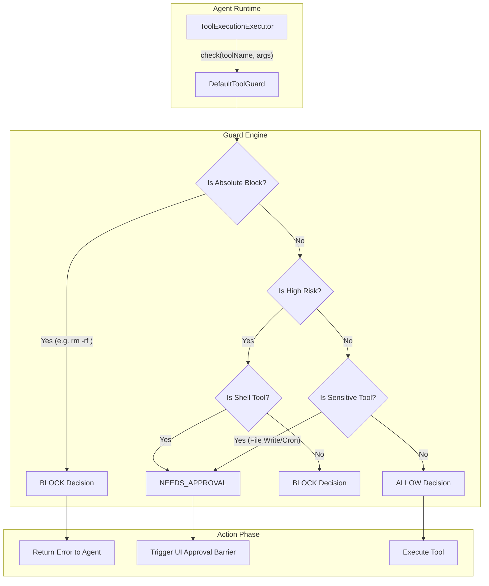
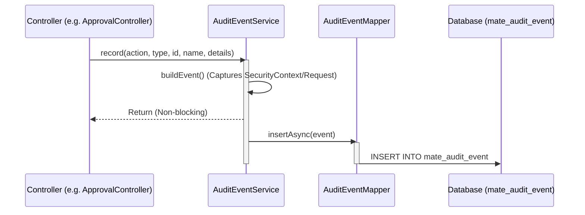

<!-- source: DeepWiki mcp.deepwiki.com · repo matevip/mateclaw · page 9.2 Tool Guard & Audit · fetched 2026-10-27 -->

# Tool Guard & Audit

Relevant source files

The following files were used as context for generating this wiki page:

- [mateclaw-server/src/main/java/vip/mate/agent/binding/model/AgentSkillBinding.java](mateclaw-server/src/main/java/vip/mate/agent/binding/model/AgentSkillBinding.java)
- [mateclaw-server/src/main/java/vip/mate/agent/binding/model/AgentToolBinding.java](mateclaw-server/src/main/java/vip/mate/agent/binding/model/AgentToolBinding.java)
- [mateclaw-server/src/main/java/vip/mate/agent/binding/repository/AgentSkillBindingMapper.java](mateclaw-server/src/main/java/vip/mate/agent/binding/repository/AgentSkillBindingMapper.java)
- [mateclaw-server/src/main/java/vip/mate/agent/binding/repository/AgentToolBindingMapper.java](mateclaw-server/src/main/java/vip/mate/agent/binding/repository/AgentToolBindingMapper.java)
- [mateclaw-server/src/main/java/vip/mate/agent/binding/service/AgentBindingService.java](mateclaw-server/src/main/java/vip/mate/agent/binding/service/AgentBindingService.java)
- [mateclaw-server/src/main/java/vip/mate/approval/ApprovalController.java](mateclaw-server/src/main/java/vip/mate/approval/ApprovalController.java)
- [mateclaw-server/src/main/java/vip/mate/approval/ApprovalService.java](mateclaw-server/src/main/java/vip/mate/approval/ApprovalService.java)
- [mateclaw-server/src/main/java/vip/mate/audit/controller/AuditEventController.java](mateclaw-server/src/main/java/vip/mate/audit/controller/AuditEventController.java)
- [mateclaw-server/src/main/java/vip/mate/config/DatabaseBootstrapRunner.java](mateclaw-server/src/main/java/vip/mate/config/DatabaseBootstrapRunner.java)
- [mateclaw-server/src/main/java/vip/mate/exception/GlobalExceptionHandler.java](mateclaw-server/src/main/java/vip/mate/exception/GlobalExceptionHandler.java)
- [mateclaw-server/src/main/java/vip/mate/tool/builtin/CronJobTool.java](mateclaw-server/src/main/java/vip/mate/tool/builtin/CronJobTool.java)
- [mateclaw-server/src/main/java/vip/mate/tool/builtin/ShellExecuteTool.java](mateclaw-server/src/main/java/vip/mate/tool/builtin/ShellExecuteTool.java)
- [mateclaw-server/src/main/java/vip/mate/tool/guard/DefaultToolGuard.java](mateclaw-server/src/main/java/vip/mate/tool/guard/DefaultToolGuard.java)
- [mateclaw-server/src/main/java/vip/mate/tool/guard/guardian/FileWriteGuardian.java](mateclaw-server/src/main/java/vip/mate/tool/guard/guardian/FileWriteGuardian.java)
- [mateclaw-server/src/main/java/vip/mate/tool/guard/guardian/ShellCommandGuardian.java](mateclaw-server/src/main/java/vip/mate/tool/guard/guardian/ShellCommandGuardian.java)
- [mateclaw-server/src/main/java/vip/mate/tool/guard/model/ToolGuardConfigEntity.java](mateclaw-server/src/main/java/vip/mate/tool/guard/model/ToolGuardConfigEntity.java)
- [mateclaw-server/src/main/java/vip/mate/tool/guard/service/ToolGuardAuditService.java](mateclaw-server/src/main/java/vip/mate/tool/guard/service/ToolGuardAuditService.java)
- [mateclaw-server/src/main/java/vip/mate/tool/guard/service/ToolGuardConfigService.java](mateclaw-server/src/main/java/vip/mate/tool/guard/service/ToolGuardConfigService.java)
- [mateclaw-server/src/main/java/vip/mate/tool/guard/service/ToolGuardRuleSeedService.java](mateclaw-server/src/main/java/vip/mate/tool/guard/service/ToolGuardRuleSeedService.java)
- [mateclaw-server/src/main/resources/db/migration/h2/V3__register_cron_job_tool.sql](mateclaw-server/src/main/resources/db/migration/h2/V3__register_cron_job_tool.sql)
- [mateclaw-server/src/main/resources/db/migration/mysql/V3__register_cron_job_tool.sql](mateclaw-server/src/main/resources/db/migration/mysql/V3__register_cron_job_tool.sql)
- [mateclaw-server/src/main/resources/messages.properties](mateclaw-server/src/main/resources/messages.properties)
- [mateclaw-server/src/main/resources/messages_en.properties](mateclaw-server/src/main/resources/messages_en.properties)
- [mateclaw-server/src/test/java/vip/mate/agent/binding/AgentBindingServiceTest.java](mateclaw-server/src/test/java/vip/mate/agent/binding/AgentBindingServiceTest.java)

The Tool Guard system provides a robust security layer for AI tool execution in MateClaw. It evaluates tool calls against safety rules before execution, supporting a spectrum of responses from silent approval to mandatory human-in-the-loop (HIL) approval and absolute blocking of destructive operations [mateclaw-server/src/main/java/vip/mate/tool/guard/DefaultToolGuard.java:10-18]().

## Evaluation Pipeline

The evaluation process is driven by the `DefaultToolGuard`, which classifies tool invocations based on their potential risk to the system.

### Decision Matrix
The system produces three types of decisions:
1.  **ALLOW**: The tool executes immediately without intervention [mateclaw-server/src/main/java/vip/mate/tool/guard/DefaultToolGuard.java:109-109]().
2.  **NEEDS_APPROVAL**: The execution is paused, and a request is sent to the UI for user confirmation. This is the default for shell commands and file write operations [mateclaw-server/src/main/java/vip/mate/tool/guard/DefaultToolGuard.java:81-81](), [mateclaw-server/src/main/java/vip/mate/tool/guard/DefaultToolGuard.java:100-100]().
3.  **BLOCK**: The execution is rejected entirely. This is reserved for "Extreme Destructive Patterns" where approval cannot override the safety check [mateclaw-server/src/main/java/vip/mate/tool/guard/DefaultToolGuard.java:65-72]().

### Data Flow Diagram: Tool Guard Evaluation
This diagram illustrates how a tool call from the Agent Runtime is processed by the security layer.

Sources: [mateclaw-server/src/main/java/vip/mate/tool/guard/DefaultToolGuard.java:57-110](), [mateclaw-server/src/main/java/vip/mate/tool/builtin/ShellExecuteTool.java:21-30]()

## ShellCommandGuardian & Pattern Matching

The `ShellCommandGuardian` specifically targets command-line execution tools like `execute_shell_command` [mateclaw-server/src/main/java/vip/mate/tool/guard/guardian/ShellCommandGuardian.java:26-29](). It utilizes a hybrid approach: prioritizing dynamic rules from the database via `ToolGuardRuleRegistry` and falling back to hardcoded `builtinRules` [mateclaw-server/src/main/java/vip/mate/tool/guard/guardian/ShellCommandGuardian.java:59-108]().

### GuardFinding Severity Levels
Rules are categorized by `GuardSeverity` to determine the strictness of the guard:
*   **CRITICAL**: Extreme destructive operations (e.g., `SHELL_RM_RF_ROOT`, `SHELL_MKFS`, `SHELL_FORK_BOMB`) [mateclaw-server/src/main/java/vip/mate/tool/guard/guardian/ShellCommandGuardian.java:130-178]().
*   **HIGH**: High-risk operations that require confirmation (e.g., `git push --force`, `DROP TABLE`) [mateclaw-server/src/main/java/vip/mate/tool/guard/DefaultToolGuard.java:15-17]().

### Implementation Details
The guardian uses `Pattern.CASE_INSENSITIVE` regex matching and maintains a `COMPILED_CACHE` for performance [mateclaw-server/src/main/java/vip/mate/tool/guard/guardian/ShellCommandGuardian.java:30-90](). When a match is found, it extracts a "snippet" (context around the match) to provide users with clear information during approval [mateclaw-server/src/main/java/vip/mate/tool/guard/guardian/ShellCommandGuardian.java:118-122]().

Sources: [mateclaw-server/src/main/java/vip/mate/tool/guard/guardian/ShellCommandGuardian.java:23-110]()

## Tool Guard Configuration & Seeding

The system's safety rules are managed via the `ToolGuardConfigService` and initialized by the `ToolGuardRuleSeedService`.

### ToolGuardRuleSeedService
On application startup, this service performs critical synchronization tasks:
1.  **Migration**: Renames old tool class names (e.g., `ShellExecuteTool`) to modern `@Tool` method names (e.g., `execute_shell_command`) in the database [mateclaw-server/src/main/java/vip/mate/tool/guard/service/ToolGuardRuleSeedService.java:78-87]().
2.  **Upserting**: Synchronizes built-in rules from code to the `mate_tool_guard_rule` table. If a rule exists, it updates fields like `pattern` or `severity` [mateclaw-server/src/main/java/vip/mate/tool/guard/service/ToolGuardRuleSeedService.java:147-180]().
3.  **V51 Narrowing**: Historically, `FileWriteGuardian` marked every write as medium risk. In V51, the `guarded_tools_json` in `mate_tool_guard_config` was narrowed to focus primarily on `execute_shell_command` to improve UX for multi-file workflows [mateclaw-server/src/main/java/vip/mate/tool/guard/guardian/FileWriteGuardian.java:10-21]().

### Config Entities
*   **ToolGuardRuleEntity**: Stores individual regex patterns, categories (e.g., `COMMAND_INJECTION`), and remediation hints.
*   **ToolGuardConfigEntity**: Manages workspace-level settings, such as which tools are globally guarded.

Sources: [mateclaw-server/src/main/java/vip/mate/tool/guard/service/ToolGuardRuleSeedService.java:37-64](), [mateclaw-server/src/main/java/vip/mate/tool/guard/guardian/FileWriteGuardian.java:10-21]()

## Audit & Event Logging

MateClaw maintains a comprehensive audit trail for security and troubleshooting.

### AuditEventService & AuditEventController
The `AuditEventService` provides a mechanism for logging sensitive actions. The `AuditEventController` exposes these logs via REST endpoints for administrative review.
*   **Context**: Captures User ID, IP address, and details of the operation [mateclaw-server/src/main/java/vip/mate/audit/service/AuditEventService.java:122-145]().
*   **Tool Audit**: The `ToolGuardAuditService` specifically logs security findings from the evaluation pipeline, recording which rules were triggered and the resulting decision.

### Data Flow: Audit Logging

Sources: [mateclaw-server/src/main/java/vip/mate/audit/service/AuditEventService.java:32-73](), [mateclaw-server/src/main/java/vip/mate/approval/ApprovalController.java:27-132]()

## Tool Guard UI & User Approval

When the `DefaultToolGuard` returns `NEEDS_APPROVAL`, the frontend displays an **Approval Barrier**.

### Approval Flow
1.  **Creation**: `ApprovalService` creates a `PendingApproval` record in an in-memory `pendingMap` [mateclaw-server/src/main/java/vip/mate/approval/ApprovalService.java:34-94]().
2.  **Notification**: The user sees the tool name, arguments, and risk reason in the chat UI [mateclaw-server/src/main/java/vip/mate/tool/guard/DefaultToolGuard.java:94-94]().
3.  **Resolution**: The user calls `POST /api/v1/chat/{conversationId}/approve`. The `ApprovalController` updates the status and persists it to message metadata to prevent "ghost" banners on refresh [mateclaw-server/src/main/java/vip/mate/approval/ApprovalController.java:42-100]().
4.  **Cleanup**: `ApprovalService` runs a scheduled GC task every 5 minutes to clear expired records [mateclaw-server/src/main/java/vip/mate/approval/ApprovalService.java:44-53]().

### Decision Localization
Findings are localized using `messages_en.properties` (or `messages.properties` for zh-CN), providing clear remediation steps like "Specify a concrete directory path instead of root" for `SHELL_RM_RF_ROOT` [mateclaw-server/src/main/resources/messages_en.properties:77-78]().

Sources: [mateclaw-server/src/main/java/vip/mate/approval/ApprovalService.java:31-152](), [mateclaw-server/src/main/java/vip/mate/approval/ApprovalController.java:27-132](), [mateclaw-server/src/main/resources/messages_en.properties:76-112]()

---

