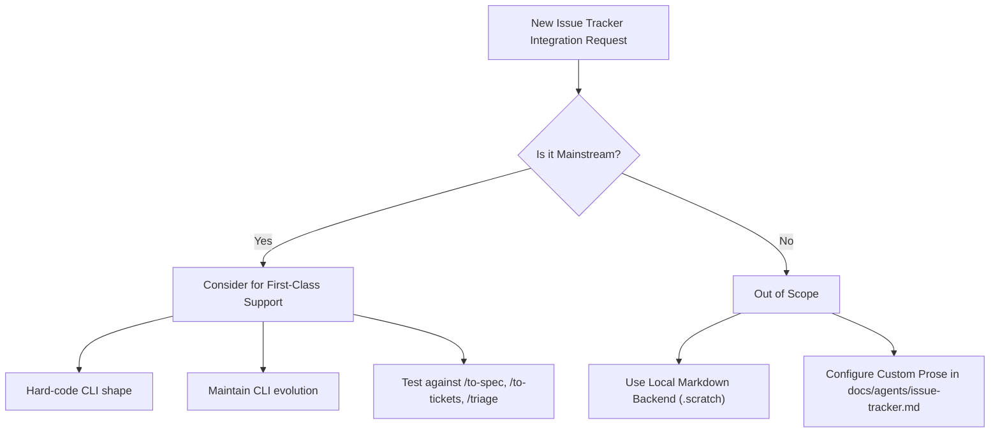

<!-- source: DeepWiki mcp.deepwiki.com · repo mattpocock/skills · page 6.2 Issue Tracker Backends · fetched 2026-10-27 -->

# Issue Tracker Backends

Relevant source files

The following files were used as context for generating this wiki page:

- [.changeset/github-tracker-external-pr-list.md](.changeset/github-tracker-external-pr-list.md)
- [.changeset/setup-tracker-fixes.md](.changeset/setup-tracker-fixes.md)
- [.out-of-scope/mainstream-issue-trackers-only.md](.out-of-scope/mainstream-issue-trackers-only.md)
- [docs/engineering/triage.md](docs/engineering/triage.md)
- [skills/engineering/setup-matt-pocock-skills/SKILL.md](skills/engineering/setup-matt-pocock-skills/SKILL.md)
- [skills/engineering/setup-matt-pocock-skills/issue-tracker-github.md](skills/engineering/setup-matt-pocock-skills/issue-tracker-github.md)
- [skills/engineering/setup-matt-pocock-skills/issue-tracker-gitlab.md](skills/engineering/setup-matt-pocock-skills/issue-tracker-gitlab.md)
- [skills/engineering/setup-matt-pocock-skills/issue-tracker-local.md](skills/engineering/setup-matt-pocock-skills/issue-tracker-local.md)
- [skills/engineering/setup-matt-pocock-skills/triage-labels.md](skills/engineering/setup-matt-pocock-skills/triage-labels.md)

This page documents the supported issue tracker backends for the skills repository, detailing their command surfaces and the rationale behind the selection of mainstream trackers. The skills framework integrates with these backends to manage issues, specifications, and workflow artifacts.

The system supports three primary issue tracker backends: GitHub, GitLab, and a local Markdown-based system. This selection is based on a scoping decision to only support mainstream tools, as detailed in [.out-of-scope/mainstream-issue-trackers-only.md]().

## Supported Backends

The skills framework interacts with issue trackers for various operations, including creating issues, reading issue details, listing issues, commenting, applying labels, and closing issues. Each backend has a specific command-line interface (CLI) and conventions that the skills adhere to.

### GitHub

The GitHub backend leverages the `gh` CLI tool for all operations.

**Conventions:**
*   **Create an issue**: `gh issue create --title "..." --body "..."` [skills/engineering/setup-matt-pocock-skills/issue-tracker-github.md:7-7]()
*   **Read an issue**: `gh issue view <number> --json number,title,body,labels,comments` [skills/engineering/setup-matt-pocock-skills/issue-tracker-github.md:8-8]()
*   **List issues**: `gh issue list --state open --json number,title,body,labels,comments --jq '[.[] | {number, title, body, labels: [.labels[].name], comments: [.comments[].body]}]'` with appropriate `--label` and `--state` filters [skills/engineering/setup-matt-pocock-skills/issue-tracker-github.md:9-9]()
*   **Comment on an issue**: `gh issue comment <number> --body "..."` [skills/engineering/setup-matt-pocock-skills/issue-tracker-github.md:11-11]()
*   **Apply / remove labels**: `gh issue edit <number> --add-label "..."` / `--remove-label "..."` [skills/engineering/setup-matt-pocock-skills/issue-tracker-github.md:12-12]()
*   **Close**: `gh issue close <number> --comment "..."` [skills/engineering/setup-matt-pocock-skills/issue-tracker-github.md:13-13]()

The `gh` CLI automatically infers the repository from `git remote -v` when run inside a clone [skills/engineering/setup-matt-pocock-skills/issue-tracker-github.md:15-15]().

**Pull Requests as a Triage Surface**:
The system can be configured to treat external Pull Requests (PRs) as feature requests for triage. If enabled, PRs are processed similarly to issues using `gh pr` equivalents [skills/engineering/setup-matt-pocock-skills/issue-tracker-github.md:17-25](). GitHub shares a single number space for issues and PRs, requiring disambiguation if a bare `#<number>` is provided [skills/engineering/setup-matt-pocock-skills/issue-tracker-github.md:27-27]().

**Wayfinding Operations**:
The `/wayfinder` skill uses GitHub issues to manage maps and child tickets.
*   **Map**: A single issue labeled `wayfinder:map`, holding the Notes / Decisions-so-far / Fog body. `gh issue create --label wayfinder:map` [skills/engineering/setup-matt-pocock-skills/issue-tracker-github.md:41-41]().
*   **Child ticket**: An issue linked to the map as a GitHub sub-issue (`gh issue create --parent <parent> ...` or via API). Where sub-issues aren't enabled, add the child to a task list in the map body and put `Part of #<map>` at the top of the child body. Labels: `wayfinder:<type>` (`research`/`prototype`/`grilling`/`task`). Once claimed, the ticket is assigned to the driving dev [skills/engineering/setup-matt-pocock-skills/issue-tracker-github.md:42-42]().
*   **Blocking**: GitHub's **native issue dependencies**, the canonical, UI-visible representation. Add an edge with `gh api --method POST repos/<owner>/<repo>/issues/<child>/dependencies/blocked_by -F issue_id=<blocker-db-id>`. Where dependencies aren't available, fall back to a `Blocked by: #<n>, #<n>` line at the top of the child body [skills/engineering/setup-matt-pocock-skills/issue-tracker-github.md:43-43]().
*   **Frontier query**: Lists the map's open children (`gh issue list --state open`), drop any with an open blocker (`issue_dependencies_summary.blocked_by > 0`, or an open issue in the `Blocked by` line) or an assignee; first in map order wins [skills/engineering/setup-matt-pocock-skills/issue-tracker-github.md:44-44]().
*   **Claim**: `gh issue edit <n> --add-assignee @me`, the session's first write [skills/engineering/setup-matt-pocock-skills/issue-tracker-github.md:45-45]().
*   **Resolve**: `gh issue comment <n> --body "<answer>"`, then `gh issue close <n>`, then append a context pointer (gist + link) to the map's Decisions-so-far [skills/engineering/setup-matt-pocock-skills/issue-tracker-github.md:46-46]().

Sources:
* [skills/engineering/setup-matt-pocock-skills/issue-tracker-github.md]()

### GitLab

The GitLab backend uses the `glab` CLI tool for all operations.

**Conventions:**
*   **Create an issue**: `glab issue create --title "..." --description "..."` [skills/engineering/setup-matt-pocock-skills/issue-tracker-gitlab.md:7-7]()
*   **Read an issue**: `glab issue view <number> --comments` [skills/engineering/setup-matt-pocock-skills/issue-tracker-gitlab.md:8-8]()
*   **List issues**: `glab issue list -O json` with appropriate `--label` filters [skills/engineering/setup-matt-pocock-skills/issue-tracker-gitlab.md:9-9]()
*   **Comment on an issue**: `glab issue note <number> --message "..."`. GitLab calls comments "notes" [skills/engineering/setup-matt-pocock-skills/issue-tracker-gitlab.md:10-10]()
*   **Apply / remove labels**: `glab issue update <number> --label "..."` / `--unlabel "..."` [skills/engineering/setup-matt-pocock-skills/issue-tracker-gitlab.md:11-11]()
*   **Close**: `glab issue close <number>` [skills/engineering/setup-matt-pocock-skills/issue-tracker-gitlab.md:12-12]()

The `glab` CLI automatically infers the repository from `git remote -v` [skills/engineering/setup-matt-pocock-skills/issue-tracker-gitlab.md:15-15](). GitLab refers to Pull Requests as "Merge Requests" and comments as "notes" [skills/engineering/setup-matt-pocock-skills/issue-tracker-gitlab.md:10-13]().

**Merge Requests as a Triage Surface**:
Similar to GitHub, external Merge Requests (MRs) can be treated as feature requests for triage using `glab mr` equivalents [skills/engineering/setup-matt-pocock-skills/issue-tracker-gitlab.md:17-25](). GitLab numbers issues and MRs separately [skills/engineering/setup-matt-pocock-skills/issue-tracker-gitlab.md:27-27]().

**Wayfinding Operations**:
The `/wayfinder` skill uses GitLab issues for maps and child tickets.
*   **Map**: A single issue labelled `wayfinder:map`, holding the Notes / Decisions-so-far / Fog body [skills/engineering/setup-matt-pocock-skills/issue-tracker-gitlab.md:41-41]().
*   **Child ticket**: An issue carrying `Part of #<map>` at the top of its description and labels `wayfinder:<type>` [skills/engineering/setup-matt-pocock-skills/issue-tracker-gitlab.md:42-42]().
*   **Blocking**: GitLab's **native blocking link**, added with the `/blocked_by #<n>` quick action posted as a note [skills/engineering/setup-matt-pocock-skills/issue-tracker-gitlab.md:43-43]().
*   **Frontier query**: `glab issue list -O json` scoped to the map's children, dropping any with an open blocker or assignee [skills/engineering/setup-matt-pocock-skills/issue-tracker-gitlab.md:44-44]().
*   **Claim**: `glab issue update <n> --assignee @me` [skills/engineering/setup-matt-pocock-skills/issue-tracker-gitlab.md:45-45]().
*   **Resolve**: `glab issue note <n> --message "<answer>"`, then `glab issue close <n>` [skills/engineering/setup-matt-pocock-skills/issue-tracker-gitlab.md:46-46]().

Sources:
* [skills/engineering/setup-matt-pocock-skills/issue-tracker-gitlab.md]()

### Local Markdown

The local Markdown backend stores issues and specifications as Markdown files within the `.scratch/` directory of the repository.

**Conventions:**
*   **Feature organization**: One feature per directory: `.scratch/<feature-slug>/` [skills/engineering/setup-matt-pocock-skills/issue-tracker-local.md:7-7]()
*   **Specification**: The spec is `.scratch/<feature-slug>/spec.md` [skills/engineering/setup-matt-pocock-skills/issue-tracker-local.md:8-8]()
*   **Implementation issues**: One file per ticket at `.scratch/<feature-slug>/issues/<NN>-<slug>.md`, numbered from `01` [skills/engineering/setup-matt-pocock-skills/issue-tracker-local.md:9-9]()
*   **Triage state**: Recorded as a `Status:` line near the top of each issue file [skills/engineering/setup-matt-pocock-skills/issue-tracker-local.md:10-10]()
*   **Comments**: Appended to the bottom of the file under a `## Comments` heading [skills/engineering/setup-matt-pocock-skills/issue-tracker-local.md:11-11]()

**Wayfinding Operations**:
The `/wayfinder` skill uses local Markdown files for maps and child tickets.
*   **Map**: `.scratch/<effort>/map.md` [skills/engineering/setup-matt-pocock-skills/issue-tracker-local.md:25-25]().
*   **Child ticket**: `.scratch/<effort>/issues/NN-<slug>.md` [skills/engineering/setup-matt-pocock-skills/issue-tracker-local.md:26-26]().
*   **Blocking**: A `Blocked by: NN, NN` line near the top [skills/engineering/setup-matt-pocock-skills/issue-tracker-local.md:27-27]().
*   **Frontier**: Scans `.scratch/<effort>/issues/` for files that are open, unblocked, and unclaimed [skills/engineering/setup-matt-pocock-skills/issue-tracker-local.md:28-28]().
*   **Claim**: Set `Status: claimed` [skills/engineering/setup-matt-pocock-skills/issue-tracker-local.md:29-29]().
*   **Resolve**: Append the answer under an `## Answer` heading, set `Status: resolved` [skills/engineering/setup-matt-pocock-skills/issue-tracker-local.md:30-30]().

Sources:
* [skills/engineering/setup-matt-pocock-skills/issue-tracker-local.md]()

### Diagram: Issue Tracker Backend Abstraction

```mermaid
graph TD
    subgraph "Skills Framework"
        A["Skill (/to-spec, /triage, /wayfinder)"] --> B["Issue Tracker Abstraction Layer"]
    end

    subgraph "Issue Tracker Backends"
        B --> C["GitHub (gh CLI)"]
        B --> D["GitLab (glab CLI)"]
        B --> E["Local Markdown (.scratch)"]
    end

    subgraph "GitHub CLI Operations"
        C --> C1["gh issue create"]
        C --> C2["gh issue view"]
        C --> C3["gh issue list"]
        C --> C4["gh issue comment"]
        C --> C5["gh issue edit --add-label"]
        C --> C6["gh issue close"]
        C --> C7["gh pr ... (triage surface)"]
    end

    subgraph "GitLab CLI Operations"
        D --> D1["glab issue create"]
        D --> D2["glab issue view"]
        D --> D3["glab issue list"]
        D --> D4["glab issue note"]
        D --> D5["glab issue update --label"]
        D --> D6["glab issue close"]
        D --> D7["glab mr ... (triage surface)"]
    end

    subgraph "Local Markdown Operations"
        E --> E1["Create spec.md under .scratch/"]
        E --> E2["Read NN-slug.md ticket files"]
        E --> E3["Scan .scratch/<feature>/issues/"]
        E --> E4["Append to ## Comments"]
        E --> E5["Update Status: line"]
        E --> E6["Append to ## Answer"]
    end
```

**Diagram: Issue Tracker Backend Abstraction**

This diagram illustrates how the skills framework interacts with different issue tracker backends through a common abstraction layer.

Sources:
* [skills/engineering/setup-matt-pocock-skills/issue-tracker-github.md]()
* [skills/engineering/setup-matt-pocock-skills/issue-tracker-gitlab.md]()
* [skills/engineering/setup-matt-pocock-skills/issue-tracker-local.md]()

## Mainstream Trackers Only Scoping Decision

The decision to limit issue tracker integrations to mainstream tools is a deliberate scoping choice documented in [.out-of-scope/mainstream-issue-trackers-only.md]().

**Rationale**:
Every issue-tracker backend hard-codes a CLI shape into the skills (commands, flags, output parsing). Each new backend creates a permanent maintenance burden as CLIs evolve and require continuous testing against core workflows like `/to-spec`, `/to-tickets`, and `/triage` [.out-of-scope/mainstream-issue-trackers-only.md:11-15]().

**Escape Hatches**:
For non-mainstream trackers, users can utilize the local Markdown option or define an `other/custom` workflow stored as prose in `docs/agents/issue-tracker.md` [.out-of-scope/mainstream-issue-trackers-only.md:16-18]().

### Diagram: Mainstream Tracker Scoping Decision

**Diagram: Mainstream Tracker Scoping Decision**

This diagram illustrates the decision-making process for integrating new issue trackers into the repository.

Sources:
* [.out-of-scope/mainstream-issue-trackers-only.md]()

---

