# Page: Overview

# Overview

<details>
<summary>Relevant source files</summary>

The following files were used as context for generating this wiki page:

- [.claude-plugin/plugin.json](.claude-plugin/plugin.json)
- [.out-of-scope/subagent-recursion.md](.out-of-scope/subagent-recursion.md)
- [README.md](README.md)
- [SCOPE.md](SCOPE.md)
- [skills/engineering/README.md](skills/engineering/README.md)
- [skills/in-progress/README.md](skills/in-progress/README.md)

</details>


The `mattpocock/skills` repository provides a collection of Markdown-based, modular capabilities ("skills") consumed by coding agents such as Claude Code, Codex, and GitHub Copilot [README.md:11-19](). Unlike monolithic frameworks (e.g., GSD, BMAD, Spec-Kit) that impose rigid top-down execution models, these skills are small, composable, and adaptable primitives designed to align human intent with real-world codebases [README.md:17-19]().

## Skill Taxonomy and Buckets

Skills are organized into distinct bucket directories under `skills/` based on their stability, lifecycle status, and function [SCOPE.md:14-18]():

| Bucket | Role / Stability | Description |
|--------|------------------|-------------|
| `engineering/` | Promoted | Daily code work, architecture, and technical execution workflows [skills/engineering/README.md:1-3](). |
| `productivity/` | Promoted | Daily non-code workflows, communication, and teaching utilities [.claude-plugin/plugin.json:42-48](). |
| `in-progress/` | Non-promoted (Beta) | Public beta skills excluded from the core plugin manifest, requiring individual installation [skills/in-progress/README.md:1-4](). |
| `misc/` | Non-promoted | Frozen, unmaintained utilities [SCOPE.md:17](). |
| `deprecated/` | Retired | Retired skills; deleted rather than archived [SCOPE.md:14-18](). |

Sources: [.claude-plugin/plugin.json:21-49](), [skills/in-progress/README.md:1-4](), [SCOPE.md:14-18]()

## Composable Skills over Monolithic Workflows

The repository relies on composable primitives rather than a single black-box framework. Developers combine skills like `skills/engineering/grill-with-docs/SKILL.md`, `skills/engineering/to-spec/SKILL.md`, and `skills/engineering/tdd/SKILL.md` to progressively bridge natural language intent with concrete code entities [README.md:17-19](), [README.md:101-154]().

### Skill Execution Pipeline

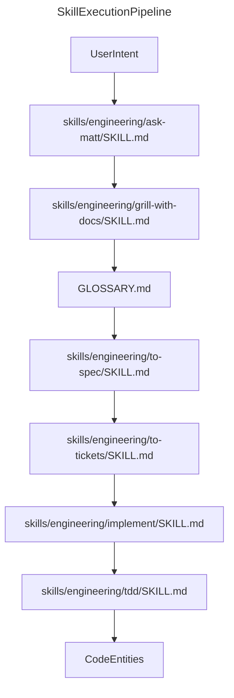
Sources: [README.md:11-19](), [README.md:101-154](), [.claude-plugin/plugin.json:21-49]()

### Language to Entity Mapping

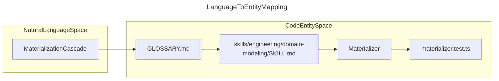
Sources: [README.md:132-154](), [skills/engineering/domain-modeling/SKILL.md:1-30]()

## Child Pages

For detailed specifications and mechanics, refer to the following child pages:

- **[Getting Started and Installation](#1.1)** — Claude Code plugin installation, `npx skills@latest add mattpocock/skills`, per-skill beta installs, and local symlink workflows via `scripts/link-skills.sh`.
- **[Repository Conventions and Release Pipeline](#1.2)** — Maintainer rules from `CLAUDE.md` and `AGENTS.md`, prose standards (forbidding em-dashes), documentation authoring standards (`.agents/writing-docs.md`), decision records (`.agents/adr/`), and the changesets release pipeline (`scripts/sync-plugin-version.mjs`).

Sources: [README.md:25-82](), [CLAUDE.md:1-25](), [scripts/link-skills.sh:1-15]()

---

# Page: Getting Started and Installation

# Getting Started and Installation

<details>
<summary>Relevant source files</summary>

The following files were used as context for generating this wiki page:

- [.agents/adr/0002-ship-as-a-claude-code-plugin.md](.agents/adr/0002-ship-as-a-claude-code-plugin.md)
- [.agents/install-block.md](.agents/install-block.md)
- [.agents/writing-docs.md](.agents/writing-docs.md)
- [.claude-plugin/marketplace.json](.claude-plugin/marketplace.json)
- [.out-of-scope/setup-skill-verify-mode.md](.out-of-scope/setup-skill-verify-mode.md)
- [CLAUDE.md](CLAUDE.md)
- [scripts/link-skills.sh](scripts/link-skills.sh)
- [scripts/list-skills.sh](scripts/list-skills.sh)

</details>


This page details the mechanisms for consuming the skills repository across various coding agents and local environments. It covers managed plugin installations for Claude Code, Codex, and GitHub Copilot [.agents/install-block.md:11-18](), universal consumption via `npx skills@latest add mattpocock/skills` [.agents/install-block.md:95-97](), per-skill beta evaluations [CLAUDE.md:6-9](), and the maintainer symlink workflow using `scripts/link-skills.sh` and `scripts/list-skills.sh` [scripts/link-skills.sh:1-13](), [scripts/list-skills.sh:1-7]().

Sources:
- [CLAUDE.md:1-24]()
- [.agents/install-block.md:1-22]()
- [scripts/link-skills.sh:1-13]()
- [scripts/list-skills.sh:1-7]()

## Installation Routes and Managed Plugin Systems

Consuming the repository requires choosing between managed plugin subscriptions (which update automatically) and editable local installs [,.agents/install-block.md:5-18](). The distribution architecture maps user-facing agent commands to repository-level manifests (`.claude-plugin/plugin.json` and `.claude-plugin/marketplace.json`) [CLAUDE.md:9-11]().

**Diagram: Natural Language to Code Entities: Plugin Deployment Architecture**
```mermaid
graph TD
    "UserCommand"["User Command: claude plugins install mattpocock-skills"] --> "PluginJson"[".claude-plugin/plugin.json"]
    "MarketplaceReq"["Codex Marketplace Add"] --> "MarketplaceJson"[".claude-plugin/marketplace.json"]
    "UniversalAdd"["npx skills@latest add mattpocock/skills"] --> "PromotedBuckets"["skills/engineering and skills/productivity"]
    "PluginJson" --> "PromotedSet"["Promoted Skills Array"]
    "MarketplaceJson" --> "PromotedSet"
    "VersionSync"["scripts/sync-plugin-version.mjs"] --> "PluginJson"
```
Sources:
- [CLAUDE.md:9-11]()
- [.agents/install-block.md:24-47]()
- [.agents/adr/0002-ship-as-a-claude-plugin.md:9-11]()

### Agent-Specific Installation Commands

Different harnesses consume the repository through specific distribution interfaces defined in `.agents/install-block.md`:

- **Claude Code**: Installs from the official marketplace, auto-updating by default [.agents/install-block.md:24-34]()
  ```bash
  claude plugin install mattpocock-skills@claude-plugins-official
  ```
- **Codex**: Uses the repository marketplace [.agents/install-block.md:36-47]()
  ```bash
  codex plugin marketplace add mattpocock/skills
  codex plugin add mattpocock-skills@mattpocock
  ```
- **GitHub Copilot (CLI & VS Code)**: Requires marketplace registration and optional automated update configurations [.agents/install-block.md:49-72]()
- **Gemini CLI**: Requires explicit path installations per promoted bucket [.agents/install-block.md:74-87]()
- **Universal (`skills.sh`)**: Copies editable skill files into the project directory [.agents/install-block.md:89-101]()
  ```bash
  npx skills@latest add mattpocock/skills -a <agent>
  ```

Sources:
- [.agents/install-block.md:24-101]()

## Per-Skill Installs and In-Progress Betas

Individual skills or experimental additions from the `in-progress/` bucket can be managed granularly without importing the entire plugin bundle [CLAUDE.md:6-9](). 

Per-skill CLI commands utilize `skills@latest`:

```bash
npx skills@latest add mattpocock/skills --skill=<name>
npx skills@latest update <name>
```

Skills residing in `in-progress/` are public for feedback purposes but are excluded from the main production plugin bundle [.agents/install-block.md:18]().

Sources:
- [CLAUDE.md:6-9]()
- [.agents/install-block.md:105-115]()

## Local Symlink Workflow

Maintainers utilize a local symlink script to bind repository skill directories directly into harness search paths (`~/.claude/skills` and `~/.agents/skills`) [scripts/link-skills.sh:8-16](). This allows `git pull` operations to propagate skill updates automatically [scripts/link-skills.sh:12-13]().

### `scripts/link-skills.sh` Implementation

The script discovers all `SKILL.md` files, explicitly skips retired (`deprecated/`) and unpromoted (`misc/`) buckets, and processes symlinks with a recursion guard to protect the working copy [scripts/link-skills.sh:18-46]().

**Diagram: Natural Language to Code Entities: Symlink Execution Flow**
```mermaid
graph TD
    "DevInvocation"["Run scripts/link-skills.sh"] --> "FindCmd"["find skills/ -name SKILL.md"]
    "FindCmd" --> "FilterLogic"["Exclude deprecated/ and misc/"]
    "FilterLogic" --> "DestCheck"["Check DEST: ~/.claude/skills and ~/.agents/skills"]
    "DestCheck" --> "SymlinkGuard"["Check readlink -f DEST against REPO"]
    "SymlinkGuard" -- "Matches Repo" --> "Abort"["Exit 1: Symlink Recursion Guard"]
    "SymlinkGuard" -- "Safe" --> "LinkExecution"["ln -sfn src target"]
```
Sources:
- [scripts/link-skills.sh:15-62]()

### `scripts/list-skills.sh` Utility

To inspect all available skill manifests across the repository workspace, maintainers run `scripts/list-skills.sh`, which traverses the directory tree while ignoring `node_modules` [scripts/list-skills.sh:1-7]().

```bash
#!/usr/bin/env bash
set -euo pipefail

REPO="$(cd "$(dirname "$0")/.." && pwd)"

cd "$REPO"
find . -name SKILL.md -not -path '*/node_modules/*' | sed 's|^\./||' | sort
```

Sources:
- [scripts/list-skills.sh:1-7]()

---

# Page: Repository Conventions and Release Pipeline

# Repository Conventions and Release Pipeline

<details>
<summary>Relevant source files</summary>

The following files were used as context for generating this wiki page:

- [.agents/adr/0001-explicit-setup-pointer-only-for-hard-dependencies.md](.agents/adr/0001-explicit-setup-pointer-only-for-hard-dependencies.md)
- [.agents/writing-docs.md](.agents/writing-docs.md)
- [.changeset/README.md](.changeset/README.md)
- [.changeset/config.json](.changeset/config.json)
- [.github/ISSUE_TEMPLATE/bug.yml](.github/ISSUE_TEMPLATE/bug.yml)
- [.github/ISSUE_TEMPLATE/config.yml](.github/ISSUE_TEMPLATE/config.yml)
- [.github/ISSUE_TEMPLATE/idea.yml](.github/ISSUE_TEMPLATE/idea.yml)
- [.github/workflows/needs-info.yml](.github/workflows/needs-info.yml)
- [.github/workflows/release.yml](.github/workflows/release.yml)
- [.github/workflows/triage-label.yml](.github/workflows/triage-label.yml)
- [.gitignore](.gitignore)
- [.out-of-scope/harness-name-collisions.md](.out-of-scope/harness-name-collisions.md)
- [.out-of-scope/native-question-tool.md](.out-of-scope/native-question-tool.md)
- [.out-of-scope/new-skills.md](.out-of-scope/new-skills.md)
- [CHANGELOG.md](CHANGELOG.md)
- [CLAUDE.md](CLAUDE.md)
- [package-lock.json](package-lock.json)
- [package.json](package.json)
- [scripts/link-skills.sh](scripts/link-skills.sh)
- [scripts/sync-plugin-version.mjs](scripts/sync-plugin-version.mjs)

</details>


This page details the conventions and rules governing the `mattpocock/skills` repository, focusing on maintainer guidelines, documentation standards, architectural decision records, GitHub issue templates and workflows, and the automated release pipeline. The goal is to ensure consistency, maintainability, and a clear understanding of how changes are introduced and released.

## Repository Conventions

The repository adheres to strict conventions to ensure consistency and maintainability across skills, manifests, and documentation.

### Skill Buckets and Promotion

Skills are organized into distinct bucket folders under `skills/` [CLAUDE.md:1-7](). These buckets categorize skills by their purpose and determine their promotion status:

*   `engineering/`: Daily code work [CLAUDE.md:3-3]()
*   `productivity/`: Daily non-code workflow tools [CLAUDE.md:4-4]()
*   `misc/`: Kept around but rarely used, not promoted [CLAUDE.md:5-5]()
*   `in-progress/`: Public beta skills, feedback wanted, not shipped in the plugin [CLAUDE.md:6-6]()
*   `deprecated/`: Skills no longer used [CLAUDE.md:7-7]()

The `engineering/` and `productivity/` buckets are considered **promoted** [CLAUDE.md:9-9](). Skills in these buckets must have a reference in the top-level `README.md` and an entry in `.claude-plugin/plugin.json`'s `skills` array [CLAUDE.md:9-9](). Skills in `misc/`, `in-progress/`, and `deprecated/` must not appear in either [CLAUDE.md:9-9](). Additionally, `AGENTS.md` is maintained as a symlink to `CLAUDE.md` so that Codex and other harnesses read identical instructions.

Sources: [CLAUDE.md:1-16]()

### Manifest, Router, and Documentation Synchronization

Maintaining consistency between skill definitions, plugin manifests, and routers is required for correct execution.

*   **Plugin Manifest**: The `.claude-plugin/plugin.json` file lists the promoted skills shipped with the Claude Code plugin [CLAUDE.md:9-9](). The `scripts/sync-plugin-version.mjs` script ensures that the version in `plugin.json` matches `package.json`.
*   **Marketplace and Validation**: `.claude-plugin/marketplace.json` serves as the repo's own marketplace, allowing non-Claude Code agents to install from it for automatic updates [CLAUDE.md:11-11](). Maintainers run `claude plugin validate . --strict` after touching either manifest [CLAUDE.md:11-11]().
*   **`ask-matt` Router**: The `ask-matt` skill acts as a router mapping user-reachable skills and their relationships [CLAUDE.md:21-21](). Any addition, renaming, removal, or change in how a user-reachable skill fits the flows requires updating `ask-matt`'s `SKILL.md` to keep the routing accurate [CLAUDE.md:21-21]().
*   **Documentation**: Promoted skills maintain human-facing documentation pages at `docs/<bucket>/<skill-name>.md` [CLAUDE.md:17-17]().

Title for diagram: Natural Language to Code Entity Synchronization
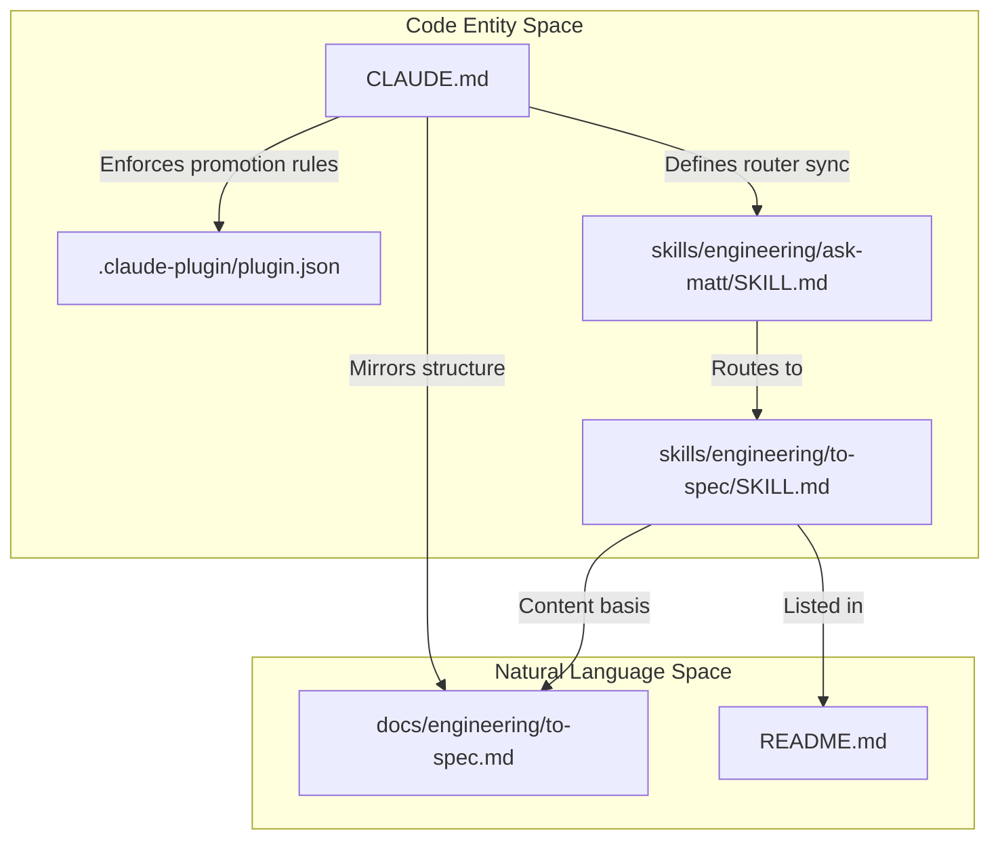
Sources: [CLAUDE.md:1-25](), [CHANGELOG.md:31-36]()

### Prose Standard: No Em-Dashes

A strict prose standard forbids the use of em-dashes anywhere in the repository's prose, including `SKILL.md` files, documentation pages, `README.md`, `CHANGELOG.md`, ADRs, changesets, and code comments [CLAUDE.md:25-25](). Sentences that would typically use an em-dash must be rewritten using commas, colons, periods, parentheses, or conjunctions [CLAUDE.md:25-25]().

Sources: [CLAUDE.md:25-25]()

## Documentation Authoring Standard

The `.agents/writing-docs.md` file defines the standard for authoring human-facing documentation pages for promoted skills [CLAUDE.md:17-17]().

*   **Location and URL**: Docs pages reside at `docs/<bucket>/<skill-name>.md` and publish to `https://aihero.dev/skills-<skill-name>` regardless of bucket organization [.agents/writing-docs.md:1-3](). Every link must be absolute [.agents/writing-docs.md:9-9]().
*   **Structure**: Each published page requires specific fixed sections [.agents/writing-docs.md:14-17]():
    *   `## What it does`: One or two plain-language paragraphs leading with the skill's primary job and defining constraint [.agents/writing-docs.md:23-26]().
    *   `## When to reach for it`: Explains the invocation mode and trigger boundary [.agents/writing-docs.md:28-33]().
    *   `## Common questions`: Addresses frequently asked questions sourced from the wiki, issues, and `CHANGELOG.md` [.agents/writing-docs.md:44-53]().
    *   `## It's working if`: Describes observable expected outcomes.
*   **Archived Pages**: When a promoted skill is removed outright, its documentation page remains in the repository tree marked as archived [.agents/writing-docs.md:7-8]().

Sources: [CLAUDE.md:17-18](), [.agents/writing-docs.md:1-59]()

## Architectural Decision Records and Out-of-Scope Decisions

The repository maintains explicit records for design choices and boundary constraints:

*   **ADRs (`.agents/adr/`)**: Document significant architectural decisions and their underlying rationale, such as `0002-ship-as-a-claude-code-plugin.md` [CLAUDE.md:11-11]() and `0001-explicit-setup-pointer-only-for-hard-dependencies.md`.
*   **Out-of-Scope (`.out-of-scope/`)**: Clarifies boundaries and features explicitly rejected, such as native question tools, harness name collisions, new standalone skills, and frozen misc skills [.github/ISSUE_TEMPLATE/idea.yml:7-10]().

Sources: [CLAUDE.md:11-11](), [.github/ISSUE_TEMPLATE/idea.yml:7-10]()

## GitHub Issue Templates and Workflows

Automations and structured forms ensure issues and PRs follow project standards:

*   **Issue Templates**: Templates for bugs (`.github/ISSUE_TEMPLATE/bug.yml`) and ideas (`.github/ISSUE_TEMPLATE/idea.yml`) enforce strict criteria, such as checking `SCOPE.md` and `.out-of-scope/` [.github/ISSUE_TEMPLATE/idea.yml:7-10]().
*   **Triage Label Workflow**: `.github/workflows/triage-label.yml` automatically applies `needs-triage` to newly opened issues [.github/workflows/triage-label.yml:1-23]().
*   **Needs Info Workflow**: `.github/workflows/needs-info.yml` closes inactive `needs-info` issues after 14 days [.github/workflows/needs-info.yml:1-38]().

Sources: [.github/ISSUE_TEMPLATE/idea.yml:1-40](), [.github/ISSUE_TEMPLATE/bug.yml:1-43](), [.github/workflows/triage-label.yml:1-23](), [.github/workflows/needs-info.yml:1-38]()

## Release Pipeline and Local Linking

Local development and automated releases are coordinated through shell scripts, changesets, and GitHub Actions workflows.

### Local Skill Linking

Maintainers run `scripts/link-skills.sh` to symlink active skills into local harness directories (`~/.claude/skills`, `~/.agents/skills`) [scripts/link-skills.sh:9-11](). The script automatically excludes `deprecated/` and `misc/`, but includes `in-progress/` skills to facilitate local feedback loops [scripts/link-skills.sh:18-24](). It includes a recursion guard to prevent symlinking the repo into itself [scripts/link-skills.sh:35-45]().

Sources: [scripts/link-skills.sh:1-62]()

### Automated Release Workflow

Releases are managed via `changesets` and GitHub Actions [package.json:11-18](), [.github/workflows/release.yml:1-37]().

Title for diagram: Release Pipeline Execution Flow
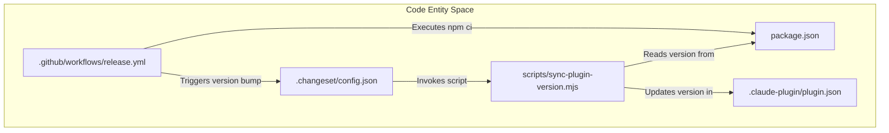
Sources: [package.json:11-15](), [.github/workflows/release.yml:1-37](), [scripts/sync-plugin-version.mjs:1-41]()

1.  **Trigger**: Pushes to `main` trigger the release workflow [.github/workflows/release.yml:4-6]().
2.  **Versioning**: The `changesets/action` executes `npm run version` [.github/workflows/release.yml:29-32](), which invokes `changeset version` followed immediately by `scripts/sync-plugin-version.mjs` [package.json:11-14]().
3.  **Manifest Sync**: `scripts/sync-plugin-version.mjs` reads `package.json` and ensures `.claude-plugin/plugin.json` matches the new version.
4.  **Tag and Publish**: Changesets commits the chore changes, tags the commit, and opens a pull request back to `main` [.github/workflows/release.yml:33-37]().

Sources: [package.json:11-15](), [.github/workflows/release.yml:1-37](), [scripts/sync-plugin-version.mjs:1-41]()

---

# Page: Skills Framework

# Skills Framework

<details>
<summary>Relevant source files</summary>

The following files were used as context for generating this wiki page:

- [.agents/writing-docs.md](.agents/writing-docs.md)
- [.claude-plugin/plugin.json](.claude-plugin/plugin.json)
- [CLAUDE.md](CLAUDE.md)
- [scripts/link-skills.sh](scripts/link-skills.sh)
- [skills/in-progress/README.md](skills/in-progress/README.md)

</details>


## Purpose and Scope

This document explains the structural framework that all skills in this repository follow. It covers the standardized directory layout, the `SKILL.md` file format with YAML front matter, metadata requirements for AI agent skill selection, and guidelines for organizing supporting documentation. The framework is designed to optimize for predictability and information hierarchy [CLAUDE.md:1-26](). It also details the deployment mechanism via symlinks [scripts/link-skills.sh:8-13](), the native Claude Code plugin manifest [.claude-plugin/plugin.json:1-50](), and bucket taxonomies [CLAUDE.md:1-10]().

For specific details on invocation types, deployment pipelines, documentation writing standards, and routing mechanics, see the child pages:
- [Skill Invocation Model](#2.1) — Details on user-invoked vs model-invoked taxonomy, the `disable-model-invocation` flag, and trigger conventions. For details, see [Skill Invocation Model](#2.1).
- [Plugin Manifest and Deployment](#2.2) — Documentation on `.claude-plugin/plugin.json`, bucket organization (`engineering/`, `productivity/`, etc.), and the symlink deployment script `scripts/link-skills.sh`. For details, see [Plugin Manifest and Deployment](#2.2).
- [Writing Skills and Docs for Agents](#2.3) — Documenting the principles for writing effective agent-facing documentation and human-facing docs pages via `.agents/writing-docs.md`. For details, see [Writing Skills and Docs for Agents](#2.3).
- [Ask-Matt Router, Flows and Phase Boundaries](#2.4) — Overview of the central `ask-matt` router skill (`skills/engineering/ask-matt/SKILL.md`) and its role in orchestrating complex workflows. For details, see [Ask-Matt Router, Flows and Phase Boundaries](#2.4).

Sources: [CLAUDE.md:1-26](), [scripts/link-skills.sh:8-13](), [.claude-plugin/plugin.json:1-50]()

---

## Skill Directory Structure

Each skill is organized as a self-contained directory under a specific bucket folder: `engineering/`, `productivity/`, `in-progress/`, `misc/`, or `deprecated/` [CLAUDE.md:1-8]().

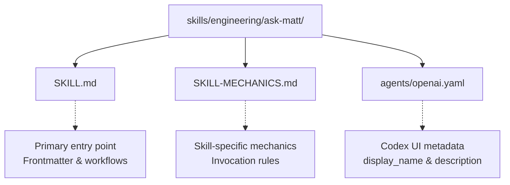
Sources: [CLAUDE.md:1-10](), [.claude-plugin/plugin.json:21-49]()

| File | Required | Purpose |
|------|----------|---------|
| `SKILL.md` | Yes | Primary entry point containing frontmatter metadata and core workflow instructions. |
| `SKILL-MECHANICS.md` | No | Skill-specific documentation on invocation rules, mechanics, and router interactions. |
| `agents/openai.yaml` | Yes | Holds Codex UI metadata like `display_name`, `short_description`, and `policy.allow_implicit_invocation`. |

Sources: [CLAUDE.md:1-20]()

---

## Skill Selection and Discovery

The AI agent selects skills by evaluating the `description` field in the `SKILL.md` frontmatter. This field acts as the model-facing trigger for autonomous execution.

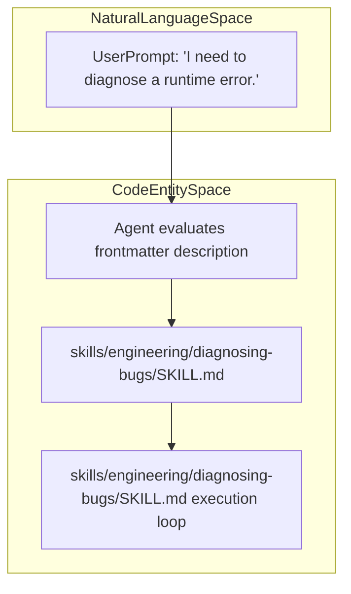
Sources: [CLAUDE.md:19-21](), [.claude-plugin/plugin.json:23]()

### Invocation Model and Routing

Skills operate under two invocation models: **User-invoked** (requiring explicit human command execution) and **Model-invoked** (selectable automatically by the agent based on context) [CLAUDE.md:15-19](). 

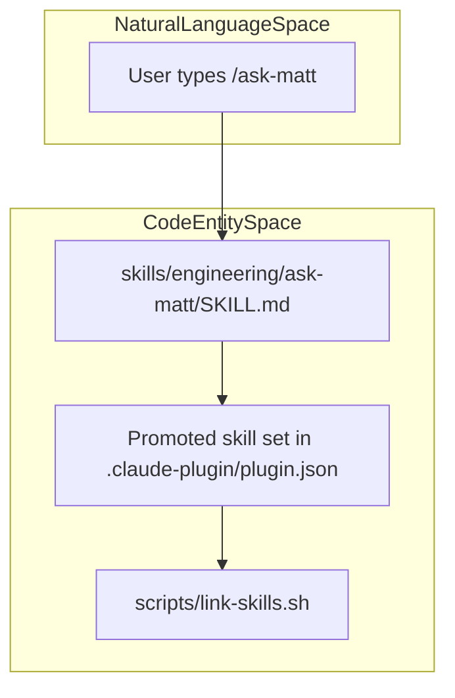
Sources: [CLAUDE.md:19-24](), [.claude-plugin/plugin.json:21-49](), [scripts/link-skills.sh:15-32]()

For details on invocation hierarchies, see [Skill Invocation Model](#2.1). For details on routing logic and phase boundaries, see [Ask-Matt Router, Flows and Phase Boundaries](#2.4).

---

## Distribution and Deployment

Promoted skills (housed in `engineering/` and `productivity/`) are published via the Claude Code plugin manifest (`.claude-plugin/plugin.json`) and synced locally via `scripts/link-skills.sh` [CLAUDE.md:9-24](). Non-promoted buckets (`misc/`, `in-progress/`, `deprecated/`) are excluded from the default plugin distribution, though `in-progress/` betas can be installed individually [CLAUDE.md:9-11](), [skills/in-progress/README.md:5-9]().

For details on plugin packaging, manifest structures, and symlink recursion guards, see [Plugin Manifest and Deployment](#2.2).

Sources: [CLAUDE.md:9-24](), [.claude-plugin/plugin.json:1-50](), [scripts/link-skills.sh:1-62](), [skills/in-progress/README.md:1-16]()

---

# Page: Skill Invocation Model

# Skill Invocation Model

<details>
<summary>Relevant source files</summary>

The following files were used as context for generating this wiki page:

- [.agents/invocation.md](.agents/invocation.md)
- [.agents/writing-docs.md](.agents/writing-docs.md)
- [AGENTS.md](AGENTS.md)
- [CLAUDE.md](CLAUDE.md)
- [scripts/link-skills.sh](scripts/link-skills.sh)
- [skills/engineering/ask-matt/agents/openai.yaml](skills/engineering/ask-matt/agents/openai.yaml)
- [skills/engineering/grill-with-docs/SKILL.md](skills/engineering/grill-with-docs/SKILL.md)

</details>


## Purpose and Scope

This document details the taxonomy of skill invocation within the repository. It explains the distinction between **user-invoked** and **model-invoked** skills, the technical implementation of these modes via frontmatter flags and companion configuration files, and the architectural rules governing inter-skill communication. This model balances context load (token usage in the agent window) against cognitive load (the human's need to remember available commands) [[.agents/invocation.md:3-7]().

Sources: [.agents/invocation.md:3-7]()

---

## Invocation Taxonomy

The skills framework distinguishes between two primary modes of invocation based on whether the AI agent can "see" and autonomously trigger the skill [[.agents/invocation.md:3-6]().

### User-Invoked Skills
A user-invoked skill is reachable **only by the human typing its name** (e.g., `/setup-matt-pocock-skills`). It is completely invisible to the agent's autonomous planning [[.agents/invocation.md:5]().
- **Frontmatter**: Must set `disable-model-invocation: true` for Claude Code and `policy.allow_implicit_invocation: false` in `agents/openai.yaml` for Codex [[.agents/invocation.md:5-10]().
- **Description**: Human-facing. It provides a concise, one-line summary for a person browsing slash-commands, with trigger lists ("Use when...") stripped [[.agents/invocation.md:5]().
- **Frontmatter Quoting**: Descriptions containing colons or complex prose must be explicitly quoted in YAML frontmatter to prevent parsing failures during plugin discovery [[.changeset/fix-yaml-fontmatter-colons.md:5]().

### Model-Invoked Skills
A model-invoked skill is reachable by **both the model and the user**. The agent can fire it autonomously based on the user's natural language request [[.agents/invocation.md:6]().
- **Frontmatter**: Omit the `disable-model-invocation` flag and the `policy` block [[.agents/invocation.md:6]().
- **Description**: Model-facing. It retains rich trigger phrasing ("Use when the user wants..., mentions..., asks for...") to help the LLM identify when to fire the skill [[.agents/invocation.md:6]().
- **Validation**: The test for model-invocation is whether the model could usefully reach for the skill autonomously [[.agents/invocation.md:6]().

Sources: [.agents/invocation.md:3-10](), [.changeset/fix-yaml-fontmatter-colons.md:5]()

---

## Implementation and Data Flow

The invocation mode is determined by frontmatter metadata in `SKILL.md` and UI settings in `agents/openai.yaml`. These configuration files are parsed to populate the plugin manifest (`.claude-plugin/plugin.json`).

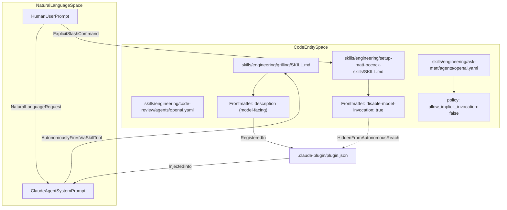

Sources: [.agents/invocation.md:5-10](), [skills/engineering/ask-matt/agents/openai.yaml:1-5]()

---

## Dependency Rules and Tool Invocation

To maintain predictability and prevent execution failures, the framework enforces strict rules for inter-skill communication [[.agents/invocation.md:14-22]().

### The Invocation Invariants
1. **User-invoked skills** may invoke **model-invoked skills** via the Skill tool [[.agents/invocation.md:8]().
2. **User-invoked skills** can **NEVER** reach another **user-invoked skill** [[.agents/invocation.md:8-9]().
3. **Model-invoked skills** can **NEVER** reach a **user-invoked skill** [[.agents/invocation.md:22]().

### Calling Convention
Dependencies are expressed as an explicit instruction to **Call the Skill tool** with the named skill (e.g., `Call the Skill tool with "grilling"`), rather than deep cross-references (`../other-skill/FILE.md`) or bare `/skill`-style names [[.agents/invocation.md:16](). 
- The Skill tool takes **one skill per call**. If a step requires two skills, issue two separate instructions (`Call the Skill tool twice, for "grilling" and "domain-modeling"`), never a single call with multiple names [[.agents/invocation.md:20]().
- **User-Prerequisites**: Because a user-invoked skill (such as `setup-matt-pocock-skills`) cannot be called programmatically by any skill, workflows requiring it must instruct the agent to prompt the human directly ("tell the user to run `/setup-matt-pocock-skills`") [[.agents/invocation.md:22](), [.changeset/user-invoked-skill-invocation.md:7]().

Sources: [.agents/invocation.md:8-22](), [.changeset/user-invoked-skill-invocation.md:5-9]()

---

## Description Conventions and OpenAI Metadata

Every skill pairs its `SKILL.md` with an `agents/openai.yaml` file containing Codex UI metadata [[.agents/invocation.md:10](), [skills/engineering/code-review/agents/openai.yaml:1-3]().

| Feature | Model-Invoked Description | User-Invoked Description |
| :--- | :--- | :--- |
| **Primary Audience** | AI Agent | Human User |
| **Trigger Phrases** | Rich ("Use when user wants...") | Stripped (Human-facing summary) |
| **Frontmatter** | Omitted (`disable-model-invocation`) | `disable-model-invocation: true` [[.agents/invocation.md:5-6]]() |
| **Codex Policy** | Omitted (`policy`) | `policy.allow_implicit_invocation: false` [[.agents/invocation.md:5-10]]() |

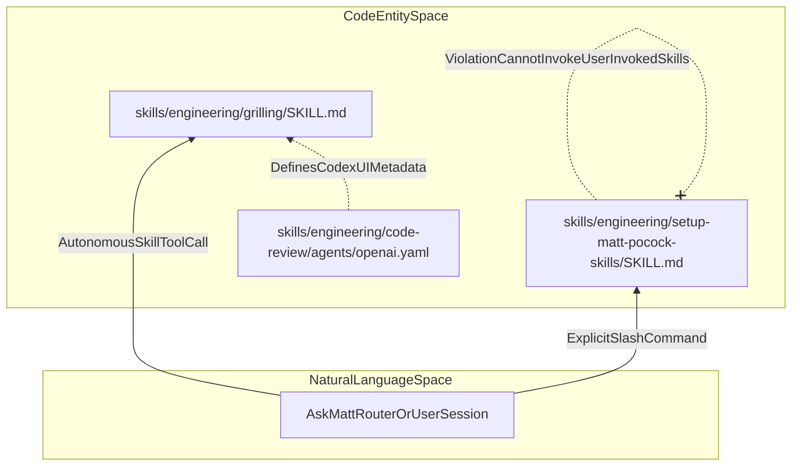

Sources: [.agents/invocation.md:5-10](), [skills/engineering/code-review/agents/openai.yaml:1-3]()

---

# Page: Plugin Manifest and Deployment

# Plugin Manifest and Deployment

<details>
<summary>Relevant source files</summary>

The following files were used as context for generating this wiki page:

- [.agents/adr/0002-ship-as-a-claude-code-plugin.md](.agents/adr/0002-ship-as-a-claude-code-plugin.md)
- [.agents/install-block.md](.agents/install-block.md)
- [.agents/writing-docs.md](.agents/writing-docs.md)
- [.claude-plugin/marketplace.json](.claude-plugin/marketplace.json)
- [.claude-plugin/plugin.json](.claude-plugin/plugin.json)
- [CLAUDE.md](CLAUDE.md)
- [scripts/link-skills.sh](scripts/link-skills.sh)
- [skills/in-progress/README.md](skills/in-progress/README.md)

</details>


## Purpose and Scope

This document details the technical infrastructure used to manage, deploy, and validate the skills in this repository. It covers the `.claude-plugin/plugin.json` manifest structure, the `.claude-plugin/marketplace.json` fallback, the promoted versus non-promoted bucket taxonomy, the canonical install block defined in [.agents/install-block.md](), and the local symlink deployment script `scripts/link-skills.sh` along with its recursion guard and plugin validation mechanics.

Sources: [.claude-plugin/plugin.json:1-50](), [.claude-plugin/marketplace.json:1-23](), [CLAUDE.md:1-27](), [scripts/link-skills.sh:1-62](), [.agents/install-block.md:1-121]()

---

## Plugin Manifests and Marketplace Architecture

The `.claude-plugin/plugin.json` file acts as the central registry for the repository. It defines the active surface area of the toolkit by explicitly listing paths to individual skill directories [`./skills/engineering/...`, `./skills/productivity/...`] [.claude-plugin/plugin.json:21-49](). This manifest allows the repository to function as a native Claude Code plugin, enabling users to subscribe to the skills as a managed, read-only bundle [.agents/adr/0002-ship-as-a-claude-code-plugin.md:3-5]().

### Manifest Schema and Version Synchronization
The manifest contains a JSON object with structural keys including `name` (`mattpocock-skills`) [.claude-plugin/plugin.json:2](), `version` (which tracks `package.json`) [.claude-plugin/plugin.json:3](), and `skills` (an array of explicit directory strings) [.claude-plugin/plugin.json:21-49](). Version synchronization across the release pipeline is automated by scripts that keep `.claude-plugin/plugin.json` aligned with `package.json` [.agents/adr/0002-ship-as-a-claude-code-plugin.md:27-29]().

### Marketplace Integration
The repository includes `.claude-plugin/marketplace.json` to allow the codebase to function as its own single-plugin marketplace [.claude-plugin/marketplace.json:1-23](). While promoted skills are published through Claude Code's official marketplace (`claude-plugins-official`), `marketplace.json` remains as a fallback mechanism for installing unreleased commits or forks [.agents/adr/0002-ship-as-a-claude-code-plugin.md:30-35]().

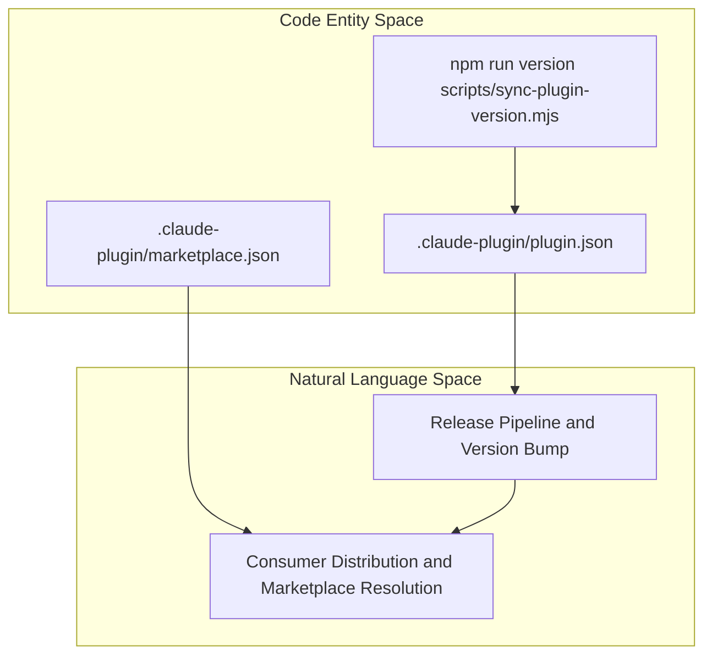

Sources: [.claude-plugin/plugin.json:1-50](), [.claude-plugin/marketplace.json:1-23](), [.agents/adr/0002-ship-as-a-claude-code-plugin.md:1-53]()

---

## Promoted vs Non-Promoted Bucket Taxonomy

Skills are organized into bucket folders under `skills/` [CLAUDE.md:1-8](). The distinction between promoted and non-promoted buckets controls what ships inside the plugin manifest.

| Bucket | Purpose | Promotion Status |
| :--- | :--- | :--- |
| `engineering/` | Daily code work | **Promoted** [CLAUDE.md:3]() |
| `productivity/` | Daily non-code workflow tools | **Promoted** [CLAUDE.md:4]() |
| `misc/` | Kept around but rarely used | Not Promoted [CLAUDE.md:5]() |
| `in-progress/` | Beta: public on purpose, feedback wanted | Not Promoted [CLAUDE.md:6]() |
| `deprecated/` | No longer used | Not Promoted [CLAUDE.md:7]() |

Every skill in `engineering/` or `productivity/` must have an entry in `.claude-plugin/plugin.json`'s `skills` array [CLAUDE.md:9](). Skills in `misc/`, `in-progress/`, and `deprecated/` must be excluded from the plugin manifest [CLAUDE.md:9]().

Sources: [CLAUDE.md:1-10](), [.agents/adr/0002-ship-as-a-claude-code-plugin.md:7-17](), [skills/in-progress/README.md:1-16]()

---

## Canonical Installation via .agents/install-block.md

Installation instructions across documentation files are standardized through [.agents/install-block.md]() [.agents/install-block.md:1-4](). 

*   **Claude Code Users**: Because `mattpocock-skills` is registered in Claude Code's official marketplace (`claude-plugins-official`), installation is executed via `claude plugin install mattpocock-skills@claude-plugins-official` [.agents/install-block.md:24-34()]. Updates are handled automatically by the host harness [.agents/install-block.md:12-19()].
*   **Codex and Copilot Users**: Users rely on marketplace management commands such as `codex plugin marketplace add mattpocock/skills` [.agents/install-block.md:36-72()].
*   **Other Agents (skills.sh)**: Non-managed harnesses consume skills via `npx skills@latest add mattpocock/skills` [.agents/install-block.md:89-101()].

The plugin subscription model and the editable `skills.sh` approach are mutually exclusive, as installing both duplicates skill execution surfaces [.agents/install-block.md:119-122()].

Sources: [.agents/install-block.md:1-121]()

---

## Local Symlink Deployment and Recursion Guard

For maintainers managing local development workflows, `scripts/link-skills.sh` links repository skills into local agent directories (`~/.claude/skills` and `~/.agents/skills`) [scripts/link-skills.sh:1-16()].

### Script Implementation and Recursion Guard
The script collects all `SKILL.md` files while explicitly filtering out `deprecated/` and `misc/` directories, though `in-progress/` skills are included for active developer feedback [scripts/link-skills.sh:18-31()]. To prevent recursive pollution of the repository working copy when a destination folder is incorrectly symlinked, `scripts/link-skills.sh` runs a safety check using `readlink -f` [scripts/link-skills.sh:37-46()].

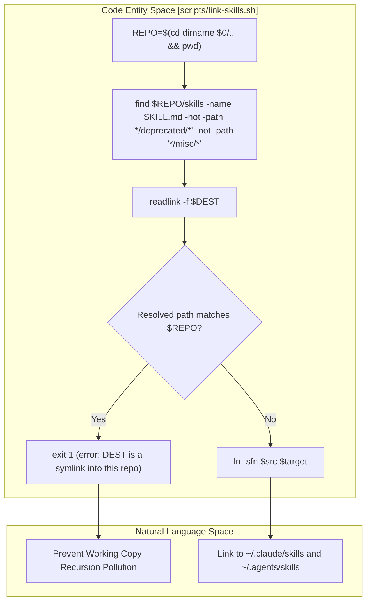

Sources: [scripts/link-skills.sh:1-62]()

---

## Plugin Validation

Maintainers must validate schema and path integrity by executing `claude plugin validate . --strict` after touching either `.claude-plugin/plugin.json` or `.claude-plugin/marketplace.json` [CLAUDE.md:11](). This validation command checks that every declared skill path resolves correctly to a directory containing a valid `SKILL.md` file, ensuring that the published plugin bundle remains free of broken references or unauthorized non-promoted inclusions.

Sources: [CLAUDE.md:1-12](), [.claude-plugin/plugin.json:1-50]()

---

# Page: Writing Skills and Docs for Agents

# Writing Skills and Docs for Agents

<details>
<summary>Relevant source files</summary>

The following files were used as context for generating this wiki page:

- [.out-of-scope/lazy-load-writing-for-agents.md](.out-of-scope/lazy-load-writing-for-agents.md)
- [docs/engineering/to-spec.md](docs/engineering/to-spec.md)
- [docs/productivity/writing-for-agents.md](docs/productivity/writing-for-agents.md)
- [skills/productivity/README.md](skills/productivity/README.md)
- [skills/productivity/writing-for-agents/SKILL-MECHANICS.md](skills/productivity/writing-for-agents/SKILL-MECHANICS.md)
- [skills/productivity/writing-for-agents/SKILL.md](skills/productivity/writing-for-agents/SKILL.md)
- [skills/productivity/writing-for-agents/agents/openai.yaml](skills/productivity/writing-for-agents/agents/openai.yaml)

</details>


## Purpose and Scope

This page specifies the mechanics and authoring guidelines implemented by the `writing-for-agents` skill and its companion `SKILL-MECHANICS.md` [skills/productivity/writing-for-agents/SKILL.md:1-8](), as well as the human-facing documentation template enforced by `.agents/writing-docs.md`. It covers information hierarchy, progressive disclosure, leading words, no-op pruning, failure modes, and the management of archived documentation for retired skills.

---

## Skill Architecture and Invocation Mechanics

The `writing-for-agents` skill governs how instructions are parsed by coding agents (`Claude Code`, `Codex`), ensuring uniform process execution across sessions [docs/productivity/writing-for-agents.md:3-3](). When authoring skills, the YAML frontmatter and file layout dictate whether a capability operates under model-driven discovery or strict manual invocation [skills/productivity/writing-for-agents/SKILL-MECHANICS.md:5-12]().

### The Two Loads

Authoring decisions constantly balance two fundamental constraints:
*   **Context Load**: The token cost of always-loaded material resident in the agent's window (e.g., skill descriptions in frontmatter, global instructions in `AGENTS.md` or `CLAUDE.md`) [skills/productivity/writing-for-agents/SKILL.md:24-24]().
*   **Cognitive Load**: The human cost of tracking which documents exist and when to invoke them [skills/productivity/writing-for-agents/SKILL.md:25-25]().

### Invocation Taxonomy

Skills choose between two execution modes via frontmatter flags:

| Invocation Mode | YAML Frontmatter Configuration | Context Load | Cognitive Load | Discoverability |
| :--- | :--- | :--- | :--- | :--- |
| **Model-Invoked** | Omit `disable-model-invocation` (retains `description`) [skills/productivity/writing-for-agents/SKILL-MECHANICS.md:9-9]() | High (description stays in context) [skills/productivity/writing-for-agents/SKILL-MECHANICS.md:9-9]() | Low (agent discovers it) [skills/productivity/writing-for-agents/SKILL-MECHANICS.md:9-9]() | Autonomous & cross-skill invocation [skills/productivity/writing-for-agents/SKILL-MECHANICS.md:9-9]() |
| **User-Invoked** | `disable-model-invocation: true` (description becomes human-facing) [skills/productivity/writing-for-agents/SKILL-MECHANICS.md:10-10]() | Zero (stripped from context) [skills/productivity/writing-for-agents/SKILL-MECHANICS.md:10-10]() | High (human acts as index) [skills/productivity/writing-for-agents/SKILL-MECHANICS.md:10-10]() | Manual invocation only (`/<skill-name>`) [skills/productivity/writing-for-agents/SKILL-MECHANICS.md:10-10]() |

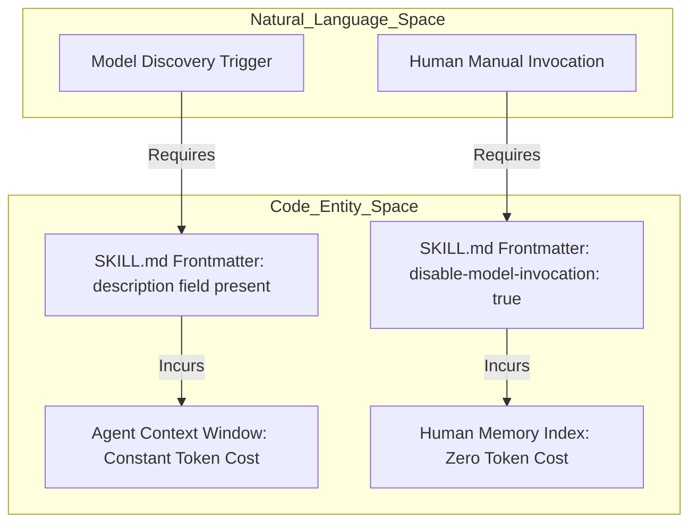
Sources:
* [skills/productivity/writing-for-agents/SKILL.md:20-28]()
* [skills/productivity/writing-for-agents/SKILL-MECHANICS.md:5-15]()

---

## Information Hierarchy and Progressive Disclosure

Documents are structured into a ranked ladder of accessibility, preventing context bloat while ensuring necessary reference material is retrievable [skills/productivity/writing-for-agents/SKILL.md:29-37]().

1.  **In-file Step**: Ordered executable instructions (`1. Do X`, `2. Then Y`) [skills/productivity/writing-for-agents/SKILL.md:33-33]().
2.  **In-file Reference**: Flat peer sets of rules, definitions, or parameters consulted on demand [skills/productivity/writing-for-agents/SKILL.md:34-34]().
3.  **Disclosed Reference**: Secondary markdown files (e.g., `SKILL-MECHANICS.md`) reached via context pointers and loaded dynamically [skills/productivity/writing-for-agents/SKILL.md:35-35]().

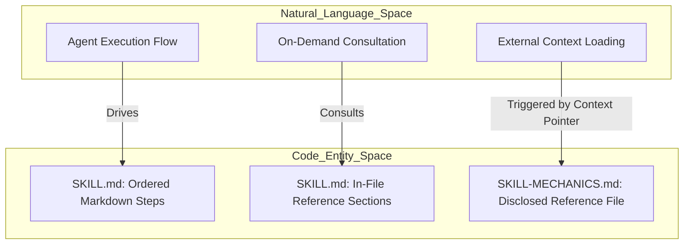
Sources:
* [skills/productivity/writing-for-agents/SKILL.md:29-39]()
* [skills/productivity/writing-for-agents/SKILL-MECHANICS.md:1-4]()

### Co-location and Sprawl Prevention
*   **Co-location**: Keeping definitions, rules, and caveats for a single concept grouped under one heading rather than fragmented across files [skills/productivity/writing-for-agents/SKILL.md:41-41]().
*   **Sprawl**: The failure mode where a document becomes excessively long, thinning attention. Cured by progressive disclosure and branching [skills/productivity/writing-for-agents/SKILL.md:43-43]().

---

## Core Levers of Predictability

### Leading Words
A **leading word** is a compact concept existing in model pretraining (e.g., *tight*, *red*, *tracer bullet*, *fog of war*) that anchors behavior across execution and invocation pointers in minimal tokens [skills/productivity/writing-for-agents/SKILL.md:63-65]().

### Completion Criteria and Legwork
Every instruction sequence terminates in a completion criterion with two properties:
*   **Clarity**: Binary checkability preventing **premature completion** (stopping before genuine execution is complete) [skills/productivity/writing-for-agents/SKILL.md:47-49]().
*   **Demand**: Exhaustiveness standards that drive internal search and validation (**legwork**) without requiring verbose procedural steps [skills/productivity/writing-for-agents/SKILL.md:50-50]().

### Pruning and No-Op Detection
The primary authoring operation is deletion. A **no-op** instruction explains what the model already knows, consuming context tokens while altering no behavior [docs/productivity/writing-for-agents.md:5-5](). Instructions must be evaluated against duplication, sediment, and sprawl [docs/productivity/writing-for-agents/SKILL.md:30-30]().

---

## Failure Modes and Router Skills

### Common Failure Modes
*   **Premature Completion**: Vague completion thresholds leading to truncated agent runs [skills/productivity/writing-for-agents/SKILL.md:49-49]().
*   **No-op Bloat**: Explanatory text that does not enforce constraints or change control flow [docs/productivity/writing-for-agents.md:5-5]().
*   **Duplication**: Repeating definitions or constraints across multiple sections [docs/productivity/writing-for-agents/SKILL.md:41-41]().

### Router Skills
When user-invoked skills proliferate, a **router skill** (such as `ask-matt`) aggregates invocation knowledge into a single user-invoked entry point, reducing human cognitive load without adding persistent context load to autonomous agent turns [skills/productivity/writing-for-agents/SKILL-MECHANICS.md:20-22]().

Sources:
* [skills/productivity/writing-for-agents/SKILL.md:40-70]()
* [skills/productivity/writing-for-agents/SKILL-MECHANICS.md:20-22]()
* [docs/productivity/writing-for-agents.md:5-48]()

---

## Human-Facing Documentation Standards

Human-facing documentation pages for promoted skills (published at `https://aihero.dev/skills-<skill-name>`) follow a strict structural template to minimize cognitive load [docs/.agents/writing-docs.md:3-5]().

### Page Structure & Fixed Sections
*   **Absolute Links**: All hyperlinks use absolute URLs (`https://aihero.dev/skills-<name>` or `https://github.com/mattpocock/skills/...`) [docs/.agents/writing-docs.md:9-9]().
*   **No Install Commands**: Install widgets are rendered automatically by the platform template [docs/.agents/writing-docs.md:19-19]().
*   **What it does**: Concise definition leading with the skill's one-sentence job and defining constraint [docs/.agents/writing-docs.md:23-25]().
*   **When to reach for it**: Explicit invocation mode and trigger boundaries [docs/.agents/writing-docs.md:28-32]().
*   **Common questions**: Real questions sourced from issues, repositories, and changelogs, ordered by frequency [docs/.agents/writing-docs.md:44-57]().
*   **It's working if**: Observable success criteria [docs/.agents/writing-docs.md:58-58]().

### Archived Pages for Removed Skills
When a promoted skill is removed, its documentation page is retained as an **archived page** [docs/.agents/writing-docs.md:7-8](). The content remains accessible, prefixed with a banner notice specifying the removal version and recommended migration path, preserving URL validity across releases [docs/.agents/writing-docs.md:7-8]().

Sources:
* [docs/.agents/writing-docs.md:1-59]()

---

# Page: Ask-Matt Router, Flows and Phase Boundaries

# Ask-Matt Router, Flows and Phase Boundaries

<details>
<summary>Relevant source files</summary>

The following files were used as context for generating this wiki page:

- [.changeset/ask-matt-read-skill-first.md](.changeset/ask-matt-read-skill-first.md)
- [docs/engineering/ask-matt.md](docs/engineering/ask-matt.md)
- [skills/engineering/ask-matt/PHASE-BOUNDARIES.md](skills/engineering/ask-matt/PHASE-BOUNDARIES.md)
- [skills/engineering/ask-matt/SKILL.md](skills/engineering/ask-matt/SKILL.md)

</details>


This page documents the `ask-matt` router skill, which acts as a centralized routing engine across the skills repository [skills/engineering/ask-matt/SKILL.md:2-3](). It details the main idea-to-ship flow, integration on-ramps, codebase health upkeep, phase boundary management via `PHASE-BOUNDARIES.md`, and smart-zone context handling.

Sources:
- [skills/engineering/ask-matt/SKILL.md:2-3]()
- [docs/engineering/ask-matt.md:1-6]()

## Overview and Router Mechanics

The `ask-matt` router (`skills/engineering/ask-matt/SKILL.md`) functions as a static manual map rather than an automated execution daemon [docs/engineering/ask-matt.md:5-6](). It accepts a natural language description of an operational state and outputs the appropriate skill sequence, workflow flow, or phase boundary decision [docs/engineering/ask-matt.md:2-5](). 

Recent updates enforce that `ask-matt` reads a skill's target `SKILL.md` before stating its functionality or recommending a step be skipped, rather than trusting static local summaries [.changeset/ask-matt-read-skill-first.md:1-5](). Because many skills declare `disable-model-invocation: true` in their frontmatter, the router provides an explicit text-based index over otherwise hidden agent capabilities [skills/engineering/ask-matt/SKILL.md:4](), [docs/engineering/ask-matt.md:55-58]().

Sources:
- [skills/engineering/ask-matt/SKILL.md:1-5]()
- [docs/engineering/ask-matt.md:2-6]()
- [docs/engineering/ask-matt.md:55-58]()
- [.changeset/ask-matt-read-skill-first.md:1-5]()

## The Main Flow: Idea to Ship

The primary route for feature implementation is the idea-to-ship flow [skills/engineering/ask-matt/SKILL.md:13-33]().

**Diagram: Natural Language to Code Entity Mapping for Main Flow**
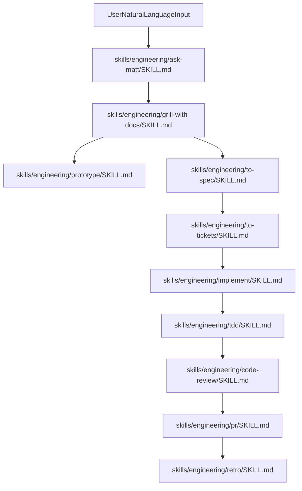
Sources:
- [skills/engineering/ask-matt/SKILL.md:13-33]()

1. **`/grill-with-docs`**: Initial stateful interview process retaining insights in `GLOSSARY.md` and ADRs under `docs/adr/` [skills/engineering/ask-matt/SKILL.md:16-17]().
2. **Prototyping Branch**: For exploratory code, bridge via `/handoff` to `/prototype`, then return via `/handoff` [skills/engineering/ask-matt/SKILL.md:18-21]().
3. **Multi-Session vs Single-Session Build**: 
   - Multi-session builds route through `/to-spec` and `/to-tickets`, followed by `/implement` per tracer-bullet ticket or `/implement-spec` for task graphs [skills/engineering/ask-matt/SKILL.md:22-25]().
   - Single-session builds invoke `/implement` directly [skills/engineering/ask-matt/SKILL.md:26]().
4. **Execution and Closure**: Execution drives `/tdd` and concludes with `/code-review`, `/pr`, and `/retro` [skills/engineering/ask-matt/SKILL.md:28-32]().

Sources:
- [skills/engineering/ask-matt/SKILL.md:13-33]()

## On-Ramps

Starting situations that generate operational work before merging into the main flow include:
- **`/triage`**: Manages incoming external bugs and feature requests, converting them into agent-ready issues [skills/engineering/ask-matt/SKILL.md:44-46]().
- **`/diagnosing-bugs`**: Establishes tight feedback loops for complex failures, closing with regression tests and handing off to `/improve-codebase-architecture` if architectural seams are missing [skills/engineering/ask-matt/SKILL.md:48]().
- **`/wayfinder`**: Charts large, foggy greenfield efforts using decision tickets on issue trackers, handing off to `/to-spec` when resolved [skills/engineering/ask-matt/SKILL.md:50-52]().

Sources:
- [skills/engineering/ask-matt/SKILL.md:40-52]()

## Codebase Health and Standalone Categories

Upkeep routines operate independently of feature pipelines:
- **`/improve-codebase-architecture`**: Scans the repository for deepening opportunities, outputting candidates that re-enter the main flow via `/grill-with-docs` [skills/engineering/ask-matt/SKILL.md:58]().
- **Domain Modeling & Codebase Design**: Foundational vocabulary references (`/domain-modeling`, `/codebase-design`) utilized by engineering skills [skills/engineering/ask-matt/SKILL.md:60-64]().

Sources:
- [skills/engineering/ask-matt/SKILL.md:54-64]()

## Phase Boundaries and `PHASE-BOUNDARIES.md`

Phase boundaries govern context management between distinct chunks of work [skills/engineering/ask-matt/PHASE-BOUNDARIES.md:3-5](). 

**Diagram: Natural Language to Code Entity Mapping for Phase Boundaries**
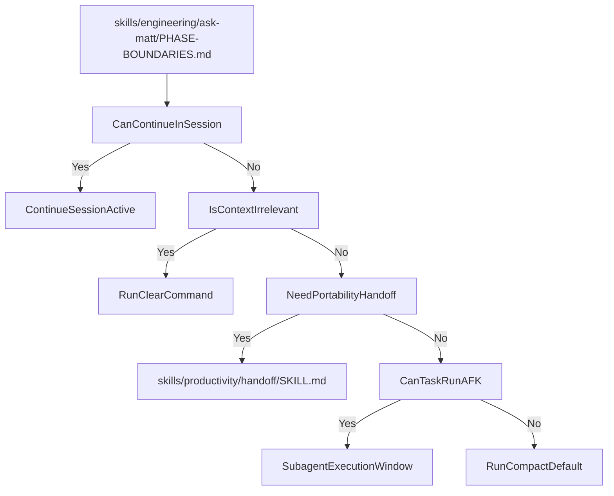
Sources:
- [skills/engineering/ask-matt/PHASE-BOUNDARIES.md:1-39]()

The five context management options are evaluated top-to-bottom:
1. **Continue**: Retains the session as a primary source if smart-zone limits (~150k tokens) allow [skills/engineering/ask-matt/PHASE-BOUNDARIES.md:21-22]().
2. **`/clear`**: Empties context entirely if prior data is completely disposable [skills/engineering/ask-matt/PHASE-BOUNDARIES.md:23-25]().
3. **`/handoff`**: Exports portable Markdown state when changing harnesses, repositories, or transferring ownership [skills/engineering/ask-matt/PHASE-BOUNDARIES.md:27-34]().
4. **Subagent**: Delegates isolated tasks to background workers [skills/engineering/ask-matt/PHASE-BOUNDARIES.md:36]().
5. **`/compact`**: Compresses existing context as the default fallback option [skills/engineering/ask-matt/PHASE-BOUNDARIES.md:38-40]().

Sources:
- [skills/engineering/ask-matt/PHASE-BOUNDARIES.md:1-41]()

## Smart-Zone Context Management

The smart-zone denotes the safe processing threshold (approximately 150k tokens) where state-of-the-art models maintain rigorous analytical reasoning [skills/engineering/ask-matt/SKILL.md:38](). Approaching this threshold before completing foundational specification steps requires executing `/compact` at the nearest phase boundary to prevent semantic degradation [skills/engineering/ask-matt/SKILL.md:38-39]().

Sources:
- [skills/engineering/ask-matt/SKILL.md:34-39]()

---

# Page: Planning and Specification Skills

# Planning and Specification Skills

<details>
<summary>Relevant source files</summary>

The following files were used as context for generating this wiki page:

- [.changeset/grilling-yes-accepts-recommendation.md](.changeset/grilling-yes-accepts-recommendation.md)
- [docs/productivity/grilling.md](docs/productivity/grilling.md)
- [skills/engineering/ask-matt/SKILL.md](skills/engineering/ask-matt/SKILL.md)
- [skills/productivity/grilling/SKILL.md](skills/productivity/grilling/SKILL.md)

</details>


## Purpose and Scope

This section provides an overview of the skills that transform a loose idea into agreed, written work. These skills cover the entire spectrum from initial concept clarification to detailed task breakdown, ensuring that development efforts are well-defined and aligned with project goals.

The key skills in this category include:
- The `grilling` primitive and its wrappers (`grill-with-docs`, `grill-me`).
- `wayfinder` for mapping large, complex efforts.
- `prototype` for answering questions that talking cannot settle.
- `research` for gathering information from primary sources.
- The `to-spec` and `to-tickets` pipeline for formalizing specifications and breaking them into actionable tasks.

This page offers a high-level introduction to each skill and their interrelationships. For detailed information on each topic, refer to the linked child pages.

Sources: [skills/engineering/ask-matt/SKILL.md:17-26](), [docs/productivity/grilling.md:13-18]()

---

## Planning Pipeline and Code Entity Mapping

Diagram: "Planning Pipeline Natural Language to Code Entities"
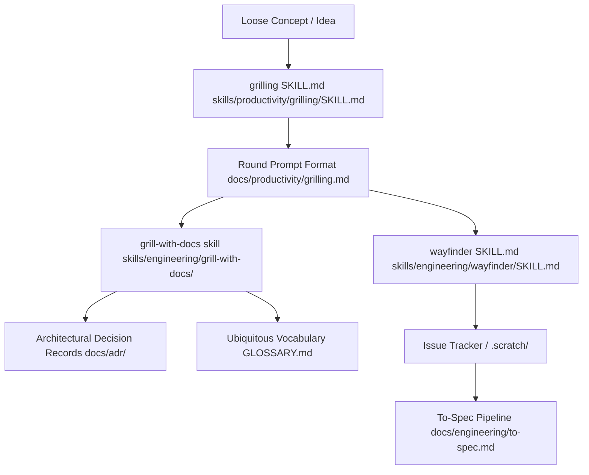
Sources: [skills/productivity/grilling/SKILL.md:1-28](), [docs/productivity/grilling.md:1-66](), [skills/engineering/ask-matt/SKILL.md:17-26]()

---

## The Grilling Primitive

The `grilling` skill is a model-invoked interview loop designed to stress-test a plan, decision, or idea [docs/productivity/grilling.md:1-5](). It maps the subject as a **design tree**, where every decision branches into dependent decisions [docs/productivity/grilling.md:3-4](). The skill operates in **rounds**, presenting the **frontier** of questions whose prerequisites are already settled [docs/productivity/grilling.md:5](). This ensures that only relevant questions are asked at any given time [docs/productivity/grilling.md:5]().

The `grilling` primitive distinguishes between **facts**, which the agent is responsible for finding via sub-agents, and **decisions**, which are presented to the user [docs/productivity/grilling.md:29](). Each question is formatted with symbols (`❓`, `➡️`) so that "yes" accepts the recommended answer [.changeset/grilling-yes-accepts-recommendation.md:5](). The session concludes when the design tree is fully explored and a shared understanding is confirmed [docs/productivity/grilling.md:28-29]().

For details on the design tree, frontier, rounds, question formatting, and the confirmation gate, see [The Grilling Primitive](#3.1).

Sources: [docs/productivity/grilling.md:1-5](), [skills/productivity/grilling/SKILL.md:6-8](), [docs/productivity/grilling.md:21-29](), [.changeset/grilling-yes-accepts-recommendation.md:5]()

---

## Grill-With-Docs and Grill-Me

While `grilling` is the core interview primitive, it is often wrapped by other skills that provide additional context or produce specific artifacts [docs/productivity/grilling.md:13-19]().

- **`grill-with-docs`**: This is the stateful wrapper used when working within a repository [docs/productivity/grilling.md:16](). It leverages the `grilling` primitive to sharpen an idea and writes the agreed-upon vocabulary to `GLOSSARY.md` and architectural decision records (ADRs) to `docs/adr/` [docs/productivity/grilling.md:16](). It also manages `GLOSSARY-MAP.md` for multi-context repositories and enforces three ADR gates.
- **`grill-me`**: This is the stateless counterpart, used when there is no working directory or persistent documentation is not required [docs/productivity/grilling.md:15](). It provides the same interview experience as `grilling` but without the documentation side effects [docs/productivity/grilling.md:15]().

The choice between `grill-with-docs` and `grill-me` depends on whether a persistent record of the discussion and decisions is needed [docs/productivity/grilling.md:13-16]().

For details on when to use each skill, their statefulness, and their downstream handoffs, see [Grill-With-Docs and Grill-Me](#3.2).

Sources: [skills/engineering/ask-matt/SKILL.md:17-17](), [docs/productivity/grilling.md:13-16]()

---

## Wayfinder: Mapping Large Efforts

The `wayfinder` skill is designed for tackling large, complex efforts like greenfield projects or significant feature builds that are too big to hold in a single session [skills/engineering/ask-matt/SKILL.md:52](). It creates a stateful map of **decision tickets** on the issue tracker, systematically resolving them one at a time [skills/engineering/ask-matt/SKILL.md:52]().

`wayfinder` uses metaphors like "fog-of-war" and "frontier" to describe the process of clarifying unknowns [skills/engineering/ask-matt/SKILL.md:52](). It defines various ticket types (`research`, `prototype`, `grilling`, `task`) and includes mechanisms for claiming/assigning tickets, bootstrapping or resuming maps, and an early exit when the route is clear [skills/engineering/ask-matt/SKILL.md:52](). Once the map is clear, `wayfinder` hands off to `to-spec` to consolidate the decisions into a buildable plan [skills/engineering/ask-matt/SKILL.md:54]().

For details on the map artifact structure, ticket types, metaphors, locking mechanisms, and handoff to `to-spec`, see [Wayfinder: Mapping Large Efforts](#3.3).

Sources: [skills/engineering/ask-matt/SKILL.md:52-54]()

---

## Ticket and Specification Mapping to Code Space

Diagram: "Ticket and Specification Mapping Entities"
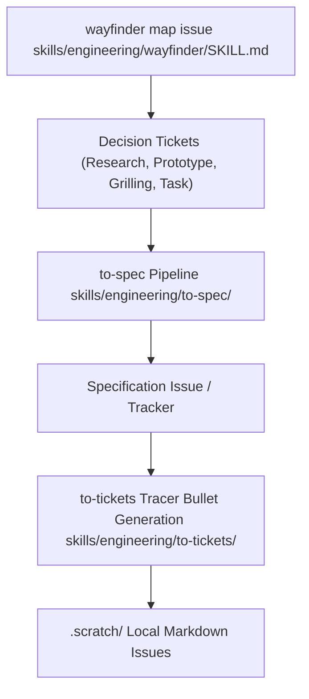
Sources: [skills/engineering/ask-matt/SKILL.md:25-27]()

---

## To-Spec and To-Tickets

This pipeline formalizes the outcomes of planning discussions into actionable development tasks [skills/engineering/ask-matt/SKILL.md:25-27]().

- **`to-spec`**: This skill synthesizes a settled conversation (often from a `grilling` session or `wayfinder` map) into a formal specification issue [skills/engineering/ask-matt/SKILL.md:25](). The key here is synthesis without inventing new decisions, focusing on identifying seams for testing and implementation [skills/engineering/ask-matt/SKILL.md:25](). The output is an issue tracker entry [skills/engineering/ask-matt/SKILL.md:25]().
- **`to-tickets`**: Following `to-spec`, this skill takes the specification and breaks it down into smaller, tracer-bullet tickets [skills/engineering/ask-matt/SKILL.md:25](). Each ticket represents a thin vertical slice of functionality and declares its blocking edges [skills/engineering/ask-matt/SKILL.md:25](). These tickets can be managed locally under `.scratch/` or integrated with real issue trackers [skills/engineering/ask-matt/SKILL.md:26]().

This pipeline ensures that development work is based on clear, agreed-upon specifications and broken down into manageable, interdependent tasks.

For details on the synthesis process, issue tracker output, tracer-bullet methodology, and local `.scratch/` layout, see [To-Spec and To-Tickets](#3.4).

Sources: [skills/engineering/ask-matt/SKILL.md:25-27]()

---

## Prototyping

The `prototype` skill is a crucial detour when a question cannot be settled through conversation alone, especially when it involves how something should look or feel [docs/productivity/grilling.md:18](). It allows for the creation of throwaway code to answer specific questions [skills/engineering/ask-matt/SKILL.md:20-23]().

The skill supports two main branches:
- **LOGIC prototypes**: Single, shareable HTML files that include guided walkthroughs and free-play buttons, focusing on business logic or complex interactions [skills/engineering/ask-matt/SKILL.md:20-23]().
- **UI prototypes**: Structurally different variants presented behind a `PrototypeSwitcher` bar, allowing for easy comparison of different user interface approaches [skills/engineering/ask-matt/SKILL.md:20-23]().

The philosophy is "throwaway-first," meaning the prototype's primary purpose is to answer a question, not to become production code [skills/engineering/ask-matt/SKILL.md:20-23](). The prototype branch is captured as a primary source, and its findings integrate back into `wayfinder`, `grilling`, or `to-spec` processes [skills/engineering/ask-matt/SKILL.md:20-23]().

For details on the two branches, throwaway philosophy, and integration with other planning skills, see [Prototyping](#3.5).

Sources: [docs/productivity/grilling.md:18-18](), [skills/engineering/ask-matt/SKILL.md:20-23]()

---

## Research

The `research` skill facilitates answering questions by delegating to background agents to find information from primary sources [skills/engineering/ask-matt/SKILL.md:52](). This is particularly useful for gathering external data, understanding existing systems, or exploring technical options [skills/engineering/ask-matt/SKILL.md:52]().

The output of the `research` skill is typically cited Markdown, ensuring transparency and verifiability of the information [skills/engineering/ask-matt/SKILL.md:52](). It distinguishes between information with a short shelf-life and more enduring decisions that might warrant an ADR [skills/engineering/ask-matt/SKILL.md:52](). `wayfinder` research tickets often consume the output of this skill to inform decision-making [skills/engineering/ask-matt/SKILL.md:52]().

For details on the background-agent delegation model, output format, shelf-life considerations, and integration with `wayfinder`, see [Research](#3.6).

Sources: [skills/engineering/ask-matt/SKILL.md:52-54]()

---

# Page: The Grilling Primitive

# The Grilling Primitive

<details>
<summary>Relevant source files</summary>

The following files were used as context for generating this wiki page:

- [.changeset/grilling-yes-accepts-recommendation.md](.changeset/grilling-yes-accepts-recommendation.md)
- [.out-of-scope/question-limits.md](.out-of-scope/question-limits.md)
- [docs/productivity/grilling.md](docs/productivity/grilling.md)
- [skills/in-progress/loop-me/SKILL.md](skills/in-progress/loop-me/SKILL.md)
- [skills/productivity/grilling/SKILL.md](skills/productivity/grilling/SKILL.md)
- [skills/productivity/grilling/agents/openai.yaml](skills/productivity/grilling/agents/openai.yaml)

</details>


The `grilling` skill is a model-invoked interview loop designed to stress-test plans, decisions, or ideas before implementation [docs/productivity/grilling.md:1-3](). It systematically explores a subject by mapping it as a design tree, ensuring all assumptions are surfaced and addressed [docs/productivity/grilling.md:3](). This page details its core mechanics, including the design tree, frontier, rounds, the distinction between facts and decisions, sub-agent fact-finding, question formatting, and the confirmation gate, along with the wrapper skills that consume it.

Sources:
- [docs/productivity/grilling.md:1-6]()
- [skills/productivity/grilling/SKILL.md:1-4]()

## Core Concepts: Design Tree, Frontier, and Rounds

The `grilling` skill operates on three fundamental concepts defined within its execution schema: the design tree, the frontier, and rounds [docs/productivity/grilling.md:23-25]().

### Design Tree

The **design tree** is a conceptual model of the subject under discussion. It represents decisions with other decisions hanging off them, illustrating dependencies and relationships [docs/productivity/grilling.md:3](). This tree structure ensures a comprehensive exploration of all facets of a plan or idea.

Sources:
- [docs/productivity/grilling.md:3]()
- [skills/productivity/grilling/SKILL.md:6]()

### Frontier

The **frontier** is the set of decisions whose prerequisites are all settled [docs/productivity/grilling.md:5](). These are the only questions that can be honestly asked at a given moment, as they do not depend on answers to other, as-yet-unasked questions [docs/productivity/grilling.md:5](). As decisions are settled, the frontier moves outward, unblocking new questions [docs/productivity/grilling.md:5]().

Sources:
- [docs/productivity/grilling.md:5]()
- [skills/productivity/grilling/SKILL.md:7-8]()

### Rounds

A **round** consists of asking the entire current frontier of questions [docs/productivity/grilling.md:5](). All questions within a round are independent of each other; if one question depends on another, they belong to different rounds [docs/productivity/grilling.md:5](). The skill waits for the user's answers to a round before recomputing the frontier and proceeding to the next round [skills/productivity/grilling/SKILL.md:8]().

Sources:
- [docs/productivity/grilling.md:5]()
- [skills/productivity/grilling/SKILL.md:7-8]()

### Natural Language Space to Code Entity Space: Grilling Architecture

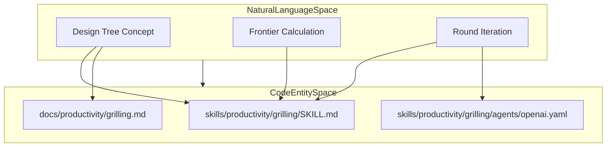
**Grilling Architecture Mapping**

Sources:
- [docs/productivity/grilling.md:1-30]()
- [skills/productivity/grilling/SKILL.md:1-28]()
- [skills/productivity/grilling/agents/openai.yaml:1-3]()

## Facts vs. Decisions and Sub-Agent Fact-Finding

A critical distinction in `grilling` is between facts and decisions [docs/productivity/grilling.md:29]().

### Facts

**Facts** are information that the skill itself is responsible for finding [docs/productivity/grilling.md:28](). When a frontier question requires environmental data (e.g., from the filesystem or tools), the skill dispatches a sub-agent to retrieve it [docs/productivity/grilling.md:28](). This fact-finding process does not block the entire session; only questions downstream of the ongoing exploration wait for the sub-agent's report [docs/productivity/grilling.md:28]().

Sources:
- [docs/productivity/grilling.md:28]()
- [skills/productivity/grilling/SKILL.md:26]()

### Decisions

**Decisions** are the user's responsibility [docs/productivity/grilling.md:28](). The skill presents these to the user and must wait for their input [docs/productivity/grilling.md:28](). An agent that answers its own decisions is considered to have broken the skill's intended behavior [docs/productivity/grilling.md:29]().

Sources:
- [docs/productivity/grilling.md:28-29]()
- [skills/productivity/grilling/SKILL.md:26-27]()

### Sub-Agent Fact-Finding Execution Flow

```mermaid
graph TD
    Start["grilling_execution"] --> CheckType{"Needs Fact or Decision?"}
    CheckType -- "Fact" --> Dispatch["DispatchSubAgent"]
    Dispatch --> Explore["ExploreEnvironment"]
    Explore --> Report["ReportFact"]
    Report --> Integrate["IntegrateIntoTree"]
    CheckType -- "Decision" --> Present["PresentToUser"]
    Present --> Wait["WaitForUserDecision"]
    Wait --> Integrate
    Integrate --> Update["UpdateFrontier"]
```
**Fact-Finding and Decision-Making Flow**

Sources:
- [docs/productivity/grilling.md:28-29]()
- [skills/productivity/grilling/SKILL.md:26-27]()

## Question Formatting and Recommendations

Questions within a round adhere to a strict structural format to ensure clarity and ease of response [docs/productivity/grilling.md:27]().

Each question is:
* Numbered and titled, preceded by a `❓` symbol [docs/productivity/grilling.md:27]().
* Followed by a body that may span multiple paragraphs and include multiple choices [skills/productivity/grilling/SKILL.md:13-14]().
* Concluded with the agent's recommended answer on a `➡️` line [docs/productivity/grilling.md:27]().
* Worded such that answering "yes" accepts the recommended answer [.changeset/grilling-yes-accepts-recommendation.md:5]().

Consecutive questions within a round are separated by a horizontal rule (`---`) [skills/productivity/grilling/SKILL.md:17](). This formatting allows users to answer by number rather than quoting the questions back [docs/productivity/grilling.md:27]().

Sources:
- [docs/productivity/grilling.md:26-27]()
- [skills/productivity/grilling/SKILL.md:10-22]()
- [.changeset/grilling-yes-accepts-recommendation.md:1-5]()

## Confirmation Gate

The `grilling` session is not considered finished simply when the frontier is empty [docs/productivity/grilling.md:61](). Instead, it concludes only when the user explicitly confirms that a shared understanding has been reached [docs/productivity/grilling.md:30](). This confirmation gate prevents the skill from acting on agreements prematurely and ensures alignment between the user and the agent [docs/productivity/grilling.md:61]().

Sources:
- [docs/productivity/grilling.md:30]()
- [docs/productivity/grilling.md:61]()
- [skills/productivity/grilling/SKILL.md:30]()

## Wrapping Skills and Ecosystem Integration

`grilling` is a model-invoked skill, meaning it is typically called by other wrapper skills rather than invoked directly by the user via a slash command [docs/productivity/grilling.md:9]().

### Natural Language Space to Code Entity Space: Grilling Wrappers Architecture

```mermaid
graph TD
    NaturalLanguageSpace["Natural Language Space"] --> CodeEntitySpace["Code Entity Space"]

    subgraph NaturalLanguageSpace
        W1["Grill Without Working Directory"]
        W2["Grill With Documentation & ADRs"]
        W3["Wayfinder Large-Scale Mapping"]
        W4["Workflow Loop Specification"]
    end

    subgraph CodeEntitySpace
        C1["skills/productivity/grill-me/SKILL.md"]
        C2["skills/productivity/grill-with-docs/SKILL.md"]
        C3["skills/productivity/wayfinder/SKILL.md"]
        C4["skills/in-progress/loop-me/SKILL.md"]
    end

    W1 --> C1
    W2 --> C2
    W3 --> C3
    W4 --> C4
```
**Grilling Wrapper Architecture Mapping**

Sources:
- [docs/productivity/grilling.md:13-19]()
- [skills/in-progress/loop-me/SKILL.md:3-8]()

---

# Page: Grill-With-Docs and Grill-Me

# Grill-With-Docs and Grill-Me

<details>
<summary>Relevant source files</summary>

The following files were used as context for generating this wiki page:

- [.agents/invocation.md](.agents/invocation.md)
- [docs/engineering/grill-with-docs.md](docs/engineering/grill-with-docs.md)
- [docs/productivity/grill-me.md](docs/productivity/grill-me.md)
- [skills/engineering/grill-with-docs/SKILL.md](skills/engineering/grill-with-docs/SKILL.md)
- [skills/productivity/grill-me/agents/openai.yaml](skills/productivity/grill-me/agents/openai.yaml)

</details>


This page covers two core grilling skills: the stateful `grill-with-docs` skill and the stateless `grill-me` skill [docs/engineering/grill-with-docs.md:3-5](), [docs/productivity/grill-me.md:3-5](). Both skills leverage the underlying `grilling` primitive to conduct a structured, round-based interview, but they differ significantly in their statefulness, repository integration, output artifacts, and intended use cases [docs/engineering/grill-with-docs.md:3-5](), [docs/productivity/grill-me.md:71-74]().

Sources: [docs/engineering/grill-with-docs.md:3-5](), [docs/productivity/grill-me.md:3-5]()

## Stateful Grill-With-Docs

The `grill-with-docs` skill is a specialized engineering workflow designed to stress-test implementation plans against a project's existing domain model and architectural history [docs/engineering/grill-with-docs.md:1-3](). It facilitates a relentless interview process where the agent challenges the user's plan to ensure alignment with documented decisions in `GLOSSARY.md` and Architectural Decision Records (ADRs) [docs/engineering/grill-with-docs.md:3-5]().

### Purpose and Scope

The primary goal of `grill-with-docs` is to prevent domain drift and architectural erosion. It is a **stateful** skill [docs/engineering/grill-with-docs.md:5](); while other grilling skills leave the session in the user's head, this one persists resolved terms and decisions directly to disk [docs/engineering/grill-with-docs.md:5]().

The skill's `SKILL.md` acts as a thin delegation wrapper that invokes the Skill tool for both `grilling` and `domain-modeling` [skills/engineering/grill-with-docs/SKILL.md:1-7]():
1. **`grilling`**: Supplies the interview structure, frontier computation, and round-based questioning [docs/engineering/grill-with-docs.md:27]().
2. **`domain-modeling`**: Supplies the writing logic, vocabulary enforcement, and ADR generation rules [docs/engineering/grill-with-docs.md:27]().

Sources: [skills/engineering/grill-with-docs/SKILL.md:1-7](), [docs/engineering/grill-with-docs.md:1-27]()

### When to Reach for It

`grill-with-docs` is explicitly invoked by the user via `/grill-with-docs`, as it has `disable-model-invocation: true` set in its frontmatter [docs/engineering/grill-with-docs.md:9](), [skills/engineering/grill-with-docs/SKILL.md:4](). It is recommended for:
* The start of a change in a repository when the plan is still fuzzy and terminology is not settled [docs/engineering/grill-with-docs.md:11]().
* Single-session planning for a change that can be settled within one session [docs/engineering/grill-with-docs.md:16]().
* Aiming at an entire repository with no domain docs to establish initial project vocabulary [docs/engineering/grill-with-docs.md:18]().

It is distinct from `grill-me` (which requires no working directory) and `wayfinder` (which handles multi-session planning for large efforts) [docs/engineering/grill-with-docs.md:13-21]().

Sources: [skills/engineering/grill-with-docs/SKILL.md:1-5](), [docs/engineering/grill-with-docs.md:9-21]()

### Documentation Formats and the Three ADR Gates

The skill maintains a paper trail consisting of glossary terms and architectural decisions [docs/engineering/grill-with-docs.md:29-37]():
* **`GLOSSARY.md` Vocabulary**: Terms are recorded inline the moment they resolve during the interview [docs/engineering/grill-with-docs.md:5,35](). The glossary holds the project's own words, ensuring shared understanding across humans and agents [docs/engineering/grill-with-docs.md:41]().
* **ADRs under `docs/adr/`**: Decisions that meet strict criteria are written to `docs/adr/` [docs/engineering/grill-with-docs.md:36](). A decision must pass **all three ADR gates** to qualify:
  1. **Hard to reverse**: Significant cost to change later [docs/engineering/grill-with-docs.md:36]().
  2. **Surprising without context**: The choice is not the obvious default [docs/engineering/grill-with-docs.md:36]().
  3. **Real trade-off**: A deliberate choice was made between valid alternatives [docs/engineering/grill-with-docs.md:36]().

Sources: [docs/engineering/grill-with-docs.md:5-36]()

### Multi-Context Repositories and GLOSSARY-MAP.md

In larger multi-context repositories, a root `GLOSSARY-MAP.md` file maps specific repository paths to their corresponding bounded contexts [docs/engineering/grill-with-docs.md:25](). When resolved terms are written, `grill-with-docs` consults this map to route terms to the correct regional `GLOSSARY.md` rather than a single monolithic root glossary [docs/engineering/grill-with-docs.md:25]().

Sources: [docs/engineering/grill-with-docs.md:25]()

### Natural Language to Code Entity Mapping: Grill-With-Docs Execution

```mermaid
graph TD
    UserInput["UserSlashCommand:/grill-with-docs"] --> SkillFile["skills/engineering/grill-with-docs/SKILL.md"]
    
    subgraph "CodeEntitySpace"
        SkillFile --> GrillingPrimitive["skills/productivity/grilling/SKILL.md"]
        SkillFile --> DomainModeling["skills/engineering/domain-modeling/SKILL.md"]
    end

    subgraph "FilesystemArtifacts"
        DomainModeling --> RootGlossary["GLOSSARY.md"]
        DomainModeling --> MapCheck{"GLOSSARY-MAP.md exists?"}
        MapCheck -- "Yes" --> SubGlossary["path/to/context/GLOSSARY.md"]
        DomainModeling --> ADRCheck{"Passes 3 Gates?"}
        ADRCheck -- "Yes" --> ADRFile["docs/adr/NNNN-slug.md"]
    end
```
Sources: [skills/engineering/grill-with-docs/SKILL.md:1-7](), [docs/engineering/grill-with-docs.md:25-36]()

---

## Stateless Grill-Me

The `grill-me` skill is a **stateless** grilling skill designed to sharpen a loose idea into a committed plan through a structured interview [docs/productivity/grill-me.md:3-5](). It writes no files and leaves no workspace behind, existing solely to refine the idea in the user's head [docs/productivity/grill-me.md:5]().

### Purpose and Scope

`grill-me` requires no repository, workspace, or setup, and the subject does not have to be code [docs/productivity/grill-me.md:72](). People use it for business decisions, writing outlines, and determining what to do next [docs/productivity/grill-me.md:72](). 

It is invoked explicitly by typing `/grill-me`, carrying `disable-model-invocation: true` in its frontmatter [docs/productivity/grill-me.md:9](), [skills/productivity/grill-me/agents/openai.yaml:4-5](). It should be started in a fresh conversation rather than on top of an existing agent-written plan [docs/productivity/grill-me.md:9]().

Sources: [docs/productivity/grill-me.md:3-72](), [skills/productivity/grill-me/agents/openai.yaml:1-5]()

### The Interview Mechanics and Grillable Boundaries

`grill-me` operates in **rounds** [docs/productivity/grill-me.md:3](). Each round presents the entire **frontier**—every question whose prerequisites have already been settled—ensuring the agent never asks something dependent on an unanswered question [docs/productivity/grill-me.md:3]().

When hitting **ungrillable** questions (such as subjective UI feel or open-ended design forms requiring visual feedback), grilling stops; the user builds a throwaway version using the `prototype` skill and returns to answer in one line [docs/productivity/grill-me.md:33-35]().

Sources: [docs/productivity/grill-me.md:3-35]()

### Natural Language to Code Entity Mapping: Grill-Me Execution

```mermaid
graph TD
    UserInput["UserSlashCommand:/grill-me"] --> SkillFile["skills/productivity/grill-me/SKILL.md"]
    
    subgraph "CodeEntitySpace"
        SkillFile --> GrillingPrimitive["skills/productivity/grilling/SKILL.md"]
    end

    subgraph "StatelessExecution"
        GrillingPrimitive --> FrontierLoop["Compute Frontier & Rounds"]
        FrontierLoop --> ActiveConversation["Interactive Chat Session"]
    end

    ActiveConversation -- "No Disk Writes" --> UserMind["Sharper Idea in User Head"]
```
Sources: [docs/productivity/grill-me.md:3-5](), [skills/productivity/grill-me/agents/openai.yaml:1-5]()

---

## When to Use Each and Downstream Handoffs

Choosing between `grill-me`, `grill-with-docs`, and `wayfinder` depends entirely on context and session scope [docs/engineering/grill-with-docs.md:13-21](), [docs/productivity/grill-me.md:13-18]().

| Feature | `grill-me` | `grill-with-docs` |
| :--- | :--- | :--- |
| **Statefulness** | Stateless (writes no files) [docs/productivity/grill-me.md:5]() | Stateful (writes `GLOSSARY.md` and ADRs) [docs/engineering/grill-with-docs.md:5]() |
| **Environment** | Any environment or non-code topic [docs/productivity/grill-me.md:72]() | Inside an active code repository [docs/engineering/grill-with-docs.md:16]() |
| **Primary Output** | Clarified idea in the user's mind [docs/productivity/grill-me.md:5]() | Persistent domain vocabulary and ADRs [docs/engineering/grill-with-docs.md:35-36]() |
| **Invocation** | `/grill-me` (user-invoked) [docs/productivity/grill-me.md:9]() | `/grill-with-docs` (user-invoked) [docs/engineering/grill-with-docs.md:9]() |

### Downstream Handoffs

Neither grilling skill produces a complete software specification [docs/engineering/grill-with-docs.md:39](). Most decisions agreed upon during a grilling session exist solely within the active context window [docs/engineering/grill-with-docs.md:39](). 
* To transition a grilled session into actionable engineering work, hand the conversation directly to the `to-spec` skill rather than clearing the context [docs/engineering/grill-with-docs.md:39](), [docs/productivity/grill-me.md:65]().
* When the effort exceeds a single session, hand off to `wayfinder` instead [docs/engineering/grill-with-docs.md:21]().
* When uncertain which flow applies, use the `ask-matt` router skill for guidance [docs/productivity/grill-me.md:76]().

Sources: [docs/engineering/grill-with-docs.md:13-55](), [docs/productivity/grill-me.md:13-76]()

---

# Page: Wayfinder: Mapping Large Efforts

# Wayfinder: Mapping Large Efforts

<details>
<summary>Relevant source files</summary>

The following files were used as context for generating this wiki page:

- [.changeset/wayfinder-labels-refs-research-prs.md](.changeset/wayfinder-labels-refs-research-prs.md)
- [docs/engineering/research.md](docs/engineering/research.md)
- [docs/engineering/wayfinder.md](docs/engineering/wayfinder.md)
- [skills/engineering/triage/SKILL.md](skills/engineering/triage/SKILL.md)
- [skills/engineering/wayfinder/SKILL.md](skills/engineering/wayfinder/SKILL.md)

</details>


The purpose of this page is to detail the **Wayfinder** skill (`skills/engineering/wayfinder/SKILL.md`), a stateful planning primitive designed to chart massive efforts across multiple agent sessions using a shared decision map on an issue tracker [skills/engineering/wayfinder/SKILL.md:1-8](). Scope includes the map artifact schema, ticket types, fog-of-war and frontier dynamics, claim/assign locking mechanisms, bootstrap versus resume flows, early exit criteria, and the downstream handoff to `/to-spec`.

Sources: [skills/engineering/wayfinder/SKILL.md:1-8]()

## The Map Artifact

The **Map** is the canonical artifact of a wayfinder effort, physically represented as a single issue on the project's tracker labeled `wayfinder:map` [skills/engineering/wayfinder/SKILL.md:20-21](). It acts as an **index, not a store**; individual decisions live entirely within their respective child tickets, while the map indexes them with brief gists and links [skills/engineering/wayfinder/SKILL.md:22-23]().

### Map Structure
The map body conforms to a strict template layout defined in `skills/engineering/wayfinder/SKILL.md`:

| Section | Purpose |
| :--- | :--- |
| **Destination** | One or two lines defining what reaching the end of the map looks like (spec, decision, or migration) [skills/engineering/wayfinder/SKILL.md:32-34](). |
| **Notes** | Domain context, standing preferences, and mandatory skills for every session [skills/engineering/wayfinder/SKILL.md:36-39](). |
| **Decisions so far** | An index listing closed tickets with a one-line answer gist and reference link [skills/engineering/wayfinder/SKILL.md:40-45](). |
| **Not yet specified** | The **Fog of War**: in-scope unknowns that cannot yet be phrased as tickets [skills/engineering/wayfinder/SKILL.md:46-48](). |
| **Out of scope** | Work ruled beyond the destination; closed items that never graduate [skills/engineering/wayfinder/SKILL.md:50-53](). |

Sources: [skills/engineering/wayfinder/SKILL.md:20-53](), [docs/engineering/wayfinder.md:30-38]()

## Ticket Types and HITL/AFK Classification

Every ticket is a child issue carrying a `wayfinder:<type>` label [skills/engineering/wayfinder/SKILL.md:57-65](). Tickets resolve decisions rather than execute build tasks [skills/engineering/wayfinder/SKILL.md:11-13](). They are categorized by interaction model into **HITL** (Human-In-The-Loop) or **AFK** (Away-From-Keyboard) execution [skills/engineering/wayfinder/SKILL.md:75]().

| Type | Mode | Description | Resolution Mechanism |
| :--- | :--- | :--- | :--- |
| **Research** | AFK | Reading external documentation or APIs to surface facts [skills/engineering/wayfinder/SKILL.md:77](). | `/research` subagent invocation [skills/engineering/wayfinder/SKILL.md:77](). |
| **Prototype** | HITL | Raising discussion fidelity via rough artifacts or stubs [skills/engineering/wayfinder/SKILL.md:78](). | `/prototype` skill [skills/engineering/wayfinder/SKILL.md:78](). |
| **Grilling** | HITL | Conversational decision-making (default case) [skills/engineering/wayfinder/SKILL.md:79](). | `/grilling` plus `/domain-modeling` [skills/engineering/wayfinder/SKILL.md:79](). |
| **Task** | Either | Manual prerequisite work that unblocks a decision [skills/engineering/wayfinder/SKILL.md:80](). | Agent (AFK) or human checklist (HITL) [skills/engineering/wayfinder/SKILL.md:80](). |

Sources: [skills/engineering/wayfinder/SKILL.md:73-81](), [docs/engineering/wayfinder.md:42-53]()

## Technical Implementation and Data Flow

Wayfinder bridges Natural Language intent to Code Entity structures and issue tracker primitives.

Title: "Wayfinder System Architecture"
```mermaid
graph TD
    subgraph NaturalLanguageSpace["Natural Language Space"]
        UserIntent["User Idea: 'Migrate DB to Postgres'"]
        DestinationDef["Destination: Unified Schema Spec"]
    end

    subgraph CodeEntitySpace["Code Entity Space"]
        WF_SKILL["skills/engineering/wayfinder/SKILL.md"]
        WF_CONFIG["skills/engineering/wayfinder/agents/openai.yaml"]
        TRACKER_DOC["docs/agents/issue-tracker.md"]
    end

    subgraph TrackerArtifacts["Tracker Artifacts"]
        MAP_ISSUE["Issue: wayfinder:map"]
        CHILD_TICKET["Issue: wayfinder:research | prototype | grilling | task"]
        DEP_LINK["Native Tracker Dependency Link"]
    end

    UserIntent --> WF_SKILL
    WF_SKILL -->|Reads Config| WF_CONFIG
    WF_SKILL -->|Resolves Tracker| TRACKER_DOC
    WF_SKILL -->|Initializes| MAP_ISSUE
    MAP_ISSUE -->|Spawns Children| CHILD_TICKET
    CHILD_TICKET -->|Enforces Frontier| DEP_LINK
```
Sources: [skills/engineering/wayfinder/SKILL.md:20-26](), [skills/engineering/wayfinder/SKILL.md:65](), [skills/engineering/wayfinder/agents/openai.yaml:1-5]()

## Operational Lifecycle

### Bootstrap vs Resume Modes and No-Fog Early Exit
Wayfinder operates in two primary execution modes:
*   **Bootstrap Mode:** Initial invocation where the agent engages the user to define the destination and scaffold the `wayfinder:map` issue [skills/engineering/wayfinder/SKILL.md:7-9](). If bootstrap analysis reveals **no fog of war** and the effort fits into a single session, it executes a **no-fog early exit**, recommending `/grill-with-docs` or direct implementation instead [docs/engineering/wayfinder/SKILL.md:11-16]().
*   **Resume Mode:** When resuming an existing effort, the session loads the map at low resolution, queries open unblocked child issues, and identifies the current frontier [skills/engineering/wayfinder/SKILL.md:29]().

Sources: [skills/engineering/wayfinder/SKILL.md:7-9](), [docs/engineering/wayfinder.md:11-16]()

### Claiming and Locking
To prevent race conditions across concurrent sessions, a session must **claim** a ticket before starting work [skills/engineering/wayfinder/SKILL.md:67-68](). Claiming is performed by setting the issue assignee to the active developer [skills/engineering/wayfinder/SKILL.md:67-68](). Unassigned open tickets remain unclaimed [skills/engineering/wayfinder/SKILL.md:67-68]().

Sources: [skills/engineering/wayfinder/SKILL.md:67-68]()

### The Frontier and Fog of War
*   **The Frontier:** The set of open, unblocked, and unclaimed child issues representing the immediate boundary of known work [skills/engineering/wayfinder/SKILL.md:69]().
*   **Fog of War:** In-scope unknowns listed under `## Not yet specified` [skills/engineering/wayfinder/SKILL.md:46-48](). Resolving frontier tickets clears the fog ahead, graduating specifiable items into new child tickets [skills/engineering/wayfinder/SKILL.md:84]().

Sources: [skills/engineering/wayfinder/SKILL.md:46-48](), [skills/engineering/wayfinder/SKILL.md:69](), [skills/engineering/wayfinder/SKILL.md:84]()

Title: "Wayfinder Execution Lifecycle"
```mermaid
sequenceDiagram
    participant U as "User"
    participant S as "skills/engineering/wayfinder/SKILL.md"
    participant T as "Issue Tracker"

    U->>S: "/wayfinder"
    alt "Bootstrap Mode"
        S->>U: "Define Destination & Notes"
        alt "No Fog / Single Session"
            S->>U: "Early Exit: Switch to grill-with-docs"
        else "Multi-Session Effort"
            S->>T: "Create wayfinder:map Issue"
        end
    else "Resume Mode"
        S->>T: "Query Open Unblocked Child Issues"
        S->>T: "Assign Ticket (Claim Lock)"
        S->>U: "Execute Ticket (HITL / AFK)"
        S->>T: "Close Ticket & Update Decisions So Far"
    end
```
Sources: [skills/engineering/wayfinder/SKILL.md:20-84](), [docs/engineering/wayfinder.md:11-38]()

## Handoff to To-Spec

Wayfinder strictly adheres to a planning-only mandate: tickets resolve decisions rather than implement features [skills/engineering/wayfinder/SKILL.md:11-14](). Once all decision tickets are cleared, Wayfinder concludes and hands off execution to downstream specification workflows, typically invoking `/to-spec` to consolidate the decisions into a formal specification issue [docs/engineering/wayfinder/SKILL.md:18]().

Sources: [skills/engineering/wayfinder/SKILL.md:11-14](), [docs/engineering/wayfinder.md:18]()

---

# Page: To-Spec and To-Tickets

# To-Spec and To-Tickets

<details>
<summary>Relevant source files</summary>

The following files were used as context for generating this wiki page:

- [.changeset/to-tickets-sub-issues.md](.changeset/to-tickets-sub-issues.md)
- [docs/engineering/to-spec.md](docs/engineering/to-spec.md)
- [docs/engineering/to-tickets.md](docs/engineering/to-tickets.md)
- [docs/productivity/writing-for-agents.md](docs/productivity/writing-for-agents.md)
- [skills/engineering/code-review/SKILL.md](skills/engineering/code-review/SKILL.md)
- [skills/engineering/to-spec/SKILL.md](skills/engineering/to-spec/SKILL.md)
- [skills/engineering/to-tickets/SKILL.md](skills/engineering/to-tickets/SKILL.md)
- [skills/in-progress/claude-handoff/SKILL.md](skills/in-progress/claude-handoff/SKILL.md)
- [skills/productivity/writing-for-agents/SKILL.md](skills/productivity/writing-for-agents/SKILL.md)

</details>


## Purpose and Scope

This document details the `to-spec` [skills/engineering/to-spec/SKILL.md:2-3]() and `to-tickets` [skills/engineering/to-tickets/SKILL.md:2-3]() skills, which form a critical pipeline for transforming a settled conversation or idea into actionable, structured work items. The `to-spec` skill synthesizes existing knowledge into a formal specification, while `to-tickets` breaks that specification down into vertically sliced, tracer-bullet tickets with defined blocking dependencies [skills/engineering/to-tickets/SKILL.md:3-3](), [docs/engineering/to-tickets.md:3-5](). This pipeline ensures that work is clearly defined, traceable, and ready for implementation, whether managed in local `.scratch/` files or integrated with real issue trackers [skills/engineering/to-tickets/SKILL.md:62-63](), [docs/engineering/to-tickets.md:23-24]().

Sources: [skills/engineering/to-spec/SKILL.md:2-3](), [skills/engineering/to-tickets/SKILL.md:2-3](), [skills/engineering/to-tickets/SKILL.md:62-63](), [docs/engineering/to-tickets.md:3-5](), [docs/engineering/to-tickets.md:23-24]()

## To-Spec: From Conversation to Specification

The `to-spec` skill takes the current conversation context and codebase understanding to produce a formal specification [skills/engineering/to-spec/SKILL.md:7-7](). Its defining constraint is that it *does not interview the user*; instead, it synthesizes what is already known [skills/engineering/to-spec/SKILL.md:7-7](), [docs/engineering/to-spec.md:5-5](). The spec serves as a record of decisions already made, not a forum for new ones [docs/engineering/to-spec.md:5-6]().

### When to Reach for It

`to-spec` is a user-invoked skill (`disable-model-invocation: true`), meaning the agent will not call it automatically [skills/engineering/to-spec/SKILL.md:4-4](), [docs/engineering/to-spec.md:9-9](). It is used when a build is too large for a single agent session and needs to be split across several [docs/engineering/to-spec.md:11-12]().

| Where you are | What to run |
| :--- | :--- |
| You haven't decided anything yet | `grill-with-docs` first [docs/engineering/to-spec.md:15-15]() |
| Decided, and the work fits one context window | `implement`: skip the spec [docs/engineering/to-spec.md:16-16]() |
| Decided, and the work spans several sessions | `/to-spec`, then `to-tickets` [docs/engineering/to-spec.md:17-17]() |
| A `wayfinder` map has cleared | `/to-spec #<map_issue>` [docs/engineering/to-spec.md:18-18]() |

The spec is a decision record that survives the clearing of context windows, capturing the shape of the solution, choices made, and deliberate refusals [docs/engineering/to-spec.md:26-28]().

### Process

The `to-spec` process involves three main steps [skills/engineering/to-spec/SKILL.md:11-19]():

1.  **Explore the repo**: Understand the current codebase, use the project's domain glossary, and respect ADRs [skills/engineering/to-spec/SKILL.md:13-14]().
2.  **Sketch out seams**: Identify and propose seams where the feature will be tested, preferring existing seams and checking with the user [skills/engineering/to-spec/SKILL.md:15-18]().
3.  **Write and publish the spec**: Generate the spec using a predefined template and publish it to the project issue tracker with the `ready-for-agent` triage label [skills/engineering/to-spec/SKILL.md:19-19]().

### Specification Template

The spec follows a detailed template to ensure comprehensive coverage of the planned work [skills/engineering/to-spec/SKILL.md:21-75]():

| Section | Description |
| :--- | :--- |
| **Problem Statement** | The user's problem from their perspective [skills/engineering/to-spec/SKILL.md:24-26](). |
| **Solution** | The solution to the problem, from the user's perspective [skills/engineering/to-spec/SKILL.md:28-30](). |
| **User Stories** | An extensive, numbered list of user stories in the format `As an <actor>, I want a <feature>, so that <benefit>` [skills/engineering/to-spec/SKILL.md:32-42](). |
| **Implementation Decisions** | Details on modules, interfaces, technical clarifications, architectural decisions, schema changes, API contracts, and specific interactions. Avoids specific file paths or code snippets unless from a prototype encoding a precise decision [skills/engineering/to-spec/SKILL.md:44-57](). |
| **Testing Decisions** | What makes a good test, which modules will be tested, and prior art for tests [skills/engineering/to-spec/SKILL.md:59-66](). |
| **Out of Scope** | Description of what is explicitly not included in this spec [skills/engineering/to-spec/SKILL.md:68-70](). |
| **Further Notes** | Any additional notes about the feature [skills/engineering/to-spec/SKILL.md:72-74](). |

### Seams and Testing

Before writing the spec, `to-spec` sketches the **seams** where the feature will be tested. It prioritizes existing seams and aims for the highest possible seam, ideally one across the entire change [skills/engineering/to-spec/SKILL.md:15-17](), [docs/engineering/to-spec.md:31-33](). These agreed-upon seams are crucial because `tdd` works only at pre-agreed seams, and `code-review` reviews the diff against the spec [docs/engineering/to-spec.md:33-34]().

### Prerequisites

`to-spec` requires `setup-matt-pocock-skills` to have configured an issue tracker and triage label vocabulary for the repository, as it publishes the spec as an issue [docs/engineering/to-spec.md:21-23](). This can be a real tracker (e.g., GitHub) or local markdown files under `.scratch/` [docs/engineering/to-spec.md:23-23]().

### Spec Generation and Publishing Pipeline

```mermaid
graph TD
    subgraph "Natural_Language_Space"
        CONV["ConversationContext"]
        DOMAIN_TERMS["DomainGlossaryAndADRs"]
    end

    subgraph "Code_Entity_Space"
        SKILL_FILE["skills/engineering/to-spec/SKILL.md"]
        SPEC_TEMPLATE["spec-template"]
        TRACKER_API["ProjectIssueTrackerAPI"]
    end

    CONV --> SKILL_FILE
    DOMAIN_TERMS --> SKILL_FILE
    SKILL_FILE --> SPEC_TEMPLATE
    SPEC_TEMPLATE --> TRACKER_API
    TRACKER_API -->|"Apply ready-for-agent label"| SPEC_ISSUE["SpecIssue"]

    click SKILL_FILE "skills/engineering/to-spec/SKILL.md:1-75"
    click SPEC_TEMPLATE "skills/engineering/to-spec/SKILL.md:21-75"
```
Sources: [skills/engineering/to-spec/SKILL.md:1-75](), [skills/engineering/to-spec/SKILL.md:7-19](), [skills/engineering/to-spec/SKILL.md:21-75](), [docs/engineering/to-spec.md:5-23](), [docs/engineering/to-spec.md:26-34]()

## To-Tickets: From Specification to Tracer-Bullet Tickets

The `to-tickets` skill breaks down a plan, spec, or conversation into a set of **tracer-bullet tickets**, each declaring its **blocking edges** [skills/engineering/to-tickets/SKILL.md:3-3](). Each ticket represents a narrow but complete path through every layer of the change (schema, API, UI, tests) and is sized to fit in a single fresh context window [docs/engineering/to-tickets.md:5-6]().

### When to Reach for It

`to-tickets` is a user-invoked skill (`disable-model-invocation: true`) [skills/engineering/to-tickets/SKILL.md:4-4](), [docs/engineering/to-tickets.md:9-9](). It is typically used after a spec has been created for multi-session work, or directly from a conversation if no formal spec is needed [docs/engineering/to-tickets.md:13-14]().

| Where you are | What to run |
| :--- | :--- |
| You have a spec issue and the build spans several sessions | `/to-tickets`, or `/to-tickets #<spec_issue>` [docs/engineering/to-tickets.md:13-13]() |
| The plan is only in the conversation, never written up | `/to-tickets` reads the thread directly, no spec needed [docs/engineering/to-tickets.md:14-14]() |
| The whole change fits in one context window | `implement`, skip the tickets [docs/engineering/to-tickets.md:15-15]() |
| Nothing is decided yet | `grill-with-docs`, then `to-spec` [docs/engineering/to-tickets.md:16-16]() |
| A `wayfinder` map has cleared | `to-spec` first, to collapse the map, then `/to-tickets` [docs/engineering/to-tickets.md:17-17]() |

Tickets produced by `to-tickets` are agent-ready by construction and do not require `triage` [docs/engineering/to-tickets.md:19-20]().

### Prerequisites

Similar to `to-spec`, `to-tickets` requires `setup-matt-pocock-skills` to have configured an issue tracker and triage label vocabulary for the repository [docs/engineering/to-tickets.md:23-24](). It supports real trackers (GitHub, Linear) or local markdown files under `.scratch/` [docs/engineering/to-tickets.md:24-24]().

### Process

The `to-tickets` skill follows a structured five-step process to convert a plan or spec into tickets [skills/engineering/to-tickets/SKILL.md:13-58]():

1.  **Gather context**: Work from the conversation or a provided reference (spec path, issue number, URL) [skills/engineering/to-tickets/SKILL.md:15-17]().
2.  **Explore the codebase (optional)**: Understand the current state, use domain glossary, respect ADRs, and look for prefactoring opportunities [skills/engineering/to-tickets/SKILL.md:19-24]().
3.  **Draft vertical slices**: Break the work into tracer-bullet tickets, each with blocking edges [skills/engineering/to-tickets/SKILL.md:25-38]().
    *   **Vertical Slice Rules**: Each slice cuts a narrow but COMPLETE path through every layer, is demoable, sized for a single context window, and prefactoring is done first [skills/engineering/to-tickets/SKILL.md:29-36]().
    *   **Wide Refactor Exception**: For mechanical changes with a wide blast radius, `to-tickets` sequences an **expand–contract** approach: expand (add new form), migrate (move call sites in batches), then contract (delete old form) [skills/engineering/to-tickets/SKILL.md:40-40](), [docs/engineering/to-tickets.md:48-52]().
4.  **Quiz the user**: Present the proposed breakdown as a numbered list, showing title, blockers, and what it delivers. Iterate until the user approves [skills/engineering/to-tickets/SKILL.md:42-56]().
5.  **Publish the tickets**: Publish approved tickets in dependency order to the configured tracker. Apply the `ready-for-agent` label [skills/engineering/to-tickets/SKILL.md:58-67]().

### Ticket Structure and Storage Layout

Every ticket created by the skill follows a strict template depending on whether local markdown files or a real issue tracker is used [skills/engineering/to-tickets/SKILL.md:60-64]().

#### Local `.scratch/` Layout vs Real Trackers

| Backend Type | Storage Mechanism | Blocking Edges Representation |
| :--- | :--- | :--- |
| **Local Markdown (`.scratch/`)** | `.scratch/<feature-slug>/issues/<NN>-<slug>.md`, numbered from `01` in dependency order [skills/engineering/to-tickets/SKILL.md:62-62]() | Text fields inside the local ticket file specifying dependencies [skills/engineering/to-tickets/SKILL.md:62-62](), [docs/engineering/to-tickets.md:39-39]() |
| **Real Trackers (GitHub, Linear)** | Published via API (`gh issue create`, etc.) [skills/engineering/to-tickets/SKILL.md:63-63]() | Native blocking links (e.g., `--blocked-by 12,15`) or parent/sub-issue relations (`--parent <n>`) [.changeset/to-tickets-sub-issues.md:5-5](), [docs/engineering/to-tickets.md:64-68]() |

#### Ticket Data Flow and Storage Architecture

```mermaid
graph LR
    subgraph "Natural_Language_Space"
        USER_REQ["UserRequirementsOrSpec"]
        DECISIONS["ArchitecturalDecisions"]
    end

    subgraph "Code_Entity_Space"
        SKILL_TICKETS["skills/engineering/to-tickets/SKILL.md"]
        LOCAL_TPL["local-ticket-template"]
        ISSUE_TPL["issue-template"]
        SCRATCH_DIR[".scratch/<feature-slug>/issues/<NN>-<slug>.md"]
        REAL_TRACKER["GitHubOrLinearTrackerAPI"]
    end

    USER_REQ --> SKILL_TICKETS
    DECISIONS --> SKILL_TICKETS
    SKILL_TICKETS --> LOCAL_TPL
    SKILL_TICKETS --> ISSUE_TPL
    LOCAL_TPL -->|"Writes files"| SCRATCH_DIR
    ISSUE_TPL -->|"Executes gh issue create"| REAL_TRACKER

    click SKILL_TICKETS "skills/engineering/to-tickets/SKILL.md:1-106"
    click LOCAL_TPL "skills/engineering/to-tickets/SKILL.md:69-82"
    click ISSUE_TPL "skills/engineering/to-tickets/SKILL.md:84-103"
    click SCRATCH_DIR "skills/engineering/to-tickets/SKILL.md:62-62"
```
Sources: [skills/engineering/to-tickets/SKILL.md:1-105](), [skills/engineering/to-tickets/SKILL.md:60-103](), [docs/engineering/to-tickets.md:37-41]()

#### Ticket Body Components
The generated ticket includes [skills/engineering/to-tickets/SKILL.md:69-103]():

| Section | Description |
| :--- | :--- |
| **What to build** | End-to-end behavior from the user's perspective. Avoids specific file paths or code snippets that go stale fast [skills/engineering/to-tickets/SKILL.md:73-73](), [skills/engineering/to-tickets/SKILL.md:105-105](). |
| **Blocked by** | Real identifiers of dependencies. A ticket with no blockers is on the **frontier** and can start immediately [skills/engineering/to-tickets/SKILL.md:38-38](), [skills/engineering/to-tickets/SKILL.md:75-75](). |
| **Acceptance criteria** | A checklist of verifiable outcomes [skills/engineering/to-tickets/SKILL.md:79-80](). |
| **Status / Label** | Applies `ready-for-agent` so an agent can pick it up automatically [skills/engineering/to-tickets/SKILL.md:63-63](), [skills/engineering/to-tickets/SKILL.md:77-77](). |

### Tracer Bullet Methodology

#### Tracer Bullet Architecture Diagram

```mermaid
flowchart TB
    subgraph "Tracer_Bullet_Slice"
        UI["UIComponent"]
        API["APILogicLayer"]
        DATA["DataSchema"]
        TEST["TestSuit"]
    end
    
    UI <--> API
    API <--> DATA
    TEST -.->|"Verifies"| UI
    TEST -.->|"Verifies"| API
    TEST -.->|"Verifies"| DATA
```

The "tracer bullet" establishes the complete integration path with minimal functionality. This validates that all layers work together before adding breadth or complexity [skills/engineering/to-tickets/SKILL.md:27-27](), [docs/engineering/to-tickets.md:5-6]().

### Vertical Slices vs Horizontal Slices

The core philosophy of the `to-tickets` skill is **vertical slicing**: breaking work into thin end-to-end features rather than layer-by-layer implementations [skills/engineering/to-tickets/SKILL.md:8-9]().

**Horizontal slicing** (discouraged) divides work by technical layer (e.g., database schema changes or UI components). **Vertical slicing** (recommended) divides work by deliverable user-facing behavior [docs/engineering/to-tickets.md:25-28]().

#### Vertical Slice Rules
The skill enforces specific rules for valid vertical slices [skills/engineering/to-tickets/SKILL.md:29-36]():

-   Each slice cuts a narrow but **COMPLETE** path through every layer (schema, API, UI, tests) — vertical, NOT a horizontal slice of one layer [skills/engineering/to-tickets/SKILL.md:31-31]().
-   A completed slice is demoable or verifiable on its own [skills/engineering/to-tickets/SKILL.md:32-32]().
-   Each slice is sized to fit in a single fresh context window [skills/engineering/to-tickets/SKILL.md:33-33]().
-   Any prefactoring should be done first to "make the change easy, then make the easy change" [skills/engineering/to-tickets/SKILL.md:23-24](), [skills/engineering/to-tickets/SKILL.md:34-34]().

Sources: [skills/engineering/to-tickets/SKILL.md:3-105](), [docs/engineering/to-tickets.md:3-68](), [.changeset/to-tickets-sub-issues.md:5-5]()

---

# Page: Prototyping

# Prototyping

<details>
<summary>Relevant source files</summary>

The following files were used as context for generating this wiki page:

- [docs/engineering/prototype.md](docs/engineering/prototype.md)
- [skills/engineering/prototype/LOGIC.md](skills/engineering/prototype/LOGIC.md)
- [skills/engineering/prototype/SKILL.md](skills/engineering/prototype/SKILL.md)
- [skills/engineering/prototype/UI.md](skills/engineering/prototype/UI.md)
- [skills/engineering/prototype/agents/openai.yaml](skills/engineering/prototype/agents/openai.yaml)

</details>


The `prototype` skill (`skills/engineering/prototype/SKILL.md`) builds throwaway code to answer a specific technical or design question before committing to a final implementation [skills/engineering/prototype/SKILL.md:8-9](). It follows a throwaway-first philosophy, ensuring explorations do not rot within the production codebase [skills/engineering/prototype/SKILL.md:21-22]().

The skill integrates with upstream discovery flows like [grilling]() and [wayfinder](), as well as downstream specification steps like [to-spec]() [docs/engineering/prototype.md:11-13](). Agents invoke or recommend it when tasks require sanity-checking a state model or exploring UI options [skills/engineering/prototype/SKILL.md:3-4](), [docs/engineering/prototype/md:9-9]().

Sources: [skills/engineering/prototype/SKILL.md:3-9](), [docs/engineering/prototype.md:9-13]()

## The Two-Branch Approach

The skill routes between two distinct branches (`skills/engineering/prototype/LOGIC.md` and `skills/engineering/prototype/UI.md`) depending on the question being asked [skills/engineering/prototype/SKILL.md:11-18]().

| Branch | Primary Question | Artifact |
| :--- | :--- | :--- |
| **Logic** (`skills/engineering/prototype/LOGIC.md`) | "Does this logic / state model feel right?" | A single shareable HTML file with free-play buttons and guided walkthroughs [skills/engineering/prototype/SKILL.md:14-14](), [skills/engineering/prototype/LOGIC.md:1-3]() |
| **UI** (`skills/engineering/prototype/UI.md`) | "What should this look like?" | Toggleable route variations behind a `?variant=` param and `PrototypeSwitcher` bar [skills/engineering/prototype/SKILL.md:15-15](), [skills/engineering/prototype/UI.md:1-3](), [skills/engineering/prototype/UI.md:68-68]() |

### Diagram: Natural Language to Code Entity Mapping: Logic vs UI
```mermaid
graph TD
    subgraph "NaturalLanguageSpace"
        A["'How should this state machine handle X?'"]
        B["'Let me play with the data model'"]
        C["'What should the dashboard look like?'"]
        D["'Try a few different layouts'"]
    end

    subgraph "CodeEntitySpace"
        LOGIC["skills/engineering/prototype/LOGIC.md"]
        UI["skills/engineering/prototype/UI.md"]
        HTML["Single HTML Shareable File"]
        VARIANTS["Route Variants (?variant=A/B/C)"]
        REDUCER["Pure Reducer / State Machine Module"]
        SWITCHER["PrototypeSwitcher Component"]
    end

    A --> LOGIC
    B --> LOGIC
    C --> UI
    D --> UI

    LOGIC --> HTML
    LOGIC --> REDUCER
    UI --> VARIANTS
    UI --> SWITCHER
```
Sources: [skills/engineering/prototype/SKILL.md:13-18](), [skills/engineering/prototype/LOGIC.md:1-12](), [skills/engineering/prototype/UI.md:1-13]()

---

## Logic Prototypes

Logic prototypes (`skills/engineering/prototype/LOGIC.md`) explore business logic, state transitions, or complex data shapes [skills/engineering/prototype/LOGIC.md:1-3]().

### Implementation Architecture
The architecture separates the pure underlying logic from the interactive HTML shell:

1. **Portable Logic Module**: The core logic is placed behind a pure interface (reducer, state machine, or pure functions) defined inside a `<script>` block [skills/engineering/prototype/LOGIC.md:24-32](). It remains completely pure with no DOM references so it can be lifted directly into production [skills/engineering/prototype/LOGIC.md:33-33]().
2. **Shareable HTML Shell**: A self-contained HTML file requiring no bundler or server [skills/engineering/prototype/LOGIC.md:35-37](). It renders a readable state panel, free-play action buttons, and tabbed guided walkthrough scenarios [skills/engineering/prototype/LOGIC.md:41-46]().

### Diagram: Data Flow in Logic Prototypes
```mermaid
sequenceDiagram
    participant User
    participant HTML as "HTMLShellDOM"
    participant Logic as "PureLogicModuleReducer"

    User->>HTML: "ClickActionButton"
    HTML->>Logic: "DispatchActionOrCallFunction"
    Logic-->>HTML: "ReturnNewState"
    HTML->>HTML: "ReRenderStatePanel"
    HTML-->>User: "VisualUpdate"
```
Sources: [skills/engineering/prototype/LOGIC.md:22-51]()

---

## UI Prototypes

UI prototypes (`skills/engineering/prototype/UI.md`) explore structural layout and information hierarchy [skills/engineering/prototype/UI.md:1-3]().

### Sub-Shapes
1. **Sub-Shape A (Preferred)**: Adjustment to an existing page. Variants (`VariantA`, `VariantB`, `VariantC`) render on the existing route, gated by `?variant=` search parameters [skills/engineering/prototype/UI.md:18-20](), [skills/engineering/prototype/UI.md:62-70]().
2. **Sub-Shape B (Last Resort)**: A throwaway route under `/prototype/<name>` when no host page exists [skills/engineering/prototype/UI.md:24-28]().

### The Prototype Switcher
The `PrototypeSwitcher` component provides a floating bottom bar [skills/engineering/prototype/UI.md:77-83]() that updates URL search params via `router.replace` or `navigate` [skills/engineering/prototype/UI.md:87-87](), supports arrow key navigation [skills/engineering/prototype/UI.md:88-88](), and is guarded by production environment checks (`process.env.NODE_ENV !== 'production'`) [skills/engineering/prototype/UI.md:90-90]().

### Diagram: Mapping UI Intent to Code Components
```mermaid
graph TD
    subgraph "NaturalLanguageSpace"
        REQ1["'Show me 3 dashboard options'"]
        REQ2["'I want the header from B with the sidebar from C'"]
    end

    subgraph "CodeEntitySpace"
        VAR_A["VariantA Component"]
        VAR_B["VariantB Component"]
        VAR_C["VariantC Component"]
        SWITCH["PrototypeSwitcher Component"]
        PARAM["?variant= URL Param"]
        COND["Conditional Rendering Logic"]
    end

    REQ1 --> VAR_A
    REQ1 --> VAR_B
    REQ1 --> VAR_C
    VAR_A --> COND
    VAR_B --> COND
    VAR_C --> COND
    PARAM --> COND
    COND --> SWITCH
    REQ2 --> PARAM
```
Sources: [skills/engineering/prototype/UI.md:36-76](), [skills/engineering/prototype/UI.md:96-97]()

---

## Universal Prototyping Rules and Lifecycle

All prototypes adhere to strict operational constraints [skills/engineering/prototype/SKILL.md:19-26]():
- **Throwaway from day one**: Located near usage but explicitly named [skills/engineering/prototype/SKILL.md:21-21]().
- **Trivial to run**: One command or double-clickable HTML [skills/engineering/prototype/SKILL.md:22-22]().
- **No persistence by default**: In-memory state [skills/engineering/prototype/SKILL.md:23-23]().
- **Skip polish**: No tests or extra abstractions [skills/engineering/prototype/SKILL.md:24-24]().
- **Surface state**: Full state visible after actions [skills/engineering/prototype/SKILL.md:25-25]().
- **Capture as primary source**: Answer recorded in issues or ADRs, winner absorbed into `main`, and full prototype committed to a throwaway branch (`prototype/<name>`) out of `main` [skills/engineering/prototype/SKILL.md:26-26](), [docs/engineering/prototype.md:30-30]().

### Diagram: Prototype Lifecycle
```mermaid
stateDiagram-v2
    [*] --> Question: "IdentifyQuestion"
    Question --> LogicBranch: "LogicBranch"
    Question --> UIBranch: "UIBranch"
    
    state LogicBranch {
        [*] --> DefineState: "StateQuestion"
        DefineState --> ImplementModule: "IsolatePureLogic"
        ImplementModule --> BuildHTML: "BuildHTMLFile"
    }

    state UIBranch {
        [*] --> DefineVariants: "PickNVariants"
        DefineVariants --> CreateVariants: "StructuralDifferences"
        CreateVariants --> AddSwitcher: "PrototypeSwitcherAndParam"
    }

    LogicBranch --> Evaluation: "UserInteraction"
    UIBranch --> Evaluation: "UserInteraction"
    
    Evaluation --> CaptureAnswer: "RecordVerdict"
    CaptureAnswer --> AbsorbWinner: "FoldWinnerIntoMain"
    AbsorbWinner --> Archive: "CommitToThrowawayBranch"
    Archive --> [*]
```
Sources: [skills/engineering/prototype/SKILL.md:11-26](), [skills/engineering/prototype/LOGIC.md:18-59](), [skills/engineering/prototype/UI.md:34-101](), [docs/engineering/prototype.md:15-30]()

---

# Page: Research

# Research

<details>
<summary>Relevant source files</summary>

The following files were used as context for generating this wiki page:

- [.changeset/wayfinder-labels-refs-research-prs.md](.changeset/wayfinder-labels-refs-research-prs.md)
- [docs/engineering/research.md](docs/engineering/research.md)
- [skills/engineering/research/SKILL.md](skills/engineering/research/SKILL.md)

</details>


The `research` skill is a specialized utility designed to delegate investigative legwork to a background agent. It focuses exclusively on gathering facts from primary sources—such as official documentation, source code, and technical specifications—and persisting those findings into the repository as cited Markdown files [docs/engineering/research.md:1-5]().

Sources: [docs/engineering/research.md:1-5]()

## Background-Agent Delegation Model

Unlike standard conversational skills, `research` does not provide answers within the active chat session. Instead, it invokes a **background agent** to perform the reading and synthesis [docs/engineering/research.md:23-26](). This allows the primary agent (and the user) to continue working on other tasks while the research is conducted asynchronously [skills/engineering/research/SKILL.md:6-7]().

### Data Flow and Execution

The skill follows a strict "primary source" constraint, meaning it is instructed to bypass secondary summaries (like blog posts) in favor of the sources that "own" the information [docs/engineering/research.md:3-4]().

### Research Execution Flow
The following diagram illustrates the transition from a Natural Language request to the execution of the background agent.

```mermaid
graph TD
    User["User Request ('Research the Auth API')"] --> Invoke["/research command"]
    Invoke --> SkillMD["skills/engineering/research/SKILL.md"]
    SkillMD --> BG_Agent["Background Agent (general-purpose)"]
    
    subgraph "Primary Source Discovery"
        BG_Agent --> Docs["Official Documentation"]
        BG_Agent --> Code["Source Code Analysis"]
        BG_Agent --> Specs["Technical Specifications"]
    end
    
    Docs --> Synthesis["Fact Synthesis & Citation"]
    Code --> Synthesis
    Specs --> Synthesis
    
    Synthesis --> MD_Output["Cited Markdown File"]
    MD_Output --> Repo["Repository File System"]
```
Sources: [docs/engineering/research.md:1-5](), [skills/engineering/research/SKILL.md:1-12]()

## Output Format and Persistence

The primary artifact of a research run is a single Markdown file. The skill is designed to adapt to the host repository's existing documentation conventions [skills/engineering/research/SKILL.md:11-12]().

*   **Citations:** Every claim made in the research file must include a link back to the primary source [docs/engineering/research.md:5-6]().
*   **Location:** If no clear convention exists (e.g., a `docs/` or `notes/` folder), the agent selects a "sensible" location and informs the user [skills/engineering/research/SKILL.md:12]().
*   **Shelf-Life vs. ADRs:** There is a critical distinction between research files and Architectural Decision Records (ADRs). Research files are considered "short-lived assets" representing facts true at the time of writing. ADRs, by contrast, record durable decisions [docs/engineering/research.md:21-22]().

### Comparison of Knowledge Artifacts

| Artifact Type | Purpose | Shelf Life | Recommended Action |
| :--- | :--- | :--- | :--- |
| **Research File** | External facts (APIs, Specs) | Short (Stales quickly) | Delete/Archive after use |
| **ADR** | Internal Decisions | Long (Project lifecycle) | Commit to Git |
| **CONTEXT.md** | Domain/Architecture Map | Long (Project lifecycle) | Commit to Git |

Sources: [docs/engineering/research.md:21-22](), [docs/engineering/research.md:41-42]()

## Known Implementation Issues

### The Sub-Agent Nesting Bug
A significant known issue (Issue #530) involves the background agent recursively invoking the `research` skill [docs/engineering/research.md:33-35](). Because the background agent is often a `general-purpose` agent with access to the same toolset, it may interpret the research instructions as a prompt to spawn *another* background agent [docs/engineering/research.md:35-36]().

*   **Impact:** This can lead to overlapping runs and excessive token consumption (reported up to 450k tokens for a single task) [docs/engineering/research.md:35-36]().
*   **Workaround:** Users currently apply manual patches to sub-agent briefs to explicitly forbid further delegation [docs/engineering/research.md:35-37]().

### Technical Entity Mapping: Delegation Bug
This diagram maps the code-level concepts of the delegation failure.

```mermaid
graph TD
    subgraph "Main Session"
        Tool["research skill"]
    end

    subgraph "Background Agent 1"
        Agent1["general-purpose-agent"]
        Agent1 -- "Sees instructions in" --> SKILL_MD["SKILL.md"]
        Agent1 -- "Calls tool again" --> Tool
    end

    subgraph "Background Agent 2 (Bug)"
        Agent2["general-purpose-agent"]
        Agent2 -- "Redundant Execution" --> Waste["Token Waste / Duplicate File"]
    end

    Tool -- "Spawns" --> Agent1
    Agent1 -- "Spawns (Recursive Bug)" --> Agent2
```
Sources: [docs/engineering/research.md:33-37]()

## Integration with Wayfinder

The `wayfinder` skill can generate research tickets when an investigation is needed outside the working directory [docs/engineering/research.md:11](), [docs/engineering/research.md:19](). Updates to `wayfinder` ensure that research branches do not open pull requests automatically, and tickets are resolved according to their specific label types [.changeset/wayfinder-labels-refs-research-prs.md:1-5]().

Sources: [docs/engineering/research.md:11](), [docs/engineering/research.md:19](), [.changeset/wayfinder-labels-refs-research-prs.md:1-5]()

---

# Page: Implementation Skills

# Implementation Skills

<details>
<summary>Relevant source files</summary>

The following files were used as context for generating this wiki page:

- [.changeset/implement-skill-tool-wording.md](.changeset/implement-skill-tool-wording.md)
- [.changeset/implement-ticket-reference.md](.changeset/implement-ticket-reference.md)
- [docs/engineering/implement-spec.md](docs/engineering/implement-spec.md)
- [docs/engineering/implement.md](docs/engineering/implement.md)
- [docs/engineering/pr.md](docs/engineering/pr.md)
- [docs/engineering/retro.md](docs/engineering/retro.md)
- [skills/engineering/implement/SKILL.md](skills/engineering/implement/SKILL.md)

</details>


## Purpose and Scope

This page documents the **Implementation Skills** category, which provides AI agent capabilities for the implementation phase of software development. These skills guide code writing practices, interface design decisions, and development environment configuration.

Implementation Skills focus on the execution of code. They operate after planning is complete (see Planning and Specification Skills) and before quality gates are enforced.

This page provides a high-level overview of the skills in this category. For detailed workflows, see the child pages: 
- [Implement and Implement-Spec](#4.1)
- [Test-Driven Development](#4.2)
- [Diagnosing Bugs](#4.3)
- [Code Review](#4.4)
- [Pull Requests and Retrospectives](#4.5)

Sources: [docs/engineering/tdd.md:1-8](), [docs/engineering/implement.md:1-15]()

---

## Skill Catalog

The Implementation Skills category contains primary skills used for feature implementation, debugging, and repository configuration:

| Skill | File Path | Primary Use Case |
|-------|-----------|------------------|
| `implement` | [skills/engineering/implement/SKILL.md:2-3]() | Implement work based on a spec or set of tickets |
| `implement-spec` | `docs/engineering/implement-spec.md` | Orchestrate implementation of a full spec with multiple tickets |
| `tdd` | [skills/engineering/tdd/SKILL.md:2-3]() | Test-driven development with red-green loop |
| `diagnosing-bugs` | `docs/engineering/diagnosing-bugs.md` | Disciplined loop for diagnosing and fixing bugs |
| `code-review` | `docs/engineering/code-review.md` | Two-axis evaluation of code against standards and spec |
| `pr` | [docs/engineering/pr.md:1-3]() | Format a pull request body |
| `retro` | [docs/engineering/retro.md:1-5]() | Retrospective on a coding session to improve the environment |

Sources: [skills/engineering/tdd/SKILL.md:1-4](), [skills/engineering/implement/SKILL.md:1-5](), [docs/engineering/tdd.md:1-5](), [docs/engineering/implement.md:1-6](), [docs/engineering/implement-spec.md:1-6](), [docs/engineering/pr.md:1-3](), [docs/engineering/retro.md:1-5]()

---

## Development Lifecycle Integration

### Workflow Position Diagram

```mermaid
flowchart LR
    subgraph Planning_Phase
        to_spec["to-spec"]
        to_tickets["to-tickets"]
    end
    
    subgraph Implementation_Phase
        implement_spec["implement-spec"]
        implement["implement"]
        tdd["tdd"]
        diagnosing_bugs["diagnosing-bugs"]
    end
    
    subgraph Quality_Gates_Wrap_Up
        code_review["code-review"]
        pr["pr"]
        retro["retro"]
    end
    
    to_spec --> to_tickets
    to_tickets --> implement_spec
    to_tickets --> implement
    implement_spec --> implement
    implement --> tdd
    implement_spec --> tdd
    implement --> code_review
    implement_spec --> code_review
    diagnosing_bugs --> implement
    code_review --> pr
    pr --> retro
```

This diagram shows how Implementation Skills integrate into the feature development pipeline:

1. **Planning Phase** produces specs and tickets.
2. **Implementation Phase** uses `implement` for single tickets or `implement-spec` for orchestrating a full spec with multiple tickets [docs/engineering/implement-spec.md:1-6](). Both drive `tdd` for test-first development [docs/engineering/implement.md:36-36](), [docs/engineering/implement-spec.md:51-52](). `diagnosing-bugs` is used for handling hard failures.
3. **Quality Gates and Wrap-up** use `code-review` as the closing step for `implement` and `implement-spec` [docs/engineering/implement.md:39-39](), [docs/engineering/implement-spec.md:3-3](). `pr` formats the pull request body [docs/engineering/pr.md:1-3](), and `retro` provides a post-session improvement loop [docs/engineering/retro.md:1-5]().

Sources: [docs/engineering/implement.md:33-41](), [skills/engineering/tdd/SKILL.md:3-3](), [skills/engineering/implement/SKILL.md:9-13](), [docs/engineering/implement-spec.md:1-6](), [docs/engineering/pr.md:1-3](), [docs/engineering/retro.md:1-5]()

---

## Skill Overview

### Implement and Implement-Spec

The `implement` skill acts as the final execution step in the main flow. It consumes a single ticket plus spec in a fresh context window [docs/engineering/implement.md:41-41](). It drives `tdd` at pre-agreed seams and initiates code-review upon completion before committing [docs/engineering/implement.md:33-39](). It never reopens the plan, focusing solely on execution [docs/engineering/implement.md:5-5]().

For larger efforts, `implement-spec` orchestrates the implementation of an entire spec with multiple tickets. It treats tickets as a task graph with blocking edges, allowing it to identify a ready frontier of tickets that can be worked on in parallel by implementer subagents in their own git worktrees [docs/engineering/implement-spec.md:1-6](). All work is merged onto a single integration branch [docs/engineering/implement-spec.md:3-3]().

For details, see [Implement and Implement-Spec](#4.1).

Sources: [skills/engineering/implement/SKILL.md:1-15](), [docs/engineering/implement.md:1-48](), [docs/engineering/implement-spec.md:1-59]()

### Test-Driven Development (TDD)

The `tdd` skill implements a strict red-green-refactor loop [docs/engineering/tdd.md:31-31](). It emphasizes testing only at pre-agreed seams (public boundaries) rather than internal implementation details [docs/engineering/tdd.md:35-35](). It focuses on vertical slices (tracer bullets) to build concrete behavior test-first [docs/engineering/tdd.md:32-32](). 

For details on writing good tests and mocking at system boundaries, see [Test-Driven Development](#4.2).

Sources: [skills/engineering/tdd/SKILL.md:1-38](), [docs/engineering/tdd.md:31-35]()

### Diagnosing Bugs

The `diagnosing-bugs` skill provides a disciplined loop for identifying and fixing issues. This involves building a feedback loop, reproducing and minimizing the bug, hypothesizing, instrumenting, fixing with a regression test, cleaning up, and conducting a post-mortem. It covers the HITL bash loop template and can hand off to `improve-codebase-architecture` for systemic issues.

For details, see [Diagnosing Bugs](#4.3).

Sources: [docs/engineering/diagnosing-bugs.md]()

### Code Review

The `code-review` skill evaluates changes along two axes: adherence to Standards and fulfillment of the Spec. It employs a parallel sub-agent pipeline and uses fixed-point git diffing to assess changes. It includes phases for spec and standards discovery and aggregates non-merged output.

For details, see [Code Review](#4.4).

Sources: [docs/engineering/code-review.md]()

### Pull Requests and Retrospectives

The `pr` skill defines the structure for a pull request body, including a visual Summary, Evidence of functionality, and a Merge Danger assessment (categorizing changes as one-way door or two-way door and identifying their blast radius) [docs/engineering/pr.md:19-23](). It is a format reference, not a workflow, and does not open the PR itself [docs/engineering/pr.md:3-3]().

The `retro` skill performs a retrospective on a coding session to suggest improvements to the agent's environment, rather than the code itself [docs/engineering/retro.md:1-5](). It identifies moments where the agent struggled and proposes fixes such as navigation pointers, automated checks, or updates to `CODING_STANDARDS.md` for the reviewing agent [docs/engineering/retro.md:13-24]().

For details, see [Pull Requests and Retrospectives](#4.5).

Sources: [docs/engineering/pr.md:1-71](), [docs/engineering/retro.md:1-60]()

---

# Page: Implement and Implement-Spec

# Implement and Implement-Spec

<details>
<summary>Relevant source files</summary>

The following files were used as context for generating this wiki page:

- [.changeset/implement-skill-tool-wording.md](.changeset/implement-skill-tool-wording.md)
- [.changeset/implement-ticket-reference.md](.changeset/implement-ticket-reference.md)
- [docs/engineering/implement.md](docs/engineering/implement.md)
- [skills/engineering/implement-spec/SKILL.md](skills/engineering/implement-spec/SKILL.md)
- [skills/engineering/implement-spec/agents/openai.yaml](skills/engineering/implement-spec/agents/openai.yaml)
- [skills/engineering/implement/SKILL.md](skills/engineering/implement/SKILL.md)
- [skills/engineering/implement/agents/openai.yaml](skills/engineering/implement/agents/openai.yaml)

</details>


This page documents the `implement` skill, which serves as the final execution step in the main development flow [docs/engineering/implement.md:3-5](), and the `implement-spec` skill, which orchestrates the implementation of an entire specification across multiple subagents in git worktrees [skills/engineering/implement-spec/SKILL.md:3-27]().

## 1. The `implement` Skill

The `implement` skill is a user-invoked capability designed to transform high-level requirements (PRDs or decomposed issues) into committed code [skills/engineering/implement/SKILL.md:1-3](). It operates as the final stage of the development lifecycle, following the planning and decomposition phases [docs/engineering/implement.md:3-5]().

### 1.1 Role in the Main Flow

The skill is designed to run in a fresh context window to minimize noise and maximize the model's reasoning capacity on the specific task at hand [docs/engineering/implement.md:41-41](). It functions as the execution engine, executing a plan where the spec and architectural seams have already been settled upstream [docs/engineering/implement.md:43-45](). It is explicitly marked with `disable-model-invocation: true`, meaning it must be triggered manually by the user [skills/engineering/implement/SKILL.md:4-4](). This also means no other skill can call it [docs/engineering/implement.md:9-9]().

The `implement` skill never reopens the plan; it does not conduct interviews, clarifying rounds, or propose alternative approaches. Its sole job is to convert the settled input into a commit [docs/engineering/implement.md:5-5]().

Sources: [docs/engineering/implement.md:3-41](), [skills/engineering/implement/SKILL.md:1-5]()

### 1.2 Execution Loop and Data Flow

A single run of `implement` covers one ticket and follows a strict sequence [docs/engineering/implement.md:33-39]():

1.  **Context Loading**: Reads the ticket or spec and identifies the **seams** [docs/engineering/implement.md:35-35](). If a ticket reference is passed, it fetches it from the issue tracker and states its title before starting [skills/engineering/implement/SKILL.md:9-10]().
2.  **TDD Integration**: Calls the `Skill` tool with `tdd` at pre-agreed seams [skills/engineering/implement/SKILL.md:11-11](), proceeding one red-green slice at a time [docs/engineering/implement.md:36-36]().
3.  **Verification**: Performs incremental verification through regular typechecking and individual test file execution [docs/engineering/implement.md:37-37](), [skills/engineering/implement/SKILL.md:13-13]().
4.  **Completion**: Runs the full test suite once at the end [docs/engineering/implement.md:38-38](), then calls the `Skill` tool with `code-review` to review the work [skills/engineering/implement/SKILL.md:15-15]().
5.  **Persistence**: Commits the finalized work to the current branch [docs/engineering/implement.md:39-39](), [skills/engineering/implement/SKILL.md:17-17]().

Sources: [docs/engineering/implement.md:33-39](), [skills/engineering/implement/SKILL.md:7-17]()

### 1.3 Implementation Strategy Diagram

The following diagram bridges natural language inputs to code execution entities within `implement`.

Title: "Implement Skill Execution Flow"
```mermaid
graph TD
    subgraph "NaturalLanguageSpace"
        TICKET["IssueTicket (#ID)"]
        SPEC["PRD / Spec"]
        CONV["ConversationPlan"]
    end

    subgraph "CodeEntitySpace"
        IMPL["implement skill SKILL.md"]
        TDD_TOOL["tdd skill SKILL.md"]
        TYPECHECK["TypecheckAndTestFiles"]
        FULL_SUITE["FullTestSuiteRun"]
        REVIEW_TOOL["code-review skill SKILL.md"]
        COMMIT["git commit current branch"]
    end

    TICKET --> IMPL
    SPEC --> IMPL
    CONV --> IMPL

    IMPL -->|"Read ticket & seams"| TDD_TOOL
    TDD_TOOL -->|"Drive red-green slices"| TYPECHECK
    TYPECHECK -->|"Run full suite once"| FULL_SUITE
    FULL_SUITE -->|"Review work"| REVIEW_TOOL
    REVIEW_TOOL -->|"Commit changes"| COMMIT

    style IMPL fill:#fff,stroke:#333,stroke-width:2px
    style TDD_TOOL fill:#fff,stroke:#333,stroke-width:2px
    style REVIEW_TOOL fill:#fff,stroke:#333,stroke-width:2px
    style COMMIT fill:#fff,stroke:#333,stroke-width:2px
```
Sources: [skills/engineering/implement/SKILL.md:7-17](), [docs/engineering/implement.md:33-39]()

### 1.4 Pre-agreed Seams

The core concept `implement` relies on is the **seam**: a public boundary at which behavior is observed without needing to inspect internal implementation details [docs/engineering/implement.md:43-44](). Tests are designed to live at these seams, ensuring durability even if the underlying implementation changes [docs/engineering/implement.md:45-46]().

The term "pre-agreed" is crucial. `implement` itself does not agree on seams; it relies on them being established upstream, typically during the `to-spec` phase [docs/engineering/implement.md:47-48](). If seams are not explicitly agreed upon, the `tdd` skill will ask for confirmation. Naming seams in the specification is the recommended way to prevent unguided coding [docs/engineering/implement.md:47-48]().

Sources: [docs/engineering/implement.md:43-48]()

### 1.5 Prerequisites and Limitations

*   **Branching**: `implement` commits to the current branch and does not create new ones [docs/engineering/implement.md:27-27]().
*   **Tracker Configuration**: If tickets originate from `to-tickets`, the issue tracker must have been configured by `setup-matt-pocock-skills` [docs/engineering/implement.md:29-30]().
*   **No Parallel Execution**: `implement` is designed for one invocation per ticket. Running multiple `implement` sessions in parallel within the same checkout is unsupported and risks Git state corruption [docs/engineering/implement.md:56-58]().
*   **No Pull Request Creation**: The skill commits directly to the current branch without opening a PR automatically [docs/engineering/implement.md:60-61]().
*   **Ticket Closure**: `implement` does not close tickets or mark acceptance criteria as complete [docs/engineering/implement.md:51-54]().
*   **Code Review Visibility**: `code-review` operates on `git diff <fixed-point>...HEAD` [docs/engineering/implement.md:63-65]().

Sources: [docs/engineering/implement.md:27-65]()

---

## 2. The `implement-spec` Skill

The `implement-spec` skill implements an entire specification and its associated task graph of tickets in a single run [skills/engineering/implement-spec/SKILL.md:3-13](). It orchestrates multiple implementer subagents in git worktrees against a single integration branch [skills/engineering/implement-spec/SKILL.md:11-27]().

### 2.1 Task Graph Execution

Unlike `implement`, `implement-spec` treats tickets as a **task graph** with blocking relationships [skills/engineering/implement-spec/SKILL.md:13-13](). This exposes a **frontier** of ready tickets whose blockers are complete, enabling parallel execution [skills/engineering/implement-spec/SKILL.md:13-14]().

Title: "Task Graph and Frontier Execution Flow"
```mermaid
graph TD
    subgraph "SpecificationSpace"
        SPEC["SpecFile (to-spec)"]
    end

    subgraph "TaskGraphSpace"
        T1["TicketA"]
        T2["TicketB"]
        T3["TicketC"]
    end

    subgraph "ExecutionSubagents"
        FRONTIER["ReadyFrontier (T1, T2)"]
        SUBAGENT1["ImplementerSubagentT1 (worktree)"]
        SUBAGENT2["ImplementerSubagentT2 (worktree)"]
        MERGER["MergerSubagent"]
        INTEG["IntegrationBranch"]
        REVIEW["code-review skill SKILL.md"]
    end

    SPEC --> T1
    SPEC --> T2
    T1 --> T3
    T2 --> T3
    SPEC --> FRONTIER
    FRONTIER --> SUBAGENT1
    FRONTIER --> SUBAGENT2
    SUBAGENT1 --> MERGER
    SUBAGENT2 --> MERGER
    MERGER --> INTEG
    INTEG --> REVIEW

    style SPEC fill:#fff,stroke:#333,stroke-width:2px
    style INTEG fill:#fff,stroke:#333,stroke-width:2px
    style REVIEW fill:#fff,stroke:#333,stroke-width:2px
```
Sources: [skills/engineering/implement-spec/SKILL.md:13-37](), [docs/engineering/implement-spec.md:5-5]()

### 2.2 Execution Steps

The `implement-spec` skill follows a strict sequence of steps [skills/engineering/implement-spec/SKILL.md:20-40]():

1.  **Read Spec and Tickets**: Understand the task graph and blocking relationships [skills/engineering/implement-spec/SKILL.md:21-21]().
2.  **Optional Exploration**: Run an exploration subagent to save markdown notes outside the repo [skills/engineering/implement-spec/SKILL.md:23-25]().
3.  **Create Integration Branch**: Initialize the integration branch and optionally open a draft PR after the first merge [skills/engineering/implement-spec/SKILL.md:27-28]().
4.  **Implementer Subagents**: Launch background implementer subagents in separate worktrees for ready tickets, invoking `tdd` and merging the integration branch tip before reporting completion [skills/engineering/implement-spec/SKILL.md:27-31]().
5.  **Merger Subagent**: Merge completed work into the integration branch [skills/engineering/implement-spec/SKILL.md:32-33]().
6.  **Advance Frontier**: Kick off new subagents as the frontier updates [skills/engineering/implement-spec/SKILL.md:34-35]().
7.  **Code Review**: Run `code-review` on the integration branch and fix issues with an implementer subagent [skills/engineering/implement-spec/SKILL.md:36-36]().
8.  **Finalization**: Mark PR ready or resolve tickets, then clean up worktrees [skills/engineering/implement-spec/SKILL.md:38-40]().

Sources: [skills/engineering/implement-spec/SKILL.md:20-40]()

### 2.3 Prerequisites

*   **Issue Tracker**: Configured via `setup-matt-pocock-skills` [docs/engineering/implement-spec.md:20-21]().
*   **Tickets with Blocking Edges**: Generated by `to-tickets` to establish the task graph [docs/engineering/implement-spec.md:21-22]().
*   **Subagent Harness**: Capable of executing background subagents in git worktrees [docs/engineering/implement-spec.md:22-23]().

Sources: [docs/engineering/implement-spec.md:20-23]()

### 2.4 Integration Branch Management

Concurrency in `implement-spec` relies on the **integration branch**. Subagents base their work on this branch and merge its tip before reporting completion, ensuring fast-forward merges when integrating back [docs/engineering/implement-spec.md:26-31]().

Sources: [docs/engineering/implement-spec.md:26-31]()

### 2.5 Comparison with `implement` and Limitations

`implement-spec` automates multi-ticket spec execution, unlike the single-ticket `/implement` command [docs/engineering/implement-spec.md:39-41](). Considerations include:
*   **End-of-Run Review**: Review happens on the integration branch rather than per-ticket [docs/engineering/implement-spec.md:41-41]().
*   **Collision Management**: Worktrees reduce overlap, but concurrent subagents touching shared files require careful frontier sequencing [docs/engineering/implement-spec.md:54-56]().

Sources: [docs/engineering/implement-spec.md:39-56]()

---

# Page: Test-Driven Development

# Test-Driven Development

<details>
<summary>Relevant source files</summary>

The following files were used as context for generating this wiki page:

- [.changeset/tdd-seam-tradeoffs.md](.changeset/tdd-seam-tradeoffs.md)
- [docs/engineering/tdd.md](docs/engineering/tdd.md)
- [skills/engineering/tdd/SKILL.md](skills/engineering/tdd/SKILL.md)
- [skills/productivity/grill-me/SKILL.md](skills/productivity/grill-me/SKILL.md)

</details>


The `tdd` skill implements a disciplined red-green loop for test-driven development [skills/engineering/tdd/SKILL.md:8-8](). Its purpose is to guide the creation of features or bug fixes by ensuring tests are written first, are robust, and verify behavior through public interfaces rather than implementation details [skills/engineering/tdd/SKILL.md:12-16](). This page outlines the `tdd` skill's vertical-slice loop, including planning, the tracer bullet, the incremental loop, and the refactor phase, along with a per-cycle checklist.

As a parent page, this overview covers high-level concepts and links to child pages for specific details on test styles ([Writing Good Tests](#4.2.1)) and mocking strategies ([Mocking at System Boundaries](#4.2.2)).

The `tdd` skill acts as a reference for best practices, not a direct driver of the coding process [docs/engineering/tdd.md:5-5](). Other skills, such as `implement`, consume its guidelines to execute the TDD loop [docs/engineering/implement.md:3-3]().

Sources: [skills/engineering/tdd/SKILL.md:8-16](), [docs/engineering/tdd.md:5-5](), [docs/engineering/implement.md:3-3]()

## Workflow Overview

The `tdd` workflow is structured around a disciplined red-green cycle, emphasizing vertical slices of functionality. The traditional "refactor" phase has been explicitly separated and moved to the `code-review` skill to streamline the implementation process [docs/engineering/tdd.md:31-31]().

### TDD Workflow Phases

```mermaid
flowchart TD
    Start["Start: Feature or Bug Request"]
    Planning["Phase 1: Planning<br/>- Confirm Seams<br/>- Read GLOSSARY.md/ADRs"]
    TracerBullet["Phase 2: Tracer Bullet<br/>RED: Write first test<br/>GREEN: Write minimal code"]
    MoreBehaviors{"More behaviors<br/>to implement?"}
    IncrementalLoop["Phase 3: Incremental Loop<br/>RED: Write next test<br/>GREEN: Write minimal code"]
    ReviewRefactor["Phase 4: Review & Refactor<br/>(Handled by code-review skill)"]
    Complete["Complete: Tested Code"]
    
    Start --> Planning
    Planning --> TracerBullet
    TracerBullet --> MoreBehaviors
    MoreBehaviors -- "Yes" --> IncrementalLoop
    IncrementalLoop --> MoreBehaviors
    MoreBehaviors -- "No" --> ReviewRefactor
    ReviewRefactor --> Complete
```

Sources: [skills/engineering/tdd/SKILL.md:36-38](), [docs/engineering/tdd.md:31-31]()

### TDD Skill and Supporting Documentation

```mermaid
graph TD
    subgraph "TDD Skill Workflow"
        PlanningPhase["Planning Phase<br/>(Seam Agreement)"]
        TracerBulletPhase["Tracer Bullet Phase<br/>(End-to-end path)"]
        IncrementalLoopPhase["Incremental Loop Phase<br/>(One slice at a time)"]
    end
    
    subgraph "Supporting Documentation & Skills"
        TestsDoc["tests.md<br/>(Writing Good Tests)"]
        MockingDoc["mocking.md<br/>(Mocking at System Boundaries)"]
        CodebaseDesignSkill["codebase-design skill<br/>(Interface Vocabulary)"]
        CodeReviewSkill["code-review skill<br/>(Refactoring Phase)"]
        ImplementSkill["implement skill<br/>(Drives TDD)"]
    end
    
    PlanningPhase -- "Consults for vocabulary" --> CodebaseDesignSkill
    TracerBulletPhase -- "Guidance for" --> TestsDoc
    TracerBulletPhase -- "Guidance for" --> MockingDoc
    IncrementalLoopPhase -- "Guidance for" --> TestsDoc
    IncrementalLoopPhase -- "Guidance for" --> MockingDoc
    IncrementalLoopPhase -- "Handoff for refactoring" --> CodeReviewSkill
    ImplementSkill -- "Applies rules of" --> PlanningPhase
```

Sources: [skills/engineering/tdd/SKILL.md:16-26](), [docs/engineering/tdd.md:25-32](), [docs/engineering/implement.md:3-3]()

## Phase 1: Planning and Seams

The initial planning phase is crucial for defining the scope of testing and ensuring test durability. It focuses on identifying and agreeing upon **seams**, which are the public boundaries where behavior can be observed without inspecting internal implementation details [skills/engineering/tdd/SKILL.md:20-20]().

* **Contextual Awareness**: Read `GLOSSARY.md` (if present) to align test names and interface vocabulary with the project's domain language and respect existing Architecture Decision Records (ADRs) [skills/engineering/tdd/SKILL.md:10-10]().
* **Seam Confirmation**: Explicitly write down and confirm the seams under test with the user. The `tdd` skill will not write tests at unconfirmed seams [skills/engineering/tdd/SKILL.md:22-22](), [docs/engineering/tdd.md:35-35]().
* **Interface Design Consultation**: If the design of the interface itself is unclear (e.g., module depth, seam placement), consult the `codebase-design` skill for relevant vocabulary and principles [skills/engineering/tdd/SKILL.md:26-26]().

Sources: [skills/engineering/tdd/SKILL.md:10-26](), [docs/engineering/tdd.md:35-35]()

## Phase 2: Tracer Bullet

The first cycle of the `tdd` loop is a **tracer bullet**. This involves writing a single test that proves an end-to-end path for a minimal piece of functionality [docs/engineering/tdd.md:33-33](). This step validates the chosen interface design and confirms that the basic system setup works before proceeding with more complex behaviors.

```mermaid
sequenceDiagram
    participant Agent as "Developer Agent"
    participant TestFile as "Test File"
    participant Codebase as "Codebase"
    participant TestRunner as "Test Runner"
    
    Agent->>TestFile: "Write first failing test at agreed seam"
    Agent->>TestRunner: "Execute test"
    TestRunner-->>Agent: "RED (Test fails as expected)"
    Agent->>Codebase: "Write minimal implementation code to pass test"
    Agent->>TestRunner: "Execute test"
    TestRunner-->>Agent: "GREEN (Test passes)"
```

Sources: [skills/engineering/tdd/SKILL.md:36-37](), [docs/engineering/tdd.md:33-33]()

## Phase 3: Incremental Loop

After the tracer bullet, the `tdd` skill proceeds with an incremental loop, adding one behavior at a time. Each cycle strictly adheres to the RED-GREEN pattern, building out functionality in small, verifiable steps [skills/engineering/tdd/SKILL.md:32-32]().

* **Red Before Green**: Always write a failing test first, then write only the minimum amount of code required to make that test pass [skills/engineering/tdd/SKILL.md:36-36]().
* **One Slice at a Time**: Each cycle focuses on a single seam, a single test, and a minimal implementation [skills/engineering/tdd/SKILL.md:37-37]().
* **Independent Source of Truth**: Expected values in tests must come from an independent source (e.g., a known-good literal, a worked example, the specification) to prevent **tautological tests** [skills/engineering/tdd/SKILL.md:31-31]().

For details on writing effective tests and avoiding anti-patterns, see [Writing Good Tests](#4.2.1).

Sources: [skills/engineering/tdd/SKILL.md:30-37](), [docs/engineering/tdd.md:31-34]()

## Phase 4: Review and Refactor

The `tdd` skill explicitly separates the **refactoring** phase from the red-green implementation loop [skills/engineering/tdd/SKILL.md:38-38](). Refactoring is deferred to the `code-review` skill [skills/engineering/tdd/SKILL.md:38-38](), [docs/engineering/tdd.md:31-31](), allowing implementation and review to occur in distinct sessions for better focus and outcomes [docs/engineering/tdd.md:51-51]().

Sources: [skills/engineering/tdd/SKILL.md:38-38](), [docs/engineering/tdd.md:31-32](), [docs/engineering/tdd.md:51-51]()

## Per-Cycle Checklist and Quality Criteria

To ensure the effectiveness and maintainability of the test suite, each `tdd` cycle should adhere to the following quality criteria:

* **Behavioral Verification**: Tests verify behavior through public interfaces rather than implementation details [skills/engineering/tdd/SKILL.md:12-16]().
* **Seam Adherence**: Tests must only be written at pre-agreed seams [skills/engineering/tdd/SKILL.md:20-22]().
* **Implementation-Coupling Prevention**: Avoid mocking internal collaborators or testing private methods [skills/engineering/tdd/SKILL.md:30-30]().
* **Mocking Discipline**: Restrict mocks exclusively to system boundaries (external APIs, time, randomness, filesystem, database) rather than internal modules [docs/engineering/tdd.md:45-45]().

For a deeper dive into test styles, see [Writing Good Tests](#4.2.1). For detailed guidance on mocking practices, refer to [Mocking at System Boundaries](#4.2.2).

Sources: [skills/engineering/tdd/SKILL.md:12-32](), [docs/engineering/tdd.md:37-46]()

---

# Page: Writing Good Tests

# Writing Good Tests

<details>
<summary>Relevant source files</summary>

The following files were used as context for generating this wiki page:

- [skills/engineering/tdd/tests.md](skills/engineering/tdd/tests.md)

</details>


## Purpose and Scope

This document explains the principles for writing effective tests within the TDD workflow, focusing on the distinction between integration-style tests and implementation-detail tests. The core philosophy is that tests should verify **behavior through public interfaces**, not implementation details [skills/engineering/tdd/tests.md:5-5]().

This document covers test quality characteristics, common anti-patterns (including tautological tests), and practical examples. For mocking strategies at system boundaries, see [Mocking at System Boundaries](4.2.2). For the broader TDD workflow, see [Test-Driven Development](4.2).

Sources: [skills/engineering/tdd/tests.md:1-77]()

---

## Core Philosophy: Behavior vs Implementation

Tests should answer the question "**what** does the system do?" not "**how** does it do it?" [skills/engineering/tdd/tests.md:22-22](). A good test reads like a specification—e.g., "user can checkout with valid cart" tells you exactly what capability exists, and it survives refactors because it doesn't care about internal structure [skills/engineering/tdd/tests.md:21-21]().

### Decision Tree: Is This a Good Test?

```mermaid
flowchart TD
    Start["TestWritten"]
    Q1{"DoesTestUsePublicAPIOnly"}
    Q2{"DoesTestVerifyObservableBehavior"}
    Q3{"IsExpectedValueIndependent"}
    Q4{"WouldTestSurviveInternalRefactor"}
    
    Good["GoodTestIntegrationStyle"]
    Bad["BadTestImplementationDetailOrTautological"]
    
    Start --> Q1
    Q1 -->|"Yes"| Q2
    Q1 -->|"No"| Bad
    Q2 -->|"Yes"| Q3
    Q2 -->|"No"| Bad
    Q3 -->|"Yes"| Q4
    Q3 -->|"No"| Bad
    Q4 -->|"Yes"| Good
    Q4 -->|"No"| Bad
```
Sources: [skills/engineering/tdd/tests.md:17-46]()

---

## Integration-Style Tests

Integration-style tests exercise **real code paths through public interfaces**, rather than mocking internal parts [skills/engineering/tdd/tests.md:5-5]().

### Characteristics

| Characteristic | Description | Code Example |
|---------------|-------------|---------|
| **Public API only** | Test uses only the exported interface [skills/engineering/tdd/tests.md:20-20]() | `checkout(cart, paymentMethod)` [skills/engineering/tdd/tests.md:12-12]() |
| **Observable behavior** | Verifies outputs callers care about [skills/engineering/tdd/tests.md:19-19]() | `expect(result.status).toBe("confirmed")` [skills/engineering/tdd/tests.md:13-13]() |
| **Refactor-resistant** | Code can change entirely; tests shouldn't [skills/engineering/tdd/tests.md:21-21]() | Moving logic between private helpers |
| **Describes WHAT, not HOW** | Focuses on the outcome, not the internal steps [skills/engineering/tdd/tests.md:22-22]() | `user can checkout with valid cart` [skills/engineering/tdd/tests.md:9-9]() |
| **One logical assertion** | Each test verifies a single logical outcome [skills/engineering/tdd/tests.md:23-23]() | `expect(result.status).toBe("confirmed")` [skills/engineering/tdd/tests.md:13-13]() |

Sources: [skills/engineering/tdd/tests.md:3-24]()

### Example: Good Integration Test
[skills/engineering/tdd/tests.md:9-14]()
```typescript
test("user can checkout with valid cart", async () => {
  const cart = createCart();
  cart.add(product);
  const result = await checkout(cart, paymentMethod);
  expect(result.status).toBe("confirmed");
});
```

### System Mapping: Public Interfaces
This diagram bridges natural language requirements to code entities defined in `tests.md`. It illustrates how good tests interact with public interfaces.

```mermaid
flowchart LR
    subgraph TestSuite["TestSuiteTestsMd"]
        Test1["testUserCanCheckoutWithValidCart"]
        Test2["testCreateUserMakesUserRetrievable"]
    end
    
    subgraph PublicInterfaces["PublicInterfaces"]
        checkout["checkoutCartPaymentMethod"]
        createUser["createUserWithNameAlice"]
        getUser["getUserUserId"]
    end
    
    subgraph InternalImplementations["InternalImplementationsOpaque"]
        PaymentService["paymentServiceProcess"]
        Database["dbQuery"]
        BusinessLogic["InternalLogic"]
    end
    
    Test1 -- "Calls" --> checkout
    Test2 -- "Calls" --> createUser
    Test2 -- "Calls" --> getUser
    
    checkout -- "UsesInternally" --> PaymentService
    checkout -- "UsesInternally" --> BusinessLogic
    createUser -- "UsesInternally" --> Database
    
    style InternalImplementations stroke-dasharray: 5 5
```
Sources: [skills/engineering/tdd/tests.md:9-14](), [skills/engineering/tdd/tests.md:29-36](), [skills/engineering/tdd/tests.md:48-60]()

---

## Anti-Patterns

### 1. Implementation-Detail Tests
These tests are coupled to the internal structure of the code and break when refactoring, even if the behavior hasn't changed [skills/engineering/tdd/tests.md:27-27]().

*   **Red Flag:** Mocking internal collaborators [skills/engineering/tdd/tests.md:40-40]().
*   **Red Flag:** Testing private methods [skills/engineering/tdd/tests.md:41-41]().
*   **Red Flag:** Asserting on call counts or order [skills/engineering/tdd/tests.md:42-42]().
*   **Red Flag:** Test breaks when refactoring without behavior change [skills/engineering/tdd/tests.md:43-43]().
*   **Red Flag:** Test name describes HOW not WHAT [skills/engineering/tdd/tests.md:44-44]().

**Example: Bad Implementation-Detail Test** [skills/engineering/tdd/tests.md:30-34]()
```typescript
test("checkout calls paymentService.process", async () => {
  const mockPayment = jest.mock(paymentService);
  await checkout(cart, payment);
  expect(mockPayment.process).toHaveBeenCalledWith(cart.total);
});
```

### 2. External Verification (Bypassing Interface)
Verifying behavior by directly inspecting internal state or external systems instead of using the public interface [skills/engineering/tdd/tests.md:45-45]().

*   **Red Flag:** Verifying through external means instead of interface [skills/engineering/tdd/tests.md:45-45]().

**Example: Bad External Verification** [skills/engineering/tdd/tests.md:49-53]()
```typescript
test("createUser saves to database", async () => {
  await createUser({ name: "Alice" });
  const row = await db.query("SELECT * FROM users WHERE name = ?", ["Alice"]);
  expect(row).toBeDefined();
});
```

**Example: Good Interface Verification** [skills/engineering/tdd/tests.md:56-60]()
```typescript
test("createUser makes user retrievable", async () => {
  const user = await createUser({ name: "Alice" });
  const retrieved = await getUser(user.id);
  expect(retrieved.name).toBe("Alice");
});
```

### 3. Tautological Tests
The expected value in the assertion is derived using the same logic as the implementation, making the test pass by construction and providing no independent verification [skills/engineering/tdd/tests.md:63-64]().

**Example: Bad Tautological Test** [skills/engineering/tdd/tests.md:66-70]()
```typescript
test("calculateTotal sums line items", () => {
  const items = [{ price: 10 }, { price: 5 }];
  const expected = items.reduce((sum, i) => sum + i.price, 0);
  expect(calculateTotal(items)).toBe(expected);
});
```

**Example: Good Independent Expected Value** [skills/engineering/tdd/tests.md:73-75]()
```typescript
test("calculateTotal sums line items", () => {
  expect(calculateTotal([{ price: 10 }, { price: 5 }])).toBe(15);
});
```

Sources: [skills/engineering/tdd/tests.md:25-77]()

---

## Code Comparison: Good vs. Bad

The following diagram maps patterns from `tests.md` to their quality classification.

```mermaid
flowchart TB
    subgraph BadPatterns["BadImplementationDetailTautological"]
        B1["CheckoutCallsPaymentServiceProcess"]
        B2["CreateUserSavesToDatabase"]
        B3["CalculateTotalSumsLineItemsTautological"]
    end
    
    subgraph GoodPatterns["GoodIntegrationStyle"]
        G1["UserCanCheckoutWithValidCart"]
        G2["CreateUserMakesUserRetrievable"]
        G3["CalculateTotalSumsLineItemsIndependentExpected"]
    end
    
    B1 -- "InsteadUse" --> G1
    B2 -- "InsteadUse" --> G2
    B3 -- "InsteadUse" --> G3
```
Sources: [skills/engineering/tdd/tests.md:9-14](), [skills/engineering/tdd/tests.md:30-34](), [skills/engineering/tdd/tests.md:49-53](), [skills/engineering/tdd/tests.md:56-60](), [skills/engineering/tdd/tests.md:66-70](), [skills/engineering/tdd/tests.md:73-75]()

---

## Summary of Guidelines

| Principle | Guideline |
|-----------|-----------|
| **Black Box** | Treat the implementation as a black box; test the "What", not the "How" [skills/engineering/tdd/tests.md:22-22](). |
| **Public API Only** | Test through real interfaces, not mocks of internal parts [skills/engineering/tdd/tests.md:5-5](). |
| **Observable Behavior** | Test behavior users/callers care about [skills/engineering/tdd/tests.md:19-19](). |
| **Refactor-Resistant** | Tests should survive internal refactors without behavior change [skills/engineering/tdd/tests.md:21-21](). |
| **Independent Truth** | Expected values should be independent, known literals, not recomputed by the same logic [skills/engineering/tdd/tests.md:73-75](). |
| **One Logical Assertion** | Focus each test on a single logical assertion [skills/engineering/tdd/tests.md:23-23](). |

Sources: [skills/engineering/tdd/tests.md:1-77]()

---

# Page: Mocking at System Boundaries

# Mocking at System Boundaries

<details>
<summary>Relevant source files</summary>

The following files were used as context for generating this wiki page:

- [skills/engineering/tdd/mocking.md](skills/engineering/tdd/mocking.md)

</details>


## Purpose and Scope

This document specifies best practices for mocking external dependencies in test-driven development workflows within the skills repository. The core operational principle is to mock strictly at **system boundaries**—such as external APIs, databases, time, randomness, and file systems—while testing all internal modules and collaborators through real implementations `[skills/engineering/tdd/mocking.md:3-9]()`.

This page details dependency injection patterns and SDK-style interface design that ensure boundary mocking remains clean, maintainable, and type-safe `[skills/engineering/tdd/mocking.md:16-59]()`. For overarching TDD practices and test writing guidelines, see the parent and sibling pages under **4.2 Test-Driven Development** `[skills/engineering/tdd/SKILL.md:1-38]()`.

Sources: `[skills/engineering/tdd/mocking.md:1-59]()`, `[skills/engineering/tdd/SKILL.md:1-38]()`

---

## The Boundary Principle

The fundamental rule of mocking in this architecture is to restrict mocks exclusively to system boundaries `[skills/engineering/tdd/mocking.md:3-4]()`. Testing internal code with real implementations ensures that your test suite exercises actual business logic rather than mocked assumptions that can drift from production realities.

### System Boundary Definition

A system boundary exists where internal application code interfaces with external, third-party infrastructure or services `[skills/engineering/tdd/mocking.md:3-9]()`:

| Boundary Type | Examples | Mocking Policy |
|--------------|----------|----------------|
| External APIs | Payment gateways (Stripe), email providers (SendGrid) | Always mock `[skills/engineering/tdd/mocking.md:5-5]()` |
| Databases | PostgreSQL, MongoDB, Redis | Prefer a real test DB; mock only when isolation demands it `[skills/engineering/tdd/mocking.md:6-6]()` |
| Time and Randomness | `Date.now()`, `Math.random()`, UUID generation | Always mock to ensure determinism `[skills/engineering/tdd/mocking.md:7-7]()` |
| File System | Disk I/O, directory operations | Use in-memory implementations or mock when interacting with the host OS `[skills/engineering/tdd/mocking.md:8-8]()` |

### Internal Collaborators (Do Not Mock)

Do not mock internal application modules, functions, or classes `[skills/engineering/tdd/mocking.md:10-14]`. Mocking internal collaborators tightly couples tests to implementation details, causing brittle test suites that fail during internal refactoring even when public behavior remains identical `[skills/engineering/tdd/SKILL.md:14-30]()`.

Sources: `[skills/engineering/tdd/mocking.md:1-15]()`, `[skills/engineering/tdd/SKILL.md:14-30]()`

---

## Architecture: Mock vs Real Implementation

The following diagram illustrates how the test suite interacts with real internal application components while placing mocks strictly at the outer system boundaries.

```mermaid
graph TB
    subgraph "YourApplication"
        Test["Test_Suite"]
        PublicAPI["Public_Interface_Seam"]
        ModuleA["Module_A"]
        ModuleB["Module_B"]
        Domain["Domain_Logic"]
    end
    
    subgraph "SystemBoundaries"
        PaymentClient["StripeClient_Boundary"]
        EmailService["Email_Service_Boundary"]
        Database["Database_Boundary"]
    end
    
    Test --> PublicAPI
    PublicAPI --> ModuleA
    PublicAPI --> ModuleB
    ModuleA --> Domain
    ModuleB --> Domain
    
    ModuleA -.->|"Mock_in_tests"| PaymentClient
    ModuleB -.->|"Mock_in_tests"| EmailService
    Domain -.->|"Sometimes_mock"| Database
```
*Diagram: Testing Strategy - Real vs Mocked Components*

Sources: `[skills/engineering/tdd/mocking.md:1-15]()`, `[skills/engineering/tdd/SKILL.md:18-20]()`

---

## Dependency Injection Patterns

To make boundary mocking possible without relying on global monkey-patching, functions must accept external dependencies as explicit parameters rather than instantiating them internally `[skills/engineering/tdd/mocking.md:20-23]()`.

### Implementation Comparison

Consider the anti-pattern where a client is instantiated inside the function versus the recommended dependency injection approach:

```typescript
// [skills/engineering/tdd/mocking.md:31-34]
// Hard to mock - dependency created inside function
function processPayment(order) {
  const client = new StripeClient(process.env.STRIPE_KEY);
  return client.charge(order.total);
}
```

```typescript
// [skills/engineering/tdd/mocking.md:26-28]
// Easy to mock - dependency injected
function processPayment(order, paymentClient) {
  return paymentClient.charge(order.total);
}
```

By injecting `paymentClient`, unit tests can pass a lightweight mock object that fulfills the expected interface, while production code passes the concrete `StripeClient` instance `[skills/engineering/tdd/mocking.md:20-28]()`.

```mermaid
graph LR
    subgraph "AntiPattern"
        BadFunc["processPayment_order"]
        Create["new_StripeClient"]
        Env["process.env.STRIPE_KEY"]
        BadFunc --> Create
        Create --> Env
    end
    
    subgraph "RecommendedPattern"
        GoodFunc["processPayment_order_paymentClient"]
        Inject["Inject_paymentClient_Parameter"]
        Test["Test_Passes_Mock"]
        Prod["Prod_Passes_Real_Client"]
        GoodFunc --> Inject
        Test --> GoodFunc
        Prod --> GoodFunc
    end
```
*Diagram: Dependency Injection Structure*

Sources: `[skills/engineering/tdd/mocking.md:16-35]()`

---

## SDK-Style Interface Design

At system boundaries, avoid generic fetcher functions that take raw endpoint strings and options objects. Instead, design **SDK-style interfaces** where each operation maps to a dedicated, strongly typed function `[skills/engineering/tdd/mocking.md:37-40]()`.

### Interface Pattern Comparison

```typescript
// [skills/engineering/tdd/mocking.md:43-47]
// GOOD: Each function is independently mockable
const api = {
  getUser: (id) => fetch(`/users/${id}`),
  getOrders: (userId) => fetch(`/users/${userId}/orders`),
  createOrder: (data) => fetch('/orders', { method: 'POST', body: data }),
};

// [skills/engineering/tdd/mocking.md:50-52]
// BAD: Mocking requires conditional logic inside the mock
const api = {
  fetch: (endpoint, options) => fetch(endpoint, options),
};
```

### Benefits of the SDK Approach
* **Predictable Responses:** Each mock method returns one specific, well-defined shape `[skills/engineering/tdd/mocking.md:56-56]()`.
* **No Conditional Logic:** Test setup requires zero conditional branching inside the mock implementation `[skills/engineering/tdd/mocking.md:57-57]()`.
* **Clear Intent:** It is immediately obvious which endpoints or operations a given test exercises `[skills/engineering/tdd/mocking.md:58-58]()`.
* **Type Safety:** Each endpoint function maintains individual request and response type safety `[skills/engineering/tdd/mocking.md:59-59]()`.

```mermaid
graph TB
    subgraph "GenericFetcherAntiPattern"
        Generic["api.fetch_endpoint_options"]
        Cond["Conditional_Logic_In_Mock"]
        Fragile["Fragile_And_Untyped"]
        Generic --> Cond
        Cond --> Fragile
    end
    
    subgraph "SDKStyleRecommended"
        GetUser["api.getUser_id"]
        GetOrders["api.getOrders_userId"]
        CreateOrder["api.createOrder_data"]
        Simple["Independent_Mock_Shapes"]
        Typed["Type_Safe_Per_Endpoint"]
        GetUser --> Simple
        GetOrders --> Simple
        CreateOrder --> Simple
        Simple --> Typed
    end
```
*Diagram: SDK-Style vs Generic Fetcher Interface Design*

Sources: `[skills/engineering/tdd/mocking.md:37-59]()`

---

## Seams and Codebase Design

The placement of mocks is directly determined by the codebase's **seams**. A seam is a location where you can alter behavior without editing code in that place `[skills/engineering/tdd/SKILL.md:18-20]`, `[docs/engineering/codebase-design.md:32-33]()`. 

The `codebase-design` skill defines module depth, interfaces, and seams to ensure that boundaries are explicit `[docs/engineering/codebase-design.md:29-33]()`. When designing modules:
* The interface serves as the primary test surface and the point of dependency injection.
* Mocks should only be applied at the outer boundaries (seams) of deep modules rather than internal sub-components.

Sources: `[skills/engineering/tdd/SKILL.md:18-26]()`, `[docs/engineering/codebase-design.md:3-44]()`

---

## Boundary Mocking Checklist

- [ ] Is the dependency a true system boundary (External API, Time, Randomness)? `[skills/engineering/tdd/mocking.md:3-9]()`
- [ ] Are internal collaborators and domain classes free of mocks? `[skills/engineering/tdd/mocking.md:10-15]()`
- [ ] Are external dependencies accepted as parameters via dependency injection? `[skills/engineering/tdd/mocking.md:20-28]()`
- [ ] Does the boundary use an SDK-style interface rather than a generic fetcher? `[skills/engineering/tdd/mocking.md:37-47]()`
- [ ] Is test setup free of conditional logic within mock definitions? `[skills/engineering/tdd/mocking.md:57-57]()`

Sources: `[skills/engineering/tdd/mocking.md:1-59]()`

---

# Page: Diagnosing Bugs

# Diagnosing Bugs

<details>
<summary>Relevant source files</summary>

The following files were used as context for generating this wiki page:

- [.changeset/diagnosing-bugs-prove-mutation.md](.changeset/diagnosing-bugs-prove-mutation.md)
- [docs/engineering/diagnosing-bugs.md](docs/engineering/diagnosing-bugs.md)
- [docs/engineering/resolving-merge-conflicts.md](docs/engineering/resolving-merge-conflicts.md)
- [docs/engineering/setup-matt-pocock-skills.md](docs/engineering/setup-matt-pocock-skills.md)
- [docs/productivity/teach.md](docs/productivity/teach.md)
- [skills/engineering/codebase-design/DEEPENING.md](skills/engineering/codebase-design/DEEPENING.md)
- [skills/engineering/diagnosing-bugs/SKILL.md](skills/engineering/diagnosing-bugs/SKILL.md)
- [skills/engineering/diagnosing-bugs/scripts/hitl-loop.template.sh](skills/engineering/diagnosing-bugs/scripts/hitl-loop.template.sh)
- [skills/engineering/domain-modeling/ADR-FORMAT.md](skills/engineering/domain-modeling/ADR-FORMAT.md)

</details>


## Purpose and Scope

The `diagnosing-bugs` skill provides a rigorous, six-phase framework for resolving complex bugs and performance regressions `[skills/engineering/diagnosing-bugs/SKILL.md:2-3]()`. It prioritizes the construction of a deterministic feedback loop over passive code analysis, ensuring that every fix is verified by a reliable pass/fail signal `[skills/engineering/diagnosing-bugs/SKILL.md:18-20]()`. The skill is specifically designed to block the common agent failure mode of jumping straight to a hypothesis without a reproduction `[skills/engineering/diagnosing-bugs/SKILL.md:66-67]()`.

Sources: `[skills/engineering/diagnosing-bugs/SKILL.md:2-3]`, `[skills/engineering/diagnosing-bugs/SKILL.md:18-20]`, `[skills/engineering/diagnosing-bugs/SKILL.md:66-67]()`

---

## The Six-Phase Diagnosis Loop

The core implementation of the `diagnosing-bugs` skill follows a strict sequence. Phases should only be skipped if explicitly justified to the user `[skills/engineering/diagnosing-bugs/SKILL.md:8-9]()`. When exploring the codebase, the agent is instructed to read `GLOSSARY.md` for the mental model and check relevant ADRs `[skills/engineering/diagnosing-bugs/SKILL.md:10-10]()`.

### Phase 1: Build a Feedback Loop

This is the most critical phase. The agent is instructed to spend disproportionate effort here to create a fast, deterministic signal `[skills/engineering/diagnosing-bugs/SKILL.md:20-22]()`. Ten strategies are provided for constructing this loop:

1. **Failing Test:** Unit, integration, or e2e tests at the closest relevant seam `[skills/engineering/diagnosing-bugs/SKILL.md:26-26]()`.
2. **Curl / HTTP Script:** Direct requests against a running dev server `[skills/engineering/diagnosing-bugs/SKILL.md:27-27]()`.
3. **CLI Invocation:** Running a command with fixture input and diffing stdout against a known-good snapshot `[skills/engineering/diagnosing-bugs/SKILL.md:28-28]()`.
4. **Headless Browser Script:** Using Playwright or Puppeteer to drive the UI `[skills/engineering/diagnosing-bugs/SKILL.md:29-29]()`.
5. **Replay Captured Trace:** Replaying real network payloads or event logs through the code path in isolation `[skills/engineering/diagnosing-bugs/SKILL.md:30-30]()`.
6. **Throwaway Harness:** Minimal system subset with mocked dependencies `[skills/engineering/diagnosing-bugs/SKILL.md:31-31]()`.
7. **Property / Fuzz Loop:** Running 1000+ random inputs to find edge-case failures `[skills/engineering/diagnosing-bugs/SKILL.md:32-32]()`.
8. **Bisection Harness:** Automating `git bisect run` between known good/bad states `[skills/engineering/diagnosing-bugs/SKILL.md:33-33]()`.
9. **Differential Loop:** Comparing outputs between two different versions or configurations `[skills/engineering/diagnosing-bugs/SKILL.md:34-34]()`.
10. **HITL Bash Script:** A structured fallback using `scripts/hitl-loop.template.sh` for bugs requiring human interaction `[skills/engineering/diagnosing-bugs/SKILL.md:35-35]()`.

Phase 1 is complete only when a **red-capable**, **deterministic**, **fast**, and **agent-runnable** command exists `[skills/engineering/diagnosing-bugs/SKILL.md:57-65]()`.

### Phase 2: Reproduce + Minimise

The agent runs the feedback loop to confirm the bug matches the user's description and captures the exact symptom `[skills/engineering/diagnosing-bugs/SKILL.md:70-77]()`. Crucially, the agent must then **minimise** the repro—shrinking it to the smallest possible scenario where it still fails by cutting inputs and config one at a time `[skills/engineering/diagnosing-bugs/SKILL.md:78-82]()`.

### Phase 3: Hypothesise

The agent generates **3–5 ranked, falsifiable hypotheses** before testing any of them to avoid anchoring `[skills/engineering/diagnosing-bugs/SKILL.md:88-90]()`. Each must follow the format: *"If `<X>` is the cause, then `<changing Y>` will make the bug disappear / `<changing Z>` will make it worse"* `[skills/engineering/diagnosing-bugs/SKILL.md:92-94]()`. These are presented to the user for domain-specific ranking before testing `[skills/engineering/diagnosing-bugs/SKILL.md:98-99]()`.

### Phase 4: Instrument

The agent applies probes one variable at a time `[skills/engineering/diagnosing-bugs/SKILL.md:100-102]()`.
* **Debug Logs:** Must be tagged with a unique prefix (e.g., `[DEBUG-a4f2]`) for easy cleanup `[skills/engineering/diagnosing-bugs/SKILL.md:110-110]()`.
* **Performance:** For regressions, the agent establishes a baseline measurement (profiler, query plan) rather than using standard logs `[skills/engineering/diagnosing-bugs/SKILL.md:111-112]()`.

### Phase 5: Fix + Regression Test

A regression test is written before the fix, incorporating the mutation proof requirement introduced in `.changeset/diagnosing-bugs-prove-mutation.md`: the agent `diff`s a forced mutation against a pristine copy before trusting the red signal, ensuring an edit that silently changed nothing cannot pass as a failing test `[.changeset/diagnosing-bugs-prove-mutation.md:1-5]()`. If no seam allows for a reliable test, the agent documents this as an architectural deficiency `[docs/engineering/diagnosing-bugs.md:55-56]()`.

### Phase 6: Cleanup + Post-Mortem

The agent removes all tagged logs, deletes throwaway prototypes, and verifies the fix against the original Phase 1 loop `[skills/engineering/diagnosing-bugs/SKILL.md:124-125]()`. It concludes by identifying the root cause of the root cause to prevent future regressions `[skills/engineering/diagnosing-bugs/SKILL.md:126-127]()`.

Sources: `[skills/engineering/diagnosing-bugs/SKILL.md:8-127]`, `[.changeset/diagnosing-bugs-prove-mutation.md:1-6]`, `[docs/engineering/diagnosing-bugs.md:55-56]()`

---

## Data Flow: Diagnosis to Architecture Improvement

The following diagram illustrates how the `diagnosing-bugs` skill transitions from Natural Language bug reports to Code Entity Space, eventually handing off to architectural improvements.

### Diagnosis Workflow and Handoff

```mermaid
graph TD
    subgraph "NaturalLanguageSpace"
        UserReport["User Bug Report / Performance Regression"]
        Hypothesis["3-5 Ranked Hypotheses"]
        PostMortem["Post-Mortem Analysis"]
    end

    subgraph "CodeEntitySpace"
        GLOSSARY["GLOSSARY.md / ADRs"]
        FeedbackLoop["Phase 1: Feedback Loop (Test/Script)"]
        Instrumentation["Phase 4: [DEBUG-...] Tagged Logs"]
        RegressionTest["Phase 5: Regression Test (at Seam)"]
        Fix["Phase 5: Code Fix"]
        Deepen["improve-codebase-architecture"]
    end

    UserReport -->|"diagnosing-bugs"| FeedbackLoop
    GLOSSARY -.->|"Read Mental Model"| FeedbackLoop
    FeedbackLoop -->|"confirms symptom"| Hypothesis
    Hypothesis -->|"informs"| Instrumentation
    Instrumentation -->|"validates"| Fix
    Fix -->|"verified by"| RegressionTest
    RegressionTest --> PostMortem
    
    PostMortem -->|"If no test seam exists"| Deepen
```

Sources: `[skills/engineering/diagnosing-bugs/SKILL.md:3-10]`, `[skills/engineering/diagnosing-bugs/SKILL.md:57-67]`, `[skills/engineering/diagnosing-bugs/SKILL.md:88-99]`, `[skills/engineering/diagnosing-bugs/SKILL.md:114-127]`, `[docs/engineering/diagnosing-bugs.md:21-21]()`

---

## Human-in-the-Loop (HITL) Fallback

When a bug cannot be automated (e.g., requires specific UI interactions), the skill uses the `skills/engineering/diagnosing-bugs/scripts/hitl-loop.template.sh` bash template to maintain a structured loop. This script provides helpers `step` for instructions and `capture` for recording user feedback `[skills/engineering/diagnosing-bugs/scripts/hitl-loop.template.sh:9-11]()`.

### HITL Interaction Diagram

```mermaid
sequenceDiagram
    participant A as "AI Agent"
    participant S as "hitl-loop.template.sh"
    participant H as "Human Developer"

    A->>S: "Generates script with specific steps"
    S->>H: "step: Instructs manual trigger"
    H->>S: "Presses Enter"
    S->>H: "capture: Asks 'Did it throw an error? (y/n)'"
    H->>S: "Inputs 'y'"
    S->>A: "Returns ERRORED=y"
    Note over A: "Agent parses output to verify repro"
```

Sources: `[skills/engineering/diagnosing-bugs/SKILL.md:35-35]`, `[skills/engineering/diagnosing-bugs/scripts/hitl-loop.template.sh:1-44]`, `[docs/engineering/diagnosing-bugs.md:36-36]()`

---

## Architectural Handoff

The `diagnosing-bugs` skill serves as a sensor for codebase health. If a bug is difficult to lock down because of architectural friction, the agent is required to trigger the `improve-codebase-architecture` skill `[skills/engineering/diagnosing-bugs/SKILL.md:126-127]()`.

### Criteria for Handoff
* **Absence of Seams:** The bug cannot be tested at a unit or integration level without excessive mocking `[skills/engineering/diagnosing-bugs/SKILL.md:121-122]()`. This often indicates a lack of proper module boundaries or dependency injection points, as described in `DEEPENING.md` `[skills/engineering/codebase-design/DEEPENING.md:1-37]()`.
* **Observability Gaps:** The bug required significant temporary instrumentation because existing logs/metrics were insufficient `[skills/engineering/diagnosing-bugs/SKILL.md:126-127]()`.
* **Deepening Opportunities:** The diagnosis revealed a shallow module (large interface, thin implementation) that should be deepened to encapsulate the failing logic `[docs/engineering/diagnosing-bugs.md:54-55]()`.

### Relationship to Deep Modules

```mermaid
graph LR
    subgraph "ShallowModule"
        I1["Large Interface"]
        C1["Thin Implementation (Buggy)"]
    end
    
    subgraph "DeepModule"
        I2["Small Interface (Seam)"]
        C2["Deep Implementation (Fixed)"]
    end

    ShallowModule -->|"Diagnose finding: hard to test"| Deepen["improve-codebase-architecture"]
    Deepen -->|"Refactor"| DeepModule
```

Sources: `[skills/engineering/diagnosing-bugs/SKILL.md:121-127]`, `[docs/engineering/diagnosing-bugs.md:54-55]`, `[skills/engineering/codebase-design/DEEPENING.md:1-37]()`

---

# Page: Code Review

# Code Review

<details>
<summary>Relevant source files</summary>

The following files were used as context for generating this wiki page:

- [.changeset/code-review-standards-and-subagents.md](.changeset/code-review-standards-and-subagents.md)
- [docs/engineering/code-review.md](docs/engineering/code-review.md)
- [skills/engineering/code-review/SKILL.md](skills/engineering/code-review/SKILL.md)
- [skills/engineering/to-spec/SKILL.md](skills/engineering/to-spec/SKILL.md)
- [skills/in-progress/claude-handoff/SKILL.md](skills/in-progress/claude-handoff/SKILL.md)

</details>


The `code-review` skill provides a rigorous, two-axis evaluation of code changes since a fixed point (commit, branch, tag, or merge-base). It is designed to ensure that code is not only technically sound according to repository conventions (**Standards**) but also functionally correct according to the originating requirements (**Spec**) [skills/engineering/code-review/SKILL.md:2-3]().

Sources: [skills/engineering/code-review/SKILL.md:2-3]()

## Evaluation Methodology: The Two-Axis Approach

The skill avoids the "blended verdict" trap where a passing axis masks a failing one. A change may follow every repo convention but implement the wrong feature, or implement the right feature while violating all style guides [docs/engineering/code-review.md:5-6](). By separating these concerns into parallel sub-agents, the skill ensures that reasoning from one axis does not pollute the other [skills/engineering/code-review/SKILL.md:11-11]().

| | Standards | Spec |
| :--- | :--- | :--- |
| **Question** | Is it built right? | Is it the right thing? |
| **Reads** | The repo's documented standards, plus the smell baseline | The originating issue or spec |
| **Reports** | Documented breaches (can be hard), and smells (always judgement calls) | Missing or partial requirements, scope creep, requirements implemented wrongly |
| **Every finding cites** | The standards file and the rule, or the named smell plus the hunk | The line of the spec |

Sources: [skills/engineering/code-review/SKILL.md:8-11](), [docs/engineering/code-review.md:37-43]()

## Pipeline Implementation and Data Flow

The skill follows a structured execution pipeline managed by `skills/engineering/code-review/SKILL.md`: discovery, parallel execution, and non-merged aggregation.

### 1. Fixed-Point Git Diffing
The skill requires a user-supplied "fixed point" (a commit SHA, branch name, tag, `main`, `HEAD~5`, etc.) [skills/engineering/code-review/SKILL.md:19-19](). It captures a three-dot diff using `git diff <fixed-point>...HEAD` to compare against the merge-base, and retrieves commit logs via `git log <fixed-point>..HEAD --oneline` [skills/engineering/code-review/SKILL.md:21-21](). It validates that the ref resolves (`git rev-parse <fixed-point>`) and that the diff is non-empty before spawning any sub-agents [skills/engineering/code-review/SKILL.md:23-23]().

Sources: [skills/engineering/code-review/SKILL.md:17-24]()

### 2. Discovery Phases
*   **Spec Discovery**: The skill searches for requirements in order: issue references in commit messages (`#123`, `Closes #45`, GitLab `!67`) fetched via the tracker doc, a user-passed path, or a spec file under `docs/`, `specs/`, or `.scratch/` [skills/engineering/code-review/SKILL.md:27-31](). If no spec is found, the user is asked; if none exists, the Spec sub-agent is skipped [skills/engineering/code-review/SKILL.md:31-32]().
*   **Standards Discovery**: It searches the repository for documentation on coding conventions, explicitly incorporating `CODING_STANDARDS.md` or `CONTRIBUTING.md` when present [skills/engineering/code-review/SKILL.md:34-36](). Additionally, it enforces a built-in **Smell Baseline** derived from Fowler's *Refactoring* (ch. 3) covering twelve code smells (e.g., Mysterious Name, Duplicated Code, Feature Envy, Data Clumps, Primitive Obsession, Repeated Switches, Shotgun Surgery, Divergent Change, Speculative Generality, Message Chains, Middle Man, Refused Bequest) [skills/engineering/code-review/SKILL.md:38-57](). Documented repository standards always override the baseline [skills/engineering/code-review/SKILL.md:39-40]().

Sources: [skills/engineering/code-review/SKILL.md:25-57]()

### 3. Parallel Sub-Agent Execution
The skill spawns two independent sub-agents in the foreground and aggregates their reports [skills/engineering/code-review/SKILL.md:58-60]().
*   **Standards Sub-Agent**: Evaluates the diff against discovered standards and the smell baseline, distinguishing hard violations from judgement calls [skills/engineering/code-review/SKILL.md:62-66]().
*   **Spec Sub-Agent**: Evaluates the diff against the identified spec, reporting missing requirements, scope creep, and incorrectly implemented behavior with line citations [skills/engineering/code-review/SKILL.md:68-72]().

Sources: [skills/engineering/code-review/SKILL.md:58-74]()

### 4. Aggregation
Findings are presented under separate `## Standards` and `## Spec` headings without cross-axis merging or reranking [skills/engineering/code-review/SKILL.md:76-78](). The report concludes with a one-line summary of findings and the worst issue within each axis [skills/engineering/code-review/SKILL.md:80-80]().

Sources: [skills/engineering/code-review/SKILL.md:76-80]()

### Code Entity Mapping: Review Logic
The following diagram maps the logical phases of the review process to underlying git operations and file system artifacts.

Title: "Review Execution Flow"
```mermaid
graph TD
    subgraph "GitEntitySpace"
        REF["FixedPointRefOrSHA"]
        DIFF["gitDiffCommand"]
        LOG["gitLogCommand"]
    end

    subgraph "LogicAndDiscovery"
        DISC_SPEC["IdentifySpecSource"]
        DISC_STD["IdentifyStandards"]
        SMELL["SmellBaselineFowler"]
    end

    subgraph "SubAgentPipeline"
        STD_AGENT["StandardsSubAgent"]
        SPEC_AGENT["SpecSubAgent"]
    end

    REF --> DIFF
    REF --> LOG
    LOG --> DISC_SPEC
    DISC_SPEC --> SPEC_AGENT
    DISC_STD --> STD_AGENT
    SMELL --> STD_AGENT
    DIFF --> STD_AGENT
    DIFF --> SPEC_AGENT
    
    STD_AGENT --> AGG["AggregationNonMerged"]
    SPEC_AGENT --> AGG
```
Sources: [skills/engineering/code-review/SKILL.md:15-79](), [docs/engineering/code-review.md:26-34]()

## System Architecture: Natural Language to Code Entities

The `code-review` skill bridges high-level natural language user requests with specific repository files and execution commands.

Title: "Entity Mapping: NL Space to Code Space"
```mermaid
graph LR
    subgraph "NaturalLanguageSpace"
        REQ_NL["ReviewChangesSinceMain"]
        SPEC_NL["CheckRequirementsCompliance"]
        STD_NL["CheckCodeCleanliness"]
    end

    subgraph "CodeEntitySpace"
        SKILL_MD["skills/engineering/code-review/SKILL.md"]
        ISSUE_TRK["docs/agents/issue-tracker.md"]
        STD_DOCS["CODING_STANDARDS.md"]
        GIT_CMD["gitRevParseAndDiff"]
    end

    REQ_NL -- triggers --> SKILL_MD
    SPEC_NL -- resolved via --> ISSUE_TRK
    STD_NL -- checked against --> STD_DOCS
    SKILL_MD -- executes --> GIT_CMD
```
Sources: [skills/engineering/code-review/SKILL.md:1-13](), [docs/engineering/code-review.md:24-33]()

## Known Rough Edges

### Claude Code Name Collision
Claude Code provides its own built-in `/code-review` command focused on hunting runtime bugs, which collides with and is shadowed by this skill when installed via plain file installation [docs/engineering/code-review.md:50-55](). Users often resolve this by removing built-in Claude Code skills or forking the skill to a custom name [docs/engineering/code-review.md:52-57]().

Sources: [docs/engineering/code-review.md:50-57]()

### Sub-Agent Fan-out Bug
Sub-agents are not explicitly restricted from calling skills in their base prompts, which can cause them to recursively re-invoke `/code-review` and spawn expanding numbers of sub-agents [docs/engineering/code-review.md:59-61](). Workarounds involve appending anti-recursion guards to sub-agent briefs [docs/engineering/code-review.md:61-62]().

Sources: [docs/engineering/code-review.md:59-62](), [skills/engineering/code-review/SKILL.md:60-70]()

### Reviewing in the Same Session
Running `code-review` in the same session that authored the code risks confirmation bias because the context window holds the assumptions that shaped the implementation [docs/engineering/code-review.md:63-65](). It is recommended to execute the review in a fresh, independent session [docs/engineering/code-review.md:63-65]().

Sources: [docs/engineering/code-review.md:63-65]()

---

# Page: Pull Requests and Retrospectives

# Pull Requests and Retrospectives

<details>
<summary>Relevant source files</summary>

The following files were used as context for generating this wiki page:

- [docs/engineering/diagnosing-bugs.md](docs/engineering/diagnosing-bugs.md)
- [docs/engineering/implement-spec.md](docs/engineering/implement-spec.md)
- [docs/engineering/pr.md](docs/engineering/pr.md)
- [docs/engineering/resolving-merge-conflicts.md](docs/engineering/resolving-merge-conflicts.md)
- [docs/engineering/retro.md](docs/engineering/retro.md)
- [docs/engineering/setup-matt-pocock-skills.md](docs/engineering/setup-matt-pocock-skills.md)
- [docs/productivity/teach.md](docs/productivity/teach.md)
- [skills/engineering/pr/CREDITS.md](skills/engineering/pr/CREDITS.md)
- [skills/engineering/pr/SKILL.md](skills/engineering/pr/SKILL.md)
- [skills/engineering/pr/agents/openai.yaml](skills/engineering/pr/agents/openai.yaml)
- [skills/engineering/retro/SKILL.md](skills/engineering/retro/SKILL.md)
- [skills/engineering/retro/agents/openai.yaml](skills/engineering/retro/agents/openai.yaml)

</details>


This page documents two implementation-wrapup and reflection skills: `pr` and `retro`. The `pr` skill defines the structural architecture for Pull Request (PR) bodies, focusing on scanability, visual summaries, rigorous before/after evidence, and explicit merge-danger door classifications. The `retro` skill provides a post-session architectural improvement loop, allowing agents to learn from historical session records by proposing environmental enhancements rather than direct code patches. This page also documents archived and removed skills such as `resolving-merge-conflicts`.

Sources:
- [docs/engineering/pr.md:1-3]()
- [docs/engineering/retro.md:1-6]()
- [docs/engineering/resolving-merge-conflicts.md:1-1]()

---

## The `pr` Skill: Pull Request Body Architecture

The `pr` skill provides a strict structural reference for writing Pull Request descriptions. It is a format specification rather than an active workflow tool; it does not push git branches, open PRs, or determine branch contents. Instead, it dictates the exact format an agent uses when authoring a PR body `[docs/engineering/pr.md:3-3]()`.

### What it Does

The skill structures the PR body into three required sections: **Summary**, **Evidence**, and **Merge Danger** `[docs/engineering/pr.md:19-24]()`. 

* **Summary**: Replaces default verbose prose with high-signal visuals. Reviewers already have access to the raw git diff; therefore, the summary provides the smallest contextual view that clarifies the change's shape (such as pseudocode, call trees, component trees, file trees, Mermaid diagrams, or shaped diffs) `[docs/engineering/pr.md:5-5]`, `[skills/engineering/pr/SKILL.md:39-41]()`.
* **Evidence**: Requires a rigorous "before and after" demonstration. Visual changes prefer screenshots, while backend or algorithmic changes require execution-based output, such as a failing test run vs. a passing test run written as pseudocode `[docs/engineering/pr.md:22-22]`, `[skills/engineering/pr/SKILL.md:160-164]()`.
* **Merge Danger**: Evaluates risk by declaring whether the change is a **one-way door** (hard or destructive to reverse, such as schema migrations or public API removals) or a **two-way door** (cheaply reversed). It also defines the **blast radius** (the potential impact or scope, such as layout shifts or consumer breakages) `[docs/engineering/pr.md:23-24]`, `[skills/engineering/pr/SKILL.md:166-170]()`.

### When to Reach for It

Type `/pr` or let the agent reach for it automatically whenever it is tasked with writing a pull request body `[docs/engineering/pr.md:9-9]()`. If code has been written but not reviewed, execute `code-review` first before invoking `pr` `[docs/engineering/pr.md:14-14]()`.

### PR Body Template and Structure

The underlying template defined in `skills/engineering/pr/SKILL.md` is structured as follows:

```markdown
## Summary

<diagram, diff-sketch, or tree>

## Evidence

- **Before:** <screenshot/output/failing test run>
  **After:** <screenshot/output/passing test run>

## Merge Danger

**Door:** <one-way or two-way>

<optional: description>

**Blast Radius:** <one-word description>

<optional: potential ramifications of merge>
```
`[skills/engineering/pr/SKILL.md:15-33]()`

#### Summary Visual Options
The summary section permits several layout archetypes depending on the domain scope:
- **Pseudocode**: For logic or algorithms `[skills/engineering/pr/SKILL.md:43-51]()`.
- **Call Tree**: For runtime control flow `[skills/engineering/pr/SKILL.md:53-61]()`.
- **Component Tree**: For UI structure, state, and module boundaries `[skills/engineering/pr/SKILL.md:63-70]()`.
- **File Tree**: For file responsibility or broad file-layout refactors `[skills/engineering/pr/SKILL.md:72-79]()`.
- **Mermaid Diagram**: For component interaction or control/data flow `[skills/engineering/pr/SKILL.md:81-91]()`.
- **Shaped Diff**: To highlight changes in text/structure without showing the whole file `[skills/engineering/pr/SKILL.md:93-141]()`.

### Diagram: `pr` Execution and Entity Flow

```mermaid
graph TD
    subgraph "NaturalLanguageSpace"
      A["UserRequestToOpenPR"] --> B["AgentExecutionLoop"];
    end

    subgraph "CodeEntitySpace"
      B --> C["skills/engineering/pr/SKILL.md"];
      C --> D["SummarySectionVisuals"];
      C --> E["EvidenceBeforeAfterVerification"];
      C --> F["MergeDangerRiskAssessment"];
      D --> G["GitHubPRMarkdownBody"];
      E --> G;
      F --> G;
    end

    G --> H["HumanReviewerScan"];

    style A fill:none,stroke:#333,stroke-width:2px;
    style B fill:none,stroke:#333,stroke-width:2px;
    style C fill:none,stroke:#333,stroke-width:2px;
    style G fill:none,stroke:#333,stroke-width:2px;
```
*Figure 1: Bridging natural language PR requests to structured markdown bodies via `skills/engineering/pr/SKILL.md`.*

Sources:
- [docs/engineering/pr.md:3-25]()
- [skills/engineering/pr/SKILL.md:15-33]()
- [skills/engineering/pr/SKILL.md:39-170]()

### Credits

The summary menu of visuals and structural layout guidance originate from Dex Horthy's `show-me` skill from Humanlayer, embedded locally inside `skills/engineering/pr/CREDITS.md` to avoid hard plugin dependencies `[skills/engineering/pr/CREDITS.md:1-3]()`.

Sources:
- [skills/engineering/pr/CREDITS.md:1-3]()

---

## The `retro` Skill: Post-Session Improvement Loop

The `retro` skill reviews a completed or in-progress coding session log, identifies areas where the agent struggled, and proposes candidates to improve the agent's persistent **environment** rather than patching the code itself `[docs/engineering/retro.md:1-6]()`.

### What it Does

`retro` inspects session logs (the current session by default) and evaluates performance against specific improvement categories `[docs/engineering/retro.md:3-4]`, `[skills/engineering/retro/SKILL.md:13-23]`:

1. **Navigation**: Proposes navigation pointers if the agent spent excessive time locating files `[skills/engineering/retro.md:19-19]`, `[skills/engineering/retro/SKILL.md:17-17]()`.
2. **Automated Checks**: Flags machine-catchable mistakes that lacked deterministic guardrails. A repository lacking pre-commit hooks or CI test jobs is surfaced as a structural finding `[docs/engineering/retro.md:20-20]`, `[skills/engineering/retro/SKILL.md:18-18]()`.
3. **Coding Standards**: Routes reviewer-missed judgment calls into `CODING_STANDARDS.md`. Mechanical failures (import shapes, banned APIs) prefer custom linter checks over prose rules `[docs/engineering/retro.md:21-21]`, `[skills/engineering/retro/SKILL.md:19-19]()`.
4. **Global Steering Pruning**: Identifies large `AGENTS.md` or `CLAUDE.md` steering files and trims bloat `[docs/engineering/retro.md:22-22]`, `[skills/engineering/retro/SKILL.md:20-20]()`.
5. **Tool Economy**: Reviews token efficiency and expensive or redundant tool calls `[docs/engineering/retro.md:23-23]`, `[skills/engineering/retro/SKILL.md:21-21]()`.
6. **No-op Pruning**: Deletes steering rules that fail to modify agent behavior `[docs/engineering/retro.md:24-24]`, `[skills/engineering/retro/SKILL.md:22-22]()`.
7. **Information Access**: Widens runtime access (e.g., teeing dev server logs) when crucial data was missing `[docs/engineering/retro.md:25-25]`, `[skills/engineering/retro/SKILL.md:23-23]()`.

### Implementation vs. Reviewer Context Pressure
The core guiding philosophy of `retro` is that **coding standards belong to the reviewer, not the implementer**. The implementing agent operates under extreme context pressure (exploration, debugging, code writing), whereas the reviewer receives a static diff. Therefore, new judgment rules are assigned to reviewer-facing mechanisms (`CODING_STANDARDS.md`) rather than cluttering `AGENTS.md` `[docs/engineering/retro.md:27-27]`, `[skills/engineering/retro/SKILL.md:30-35]()`.

### Diagram: `retro` Improvement Processing

```mermaid
graph TD
    subgraph "NaturalLanguageSpace"
      A["UserInvokesRetroCommand"] --> B["SessionLogAnalysis"];
    end

    subgraph "CodeEntitySpace"
      B --> C["skills/engineering/retro/SKILL.md"];
      C --> D["CategorizeStrugglesNavigationChecksStandards"];
      D --> E["ProposeEnvironmentalFixes"];
      E --> F["CODING_STANDARDS.md"];
      E --> G["CLAUDE.mdAGENTS.mdNavigationPointers"];
      E --> H["AutomatedLintChecksCI"];
    end

    H --> I["EnhancedAgentEnvironmentNextRun"];

    style A fill:none,stroke:#333,stroke-width:2px;
    style B fill:none,stroke:#333,stroke-width:2px;
    style C fill:none,stroke:#333,stroke-width:2px;
    style E fill:none,stroke:#333,stroke-width:2px;
```
*Figure 2: `retro` session analysis mapping to code entity environment adjustments.*

Sources:
- [docs/engineering/retro.md:1-29]()
- [skills/engineering/retro/SKILL.md:13-35]()

---

## Archived and Removed Skills

Certain skills have been deprecated and removed from the active plugin rotation. 

- **`resolving-merge-conflicts`**: Removed from the plugin in v1.3.0. Modern coding models and harnesses handle git rebase and merge conflicts natively without requiring a specialized dedicated skill. The historical documentation page under `docs/engineering/resolving-merge-conflicts.md` is preserved strictly for reference `[docs/engineering/resolving-merge-conflicts.md:1-7]()`.

Sources:
- [docs/engineering/resolving-merge-conflicts.md:1-7]()

---

# Page: Design Vocabulary and Codebase Health

# Design Vocabulary and Codebase Health

<details>
<summary>Relevant source files</summary>

The following files were used as context for generating this wiki page:

- [docs/engineering/codebase-design.md](docs/engineering/codebase-design.md)
- [docs/engineering/domain-modeling.md](docs/engineering/domain-modeling.md)

</details>


This page provides an overview of the foundational vocabulary and continuous refinement processes that underpin effective software engineering within this codebase. It introduces the core concepts from `codebase-design` and `domain-modeling` that establish a shared language for discussing architecture and domain concepts. It also outlines the `improve-codebase-architecture` skill, which drives the ongoing process of architectural refinement. These skills collectively ensure that the codebase remains healthy, maintainable, and aligned with its domain.

This page serves as a high-level introduction. For detailed information on each topic, please refer to the linked child pages.

---

## Design Vocabulary: The Foundation

A consistent and precise vocabulary is crucial for effective communication about software design. This codebase leverages two key skills to establish this vocabulary: `codebase-design` for architectural concepts and `domain-modeling` for domain-specific language.

### Codebase Design: Deep Modules and Seams

The `codebase-design` skill provides a precise vocabulary for discussing module shape and architectural principles. It defines terms like **module**, **interface**, **depth**, **seam**, **adapter**, **leverage**, and **locality**, explicitly banning vague substitutes like "component" or "service" [docs/engineering/codebase-design.md:2-3](). This skill is a reference that establishes a common language for design discussions, rather than a process that produces artifacts [docs/engineering/codebase-design.md:4-6]().

For details, see [Codebase Design: Deep Modules and Seams](#5.1).

> **Module Glossary and Relationships**

```mermaid
graph TD
    Module["Module (src/modules/order/index.ts)"]
    Interface["Interface (OrderInterface)"]
    Implementation["Implementation (OrderInternals)"]
    Seam["Seam (src/seams/orderSeam.ts)"]
    Adapter["Adapter (PostgresOrderAdapter)"]
    Depth["Depth (leverage at the interface)"]
    Leverage["Leverage (CallerBenefit)"]
    Locality["Locality (MaintainerLocality)"]

    Module --> Interface
    Module --> Implementation
    Interface --> Seam
    Seam --> Adapter
    Module --> Depth
    Depth --> Leverage
    Depth --> Locality
```

Sources: [docs/engineering/codebase-design.md:2-46]()

---

### Domain Modeling, GLOSSARY.md and ADRs

The `domain-modeling` skill focuses on building and sharpening a project's **ubiquitous language**. It actively challenges vague terms, forces precision, and stress-tests relationships with concrete scenarios [docs/engineering/domain-modeling.md:3-4](). This skill directly updates `GLOSSARY.md` with resolved terms and offers to create Architectural Decision Records (ADRs) under `docs/adr/` for significant architectural choices [docs/engineering/domain-modeling.md:5-6, 25-27]().

For details, see [Domain Modeling, GLOSSARY.md and ADRs](#5.2).

> **Domain Modeling Artifacts**

```mermaid
graph LR
    DomainTerms["GLOSSARY.md (Terms defining domain concepts)"]
    ArchitecturalDecisions["docs/adr/ (Architectural Decision Records)"]
    Codebase["src/index.ts (Codebase source)"]

    DomainTerms -- "Resolves terms inline" --> DomainTerms
    DomainTerms -- "Triggers ADR creation if hard-to-reverse" --> ArchitecturalDecisions
    DomainTerms -- "Cross-reference with" --> Codebase
```

Sources: [docs/engineering/domain-modeling.md:3-66]()

---

## Continuous Architectural Refinement

Architectural health is not a one-time achievement but an ongoing process. The `improve-codebase-architecture` skill provides a structured approach to continuously identify and address architectural friction, leading to a more maintainable, testable, and AI-navigable codebase.

### Improving Codebase Architecture

The `improve-codebase-architecture` skill scans the codebase for **deepening opportunities**—places where shallow modules can be redesigned into deep modules, improving testability and modularity while clarifying domain boundaries [skills/engineering/improve-codebase-architecture/SKILL.md:9-9](). It leverages both the domain model (`GLOSSARY.md`) and the shared design vocabulary from `codebase-design` to inform exploration and refinement [skills/engineering/improve-codebase-architecture/SKILL.md:11-14]().

For details, see [Improving Codebase Architecture](#5.3).

> **Architectural Refinement Flow**

```mermaid
graph TD
    A["StartArchitecturalReview"] --> B["IdentifyHotspots"]
    B --> C["ReadGlossaryAndADRs"]
    C --> D["ExploreCodebaseForFriction"]
    D --> E["ApplyDeletionTest"]
    E --> F["IdentifyDeepeningOpportunities"]
    F --> G["GenerateHtmlReport"]
    G --> H["UserSelectsCandidate"]
    H --> I["StartGrillingLoop"]
    I --> J["RefineModuleShape"]
    J --> K["UpdateGlossaryAndADRs"]
```

Sources: [skills/engineering/improve-codebase-architecture/SKILL.md:9-71]()

---

### Bridging Natural Language Space to Code Entities

To maintain architectural alignment, system design vocabulary bridges directly to concrete code paths and implementation entities.

> **Natural Language to Code Entity Mapping: Domain Concepts**

```mermaid
graph TD
    subgraph NaturalLanguageSpace["Natural Language Space (GLOSSARY.md)"]
        NL_ORDER["Term: 'Order'"]
        NL_CUSTOMER["Term: 'Customer'"]
    end

    subgraph CodeEntitySpace["Code Entity Space"]
        CE_ORDER_MODULE["src/modules/order/index.ts"]
        CE_CUSTOMER_SERVICE["src/services/customerService.ts"]
    end

    NL_ORDER --> CE_ORDER_MODULE
    NL_CUSTOMER --> CE_CUSTOMER_SERVICE
```

Sources: [docs/engineering/domain-modeling.md:3-66](), [docs/engineering/codebase-design.md:2-46]()

> **Natural Language to Code Entity Mapping: Architectural Refinement Seams**

```mermaid
graph TD
    subgraph NaturalLanguageSpace["Natural Language Space (DEEPENING.md)"]
        NL_DEEP_MODULE["Deep Module Target"]
        NL_SEAM["Adapter Seam"]
    end

    subgraph CodeEntitySpace["Code Entity Space"]
        CE_SEAM_ADAPTER["src/adapters/postgresOrderAdapter.ts"]
        CE_DEEP_MODULE_IMPL["src/modules/order/deepOrderModule.ts"]
    end

    NL_DEEP_MODULE --> CE_DEEP_MODULE_IMPL
    NL_SEAM --> CE_SEAM_ADAPTER
```

Sources: [skills/engineering/improve-codebase-architecture/SKILL.md:9-71](), [docs/engineering/codebase-design.md:2-46]()

---

This page defines the essential vocabulary and process loop for maintaining a healthy codebase architecture. The skills introduced here underlie many other engineering skills by providing a shared language and continuous feedback mechanisms.

For full technical details, visit the child pages:
- [Codebase Design: Deep Modules and Seams](#5.1)
- [Domain Modeling, GLOSSARY.md and ADRs](#5.2)
- [Improving Codebase Architecture](#5.3)

---

# Page: Codebase Design: Deep Modules and Seams

# Codebase Design: Deep Modules and Seams

<details>
<summary>Relevant source files</summary>

The following files were used as context for generating this wiki page:

- [docs/engineering/codebase-design.md](docs/engineering/codebase-design.md)
- [docs/engineering/domain-modeling.md](docs/engineering/domain-modeling.md)
- [skills/engineering/codebase-design/DESIGN-IT-TWICE.md](skills/engineering/codebase-design/DESIGN-IT-TWICE.md)
- [skills/engineering/codebase-design/SKILL.md](skills/engineering/codebase-design/SKILL.md)
- [skills/engineering/domain-modeling/SKILL.md](skills/engineering/domain-modeling/SKILL.md)
- [skills/engineering/improve-codebase-architecture/SKILL.md](skills/engineering/improve-codebase-architecture/SKILL.md)

</details>


## Purpose and Scope

This document explains the deep module design philosophy used across the skills repository. A deep module is defined by a small, simple interface that encapsulates significant internal complexity. This principle provides **leverage** for callers and **locality** for maintainers, ensuring that changes and verification concentrate in one place rather than spreading across the codebase [skills/engineering/improve-codebase-architecture/SKILL.md:8-9](), [docs/engineering/codebase-design.md:34-35]().

The `codebase-design` skill acts as the single source of truth for this vocabulary, ensuring that design conversations across other skills—such as `tdd`, `domain-modeling`, and `improve-codebase-architecture`—remain consistent [docs/engineering/codebase-design.md:1-5](), [skills/engineering/improve-codebase-architecture/SKILL.md:11-14]().

Sources: [docs/engineering/codebase-design.md:1-5](), [docs/engineering/codebase-design.md:34-35](), [skills/engineering/improve-codebase-architecture/SKILL.md:8-9](), [skills/engineering/improve-codebase-architecture/SKILL.md:11-14]()

## Core Glossary

The framework uses a specific vocabulary to discuss design. Consistent use of these terms is required to avoid the ambiguity of overloaded terms like "component," "service," "API," or "boundary" [docs/engineering/codebase-design.md:3-3](), [skills/engineering/improve-codebase-architecture/SKILL.md:12-14]().

| Term | Definition |
| :--- | :--- |
| **Module** | Anything with an interface and an implementation. Deliberately scale-agnostic: a function, a class, a package, a slice spanning tiers [docs/engineering/codebase-design.md:29-29](). |
| **Interface** | Everything a caller must know to use it correctly: the type signature, plus invariants, ordering constraints, error modes, required config, performance characteristics [docs/engineering/codebase-design.md:30-30](). |
| **Depth** | Leverage at the interface: how much behaviour a caller or a test can exercise per unit of interface they have to learn. **Deep**: a lot of behaviour behind a small interface. **Shallow**: the interface is nearly as complex as the implementation [docs/engineering/codebase-design.md:31-31](). |
| **Seam** | Michael Feathers' term: a place you can alter behaviour without editing in that place. It is the *location* of an interface, and where to put it is its own decision, separate from what goes behind it [docs/engineering/codebase-design.md:32-32](). |
| **Adapter** | A concrete thing satisfying an interface at a seam. Names a role, not a substance: an in-memory fake and a Postgres repo are both adapters [docs/engineering/codebase-design.md:33-33](). |
| **Leverage** | What callers get from depth: more capability per unit of interface learned [docs/engineering/codebase-design.md:34-34](). |
| **Locality** | What maintainers get from depth: change, bugs and verification concentrate in one place. Fix once, fixed everywhere [docs/engineering/codebase-design.md:35-35](). |

Sources: [docs/engineering/codebase-design.md:23-35](), [skills/engineering/improve-codebase-architecture/SKILL.md:12-14]()

## Deep vs Shallow Structure

The distinction between deep and shallow modules is a measure of leverage. A deep module provides more capability per unit of interface learned. Depth is a property of the interface, not the implementation—a deep module can be internally composed of small, swappable parts that are never surfaced to callers [docs/engineering/codebase-design.md:39-41](), [skills/engineering/codebase-design/SKILL.md:62-62]().

Title: Deep vs Shallow Module Structural Comparison
```mermaid
graph TD
    subgraph DeepModule["Deep Module (docs/engineering/codebase-design.md:31)"]
        SmallInterface["Small Interface<br/>Few methods, simple params"]
        DeepImpl["Deep Implementation<br/>Complex logic hidden"]
    end

    subgraph ShallowModule["Shallow Module (skills/engineering/improve-codebase-architecture/SKILL.md:30)"]
        LargeInterface["Large Interface<br/>Many methods, complex params"]
        ThinImpl["Thin Implementation<br/>Just passes through"]
    end

    SmallInterface --> DeepImpl
    LargeInterface --> ThinImpl
```

Sources: [docs/engineering/codebase-design.md:31-41](), [skills/engineering/improve-codebase-architecture/SKILL.md:30](), [skills/engineering/codebase-design/SKILL.md:62-62]()

## Mapping Concepts to Code Space

This first bridge diagram maps abstract architectural design terms to concrete repository entities and files.

Title: Natural Language to Code Entity Space Mapping
```mermaid
graph LR
    subgraph NaturalLanguageSpace["Natural Language Space"]
        Leverage["Leverage (docs/engineering/codebase-design.md:34)"]
        Locality["Locality (docs/engineering/codebase-design.md:35)"]
        Seam["Seam (docs/engineering/codebase-design.md:32)"]
        UbiquitousLanguage["Ubiquitous Language (docs/engineering/domain-modeling.md:3)"]
    end

    subgraph CodeEntitySpace["Code Entity Space"]
        Interface["'Interface' (skills/engineering/codebase-design/SKILL.md:16)<br/>Types + Invariants"]
        Adapter["'Adapter' (skills/engineering/codebase-design/SKILL.md:24)<br/>Implementation Role"]
        GLOSSARY_MD["'GLOSSARY.md' (docs/engineering/domain-modeling.md:26)<br/>Glossary Store"]
        DEEPENING_MD["'DEEPENING.md' (docs/engineering/codebase-design.md:46)<br/>Architecture Strategy"]
        DESIGN_IT_TWICE_MD["'DESIGN-IT-TWICE.md' (docs/engineering/codebase-design.md:46)<br/>Parallel Exploration"]
    end

    Leverage --> Interface
    Locality --> Adapter
    Seam --> Interface
    DEEPENING_MD --> Leverage
    DESIGN_IT_TWICE_MD --> Interface
    UbiquitousLanguage --> GLOSSARY_MD
```

Sources: [docs/engineering/codebase-design.md:23-46](), [docs/engineering/domain-modeling.md:3](), [docs/engineering/domain-modeling.md:26](), [skills/engineering/codebase-design/SKILL.md:16](), [skills/engineering/codebase-design/SKILL.md:24](), [skills/engineering/codebase-design/DESIGN-IT-TWICE.md:1-5]()

## Deepening Strategies and Dependency Mapping

Deepening is the process of refactoring that turns shallow modules into deep ones. When assessing a candidate for deepening, its dependencies must be classified to determine the testing and seam strategy [skills/engineering/improve-codebase-architecture/SKILL.md:9](), [skills/engineering/codebase-design/DEEPENING.md:1-7]().

| Dependency Category | Description | Testing/Seam Strategy |
| :--- | :--- | :--- |
| **In-process** | Pure computation, in-memory state, no I/O. | Merge modules; test through new interface directly. No adapter needed [skills/engineering/codebase-design/DEEPENING.md:9-11](). |
| **Local-substitutable** | Dependencies that have local test stand-ins (PGLite for Postgres, in-memory filesystem). | Internal seam; test with stand-in running in the suite [skills/engineering/codebase-design/DEEPENING.md:13-16](). |
| **Remote but owned** | Your own services across a network boundary (microservices, internal APIs). | Define a **port**; inject in-memory adapter for tests and HTTP/gRPC for production [skills/engineering/codebase-design/DEEPENING.md:18-22](). |
| **True external** | Third-party services (Stripe, Twilio, etc.) you don't control. | Deepened module takes external dependency as an injected port; tests provide a mock adapter [skills/engineering/codebase-design/DEEPENING.md:24-26](). |

This second bridge diagram connects dependency classifications and architectural test concepts directly to their definitions and handling inside `DEEPENING.md` and codebase patterns.

Title: Dependency Classification to Code Strategy Mapping
```mermaid
graph LR
    subgraph NaturalLanguageSpace["Natural Language Space"]
        InProcess["In-process Dependency"]
        LocalSubstitutable["Local Substitutable"]
        TrueExternal["True External Service"]
    end

    subgraph CodeEntitySpace["Code Entity Space"]
        DEEPENING_FILE["'DEEPENING.md' (skills/engineering/codebase-design/DEEPENING.md:1)"]
        ImproveSkill["'improve-codebase-architecture' (skills/engineering/improve-codebase-architecture/SKILL.md:9)"]
        TestSurface["'The interface is the test surface' (docs/engineering/codebase-design.md:43)"]
    end

    InProcess --> DEEPENING_FILE
    LocalSubstitutable --> DEEPENING_FILE
    TrueExternal --> DEEPENING_FILE
    DEEPENING_FILE --> ImproveSkill
    ImproveSkill --> TestSurface
```

Sources: [skills/engineering/codebase-design/DEEPENING.md:1-26](), [skills/engineering/improve-codebase-architecture/SKILL.md:9](), [docs/engineering/codebase-design.md:43]()

## Principles for Testability

To maintain depth and testability, the following rules are applied to interface design:

1. **The Interface is the Test Surface**: Callers and tests cross the same seam. Tests should assert on observable outcomes through the interface, not internal state. If a test changes when the implementation changes, it is "testing past the interface" [docs/engineering/codebase-design.md:43-43](), [skills/engineering/codebase-design/DEEPENING.md:34-37]().
2. **The Deletion Test**: Imagine deleting the module. If complexity vanishes, it was a pass-through (shallow). If it reappears across N callers, it was earning its keep [docs/engineering/codebase-design.md:42-42](), [skills/engineering/improve-codebase-architecture/SKILL.md:35-36]().
3. **Seam Discipline**: One adapter means a hypothetical seam; two adapters (typically production + test) means a real one. Don't cut a seam until something actually varies across it [docs/engineering/codebase-design.md:44-44](), [skills/engineering/codebase-design/DEEPENING.md:29-31]().

Sources: [docs/engineering/codebase-design.md:39-45](), [skills/engineering/codebase-design/DEEPENING.md:29-37](), [skills/engineering/improve-codebase-architecture/SKILL.md:35-36]()

## Design It Twice Process

When exploring alternative interfaces for a deepening candidate, the `DESIGN-IT-TWICE.md` workflow is used to avoid anchoring on the first plausible idea. This involves spinning up parallel sub-agents to produce three or more radically different interfaces for the same module [docs/engineering/codebase-design.md:46-46](), [skills/engineering/codebase-design/DESIGN-IT-TWICE.md:1-3](), [skills/engineering/improve-codebase-architecture/SKILL.md:71-71]().

The process involves:
1. **Frame the problem space**: The main agent explains the constraints, dependencies, and provides a rough code sketch to the user [skills/engineering/codebase-design/DESIGN-IT-TWICE.md:9-16]().
2. **Spawn sub-agents**: Multiple sub-agents are spawned in parallel, each with a different design constraint (e.g., minimize interface, maximize flexibility, optimize for common caller, or design around ports & adapters) [skills/engineering/codebase-design/DESIGN-IT-TWICE.md:19-29](). Each sub-agent outputs its proposed interface, usage example, what the implementation hides, dependency strategy, and trade-offs [skills/engineering/codebase-design/DESIGN-IT-TWICE.md:32-39]().
3. **Present and compare**: The main agent presents the designs sequentially, compares them by depth, locality, and seam placement, and provides an opinionated recommendation, potentially proposing a hybrid design [skills/engineering/codebase-design/DESIGN-IT-TWICE.md:41-44]().

Title: Interface Exploration Pipeline Execution Sequence
```mermaid
sequenceDiagram
    participant A as "Main Agent (codebase-design)"
    participant S as "Sub-Agents (DESIGN-IT-TWICE.md)"
    participant U as "User"

    A->>U: "Frame problem space & constraints (skills/engineering/codebase-design/DESIGN-IT-TWICE.md:9-16)"
    A->>S: "Spawn 3+ sub-agents with different constraints (skills/engineering/codebase-design/DESIGN-IT-TWICE.md:19-29)"
    Note over S: "Agent 1: Minimize Interface<br/>Agent 2: Maximize Flexibility<br/>Agent 3: Optimize Common Case<br/>Agent 4: Ports & Adapters"
    S-->>A: "Output Interface, Usage, & Trade-offs (skills/engineering/codebase-design/DESIGN-IT-TWICE.md:32-39)"
    A->>U: "Present and compare by Depth & Locality (skills/engineering/codebase-design/DESIGN-IT-TWICE.md:41-42)"
    A->>U: "Provide opinionated recommendation (skills/engineering/codebase-design/DESIGN-IT-TWICE.md:43-45)"
```

Sources: [docs/engineering/codebase-design.md:46-46](), [skills/engineering/codebase-design/DESIGN-IT-TWICE.md:1-44](), [skills/engineering/improve-codebase-architecture/SKILL.md:71-71]()

---

# Page: Domain Modeling, GLOSSARY.md and ADRs

# Domain Modeling, GLOSSARY.md and ADRs

<details>
<summary>Relevant source files</summary>

The following files were used as context for generating this wiki page:

- [GLOSSARY.md](GLOSSARY.md)
- [skills/engineering/codebase-design/SKILL.md](skills/engineering/codebase-design/SKILL.md)
- [skills/engineering/domain-modeling/GLOSSARY-FORMAT.md](skills/engineering/domain-modeling/GLOSSARY-FORMAT.md)
- [skills/engineering/domain-modeling/SKILL.md](skills/engineering/domain-modeling/SKILL.md)

</details>


This page documents the `domain-modeling` skill (`skills/engineering/domain-modeling/SKILL.md:2-3`), which establishes and maintains a ubiquitous language within a codebase. It covers the active discipline of inline term resolution, the structured format for glossaries (`GLOSSARY-FORMAT.md`), the strict creation gates for Architectural Decision Records (`ADR-FORMAT.md`), and multi-context repository navigation via `GLOSSARY-MAP.md`.

## 1. Domain Modeling: Active Ubiquitous Language Discipline

The `domain-modeling` skill is an active engineering discipline used to build and sharpen a project's domain model [skills/engineering/domain-modeling/SKILL.md:8]. Unlike passive documentation reading, it is invoked when changing or challenging the model: addressing conflicting terms, inventing edge-case scenarios, and recording decisions as they crystallize [skills/engineering/domain-modeling/SKILL.md:8].

### Core Behavioral Rules
During a session, the agent enforces specific behavioral protocols:
*   **Glossary Challenge**: When a user employs a term conflicting with `GLOSSARY.md`, it is immediately challenged [skills/engineering/domain-modeling/SKILL.md:46].
*   **Fuzzy Language Sharpening**: Vague or overloaded terms are split into precise canonical entities (e.g., distinguishing `Customer` from `User`) [skills/engineering/domain-modeling/SKILL.md:49-50].
*   **Concrete Scenarios**: Domain relationships are stress-tested using edge-case scenarios to enforce strict conceptual boundaries [skills/engineering/domain-modeling/SKILL.md:53-54].
*   **Code Cross-Referencing**: Statements about runtime behavior are verified against actual source files (`src/`) to surface contradictions [skills/engineering/domain-modeling/SKILL.md:56-58].
*   **Inline Updates**: Terms are written to `GLOSSARY.md` immediately upon resolution, avoiding batch processing [skills/engineering/domain-modeling/SKILL.md:60-62].

Sources: [skills/engineering/domain-modeling/SKILL.md:6-62]()

---

## 2. Artifact Architecture: GLOSSARY.md and Multi-Context Maps

Repositories adopt either single-context or multi-context structures depending on architectural boundaries [skills/engineering/domain-modeling/SKILL.md:12-38]. 

### Single vs. Multi-Context Layouts
*   **Single Context**: A single `GLOSSARY.md` resides at the repo root alongside `docs/adr/` and `src/` [skills/engineering/domain-modeling/SKILL.md:14-22].
*   **Multi-Context**: A `GLOSSARY-MAP.md` resides at the root, mapping sub-directories (e.g., `src/ordering/`, `src/billing/`) to their respective `GLOSSARY.md` files and context-specific `docs/adr/` paths [skills/engineering/domain-modeling/SKILL.md:24-38].

```
/
├── GLOSSARY-MAP.md
├── docs/
│   └── adr/                          ← system-wide decisions
├── src/
│   ├── ordering/
│   │   ├── GLOSSARY.md
│   │   └── docs/adr/                 ← context-specific decisions
│   └── billing/
│       ├── GLOSSARY.md
│       └── docs/adr/
```

### Glossary Formatting Rules
As defined in [skills/engineering/domain-modeling/GLOSSARY-FORMAT.md:1-60](), `GLOSSARY.md` must be entirely devoid of implementation details, general programming concepts, or specs [skills/engineering/domain-modeling/SKILL.md:64-65], [skills/engineering/domain-modeling/GLOSSARY-FORMAT.md:28-30]. Each entry defines what an entity *is* in one or two sentences, paired with an `_Avoid_` directive for rejected synonyms [skills/engineering/domain-modeling/GLOSSARY-FORMAT.md:12-28].

Sources: [skills/engineering/domain-modeling/SKILL.md:12-38](), [skills/engineering/domain-modeling/GLOSSARY-FORMAT.md:1-60]()

---

## 3. Architectural Decision Records (ADRs) and Creation Gates

ADRs record significant structural choices under `docs/adr/` or context-specific paths [skills/engineering/domain-modeling/SKILL.md:17-38]. The agent must exercise restraint, offering ADRs sparingly [skills/engineering/domain-modeling/SKILL.md:66].

### The Three ADR Creation Gates
An ADR is only warranted if **all three** conditions are satisfied simultaneously [skills/engineering/domain-modeling/SKILL.md:68-73]:
1.  **Hard to reverse**: The future cost of altering the decision is high [skills/engineering/domain-modeling/SKILL.md:70].
2.  **Surprising without context**: A future maintainer examining the code will question the rationale [skills/engineering/domain-modeling/SKILL.md:71].
3.  **Real trade-off**: Genuine alternatives existed, and a specific path was chosen for explicit reasons [skills/engineering/domain-modeling/SKILL.md:72].

Sources: [skills/engineering/domain-modeling/SKILL.md:66-74]()

---

## 4. Natural Language Space to Code Entity Space

The following diagrams illustrate how natural language abstractions bridge to concrete code directories and files via the `domain-modeling` artifact structure.

### Diagram: Natural Language Resolution to Directory Structures

```mermaid
graph TD
    NaturalLanguageSpace["Natural Language Space"] --> TermResolution["Term Resolution ('Account' -> 'Customer')"]
    TermResolution --> InlineUpdate["Inline Update to GLOSSARY.md"]
    
    SubContextMap["Multi-Context Mapping"] --> MapFile["GLOSSARY-MAP.md"]
    MapFile --> OrderingContext["src/ordering/GLOSSARY.md"]
    MapFile --> BillingContext["src/billing/GLOSSARY.md"]
    
    InlineUpdate --> RootGlossary["/GLOSSARY.md"]
    OrderingContext --> OrderModule["src/ordering/orderService.ts"]
    BillingContext --> BillingModule["src/billing/invoiceService.ts"]

    style NaturalLanguageSpace fill:#fff,stroke:#333,stroke-width:1px
    style TermResolution fill:#fff,stroke:#333,stroke-width:1px
    style InlineUpdate fill:#fff,stroke:#333,stroke-width:1px
    style SubContextMap fill:#fff,stroke:#333,stroke-width:1px
    style MapFile fill:#fff,stroke:#333,stroke-width:1px
    style OrderingContext fill:#fff,stroke:#333,stroke-width:1px
    style BillingContext fill:#fff,stroke:#333,stroke-width:1px
    style RootGlossary fill:#fff,stroke:#333,stroke-width:1px
    style OrderModule fill:#fff,stroke:#333,stroke-width:1px
    style BillingModule fill:#fff,stroke:#333,stroke-width:1px
```
Sources: [skills/engineering/domain-modeling/SKILL.md:12-40](), [skills/engineering/domain-modeling/GLOSSARY-FORMAT.md:32-60]()

### Diagram: ADR Gates and Code Seam Enforcement

```mermaid
graph TD
    Discussion["Design Discussion"] --> GateCheck{"Hard to Reverse? \n Surprising? \n Real Trade-off?"}
    GateCheck -->|No| SkipADR["Skip ADR Creation"]
    GateCheck -->|Yes| CreateADR["Create docs/adr/NNNN-slug.md"]
    
    CreateADR --> InterfaceDef["Codebase Design Seam Validation"]
    InterfaceDef --> CodeModule["src/ordering/orderRepository.ts"]
    
    style Discussion fill:#fff,stroke:#333,stroke-width:1px
    style GateCheck fill:#fff,stroke:#333,stroke-width:1px
    style SkipADR fill:#fff,stroke:#333,stroke-width:1px
    style CreateADR fill:#fff,stroke:#333,stroke-width:1px
    style InterfaceDef fill:#fff,stroke:#333,stroke-width:1px
    style CodeModule fill:#fff,stroke:#333,stroke-width:1px
```
Sources: [skills/engineering/domain-modeling/SKILL.md:66-74](), [skills/engineering/codebase-design/SKILL.md:20-28]()

---

# Page: Improving Codebase Architecture

# Improving Codebase Architecture

<details>
<summary>Relevant source files</summary>

The following files were used as context for generating this wiki page:

- [docs/engineering/improve-codebase-architecture.md](docs/engineering/improve-codebase-architecture.md)
- [skills/engineering/codebase-design/DESIGN-IT-TWICE.md](skills/engineering/codebase-design/DESIGN-IT-TWICE.md)
- [skills/engineering/improve-codebase-architecture/HTML-REPORT.md](skills/engineering/improve-codebase-architecture/HTML-REPORT.md)
- [skills/engineering/improve-codebase-architecture/SKILL.md](skills/engineering/improve-codebase-architecture/SKILL.md)

</details>


The `improve-codebase-architecture` skill surveys a codebase to surface architectural friction and propose **deepening opportunities**—refactoring efforts that transform shallow modules into deep ones [skills/engineering/improve-codebase-architecture/SKILL.md:7-9](). The primary goals are to increase testability and AI-navigability by ensuring that complex logic is encapsulated behind simple, high-leverage interfaces [skills/engineering/improve-codebase-architecture/SKILL.md:9-13]().

This skill operates within a specific philosophical framework: it favors **depth** (significant behavior behind a small interface) over **shallow** abstractions where the interface is nearly as complex as the implementation [docs/engineering/improve-codebase-architecture.md:35-37]().

### Architectural Vocabulary

To maintain consistency and avoid language drift, the skill uses a strict set of terms derived from `/codebase-design` [skills/engineering/improve-codebase-architecture/SKILL.md:13-14]().

| Term | Definition |
| :--- | :--- |
| **Module** | Anything with an interface and an implementation [skills/engineering/improve-codebase-architecture/HTML-REPORT.md:110](). |
| **Interface** | The surface area exposed to callers; ideally much smaller than the implementation [skills/engineering/improve-codebase-architecture/HTML-REPORT.md:87-88](). |
| **Depth** | A measure of how much functionality is hidden behind a small, stable interface [docs/engineering/improve-codebase-architecture.md:35-36](). |
| **Seam** | The public boundary where behavior is observed and tested [skills/engineering/improve-codebase-architecture/SKILL.md:13](). |
| **Adapter** | Implementations that justify a seam (e.g., "Two adapters justify the seam: HTTP in prod, in-memory in tests") [skills/engineering/improve-codebase-architecture/HTML-REPORT.md:119](). |
| **Leverage** | The benefit of a small interface exercising large internal complexity [skills/engineering/improve-codebase-architecture/HTML-REPORT.md:121](). |
| **Locality** | The concentration of bugs and logic in one module rather than leaking across seams [skills/engineering/improve-codebase-architecture/HTML-REPORT.md:121](). |

Sources: [skills/engineering/improve-codebase-architecture/SKILL.md:7-15](), [skills/engineering/improve-codebase-architecture/HTML-REPORT.md:107-123](), [docs/engineering/improve-codebase-architecture.md:35-37]()

---

### The Explore-Present-Grill Pipeline

The skill executes through a three-stage pipeline designed to identify valid refactoring candidates and stress-test their design [skills/engineering/improve-codebase-architecture/SKILL.md:16-71]().

#### 1. Explore (with YAGNI Scoping)
The agent walks the codebase organically to find friction points [skills/engineering/improve-codebase-architecture/SKILL.md:27-28](). To ensure the refactor provides actual value, it applies a **YAGNI scoping filter**: unless a specific path is provided, it walks back commit history via `git log --oneline` to find hot spots—files that change frequently [skills/engineering/improve-codebase-architecture/SKILL.md:18-24]().

It identifies friction points where understanding a concept requires bouncing between small modules, or where pure functions were extracted just for testability without **locality** [skills/engineering/improve-codebase-architecture/SKILL.md:29-33](). A key heuristic used here is the **Deletion Test**: if you delete the module, does complexity concentrate (signal of a shallow module) or just move around? [skills/engineering/improve-codebase-architecture/SKILL.md:35-36]().

#### 2. Present Candidates as an HTML Report
The agent generates a self-contained HTML report in the OS temp directory (resolved from `$TMPDIR`) using Tailwind and Mermaid via CDN [skills/engineering/improve-codebase-architecture/SKILL.md:39-41](). This report uses specific visualization patterns like **Mass Diagrams** (interface surface area vs implementation size) and **Call-graph collapse** [skills/engineering/improve-codebase-architecture/HTML-REPORT.md:86-93](). Each candidate includes a **Recommendation strength** badge: `Strong`, `Worth exploring`, or `Speculative` [skills/engineering/improve-codebase-architecture/SKILL.md:50]().

The report structure is defined in `HTML-REPORT.md` [skills/engineering/improve-codebase-architecture/HTML-REPORT.md:1-104](). Each candidate is rendered as an `<article>` with a title, badge row, files involved, before/after diagram, problem, solution, benefits, and an optional ADR callout [skills/engineering/improve-codebase-architecture/HTML-REPORT.md:44-54](). The report concludes with a **Top recommendation** section [skills/engineering/improve-codebase-architecture/SKILL.md:52]().

##### HTML Report Scaffold
```html
<!doctype html>
<html lang="en">
  <head>
    <meta charset="utf-8" />
    <title>Architecture review for {{repo name}}</title>
    <script src="https://cdn.tailwindcss.com"></script>
    <script type="module">
      import mermaid from "https://cdn.jsdelivr.net/npm/mermaid@11/dist/mermaid.esm.min.mjs";
      mermaid.initialize({ startOnLoad: true, theme: "neutral", securityLevel: "loose" });
    </script>
    <style>
      .seam { stroke-dasharray: 4 4; }
      .leak { stroke: #dc2626; }
      .deep { background: linear-gradient(135deg, #0f172a, #1e293b); }
    </style>
  </head>
  <body class="bg-stone-50 text-slate-900 font-sans">
    <main class="max-w-5xl mx-auto px-6 py-12 space-y-12">
      <header>...</header>
      <section id="candidates" class="space-y-10">...</section>
      <section id="top-recommendation">...</section>
    </main>
  </body>
</html>
```
Sources: [skills/engineering/improve-codebase-architecture/SKILL.md:39-58](), [skills/engineering/improve-codebase-architecture/HTML-REPORT.md:1-104]()

#### 3. Grilling Loop
Once a candidate is selected, the agent triggers the `grilling` skill to walk the decision tree [skills/engineering/improve-codebase-architecture/SKILL.md:63-64](). This process stress-tests constraints, the shape of the deepened module, and what tests will survive the refactor [skills/engineering/improve-codebase-architecture/SKILL.md:64-65]().

Title: Architecture Improvement Pipeline
```mermaid
graph TD
    subgraph "NaturalLanguageSpace"
        GLOSSARY_md["GLOSSARY.md"]
        docs_adr["docs/adr/"]
        codebase_design_skill["codebase-design"]
    end

    subgraph "CodeEntitySpace"
        explore_phase["Step1_Explore"]
        deletion_test["DeletionTest"]
        html_report_gen["HTMLReportGenerator"]
        grilling_skill["GrillingLoop"]
        domain_modeling_skill["domain-modeling"]
    end

    GLOSSARY_md --> explore_phase
    docs_adr --> explore_phase
    codebase_design_skill --> explore_phase
    explore_phase --> deletion_test
    deletion_test --> html_report_gen
    html_report_gen --> User["UserSelectsCandidate"]
    User --> grilling_skill
    grilling_skill --> domain_modeling_skill
```
Sources: [skills/engineering/improve-codebase-architecture/SKILL.md:18-71](), [docs/engineering/improve-codebase-architecture.md:3-8](), [skills/engineering/improve-codebase-architecture/HTML-REPORT.md:1-104]()

---

### Dependency Categories & Testing Strategy

When deepening a module, the report tags candidates by dependency category to determine the appropriate testing and seam strategy [skills/engineering/improve-codebase-architecture/HTML-REPORT.md:47-48]().

| Category | Description | Strategy |
| :--- | :--- | :--- |
| **in-process** | Pure logic or in-memory state. | Consolidate into the deep module; test through the public interface [skills/engineering/improve-codebase-architecture/HTML-REPORT.md:47](). |
| **local-substitutable** | Dependencies that can be replaced by local fakes. | Use fakes in tests to maintain a fast feedback loop [skills/engineering/improve-codebase-architecture/HTML-REPORT.md:47](). |
| **ports & adapters** | External dependencies that require an adapter for isolation. | Define a **seam** with a high-fidelity adapter [skills/engineering/improve-codebase-architecture/HTML-REPORT.md:47](). |
| **mock** | Dependencies that are mocked for testing. | Abstract behind an interface; use mocks to isolate the core logic [skills/engineering/improve-codebase-architecture/HTML-REPORT.md:47](). |

#### Testing Principles
- **The Interface is the Test Surface**: Move tests to the public interface so implementation details can change without breaking tests [docs/engineering/improve-codebase-architecture.md:36-37]().
- **Locality over Extraction**: Avoid extracting pure functions solely for testability if it destroys locality [skills/engineering/improve-codebase-architecture/SKILL.md:31-32]().
- **Two Adapters Rule**: One adapter represents a hypothetical seam; two adapters (Production and In-Memory) justify a real seam [skills/engineering/improve-codebase-architecture/SKILL.md:13]().

Sources: [skills/engineering/improve-codebase-architecture/SKILL.md:13-33](), [skills/engineering/improve-codebase-architecture/HTML-REPORT.md:47-53](), [docs/engineering/improve-codebase-architecture.md:35-37]()

---

### Interface Design: "Design It Twice"

If the user wants to explore alternative interfaces for a deepened module, the agent can run the `codebase-design` skill using its **design-it-twice** parallel sub-agent pattern [skills/engineering/improve-codebase-architecture/SKILL.md:71](). This follows the principle that the first design idea is rarely the best [skills/engineering/codebase-design/DESIGN-IT-TWICE.md:3]().

Title: Interface Design Parallel Execution
```mermaid
sequenceDiagram
    participant Main as "improve-codebase-architecture"
    participant CD as "codebase-design"
    participant A1 as "SubAgent1"
    participant A2 as "SubAgent2"
    participant A3 as "SubAgent3"

    Main->>CD: RequestInterfaceExploration
    Note over CD: FrameProblemSpace
    par ParallelDesign
        CD->>A1: MinimizeInterfaceConstraint
        CD->>A2: MaximizeFlexibilityConstraint
        CD->>A3: OptimizeCommonCallerConstraint
    end
    A1-->>CD: Proposal
    A2-->>CD: Proposal
    A3-->>CD: Proposal
    CD-->>Main: CompareDepthLocalitySeams
    Main->>User: PresentOptionsForSelection
```
Sources: [skills/engineering/improve-codebase-architecture/SKILL.md:71](), [skills/engineering/codebase-design/DESIGN-IT-TWICE.md:1-44]()

---

### Integration with Knowledge Management

The `improve-codebase-architecture` skill is integrated with the repository's documentation system to ensure architectural improvements are both informed by and contribute to shared knowledge.

- **GLOSSARY.md**: The agent reads the domain glossary to use correct terminology [skills/engineering/improve-codebase-architecture/SKILL.md:25](). If a deepened module is named after a new concept, it is added to `GLOSSARY.md` [skills/engineering/improve-codebase-architecture/SKILL.md:68](). If a fuzzy term is sharpened during conversation, `GLOSSARY.md` is updated [skills/engineering/improve-codebase-architecture/SKILL.md:69]().
- **ADRs (Architecture Decision Records)**: The agent checks `docs/adr/` to avoid re-litigating past decisions [skills/engineering/improve-codebase-architecture/SKILL.md:25](). If a user rejects a candidate for a load-bearing reason, the agent offers to record it as an ADR to prevent future re-suggestions [skills/engineering/improve-codebase-architecture/SKILL.md:70]().
- **ADR Conflicts**: Candidates contradicting existing ADRs are only surfaced if friction is severe enough to justify revisiting the decision, marked with a warning callout in the report [skills/engineering/improve-codebase-architecture/SKILL.md:56-57]().

Sources: [skills/engineering/improve-codebase-architecture/SKILL.md:25-26](), [skills/engineering/improve-codebase-architecture/SKILL.md:56-57](), [skills/engineering/improve-codebase-architecture/SKILL.md:63-71]()

---

# Page: Repository Setup and Work Intake

# Repository Setup and Work Intake

<details>
<summary>Relevant source files</summary>

The following files were used as context for generating this wiki page:

- [.changeset/setup-tracker-fixes.md](.changeset/setup-tracker-fixes.md)
- [skills/engineering/setup-matt-pocock-skills/SKILL.md](skills/engineering/setup-matt-pocock-skills/SKILL.md)
- [skills/engineering/setup-matt-pocock-skills/issue-tracker-gitlab.md](skills/engineering/setup-matt-pocock-skills/issue-tracker-gitlab.md)
- [skills/engineering/setup-matt-pocock-skills/issue-tracker-local.md](skills/engineering/setup-matt-pocock-skills/issue-tracker-local.md)
- [skills/engineering/setup-matt-pocock-skills/triage-labels.md](skills/engineering/setup-matt-pocock-skills/triage-labels.md)

</details>


This section provides an overview of the skills designed to configure a repository for the engineering workflow and manage inbound work: `setup-matt-pocock-skills`, issue tracker backends, triage, and the wizard script generator. 

For deep technical details, refer to the child pages:
- Repository Setup: See [Repository Setup (setup-matt-pocock-skills)](#6.1)
- Issue Trackers: See [Issue Tracker Backends](#6.2)
- Triage: See [Triage](#6.3)
- Wizard: See [Wizard: Scripting Human-Only Steps](#6.4)

---

## Repository Setup (setup-matt-pocock-skills)

The `setup-matt-pocock-skills` skill initializes a repository to integrate with the engineering skills suite [skills/engineering/setup-matt-pocock-skills/SKILL.md:2-4](). It executes an explore-present-confirm-write lifecycle to configure issue tracking backends, triage label vocabularies, and domain documentation layouts [skills/engineering/setup-matt-pocock-skills/SKILL.md:15-16]().

The initialization procedure writes an `## Agent skills` block into `CLAUDE.md` or `AGENTS.md` and generates configuration records under `docs/agents/` [skills/engineering/setup-matt-pocock-skills/SKILL.md:66-68](), including `triage-labels.md` [skills/engineering/setup-matt-pocock-skills/triage-labels.md:1-12]().

```mermaid
graph TD
    A["UserCommand: /setup-matt-pocock-skills"] --> B["ExplorePhase: SKILL.md"]
    B --> C["PromptPhase: Present Findings"]
    C --> D["WritePhase: CLAUDE.md / AGENTS.md"]
    D --> E["ArtifactGeneration: docs/agents/*.md"]
    
    subgraph "Code Entity Space"
        B
        D
        E
    end
```
*Figure 1: Natural Language to Code Entity mapping for repository setup.*

Sources: [skills/engineering/setup-matt-pocock-skills/SKILL.md:2-16](), [skills/engineering/setup-matt-pocock-skills/SKILL.md:66-68](), [skills/engineering/setup-matt-pocock-skills/triage-labels.md:1-12]()

For details, see [Repository Setup (setup-matt-pocock-skills)](#6.1).

---

## Issue Tracker Backends

The workflow supports mainstream issue tracker backends, configured during the setup phase [skills/engineering/setup-matt-pocock-skills/SKILL.md:40-47](). The supported command surfaces include:
- **GitHub Issues**: Uses the `gh` CLI [skills/engineering/setup-matt-pocock-skills/SKILL.md:44]()
- **GitLab Issues**: Uses the `glab` CLI (`glab issue create`, `glab issue view`, etc.) [skills/engineering/setup-matt-pocock-skills/SKILL.md:45](), [skills/engineering/setup-matt-pocock-skills/issue-tracker-gitlab.md:3-13]()
- **Local Markdown**: Uses structured markdown files under `.scratch/<feature-slug>/` [skills/engineering/setup-matt-pocock-skills/SKILL.md:46](), [skills/engineering/setup-matt-pocock-skills/issue-tracker-local.md:3-11]()

Sources: [skills/engineering/setup-matt-pocock-skills/SKILL.md:40-47](), [skills/engineering/setup-matt-pocock-skills/issue-tracker-gitlab.md:3-13](), [skills/engineering/setup-matt-pocock-skills/issue-tracker-local.md:3-11]()

For details, see [Issue Tracker Backends](#6.2).

---

## Triage

The triage skill implements a state machine for processing inbound issues and external pull requests into explicit operational states and roles: `needs-triage`, `needs-info`, `ready-for-agent`, `ready-for-human`, and `wontfix` [skills/engineering/setup-matt-pocock-skills/triage-labels.md:5-11]().

```mermaid
graph TD
    A["InboundIssue"] --> B["State: needs-triage"]
    B --> C["State: needs-info"]
    B --> D["State: ready-for-agent"]
    B --> E["State: ready-for-human"]
    B --> F["State: wontfix"]
    
    subgraph "Triage State Machine"
        B
        C
        D
        E
        F
    end
```
*Figure 2: Triage lifecycle mapping.*

Sources: [skills/engineering/setup-matt-pocock-skills/triage-labels.md:5-11]()

For details, see [Triage](#6.3).

---

## Wizard: Scripting Human-Only Steps

The `wizard` skill generates interactive bash scripts from templates (`template.sh`) to execute manual procedures that require human intervention (e.g., third-party dashboard updates or credential provisioning). It orchestrates helper functions, tracks progress via `TOTAL_STAGES`, and includes fallbacks for CLI operations.

Sources: [skills/engineering/setup-matt-pocock-skills/SKILL.md:1-118]()

For details, see [Wizard: Scripting Human-Only Steps](#6.4).

---

# Page: Repository Setup (setup-matt-pocock-skills)

# Repository Setup (setup-matt-pocock-skills)

<details>
<summary>Relevant source files</summary>

The following files were used as context for generating this wiki page:

- [.changeset/setup-tracker-fixes.md](.changeset/setup-tracker-fixes.md)
- [docs/agents/triage-labels.md](docs/agents/triage-labels.md)
- [docs/engineering/diagnosing-bugs.md](docs/engineering/diagnosing-bugs.md)
- [docs/engineering/resolving-merge-conflicts.md](docs/engineering/resolving-merge-conflicts.md)
- [docs/engineering/setup-matt-pocock-skills.md](docs/engineering/setup-matt-pocock-skills.md)
- [docs/productivity/teach.md](docs/productivity/teach.md)
- [skills/engineering/setup-matt-pocock-skills/SKILL.md](skills/engineering/setup-matt-pocock-skills/SKILL.md)
- [skills/engineering/setup-matt-pocock-skills/issue-tracker-gitlab.md](skills/engineering/setup-matt-pocock-skills/issue-tracker-gitlab.md)
- [skills/engineering/setup-matt-pocock-skills/issue-tracker-local.md](skills/engineering/setup-matt-pocock-skills/issue-tracker-local.md)
- [skills/engineering/setup-matt-pocock-skills/triage-labels.md](skills/engineering/setup-matt-pocock-skills/triage-labels.md)

</details>


The `setup-matt-pocock-skills` skill functions as the initialization gateway for the engineering workflow suite. Its core purpose is to scaffold per-repository configuration files that enable downstream engineering skills to interface with specific issue trackers, apply correct triage label vocabularies, and locate domain documentation layout structures [skills/engineering/setup-matt-pocock-skills/SKILL.md:2-3]().

Sources:
- [skills/engineering/setup-matt-pocock-skills/SKILL.md:1-5]()
- [docs/engineering/setup-matt-pocock-skills.md:1-5]()

---

## The Explore-Present-Confirm-Write Lifecycle

Unlike deterministic shell scripts, `setup-matt-pocock-skills` executes as a prompt-driven initialization routine [skills/engineering/setup-matt-pocock-skills/SKILL.md:15](). It is explicitly marked with `disable-model-invocation: true` in its frontmatter to prevent background agents from blindly triggering it [skills/engineering/setup-matt-pocock-skills/SKILL.md:4]().

The lifecycle is divided into four distinct phases:

1. **Explore**: The agent inspects repository state by checking `git remote -v`, `.git/config`, evaluating the presence of `CLAUDE.md` or `AGENTS.md`, and scanning for domain documentation assets like `GLOSSARY.md`, `GLOSSARY-MAP.md`, `docs/adr/`, `docs/agents/`, and local scratch directories (`.scratch/`) [skills/engineering/setup-matt-pocock-skills/SKILL.md:19-30](). It also checks whether the `triage` skill is present to determine if label vocabulary configuration is required [skills/engineering/setup-matt-pocock-skills/SKILL.md:29-29]().
2. **Present findings and ask**: The agent summarizes discovered context and walks the user through infrastructure decisions sequentially [skills/engineering/setup-matt-pocock-skills/SKILL.md:32-36](). Recommendations are presented first to allow rapid acceptance [skills/engineering/setup-matt-pocock-skills/SKILL.md:36-36]().
3. **Confirm and edit**: The agent prints a draft of the target `## Agent skills` configuration block and the contents of `docs/agents/` files, allowing user modifications prior to disk writes [skills/engineering/setup-matt-pocock-skills/SKILL.md:63-70]().
4. **Write**: The agent updates the pre-existing agent instruction file (`CLAUDE.md` or `AGENTS.md`) and materializes configuration files into `docs/agents/` using seed templates [skills/engineering/setup-matt-pocock-skills/SKILL.md:72-113]().

### Natural Language to Code Entity Mapping: Setup Lifecycle

The following diagram maps high-level initialization intent against the concrete code and file entities modified or created during execution.

```mermaid
graph TD
    subgraph "NaturalLanguageSpace"
        "UserIntent"["User Setup Request"]
        "TrackerChoice"["Issue Tracker Selection"]
        "LabelConfig"["Triage Vocabulary Choice"]
        "DomainMapping"["Domain Layout Discovery"]
    end

    subgraph "CodeEntitySpace_Setup"
        "GitRemote"["git remote -v / .git/config"]
        "SetupSkill"["skills/engineering/setup-matt-pocock-skills/SKILL.md"]
        "IssueTrackerTpl"["issue-tracker-github.md / issue-tracker-gitlab.md"]
        "TriageLabelsFile"["docs/agents/triage-labels.md"]
        "DomainFile"["docs/agents/domain.md"]
        "AgentConfig"["CLAUDE.md / AGENTS.md"]
    end

    "UserIntent" -->|"triggers"| "SetupSkill"
    "TrackerChoice" -->|"selects"| "IssueTrackerTpl"
    "LabelConfig" -->|"maps roles"| "TriageLabelsFile"
    "DomainMapping" -->|"establishes layout"| "DomainFile"
    
    "GitRemote" -.->|"explored by"| "SetupSkill"
    "SetupSkill" -->|"writes block"| "AgentConfig"
    "SetupSkill" -->|"generates"| "IssueTrackerTpl"
```

Sources:
- [skills/engineering/setup-matt-pocock-skills/SKILL.md:15-113]()
- [docs/engineering/setup-matt-pocock-skills.md:7-17]()

---

## Issue Tracker Backends and Command Surfaces

The setup routine configures how execution skills (`to-tickets`, `to-spec`, `wayfinder`, `triage`) publish and retrieve work items [skills/engineering/setup-matt-pocock-skills/SKILL.md:38-40](). This mapping is persisted in `docs/agents/issue-tracker.md` [skills/engineering/setup-matt-pocock-skills/SKILL.md:49]().

| Backend | Implementation Mechanism | Core Command / Interface |
| :--- | :--- | :--- |
| **GitHub** | Uses the official GitHub CLI (`gh`) for issues, comments, and labels [skills/engineering/setup-matt-pocock-skills/SKILL.md:44]() | `gh issue create`, `gh issue view`, `gh label create` [.changeset/setup-tracker-fixes.md:5]() |
| **GitLab** | Uses the GitLab CLI (`glab`) mapping MRs to merge requests and notes to comments [skills/engineering/setup-matt-pocock-skills/SKILL.md:45](), [skills/engineering/setup-matt-pocock-skills/issue-tracker-gitlab.md:3-13]() | `glab issue create`, `glab issue view`, `glab mr create` [skills/engineering/setup-matt-pocock-skills/issue-tracker-gitlab.md:7-13]() |
| **Local Markdown** | Stores issues as standalone markdown files under `.scratch/<feature>/` [skills/engineering/setup-matt-pocock-skills/SKILL.md:46](), [skills/engineering/setup-matt-pocock-skills/issue-tracker-local.md:3-7]() | File system operations (`cat`, `ls`, file appending) [skills/engineering/setup-matt-pocock-skills/issue-tracker-local.md:7-11]() |
| **Other** | Custom freeform prose workflows (Jira, Linear, Azure DevOps via MCP or custom CLI) [skills/engineering/setup-matt-pocock-skills/SKILL.md:47](), [docs/engineering/setup-matt-pocock-skills.md:49]() | User-defined prose descriptions |

### Data Flow: Runtime Issue Tracker Consumption

```mermaid
graph TD
    subgraph "ExecutionPhase_WorkflowSkills"
        "ToTickets"["to-tickets"]
        "Wayfinder"["wayfinder"]
        "Triage"["triage"]
    end

    subgraph "CodeEntitySpace_IssueTrackers"
        "IssueTrackerMd"["docs/agents/issue-tracker.md"]
        "GitHubCLI"["gh issue / gh pr"]
        "GlLabCLI"["glab issue / glab mr"]
        "ScratchDir"[".scratch/<feature>/issues/"]
    end

    "ToTickets" -->|"reads dispatch rules"| "IssueTrackerMd"
    "Wayfinder" -->|"reads dispatch rules"| "IssueTrackerMd"
    "Triage" -->|"reads dispatch rules"| "IssueTrackerMd"

    "IssueTrackerMd" -.->|"GitHub config invokes"| "GitHubCLI"
    "IssueTrackerMd" -.->|"GitLab config invokes"| "GlLabCLI"
    "IssueTrackerMd" -.->|"Local config invokes"| "ScratchDir"
```

Sources:
- [skills/engineering/setup-matt-pocock-skills/SKILL.md:38-48]()
- [skills/engineering/setup-matt-pocock-skills/issue-tracker-gitlab.md:3-46]()
- [skills/engineering/setup-matt-pocock-skills/issue-tracker-local.md:3-30]()
- [docs/engineering/setup-matt-pocock-skills.md:41-49]()

---

## Agent Skills Block and File Layout

During the write phase, `setup-matt-pocock-skills` targets either `CLAUDE.md` or `AGENTS.md` at the repository root [skills/engineering/setup-matt-pocock-skills/SKILL.md:24](). Selection follows strict precedence rules:
- If `CLAUDE.md` exists, it is edited in place [skills/engineering/setup-matt-pocock-skills/SKILL.md:76]().
- Else if `AGENTS.md` exists, it is edited in place [skills/engineering/setup-matt-pocock-skills/SKILL.md:77]().
- If neither exists, the agent prompts the user to select which file to create [skills/engineering/setup-matt-pocock-skills/SKILL.md:78](). The skill never auto-generates `AGENTS.md` when `CLAUDE.md` is absent without explicit user confirmation [skills/engineering/setup-matt-pocock-skills/SKILL.md:80]().

If an `## Agent skills` block already exists, it is updated in-place to preserve surrounding custom instructions [skills/engineering/setup-matt-pocock-skills/SKILL.md:82]().

### Canonical Agent Skills Block Format
```markdown
## Agent skills

### Issue tracker

[one-line summary of where issues are tracked]. See `docs/agents/issue-tracker.md`.

### Triage labels

[one-line summary of the label vocabulary]. See `docs/agents/triage-labels.md`.

### Domain docs

[one-line summary of layout: "single-context" or "multi-context"]. See `docs/agents/domain.md`.
```

### Directory Layout Scaffolding
The resulting file layout generated inside the target repository:
```text
/
├── CLAUDE.md (or AGENTS.md)
└── docs/
    └── agents/
        ├── issue-tracker.md
        ├── triage-labels.md (omitted if triage skill uninstalled)
        └── domain.md
```

Sources:
- [skills/engineering/setup-matt-pocock-skills/SKILL.md:74-103]()
- [docs/engineering/setup-matt-pocock-skills.md:3-5]()

---

## Triage Label Vocabulary Mapping

When the `triage` skill is present in the repository's skill path, `setup-matt-pocock-skills` configures a mapping file at `docs/agents/triage-labels.md` [skills/engineering/setup-matt-pocock-skills/SKILL.md:51-58](). This table translates five canonical workflow states into tracker-specific string identifiers [skills/engineering/setup-matt-pocock-skills/triage-labels.md:1-11]().

| Canonical Role | Default Label String | Operational Meaning |
| :--- | :--- | :--- |
| `needs-triage` | `needs-triage` | Maintainer evaluation required [skills/engineering/setup-matt-pocock-skills/triage-labels.md:7]() |
| `needs-info` | `needs-info` | Awaiting reporter clarification [skills/engineering/setup-matt-pocock-skills/triage-labels.md:8]() |
| `ready-for-agent` | `ready-for-agent` | Fully specified, executable by AFK agent [skills/engineering/setup-matt-pocock-skills/triage-labels.md:9]() |
| `ready-for-human` | `ready-for-human` | Requires manual human developer implementation [skills/engineering/setup-matt-pocock-skills/triage-labels.md:10]() |
| `wontfix` | `wontfix` | Issue rejected or closed without action [skills/engineering/setup-matt-pocock-skills/triage-labels.md:11]() |

When configured for GitHub or GitLab backends, missing labels defined in this table are automatically provisioned via API commands (`gh label create` / `glab label create`) during the write phase [.changeset/setup-tracker-fixes.md:5]().

Sources:
- [skills/engineering/setup-matt-pocock-skills/SKILL.md:51-58]()
- [skills/engineering/setup-matt-pocock-skills/triage-labels.md:1-15]()
- [.changeset/setup-tracker-fixes.md:1-5]()

---

## Domain Documentation Layout

The setup skill records domain documentation strategies in `docs/agents/domain.md`, configuring how architectural skills (`improve-codebase-architecture`, `domain-modeling`, `grill-with-docs`) discover project concepts and Architectural Decision Records (ADRs) [skills/engineering/setup-matt-pocock-skills/SKILL.md:59-62]().

1. **Single-context layout**: Standard repositories default to a single `GLOSSARY.md` and `docs/adr/` directory at the project root [skills/engineering/setup-matt-pocock-skills/SKILL.md:59-59]().
2. **Multi-context layout**: Monorepos exhibiting signals like `pnpm-workspace.yaml` or workspace configurations in `package.json` prompt the option for a root `GLOSSARY-MAP.md` that indexes context-specific glossaries and ADR directories [skills/engineering/setup-matt-pocock-skills/SKILL.md:30-61]().

Sources:
- [skills/engineering/setup-matt-pocock-skills/SKILL.md:30-62]()

---

# Page: Issue Tracker Backends

# Issue Tracker Backends

<details>
<summary>Relevant source files</summary>

The following files were used as context for generating this wiki page:

- [.changeset/github-tracker-external-pr-list.md](.changeset/github-tracker-external-pr-list.md)
- [.changeset/setup-tracker-fixes.md](.changeset/setup-tracker-fixes.md)
- [.out-of-scope/mainstream-issue-trackers-only.md](.out-of-scope/mainstream-issue-trackers-only.md)
- [docs/engineering/triage.md](docs/engineering/triage.md)
- [skills/engineering/setup-matt-pocock-skills/SKILL.md](skills/engineering/setup-matt-pocock-skills/SKILL.md)
- [skills/engineering/setup-matt-pocock-skills/issue-tracker-github.md](skills/engineering/setup-matt-pocock-skills/issue-tracker-github.md)
- [skills/engineering/setup-matt-pocock-skills/issue-tracker-gitlab.md](skills/engineering/setup-matt-pocock-skills/issue-tracker-gitlab.md)
- [skills/engineering/setup-matt-pocock-skills/issue-tracker-local.md](skills/engineering/setup-matt-pocock-skills/issue-tracker-local.md)
- [skills/engineering/setup-matt-pocock-skills/triage-labels.md](skills/engineering/setup-matt-pocock-skills/triage-labels.md)

</details>


This page documents the supported issue tracker backends for the skills repository, detailing their command surfaces and the rationale behind the selection of mainstream trackers. The skills framework integrates with these backends to manage issues, specifications, and workflow artifacts.

The system supports three primary issue tracker backends: GitHub, GitLab, and a local Markdown-based system. This selection is based on a scoping decision to only support mainstream tools, as detailed in [.out-of-scope/mainstream-issue-trackers-only.md]().

## Supported Backends

The skills framework interacts with issue trackers for various operations, including creating issues, reading issue details, listing issues, commenting, applying labels, and closing issues. Each backend has a specific command-line interface (CLI) and conventions that the skills adhere to.

### GitHub

The GitHub backend leverages the `gh` CLI tool for all operations.

**Conventions:**
*   **Create an issue**: `gh issue create --title "..." --body "..."` [skills/engineering/setup-matt-pocock-skills/issue-tracker-github.md:7-7]()
*   **Read an issue**: `gh issue view <number> --json number,title,body,labels,comments` [skills/engineering/setup-matt-pocock-skills/issue-tracker-github.md:8-8]()
*   **List issues**: `gh issue list --state open --json number,title,body,labels,comments --jq '[.[] | {number, title, body, labels: [.labels[].name], comments: [.comments[].body]}]'` with appropriate `--label` and `--state` filters [skills/engineering/setup-matt-pocock-skills/issue-tracker-github.md:9-9]()
*   **Comment on an issue**: `gh issue comment <number> --body "..."` [skills/engineering/setup-matt-pocock-skills/issue-tracker-github.md:11-11]()
*   **Apply / remove labels**: `gh issue edit <number> --add-label "..."` / `--remove-label "..."` [skills/engineering/setup-matt-pocock-skills/issue-tracker-github.md:12-12]()
*   **Close**: `gh issue close <number> --comment "..."` [skills/engineering/setup-matt-pocock-skills/issue-tracker-github.md:13-13]()

The `gh` CLI automatically infers the repository from `git remote -v` when run inside a clone [skills/engineering/setup-matt-pocock-skills/issue-tracker-github.md:15-15]().

**Pull Requests as a Triage Surface**:
The system can be configured to treat external Pull Requests (PRs) as feature requests for triage. If enabled, PRs are processed similarly to issues using `gh pr` equivalents [skills/engineering/setup-matt-pocock-skills/issue-tracker-github.md:17-25](). GitHub shares a single number space for issues and PRs, requiring disambiguation if a bare `#<number>` is provided [skills/engineering/setup-matt-pocock-skills/issue-tracker-github.md:27-27]().

**Wayfinding Operations**:
The `/wayfinder` skill uses GitHub issues to manage maps and child tickets.
*   **Map**: A single issue labeled `wayfinder:map`, holding the Notes / Decisions-so-far / Fog body. `gh issue create --label wayfinder:map` [skills/engineering/setup-matt-pocock-skills/issue-tracker-github.md:41-41]().
*   **Child ticket**: An issue linked to the map as a GitHub sub-issue (`gh issue create --parent <parent> ...` or via API). Where sub-issues aren't enabled, add the child to a task list in the map body and put `Part of #<map>` at the top of the child body. Labels: `wayfinder:<type>` (`research`/`prototype`/`grilling`/`task`). Once claimed, the ticket is assigned to the driving dev [skills/engineering/setup-matt-pocock-skills/issue-tracker-github.md:42-42]().
*   **Blocking**: GitHub's **native issue dependencies**, the canonical, UI-visible representation. Add an edge with `gh api --method POST repos/<owner>/<repo>/issues/<child>/dependencies/blocked_by -F issue_id=<blocker-db-id>`. Where dependencies aren't available, fall back to a `Blocked by: #<n>, #<n>` line at the top of the child body [skills/engineering/setup-matt-pocock-skills/issue-tracker-github.md:43-43]().
*   **Frontier query**: Lists the map's open children (`gh issue list --state open`), drop any with an open blocker (`issue_dependencies_summary.blocked_by > 0`, or an open issue in the `Blocked by` line) or an assignee; first in map order wins [skills/engineering/setup-matt-pocock-skills/issue-tracker-github.md:44-44]().
*   **Claim**: `gh issue edit <n> --add-assignee @me`, the session's first write [skills/engineering/setup-matt-pocock-skills/issue-tracker-github.md:45-45]().
*   **Resolve**: `gh issue comment <n> --body "<answer>"`, then `gh issue close <n>`, then append a context pointer (gist + link) to the map's Decisions-so-far [skills/engineering/setup-matt-pocock-skills/issue-tracker-github.md:46-46]().

Sources:
* [skills/engineering/setup-matt-pocock-skills/issue-tracker-github.md]()

### GitLab

The GitLab backend uses the `glab` CLI tool for all operations.

**Conventions:**
*   **Create an issue**: `glab issue create --title "..." --description "..."` [skills/engineering/setup-matt-pocock-skills/issue-tracker-gitlab.md:7-7]()
*   **Read an issue**: `glab issue view <number> --comments` [skills/engineering/setup-matt-pocock-skills/issue-tracker-gitlab.md:8-8]()
*   **List issues**: `glab issue list -O json` with appropriate `--label` filters [skills/engineering/setup-matt-pocock-skills/issue-tracker-gitlab.md:9-9]()
*   **Comment on an issue**: `glab issue note <number> --message "..."`. GitLab calls comments "notes" [skills/engineering/setup-matt-pocock-skills/issue-tracker-gitlab.md:10-10]()
*   **Apply / remove labels**: `glab issue update <number> --label "..."` / `--unlabel "..."` [skills/engineering/setup-matt-pocock-skills/issue-tracker-gitlab.md:11-11]()
*   **Close**: `glab issue close <number>` [skills/engineering/setup-matt-pocock-skills/issue-tracker-gitlab.md:12-12]()

The `glab` CLI automatically infers the repository from `git remote -v` [skills/engineering/setup-matt-pocock-skills/issue-tracker-gitlab.md:15-15](). GitLab refers to Pull Requests as "Merge Requests" and comments as "notes" [skills/engineering/setup-matt-pocock-skills/issue-tracker-gitlab.md:10-13]().

**Merge Requests as a Triage Surface**:
Similar to GitHub, external Merge Requests (MRs) can be treated as feature requests for triage using `glab mr` equivalents [skills/engineering/setup-matt-pocock-skills/issue-tracker-gitlab.md:17-25](). GitLab numbers issues and MRs separately [skills/engineering/setup-matt-pocock-skills/issue-tracker-gitlab.md:27-27]().

**Wayfinding Operations**:
The `/wayfinder` skill uses GitLab issues for maps and child tickets.
*   **Map**: A single issue labelled `wayfinder:map`, holding the Notes / Decisions-so-far / Fog body [skills/engineering/setup-matt-pocock-skills/issue-tracker-gitlab.md:41-41]().
*   **Child ticket**: An issue carrying `Part of #<map>` at the top of its description and labels `wayfinder:<type>` [skills/engineering/setup-matt-pocock-skills/issue-tracker-gitlab.md:42-42]().
*   **Blocking**: GitLab's **native blocking link**, added with the `/blocked_by #<n>` quick action posted as a note [skills/engineering/setup-matt-pocock-skills/issue-tracker-gitlab.md:43-43]().
*   **Frontier query**: `glab issue list -O json` scoped to the map's children, dropping any with an open blocker or assignee [skills/engineering/setup-matt-pocock-skills/issue-tracker-gitlab.md:44-44]().
*   **Claim**: `glab issue update <n> --assignee @me` [skills/engineering/setup-matt-pocock-skills/issue-tracker-gitlab.md:45-45]().
*   **Resolve**: `glab issue note <n> --message "<answer>"`, then `glab issue close <n>` [skills/engineering/setup-matt-pocock-skills/issue-tracker-gitlab.md:46-46]().

Sources:
* [skills/engineering/setup-matt-pocock-skills/issue-tracker-gitlab.md]()

### Local Markdown

The local Markdown backend stores issues and specifications as Markdown files within the `.scratch/` directory of the repository.

**Conventions:**
*   **Feature organization**: One feature per directory: `.scratch/<feature-slug>/` [skills/engineering/setup-matt-pocock-skills/issue-tracker-local.md:7-7]()
*   **Specification**: The spec is `.scratch/<feature-slug>/spec.md` [skills/engineering/setup-matt-pocock-skills/issue-tracker-local.md:8-8]()
*   **Implementation issues**: One file per ticket at `.scratch/<feature-slug>/issues/<NN>-<slug>.md`, numbered from `01` [skills/engineering/setup-matt-pocock-skills/issue-tracker-local.md:9-9]()
*   **Triage state**: Recorded as a `Status:` line near the top of each issue file [skills/engineering/setup-matt-pocock-skills/issue-tracker-local.md:10-10]()
*   **Comments**: Appended to the bottom of the file under a `## Comments` heading [skills/engineering/setup-matt-pocock-skills/issue-tracker-local.md:11-11]()

**Wayfinding Operations**:
The `/wayfinder` skill uses local Markdown files for maps and child tickets.
*   **Map**: `.scratch/<effort>/map.md` [skills/engineering/setup-matt-pocock-skills/issue-tracker-local.md:25-25]().
*   **Child ticket**: `.scratch/<effort>/issues/NN-<slug>.md` [skills/engineering/setup-matt-pocock-skills/issue-tracker-local.md:26-26]().
*   **Blocking**: A `Blocked by: NN, NN` line near the top [skills/engineering/setup-matt-pocock-skills/issue-tracker-local.md:27-27]().
*   **Frontier**: Scans `.scratch/<effort>/issues/` for files that are open, unblocked, and unclaimed [skills/engineering/setup-matt-pocock-skills/issue-tracker-local.md:28-28]().
*   **Claim**: Set `Status: claimed` [skills/engineering/setup-matt-pocock-skills/issue-tracker-local.md:29-29]().
*   **Resolve**: Append the answer under an `## Answer` heading, set `Status: resolved` [skills/engineering/setup-matt-pocock-skills/issue-tracker-local.md:30-30]().

Sources:
* [skills/engineering/setup-matt-pocock-skills/issue-tracker-local.md]()

### Diagram: Issue Tracker Backend Abstraction

```mermaid
graph TD
    subgraph "Skills Framework"
        A["Skill (/to-spec, /triage, /wayfinder)"] --> B["Issue Tracker Abstraction Layer"]
    end

    subgraph "Issue Tracker Backends"
        B --> C["GitHub (gh CLI)"]
        B --> D["GitLab (glab CLI)"]
        B --> E["Local Markdown (.scratch)"]
    end

    subgraph "GitHub CLI Operations"
        C --> C1["gh issue create"]
        C --> C2["gh issue view"]
        C --> C3["gh issue list"]
        C --> C4["gh issue comment"]
        C --> C5["gh issue edit --add-label"]
        C --> C6["gh issue close"]
        C --> C7["gh pr ... (triage surface)"]
    end

    subgraph "GitLab CLI Operations"
        D --> D1["glab issue create"]
        D --> D2["glab issue view"]
        D --> D3["glab issue list"]
        D --> D4["glab issue note"]
        D --> D5["glab issue update --label"]
        D --> D6["glab issue close"]
        D --> D7["glab mr ... (triage surface)"]
    end

    subgraph "Local Markdown Operations"
        E --> E1["Create spec.md under .scratch/"]
        E --> E2["Read NN-slug.md ticket files"]
        E --> E3["Scan .scratch/<feature>/issues/"]
        E --> E4["Append to ## Comments"]
        E --> E5["Update Status: line"]
        E --> E6["Append to ## Answer"]
    end
```
**Diagram: Issue Tracker Backend Abstraction**

This diagram illustrates how the skills framework interacts with different issue tracker backends through a common abstraction layer.

Sources:
* [skills/engineering/setup-matt-pocock-skills/issue-tracker-github.md]()
* [skills/engineering/setup-matt-pocock-skills/issue-tracker-gitlab.md]()
* [skills/engineering/setup-matt-pocock-skills/issue-tracker-local.md]()

## Mainstream Trackers Only Scoping Decision

The decision to limit issue tracker integrations to mainstream tools is a deliberate scoping choice documented in [.out-of-scope/mainstream-issue-trackers-only.md]().

**Rationale**:
Every issue-tracker backend hard-codes a CLI shape into the skills (commands, flags, output parsing). Each new backend creates a permanent maintenance burden as CLIs evolve and require continuous testing against core workflows like `/to-spec`, `/to-tickets`, and `/triage` [.out-of-scope/mainstream-issue-trackers-only.md:11-15]().

**Escape Hatches**:
For non-mainstream trackers, users can utilize the local Markdown option or define an `other/custom` workflow stored as prose in `docs/agents/issue-tracker.md` [.out-of-scope/mainstream-issue-trackers-only.md:16-18]().

### Diagram: Mainstream Tracker Scoping Decision

```mermaid
graph TD
    A["New Issue Tracker Integration Request"] --> B{"Is it Mainstream?"}

    B -- "Yes" --> C["Consider for First-Class Support"]
    C --> C1["Hard-code CLI shape"]
    C --> C2["Maintain CLI evolution"]
    C --> C3["Test against /to-spec, /to-tickets, /triage"]

    B -- "No" --> D["Out of Scope"]
    D --> D1["Use Local Markdown Backend (.scratch)"]
    D --> D2["Configure Custom Prose in docs/agents/issue-tracker.md"]
```
**Diagram: Mainstream Tracker Scoping Decision**

This diagram illustrates the decision-making process for integrating new issue trackers into the repository.

Sources:
* [.out-of-scope/mainstream-issue-trackers-only.md]()

---

# Page: Triage

# Triage

<details>
<summary>Relevant source files</summary>

The following files were used as context for generating this wiki page:

- [.changeset/github-tracker-external-pr-list.md](.changeset/github-tracker-external-pr-list.md)
- [docs/engineering/triage.md](docs/engineering/triage.md)
- [docs/engineering/wayfinder.md](docs/engineering/wayfinder.md)
- [skills/engineering/setup-matt-pocock-skills/domain.md](skills/engineering/setup-matt-pocock-skills/domain.md)
- [skills/engineering/setup-matt-pocock-skills/issue-tracker-github.md](skills/engineering/setup-matt-pocock-skills/issue-tracker-github.md)
- [skills/engineering/triage/AGENT-BRIEF.md](skills/engineering/triage/AGENT-BRIEF.md)
- [skills/engineering/triage/OUT-OF-SCOPE.md](skills/engineering/triage/OUT-OF-SCOPE.md)
- [skills/engineering/triage/SKILL.md](skills/engineering/triage/SKILL.md)
- [skills/engineering/wayfinder/SKILL.md](skills/engineering/wayfinder/SKILL.md)

</details>


The `triage` skill implements a state-machine approach to managing project issues and external pull requests. It is designed to move items from an initial unknown state into actionable buckets, specifically preparing them for autonomous agents or identifying them as out-of-scope for the project.

## Triage State Machine

The workflow transitions issues through a set of canonical "state roles" and "category roles". While the actual label strings in a repository may vary based on configuration (mapped via `/setup-matt-pocock-skills`), the logic relies on these internal definitions [skills/engineering/triage/SKILL.md:43-44]().

### Triage Roles

| Role Type | Name | Description |
| :--- | :--- | :--- |
| **Category** | `bug` | Something in the system is broken or malfunctioning [skills/engineering/triage/SKILL.md:28-28](). |
| **Category** | `enhancement` | A request for a new feature or improvement [skills/engineering/triage/SKILL.md:29-29](). |
| **State** | `needs-triage` | The default starting state; requires maintainer evaluation [skills/engineering/triage/SKILL.md:33-33](). |
| **State** | `needs-info` | Blocked waiting for the reporter to provide more details [skills/engineering/triage/SKILL.md:34-34](). |
| **State** | `ready-for-agent` | Fully specified and ready for an autonomous AI agent to implement [skills/engineering/triage/SKILL.md:35-35](). |
| **State** | `ready-for-human` | Requires human intervention (e.g., judgment calls, external access, design decisions, manual testing) [skills/engineering/triage/SKILL.md:36-36](). |
| **State** | `wontfix` | The issue will not be actioned [skills/engineering/triage/SKILL.md:37-37](). |

Every triaged issue must carry exactly one category role and one state role [skills/engineering/triage/SKILL.md:41-41](). For Pull Requests, `ready-for-agent` signifies that an agent should take the next step on the existing diff; `ready-for-human` means it's ready for a human to merge [skills/engineering/triage/SKILL.md:39-40]().

### State Transitions

An unlabeled issue typically enters at `needs-triage`. From there, it follows a directed path:
- `needs-triage` → `needs-info`, `ready-for-agent`, `ready-for-human`, or `wontfix` [skills/engineering/triage/SKILL.md:45-45]().
- `needs-info` returns to `needs-triage` once the reporter replies [skills/engineering/triage/SKILL.md:45-45]().
- The maintainer can override transitions at any time [skills/engineering/triage/SKILL.md:45-45]().

Sources: [skills/engineering/triage/SKILL.md:24-46](), [docs/engineering/triage.md:27-39]()

## The Three-Bucket Attention View

When a maintainer invokes `/triage` to see what needs attention, the system queries the issue tracker and organizes results into three priority buckets, sorted oldest first [skills/engineering/triage/SKILL.md:58-59]():

1.  **Unlabeled:** Issues that have never been triaged [skills/engineering/triage/SKILL.md:60-60]().
2.  **`needs-triage`:** Issues where evaluation is currently in progress [skills/engineering/triage/SKILL.md:61-61]().
3.  **`needs-info` (Active):** Issues where the reporter has replied since the last triage notes were posted [skills/engineering/triage/SKILL.md:62-62]().

The system includes external PRs in these buckets (marked with `[PR]`) while ignoring collaborator PRs [skills/engineering/triage/SKILL.md:64-64]().

Sources: [skills/engineering/triage/SKILL.md:48-67](), [docs/engineering/triage.md:59-64]()

## Triage Pipeline: Grill-then-Brief

Triaging a specific issue follows a structured pipeline to ensure high-quality specifications.

### 1. Context Gathering & Out-of-Scope Check
The agent reads the full issue or PR (body, comments, labels, author, dates; for a PR, the diff too) [skills/engineering/triage/SKILL.md:70-70](). It performs two codebase checks:
- **Redundancy:** Searching for existing implementations of the requested behavior by domain concept, reporting where it looked. If found, it's an already-implemented `wontfix` [skills/engineering/triage/SKILL.md:70-70]().
- **Prior Rejection:** Reading `.out-of-scope/*.md` and surfacing any that resembles this request [skills/engineering/triage/SKILL.md:70-71](), [skills/engineering/triage/OUT-OF-SCOPE.md:72-76]().

### 2. Recommendation
The agent tells the maintainer its category and state recommendation with reasoning, plus a brief codebase summary relevant to the request (including whether it's already implemented) [skills/engineering/triage/SKILL.md:72-72]().

### 3. Verification
Before any grilling, the agent checks that the claim holds up. For a bug, it reproduces it from the reporter's steps. For a PR, it confirms the diff does what it claims by checking it out and running relevant tests or commands [skills/engineering/triage/SKILL.md:74-75]().

### 4. Grilling
If the request needs fleshing out, the agent calls the `grilling` and `domain-modeling` skills to sharpen domain terms and update `GLOSSARY.md`/ADRs inline as decisions land [skills/engineering/triage/SKILL.md:76-77](). The `domain-modeling` skill creates `GLOSSARY.md` and ADRs lazily when terms or decisions are resolved [skills/engineering/setup-matt-pocock-skills/domain.md:10-12]().

### 5. Application of Outcome
Depending on the final state, the agent performs specific actions:
- **`ready-for-agent`**: Posts an agent brief comment formatted according to [AGENT-BRIEF.md](AGENT-BRIEF.md) [skills/engineering/triage/SKILL.md:79-79]().
- **`ready-for-human`**: Posts a brief with the same structure as an agent brief, but notes why it can't be delegated (judgment calls, external access, design decisions, manual testing) [skills/engineering/triage/SKILL.md:80-81]().
- **`needs-info`**: Posts triage notes using a specific template to establish "What we've established so far" vs. "What we still need from you" [skills/engineering/triage/SKILL.md:82-82](), [skills/engineering/triage/SKILL.md:92-108]().
- **`wontfix`**: Closes the issue.
    - If **already implemented**: points to where it lives; does not write to `.out-of-scope/` [skills/engineering/triage/SKILL.md:83-84]().
    - If **rejected (bug)**: gives a polite explanation, then closes [skills/engineering/triage/SKILL.md:85-85]().
    - If **rejected (enhancement)**: writes to `.out-of-scope/`, links to it from a comment, then closes [skills/engineering/triage/SKILL.md:86-86](), [skills/engineering/triage/OUT-OF-SCOPE.md:90-97]().
- **`needs-triage`**: Applies the role, with an optional comment if there's partial progress [skills/engineering/triage/SKILL.md:87-87]().

Sources: [skills/engineering/triage/SKILL.md:68-108](), [skills/engineering/triage/OUT-OF-SCOPE.md:70-97](), [docs/engineering/triage.md:51-58](), [skills/engineering/setup-matt-pocock-skills/domain.md:10-12]()

## Agent Briefs (AGENT-BRIEF.md)

An agent brief is the authoritative contract for an AFK (Away From Keyboard) agent, posted as a structured comment on a GitHub issue or PR when it moves to `ready-for-agent` [skills/engineering/triage/AGENT-BRIEF.md:3-3]().

### Design Principles
- **Durability:** Avoid file paths or line numbers that may go stale. Reference types, function signatures, and behavioral contracts instead [skills/engineering/triage/AGENT-BRIEF.md:9-18]().
- **Behavioral:** Describe *what* the system should do, not *how* to code it [skills/engineering/triage/AGENT-BRIEF.md:19-27]().
- **Complete Acceptance Criteria:** Provide concrete, testable checkboxes so the agent knows when it's done [skills/engineering/triage/AGENT-BRIEF.md:28-34]().
- **Explicit Scope Boundaries:** State what is out of scope to prevent gold-plating [skills/engineering/triage/AGENT-BRIEF.md:35-38]().

### Brief Structure
The brief follows a mandatory template [skills/engineering/triage/AGENT-BRIEF.md:41-68]():
- **Category:** `bug` / `enhancement`.
- **Summary:** One-line description of what needs to happen.
- **Current behavior:** Describes what happens now. For bugs, this is the broken behavior. For enhancements, this is the status quo the feature builds on.
- **Desired behavior:** Describes what should happen after the agent's work is complete.
- **Key interfaces:** Specific types, function signatures, or config shapes that the agent should look for or modify.
- **Acceptance criteria:** Specific, testable criteria.
- **Out of scope:** Things that should NOT be changed or addressed.

Sources: [skills/engineering/triage/AGENT-BRIEF.md:1-105](), [docs/engineering/triage.md:57-58]()

## The .out-of-scope/ Documentation System

To maintain institutional memory, rejected feature requests are documented in the `.out-of-scope/` directory [skills/engineering/triage/OUT-OF-SCOPE.md:3-7]().

### Implementation Details
- **File per Concept:** Files use short, descriptive kebab-case concept names (e.g., `dark-mode.md`), not issue numbers [skills/engineering/triage/OUT-OF-SCOPE.md:17-17](), [skills/engineering/triage/OUT-OF-SCOPE.md:57-58]().
- **Deduplication:** If a new issue matches an existing concept, the agent appends the new issue to the "Prior requests" list in the existing file [skills/engineering/triage/OUT-OF-SCOPE.md:93-94]().
- **Substantive Reasoning:** Documentation must explain *why* (e.g., project scope, technical constraints, strategic decisions) rather than just "we don't want this" [skills/engineering/triage/OUT-OF-SCOPE.md:60-68]().
- **Transition Logic:** Only **enhancements** (not bugs) that are rejected as `wontfix` are added to this system [skills/engineering/triage/OUT-OF-SCOPE.md:84-86](). Already-implemented features are pointed to directly and not recorded here, as recording them would "poison the dedup checks with false rejections" [skills/engineering/triage/OUT-OF-SCOPE.md:88-88]().

Sources: [skills/engineering/triage/OUT-OF-SCOPE.md:1-105](), [docs/engineering/triage.md:41-50]()

## System Architecture Diagrams

### Triage Skill Entity Mapping
This diagram maps natural language triage operations to code entities.

```mermaid
graph TD
    subgraph "Natural_Language_Space"
        UserCmd["Maintainer: '/triage'"]
        AttentionRequest["'Show me anything that needs my attention'"]
        MoveCmd["'Move #42 to ready-for-agent'"]
    end

    subgraph "Code_Entity_Space"
        TriageSkill["skills/engineering/triage/SKILL.md"]
        StateRoles["State Roles: needs-triage, ready-for-agent, wontfix"]
        AgentBriefTemplate["skills/engineering/triage/AGENT-BRIEF.md"]
        OutOfScopeSystem["skills/engineering/triage/OUT-OF-SCOPE.md"]
        TriageLabelsConfig["docs/agents/triage-labels.md"]
        SetupSkill["skills/engineering/setup-matt-pocock-skills/SKILL.md"]
        OpenAIConfig["skills/engineering/triage/agents/openai.yaml"]
    end

    UserCmd --> TriageSkill
    AttentionRequest --> TriageSkill
    MoveCmd --> TriageSkill
    
    TriageSkill -->|"Transitions [SKILL.md:45]"| StateRoles
    TriageSkill -->|"Generates [SKILL.md:79]"| AgentBriefTemplate
    TriageSkill -->|"Writes to [SKILL.md:85]"| OutOfScopeSystem
    TriageSkill -->|"Maps to tracker labels via [SKILL.md:43]"| TriageLabelsConfig
    SetupSkill -->|"Configures [docs/engineering/setup-matt-pocock-skills.md:21]"| TriageLabelsConfig
    TriageSkill -->|"Defined in [skills/engineering/triage/agents/openai.yaml:1-6]"| OpenAIConfig
```
Sources: [skills/engineering/triage/SKILL.md:2-45](), [skills/engineering/triage/AGENT-BRIEF.md:41-68](), [skills/engineering/triage/OUT-OF-SCOPE.md:8-15](), [docs/engineering/setup-matt-pocock-skills.md:21](), [skills/engineering/triage/agents/openai.yaml:1-5]()

### Data Flow for Issue Processing
This diagram details the execution pathway from issue parsing to outcome application.

```mermaid
flowchart TD
    Issue["Issue Tracker Data"] --> Context["Gather Context [SKILL.md:70]"]
    Context --> OOSCheck["Check .out-of-scope/*.md [SKILL.md:70]"]
    OOSCheck --> Recommend["Recommend Category & State [SKILL.md:72]"]
    
    Recommend --> ActionChoice{"Maintainer Decision"}
    
    ActionChoice -- "Bug" --> Repro["Verify/Reproduce [SKILL.md:74]"]
    ActionChoice -- "Underspecified" --> Grill["/grilling & /domain-modeling [SKILL.md:76]"]
    ActionChoice -- "Ready" --> Apply["Apply Outcome [SKILL.md:78]"]
    
    Repro --> Apply
    Grill --> Apply
    
    subgraph ApplyOutcome ["Apply Outcome [SKILL.md:78-87]"]
        direction TB
        AgentBrief["Post AGENT-BRIEF.md [SKILL.md:79]"]
        NeedsInfo["Post Triage Notes [SKILL.md:82]"]
        WontFix["Update .out-of-scope/ [SKILL.md:86]"]
    end
    
    Apply --> ApplyOutcome
```
Sources: [skills/engineering/triage/SKILL.md:68-108](), [skills/engineering/triage/OUT-OF-SCOPE.md:70-97](), [skills/engineering/triage/AGENT-BRIEF.md:41-68]()

---

# Page: Wizard: Scripting Human-Only Steps

# Wizard: Scripting Human-Only Steps

<details>
<summary>Relevant source files</summary>

The following files were used as context for generating this wiki page:

- [.changeset/wizard-template-fixes-2.md](.changeset/wizard-template-fixes-2.md)
- [.changeset/wizard-template-fixes.md](.changeset/wizard-template-fixes.md)
- [docs/engineering/wizard.md](docs/engineering/wizard.md)
- [skills/engineering/wizard/SKILL.md](skills/engineering/wizard/SKILL.md)
- [skills/engineering/wizard/agents/openai.yaml](skills/engineering/wizard/agents/openai.yaml)
- [skills/engineering/wizard/template.sh](skills/engineering/wizard/template.sh)

</details>


This page documents the `wizard` skill, which generates interactive bash scripts for manual procedures [docs/engineering/wizard.md:1-3]().

## Purpose and Scope

The `wizard` skill generates an interactive bash script that guides a human, step by step, through manual procedures that cannot be automated by an agent. This includes tasks like configuring third-party services, performing one-off migrations, or transitioning a project between states [docs/engineering/wizard.md:1-3](). The generated script acts as a program that drives the procedure and maintains state, with the human's role being to click, paste, and confirm actions [docs/engineering/wizard.md:5-6]().

The skill is designed to be invoked when a manual step, such as interacting with a third-party dashboard or handling credentials, blocks further automated progress [docs/engineering/wizard.md:9-9](). It prevents instructions from being lost in chat history by providing an executable, state-aware script [docs/engineering/wizard.md:9-9]().

Sources: [docs/engineering/wizard.md:1-6](), [docs/engineering/wizard.md:9-9]()

## When to Use the Wizard

The `wizard` skill is appropriate for situations where a human must perform actions that an automated agent cannot, such as:

*   **Initial Setup**: Configuring multiple third-party services for a new development environment, capturing API keys, and writing them to `.env` files and CI secrets [docs/engineering/wizard.md:13-14]().
*   **One-off Migrations**: Sequencing irreversible steps for a migration behind confirmation gates [docs/engineering/wizard.md:15-16]().
*   **Project Transitions**: Guiding a project through a one-time state change and reporting any uncompleted actions [docs/engineering/wizard.md:17-18]().
*   **Executable Documentation**: Replacing static README instructions with an executable script that is less prone to becoming outdated [docs/engineering/wizard.md:18-19]().

It is not intended for decision-making; for that, skills like `/grill-with-docs` and `/to-spec` are more suitable [docs/engineering/wizard.md:20-20]().

Sources: [docs/engineering/wizard.md:13-20]()

## Prerequisites

No specific prerequisites are needed to generate a wizard script. The generated script itself runs on `bash` and uses the `gh` CLI for GitHub secret and variable management. If `gh` is missing or unauthenticated, the relevant stages will be skipped with a warning, and the closing summary will instruct the user on manual steps [docs/engineering/wizard.md:23-24]().

Sources: [docs/engineering/wizard.md:23-24]()

## Stages and Scoping

A **stage** represents a single, focused task on one screen. The script clears the terminal between stages to ensure only the current step is visible [docs/engineering/wizard.md:28-28](). The author defines stages in dependency order and sets `TOTAL_STAGES` to drive the progress display [docs/engineering/wizard.md:28-29]().

Before script generation, the skill performs scoping by analyzing repository files such as `.env*`, `docker-compose*`, framework configurations, and `secrets.*`/`vars.*` references in `.github/workflows/` [docs/engineering/wizard.md:30-31](). This analysis identifies values the wizard needs to produce. The agent then presents an ordered stage list for user confirmation and maps each stage to a precise human-followable path (e.g., "Dashboard → Developers → API keys → Reveal test key → copy") [docs/engineering/wizard.md:30-31](). If the current UI is unknown, the agent will ask the user or consult documentation rather than inventing steps [docs/engineering/wizard.md:30-31]().

For each captured value, scoping determines its destination:

| Destination | When |
| :---------- | :--- |
| `.env` only | Local development needs it, CI does not [docs/engineering/wizard.md:35-35]() |
| GitHub secret | CI needs it, and it is sensitive [docs/engineering/wizard.md:36-36]() |
| GitHub variable | CI needs it, and it is public [docs/engineering/wizard.md:37-37]() |
| Both `.env` and a secret | Both local development and CI require it [docs/engineering/wizard.md:38-38]() |
| Nowhere | The stage is a pure action (e.g., flipping a switch, upgrading a plan) [docs/engineering/wizard.md:39-39]()

Sources: [docs/engineering/wizard.md:28-39]()

## Template and Library Functions

The `template.sh` file [skills/engineering/wizard/template.sh]() provides a consistent user experience across all generated wizard scripts. This template includes features like progress display, confirmation gates, cross-platform URL opening, hidden input for secrets, idempotent `.env` updates, `gh secret`/`gh variable` writes, and a closing summary [docs/engineering/wizard.md:43-44](). The section above the `STAGES` marker in `template.sh` is a fixed library and should not be hand-edited [skills/engineering/wizard/template.sh:6-8](). The agent's role is to scope the procedure and author the stages below this marker [docs/engineering/wizard.md:44-45]().

The agent verifies the generated script statically using `bash -n` and `shellcheck`, and traces that all values land in their intended destinations, with `set_secret` names matching CI references [docs/engineering/wizard.md:46-47](). The first execution of a wizard script serves as its test run [docs/engineering/wizard.md:47-47]().

### Key Library Functions

The `template.sh` provides several utility functions for authoring stages:

| Function | Description | Source |
| :------- | :---------- | :----- |
| `banner "Title"` | Displays an opening frame with the wizard's title and a general description of its purpose [skills/engineering/wizard/template.sh:39-47](). | [skills/engineering/wizard/template.sh:39-47]() |
| `stage "Name"` | Clears the screen, announces the current stage, and shows progress (e.g., "Stage 1/5") [skills/engineering/wizard/template.sh:51-56](). | [skills/engineering/wizard/template.sh:51-56]() |
| `say "..."` | Prints a plain instruction line [skills/engineering/wizard/template.sh:59-59](). | [skills/engineering/wizard/template.sh:59-59]() |
| `step "..."` | Prints a numbered-feeling action for the human to take in the browser [skills/engineering/wizard/template.sh:61-61](). | [skills/engineering/wizard/template.sh:61-61]() |
| `note "..."` | Prints a dimmed note [skills/engineering/wizard/template.sh:62-62](). | [skills/engineering/wizard/template.sh:62-62]() |
| `warn "..."` | Prints a warning message [skills/engineering/wizard/template.sh:63-63](). | [skills/engineering/wizard/template.sh:63-63]() |
| `open_url URL` | Opens the specified URL in the human's browser, with cross-platform support (including WSL) [skills/engineering/wizard/template.sh:66-75](). | [skills/engineering/wizard/template.sh:66-75]() |
| `pause "msg"` | Waits for the human to press Enter, confirming they have completed a manual step [skills/engineering/wizard/template.sh:78-81](). | [skills/engineering/wizard/template.sh:78-81]() |
| `confirm "question"` | Presents a `y/N` prompt, returning success on 'y' [skills/engineering/wizard/template.sh:84-89](). | [skills/engineering/wizard/template.sh:84-89]() |
| `ask KEY "Prompt"` | Prompts for a value, storing it in the shell variable `KEY`. If `KEY` already exists in `.env`, its value is offered as a default [skills/engineering/wizard/template.sh:109-119](). | [skills/engineering/wizard/template.sh:109-119]() |
| `ask_secret KEY "Prompt"` | Similar to `ask`, but input is hidden (e.g., for passwords or API keys) [skills/engineering/wizard/template.sh:122-135](). | [skills/engineering/wizard/template.sh:122-135]() |
| `write_env KEY VALUE` | Upserts `KEY=VALUE` into the `.env` file. It creates the file if it doesn't exist and replaces any existing line for `KEY`. This operation is idempotent [skills/engineering/wizard/template.sh:140-151](). | [skills/engineering/wizard/template.sh:140-151]() |
| `set_secret NAME VALUE` | Sets a GitHub Actions repository secret using the `gh` CLI. If `gh` is unavailable or unauthenticated, it falls back to a warning and records the skipped action [skills/engineering/wizard/template.sh:155-166](). | [skills/engineering/wizard/template.sh:155-166]() |
| `set_var NAME VALUE` | Sets a GitHub Actions repository variable (non-secret) using the `gh` CLI. Similar fallback behavior to `set_secret` [skills/engineering/wizard/template.sh:169-178](). | [skills/engineering/wizard/template.sh:169-178]() |

The `TOTAL_STAGES` variable, set by the author at the top of the stages section, drives the progress display [skills/engineering/wizard/template.sh:23-23]().

Sources: [docs/engineering/wizard.md:43-47](), [skills/engineering/wizard/template.sh:6-8](), [skills/engineering/wizard/template.sh:23-178]()

## Natural Language Space to Code Entity Space: Scoping & Generation

The following diagram bridges the natural language requirements gathered during the repository scoping phase with the concrete code structures and analysis targets utilized by the agent.

Diagram: Natural Language Space to Scoping Code Entities
```mermaid
graph TD
    subgraph Natural_Language_Space ["Natural Language Space"]
        NL1["Discover missing API keys and services"]
        NL2["Determine local vs CI secret requirements"]
        NL3["Map user dashboard navigation paths"]
    end

    subgraph Code_Entity_Space ["Code Entity Space"]
        CE1[".env* and docker-compose* files"]:::file
        CE2[".github/workflows/* secrets.* / vars.*"]:::file
        CE3["skills/engineering/wizard/SKILL.md"]:::file
        CE4["skills/engineering/wizard/template.sh"]:::file
    end

    NL1 --> CE1
    NL2 --> CE2
    NL3 --> CE3
    CE3 --> CE4

    classDef file stroke:#333,stroke-width:2px;
```
Sources: [docs/engineering/wizard.md:30-31](), [skills/engineering/wizard/SKILL.md:18-20]()

## Natural Language Space to Code Entity Space: Execution & Runtime

This diagram maps the human execution steps (Natural Language Space) directly to the underlying bash functions defined in `template.sh` (Code Entity Space).

Diagram: Natural Language Space to Execution Code Entities
```mermaid
graph TD
    subgraph Natural_Language_Space_Exec ["Natural Language Space (Execution)"]
        EX1["Display Wizard Banner & Overview"]
        EX2["Open Third-Party Dashboard URL"]
        EX3["Prompt User for API Key or Secret"]
        EX4["Persist Values to Environment & CI"]
    end

    subgraph Code_Entity_Space_Exec ["Code Entity Space (template.sh Functions)"]
        FN1["banner()"]:::func
        FN2["open_url()"]:::func
        FN3["ask() / ask_secret()"]:::func
        FN4["write_env() / set_secret() / set_var()"]:::func
    end

    EX1 --> FN1
    EX2 --> FN2
    EX3 --> FN3
    EX4 --> FN4

    classDef func stroke:#333,stroke-width:2px;
```
Sources: [skills/engineering/wizard/template.sh:39-178]()

## Wizard Generation and Execution Flow

The following diagram illustrates the process of generating and executing a wizard script, highlighting the interaction between the agent, the generated script, and the human user.

**Wizard Skill Data Flow**
```mermaid
graph TD
    subgraph Agent_Generation ["Agent (Generation Phase)"]
        A[".env files, docker-compose, framework config, .github/workflows/*"] --> B("Analyze Repo for Values (Scoping)")
        B --> C("Identify Manual Steps & Destinations")
        C --> D("Present Ordered Stage List to User for Confirmation")
        D --> E("Map Stages to Precise Human Paths")
        E --> F("Generate Bash Script (template.sh + Stages)")
        F -- "Static Verification (bash -n, shellcheck)" --> G("Output Executable Script")
    end

    subgraph Human_Execution ["Human (Execution Phase)"]
        G --> H("Run Script (./wizard.sh)")
        H -- "Calls banner()" --> I("Display Wizard Title & Instructions")
        I -- "Loop through stages" --> J("Call stage() -> Clear Screen, Show Progress")
        J --> K("Call say()/step()/note()/warn()")
        J --> L("Call open_url() -> Open Browser")
        J --> M("Call ask()/ask_secret() -> Prompt for Input")
        M -- "Human Input" --> N("Capture Value")
        N -- "Call write_env()" --> O(".env file (Upsert)")
        N -- "Call set_secret()/set_var()" --> P("GitHub CLI (gh)")
        P -- "Auth Status Check" --> Q("GitHub Secrets/Variables")
        P -- "gh not ready" --> R("Record Skipped Action")
        J --> S("Call pause()/confirm() -> Wait for Confirmation")
        S -- "Human Confirmation" --> J
        J -- "All Stages Complete" --> T("Call finish() -> Display Summary")
        T --> U("Final State: .env, GitHub Secrets/Variables, Skipped Actions")
    end
```
Sources: [docs/engineering/wizard.md:30-39](), [skills/engineering/wizard/SKILL.md:16-44](), [skills/engineering/wizard/template.sh:11-178]()

## Ephemeral by Default

Wizard scripts are ephemeral by design. For one-off tasks like migrations or personal setups, the script can be saved to a scratch or `scripts/` path, run, and then deleted [docs/engineering/wizard.md:50-52](). If the setup path is repeatable and will be needed by others, it should be committed to the repository and linked from the `README` to ensure consistency and prevent re-asking the agent [docs/engineering/wizard.md:53-54]().

Sources: [docs/engineering/wizard.md:50-54]()

## Common Questions

*   **Do my API keys end up in the model's context?**
    No. The agent generates the script; it doesn't run it. The script captures keys with hidden terminal entry and writes them directly to `.env` or `gh secret`. The model is not connected to the CLI. However, if a key is pasted into the chat during the scoping phase, it will be in the model's context like any other text [docs/engineering/wizard.md:57-60]().

*   **Can I go back and fix a value I mistyped?**
    Not mid-run. The stages proceed forward. A mistake requires stopping the script (Ctrl-C) and re-running it. Re-running is designed to be cheap: any values already written to `.env` are offered as defaults, allowing the user to quickly advance through correct stages and retype only the incorrect one [docs/engineering/wizard.md:61-63](). There is a known issue where arrow keys in `ask` prompts insert control characters instead of moving the cursor, due to `read -r` being used instead of Readline [docs/engineering/wizard.md:64-65](). Backspace works, so users should delete back to the mistake [docs/engineering/wizard.md:65-66]().

*   **Does it know what I've already set up?**
    Partially. The wizard reads the repository's `.env` files, `docker-compose`, framework config, and CI `secrets.*` references to scope for genuinely missing values [docs/engineering/wizard.md:67-69](). It does not, however, check the state of third-party services. If a key exists in `.env`, it will be offered as a default; if you already created the Stripe account but never saved the key, the wizard still sends you to the dashboard for it [docs/engineering/wizard.md:69-70]().

*   **Where does it sit in the workflow, after grilling and the spec?**
    The `wizard` skill is standalone and not a fixed step in a chain like `/grill-with-docs → /to-spec → /wizard`. Its trigger is the need for a manual procedure, which can arise at any point in a project's lifecycle. It can also serve as a discovery tool, surfacing hidden prerequisites (e.g., API keys) before committing to work [docs/engineering/wizard.md:71-74]().

Sources: [docs/engineering/wizard.md:57-74]()

---

# Page: Productivity Skills

# Productivity Skills

<details>
<summary>Relevant source files</summary>

The following files were used as context for generating this wiki page:

- [skills/productivity/README.md](skills/productivity/README.md)
- [skills/productivity/writing-for-agents/SKILL-MECHANICS.md](skills/productivity/writing-for-agents/SKILL-MECHANICS.md)
- [skills/productivity/writing-for-agents/agents/openai.yaml](skills/productivity/writing-for-agents/agents/openai.yaml)

</details>


The **Productivity** category consists of general-purpose workflow tools that are not specific to any particular programming language or codebase [skills/productivity/README.md:1-3](). These skills optimize the interaction between the user and the agent by compressing communication, managing session state, stress-testing ideas, and formalizing the creation of new capabilities.

## High-Level Workflow Overview

Productivity skills serve as the connective tissue of an agentic workflow. They divide broadly into **user-invoked** skills (reachable only when explicitly typed, with `disable-model-invocation: true` or `policy.allow_implicit_invocation: false`) and **model-invoked** skills (equipped with rich trigger descriptions so the model or other skills can reach them) [skills/productivity/README.md:5-17]().

### Communication and State Management
- **handoff**: Compacts the current conversation into a handoff document in the OS temp directory so another agent can continue the work [skills/productivity/README.md:10]().
- **wait-what**: Fired the moment a message doesn't land; the agent re-pitches it in plain English using `GLOSSARY.md` vocabulary [skills/productivity/README.md:13]().
- **teach**: Teaches the user a new skill or concept over multiple sessions, using the current directory as a stateful teaching workspace [skills/productivity/README.md:11]().
- **to-questionnaire**: Turns a decision you cannot answer alone into a structured async questionnaire [skills/productivity/README.md:12]().

### Planning and Skill Development
- **grill-me**: A user-invoked relentless interview process to resolve design trees [skills/productivity/README.md:9]().
- **grilling**: The model-invoked interview skill to stress-test plans and ideas [skills/productivity/README.md:19]().
- **writing-for-agents**: Reference documentation and mechanics for writing agent-consumed documents [skills/productivity/README.md:20](), [skills/productivity/writing-for-agents/SKILL-MECHANICS.md:1-3]().

### Mapping Productivity Skills to Code Entities

The following diagram illustrates how productivity skills are represented as discrete directories containing `SKILL.md` files and how they bridge natural language input to execution outputs.

**Productivity Skill Architecture**
```mermaid
graph TD
    subgraph "Natural Language Space"
        User["User Prompt"]
        Triggers["'/handoff' / '/teach' / '/to-questionnaire' / '/wait-what'"]
    end

    subgraph "Code Entity Space: skills/productivity/"
        direction TB
        H["handoff/SKILL.md"]
        T["teach/SKILL.md"]
        TQ["to-questionnaire/SKILL.md"]
        WW["wait-what/SKILL.md"]
        GM["grill-me/SKILL.md"]
        G["grilling/SKILL.md"]
        WFA["writing-for-agents/SKILL.md"]
    end

    subgraph "Execution Output"
        H_Doc["OS Temporary Directory State Document"]
        Teach_Workspace["Stateful Teaching Workspace"]
        Questionnaire_Output["Markdown Questionnaire"]
        Repitch["Simplified Technical English Response"]
    end

    User --> Triggers
    Triggers -- "User-Invoked" --> H
    Triggers -- "User-Invoked" --> T
    Triggers -- "User-Invoked" --> TQ
    Triggers -- "User-Invoked" --> WW
    Triggers -- "User-Invoked" --> GM
    Triggers -- "Model-Invoked" --> G
    Triggers --> WFA
    
    H -.->|"generates"| H_Doc
    T -.->|"manages"| Teach_Workspace
    TQ -.->|"generates"| Questionnaire_Output
    WW -.->|"triggers"| Repitch
    GM -- "invokes" --> G
```
Sources: [skills/productivity/README.md:1-20](), [skills/productivity/writing-for-agents/SKILL-MECHANICS.md:1-22]()

---

## 7.1 [Handoff](#7.1)

The `handoff` skill is a user-invoked tool used to transition work between agent sessions [skills/productivity/README.md:10](). It compacts the current conversation into a portable state document saved to the OS temporary directory so a fresh session or different harness can resume work.

It includes a suggested-skills section naming the exact skills the next agent should call, and explicitly avoids duplicating content already captured in other artifacts by referencing them by path instead. This differs from `/compact`, which is used strictly for in-session summarization.

For details, see [Handoff](#7.1).

Sources: [skills/productivity/README.md:1-20]()

---

## 7.2 [Teach](#7.2)

The `teach` skill provides a stateful teaching workspace for multi-session learning [skills/productivity/README.md:11](). It utilizes workspace files such as `MISSION.md`, `GLOSSARY.md`, `RESOURCES.md`, and learning records to guide the user through new concepts, adapting to their zone of proximal development across multiple sessions.

For details, see [Teach](#7.2).

Sources: [skills/productivity/README.md:1-20]()

---

## 7.3 [To-Questionnaire and Wait-What](#7.3)

These skills address communication breakdowns and async decision-making.

### To-Questionnaire
The `to-questionnaire` skill turns a decision you cannot answer alone into a structured Markdown questionnaire for async completion or meeting-based resolution [skills/productivity/README.md:12]().

### Wait-What
The `wait-what` skill is a recovery mechanism fired the moment a message doesn't land [skills/productivity/README.md:13](). The agent re-pitches the concept in plain English using `GLOSSARY.md` vocabulary and ASD-STE100 principles [skills/productivity/README.md:13]().

For details, see [To-Questionnaire and Wait-What](#7.3).

Sources: [skills/productivity/README.md:1-20](), [skills/productivity/writing-for-agents/SKILL-MECHANICS.md:1-22]()

---

# Page: Handoff

# Handoff

<details>
<summary>Relevant source files</summary>

The following files were used as context for generating this wiki page:

- [.changeset/handoff-temp-dir.md](.changeset/handoff-temp-dir.md)
- [docs/productivity/handoff.md](docs/productivity/handoff.md)
- [skills/engineering/code-review/SKILL.md](skills/engineering/code-review/SKILL.md)
- [skills/engineering/to-spec/SKILL.md](skills/engineering/to-spec/SKILL.md)
- [skills/in-progress/claude-handoff/SKILL.md](skills/in-progress/claude-handoff/SKILL.md)
- [skills/productivity/handoff/SKILL.md](skills/productivity/handoff/SKILL.md)

</details>


The `handoff` skill is a productivity tool designed to facilitate session continuity when switching between AI agent instances, models, or fresh conversation threads by generating a compact state document in the OS temporary directory [skills/productivity/handoff/SKILL.md:2-8](), [docs/productivity/handoff.md:3-5]().

## Purpose and Scope

The primary goal of the `handoff` skill is to bridge independent agent sessions where LLM context windows require a reset, but the logical thread of execution must be preserved without loss [skills/productivity/handoff/SKILL.md:3-8](). Unlike the built-in `/compact` command, `handoff` provides physical portability of state by serializing a targeted summary to disk [docs/productivity/handoff.md:3-5, 38-43]().

The skill is configured as user-invoked (`disable-model-invocation: true`) to prevent autonomous triggering, ensuring it is executed explicitly when state needs to travel across system boundaries [skills/productivity/handoff/SKILL.md:2-5](), [docs/productivity/handoff.md:9]().

Sources:
- [skills/productivity/handoff/SKILL.md:1-16]()
- [docs/productivity/handoff.md:1-42]()

## Implementation and Data Flow

When `/handoff` is invoked, the agent compiles a summary of the current session focus and writes it to the host operating system's temporary directory (`$TMPDIR`, else `/tmp`; `%TEMP%` on Windows) [.changeset/handoff-temp-dir.md:5](). This file acts as an intermediate artifact for a subsequent session or background runner [skills/productivity/handoff/SKILL.md:8](), [docs/productivity/handoff.md:45-48]().

Title: Session Handoff Lifecycle
```mermaid
graph TD
    subgraph "Session_A_[Primary_Source]"
        A["User_Invocation_/handoff"] --> B["skills/productivity/handoff/SKILL.md"]
        B --> C["Compile_Portable_Summary"]
    end
    
    subgraph "Host_OS_Filesystem"
        C --> D["OS_Temporary_Directory_$TMPDIR_or_/tmp_%TEMP%"]
    end
    
    subgraph "Session_B_[Secondary_Source]"
        D --> E["New_Agent_Read_File"]
        E --> F["Invoke_Suggested_Skills"]
    end

    style D stroke-dasharray: 5 5
```

Sources:
- [skills/productivity/handoff/SKILL.md:1-16]()
- [docs/productivity/handoff.md:8-9, 45-48]()
- [.changeset/handoff-temp-dir.md:1-5]()

## Document Structure and Artifact Referencing

The generated handoff file separates live conversational context from settled project artifacts to minimize duplication and prevent drift [skills/productivity/handoff/SKILL.md:12](), [docs/productivity/handoff.md:34-35]().

| Content Category | Action / Rule | Implementation Target |
| :--- | :--- | :--- |
| **Live Thread Context** | Summarize | Current focus and immediate next steps [skills/productivity/handoff/SKILL.md:8]() |
| **Suggested Skills** | Enumerate | Explicit list of skills for the next agent via Skill tool [skills/productivity/handoff/SKILL.md:10]() |
| **Specs, ADRs, Issues** | Reference by Path/URL | `docs/`, `.scratch/`, or issue tracker [skills/productivity/handoff/SKILL.md:12]() |
| **Sensitive Data** | Redact | API keys, passwords, PII [skills/productivity/handoff/SKILL.md:14]() |

Sources:
- [skills/productivity/handoff/SKILL.md:8-16]()
- [docs/productivity/handoff.md:32-35]()

## Comparison with Compact, Clear, and Forking

Each session transition mechanism preserves different aspects of workflow state. Understanding the boundaries prevents improper usage [docs/productivity/handoff.md:28, 38-43]().

- **/compact**: Compresses the current chat history within the active harness to preserve intent [docs/productivity/handoff.md:38-43]().
- **/clear**: Empties the context window entirely when historical context is disposable [docs/productivity/handoff.md:42]().
- **/handoff**: Generates a portable file on disk so context can survive harness switches, directory moves, or asynchronous handoffs [docs/productivity/handoff.md:3-5, 38-43]().

Sources:
- [docs/productivity/handoff.md:28, 38-43]()

## Mapping Natural Language to Code Entities

The `handoff` skill translates conversational intent into actionable file references and skill routing instructions for subsequent execution harnesses.

Title: Natural Language to Handoff Target Mapping
```mermaid
graph LR
    subgraph "Natural_Language_Space"
        N1["'Switching harness from Claude to Codex'"]
        N2["'Forking a side prototype task'"]
        N3["'Sending summary to a colleague'"]
    end

    subgraph "Code_Entity_Space"
        N1 --> E1["Target: OS Temporary File ($TMPDIR)"]
        N2 --> E2["Target: skills/engineering/prototype/SKILL.md"]
        N3 --> E3["Target: Portable Markdown Artifact"]
        E1 --- F1["skills/productivity/handoff/SKILL.md"]
        E2 --- F2["docs/productivity/handoff.md"]
        E3 --- F3[".changeset/handoff-temp-dir.md"]
    end
```

Sources:
- [skills/productivity/handoff/SKILL.md:1-16]()
- [docs/productivity/handoff.md:11-18]()
- [.changeset/handoff-temp-dir.md:1-5]()

Title: Session State Transition Routing
```mermaid
graph TD
    subgraph "Natural_Language_Space"
        NL1["'Keep working in the same window'"]
        NL2["'Need to move work to a new harness'"]
        NL3["'Clean slate needed, drop history'"]
    end

    subgraph "Code_Entity_Space"
        NL1 --> CE1["Command: /compact"]
        NL2 --> CE2["Command: /handoff"]
        NL3 --> CE3["Command: /clear"]
        CE1 --- P1["docs/productivity/handoff.md"]
        CE2 --- P2["skills/productivity/handoff/SKILL.md"]
        CE3 --- P3["docs/productivity/handoff.md"]
    end
```

Sources:
- [skills/productivity/handoff/SKILL.md:1-16]()
- [docs/productivity/handoff.md:38-43]()

---

# Page: Teach

# Teach

<details>
<summary>Relevant source files</summary>

The following files were used as context for generating this wiki page:

- [.changeset/teach-quiz-answer-position.md](.changeset/teach-quiz-answer-position.md)
- [.changeset/teach-workspace-root.md](.changeset/teach-workspace-root.md)
- [docs/engineering/diagnosing-bugs.md](docs/engineering/diagnosing-bugs.md)
- [docs/engineering/resolving-merge-conflicts.md](docs/engineering/resolving-merge-conflicts.md)
- [docs/engineering/setup-matt-pocock-skills.md](docs/engineering/setup-matt-pocock-skills.md)
- [docs/productivity/teach.md](docs/productivity/teach.md)
- [skills/productivity/teach/GLOSSARY-FORMAT.md](skills/productivity/teach/GLOSSARY-FORMAT.md)
- [skills/productivity/teach/LEARNING-RECORD-FORMAT.md](skills/productivity/teach/LEARNING-RECORD-FORMAT.md)
- [skills/productivity/teach/MISSION-FORMAT.md](skills/productivity/teach/MISSION-FORMAT.md)
- [skills/productivity/teach/RESOURCES-FORMAT.md](skills/productivity/teach/RESOURCES-FORMAT.md)
- [skills/productivity/teach/SKILL.md](skills/productivity/teach/SKILL.md)

</details>


The `teach` skill is a stateful capability designed to guide a user through learning a new skill or concept over multiple sessions within a dedicated workspace directory `[skills/productivity/teach/SKILL.md:8-12]`. Unlike standard skills that perform discrete, stateless tasks, `teach` treats the local file system as a persistent state machine, maintaining records of learning progress, goals, resources, and generated lessons `[docs/productivity/teach.md:3-6]`.

## The Teaching Workspace Model

The workspace relies on a specific file and directory structure to persist state across sessions, ensuring that learning is continuously grounded in the user's objectives and prior knowledge `[skills/productivity/teach/SKILL.md:12-20]`.

### Workspace File Structure

| File/Directory | Purpose | Format Specification |
| :--- | :--- | :--- |
| `MISSION.md` | Captures the concrete real-world goal and "Why" behind the learning. | `[skills/productivity/teach/MISSION-FORMAT.md:1-23]()` |
| `GLOSSARY.md` | Canonical language and compressed definitions understood by the user. | `[skills/productivity/teach/GLOSSARY-FORMAT.md:1-25]()` |
| `RESOURCES.md` | Curated, high-trust sources for Knowledge and Wisdom (communities). | `[skills/productivity/teach/RESOURCES-FORMAT.md:1-23]()` |
| `./learning-records/` | Sequential records (`0001-slug.md`) of non-obvious insights and prior knowledge. | `[skills/productivity/teach/LEARNING-RECORD-FORMAT.md:1-13]()` |
| `./lessons/` | Directory of self-contained HTML files representing units of teaching (`0001-<dash-case-name>.html`). | `[skills/productivity/teach/SKILL.md:48-50]()` |
| `./reference/` | Compressed learnings (cheat sheets, algorithms) in HTML format. | `[skills/productivity/teach/SKILL.md:15-15]()` |
| `./assets/` | Reusable components (CSS, quiz widgets) shared across lessons. | `[skills/productivity/teach/SKILL.md:19-19]()` |
| `NOTES.md` | Scratchpad for user preferences and agent working notes. | `[skills/productivity/teach/SKILL.md:20-20]()` |

Sources: `[skills/productivity/teach/SKILL.md:12-20]`, `[docs/productivity/teach.md:28-37]`

## Knowledge-Skills-Wisdom Philosophy & Fluency vs Storage Strength

The skill operates on a tripartite philosophy of deep learning:
1. **Knowledge**: Acquired from high-quality, high-trust resources tracked in `RESOURCES.md` `[skills/productivity/teach/SKILL.md:26-30]`. Difficulty is minimized during acquisition to protect working memory `[skills/productivity/teach/SKILL.md:97-98]`.
2. **Skills**: Acquired through interactive lessons devised by the agent `[skills/productivity/teach/SKILL.md:27-27]`. Here, desirable difficulty is deployed intentionally via retrieval practice, spacing, and interleaving `[skills/productivity/teach/SKILL.md:41-45]`.
3. **Wisdom**: Derived from community engagement and real-world practice `[skills/productivity/teach/SKILL.md:28-28]`.

The skill explicitly separates **fluency strength** (in-the-moment retrieval giving an illusory sense of mastery) from **storage strength** (long-term retention through retrieval practice and desirable difficulty) `[skills/productivity/teach/SKILL.md:34-41]`.

Sources: `[skills/productivity/teach/SKILL.md:22-46]`, `[docs/productivity/teach.md:40-46]`

## Natural Language Space to Code Entity Space: Initialization

This diagram bridges user intent regarding mission and resources to the underlying state files initialized by the agent.

```mermaid
graph TD
    UserGoal["UserIntent: 'I want to learn Rust to build a CLI'"] --> AgentEval["AgentInterviewLogic"]
    UserTrustedSource["UserIntent: 'Read Zatsiorsky and Nuckols'"] --> AgentResourceEval["AgentResourceMining"]

    AgentEval --> MissionFile["MISSION.md"]
    AgentResourceEval --> ResourcesFile["RESOURCES.md"]

    subgraph "NaturalLanguageSpace"
        UserGoal
        UserTrustedSource
    end

    subgraph "CodeEntitySpace"
        MissionFile
        ResourcesFile
    end
```

Sources: `[skills/productivity/teach/SKILL.md:14-16]`, `[skills/productivity/teach/MISSION-FORMAT.md:8-12]`, `[skills/productivity/teach/RESOURCES-FORMAT.md:7-16]`

## Implementation and Data Flow: The Multi-Session Learning Loop

The `teach` skill utilizes the local directory as its persistent state machine across multiple sessions `[skills/productivity/teach/SKILL.md:8-10]`. At the start of each session, the agent reads existing artifacts to calculate the **Zone of Proximal Development (ZPD)** `[skills/productivity/teach/SKILL.md:81-90]`.

```mermaid
graph TD
    Start["UserInvokesTeachSession"] --> ReadMission["Read MISSION.md"]
    ReadMission --> ReadRecords["Read ./learning-records/*.md"]
    ReadRecords --> ComputeZPD["CalculateZoneOfProximalDevelopment"]
    ComputeZPD --> CheckResources["Inspect RESOURCES.md"]
    CheckResources --> GenerateLesson["GenerateHTML ./lessons/NNNN-slug.html"]
    GenerateLesson --> InteractiveLoop["Execute Interactive Feedback Loop"]
    InteractiveLoop --> WriteRecord["Write ./learning-records/NNNN-slug.md"]
    WriteRecord --> EndSession["SessionEndsPersistedToDisk"]
```

Sources: `[skills/productivity/teach/SKILL.md:8-18]`, `[skills/productivity/teach/SKILL.md:81-90]`

## Natural Language Space to Code Entity Space: Learning Records & Lessons

This diagram maps user comprehension, prior knowledge disclosures, and lesson generation steps onto concrete file outputs in the workspace.

```mermaid
graph LR
    subgraph "NaturalLanguageSpace"
        DemonstratedMastery["'I understand ownership now'"]
        PriorKnowledgeDisclosure["'I already know C++ pointers'"]
        CurriculumNeed["'Teach me about lifetimes'"]
    end

    subgraph "CodeEntitySpace"
        LearningRecord["./learning-records/0001-ownership.md"]
        LessonHTML["./lessons/0002-lifetimes.html"]
        GlossaryMD["GLOSSARY.md"]
    end

    DemonstratedMastery -->|captured as| LearningRecord
    PriorKnowledgeDisclosure -->|recorded in| LearningRecord
    CurriculumNeed -->|generates| LessonHTML
    DemonstratedMastery -->|updates term definitions| GlossaryMD
```

Sources: `[skills/productivity/teach/SKILL.md:17-18]`, `[skills/productivity/teach/LEARNING-RECORD-FORMAT.md:29-37]`, `[skills/productivity/teach/GLOSSARY-FORMAT.md:29-35]`

## Format Specifications

### MISSION.md
`MISSION.md` establishes the "Why" and concrete real-world goals of the workspace `[skills/productivity/teach/MISSION-FORMAT.md:1-3]`.
* **Rules**: Exactly one mission per workspace; push back on vagueness; revise when reality shifts `[skills/productivity/teach/MISSION-FORMAT.md:27-30]`.
* **Structure**: `## Why`, `## Success looks like`, `## Constraints`, `## Out of scope` `[skills/productivity/teach/MISSION-FORMAT.md:10-22]`.

Sources: `[skills/productivity/teach/MISSION-FORMAT.md:1-31]`

### GLOSSARY.md
`GLOSSARY.md` stores compressed domain terminology `[skills/productivity/teach/GLOSSARY-FORMAT.md:1-3]`.
* **Rules**: Add terms only when the user understands them; be opinionated by listing aliases to avoid; keep definitions tight (1-2 sentences) `[skills/productivity/teach/GLOSSARY-FORMAT.md:29-31]`.

Sources: `[skills/productivity/teach/GLOSSARY-FORMAT.md:1-35]`

### LEARNING-RECORD-FORMAT.md
Learning records capture decision-grade insights and steer future sessions, functioning similarly to architectural decision records (ADRs) `[skills/productivity/teach/LEARNING-RECORD-FORMAT.md:5-6]`.
* **Numbering**: Sequentially named `0001-slug.md`, `0002-slug.md` inside `./learning-records/` `[skills/productivity/teach/LEARNING-RECORD-FORMAT.md:3]`.
* **Supersession**: Outdated understandings are marked `Status: superseded by LR-NNNN` rather than deleted `[skills/productivity/teach/LEARNING-RECORD-FORMAT.md:44-46]`.

Sources: `[skills/productivity/teach/LEARNING-RECORD-FORMAT.md:1-47]`

### RESOURCES.md
`RESOURCES.md` curates high-trust external knowledge and communities `[skills/productivity/teach/RESOURCES-FORMAT.md:1-3]`.
* **Rules**: High-trust only; annotate every entry with what it covers and when to use it; group into `## Knowledge` and `## Wisdom (Communities)` `[skills/productivity/teach/RESOURCES-FORMAT.md:27-29]`.

Sources: `[skills/productivity/teach/RESOURCES-FORMAT.md:1-33]`

---

# Page: To-Questionnaire and Wait-What

# To-Questionnaire and Wait-What

<details>
<summary>Relevant source files</summary>

The following files were used as context for generating this wiki page:

- [docs/productivity/to-questionnaire.md](docs/productivity/to-questionnaire.md)
- [docs/productivity/wait-what.md](docs/productivity/wait-what.md)
- [skills/productivity/to-questionnaire/SKILL.md](skills/productivity/to-questionnaire/SKILL.md)
- [skills/productivity/to-questionnaire/agents/openai.yaml](skills/productivity/to-questionnaire/agents/openai.yaml)
- [skills/productivity/wait-what/SKILL.md](skills/productivity/wait-what/SKILL.md)

</details>


## Purpose and Scope

This page details two productivity skills in the `mattpocock/skills` repository: **to-questionnaire** and **wait-what** [docs/productivity/to-questionnaire.md:1-3](), [docs/productivity/wait-what.md:1-3](). Both skills manage knowledge gaps and communication breakdowns during human-agent interactions, but operate in entirely different phases:
- **`to-questionnaire`** handles external knowledge gaps by transforming an unresolved decision into a structured asynchronous Markdown questionnaire aimed at a specific recipient [docs/productivity/to-questionnaire.md:3-5]().
- **`wait-what`** provides an immediate conversational repair mechanism, re-pitching a confusing message in plain English using project vocabulary and simplified standards [docs/productivity/wait-what.md:3-4]().

Both skills are strictly user-invoked (`disable-model-invocation: true`) to prevent unsolicited executions [skills/productivity/to-questionnaire/SKILL.md:4-5](), [skills/productivity/wait-what/SKILL.md:4-5]().

Sources:
- [docs/productivity/to-questionnaire.md:1-5]()
- [docs/productivity/wait-what.md:1-4]()
- [skills/productivity/to-questionnaire/SKILL.md:4-5]()
- [skills/productivity/wait-what/SKILL.md:4-5]()

---

## to-Questionnaire

### Purpose and Mechanism

The `to-questionnaire` skill converts a decision that cannot be resolved independently into a Markdown questionnaire [`to-questionnaire-<slug>.md`] intended for an external recipient [docs/productivity/to-questionnaire.md:3-5](), [skills/productivity/to-questionnaire/SKILL.md:16](). 

The core architectural rule of this skill is to **grill the send, never the subject** [docs/productivity/to-questionnaire.md:5](). Because the user lacks the subject matter knowledge (which is why they need to ask someone else), interviewing them about the topic is unproductive [docs/productivity/to-questionnaire.md:5](). Instead, the skill interviews the user about two accessible parameters:
1. **Who is it going to?** (Role, expertise, relationship) [skills/productivity/to-questionnaire/SKILL.md:12]().
2. **What do you need back?** (Concrete decisions or facts required) [skills/productivity/to-questionnaire/SKILL.md:14]().

Sources:
- [docs/productivity/to-questionnaire.md:3-5]()
- [skills/productivity/to-questionnaire/SKILL.md:9-16]()

### When to Reach for It

Use `to-questionnaire` when planning stalls due to missing knowledge that resides exclusively in another person's head [docs/productivity/to-questionnaire.md:11]().

| Where the answers reside | Recommended skill |
| --- | --- |
| Your own head (unsharpened) | `grill-me` [docs/productivity/to-questionnaire.md:15]() |
| The codebase | `grill-with-docs` [docs/productivity/to-questionnaire.md:16]() |
| Someone else's head | `to-questionnaire` [docs/productivity/to-questionnaire.md:17]() |
| Nobody's head yet (needs a reaction) | `prototype` [docs/productivity/to-questionnaire.md:18]() |

Sources:
- [docs/productivity/to-questionnaire.md:11-19]()

### Implementation and Data Flow

The skill executes a two-step interview followed by file generation [skills/productivity/to-questionnaire/SKILL.md:12-16](). 

Diagram Title: "To-Questionnaire Natural Language to Code Entity Mapping"
```mermaid
graph TD
    UserQuery["User Input (/to-questionnaire)"] --> SkillDef["skills/productivity/to-questionnaire/SKILL.md"]
    SkillDef --> StepOne["Step 1: Determine Recipient Role/Expertise"]
    SkillDef --> StepTwo["Step 2: Collect Required Facts/Decisions"]
    StepOne --> DraftGen["Step 3: Draft Questionnaire"]
    StepTwo --> DraftGen
    DraftGen --> FileWrite["Write Markdown: to-questionnaire-<slug>.md"]
    FileWrite --> ConfigYAML["skills/productivity/to-questionnaire/agents/openai.yaml"]
```
Sources:
- [skills/productivity/to-questionnaire/SKILL.md:12-16]()
- [skills/productivity/to-questionnaire/agents/openai.yaml:1-5]()

### Document Structure

The generated questionnaire follows a strict discovery layout [skills/productivity/to-questionnaire/SKILL.md:20]():
- **Purpose & Header:** Identifies sender, recipient, and the overarching decision [skills/productivity/to-questionnaire/SKILL.md:26-28]().
- **Context:** A single paragraph orienting a recipient lacking prior context [skills/productivity/to-questionnaire/SKILL.md:30-32]().
- **How to Answer:** Instructions encouraging partial answers and flagging uncertainties ("I don't know") [skills/productivity/to-questionnaire/SKILL.md:34-36]().
- **Thematic Sections:** Flat, grouped lists ordered most-important-first, featuring single-idea questions with answer stubs and optional `_why this matters_` annotations [skills/productivity/to-questionnaire/SKILL.md:38-48]().
- **Catch-all:** A closing prompt asking for omitted insights [skills/productivity/to-questionnaire/SKILL.md:50-52]().

Sources:
- [skills/productivity/to-questionnaire/SKILL.md:20-54]()

---

## wait-What

### Purpose and Mechanism

You invoke `wait-what` via `/wait-what` when an agent message fails to land due to excessive jargon, missing premises, or confusing structure [docs/productivity/wait-what.md:3-11](). The agent responds by re-pitching the message in plain English using `ASD-STE100 Simplified Technical English` and the project's `GLOSSARY.md` vocabulary [skills/productivity/wait-what/SKILL.md:7]().

The skill relies on a minimalist design (three lines of prompt instructions) to prevent model verbosity bloating [docs/productivity/wait-what.md:5-6]().

Sources:
- [docs/productivity/wait-what.md:3-11]()
- [skills/productivity/wait-what/SKILL.md:1-7]()

### The Name is the Mechanism

Unlike output-focused compaction commands (`/tldr`, `/no-fluff`), which instruct the model on how to format its *output* (frequently resulting in clipped, unhelpful fragments), `wait-what` addresses the *listener's state* [docs/productivity/wait-what.md:15-17](). 

| Command Type | Target | Resulting Behavior |
| --- | --- | --- |
| Output-focused (`/tldr`) | Model output length | Cuts words, increases obscurity [docs/productivity/wait-what.md:15-17]() |
| Listener-focused (`/wait-what`) | Listener comprehension state | Restores missing context and simplifies vocabulary [docs/productivity/wait-what.md:15-17]() |

Sources:
- [docs/productivity/wait-what.md:15-17]()

### Context Integration and Data Flow

When invoked, `wait-what` pulls terminology from global configurations and local domain mapping files [skills/productivity/wait-what/SKILL.md:7]().

Diagram Title: "Wait-What Context Integration Mapping"
```mermaid
graph TD
    UserCommand["User Input (/wait-what)"] --> SkillPrompt["skills/productivity/wait-what/SKILL.md"]
    SkillPrompt --> GlossaryMap["GLOSSARY-MAP.md"]
    SkillPrompt --> GlossaryFile["GLOSSARY.md"]
    SkillPrompt --> ClaudeConfig["CLAUDE.md"]
    GlossaryMap --> Repitch["Agent Re-pitch Generation"]
    GlossaryFile --> Repitch
    ClaudeConfig --> Repitch
    Repitch --> OutputMsg["Plain English Explanation"]
```
Sources:
- [docs/productivity/wait-what.md:23]()
- [skills/productivity/wait-what/SKILL.md:7]()

---

## Comparative Summary

| Dimension | `to-questionnaire` | `wait-what` |
| --- | --- | --- |
| **Primary Goal** | Externalize unresolved decisions into a structured document [docs/productivity/to-questionnaire.md:3-5]() | Repair real-time comprehension failures within a session [docs/productivity/wait-what.md:3-11]() |
| **Target Audience** | An external person holding missing domain knowledge [docs/productivity/to-questionnaire.md:11]() | The user currently interacting with the agent [docs/productivity/wait-what.md:3]() |
| **Artifact Produced** | A Markdown file (`to-questionnaire-<slug>.md`) [skills/productivity/to-questionnaire/SKILL.md:16]() | A conversational re-pitch in chat [docs/productivity/wait-what.md:3]() |
| **Vocabulary Source** | User interview responses [skills/productivity/to-questionnaire/SKILL.md:12-14]() | Project `GLOSSARY.md` and `ASD-STE100` [skills/productivity/wait-what/SKILL.md:7]() |

Sources:
- [docs/productivity/to-questionnaire.md:3-11]()
- [docs/productivity/to-questionnaire.md:15-16]()
- [docs/productivity/wait-what.md:3-11]()
- [skills/productivity/to-questionnaire/SKILL.md:12-16]()
- [skills/productivity/wait-what/SKILL.md:7]()

---

# Page: Experimental, Misc and Deprecated Skills

# Experimental, Misc and Deprecated Skills

<details>
<summary>Relevant source files</summary>

The following files were used as context for generating this wiki page:

- [.claude-plugin/plugin.json](.claude-plugin/plugin.json)
- [skills/deprecated/README.md](skills/deprecated/README.md)
- [skills/in-progress/README.md](skills/in-progress/README.md)
- [skills/misc/README.md](skills/misc/README.md)

</details>


This page provides an overview of skills within the `skills/in-progress`, `skills/misc`, and `skills/deprecated` directories. It explains the lifecycle of skills as they move from experimental prototypes to stable tools, are maintained as one-off utilities, or are eventually retired.

## Skill Lifecycle and Graduation

Skills in this repository follow a progression based on their stability and utility:
1. **In-Progress**: Experimental skills located in `skills/in-progress/`. These are "Beta" and public on purpose for feedback, but are excluded from the main plugin manifest and top-level documentation until they graduate to a stable bucket [skills/in-progress/README.md:1-3](). They must be installed individually [skills/in-progress/README.md:5-9]().
2. **Stable (Promoted)**: Skills that have graduated to core categories such as `engineering/` or `productivity/`, which are included in the `.claude-plugin/plugin.json` manifest [.claude-plugin/plugin.json:21-49]().
3. **Misc**: Tools kept around but rarely used, such as `git-guardrails-claude-code` or `setup-pre-commit`. These are not promoted in the plugin [skills/misc/README.md:1-3]().
4. **Deprecated**: Skills no longer in active use. Currently, the `skills/deprecated/` bucket is empty because retired skills are typically deleted, with the replacement named in the changeset commit [skills/deprecated/README.md:1-3]().

Sources:
- [skills/in-progress/README.md:1-3]()
- [skills/in-progress/README.md:5-9]()
- [.claude-plugin/plugin.json:21-49]()
- [skills/misc/README.md:1-3]()
- [skills/deprecated/README.md:1-3]()

## In-Progress Skills

The `in-progress/` bucket contains experimental skills that are still under development. These skills are not part of the main plugin and must be installed individually. They can change or disappear without warning [skills/in-progress/README.md:1-3](). 

### 8.1 In-Progress Writing Skills

This set of skills focuses on a structured approach to writing, from initial idea generation to final article shaping using `writing-fragments`, `writing-beats`, and `writing-shape` [skills/in-progress/README.md:12-14]().

For details, see [In-Progress Writing Skills](#8.1).

### 8.2 In-Progress Workflow Skills

These skills aim to enhance workflow management and agent collaboration, including `loop-me` and `claude-handoff` [skills/in-progress/README.md:11-15]().

For details, see [In-Progress Workflow Skills](#8.2).

### 8.3 Setup-TS-Deep-Modules

The `setup-ts-deep-modules` skill configures `dependency-cruiser` in a TypeScript repository to enforce deep module boundaries [skills/in-progress/README.md:16-16]().

For details, see [Setup-TS-Deep-Modules](#8.3).

**In-Progress Skills Overview**
```mermaid
graph TD
    subgraph "InProgressBucket"
        A["writing-fragments"] --> B["writing-beats"]
        B --> C["writing-shape"]
        D["loop-me"]
        F["claude-handoff"]
        H["setup-ts-deep-modules"]
    end

    subgraph "Concepts"
        K["RawNuggets"]
        L["NarrativeFlow"]
        M["ParagraphRefinement"]
        N["StatefulWorkflow"]
        G["AgentSession"]
        I["dependency-cruiser"]
    end

    A --> K
    B --> L
    C --> M
    D --> N
    F --> G
    H --> I
```
Sources:
- [skills/in-progress/README.md:11-16]()

## Misc and Deprecated Buckets

This section covers the `misc/` bucket, which contains utilities not promoted to the main plugin, and the `deprecated/` bucket, which follows a delete-rather-than-archive policy [skills/misc/README.md:1-3](), [skills/deprecated/README.md:1-3]().

### 8.4 Misc and Deprecated Buckets

The `misc/` bucket contains various one-off utilities such as `git-guardrails-claude-code`, `migrate-to-shoehorn`, `scaffold-exercises`, and `setup-pre-commit` [skills/misc/README.md:5-8](). The `deprecated/` bucket maintains a delete-rather-than-archive policy [skills/deprecated/README.md:1-3]().

For details, see [Misc and Deprecated Buckets](#8.4).

**Misc Utilities and Deprecation Flow**
```mermaid
graph TD
    subgraph "MiscBucket"
        A["git-guardrails-claude-code"]
        C["migrate-to-shoehorn"]
        E["scaffold-exercises"]
        G["setup-pre-commit"]
    end

    subgraph "Actions"
        B["BlockDangerousGitCommands"]
        D["MigrateTypeAssertions"]
        F["GenerateExerciseStructures"]
        H["ConfigurePreCommitHooks"]
    end

    subgraph "SkillLifecycle"
        J["RetiredSkill"]
        K["DeleteInsteadOfArchive"]
    end

    A --> B
    C --> D
    E --> F
    G --> H
    J --> K
```
Sources:
- [skills/misc/README.md:5-8]()
- [skills/deprecated/README.md:1-3]()

---

# Page: In-Progress Writing Skills

# In-Progress Writing Skills

<details>
<summary>Relevant source files</summary>

The following files were used as context for generating this wiki page:

- [skills/in-progress/writing-beats/SKILL.md](skills/in-progress/writing-beats/SKILL.md)
- [skills/in-progress/writing-fragments/SKILL.md](skills/in-progress/writing-fragments/SKILL.md)
- [skills/in-progress/writing-shape/SKILL.md](skills/in-progress/writing-shape/SKILL.md)

</details>


This page details the experimental writing skills located in the `skills/in-progress/` bucket (`writing-fragments`, `writing-beats`, and `writing-shape`). These skills implement a structured "quarry" methodology for moving from raw, unstructured ideation (exploration) to a polished, constraint-checked article (exploitation). They enforce rigorous state synchronization via a read-before-write protocol to guarantee that manual user edits are never overwritten by agents.

Sources: [skills/in-progress/writing-fragments/SKILL.md:2-19](), [skills/in-progress/writing-beats/SKILL.md:2-21](), [skills/in-progress/writing-shape/SKILL.md:2-15]()

---

## The Writing Pipeline

The writing framework separates the generative, exploratory phase from the structural, exploitative phase. 

| Skill Name | Phase | Core Responsibility | Primary Output |
| :--- | :--- | :--- | :--- |
| `writing-fragments` | Explore | Relentless grilling to mine raw, unstructured "noticings". | Unordered markdown fragment file (`\n---\n` separated) |
| `writing-beats` | Exploit | Choose-your-own-adventure narrative assembly based on grounded concepts. | Sequential narrative beat-by-beat |
| `writing-shape` | Exploit | Paragraph-by-paragraph argument tuning and format argumentation. | Polished article prose |

Sources: [skills/in-progress/writing-fragments/SKILL.md:7-10](), [skills/in-progress/writing-beats/SKILL.md:7-13](), [skills/in-progress/writing-shape/SKILL.md:7-12]()

---

## Writing Fragments (`writing-fragments`)

The `writing-fragments` skill functions as an exploratory grilling session [skills/in-progress/writing-fragments/SKILL.md:7-10](). It models a "novelist's diary"—accumulating heterogeneous notes without imposing outlines, metadata, or table of contents [skills/in-progress/writing-fragments/SKILL.md:16-18](), [skills/in-progress/writing-fragments/SKILL.md:27-41]().

### Data Model & Fragment Specifications
A fragment is defined as any text snippet that is readable by the author, even if it lacks self-contained argumentation for a cold reader [skills/in-progress/writing-fragments/SKILL.md:23-25](). Valuable fragments include leading words (load-bearing coinages or metaphors), vignettes, half-thoughts, and quotes [skills/in-progress/writing-fragments/SKILL.md:27-39]().

Storage follows a flat format where fragments are appended sequentially and separated by horizontal rules (`\n---\n`) [skills/in-progress/writing-fragments/SKILL.md:52-69]().

### Read-Before-Write Synchronization Logic
To safely integrate user edits made between agent turns, the skill enforces strict synchronization behavior:
1. **Initial File Target**: The agent prompts for a save path once on the first write [skills/in-progress/writing-fragments/SKILL.md:13-13]().
2. **Disk Re-Read**: Before executing any append operation, the agent must read the current state of the markdown file from disk [skills/in-progress/writing-fragments/SKILL.md:73-75]().
3. **Append-Only Operation**: New fragments are appended to the tail of the document without altering prior fragments unless an explicit edit instruction is given [skills/in-progress/writing-fragments/SKILL.md:71-78]().

```mermaid
graph TD
    subgraph "NaturalLanguageSpace"
        UserPrompt["UserPromptOrEdit"]
        RawMaterial["MarkdownFragmentFile"]
    end

    subgraph "CodeEntitySpace"
        Explore["writing-fragments SKILL.md Execution"]
        ReadDisk["ReReadFromDiskStep"]
        AppendFrag["AppendFragmentStep"]
    end

    UserPrompt --> Explore
    Explore --> ReadDisk
    RawMaterial --> ReadDisk
    ReadDisk --> AppendFrag
    AppendFrag --> RawMaterial
```
Sources: [skills/in-progress/writing-fragments/SKILL.md:7-19](), [skills/in-progress/writing-fragments/SKILL.md:23-41](), [skills/in-progress/writing-fragments/SKILL.md:52-78]()

---

## Writing Beats (`writing-beats`)

The `writing-beats` skill consumes a raw fragment file and executes a choose-your-own-adventure assembly process [skills/in-progress/writing-beats/SKILL.md:7-13](). It is restricted via frontmatter (`disable-model-invocation: true`) to prevent accidental model-triggered execution [skills/in-progress/writing-beats/SKILL.md:4-4]().

### Grounding Mechanics
Concepts must be formally **grounded** before a beat can lean on them [skills/in-progress/writing-beats/SKILL.md:25-27](). Grounding occurs in two ways:
- **Prerequisites**: Concepts established before the journey begins [skills/in-progress/writing-beats/SKILL.md:31-31]().
- **Introduced Concepts**: Concepts grounded by a preceding beat [skills/in-progress/writing-beats/SKILL.md:32-32]().

Candidate next beats are only offered if all requirements are met by the current grounded set [skills/in-progress/writing-beats/SKILL.md:36-37]().

```mermaid
graph TD
    subgraph "NaturalLanguageSpace"
        UserSelection["UserBeatChoice"]
        ArticleFile["ArticleMarkdownOutput"]
    end

    subgraph "CodeEntitySpace"
        GroundingCheck["VerifyGroundedConcepts"]
        CandidateGen["GenerateCandidateNextBeats"]
        WriteSingleBeat["AppendSingleBeat"]
        DiskSync["ReReadArticleFileFromDisk"]
    end

    ArticleFile --> DiskSync
    DiskSync --> GroundingCheck
    GroundingCheck --> CandidateGen
    CandidateGen --> UserSelection
    UserSelection --> WriteSingleBeat
    WriteSingleBeat --> ArticleFile
```
Sources: [skills/in-progress/writing-beats/SKILL.md:7-21](), [skills/in-progress/writing-beats/SKILL.md:25-39](), [skills/in-progress/writing-beats/agents/openai.yaml:1-5]()

---

## Writing Shape (`writing-shape`)

The `writing-shape` skill executes an inverted grilling session to form an article paragraph-by-paragraph from a read-only input pile [skills/in-progress/writing-shape/SKILL.md:7-15](), [skills/in-progress/writing-shape/SKILL.md:41-43]().

### Format Arguments and Loop Mechanics
The skill requires the agent to explicitly debate formatting tradeoffs with the user out loud, determining whether a block should use prose, lists, callouts (`> [!TIP]`), tables, quotes, or code blocks [skills/in-progress/writing-shape/SKILL.md:59-68](). 

The core loop follows these execution steps:
1. **Pile Ingestion**: Reads the input file end-to-end to build context [skills/in-progress/writing-shape/SKILL.md:19-21]().
2. **Prerequisite Agreement**: Establishes initial reader grounding constraints [skills/in-progress/writing-shape/SKILL.md:22-22]().
3. **Opening Generation**: Drafts 2–3 candidate openings representing distinct angles [skills/in-progress/writing-shape/SKILL.md:23-23]().
4. **Iterative Growth**: Appends verified blocks immediately upon agreement while maintaining sync via disk re-reads [skills/in-progress/writing-shape/SKILL.md:24-26](), [skills/in-progress/writing-shape/SKILL.md:71-72]().

Sources: [skills/in-progress/writing-shape/SKILL.md:7-27](), [skills/in-progress/writing-shape/SKILL.md:41-68](), [skills/in-progress/writing-shape/SKILL.md:69-72]()

---

# Page: In-Progress Workflow Skills

# In-Progress Workflow Skills

<details>
<summary>Relevant source files</summary>

The following files were used as context for generating this wiki page:

- [skills/engineering/code-review/SKILL.md](skills/engineering/code-review/SKILL.md)
- [skills/engineering/to-spec/SKILL.md](skills/engineering/to-spec/SKILL.md)
- [skills/in-progress/chief-of-staff/SKILL.md](skills/in-progress/chief-of-staff/SKILL.md)
- [skills/in-progress/chief-of-staff/agents/openai.yaml](skills/in-progress/chief-of-staff/agents/openai.yaml)
- [skills/in-progress/claude-handoff/SKILL.md](skills/in-progress/claude-handoff/SKILL.md)
- [skills/in-progress/loop-me/SKILL.md](skills/in-progress/loop-me/SKILL.md)
- [skills/productivity/grilling/agents/openai.yaml](skills/productivity/grilling/agents/openai.yaml)

</details>


This page documents the experimental and in-progress workflow skills housed in the `in-progress/` bucket of the codebase (`skills/in-progress/`). These skills handle stateful workflow specification (`loop-me`), background agent seeding (`claude-handoff`), and long-running strategic session coordination (`chief-of-staff`), alongside a review of how `implement-spec` and `retro` graduated out of this bucket into the main engineering suite.

Sources: [skills/in-progress/loop-me/SKILL.md:1-32](), [skills/in-progress/claude-handoff/SKILL.md:1-18](), [skills/in-progress/chief-of-staff/SKILL.md:1-45]()

## Loop-Me: Stateful Workflow Specification

The `loop-me` skill runs a stateful grilling session aimed exclusively at producing implementable workflow specifications (`workflows/*.md`) and vocabulary notes (`NOTES.md`) [skills/in-progress/loop-me/SKILL.md:8-32](). 

### The Loop Lens and Core Vocabulary
The skill operates via the **loop lens**, conceptualizing a user's life and work as nested recurring patterns (loops) that are candidates for automation and delegation [skills/in-progress/loop-me/SKILL.md:10-14](). A workflow is the explicit specification of one such loop [skills/in-progress/loop-me/SKILL.md:14](). 

Key mechanics defined in `skills/in-progress/loop-me/SKILL.md`:
* **Trigger**: The event (e.g., incoming email, new issue) or schedule (e.g., daily timer) that initiates execution [skills/in-progress/loop-me/SKILL.md:20]().
* **Checkpoint**: A human-in-the-loop validation or decision barrier [skills/in-progress/loop-me/SKILL.md:21]().
* **Push Right**: The design principle of deferring checkpoints as far right in the execution flow as possible, executing maximal autonomous work before asking the user for intervention [skills/in-progress/loop-me/SKILL.md:22]().
* **Brief**: A decision-ready summary presented at a checkpoint containing asset links rather than raw output, optimizing for review speed [skills/in-progress/loop-me/SKILL.md:23]().

### Workflow Specification Pipeline

The following diagram bridges the natural language conceptualization of recurring patterns to the physical file entities (`workflows/*.md`, `NOTES.md`) managed by `skills/in-progress/loop-me/SKILL.md`.

Title: Loop-Me Specification Pipeline

```mermaid
graph TD
    User["User"] -->|"Invokes /loop-me"| Skill["skills/in-progress/loop-me/SKILL.md"]
    Skill -->|"Reads/Updates"| Notes["NOTES.md"]
    Skill -->|"Relentless Grilling Rounds"| User
    User -->|"Answers Questions"| Skill
    Skill -->|"Generates Workflow Spec"| Workflows["workflows/*.md"]
    
    subgraph CodeEntitySpace ["Code Entity Space"]
        Notes
        Workflows
        Skill
    end

    subgraph NaturalLanguageSpace ["Natural Language Space"]
        User
        LoopLens["Loop Lens Concept"]
        PushRight["Push-Right Principle"]
    end

    LoopLens -.-> Skill
    PushRight -.-> Workflows
```

Sources: [skills/in-progress/loop-me/SKILL.md:1-32]()

## Claude-Handoff: Seeding Background Agents

The `claude-handoff` skill captures the current conversational context, serializes it to an OS temporary summary file, and programmatically spawns a detached background agent via the Claude CLI [skills/in-progress/claude-handoff/SKILL.md:2-8]().

### Execution Mechanism and Safety Constraints
Invoking `claude-handoff` executes the underlying CLI command pattern `claude --bg --name "<descriptive name>" -- "$(cat <summary file>)"` [skills/in-progress/claude-handoff/SKILL.md:8](). Passing the summary via file input prevents shell expansion of backticks or environment variables [skills/in-progress/claude-handoff/SKILL.md:8]().

Mandatory rules enforced in `skills/in-progress/claude-handoff/SKILL.md`:
* **Naming (`-n`/`--name`)**: A descriptive identifier must be passed to populate the job list and session picker (`claude agents`) [skills/in-progress/claude-handoff/SKILL.md:8-10]().
* **Suggested Skills**: The handoff summary must explicitly list target skills for the next agent via the Skill tool [skills/in-progress/claude-handoff/SKILL.md:12]().
* **Reference by Path**: Content already captured in specs, plans, ADRs, or commits must be referenced by path or URL, never duplicated [skills/in-progress/claude-handoff/SKILL.md:14]().
* **Redaction**: Sensitive details (API keys, passwords, PII) must be stripped prior to serialization since the summary serves as the raw prompt [skills/in-progress/claude-handoff/SKILL.md:16]().

### Claude-Handoff Execution Flow

Title: Claude-Handoff Execution Flow

```mermaid
sequenceDiagram
    participant User as "User"
    participant Skill as "skills/in-progress/claude-handoff/SKILL.md"
    participant TempFile as "OS Temp File"
    participant CLI as "Claude CLI (claude --bg)"
    participant Agent as "Background Agent"

    User->>Skill: "Invoke /claude-handoff"
    Skill->>TempFile: "Write Redacted Summary & Suggested Skills"
    Skill->>CLI: "Spawn: claude --bg --name 'desc' -- cat tempfile"
    CLI-->>Agent: "Initialize Session with Prompt"
    CLI-->>Skill: "Return PID / Exit Immediately"
    Skill-->>User: "Handoff Complete (Manage via claude agents)"
```

Sources: [skills/in-progress/claude-handoff/SKILL.md:1-18]()

## Chief-of-Staff: Long-Running Goal Coordination

The `chief-of-staff` skill coordinates subagents and schedules to pursue extended strategic goals within a single session [skills/in-progress/chief-of-staff/SKILL.md:2-7](). 

### Dual-Track Operation and Environment Shaping
The skill explicitly sets `disable-model-invocation: true` and configures its openai interface policy with `allow_implicit_invocation: false` [skills/in-progress/chief-of-staff/SKILL.md:4](), [skills/in-progress/chief-of-staff/agents/openai.yaml:4-5](). 

The agent operates on two simultaneous tracks [skills/in-progress/chief-of-staff/SKILL.md:9-12]():
1. **Tactical**: Completing immediate tasks efficiently.
2. **Strategic**: Modifying the operational environment to optimize outcomes for all subsequent tasks.

Strategic principles enforced by `skills/in-progress/chief-of-staff/SKILL.md`:
* **Pit of Success**: Constructing constrained APIs, strict linters, and `CODING_STANDARDS.md` files [skills/in-progress/chief-of-staff/SKILL.md:28-33]().
* **Data Source Access**: Ensuring running dev server logs, test databases, and browser preview tools are available [skills/in-progress/chief-of-staff/SKILL.md:34-39]().
* **No Workarounds**: Proactively eliminating one-off hacks and enforcing conventions before building new features [skills/in-progress/chief-of-staff/SKILL.md:40-44]().
* **Sparse Communication via Context Pointers**: Subagents communicate using research notes, previous commits, and pointer references to protect context windows while maintaining active dialogue with the user [skills/in-progress/chief-of-staff/SKILL.md:20-24]().

Sources: [skills/in-progress/chief-of-staff/SKILL.md:1-45](), [skills/in-progress/chief-of-staff/agents/openai.yaml:1-5]()

## Graduation of Implement-Spec and Retro

Certain workflow skills originate in the `in-progress/` bucket before graduating to permanent core engineering status once their patterns stabilize. 

### Implement-Spec Graduation
The `implement-spec` skill graduated into `skills/engineering/implement-spec/` to handle task-graph execution, parallel implementer subagents in separate worktrees, and integration branch management.

### Retro Graduation
The `retro` skill graduated into `skills/engineering/retro/` to handle post-session analysis, categorizing improvements across navigation, automated checks, mechanical standards enforcement versus judgement calls, and tool economy.

Sources: [skills/engineering/code-review/SKILL.md:1-89](), [skills/engineering/to-spec/SKILL.md:1-75]()

---

# Page: Setup-TS-Deep-Modules

# Setup-TS-Deep-Modules

<details>
<summary>Relevant source files</summary>

The following files were used as context for generating this wiki page:

- [skills/in-progress/setup-ts-deep-modules/SKILL.md](skills/in-progress/setup-ts-deep-modules/SKILL.md)
- [skills/in-progress/setup-ts-deep-modules/dependency-cruiser.config.cjs](skills/in-progress/setup-ts-deep-modules/dependency-cruiser.config.cjs)

</details>


This page documents the `setup-ts-deep-modules` skill, which configures `dependency-cruiser` in a TypeScript repository to enforce "deep module" boundaries. This ensures that each package exposes a well-defined public interface through its root files, while keeping internal implementation details hidden within subfolders. The skill automates the installation of `dependency-cruiser`, sets up the necessary configuration, and verifies that the rules are correctly applied.

## Purpose and Scope

The `setup-ts-deep-modules` skill aims to promote a robust architectural pattern in TypeScript repositories by enforcing strict module boundaries. It ensures that consumers of a package interact only with its public entry points, preventing accidental coupling to internal implementation details. This improves maintainability, reduces cognitive load, and facilitates refactoring. The skill is user-invoked, meaning it requires explicit activation rather than being implicitly called by an agent [skills/in-progress/setup-ts-deep-modules/SKILL.md:4-4]().

Sources:
- [skills/in-progress/setup-ts-deep-modules/SKILL.md:4-4]()

## Deep Module Principles

A deep module is characterized by a large amount of behavior exposed through a small, well-defined interface [skills/in-progress/setup-ts-deep-modules/SKILL.md:9-9](). In the context of this skill, a package's public interface consists of its root files (entry points), while everything within its subfolders is considered private implementation [skills/in-progress/setup-ts-deep-modules/SKILL.md:9-9]().

The conventional structure enforced is:
```
src/packages/
  <name>/
    index.ts        ← an entry point (public). Import this from outside.
    client.ts       ← another entry point. Packages may expose SEVERAL.
    lib/            ← implementation: hidden from outside, free to import each other.
    tests/          ← co-located tests + fixtures (a subfolder, so private).
```
[skills/in-progress/setup-ts-deep-modules/SKILL.md:15-22]()

The key idea is that *any* file in a subfolder is private, making the configuration extensible without modification when new subfolders are introduced [skills/in-progress/setup-ts-deep-modules/SKILL.md:24-25]().

### Boundary Rules

The `dependency-cruiser` configuration enforces four primary rules, all set to `error` severity [skills/in-progress/setup-ts-deep-modules/SKILL.md:26-26]():

1.  **Entry-point boundary**: Code outside a package (e.g., application code or another package) may only import a package's root files (entry points), never anything within its subfolders [skills/in-progress/setup-ts-deep-modules/SKILL.md:28-28]().
    *   This is enforced by the `entrypoint-boundary-from-app` rule for external consumers [skills/in-progress/setup-ts-deep-modules/dependency-cruiser.config.cjs:29-36]() and `entrypoint-boundary-across-packages` for other packages [skills/in-progress/setup-ts-deep-modules/dependency-cruiser.config.cjs:37-48]().
2.  **Intra-package freedom**: Files within the same package can import each other freely, including internal subfolder files [skills/in-progress/setup-ts-deep-modules/SKILL.md:29-29]().
    *   This is handled by the `pathNot: ^${R}/$1/` clause in `entrypoint-boundary-across-packages` [skills/in-progress/setup-ts-deep-modules/dependency-cruiser.config.cjs:44-47]().
3.  **Tests through the entry points**: Test files (`<pkg>/tests/`) must import other packages only through their entry points. They can import their own test fixtures, but not other internal subfolder files of their own package [skills/in-progress/setup-ts-deep-modules/SKILL.md:30-30]().
    *   This is enforced by the `tests-through-entrypoints` rule [skills/in-progress/setup-ts-deep-modules/dependency-cruiser.config.cjs:50-59]().
4.  **No cycles**: No dependency cycles are allowed within the defined scope [skills/in-progress/setup-ts-deep-modules/SKILL.md:31-31]().
    *   This is enforced by the `no-circular` rule [skills/in-progress/setup-ts-deep-modules/dependency-cruiser.config.cjs:69-74]().

Additionally, the `tests-folder-is-private` rule ensures that nothing outside a package's own tests can import files from its `tests/` folder [skills/in-progress/setup-ts-deep-modules/dependency-cruiser.config.cjs:61-67]().

Sources:
- [skills/in-progress/setup-ts-deep-modules/SKILL.md:26-31]()
- [skills/in-progress/setup-ts-deep-modules/dependency-cruiser.config.cjs:29-74]()

### `PACKAGES_ROOT` and `PACKAGE_INTERNALS`

The core of the `dependency-cruiser` configuration relies on two key patterns defined in [skills/in-progress/setup-ts-deep-modules/dependency-cruiser.config.cjs:14-25]():

*   `PACKAGES_ROOT`: This constant defines the base directory where all packages reside (`const PACKAGES_ROOT = "src/packages";`) [skills/in-progress/setup-ts-deep-modules/dependency-cruiser.config.cjs:15-15]().
*   `PACKAGE_INTERNALS`: This derived regular expression matches any file path that is nested inside a subfolder of a package (`const PACKAGE_INTERNALS = ^${R}/[^/]+/[^/]+/;`). It explicitly excludes files directly at the package root, which are considered entry points [skills/in-progress/setup-ts-deep-modules/dependency-cruiser.config.cjs:20-24]().

These patterns are used in combination with `path` and `pathNot` properties in the `dependency-cruiser` rules to define allowed and forbidden import relationships. The `$1` back-references in the rules allow a package to import its own internals while preventing external access [skills/in-progress/setup-ts-deep-modules/SKILL.md:97-99]().

Sources:
- [skills/in-progress/setup-ts-deep-modules/SKILL.md:97-99]()
- [skills/in-progress/setup-ts-deep-modules/dependency-cruiser.config.cjs:14-25]()

### Diagram: Dependency-Cruiser Rule Application

```mermaid
graph TD
    subgraph "Repository"
        A["AppRootCode"]
        subgraph "PackagesRoot"
            P1["PackageA"]
            P2["PackageB"]
        end
    end

    subgraph "PackageAStructure"
        P1_EP["index.ts"]
        P1_LIB["lib/impl.ts"]
        P1_TESTS["tests/example.test.ts"]
    end

    subgraph "PackageBStructure"
        P2_EP["client.ts"]
    end

    A -- "Imports only entry points" --> P1_EP
    A -- "Forbidden: Imports internals" -.- X["entrypoint-boundary-from-app"]

    P1_EP -- "Imports freely" --> P1_LIB
    P1_LIB -- "Imports freely" --> P1_EP

    P1_EP -- "Imports only entry points" --> P2_EP
    P1_LIB -- "Forbidden: Imports internals" -.- Y["entrypoint-boundary-across-packages"]

    P1_TESTS -- "Imports own entry points" --> P1_EP
    P1_TESTS -- "Imports own test fixtures" --> P1_TESTS
    P1_TESTS -- "Forbidden: Imports own internals" -.- Z["tests-through-entrypoints"]

    P1_LIB -- "Forbidden: Imports tests" -.- W["tests-folder-is-private"]

    P1_LIB -- "Forbidden: Circular dependency" -.- C["no-circular"]
```
**Title**: "Deep Module Dependency Rules"

Sources:
- [skills/in-progress/setup-ts-deep-modules/SKILL.md:28-31]()
- [skills/in-progress/setup-ts-deep-modules/dependency-cruiser.config.cjs:29-74]()

## Installation Lifecycle

The `setup-ts-deep-modules` skill follows a structured lifecycle to integrate `dependency-cruiser` into a repository.

### 1. Detect the Environment

The first step involves identifying key aspects of the repository's environment [skills/in-progress/setup-ts-deep-modules/SKILL.md:39-43]():

*   **Package Manager**: Determined by the presence of lock files (`pnpm-lock.yaml`, `yarn.lock`, `bun.lockb`). If none are found, `npm` is assumed [skills/in-progress/setup-ts-deep-modules/SKILL.md:41-41]().
*   **Packages Root**: The skill attempts to locate the root directory for packages, preferring `src/packages` if `src/` exists, otherwise `packages`. The user is prompted for confirmation if an existing convention is detected [skills/in-progress/setup-ts-deep-modules/SKILL.md:42-42]().
*   **Existing Config**: Checks for an existing `dependency-cruiser` configuration file (e.g., `.dependency-cruiser.*`). If found, the new rules are merged into it rather than overwriting [skills/in-progress/setup-ts-deep-modules/SKILL.md:43-43]().

Sources:
- [skills/in-progress/setup-ts-deep-modules/SKILL.md:39-43]()

### 2. Install `dependency-cruiser`

`dependency-cruiser` is installed as a `devDependency` using the detected package manager [skills/in-progress/setup-ts-deep-modules/SKILL.md:47-49]().

Sources:
- [skills/in-progress/setup-ts-deep-modules/SKILL.md:47-49]()

### 3. Write the Configuration

The skill copies the template `dependency-cruiser.config.cjs` [skills/in-progress/setup-ts-deep-modules/SKILL.md:53-55]() to the repository root as `.dependency-cruiser.cjs`. The `PACKAGES_ROOT` variable within this file is set to the value determined in step 1 [skills/in-progress/setup-ts-deep-modules/SKILL.md:55-55](). The rules are designed to be path-depth based and extension-agnostic, requiring no further adaptation [skills/in-progress/setup-ts-deep-modules/SKILL.md:55-56]().

Sources:
- [skills/in-progress/setup-ts-deep-modules/SKILL.md:53-56]()
- [skills/in-progress/setup-ts-deep-modules/dependency-cruiser.config.cjs:14-15]()

### 4. Wire into Checks

A new `lint:boundaries` script is added to `package.json`, executing `depcruise <packages-root>` [skills/in-progress/setup-ts-deep-modules/SKILL.md:59-61](). This script is then integrated into the repository's existing umbrella check command (e.g., `check`, `ci`, `validate`) that typically runs type-checking. If no such umbrella script exists, the user is instructed to include `lint:boundaries` in their CI pipeline [skills/in-progress/setup-ts-deep-modules/SKILL.md:61-63](). The skill explicitly avoids modifying `tsconfig` or adding path aliases [skills/in-progress/setup-ts-deep-modules/SKILL.md:61-62]().

Sources:
- [skills/in-progress/setup-ts-deep-modules/SKILL.md:59-63]()

### 5. Scaffold Example Package

An example package is created under `<packages-root>/example/` to serve as a template and demonstration [skills/in-progress/setup-ts-deep-modules/SKILL.md:67-69](). This example includes:

*   `index.ts`: An entry point exporting a function that delegates to an internal file, demonstrating deep module behavior [skills/in-progress/setup-ts-deep-modules/SKILL.md:70-71]().
*   `lib/impl.ts`: An internal file in a subfolder, imported by `index.ts` but not directly accessible from outside [skills/in-progress/setup-ts-deep-modules/SKILL.md:72-72]().
*   `tests/example.test.ts`: A test file that imports only the package's entry point (`../index`) and asserts against the public function [skills/in-progress/setup-ts-deep-modules/SKILL.md:73-73]().

Sources:
- [skills/in-progress/setup-ts-deep-modules/SKILL.md:67-73]()

### 6. Prove the Rules Bite

This crucial step validates the `dependency-cruiser` configuration [skills/in-progress/setup-ts-deep-modules/SKILL.md:79-81]():

1.  The `lint:boundaries` command is run on the clean example package, which must pass [skills/in-progress/setup-ts-deep-modules/SKILL.md:83-83]().
2.  A temporary deep import (e.g., `import { thing } from "../lib/impl"`) is added to `tests/example.test.ts`. Running `lint:boundaries` again must *fail* with a `tests-through-entrypoints` violation [skills/in-progress/setup-ts-deep-modules/SKILL.md:84-84]().
3.  The deep import is reverted, and `lint:boundaries` is run one last time, which must pass again [skills/in-progress/setup-ts-deep-modules/SKILL.md:85-85]().

If step 2 does not result in a failure, the configuration is considered incorrect and must be fixed before completion [skills/in-progress/setup-ts-deep-modules/SKILL.md:86-87]().

Sources:
- [skills/in-progress/setup-ts-deep-modules/SKILL.md:79-87]()

### 7. Document the Convention

Finally, a `README.md` file is created within the packages root directory (e.g., `<packages-root>/README.md`) [skills/in-progress/setup-ts-deep-modules/SKILL.md:89-91](). This documentation covers:

*   The `src/packages/<name>/` layout, emphasizing entry points at the root and `lib/` for implementation, `tests/` for tests [skills/in-progress/setup-ts-deep-modules/SKILL.md:91-91]().
*   The rule to "import only through a package's entry points (its root files)" [skills/in-progress/setup-ts-deep-modules/SKILL.md:91-91]().
*   Instructions on how to run `lint:boundaries` [skills/in-progress/setup-ts-deep-modules/SKILL.md:91-91]().
*   Explicit discouragement of barrel files, advocating for multiple small entry points instead [skills/in-progress/setup-ts-deep-modules/SKILL.md:91-91]().

A context pointer is also added to the repository's agent instructions file (`CLAUDE.md` or `AGENTS.md`) to ensure agents can discover and adhere to these boundary rules [skills/in-progress/setup-ts-deep-modules/SKILL.md:93-94]().

Sources:
- [skills/in-progress/setup-ts-deep-modules/SKILL.md:89-94]()

### Diagram: Setup-TS-Deep-Modules Installation Lifecycle

```mermaid
graph TD
    A["DetectEnvironment"] --> B["InstallDependencyCruiser"]
    B --> C["WriteDependencyCruiserConfig"]
    C --> D["WireIntoChecks"]
    D --> E["ScaffoldExamplePackage"]
    E --> F["ProveRulesBite"]
    F --> G["DocumentConvention"]
```
**Title**: "Setup-TS-Deep-Modules Installation Lifecycle"

Sources:
- [skills/in-progress/setup-ts-deep-modules/SKILL.md:37-95]()

---

# Page: Misc and Deprecated Buckets

# Misc and Deprecated Buckets

<details>
<summary>Relevant source files</summary>

The following files were used as context for generating this wiki page:

- [.out-of-scope/frozen-misc-skills.md](.out-of-scope/frozen-misc-skills.md)
- [skills/deprecated/README.md](skills/deprecated/README.md)
- [skills/misc/README.md](skills/misc/README.md)
- [skills/misc/git-guardrails-claude-code/SKILL.md](skills/misc/git-guardrails-claude-code/SKILL.md)
- [skills/misc/git-guardrails-claude-code/scripts/block-dangerous-git.sh](skills/misc/git-guardrails-claude-code/scripts/block-dangerous-git.sh)
- [skills/misc/setup-pre-commit/SKILL.md](skills/misc/setup-pre-commit/SKILL.md)

</details>


This page documents the utilities found in the `misc/` bucket and the policy surrounding the `deprecated/` bucket. The `misc/` bucket contains one-off tools that are not part of the main workflow but provide useful functionality, and are frozen against incoming bug reports or feature requests. The `deprecated/` bucket outlines the retirement policy where skills are deleted rather than archived.

## Misc Bucket Utilities

The `misc/` bucket contains a collection of tools that are generally not promoted in the main plugin manifest but are kept for specific, infrequent use cases [skills/misc/README.md:3-3](). As documented in `.out-of-scope/frozen-misc-skills.md`, these skills are **frozen**: bug reports, feature requests, and pull requests against them are closed, as they do not ship in the Claude Code plugin and are unmaintained day-to-day [.out-of-scope/frozen-misc-skills.md:3-3]().

Sources: [skills/misc/README.md:1-8](), [.out-of-scope/frozen-misc-skills.md:1-18]()

### `git-guardrails-claude-code`

This skill sets up a `PreToolUse` hook for Claude Code to prevent the execution of dangerous Git commands [skills/misc/git-guardrails-claude-code/SKILL.md:3-4](). It's designed to safeguard against accidental data loss or repository corruption during agent interactions.

#### Implementation Details

The `git-guardrails-claude-code` skill performs the following steps:
1.  **Scope Selection**: Asks the user whether to install the guardrails for the current project only (`.claude/settings.json`) or globally (`~/.claude/settings.json`) [skills/misc/git-guardrails-claude-code/SKILL.md:23-24]().
2.  **Script Copy**: Copies the `block-dangerous-git.sh` script to the appropriate `.claude/hooks/` directory and makes it executable [skills/misc/git-guardrails-claude-code/SKILL.md:28-35]().
3.  **Hook Configuration**: Adds a `PreToolUse` hook entry to the selected `settings.json` file. This hook executes the `block-dangerous-git.sh` script before any Bash command is run by Claude [skills/misc/git-guardrails-claude-code/SKILL.md:38-79]().
4.  **Customization**: Offers the user the option to customize the list of blocked patterns within the copied script [skills/misc/git-guardrails-claude-code/SKILL.md:83-85]().
5.  **Verification**: Provides a command to test the hook's functionality [skills/misc/git-guardrails-claude-code/SKILL.md:88-95]().

#### Blocked Commands

The `block-dangerous-git.sh` script intercepts and blocks the following Git commands and their variants [skills/misc/git-guardrails-claude-code/SKILL.md:10-17](), [skills/misc/git-guardrails-claude-code/scripts/block-dangerous-git.sh:6-16]():
*   `git push` (including `--force`)
*   `git reset --hard`
*   `git clean -f` / `git clean -fd`
*   `git branch -D`
*   `git checkout .` / `git restore .`

If a blocked command is detected, the script exits with code `2` and prints a "BLOCKED" message to `stderr` [skills/misc/git-guardrails-claude-code/SKILL.md:92-95](), [skills/misc/git-guardrails-claude-code/scripts/block-dangerous-git.sh:20-22]().

Title: "Git Guardrails Data Flow"
```mermaid
graph TD
    A["Claude Code Tool Use Request"] --> B{"Is command Bash?"};
    B -- Yes --> C["PreToolUse Hook Triggered"];
    C --> D["Execute block-dangerous-git.sh"];
    D -- "Read .tool_input.command" --> E{"Command matches DANGEROUS_PATTERNS?"};
    E -- Yes --> F["Output BLOCKED to stderr"];
    E -- Yes --> G["Exit with code 2"];
    E -- No --> H["Allow command to proceed"];
    G -- Blocked --> I["Claude receives error"];
    H -- Allowed --> J["Claude executes command"];
```
Sources: [skills/misc/git-guardrails-claude-code/SKILL.md:3-95](), [skills/misc/git-guardrails-claude-code/scripts/block-dangerous-git.sh:1-25]()

### `setup-pre-commit`

This skill automates the setup of pre-commit hooks using Husky, `lint-staged`, and Prettier, along with type checking and tests [skills/misc/setup-pre-commit/SKILL.md:3-4]().

#### Setup Process

The `setup-pre-commit` skill performs the following actions:
1.  **Package Manager Detection**: Identifies the package manager (`npm`, `pnpm`, `yarn`, `bun`) by checking lock files [skills/misc/setup-pre-commit/SKILL.md:18-20]().
2.  **Dependency Installation**: Installs `husky`, `lint-staged`, and `prettier` as `devDependencies` [skills/misc/setup-pre-commit/SKILL.md:25-27]().
3.  **Husky Initialization**: Runs `npx husky init` to create the `.husky/` directory and add the `prepare` script to `package.json` [skills/misc/setup-pre-commit/SKILL.md:30-35]().
4.  **Pre-commit Hook Creation**: Creates the `.husky/pre-commit` file with commands to run `lint-staged`, `typecheck`, and `test` scripts. It adapts to the detected package manager and omits `typecheck`/`test` if not found in `package.json` [skills/misc/setup-pre-commit/SKILL.md:38-47]().
5.  **`lint-staged` Configuration**: Creates a `.lintstagedrc` file to run `prettier --ignore-unknown --write` on all staged files [skills/misc/setup-pre-commit/SKILL.md:50-54]().
6.  **Prettier Configuration**: If no Prettier configuration exists, it creates a `.prettierrc` file with default settings [skills/misc/setup-pre-commit/SKILL.md:57-70]().
7.  **Verification**: Provides a checklist for verifying the setup and suggests running `npx lint-staged` as a test [skills/misc/setup-pre-commit/SKILL.md:73-79]().
8.  **Commit**: Stages all changes and commits them, which serves as a smoke test for the new hooks [skills/misc/setup-pre-commit/SKILL.md:82-85]().

Sources: [skills/misc/setup-pre-commit/SKILL.md:1-91]()

### `migrate-to-shoehorn`

This skill assists in migrating test files from `as` type assertions to `@total-typescript/shoehorn` [skills/misc/README.md:6-6](). This is a specialized refactoring utility for TypeScript projects.

Sources: [skills/misc/README.md:6-6]()

### `scaffold-exercises`

This skill is used to create directory structures for course exercises, including sections, problems, solutions, and explainers [skills/misc/README.md:7-7]().

Sources: [skills/misc/README.md:7-7]()

## Deprecated Bucket

The `deprecated/` bucket is intended for skills that are no longer in use [skills/deprecated/README.md:1-3]().

### Retirement Policy

Unlike other buckets, the `deprecated/` bucket is currently empty [skills/deprecated/README.md:3-3](). The policy for retiring skills is to **delete them rather than archive them** [skills/deprecated/README.md:3-3](). When a skill is retired, it is removed from the codebase, and the `changeset` that records its removal explicitly names any replacement skill or workflow [skills/deprecated/README.md:3-3](). This ensures that the repository remains lean and only contains actively maintained skills.

Title: "Skill Lifecycle and Retirement Policy"
```mermaid
graph TD
    A["Skill Created"] --> B{"Is it stable and promoted?"};
    B -- Yes --> C["Move to engineering/ or productivity/"];
    B -- No --> D["Remain in in-progress/"];
    C --> E{"Is skill still relevant/used?"};
    D --> E;
    E -- Yes --> C;
    E -- No --> F["Retire Skill"];
    F --> G["Delete Skill from codebase"];
    G --> H["Create Changeset documenting deletion and replacement"];
    H --> I["Update CHANGELOG.md"];
```
Sources: [skills/deprecated/README.md:1-3]()

---

# Page: Glossary

# Glossary

<details>
<summary>Relevant source files</summary>

The following files were used as context for generating this wiki page:

- [GLOSSARY.md](GLOSSARY.md)
- [README.md](README.md)
- [skills/engineering/README.md](skills/engineering/README.md)
- [skills/engineering/ask-matt/SKILL.md](skills/engineering/ask-matt/SKILL.md)

</details>


This glossary defines codebase-specific terminology, architectural patterns, and jargon used across the `skills` repository [README.md:92-94](). These terms form a **Ubiquitous Language** used by both human maintainers and AI agents to ensure alignment during development, triage, and execution [README.md:131-135]().

---

## Core Architectural Concepts

The following terms govern module shape, testability, and architectural refinement as defined in the `codebase-design`, `tdd`, and `improve-codebase-architecture` skills [README.md:111-164]().

| Term | Definition | Code Pointer |
| :--- | :--- | :--- |
| **Deep Module** | A module with a small interface hiding a large amount of powerful behavior (high leverage). | [docs/engineering/codebase-design.md:29-31]() |
| **Module** | Anything with an interface and an implementation (function, class, package, slice). | [docs/engineering/codebase-design.md:29-29]() |
| **Interface** | Everything a caller must know to use the module: types, invariants, error modes, ordering. | [docs/engineering/codebase-design.md:30-30]() |
| **Depth** | Leverage at the interface: a lot of behaviour behind a small interface. **Deep** = high leverage. | [docs/engineering/codebase-design.md:31-31]() |
| **Shallow** | An anti-pattern where a module's interface is nearly as complex as its implementation. | [docs/engineering/codebase-design.md:31-31]() |
| **Seam** | A place where you can alter behaviour without editing in that place; the location of an interface. | [docs/engineering/codebase-design.md:32-32]() |
| **Adapter** | A concrete thing that satisfies an interface at a seam (e.g., a Postgres repo or an in-memory fake). | [docs/engineering/codebase-design.md:33-33]() |
| **Leverage** | What callers get from depth: more capability per unit of interface they learn. | [docs/engineering/codebase-design.md:34-34]() |
| **Locality** | Concentration of change, bugs, and knowledge in one place rather than spreading across callers. | [docs/engineering/codebase-design.md:35-35]() |
| **Deepening Opportunity** | An area in the codebase identified by `/improve-codebase-architecture` where applying deep module principles would yield significant benefits. | [skills/engineering/ask-matt/SKILL.md:52-52]() |
| **Deletion Test** | A thought experiment: imagine deleting the module. If complexity vanishes, it was a pass-through. If it reappears across N callers, it was earning its keep. | [docs/engineering/codebase-design.md:42-42]() |

### Code Entity Space: Architectural Relationships

The diagram below bridges natural language definitions to the conceptual roles they play in the code, specifically as defined in the `codebase-design` and `tdd` skills [README.md:111-164]().

```mermaid
graph TD
    subgraph "Module_[docs/engineering/codebase-design.md:29]"
        Interface["Interface_[docs/engineering/codebase-design.md:30]"]
        Implementation["Implementation"]
    end

    Caller["Caller_/_Test"] -- "Interacts_via" --> Interface
    Interface -- "Hides" --> Implementation

    Seam["Seam_[docs/engineering/codebase-design.md:32]"] -- "Hosts" --> Interface
    Adapter["Adapter_[docs/engineering/codebase-design.md:33]"] -- "Satisfies" --> Interface
    Adapter -- "Lives_at" --> Seam

    subgraph "Qualities"
        Depth["Depth_[docs/engineering/codebase-design.md:31]"]
        Leverage["Leverage_[docs/engineering/codebase-design.md:34]"]
        Locality["Locality_[docs/engineering/codebase-design.md:35]"]
    end

    Interface -- "If_small_for_complex_logic" --> Depth
    Depth -- "Provides" --> Leverage
    Depth -- "Provides" --> Locality

    DeletionTest["Deletion_Test_[docs/engineering/codebase-design.md:42]"] -- "Evaluates" --> Module
    DeepeningOpportunity["Deepening_Opportunity_[skills/engineering/ask-matt/SKILL.md:52]"] -- "Identifies_potential_for" --> Depth
```
**Sources:** [docs/engineering/codebase-design.md:29-46](), [skills/engineering/ask-matt/SKILL.md:52-52]()

---

## Skills Framework & Execution

Terms regarding how skills are structured, distributed, and invoked within agents [README.md:25-97]().

*   **Skill**: A modular capability, typically Markdown-based with frontmatter, consumed by coding agents [README.md:1-1]().
*   **Flow**: A defined path through a sequence of skills (such as idea-to-ship) [skills/engineering/ask-matt/SKILL.md:11-11]().
*   **Bucket**: A directory folder under `skills/` categorizing capabilities (e.g., `engineering/`, `productivity/`, `in-progress/`, `misc/`, `deprecated/`) [CLAUDE.md:1-8]().
*   **Promoted / Non-promoted**: Promoted skills are stable and shipped as part of the core plugin distribution (`engineering/`, `productivity/`), whereas non-promoted skills reside in experimental or auxiliary buckets (`misc/`, `in-progress/`, `deprecated/`) [README.md:26-26]().
*   **User-invoked vs Model-invoked**: User-invoked skills can only be triggered by the human typing their exact name (`disable-model-invocation: true`), while model-invoked skills contain rich trigger phrasing allowing autonomous activation by the model [skills/engineering/ask-matt/SKILL.md:4-4](), [skills/engineering/README.md:5-23]().
*   **Smart Zone**: The context window (~150k tokens on state-of-the-art models) within which the model reasons sharply before degradation occurs [skills/engineering/ask-matt/SKILL.md:32-32]().
*   **Phase Boundary**: A logical stopping point (grilling, implementation, QA) where context should be evaluated (continue, clear, handoff, compact, subagent) [skills/engineering/ask-matt/SKILL.md:38-39]().
*   **Handoff**: A compact state document (portable markdown) used to bridge context windows or move work between isolated directories [skills/engineering/ask-matt/SKILL.md:18-20]().

---

## Grilling & Planning Primitives

Terms related to requirement gathering, specification refinement, and execution mapping [skills/engineering/ask-matt/SKILL.md:15-35]().

*   **Grilling**: A relentless interview loop that stress-tests an idea, plan, or decision before implementation begins [README.md:111-129]().
*   **Design Tree**: A model of a subject where high-level decisions branch into dependent sub-decisions during grilling [skills/productivity/grilling/SKILL.md:6-6]().
*   **Frontier**: The set of decisions whose prerequisites are all settled; the active set of questions to pose in a grilling session [skills/productivity/grilling/SKILL.md:8-8]().
*   **Round**: One full pass of asking the entire frontier at once in a numbered format during a grilling session [skills/productivity/grilling/SKILL.md:8-8]().
*   **Confirmation Gate**: The explicit user confirmation required at the end of a grilling session to lock in shared understanding before proceeding to downstream tasks [docs/productivity/grilling.md:60-62]().
*   **Decision Ticket**: A `wayfinder` unit holding a question whose resolution is a decision, rather than a code slice to execute [GLOSSARY.md:15-16]().
*   **Tracer-bullet ticket**: A ticket representing a vertical slice of implementation cutting through all system layers to provide early feedback [skills/engineering/ask-matt/SKILL.md:22-22]().
*   **Task Graph**: A representation of tickets with blocking edges, where the completion of one ticket unblocks subsequent work, orchestrating parallel execution [docs/engineering/implement-spec.md:5-5]().
*   **Integration Branch**: A single dedicated branch where all parallel work from implementer subagents is merged [docs/engineering/implement-spec.md:3-3]().
*   **Spec**: A detailed specification of work synthesized from a conversation and published to the issue tracker via `/to-spec` [skills/engineering/ask-matt/SKILL.md:21-21]().

---

## Documentation & Repository Lifecycle

Terms covering project documentation conventions, decision records, and release workflows [README.md:130-164]().

*   **GLOSSARY.md**: A project-specific glossary (formerly `CONTEXT.md`) that defines domain jargon and enforces vocabulary concision for agents [README.md:115-129](), [GLOSSARY.md:1-3](), [.changeset/rename-context-to-glossary.md:5-5]().
*   **GLOSSARY-MAP.md**: A file used in multi-context repositories to route and point to several bound `GLOSSARY.md` files [skills/engineering/ask-matt/SKILL.md:58-59](), [.changeset/rename-context-to-glossary.md:5-5]().
*   **ADR (Architectural Decision Record)**: A permanent record capturing hard-to-reverse or domain-specific architectural choices [README.md:131-132](), [skills/engineering/ask-matt/SKILL.md:58-59]().
*   **Out-of-scope record**: A documented rationale explaining why an inbound issue or request was marked won't-fix or out of scope [skills/engineering/triage/SKILL.md:10-10]().
*   **Changeset**: A metadata record tracking modifications to the skills repository for release management and versioning [.changeset/rename-context-to-glossary.md:1-1]().
*   **Graduation**: The promotion lifecycle process by which a skill transitions from an experimental or in-progress bucket into a stable promoted bucket (`engineering/` or `productivity/`) [docs/engineering/retro.md:1-1](), [docs/engineering/pr.md:1-1](), [docs/engineering/implement-spec.md:1-1]().

---

## Execution & Operational Jargon

Terms describing runtime utilities, risk assessment, and verification primitives [skills/engineering/README.md:21-34]().

*   **Prototype Variant**: A structurally distinct version of a UI or logic prototype, typically toggled via a `PrototypeSwitcher` bar [skills/planning/prototype/SKILL.md:10-10]().
*   **Wizard Stage**: A step in an interactive bash script generated by the `/wizard` skill, guiding humans through manual infrastructure or configuration procedures [skills/misc/wizard/SKILL.md:10-10]().
*   **Merge Danger / One-Way Door / Blast Radius**: Risk assessment vectors used in pull requests. A **one-way door** is an irreversible or destructive change, a **two-way door** is easily reversible, and **blast radius** measures the extent of potential impact if faults occur [docs/engineering/pr.md:23-24]().
*   **Primary vs Secondary Source**: Primary sources are authoritative originals (source code, committed tests, explicit user requirements) used to resolve contradictions; secondary sources are derived interpretations that carry lower priority [skills/implementation/resolving-merge-conflicts/SKILL.md:6-6]().

### Code Entity Space: Triage and Documentation Workflow

The diagram below maps operational records and artifacts to their underlying issue tracking and structural components [GLOSSARY.md:7-20]().

```mermaid
graph TD
    Setup["/setup-matt-pocock-skills_[skills/engineering/README.md:13]"] -- "Configures" --> IssueTracker["Issue_Tracker_[GLOSSARY.md:7]"]
    Setup -- "Maps" --> TriageRole["Triage_Role_[GLOSSARY.md:18]"]

    IssueTracker -- "Hosts" --> Issue["Issue_[GLOSSARY.md:11]"]
    Issue -- "Can_be_a" --> DecisionTicket["Decision_Ticket_[GLOSSARY.md:15]"]
    Issue -- "Can_be_a" --> TracerBulletTicket["Tracer-bullet_Ticket_[skills/engineering/ask-matt/SKILL.md:22]"]
    Issue -- "May_result_in" --> OutOfScopeRecord["Out-of-scope_Record_[skills/engineering/triage/SKILL.md:10]"]

    GlossaryMD["GLOSSARY.md_[GLOSSARY.md:1]"] -- "Unifies_Jargon_for" --> Issue
    GlossaryMapMD["GLOSSARY-MAP.md_[skills/engineering/ask-matt/SKILL.md:58]"] -- "Resolves_Contexts_to" --> GlossaryMD
    ADR["ADR_[skills/engineering/ask-matt/SKILL.md:58]"] -- "Documents_Decisions_for" --> Issue
    Spec["Spec_[skills/engineering/ask-matt/SKILL.md:21]"] -- "Outlines_Work_for" --> Issue
    TaskGraph["Task_Graph_[docs/engineering/implement-spec.md:5]"] -- "Structures" --> Issue
```
**Sources:** [GLOSSARY.md:7-20](), [skills/engineering/README.md:13-13](), [skills/engineering/ask-matt/SKILL.md:21-58](), [skills/engineering/triage/SKILL.md:10-10](), [docs/engineering/implement-spec.md:5-5]()