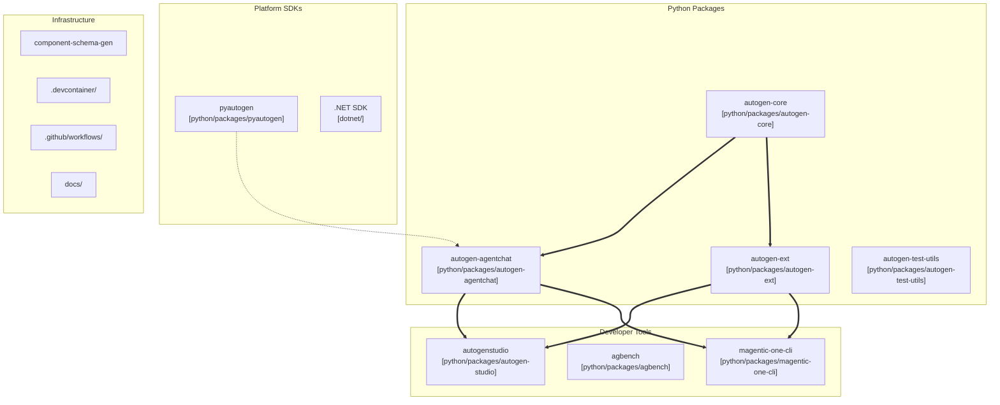
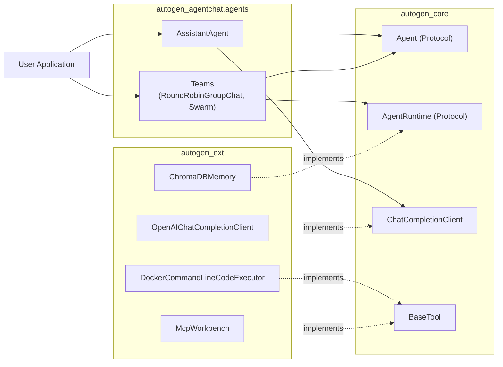

<!-- source: DeepWiki mcp.deepwiki.com · repo microsoft/autogen · page 1 Overview · fetched 2026-10-27 -->

# Overview

<details>
<summary>Relevant source files</summary>

The following files were used as context for generating this wiki page:

- [.github/ISSUE_TEMPLATE/1-bug_report.yml](.github/ISSUE_TEMPLATE/1-bug_report.yml)
- [.github/workflows/docs.yml](.github/workflows/docs.yml)
- [CONTRIBUTING.md](CONTRIBUTING.md)
- [LICENSE](LICENSE)
- [README.md](README.md)
- [SECURITY.md](SECURITY.md)
- [TRANSPARENCY_FAQS.md](TRANSPARENCY_FAQS.md)
- [docs/switcher.json](docs/switcher.json)
- [python/README.md](python/README.md)
- [python/packages/autogen-agentchat/pyproject.toml](python/packages/autogen-agentchat/pyproject.toml)
- [python/packages/autogen-core/pyproject.toml](python/packages/autogen-core/pyproject.toml)
- [python/packages/autogen-ext/pyproject.toml](python/packages/autogen-ext/pyproject.toml)
- [python/packages/autogen-studio/pyproject.toml](python/packages/autogen-studio/pyproject.toml)
- [python/uv.lock](python/uv.lock)

</details>


This page provides a high-level introduction to the AutoGen repository structure, package architecture, and design principles. AutoGen is a framework for building multi-agent AI applications that can operate autonomously or collaborate with humans.

> [!CAUTION]
> **⚠️ Maintenance Mode**
> AutoGen is now in maintenance mode. It will not receive new features or enhancements and is community managed going forward. New users should start with [Microsoft Agent Framework](https://github.com/microsoft/agent-framework). Existing users are encouraged to migrate using the [migration guide](https://learn.microsoft.com/en-us/agent-framework/migration-guide/from-autogen). [README.md:14-26]()

**Scope**: This page covers the repository organization, core packages, developer tools, and architectural layering. For detailed information about specific subsystems:
- Package architecture and dependencies: see [Package Architecture](#1.1)
- Installation instructions and quickstart: see [Installation and Setup](#1.2)
- Core framework internals: see [Core Foundation](#2)
- High-level agent APIs: see [AgentChat API](#3)
- Multi-agent coordination: see [Multi-Agent Teams](#4)

## Repository Structure

The AutoGen repository is organized as a monorepo containing Python packages, .NET SDK, developer tools, and supporting infrastructure. The repository supports both Python (3.10+) and .NET (8.0+) ecosystems with cross-language interoperability via gRPC.

### Repository Component Map
The following diagram maps high-level system components to their respective locations in the codebase.



**Sources**: [README.md:1-227](), [python/uv.lock:20-31](), [python/README.md:7-13]()

## Three-Layer Architecture

AutoGen implements a strict layered architecture where each layer builds on the layer below it. This design enables users to work at different abstraction levels depending on their needs.

| Layer | Package | Purpose | Key Abstractions |
|-------|---------|---------|------------------|
| **Foundation** | `autogen-core` | Runtime infrastructure, agent abstraction, messaging | `AgentRuntime`, `Agent`, `ChatCompletionClient`, `BaseTool` |
| **High-Level API** | `autogen-agentchat` | Pre-built agents and team patterns | `AssistantAgent`, `CodeExecutorAgent`, `BaseGroupChat` |
| **Extensions** | `autogen-ext` | Optional integrations and implementations | LLM clients, code executors, memory systems, tools |

### From Logic to Code Entities
This diagram bridges conceptual multi-agent logic to specific class entities found in the packages.



**Sources**: [python/packages/autogen-core/pyproject.toml:6-24](), [python/packages/autogen-agentchat/pyproject.toml:6-19](), [python/packages/autogen-ext/pyproject.toml:6-159]()

## Core Packages

### autogen-core (v0.7.5)
The foundational package providing low-level abstractions for agent-based systems. It defines the core `AgentRuntime` and message-passing protocols.
- **Location**: `python/packages/autogen-core/`
- **Key Components**: `AgentRuntime`, `BaseAgent`, `ChatCompletionClient`, `BaseTool`.
- **Sources**: [python/packages/autogen-core/pyproject.toml:7-24]()

### autogen-agentchat (v0.7.5)
High-level API for rapid prototyping. It provides built-in agent types like `AssistantAgent` and `CodeExecutorAgent` that simplify LLM interactions.
- **Location**: `python/packages/autogen-agentchat/`
- **Key Components**: `AssistantAgent`, `RoundRobinGroupChat`, `SelectorGroupChat`, `TerminationCondition`.
- **Sources**: [python/packages/autogen-agentchat/pyproject.toml:7-19]()

### autogen-ext (v0.7.5)
Extension package with optional implementations organized by integration type.
- **Location**: `python/packages/autogen-ext/`
- **Extension Categories**: `openai`, `anthropic`, `azure`, `ollama`, `docker`, `mcp`, `chromadb`, `redis`.
- **Sources**: [python/packages/autogen-ext/pyproject.toml:21-159]()

## Developer Tools

### AutoGen Studio
A web-based interface for building and running AutoGen agents without writing code.
- **Location**: `python/packages/autogen-studio/`
- **CLI**: `autogenstudio ui --port 8080` [README.md:168]()
- **Sources**: [python/packages/autogen-studio/pyproject.toml:6-39]()

### agbench
A benchmarking suite for evaluating agent performance across scenarios like GAIA or HumanEval.
- **Location**: `python/packages/agbench/`
- **Sources**: [python/uv.lock:107-117]()

### Magentic-One CLI
A reference implementation of a complex multi-agent system designed to solve generalized tasks using the Magentic-One architecture.
- **Location**: `python/packages/magentic-one-cli/`
- **Sources**: [python/uv.lock:29]()

## Cross-Language Support

### Python SDK
Primary implementation supporting Python 3.10 to 3.12. It uses `uv` for workspace management.
- **Sources**: [python/uv.lock:1-31](), [python/README.md:1-13]()

### .NET SDK
Official .NET implementation with parity for core agent concepts. It uses gRPC for interoperability with Python agents.
- **Location**: `dotnet/`
- **Sources**: [README.md:191-197]()

## Version Management
The repository maintains documentation for multiple versions. Version numbers are synchronized across `autogen-*` packages.
- **Current Stable**: 0.7.5
- **Sources**: [docs/switcher.json:8-12](), [CONTRIBUTING.md:41-47]()

## Installation Quick Reference
```bash
# Basic setup
pip install -U "autogen-agentchat" "autogen-ext[openai]"

# For AutoGen Studio
pip install -U "autogenstudio"
```
**Sources**: [README.md:31-41]()

---

