# Page: Overview

# Overview

<details>
<summary>Relevant source files</summary>

The following files were used as context for generating this wiki page:

- [.github/ISSUE_TEMPLATE/1-bug_report.yml](.github/ISSUE_TEMPLATE/1-bug_report.yml)
- [.github/workflows/docs.yml](.github/workflows/docs.yml)
- [CONTRIBUTING.md](CONTRIBUTING.md)
- [LICENSE](LICENSE)
- [README.md](README.md)
- [SECURITY.md](SECURITY.md)
- [TRANSPARENCY_FAQS.md](TRANSPARENCY_FAQS.md)
- [docs/switcher.json](docs/switcher.json)
- [python/README.md](python/README.md)
- [python/packages/autogen-agentchat/pyproject.toml](python/packages/autogen-agentchat/pyproject.toml)
- [python/packages/autogen-core/pyproject.toml](python/packages/autogen-core/pyproject.toml)
- [python/packages/autogen-ext/pyproject.toml](python/packages/autogen-ext/pyproject.toml)
- [python/packages/autogen-studio/pyproject.toml](python/packages/autogen-studio/pyproject.toml)
- [python/uv.lock](python/uv.lock)

</details>


This page provides a high-level introduction to the AutoGen repository structure, package architecture, and design principles. AutoGen is a framework for building multi-agent AI applications that can operate autonomously or collaborate with humans.

> [!CAUTION]
> **⚠️ Maintenance Mode**
> AutoGen is now in maintenance mode. It will not receive new features or enhancements and is community managed going forward. New users should start with [Microsoft Agent Framework](https://github.com/microsoft/agent-framework). Existing users are encouraged to migrate using the [migration guide](https://learn.microsoft.com/en-us/agent-framework/migration-guide/from-autogen). [README.md:14-26]()

**Scope**: This page covers the repository organization, core packages, developer tools, and architectural layering. For detailed information about specific subsystems:
- Package architecture and dependencies: see [Package Architecture](#1.1)
- Installation instructions and quickstart: see [Installation and Setup](#1.2)
- Core framework internals: see [Core Foundation](#2)
- High-level agent APIs: see [AgentChat API](#3)
- Multi-agent coordination: see [Multi-Agent Teams](#4)

## Repository Structure

The AutoGen repository is organized as a monorepo containing Python packages, .NET SDK, developer tools, and supporting infrastructure. The repository supports both Python (3.10+) and .NET (8.0+) ecosystems with cross-language interoperability via gRPC.

### Repository Component Map
The following diagram maps high-level system components to their respective locations in the codebase.

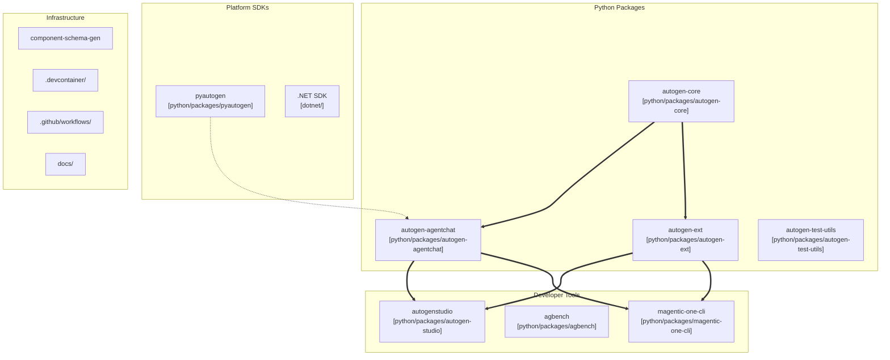

**Sources**: [README.md:1-227](), [python/uv.lock:20-31](), [python/README.md:7-13]()

## Three-Layer Architecture

AutoGen implements a strict layered architecture where each layer builds on the layer below it. This design enables users to work at different abstraction levels depending on their needs.

| Layer | Package | Purpose | Key Abstractions |
|-------|---------|---------|------------------|
| **Foundation** | `autogen-core` | Runtime infrastructure, agent abstraction, messaging | `AgentRuntime`, `Agent`, `ChatCompletionClient`, `BaseTool` |
| **High-Level API** | `autogen-agentchat` | Pre-built agents and team patterns | `AssistantAgent`, `CodeExecutorAgent`, `BaseGroupChat` |
| **Extensions** | `autogen-ext` | Optional integrations and implementations | LLM clients, code executors, memory systems, tools |

### From Logic to Code Entities
This diagram bridges conceptual multi-agent logic to specific class entities found in the packages.

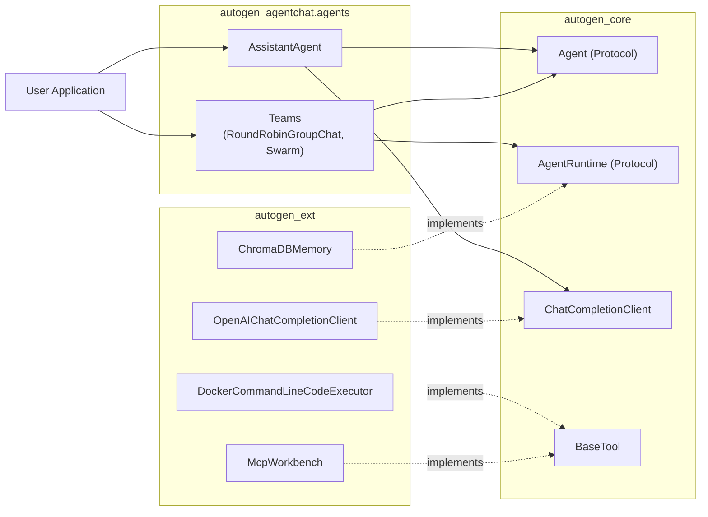

**Sources**: [python/packages/autogen-core/pyproject.toml:6-24](), [python/packages/autogen-agentchat/pyproject.toml:6-19](), [python/packages/autogen-ext/pyproject.toml:6-159]()

## Core Packages

### autogen-core (v0.7.5)
The foundational package providing low-level abstractions for agent-based systems. It defines the core `AgentRuntime` and message-passing protocols.
- **Location**: `python/packages/autogen-core/`
- **Key Components**: `AgentRuntime`, `BaseAgent`, `ChatCompletionClient`, `BaseTool`.
- **Sources**: [python/packages/autogen-core/pyproject.toml:7-24]()

### autogen-agentchat (v0.7.5)
High-level API for rapid prototyping. It provides built-in agent types like `AssistantAgent` and `CodeExecutorAgent` that simplify LLM interactions.
- **Location**: `python/packages/autogen-agentchat/`
- **Key Components**: `AssistantAgent`, `RoundRobinGroupChat`, `SelectorGroupChat`, `TerminationCondition`.
- **Sources**: [python/packages/autogen-agentchat/pyproject.toml:7-19]()

### autogen-ext (v0.7.5)
Extension package with optional implementations organized by integration type.
- **Location**: `python/packages/autogen-ext/`
- **Extension Categories**: `openai`, `anthropic`, `azure`, `ollama`, `docker`, `mcp`, `chromadb`, `redis`.
- **Sources**: [python/packages/autogen-ext/pyproject.toml:21-159]()

## Developer Tools

### AutoGen Studio
A web-based interface for building and running AutoGen agents without writing code.
- **Location**: `python/packages/autogen-studio/`
- **CLI**: `autogenstudio ui --port 8080` [README.md:168]()
- **Sources**: [python/packages/autogen-studio/pyproject.toml:6-39]()

### agbench
A benchmarking suite for evaluating agent performance across scenarios like GAIA or HumanEval.
- **Location**: `python/packages/agbench/`
- **Sources**: [python/uv.lock:107-117]()

### Magentic-One CLI
A reference implementation of a complex multi-agent system designed to solve generalized tasks using the Magentic-One architecture.
- **Location**: `python/packages/magentic-one-cli/`
- **Sources**: [python/uv.lock:29]()

## Cross-Language Support

### Python SDK
Primary implementation supporting Python 3.10 to 3.12. It uses `uv` for workspace management.
- **Sources**: [python/uv.lock:1-31](), [python/README.md:1-13]()

### .NET SDK
Official .NET implementation with parity for core agent concepts. It uses gRPC for interoperability with Python agents.
- **Location**: `dotnet/`
- **Sources**: [README.md:191-197]()

## Version Management
The repository maintains documentation for multiple versions. Version numbers are synchronized across `autogen-*` packages.
- **Current Stable**: 0.7.5
- **Sources**: [docs/switcher.json:8-12](), [CONTRIBUTING.md:41-47]()

## Installation Quick Reference
```bash
# Basic setup
pip install -U "autogen-agentchat" "autogen-ext[openai]"

# For AutoGen Studio
pip install -U "autogenstudio"
```
**Sources**: [README.md:31-41]()

---

# Page: Package Architecture

# Package Architecture

<details>
<summary>Relevant source files</summary>

The following files were used as context for generating this wiki page:

- [.github/ISSUE_TEMPLATE/1-bug_report.yml](.github/ISSUE_TEMPLATE/1-bug_report.yml)
- [.github/workflows/checks.yml](.github/workflows/checks.yml)
- [.github/workflows/codeql.yml](.github/workflows/codeql.yml)
- [.github/workflows/docs.yml](.github/workflows/docs.yml)
- [.github/workflows/dotnet-build.yml](.github/workflows/dotnet-build.yml)
- [.github/workflows/integration.yml](.github/workflows/integration.yml)
- [.github/workflows/single-python-package.yml](.github/workflows/single-python-package.yml)
- [README.md](README.md)
- [docs/switcher.json](docs/switcher.json)
- [python/.gitignore](python/.gitignore)
- [python/docs/src/conf.py](python/docs/src/conf.py)
- [python/packages/agbench/pyproject.toml](python/packages/agbench/pyproject.toml)
- [python/packages/autogen-agentchat/README.md](python/packages/autogen-agentchat/README.md)
- [python/packages/autogen-agentchat/pyproject.toml](python/packages/autogen-agentchat/pyproject.toml)
- [python/packages/autogen-agentchat/src/autogen_agentchat/py.typed](python/packages/autogen-agentchat/src/autogen_agentchat/py.typed)
- [python/packages/autogen-core/README.md](python/packages/autogen-core/README.md)
- [python/packages/autogen-core/pyproject.toml](python/packages/autogen-core/pyproject.toml)
- [python/packages/autogen-ext/README.md](python/packages/autogen-ext/README.md)
- [python/packages/autogen-ext/pyproject.toml](python/packages/autogen-ext/pyproject.toml)
- [python/packages/autogen-studio/pyproject.toml](python/packages/autogen-studio/pyproject.toml)
- [python/packages/pyautogen/LICENSE-CODE](python/packages/pyautogen/LICENSE-CODE)
- [python/packages/pyautogen/README.md](python/packages/pyautogen/README.md)
- [python/packages/pyautogen/pyproject.toml](python/packages/pyautogen/pyproject.toml)
- [python/packages/pyautogen/src/pyautogen/__init__.py](python/packages/pyautogen/src/pyautogen/__init__.py)
- [python/pyproject.toml](python/pyproject.toml)
- [python/templates/new-package/cookiecutter.json](python/templates/new-package/cookiecutter.json)
- [python/templates/new-package/hooks/post_gen_project.py](python/templates/new-package/hooks/post_gen_project.py)
- [python/templates/new-package/hooks/pre_gen_project.py](python/templates/new-package/hooks/pre_gen_project.py)
- [python/templates/new-package/{{cookiecutter.package_name}}/README.md](python/templates/new-package/{{cookiecutter.package_name}}/README.md)
- [python/templates/new-package/{{cookiecutter.package_name}}/pyproject.toml](python/templates/new-package/{{cookiecutter.package_name}}/pyproject.toml)
- [python/templates/new-package/{{cookiecutter.package_name}}/src/{{cookiecutter.__project_slug}}/__init__.py](python/templates/new-package/{{cookiecutter.package_name}}/src/{{cookiecutter.__project_slug}}/__init__.py)
- [python/templates/new-package/{{cookiecutter.package_name}}/src/{{cookiecutter.__project_slug}}/py.typed](python/templates/new-package/{{cookiecutter.package_name}}/src/{{cookiecutter.__project_slug}}/py.typed)
- [python/templates/new-package/{{cookiecutter.package_name}}/tests/test_example.py](python/templates/new-package/{{cookiecutter.package_name}}/tests/test_example.py)
- [python/uv.lock](python/uv.lock)

</details>


This document describes the structure and organization of the AutoGen repository's Python packages, focusing on the three-layer architecture (`autogen-core`, `autogen-agentchat`, `autogen-ext`), developer tools, and the .NET SDK. For information about specific runtime implementations, see [Agent Runtime System](#2.1). For installation instructions, see [Installation and Setup](#1.2).

## Layered Architecture

AutoGen uses a strict three-layer package architecture where each layer builds on the one below it, ensuring clear separation of concerns and controlled dependencies.

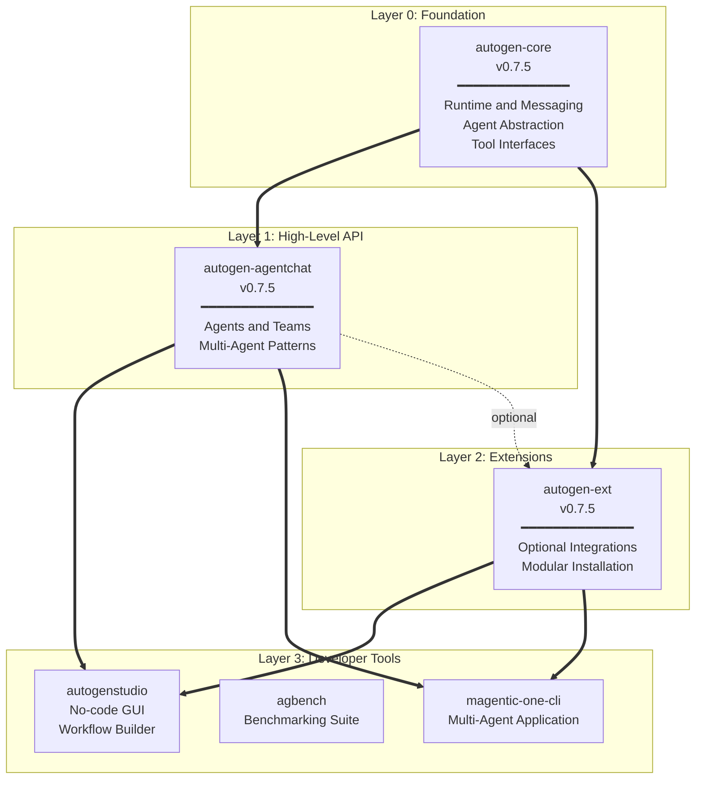

**Sources:** [README.md:14-200](), [python/packages/autogen-core/pyproject.toml:1-89](), [python/packages/autogen-agentchat/pyproject.toml:1-39](), [python/packages/autogen-ext/pyproject.toml:1-206]()

## Core Package: autogen-core

The `autogen-core` package provides foundational abstractions and runtime infrastructure that all other packages depend on.

### Package Metadata

| Property | Value |
|----------|-------|
| **Name** | `autogen-core` |
| **Version** | 0.7.5 |
| **Python Requirement** | >=3.10 |
| **License** | MIT |
| **Location** | [python/packages/autogen-core/]() |

### Core Dependencies

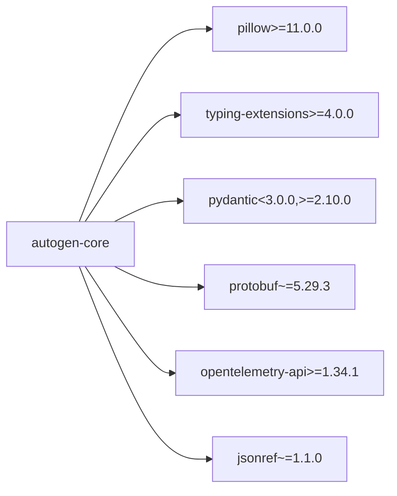

The core package has minimal dependencies by design, ensuring it can be integrated into diverse environments without conflicts. It provides:

- **Agent Protocol**: Base classes and interfaces for agent implementations
- **Runtime System**: `SingleThreadedAgentRuntime` and `GrpcWorkerAgentRuntime`
- **Message Types**: Type-safe message definitions and serialization
- **Tool Interfaces**: `BaseTool` and related abstractions
- **Model Client Protocol**: `ChatCompletionClient` interface

**Sources:** [python/packages/autogen-core/pyproject.toml:6-24]()

## AgentChat Package: autogen-agentchat

The `autogen-agentchat` package provides high-level agent implementations and team orchestration patterns built on top of `autogen-core`.

### Package Metadata

| Property | Value |
|----------|-------|
| **Name** | `autogen-agentchat` |
| **Version** | 0.7.5 |
| **Python Requirement** | >=3.10 |
| **License** | MIT |
| **Location** | [python/packages/autogen-agentchat/]() |

### Dependencies

The package has a single required dependency:

```python
dependencies = [
    "autogen-core==0.7.5",
]
```

This package includes:

- **Concrete Agents**: `AssistantAgent`, `CodeExecutorAgent`, `OpenAIAssistantAgent`
- **Team Patterns**: `RoundRobinGroupChat`, `SelectorGroupChat`, `Swarm`, `MagenticOneGroupChat`
- **Termination Conditions**: `MaxMessage`, `TextMention`, `TokenUsage`, `HandoffTermination`
- **Model Context**: `BufferedChatCompletionContext`, `UnboundedChatCompletionContext`
- **UI Components**: `Console` for displaying agent conversations

**Sources:** [python/packages/autogen-agentchat/pyproject.toml:6-19]()

## Extensions Package: autogen-ext

The `autogen-ext` package implements a modular plugin architecture where users install only the extensions they need.

### Package Metadata

| Property | Value |
|----------|-------|
| **Name** | `autogen-ext` |
| **Version** | 0.7.5 |
| **Python Requirement** | >=3.10 |
| **Base Dependency** | `autogen-core==0.7.5` |
| **Location** | [python/packages/autogen-ext/]() |

### Extension Categories

```mermaid
graph TB
    Ext["autogen-ext<br/>Base Package"]
    
    subgraph "LLM Providers"
        OpenAI["[openai]<br/>openai>=1.93<br/>tiktoken>=0.8.0<br/>aiofiles"]
        Anthropic["[anthropic]<br/>anthropic>=0.48"]
        Azure["[azure]<br/>azure-ai-inference>=1.0.0b9<br/>azure-ai-projects>=1.0.0b11<br/>azure-identity"]
        Ollama["[ollama]<br/>ollama>=0.4.7<br/>tiktoken>=0.8.0"]
        Gemini["[gemini]<br/>google-genai>=1.0.0"]
    end
    
    subgraph "Code Execution"
        Docker["[docker]<br/>docker~=7.0<br/>asyncio_atexit>=1.0.1"]
        Jupyter["[jupyter-executor]<br/>ipykernel>=6.29.5<br/>nbclient>=0.10.2"]
        DockerJupyter["[docker-jupyter-executor]<br/>websockets>=15.0.1<br/>aiohttp>=3.11.16"]
    end
    
    subgraph "Capabilities"
        WebSurfer["[web-surfer]<br/>playwright>=1.48.0<br/>magika>=0.6.1rc2"]
        FileSurfer["[file-surfer]<br/>markitdown~=0.1.0a3"]
        VideoSurfer["[video-surfer]<br/>opencv-python>=4.5<br/>openai-whisper"]
        MCP["[mcp]<br/>mcp>=1.11.0"]
        HTTP["[http-tool]<br/>httpx>=0.27.0"]
    end
    
    subgraph "Memory Systems"
        Chromadb["[chromadb]<br/>chromadb>=1.0.0"]
        Redis["[redis]<br/>redis>=5.2.1"]
        Mem0["[mem0]<br/>mem0ai>=0.1.98"]
        Diskcache["[diskcache]<br/>diskcache>=5.6.3"]
    end
    
    subgraph "Framework Integrations"
        Langchain["[langchain]<br/>langchain_core~=0.3.3"]
        SK["[semantic-kernel-core]<br/>semantic-kernel>=1.17.1"]
    end
    
    Ext -.-> OpenAI
    Ext -.-> Anthropic
    Ext -.-> Azure
    Ext -.-> Ollama
    Ext -.-> Gemini
    Ext -.-> Docker
    Ext -.-> Jupyter
    Ext -.-> DockerJupyter
    Ext -.-> WebSurfer
    Ext -.-> FileSurfer
    Ext -.-> VideoSurfer
    Ext -.-> MCP
    Ext -.-> HTTP
    Ext -.-> Chromadb
    Ext -.-> Redis
    Ext -.-> Mem0
    Ext -.-> Diskcache
    Ext -.-> Langchain
    Ext -.-> SK
```

### Installation Patterns

Extensions are installed using pip's extras syntax:

```bash
# Install specific extensions
pip install "autogen-ext[openai,docker]"

# Install multiple categories
pip install "autogen-ext[openai,azure,chromadb]"

# Install all magentic-one dependencies
pip install "autogen-ext[magentic-one]"
```

The `[magentic-one]` extra is a convenience bundle that includes:

```python
magentic-one = [
    "autogen-agentchat==0.7.5",
    "magika>=0.6.1rc2",
    "markitdown[all]~=0.1.0a3",
    "playwright>=1.48.0",
    "pillow>=11.0.0",
]
```

### Extension Implementations Table

| Category | Extra Name | Key Dependencies | Implements Interface |
|----------|-----------|------------------|---------------------|
| OpenAI | `[openai]` | openai>=1.93, tiktoken | `ChatCompletionClient` |
| Anthropic | `[anthropic]` | anthropic>=0.48 | `ChatCompletionClient` |
| Azure | `[azure]` | azure-ai-inference, azure-ai-projects | `ChatCompletionClient` |
| Ollama | `[ollama]` | ollama>=0.4.7 | `ChatCompletionClient` |
| Gemini | `[gemini]` | google-genai>=1.0.0 | `ChatCompletionClient` |
| Docker Executor | `[docker]` | docker~=7.0 | `CodeExecutor` |
| Jupyter Executor | `[jupyter-executor]` | ipykernel, nbclient | `CodeExecutor` |
| Docker Jupyter | `[docker-jupyter-executor]` | websockets, aiohttp | `CodeExecutor` |
| Web Surfer | `[web-surfer]` | playwright>=1.48.0 | `BaseTool` |
| File Surfer | `[file-surfer]` | markitdown | `BaseTool` |
| Video Surfer | `[video-surfer]` | opencv-python, whisper | `BaseTool` |
| MCP | `[mcp]` | mcp>=1.11.0 | `Workbench` |
| HTTP Tool | `[http-tool]` | httpx>=0.27.0 | `BaseTool` |
| ChromaDB | `[chromadb]` | chromadb>=1.0.0 | Memory Interface |
| Redis | `[redis]` | redis>=5.2.1 | Memory Interface |
| Mem0 | `[mem0]` | mem0ai>=0.1.98 | Memory Interface |
| Diskcache | `[diskcache]` | diskcache>=5.6.3 | Memory Interface |
| Langchain | `[langchain]` | langchain_core~=0.3.3 | Bridge |
| Semantic Kernel | `[semantic-kernel-core]` | semantic-kernel>=1.17.1 | Bridge |

**Sources:** [python/packages/autogen-ext/pyproject.toml:21-159]()

## Developer Tools

Three developer tools build on the core framework to provide specialized functionality.

### AutoGen Studio

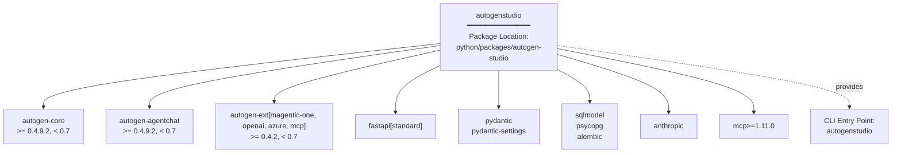

AutoGen Studio provides a no-code interface for building and testing multi-agent workflows. It includes:

- **Web Interface**: FastAPI-based REST API and web UI
- **Database**: SQLModel with PostgreSQL support via psycopg
- **Migrations**: Alembic for schema management
- **CLI Command**: `autogenstudio ui --port 8080 --appdir ./my-app`

**Sources:** [python/packages/autogen-studio/pyproject.toml:6-73](), [README.md:151-158]()

### AGBench

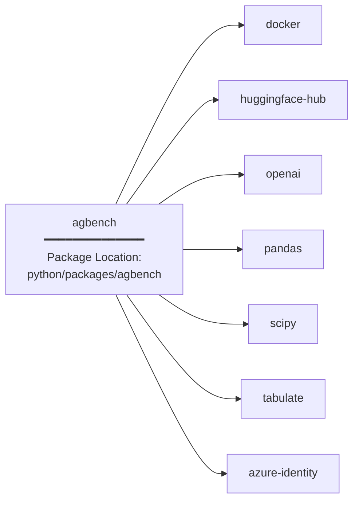

AGBench is a benchmarking suite for evaluating agent performance. It provides:

- **Benchmark Execution**: Docker-based isolated test environments
- **Dataset Integration**: HuggingFace Hub for benchmark datasets
- **Results Analysis**: Pandas and scipy for statistical analysis
- **Reporting**: Tabulate for formatted output

**Sources:** [python/uv.lock:107-140]()

### Magentic-One CLI

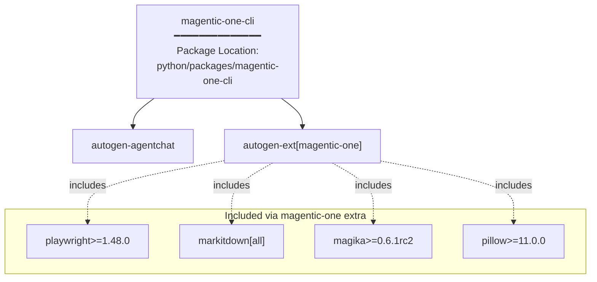

The Magentic-One CLI provides a command-line interface for running the Magentic-One multi-agent system. It is a state-of-the-art multi-agent team that handles tasks requiring web browsing, code execution, and file handling.

**Sources:** [python/uv.lock:22-31](), [python/packages/autogen-ext/pyproject.toml:59-65](), [README.md:183-184]()

## Compatibility Layer: pyautogen

The `pyautogen` package serves as a proxy for backward compatibility with AutoGen v0.2.

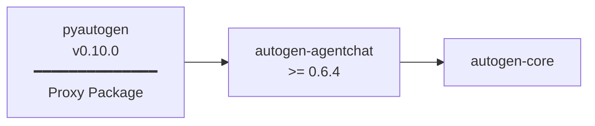

### Package Metadata

| Property | Value |
|----------|-------|
| **Name** | `pyautogen` |
| **Version** | 0.10.0 |
| **Purpose** | Proxy package for autogen-agentchat |
| **Python Requirement** | >=3.10 |
| **Location** | [python/packages/pyautogen/]() |

The package contains no implementation code ([python/packages/pyautogen/src/pyautogen/__init__.py:1]() is empty) and simply declares a dependency on `autogen-agentchat>=0.6.4`. This allows users who have `pyautogen` in their dependency specifications to automatically receive the latest `autogen-agentchat` package.

**Important Note**: For AutoGen v0.2.x, users must pin to `pyautogen~=0.2.0`. For migration instructions, see the [Migration Guide](https://microsoft.github.io/autogen/stable/user-guide/agentchat-user-guide/migration-guide.html).

**Sources:** [python/packages/pyautogen/pyproject.toml:1-25](), [python/packages/pyautogen/README.md:1-14](), [README.md:31-32]()

## .NET SDK

A parallel implementation exists for .NET developers, providing cross-platform and cross-language agent development capabilities.

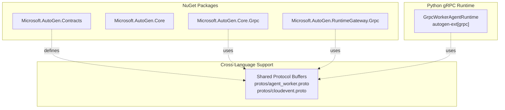

### NuGet Package Table

| Package | Purpose |
|---------|---------|
| `Microsoft.AutoGen.Contracts` | Shared contracts and interfaces |
| `Microsoft.AutoGen.Core` | Core runtime implementation |
| `Microsoft.AutoGen.Core.Grpc` | gRPC-based distributed runtime |
| `Microsoft.AutoGen.RuntimeGateway.Grpc` | Gateway for cross-language communication |

The .NET SDK supports .NET 8 and .NET 9, and can interoperate with Python agents through the gRPC runtime. Documentation is available at [microsoft.github.io/autogen/dotnet/](https://microsoft.github.io/autogen/dotnet).

**Sources:** [README.md:191-197](), [.github/workflows/dotnet-build.yml:1-348]()

## Workspace Structure

The Python packages are organized as a uv workspace with shared configuration and tooling.

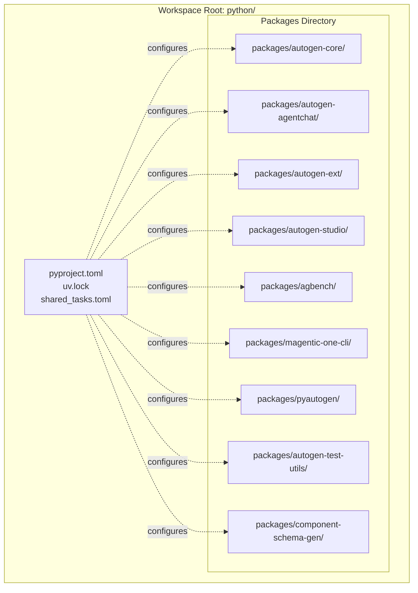

### Workspace Configuration

The workspace is defined in [python/pyproject.toml:47-49]():

```toml
[tool.uv.workspace]
members = ["packages/*"]
exclude = ["packages/autogen-magentic-one"]
```

### Workspace Members

The lockfile [python/uv.lock:20-31]() defines the following workspace members:

```
members = [
    "agbench",
    "autogen-agentchat",
    "autogen-core",
    "autogen-ext",
    "autogen-test-utils",
    "autogenstudio",
    "component-schema-gen",
    "magentic-one-cli",
    "pyautogen",
]
```

### Shared Development Dependencies

All packages inherit development dependencies from the workspace root:

| Tool | Version | Purpose |
|------|---------|---------|
| `ruff` | 0.4.8 | Linting and formatting |
| `mypy` | 1.13.0 | Static type checking |
| `pyright` | 1.1.389 | Static type checking |
| `pytest` | latest | Testing framework |
| `pytest-asyncio` | latest | Async test support |
| `pytest-cov` | latest | Coverage reporting |
| `pytest-xdist` | latest | Parallel test execution |
| `grpcio-tools` | ~1.70.0 | Protocol buffer compilation |
| `sphinx` | latest | Documentation generation |

**Sources:** [python/pyproject.toml:1-148](), [python/uv.lock:1-38]()

## Version Synchronization

All core packages maintain synchronized versions to ensure compatibility:

| Package | Current Version | Location |
|---------|----------------|----------|
| `autogen-core` | 0.7.5 | [python/packages/autogen-core/pyproject.toml:7]() |
| `autogen-agentchat` | 0.7.5 | [python/packages/autogen-agentchat/pyproject.toml:7]() |
| `autogen-ext` | 0.7.5 | [python/packages/autogen-ext/pyproject.toml:7]() |

This synchronization is enforced through exact version pins in dependencies. For example, `autogen-agentchat` specifies `autogen-core==0.7.5` (not `>=0.7.5`), and `autogen-ext` specifies both `autogen-core==0.7.5` and optional dependencies like `autogen-agentchat==0.7.5` in the `[file-surfer]` and `[web-surfer]` extras.

When new versions are released, the CI/CD system ensures all packages are published together through the [single-python-package.yml]() workflow, which can deploy any of the workspace members to PyPI.

**Sources:** [python/packages/autogen-core/pyproject.toml:7](), [python/packages/autogen-agentchat/pyproject.toml:7](), [python/packages/autogen-ext/pyproject.toml:7](), [.github/workflows/single-python-package.yml:1-45]()

---

# Page: Installation and Setup

# Installation and Setup

<details>
<summary>Relevant source files</summary>

The following files were used as context for generating this wiki page:

- [.github/ISSUE_TEMPLATE/1-bug_report.yml](.github/ISSUE_TEMPLATE/1-bug_report.yml)
- [.github/workflows/docs.yml](.github/workflows/docs.yml)
- [CONTRIBUTING.md](CONTRIBUTING.md)
- [README.md](README.md)
- [docs/switcher.json](docs/switcher.json)
- [python/README.md](python/README.md)
- [python/packages/agbench/pyproject.toml](python/packages/agbench/pyproject.toml)
- [python/packages/autogen-agentchat/pyproject.toml](python/packages/autogen-agentchat/pyproject.toml)
- [python/packages/autogen-core/pyproject.toml](python/packages/autogen-core/pyproject.toml)
- [python/packages/autogen-ext/pyproject.toml](python/packages/autogen-ext/pyproject.toml)
- [python/packages/autogen-studio/pyproject.toml](python/packages/autogen-studio/pyproject.toml)
- [python/templates/new-package/cookiecutter.json](python/templates/new-package/cookiecutter.json)
- [python/templates/new-package/hooks/post_gen_project.py](python/templates/new-package/hooks/post_gen_project.py)
- [python/templates/new-package/hooks/pre_gen_project.py](python/templates/new-package/hooks/pre_gen_project.py)
- [python/templates/new-package/{{cookiecutter.package_name}}/README.md](python/templates/new-package/{{cookiecutter.package_name}}/README.md)
- [python/templates/new-package/{{cookiecutter.package_name}}/pyproject.toml](python/templates/new-package/{{cookiecutter.package_name}}/pyproject.toml)
- [python/templates/new-package/{{cookiecutter.package_name}}/src/{{cookiecutter.__project_slug}}/__init__.py](python/templates/new-package/{{cookiecutter.package_name}}/src/{{cookiecutter.__project_slug}}/__init__.py)
- [python/templates/new-package/{{cookiecutter.package_name}}/src/{{cookiecutter.__project_slug}}/py.typed](python/templates/new-package/{{cookiecutter.package_name}}/src/{{cookiecutter.__project_slug}}/py.typed)
- [python/templates/new-package/{{cookiecutter.package_name}}/tests/test_example.py](python/templates/new-package/{{cookiecutter.package_name}}/tests/test_example.py)
- [python/uv.lock](python/uv.lock)

</details>


This guide covers installing AutoGen packages, configuring environment variables, and running quickstart examples. AutoGen uses a modular package architecture where you install only the components you need for your specific application.

## Installation

AutoGen requires **Python 3.10 or later** [README.md:29-29](). The framework is distributed as a set of modular packages to minimize dependency bloat.

### Pip Installation
For most users, installing the high-level `autogen-agentchat` and the specific model extension is the recommended path:

```bash
# Install AgentChat and OpenAI client extension
pip install -U "autogen-agentchat" "autogen-ext[openai]"

# Install AutoGen Studio for the no-code GUI
pip install -U "autogenstudio"
```
Sources: [README.md:31-41]()

### UV Installation (Recommended for Developers)
The repository uses `uv` as its primary package manager [python/README.md:30-32](). To set up a full development environment:

```bash
# Sync all packages and extras in the workspace
uv sync --all-extras
# Activate the virtual environment
source .venv/bin/activate
```
Sources: [python/README.md:46-49](), [python/uv.lock:20-31]()

### Extension Extras
The `autogen-ext` package provides various optional dependencies for different model providers and tools:

| Extra | Purpose | Primary Dependencies |
|-------|---------|----------------------|
| `openai` | OpenAI & Azure OpenAI | `openai`, `tiktoken`, `aiofiles` |
| `anthropic` | Anthropic Models | `anthropic` |
| `web-surfer` | Playwright Browsing | `playwright`, `pillow`, `magika`, `markitdown` |
| `docker` | Isolated Code Execution | `docker`, `asyncio_atexit` |
| `mcp` | Model Context Protocol | `mcp` |
| `jupyter-executor` | Stateful Jupyter Kernels | `ipykernel`, `nbclient` |

Sources: [python/packages/autogen-ext/pyproject.toml:21-153]()

## Environment Configuration

AutoGen agents typically require API keys for LLM providers. These should be exported as environment variables.

```bash
# OpenAI
export OPENAI_API_KEY="sk-..."

# Azure OpenAI (Example)
export AZURE_OPENAI_API_KEY="..."
export AZURE_OPENAI_ENDPOINT="https://..."
```
Sources: [README.md:45-45](), [python/packages/autogen-core/pyproject.toml:48-48]()

## Quickstart Examples

### Hello World (AssistantAgent)
The following example demonstrates creating a basic `AssistantAgent` using the `OpenAIChatCompletionClient` [README.md:52-63]().

```python
import asyncio
from autogen_agentchat.agents import AssistantAgent
from autogen_ext.models.openai import OpenAIChatCompletionClient

async def main() -> None:
    # 1. Define the model client
    model_client = OpenAIChatCompletionClient(model="gpt-4o")
    
    # 2. Define the agent
    agent = AssistantAgent("assistant", model_client=model_client)
    
    # 3. Run the task
    result = await agent.run(task="Say 'Hello World!'")
    print(result)
    
    await model_client.close()

asyncio.run(main())
```

### Tool-Augmented Agent (MCP)
This example uses the Model Context Protocol (MCP) via `McpWorkbench` to give an agent web browsing capabilities [README.md:71-99]().

```python
import asyncio
from autogen_agentchat.agents import AssistantAgent
from autogen_agentchat.ui import Console
from autogen_ext.models.openai import OpenAIChatCompletionClient
from autogen_ext.tools.mcp import McpWorkbench, StdioServerParams

async def main() -> None:
    model_client = OpenAIChatCompletionClient(model="gpt-4o")
    server_params = StdioServerParams(command="npx", args=["@playwright/mcp@latest", "--headless"])
    
    async with McpWorkbench(server_params) as mcp:
        agent = AssistantAgent(
            "web_browsing_assistant",
            model_client=model_client,
            workbench=mcp,
            model_client_stream=True
        )
        await Console(agent.run_stream(task="Search for AutoGen news"))

asyncio.run(main())
```

## Creating New Packages

For developers extending the framework, AutoGen provides a `cookiecutter` template to maintain consistency across the monorepo [python/uv.lock:43-43]().

**Template Location:** `python/templates/new-package/`

### Package Initialization Flow

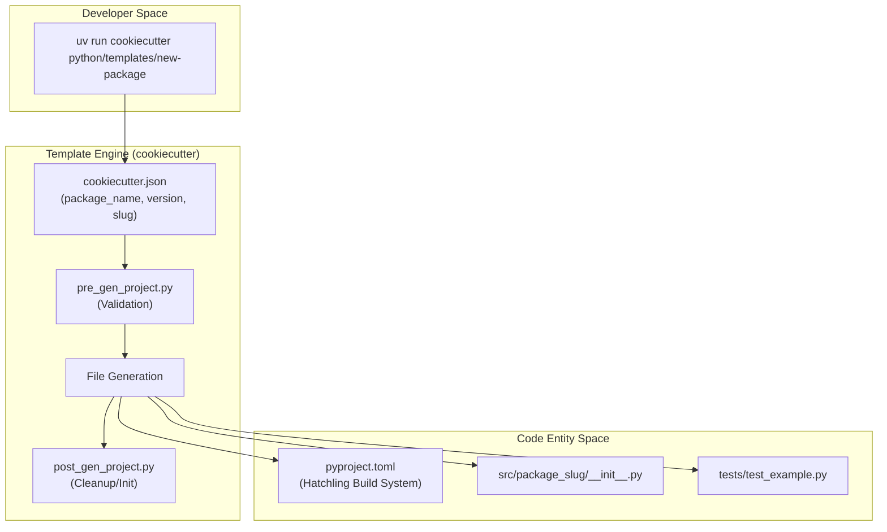
Sources: [python/templates/new-package/cookiecutter.json:1-10](), [python/templates/new-package/hooks/pre_gen_project.py:1-5](), [python/templates/new-package/{{cookiecutter.package_name}}/pyproject.toml:1-10]()

## Package Architecture and Data Flow

The following diagram illustrates how the different packages interact during a standard agent execution flow.

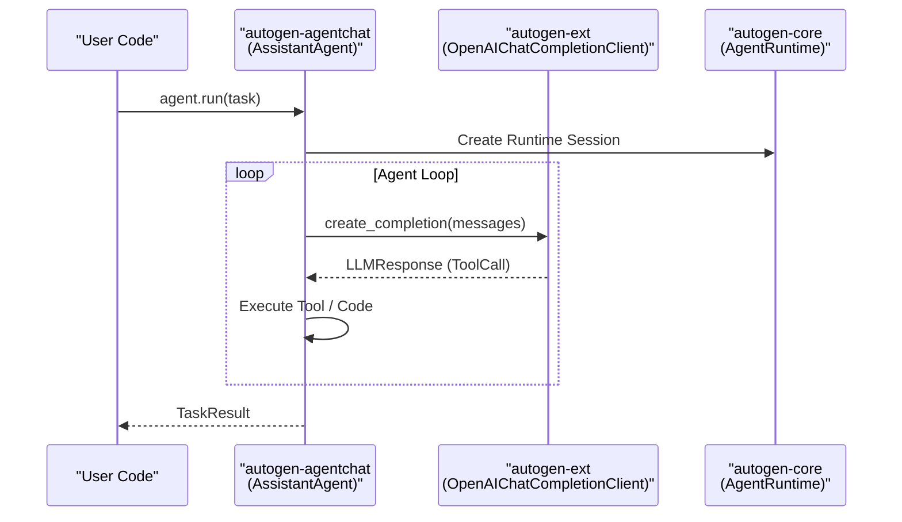
Sources: [python/packages/autogen-agentchat/pyproject.toml:17-19](), [python/packages/autogen-ext/pyproject.toml:17-19](), [python/packages/autogen-core/pyproject.toml:6-10]()

## AutoGen Studio Setup

AutoGen Studio provides a web-based UI for prototyping multi-agent workflows without writing code.

```bash
# Run the UI
autogenstudio ui --port 8080 --appdir ./my-app
```
Sources: [README.md:167-168](), [python/packages/autogen-studio/pyproject.toml:72-72]()

The backend is built on **FastAPI** and **SQLModel** [python/packages/autogen-studio/pyproject.toml:23-28](). It manages agent configurations, session state, and database migrations via **Alembic** [python/packages/autogen-studio/pyproject.toml:30-30]().

---

# Page: Core Foundation

# Core Foundation

<details>
<summary>Relevant source files</summary>

The following files were used as context for generating this wiki page:

- [python/docs/src/user-guide/autogenstudio-user-guide/installation.md](python/docs/src/user-guide/autogenstudio-user-guide/installation.md)
- [python/packages/autogen-core/src/autogen_core/_agent.py](python/packages/autogen-core/src/autogen_core/_agent.py)
- [python/packages/autogen-core/src/autogen_core/_agent_instantiation.py](python/packages/autogen-core/src/autogen_core/_agent_instantiation.py)
- [python/packages/autogen-core/src/autogen_core/_agent_runtime.py](python/packages/autogen-core/src/autogen_core/_agent_runtime.py)
- [python/packages/autogen-core/src/autogen_core/_base_agent.py](python/packages/autogen-core/src/autogen_core/_base_agent.py)
- [python/packages/autogen-core/src/autogen_core/_component_config.py](python/packages/autogen-core/src/autogen_core/_component_config.py)
- [python/packages/autogen-core/src/autogen_core/_runtime_impl_helpers.py](python/packages/autogen-core/src/autogen_core/_runtime_impl_helpers.py)
- [python/packages/autogen-core/src/autogen_core/_single_threaded_agent_runtime.py](python/packages/autogen-core/src/autogen_core/_single_threaded_agent_runtime.py)
- [python/packages/autogen-core/src/autogen_core/_telemetry/_propagation.py](python/packages/autogen-core/src/autogen_core/_telemetry/_propagation.py)
- [python/packages/autogen-core/src/autogen_core/_telemetry/_tracing.py](python/packages/autogen-core/src/autogen_core/_telemetry/_tracing.py)
- [python/packages/autogen-core/tests/test_base_agent.py](python/packages/autogen-core/tests/test_base_agent.py)
- [python/packages/autogen-core/tests/test_component_config.py](python/packages/autogen-core/tests/test_component_config.py)
- [python/packages/autogen-core/tests/test_runtime.py](python/packages/autogen-core/tests/test_runtime.py)
- [python/packages/autogen-ext/conftest.py](python/packages/autogen-ext/conftest.py)
- [python/packages/autogen-ext/src/autogen_ext/agents/video_surfer/tools.py](python/packages/autogen-ext/src/autogen_ext/agents/video_surfer/tools.py)
- [python/packages/autogen-ext/src/autogen_ext/runtimes/grpc/_worker_runtime.py](python/packages/autogen-ext/src/autogen_ext/runtimes/grpc/_worker_runtime.py)
- [python/packages/autogen-ext/tests/test_worker_runtime.py](python/packages/autogen-ext/tests/test_worker_runtime.py)
- [python/packages/autogen-ext/tests/tools/http/test_http_tool.py](python/packages/autogen-ext/tests/tools/http/test_http_tool.py)
- [python/packages/autogen-studio/README.md](python/packages/autogen-studio/README.md)
- [python/packages/autogen-studio/autogenstudio/validation/component_test_service.py](python/packages/autogen-studio/autogenstudio/validation/component_test_service.py)
- [python/packages/autogen-studio/autogenstudio/web/routes/validation.py](python/packages/autogen-studio/autogenstudio/web/routes/validation.py)
- [python/packages/autogen-test-utils/src/autogen_test_utils/__init__.py](python/packages/autogen-test-utils/src/autogen_test_utils/__init__.py)

</details>


This document covers the foundational systems that underpin all of AutoGen. These core components provide the runtime environment, communication infrastructure, agent lifecycle management, and component configuration systems that enable multi-agent applications.

The foundation consists of:
- **Agent Runtime System**: Message routing and agent execution environments.
- **Model Client System**: Unified interfaces for LLM interactions.
- **Message Types and Tool Agents**: Structured communication and tool-augmented generation.
- **Memory Systems**: State persistence and context management.
- **Component Configuration System**: Declarative setup and serialization.

## Agent Runtime System

AutoGen's agent execution is built on the `AgentRuntime` protocol, which defines the core interface for agent communication and lifecycle management. The runtime system provides pluggable implementations for different deployment scenarios.

**Runtime Protocol and Implementations**

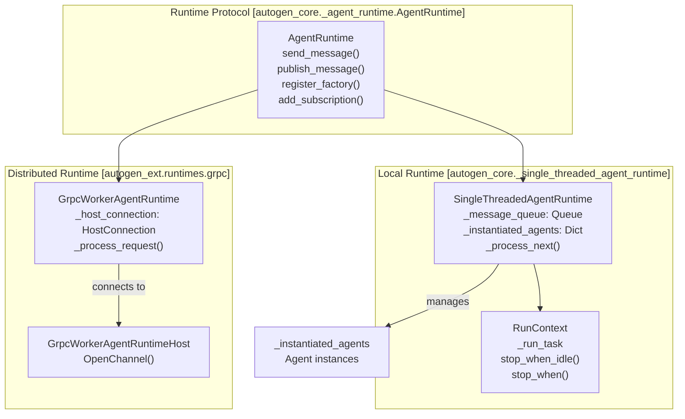

- **SingleThreadedAgentRuntime**: Provides local execution using an `asyncio.Queue` [python/packages/autogen-core/src/autogen_core/_single_threaded_agent_runtime.py:149-152](). It uses a `RunContext` to manage the processing loop [python/packages/autogen-core/src/autogen_core/_single_threaded_agent_runtime.py:99-131]().
- **GrpcWorkerAgentRuntime**: Enables distributed or cross-language agents by communicating with a host via gRPC [python/packages/autogen-ext/src/autogen_ext/runtimes/grpc/_worker_runtime.py:215-225](). It uses a `HostConnection` to manage bidirectional streams [python/packages/autogen-ext/src/autogen_ext/runtimes/grpc/_worker_runtime.py:95-124]().

For details, see [Agent Runtime System](#2.1).

Sources: [python/packages/autogen-core/src/autogen_core/_agent_runtime.py:21-188](), [python/packages/autogen-core/src/autogen_core/_single_threaded_agent_runtime.py:149-165](), [python/packages/autogen-ext/src/autogen_ext/runtimes/grpc/_worker_runtime.py:215-225]()

## Model Client System

The Model Client system provides a unified abstraction for interacting with Large Language Models (LLMs).

- **ChatCompletionClient**: The primary protocol for model interactions, supporting text and multimodal inputs.
- **Model Context**: Implementations like `BufferedChatCompletionContext` or `TokenLimitedChatCompletionContext` manage how conversation history is truncated or summarized before being sent to the model.
- **Tool System**: Defines `BaseTool` and `FunctionTool` for wrapping Python functions into schemas that LLMs can invoke.

For details, see [Model Client System](#2.2).

Sources: [python/packages/autogen-ext/src/autogen_ext/agents/video_surfer/tools.py:106-112](), [python/packages/autogen-core/tests/test_component_config.py:10-11]()

## Message Types and Tool Agents

Communication in AutoGen is structured through specific message types and specialized agents for tool execution.

- **LLMMessages**: A hierarchy including `SystemMessage`, `UserMessage`, `AssistantMessage`, and `FunctionExecutionResultMessage`.
- **ToolAgent**: A specialized agent designed to execute tools and return results to the requester.
- **Tool Calling Loop**: The `tool_agent_caller_loop` facilitates the iterative process of an LLM requesting tool calls and receiving results until a final answer is produced.

For details, see [Message Types and Tool Agents](#2.3).

Sources: [python/packages/autogen-ext/src/autogen_ext/agents/video_surfer/tools.py:127-134](), [python/packages/autogen-test-utils/src/autogen_test_utils/__init__.py:21-33]()

## Memory Systems

Memory systems allow agents to persist information across interactions and retrieve relevant context dynamically.

- **Memory Protocol**: Defines how content is stored and queried.
- **Implementations**: Includes simple `ListMemory`, vector-based `ChromaDB` for semantic search, and sequential storage like `Redis`.
- **MIME Types**: Supports various content types via `MemoryContent`.

For details, see [Memory Systems](#2.4).

## Component Configuration System

The Component Configuration system enables declarative definitions of agents, tools, and runtimes, allowing them to be serialized to JSON/YAML and reconstructed across different environments.

**Component Configuration Architecture**

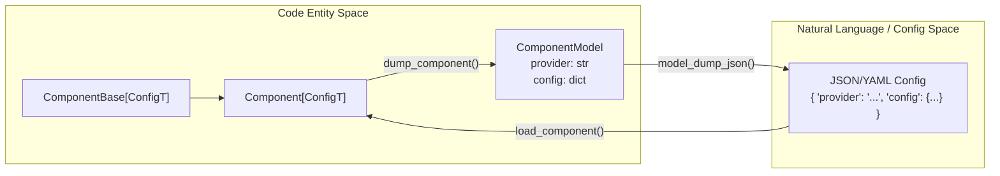

- **ComponentModel**: A Pydantic model that stores the `provider` (the class path) and the `config` dictionary [python/packages/autogen-core/src/autogen_core/_component_config.py:18-41]().
- **Serialization**: Components implement `_to_config()` and `_from_config()` to convert between Python instances and serializable models [python/packages/autogen-core/src/autogen_core/_component_config.py:135-145]().
- **Validation**: The `ValidationService` ensures that configurations match the expected schemas before instantiation [python/packages/autogen-studio/autogenstudio/web/routes/validation.py:12-19]().

For details, see [Component Configuration System](#2.5).

Sources: [python/packages/autogen-core/src/autogen_core/_component_config.py:18-41](), [python/packages/autogen-core/tests/test_component_config.py:21-34](), [python/packages/autogen-studio/autogenstudio/web/routes/validation.py:12-19]()

---

# Page: Agent Runtime System

# Agent Runtime System

<details>
<summary>Relevant source files</summary>

The following files were used as context for generating this wiki page:

- [docs/design/01 - Programming Model.md](docs/design/01 - Programming Model.md)
- [docs/design/02 - Topics.md](docs/design/02 - Topics.md)
- [docs/design/03 - Agent Worker Protocol.md](docs/design/03 - Agent Worker Protocol.md)
- [docs/design/04 - Agent and Topic ID Specs.md](docs/design/04 - Agent and Topic ID Specs.md)
- [docs/design/05 - Services.md](docs/design/05 - Services.md)
- [dotnet/samples/dev-team/DevTeam.ServiceDefaults/Extensions.cs](dotnet/samples/dev-team/DevTeam.ServiceDefaults/Extensions.cs)
- [protos/agent_worker.proto](protos/agent_worker.proto)
- [protos/cloudevent.proto](protos/cloudevent.proto)
- [python/docs/src/user-guide/agentchat-user-guide/tracing.ipynb](python/docs/src/user-guide/agentchat-user-guide/tracing.ipynb)
- [python/docs/src/user-guide/core-user-guide/framework/telemetry.md](python/docs/src/user-guide/core-user-guide/framework/telemetry.md)
- [python/fixup_generated_files.py](python/fixup_generated_files.py)
- [python/packages/autogen-core/src/autogen_core/_agent.py](python/packages/autogen-core/src/autogen_core/_agent.py)
- [python/packages/autogen-core/src/autogen_core/_agent_instantiation.py](python/packages/autogen-core/src/autogen_core/_agent_instantiation.py)
- [python/packages/autogen-core/src/autogen_core/_agent_runtime.py](python/packages/autogen-core/src/autogen_core/_agent_runtime.py)
- [python/packages/autogen-core/src/autogen_core/_base_agent.py](python/packages/autogen-core/src/autogen_core/_base_agent.py)
- [python/packages/autogen-core/src/autogen_core/_intervention.py](python/packages/autogen-core/src/autogen_core/_intervention.py)
- [python/packages/autogen-core/src/autogen_core/_queue.py](python/packages/autogen-core/src/autogen_core/_queue.py)
- [python/packages/autogen-core/src/autogen_core/_single_threaded_agent_runtime.py](python/packages/autogen-core/src/autogen_core/_single_threaded_agent_runtime.py)
- [python/packages/autogen-core/src/autogen_core/_telemetry/_propagation.py](python/packages/autogen-core/src/autogen_core/_telemetry/_propagation.py)
- [python/packages/autogen-core/src/autogen_core/_telemetry/_tracing.py](python/packages/autogen-core/src/autogen_core/_telemetry/_tracing.py)
- [python/packages/autogen-core/tests/protos/serialization_test_pb2.py](python/packages/autogen-core/tests/protos/serialization_test_pb2.py)
- [python/packages/autogen-core/tests/protos/serialization_test_pb2_grpc.py](python/packages/autogen-core/tests/protos/serialization_test_pb2_grpc.py)
- [python/packages/autogen-core/tests/test_base_agent.py](python/packages/autogen-core/tests/test_base_agent.py)
- [python/packages/autogen-core/tests/test_cancellation.py](python/packages/autogen-core/tests/test_cancellation.py)
- [python/packages/autogen-core/tests/test_closure_agent.py](python/packages/autogen-core/tests/test_closure_agent.py)
- [python/packages/autogen-core/tests/test_intervention.py](python/packages/autogen-core/tests/test_intervention.py)
- [python/packages/autogen-core/tests/test_routed_agent.py](python/packages/autogen-core/tests/test_routed_agent.py)
- [python/packages/autogen-core/tests/test_runtime.py](python/packages/autogen-core/tests/test_runtime.py)
- [python/packages/autogen-core/tests/test_state.py](python/packages/autogen-core/tests/test_state.py)
- [python/packages/autogen-core/tests/test_subscription.py](python/packages/autogen-core/tests/test_subscription.py)
- [python/packages/autogen-core/tests/test_types.py](python/packages/autogen-core/tests/test_types.py)
- [python/packages/autogen-ext/conftest.py](python/packages/autogen-ext/conftest.py)
- [python/packages/autogen-ext/src/autogen_ext/runtimes/grpc/_utils.py](python/packages/autogen-ext/src/autogen_ext/runtimes/grpc/_utils.py)
- [python/packages/autogen-ext/src/autogen_ext/runtimes/grpc/_worker_runtime.py](python/packages/autogen-ext/src/autogen_ext/runtimes/grpc/_worker_runtime.py)
- [python/packages/autogen-ext/src/autogen_ext/runtimes/grpc/_worker_runtime_host_servicer.py](python/packages/autogen-ext/src/autogen_ext/runtimes/grpc/_worker_runtime_host_servicer.py)
- [python/packages/autogen-ext/src/autogen_ext/runtimes/grpc/protos/__init__.py](python/packages/autogen-ext/src/autogen_ext/runtimes/grpc/protos/__init__.py)
- [python/packages/autogen-ext/src/autogen_ext/runtimes/grpc/protos/agent_worker_pb2.py](python/packages/autogen-ext/src/autogen_ext/runtimes/grpc/protos/agent_worker_pb2.py)
- [python/packages/autogen-ext/src/autogen_ext/runtimes/grpc/protos/agent_worker_pb2.pyi](python/packages/autogen-ext/src/autogen_ext/runtimes/grpc/protos/agent_worker_pb2.pyi)
- [python/packages/autogen-ext/src/autogen_ext/runtimes/grpc/protos/agent_worker_pb2_grpc.py](python/packages/autogen-ext/src/autogen_ext/runtimes/grpc/protos/agent_worker_pb2_grpc.py)
- [python/packages/autogen-ext/src/autogen_ext/runtimes/grpc/protos/agent_worker_pb2_grpc.pyi](python/packages/autogen-ext/src/autogen_ext/runtimes/grpc/protos/agent_worker_pb2_grpc.pyi)
- [python/packages/autogen-ext/src/autogen_ext/runtimes/grpc/protos/cloudevent_pb2.py](python/packages/autogen-ext/src/autogen_ext/runtimes/grpc/protos/cloudevent_pb2.py)
- [python/packages/autogen-ext/src/autogen_ext/runtimes/grpc/protos/cloudevent_pb2_grpc.py](python/packages/autogen-ext/src/autogen_ext/runtimes/grpc/protos/cloudevent_pb2_grpc.py)
- [python/packages/autogen-ext/tests/protos/serialization_test_pb2.py](python/packages/autogen-ext/tests/protos/serialization_test_pb2.py)
- [python/packages/autogen-ext/tests/protos/serialization_test_pb2_grpc.py](python/packages/autogen-ext/tests/protos/serialization_test_pb2_grpc.py)
- [python/packages/autogen-ext/tests/protos/serialization_test_pb2_grpc.pyi](python/packages/autogen-ext/tests/protos/serialization_test_pb2_grpc.pyi)
- [python/packages/autogen-ext/tests/test_worker_runtime.py](python/packages/autogen-ext/tests/test_worker_runtime.py)
- [python/packages/autogen-ext/tests/tools/http/test_http_tool.py](python/packages/autogen-ext/tests/tools/http/test_http_tool.py)
- [python/packages/autogen-test-utils/src/autogen_test_utils/telemetry_test_utils.py](python/packages/autogen-test-utils/src/autogen_test_utils/telemetry_test_utils.py)

</details>


The Agent Runtime System provides the foundational infrastructure for executing agents and managing message communication within AutoGen. It defines the core protocol for agent lifecycle management, message routing, and distributed execution. This system serves as the execution engine that orchestrates agent interactions through both local single-threaded and distributed gRPC-based runtimes.

For information about high-level agent APIs that use these runtimes, see [AssistantAgent](#3.1). For details about message types and serialization, see [Message Types and Tool Agents](#2.3).

## Runtime Protocol Interface

The `AgentRuntime` protocol defines the contract that all runtime implementations must fulfill. It provides a standardized interface for agent registration, message communication, and state management. This is defined as a `Protocol` class to enable structural typing.

**AgentRuntime Protocol Structure**

```mermaid
graph TB
    subgraph "AgentRuntime Protocol"
        AR["AgentRuntime<br/>@runtime_checkable Protocol"]
    end
    
    subgraph "Message Operations"
        SM["send_message()<br/>recipient: AgentId<br/>returns: Any"]
        PM["publish_message()<br/>topic_id: TopicId<br/>returns: None"] 
    end
    
    subgraph "Agent Lifecycle"
        RF["register_factory()<br/>type: str | AgentType<br/>agent_factory: Callable<br/>returns: AgentType"]
        RAI["register_agent_instance()<br/>agent_instance: Agent<br/>agent_id: AgentId<br/>returns: AgentId"]
        TG["try_get_underlying_agent_instance()<br/>id: AgentId<br/>type: Type[T]<br/>returns: T"]
    end
    
    subgraph "State Persistence"
        SS["save_state()<br/>returns: Mapping[str, Any]"]
        LS["load_state()<br/>state: Mapping[str, Any]"]
        ASS["agent_save_state()<br/>agent: AgentId"]
        ALS["agent_load_state()<br/>agent: AgentId, state"]
    end
    
    subgraph "Subscription Control"
        AS["add_subscription()<br/>subscription: Subscription"]
        RS["remove_subscription()<br/>id: str"]
        AMS["add_message_serializer()<br/>serializer: MessageSerializer"]
    end
    
    subgraph "Metadata"
        AM["agent_metadata()<br/>agent: AgentId<br/>returns: AgentMetadata"]
    end
    
    AR --> SM
    AR --> PM
    AR --> RF
    AR --> RAI
    AR --> TG
    AR --> SS
    AR --> LS
    AR --> ASS
    AR --> ALS
    AR --> AS
    AR --> RS
    AR --> AMS
    AR --> AM
```

**Runtime Implementations**

| Implementation | Location | Use Case |
|----------------|----------|----------|
| `SingleThreadedAgentRuntime` | `autogen_core._single_threaded_agent_runtime` | Local development, single-process execution |
| `GrpcWorkerAgentRuntime` | `autogen_ext.runtimes.grpc._worker_runtime` | Distributed execution, cross-language agents |

Sources: [python/packages/autogen-core/src/autogen_core/_agent_runtime.py:20-296]()

## Message Routing and Subscriptions

The runtime system uses a subscription-based routing mechanism to deliver published messages to interested agents. The `SubscriptionManager` handles the mapping between topic types and agent instances.

**Subscription System Architecture**

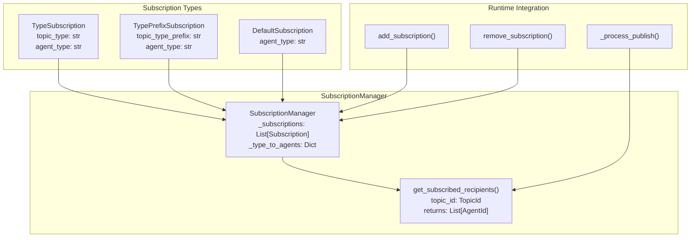

**Subscription Resolution Process**

1. Agent registers with runtime using `register_factory()` or `register_agent_instance()` [python/packages/autogen-core/src/autogen_core/_agent_runtime.py:75-185]().
2. Subscriptions are added via `add_subscription()` (often handled automatically by agent decorators) [python/packages/autogen-core/src/autogen_core/_agent_runtime.py:207-217]().
3. When `publish_message()` is called with a `TopicId`, the runtime queries `SubscriptionManager` [python/packages/autogen-core/src/autogen_core/_single_threaded_agent_runtime.py:557-630]().
4. `get_subscribed_recipients()` returns all `AgentId`s matching the topic [python/packages/autogen-core/src/autogen_core/_runtime_impl_helpers.py:120-130]().
5. Runtime delivers message to each subscribed agent via `on_message()` [python/packages/autogen-core/src/autogen_core/_single_threaded_agent_runtime.py:596-613]().

Sources: [python/packages/autogen-core/src/autogen_core/_single_threaded_agent_runtime.py:265](), [python/packages/autogen-core/src/autogen_core/_runtime_impl_helpers.py:80-150](), [docs/design/02 - Topics.md:36-45]()

## Message Envelope System

The runtime uses a message envelope system to manage different types of message operations. Each envelope type encapsulates the necessary information for routing and processing messages.

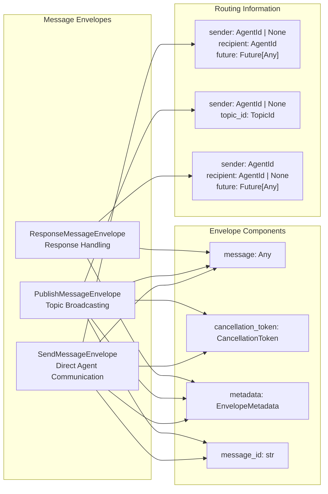

Each envelope type serves a specific communication pattern:

- **SendMessageEnvelope**: Used for direct agent-to-agent RPC-style communication with response handling [python/packages/autogen-core/src/autogen_core/_single_threaded_agent_runtime.py:71-82]().
- **PublishMessageEnvelope**: Used for broadcasting messages to all subscribed agents on a topic [python/packages/autogen-core/src/autogen_core/_single_threaded_agent_runtime.py:58-68]().
- **ResponseMessageEnvelope**: Used internally to deliver responses back to the original sender [python/packages/autogen-core/src/autogen_core/_single_threaded_agent_runtime.py:85-93]().

Sources: [python/packages/autogen-core/src/autogen_core/_single_threaded_agent_runtime.py:57-93]()

## SingleThreadedAgentRuntime Implementation

The `SingleThreadedAgentRuntime` is the primary local execution engine that processes all messages using a single asyncio event loop. It provides concurrent message processing while maintaining deterministic message ordering.

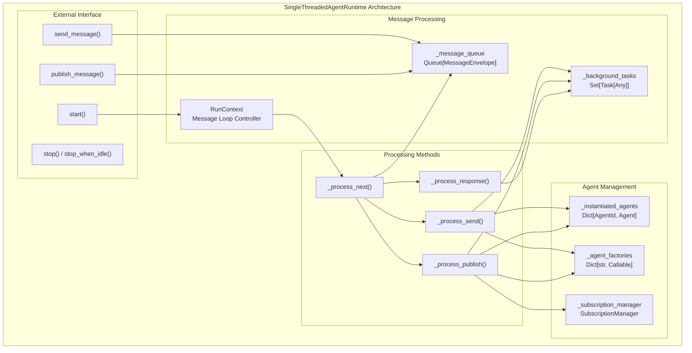

### Key Components

| Component | Type | Purpose | Location |
|-----------|------|---------|----------|
| **_message_queue** | `Queue[MessageEnvelope]` | Central asyncio queue for all message envelopes | [python/packages/autogen-core/src/autogen_core/_single_threaded_agent_runtime.py:257]() |
| **_run_context** | `RunContext | None` | Manages the message processing loop lifecycle | [python/packages/autogen-core/src/autogen_core/_single_threaded_agent_runtime.py:266]() |
| **_subscription_manager** | `SubscriptionManager` | Routes published messages to subscribed agents | [python/packages/autogen-core/src/autogen_core/_single_threaded_agent_runtime.py:265]() |
| **_agent_factories** | `Dict[str, Callable]` | Stores agent factory functions for lazy instantiation | [python/packages/autogen-core/src/autogen_core/_single_threaded_agent_runtime.py:259-261]() |
| **_instantiated_agents** | `Dict[AgentId, Agent]` | Cache of already instantiated agent instances | [python/packages/autogen-core/src/autogen_core/_single_threaded_agent_runtime.py:262]() |
| **_background_tasks** | `Set[Task[Any]]` | Tracks concurrent message processing tasks | [python/packages/autogen-core/src/autogen_core/_single_threaded_agent_runtime.py:264]() |
| **_intervention_handlers** | `List[InterventionHandler] | None` | Optional message interceptors for logging/modification | [python/packages/autogen-core/src/autogen_core/_single_threaded_agent_runtime.py:263]() |
| **_serialization_registry** | `SerializationRegistry` | Manages message type serialization/deserialization | [python/packages/autogen-core/src/autogen_core/_single_threaded_agent_runtime.py:267]() |

### Message Processing Flow

The runtime processes messages through a unified pipeline implemented in `_process_next()` [python/packages/autogen-core/src/autogen_core/_single_threaded_agent_runtime.py:671-795]():

**Processing Pipeline**

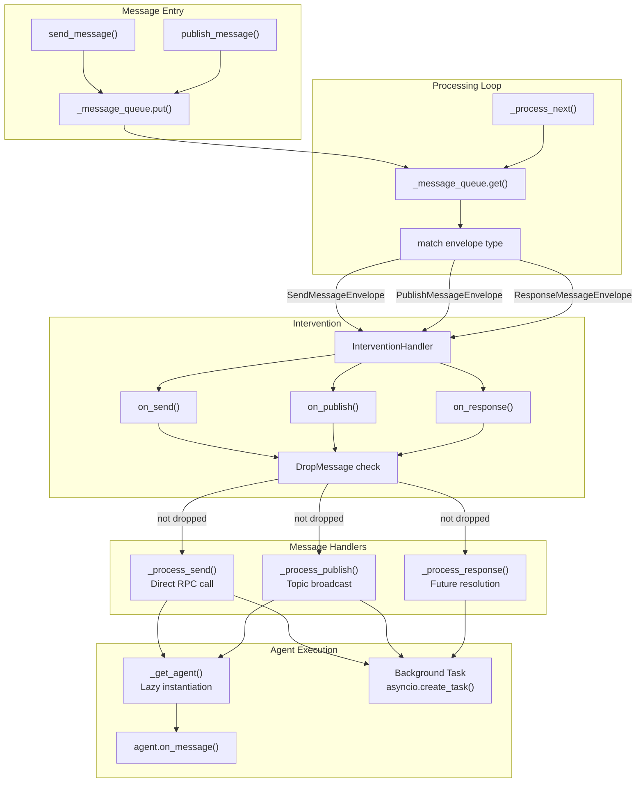

**Processing Steps**

1. **Message Enqueueing** ([python/packages/autogen-core/src/autogen_core/_single_threaded_agent_runtime.py:332-429]()): `send_message()` and `publish_message()` create envelopes and add to queue.
2. **Dequeue** ([python/packages/autogen-core/src/autogen_core/_single_threaded_agent_runtime.py:671-687]()): `_process_next()` retrieves next envelope from queue.
3. **Intervention** ([python/packages/autogen-core/src/autogen_core/_single_threaded_agent_runtime.py:691-791]()): Optional `InterventionHandler.on_send/on_publish/on_response()` can modify or drop messages.
4. **Agent Instantiation** ([python/packages/autogen-core/src/autogen_core/_single_threaded_agent_runtime.py:886-923]()): `_get_agent()` lazily creates agents using registered factories and `AgentInstantiationContext`.
5. **Message Delivery** ([python/packages/autogen-core/src/autogen_core/_single_threaded_agent_runtime.py:466-555](), [557-630]()): Agent's `on_message()` is called with `MessageContext`.
6. **Background Execution** ([python/packages/autogen-core/src/autogen_core/_single_threaded_agent_runtime.py:724-726](), [764-766]()): Processing happens in background tasks tracked in `_background_tasks`.
7. **Response Routing** ([python/packages/autogen-core/src/autogen_core/_single_threaded_agent_runtime.py:632-662]()): For `send_message()`, responses resolve the original `Future`.

Sources: [python/packages/autogen-core/src/autogen_core/_single_threaded_agent_runtime.py:664-795](), [python/packages/autogen-core/src/autogen_core/_single_threaded_agent_runtime.py:886-923]()

## GrpcWorkerAgentRuntime Implementation

The `GrpcWorkerAgentRuntime` enables distributed agent execution by connecting worker processes to a central host via gRPC. This allows agents to run across multiple processes or machines while maintaining the same runtime interface.

```mermaid
graph TB
    subgraph "Distributed Runtime Architecture"
        subgraph "Host Connection"
            HC["HostConnection"]
            STUB["AgentRpcAsyncStub"]
            SQ["_send_queue<br/>Queue[agent_worker_pb2.Message]"]
            RQ["_recv_queue<br/>Queue[agent_worker_pb2.Message]"]
        end
        
        subgraph "Message Processing"
            RL["_run_read_loop()"]
            PR_REQ["_process_request()"]
            PR_RESP["_process_response()"]
            PR_EVENT["_process_event()"]
        end
        
        subgraph "Serialization"
            SR["_serialization_registry<br/>SerializationRegistry"]
            JSON["JSON_DATA_CONTENT_TYPE"]
            PROTO["PROTOBUF_DATA_CONTENT_TYPE"]
        end
        
        subgraph "Local Agent Management"
            LAF["_agent_factories<br/>Dict[str, Callable]"]
            LIA["_instantiated_agents<br/>Dict[AgentId, Agent]"]
            LSM["_subscription_manager<br/>SubscriptionManager"]
        end
    end
    
    HC --> STUB
    HC --> SQ
    HC --> RQ
    
    RL --> RQ
    RL --> PR_REQ
    RL --> PR_RESP
    RL --> PR_EVENT
    
    PR_REQ --> SR
    PR_RESP --> SR
    PR_EVENT --> SR
    
    PR_REQ --> LIA
    PR_EVENT --> LIA
    PR_REQ --> LAF
    PR_EVENT --> LAF
    
    SR --> JSON
    SR --> PROTO
```

### GRPC Communication Protocol

The worker runtime communicates with the host using protobuf messages defined in `agent_worker.proto` [protos/agent_worker.proto]():

**Protobuf Message Structure**

```mermaid
graph TB
    subgraph "agent_worker_pb2.Message"
        MSG["Message<br/>oneof message"]
        REQ["request: RpcRequest"]
        RESP["response: RpcResponse"]
        CE["cloudEvent: CloudEvent"]
    end
    
    subgraph "RpcRequest"
        RR["RpcRequest"]
        RRID["request_id: str"]
        RTAR["target: AgentId"]
        RSRC["source: AgentId | None"]
        RPAY["payload: Payload"]
        RMETA["metadata: Dict[str, str]"]
    end
    
    subgraph "RpcResponse"
        RS["RpcResponse"]
        RSID["request_id: str"]
        RSPAY["payload: Payload | None"]
        RSERR["error: str"]
        RSMETA["metadata: Dict[str, str]"]
    end
    
    subgraph "CloudEvent"
        CEV["CloudEvent"]
        CEID["id: str"]
        CETYPE["type: str (topic_type)"]
        CESRC["source: str (topic_source)"]
        CEATTR["attributes: Dict"]
        CEDATA["binary_data | proto_data"]
    end
    
    MSG --> REQ
    MSG --> RESP
    MSG --> CE
    
    REQ --> RR
    RR --> RRID
    RR --> RTAR
    RR --> RSRC
    RR --> RPAY
    RR --> RMETA
    
    RESP --> RS
    RS --> RSID
    RS --> RSPAY
    RS --> RSERR
    RS --> RSMETA
    
    CE --> CEV
    CEV --> CEID
    CEV --> CETYPE
    CEV --> CESRC
    CEV --> CEATTR
    CEV --> CEDATA
```

| Message Type | Direction | Purpose | Handled By |
|-------------|-----------|---------|------------|
| **RpcRequest** | Host → Worker | Direct agent method invocation | `_process_request()` [python/packages/autogen-ext/src/autogen_ext/runtimes/grpc/_worker_runtime.py:512-582]() |
| **RpcResponse** | Worker → Host / Host → Worker | Method call result or error | `_process_response()` [python/packages/autogen-ext/src/autogen_ext/runtimes/grpc/_worker_runtime.py:584-603]() |
| **CloudEvent** | Host → Worker | Published topic messages | `_process_event()` [python/packages/autogen-ext/src/autogen_ext/runtimes/grpc/_worker_runtime.py:605-703]() |

### Connection Management

The `HostConnection` class manages the bidirectional gRPC stream between worker and host [python/packages/autogen-ext/src/autogen_ext/runtimes/grpc/_worker_runtime.py:95-200]():

**HostConnection Architecture**

```mermaid
graph TB
    subgraph "HostConnection"
        HC["HostConnection"]
        CH["_channel: grpc.aio.Channel"]
        STUB["_stub: AgentRpcAsyncStub"]
        SQ["_send_queue: Queue[Message]"]
        RQ["_recv_queue: Queue[Message]"]
        CT["_connection_task: Task"]
        CID["_client_id: str (UUID)"]
    end
    
    subgraph "Connection Lifecycle"
        FROM["from_host_address()<br/>classmethod"]
        CONN["_connect()<br/>staticmethod"]
        RL["read_loop()<br/>async task"]
        CLOSE["close()"]
    end
    
    subgraph "Stream Operations"
        SEND["send(Message)"]
        RECV["recv() -> Message"]
        OC["OpenChannel()<br/>bidirectional stream"]
    end
    
    HC --> CH
    HC --> STUB
    HC --> SQ
    HC --> RQ
    HC --> CT
    HC --> CID
    
    FROM --> CONN
    CONN --> OC
    OC --> RL
    
    SEND --> SQ
    RECV --> RQ
    RL --> RQ
    CLOSE --> CH
```

**Connection Features**

| Feature | Implementation | Location |
|---------|----------------|----------|
| **Retry Policy** | Exponential backoff, max 3 attempts, retries UNAVAILABLE status | [python/packages/autogen-ext/src/autogen_ext/runtimes/grpc/_worker_runtime.py:96-116]() |
| **Stream Management** | `OpenChannel()` bidirectional RPC with metadata-based client identification | [python/packages/autogen-ext/src/autogen_ext/runtimes/grpc/_worker_runtime.py:173-190]() |
| **Queue Separation** | Independent send/recv queues for async bidirectional communication | [python/packages/autogen-ext/src/autogen_ext/runtimes/grpc/_worker_runtime.py:120-121]() |
| **Connection Establishment** | Insecure channel creation with configurable options | [python/packages/autogen-ext/src/autogen_ext/runtimes/grpc/_worker_runtime.py:134-156]() |

Sources: [python/packages/autogen-ext/src/autogen_ext/runtimes/grpc/_worker_runtime.py:95-200]()

## Lifecycle Management

Both runtime implementations follow a consistent lifecycle pattern for managing agent execution and cleanup.

```mermaid
stateDiagram-v2
    [*] --> Created : "new Runtime()"
    Created --> Started : "start() / runtime.start()"
    Started --> Processing : "Message Processing Loop"
    Processing --> Processing : "send_message() / publish_message()"
    Processing --> Stopping : "stop() / stop_when_idle()"
    Processing --> StoppingWithCondition : "stop_when(condition)"
    Stopping --> Stopped : "Background tasks complete"
    StoppingWithCondition --> Stopped : "Condition met + tasks complete"
    Stopped --> Closed : "close()"
    Closed --> [*]
    
    Started --> AgentRegistration : "register_factory() / register_agent_instance()"
    AgentRegistration --> Started : "Registration complete"
```

### Runtime States

| State | Description | Available Operations |
|-------|-------------|---------------------|
| **Created** | Runtime instantiated but not started | Configuration, agent registration |
| **Started** | Message processing loop active | All runtime operations |
| **Processing** | Actively handling messages | Message operations, agent registration |
| **Stopping** | Graceful shutdown in progress | Limited operations, awaiting completion |
| **Stopped** | Message processing halted | State persistence, restart possible |
| **Closed** | All resources released | None - runtime must be recreated |

### Agent Instantiation Context

The runtime provides context information during agent creation through `AgentInstantiationContext`, a static class using `ContextVar` for thread-safe context management:

**AgentInstantiationContext Usage**

```mermaid
graph TB
    subgraph "Context Management"
        AIC["AgentInstantiationContext<br/>Static class with ContextVar"]
        CTXVAR["_AGENT_INSTANTIATION_CONTEXT_VAR<br/>ContextVar[tuple[AgentRuntime, AgentId]]"]
        PC["populate_context(ctx)<br/>@contextmanager"]
    end
    
    subgraph "Context Access"
        CR["current_runtime()<br/>returns: AgentRuntime"]
        CAI["current_agent_id()<br/>returns: AgentId"]
        IFC["is_in_factory_call()<br/>returns: bool"]
    end
    
    subgraph "Runtime Integration"
        RF["register_factory()"]
        IF["_invoke_agent_factory()"]
        FA["agent_factory()"]
    end
    
    subgraph "Agent Creation"
        AC["Agent.__init__()"]
        BA["BaseAgent.__init__()"]
        BIND["bind_id_and_runtime()"]
    end
    
    AIC --> CTXVAR
    AIC --> PC
    AIC --> CR
    AIC --> CAI
    AIC --> IFC
    
    RF --> IF
    IF --> PC
    PC --> FA
    FA --> AC
    AC --> IFC
    AC --> BA
    BA --> CR
    BA --> CAI
    
    IF --> BIND
```

**Context Lifecycle**

1. **Context Setup** ([python/packages/autogen-core/src/autogen_core/_single_threaded_agent_runtime.py:886-923]()): Runtime calls `_invoke_agent_factory()` which uses `AgentInstantiationContext.populate_context()`.
2. **Factory Execution**: Factory function executes with context available [python/packages/autogen-core/src/autogen_core/_agent_instantiation.py:64-79]().
3. **Agent Construction**: `BaseAgent.__init__()` checks `is_in_factory_call()` and retrieves runtime/ID if true [python/packages/autogen-core/src/autogen_core/_base_agent.py:85-104]().
4. **Manual Binding**: For direct instantiation, `bind_id_and_runtime()` must be called explicitly [python/packages/autogen-core/src/autogen_core/_base_agent.py:106-117]().
5. **Context Cleanup**: Context automatically reset when exiting the context manager [python/packages/autogen-core/src/autogen_core/_agent_instantiation.py:53-62]().

Sources: [python/packages/autogen-core/src/autogen_core/_agent_instantiation.py:9-127](), [python/packages/autogen-core/src/autogen_core/_base_agent.py:85-104](), [python/packages/autogen-core/src/autogen_core/_single_threaded_agent_runtime.py:886-923]()

## Telemetry and Tracing

The runtime system includes comprehensive telemetry support through OpenTelemetry integration, providing observability into agent interactions and message flow.

```mermaid
graph TB
    subgraph "Telemetry Components"
        TH["TraceHelper<br/>OpenTelemetry Integration"]
        MTC["MessageRuntimeTracingConfig<br/>Span Configuration"]
        EM["EnvelopeMetadata<br/>Trace Propagation"]
    end
    
    subgraph "Trace Operations"
        CREATE["create<br/>Message Creation"]
        SEND["send<br/>Message Sending"]
        PUBLISH["publish<br/>Message Publishing"]
        PROCESS["process<br/>Agent Processing"]
        ACK["ack<br/>Response Acknowledgment"]
    end
    
    subgraph "Trace Attributes"
        AGT["Agent Type/Class"]
        MT["Message Type"]
        RID["Request ID"]
        MC["Message Context"]
    end
    
    TH --> MTC
    TH --> CREATE
    TH --> SEND
    TH --> PUBLISH
    TH --> PROCESS
    TH --> ACK
    
    CREATE --> EM
    SEND --> EM
    PUBLISH --> EM
    
    PROCESS --> AGT
    PROCESS --> MT
    PROCESS --> RID
    PROCESS --> MC
```

### Trace Propagation

The system supports distributed tracing across runtime boundaries:

- **Envelope Metadata**: Carries trace context in message envelopes [python/packages/autogen-core/src/autogen_core/_single_threaded_agent_runtime.py:58-82]().
- **gRPC Metadata**: Propagates traces across distributed worker connections [python/packages/autogen-ext/src/autogen_ext/runtimes/grpc/_worker_runtime.py:131-132]().
- **Context Links**: Links related spans across agent interactions [python/packages/autogen-core/src/autogen_core/_telemetry/_tracing.py:79-94]().

### Observability Features

| Feature | Purpose | Implementation |
|---------|---------|----------------|
| **Message Tracing** | Track message flow between agents | `TraceHelper.trace_block` creation for each message operation [python/packages/autogen-core/src/autogen_core/_telemetry/_tracing.py:40-99]() |
| **Agent Instrumentation** | Monitor agent lifecycle and performance | Agent creation and invocation spans [python/docs/src/user-guide/core-user-guide/framework/telemetry.md:7-10]() |
| **Error Tracking** | Capture and contextualize exceptions | Exception recording with span status [python/packages/autogen-core/src/autogen_core/_telemetry/_tracing.py:50-51]() |
| **Distributed Correlation** | Connect traces across runtime boundaries | Trace context propagation via metadata [python/packages/autogen-core/src/autogen_core/_telemetry/_propagation.py:8-9]() |

Sources: [python/packages/autogen-core/src/autogen_core/_telemetry/_tracing.py:12-100](), [python/packages/autogen-core/src/autogen_core/_single_threaded_agent_runtime.py:282-329](), [python/docs/src/user-guide/core-user-guide/framework/telemetry.md:1-16]()

---

# Page: Model Client System

# Model Client System

<details>
<summary>Relevant source files</summary>

The following files were used as context for generating this wiki page:

- [python/packages/autogen-agentchat/tests/test_declarative_components.py](python/packages/autogen-agentchat/tests/test_declarative_components.py)
- [python/packages/autogen-core/src/autogen_core/_constants.py](python/packages/autogen-core/src/autogen_core/_constants.py)
- [python/packages/autogen-core/src/autogen_core/_function_utils.py](python/packages/autogen-core/src/autogen_core/_function_utils.py)
- [python/packages/autogen-core/src/autogen_core/_routed_agent.py](python/packages/autogen-core/src/autogen_core/_routed_agent.py)
- [python/packages/autogen-core/src/autogen_core/logging.py](python/packages/autogen-core/src/autogen_core/logging.py)
- [python/packages/autogen-core/src/autogen_core/model_context/__init__.py](python/packages/autogen-core/src/autogen_core/model_context/__init__.py)
- [python/packages/autogen-core/src/autogen_core/model_context/_buffered_chat_completion_context.py](python/packages/autogen-core/src/autogen_core/model_context/_buffered_chat_completion_context.py)
- [python/packages/autogen-core/src/autogen_core/model_context/_chat_completion_context.py](python/packages/autogen-core/src/autogen_core/model_context/_chat_completion_context.py)
- [python/packages/autogen-core/src/autogen_core/model_context/_head_and_tail_chat_completion_context.py](python/packages/autogen-core/src/autogen_core/model_context/_head_and_tail_chat_completion_context.py)
- [python/packages/autogen-core/src/autogen_core/model_context/_token_limited_chat_completion_context.py](python/packages/autogen-core/src/autogen_core/model_context/_token_limited_chat_completion_context.py)
- [python/packages/autogen-core/src/autogen_core/model_context/_unbounded_chat_completion_context.py](python/packages/autogen-core/src/autogen_core/model_context/_unbounded_chat_completion_context.py)
- [python/packages/autogen-core/src/autogen_core/models/_model_client.py](python/packages/autogen-core/src/autogen_core/models/_model_client.py)
- [python/packages/autogen-core/src/autogen_core/models/_types.py](python/packages/autogen-core/src/autogen_core/models/_types.py)
- [python/packages/autogen-core/src/autogen_core/tools/_function_tool.py](python/packages/autogen-core/src/autogen_core/tools/_function_tool.py)
- [python/packages/autogen-core/src/autogen_core/utils/_json_to_pydantic.py](python/packages/autogen-core/src/autogen_core/utils/_json_to_pydantic.py)
- [python/packages/autogen-core/tests/test_json_to_pydantic.py](python/packages/autogen-core/tests/test_json_to_pydantic.py)
- [python/packages/autogen-core/tests/test_model_context.py](python/packages/autogen-core/tests/test_model_context.py)
- [python/packages/autogen-core/tests/test_tool_agent.py](python/packages/autogen-core/tests/test_tool_agent.py)
- [python/packages/autogen-core/tests/test_tools.py](python/packages/autogen-core/tests/test_tools.py)
- [python/packages/autogen-ext/src/autogen_ext/auth/azure/__init__.py](python/packages/autogen-ext/src/autogen_ext/auth/azure/__init__.py)
- [python/packages/autogen-ext/src/autogen_ext/experimental/task_centric_memory/__init__.py](python/packages/autogen-ext/src/autogen_ext/experimental/task_centric_memory/__init__.py)
- [python/packages/autogen-ext/src/autogen_ext/experimental/task_centric_memory/utils/__init__.py](python/packages/autogen-ext/src/autogen_ext/experimental/task_centric_memory/utils/__init__.py)
- [python/packages/autogen-ext/src/autogen_ext/experimental/task_centric_memory/utils/chat_completion_client_recorder.py](python/packages/autogen-ext/src/autogen_ext/experimental/task_centric_memory/utils/chat_completion_client_recorder.py)
- [python/packages/autogen-ext/src/autogen_ext/models/anthropic/_model_info.py](python/packages/autogen-ext/src/autogen_ext/models/anthropic/_model_info.py)
- [python/packages/autogen-ext/src/autogen_ext/models/llama_cpp/_llama_cpp_completion_client.py](python/packages/autogen-ext/src/autogen_ext/models/llama_cpp/_llama_cpp_completion_client.py)
- [python/packages/autogen-ext/src/autogen_ext/models/openai/__init__.py](python/packages/autogen-ext/src/autogen_ext/models/openai/__init__.py)
- [python/packages/autogen-ext/src/autogen_ext/models/openai/_message_transform.py](python/packages/autogen-ext/src/autogen_ext/models/openai/_message_transform.py)
- [python/packages/autogen-ext/src/autogen_ext/models/openai/_model_info.py](python/packages/autogen-ext/src/autogen_ext/models/openai/_model_info.py)
- [python/packages/autogen-ext/src/autogen_ext/models/openai/_openai_client.py](python/packages/autogen-ext/src/autogen_ext/models/openai/_openai_client.py)
- [python/packages/autogen-ext/src/autogen_ext/models/openai/_transformation/__init__.py](python/packages/autogen-ext/src/autogen_ext/models/openai/_transformation/__init__.py)
- [python/packages/autogen-ext/src/autogen_ext/models/openai/_transformation/registry.py](python/packages/autogen-ext/src/autogen_ext/models/openai/_transformation/registry.py)
- [python/packages/autogen-ext/src/autogen_ext/models/openai/_transformation/types.py](python/packages/autogen-ext/src/autogen_ext/models/openai/_transformation/types.py)
- [python/packages/autogen-ext/src/autogen_ext/models/openai/_utils.py](python/packages/autogen-ext/src/autogen_ext/models/openai/_utils.py)
- [python/packages/autogen-ext/src/autogen_ext/models/openai/config/__init__.py](python/packages/autogen-ext/src/autogen_ext/models/openai/config/__init__.py)
- [python/packages/autogen-ext/src/autogen_ext/models/replay/_replay_chat_completion_client.py](python/packages/autogen-ext/src/autogen_ext/models/replay/_replay_chat_completion_client.py)
- [python/packages/autogen-ext/src/autogen_ext/tools/mcp/_factory.py](python/packages/autogen-ext/src/autogen_ext/tools/mcp/_factory.py)
- [python/packages/autogen-ext/src/autogen_ext/tools/mcp/_sse.py](python/packages/autogen-ext/src/autogen_ext/tools/mcp/_sse.py)
- [python/packages/autogen-ext/src/autogen_ext/tools/mcp/_stdio.py](python/packages/autogen-ext/src/autogen_ext/tools/mcp/_stdio.py)
- [python/packages/autogen-ext/tests/models/test_openai_model_client.py](python/packages/autogen-ext/tests/models/test_openai_model_client.py)
- [python/packages/component-schema-gen/src/component_schema_gen/__main__.py](python/packages/component-schema-gen/src/component_schema_gen/__main__.py)
- [python/samples/agentchat_dspy/single_agent.py](python/samples/agentchat_dspy/single_agent.py)

</details>


The Model Client System provides a unified abstraction layer for integrating different Large Language Model (LLM) providers into the AutoGen framework. This system defines the `ChatCompletionClient` interface and implements concrete clients for various providers like OpenAI, Anthropic, Ollama, and others, enabling seamless switching between different LLM backends while maintaining consistent functionality.

## Core Architecture

The Model Client System is built around the `ChatCompletionClient` abstract base class, which defines a standardized interface for all LLM interactions. This abstraction enables agents to work with any LLM provider without modification.

```mermaid
classDiagram
    class ChatCompletionClient {
        <<abstract>>
        +create(messages, tools, tool_choice, json_output) CreateResult
        +create_stream(messages, tools, tool_choice, json_output) AsyncGenerator
        +count_tokens(messages, tools) int
        +remaining_tokens(messages, tools) int
        +close() None
        +actual_usage() RequestUsage
        +total_usage() RequestUsage
        +model_info() ModelInfo
    }
    
    class BaseOpenAIChatCompletionClient {
        <<abstract>>
        -_client: Union[AsyncOpenAI, AsyncAzureOpenAI]
        -_create_args: Dict
        -_model_info: ModelInfo
        +_process_create_args() CreateParams
        +count_tokens_openai() int
    }
    
    class OpenAIChatCompletionClient {
        +__init__(model, api_key, base_url)
    }
    
    class AzureOpenAIChatCompletionClient {
        +__init__(azure_deployment, api_version, azure_endpoint)
    }

    class ChatCompletionContext {
        <<abstract>>
        +add_message(message)
        +get_messages() Sequence[LLMMessage]
        +clear()
    }
    
    ChatCompletionClient <|-- BaseOpenAIChatCompletionClient
    BaseOpenAIChatCompletionClient <|-- OpenAIChatCompletionClient
    BaseOpenAIChatCompletionClient <|-- AzureOpenAIChatCompletionClient
```

**Sources:** [python/packages/autogen-core/src/autogen_core/models/_model_client.py:209-301](), [python/packages/autogen-ext/src/autogen_ext/models/openai/_openai_client.py:419-476](), [python/packages/autogen-core/src/autogen_core/model_context/_chat_completion_context.py:12-42]()

### Core Interface Methods

The `ChatCompletionClient` defines several key methods that all implementations must provide:

| Method | Purpose | Return Type |
|--------|---------|-------------|
| `create()` | Generate a single completion response | `CreateResult` |
| `create_stream()` | Generate streaming completion responses | `AsyncGenerator[Union[str, CreateResult], None]` |
| `count_tokens()` | Count tokens in messages and tools | `int` |
| `remaining_tokens()` | Calculate remaining tokens within model limits | `int` |
| `close()` | Clean up client resources | `None` |
| `actual_usage()` | Get actual token usage statistics | `RequestUsage` |
| `total_usage()` | Get cumulative token usage statistics | `RequestUsage` |

**Sources:** [python/packages/autogen-core/src/autogen_core/models/_model_client.py:211-300]()

## Model Information and Capabilities

The system uses `ModelInfo` to describe model properties, ensuring that agents can verify if a model supports required features like vision or function calling before attempting an operation.

### ModelInfo and ModelFamily

`ModelInfo` is a `TypedDict` containing required capability flags. `ModelFamily` provides a namespace for categorizing models (e.g., `GPT_4O`, `R1`, `CLAUDE_3_5_SONNET`).

| Field | Type | Description |
|-------|------|-------------|
| `vision` | `bool` | Supports image input |
| `function_calling` | `bool` | Supports native tool use |
| `json_output` | `bool` | Supports JSON mode |
| `structured_output` | `bool` | Supports schema-constrained JSON |
| `family` | `ModelFamily` | The architectural family of the model |

**Sources:** [python/packages/autogen-core/src/autogen_core/models/_model_client.py:16-95](), [python/packages/autogen-core/src/autogen_core/models/_model_client.py:164-184](), [python/packages/autogen-core/src/autogen_core/models/_model_client.py:185-207]()

## Model Context Management

`ChatCompletionContext` implementations manage the history of messages sent to a model. This is critical for handling context window limits and memory strategies.

| Implementation | Strategy | File Path |
|----------------|----------|-----------|
| `UnboundedChatCompletionContext` | Keeps all messages indefinitely. | [python/packages/autogen-core/src/autogen_core/model_context/_unbounded_chat_completion_context.py:9-37]() |
| `BufferedChatCompletionContext` | Keeps the last `N` messages. | [python/packages/autogen-core/src/autogen_core/model_context/_buffered_chat_completion_context.py:11-54]() |
| `HeadAndTailChatCompletionContext` | Keeps the first `N` (system/context) and last `M` messages. | [python/packages/autogen-core/src/autogen_core/model_context/_head_and_tail_chat_completion_context.py:12-78]() |
| `TokenLimitedChatCompletionContext` | Prunes history based on a token limit using `count_tokens`. | [python/packages/autogen-core/src/autogen_core/model_context/_token_limited_chat_completion_context.py:14-87]() |

**Sources:** [python/packages/autogen-core/src/autogen_core/model_context/__init__.py:1-20]()

## Message Transformation Pipeline

The Model Client System includes a modular transformation pipeline that converts AutoGen's unified `LLMMessage` format into provider-specific SDK formats (e.g., OpenAI's `ChatCompletionMessageParam`).

### Modular Transformer Pipeline

The pipeline decouples transformation logic from client implementation using "Mini Transformers"—functions that transform specific fields into keyword arguments.

```mermaid
graph TD
    subgraph "Natural Language Space"
        UserMsg["UserMessage: 'Search for AutoGen'"]
        SysMsg["SystemMessage: 'You are a helpful assistant'"]
    end

    subgraph "Code Entity Space"
        LLMMessage["LLMMessage (autogen_core.models)"]
        to_oai_type["to_oai_type() (autogen_ext.models.openai)"]
        TransformerMap["TransformerMap (autogen_ext.models.openai._transformation)"]
        MiniTrans["_set_role(), _set_content_direct()"]
        SDKParam["ChatCompletionMessageParam (openai.types.chat)"]
    end

    UserMsg --> LLMMessage
    SysMsg --> LLMMessage
    LLMMessage --> to_oai_type
    to_oai_type --> TransformerMap
    TransformerMap --> MiniTrans
    MiniTrans --> SDKParam
```

**Key Components:**
- `get_transformer`: Retrieves the appropriate transformer for a provider and model family. [python/packages/autogen-ext/src/autogen_ext/models/openai/_transformation/registry.py:68-95]()
- `build_transformer_func`: Composes mini-transformers into a single pipeline. [python/packages/autogen-ext/src/autogen_ext/models/openai/_transformation/registry.py:16-38]()
- `to_oai_type`: The primary entry point for converting messages to OpenAI format. [python/packages/autogen-ext/src/autogen_ext/models/openai/_openai_client.py:165-185]()

**Sources:** [python/packages/autogen-ext/src/autogen_ext/models/openai/_message_transform.py:8-135](), [python/packages/autogen-ext/src/autogen_ext/models/openai/_message_transform.py:187-245]()

## Tools and Schema System

AutoGen provides a robust system for defining and executing tools, which are exposed to LLMs via JSON schemas.

### Tool Abstractions

- `BaseTool`: Abstract base class for defining tools with typed arguments and return values. [python/packages/autogen-core/src/autogen_core/tools/_base.py:53-111]()
- `FunctionTool`: A concrete implementation that wraps a Python function, automatically generating a schema from the function's signature and type hints. [python/packages/autogen-core/src/autogen_core/tools/_function_tool.py:22-123]()
- `ToolSchema`: The JSON schema representation of a tool, used by LLMs for function calling. [python/packages/autogen-core/src/autogen_core/tools/_base.py:12-25]()

### Schema Generation

The `FunctionTool` uses `get_typed_signature` and `get_parameters` to derive the JSON schema required by providers like OpenAI.

```mermaid
graph TD
    subgraph "Code Entity Space"
        PyFunc["Python Function: def get_weather(city: str)"]
        FuncTool["FunctionTool(my_function)"]
        TypedSig["get_typed_signature()"]
        JSONSchema["get_parameter_json_schema()"]
        ToolSchema["ToolSchema (JSON)"]
    end

    PyFunc --> FuncTool
    FuncTool --> TypedSig
    TypedSig --> JSONSchema
    JSONSchema --> ToolSchema
```

**Sources:** [python/packages/autogen-core/src/autogen_core/_function_utils.py:34-58](), [python/packages/autogen-core/src/autogen_core/_function_utils.py:132-151](), [python/packages/autogen-core/tests/test_tools.py:73-95]()

### Tool Agent and Execution

The `ToolAgent` is a specialized agent that acts as a tool execution host. It receives `FunctionCall` messages and returns `FunctionExecutionResult`.

- `ToolAgent`: Registers tools and handles their execution. [python/packages/autogen-core/src/autogen_core/tool_agent/_tool_agent.py:44-106]()
- `tool_agent_caller_loop`: A helper function that automates the loop of calling an LLM, executing tools, and feeding results back to the LLM until completion. [python/packages/autogen-core/src/autogen_core/tool_agent/_caller_loop.py:20-112]()

**Sources:** [python/packages/autogen-core/tests/test_tool_agent.py:47-94](), [python/packages/autogen-core/tests/test_tool_agent.py:98-187]()

---

# Page: Message Types and Tool Agents

# Message Types and Tool Agents

<details>
<summary>Relevant source files</summary>

The following files were used as context for generating this wiki page:

- [python/docs/src/user-guide/agentchat-user-guide/tutorial/agents.ipynb](python/docs/src/user-guide/agentchat-user-guide/tutorial/agents.ipynb)
- [python/packages/autogen-agentchat/src/autogen_agentchat/tools/_agent.py](python/packages/autogen-agentchat/src/autogen_agentchat/tools/_agent.py)
- [python/packages/autogen-agentchat/src/autogen_agentchat/tools/_task_runner_tool.py](python/packages/autogen-agentchat/src/autogen_agentchat/tools/_task_runner_tool.py)
- [python/packages/autogen-agentchat/src/autogen_agentchat/tools/_team.py](python/packages/autogen-agentchat/src/autogen_agentchat/tools/_team.py)
- [python/packages/autogen-agentchat/tests/test_task_runner_tool.py](python/packages/autogen-agentchat/tests/test_task_runner_tool.py)
- [python/packages/autogen-core/src/autogen_core/_constants.py](python/packages/autogen-core/src/autogen_core/_constants.py)
- [python/packages/autogen-core/src/autogen_core/_function_utils.py](python/packages/autogen-core/src/autogen_core/_function_utils.py)
- [python/packages/autogen-core/src/autogen_core/_routed_agent.py](python/packages/autogen-core/src/autogen_core/_routed_agent.py)
- [python/packages/autogen-core/src/autogen_core/_serialization.py](python/packages/autogen-core/src/autogen_core/_serialization.py)
- [python/packages/autogen-core/src/autogen_core/logging.py](python/packages/autogen-core/src/autogen_core/logging.py)
- [python/packages/autogen-core/src/autogen_core/models/_types.py](python/packages/autogen-core/src/autogen_core/models/_types.py)
- [python/packages/autogen-core/src/autogen_core/tools/__init__.py](python/packages/autogen-core/src/autogen_core/tools/__init__.py)
- [python/packages/autogen-core/src/autogen_core/tools/_base.py](python/packages/autogen-core/src/autogen_core/tools/_base.py)
- [python/packages/autogen-core/src/autogen_core/tools/_function_tool.py](python/packages/autogen-core/src/autogen_core/tools/_function_tool.py)
- [python/packages/autogen-core/src/autogen_core/tools/_static_workbench.py](python/packages/autogen-core/src/autogen_core/tools/_static_workbench.py)
- [python/packages/autogen-core/src/autogen_core/tools/_workbench.py](python/packages/autogen-core/src/autogen_core/tools/_workbench.py)
- [python/packages/autogen-core/tests/test_serialization.py](python/packages/autogen-core/tests/test_serialization.py)
- [python/packages/autogen-core/tests/test_static_workbench_overrides.py](python/packages/autogen-core/tests/test_static_workbench_overrides.py)
- [python/packages/autogen-core/tests/test_tools.py](python/packages/autogen-core/tests/test_tools.py)
- [python/packages/autogen-core/tests/test_workbench.py](python/packages/autogen-core/tests/test_workbench.py)
- [python/packages/autogen-ext/tests/tools/test_mcp_workbench_overrides.py](python/packages/autogen-ext/tests/tools/test_mcp_workbench_overrides.py)

</details>


This document covers the fundamental message types used for LLM communication and the tool execution patterns that enable agents to interact with external systems. It details the `LLMMessage` type hierarchy, the `ToolAgent` implementation, the `tool_agent_caller_loop` execution pattern, and workbench abstractions for tool management.

For information about the broader agent runtime system, see [Agent Runtime System](#2.1). For details about model client implementations, see [Model Client System](#2.2).

## LLM Message Types

AutoGen defines a standardized message type hierarchy for communication with language models. All message types are defined in the `LLMMessage` union type, which serves as the foundation for model interactions.

### Message Type Hierarchy

```mermaid
graph TD
    LLMMessage["LLMMessage (Union Type)"]
    SystemMessage["SystemMessage"]
    UserMessage["UserMessage"] 
    AssistantMessage["AssistantMessage"]
    FunctionExecutionResultMessage["FunctionExecutionResultMessage"]
    
    LLMMessage --> SystemMessage
    LLMMessage --> UserMessage
    LLMMessage --> AssistantMessage
    LLMMessage --> FunctionExecutionResultMessage
    
    SystemMessage --> |"content: str"| SM_Content["System Instructions"]
    UserMessage --> |"content: str | List[str | Image]"| UM_Content["User Input"]
    UserMessage --> |"source: str"| UM_Source["Agent Name"]
    AssistantMessage --> |"content: str | List[FunctionCall]"| AM_Content["Model Output"]
    AssistantMessage --> |"source: str"| AM_Source["Agent Name"]
    AssistantMessage --> |"thought: str | None"| AM_Thought["Reasoning Text"]
    FunctionExecutionResultMessage --> |"content: List[FunctionExecutionResult]"| FER_Content["Tool Results"]
```

Sources: [python/packages/autogen-core/src/autogen_core/models/_types.py:10-82]()

### Core Message Types

| Message Type | Purpose | Key Fields | Usage |
|--------------|---------|------------|-------|
| `SystemMessage` | Developer instructions to the model | `content: str`, `type: Literal["SystemMessage"]` | Initial system prompts, behavior guidelines |
| `UserMessage` | End-user input or external data | `content: str \| List[str \| Image]`, `source: str`, `type: Literal["UserMessage"]` | User queries, multimodal input |
| `AssistantMessage` | Model-generated responses | `content: str \| List[FunctionCall]`, `source: str`, `thought: str \| None`, `type: Literal["AssistantMessage"]` | Text responses, tool calls, reasoning chains |
| `FunctionExecutionResultMessage` | Tool execution results | `content: List[FunctionExecutionResult]`, `type: Literal["FunctionExecutionResultMessage"]` | Function call outputs |

**Note**: OpenAI is transitioning from the 'system' role to a 'developer' role in their model specifications. However, the 'system' role remains supported in their API and is automatically converted to 'developer' role server-side. `SystemMessage` can be used for developer messages without modification [python/packages/autogen-core/src/autogen_core/models/_types.py:10-21]().

**Discriminated Union**: The `LLMMessage` type uses Pydantic's discriminator pattern with the `type` field, enabling efficient runtime type checking and serialization across different message types [python/packages/autogen-core/src/autogen_core/models/_types.py:80-82]().

### AssistantMessage Thought Field

The `thought` field in `AssistantMessage` captures reasoning text for completions, particularly useful for:
- **Reasoning models**: Models that generate explicit reasoning steps (e.g., o1-series models).
- **Function call context**: Additional text content that accompanies function calls.
- **Multi-step reasoning**: Chains of thought that precede final responses.

This field is optional (`str | None`) and will be `None` for standard completions [python/packages/autogen-core/src/autogen_core/models/_types.py:41-53]().

### Function Execution Results

The `FunctionExecutionResult` class encapsulates the output of tool executions. It includes a `call_id` to link the result back to the specific tool request from the model and an `is_error` flag to indicate execution failures [python/packages/autogen-core/src/autogen_core/models/_types.py:56-70]().

## Workbench and Tool Management

AutoGen uses the `Workbench` abstraction to manage sets of tools. This allows agents to interact with a dynamic or static collection of capabilities through a unified interface.

### StaticWorkbench

The `StaticWorkbench` provides a fixed set of tools that do not change between executions. It supports `ToolOverride` to rename or re-describe tools for specific contexts without modifying the underlying implementation [python/packages/autogen-core/src/autogen_core/tools/_static_workbench.py:24-36]().

- **Tool Mapping**: Maintains a mapping between override names and original tool names [python/packages/autogen-core/src/autogen_core/tools/_static_workbench.py:47-67]().
- **State Management**: Implements `save_state` and `load_state` to persist the state of all managed tools [python/packages/autogen-core/src/autogen_core/tools/_static_workbench.py:135-145]().
- **Serialization**: Fully supports AutoGen's component configuration system for declarative instantiation [python/packages/autogen-core/src/autogen_core/tools/_static_workbench.py:147-154]().

### Tool Abstractions

| Class | Role | Description |
|-------|------|-------------|
| `BaseTool` | Foundation | Abstract base class for all tools. Handles schema generation from Pydantic models [python/packages/autogen-core/src/autogen_core/tools/_base.py:96-113](). |
| `FunctionTool` | Wrapper | Wraps standard Python functions. Automatically extracts JSON schemas from type hints and docstrings [python/packages/autogen-core/src/autogen_core/tools/_function_tool.py:30-43](). |
| `BaseStreamTool` | Streaming | Extension for tools that yield intermediate results or data streams [python/packages/autogen-core/src/autogen_core/tools/_base.py:217-224](). |

Sources: [python/packages/autogen-core/src/autogen_core/tools/_base.py:1-224](), [python/packages/autogen-core/src/autogen_core/tools/_function_tool.py:30-132]()

## Hierarchical Tool Orchestration

AutoGen allows agents and teams to be exposed as tools themselves, enabling complex hierarchical orchestration patterns.

### AgentTool and TeamTool

These specialized tools wrap `BaseChatAgent` or `BaseGroupChat` instances, allowing a "manager" agent to delegate entire tasks to a sub-agent or a specialized team.

- **AgentTool**: Wraps a single agent. The task provided by the caller is passed to the agent's `run` method [python/packages/autogen-agentchat/src/autogen_agentchat/tools/_agent.py:20-31]().
- **TeamTool**: Wraps a group chat/team. Useful for multi-agent sub-tasks like "Research and Review" [python/packages/autogen-agentchat/src/autogen_agentchat/tools/_team.py:23-44]().
- **Concurrency Warning**: Parallel tool calls **must** be disabled in the model client configuration when using these tools, as agents/teams maintain internal state that is not thread-safe for concurrent execution [python/packages/autogen-agentchat/src/autogen_agentchat/tools/_agent.py:25-30]().

### TaskRunnerTool Logic

Both `AgentTool` and `TeamTool` inherit from `TaskRunnerTool`, which manages the execution loop and converts `TaskResult` objects back into string responses for the LLM. It can return either the last message or a concatenated history of the sub-task [python/packages/autogen-agentchat/src/autogen_agentchat/tools/_task_runner_tool.py:20-66]().

## Tool Agent Caller Loop

The `tool_agent_caller_loop` orchestrates the interaction between a language model and tool agents. This is the primary mechanism for "tool-augmented generation" where a model iterates until it satisfies a query.

### Execution Loop Diagram

```mermaid
sequenceDiagram
    participant App as "Application Logic"
    participant Loop as "tool_agent_caller_loop"
    participant Model as "ChatCompletionClient"
    participant Tool as "ToolAgent / Workbench"
    
    App->>Loop: run(input_messages, tools)
    Loop->>Model: create(messages, tools)
    Model-->>Loop: CreateResult (with FunctionCall)
    
    loop While FunctionCalls exist
        Loop->>Tool: call_tool(name, args)
        Tool-->>Loop: ToolResult
        Loop->>Loop: Append FunctionExecutionResultMessage
        Loop->>Model: create(messages + results, tools)
        Model-->>Loop: CreateResult
    end
    
    Loop-->>App: Final AssistantMessage
```

Sources: [python/packages/autogen-core/src/autogen_core/tool_agent/_caller_loop.py:16-80]()

### Key Logic in Caller Loop

1. **Parallel Execution**: The loop uses `asyncio.gather` to execute multiple tool calls simultaneously if the model returns a list of calls [python/packages/autogen-core/src/autogen_core/tool_agent/_caller_loop.py:48-51]().
2. **Error Handling**: Exceptions during tool execution are caught and converted into `FunctionExecutionResult` objects with `is_error=True`, allowing the LLM to see the error message and potentially fix its parameters [python/packages/autogen-core/src/autogen_core/tool_agent/_caller_loop.py:53-71]().
3. **Message Accumulation**: The loop maintains the conversation state, appending `AssistantMessage` (the calls) and `FunctionExecutionResultMessage` (the results) to the history before the next model turn [python/packages/autogen-core/src/autogen_core/tool_agent/_caller_loop.py:73-80]().

Sources: [python/packages/autogen-core/src/autogen_core/tool_agent/_caller_loop.py:16-80](), [python/packages/autogen-core/src/autogen_core/models/_types.py:56-82]()

---

# Page: Memory Systems

# Memory Systems

<details>
<summary>Relevant source files</summary>

The following files were used as context for generating this wiki page:

- [.github/workflows/pytest-mem0.yml](.github/workflows/pytest-mem0.yml)
- [.github/workflows/pytest-redis-memory.yml](.github/workflows/pytest-redis-memory.yml)
- [.gitignore](.gitignore)
- [docs/dotnet/docfx.json](docs/dotnet/docfx.json)
- [python/docs/src/user-guide/agentchat-user-guide/memory.ipynb](python/docs/src/user-guide/agentchat-user-guide/memory.ipynb)
- [python/docs/src/user-guide/autogenstudio-user-guide/installation.md](python/docs/src/user-guide/autogenstudio-user-guide/installation.md)
- [python/packages/autogen-core/src/autogen_core/_component_config.py](python/packages/autogen-core/src/autogen_core/_component_config.py)
- [python/packages/autogen-core/src/autogen_core/_runtime_impl_helpers.py](python/packages/autogen-core/src/autogen_core/_runtime_impl_helpers.py)
- [python/packages/autogen-core/src/autogen_core/memory/_base_memory.py](python/packages/autogen-core/src/autogen_core/memory/_base_memory.py)
- [python/packages/autogen-core/src/autogen_core/memory/_list_memory.py](python/packages/autogen-core/src/autogen_core/memory/_list_memory.py)
- [python/packages/autogen-core/tests/test_component_config.py](python/packages/autogen-core/tests/test_component_config.py)
- [python/packages/autogen-core/tests/test_memory.py](python/packages/autogen-core/tests/test_memory.py)
- [python/packages/autogen-ext/src/autogen_ext/agents/video_surfer/tools.py](python/packages/autogen-ext/src/autogen_ext/agents/video_surfer/tools.py)
- [python/packages/autogen-ext/src/autogen_ext/memory/__init__.py](python/packages/autogen-ext/src/autogen_ext/memory/__init__.py)
- [python/packages/autogen-ext/src/autogen_ext/memory/canvas/__init__.py](python/packages/autogen-ext/src/autogen_ext/memory/canvas/__init__.py)
- [python/packages/autogen-ext/src/autogen_ext/memory/canvas/_canvas.py](python/packages/autogen-ext/src/autogen_ext/memory/canvas/_canvas.py)
- [python/packages/autogen-ext/src/autogen_ext/memory/canvas/_canvas_writer.py](python/packages/autogen-ext/src/autogen_ext/memory/canvas/_canvas_writer.py)
- [python/packages/autogen-ext/src/autogen_ext/memory/canvas/_text_canvas.py](python/packages/autogen-ext/src/autogen_ext/memory/canvas/_text_canvas.py)
- [python/packages/autogen-ext/src/autogen_ext/memory/canvas/_text_canvas_memory.py](python/packages/autogen-ext/src/autogen_ext/memory/canvas/_text_canvas_memory.py)
- [python/packages/autogen-ext/src/autogen_ext/memory/chromadb/__init__.py](python/packages/autogen-ext/src/autogen_ext/memory/chromadb/__init__.py)
- [python/packages/autogen-ext/src/autogen_ext/memory/chromadb/_chroma_configs.py](python/packages/autogen-ext/src/autogen_ext/memory/chromadb/_chroma_configs.py)
- [python/packages/autogen-ext/src/autogen_ext/memory/chromadb/_chromadb.py](python/packages/autogen-ext/src/autogen_ext/memory/chromadb/_chromadb.py)
- [python/packages/autogen-ext/src/autogen_ext/memory/mem0/_mem0.py](python/packages/autogen-ext/src/autogen_ext/memory/mem0/_mem0.py)
- [python/packages/autogen-ext/src/autogen_ext/memory/redis/__init__.py](python/packages/autogen-ext/src/autogen_ext/memory/redis/__init__.py)
- [python/packages/autogen-ext/src/autogen_ext/memory/redis/_redis_memory.py](python/packages/autogen-ext/src/autogen_ext/memory/redis/_redis_memory.py)
- [python/packages/autogen-ext/tests/memory/test_chroma_memory.py](python/packages/autogen-ext/tests/memory/test_chroma_memory.py)
- [python/packages/autogen-ext/tests/memory/test_mem0.py](python/packages/autogen-ext/tests/memory/test_mem0.py)
- [python/packages/autogen-ext/tests/memory/test_redis_memory.py](python/packages/autogen-ext/tests/memory/test_redis_memory.py)
- [python/packages/autogen-ext/tests/memory/test_text_canvas_memory.py](python/packages/autogen-ext/tests/memory/test_text_canvas_memory.py)
- [python/packages/autogen-studio/README.md](python/packages/autogen-studio/README.md)
- [python/packages/autogen-studio/autogenstudio/validation/component_test_service.py](python/packages/autogen-studio/autogenstudio/validation/component_test_service.py)
- [python/packages/autogen-studio/autogenstudio/validation/validation_service.py](python/packages/autogen-studio/autogenstudio/validation/validation_service.py)
- [python/packages/autogen-studio/autogenstudio/web/routes/mcp.py](python/packages/autogen-studio/autogenstudio/web/routes/mcp.py)
- [python/packages/autogen-studio/autogenstudio/web/routes/validation.py](python/packages/autogen-studio/autogenstudio/web/routes/validation.py)
- [python/packages/autogen-studio/frontend/src/components/types/component-templates.ts](python/packages/autogen-studio/frontend/src/components/types/component-templates.ts)
- [python/packages/autogen-studio/frontend/src/components/views/teambuilder/builder/component-editor/fields/agent-fields.tsx](python/packages/autogen-studio/frontend/src/components/views/teambuilder/builder/component-editor/fields/agent-fields.tsx)
- [python/packages/autogen-studio/frontend/src/components/views/teambuilder/builder/component-editor/fields/tool-fields.tsx](python/packages/autogen-studio/frontend/src/components/views/teambuilder/builder/component-editor/fields/tool-fields.tsx)
- [python/packages/autogen-studio/frontend/src/components/views/teambuilder/builder/component-editor/fields/workbench/workbench-fields.tsx](python/packages/autogen-studio/frontend/src/components/views/teambuilder/builder/component-editor/fields/workbench/workbench-fields.tsx)
- [python/packages/autogen-test-utils/src/autogen_test_utils/__init__.py](python/packages/autogen-test-utils/src/autogen_test_utils/__init__.py)

</details>


Memory systems in AutoGen provide a standardized protocol for agents to store, retrieve, and manage persistent information across interactions. Unlike `ChatCompletionContext`, which manages the short-term window of messages sent to a Model Client, the `Memory` system enables long-term persistence and semantic retrieval of facts, preferences, and historical context.

## Memory Protocol and Data Types

The memory system is built around the `Memory` abstract base class defined in `autogen-core`. This protocol ensures that any storage backend—from a simple in-memory list to a complex vector database—can be used interchangeably by agents.

### Core Entities

| Class | Description | File Reference |
| :--- | :--- | :--- |
| `Memory` | Abstract base class defining the protocol for memory implementations. | [python/packages/autogen-core/src/autogen_core/memory/_base_memory.py:60-73]() |
| `MemoryContent` | A container for data stored in memory, supporting multiple MIME types. | [python/packages/autogen-core/src/autogen_core/memory/_base_memory.py:26-38]() |
| `MemoryMimeType` | Enum defining supported content formats: `TEXT`, `JSON`, `MARKDOWN`, `IMAGE`, `BINARY`. | [python/packages/autogen-core/src/autogen_core/memory/_base_memory.py:13-20]() |
| `MemoryQueryResult` | The result of a `query` operation, containing a list of `MemoryContent`. | [python/packages/autogen-core/src/autogen_core/memory/_base_memory.py:48-52]() |

### Key Protocol Functions
All memory implementations must provide the following asynchronous methods:
- `update_context(model_context)`: Injects relevant memories into a `ChatCompletionContext` (typically as a `SystemMessage`). [python/packages/autogen-core/src/autogen_core/memory/_base_memory.py:78-91]()
- `query(query, **kwargs)`: Searches the memory store using a string or `MemoryContent`. [python/packages/autogen-core/src/autogen_core/memory/_base_memory.py:94-111]()
- `add(content)`: Persists new information. [python/packages/autogen-core/src/autogen_core/memory/_base_memory.py:114-122]()
- `clear()`: Removes all entries. [python/packages/autogen-core/src/autogen_core/memory/_base_memory.py:125-127]()

**Sources:** [python/packages/autogen-core/src/autogen_core/memory/_base_memory.py:1-133]()

## Available Implementations

### ListMemory (In-Core)
`ListMemory` is a simple chronological implementation provided in the core package. It stores memories in a Python list and, when `update_context` is called, appends all stored memories to the context as a formatted string.

- **Use Case**: Small-scale persistence, debugging, or where all stored facts are always relevant.
- **Implementation**: [python/packages/autogen-core/src/autogen_core/memory/_list_memory.py:22-173]()

### RedisMemory (Semantic + Sequential)
`RedisMemory` leverages `RedisVL` to provide vector similarity search. It can operate in two modes:
1. **Semantic**: Uses embeddings (via `HFTextVectorizer`) to find memories related to the current query. [python/packages/autogen-ext/src/autogen_ext/memory/redis/_redis_memory.py:44-51]()
2. **Sequential**: Simply returns memories in the order they were added. [python/packages/autogen-ext/src/autogen_ext/memory/redis/_redis_memory.py:33-35]()

**Sources:** [python/packages/autogen-ext/src/autogen_ext/memory/redis/_redis_memory.py:1-153]()

### ChromaDB Memory
`ChromaDB` serves as a dedicated vector database implementation. It is used for high-volume semantic search and is the foundation for research-oriented modules like `TaskCentricMemory`.

**Sources:** [python/packages/autogen-ext/src/autogen_ext/memory/chromadb/_chromadb.py:1-20]()

### Mem0 Memory
`Mem0Memory` integrates the Mem0 framework, supporting both cloud-hosted and local deployments. It excels at maintaining "user-centric" memory across different sessions.
- **Cloud Mode**: Uses `MemoryClient`. [python/packages/autogen-ext/tests/memory/test_mem0.py:141-146]()
- **Local Mode**: Uses `Memory0` from the `mem0` package. [python/packages/autogen-ext/tests/memory/test_mem0.py:70-75]()

### TextCanvasMemory (Experimental)
`TextCanvasMemory` provides a shared "workspace" or "canvas" where agents can read and write text. It is designed for collaborative tasks where agents need to maintain a shared state of a document or a plan.

**Sources:** [python/packages/autogen-ext/src/autogen_ext/memory/canvas/_text_canvas_memory.py:1-30]()

## Memory Data Flow

The following diagram illustrates how an `AssistantAgent` interacts with a `Memory` implementation during a conversation.

### Agent-Memory Interaction Flow
```mermaid
sequenceDiagram
    participant A as "AssistantAgent"
    participant MC as "BufferedChatCompletionContext"
    participant M as "RedisMemory (Memory Implementation)"
    participant DB as "RedisVL / VectorStore"

    A->>M: update_context(MC)
    M->>MC: get_messages()
    MC-->>M: [UserMessage, AssistantMessage]
    M->>DB: search(last_message_content)
    DB-->>M: [Relevant MemoryContent]
    M->>MC: add_message(SystemMessage(memory_text))
    Note over MC: Context now contains<br/>relevant historical facts
    A->>MC: get_messages()
    MC-->>A: [Full Context with Memories]
```
**Sources:** [python/packages/autogen-core/src/autogen_core/memory/_list_memory.py:104-129](), [python/packages/autogen-ext/src/autogen_ext/memory/redis/_redis_memory.py:215-230]()

## Configuration and Serialization

All memory implementations inherit from `Component`, enabling them to be serialized to JSON/YAML and re-instantiated via the `ComponentModel` system. This is critical for cross-platform compatibility and for defining agent teams in AutoGen Studio.

### Memory Configuration Mapping
```mermaid
graph TD
    subgraph "Code Entity Space"
        RedisMem["RedisMemory"]
        RedisCfg["RedisMemoryConfig"]
        CompModel["ComponentModel"]
    end

    subgraph "Natural Language / Config Space"
        JSON["JSON Configuration"]
        ProvStr["'autogen_ext.memory.redis.RedisMemory'"]
    end

    JSON -- "parses to" --> CompModel
    CompModel -- "provider" --> ProvStr
    ProvStr -- "maps to" --> RedisMem
    RedisMem -- "validates config with" --> RedisCfg
```
**Sources:** [python/packages/autogen-core/src/autogen_core/_component_config.py:18-41](), [python/packages/autogen-ext/src/autogen_ext/memory/redis/_redis_memory.py:21-41]()

### Comparison of Memory Implementations

| Implementation | Package | Backend | Retrieval Mode | Serialization Provider |
| :--- | :--- | :--- | :--- | :--- |
| `ListMemory` | `autogen-core` | In-core List | Chronological | `autogen_core.memory.ListMemory` |
| `RedisMemory` | `autogen-ext` | Redis | Semantic/Sequential | `autogen_ext.memory.redis.RedisMemory` |
| `ChromaMemory`| `autogen-ext` | ChromaDB | Vector Search | `autogen_ext.memory.chromadb.ChromaMemory` |
| `Mem0Memory`  | `autogen-ext` | Mem0 API/Local | Graph/Semantic | `autogen_ext.memory.mem0.Mem0Memory` |

**Sources:** [python/packages/autogen-core/src/autogen_core/memory/_list_memory.py:70-71](), [python/packages/autogen-ext/src/autogen_ext/memory/redis/_redis_memory.py:44-45](), [python/packages/autogen-ext/tests/memory/test_mem0.py:86-92]()

---

# Page: Component Configuration System

# Component Configuration System

<details>
<summary>Relevant source files</summary>

The following files were used as context for generating this wiki page:

- [python/docs/src/user-guide/autogenstudio-user-guide/installation.md](python/docs/src/user-guide/autogenstudio-user-guide/installation.md)
- [python/packages/autogen-agentchat/tests/test_messages.py](python/packages/autogen-agentchat/tests/test_messages.py)
- [python/packages/autogen-agentchat/tests/test_streaming_message_id_correlation.py](python/packages/autogen-agentchat/tests/test_streaming_message_id_correlation.py)
- [python/packages/autogen-core/src/autogen_core/_component_config.py](python/packages/autogen-core/src/autogen_core/_component_config.py)
- [python/packages/autogen-core/src/autogen_core/_runtime_impl_helpers.py](python/packages/autogen-core/src/autogen_core/_runtime_impl_helpers.py)
- [python/packages/autogen-core/src/autogen_core/_serialization.py](python/packages/autogen-core/src/autogen_core/_serialization.py)
- [python/packages/autogen-core/src/autogen_core/utils/__init__.py](python/packages/autogen-core/src/autogen_core/utils/__init__.py)
- [python/packages/autogen-core/src/autogen_core/utils/_load_json.py](python/packages/autogen-core/src/autogen_core/utils/_load_json.py)
- [python/packages/autogen-core/tests/test_component_config.py](python/packages/autogen-core/tests/test_component_config.py)
- [python/packages/autogen-core/tests/test_json_extraction.py](python/packages/autogen-core/tests/test_json_extraction.py)
- [python/packages/autogen-core/tests/test_serialization.py](python/packages/autogen-core/tests/test_serialization.py)
- [python/packages/autogen-ext/src/autogen_ext/agents/video_surfer/tools.py](python/packages/autogen-ext/src/autogen_ext/agents/video_surfer/tools.py)
- [python/packages/autogen-studio/README.md](python/packages/autogen-studio/README.md)
- [python/packages/autogen-studio/autogenstudio/validation/component_test_service.py](python/packages/autogen-studio/autogenstudio/validation/component_test_service.py)
- [python/packages/autogen-studio/autogenstudio/web/routes/validation.py](python/packages/autogen-studio/autogenstudio/web/routes/validation.py)
- [python/packages/autogen-test-utils/src/autogen_test_utils/__init__.py](python/packages/autogen-test-utils/src/autogen_test_utils/__init__.py)

</details>


The **Component Configuration System** provides a standardized, declarative way to define, serialize, and instantiate complex objects across the AutoGen ecosystem. This system enables cross-platform compatibility, state persistence, and a no-code/low-code interface (as seen in AutoGen Studio) by bridging the gap between Python class instances and static configuration files (JSON/YAML).

## Core Architecture

The system is built around three primary abstractions: `ComponentModel`, `ComponentBase`, and the `Component` protocol. These work together to ensure that any component (Agent, Model Client, Tool, etc.) can be "dumped" into a dictionary and "loaded" back into a functional object.

### ComponentModel
The `ComponentModel` is a Pydantic-based data structure that serves as the "wire format" for any component. It contains the metadata and configuration required for the `ComponentLoader` to reconstruct the original object.

| Field | Type | Description |
| :--- | :--- | :--- |
| `provider` | `str` | The fully qualified class name (e.g., `autogen_ext.models.openai.OpenAIChatCompletionClient`) or a well-known alias [python/packages/autogen-core/src/autogen_core/_component_config.py:21-22](). |
| `component_type` | `ComponentType` | Logical category: `agent`, `model`, `tool`, `termination`, `workbench`, etc [python/packages/autogen-core/src/autogen_core/_component_config.py:24-25](). |
| `version` | `int` | Version of the component specification [python/packages/autogen-core/src/autogen_core/_component_config.py:27-29](). |
| `config` | `dict[str, Any]` | The raw configuration values passed to the class's `_from_config` method [python/packages/autogen-core/src/autogen_core/_component_config.py:39-40](). |

**Sources:** [python/packages/autogen-core/src/autogen_core/_component_config.py:18-42]()

### Component Data Flow
The following diagram illustrates how a Python entity is transformed into a declarative state and back.

**Natural Language to Code Entity Space: Serialization Flow**
```mermaid
graph LR
    subgraph "Python Entity Space"
        A["AssistantAgent Instance"] -- "dump_component()" --> B["ComponentModel (Pydantic)"]
    end

    subgraph "Declarative Space (JSON/YAML)"
        B -- "model_dump()" --> C["JSON Config File"]
        C -- "model_validate()" --> D["ComponentModel (Pydantic)"]
    end

    subgraph "Reconstruction Space"
        D -- "load_component()" --> E["AssistantAgent Instance"]
        E -- "calls" --> F["_from_config()"]
    end

    style A stroke-width:2px
    style C stroke-dasharray: 5 5
    style E stroke-width:2px
```
**Sources:** [python/packages/autogen-core/src/autogen_core/_component_config.py:145-191](), [python/packages/autogen-core/tests/test_component_config.py:59-64]()

## Implementation Pattern

To make a class part of the configuration system, it must implement the `Component` protocol and optionally inherit from `ComponentBase`.

### ComponentBase and Component Protocol
The `Component` protocol defines the interface for serialization, while `ComponentBase` provides default implementations for schema management.

1.  **`_to_config()`**: Logic to convert the current instance state into a Pydantic model [python/packages/autogen-core/src/autogen_core/_component_config.py:135-143]().
2.  **`_from_config()`**: A class method that takes a Pydantic config model and returns a new instance [python/packages/autogen-core/src/autogen_core/_component_config.py:85-97]().
3.  **`component_config_schema`**: A ClassVar pointing to the Pydantic model used for validation [python/packages/autogen-core/tests/test_component_config.py:22-23]().

### Example Implementation
```python
class MyConfig(BaseModel):
    info: str

class MyComponent(ComponentBase[MyConfig], Component[MyConfig]):
    component_config_schema = MyConfig
    component_type = "custom"

    def _to_config(self) -> MyConfig:
        return MyConfig(info=self.info)

    @classmethod
    def _from_config(cls, config: MyConfig) -> MyComponent:
        return cls(info=config.info)
```
**Sources:** [python/packages/autogen-core/tests/test_component_config.py:17-33]()

## Provider Security and Trust
To prevent arbitrary code execution during deserialization, the system uses a trusted namespace mechanism.

*   **Default Trust**: All first-party packages (`autogen_core`, `autogen_agentchat`, `autogen_ext`, `autogen_studio`) are trusted by default [python/packages/autogen-core/src/autogen_core/_component_config.py:55-62]().
*   **Custom Namespaces**: Users can whitelist additional packages by setting the `AUTOGEN_ALLOWED_PROVIDER_NAMESPACES` environment variable [python/packages/autogen-core/src/autogen_core/_component_config.py:75-81]().
*   **Local Classes**: The system explicitly forbids dumping classes defined within local function scopes (`<locals>`) to ensure they can be imported during reconstruction [python/packages/autogen-core/src/autogen_core/_component_config.py:165-166]().

**Sources:** [python/packages/autogen-core/src/autogen_core/_component_config.py:43-82]()

## Serialization System

While the Component system handles high-level object configuration, the `SerializationRegistry` handles the low-level conversion of messages and data types for gRPC or cross-process communication.

### Message Serializers
The system supports multiple serialization formats via `MessageSerializer` implementations:
*   **`PydanticJsonMessageSerializer`**: For Pydantic models [python/packages/autogen-core/src/autogen_core/_serialization.py:11]().
*   **`DataclassJsonMessageSerializer`**: For standard Python dataclasses [python/packages/autogen-core/src/autogen_core/_serialization.py:9]().
*   **Protobuf**: Supported via the `PROTOBUF_DATA_CONTENT_TYPE` [python/packages/autogen-core/src/autogen_core/_serialization.py:8]().

**Sources:** [python/packages/autogen-core/tests/test_serialization.py:6-14](), [python/packages/autogen-core/tests/test_serialization.py:46-57]()

## Component Validation and Testing

AutoGen Studio utilizes these configuration patterns to provide a `ValidationService` and `ComponentTestService`. This allows users to verify that a JSON configuration is not only syntactically correct but also functionally operational.

**Component Validation Flow**
```mermaid
graph TD
    subgraph "Validation Service"
        Req["ValidationRequest"] --> Val["ValidationService.validate()"]
        Val --> Res["ValidationResponse (is_valid)"]
    end

    subgraph "Test Service"
        Res -- "True" --> TestReq["ComponentTestRequest"]
        TestReq --> Load["Component.load_component()"]
        Load --> Exec["test_agent() / test_model()"]
        Exec --> TestRes["ComponentTestResult"]
    end

    style Val stroke-width:2px
    style Exec stroke-width:2px
```

*   **`ValidationService`**: Checks if the `provider` is importable and if the `config` matches the `component_config_schema` [python/packages/autogen-studio/autogenstudio/web/routes/validation.py:11-19]().
*   **`ComponentTestService`**: Instantiates the component and runs a "dry-run" (e.g., asking an agent "What is 2+2?") to ensure API keys and logic are correct [python/packages/autogen-studio/autogenstudio/validation/component_test_service.py:25-56]().

**Sources:** [python/packages/autogen-studio/autogenstudio/web/routes/validation.py:22-39](), [python/packages/autogen-studio/autogenstudio/validation/component_test_service.py:151-180]()

---

# Page: AgentChat API

# AgentChat API

<details>
<summary>Relevant source files</summary>

The following files were used as context for generating this wiki page:

- [python/docs/src/user-guide/agentchat-user-guide/magentic-one.md](python/docs/src/user-guide/agentchat-user-guide/magentic-one.md)
- [python/packages/autogen-agentchat/src/autogen_agentchat/agents/__init__.py](python/packages/autogen-agentchat/src/autogen_agentchat/agents/__init__.py)
- [python/packages/autogen-agentchat/src/autogen_agentchat/agents/_assistant_agent.py](python/packages/autogen-agentchat/src/autogen_agentchat/agents/_assistant_agent.py)
- [python/packages/autogen-agentchat/src/autogen_agentchat/agents/_base_chat_agent.py](python/packages/autogen-agentchat/src/autogen_agentchat/agents/_base_chat_agent.py)
- [python/packages/autogen-agentchat/src/autogen_agentchat/agents/_code_executor_agent.py](python/packages/autogen-agentchat/src/autogen_agentchat/agents/_code_executor_agent.py)
- [python/packages/autogen-agentchat/src/autogen_agentchat/base/_chat_agent.py](python/packages/autogen-agentchat/src/autogen_agentchat/base/_chat_agent.py)
- [python/packages/autogen-agentchat/src/autogen_agentchat/base/_task.py](python/packages/autogen-agentchat/src/autogen_agentchat/base/_task.py)
- [python/packages/autogen-agentchat/src/autogen_agentchat/base/_team.py](python/packages/autogen-agentchat/src/autogen_agentchat/base/_team.py)
- [python/packages/autogen-agentchat/src/autogen_agentchat/messages.py](python/packages/autogen-agentchat/src/autogen_agentchat/messages.py)
- [python/packages/autogen-agentchat/src/autogen_agentchat/teams/__init__.py](python/packages/autogen-agentchat/src/autogen_agentchat/teams/__init__.py)
- [python/packages/autogen-agentchat/src/autogen_agentchat/teams/_group_chat/_base_group_chat.py](python/packages/autogen-agentchat/src/autogen_agentchat/teams/_group_chat/_base_group_chat.py)
- [python/packages/autogen-agentchat/src/autogen_agentchat/teams/_group_chat/_base_group_chat_manager.py](python/packages/autogen-agentchat/src/autogen_agentchat/teams/_group_chat/_base_group_chat_manager.py)
- [python/packages/autogen-agentchat/src/autogen_agentchat/teams/_group_chat/_chat_agent_container.py](python/packages/autogen-agentchat/src/autogen_agentchat/teams/_group_chat/_chat_agent_container.py)
- [python/packages/autogen-agentchat/src/autogen_agentchat/teams/_group_chat/_events.py](python/packages/autogen-agentchat/src/autogen_agentchat/teams/_group_chat/_events.py)
- [python/packages/autogen-agentchat/src/autogen_agentchat/teams/_group_chat/_magentic_one/_magentic_one_group_chat.py](python/packages/autogen-agentchat/src/autogen_agentchat/teams/_group_chat/_magentic_one/_magentic_one_group_chat.py)
- [python/packages/autogen-agentchat/src/autogen_agentchat/teams/_group_chat/_magentic_one/_magentic_one_orchestrator.py](python/packages/autogen-agentchat/src/autogen_agentchat/teams/_group_chat/_magentic_one/_magentic_one_orchestrator.py)
- [python/packages/autogen-agentchat/src/autogen_agentchat/teams/_group_chat/_round_robin_group_chat.py](python/packages/autogen-agentchat/src/autogen_agentchat/teams/_group_chat/_round_robin_group_chat.py)
- [python/packages/autogen-agentchat/src/autogen_agentchat/teams/_group_chat/_selector_group_chat.py](python/packages/autogen-agentchat/src/autogen_agentchat/teams/_group_chat/_selector_group_chat.py)
- [python/packages/autogen-agentchat/src/autogen_agentchat/teams/_group_chat/_swarm_group_chat.py](python/packages/autogen-agentchat/src/autogen_agentchat/teams/_group_chat/_swarm_group_chat.py)
- [python/packages/autogen-agentchat/tests/test_assistant_agent.py](python/packages/autogen-agentchat/tests/test_assistant_agent.py)
- [python/packages/autogen-agentchat/tests/test_code_executor_agent.py](python/packages/autogen-agentchat/tests/test_code_executor_agent.py)
- [python/packages/autogen-agentchat/tests/test_group_chat.py](python/packages/autogen-agentchat/tests/test_group_chat.py)
- [python/packages/autogen-ext/src/autogen_ext/agents/magentic_one/_magentic_one_coder_agent.py](python/packages/autogen-ext/src/autogen_ext/agents/magentic_one/_magentic_one_coder_agent.py)
- [python/packages/autogen-ext/src/autogen_ext/code_executors/__init__.py](python/packages/autogen-ext/src/autogen_ext/code_executors/__init__.py)
- [python/packages/autogen-ext/src/autogen_ext/code_executors/docker_jupyter/_docker_jupyter.py](python/packages/autogen-ext/src/autogen_ext/code_executors/docker_jupyter/_docker_jupyter.py)
- [python/packages/autogen-ext/src/autogen_ext/teams/magentic_one.py](python/packages/autogen-ext/src/autogen_ext/teams/magentic_one.py)
- [python/packages/autogen-ext/tests/teams/__init__.py](python/packages/autogen-ext/tests/teams/__init__.py)
- [python/packages/autogen-ext/tests/teams/test_magentic_one.py](python/packages/autogen-ext/tests/teams/test_magentic_one.py)

</details>


The AgentChat API provides a high-level interface for rapid prototyping of multi-agent conversations and workflows. This API abstracts the complexity of the underlying runtime systems and provides intuitive classes for creating agents, handling messages, and orchestrating multi-agent interactions.

This document covers the core AgentChat API concepts, agent lifecycle, and message handling patterns. For detailed information about specific agent implementations, see [AssistantAgent](#3.1), [Code Execution Agents](#3.2), and [Specialized Agents](#3.3). For multi-agent orchestration patterns, see [Multi-Agent Teams](#4). For foundational runtime systems, see [Core Foundation](#2).

## Core API Components

The AgentChat API is built around several key abstractions that enable easy agent creation and interaction:

### Agent Hierarchy

```mermaid
graph TD
    ChatAgent["ChatAgent<br/>(Protocol)"] --> BaseChatAgent["BaseChatAgent<br/>(Abstract Base)"]
    BaseChatAgent["BaseChatAgent"] --> AssistantAgent["AssistantAgent"]
    BaseChatAgent["BaseChatAgent"] --> CodeExecutorAgent["CodeExecutorAgent"]
    
    TaskRunner["TaskRunner<br/>(Protocol)"] --> ChatAgent["ChatAgent"]
    ComponentBase["ComponentBase[BaseModel]"] --> BaseChatAgent["BaseChatAgent"]
    
    ChatAgent -.-> |"produces"| Response["Response"]
    Response["Response"] --> |"contains"| BaseChatMessage["BaseChatMessage"]
    
    TaskRunner -.-> |"produces"| TaskResult["TaskResult"]
    TaskResult["TaskResult"] --> |"contains"| MessageSequence["Sequence[BaseAgentEvent | BaseChatMessage]"]
```

The agent hierarchy provides a clear separation between the protocol interface (`ChatAgent`) and concrete implementations. All agents implement the `TaskRunner` protocol, enabling consistent interaction patterns across different agent types. `BaseChatAgent` serves as the primary base class, inheriting from `ComponentBase` to support the configuration system.

Sources: [python/packages/autogen-agentchat/src/autogen_agentchat/agents/_base_chat_agent.py:17-39](), [python/packages/autogen-agentchat/src/autogen_agentchat/agents/_assistant_agent.py:90-91](), [python/packages/autogen-agentchat/src/autogen_agentchat/agents/_code_executor_agent.py:89-89]()

### Message Type System

```mermaid
graph TD
    BaseMessage["BaseMessage<br/>(Abstract)"] --> BaseChatMessage["BaseChatMessage<br/>(Abstract)"]
    BaseMessage --> BaseAgentEvent["BaseAgentEvent<br/>(Abstract)"]
    
    BaseChatMessage --> TextMessage["TextMessage"]
    BaseChatMessage --> HandoffMessage["HandoffMessage"]
    BaseChatMessage --> StopMessage["StopMessage"]
    BaseChatMessage --> ToolCallSummaryMessage["ToolCallSummaryMessage"]
    BaseChatMessage --> StructuredMessage["StructuredMessage[StructuredContentType]"]
    
    BaseAgentEvent --> ToolCallRequestEvent["ToolCallRequestEvent"]
    BaseAgentEvent --> ToolCallExecutionEvent["ToolCallExecutionEvent"]
    BaseAgentEvent --> ModelClientStreamingChunkEvent["ModelClientStreamingChunkEvent"]
    BaseAgentEvent --> MemoryQueryEvent["MemoryQueryEvent"]
    BaseAgentEvent --> ThoughtEvent["ThoughtEvent"]
    
    BaseChatMessage -.-> |"to_model_message()"| UserMessage["UserMessage<br/>(autogen_core.models)"]
    BaseChatMessage -.-> |"to_model_text()"| String["str"]
```

The message system distinguishes between `BaseChatMessage` types (used for agent-to-agent communication) and `BaseAgentEvent` types (used for observable events and internal processing). Each chat message type provides methods like `to_model_message` to convert AgentChat messages into `LLMMessage` types used by the underlying model clients.

Sources: [python/packages/autogen-agentchat/src/autogen_agentchat/messages.py:26-66](), [python/packages/autogen-agentchat/src/autogen_agentchat/messages.py:68-119](), [python/packages/autogen-agentchat/src/autogen_agentchat/messages.py:142-172](), [python/packages/autogen-agentchat/src/autogen_agentchat/messages.py:178-183]()

## Agent Lifecycle and Execution

### Agent State Management

Agents in the AgentChat API are stateful and maintain their context between interactions. The agent lifecycle follows this pattern:

```mermaid
graph LR
    Init["Agent<br/>Initialization"] --> Ready["Ready State"]
    Ready --> |"on_messages()"| Processing["Processing<br/>Messages"]
    Processing --> |"Response"| Ready
    Ready --> |"on_reset()"| Reset["Reset State"]
    Reset --> Ready
    Ready --> |"save_state()"| Saved["Saved State"]
    Saved --> |"load_state()"| Ready
```

The `BaseChatAgent` requires implementations for `on_messages` and `on_reset`. Concrete agents like `AssistantAgent` implement `save_state` and `load_state` using specific state models (e.g., `AssistantAgentState`) to persist conversation history and component status.

Sources: [python/packages/autogen-agentchat/src/autogen_agentchat/agents/_base_chat_agent.py:73-86](), [python/packages/autogen-agentchat/src/autogen_agentchat/agents/_assistant_agent.py:730-747](), [python/packages/autogen-agentchat/src/autogen_agentchat/agents/_assistant_agent.py:59-61]()

### Response Generation Flow

Agents can operate in both synchronous (`on_messages`) and streaming (`on_messages_stream`) modes. The `run` and `run_stream` methods provide high-level entry points that handle task initialization and message collection.

- **AssistantAgent**: Orchestrates a loop of model inference and tool execution. For details, see [AssistantAgent](#3.1).
- **CodeExecutorAgent**: Extracts and runs code blocks from messages. For details, see [Code Execution Agents](#3.2).

Sources: [python/packages/autogen-agentchat/src/autogen_agentchat/agents/_base_chat_agent.py:111-161](), [python/packages/autogen-agentchat/src/autogen_agentchat/agents/_assistant_agent.py:138-147]()

## Multi-Agent Orchestration

AgentChat provides a Team-based orchestration layer where multiple agents collaborate under a manager.

| Team Type | Strategy | Key Class |
| :--- | :--- | :--- |
| **Round Robin** | Participants take turns in a fixed sequence. | `RoundRobinGroupChat` |
| **Selector** | An LLM selects the next speaker based on context. | `SelectorGroupChat` |
| **Swarm** | Agents hand off control explicitly via messages. | `Swarm` |
| **MagenticOne** | Hierarchical orchestration with ledger-based planning. | `MagenticOneGroupChat` |

Teams are built using a `BaseGroupChatManager` that handles message routing via a `group_topic_type` and individual `participant_topic_types`.

Sources: [python/packages/autogen-agentchat/src/autogen_agentchat/teams/_group_chat/_round_robin_group_chat.py:96-98](), [python/packages/autogen-agentchat/src/autogen_agentchat/teams/_group_chat/_selector_group_chat.py:50-52](), [python/packages/autogen-agentchat/src/autogen_agentchat/teams/_group_chat/_swarm_group_chat.py:126-127](), [python/packages/autogen-agentchat/src/autogen_agentchat/teams/_group_chat/_base_group_chat.py:117-124]()

## Integration with Core Systems

The AgentChat API bridges high-level agent logic with the `autogen-core` foundation:

- **Model Clients**: Agents use `ChatCompletionClient` for LLM interactions.
- **Context Management**: Agents like `AssistantAgent` utilize `ChatCompletionContext` (e.g., `UnboundedChatCompletionContext`) to manage message windows.
- **Tools**: Integration with `BaseTool` and `Workbench` allows agents to perform actions.
- **Memory**: Support for `Memory` implementations to provide long-term context.

Sources: [python/packages/autogen-agentchat/src/autogen_agentchat/agents/_assistant_agent.py:23-38](), [python/packages/autogen-agentchat/src/autogen_agentchat/agents/_assistant_agent.py:771-780]()

## Specialized Agents

Beyond the standard assistant, the API includes specialized implementations:
- **SocietyOfMindAgent**: Wraps a team of agents to appear as a single agent to a parent team.
- **OpenAIAssistantAgent**: Integrates with the OpenAI Assistants API.
- **MessageFilterAgent**: Applies filtering logic to conversation context.

For more information, see [Specialized Agents](#3.3).

Sources: [python/packages/autogen-agentchat/src/autogen_agentchat/agents/__init__.py:1-25]()

---

# Page: AssistantAgent

# AssistantAgent

<details>
<summary>Relevant source files</summary>

The following files were used as context for generating this wiki page:

- [python/packages/autogen-agentchat/src/autogen_agentchat/agents/_assistant_agent.py](python/packages/autogen-agentchat/src/autogen_agentchat/agents/_assistant_agent.py)
- [python/packages/autogen-agentchat/src/autogen_agentchat/agents/_base_chat_agent.py](python/packages/autogen-agentchat/src/autogen_agentchat/agents/_base_chat_agent.py)
- [python/packages/autogen-agentchat/src/autogen_agentchat/agents/_user_proxy_agent.py](python/packages/autogen-agentchat/src/autogen_agentchat/agents/_user_proxy_agent.py)
- [python/packages/autogen-agentchat/src/autogen_agentchat/base/_chat_agent.py](python/packages/autogen-agentchat/src/autogen_agentchat/base/_chat_agent.py)
- [python/packages/autogen-agentchat/src/autogen_agentchat/base/_task.py](python/packages/autogen-agentchat/src/autogen_agentchat/base/_task.py)
- [python/packages/autogen-agentchat/src/autogen_agentchat/base/_team.py](python/packages/autogen-agentchat/src/autogen_agentchat/base/_team.py)
- [python/packages/autogen-agentchat/src/autogen_agentchat/messages.py](python/packages/autogen-agentchat/src/autogen_agentchat/messages.py)
- [python/packages/autogen-agentchat/src/autogen_agentchat/teams/_group_chat/_base_group_chat.py](python/packages/autogen-agentchat/src/autogen_agentchat/teams/_group_chat/_base_group_chat.py)
- [python/packages/autogen-agentchat/src/autogen_agentchat/teams/_group_chat/_base_group_chat_manager.py](python/packages/autogen-agentchat/src/autogen_agentchat/teams/_group_chat/_base_group_chat_manager.py)
- [python/packages/autogen-agentchat/src/autogen_agentchat/teams/_group_chat/_chat_agent_container.py](python/packages/autogen-agentchat/src/autogen_agentchat/teams/_group_chat/_chat_agent_container.py)
- [python/packages/autogen-agentchat/src/autogen_agentchat/teams/_group_chat/_events.py](python/packages/autogen-agentchat/src/autogen_agentchat/teams/_group_chat/_events.py)
- [python/packages/autogen-agentchat/src/autogen_agentchat/teams/_group_chat/_magentic_one/_magentic_one_group_chat.py](python/packages/autogen-agentchat/src/autogen_agentchat/teams/_group_chat/_magentic_one/_magentic_one_group_chat.py)
- [python/packages/autogen-agentchat/src/autogen_agentchat/teams/_group_chat/_magentic_one/_magentic_one_orchestrator.py](python/packages/autogen-agentchat/src/autogen_agentchat/teams/_group_chat/_magentic_one/_magentic_one_orchestrator.py)
- [python/packages/autogen-agentchat/src/autogen_agentchat/teams/_group_chat/_round_robin_group_chat.py](python/packages/autogen-agentchat/src/autogen_agentchat/teams/_group_chat/_round_robin_group_chat.py)
- [python/packages/autogen-agentchat/src/autogen_agentchat/teams/_group_chat/_selector_group_chat.py](python/packages/autogen-agentchat/src/autogen_agentchat/teams/_group_chat/_selector_group_chat.py)
- [python/packages/autogen-agentchat/src/autogen_agentchat/teams/_group_chat/_swarm_group_chat.py](python/packages/autogen-agentchat/src/autogen_agentchat/teams/_group_chat/_swarm_group_chat.py)
- [python/packages/autogen-agentchat/src/autogen_agentchat/ui/_console.py](python/packages/autogen-agentchat/src/autogen_agentchat/ui/_console.py)
- [python/packages/autogen-agentchat/tests/test_assistant_agent.py](python/packages/autogen-agentchat/tests/test_assistant_agent.py)
- [python/packages/autogen-agentchat/tests/test_group_chat.py](python/packages/autogen-agentchat/tests/test_group_chat.py)
- [python/packages/autogen-agentchat/tests/test_messages.py](python/packages/autogen-agentchat/tests/test_messages.py)
- [python/packages/autogen-agentchat/tests/test_streaming_message_id_correlation.py](python/packages/autogen-agentchat/tests/test_streaming_message_id_correlation.py)
- [python/packages/autogen-agentchat/tests/test_userproxy_agent.py](python/packages/autogen-agentchat/tests/test_userproxy_agent.py)
- [python/packages/autogen-core/src/autogen_core/utils/__init__.py](python/packages/autogen-core/src/autogen_core/utils/__init__.py)
- [python/packages/autogen-core/src/autogen_core/utils/_load_json.py](python/packages/autogen-core/src/autogen_core/utils/_load_json.py)
- [python/packages/autogen-core/tests/test_json_extraction.py](python/packages/autogen-core/tests/test_json_extraction.py)
- [python/packages/autogen-ext/src/autogen_ext/ui/_rich_console.py](python/packages/autogen-ext/src/autogen_ext/ui/_rich_console.py)
- [python/packages/autogen-test-utils/pyproject.toml](python/packages/autogen-test-utils/pyproject.toml)
- [python/packages/component-schema-gen/pyproject.toml](python/packages/component-schema-gen/pyproject.toml)
- [python/packages/magentic-one-cli/pyproject.toml](python/packages/magentic-one-cli/pyproject.toml)
- [python/packages/magentic-one-cli/src/magentic_one_cli/_m1.py](python/packages/magentic-one-cli/src/magentic_one_cli/_m1.py)

</details>


The `AssistantAgent` is the primary general-purpose agent implementation in the AutoGen AgentChat API, providing comprehensive support for LLM-based conversations with tool execution, handoffs, memory integration, and structured output capabilities. It implements the `BaseChatAgent` protocol and the `TaskRunner` interface, making it compatible with all AutoGen orchestration patterns.

## Architecture Overview

The `AssistantAgent` is built on a layered architecture that integrates model clients, tools, memory systems, and message handling into a cohesive agent implementation.

### Class Hierarchy

```mermaid
graph TB
    Component["Component[AssistantAgentConfig]"]
    BaseChatAgent["BaseChatAgent"]
    ChatAgent["ChatAgent (Protocol)"]
    TaskRunner["TaskRunner (Protocol)"]
    ComponentBase["ComponentBase[BaseModel]"]
    
    AssistantAgent["AssistantAgent"]
    
    Component --> AssistantAgent
    BaseChatAgent --> AssistantAgent
    ChatAgent --> BaseChatAgent
    TaskRunner --> ChatAgent
    ComponentBase --> BaseChatAgent
    
    AssistantAgent --> AssistantAgentConfig["AssistantAgentConfig"]
    AssistantAgentConfig --> ModelClient["ChatCompletionClient"]
    AssistantAgentConfig --> Tools["List[ComponentModel]"]
    AssistantAgentConfig --> Memory["List[ComponentModel]"]
    AssistantAgentConfig --> Handoffs["List[HandoffBase]"]
```

Sources: [python/packages/autogen-agentchat/src/autogen_agentchat/agents/_assistant_agent.py:90-90](), [python/packages/autogen-agentchat/src/autogen_agentchat/agents/_base_chat_agent.py:17-17](), [python/packages/autogen-agentchat/src/autogen_agentchat/base/_chat_agent.py:24-24]()

### Core Components Integration

```mermaid
graph LR
    AssistantAgent["AssistantAgent"]
    ModelClient["ChatCompletionClient"]
    ModelContext["ChatCompletionContext"]
    
    Tools["Tools (BaseTool[])"]
    Workbench["Workbench"]
    
    Memory["Memory[]"]
    Handoffs["Handoffs"]
    
    StructuredFactory["StructuredMessageFactory"]
    
    AssistantAgent --> ModelClient
    AssistantAgent --> ModelContext
    AssistantAgent --> Tools
    AssistantAgent --> Workbench
    AssistantAgent --> Memory
    AssistantAgent --> Handoffs
    AssistantAgent --> StructuredFactory
    
    ModelClient --> "OpenAI/Anthropic/etc"
    Tools --> "FunctionTool/McpTool"
    Workbench --> "McpWorkbench/StaticStreamWorkbench"
    Memory --> "ChromaDB/Mem0"
```

Sources: [python/packages/autogen-agentchat/src/autogen_agentchat/agents/_assistant_agent.py:724-746](), [python/packages/autogen-agentchat/src/autogen_agentchat/agents/_assistant_agent.py:70-88]()

## Message Processing Flow

The `AssistantAgent` processes incoming messages through a pipeline that handles tool execution, handoffs, memory updates, and response generation. It maintains its state between calls; callers must only pass new messages to `on_messages` or `on_messages_stream`.

### Core Message Flow

```mermaid
graph TD
    Input["on_messages(messages)"]
    
    UpdateMemory["Update Memory Context"]
    UpdateModelContext["Update Model Context"]
    
    IterationLoop["Tool Iteration Loop"]
    ModelInference["Model Inference"]
    CheckToolCalls["Check Tool Calls?"]
    ExecuteTools["Execute Tools"]
    CheckHandoff["Check Handoff?"]
    HandleHandoff["Handle Handoff"]
    CheckMaxIterations["Max Iterations?"]
    
    ReflectOnTools["Reflect on Tool Use?"]
    FinalReflection["Final Model Inference"]
    
    Response["Return Response"]
    
    Input --> UpdateMemory
    UpdateMemory --> UpdateModelContext
    UpdateModelContext --> IterationLoop
    
    IterationLoop --> ModelInference
    ModelInference --> CheckToolCalls
    
    CheckToolCalls -->|Yes| ExecuteTools
    CheckToolCalls -->|No| ReflectOnTools
    
    ExecuteTools --> CheckHandoff
    CheckHandoff -->|Yes| HandleHandoff
    CheckHandoff -->|No| CheckMaxIterations
    HandleHandoff --> Response
    
    CheckMaxIterations -->|Continue| IterationLoop
    CheckMaxIterations -->|Stop| ReflectOnTools
    
    ReflectOnTools -->|True| FinalReflection
    ReflectOnTools -->|False| Response
    FinalReflection --> Response
```

Sources: [python/packages/autogen-agentchat/src/autogen_agentchat/agents/_assistant_agent.py:109-116](), [python/packages/autogen-agentchat/src/autogen_agentchat/agents/_assistant_agent.py:1350-1550]()

### Tool Execution Process

When the model returns tool calls, they are executed immediately. If `reflect_on_tool_use` is `True` (default when using structured output), the agent performs another model inference using the results to produce a final response. If `False`, it returns a `ToolCallSummaryMessage`.

```mermaid
graph TD
    ToolCalls["FunctionCall[]"]
    
    Parallel["Execute Tools in Parallel"]
    
    ToolA["Tool A Execution"]
    ToolB["Tool B Execution"] 
    ToolC["Tool C Execution"]
    
    Results["FunctionExecutionResult[]"]
    
    CheckReflect["reflect_on_tool_use?"]
    
    ToolSummary["ToolCallSummaryMessage"]
    FinalInference["Model Inference with Results"]
    
    ResponseMessage["TextMessage/StructuredMessage"]
    
    ToolCalls --> Parallel
    Parallel --> ToolA
    Parallel --> ToolB
    Parallel --> ToolC
    
    ToolA --> Results
    ToolB --> Results
    ToolC --> Results
    
    Results --> CheckReflect
    
    CheckReflect -->|False| ToolSummary
    CheckReflect -->|True| FinalInference
    
    FinalInference --> ResponseMessage
```

Sources: [python/packages/autogen-agentchat/src/autogen_agentchat/agents/_assistant_agent.py:140-146](), [python/packages/autogen-agentchat/src/autogen_agentchat/agents/_assistant_agent.py:1400-1500]()

## Core Capabilities

### Tool Integration

`AssistantAgent` supports multiple approaches to tool integration through the `tools` and `workbench` parameters. Tools can be Python functions (wrapped as `FunctionTool`) or more complex implementations inheriting from `BaseTool`.

The `max_tool_iterations` parameter (default 1) controls how many sequential tool call cycles the agent can perform in a single run.

Sources: [python/packages/autogen-agentchat/src/autogen_agentchat/agents/_assistant_agent.py:85-85](), [python/packages/autogen-agentchat/src/autogen_agentchat/agents/_assistant_agent.py:146-147](), [python/packages/autogen-agentchat/src/autogen_agentchat/agents/_assistant_agent.py:197-199]()

### Handoff Mechanism

Handoffs allow the agent to transfer control to another agent. This is triggered when the model produces a tool call corresponding to a registered `Handoff`.

Sources: [python/packages/autogen-agentchat/src/autogen_agentchat/agents/_assistant_agent.py:163-168](), [python/packages/autogen-agentchat/src/autogen_agentchat/agents/_assistant_agent.py:200-203]()

### Memory Integration

The agent supports multiple `Memory` backends. Before each model inference, the agent calls `update_context` on its registered memory components to inject relevant context into the model's message history.

Sources: [python/packages/autogen-agentchat/src/autogen_agentchat/agents/_assistant_agent.py:240-241](), [python/packages/autogen-agentchat/src/autogen_agentchat/agents/_assistant_agent.py:759-765]()

### Structured Output

By setting `output_content_type` to a Pydantic `BaseModel`, the agent is forced to respond with a `StructuredMessage` containing an instance of that model. This automatically enables `reflect_on_tool_use`.

Sources: [python/packages/autogen-agentchat/src/autogen_agentchat/agents/_assistant_agent.py:126-130](), [python/packages/autogen-agentchat/src/autogen_agentchat/agents/_assistant_agent.py:143-143](), [python/packages/autogen-agentchat/src/autogen_agentchat/agents/_assistant_agent.py:213-217]()

### Streaming Support

Streaming is supported via `on_messages_stream`. When `model_client_stream=True`, the agent yields `ModelClientStreamingChunkEvent` objects as the model generates content.

Sources: [python/packages/autogen-agentchat/src/autogen_agentchat/agents/_assistant_agent.py:186-193](), [python/packages/autogen-agentchat/src/autogen_agentchat/agents/_assistant_agent.py:207-209]()

## Configuration and State

### AssistantAgentConfig

The declarative configuration schema for the agent:

| Parameter | Type | Description |
|-----------|------|-------------|
| `name` | `str` | Agent identifier |
| `model_client` | `ComponentModel` | LLM client configuration |
| `tools` | `List[ComponentModel]` | Direct function tools |
| `workbench` | `List[ComponentModel]` | Tool workbenches (e.g., MCP) |
| `handoffs` | `List[HandoffBase \| str]` | Agents to which this agent can hand off |
| `model_context` | `ComponentModel` | Context management strategy |
| `memory` | `List[ComponentModel]` | Memory backend configurations |
| `system_message` | `str` | The system prompt |
| `model_client_stream` | `bool` | Whether to stream from the model client |
| `reflect_on_tool_use` | `bool` | Whether to perform a final LLM call after tools |
| `max_tool_iterations` | `int` | Limit on sequential tool calls |
| `tool_call_summary_format` | `str` | Format string for tool result summaries |

Sources: [python/packages/autogen-agentchat/src/autogen_agentchat/agents/_assistant_agent.py:70-88]()

### State Save/Load

The `AssistantAgent` implements `save_state` and `load_state` to allow persistence of its conversation history (via `ChatCompletionContext`) and memory.

Sources: [python/packages/autogen-agentchat/src/autogen_agentchat/agents/_assistant_agent.py:1750-1790]()

### Serialization

As a `Component`, the `AssistantAgent` supports `dump_component` and `load_component` for serializing its entire configuration to a JSON-compatible format.

Sources: [python/packages/autogen-agentchat/src/autogen_agentchat/agents/_assistant_agent.py:720-723]()

---

# Page: Code Execution Agents

# Code Execution Agents

<details>
<summary>Relevant source files</summary>

The following files were used as context for generating this wiki page:

- [python/docs/src/user-guide/agentchat-user-guide/magentic-one.md](python/docs/src/user-guide/agentchat-user-guide/magentic-one.md)
- [python/packages/autogen-agentchat/src/autogen_agentchat/agents/__init__.py](python/packages/autogen-agentchat/src/autogen_agentchat/agents/__init__.py)
- [python/packages/autogen-agentchat/src/autogen_agentchat/agents/_code_executor_agent.py](python/packages/autogen-agentchat/src/autogen_agentchat/agents/_code_executor_agent.py)
- [python/packages/autogen-agentchat/src/autogen_agentchat/teams/__init__.py](python/packages/autogen-agentchat/src/autogen_agentchat/teams/__init__.py)
- [python/packages/autogen-agentchat/tests/test_code_executor_agent.py](python/packages/autogen-agentchat/tests/test_code_executor_agent.py)
- [python/packages/autogen-ext/src/autogen_ext/agents/magentic_one/_magentic_one_coder_agent.py](python/packages/autogen-ext/src/autogen_ext/agents/magentic_one/_magentic_one_coder_agent.py)
- [python/packages/autogen-ext/src/autogen_ext/code_executors/__init__.py](python/packages/autogen-ext/src/autogen_ext/code_executors/__init__.py)
- [python/packages/autogen-ext/src/autogen_ext/code_executors/azure/_azure_container_code_executor.py](python/packages/autogen-ext/src/autogen_ext/code_executors/azure/_azure_container_code_executor.py)
- [python/packages/autogen-ext/src/autogen_ext/code_executors/docker/_docker_code_executor.py](python/packages/autogen-ext/src/autogen_ext/code_executors/docker/_docker_code_executor.py)
- [python/packages/autogen-ext/src/autogen_ext/code_executors/docker_jupyter/_docker_jupyter.py](python/packages/autogen-ext/src/autogen_ext/code_executors/docker_jupyter/_docker_jupyter.py)
- [python/packages/autogen-ext/src/autogen_ext/code_executors/jupyter/_jupyter_code_executor.py](python/packages/autogen-ext/src/autogen_ext/code_executors/jupyter/_jupyter_code_executor.py)
- [python/packages/autogen-ext/src/autogen_ext/code_executors/local/__init__.py](python/packages/autogen-ext/src/autogen_ext/code_executors/local/__init__.py)
- [python/packages/autogen-ext/src/autogen_ext/teams/magentic_one.py](python/packages/autogen-ext/src/autogen_ext/teams/magentic_one.py)
- [python/packages/autogen-ext/tests/code_executors/test_aca_dynamic_sessions.py](python/packages/autogen-ext/tests/code_executors/test_aca_dynamic_sessions.py)
- [python/packages/autogen-ext/tests/code_executors/test_aca_user_defined_functions.py](python/packages/autogen-ext/tests/code_executors/test_aca_user_defined_functions.py)
- [python/packages/autogen-ext/tests/code_executors/test_commandline_code_executor.py](python/packages/autogen-ext/tests/code_executors/test_commandline_code_executor.py)
- [python/packages/autogen-ext/tests/code_executors/test_docker_commandline_code_executor.py](python/packages/autogen-ext/tests/code_executors/test_docker_commandline_code_executor.py)
- [python/packages/autogen-ext/tests/code_executors/test_jupyter_code_executor.py](python/packages/autogen-ext/tests/code_executors/test_jupyter_code_executor.py)
- [python/packages/autogen-ext/tests/code_executors/test_user_defined_functions.py](python/packages/autogen-ext/tests/code_executors/test_user_defined_functions.py)
- [python/packages/autogen-ext/tests/teams/__init__.py](python/packages/autogen-ext/tests/teams/__init__.py)
- [python/packages/autogen-ext/tests/teams/test_magentic_one.py](python/packages/autogen-ext/tests/teams/test_magentic_one.py)

</details>


This document covers agents in the AgentChat API that specialize in generating and executing code snippets. These agents provide secure, isolated code execution capabilities with approval mechanisms and error handling. For information about basic agent functionality, see [AssistantAgent](3.1). For specialized web and file interaction agents, see [Specialized Agents](3.3).

## Overview

Code execution agents enable AI agents to write, execute, and debug code in response to user requests. The primary agents are:

- `CodeExecutorAgent` - Generates and/or executes code blocks with approval controls [[python/packages/autogen-agentchat/src/autogen_agentchat/agents/_code_executor_agent.py:89-108]()]
- `SocietyOfMindAgent` - Uses an inner team of agents to solve complex problems requiring code execution [[python/packages/autogen-agentchat/src/autogen_agentchat/agents/_society_of_mind_agent.py:39-48]()]

These agents integrate with the broader code execution infrastructure documented in [Code Execution](6.1).

## CodeExecutorAgent Architecture

The `CodeExecutorAgent` operates in two distinct modes depending on whether a `model_client` is provided:

### Code Entity Mapping: Agent to Backend
The following diagram maps high-level agent logic to specific classes and methods within the codebase.

```mermaid
graph TB
    subgraph "autogen_agentchat.agents.CodeExecutorAgent"
        Input["on_messages() / on_messages_stream()"] --> Decision{"_model_client is None?"}
        
        Decision -->|True| ExtractMode["Extract Mode"]
        Decision -->|False| GenerateMode["Generate Mode"]
        
        subgraph "Extract Mode Logic"
            ExtractMode --> ExtractBlocks["extract_code_blocks_from_messages()"]
            ExtractBlocks --> ExecuteExtracted["_execute_code_blocks()"]
        end
        
        subgraph "Generate Mode Logic"
            GenerateMode --> CallLLM["_model_client.create()"]
            CallLLM --> ExtractGenerated["_extract_markdown_code_blocks()"]
            ExtractGenerated --> ExecuteGenerated["_execute_code_blocks()"]
            ExecuteGenerated --> CheckError{"Exit code != 0?"}
            CheckError -->|Yes| RetryLogic["RetryDecision Loop"]
            RetryLogic --> CallLLM
            CheckError -->|No| Reflect["_reflect_on_code_block_results_flow()"]
        end
    end

    subgraph "autogen_core.code_executor"
        ExecuteExtracted --> Backend["CodeExecutor.execute_code_blocks()"]
        ExecuteGenerated --> Backend
    end

    subgraph "Execution Backends (autogen_ext)"
        Backend --> Docker["DockerCommandLineCodeExecutor"]
        Backend --> Local["LocalCommandLineCodeExecutor"]
        Backend --> ACA["ACADynamicSessionsCodeExecutor"]
    end
```
Sources: [python/packages/autogen-agentchat/src/autogen_agentchat/agents/_code_executor_agent.py:497-663](), [python/packages/autogen-ext/src/autogen_ext/code_executors/docker/_docker_code_executor.py:85-135](), [python/packages/autogen-ext/src/autogen_ext/code_executors/local/__init__.py:45-88]()

### Core Components

The `CodeExecutorAgent` integrates several key components:

| Component | Type | Purpose |
|-----------|------|---------|
| `_code_executor` | `CodeExecutor` | Executes code blocks in isolated environments [[python/packages/autogen-agentchat/src/autogen_agentchat/agents/_code_executor_agent.py:431]()] |
| `_model_client` | `ChatCompletionClient` | Generates code and handles retries (optional) [[python/packages/autogen-agentchat/src/autogen_agentchat/agents/_code_executor_agent.py:432]()] |
| `_model_context` | `ChatCompletionContext` | Manages conversation history [[python/packages/autogen-agentchat/src/autogen_agentchat/agents/_code_executor_agent.py:435]()] |
| `_approval_func` | `ApprovalFuncType` | Security gate for code execution [[python/packages/autogen-agentchat/src/autogen_agentchat/agents/_code_executor_agent.py:438]()] |
| `_supported_languages` | `List[str]` | Languages to extract/execute [[python/packages/autogen-agentchat/src/autogen_agentchat/agents/_code_executor_agent.py:437]()] |

Sources: [python/packages/autogen-agentchat/src/autogen_agentchat/agents/_code_executor_agent.py:428-484]()

## Code Approval System

The approval system provides a security layer before code execution:

```mermaid
graph LR
    subgraph "Approval Flow"
        CodeBlocks["CodeBlock list"] --> ApprovalFunc{"_approval_func set?"}
        ApprovalFunc -->|No| DirectExecution["_execute_code_blocks()"]
        ApprovalFunc -->|Yes| CreateRequest["ApprovalRequest"]
        CreateRequest --> FuncType{"iscoroutinefunction()?"}
        FuncType -->|Yes| AsyncCall["await _approval_func()"]
        FuncType -->|No| SyncCall["_approval_func()"]
        AsyncCall --> CheckResponse["ApprovalResponse.approved?"]
        SyncCall --> CheckResponse
        CheckResponse -->|True| DirectExecution
        CheckResponse -->|False| RejectExecution["CodeResult(exit_code=1)"]
    end
```
Sources: [python/packages/autogen-agentchat/src/autogen_agentchat/agents/_code_executor_agent.py:675-704](), [python/packages/autogen-agentchat/src/autogen_agentchat/agents/_code_executor_agent.py:64-86]()

### Approval Structures
- `ApprovalRequest`: Contains the code string and the current `List[LLMMessage]` context [[python/packages/autogen-agentchat/src/autogen_agentchat/agents/_code_executor_agent.py:69-73]()].
- `ApprovalResponse`: Returns a boolean `approved` and a string `reason` [[python/packages/autogen-agentchat/src/autogen_agentchat/agents/_code_executor_agent.py:76-80]()].
- `ApprovalFuncType`: Supports `SyncApprovalFunc` or `AsyncApprovalFunc` signatures [[python/packages/autogen-agentchat/src/autogen_agentchat/agents/_code_executor_agent.py:84-86]()].

## Event System

`CodeExecutorAgent` emits specialized events during the execution lifecycle, which can be captured via `on_messages_stream`:

| Event Class | Purpose | Data Fields |
|-------------|---------|-------------|
| `CodeGenerationEvent` | Emitted when the LLM generates code blocks | `code_blocks`, `content` [[python/packages/autogen-agentchat/src/autogen_agentchat/messages.py:38]() (implied)] |
| `CodeExecutionEvent` | Emitted when the executor completes a run | `result` (`CodeResult`) [[python/packages/autogen-agentchat/src/autogen_agentchat/messages.py:37]() (implied)] |
| `ThoughtEvent` | Emitted for model internal reasoning/reflection | `content` [[python/packages/autogen-agentchat/src/autogen_agentchat/messages.py:42]() (implied)] |
| `ModelClientStreamingChunkEvent` | Emitted during LLM streaming | `content` [[python/packages/autogen-agentchat/src/autogen_agentchat/messages.py:40]() (implied)] |

Sources: [python/packages/autogen-agentchat/src/autogen_agentchat/agents/_code_executor_agent.py:590-612](), [python/packages/autogen-agentchat/src/autogen_agentchat/agents/_code_executor_agent.py:647-652]()

## Code Execution Backends

The agent delegates the actual work to a `CodeExecutor` implementation. 

### Implementation Matrix

| Executor | Isolation | Persistence | Use Case |
|----------|-----------|-------------|----------|
| `DockerCommandLineCodeExecutor` | High (Container) | Stateless per block | **Recommended** for production [[python/packages/autogen-ext/src/autogen_ext/code_executors/docker/_docker_code_executor.py:86-135]()] |
| `LocalCommandLineCodeExecutor` | None (Host) | Stateless per block | Local dev, high risk [[python/packages/autogen-ext/src/autogen_ext/code_executors/local/__init__.py:45-88]()] |
| `ACADynamicSessionsCodeExecutor` | High (Azure) | Stateful (Session) | Azure cloud execution [[python/packages/autogen-ext/src/autogen_ext/code_executors/azure/_azure_container_code_executor.py:46-80]()] |
| `DockerJupyterCodeExecutor` | High (Container) | Stateful (Kernel) | Interactive/Data Science [[python/packages/autogen-ext/src/autogen_ext/code_executors/docker_jupyter/_docker_jupyter.py:41-60]()] |

### The Factory Method
The `create_default_code_executor` factory simplifies selection by attempting to use Docker if available, falling back to local execution with a warning [[python/packages/autogen-ext/src/autogen_ext/code_executors/__init__.py]() (implied by usage in MagenticOne)].

Sources: [python/packages/autogen-ext/src/autogen_ext/teams/magentic_one.py:14](), [python/packages/autogen-ext/src/autogen_ext/teams/magentic_one.py:39]()

## MagenticOne Integration

In the `MagenticOne` team, the `CodeExecutorAgent` is instantiated as the `ComputerTerminal` agent.

```mermaid
graph LR
    subgraph "MagenticOne System"
        M1["MagenticOne Class"] --> Orchestrator["MagenticOneGroupChat"]
        M1 --> Factory["create_default_code_executor()"]
    end

    subgraph "Agent Integration"
        Orchestrator --> Terminal["CodeExecutorAgent (name='ComputerTerminal')"]
        Terminal --> Executor["CodeExecutor Instance"]
    end
```
Sources: [python/packages/autogen-ext/src/autogen_ext/teams/magentic_one.py:22-69](), [python/packages/autogen-ext/src/autogen_ext/teams/magentic_one.py:83]()

## Configuration and Serialization

### CodeExecutorAgentConfig
The agent supports declarative configuration via `CodeExecutorAgentConfig` [[python/packages/autogen-agentchat/src/autogen_agentchat/agents/_code_executor_agent.py:50-62]()].

| Field | Type | Required | Purpose |
|-------|------|----------|---------|
| `name` | `str` | Yes | Agent name |
| `code_executor` | `ComponentModel` | Yes | Serialized executor config |
| `model_client` | `ComponentModel` | No | Serialized LLM config |
| `sources` | `List[str]` | No | Filter code from specific agents |
| `supported_languages` | `List[str]` | No | Filter code by language |

**Serialization Note**: Agents using a custom `approval_func` cannot be serialized via `dump_component()` because Python functions are not reliably serializable across environments [[python/packages/autogen-agentchat/src/autogen_agentchat/agents/_code_executor_agent.py:143](), [python/packages/autogen-agentchat/src/autogen_agentchat/agents/_code_executor_agent.py:731-751]()].

Sources: [python/packages/autogen-agentchat/src/autogen_agentchat/agents/_code_executor_agent.py:50-62](), [python/packages/autogen-agentchat/src/autogen_agentchat/agents/_code_executor_agent.py:731-751]()

---

# Page: Specialized Agents

# Specialized Agents

<details>
<summary>Relevant source files</summary>

The following files were used as context for generating this wiki page:

- [python/packages/autogen-agentchat/src/autogen_agentchat/agents/_message_filter_agent.py](python/packages/autogen-agentchat/src/autogen_agentchat/agents/_message_filter_agent.py)
- [python/packages/autogen-agentchat/src/autogen_agentchat/agents/_society_of_mind_agent.py](python/packages/autogen-agentchat/src/autogen_agentchat/agents/_society_of_mind_agent.py)
- [python/packages/autogen-agentchat/src/autogen_agentchat/agents/_user_proxy_agent.py](python/packages/autogen-agentchat/src/autogen_agentchat/agents/_user_proxy_agent.py)
- [python/packages/autogen-agentchat/src/autogen_agentchat/teams/_group_chat/_graph/__init__.py](python/packages/autogen-agentchat/src/autogen_agentchat/teams/_group_chat/_graph/__init__.py)
- [python/packages/autogen-agentchat/src/autogen_agentchat/teams/_group_chat/_graph/_digraph_group_chat.py](python/packages/autogen-agentchat/src/autogen_agentchat/teams/_group_chat/_graph/_digraph_group_chat.py)
- [python/packages/autogen-agentchat/src/autogen_agentchat/teams/_group_chat/_graph/_graph_builder.py](python/packages/autogen-agentchat/src/autogen_agentchat/teams/_group_chat/_graph/_graph_builder.py)
- [python/packages/autogen-agentchat/src/autogen_agentchat/ui/_console.py](python/packages/autogen-agentchat/src/autogen_agentchat/ui/_console.py)
- [python/packages/autogen-agentchat/tests/test_group_chat_endpoint.py](python/packages/autogen-agentchat/tests/test_group_chat_endpoint.py)
- [python/packages/autogen-agentchat/tests/test_group_chat_graph.py](python/packages/autogen-agentchat/tests/test_group_chat_graph.py)
- [python/packages/autogen-agentchat/tests/test_society_of_mind_agent.py](python/packages/autogen-agentchat/tests/test_society_of_mind_agent.py)
- [python/packages/autogen-agentchat/tests/test_userproxy_agent.py](python/packages/autogen-agentchat/tests/test_userproxy_agent.py)
- [python/packages/autogen-agentchat/tests/utils.py](python/packages/autogen-agentchat/tests/utils.py)
- [python/packages/autogen-ext/src/autogen_ext/agents/magentic_one/__init__.py](python/packages/autogen-ext/src/autogen_ext/agents/magentic_one/__init__.py)
- [python/packages/autogen-ext/src/autogen_ext/agents/openai/__init__.py](python/packages/autogen-ext/src/autogen_ext/agents/openai/__init__.py)
- [python/packages/autogen-ext/src/autogen_ext/agents/openai/_openai_agent.py](python/packages/autogen-ext/src/autogen_ext/agents/openai/_openai_agent.py)
- [python/packages/autogen-ext/src/autogen_ext/agents/openai/_openai_assistant_agent.py](python/packages/autogen-ext/src/autogen_ext/agents/openai/_openai_assistant_agent.py)
- [python/packages/autogen-ext/src/autogen_ext/ui/_rich_console.py](python/packages/autogen-ext/src/autogen_ext/ui/_rich_console.py)
- [python/packages/autogen-ext/tests/agents/test_openai_agent_builtin_tool_validation.py](python/packages/autogen-ext/tests/agents/test_openai_agent_builtin_tool_validation.py)
- [python/packages/autogen-ext/tests/test_filesurfer_agent.py](python/packages/autogen-ext/tests/test_filesurfer_agent.py)
- [python/packages/autogen-ext/tests/test_openai_agent.py](python/packages/autogen-ext/tests/test_openai_agent.py)
- [python/packages/autogen-ext/tests/test_openai_assistant_agent.py](python/packages/autogen-ext/tests/test_openai_assistant_agent.py)
- [python/packages/autogen-ext/tests/test_websurfer_agent.py](python/packages/autogen-ext/tests/test_websurfer_agent.py)
- [python/packages/autogen-test-utils/pyproject.toml](python/packages/autogen-test-utils/pyproject.toml)
- [python/packages/component-schema-gen/pyproject.toml](python/packages/component-schema-gen/pyproject.toml)
- [python/packages/magentic-one-cli/pyproject.toml](python/packages/magentic-one-cli/pyproject.toml)
- [python/packages/magentic-one-cli/src/magentic_one_cli/_m1.py](python/packages/magentic-one-cli/src/magentic_one_cli/_m1.py)

</details>


This document covers specialized agent implementations that provide domain-specific capabilities beyond basic conversational AI. These agents extend the `BaseChatAgent` foundation to handle specific tasks like OpenAI Assistants API integration, team encapsulation via Society of Mind, context filtering, and human-in-the-loop interaction.

## Overview

AutoGen provides several specialized agents across the `autogen-agentchat` and `autogen-ext` packages:

- **OpenAIAssistantAgent**: Integrates with the OpenAI Assistants API, managing threads, runs, and vector stores.
- **OpenAIAgent**: Uses the OpenAI Responses API with native support for built-in tools like web search and computer use.
- **SocietyOfMindAgent**: Encapsulates an entire team of agents into a single agent interface.
- **MessageFilterAgent**: Provides a layer for filtering or transforming message context before it reaches an agent.
- **UserProxyAgent**: Represents a human user in the conversation, often paired with a Console UI for interactive input.

## OpenAI-Specific Agents

### OpenAIAssistantAgent
The `OpenAIAssistantAgent` leverages the OpenAI Assistants API to provide persistent threads and built-in tool capabilities (Code Interpreter, File Search).

```mermaid
graph TD
    subgraph "OpenAIAssistantAgent (autogen-ext)"
        Agent["OpenAIAssistantAgent"]
        Thread["Thread Management<br/>(AsyncThreads)"]
        Run["Run Execution<br/>(AsyncRuns)"]
        Tools["Tool Management<br/>(code_interpreter, file_search)"]
    end

    subgraph "OpenAI Beta API"
        OAI_Thread["Assistant Thread"]
        OAI_Run["Assistant Run"]
        OAI_VS["Vector Store"]
    end

    Agent --> Thread
    Agent --> Run
    Agent --> Tools
    Thread -.-> OAI_Thread
    Run -.-> OAI_Run
    Tools -.-> OAI_VS
```

**Key Features:**
- **State Persistence**: Saves and loads `assistant_id`, `thread_id`, and `vector_store_id` via `OpenAIAssistantAgentState` [[python/packages/autogen-ext/src/autogen_ext/agents/openai/_openai_assistant_agent.py:84-90]]().
- **File Management**: Methods for uploading files to the Code Interpreter [[python/packages/autogen-ext/src/autogen_ext/agents/openai/_openai_assistant_agent.py:328-356]]() and Vector Stores [[python/packages/autogen-ext/src/autogen_ext/agents/openai/_openai_assistant_agent.py:382-411]]().
- **Custom Tools**: Converts AutoGen `Tool` objects into OpenAI `FunctionToolParam` [[python/packages/autogen-ext/src/autogen_ext/agents/openai/_openai_assistant_agent.py:63-81]]().

Sources: [[python/packages/autogen-ext/src/autogen_ext/agents/openai/_openai_assistant_agent.py:93-126]]()

### OpenAIAgent
The `OpenAIAgent` utilizes the OpenAI Responses API, specifically designed for built-in tools and high-performance multimodal interactions.

**Supported Built-in Tools:**
- `file_search` [[python/packages/autogen-ext/src/autogen_ext/agents/openai/_openai_agent.py:48-55]]()
- `web_search_preview` [[python/packages/autogen-ext/src/autogen_ext/agents/openai/_openai_agent.py:58-63]]()
- `computer_use_preview` [[python/packages/autogen-ext/src/autogen_ext/agents/openai/_openai_agent.py:66-72]]()
- `code_interpreter` [[python/packages/autogen-ext/src/autogen_ext/agents/openai/_openai_agent.py:86-90]]()

Sources: [[python/packages/autogen-ext/src/autogen_ext/agents/openai/_openai_agent.py:113-121]]()

## SocietyOfMindAgent

The `SocietyOfMindAgent` is a meta-agent that wraps an entire `Team`. When this agent receives messages, it runs its internal team to completion and then uses a `ChatCompletionClient` to summarize or format the team's internal dialogue into a single response [[python/packages/autogen-agentchat/src/autogen_agentchat/agents/_society_of_mind_agent.py:38-45]]().

```mermaid
graph LR
    OuterTeam["Outer Team Context"]
    SOMA["SocietyOfMindAgent"]
    InnerTeam["Inner Team<br/>(e.g. RoundRobinGroupChat)"]
    LLM["Model Client<br/>(Summarizer)"]

    OuterTeam --> SOMA
    SOMA --> InnerTeam
    InnerTeam --> SOMA
    SOMA --> LLM
    LLM --> SOMA
    SOMA --> OuterTeam
```

**Workflow:**
1. **Inner Execution**: Receives messages and triggers `self._team.run_stream()` [[python/packages/autogen-agentchat/src/autogen_agentchat/agents/_society_of_mind_agent.py:175-177]]().
2. **Context Assembly**: Prepends a `DEFAULT_INSTRUCTION` system message to the transcript of the inner team's conversation [[python/packages/autogen-agentchat/src/autogen_agentchat/agents/_society_of_mind_agent.py:111-115]]().
3. **Response Generation**: Calls the model client to produce a standalone response [[python/packages/autogen-agentchat/src/autogen_agentchat/agents/_society_of_mind_agent.py:199-204]]().
4. **Cleanup**: Resets the inner team state for the next turn [[python/packages/autogen-agentchat/src/autogen_agentchat/agents/_society_of_mind_agent.py:215]]().

Sources: [[python/packages/autogen-agentchat/src/autogen_agentchat/agents/_society_of_mind_agent.py:108-146]]()

## User Interaction and UI

### UserProxyAgent
The `UserProxyAgent` represents a human participant. It blocks execution and waits for input via a configurable `input_func` [[python/packages/autogen-agentchat/src/autogen_agentchat/agents/_user_proxy_agent.py:38-41]]().

- **Default Input**: Uses `cancellable_input`, which wraps the standard Python `input()` in a thread to allow for asynchronous cancellation [[python/packages/autogen-agentchat/src/autogen_agentchat/agents/_user_proxy_agent.py:22-26]]().
- **Context Management**: Uses `InputRequestContext` to track unique request IDs, enabling complex UI integrations (like Web or WebSocket-based UIs) [[python/packages/autogen-agentchat/src/autogen_agentchat/agents/_user_proxy_agent.py:133-159]]().

### Console UI
The `Console` function is a utility for rendering agent streams. It specifically handles `UserInputRequestedEvent` to facilitate human-in-the-loop workflows [[python/packages/autogen-agentchat/src/autogen_agentchat/ui/_console.py:82-108]]().

**UserInputManager:**
Coordinates between the `UserProxyAgent` and the `Console` UI. It wraps the input callback and uses `asyncio.Event` to signal when the UI is ready to accept user input for a specific request [[python/packages/autogen-agentchat/src/autogen_agentchat/ui/_console.py:37-77]]().

Sources: [[python/packages/autogen-agentchat/src/autogen_agentchat/ui/_console.py:117-148]]()

## Message Filtering

The `MessageFilterAgent` acts as a proxy that filters or modifies the sequence of messages before passing them to an underlying agent. This is commonly used in `GraphFlow` or complex group chats to scope the context.

- **Filtering Logic**: Can filter based on the message source (e.g., `PerSourceFilter`) or other criteria [[python/packages/autogen-agentchat/src/autogen_agentchat/agents/_message_filter_agent.py:11-14]]().
- **Implementation**: It implements `BaseChatAgent` and delegates the actual processing to a `_inner_agent` after applying filters [[python/packages/autogen-agentchat/src/autogen_agentchat/agents/_message_filter_agent.py:54-68]]().

Sources: [[python/packages/autogen-agentchat/src/autogen_agentchat/agents/_message_filter_agent.py:24-40]]()

## Graph-Based Orchestration

While not an "agent" in the traditional sense, the `GraphFlow` system uses `DiGraph` structures to control agent execution order.

```mermaid
graph TD
    NodeA["DiGraphNode: Agent A"]
    NodeB["DiGraphNode: Agent B"]
    Edge["DiGraphEdge<br/>(Condition: 'TRIGGER')"]

    NodeA -- Edge --> NodeB
```

- **DiGraphEdge**: Represents a transition between agents. It can be conditional (based on a string match or a callable) [[python/packages/autogen-agentchat/src/autogen_agentchat/teams/_group_chat/_graph/_digraph_group_chat.py:25-44]]().
- **Activation Groups**: Allows for complex dependencies where a node might require "all" or "any" parent nodes to finish before it activates [[python/packages/autogen-agentchat/src/autogen_agentchat/teams/_group_chat/_graph/_digraph_group_chat.py:48-66]]().
- **Cycle Handling**: Validates that any cycles in the graph have at least one conditional edge to prevent infinite loops [[python/packages/autogen-agentchat/src/autogen_agentchat/teams/_group_chat/_graph/_digraph_group_chat.py:149-159]]().

Sources: [[python/packages/autogen-agentchat/src/autogen_agentchat/teams/_group_chat/_graph/_digraph_group_chat.py:101-113]]()

---

# Page: Multi-Agent Teams

# Multi-Agent Teams

<details>
<summary>Relevant source files</summary>

The following files were used as context for generating this wiki page:

- [python/packages/autogen-agentchat/src/autogen_agentchat/__init__.py](python/packages/autogen-agentchat/src/autogen_agentchat/__init__.py)
- [python/packages/autogen-agentchat/src/autogen_agentchat/agents/_assistant_agent.py](python/packages/autogen-agentchat/src/autogen_agentchat/agents/_assistant_agent.py)
- [python/packages/autogen-agentchat/src/autogen_agentchat/agents/_base_chat_agent.py](python/packages/autogen-agentchat/src/autogen_agentchat/agents/_base_chat_agent.py)
- [python/packages/autogen-agentchat/src/autogen_agentchat/base/_chat_agent.py](python/packages/autogen-agentchat/src/autogen_agentchat/base/_chat_agent.py)
- [python/packages/autogen-agentchat/src/autogen_agentchat/base/_task.py](python/packages/autogen-agentchat/src/autogen_agentchat/base/_task.py)
- [python/packages/autogen-agentchat/src/autogen_agentchat/base/_team.py](python/packages/autogen-agentchat/src/autogen_agentchat/base/_team.py)
- [python/packages/autogen-agentchat/src/autogen_agentchat/base/_termination.py](python/packages/autogen-agentchat/src/autogen_agentchat/base/_termination.py)
- [python/packages/autogen-agentchat/src/autogen_agentchat/conditions/__init__.py](python/packages/autogen-agentchat/src/autogen_agentchat/conditions/__init__.py)
- [python/packages/autogen-agentchat/src/autogen_agentchat/conditions/_terminations.py](python/packages/autogen-agentchat/src/autogen_agentchat/conditions/_terminations.py)
- [python/packages/autogen-agentchat/src/autogen_agentchat/messages.py](python/packages/autogen-agentchat/src/autogen_agentchat/messages.py)
- [python/packages/autogen-agentchat/src/autogen_agentchat/teams/_group_chat/_base_group_chat.py](python/packages/autogen-agentchat/src/autogen_agentchat/teams/_group_chat/_base_group_chat.py)
- [python/packages/autogen-agentchat/src/autogen_agentchat/teams/_group_chat/_base_group_chat_manager.py](python/packages/autogen-agentchat/src/autogen_agentchat/teams/_group_chat/_base_group_chat_manager.py)
- [python/packages/autogen-agentchat/src/autogen_agentchat/teams/_group_chat/_chat_agent_container.py](python/packages/autogen-agentchat/src/autogen_agentchat/teams/_group_chat/_chat_agent_container.py)
- [python/packages/autogen-agentchat/src/autogen_agentchat/teams/_group_chat/_events.py](python/packages/autogen-agentchat/src/autogen_agentchat/teams/_group_chat/_events.py)
- [python/packages/autogen-agentchat/src/autogen_agentchat/teams/_group_chat/_magentic_one/_magentic_one_group_chat.py](python/packages/autogen-agentchat/src/autogen_agentchat/teams/_group_chat/_magentic_one/_magentic_one_group_chat.py)
- [python/packages/autogen-agentchat/src/autogen_agentchat/teams/_group_chat/_magentic_one/_magentic_one_orchestrator.py](python/packages/autogen-agentchat/src/autogen_agentchat/teams/_group_chat/_magentic_one/_magentic_one_orchestrator.py)
- [python/packages/autogen-agentchat/src/autogen_agentchat/teams/_group_chat/_round_robin_group_chat.py](python/packages/autogen-agentchat/src/autogen_agentchat/teams/_group_chat/_round_robin_group_chat.py)
- [python/packages/autogen-agentchat/src/autogen_agentchat/teams/_group_chat/_selector_group_chat.py](python/packages/autogen-agentchat/src/autogen_agentchat/teams/_group_chat/_selector_group_chat.py)
- [python/packages/autogen-agentchat/src/autogen_agentchat/teams/_group_chat/_swarm_group_chat.py](python/packages/autogen-agentchat/src/autogen_agentchat/teams/_group_chat/_swarm_group_chat.py)
- [python/packages/autogen-agentchat/src/autogen_agentchat/ui/__init__.py](python/packages/autogen-agentchat/src/autogen_agentchat/ui/__init__.py)
- [python/packages/autogen-agentchat/tests/test_assistant_agent.py](python/packages/autogen-agentchat/tests/test_assistant_agent.py)
- [python/packages/autogen-agentchat/tests/test_group_chat.py](python/packages/autogen-agentchat/tests/test_group_chat.py)
- [python/packages/autogen-agentchat/tests/test_termination_condition.py](python/packages/autogen-agentchat/tests/test_termination_condition.py)
- [python/packages/autogen-core/src/autogen_core/__init__.py](python/packages/autogen-core/src/autogen_core/__init__.py)
- [python/packages/autogen-ext/src/autogen_ext/__init__.py](python/packages/autogen-ext/src/autogen_ext/__init__.py)

</details>


This document covers AutoGen's multi-agent team orchestration systems, which enable coordination of multiple agents in complex workflows. The team system provides different orchestration patterns for managing conversations between multiple agents, including round-robin turns, LLM-based speaker selection, handoff-based routing, and specialized orchestration strategies.

For information about individual agent capabilities and configurations, see [AgentChat API](#3). For details about termination conditions that control team execution, see [Termination Conditions](#4.2).

## Team Architecture Overview

AutoGen's team system is built on a layered architecture that separates orchestration logic from agent implementation details.

### Core Team Architecture

```mermaid
graph TB
    subgraph "Team Interface Layer"
        Team["Team (ABC)"]
        TaskRunner["TaskRunner (Protocol)"]
        Team -.-> TaskRunner
    end
    
    subgraph "Group Chat Foundation"
        BaseGroupChat["BaseGroupChat"]
        BaseGroupChatManager["BaseGroupChatManager"]
        BaseGroupChat --> BaseGroupChatManager
    end
    
    subgraph "Orchestration Patterns"
        RoundRobinGroupChat["RoundRobinGroupChat"]
        SelectorGroupChat["SelectorGroupChat"]
        Swarm["Swarm"]
        MagenticOneGroupChat["MagenticOneGroupChat"]
        
        RoundRobinGroupChat --> BaseGroupChat
        SelectorGroupChat --> BaseGroupChat
        Swarm --> BaseGroupChat
        MagenticOneGroupChat --> BaseGroupChat
    end
    
    subgraph "Agent Integration"
        ChatAgentContainer["ChatAgentContainer"]
        SequentialRoutedAgent["SequentialRoutedAgent"]
        ChatAgentContainer --> SequentialRoutedAgent
    end
    
    subgraph "Runtime System"
        AgentRuntime["AgentRuntime"]
        SingleThreadedAgentRuntime["SingleThreadedAgentRuntime"]
        SingleThreadedAgentRuntime -.-> AgentRuntime
    end
    
    BaseGroupChat --> ChatAgentContainer
    BaseGroupChat --> AgentRuntime
    Team --> BaseGroupChat
```

**Sources:** [python/packages/autogen-agentchat/src/autogen_agentchat/base/_team.py:10-55](), [python/packages/autogen-agentchat/src/autogen_agentchat/teams/_group_chat/_base_group_chat.py:40-152](), [python/packages/autogen-agentchat/src/autogen_agentchat/teams/_group_chat/_base_group_chat_manager.py:25-84]()

### Team Orchestration Components

The team system uses several key components to manage multi-agent conversations:

| Component | Purpose | Key Methods |
|-----------|---------|-------------|
| `BaseGroupChat` | Abstract foundation for all team types | `run()`, `run_stream()`, `reset()` |
| `BaseGroupChatManager` | Manages participant coordination and message routing | `select_speaker()`, `handle_agent_response()` |
| `ChatAgentContainer` | Wraps individual agents for group participation | `handle_request()`, `handle_start()` |
| `MessageFactory` | Creates and serializes messages for team communication | `create()`, `register()` |

**Sources:** [python/packages/autogen-agentchat/src/autogen_agentchat/teams/_group_chat/_base_group_chat.py:40-152](), [python/packages/autogen-agentchat/src/autogen_agentchat/teams/_group_chat/_base_group_chat_manager.py:25-84](), [python/packages/autogen-agentchat/src/autogen_agentchat/teams/_group_chat/_chat_agent_container.py:24-55]()

## Group Chat Communication Flow

Multi-agent teams in AutoGen use a publish-subscribe messaging pattern orchestrated through the agent runtime system.

### Message Flow Architecture

```mermaid
graph TB
    subgraph "Group Chat Manager"
        GCM["BaseGroupChatManager"]
        select["select_speaker()"]
        handle["handle_agent_response()"]
        GCM --> select
        GCM --> handle
    end
    
    subgraph "Agent Runtime"
        Runtime["AgentRuntime"]
        GroupTopic["group_topic_type"]
        OutputTopic["output_topic_type"]
        ParticipantTopics["participant_topic_types[]"]
        
        Runtime --> GroupTopic
        Runtime --> OutputTopic
        Runtime --> ParticipantTopics
    end
    
    subgraph "Participants"
        Container1["ChatAgentContainer"]
        Container2["ChatAgentContainer"]
        Container3["ChatAgentContainer"]
        Agent1["ChatAgent"]
        Agent2["ChatAgent"]
        Agent3["ChatAgent"]
        
        Container1 --> Agent1
        Container2 --> Agent2
        Container3 --> Agent3
    end
    
    subgraph "Message Queue"
        OutputQueue["output_message_queue"]
        Messages["BaseAgentEvent | BaseChatMessage"]
        OutputQueue --> Messages
    end
    
    GCM --> Runtime
    Runtime --> Container1
    Runtime --> Container2
    Runtime --> Container3
    
    Container1 --> OutputQueue
    Container2 --> OutputQueue
    Container3 --> OutputQueue
    
    GCM --> OutputQueue
```

**Sources:** [python/packages/autogen-agentchat/src/autogen_agentchat/teams/_group_chat/_base_group_chat.py:106-144](), [python/packages/autogen-agentchat/src/autogen_agentchat/teams/_group_chat/_base_group_chat_manager.py:172-194]()

### Team Initialization Process

The team initialization process establishes the messaging infrastructure and registers participants:

1. **Topic Creation**: Each team creates unique topic types for group communication, output streaming, and individual participant addressing [python/packages/autogen-agentchat/src/autogen_agentchat/teams/_group_chat/_base_group_chat.py:118-127]().
2. **Agent Registration**: Participants are registered with the runtime using `ChatAgentContainer` wrappers [python/packages/autogen-agentchat/src/autogen_agentchat/teams/_group_chat/_base_group_chat.py:214-230]().
3. **Subscription Setup**: Topic subscriptions are configured to enable message routing between manager and participants [python/packages/autogen-agentchat/src/autogen_agentchat/teams/_group_chat/_base_group_chat.py:233-244]().
4. **Manager Registration**: The group chat manager is registered to handle orchestration logic [python/packages/autogen-agentchat/src/autogen_agentchat/teams/_group_chat/_base_group_chat.py:204-212]().

**Sources:** [python/packages/autogen-agentchat/src/autogen_agentchat/teams/_group_chat/_base_group_chat.py:118-244]()

## Orchestration Patterns

AutoGen provides four distinct orchestration patterns for different team coordination needs. For deep dives, see [Team Orchestration](#4.1).

### RoundRobinGroupChat

The simplest orchestration pattern where participants take turns in a predetermined order.

```mermaid
graph LR
    subgraph "RoundRobinGroupChatManager"
        Manager["RoundRobinGroupChatManager"]
        NextSpeaker["_next_speaker_index"]
        SelectSpeaker["select_speaker()"]
        Manager --> NextSpeaker
        Manager --> SelectSpeaker
    end
    
    subgraph "Participant Rotation"
        P0["Participant[0]"] 
        P1["Participant[1]"]
        P2["Participant[2]"]
        
        P0 --> P1
        P1 --> P2
        P2 --> P0
    end
    
    Manager --> P0
    Manager --> P1
    Manager --> P2
```

Key implementation details:
- **Speaker Selection**: `_next_speaker_index = (current_index + 1) % len(participants)` [python/packages/autogen-agentchat/src/autogen_agentchat/teams/_group_chat/_round_robin_group_chat.py:79-82]().
- **State Management**: Tracks current speaker index in `RoundRobinManagerState` [python/packages/autogen-agentchat/src/autogen_agentchat/teams/_group_chat/_round_robin_group_chat.py:58-64]().
- **Reset Behavior**: Resets to first participant when team is reset [python/packages/autogen-agentchat/src/autogen_agentchat/teams/_group_chat/_round_robin_group_chat.py:51-56]().

**Sources:** [python/packages/autogen-agentchat/src/autogen_agentchat/teams/_group_chat/_round_robin_group_chat.py:16-83]()

### SelectorGroupChat

Uses an LLM to intelligently select the next speaker based on conversation context.

```mermaid
graph TB
    subgraph "SelectorGroupChatManager"
        Manager["SelectorGroupChatManager"]
        ModelClient["model_client"]
        SelectorPrompt["selector_prompt"]
        SelectorFunc["selector_func (optional)"]
        CandidateFunc["candidate_func (optional)"]
        
        Manager --> ModelClient
        Manager --> SelectorPrompt
        Manager --> SelectorFunc
        Manager --> CandidateFunc
    end
    
    subgraph "Selection Process"
        Thread["conversation_thread"]
        CustomSelector{"selector_func?"}
        CandidateFilter{"candidate_func?"}
        LLMSelection["LLM-based selection"]
        
        Thread --> CustomSelector
        CustomSelector -->|Yes| SelectorFunc
        CustomSelector -->|No| CandidateFilter
        CandidateFilter -->|Yes| CandidateFunc
        CandidateFilter -->|No| LLMSelection
        CandidateFunc --> LLMSelection
    end
    
    Manager --> Thread
```

Key configuration options:
- **`selector_prompt`**: Template for LLM speaker selection [python/packages/autogen-agentchat/src/autogen_agentchat/teams/_group_chat/_selector_group_chat.py:90-90]().
- **`allow_repeated_speaker`**: Controls whether previous speaker can be selected again [python/packages/autogen-agentchat/src/autogen_agentchat/teams/_group_chat/_selector_group_chat.py:92-92]().
- **`max_selector_attempts`**: Maximum retry attempts for LLM selection [python/packages/autogen-agentchat/src/autogen_agentchat/teams/_group_chat/_selector_group_chat.py:95-95]().
- **`selector_func`**: Optional custom function to override LLM selection [python/packages/autogen-agentchat/src/autogen_agentchat/teams/_group_chat/_selector_group_chat.py:163-176]().

**Sources:** [python/packages/autogen-agentchat/src/autogen_agentchat/teams/_group_chat/_selector_group_chat.py:50-308]()

### Swarm

Enables dynamic handoffs between agents using `HandoffMessage` routing.

```mermaid
graph TB
    subgraph "SwarmGroupChatManager"
        Manager["SwarmGroupChatManager"]
        CurrentSpeaker["_current_speaker"]
        SelectSpeaker["select_speaker()"]
        
        Manager --> CurrentSpeaker
        Manager --> SelectSpeaker
    end
    
    subgraph "Handoff Logic"
        Thread["message_thread"]
        ScanForHandoff["Scan for HandoffMessage"]
        ValidateTarget["Validate target participant"]
        UpdateSpeaker["Update current_speaker"]
        
        Thread --> ScanForHandoff
        ScanForHandoff --> ValidateTarget
        ValidateTarget --> UpdateSpeaker
    end
    
    subgraph "Agent Handoffs"
        Agent1["Agent with handoffs=['Agent2']"]
        Agent2["Agent with handoffs=['Agent3']"]
        Agent3["Agent with handoffs=['Agent1']"]
        
        Agent1 -->|"HandoffMessage(target='Agent2')"| Agent2
        Agent2 -->|"HandoffMessage(target='Agent3')"| Agent3
        Agent3 -->|"HandoffMessage(target='Agent1')"| Agent1
    end
    
    Manager --> Thread
```

Key behaviors:
- **Handoff Detection**: Scans conversation thread in reverse order for latest `HandoffMessage` [python/packages/autogen-agentchat/src/autogen_agentchat/teams/_group_chat/_swarm_group_chat.py:92-97]().
- **Target Validation**: Ensures handoff target is a valid participant [python/packages/autogen-agentchat/src/autogen_agentchat/teams/_group_chat/_swarm_group_chat.py:52-57]().
- **Speaker Continuity**: Current speaker continues if no handoff is detected [python/packages/autogen-agentchat/src/autogen_agentchat/teams/_group_chat/_swarm_group_chat.py:98-98]().

**Sources:** [python/packages/autogen-agentchat/src/autogen_agentchat/teams/_group_chat/_swarm_group_chat.py:15-113]()

### MagenticOneGroupChat

Implements the Magentic-One architecture with ledger-based orchestration for complex multi-step tasks. Detailed in [MagenticOne System](#4.4).

```mermaid
graph TB
    subgraph "MagenticOneOrchestrator"
        Orchestrator["MagenticOneOrchestrator"]
        TaskLedger["Task Ledger (facts, plan)"]
        ProgressLedger["Progress Ledger (JSON)"]
        ModelClient["model_client"]
        MaxStalls["max_stalls"]
        
        Orchestrator --> TaskLedger
        Orchestrator --> ProgressLedger
        Orchestrator --> ModelClient
        Orchestrator --> MaxStalls
    end
    
    subgraph "Orchestration Cycle"
        Start["handle_start()"]
        CreateFacts["Generate Facts"]
        CreatePlan["Generate Plan"]
        OuterLoop["_reenter_outer_loop()"]
        InnerLoop["_orchestrate_step()"]
        SpeakerSelection["Select Next Speaker"]
        StallDetection["Detect Stalls"]
        
        Start --> CreateFacts
        CreateFacts --> CreatePlan
        CreatePlan --> OuterLoop
        OuterLoop --> InnerLoop
        InnerLoop --> SpeakerSelection
        SpeakerSelection --> StallDetection
        StallDetection -->|"< max_stalls"| InnerLoop
        StallDetection -->|">= max_stalls"| OuterLoop
    end
    
    subgraph "Ledger Management"
        FactsPrompt["ORCHESTRATOR_TASK_LEDGER_FACTS_PROMPT"]
        PlanPrompt["ORCHESTRATOR_TASK_LEDGER_PLAN_PROMPT"]
        ProgressPrompt["ORCHESTRATOR_PROGRESS_LEDGER_PROMPT"]
        LedgerEntry["LedgerEntry (Pydantic model)"]
        
        FactsPrompt --> TaskLedger
        PlanPrompt --> TaskLedger
        ProgressPrompt --> ProgressLedger
        ProgressLedger --> LedgerEntry
    end
    
    Orchestrator --> Start
```

Key features:
- **Task Ledger**: Maintains facts and high-level plan for the task [python/packages/autogen-agentchat/src/autogen_agentchat/teams/_group_chat/_magentic_one/_magentic_one_orchestrator.py:96-97]().
- **Progress Ledger**: JSON-structured progress tracking with speaker selection logic [python/packages/autogen-agentchat/src/autogen_agentchat/teams/_group_chat/_magentic_one/_magentic_one_orchestrator.py:116-117]().
- **Stall Detection**: Replans when progress stalls for `max_stalls` iterations [python/packages/autogen-agentchat/src/autogen_agentchat/teams/_group_chat/_magentic_one/_magentic_one_orchestrator.py:92-92]().

**Sources:** [python/packages/autogen-agentchat/src/autogen_agentchat/teams/_group_chat/_magentic_one/_magentic_one_orchestrator.py:58-450]()

## Termination Conditions

Teams rely on `TerminationCondition` to determine when a task is complete. Multiple conditions can be composed using AND/OR logic. For details, see [Termination Conditions](#4.2).

**Sources:** [python/packages/autogen-agentchat/src/autogen_agentchat/base/_termination.py:1-50](), [python/packages/autogen-agentchat/tests/test_termination_condition.py:34-197]()

## GraphFlow Orchestration

For workflows requiring explicit control over state transitions, `GraphFlow` provides a directed-graph based orchestration model. See [GraphFlow](#4.3) for the fluent API and node activation patterns.

## Team State Management

Teams maintain state across execution cycles and support serialization for persistence and recovery.

### State Serialization

Each orchestration pattern maintains specific state elements:

| Pattern | State Elements | Key Fields |
|---------|----------------|------------|
| `RoundRobinManagerState` | Turn tracking, message history | `next_speaker_index`, `message_thread`, `current_turn` |
| `SelectorManagerState` | Selection history, speaker context | `previous_speaker`, `message_thread`, `current_turn` |
| `SwarmManagerState` | Current speaker, handoff tracking | `current_speaker`, `message_thread`, `current_turn` |
| `MagenticOneOrchestratorState` | Ledger state, orchestration progress | `task`, `facts`, `plan`, `n_rounds`, `n_stalls` |

**Sources:** [python/packages/autogen-agentchat/src/autogen_agentchat/state.py:1-50](), [python/packages/autogen-agentchat/src/autogen_agentchat/teams/_group_chat/_round_robin_group_chat.py:58-70](), [python/packages/autogen-agentchat/src/autogen_agentchat/teams/_group_chat/_selector_group_chat.py:116-131]()

## Message Types and Events

Teams use a rich message type system to coordinate agent interactions and signal events.

### Core Message Types

```mermaid
graph TB
    subgraph "Base Message Types"
        BaseMessage["BaseMessage (ABC)"]
        BaseChatMessage["BaseChatMessage"]
        BaseAgentEvent["BaseAgentEvent"]
        
        BaseMessage --> BaseChatMessage
        BaseMessage --> BaseAgentEvent
    end
    
    subgraph "Chat Messages"
        TextMessage["TextMessage"]
        HandoffMessage["HandoffMessage"]
        StopMessage["StopMessage"]
        ToolCallSummaryMessage["ToolCallSummaryMessage"]
        StructuredMessage["StructuredMessage[T]"]
        
        BaseChatMessage --> TextMessage
        BaseChatMessage --> HandoffMessage
        BaseChatMessage --> StopMessage
        BaseChatMessage --> ToolCallSummaryMessage
        BaseChatMessage --> StructuredMessage
    end
    
    subgraph "Agent Events"
        SelectSpeakerEvent["SelectSpeakerEvent"]
        ToolCallRequestEvent["ToolCallRequestEvent"]
        ToolCallExecutionEvent["ToolCallExecutionEvent"]
        ModelClientStreamingChunkEvent["ModelClientStreamingChunkEvent"]
        
        BaseAgentEvent --> SelectSpeakerEvent
        BaseAgentEvent --> ToolCallRequestEvent
        BaseAgentEvent --> ToolCallExecutionEvent
        BaseAgentEvent --> ModelClientStreamingChunkEvent
    end
```

**Sources:** [python/packages/autogen-agentchat/src/autogen_agentchat/messages.py:26-566](), [python/packages/autogen-agentchat/src/autogen_agentchat/teams/_group_chat/_events.py:10-114]()

## Team Integration Patterns

Teams can be composed and nested to create complex multi-agent hierarchies. Both `ChatAgent` and `Team` implement the `TaskRunner` protocol, allowing a team to act as a participant within another team [python/packages/autogen-agentchat/src/autogen_agentchat/teams/_group_chat/_base_group_chat.py:51-55]().

**Sources:** [python/packages/autogen-agentchat/src/autogen_agentchat/teams/_group_chat/_chat_agent_container.py:86-150](), [python/packages/autogen-agentchat/src/autogen_agentchat/teams/_group_chat/_base_group_chat.py:178-189]()

---

# Page: Team Orchestration

# Team Orchestration

<details>
<summary>Relevant source files</summary>

The following files were used as context for generating this wiki page:

- [python/docs/src/user-guide/agentchat-user-guide/magentic-one.md](python/docs/src/user-guide/agentchat-user-guide/magentic-one.md)
- [python/packages/autogen-agentchat/src/autogen_agentchat/agents/__init__.py](python/packages/autogen-agentchat/src/autogen_agentchat/agents/__init__.py)
- [python/packages/autogen-agentchat/src/autogen_agentchat/agents/_assistant_agent.py](python/packages/autogen-agentchat/src/autogen_agentchat/agents/_assistant_agent.py)
- [python/packages/autogen-agentchat/src/autogen_agentchat/agents/_base_chat_agent.py](python/packages/autogen-agentchat/src/autogen_agentchat/agents/_base_chat_agent.py)
- [python/packages/autogen-agentchat/src/autogen_agentchat/agents/_code_executor_agent.py](python/packages/autogen-agentchat/src/autogen_agentchat/agents/_code_executor_agent.py)
- [python/packages/autogen-agentchat/src/autogen_agentchat/base/_chat_agent.py](python/packages/autogen-agentchat/src/autogen_agentchat/base/_chat_agent.py)
- [python/packages/autogen-agentchat/src/autogen_agentchat/base/_task.py](python/packages/autogen-agentchat/src/autogen_agentchat/base/_task.py)
- [python/packages/autogen-agentchat/src/autogen_agentchat/base/_team.py](python/packages/autogen-agentchat/src/autogen_agentchat/base/_team.py)
- [python/packages/autogen-agentchat/src/autogen_agentchat/messages.py](python/packages/autogen-agentchat/src/autogen_agentchat/messages.py)
- [python/packages/autogen-agentchat/src/autogen_agentchat/teams/__init__.py](python/packages/autogen-agentchat/src/autogen_agentchat/teams/__init__.py)
- [python/packages/autogen-agentchat/src/autogen_agentchat/teams/_group_chat/_base_group_chat.py](python/packages/autogen-agentchat/src/autogen_agentchat/teams/_group_chat/_base_group_chat.py)
- [python/packages/autogen-agentchat/src/autogen_agentchat/teams/_group_chat/_base_group_chat_manager.py](python/packages/autogen-agentchat/src/autogen_agentchat/teams/_group_chat/_base_group_chat_manager.py)
- [python/packages/autogen-agentchat/src/autogen_agentchat/teams/_group_chat/_chat_agent_container.py](python/packages/autogen-agentchat/src/autogen_agentchat/teams/_group_chat/_chat_agent_container.py)
- [python/packages/autogen-agentchat/src/autogen_agentchat/teams/_group_chat/_events.py](python/packages/autogen-agentchat/src/autogen_agentchat/teams/_group_chat/_events.py)
- [python/packages/autogen-agentchat/src/autogen_agentchat/teams/_group_chat/_magentic_one/_magentic_one_group_chat.py](python/packages/autogen-agentchat/src/autogen_agentchat/teams/_group_chat/_magentic_one/_magentic_one_group_chat.py)
- [python/packages/autogen-agentchat/src/autogen_agentchat/teams/_group_chat/_magentic_one/_magentic_one_orchestrator.py](python/packages/autogen-agentchat/src/autogen_agentchat/teams/_group_chat/_magentic_one/_magentic_one_orchestrator.py)
- [python/packages/autogen-agentchat/src/autogen_agentchat/teams/_group_chat/_round_robin_group_chat.py](python/packages/autogen-agentchat/src/autogen_agentchat/teams/_group_chat/_round_robin_group_chat.py)
- [python/packages/autogen-agentchat/src/autogen_agentchat/teams/_group_chat/_selector_group_chat.py](python/packages/autogen-agentchat/src/autogen_agentchat/teams/_group_chat/_selector_group_chat.py)
- [python/packages/autogen-agentchat/src/autogen_agentchat/teams/_group_chat/_swarm_group_chat.py](python/packages/autogen-agentchat/src/autogen_agentchat/teams/_group_chat/_swarm_group_chat.py)
- [python/packages/autogen-agentchat/tests/test_assistant_agent.py](python/packages/autogen-agentchat/tests/test_assistant_agent.py)
- [python/packages/autogen-agentchat/tests/test_code_executor_agent.py](python/packages/autogen-agentchat/tests/test_code_executor_agent.py)
- [python/packages/autogen-agentchat/tests/test_group_chat.py](python/packages/autogen-agentchat/tests/test_group_chat.py)
- [python/packages/autogen-ext/src/autogen_ext/agents/magentic_one/_magentic_one_coder_agent.py](python/packages/autogen-ext/src/autogen_ext/agents/magentic_one/_magentic_one_coder_agent.py)
- [python/packages/autogen-ext/src/autogen_ext/code_executors/__init__.py](python/packages/autogen-ext/src/autogen_ext/code_executors/__init__.py)
- [python/packages/autogen-ext/src/autogen_ext/code_executors/docker_jupyter/_docker_jupyter.py](python/packages/autogen-ext/src/autogen_ext/code_executors/docker_jupyter/_docker_jupyter.py)
- [python/packages/autogen-ext/src/autogen_ext/teams/magentic_one.py](python/packages/autogen-ext/src/autogen_ext/teams/magentic_one.py)
- [python/packages/autogen-ext/tests/teams/__init__.py](python/packages/autogen-ext/tests/teams/__init__.py)
- [python/packages/autogen-ext/tests/teams/test_magentic_one.py](python/packages/autogen-ext/tests/teams/test_magentic_one.py)

</details>


Team orchestration in AutoGen enables coordination of multiple agents through various conversation patterns. This document details the `BaseGroupChat` implementation, speaker selection strategies, and the underlying runtime integration that manages how agents take turns and collaborate.

## Architecture Overview

The team orchestration system is built on a layered architecture where abstract base classes define contracts and concrete implementations provide specific orchestration strategies.

### Core Class Hierarchy

```mermaid
classDiagram
    class BaseGroupChat {
        <<abstract>>
        +name: str
        +description: str
        +participants: List[ChatAgent|Team]
        +run(task) TaskResult
        +run_stream(task) AsyncGenerator
        +reset() None
        +_create_group_chat_manager_factory()*
    }
    
    class BaseGroupChatManager {
        <<abstract>>
        +_participant_names: List[str]
        +_message_thread: List[BaseAgentEvent|BaseChatMessage]
        +handle_start(GroupChatStart)*
        +handle_agent_response(GroupChatAgentResponse)*
        +select_speaker(thread)* List[str]|str
        +validate_group_state(messages)*
    }
    
    class RoundRobinGroupChat {
        +DEFAULT_NAME: str
        +DEFAULT_DESCRIPTION: str
        +_create_group_chat_manager_factory()
    }
    
    class RoundRobinGroupChatManager {
        +_next_speaker_index: int
        +select_speaker(thread) str
        +reset() None
    }
    
    class SelectorGroupChat {
        +_model_client: ChatCompletionClient
        +_selector_prompt: str
        +_allow_repeated_speaker: bool
        +_max_selector_attempts: int
    }
    
    class SelectorGroupChatManager {
        +_previous_speaker: str|None
        +_selector_func: SelectorFuncType|None
        +_candidate_func: CandidateFuncType|None
        +select_speaker(thread) List[str]
    }
    
    class Swarm {
        +_create_group_chat_manager_factory()
    }
    
    class SwarmGroupChatManager {
        +_current_speaker: str
        +select_speaker(thread) List[str]|str
        +validate_group_state(messages) None
    }
    
    class MagenticOneGroupChat {
        +_model_client: ChatCompletionClient
        +_max_stalls: int
        +_final_answer_prompt: str
    }
    
    class MagenticOneOrchestrator {
        +_task: str
        +_facts: str
        +_plan: str
        +_n_rounds: int
        +_n_stalls: int
        +handle_start(GroupChatStart) None
    }
    
    BaseGroupChat <|-- RoundRobinGroupChat
    BaseGroupChat <|-- SelectorGroupChat  
    BaseGroupChat <|-- Swarm
    BaseGroupChat <|-- MagenticOneGroupChat
    
    BaseGroupChatManager <|-- RoundRobinGroupChatManager
    BaseGroupChatManager <|-- SelectorGroupChatManager
    BaseGroupChatManager <|-- SwarmGroupChatManager
    BaseGroupChatManager <|-- MagenticOneOrchestrator
    
    RoundRobinGroupChat --> RoundRobinGroupChatManager : creates
    SelectorGroupChat --> SelectorGroupChatManager : creates
    Swarm --> SwarmGroupChatManager : creates
    MagenticOneGroupChat --> MagenticOneOrchestrator : creates
```

**Sources:** [python/packages/autogen-agentchat/src/autogen_agentchat/teams/_group_chat/_base_group_chat.py:40-176](), [python/packages/autogen-agentchat/src/autogen_agentchat/teams/_group_chat/_base_group_chat_manager.py:25-84](), [python/packages/autogen-agentchat/src/autogen_agentchat/teams/_group_chat/_round_robin_group_chat.py:96-224](), [python/packages/autogen-agentchat/src/autogen_agentchat/teams/_group_chat/_selector_group_chat.py:362-486](), [python/packages/autogen-agentchat/src/autogen_agentchat/teams/_group_chat/_swarm_group_chat.py:126-186](), [python/packages/autogen-agentchat/src/autogen_agentchat/teams/_group_chat/_magentic_one/_magentic_one_group_chat.py:36-143]()

### Hub-and-Spoke Topic Model

The group chat utilizes a Hub-and-Spoke communication model based on `autogen_core` topics. This ensures isolated and directed message routing within a team.

| Topic Name | Purpose | Implementation Detail |
| :--- | :--- | :--- |
| `group_topic` | Broadcast communication | All participants and the manager subscribe to this. [python/packages/autogen-agentchat/src/autogen_agentchat/teams/_group_chat/_base_group_chat.py:118-118]() |
| `participant_topic` | Direct messaging to agent | Unique per participant: `{name}_{team_id}`. [python/packages/autogen-agentchat/src/autogen_agentchat/teams/_group_chat/_base_group_chat.py:122-124]() |
| `output_topic` | Streaming/External output | Used for relaying messages to the output queue. [python/packages/autogen-agentchat/src/autogen_agentchat/teams/_group_chat/_base_group_chat.py:127-127]() |

**Sources:** [python/packages/autogen-agentchat/src/autogen_agentchat/teams/_group_chat/_base_group_chat.py:111-127]()

## Orchestration Patterns

### Round Robin Pattern
The `RoundRobinGroupChat` cycles through participants in a fixed order. The `RoundRobinGroupChatManager` maintains a `_next_speaker_index` [python/packages/autogen-agentchat/src/autogen_agentchat/teams/_group_chat/_round_robin_group_chat.py:46-46]() and increments it modulo the participant count during each turn [python/packages/autogen-agentchat/src/autogen_agentchat/teams/_group_chat/_round_robin_group_chat.py:80-80]().

### Selector Pattern
The `SelectorGroupChat` uses a `ChatCompletionClient` to intelligently choose the next speaker.
*   **Selection Logic:** It uses a `_selector_prompt` to provide context (roles, history) to the LLM [python/packages/autogen-agentchat/src/autogen_agentchat/teams/_group_chat/_selector_group_chat.py:90-90]().
*   **Overrides:** A custom `selector_func` can override the LLM if provided [python/packages/autogen-agentchat/src/autogen_agentchat/teams/_group_chat/_selector_group_chat.py:163-170]().
*   **Filtering:** A `candidate_func` can dynamically restrict which agents are available for selection [python/packages/autogen-agentchat/src/autogen_agentchat/teams/_group_chat/_selector_group_chat.py:186-193]().

### Swarm Pattern
The `Swarm` pattern is strictly governed by `HandoffMessage`.
*   **Logic:** The manager looks for the most recent `HandoffMessage` in the thread and sets the `target` agent as the next speaker [python/packages/autogen-agentchat/src/autogen_agentchat/teams/_group_chat/_swarm_group_chat.py:92-97]().
*   **Validation:** It ensures the handoff target is a valid participant during state validation [python/packages/autogen-agentchat/src/autogen_agentchat/teams/_group_chat/_swarm_group_chat.py:52-57]().

### MagenticOne Pattern
`MagenticOneGroupChat` implements a multi-step ledger-based orchestration.
*   **Task Ledger:** Tracks facts and plans [python/packages/autogen-agentchat/src/autogen_agentchat/teams/_group_chat/_magentic_one/_magentic_one_orchestrator.py:107-124]().
*   **Progress Ledger:** Tracks if the request is satisfied or if the team is stalled [python/packages/autogen-agentchat/src/autogen_agentchat/teams/_group_chat/_magentic_one/_magentic_one_orchestrator.py:116-117]().
*   **Stall Detection:** If `_n_stalls` reaches `_max_stalls`, the orchestrator re-plans [python/packages/autogen-agentchat/src/autogen_agentchat/teams/_group_chat/_magentic_one/_magentic_one_orchestrator.py:92-99]().

## Runtime Integration

The `ChatAgentContainer` serves as the bridge between the high-level `ChatAgent` API and the underlying `autogen_core` runtime.

```mermaid
graph TB
    subgraph "Code Entity Space"
        BGC["BaseGroupChat"]
        CAC["ChatAgentContainer"]
        BGCM["BaseGroupChatManager"]
        STA["SingleThreadedAgentRuntime"]
    end

    subgraph "Natural Language Space"
        User["User Task"]
        Team["Multi-Agent Team"]
    end

    User -->|run| BGC
    BGC -->|manages| STA
    STA -->|hosts| CAC
    STA -->|hosts| BGCM
    CAC -->|wraps| Agent["BaseChatAgent"]
    BGCM -->|selects| CAC
```

**Sources:** [python/packages/autogen-agentchat/src/autogen_agentchat/teams/_group_chat/_base_group_chat.py:134-142](), [python/packages/autogen-agentchat/src/autogen_agentchat/teams/_group_chat/_chat_agent_container.py:24-55]()

### State Save/Load
Teams support persistence through `save_state` and `load_state`.
*   **Team State:** Includes the state of all participants and the manager [python/packages/autogen-agentchat/src/autogen_agentchat/state.py:27-27]().
*   **Manager State:** Managers typically save the `message_thread` and current turn information [python/packages/autogen-agentchat/src/autogen_agentchat/teams/_group_chat/_round_robin_group_chat.py:58-64]().
*   **Agent State:** `AssistantAgent` saves its `ChatCompletionContext` and tool usage history [python/packages/autogen-agentchat/src/autogen_agentchat/agents/_assistant_agent.py:59-59]().

```mermaid
sequenceDiagram
    participant App
    participant Team as BaseGroupChat
    participant Mgr as BaseGroupChatManager
    participant Agent as AssistantAgent

    App->>Team: save_state()
    Team->>Mgr: save_state()
    Mgr-->>Team: ManagerState (thread, turn)
    loop for each participant
        Team->>Agent: save_state()
        Agent-->>Team: AgentState (context, memory)
    end
    Team-->>App: TeamState
```

**Sources:** [python/packages/autogen-agentchat/src/autogen_agentchat/teams/_group_chat/_base_group_chat.py:350-375](), [python/packages/autogen-agentchat/src/autogen_agentchat/teams/_group_chat/_round_robin_group_chat.py:58-64](), [python/packages/autogen-agentchat/src/autogen_agentchat/agents/_assistant_agent.py:476-487]()

---

# Page: Termination Conditions

# Termination Conditions

<details>
<summary>Relevant source files</summary>

The following files were used as context for generating this wiki page:

- [python/packages/autogen-agentchat/src/autogen_agentchat/__init__.py](python/packages/autogen-agentchat/src/autogen_agentchat/__init__.py)
- [python/packages/autogen-agentchat/src/autogen_agentchat/agents/_assistant_agent.py](python/packages/autogen-agentchat/src/autogen_agentchat/agents/_assistant_agent.py)
- [python/packages/autogen-agentchat/src/autogen_agentchat/agents/_base_chat_agent.py](python/packages/autogen-agentchat/src/autogen_agentchat/agents/_base_chat_agent.py)
- [python/packages/autogen-agentchat/src/autogen_agentchat/base/_chat_agent.py](python/packages/autogen-agentchat/src/autogen_agentchat/base/_chat_agent.py)
- [python/packages/autogen-agentchat/src/autogen_agentchat/base/_task.py](python/packages/autogen-agentchat/src/autogen_agentchat/base/_task.py)
- [python/packages/autogen-agentchat/src/autogen_agentchat/base/_team.py](python/packages/autogen-agentchat/src/autogen_agentchat/base/_team.py)
- [python/packages/autogen-agentchat/src/autogen_agentchat/base/_termination.py](python/packages/autogen-agentchat/src/autogen_agentchat/base/_termination.py)
- [python/packages/autogen-agentchat/src/autogen_agentchat/conditions/__init__.py](python/packages/autogen-agentchat/src/autogen_agentchat/conditions/__init__.py)
- [python/packages/autogen-agentchat/src/autogen_agentchat/conditions/_terminations.py](python/packages/autogen-agentchat/src/autogen_agentchat/conditions/_terminations.py)
- [python/packages/autogen-agentchat/src/autogen_agentchat/messages.py](python/packages/autogen-agentchat/src/autogen_agentchat/messages.py)
- [python/packages/autogen-agentchat/src/autogen_agentchat/teams/_group_chat/_base_group_chat.py](python/packages/autogen-agentchat/src/autogen_agentchat/teams/_group_chat/_base_group_chat.py)
- [python/packages/autogen-agentchat/src/autogen_agentchat/teams/_group_chat/_base_group_chat_manager.py](python/packages/autogen-agentchat/src/autogen_agentchat/teams/_group_chat/_base_group_chat_manager.py)
- [python/packages/autogen-agentchat/src/autogen_agentchat/teams/_group_chat/_chat_agent_container.py](python/packages/autogen-agentchat/src/autogen_agentchat/teams/_group_chat/_chat_agent_container.py)
- [python/packages/autogen-agentchat/src/autogen_agentchat/teams/_group_chat/_events.py](python/packages/autogen-agentchat/src/autogen_agentchat/teams/_group_chat/_events.py)
- [python/packages/autogen-agentchat/src/autogen_agentchat/teams/_group_chat/_magentic_one/_magentic_one_group_chat.py](python/packages/autogen-agentchat/src/autogen_agentchat/teams/_group_chat/_magentic_one/_magentic_one_group_chat.py)
- [python/packages/autogen-agentchat/src/autogen_agentchat/teams/_group_chat/_magentic_one/_magentic_one_orchestrator.py](python/packages/autogen-agentchat/src/autogen_agentchat/teams/_group_chat/_magentic_one/_magentic_one_orchestrator.py)
- [python/packages/autogen-agentchat/src/autogen_agentchat/teams/_group_chat/_round_robin_group_chat.py](python/packages/autogen-agentchat/src/autogen_agentchat/teams/_group_chat/_round_robin_group_chat.py)
- [python/packages/autogen-agentchat/src/autogen_agentchat/teams/_group_chat/_selector_group_chat.py](python/packages/autogen-agentchat/src/autogen_agentchat/teams/_group_chat/_selector_group_chat.py)
- [python/packages/autogen-agentchat/src/autogen_agentchat/teams/_group_chat/_swarm_group_chat.py](python/packages/autogen-agentchat/src/autogen_agentchat/teams/_group_chat/_swarm_group_chat.py)
- [python/packages/autogen-agentchat/src/autogen_agentchat/ui/__init__.py](python/packages/autogen-agentchat/src/autogen_agentchat/ui/__init__.py)
- [python/packages/autogen-agentchat/tests/test_assistant_agent.py](python/packages/autogen-agentchat/tests/test_assistant_agent.py)
- [python/packages/autogen-agentchat/tests/test_group_chat.py](python/packages/autogen-agentchat/tests/test_group_chat.py)
- [python/packages/autogen-agentchat/tests/test_termination_condition.py](python/packages/autogen-agentchat/tests/test_termination_condition.py)
- [python/packages/autogen-core/src/autogen_core/__init__.py](python/packages/autogen-core/src/autogen_core/__init__.py)
- [python/packages/autogen-ext/src/autogen_ext/__init__.py](python/packages/autogen-ext/src/autogen_ext/__init__.py)

</details>


Termination conditions provide a flexible system for controlling when multi-agent conversations should end in AutoGen. They operate by examining message sequences and determining whether specific stopping criteria have been met, such as reaching a maximum number of messages, detecting specific text content, or timing out after a duration.

For information about team orchestration patterns that use termination conditions, see [Team Orchestration](4.1). For details about message types that termination conditions analyze, see [Message Types and Tool Agents](2.3).

## Architecture Overview

The termination condition system is built around an abstract base class that provides a consistent interface for all stopping criteria. Conditions are stateful, callable objects that can be combined using logical operators.

### Termination Protocol and Base Class
The `TerminationCondition` protocol defines the contract for all implementations. It requires a `terminated` property, a `reset` method, and a `__call__` method that evaluates the message history.

Title: Termination Condition Interface and Logic
```mermaid
graph TB
    subgraph "Base Classes"
        TC["TerminationCondition<br/>(Abstract Base)"]
        TE["TerminatedException<br/>(Exception)"]
        
        TC -->|"raises when terminated"| TE
    end
    
    subgraph "Composite Conditions"
        ATC["AndTerminationCondition<br/>(& operator)"]
        OTC["OrTerminationCondition<br/>(| operator)"]
        
        TC --> ATC
        TC --> OTC
    end
    
    subgraph "Core Interface"
        CALL["__call__(messages)<br/>→ StopMessage | None"]
        TERM["terminated: bool"]
        RESET["reset()"]
        
        TC --> CALL
        TC --> TERM
        TC --> RESET
    end
    
    subgraph "Message Flow"
        MSG["Sequence[BaseAgentEvent | BaseChatMessage]"]
        STOP["StopMessage"]
        
        MSG --> CALL
        CALL --> STOP
    end
```

The `TerminationCondition` abstract base class defines three key methods: `__call__` for evaluating messages, `terminated` property for checking state, and `reset()` for reinitializing the condition. When a termination condition is met, it returns a `StopMessage` containing details about why the conversation ended.

Sources: [python/packages/autogen-agentchat/src/autogen_agentchat/base/_termination.py:15-86]()

## Built-in Termination Conditions

AutoGen provides a comprehensive set of pre-built termination conditions in `autogen_agentchat.conditions`. These conditions can be used individually or combined to create sophisticated termination logic.

### Condition Class Hierarchy

Title: Built-in Condition Implementation Classes
```mermaid
graph LR
    subgraph "Message Content Conditions"
        SMT["StopMessageTermination<br/>detects StopMessage"]
        TMT["TextMessageTermination<br/>detects TextMessage"]
        HT["HandoffTermination<br/>detects HandoffMessage"]
        TMENT["TextMentionTermination<br/>searches for substring"]
        FCT["FunctionCallTermination<br/>detects specific function"]
    end
    
    subgraph "Resource & Limit Conditions"
        MMT["MaxMessageTermination<br/>counts message instances"]
        TUT["TokenUsageTermination<br/>tracks model consumption"]
        TTO["TimeoutTermination<br/>real-time duration check"]
    end
    
    subgraph "Metadata & Flow"
        SMATCH["SourceMatchTermination<br/>checks message source"]
        ET["ExternalTermination<br/>manual trigger via set()"]
        FT["FunctionalTermination<br/>user-defined predicate"]
    end
```

| Condition | Purpose | Key Parameters |
|-----------|---------|----------------|
| `StopMessageTermination` | Terminate when `StopMessage` is received | None |
| `MaxMessageTermination` | Limit conversation length | `max_messages`, `include_agent_event` |
| `TextMentionTermination` | Stop on specific text content | `text`, `sources` |
| `TokenUsageTermination` | Control LLM token consumption | `max_total_token`, `max_prompt_token`, `max_completion_token` |
| `HandoffTermination` | Stop on agent handoff | `target` |
| `TimeoutTermination` | Time-based stopping | `timeout_seconds` |
| `ExternalTermination` | Manual control via external signals | None |
| `SourceMatchTermination` | Stop after specific agent responds | `sources` |
| `TextMessageTermination` | Terminate on any text message | `source` |
| `FunctionCallTermination` | Stop after function execution | `function_name` |
| `FunctionalTermination` | Custom termination logic via lambda/func | `func` |

Sources: [python/packages/autogen-agentchat/src/autogen_agentchat/conditions/_terminations.py:24-615]()

### Implementation Details

*   **`MaxMessageTermination`**: Tracks the number of messages in the sequence. If `include_agent_event` is `True`, it counts events like `ToolCallExecutionEvent` in addition to `BaseChatMessage` types [python/packages/autogen-agentchat/src/autogen_agentchat/conditions/_terminations.py:113-156]().
*   **`TokenUsageTermination`**: Aggregates `models_usage` (of type `RequestUsage`) from all messages in the sequence to check against limits [python/packages/autogen-agentchat/src/autogen_agentchat/conditions/_terminations.py:441-523]().
*   **`HandoffTermination`**: Specifically looks for `HandoffMessage` where the `target` attribute matches the configured target [python/packages/autogen-agentchat/src/autogen_agentchat/conditions/_terminations.py:388-438]().

## Combining Conditions

Termination conditions support logical combination using AND (`&`) and OR (`|`) operators. This is implemented via `AndTerminationCondition` and `OrTerminationCondition` classes.

Title: Logical Composition of Conditions
```mermaid
graph TB
    subgraph "Logical Operators"
        AND["& (AND)<br/>All conditions must be met"]
        OR["| (OR)<br/>Any condition can be met"]
    end
    
    subgraph "Implementation Classes"
        ANDCOND["AndTerminationCondition<br/>evaluates all conditions"]
        ORCOND["OrTerminationCondition<br/>evaluates until first match"]
    end
    
    AND --> ANDCOND
    OR --> ORCOND
```

The AND operator creates an `AndTerminationCondition` that requires all constituent conditions to be satisfied before terminating. The OR operator creates an `OrTerminationCondition` that terminates when any condition is met:

```python
# Both conditions must be satisfied
combined_and = MaxMessageTermination(10) & TextMentionTermination("TERMINATE")

# Either condition can trigger termination  
combined_or = MaxMessageTermination(10) | TextMentionTermination("TERMINATE")
```

When composite conditions terminate, they combine the content and sources from all triggered sub-conditions into a single `StopMessage`.

Sources: [python/packages/autogen-agentchat/src/autogen_agentchat/base/_termination.py:79-179](), [python/packages/autogen-agentchat/tests/test_termination_condition.py:206-277]()

## Custom Termination Logic

The `FunctionalTermination` condition allows developers to implement custom termination logic using callable functions. This provides maximum flexibility for domain-specific stopping criteria.

Title: Custom Predicate Flow
```mermaid
graph LR
    subgraph "Predicate Types"
        SYNC["Sync Function<br/>(messages) -> bool"]
        ASYNC["Async Function<br/>(messages) -> Awaitable[bool]"]
    end
    
    subgraph "FunctionalTermination Class"
        FT["FunctionalTermination<br/>evaluates predicate"]
    end
    
    subgraph "Evaluation Result"
        TRUE["True -> StopMessage"]
        FALSE["False -> None"]
    end
    
    SYNC --> FT
    ASYNC --> FT
    FT --> TRUE
    FT --> FALSE
```

The functional termination condition accepts both synchronous and asynchronous functions. The function receives the current message sequence and returns `True` when termination should occur:

```python
def custom_logic(messages: Sequence[BaseAgentEvent | BaseChatMessage]) -> bool:
    if len(messages) < 1:
        return False
    # Custom logic: terminate if a specific metadata key exists
    return "final_step" in messages[-1].metadata

termination = FunctionalTermination(custom_logic)
```

Sources: [python/packages/autogen-agentchat/src/autogen_agentchat/conditions/_terminations.py:158-227](), [python/packages/autogen-agentchat/tests/test_termination_condition.py:387-433]()

## State Management and Reset

Termination conditions maintain internal state to track progress toward their stopping criteria. Once a condition reaches termination, it becomes "terminated" and raises `TerminatedException` on subsequent calls until reset.

Title: Termination Lifecycle State Machine
```mermaid
graph TB
    subgraph "State Lifecycle"
        INIT["Initial State<br/>terminated = false"]
        EVAL["Evaluating Messages<br/>__call__(messages)"]
        TERM["Terminated State<br/>terminated = true"]
        RESET["Reset State<br/>reset()"]
    end
    
    subgraph "Transitions"
        INIT --> EVAL
        EVAL -->|"condition met"| TERM
        EVAL -->|"condition not met"| EVAL
        TERM -->|"raises TerminatedException"| TERM
        TERM --> RESET
        RESET --> INIT
    end
```

Each termination condition tracks its own state independently. For composite conditions, the `reset()` operation propagates to all constituent conditions:

```python
# Check termination state
if termination.terminated:
    print("Condition already reached")

# Reset for reuse in a new task
await termination.reset()
```

The reset mechanism allows termination conditions to be reused across multiple conversation sessions or team runs without recreating the objects.

Sources: [python/packages/autogen-agentchat/src/autogen_agentchat/base/_termination.py:52-77](), [python/packages/autogen-agentchat/tests/test_termination_condition.py:33-96]()

## Configuration and Serialization

Termination conditions implement the `Component` protocol, supporting serialization via `ComponentModel`. Each condition provides a declarative config schema using Pydantic.

Title: Configuration and Serialization Mapping
```mermaid
graph LR
    subgraph "Code Entity"
        CLASS["MaxMessageTermination"]
        METH["dump_component()"]
    end
    
    subgraph "Data Space"
        CONFIG["MaxMessageTerminationConfig"]
        JSON["JSON/Dict Representation"]
    end
    
    CLASS -- "defines" --> CONFIG
    METH -- "produces" --> JSON
    JSON -- "load_component()" --> CLASS
```

| Condition | Config Class | Key Fields |
|-----------|--------------|------------|
| `MaxMessageTermination` | `MaxMessageTerminationConfig` | `max_messages`, `include_agent_event` |
| `TextMentionTermination` | `TextMentionTerminationConfig` | `text` |
| `TokenUsageTermination` | `TokenUsageTerminationConfig` | `max_total_token`, `max_prompt_token`, `max_completion_token` |
| `HandoffTermination` | `HandoffTerminationConfig` | `target` |
| `TimeoutTermination` | `TimeoutTerminationConfig` | `timeout_seconds` |

Sources: [python/packages/autogen-agentchat/src/autogen_agentchat/conditions/_terminations.py:57-104](), [python/packages/autogen-agentchat/src/autogen_agentchat/base/_termination.py:88-179]()

---

# Page: GraphFlow

# GraphFlow

<details>
<summary>Relevant source files</summary>

The following files were used as context for generating this wiki page:

- [python/packages/autogen-agentchat/src/autogen_agentchat/agents/_message_filter_agent.py](python/packages/autogen-agentchat/src/autogen_agentchat/agents/_message_filter_agent.py)
- [python/packages/autogen-agentchat/src/autogen_agentchat/teams/_group_chat/_graph/__init__.py](python/packages/autogen-agentchat/src/autogen_agentchat/teams/_group_chat/_graph/__init__.py)
- [python/packages/autogen-agentchat/src/autogen_agentchat/teams/_group_chat/_graph/_digraph_group_chat.py](python/packages/autogen-agentchat/src/autogen_agentchat/teams/_group_chat/_graph/_digraph_group_chat.py)
- [python/packages/autogen-agentchat/src/autogen_agentchat/teams/_group_chat/_graph/_graph_builder.py](python/packages/autogen-agentchat/src/autogen_agentchat/teams/_group_chat/_graph/_graph_builder.py)
- [python/packages/autogen-agentchat/tests/test_group_chat_endpoint.py](python/packages/autogen-agentchat/tests/test_group_chat_endpoint.py)
- [python/packages/autogen-agentchat/tests/test_group_chat_graph.py](python/packages/autogen-agentchat/tests/test_group_chat_graph.py)
- [python/packages/autogen-agentchat/tests/utils.py](python/packages/autogen-agentchat/tests/utils.py)
- [python/packages/autogen-ext/tests/test_filesurfer_agent.py](python/packages/autogen-ext/tests/test_filesurfer_agent.py)
- [python/packages/autogen-ext/tests/test_websurfer_agent.py](python/packages/autogen-ext/tests/test_websurfer_agent.py)

</details>


GraphFlow provides directed graph-based agent execution for AutoGen multi-agent teams. It enables complex orchestration patterns including sequential chains, parallel fan-outs, conditional branching, and loops with safe exit conditions through a declarative graph structure.

For information about other team orchestration patterns like round-robin or selector-based execution, see [Team Orchestration](). For termination conditions that work with GraphFlow, see [Termination Conditions]().

## Purpose and Architecture

GraphFlow implements a directed execution model with support for controlled cycles. Each node represents a `ChatAgent` and each edge defines execution flow with optional conditions. The system manages complex dependencies and activation patterns while ensuring deterministic execution order through the `GraphFlowManager` state machine.

## GraphFlow Execution Model

```mermaid
graph TD
    subgraph "Natural Language & Configuration Space"
        UserTask["User Task / Message"]
        GraphDef["Graph Definition (JSON/YAML)"]
    end

    subgraph "Code Entity Space: autogen_agentchat.teams._group_chat._graph"
        GF["GraphFlow Class"]
        DG["DiGraph Class"]
        GFM["GraphFlowManager Class"]
        DGB["DiGraphBuilder Class"]
        
        DN["DiGraphNode"]
        DE["DiGraphEdge"]
        
        RQ["_ready: Deque[str]"]
        RM["_remaining: Dict[str, Counter[str]]"]
        TAG["_triggered_activation_groups: Set[str]"]
    end
    
    UserTask --> GF
    GraphDef --> DG
    GF --> DG
    GF --> GFM
    DGB --> DG
    DG --> DN
    DN --> DE
    GFM --> RQ
    GFM --> RM
    GFM --> TAG
    DE --> RM
```

Sources: [python/packages/autogen-agentchat/src/autogen_agentchat/teams/_group_chat/_graph/_digraph_group_chat.py:551-815](), [python/packages/autogen-agentchat/src/autogen_agentchat/teams/_group_chat/_graph/_digraph_group_chat.py:309-539]()

## Core Components

### GraphFlow Class
The `GraphFlow` class extends `BaseGroupChat` and orchestrates agent execution using a directed graph structure. It validates the graph during initialization and creates a `GraphFlowManager` to handle execution logic [python/packages/autogen-agentchat/src/autogen_agentchat/teams/_group_chat/_graph/_digraph_group_chat.py:783-815]().

| Property | Type | Description |
|----------|------|-------------|
| `participants` | `List[ChatAgent]` | Agents participating in the graph |
| `graph` | `DiGraph` | Directed graph defining execution flow |
| `termination_condition` | `TerminationCondition` | Optional termination logic |
| `max_turns` | `int` | Maximum execution turns |

### DiGraph Structure
The `DiGraph` represents the execution graph with nodes, edges, and validation logic. It supports both acyclic and cyclic graphs with mandatory exit conditions for cycles [python/packages/autogen-agentchat/src/autogen_agentchat/teams/_group_chat/_graph/_digraph_group_chat.py:115-300]().

```mermaid
graph LR
    subgraph "Graph Validation Logic"
        SN["get_start_nodes()"]
        LN["get_leaf_nodes()"] 
        CC["has_cycles_with_exit()"]
        GP["get_parents()"]
    end
    
    subgraph "DiGraph Properties"
        NS["nodes: Dict[str, DiGraphNode]"]
        DSN["default_start_node: str"]
    end
    
    NS --> GP
    GP --> SN
    NS --> LN
    NS --> CC
```

Sources: [python/packages/autogen-agentchat/src/autogen_agentchat/teams/_group_chat/_graph/_digraph_group_chat.py:129-159](), [python/packages/autogen-agentchat/src/autogen_agentchat/teams/_group_chat/_graph/_digraph_group_chat.py:280-300]()

### DiGraphNode and DiGraphEdge
Nodes represent agents with activation policies, while edges define transitions with optional conditions [python/packages/autogen-agentchat/src/autogen_agentchat/teams/_group_chat/_graph/_digraph_group_chat.py:25-114]().

| Component | Key Properties | Description |
|-----------|---------------|-------------|
| `DiGraphNode` | `name`, `edges`, `activation` | Agent node with outgoing edges and activation type ("all"/"any") |
| `DiGraphEdge` | `target`, `condition`, `activation_group`, `activation_condition` | Directed edge with optional string/callable condition |

**Edge Condition Types:**
- `None`: Unconditional activation.
- `str`: Activates when string appears in message content [python/packages/autogen-agentchat/src/autogen_agentchat/teams/_group_chat/_graph/_digraph_group_chat.py:95-97]().
- `Callable[[BaseChatMessage], bool]`: Custom condition function [python/packages/autogen-agentchat/src/autogen_agentchat/teams/_group_chat/_graph/_digraph_group_chat.py:93-94]().

## Execution Flow Management

### GraphFlowManager State Machine
The `GraphFlowManager` handles stateful execution using ready queues and activation tracking [python/packages/autogen-agentchat/src/autogen_agentchat/teams/_group_chat/_graph/_digraph_group_chat.py:309-390]().

```mermaid
graph TD
    subgraph "State Variables"
        RQ["_ready: Deque[str]"]
        RM["_remaining: Dict[str, Counter[str]]"]
        EA["_enqueued_any: Dict[str, Dict[str, bool]]"]
    end
    
    subgraph "Core Methods"
        US["update_message_thread()"]
        SS["select_speaker()"]
        RST["_reset_execution_state()"]
    end
    
    US -->|Check Conditions| RM
    RM -->|Count == 0| RQ
    SS -->|Pop Node| RQ
    RST -->|Init| RM
```

Sources: [python/packages/autogen-agentchat/src/autogen_agentchat/teams/_group_chat/_graph/_digraph_group_chat.py:392-538]()

### Activation Logic
The execution model supports two activation types for handling multiple incoming edges within an `activation_group`:

1.  **All Activation**: Node waits for all parent nodes in the group to complete [python/packages/autogen-agentchat/src/autogen_agentchat/teams/_group_chat/_graph/_digraph_group_chat.py:412-416]().
2.  **Any Activation**: Node activates when any single parent in the group completes [python/packages/autogen-agentchat/src/autogen_agentchat/teams/_group_chat/_graph/_digraph_group_chat.py:417-425]().

## DiGraphBuilder API
The `DiGraphBuilder` provides a fluent interface for constructing graphs programmatically [python/packages/autogen-agentchat/src/autogen_agentchat/teams/_group_chat/_graph/_graph_builder.py:10-94]().

| Method | Purpose | Returns |
|--------|---------|---------|
| `add_node(agent, activation)` | Add agent node to graph | `DiGraphBuilder` |
| `add_edge(source, target, condition, ...)` | Connect nodes with optional condition and activation groups | `DiGraphBuilder` |
| `set_entry_point(agent)` | Set default start node | `DiGraphBuilder` |
| `build()` | Generate validated `DiGraph` | `DiGraph` |

Sources: [python/packages/autogen-agentchat/src/autogen_agentchat/teams/_group_chat/_graph/_graph_builder.py:104-180]()

## Cycle Management

### Cycle Detection and Validation
GraphFlow supports cycles but requires at least one conditional edge per cycle to ensure termination. The `has_cycles_with_exit()` method performs a DFS-based validation [python/packages/autogen-agentchat/src/autogen_agentchat/teams/_group_chat/_graph/_digraph_group_chat.py:149-198]().

**Cycle Validation Rules:**
- All cycles must contain at least one conditional edge.
- Conditional edges provide the necessary exit mechanism.
- Graph validation fails if an unconditional cycle is detected [python/packages/autogen-agentchat/src/autogen_agentchat/teams/_group_chat/_graph/_digraph_group_chat.py:186-193]().

### Activation Groups
`activation_group` allows distinguishing between different paths leading to the same node, which is critical for complex cyclic graphs [python/packages/autogen-agentchat/src/autogen_agentchat/teams/_group_chat/_graph/_digraph_group_chat.py:48-57]().

## Integration with Message Filtering

GraphFlow works with `MessageFilterAgent` to control message history visibility for agents in complex workflows [python/packages/autogen-agentchat/src/autogen_agentchat/agents/_message_filter_agent.py:41-59]().

### MessageFilterAgent
A wrapper agent that filters incoming messages before passing them to the inner agent based on `MessageFilterConfig` [python/packages/autogen-agentchat/src/autogen_agentchat/agents/_message_filter_agent.py:140-149]().

```python
# Agent sees only first user message and last message from B
agent_a = MessageFilterAgent(
    name="A",
    wrapped_agent=agent_a_inner,
    filter=MessageFilterConfig(
        per_source=[
            PerSourceFilter(source="user", position="first", count=1),
            PerSourceFilter(source="B", position="last", count=1),
        ]
    ),
)
```

Sources: [python/packages/autogen-agentchat/src/autogen_agentchat/agents/_message_filter_agent.py:61-135]()

## State Management and Persistence

### State Serialization
`GraphFlowManager` supports state persistence through `BaseGroupChatManagerState` [python/packages/autogen-agentchat/src/autogen_agentchat/teams/_group_chat/_graph/_digraph_group_chat.py:512-538]().

| Method | Purpose |
|--------|---------|
| `save_state()` | Serializes `_remaining`, `_ready`, `_enqueued_any`, and `_triggered_activation_groups` |
| `load_state(state)` | Restores the execution queues and counters from a saved state |

Sources: [python/packages/autogen-agentchat/src/autogen_agentchat/teams/_group_chat/_graph/_digraph_group_chat.py:512-538]()

---

# Page: MagenticOne System

# MagenticOne System

<details>
<summary>Relevant source files</summary>

The following files were used as context for generating this wiki page:

- [python/docs/src/user-guide/agentchat-user-guide/magentic-one.md](python/docs/src/user-guide/agentchat-user-guide/magentic-one.md)
- [python/packages/autogen-agentchat/src/autogen_agentchat/agents/__init__.py](python/packages/autogen-agentchat/src/autogen_agentchat/agents/__init__.py)
- [python/packages/autogen-agentchat/src/autogen_agentchat/agents/_code_executor_agent.py](python/packages/autogen-agentchat/src/autogen_agentchat/agents/_code_executor_agent.py)
- [python/packages/autogen-agentchat/src/autogen_agentchat/agents/_user_proxy_agent.py](python/packages/autogen-agentchat/src/autogen_agentchat/agents/_user_proxy_agent.py)
- [python/packages/autogen-agentchat/src/autogen_agentchat/teams/__init__.py](python/packages/autogen-agentchat/src/autogen_agentchat/teams/__init__.py)
- [python/packages/autogen-agentchat/src/autogen_agentchat/ui/_console.py](python/packages/autogen-agentchat/src/autogen_agentchat/ui/_console.py)
- [python/packages/autogen-agentchat/tests/test_code_executor_agent.py](python/packages/autogen-agentchat/tests/test_code_executor_agent.py)
- [python/packages/autogen-agentchat/tests/test_magentic_one_group_chat.py](python/packages/autogen-agentchat/tests/test_magentic_one_group_chat.py)
- [python/packages/autogen-agentchat/tests/test_userproxy_agent.py](python/packages/autogen-agentchat/tests/test_userproxy_agent.py)
- [python/packages/autogen-ext/src/autogen_ext/agents/file_surfer/__init__.py](python/packages/autogen-ext/src/autogen_ext/agents/file_surfer/__init__.py)
- [python/packages/autogen-ext/src/autogen_ext/agents/file_surfer/_file_surfer.py](python/packages/autogen-ext/src/autogen_ext/agents/file_surfer/_file_surfer.py)
- [python/packages/autogen-ext/src/autogen_ext/agents/file_surfer/_markdown_file_browser.py](python/packages/autogen-ext/src/autogen_ext/agents/file_surfer/_markdown_file_browser.py)
- [python/packages/autogen-ext/src/autogen_ext/agents/file_surfer/_tool_definitions.py](python/packages/autogen-ext/src/autogen_ext/agents/file_surfer/_tool_definitions.py)
- [python/packages/autogen-ext/src/autogen_ext/agents/magentic_one/_magentic_one_coder_agent.py](python/packages/autogen-ext/src/autogen_ext/agents/magentic_one/_magentic_one_coder_agent.py)
- [python/packages/autogen-ext/src/autogen_ext/agents/web_surfer/_events.py](python/packages/autogen-ext/src/autogen_ext/agents/web_surfer/_events.py)
- [python/packages/autogen-ext/src/autogen_ext/agents/web_surfer/_multimodal_web_surfer.py](python/packages/autogen-ext/src/autogen_ext/agents/web_surfer/_multimodal_web_surfer.py)
- [python/packages/autogen-ext/src/autogen_ext/agents/web_surfer/_prompts.py](python/packages/autogen-ext/src/autogen_ext/agents/web_surfer/_prompts.py)
- [python/packages/autogen-ext/src/autogen_ext/agents/web_surfer/_set_of_mark.py](python/packages/autogen-ext/src/autogen_ext/agents/web_surfer/_set_of_mark.py)
- [python/packages/autogen-ext/src/autogen_ext/agents/web_surfer/_tool_definitions.py](python/packages/autogen-ext/src/autogen_ext/agents/web_surfer/_tool_definitions.py)
- [python/packages/autogen-ext/src/autogen_ext/agents/web_surfer/_types.py](python/packages/autogen-ext/src/autogen_ext/agents/web_surfer/_types.py)
- [python/packages/autogen-ext/src/autogen_ext/agents/web_surfer/page_script.js](python/packages/autogen-ext/src/autogen_ext/agents/web_surfer/page_script.js)
- [python/packages/autogen-ext/src/autogen_ext/agents/web_surfer/playwright_controller.py](python/packages/autogen-ext/src/autogen_ext/agents/web_surfer/playwright_controller.py)
- [python/packages/autogen-ext/src/autogen_ext/code_executors/__init__.py](python/packages/autogen-ext/src/autogen_ext/code_executors/__init__.py)
- [python/packages/autogen-ext/src/autogen_ext/code_executors/docker_jupyter/_docker_jupyter.py](python/packages/autogen-ext/src/autogen_ext/code_executors/docker_jupyter/_docker_jupyter.py)
- [python/packages/autogen-ext/src/autogen_ext/teams/magentic_one.py](python/packages/autogen-ext/src/autogen_ext/teams/magentic_one.py)
- [python/packages/autogen-ext/src/autogen_ext/ui/_rich_console.py](python/packages/autogen-ext/src/autogen_ext/ui/_rich_console.py)
- [python/packages/autogen-ext/tests/teams/__init__.py](python/packages/autogen-ext/tests/teams/__init__.py)
- [python/packages/autogen-ext/tests/teams/test_magentic_one.py](python/packages/autogen-ext/tests/teams/test_magentic_one.py)
- [python/packages/autogen-magentic-one/README.md](python/packages/autogen-magentic-one/README.md)
- [python/packages/autogen-test-utils/pyproject.toml](python/packages/autogen-test-utils/pyproject.toml)
- [python/packages/component-schema-gen/pyproject.toml](python/packages/component-schema-gen/pyproject.toml)
- [python/packages/magentic-one-cli/pyproject.toml](python/packages/magentic-one-cli/pyproject.toml)
- [python/packages/magentic-one-cli/src/magentic_one_cli/_m1.py](python/packages/magentic-one-cli/src/magentic_one_cli/_m1.py)

</details>


This document explains the MagenticOne multi-agent system, a specialized team orchestration pattern that uses ledger-based coordination to solve complex tasks. MagenticOne is built on top of the group chat framework and uses an orchestrator architecture with specialized agents for web browsing, file operations, code generation, and code execution.

---

## System Architecture

MagenticOne implements a generalist multi-agent system based on research from Microsoft Research. The system consists of three main layers: the group chat team (`MagenticOneGroupChat`), the orchestrator (`MagenticOneOrchestrator`), and specialized agents.

**Architecture Diagram: MagenticOne System Components**

```mermaid
graph TB
    subgraph "Team Layer"
        MOGC["MagenticOneGroupChat<br/>(BaseGroupChat)"]
        MOWrapper["MagenticOne<br/>(autogen_ext.teams.magentic_one.MagenticOne)"]
    end
    
    subgraph "Orchestrator Layer"
        MOO["MagenticOneOrchestrator<br/>(BaseGroupChatManager)"]
        TaskLedger["Task Ledger<br/>task, facts, plan"]
        ProgressLedger["Progress Ledger<br/>agent actions tracking"]
    end
    
    subgraph "Agent Layer"
        WebSurfer["MultimodalWebSurfer<br/>(autogen_ext.agents.web_surfer.MultimodalWebSurfer)"]
        FileSurfer["FileSurfer<br/>(autogen_ext.agents.file_surfer.FileSurfer)"]
        Coder["MagenticOneCoderAgent<br/>(autogen_ext.agents.magentic_one.MagenticOneCoderAgent)"]
        Executor["CodeExecutorAgent<br/>(autogen_agentchat.agents.CodeExecutorAgent)"]
        UserProxy["UserProxyAgent<br/>(autogen_agentchat.agents.UserProxyAgent)"]
    end
    
    subgraph "Supporting Systems"
        ModelClient["ChatCompletionClient<br/>LLM for orchestration"]
        CodeExecutorBackend["CodeExecutor<br/>Docker/Local"]
    end
    
    MOGC --> MOO
    MOWrapper --> MOGC
    MOO --> TaskLedger
    MOO --> ProgressLedger
    MOO --> ModelClient
    
    MOO -.coordinates.-> WebSurfer
    MOO -.coordinates.-> FileSurfer
    MOO -.coordinates.-> Coder
    MOO -.coordinates.-> Executor
    MOO -.coordinates.-> UserProxy
    
    Executor --> CodeExecutorBackend
```

Sources: [python/packages/autogen-ext/src/autogen_ext/teams/magentic_one.py:22-68](), [python/packages/autogen-ext/src/autogen_ext/agents/web_surfer/_multimodal_web_surfer.py:88-111](), [python/packages/autogen-ext/src/autogen_ext/agents/file_surfer/_file_surfer.py:44-59](), [python/packages/autogen-agentchat/src/autogen_agentchat/agents/_code_executor_agent.py:89-108]()

---

## MagenticOneOrchestrator

The `MagenticOneOrchestrator` (managed via `MagenticOneGroupChat`) implements ledger-based coordination using a two-loop architecture: an outer loop for task planning and an inner loop for agent execution.

**Orchestrator Flow Diagram**

```mermaid
stateDiagram-v2
    [*] --> HandleStart
    
    HandleStart --> GatherFacts: Initial task received
    GatherFacts --> CreatePlan: Facts extracted
    CreatePlan --> InnerLoop: Plan created
    
    state InnerLoop {
        [*] --> SelectSpeaker
        SelectSpeaker --> ExecuteAgent: Agent selected
        ExecuteAgent --> UpdateProgress: Agent responds
        UpdateProgress --> CheckStall: Progress updated
        CheckStall --> SelectSpeaker: Continue (no stall)
        CheckStall --> [*]: Max stalls reached
        CheckStall --> CheckTermination: Stall threshold
        CheckTermination --> SelectSpeaker: Continue
        CheckTermination --> [*]: Terminated
    }
    
    InnerLoop --> UpdateTaskLedger: Max stalls reached
    UpdateTaskLedger --> UpdateFacts: Re-plan triggered
    UpdateFacts --> UpdatePlan: Facts updated
    UpdatePlan --> ResetAgents: Plan updated
    ResetAgents --> InnerLoop: Restart inner loop
    
    InnerLoop --> GenerateFinalAnswer: Task completed
    GenerateFinalAnswer --> [*]
```

Sources: [python/packages/autogen-ext/src/autogen_ext/teams/magentic_one.py:54-68](), [python/packages/autogen-agentchat/src/autogen_agentchat/teams/__init__.py:1-20]()

---

## Specialized Agents

MagenticOne coordinates specialized agents, each with a specific role. The convenience wrapper `MagenticOne` in `autogen-ext` automatically creates these agents.

### Agent Roles and Capabilities

| Agent Class | Purpose | Key Capabilities |
|-------------|---------|-----------------|
| `MultimodalWebSurfer` | Web browsing and information gathering | Playwright-based browser control, page navigation, content extraction [autogen_ext/agents/web_surfer/_multimodal_web_surfer.py:103-111]() |
| `FileSurfer` | File system operations | Directory navigation, file reading/writing, file search [autogen_ext/agents/file_surfer/_file_surfer.py:45-46]() |
| `MagenticOneCoderAgent` | Code generation | Specialized coding assistant with context about available tools [autogen_ext/teams/magentic_one.py:65]() |
| `CodeExecutorAgent` | Code execution | Executes code via Docker/Local, handles approval workflow [autogen_agentchat/agents/_code_executor_agent.py:90-108]() |
| `UserProxyAgent` | Human-in-the-loop | Optional agent for human oversight and input [autogen_agentchat/agents/_user_proxy_agent.py:38-41]() |

Sources: [python/packages/autogen-ext/src/autogen_ext/teams/magentic_one.py:60-68](), [python/packages/autogen-agentchat/src/autogen_agentchat/agents/_code_executor_agent.py:89-108](), [python/packages/autogen-ext/src/autogen_ext/agents/web_surfer/_multimodal_web_surfer.py:88-111]()

### Agent Creation in MagenticOne Wrapper

The `MagenticOne` class bundles the orchestrator and agents with minimal configuration. It uses `create_default_code_executor` to resolve the execution environment, prioritizing Docker for isolation.

**Agent Instantiation Diagram**

```mermaid
graph LR
    MO["MagenticOne<br/>(autogen_ext.teams.magentic_one.MagenticOne)"]
    
    subgraph "Agent Creation"
        CreateWS["create MultimodalWebSurfer<br/>with model_client"]
        CreateFS["create FileSurfer<br/>with model_client"]
        CreateCoder["create MagenticOneCoderAgent<br/>with model_client"]
        CreateExec["create CodeExecutorAgent<br/>with code_executor"]
        CreateUser["create UserProxyAgent<br/>if hil_mode=True"]
    end
    
    CreateExec --> ResolveExecutor["create_default_code_executor<br/>(autogen_ext.code_executors.create_default_code_executor)"]
    
    MO --> CreateWS
    MO --> CreateFS
    MO --> CreateCoder
    MO --> CreateExec
    MO --> CreateUser
```

Sources: [python/packages/autogen-ext/src/autogen_ext/teams/magentic_one.py:22-41](), [python/packages/autogen-ext/src/autogen_ext/code_executors/__init__.py:1-20]()

---

## MagenticOne CLI (`m1`)

The `magentic-one-cli` package provides a command-line entrypoint `m1` to quickly run tasks using the MagenticOne system.

### Entrypoint and Configuration

The CLI entrypoint is defined in `magentic_one_cli._m1:main` [magentic-one-cli/pyproject.toml:24](). It supports loading model configurations from a YAML file.

**CLI Features:**
- **Human-in-the-loop**: Enabled by default, can be disabled via `--no-hil` [magentic_one_cli/_m1.py:70]().
- **Rich Output**: Optional flag `--rich` to enable `RichConsole` output [magentic_one_cli/_m1.py:72-75]().
- **Config Management**: Loads from `config.yaml` or a specified file via `--config` [magentic_one_cli/_m1.py:77-81]().

**CLI Data Flow Diagram**

```mermaid
graph TD
    CLI["m1 CLI Entrypoint<br/>(magentic_one_cli._m1.main)"]
    Config["config.yaml<br/>(ChatCompletionClient config)"]
    Docker["DockerCommandLineCodeExecutor<br/>(autogen_ext.code_executors.docker.DockerCommandLineCodeExecutor)"]
    M1System["MagenticOne System<br/>(autogen_ext.teams.magentic_one.MagenticOne)"]
    UI["Console / RichConsole<br/>(autogen_agentchat.ui.Console)"]

    CLI -->|Load| Config
    CLI -->|Initialize| Docker
    CLI -->|Instantiate| M1System
    M1System -->|Stream| UI
```

Sources: [python/packages/magentic-one-cli/src/magentic_one_cli/_m1.py:33-129](), [python/packages/magentic-one-cli/pyproject.toml:11-24]()

---

## Code Execution and Approval

MagenticOne relies heavily on `CodeExecutorAgent` for task completion. This agent can operate in two modes:
1. **With `model_client`**: Generates code, executes it, and reflects on results [autogen_agentchat/agents/_code_executor_agent.py:100-103]().
2. **Without `model_client`**: Acts as a pure executor for code blocks found in input messages [autogen_agentchat/agents/_code_executor_agent.py:105-107]().

### Stall Detection and Retry
The `CodeExecutorAgent` includes an automatic retry mechanism for failed code execution, provided the model supports structured output [autogen_agentchat/agents/_code_executor_agent.py:120-123]().

### Human-in-the-loop (HIL) Approval
A custom `approval_func` can be provided to the `MagenticOne` constructor or `CodeExecutorAgent`. This function is called before every execution to get human confirmation [autogen_agentchat/agents/_code_executor_agent.py:140-144]().

Sources: [python/packages/autogen-agentchat/src/autogen_agentchat/agents/_code_executor_agent.py:89-144](), [python/packages/autogen-ext/src/autogen_ext/teams/magentic_one.py:37-41]()

---

## Implementation Details

### Web Browsing (`MultimodalWebSurfer`)
The `MultimodalWebSurfer` uses a `PlaywrightController` to interact with a Chromium browser [autogen_ext/agents/web_surfer/_multimodal_web_surfer.py:97-98](). It employs a "Set-of-Mark" (SoM) approach, where interactive elements are visually labeled on screenshots to help the multimodal LLM navigate [autogen_ext/agents/web_surfer/_multimodal_web_surfer.py:106-107]().

### File Browsing (`FileSurfer`)
The `FileSurfer` uses a `MarkdownFileBrowser` to preview local files [autogen_ext/agents/file_surfer/_file_surfer.py:84](). It converts various file types into a markdown-compatible preview for the LLM to process [autogen_ext/agents/file_surfer/_file_surfer.py:45-46]().

Sources: [python/packages/autogen-ext/src/autogen_ext/agents/web_surfer/_multimodal_web_surfer.py:88-111](), [python/packages/autogen-ext/src/autogen_ext/agents/file_surfer/_file_surfer.py:44-59](), [python/packages/autogen-ext/src/autogen_ext/agents/web_surfer/playwright_controller.py:30-66]()

---

# Page: Model Integrations

# Model Integrations

<details>
<summary>Relevant source files</summary>

The following files were used as context for generating this wiki page:

- [python/packages/autogen-core/src/autogen_core/models/_model_client.py](python/packages/autogen-core/src/autogen_core/models/_model_client.py)
- [python/packages/autogen-core/tests/test_tool_agent.py](python/packages/autogen-core/tests/test_tool_agent.py)
- [python/packages/autogen-ext/src/autogen_ext/auth/azure/__init__.py](python/packages/autogen-ext/src/autogen_ext/auth/azure/__init__.py)
- [python/packages/autogen-ext/src/autogen_ext/experimental/task_centric_memory/utils/chat_completion_client_recorder.py](python/packages/autogen-ext/src/autogen_ext/experimental/task_centric_memory/utils/chat_completion_client_recorder.py)
- [python/packages/autogen-ext/src/autogen_ext/models/anthropic/__init__.py](python/packages/autogen-ext/src/autogen_ext/models/anthropic/__init__.py)
- [python/packages/autogen-ext/src/autogen_ext/models/anthropic/_anthropic_client.py](python/packages/autogen-ext/src/autogen_ext/models/anthropic/_anthropic_client.py)
- [python/packages/autogen-ext/src/autogen_ext/models/anthropic/_model_info.py](python/packages/autogen-ext/src/autogen_ext/models/anthropic/_model_info.py)
- [python/packages/autogen-ext/src/autogen_ext/models/anthropic/config/__init__.py](python/packages/autogen-ext/src/autogen_ext/models/anthropic/config/__init__.py)
- [python/packages/autogen-ext/src/autogen_ext/models/azure/_azure_ai_client.py](python/packages/autogen-ext/src/autogen_ext/models/azure/_azure_ai_client.py)
- [python/packages/autogen-ext/src/autogen_ext/models/llama_cpp/_llama_cpp_completion_client.py](python/packages/autogen-ext/src/autogen_ext/models/llama_cpp/_llama_cpp_completion_client.py)
- [python/packages/autogen-ext/src/autogen_ext/models/openai/__init__.py](python/packages/autogen-ext/src/autogen_ext/models/openai/__init__.py)
- [python/packages/autogen-ext/src/autogen_ext/models/openai/_message_transform.py](python/packages/autogen-ext/src/autogen_ext/models/openai/_message_transform.py)
- [python/packages/autogen-ext/src/autogen_ext/models/openai/_model_info.py](python/packages/autogen-ext/src/autogen_ext/models/openai/_model_info.py)
- [python/packages/autogen-ext/src/autogen_ext/models/openai/_openai_client.py](python/packages/autogen-ext/src/autogen_ext/models/openai/_openai_client.py)
- [python/packages/autogen-ext/src/autogen_ext/models/openai/_transformation/__init__.py](python/packages/autogen-ext/src/autogen_ext/models/openai/_transformation/__init__.py)
- [python/packages/autogen-ext/src/autogen_ext/models/openai/_transformation/registry.py](python/packages/autogen-ext/src/autogen_ext/models/openai/_transformation/registry.py)
- [python/packages/autogen-ext/src/autogen_ext/models/openai/_transformation/types.py](python/packages/autogen-ext/src/autogen_ext/models/openai/_transformation/types.py)
- [python/packages/autogen-ext/src/autogen_ext/models/openai/_utils.py](python/packages/autogen-ext/src/autogen_ext/models/openai/_utils.py)
- [python/packages/autogen-ext/src/autogen_ext/models/openai/config/__init__.py](python/packages/autogen-ext/src/autogen_ext/models/openai/config/__init__.py)
- [python/packages/autogen-ext/src/autogen_ext/models/replay/_replay_chat_completion_client.py](python/packages/autogen-ext/src/autogen_ext/models/replay/_replay_chat_completion_client.py)
- [python/packages/autogen-ext/tests/models/test_anthropic_model_client.py](python/packages/autogen-ext/tests/models/test_anthropic_model_client.py)
- [python/packages/autogen-ext/tests/models/test_azure_ai_model_client.py](python/packages/autogen-ext/tests/models/test_azure_ai_model_client.py)
- [python/packages/autogen-ext/tests/models/test_openai_model_client.py](python/packages/autogen-ext/tests/models/test_openai_model_client.py)
- [python/packages/component-schema-gen/src/component_schema_gen/__main__.py](python/packages/component-schema-gen/src/component_schema_gen/__main__.py)
- [python/samples/agentchat_dspy/single_agent.py](python/samples/agentchat_dspy/single_agent.py)

</details>


This page documents how AutoGen integrates with different LLM providers through the `ChatCompletionClient` interface. All model providers implement this common interface defined in `autogen-core`, with provider-specific clients in `autogen-ext` handling API-specific message formats, authentication, and capabilities.

The integration system consists of:
- **Core Interface**: `ChatCompletionClient` protocol in [python/packages/autogen-core/src/autogen_core/models/_model_client.py:209-301]()
- **Provider Clients**: Implementations in `autogen-ext/models/` for OpenAI, Anthropic, Ollama, Azure AI, and Semantic Kernel
- **Message Types**: `LLMMessage` hierarchy (`SystemMessage`, `UserMessage`, `AssistantMessage`, `FunctionExecutionResultMessage`)
- **Capability System**: `ModelInfo` and `ModelFamily` for runtime feature detection

For detailed OpenAI/Azure OpenAI implementations, see [OpenAI and Azure OpenAI](#5.1). For other providers, see [Other Model Providers](#5.2).

## Architecture Overview

The model integration architecture has three layers:

1. **Core Protocol** (`autogen-core`): `ChatCompletionClient` abstract base class with `create()`, `create_stream()`, `count_tokens()`, and usage tracking methods.
2. **Provider Implementations** (`autogen-ext`): Concrete clients that wrap provider SDKs and implement message transformation.
3. **Provider SDKs**: Third-party libraries (`openai`, `anthropic`, `azure-ai-inference`, etc.) accessed through AutoGen clients.

**Model Integration Architecture**

```mermaid
graph TB
    subgraph "autogen_core.models"
        ChatCompletionClient["ChatCompletionClient<br/>━━━━━━━━━━━━━━<br/>create()<br/>create_stream()<br/>count_tokens()<br/>model_info"]
        ModelInfo["ModelInfo<br/>━━━━━━━━━━━━━━<br/>vision: bool<br/>function_calling: bool<br/>json_output: bool<br/>family: ModelFamily"]
        LLMMessage["LLMMessage<br/>━━━━━━━━━━━━━━<br/>SystemMessage<br/>UserMessage<br/>AssistantMessage<br/>FunctionExecutionResultMessage"]
    end
    
    subgraph "autogen_ext.models"
        BaseOpenAIChatCompletionClient["BaseOpenAIChatCompletionClient<br/>_openai_client.py"]
        OpenAIChatCompletionClient["OpenAIChatCompletionClient"]
        AzureOpenAIChatCompletionClient["AzureOpenAIChatCompletionClient"]
        
        BaseAnthropicChatCompletionClient["BaseAnthropicChatCompletionClient<br/>_anthropic_client.py"]
        AnthropicChatCompletionClient["AnthropicChatCompletionClient"]
        
        AzureAIChatCompletionClient["AzureAIChatCompletionClient<br/>_azure_ai_client.py"]
    end
    
    subgraph "Provider SDKs"
        AsyncOpenAI["openai.AsyncOpenAI<br/>openai.AsyncAzureOpenAI"]
        AsyncAnthropic["anthropic.AsyncAnthropic<br/>anthropic.AsyncAnthropicBedrock"]
        AzureInference["azure.ai.inference.aio.ChatCompletionsClient"]
    end
    
    ChatCompletionClient -.implements.-> BaseOpenAIChatCompletionClient
    ChatCompletionClient -.implements.-> BaseAnthropicChatCompletionClient
    ChatCompletionClient -.implements.-> AzureAIChatCompletionClient
    
    BaseOpenAIChatCompletionClient --> OpenAIChatCompletionClient
    BaseOpenAIChatCompletionClient --> AzureOpenAIChatCompletionClient
    BaseAnthropicChatCompletionClient --> AnthropicChatCompletionClient
    
    OpenAIChatCompletionClient --> AsyncOpenAI
    AzureOpenAIChatCompletionClient --> AsyncOpenAI
    AnthropicChatCompletionClient --> AsyncAnthropic
    AzureAIChatCompletionClient --> AzureInference
    
    ModelInfo -.stored in.-> BaseOpenAIChatCompletionClient
    ModelInfo -.stored in.-> BaseAnthropicChatCompletionClient
    ModelInfo -.stored in.-> AzureAIChatCompletionClient
```

**Sources:** [python/packages/autogen-core/src/autogen_core/models/_model_client.py:209-301](), [python/packages/autogen-ext/src/autogen_ext/models/openai/_openai_client.py:432-489](), [python/packages/autogen-ext/src/autogen_ext/models/anthropic/_anthropic_client.py:444-468](), [python/packages/autogen-ext/src/autogen_ext/models/azure/_azure_ai_client.py:181-200]()

## Core Interface and Message Types

The `ChatCompletionClient` protocol at [python/packages/autogen-core/src/autogen_core/models/_model_client.py:209-301]() defines required methods for all provider implementations.

**ChatCompletionClient Core Methods**

| Method | Signature | Purpose |
|--------|-----------|---------|
| `create()` | `async (messages, tools, json_output, ...) -> CreateResult` | Single completion request |
| `create_stream()` | `async (messages, tools, ...) -> AsyncGenerator[str \| CreateResult]` | Streaming completion |
| `count_tokens()` | `(messages, tools) -> int` | Token counting for messages |
| `remaining_tokens()` | `(messages, tools) -> int` | Available context window |
| `total_usage()` | `() -> RequestUsage` | Cumulative token usage |
| `actual_usage()` | `() -> RequestUsage` | Actual token usage from API |
| `model_info` | Property returning `ModelInfo` | Model capabilities |

**Message Type Flow**

```mermaid
graph LR
    subgraph "Input Messages (LLMMessage)"
        SystemMessage["SystemMessage<br/>━━━━━━━━━━━━━━<br/>content: str"]
        UserMessage["UserMessage<br/>━━━━━━━━━━━━━━<br/>content: str | List[str | Image]<br/>source: str"]
        AssistantMessage["AssistantMessage<br/>━━━━━━━━━━━━━━<br/>content: str | List[FunctionCall]<br/>source: str<br/>thought?: str"]
        FunctionExecutionResultMessage["FunctionExecutionResultMessage<br/>━━━━━━━━━━━━━━<br/>content: List[FunctionExecutionResult]"]
    end
    
    subgraph "ChatCompletionClient.create()"
        create["create(messages, tools, tool_choice, json_output)"]
    end
    
    subgraph "Output"
        CreateResult["CreateResult<br/>━━━━━━━━━━━━━━<br/>content: str | List[FunctionCall]<br/>finish_reason: str<br/>usage: RequestUsage<br/>thought?: str"]
    end
    
    SystemMessage --> create
    UserMessage --> create
    AssistantMessage --> create
    FunctionExecutionResultMessage --> create
    
    create --> CreateResult
```

**Sources:** [python/packages/autogen-core/src/autogen_core/models/_model_client.py:209-301](), [python/packages/autogen-core/src/autogen_core/models/_types.py:1-150]()

## Model Provider Implementations

AutoGen supports multiple model providers through dedicated client implementations. Each client handles provider-specific authentication, API formats, and capabilities while presenting a unified interface.

| Provider | Client Class | Key Features | Configuration |
|----------|--------------|-------------|---------------|
| OpenAI | `OpenAIChatCompletionClient` | Function calling, vision, structured output | `OpenAIClientConfiguration` |
| Azure OpenAI | `AzureOpenAIChatCompletionClient` | Same as OpenAI with Azure endpoints | `AzureOpenAIClientConfiguration` |
| Anthropic | `AnthropicChatCompletionClient` | Function calling, vision, thinking mode | `AnthropicClientConfiguration` |
| Azure AI | `AzureAIChatCompletionClient` | GitHub Models, Azure AI Foundry, R1 family | `AzureAIChatCompletionClientConfig` |
| Replay | `ReplayChatCompletionClient` | Testing and deterministic simulation | List of responses |

**Sources:** [python/packages/autogen-ext/src/autogen_ext/models/openai/_openai_client.py:419-801](), [python/packages/autogen-ext/src/autogen_ext/models/anthropic/_anthropic_client.py:444-800](), [python/packages/autogen-ext/src/autogen_ext/models/azure/_azure_ai_client.py:181-400](), [python/packages/autogen-ext/src/autogen_ext/models/replay/_replay_chat_completion_client.py:16-30]()

## Message Transformation Pipeline

Provider clients transform `LLMMessage` instances into SDK-specific formats. The OpenAI client uses a modular transformer pipeline at [python/packages/autogen-ext/src/autogen_ext/models/openai/_transformation/]() that can be extended for custom models. 

**OpenAI Transformer Pipeline Architecture**

```mermaid
graph LR
    subgraph "LLMMessage Input"
        UserMessage_in["UserMessage"]
        AssistantMessage_in["AssistantMessage"]
        SystemMessage_in["SystemMessage"]
        ToolMessage_in["FunctionExecutionResultMessage"]
    end
    
    subgraph "Transformation Registry"
        get_transformer["get_transformer(provider, model, msg_type)<br/>_transformation/registry.py"]
    end
    
    subgraph "Transformer Functions"
        user_transformer["build_transformer_func(funcs, message_param_func)<br/>━━━━━━━━━━━━━━<br/>_set_role('user')<br/>_set_name()<br/>_set_multimodal_content()"]
        assistant_transformer["build_transformer_func(funcs, ...)<br/>━━━━━━━━━━━━━━<br/>_set_role('assistant')<br/>_set_tool_calls()"]
    end
    
    subgraph "OpenAI SDK Types"
        ChatCompletionUserMessageParam["ChatCompletionUserMessageParam"]
        ChatCompletionAssistantMessageParam["ChatCompletionAssistantMessageParam"]
    end
    
    UserMessage_in --> get_transformer
    AssistantMessage_in --> get_transformer
    
    get_transformer --> user_transformer
    get_transformer --> assistant_transformer
    
    user_transformer --> ChatCompletionUserMessageParam
    assistant_transformer --> ChatCompletionAssistantMessageParam
```

**Transformation Functions**

The transformer pipeline uses mini-transformers at [python/packages/autogen-ext/src/autogen_ext/models/openai/_message_transform.py:186-300]():

| Function | Purpose |
|----------|---------|
| `_set_role(role)` | Sets the `role` field (e.g., "user", "assistant"). |
| `_set_name()` | Adds `name` field from `message.source` [python/packages/autogen-ext/src/autogen_ext/models/openai/_message_transform.py:200-208](). |
| `_set_content_direct()` | Copies `content` directly. |
| `_set_multimodal_content()` | Converts `List[str \| Image]` to OpenAI content parts [python/packages/autogen-ext/src/autogen_ext/models/openai/_message_transform.py:222-249](). |
| `_set_tool_calls()` | Converts `List[FunctionCall]` to OpenAI tool call format. |

For Anthropic/Azure, transformation is direct (e.g., `user_message_to_anthropic()` at [python/packages/autogen-ext/src/autogen_ext/models/anthropic/_anthropic_client.py:199-231]() or `_user_message_to_azure()` at [python/packages/autogen-ext/src/autogen_ext/models/azure/_azure_ai_client.py:116-131]()).

**Sources:** [python/packages/autogen-ext/src/autogen_ext/models/openai/_transformation/registry.py:16-70](), [python/packages/autogen-ext/src/autogen_ext/models/openai/_message_transform.py:186-300](), [python/packages/autogen-ext/src/autogen_ext/models/anthropic/_anthropic_client.py:199-317](), [python/packages/autogen-ext/src/autogen_ext/models/azure/_azure_ai_client.py:112-156]()

## Model Information and Capabilities

The `ModelInfo` TypedDict at [python/packages/autogen-core/src/autogen_core/models/_model_client.py:164-183]() describes model capabilities. Client implementations populate this from internal model databases (e.g., [python/packages/autogen-ext/src/autogen_ext/models/openai/_model_info.py:51-444]()) or accept custom values for unknown models.

**ModelInfo Structure**

| Field | Type | Purpose |
|-------|------|---------|
| `vision` | `bool` (required) | Whether model accepts image inputs. |
| `function_calling` | `bool` (required) | Whether model supports tool/function calls. |
| `json_output` | `bool` (required) | Whether model supports JSON mode. |
| `structured_output` | `bool` (required) | Whether model supports structured output (e.g., Pydantic models). |
| `family` | `ModelFamily.ANY \| str` (required) | Model family constant for family-specific logic. |

**Model Family Constants and Usage**

The `ModelFamily` class at [python/packages/autogen-core/src/autogen_core/models/_model_client.py:16-54]() provides constants for known families like `GPT_4O`, `O1`, `R1`, and `CLAUDE_3_5_SONNET`. These are used for logic branching, such as special handling for DeepSeek R1 reasoning tokens at [python/packages/autogen-ext/src/autogen_ext/models/openai/_openai_client.py:798-799]().

**Sources:** [python/packages/autogen-core/src/autogen_core/models/_model_client.py:164-207](), [python/packages/autogen-core/src/autogen_core/models/_model_client.py:16-155](), [python/packages/autogen-ext/src/autogen_ext/models/openai/_model_info.py:51-444](), [python/packages/autogen-ext/src/autogen_ext/models/anthropic/_model_info.py:8-150]()

## Common Integration Patterns

### Tool/Function Calling
Tool schemas are converted from AutoGen's `Tool` format to provider-specific formats:
- **OpenAI**: `convert_tools()` at [python/packages/autogen-ext/src/autogen_ext/models/openai/_openai_client.py:244-272]().
- **Anthropic**: `convert_tools()` at [python/packages/autogen-ext/src/autogen_ext/models/anthropic/_anthropic_client.py:319-360]().
- **Azure AI**: `convert_tools()` at [python/packages/autogen-ext/src/autogen_ext/models/azure/_azure_ai_client.py:77-103]().

### Token Counting
- **OpenAI**: Uses `tiktoken` and vision token calculation logic at [python/packages/autogen-ext/src/autogen_ext/models/openai/_openai_client.py:188-239]().
- **Anthropic**: Uses `tiktoken` as a proxy for token estimation.

### Streaming Support
All clients implement `create_stream()` yielding chunks. For OpenAI, this involves handling `ChatCompletionChunk` events [python/packages/autogen-ext/src/autogen_ext/models/openai/_openai_client.py:816-1048](). For Anthropic, it uses `AsyncStream` [python/packages/autogen-ext/src/autogen_ext/models/anthropic/_anthropic_client.py:678-868]().

### JSON and Structured Output
- **OpenAI**: Supports `response_format` with `json_schema` for strict adherence [python/packages/autogen-ext/src/autogen_ext/models/openai/config/__init__.py:9-24]().
- **Anthropic**: Supports `json_object` format [python/packages/autogen-ext/src/autogen_ext/models/anthropic/config/__init__.py:8-10]().

**Sources:** [python/packages/autogen-ext/src/autogen_ext/models/openai/_openai_client.py:244-297](), [python/packages/autogen-ext/src/autogen_ext/models/anthropic/_anthropic_client.py:319-360](), [python/packages/autogen-ext/src/autogen_ext/models/azure/_azure_ai_client.py:77-103](), [python/packages/autogen-ext/src/autogen_ext/models/openai/_openai_client.py:188-239]()

---

# Page: OpenAI and Azure OpenAI

# OpenAI and Azure OpenAI

<details>
<summary>Relevant source files</summary>

The following files were used as context for generating this wiki page:

- [python/packages/autogen-core/src/autogen_core/_cache_store.py](python/packages/autogen-core/src/autogen_core/_cache_store.py)
- [python/packages/autogen-core/src/autogen_core/models/_model_client.py](python/packages/autogen-core/src/autogen_core/models/_model_client.py)
- [python/packages/autogen-core/tests/test_tool_agent.py](python/packages/autogen-core/tests/test_tool_agent.py)
- [python/packages/autogen-ext/src/autogen_ext/auth/azure/__init__.py](python/packages/autogen-ext/src/autogen_ext/auth/azure/__init__.py)
- [python/packages/autogen-ext/src/autogen_ext/cache_store/diskcache.py](python/packages/autogen-ext/src/autogen_ext/cache_store/diskcache.py)
- [python/packages/autogen-ext/src/autogen_ext/cache_store/redis.py](python/packages/autogen-ext/src/autogen_ext/cache_store/redis.py)
- [python/packages/autogen-ext/src/autogen_ext/experimental/task_centric_memory/utils/chat_completion_client_recorder.py](python/packages/autogen-ext/src/autogen_ext/experimental/task_centric_memory/utils/chat_completion_client_recorder.py)
- [python/packages/autogen-ext/src/autogen_ext/models/anthropic/_model_info.py](python/packages/autogen-ext/src/autogen_ext/models/anthropic/_model_info.py)
- [python/packages/autogen-ext/src/autogen_ext/models/cache/_chat_completion_cache.py](python/packages/autogen-ext/src/autogen_ext/models/cache/_chat_completion_cache.py)
- [python/packages/autogen-ext/src/autogen_ext/models/llama_cpp/_llama_cpp_completion_client.py](python/packages/autogen-ext/src/autogen_ext/models/llama_cpp/_llama_cpp_completion_client.py)
- [python/packages/autogen-ext/src/autogen_ext/models/openai/__init__.py](python/packages/autogen-ext/src/autogen_ext/models/openai/__init__.py)
- [python/packages/autogen-ext/src/autogen_ext/models/openai/_message_transform.py](python/packages/autogen-ext/src/autogen_ext/models/openai/_message_transform.py)
- [python/packages/autogen-ext/src/autogen_ext/models/openai/_model_info.py](python/packages/autogen-ext/src/autogen_ext/models/openai/_model_info.py)
- [python/packages/autogen-ext/src/autogen_ext/models/openai/_openai_client.py](python/packages/autogen-ext/src/autogen_ext/models/openai/_openai_client.py)
- [python/packages/autogen-ext/src/autogen_ext/models/openai/_transformation/__init__.py](python/packages/autogen-ext/src/autogen_ext/models/openai/_transformation/__init__.py)
- [python/packages/autogen-ext/src/autogen_ext/models/openai/_transformation/registry.py](python/packages/autogen-ext/src/autogen_ext/models/openai/_transformation/registry.py)
- [python/packages/autogen-ext/src/autogen_ext/models/openai/_transformation/types.py](python/packages/autogen-ext/src/autogen_ext/models/openai/_transformation/types.py)
- [python/packages/autogen-ext/src/autogen_ext/models/openai/_utils.py](python/packages/autogen-ext/src/autogen_ext/models/openai/_utils.py)
- [python/packages/autogen-ext/src/autogen_ext/models/openai/config/__init__.py](python/packages/autogen-ext/src/autogen_ext/models/openai/config/__init__.py)
- [python/packages/autogen-ext/src/autogen_ext/models/replay/_replay_chat_completion_client.py](python/packages/autogen-ext/src/autogen_ext/models/replay/_replay_chat_completion_client.py)
- [python/packages/autogen-ext/tests/cache_store/test_diskcache_store.py](python/packages/autogen-ext/tests/cache_store/test_diskcache_store.py)
- [python/packages/autogen-ext/tests/cache_store/test_redis_store.py](python/packages/autogen-ext/tests/cache_store/test_redis_store.py)
- [python/packages/autogen-ext/tests/models/test_chat_completion_cache.py](python/packages/autogen-ext/tests/models/test_chat_completion_cache.py)
- [python/packages/autogen-ext/tests/models/test_openai_model_client.py](python/packages/autogen-ext/tests/models/test_openai_model_client.py)
- [python/packages/component-schema-gen/src/component_schema_gen/__main__.py](python/packages/component-schema-gen/src/component_schema_gen/__main__.py)
- [python/samples/agentchat_dspy/single_agent.py](python/samples/agentchat_dspy/single_agent.py)

</details>


This document covers the OpenAI and Azure OpenAI model client implementations in AutoGen, including message transformation, tool calling, and advanced features like vision and structured output. These implementations provide the primary interface for working with OpenAI's GPT models and Azure OpenAI services within the AutoGen framework.

For information about other model providers, see [Other Model Providers](#5.2). For the foundational model client system, see [Model Client System](#2.2).

## Architecture Overview

The OpenAI integration consists of several key components that work together to provide a comprehensive interface to OpenAI and Azure OpenAI services.

### Core Client Architecture

OpenAI and Azure OpenAI Integration Architecture

```mermaid
graph TB
    subgraph "Client Hierarchy"
        ChatCompletionClient["ChatCompletionClient<br/>(autogen_core)"]
        BaseOpenAI["BaseOpenAIChatCompletionClient<br/>__init__()<br/>create()<br/>create_stream()<br/>_process_create_args()"]
        OpenAIClient["OpenAIChatCompletionClient<br/>_openai_client_from_config()"]
        AzureClient["AzureOpenAIChatCompletionClient<br/>_azure_openai_client_from_config()"]
        
        ChatCompletionClient --> BaseOpenAI
        BaseOpenAI --> OpenAIClient
        BaseOpenAI --> AzureClient
    end
    
    subgraph "OpenAI SDK (_client)"
        AsyncOpenAI["AsyncOpenAI<br/>(openai package)"]
        AsyncAzureOpenAI["AsyncAzureOpenAI<br/>(openai package)"]
        BetaChat["beta.chat.completions"]
        
        AsyncOpenAI --> BetaChat
        AsyncAzureOpenAI --> BetaChat
    end
    
    subgraph "Configuration (config/__init__.py)"
        OpenAIConfig["OpenAIClientConfiguration<br/>model, api_key, base_url<br/>organization, timeout"]
        AzureConfig["AzureOpenAIClientConfiguration<br/>azure_endpoint, azure_deployment<br/>api_version, azure_ad_token_provider"]
        CreateArgsDict["CreateArguments<br/>temperature, max_tokens<br/>response_format, stop"]
    end
    
    subgraph "Transformation (_transformation)"
        GetTransformer["get_transformer()<br/>(registry.py)"]
        ToOAIType["to_oai_type()<br/>(_message_transform.py)"]
        TransformerMap["TransformerMap<br/>Dict[Type[LLMMessage], TransformerFunc]"]
    end
    
    subgraph "Model Info (_model_info.py)"
        ModelInfoDict["_MODEL_INFO<br/>Dict[str, ModelInfo]"]
        ModelPointers["_MODEL_POINTERS<br/>gpt-4o -> gpt-4o-2024-08-06"]
        ResolveModel["resolve_model(model: str)"]
        GetInfo["get_info(model: str)"]
    end
    
    OpenAIClient --> AsyncOpenAI
    AzureClient --> AsyncAzureOpenAI
    
    OpenAIConfig --> OpenAIClient
    AzureConfig --> AzureClient
    CreateArgsDict --> OpenAIConfig
    CreateArgsDict --> AzureConfig
    
    BaseOpenAI --> GetTransformer
    GetTransformer --> ToOAIType
    ToOAIType --> TransformerMap
    
    BaseOpenAI --> GetInfo
    GetInfo --> ModelInfoDict
    ResolveModel --> ModelInfoDict
    ModelPointers --> ResolveModel
```

**Sources:** [python/packages/autogen-ext/src/autogen_ext/models/openai/_openai_client.py:432-488](), [python/packages/autogen-ext/src/autogen_ext/models/openai/config/__init__.py:65-138](), [python/packages/autogen-ext/src/autogen_ext/models/openai/_model_info.py:12-49](), [python/packages/autogen-ext/src/autogen_ext/models/openai/_transformation/registry.py:11-38]()

## Client Implementations

### BaseOpenAIChatCompletionClient

The `BaseOpenAIChatCompletionClient` class at [python/packages/autogen-ext/src/autogen_ext/models/openai/_openai_client.py:432]() provides the core functionality shared between OpenAI and Azure OpenAI implementations.

**Instance Variables:**

| Variable | Type | Responsibility |
|----------|------|---------------|
| `_client` | `AsyncOpenAI` or `AsyncAzureOpenAI` | SDK client instance for API calls |
| `_create_args` | `Dict[str, Any]` | Model parameters (temperature, max_tokens, etc.) from config |
| `_model_info` | `ModelInfo` | Model capabilities from `_model_info.get_info()` |
| `_total_usage` | `RequestUsage` | Cumulative prompt and completion tokens |
| `_actual_usage` | `RequestUsage` | Actual usage from API responses |
| `_add_name_prefixes` | `bool` | Whether to prepend `"{source} said:\n"` to messages |
| `_include_name_in_message` | `bool` | Whether to include `name` field in message params |
| `_resolved_model` | `Optional[str]` | Resolved model name via `_model_info.resolve_model()` |

**Key Methods:**

| Method | Purpose | Key Logic |
|--------|---------|-----------|
| `__init__()` | Initialize client | Validates `model_info`, calls `_model_info.get_info()` if not provided |
| `create()` | Synchronous completion | Calls `_client.chat.completions.create()` or `_client.beta.chat.completions.parse()` |
| `create_stream()` | Streaming completion | Yields string chunks, final `CreateResult` with aggregated content |
| `_process_create_args()` | Request preparation | Merges `_create_args` with `extra_create_args`, validates tools, converts messages |
| `count_tokens()` | Token estimation | Uses `tiktoken.encoding_for_model()`, calls `count_tokens_openai()` |

**Sources:** [python/packages/autogen-ext/src/autogen_ext/models/openai/_openai_client.py:432-488](), [python/packages/autogen-ext/src/autogen_ext/models/openai/_openai_client.py:501-661](), [python/packages/autogen-ext/src/autogen_ext/models/openai/_openai_client.py:663-814](), [python/packages/autogen-ext/src/autogen_ext/models/openai/_openai_client.py:816-915]()

### OpenAIChatCompletionClient

The `OpenAIChatCompletionClient` at [python/packages/autogen-ext/src/autogen_ext/models/openai/_openai_client.py:1074]() provides direct integration with OpenAI's API.

**Configuration Parameters:**

| Parameter | Type | Default | Description |
|-----------|------|---------|-------------|
| `model` | `str` | Required | Model name (e.g., "gpt-4o", "gpt-4o-mini") |
| `api_key` | `str` | `None` | OpenAI API key (or from `OPENAI_API_KEY` env var) |
| `base_url` | `str` | `None` | Custom API endpoint (default: OpenAI API) |
| `organization` | `str` | `None` | OpenAI organization ID |
| `timeout` | `float` | `None` | Request timeout in seconds |
| `max_retries` | `int` | `None` | Maximum number of retries |

**Initialization Process:**

1. Calls `_openai_client_from_config()` to create `AsyncOpenAI` instance [python/packages/autogen-ext/src/autogen_ext/models/openai/_openai_client.py:131-134]().
2. Filters kwargs using `openai_init_kwargs` set [python/packages/autogen-ext/src/autogen_ext/models/openai/_openai_client.py:93]().
3. Calls `_create_args_from_config()` to extract model parameters [python/packages/autogen-ext/src/autogen_ext/models/openai/_openai_client.py:137-144]().
4. Passes client and args to `BaseOpenAIChatCompletionClient.__init__()`.

**Sources:** [python/packages/autogen-ext/src/autogen_ext/models/openai/_openai_client.py:1074-1108](), [python/packages/autogen-ext/src/autogen_ext/models/openai/_openai_client.py:131-134](), [python/packages/autogen-ext/src/autogen_ext/models/openai/_openai_client.py:137-144]()

### AzureOpenAIChatCompletionClient

The `AzureOpenAIChatCompletionClient` at [python/packages/autogen-ext/src/autogen_ext/models/openai/_openai_client.py:1110]() integrates with Azure OpenAI services.

**Azure-Specific Configuration:**

| Parameter | Type | Required | Description |
|-----------|------|----------|-------------|
| `azure_endpoint` | `str` | ✅ | Azure OpenAI resource endpoint |
| `azure_deployment` | `str` | ❌ | Deployment name (can differ from model name) |
| `api_version` | `str` | ✅ | Azure OpenAI API version (e.g., "2024-02-01") |
| `api_key` | `str` | ❌* | API key (*or use `azure_ad_token_provider`) |
| `azure_ad_token_provider` | `Callable` | ❌ | Azure AD token provider for managed identity |

**User-Agent Header:**

The Azure client automatically sets a custom User-Agent header via `_azure_openai_client_from_config()` [python/packages/autogen-ext/src/autogen_ext/models/openai/_openai_client.py:112-128]():
- Format: `"autogen-python/{version_info}"`
- Appended to existing User-Agent if present.
- Added to `default_headers` dict [python/packages/autogen-ext/src/autogen_ext/models/openai/_openai_client.py:118-126]().

**Initialization Process:**

1. Calls `_azure_openai_client_from_config()` to create `AsyncAzureOpenAI` instance.
2. Filters kwargs using `aopenai_init_kwargs` set [python/packages/autogen-ext/src/autogen_ext/models/openai/_openai_client.py:94]().
3. Injects User-Agent header into `default_headers`.
4. Calls parent `BaseOpenAIChatCompletionClient.__init__()`.

**Sources:** [python/packages/autogen-ext/src/autogen_ext/models/openai/_openai_client.py:1110-1174](), [python/packages/autogen-ext/src/autogen_ext/models/openai/_openai_client.py:112-128](), [python/packages/autogen-ext/tests/models/test_openai_model_client.py:235-251]()

## Message Transformation System

The OpenAI integration uses a sophisticated message transformation pipeline to convert AutoGen's `LLMMessage` instances into OpenAI-compatible message formats.

### Transformation Pipeline

Message Transformation Flow in _openai_client.py and _message_transform.py

```mermaid
graph TB
    subgraph "Entry Point (_openai_client.py:615-626)"
        ProcessCreateArgs["_process_create_args()"]
        ToOAITypeCall["to_oai_type(m, prepend_name, model, model_family)"]
    end
    
    subgraph "Transformation Router (_openai_client.py:165-185)"
        ToOAIType["to_oai_type()"]
        GetTransformer["get_transformer('openai', model, model_family)"]
        TypeCheck["type(message)"]
    end
    
    subgraph "Transformer Registry (_transformation/registry.py)"
        TRANSFORMERS["_TRANSFORMERS<br/>Dict[Tuple[str, str], TransformerMap]"]
        LookupKey["('openai', model_family)"]
        TransformerMap["TransformerMap<br/>Dict[Type[LLMMessage], TransformerFunc]"]
    end
    
    subgraph "Message-Specific Transformers (_message_transform.py)"
        SystemTransformer["system_transformer<br/>= build_transformer_func([_set_role('system'), _set_content_direct])"]
        UserTransformer["user_transformer<br/>= build_conditional_transformer_func()"]
        AssistantTransformer["assistant_transformer<br/>= build_conditional_transformer_func()"]
        ToolTransformer["tool_transformer<br/>= build_transformer_func([_set_role('tool'), ...])"]
    end
    
    subgraph "Mini Transformers (_message_transform.py:186-261)"
        SetRole["_set_role(role)<br/>returns {'role': role}"]
        SetContentDirect["_set_content_direct()<br/>returns {'content': message.content}"]
        SetPrependText["_set_prepend_text_content()<br/>adds '{source} said:\\n' prefix"]
        SetMultimodal["_set_multimodal_content()<br/>builds List[ChatCompletionContentPartParam]"]
        SetToolCalls["_set_tool_calls()<br/>converts FunctionCall to tool_calls"]
    end
    
    subgraph "Output (_openai_client.py:626)"
        OAIMessages["oai_messages: List[ChatCompletionMessageParam]"]
        FlattenedList["Flattened from nested Sequence[Sequence[...]]"]
    end
    
    ProcessCreateArgs --> ToOAITypeCall
    ToOAITypeCall --> ToOAIType
    ToOAIType --> GetTransformer
    GetTransformer --> TRANSFORMERS
    TRANSFORMERS --> LookupKey
    LookupKey --> TransformerMap
    
    TransformerMap --> SystemTransformer
    TransformerMap --> UserTransformer
    TransformerMap --> AssistantTransformer
    TransformerMap --> ToolTransformer
    
    SystemTransformer --> SetRole
    SystemTransformer --> SetContentDirect
    UserTransformer --> SetPrependText
    UserTransformer --> SetMultimodal
    AssistantTransformer --> SetToolCalls
    ToolTransformer --> SetRole
    
    ToOAIType --> OAIMessages
    OAIMessages --> FlattenedList
```

**Sources:** [python/packages/autogen-ext/src/autogen_ext/models/openai/_openai_client.py:165-185](), [python/packages/autogen-ext/src/autogen_ext/models/openai/_openai_client.py:615-626](), [python/packages/autogen-ext/src/autogen_ext/models/openai/_message_transform.py:136-169](), [python/packages/autogen-ext/src/autogen_ext/models/openai/_transformation/registry.py:11-72]()

### Message Type Handling

The transformation system handles different message types with specific logic [python/packages/autogen-ext/src/autogen_ext/models/openai/_message_transform.py:186-261]():

| Message Type | Transformer Functions | Output Format |
|-------------|----------------------|---------------|
| `SystemMessage` | `_set_role("system")`, `_set_content_direct()` | `ChatCompletionSystemMessageParam` |
| `UserMessage` (text) | `_set_role("user")`, `_set_prepend_text_content()` | `ChatCompletionUserMessageParam` |
| `UserMessage` (multimodal) | `_set_role("user")`, `_set_multimodal_content()` | `ChatCompletionUserMessageParam` with content parts |
| `AssistantMessage` (text) | `_set_role("assistant")`, `_set_content_direct()` | `ChatCompletionAssistantMessageParam` |
| `AssistantMessage` (tool calls) | `_set_role("assistant")`, `_set_tool_calls()` | `ChatCompletionAssistantMessageParam` with tool_calls |
| `FunctionExecutionResultMessage` | `_set_role("tool")`, etc. | `ChatCompletionToolMessageParam[]` |

**Sources:** [python/packages/autogen-ext/src/autogen_ext/models/openai/_message_transform.py:186-261](), [python/packages/autogen-ext/src/autogen_ext/models/openai/_message_transform.py:309-425]()

## Model Information and Capabilities

### Model Registry

The `_model_info.py` module at [python/packages/autogen-ext/src/autogen_ext/models/openai/_model_info.py]() maintains model metadata for OpenAI and compatible models.

Model Information Resolution Flow

```mermaid
graph TB
    subgraph "Entry Points"
        BaseInit["BaseOpenAIChatCompletionClient.__init__()"]
        GetInfoCall["_model_info.get_info(create_args['model'])"]
    end
    
    subgraph "_model_info.py Functions"
        ResolveModel["resolve_model(model: str)<br/>Maps pointer to actual model"]
        GetInfo["get_info(model: str)<br/>Returns ModelInfo dict"]
        GetTokenLimit["get_token_limit(model: str)<br/>Returns context window size"]
    end
    
    subgraph "Data Structures"
        ModelPointers["_MODEL_POINTERS (line 12-49)<br/>{'gpt-4o': 'gpt-4o-2024-08-06',<br/>'o3-mini': 'o3-mini-2025-01-31',<br/>'claude-3-5-sonnet': 'claude-3-5-sonnet-20241022'}"]
        ModelInfoDict["_MODEL_INFO (line 51-444)<br/>{'gpt-4o-2024-08-06': {<br/> 'vision': True,<br/> 'function_calling': True,<br/> 'json_output': True,<br/> 'family': ModelFamily.GPT_4O,<br/> 'structured_output': True}}"]
        TokenLimitsDict["_MODEL_TOKEN_LIMITS (line 446-494)<br/>{'gpt-4o-2024-08-06': 128000,<br/>'gpt-4.1-2025-04-14': 1047576,<br/>'gemini-1.5-pro': 2097152}"]
    end
    
    BaseInit --> GetInfoCall
    GetInfoCall --> GetInfo
    GetInfo --> ResolveModel
    ResolveModel --> ModelPointers
    ModelPointers --> ModelInfoDict
    GetInfo --> ModelInfoDict
    GetTokenLimit --> ResolveModel
    GetTokenLimit --> TokenLimitsDict
```

**Model Pointer Examples:**
The `_MODEL_POINTERS` dict maps user-friendly names to specific versions [python/packages/autogen-ext/src/autogen_ext/models/openai/_model_info.py:12-49]():
- `"gpt-4o"` → `"gpt-4o-2024-08-06"`
- `"o3-mini"` → `"o3-mini-2025-01-31"`
- `"gpt-4.1"` → `"gpt-4.1-2025-04-14"`

**Sources:** [python/packages/autogen-ext/src/autogen_ext/models/openai/_model_info.py:12-49](), [python/packages/autogen-ext/src/autogen_ext/models/openai/_model_info.py:51-444](), [python/packages/autogen-ext/src/autogen_ext/models/openai/_model_info.py:446-494](), [python/packages/autogen-ext/src/autogen_ext/models/openai/_model_info.py:501-530]()

### Model Capabilities Matrix

| Model Family | Vision | Function Calling | JSON Output | Structured Output | Multiple System Messages |
|-------------|--------|------------------|-------------|-------------------|--------------------------|
| GPT-4o | ✅ | ✅ | ✅ | ✅ | ✅ |
| GPT-4.1 | ✅ | ✅ | ✅ | ✅ | ✅ |
| O1 | ❌ | ✅ | ❌ | ✅ | ✅ |
| O3 | ✅ | ✅ | ✅ | ✅ | ✅ |

**Sources:** [python/packages/autogen-ext/src/autogen_ext/models/openai/_model_info.py:172-202](), [python/packages/autogen-ext/src/autogen_ext/models/openai/_model_info.py:68-91]()

## Tool Calling and Function Execution

### Tool Conversion

The OpenAI client converts AutoGen tools to OpenAI's function calling format.

Tool Conversion Flow

```mermaid
graph TB
    subgraph "Input (_process_create_args)"
        ToolsParam["tools: Sequence[Tool | ToolSchema]"]
        ToolChoiceParam["tool_choice: Tool | Literal['auto', 'required', 'none']"]
    end
    
    subgraph "convert_tools() (line 244-271)"
        ExtractSchema["Extract tool.schema or tool dict"]
        CreateFunction["FunctionDefinition(<br/>name=schema['name'],<br/>description=schema['description'],<br/>parameters=schema['parameters'],<br/>strict=schema['strict'])"]
        WrapTool["ChatCompletionToolParam(<br/>type='function',<br/>function=FunctionDefinition)"]
        ValidateName["assert_valid_name(name)"]
    end
    
    subgraph "convert_tool_choice() (line 274-296)"
        CheckType["isinstance(tool_choice, Tool)?"]
        ReturnDict["{'type': 'function',<br/>'function': {'name': tool.schema['name']}}"]
        ReturnLiteral["Return 'auto', 'required', or 'none'"]
    end
    
    subgraph "Output (line 651-654)"
        ConvertedTools["converted_tools: List[ChatCompletionToolParam]"]
        CreateArgsTools["create_args['tools'] = converted_tools"]
        CreateArgsToolChoice["create_args['tool_choice'] = converted_tool_choice"]
    end
    
    ToolsParam --> ExtractSchema
    ExtractSchema --> CreateFunction
    CreateFunction --> WrapTool
    WrapTool --> ValidateName
    ValidateName --> ConvertedTools
    
    ToolChoiceParam --> CheckType
    CheckType -->|Yes| ReturnDict
    CheckType -->|No| ReturnLiteral
    ReturnDict --> CreateArgsToolChoice
    ReturnLiteral --> CreateArgsToolChoice
    
    ConvertedTools --> CreateArgsTools
```

**Tool Schema Transformation:**
- `name` → `function.name` (validated via `assert_valid_name()` [python/packages/autogen-ext/src/autogen_ext/models/openai/_openai_client.py:82]())
- `parameters` → `function.parameters` (cast to `FunctionParameters` [python/packages/autogen-ext/src/autogen_ext/models/openai/_openai_client.py:257]())
- `strict` → `function.strict` [python/packages/autogen-ext/src/autogen_ext/models/openai/_openai_client.py:260]()

**Sources:** [python/packages/autogen-ext/src/autogen_ext/models/openai/_openai_client.py:244-271](), [python/packages/autogen-ext/src/autogen_ext/models/openai/_openai_client.py:274-296](), [python/packages/autogen-ext/src/autogen_ext/models/openai/_openai_client.py:631-654]()

## Advanced Features

### Streaming Support

The `create_stream()` method [python/packages/autogen-ext/src/autogen_ext/models/openai/_openai_client.py:816]() provides streaming responses.

**Usage Tracking:**
OpenAI does not return usage by default in streaming. To enable, use `include_usage=True` or `stream_options` in `extra_create_args` [python/packages/autogen-ext/src/autogen_ext/models/openai/config/__init__.py:35-37]().

**Sources:** [python/packages/autogen-ext/src/autogen_ext/models/openai/_openai_client.py:816-1015](), [python/packages/autogen-ext/tests/models/test_openai_model_client.py:266-324]()

### Vision Support

For models with `vision=True`, the client processes image content. `calculate_vision_tokens()` [python/packages/autogen-ext/src/autogen_ext/models/openai/_openai_client.py:188]() estimates token counts based on image dimensions and detail level (`low` vs `auto`).

**Sources:** [python/packages/autogen-ext/src/autogen_ext/models/openai/_openai_client.py:188-234](), [python/packages/autogen-ext/src/autogen_ext/models/openai/_message_transform.py:222-240]()

### Structured Output

Supports JSON mode (`json_output=True`) and structured output via Pydantic models using the OpenAI beta `parse` API [python/packages/autogen-ext/src/autogen_ext/models/openai/_openai_client.py:526-546]().

### Reasoning Models (o1, o3, R1)

Special handling for reasoning models includes:
- `reasoning_effort` parameter [python/packages/autogen-ext/src/autogen_ext/models/openai/config/__init__.py:53-59]().
- Automatic extraction of reasoning content (thought field) [python/packages/autogen-ext/src/autogen_ext/models/openai/_openai_client.py:784-786]().

### Caching

The `ChatCompletionCache` wrapper [python/packages/autogen-ext/src/autogen_ext/models/cache/_chat_completion_cache.py:29]() provides persistence for model responses using backends like `RedisStore` [python/packages/autogen-ext/src/autogen_ext/cache_store/redis.py:25]().

**Sources:** [python/packages/autogen-ext/src/autogen_ext/models/cache/_chat_completion_cache.py:29-162](), [python/packages/autogen-ext/src/autogen_ext/cache_store/redis.py:25-155]()

---

# Page: Other Model Providers

# Other Model Providers

<details>
<summary>Relevant source files</summary>

The following files were used as context for generating this wiki page:

- [dotnet/test/AutoGen.AzureAIInference.Tests/ChatCompletionClientAgentTests.cs](dotnet/test/AutoGen.AzureAIInference.Tests/ChatCompletionClientAgentTests.cs)
- [dotnet/test/AutoGen.AzureAIInference.Tests/ChatRequestMessageTests.cs](dotnet/test/AutoGen.AzureAIInference.Tests/ChatRequestMessageTests.cs)
- [dotnet/test/AutoGen.Tests/Orchestrator/RolePlayOrchestratorTests.cs](dotnet/test/AutoGen.Tests/Orchestrator/RolePlayOrchestratorTests.cs)
- [python/docs/src/user-guide/agentchat-user-guide/tutorial/models.ipynb](python/docs/src/user-guide/agentchat-user-guide/tutorial/models.ipynb)
- [python/packages/autogen-ext/src/autogen_ext/models/__init__.py](python/packages/autogen-ext/src/autogen_ext/models/__init__.py)
- [python/packages/autogen-ext/src/autogen_ext/models/anthropic/__init__.py](python/packages/autogen-ext/src/autogen_ext/models/anthropic/__init__.py)
- [python/packages/autogen-ext/src/autogen_ext/models/anthropic/_anthropic_client.py](python/packages/autogen-ext/src/autogen_ext/models/anthropic/_anthropic_client.py)
- [python/packages/autogen-ext/src/autogen_ext/models/anthropic/config/__init__.py](python/packages/autogen-ext/src/autogen_ext/models/anthropic/config/__init__.py)
- [python/packages/autogen-ext/src/autogen_ext/models/azure/__init__.py](python/packages/autogen-ext/src/autogen_ext/models/azure/__init__.py)
- [python/packages/autogen-ext/src/autogen_ext/models/azure/_azure_ai_client.py](python/packages/autogen-ext/src/autogen_ext/models/azure/_azure_ai_client.py)
- [python/packages/autogen-ext/src/autogen_ext/models/azure/config/__init__.py](python/packages/autogen-ext/src/autogen_ext/models/azure/config/__init__.py)
- [python/packages/autogen-ext/src/autogen_ext/models/ollama/__init__.py](python/packages/autogen-ext/src/autogen_ext/models/ollama/__init__.py)
- [python/packages/autogen-ext/src/autogen_ext/models/ollama/_model_info.py](python/packages/autogen-ext/src/autogen_ext/models/ollama/_model_info.py)
- [python/packages/autogen-ext/src/autogen_ext/models/ollama/_ollama_client.py](python/packages/autogen-ext/src/autogen_ext/models/ollama/_ollama_client.py)
- [python/packages/autogen-ext/src/autogen_ext/models/ollama/config/__init__.py](python/packages/autogen-ext/src/autogen_ext/models/ollama/config/__init__.py)
- [python/packages/autogen-ext/src/autogen_ext/models/semantic_kernel/__init__.py](python/packages/autogen-ext/src/autogen_ext/models/semantic_kernel/__init__.py)
- [python/packages/autogen-ext/src/autogen_ext/models/semantic_kernel/_sk_chat_completion_adapter.py](python/packages/autogen-ext/src/autogen_ext/models/semantic_kernel/_sk_chat_completion_adapter.py)
- [python/packages/autogen-ext/src/autogen_ext/tools/semantic_kernel/__init__.py](python/packages/autogen-ext/src/autogen_ext/tools/semantic_kernel/__init__.py)
- [python/packages/autogen-ext/src/autogen_ext/tools/semantic_kernel/_kernel_function_from_tool.py](python/packages/autogen-ext/src/autogen_ext/tools/semantic_kernel/_kernel_function_from_tool.py)
- [python/packages/autogen-ext/tests/models/test_anthropic_model_client.py](python/packages/autogen-ext/tests/models/test_anthropic_model_client.py)
- [python/packages/autogen-ext/tests/models/test_azure_ai_model_client.py](python/packages/autogen-ext/tests/models/test_azure_ai_model_client.py)
- [python/packages/autogen-ext/tests/models/test_ollama_chat_completion_client.py](python/packages/autogen-ext/tests/models/test_ollama_chat_completion_client.py)
- [python/packages/autogen-ext/tests/models/test_reply_chat_completion_client.py](python/packages/autogen-ext/tests/models/test_reply_chat_completion_client.py)
- [python/packages/autogen-ext/tests/models/test_sk_chat_completion_adapter.py](python/packages/autogen-ext/tests/models/test_sk_chat_completion_adapter.py)

</details>


This document covers AutoGen's integrations with model providers beyond OpenAI and Azure OpenAI. It details the implementation of chat completion clients for Anthropic (including Bedrock and Thinking mode), Ollama, Semantic Kernel, Azure AI Foundry (including R1 thought extraction), and specialized clients for testing.

For OpenAI and Azure OpenAI integrations, see [OpenAI and Azure OpenAI](#5.1). For the core model client abstractions that all providers implement, see [Model Client System](#2.2).

## Provider Architecture Overview

AutoGen's model provider system is built around the `ChatCompletionClient` abstract base class. Each provider implementation handles message transformation, tool schema conversion, and specific API communication logic.

**System Architecture and Code Entity Mapping:**

```mermaid
graph TB
    subgraph "Core Interface [autogen_core.models]"
        CCC["ChatCompletionClient"]
    end
    
    subgraph "Provider Implementations [autogen_ext.models]"
        AC["AnthropicChatCompletionClient"]
        ABC["AnthropicBedrockChatCompletionClient"]
        OCC["OllamaChatCompletionClient"]
        SKCA["SKChatCompletionAdapter"]
        AAICC["AzureAIChatCompletionClient"]
        RCC["ReplayChatCompletionClient"]
    end
    
    subgraph "External SDK Clients"
        ASDK["anthropic.AsyncAnthropic"]
        ABSDK["anthropic.AsyncAnthropicBedrock"]
        OSDK["ollama.AsyncClient"]
        SKSDK["semantic_kernel.ChatCompletionClientBase"]
        AAISDK["azure.ai.inference.aio.ChatCompletionsClient"]
    end
    
    CCC --> AC
    CCC --> ABC
    CCC --> OCC
    CCC --> SKCA
    CCC --> AAICC
    CCC --> RCC
    
    AC --> ASDK
    ABC --> ABSDK
    OCC --> OSDK
    SKCA --> SKSDK
    AAICC --> AAISDK
```

**Sources:** [python/packages/autogen-ext/src/autogen_ext/models/anthropic/_anthropic_client.py:444](), [python/packages/autogen-ext/src/autogen_ext/models/ollama/_ollama_client.py:458](), [python/packages/autogen-ext/src/autogen_ext/models/semantic_kernel/_sk_chat_completion_adapter.py:55](), [python/packages/autogen-ext/src/autogen_ext/models/azure/_azure_ai_client.py:181]()

## Anthropic Integration

The Anthropic integration supports Claude models via the direct Anthropic API and AWS Bedrock. It includes advanced features like "Thinking" mode (Reasoning) and automated message normalization to comply with Anthropic's strict API requirements.

### Thinking Mode and Configuration
Anthropic's "thinking" mode allows models to output internal reasoning. This is configured via `ThinkingConfig` within the client configuration [python/packages/autogen-ext/src/autogen_ext/models/anthropic/config/__init__.py:12-17]().
- **Budget Tokens**: Required when thinking is enabled to limit reasoning length [python/packages/autogen-ext/src/autogen_ext/models/anthropic/config/__init__.py:72]().
- **Create Arguments**: Handled by `_create_args_from_config` to filter valid parameters like `top_k` and `stop_sequences` [python/packages/autogen-ext/src/autogen_ext/models/anthropic/_anthropic_client.py:107-117]().

### Message Transformation and Normalization
Anthropic has strict rules regarding message sequences (e.g., no empty content, specific role alternating).
- **Empty Content**: Handled by `__empty_content_to_whitespace`, which converts empty strings to a single space to prevent API errors [python/packages/autogen-ext/src/autogen_ext/models/anthropic/_anthropic_client.py:186-196]().
- **System Messages**: Anthropic treats system messages as a top-level parameter rather than a message in the history [python/packages/autogen-ext/src/autogen_ext/models/anthropic/_anthropic_client.py:233-234]().
- **Image Handling**: `get_mime_type_from_image` detects signatures for JPEG, PNG, GIF, and WEBP to provide the correct media type to the API [python/packages/autogen-ext/src/autogen_ext/models/anthropic/_anthropic_client.py:131-150]().

**Sources:** [python/packages/autogen-ext/src/autogen_ext/models/anthropic/_anthropic_client.py:12-150](), [python/packages/autogen-ext/src/autogen_ext/models/anthropic/config/__init__.py:12-84]()

## Azure AI Foundry and GitHub Models

The `AzureAIChatCompletionClient` supports models hosted on Azure AI Foundry or GitHub Models. It specifically includes logic for handling the DeepSeek R1 family and extracting thought process blocks.

### R1 Thought Extraction
When using models like DeepSeek-R1, the client utilizes `parse_r1_content` to separate the reasoning/thought blocks from the final answer [python/packages/autogen-ext/src/autogen_ext/models/azure/_azure_ai_client.py:65]().

### Tool Conversion
AutoGen tools are converted to Azure AI Inference format using `convert_tools`, which maps `ToolSchema` to `ChatCompletionsToolDefinition` and strips incompatible fields like `title` from parameter schemas [python/packages/autogen-ext/src/autogen_ext/models/azure/_azure_ai_client.py:77-102]().

**Sources:** [python/packages/autogen-ext/src/autogen_ext/models/azure/_azure_ai_client.py:77-181](), [python/packages/autogen-ext/tests/models/test_azure_ai_model_client.py:85-110]()

## Ollama (Local Inference)

The Ollama client enables the use of local GGUF models. It manages the connection to a local Ollama server and maps AutoGen's standard messages to Ollama's `Message` types.

### Configuration and Options
- **Host**: Configurable via the `host` parameter (defaulting to local Ollama defaults) [python/packages/autogen-ext/src/autogen_ext/models/ollama/_ollama_client.py:62]().
- **LLM Control Parameters**: Parameters like `repeat_penalty`, `mirostat`, and `num_ctx` are moved into the `options` dictionary required by the Ollama API [python/packages/autogen-ext/src/autogen_ext/models/ollama/_ollama_client.py:81-141]().

### Model Capabilities
Ollama model capabilities (vision, function calling) are predefined for common models like `llama3.1`, `phi4`, and `deepseek-r1` in `_model_info.py` [python/packages/autogen-ext/src/autogen_ext/models/ollama/_model_info.py:8-250]().

**Sources:** [python/packages/autogen-ext/src/autogen_ext/models/ollama/_ollama_client.py:81-458](), [python/packages/autogen-ext/src/autogen_ext/models/ollama/_model_info.py:8-250]()

## Semantic Kernel Adapter

The `SKChatCompletionAdapter` allows any Semantic Kernel connector (Google Gemini, Mistral, Hugging Face, etc.) to be used as an AutoGen `ChatCompletionClient`.

### Tool and Function Bridging
The adapter bridges the two ecosystems by:
1. Converting AutoGen `BaseTool` objects into Semantic Kernel `KernelFunction` objects using `KernelFunctionFromTool` [python/packages/autogen-ext/src/autogen_ext/tools/semantic_kernel/_kernel_function_from_tool.py:16-17]().
2. Mapping Pydantic model fields to `KernelParameterMetadata` to maintain type safety across the bridge [python/packages/autogen-ext/src/autogen_ext/tools/semantic_kernel/_kernel_function_from_tool.py:32-49]().

**Data Flow in SK Adapter:**

```mermaid
graph LR
    subgraph "AutoGen Space"
        AT["BaseTool / ToolSchema"]
        AM["LLMMessage"]
    end
    
    subgraph "Adapter [SKChatCompletionAdapter]"
        KFT["KernelFunctionFromTool"]
        MC["Message Conversion"]
    end
    
    subgraph "Semantic Kernel Space"
        SKF["KernelFunction"]
        SKH["ChatHistory"]
        SKC["ChatCompletionClientBase"]
    end
    
    AT --> KFT --> SKF
    AM --> MC --> SKH
    SKH --> SKC
    SKF --> SKC
```

**Sources:** [python/packages/autogen-ext/src/autogen_ext/models/semantic_kernel/_sk_chat_completion_adapter.py:55-154](), [python/packages/autogen-ext/src/autogen_ext/tools/semantic_kernel/_kernel_function_from_tool.py:16-70]()

## Testing and Development Clients

### ReplayChatCompletionClient
Used for deterministic testing, the `ReplayChatCompletionClient` allows developers to provide a list of predefined `CreateResult` objects that are returned in sequence, bypassing actual LLM calls.

### LlamaCpp
Support for LlamaCpp (GGUF) is provided through integrations that implement the standard `ChatCompletionClient` interface, allowing high-performance local inference on consumer hardware.

**Sources:** [python/packages/autogen-ext/tests/models/test_reply_chat_completion_client.py:1-50](), [python/packages/autogen-ext/src/autogen_ext/models/ollama/_ollama_client.py:458]()

---

# Page: Tools and Extensions

# Tools and Extensions

<details>
<summary>Relevant source files</summary>

The following files were used as context for generating this wiki page:

- [python/packages/autogen-ext/src/autogen_ext/code_executors/azure/_azure_container_code_executor.py](python/packages/autogen-ext/src/autogen_ext/code_executors/azure/_azure_container_code_executor.py)
- [python/packages/autogen-ext/src/autogen_ext/code_executors/docker/_docker_code_executor.py](python/packages/autogen-ext/src/autogen_ext/code_executors/docker/_docker_code_executor.py)
- [python/packages/autogen-ext/src/autogen_ext/code_executors/jupyter/_jupyter_code_executor.py](python/packages/autogen-ext/src/autogen_ext/code_executors/jupyter/_jupyter_code_executor.py)
- [python/packages/autogen-ext/src/autogen_ext/code_executors/local/__init__.py](python/packages/autogen-ext/src/autogen_ext/code_executors/local/__init__.py)
- [python/packages/autogen-ext/src/autogen_ext/tools/mcp/__init__.py](python/packages/autogen-ext/src/autogen_ext/tools/mcp/__init__.py)
- [python/packages/autogen-ext/src/autogen_ext/tools/mcp/_actor.py](python/packages/autogen-ext/src/autogen_ext/tools/mcp/_actor.py)
- [python/packages/autogen-ext/src/autogen_ext/tools/mcp/_base.py](python/packages/autogen-ext/src/autogen_ext/tools/mcp/_base.py)
- [python/packages/autogen-ext/src/autogen_ext/tools/mcp/_config.py](python/packages/autogen-ext/src/autogen_ext/tools/mcp/_config.py)
- [python/packages/autogen-ext/src/autogen_ext/tools/mcp/_session.py](python/packages/autogen-ext/src/autogen_ext/tools/mcp/_session.py)
- [python/packages/autogen-ext/src/autogen_ext/tools/mcp/_streamable_http.py](python/packages/autogen-ext/src/autogen_ext/tools/mcp/_streamable_http.py)
- [python/packages/autogen-ext/src/autogen_ext/tools/mcp/_workbench.py](python/packages/autogen-ext/src/autogen_ext/tools/mcp/_workbench.py)
- [python/packages/autogen-ext/tests/code_executors/test_aca_dynamic_sessions.py](python/packages/autogen-ext/tests/code_executors/test_aca_dynamic_sessions.py)
- [python/packages/autogen-ext/tests/code_executors/test_aca_user_defined_functions.py](python/packages/autogen-ext/tests/code_executors/test_aca_user_defined_functions.py)
- [python/packages/autogen-ext/tests/code_executors/test_commandline_code_executor.py](python/packages/autogen-ext/tests/code_executors/test_commandline_code_executor.py)
- [python/packages/autogen-ext/tests/code_executors/test_docker_commandline_code_executor.py](python/packages/autogen-ext/tests/code_executors/test_docker_commandline_code_executor.py)
- [python/packages/autogen-ext/tests/code_executors/test_jupyter_code_executor.py](python/packages/autogen-ext/tests/code_executors/test_jupyter_code_executor.py)
- [python/packages/autogen-ext/tests/code_executors/test_user_defined_functions.py](python/packages/autogen-ext/tests/code_executors/test_user_defined_functions.py)
- [python/packages/autogen-ext/tests/mcp_server_comprehensive.py](python/packages/autogen-ext/tests/mcp_server_comprehensive.py)
- [python/packages/autogen-ext/tests/tools/test_mcp_actor.py](python/packages/autogen-ext/tests/tools/test_mcp_actor.py)
- [python/packages/autogen-ext/tests/tools/test_mcp_tools.py](python/packages/autogen-ext/tests/tools/test_mcp_tools.py)

</details>


This document covers the extensible tool system in AutoGen that enables agents to interact with external environments and services. The tools and extensions framework provides standardized interfaces for code execution, web browsing, file manipulation, and integration with external services through protocols like MCP (Model Context Protocol).

For information about agent-specific capabilities and configurations, see [AgentChat API](#3). For details about model integrations that enable tool calling, see [Model Integrations](#5).

## Overview

The `autogen-ext` package provides a comprehensive tools and extensions system that enables agents to execute code, interact with external services, and extend capabilities through standardized interfaces. The system is organized into three main categories:

1.  **Code Execution Tools** - Execute Python and shell scripts in various environments (local, Docker, Azure, Jupyter)
2.  **MCP Integration** - Connect to Model Context Protocol servers for external tool access
3.  **Web and File Interaction** - Browser automation and file system navigation capabilities

All tools implement the `BaseTool` interface from `autogen-core`, providing type-safe execution with cancellation support. Code execution is managed through the `CodeExecutor` interface, which is implemented by multiple backends to support different isolation and deployment scenarios.

### Tool and Executor Architecture

```mermaid
graph TB
    subgraph "autogen_agentchat.agents"
        AA["AssistantAgent"]
        CEA["CodeExecutorAgent"]
    end
    
    subgraph "autogen_ext.tools"
        PCT["PythonCodeExecutionTool"]
    end
    
    subgraph "autogen_ext.code_executors"
        LCE["LocalCommandLineCodeExecutor"]
        DCE["DockerCommandLineCodeExecutor"]
        ACE["ACADynamicSessionsCodeExecutor"]
        JCE["JupyterCodeExecutor"]
        DJCE["DockerJupyterCodeExecutor"]
    end
    
    subgraph "autogen_ext.tools.mcp"
        MW["McpWorkbench"]
        MA["McpSessionActor"]
        SMTA["StdioMcpToolAdapter"]
        SSMTA["SseMcpToolAdapter"]
        SHMTA["StreamableHttpMcpToolAdapter"]
    end
    
    subgraph "autogen_core"
        BT["BaseTool"]
        CE["CodeExecutor"]
        WB["Workbench"]
    end
    
    AA -->|uses| PCT
    AA -->|uses| MW
    CEA -->|uses| LCE
    CEA -->|uses| DCE
    CEA -->|uses| ACE
    
    PCT -->|wraps| LCE
    PCT -->|wraps| DCE
    PCT -->|wraps| ACE
    PCT -->|wraps| JCE
    
    PCT --> BT
    SMTA --> BT
    SSMTA --> BT
    SHMTA --> BT
    
    MW --> WB
    MW -->|uses| MA
    
    LCE --> CE
    DCE --> CE
    ACE --> CE
    JCE --> CE
    DJCE --> CE
```

**Sources:** [python/packages/autogen-ext/src/autogen_ext/code_executors/docker/_docker_code_executor.py:85-149](), [python/packages/autogen-ext/src/autogen_ext/code_executors/local/__init__.py:45-138](), [python/packages/autogen-ext/src/autogen_ext/tools/mcp/_workbench.py:47-234](), [python/packages/autogen-ext/src/autogen_ext/tools/mcp/_base.py:29-56]()

### Code Executor Configuration and Lifecycle

```mermaid
graph TB
    subgraph "CodeExecutor Interface"
        EB["execute_code_blocks(code_blocks, cancellation_token)"]
        SL["Lifecycle: start() / stop()"]
        WD["work_dir property"]
    end
    
    subgraph "Local Execution"
        LCE["LocalCommandLineCodeExecutor"]
        LCEC["LocalCommandLineCodeExecutorConfig"]
        VC["virtual_env_context: SimpleNamespace"]
        LCE -->|configured by| LCEC
        LCE -->|optional| VC
    end
    
    subgraph "Docker Execution"
        DCE["DockerCommandLineCodeExecutor"]
        DCEC["DockerCommandLineCodeExecutorConfig"]
        DC["docker.models.containers.Container"]
        DR["docker.types.DeviceRequest"]
        DCE -->|configured by| DCEC
        DCE -->|manages| DC
        DCE -->|optional| DR
    end
    
    subgraph "Azure Execution"
        ACE["ACADynamicSessionsCodeExecutor"]
        TP["TokenProvider (credential)"]
        PME["pool_management_endpoint"]
        SID["session_id"]
        ACE -->|requires| TP
        ACE -->|connects to| PME
        ACE -->|tracks| SID
    end
    
    subgraph "Jupyter Execution"
        JCE["JupyterCodeExecutor"]
        JCC["JupyterCodeExecutorConfig"]
        JCE -->|configured by| JCC
        
        DJCE["DockerJupyterCodeExecutor"]
    end
    
    subgraph "Common Features"
        CB["CodeBlock(code, language)"]
        CR["CodeResult(exit_code, output, code_file)"]
        FWR["FunctionWithRequirements"]
        CT["CancellationToken"]
    end
    
    EB --> CB
    EB --> CR
    EB --> CT
    
    LCE --> EB
    DCE --> EB
    ACE --> EB
    JCE --> EB
    DJCE --> EB
    
    LCE -->|supports| FWR
    DCE -->|supports| FWR
```

**Sources:** [python/packages/autogen-ext/src/autogen_ext/code_executors/docker/_docker_code_executor.py:68-138](), [python/packages/autogen-ext/src/autogen_ext/code_executors/local/__init__.py:36-160](), [python/packages/autogen-ext/src/autogen_ext/code_executors/azure/_azure_container_code_executor.py:46-107](), [python/packages/autogen-ext/src/autogen_ext/code_executors/jupyter/_jupyter_code_executor.py:40-124]()

## PythonCodeExecutionTool

The `PythonCodeExecutionTool` provides a high-level tool interface that wraps any `CodeExecutor` implementation, making it available to agents through the tool system. This allows agents to execute Python code as a tool call rather than through direct code executor integration.

The tool is typically used with `AssistantAgent` to enable code execution as a model-selected tool rather than through `CodeExecutorAgent`'s automatic code extraction.

### Integration Example

The tool integrates with different executor backends through the `executor` configuration parameter, which accepts a `ComponentModel` (serialized executor configuration). This enables flexible deployment scenarios while maintaining a consistent tool interface.

**Sources:** [python/packages/autogen-ext/src/autogen_ext/code_executors/local/__init__.py:127-128](), [python/packages/autogen-ext/src/autogen_ext/code_executors/docker/_docker_code_executor.py:137-138]()

## User-Defined Functions

Code executors support user-defined functions that can be made available to executed code through a generated Python module. This enables agents to access custom functionality without requiring the functions to be defined in the executed code itself.

### Function Registration Flow

```mermaid
graph TB
    subgraph "Function Definition"
        UDF["def my_function(args):"]
        FWR["FunctionWithRequirements"]
        UDF -->|becomes| FWR
    end
    
    subgraph "Executor Initialization"
        INIT["Executor.__init__(functions=[...])"]
        BPF["build_python_functions_file()"]
        FM["functions.py created in work_dir"]
        INIT -->|calls| BPF
        BPF -->|generates| FM
    end
    
    subgraph "Setup on First Execution"
        CHECK["_setup_functions_complete"]
        PIP["silence_pip() / install"]
        LOAD["Execute functions.py to validate"]
        CHECK -->|false| PIP
        PIP --> LOAD
        LOAD -->|success| CHECK
    end
    
    subgraph "Code Execution"
        CODE["Code with: from functions import my_function"]
        EXEC["execute_code_blocks()"]
        CODE -->|in| EXEC
        FM -->|available to| CODE
    end
    
    FWR -->|passed to| INIT
    CHECK -->|checked before| EXEC
```

**Sources:** [python/packages/autogen-ext/src/autogen_ext/code_executors/local/__init__.py:151-161](), [python/packages/autogen-ext/src/autogen_ext/code_executors/docker/_docker_code_executor.py:169-180](), [python/packages/autogen-ext/src/autogen_ext/code_executors/azure/_azure_container_code_executor.py:97-103]()

### Function Requirements

Functions can specify dependencies using the `FunctionWithRequirements` interface. When the executor starts, it:
1.  Generates a module (defaulting to `functions.py`) containing all function definitions via `build_python_functions_file`. [python/packages/autogen-ext/src/autogen_ext/code_executors/local/__init__.py:24]().
2.  Installs required packages via `pip install`.
3.  Makes functions available via `from functions import func_name`.

**Sources:** [python/packages/autogen-ext/src/autogen_ext/code_executors/local/__init__.py:141-145](), [python/packages/autogen-ext/src/autogen_ext/code_executors/docker/_docker_code_executor.py:152-156]()

## MCP Integration

AutoGen supports the Model Context Protocol (MCP) through the `McpWorkbench` and specialized adapters. This allows agents to discover and call tools provided by any MCP-compliant server.

### MCP Component Architecture

| Class | Role |
| :--- | :--- |
| `McpWorkbench` | A `Workbench` implementation that manages an MCP session and lists/calls tools. [python/packages/autogen-ext/src/autogen_ext/tools/mcp/_workbench.py:47]() |
| `McpSessionActor` | Manages the command loop for an MCP session in a separate task. [python/packages/autogen-ext/src/autogen_ext/tools/mcp/_actor.py:54]() |
| `McpSessionHost` | Handles sampling, elicitation, and roots callbacks from the MCP server. [python/packages/autogen-ext/src/autogen_ext/tools/mcp/_host.py:343]() |
| `StdioMcpToolAdapter` | Adapts an individual MCP tool for use as an AutoGen `BaseTool` via STDIO. [python/packages/autogen-ext/src/autogen_ext/tools/mcp/_stdio.py:11]() |

**Sources:** [python/packages/autogen-ext/src/autogen_ext/tools/mcp/_workbench.py:47-80](), [python/packages/autogen-ext/src/autogen_ext/tools/mcp/_actor.py:54-87]()

## Detailed Subsections

The tools and extensions system is organized into several specialized areas:

*   **[Code Execution](#6.1)**: Document `CodeExecutor` implementations including `DockerCommandLineCodeExecutor`, `LocalCommandLineCodeExecutor`, and `ACADynamicSessionsCodeExecutor`. Covers stateful vs. stateless execution patterns.
*   **[MCP Integration](#6.2)**: Explain integration via `McpWorkbench`, `McpSessionActor`, and server connections (STDIO, SSE, StreamableHTTP).
*   **[Web and File Interaction](#6.3)**: Document `MultimodalWebSurfer` for browser automation and `FileSurfer` for markdown-based file navigation.
*   **[Azure AI Agent and Additional Integrations](#6.4)**: Document `AzureAIAgent` service integration, response caching with `ChatCompletionCache`, and the `agbench` suite.

**Sources:** [python/packages/autogen-ext/src/autogen_ext/code_executors/docker/_docker_code_executor.py:85-138](), [python/packages/autogen-ext/src/autogen_ext/tools/mcp/_workbench.py:47-90](), [python/packages/autogen-ext/src/autogen_ext/code_executors/azure/_azure_container_code_executor.py:46-107]()

---

# Page: Code Execution

# Code Execution

<details>
<summary>Relevant source files</summary>

The following files were used as context for generating this wiki page:

- [python/docs/src/user-guide/agentchat-user-guide/magentic-one.md](python/docs/src/user-guide/agentchat-user-guide/magentic-one.md)
- [python/packages/autogen-agentchat/src/autogen_agentchat/agents/__init__.py](python/packages/autogen-agentchat/src/autogen_agentchat/agents/__init__.py)
- [python/packages/autogen-agentchat/src/autogen_agentchat/agents/_code_executor_agent.py](python/packages/autogen-agentchat/src/autogen_agentchat/agents/_code_executor_agent.py)
- [python/packages/autogen-agentchat/src/autogen_agentchat/teams/__init__.py](python/packages/autogen-agentchat/src/autogen_agentchat/teams/__init__.py)
- [python/packages/autogen-agentchat/tests/test_code_executor_agent.py](python/packages/autogen-agentchat/tests/test_code_executor_agent.py)
- [python/packages/autogen-ext/src/autogen_ext/agents/magentic_one/_magentic_one_coder_agent.py](python/packages/autogen-ext/src/autogen_ext/agents/magentic_one/_magentic_one_coder_agent.py)
- [python/packages/autogen-ext/src/autogen_ext/code_executors/__init__.py](python/packages/autogen-ext/src/autogen_ext/code_executors/__init__.py)
- [python/packages/autogen-ext/src/autogen_ext/code_executors/azure/_azure_container_code_executor.py](python/packages/autogen-ext/src/autogen_ext/code_executors/azure/_azure_container_code_executor.py)
- [python/packages/autogen-ext/src/autogen_ext/code_executors/docker/_docker_code_executor.py](python/packages/autogen-ext/src/autogen_ext/code_executors/docker/_docker_code_executor.py)
- [python/packages/autogen-ext/src/autogen_ext/code_executors/docker_jupyter/_docker_jupyter.py](python/packages/autogen-ext/src/autogen_ext/code_executors/docker_jupyter/_docker_jupyter.py)
- [python/packages/autogen-ext/src/autogen_ext/code_executors/jupyter/_jupyter_code_executor.py](python/packages/autogen-ext/src/autogen_ext/code_executors/jupyter/_jupyter_code_executor.py)
- [python/packages/autogen-ext/src/autogen_ext/code_executors/local/__init__.py](python/packages/autogen-ext/src/autogen_ext/code_executors/local/__init__.py)
- [python/packages/autogen-ext/src/autogen_ext/teams/magentic_one.py](python/packages/autogen-ext/src/autogen_ext/teams/magentic_one.py)
- [python/packages/autogen-ext/tests/code_executors/test_aca_dynamic_sessions.py](python/packages/autogen-ext/tests/code_executors/test_aca_dynamic_sessions.py)
- [python/packages/autogen-ext/tests/code_executors/test_aca_user_defined_functions.py](python/packages/autogen-ext/tests/code_executors/test_aca_user_defined_functions.py)
- [python/packages/autogen-ext/tests/code_executors/test_commandline_code_executor.py](python/packages/autogen-ext/tests/code_executors/test_commandline_code_executor.py)
- [python/packages/autogen-ext/tests/code_executors/test_docker_commandline_code_executor.py](python/packages/autogen-ext/tests/code_executors/test_docker_commandline_code_executor.py)
- [python/packages/autogen-ext/tests/code_executors/test_jupyter_code_executor.py](python/packages/autogen-ext/tests/code_executors/test_jupyter_code_executor.py)
- [python/packages/autogen-ext/tests/code_executors/test_user_defined_functions.py](python/packages/autogen-ext/tests/code_executors/test_user_defined_functions.py)
- [python/packages/autogen-ext/tests/teams/__init__.py](python/packages/autogen-ext/tests/teams/__init__.py)
- [python/packages/autogen-ext/tests/teams/test_magentic_one.py](python/packages/autogen-ext/tests/teams/test_magentic_one.py)

</details>


The AutoGen code execution system provides multiple `CodeExecutor` implementations for running code in different environments. Each implementation supports isolated execution of Python and shell scripts with configurable timeouts, working directories, and security controls. The framework includes local subprocess execution, Docker containerization, Azure cloud execution, and Jupyter kernel-based execution.

This page documents the primary `CodeExecutor` implementations and their configuration options. For tool integration patterns, see [MCP Integration](6.2). For agent-specific usage, see [Specialized Agents](3.2).

## Executor Overview

AutoGen provides five `CodeExecutor` implementations with different execution environments and isolation levels:

| Executor | Environment | Languages | Key Features |
|----------|-------------|-----------|--------------|
| `LocalCommandLineCodeExecutor` | Local subprocess | Python, bash, sh, pwsh, powershell, ps1 | Virtual environment support, fastest execution |
| `DockerCommandLineCodeExecutor` | Docker container | Python, bash, sh, pwsh, powershell, ps1 | Complete isolation, GPU support |
| `ACADynamicSessionsCodeExecutor` | Azure Container Apps | Python only | Serverless, managed packages |
| `JupyterCodeExecutor` | Local Jupyter kernel | Python only | Stateful execution via nbclient, rich outputs |
| `DockerJupyterCodeExecutor` | Docker Jupyter server | Python only | Stateful execution, Docker isolation, websocket protocol |

Sources: [python/packages/autogen-ext/src/autogen_ext/code_executors/local/__init__.py:130-138](), [python/packages/autogen-ext/src/autogen_ext/code_executors/docker/_docker_code_executor.py:142-150](), [python/packages/autogen-ext/src/autogen_ext/code_executors/azure/_azure_container_code_executor.py:82-84](), [python/packages/autogen-ext/src/autogen_ext/code_executors/jupyter/_jupyter_code_executor.py:48-135](), [python/packages/autogen-ext/src/autogen_ext/code_executors/docker_jupyter/_docker_jupyter.py:41-153]()

## Core Interface

All code executors implement the `CodeExecutor` abstract base class from `autogen_core.code_executor`.

### CodeExecutor Base Class

```mermaid
graph TD
    subgraph "autogen_core.code_executor._base"
        CodeExecutor["CodeExecutor(ABC, ComponentBase)"]
        CodeBlock["CodeBlock"]
        CodeResult["CodeResult"]
        CancellationToken["CancellationToken"]
    end
    
    subgraph "Abstract Methods"
        execute_code_blocks["execute_code_blocks(code_blocks, cancellation_token)"]
        start["start()"]
        stop["stop()"]
        restart["restart()"]
    end
    
    subgraph "Context Manager"
        __aenter__["__aenter__()"]
        __aexit__["__aexit__(exc_type, exc_val, exc_tb)"]
    end
    
    CodeExecutor --> execute_code_blocks
    CodeExecutor --> start
    CodeExecutor --> stop
    CodeExecutor --> restart
    CodeExecutor --> __aenter__
    CodeExecutor --> __aexit__
    
    execute_code_blocks --> CodeBlock
    execute_code_blocks --> CodeResult
    execute_code_blocks --> CancellationToken
```

**CodeExecutor Interface**
Sources: [python/packages/autogen-core/src/autogen_core/code_executor/_base.py:34-103]()

### Data Structures

```mermaid
graph TD
    subgraph "Input"
        CodeBlock[CodeBlock]
        code["code: str"]
        language["language: str"]
    end
    
    subgraph "Base Result"
        CodeResult[CodeResult]
        exit_code["exit_code: int"]
        output["output: str"]
    end
    
    subgraph "Extended Results"
        CommandLineCodeResult[CommandLineCodeResult]
        code_file["code_file: str"]
        JupyterCodeResult[JupyterCodeResult]
        output_files["output_files: list[Path]"]
        DockerJupyterCodeResult[DockerJupyterCodeResult]
    end
    
    CodeBlock --> code
    CodeBlock --> language
    
    CodeResult --> exit_code
    CodeResult --> output
    
    CommandLineCodeResult --> CodeResult
    CommandLineCodeResult --> code_file
    
    JupyterCodeResult --> CodeResult
    JupyterCodeResult --> output_files

    DockerJupyterCodeResult --> CodeResult
    DockerJupyterCodeResult --> output_files
```

**Data Structures**
Sources: [python/packages/autogen-core/src/autogen_core/code_executor/_base.py:18-32](), [python/packages/autogen-ext/src/autogen_ext/code_executors/_common.py:12-21](), [python/packages/autogen-ext/src/autogen_ext/code_executors/jupyter/_jupyter_code_executor.py:33-38](), [python/packages/autogen-ext/src/autogen_ext/code_executors/docker_jupyter/_docker_jupyter.py:22-27]()

### Cancellation and Timeout

All executors support cancellation via `CancellationToken.link_future()` and configurable timeouts.

```mermaid
graph TD
    subgraph "Cancellation Flow"
        CancellationToken["CancellationToken"]
        link_future["link_future(task)"]
        cancel["cancel()"]
        task["asyncio.create_task()"]
    end
    
    subgraph "Execution Control"
        subprocess_exec["asyncio.create_subprocess_exec()"]
        container_exec_run["container.exec_run()"]
        timeout_config["timeout: int parameter"]
        asyncio_wait_for["asyncio.wait_for(proc.communicate(), timeout)"]
    end
    
    subgraph "Error Handling"
        TimeoutError["TimeoutError"]
        CancelledError["CancelledError"]
        proc_terminate["proc.terminate()"]
        container_stop["container.stop()"]
    end
    
    CancellationToken --> link_future
    link_future --> task
    cancel --> CancellationToken
    
    task --> subprocess_exec
    task --> container_exec_run
    timeout_config --> asyncio_wait_for
    
    asyncio_wait_for --> TimeoutError
    cancel --> CancelledError
    TimeoutError --> proc_terminate
    CancelledError --> container_stop
```

**Cancellation Implementation**
Sources: [python/packages/autogen-ext/src/autogen_ext/code_executors/docker/_docker_code_executor.py:294-327](), [python/packages/autogen-ext/src/autogen_ext/code_executors/local/__init__.py:427-447]()

## Executor Implementations

### LocalCommandLineCodeExecutor

Executes code locally using subprocess with optional virtual environment isolation.

```mermaid
graph TD
    subgraph "LocalCommandLineCodeExecutor"
        LCE["LocalCommandLineCodeExecutor"]
        LCEC["LocalCommandLineCodeExecutorConfig"]
    end
    
    subgraph "Configuration"
        timeout["timeout: int = 60"]
        work_dir["work_dir: Optional[str] = None"]
        functions_module["functions_module: str = 'functions'"]
        cleanup_temp_files["cleanup_temp_files: bool = True"]
    end
    
    subgraph "Runtime Properties"
        _virtual_env_context["_virtual_env_context: Optional[SimpleNamespace]"]
        _temp_dir["_temp_dir: Optional[TemporaryDirectory]"]
        SUPPORTED_LANGUAGES["SUPPORTED_LANGUAGES = ['bash', 'shell', 'sh', 'pwsh', 'powershell', 'ps1', 'python']"]
    end
    
    subgraph "Execution Methods"
        execute_code_blocks["execute_code_blocks(code_blocks, cancellation_token)"]
        _execute_code_dont_check_setup["_execute_code_dont_check_setup()"]
        _setup_functions["_setup_functions()"]
        asyncio_create_subprocess_exec["asyncio.create_subprocess_exec()"]
    end
    
    LCE --> LCEC
    LCEC --> timeout
    LCEC --> work_dir
    LCEC --> functions_module
    LCEC --> cleanup_temp_files
    
    LCE --> _virtual_env_context
    LCE --> _temp_dir
    LCE --> SUPPORTED_LANGUAGES
    
    execute_code_blocks --> _execute_code_dont_check_setup
    _execute_code_dont_check_setup --> asyncio_create_subprocess_exec
    execute_code_blocks --> _setup_functions
```

**LocalCommandLineCodeExecutor Implementation**

**Key Features:**
- **Virtual Environment Support**: Configurable via `virtual_env_context` parameter for Python package isolation [python/packages/autogen-ext/src/autogen_ext/code_executors/local/__init__.py:83-125]().
- **Automatic Cleanup**: Controlled by `cleanup_temp_files` boolean flag [python/packages/autogen-ext/src/autogen_ext/code_executors/local/__init__.py:42]().
- **Multi-language Support**: Python, bash, shell, PowerShell execution via `lang_to_cmd()` mapping [python/packages/autogen-ext/src/autogen_ext/code_executors/local/__init__.py:130-138]().
- **Function Integration**: Custom functions loaded via `_setup_functions()` method [python/packages/autogen-ext/src/autogen_ext/code_executors/local/__init__.py:180-194]().

Sources: [python/packages/autogen-ext/src/autogen_ext/code_executors/local/__init__.py:36-43](), [python/packages/autogen-ext/src/autogen_ext/code_executors/local/__init__.py:147-194](), [python/packages/autogen-ext/src/autogen_ext/code_executors/local/__init__.py:130-138]()

### DockerCommandLineCodeExecutor

Executes code in Docker containers for complete OS-level isolation.

```mermaid
graph TD
    subgraph "DockerCommandLineCodeExecutor"
        DCE["DockerCommandLineCodeExecutor"]
        DCEC["DockerCommandLineCodeExecutorConfig"]
    end
    
    subgraph "Configuration"
        image["image: str = 'python:3-slim'"]
        container_name["container_name: Optional[str] = None"]
        timeout["timeout: int = 60"]
        work_dir["work_dir: Optional[str] = None"]
        bind_dir["bind_dir: Optional[str] = None"]
        auto_remove["auto_remove: bool = True"]
        stop_container["stop_container: bool = True"]
        extra_volumes["extra_volumes: Dict[str, Dict[str, str]] = {}"]
        extra_hosts["extra_hosts: Dict[str, str] = {}"]
        init_command["init_command: Optional[str] = None"]
        delete_tmp_files["delete_tmp_files: bool = False"]
    end
    
    subgraph "Docker Integration"
        docker_from_env["docker.from_env()"]
        client_containers_create["client.containers.create()"]
        client_containers_get["client.containers.get()"]
        container_exec_run["container.exec_run()"]
        _wait_for_ready["_wait_for_ready(container, timeout=60)"]
    end
    
    subgraph "Container Lifecycle"
        start["start() -> container.start()"]
        stop["stop() -> container.stop()"]
        restart["restart() -> container.restart()"]
        _execute_command["_execute_command(command, cancellation_token)"]
    end
    
    DCE --> DCEC
    DCEC --> image
    DCEC --> container_name
    DCEC --> timeout
    DCEC --> work_dir
    DCEC --> bind_dir
    DCEC --> auto_remove
    DCEC --> stop_container
    DCEC --> extra_volumes
    DCEC --> extra_hosts
    DCEC --> init_command
    DCEC --> delete_tmp_files
    
    start --> docker_from_env
    docker_from_env --> client_containers_create
    client_containers_create --> _wait_for_ready
    _execute_command --> container_exec_run
```

**DockerCommandLineCodeExecutor Implementation**

**Key Features:**
- **Container Isolation**: Complete OS isolation via Docker containers [python/packages/autogen-ext/src/autogen_ext/code_executors/docker/_docker_code_executor.py:86-135]().
- **Volume Mounting**: Host directory binding via `bind_dir` and `extra_volumes` [python/packages/autogen-ext/src/autogen_ext/code_executors/docker/_docker_code_executor.py:75-79]().
- **GPU Support**: Hardware access via `device_requests` parameter [python/packages/autogen-ext/src/autogen_ext/code_executors/docker/_docker_code_executor.py:120]().
- **Network Control**: Host mapping via `extra_hosts` configuration [python/packages/autogen-ext/src/autogen_ext/code_executors/docker/_docker_code_executor.py:80]().
- **Lifecycle Management**: Automatic container cleanup via `auto_remove` and `stop_container` [python/packages/autogen-ext/src/autogen_ext/code_executors/docker/_docker_code_executor.py:76-77]().

Sources: [python/packages/autogen-ext/src/autogen_ext/code_executors/docker/_docker_code_executor.py:70-85](), [python/packages/autogen-ext/src/autogen_ext/code_executors/docker/_docker_code_executor.py:160-237](), [python/packages/autogen-ext/src/autogen_ext/code_executors/docker/_docker_code_executor.py:497-573]()

### ACADynamicSessionsCodeExecutor

Executes Python code in Azure Container Apps dynamic sessions with serverless isolation.

```mermaid
graph TD
    subgraph "ACADynamicSessionsCodeExecutor"
        ACE["ACADynamicSessionsCodeExecutor"]
        TP["TokenProvider"]
    end
    
    subgraph "Configuration"
        pool_management_endpoint["pool_management_endpoint: str"]
        credential["credential: TokenProvider"]
        timeout["timeout: int = 60"]
        work_dir["work_dir: Union[Path, str, None] = None"]
        functions_module["functions_module: str = 'functions'"]
        suppress_result_output["suppress_result_output: bool = False"]
        session_id["session_id: Optional[str] = None"]
    end
    
    subgraph "Azure API Integration"
        _AZURE_API_VER["_AZURE_API_VER = '2024-02-02-preview'"]
        _construct_url["_construct_url(path) -> str"]
        _ensure_access_token["_ensure_access_token()"]
        aiohttp_ClientSession["aiohttp.ClientSession"]
    end
    
    subgraph "File Management"
        upload_files["upload_files(files, cancellation_token)"]
        download_files["download_files(files, cancellation_token)"]
        get_file_list["get_file_list(cancellation_token)"]
        open_file["anyio.open_file()"]
    end
    
    subgraph "Package Management"
        get_available_packages["get_available_packages(cancellation_token)"]
        _populate_available_packages["_populate_available_packages()"]
        _available_packages["_available_packages: set[str]"]
    end
    
    ACE --> pool_management_endpoint
    ACE --> credential
    ACE --> timeout
    ACE --> work_dir
    ACE --> functions_module
    ACE --> suppress_result_output
    ACE --> session_id
    
    credential --> TP
    _ensure_access_token --> credential
    _construct_url --> _AZURE_API_VER
    
    upload_files --> aiohttp_ClientSession
    download_files --> aiohttp_ClientSession
    get_file_list --> aiohttp_ClientSession
    upload_files --> open_file
    download_files --> open_file
    
    get_available_packages --> _populate_available_packages
    _populate_available_packages --> _available_packages
```

**ACADynamicSessionsCodeExecutor Implementation**

**Key Features:**
- **Serverless Execution**: No infrastructure management required [python/packages/autogen-ext/src/autogen_ext/code_executors/azure/_azure_container_code_executor.py:47-66]().
- **Azure Authentication**: Enterprise security via `TokenProvider.get_token()` [python/packages/autogen-ext/src/autogen_ext/code_executors/azure/_azure_container_code_executor.py:40-43]().
- **File Operations**: Upload/download files via REST API with `aiohttp.ClientSession` [python/packages/autogen-ext/src/autogen_ext/code_executors/azure/_azure_container_code_executor.py:310-391]().
- **Package Validation**: Restricts imports to `get_available_packages()` allowlist [python/packages/autogen-ext/src/autogen_ext/code_executors/azure/_azure_container_code_executor.py:215-231]().
- **Session Isolation**: Unique `session_id` per execution environment [python/packages/autogen-ext/src/autogen_ext/code_executors/azure/_azure_container_code_executor.py:146]().

Sources: [python/packages/autogen-ext/src/autogen_ext/code_executors/azure/_azure_container_code_executor.py:91-150](), [python/packages/autogen-ext/src/autogen_ext/code_executors/azure/_azure_container_code_executor.py:310-391](), [python/packages/autogen-ext/src/autogen_ext/code_executors/azure/_azure_container_code_executor.py:215-231]()

### JupyterCodeExecutor

Executes Python code in Jupyter kernels with stateful execution and rich output handling.

```mermaid
graph TD
    subgraph "JupyterCodeExecutor"
        JCE["JupyterCodeExecutor"]
        JCEC["JupyterCodeExecutorConfig"]
        JCR["JupyterCodeResult"]
    end
    
    subgraph "Configuration"
        kernel_name["kernel_name: str = 'python3'"]
        timeout["timeout: int = 60"]
        output_dir["output_dir: Optional[Union[Path, str]] = None"]
    end
    
    subgraph "Jupyter Integration"
        NotebookClient["NotebookClient"]
        NotebookNode["NotebookNode"]
        nbformat_v4["nbformat.v4"]
        async_setup_kernel["async_setup_kernel()"]
        async_execute_cell["async_execute_cell()"]
    end
    
    subgraph "Output Processing"
        output_types["output_type: stream|error|execute_result|display_data"]
        _save_image["_save_image(image_data_base64)"]
        _save_html["_save_html(html_data)"]
        uuid4_hex["uuid4().hex for filenames"]
        base64_b64decode["base64.b64decode()"]
    end
    
    subgraph "State Management"
        kernel_context["kernel_context: AbstractAsyncContextManager"]
        _client["_client: NotebookClient"]
        _started["_started: bool"]
        restart["restart() -> stop() + start()"]
    end
    
    JCE --> JCEC
    JCEC --> kernel_name
    JCEC --> timeout
    JCEC --> output_dir
    
    JCE --> NotebookClient
    NotebookClient --> nbformat_v4
    NotebookClient --> async_setup_kernel
    async_setup_kernel --> kernel_context
    NotebookClient --> async_execute_cell
    async_execute_cell --> NotebookNode
    
    async_execute_cell --> output_types
    output_types --> _save_image
    output_types --> _save_html
    _save_image --> uuid4_hex
    _save_image --> base64_b64decode
    _save_html --> uuid4_hex
    
    JCE --> _client
    JCE --> _started
    JCE --> restart
    restart --> kernel_context
```

**JupyterCodeExecutor Implementation**

**Key Features:**
- **Stateful Execution**: Maintains variable state across code blocks within same session [python/packages/autogen-ext/src/autogen_ext/code_executors/jupyter/_jupyter_code_executor.py:48-60]().
- **Rich Output Handling**: Saves images and HTML via `_save_image()` and `_save_html()` methods [python/packages/autogen-ext/src/autogen_ext/code_executors/jupyter/_jupyter_code_executor.py:213-267]().
- **Kernel Management**: Lifecycle control via `async_setup_kernel()` and `kernel_context` [python/packages/autogen-ext/src/autogen_ext/code_executors/jupyter/_jupyter_code_executor.py:139-160]().
- **Multiple Output Types**: Handles stream, error, execute_result, and display_data outputs [python/packages/autogen-ext/src/autogen_ext/code_executors/jupyter/_jupyter_code_executor.py:230-245]().
- **File Generation**: Returns `JupyterCodeResult` with `output_files: list[Path]` [python/packages/autogen-ext/src/autogen_ext/code_executors/jupyter/_jupyter_code_executor.py:33-38]().

Sources: [python/packages/autogen-ext/src/autogen_ext/code_executors/jupyter/_jupyter_code_executor.py:40-46](), [python/packages/autogen-ext/src/autogen_ext/code_executors/jupyter/_jupyter_code_executor.py:139-160](), [python/packages/autogen-ext/src/autogen_ext/code_executors/jupyter/_jupyter_code_executor.py:213-267]()

### DockerJupyterCodeExecutor

Executes Python code in a Jupyter server running inside a Docker container, combining Jupyter's stateful execution with Docker's isolation.

```mermaid
graph TD
    subgraph "DockerJupyterCodeExecutor"
        DJCE["DockerJupyterCodeExecutor"]
        DJCEC["DockerJupyterCodeExecutorConfig"]
        DJCR["DockerJupyterCodeResult"]
    end
    
    subgraph "Configuration"
        jupyter_server["jupyter_server: Union[JupyterConnectable, JupyterConnectionInfo]"]
        kernel_name["kernel_name: str = 'python3'"]
        timeout["timeout: int = 60"]
        output_dir["output_dir: Optional[Union[Path, str]] = None"]
    end
    
    subgraph "Server Integration"
        J_Conn["JupyterConnectable protocol"]
        J_Info["JupyterConnectionInfo"]
        DJS["DockerJupyterServer"]
        connection_info["connection_info property"]
    end
    
    subgraph "Client Layer"
        JC["JupyterClient"]
        JKC["JupyterKernelClient"]
        _jupyter_client["_jupyter_client: JupyterClient"]
        _async_jupyter_kernel_client["_async_jupyter_kernel_client: JupyterKernelClient"]
        _kernel_id["_kernel_id: str"]
    end
    
    subgraph "Execution Flow"
        execute_code_blocks["execute_code_blocks()"]
        _ensure_async_kernel_client["_ensure_async_kernel_client()"]
        kernel_client_execute["kernel_client.execute(code, timeout_seconds)"]
        kernel_client_wait_for_ready["kernel_client.wait_for_ready(timeout_seconds)"]
    end
    
    subgraph "Output Handling"
        result_data_items["result.data_items"]
        mime_types["mime_type: image/png, text/html, etc"]
        _save_image["_save_image(data)"]
        _save_html["_save_html(data)"]
        output_files["output_files: List[Path]"]
    end
    
    DJCE --> DJCEC
    DJCEC --> jupyter_server
    DJCEC --> kernel_name
    DJCEC --> timeout
    DJCEC --> output_dir
    
    jupyter_server --> J_Conn
    jupyter_server --> J_Info
    J_Conn --> connection_info
    DJS --> J_Conn
    
    DJCE --> _jupyter_client
    _jupyter_client --> JC
    _ensure_async_kernel_client --> _async_jupyter_kernel_client
    _async_jupyter_kernel_client --> JKC
    JC --> _kernel_id
    
    execute_code_blocks --> _ensure_async_kernel_client
    _ensure_async_kernel_client --> kernel_client_wait_for_ready
    execute_code_blocks --> kernel_client_execute
    
    kernel_client_execute --> result_data_items
    result_data_items --> mime_types
    mime_types --> _save_image
    mime_types --> _save_html
    _save_image --> output_files
    _save_html --> output_files
    output_files --> DJCR
```

**DockerJupyterCodeExecutor Implementation**

**Key Features:**
- **Docker Isolation**: Combines Jupyter stateful execution with Docker container security [python/packages/autogen-ext/src/autogen_ext/code_executors/docker_jupyter/_docker_jupyter.py:42-46]().
- **Websocket Protocol**: Communicates with Jupyter server via websocket connections managed by `JupyterKernelClient` [python/packages/autogen-ext/src/autogen_ext/code_executors/docker_jupyter/_jupyter_server.py:49-106]().
- **Server Abstraction**: Accepts any `JupyterConnectable` implementation, typically `DockerJupyterServer` [python/packages/autogen-ext/src/autogen_ext/code_executors/docker_jupyter/_docker_jupyter.py:168-173]().
- **Rich Media Output**: Handles image/png and text/html outputs saved to `output_dir` via `_save_image()` and `_save_html()` [python/packages/autogen-ext/src/autogen_ext/code_executors/docker_jupyter/_docker_jupyter.py:220-235]().
- **Async Client Pattern**: Uses `_ensure_async_kernel_client()` for lazy kernel initialization [python/packages/autogen-ext/src/autogen_ext/code_executors/docker_jupyter/_docker_jupyter.py:197-208]().

Sources: [python/packages/autogen-ext/src/autogen_ext/code_executors/docker_jupyter/_docker_jupyter.py:29-39](), [python/packages/autogen-ext/src/autogen_ext/code_executors/docker_jupyter/_docker_jupyter.py:158-186](), [python/packages/autogen-ext/src/autogen_ext/code_executors/docker_jupyter/_docker_jupyter.py:197-246](), [python/packages/autogen-ext/src/autogen_ext/code_executors/docker_jupyter/_jupyter_server.py:26-46](), [python/packages/autogen-ext/src/autogen_ext/code_executors/docker_jupyter/_jupyter_server.py:49-106]()

## Integration Patterns

Code executors integrate into AutoGen workflows through agent composition and tool wrapping patterns that maintain safety controls.

### CodeExecutorAgent Integration

The `CodeExecutorAgent` wraps any `CodeExecutor` implementation with approval workflows and LLM-based code generation capabilities.

```mermaid
graph TD
    subgraph "CodeExecutorAgent"
        CEA["CodeExecutorAgent"]
        _code_executor["_code_executor: CodeExecutor"]
        _model_client["_model_client: ChatCompletionClient"]
        _approval_func["_approval_func: ApprovalFuncType"]
        _max_retries_on_error["_max_retries_on_error: int"]
        _sources["_sources: Sequence[str]"]
    end
    
    subgraph "Safety Integration"
        extract_code_blocks["extract_code_blocks_from_messages()"]
        execute_code_block["execute_code_block()"]
        App_Req["ApprovalRequest(code, context)"]
        App_Res["ApprovalResponse(approved, reason)"]
    end
    
    subgraph "Retry Logic"
        RetryDecision["RetryDecision"]
        _reflect["_reflect_on_code_block_results_flow()"]
        CGE["CodeGenerationEvent"]
        CEE["CodeExecutionEvent"]
    end
    
    CEA --> _code_executor
    CEA --> _model_client
    CEA --> _approval_func
    CEA --> _max_retries_on_error
    CEA --> _sources
    
    extract_code_blocks --> execute_code_block
    execute_code_block --> App_Req
    App_Req --> _approval_func
    _approval_func --> App_Res
    
    execute_code_block --> RetryDecision
    RetryDecision --> _reflect
    _reflect --> CGE
    CGE --> CEE
```

**CodeExecutorAgent Safety Integration**
Sources: [python/packages/autogen-agentchat/src/autogen_agentchat/agents/_code_executor_agent.py:89-769](), [python/packages/autogen-agentchat/src/autogen_agentchat/agents/_code_executor_agent.py:50-62]()

### MagenticOne Integration Pattern

The `MagenticOne` team demonstrates production integration patterns with built-in safety mechanisms.

```mermaid
graph TD
    subgraph "MagenticOne Team"
        M1["MagenticOne"] 
        _create_default["_create_default_code_executor()"]
        _is_docker["_is_docker_available()"]
        CT["CodeExecutorAgent('ComputerTerminal')"]
    end
    
    subgraph "Safety Defaults"
        D_DOCKER["DockerCommandLineCodeExecutor (default)"]
        F_LOCAL["LocalCommandLineCodeExecutor (fallback)"]
        AF["approval_func: ApprovalFuncType"]
        WARN["UserWarning for Docker unavailable"]
    end
    
    subgraph "Production Safety"
        ISOLATION["Prefer Docker isolation"]
        APPROVAL["Human approval for code execution"]
        GRACEFUL["Graceful fallback to local execution"]
    end
    
    M1 --> _create_default
    _create_default --> _is_docker
    _is_docker --> D_DOCKER
    _is_docker --> F_LOCAL
    M1 --> AF
    F_LOCAL --> WARN
    
    D_DOCKER --> ISOLATION
    AF --> APPROVAL  
    F_LOCAL --> GRACEFUL
    CT --> AF
```

**Production Safety Integration Pattern**
Sources: [python/packages/autogen-ext/src/autogen_ext/teams/magentic_one.py:52-69](), [python/packages/autogen-ext/src/autogen_ext/teams/magentic_one.py:242-271]()

### Tool Wrapping Pattern

The `PythonCodeExecutionTool` wraps executors as standardized tools for use with `AssistantAgent` and other tool-capable agents.

```mermaid
graph TD
    subgraph "PythonCodeExecutionTool"
        PCET["PythonCodeExecutionTool"]
        _executor["_executor: CodeExecutor"]
        CEI["CodeExecutionInput"]
        CER["CodeExecutionResult"]
    end
    
    subgraph "Tool Integration"
        BT["BaseTool[CodeExecutionInput, CodeExecutionResult]"]
        COMP["Component[PythonCodeExecutionToolConfig]"]
        run["run(args, cancellation_token)"]
    end
    
    subgraph "Agent Integration"
        AA["AssistantAgent"]
        tools["tools: List[BaseTool]"]
        FC["Model function calling"]
    end
    
    PCET --> _executor
    PCET --> CEI  
    PCET --> CER
    PCET --> BT
    PCET --> COMP
    
    BT --> run
    run --> _executor
    
    PCET --> tools
    tools --> AA
    AA --> FC
```

**Tool Integration Architecture**
Sources: [python/packages/autogen-ext/src/autogen_ext/tools/code_execution/_code_execution.py:28-97](), [python/packages/autogen-ext/src/autogen_ext/tools/code_execution/_code_execution.py:8-19]()

---

# Page: MCP Integration

# MCP Integration

<details>
<summary>Relevant source files</summary>

The following files were used as context for generating this wiki page:

- [.github/workflows/pytest-redis-memory.yml](.github/workflows/pytest-redis-memory.yml)
- [.gitignore](.gitignore)
- [docs/dotnet/docfx.json](docs/dotnet/docfx.json)
- [python/docs/src/user-guide/agentchat-user-guide/memory.ipynb](python/docs/src/user-guide/agentchat-user-guide/memory.ipynb)
- [python/packages/autogen-core/src/autogen_core/utils/_json_to_pydantic.py](python/packages/autogen-core/src/autogen_core/utils/_json_to_pydantic.py)
- [python/packages/autogen-core/tests/test_json_to_pydantic.py](python/packages/autogen-core/tests/test_json_to_pydantic.py)
- [python/packages/autogen-ext/examples/mcp_example_server.py](python/packages/autogen-ext/examples/mcp_example_server.py)
- [python/packages/autogen-ext/examples/mcp_session_host_example.py](python/packages/autogen-ext/examples/mcp_session_host_example.py)
- [python/packages/autogen-ext/src/autogen_ext/experimental/task_centric_memory/__init__.py](python/packages/autogen-ext/src/autogen_ext/experimental/task_centric_memory/__init__.py)
- [python/packages/autogen-ext/src/autogen_ext/experimental/task_centric_memory/utils/__init__.py](python/packages/autogen-ext/src/autogen_ext/experimental/task_centric_memory/utils/__init__.py)
- [python/packages/autogen-ext/src/autogen_ext/memory/redis/__init__.py](python/packages/autogen-ext/src/autogen_ext/memory/redis/__init__.py)
- [python/packages/autogen-ext/src/autogen_ext/memory/redis/_redis_memory.py](python/packages/autogen-ext/src/autogen_ext/memory/redis/_redis_memory.py)
- [python/packages/autogen-ext/src/autogen_ext/tools/mcp/__init__.py](python/packages/autogen-ext/src/autogen_ext/tools/mcp/__init__.py)
- [python/packages/autogen-ext/src/autogen_ext/tools/mcp/_actor.py](python/packages/autogen-ext/src/autogen_ext/tools/mcp/_actor.py)
- [python/packages/autogen-ext/src/autogen_ext/tools/mcp/_base.py](python/packages/autogen-ext/src/autogen_ext/tools/mcp/_base.py)
- [python/packages/autogen-ext/src/autogen_ext/tools/mcp/_config.py](python/packages/autogen-ext/src/autogen_ext/tools/mcp/_config.py)
- [python/packages/autogen-ext/src/autogen_ext/tools/mcp/_factory.py](python/packages/autogen-ext/src/autogen_ext/tools/mcp/_factory.py)
- [python/packages/autogen-ext/src/autogen_ext/tools/mcp/_host/README.md](python/packages/autogen-ext/src/autogen_ext/tools/mcp/_host/README.md)
- [python/packages/autogen-ext/src/autogen_ext/tools/mcp/_host/__init__.py](python/packages/autogen-ext/src/autogen_ext/tools/mcp/_host/__init__.py)
- [python/packages/autogen-ext/src/autogen_ext/tools/mcp/_host/_elicitation.py](python/packages/autogen-ext/src/autogen_ext/tools/mcp/_host/_elicitation.py)
- [python/packages/autogen-ext/src/autogen_ext/tools/mcp/_host/_roots.py](python/packages/autogen-ext/src/autogen_ext/tools/mcp/_host/_roots.py)
- [python/packages/autogen-ext/src/autogen_ext/tools/mcp/_host/_sampling.py](python/packages/autogen-ext/src/autogen_ext/tools/mcp/_host/_sampling.py)
- [python/packages/autogen-ext/src/autogen_ext/tools/mcp/_host/_session_host.py](python/packages/autogen-ext/src/autogen_ext/tools/mcp/_host/_session_host.py)
- [python/packages/autogen-ext/src/autogen_ext/tools/mcp/_session.py](python/packages/autogen-ext/src/autogen_ext/tools/mcp/_session.py)
- [python/packages/autogen-ext/src/autogen_ext/tools/mcp/_sse.py](python/packages/autogen-ext/src/autogen_ext/tools/mcp/_sse.py)
- [python/packages/autogen-ext/src/autogen_ext/tools/mcp/_stdio.py](python/packages/autogen-ext/src/autogen_ext/tools/mcp/_stdio.py)
- [python/packages/autogen-ext/src/autogen_ext/tools/mcp/_streamable_http.py](python/packages/autogen-ext/src/autogen_ext/tools/mcp/_streamable_http.py)
- [python/packages/autogen-ext/src/autogen_ext/tools/mcp/_workbench.py](python/packages/autogen-ext/src/autogen_ext/tools/mcp/_workbench.py)
- [python/packages/autogen-ext/tests/mcp_server_comprehensive.py](python/packages/autogen-ext/tests/mcp_server_comprehensive.py)
- [python/packages/autogen-ext/tests/memory/test_redis_memory.py](python/packages/autogen-ext/tests/memory/test_redis_memory.py)
- [python/packages/autogen-ext/tests/tools/test_mcp_actor.py](python/packages/autogen-ext/tests/tools/test_mcp_actor.py)
- [python/packages/autogen-ext/tests/tools/test_mcp_tools.py](python/packages/autogen-ext/tests/tools/test_mcp_tools.py)
- [python/packages/autogen-studio/autogenstudio/validation/validation_service.py](python/packages/autogen-studio/autogenstudio/validation/validation_service.py)
- [python/packages/autogen-studio/autogenstudio/web/routes/mcp.py](python/packages/autogen-studio/autogenstudio/web/routes/mcp.py)
- [python/packages/autogen-studio/frontend/src/components/types/component-templates.ts](python/packages/autogen-studio/frontend/src/components/types/component-templates.ts)
- [python/packages/autogen-studio/frontend/src/components/views/teambuilder/builder/component-editor/fields/agent-fields.tsx](python/packages/autogen-studio/frontend/src/components/views/teambuilder/builder/component-editor/fields/agent-fields.tsx)
- [python/packages/autogen-studio/frontend/src/components/views/teambuilder/builder/component-editor/fields/tool-fields.tsx](python/packages/autogen-studio/frontend/src/components/views/teambuilder/builder/component-editor/fields/tool-fields.tsx)
- [python/packages/autogen-studio/frontend/src/components/views/teambuilder/builder/component-editor/fields/workbench/workbench-fields.tsx](python/packages/autogen-studio/frontend/src/components/views/teambuilder/builder/component-editor/fields/workbench/workbench-fields.tsx)

</details>


The MCP (Model Context Protocol) integration enables AutoGen agents to connect to external tool servers that implement the MCP specification. This integration provides a standardized interface for agents to discover and invoke tools, access resources, use prompts, and leverage bidirectional capabilities like sampling and elicitation.

For information about other tool integration approaches, see [Code Execution](#6.1) and [Web and File Interaction](#6.3).

## Purpose and Scope

This page documents the AutoGen implementation of the Model Context Protocol client, which allows agents to:
- Connect to MCP servers via STDIO, SSE, or Streamable HTTP transports.
- Discover and execute tools provided by MCP servers.
- Access resources (files, data) and prompts from servers.
- Support bidirectional capabilities where servers can request sampling (LLM generation) or elicitation (user input) from the host.

The implementation is located in `python/packages/autogen-ext/src/autogen_ext/tools/mcp/` and consists of connection management, tool adaptation, and host capability components.

## Architecture Overview

```mermaid
graph TB
    subgraph "AutoGen Agent Layer"
        Agent["AssistantAgent"]
        Agent_WB["workbench: McpWorkbench"]
    end
    
    subgraph "McpWorkbench Components"
        WB["McpWorkbench<br/>_workbench.py"]
        Actor["McpSessionActor<br/>_actor.py"]
        Host["McpSessionHost<br/>_session_host.py"]
        
        WB -->|"manages"| Actor
        WB -->|"delegates to"| Host
    end
    
    subgraph "MCP Session Layer"
        Session["ClientSession<br/>mcp library"]
        Transport["Transport Layer"]
        
        Actor -->|"creates/controls"| Session
        Session -->|"uses"| Transport
    end
    
    subgraph "Transport Types"
        STDIO["stdio_client<br/>StdioServerParams"]
        SSE["sse_client<br/>SseServerParams"]
        HTTP["streamablehttp_client<br/>StreamableHttpServerParams"]
    end
    
    subgraph "MCP Server"
        Server["External MCP Server"]
        Tools["Tools"]
        Resources["Resources"]
        Prompts["Prompts"]
        
        Server -->|"provides"| Tools
        Server -->|"provides"| Resources
        Server -->|"provides"| Prompts
    end
    
    subgraph "Host Capabilities"
        Sampler["Sampler<br/>_sampling.py"]
        Elicitor["Elicitor<br/>_elicitation.py"]
        Roots["RootsProvider<br/>_roots.py"]
        
        Host -->|"uses"| Sampler
        Host -->|"uses"| Elicitor
        Host -->|"uses"| Roots
    end
    
    Agent -->|"list_tools()<br/>call_tool()"| Agent_WB
    Agent_WB -.->|"implements"| WB
    
    Transport -.->|"one of"| STDIO
    Transport -.->|"one of"| SSE
    Transport -.->|"one of"| HTTP
    
    Transport <-->|"bidirectional"| Server
    
    Server -.->|"sampling request"| Session
    Session -.->|"forwards"| Actor
    Actor -.->|"forwards"| Host
    Host -.->|"uses"| Sampler
    
    Server -.->|"elicitation request"| Session
    Session -.->|"forwards"| Actor
    Actor -.->|"forwards"| Host
    Host -.->|"uses"| Elicitor
```

**Architecture Diagram: MCP Integration Components**

The architecture follows a layered approach where `McpWorkbench` acts as the `Workbench` interface implementation for agents, delegating to `McpSessionActor` for session management and `McpSessionHost` for handling server-to-host requests. The `ClientSession` from the MCP library handles protocol-level communication over one of three transport types.

Sources: [python/packages/autogen-ext/src/autogen_ext/tools/mcp/_workbench.py:47-234](), [python/packages/autogen-ext/src/autogen_ext/tools/mcp/_actor.py:54-303](), [python/packages/autogen-ext/src/autogen_ext/tools/mcp/_session.py:14-64]()

## Connection Types and Server Parameters

```mermaid
graph LR
    subgraph "McpServerParams Union Type"
        Union["McpServerParams<br/>_config.py:40-42"]
    end
    
    subgraph "STDIO Transport"
        Stdio["StdioServerParams<br/>_config.py:9-14"]
        StdioFields["command: str<br/>args: list[str]<br/>env: dict<br/>read_timeout_seconds: float"]
        
        Stdio --> StdioFields
    end
    
    subgraph "SSE Transport"
        SSE["SseServerParams<br/>_config.py:17-25"]
        SSEFields["url: str<br/>headers: dict<br/>timeout: float<br/>sse_read_timeout: float"]
        
        SSE --> SSEFields
    end
    
    subgraph "Streamable HTTP Transport"
        HTTP["StreamableHttpServerParams<br/>_config.py:28-37"]
        HTTPFields["url: str<br/>headers: dict<br/>timeout: float<br/>sse_read_timeout: float<br/>terminate_on_close: bool"]
        
        HTTP --> HTTPFields
    end
    
    Union -.->|"discriminated by 'type'"| Stdio
    Union -.->|"discriminated by 'type'"| SSE
    Union -.->|"discriminated by 'type'"| HTTP
    
    Stdio -->|"creates"| StdioClient["stdio_client()"]
    SSE -->|"creates"| SSEClient["sse_client()"]
    HTTP -->|"creates"| HTTPClient["streamablehttp_client()"]
```

**Configuration Types and Transport Selection**

The `McpServerParams` type is a discriminated union that determines which transport protocol to use. The `create_mcp_server_session()` function in `_session.py` pattern-matches on the parameter type to instantiate the appropriate client.

| Transport | Use Case | Connection Method |
|-----------|----------|-------------------|
| **STDIO** | Local subprocess servers (e.g., `npx`, `uvx`, `python`) | Spawns subprocess, pipes stdin/stdout [python/packages/autogen-ext/src/autogen_ext/tools/mcp/_session.py:22-32]() |
| **SSE** | Remote HTTP servers with Server-Sent Events | HTTP connection with SSE for server messages [python/packages/autogen-ext/src/autogen_ext/tools/mcp/_session.py:33-43]() |
| **Streamable HTTP** | Remote HTTP servers with bidirectional streaming | HTTP with persistent connection and SSE [python/packages/autogen-ext/src/autogen_ext/tools/mcp/_session.py:44-64]() |

Sources: [python/packages/autogen-ext/src/autogen_ext/tools/mcp/_config.py:9-42](), [python/packages/autogen-ext/src/autogen_ext/tools/mcp/_session.py:14-64]()

## McpWorkbench Component

`McpWorkbench` implements the `Workbench` interface from `autogen-core` and serves as the primary integration point for agents.

```mermaid
sequenceDiagram
    participant Agent as "AssistantAgent"
    participant WB as "McpWorkbench"
    participant Actor as "McpSessionActor"
    participant Session as "ClientSession"
    participant Server as "MCP Server"
    
    Agent->>WB: "list_tools()"
    
    alt Actor not initialized
        WB->>WB: "start()"
        WB->>Actor: "initialize()"
        Actor->>Session: "create session"
        Actor->>Session: "initialize()"
        Session->>Server: "initialize request"
        Server->>Session: "initialize result"
    end
    
    WB->>Actor: "call('list_tools', None)"
    Actor->>Session: "list_tools()"
    Session->>Server: "list_tools request"
    Server->>Session: "ListToolsResult"
    Session->>Actor: "future resolves"
    Actor->>WB: "ListToolsResult"
    
    WB->>WB: "apply tool_overrides"
    WB->>Agent: "List[ToolSchema]"
    
    Agent->>WB: "call_tool(name, args)"
    WB->>WB: "map override name to original"
    WB->>Actor: "call('call_tool', args)"
    Actor->>Session: "call_tool(name, arguments)"
    Session->>Server: "tool execution request"
    Server->>Session: "CallToolResult"
    Session->>Actor: "future resolves"
    Actor->>WB: "CallToolResult"
    WB->>WB: "convert to ToolResult"
    WB->>Agent: "ToolResult"
```

**McpWorkbench Request Flow**

### Key Methods

| Method | Purpose | Implementation |
|--------|---------|----------------|
| `list_tools()` | Retrieve available tools from server | [python/packages/autogen-ext/src/autogen_ext/tools/mcp/_workbench.py:274-312]() |
| `call_tool()` | Execute a tool with arguments | [python/packages/autogen-ext/src/autogen_ext/tools/mcp/_workbench.py:314-363]() |
| `list_prompts()` | List available prompts | [python/packages/autogen-ext/src/autogen_ext/tools/mcp/_workbench.py:372-385]() |
| `list_resources()` | List available resources | [python/packages/autogen-ext/src/autogen_ext/tools/mcp/_workbench.py:387-400]() |
| `read_resource()` | Read resource content | [python/packages/autogen-ext/src/autogen_ext/tools/mcp/_workbench.py:417-430]() |
| `get_prompt()` | Retrieve prompt with arguments | [python/packages/autogen-ext/src/autogen_ext/tools/mcp/_workbench.py:432-445]() |
| `start()` | Initialize actor and session | [python/packages/autogen-ext/src/autogen_ext/tools/mcp/_workbench.py:460-474]() |
| `stop()` | Cleanup actor and session | [python/packages/autogen-ext/src/autogen_ext/tools/mcp/_workbench.py:476-482]() |

### Tool Overrides

The `tool_overrides` parameter allows customizing tool names and descriptions without modifying the server [python/packages/autogen-ext/src/autogen_ext/tools/mcp/_workbench.py:123-153](). The workbench maintains a reverse mapping (`_override_name_to_original`) to translate override names back to original names when calling tools [python/packages/autogen-ext/src/autogen_ext/tools/mcp/_workbench.py:249-260]().

### Context Manager Support

`McpWorkbench` supports async context manager protocol for automatic lifecycle management [python/packages/autogen-ext/src/autogen_ext/tools/mcp/_workbench.py:114]().

Sources: [python/packages/autogen-ext/src/autogen_ext/tools/mcp/_workbench.py:47-518]()

## McpSessionActor Component

```mermaid
graph TB
    subgraph "McpSessionActor Lifecycle"
        Init["__init__<br/>_actor.py:77"]
        Initialize["initialize()<br/>_actor.py:93-96"]
        RunActor["_run_actor()<br/>_actor.py:185-263"]
        Close["close()<br/>_actor.py:131-138"]
    end
    
    subgraph "Command Queue System"
        Queue["_command_queue<br/>asyncio.Queue"]
        Call["call(type, args)<br/>_actor.py:98-129"]
        
        Call -->|"enqueues"| Queue
    end
    
    subgraph "Actor Task Loop"
        Loop["while True<br/>_actor.py:196"]
        GetCmd["await _command_queue.get()"]
        ProcessCmd["process command"]
        
        Loop --> GetCmd
        GetCmd --> ProcessCmd
        ProcessCmd --> Loop
    end
    
    subgraph "Command Types"
        ListTools["list_tools"]
        CallTool["call_tool"]
        ListPrompts["list_prompts"]
        ListResources["list_resources"]
        ReadResource["read_resource"]
        GetPrompt["get_prompt"]
        Shutdown["shutdown"]
    end
    
    subgraph "Session Callbacks"
        Sampling["_sampling_callback<br/>_actor.py:140-154"]
        Elicitation["_elicitation_callback<br/>_actor.py:156-170"]
        ListRoots["_list_roots<br/>_actor.py:172-183"]
    end
    
    Init --> Initialize
    Initialize -->|"creates task"| RunActor
    RunActor -->|"enters loop"| Loop
    
    ProcessCmd -.->|"dispatches to"| ListTools
    ProcessCmd -.->|"dispatches to"| CallTool
    ProcessCmd -.->|"dispatches to"| ListPrompts
    ProcessCmd -.->|"dispatches to"| ListResources
    ProcessCmd -.->|"dispatches to"| ReadResource
    ProcessCmd -.->|"dispatches to"| GetPrompt
    ProcessCmd -.->|"exits on"| Shutdown
    
    RunActor -.->|"provides to session"| Sampling
    RunActor -.->|"provides to session"| Elicitation
    RunActor -.->|"provides to session"| ListRoots
    
    Call --> Close
```

**McpSessionActor Command Processing Architecture**

`McpSessionActor` manages the MCP session lifecycle in a separate async task that processes commands from a queue. This design isolates session management from the caller and allows concurrent operations.

### Command Queue Pattern

Commands are enqueued through the `call()` method [python/packages/autogen-ext/src/autogen_ext/tools/mcp/_actor.py:98-129]() with a future that resolves when the command completes. The actor task dequeues and dispatches commands in `_run_actor()` [python/packages/autogen-ext/src/autogen_ext/tools/mcp/_actor.py:196-242]().

### Exception Handling

The actor implements comprehensive exception handling [python/packages/autogen-ext/src/autogen_ext/tools/mcp/_actor.py:243-263]():
1. **Command-level exceptions**: Set exception on individual command futures [python/packages/autogen-ext/src/autogen_ext/tools/mcp/_actor.py:205-206]().
2. **Session-level exceptions**: Drain pending commands and set exceptions on all futures [python/packages/autogen-ext/src/autogen_ext/tools/mcp/_actor.py:244-256]().
3. **Cleanup**: Always mark actor as inactive and clear task reference [python/packages/autogen-ext/src/autogen_ext/tools/mcp/_actor.py:262-263]().

### Callback Registration

The actor registers callbacks with the MCP session for server-to-host requests [python/packages/autogen-ext/src/autogen_ext/tools/mcp/_actor.py:188-192](). These callbacks delegate to `McpSessionHost` if configured [python/packages/autogen-ext/src/autogen_ext/tools/mcp/_actor.py:140-183]().

Sources: [python/packages/autogen-ext/src/autogen_ext/tools/mcp/_actor.py:54-303]()

## MCP Tool Adapters

```mermaid
graph TB
    subgraph "BaseTool Interface"
        BT["BaseTool<br/>autogen-core"]
        RunMethod["run(args, token)"]
        
        BT -->|"defines"| RunMethod
    end
    
    subgraph "McpToolAdapter Base"
        Adapter["McpToolAdapter<br/>_base.py:29"]
        Run["run(args, token)<br/>_base.py:57-83"]
        Internal["_run(args, token, session)<br/>_base.py:105-129"]
        Normalize["_normalize_payload_to_content_list<br/>_base.py:85-103"]
        FromServer["from_server_params(params, name)<br/>_base.py:132-157"]
        
        Adapter -->|"implements"| Run
        Run -->|"delegates to"| Internal
        Internal -->|"uses"| Normalize
        Adapter -->|"class method"| FromServer
    end
    
    subgraph "Concrete Adapters"
        StdioAdapter["StdioMcpToolAdapter<br/>_stdio.py"]
        SseAdapter["SseMcpToolAdapter<br/>_sse.py"]
        HttpAdapter["StreamableHttpMcpToolAdapter<br/>_streamable_http.py"]
    end
    
    subgraph "Factory Function"
        Factory["mcp_server_tools(params)<br/>_factory.py"]
        
        Factory -->|"creates list of"| StdioAdapter
        Factory -->|"creates list of"| SseAdapter
        Factory -->|"creates list of"| HttpAdapter
    end
    
    BT -->|"extended by"| Adapter
    Adapter -->|"specialized by"| StdioAdapter
    Adapter -->|"specialized by"| SseAdapter
    Adapter -->|"specialized by"| HttpAdapter
    
    FromServer -->|"used by"| Factory
```

**MCP Tool Adapter Class Hierarchy**

### McpToolAdapter Base Class

The `McpToolAdapter` base class [python/packages/autogen-ext/src/autogen_ext/tools/mcp/_base.py:29-198]() wraps MCP `Tool` objects to make them compatible with AutoGen's `BaseTool` interface.

**Key responsibilities:**
- Convert between MCP tool schemas and AutoGen `ParametersSchema` [python/packages/autogen-ext/src/autogen_ext/tools/mcp/_base.py:50]().
- Handle session creation or reuse [python/packages/autogen-ext/src/autogen_ext/tools/mcp/_base.py:76-83]().
- Execute tools through `ClientSession.call_tool()` [python/packages/autogen-ext/src/autogen_ext/tools/mcp/_base.py:116]().
- Normalize MCP content types to AutoGen format [python/packages/autogen-ext/src/autogen_ext/tools/mcp/_base.py:85-103]().
- Handle cancellation via `CancellationToken` [python/packages/autogen-ext/src/autogen_ext/tools/mcp/_base.py:113-117]().

### Content Normalization

The `_normalize_payload_to_content_list()` method [python/packages/autogen-ext/src/autogen_ext/tools/mcp/_base.py:85-103]() converts MCP response content (Text, Image, EmbeddedResource, etc.) to a standard list of `ContentBlock` objects.

### Factory Pattern

The `mcp_server_tools()` function [python/packages/autogen-ext/src/autogen_ext/tools/mcp/_factory.py]() creates tool adapters for all tools provided by a server. This allows agents to easily access all MCP server tools by simply passing the returned list to the agent's `tools` parameter [python/packages/autogen-ext/src/autogen_ext/tools/mcp/_factory.py:77-80]().

Sources: [python/packages/autogen-ext/src/autogen_ext/tools/mcp/_base.py:29-198](), [python/packages/autogen-ext/src/autogen_ext/tools/mcp/_stdio.py](), [python/packages/autogen-ext/src/autogen_ext/tools/mcp/_sse.py](), [python/packages/autogen-ext/src/autogen_ext/tools/mcp/_streamable_http.py](), [python/packages/autogen-ext/src/autogen_ext/tools/mcp/_factory.py]()

## Bidirectional Capabilities: Host Components

MCP supports bidirectional communication where servers can request capabilities from the host. AutoGen implements this through the `McpSessionHost` component and three capability provider types.

```mermaid
graph LR
    subgraph "McpSessionHost"
        Host["McpSessionHost<br/>_session_host.py:27"]
        HandleSampling["handle_sampling_request()<br/>_session_host.py:119-146"]
        HandleElicit["handle_elicit_request()<br/>_session_host.py:148-174"]
        HandleRoots["handle_list_roots_request()<br/>_session_host.py:176-190"]
        
        Host --> HandleSampling
        Host --> HandleElicit
        Host --> HandleRoots
    end
    
    subgraph "Sampling Capability"
        Sampler["Sampler ABC<br/>_sampling.py:123"]
        CCCS["ChatCompletionClientSampler<br/>_sampling.py:136"]
        Parse["parse_sampling_message()<br/>_sampling.py:58-85"]
        Convert["finish_reason_to_stop_reason()<br/>_sampling.py:88-102"]
        
        Sampler -->|"implemented by"| CCCS
        CCCS -->|"uses"| Parse
        CCCS -->|"uses"| Convert
    end
    
    subgraph "Elicitation Capability"
        Elicitor["Elicitor ABC<br/>_elicitation.py:18"]
        StdioE["StdioElicitor<br/>_elicitation.py:108"]
        StreamE["StreamElicitor<br/>_elicitation.py:31"]
        
        Elicitor -->|"implemented by"| StdioE
        Elicitor -->|"implemented by"| StreamE
    end
    
    subgraph "Roots Capability"
        RootsProvider["RootsProvider ABC<br/>_roots.py:10"]
        StaticRoots["StaticRootsProvider<br/>_roots.py:25"]
        
        RootsProvider -->|"implemented by"| StaticRoots
    end
    
    HandleSampling -.->|"delegates to"| Sampler
    HandleElicit -.->|"delegates to"| Elicitor
    HandleRoots -.->|"delegates to"| RootsProvider
```

**Host Capability Architecture**

### Sampling: ChatCompletionClientSampler

Sampling allows MCP servers to request text generation from the host's language model. `ChatCompletionClientSampler` [python/packages/autogen-ext/src/autogen_ext/tools/mcp/_host/_sampling.py:136-183]() implements this by converting MCP `SamplingMessage` to AutoGen `LLMMessage` [python/packages/autogen-ext/src/autogen_ext/tools/mcp/_host/_sampling.py:58-85]() and calling the provided `ChatCompletionClient` [python/packages/autogen-ext/src/autogen_ext/tools/mcp/_host/_sampling.py:160]().

### Elicitation: StdioElicitor

Elicitation enables servers to prompt for structured user input. `StdioElicitor` [python/packages/autogen-ext/src/autogen_ext/tools/mcp/_host/_elicitation.py:108-127]() implements stdio-based prompting, allowing a server to ask for clarification or confirmation from a human user.

### Roots: StaticRootsProvider

Roots define file system access boundaries for MCP servers. `StaticRootsProvider` [python/packages/autogen-ext/src/autogen_ext/tools/mcp/_host/_roots.py:25-41]() provides a static list of directories the server is permitted to access.

### McpSessionHost Configuration

`McpSessionHost` [python/packages/autogen-ext/src/autogen_ext/tools/mcp/_host/_session_host.py:27-205]() coordinates all capabilities. Each capability is optional; if not provided, requests return `ErrorData` [python/packages/autogen-ext/src/autogen_ext/tools/mcp/_host/_session_host.py:133-137, 162-166, 184-186]().

Sources: [python/packages/autogen-ext/src/autogen_ext/tools/mcp/_host/_session_host.py:27-205](), [python/packages/autogen-ext/src/autogen_ext/tools/mcp/_host/_sampling.py:123-183](), [python/packages/autogen-ext/src/autogen_ext/tools/mcp/_host/_elicitation.py:18-127](), [python/packages/autogen-ext/src/autogen_ext/tools/mcp/_host/_roots.py:10-41]()

## Complete Usage Example

```mermaid
sequenceDiagram
    participant User
    participant Agent as "AssistantAgent"
    participant WB as "McpWorkbench"
    participant Actor as "McpSessionActor"
    participant Server as "MCP Server<br/>(book_table tool)"
    participant Host as "McpSessionHost"
    participant Elicitor as "StdioElicitor"
    
    User->>Agent: "Book a table for 2 at 7pm"
    Agent->>WB: "list_tools()"
    WB->>Actor: "call('list_tools')"
    Actor->>Server: "list_tools request"
    Server->>Actor: "[book_table tool]"
    Actor->>WB: "ListToolsResult"
    WB->>Agent: "List[ToolSchema]"
    
    Agent->>Agent: "Decides to use book_table"
    Agent->>WB: "call_tool('book_table', {'time': '7pm', 'party_size': 2})"
    WB->>Actor: "call('call_tool', args)"
    Actor->>Server: "call_tool(book_table, args)"
    
    Note over Server: "7pm unavailable"
    Server->>Actor: "ElicitRequest: Try another time?"
    Actor->>Host: "handle_elicit_request(params)"
    Host->>Elicitor: "elicit(params)"
    Elicitor->>User: "Prompt: Try another time?<br/>Choices: accept/decline/cancel"
    User->>Elicitor: "accept"
    Elicitor->>User: "Enter JSON with alternativeTime"
    User->>Elicitor: "{'alternativeTime': '8pm'}"
    Elicitor->>Host: "ElicitResult(action='accept', content={...})"
    Host->>Actor: "ElicitResult"
    Actor->>Server: "ElicitResult"
    
    Note over Server: "Books 8pm slot"
    Server->>Actor: "CallToolResult(success)"
    Actor->>WB: "CallToolResult"
    WB->>Agent: "ToolResult"
    Agent->>User: "Booked table for 2 at 8pm"
```

**End-to-End Elicitation Example Flow**

### Basic Setup

```python
# Setup from _workbench.py:155-193 example
from autogen_agentchat.agents import AssistantAgent
from autogen_ext.models.openai import OpenAIChatCompletionClient
from autogen_ext.tools.mcp import McpWorkbench, StdioServerParams

model_client = OpenAIChatCompletionClient(model="gpt-4")
server_params = StdioServerParams(
    command="uvx",
    args=["mcp-server-fetch"],
    read_timeout_seconds=60,
)

async with McpWorkbench(server_params) as workbench:
    agent = AssistantAgent(
        "assistant",
        model_client=model_client,
        workbench=workbench,
    )
    # Agent can now use tools from the workbench
```

Sources: [python/packages/autogen-ext/src/autogen_ext/tools/mcp/_workbench.py:155-233](), [python/packages/autogen-ext/examples/mcp_session_host_example.py:81-160](), [python/packages/autogen-ext/examples/mcp_example_server.py:1-76]()

## Component Serialization

All MCP components implement the `Component` interface for serialization:

| Component | Config Class | Key Fields |
|-----------|--------------|------------|
| `McpWorkbench` | `McpWorkbenchConfig` | `server_params`, `tool_overrides`, `host` [python/packages/autogen-ext/src/autogen_ext/tools/mcp/_workbench.py:37-40]() |
| `McpSessionActor` | `McpSessionActorConfig` | `server_params` [python/packages/autogen-ext/src/autogen_ext/tools/mcp/_actor.py:44-51]() |
| `McpSessionHost` | `McpSessionHostConfig` | `sampler`, `elicitor`, `roots` [python/packages/autogen-ext/src/autogen_ext/tools/mcp/_host/_session_host.py:13-24]() |

Sources: [python/packages/autogen-ext/src/autogen_ext/tools/mcp/_workbench.py:493-504](), [python/packages/autogen-ext/src/autogen_ext/tools/mcp/_actor.py:282-302](), [python/packages/autogen-ext/src/autogen_ext/tools/mcp/_host/_session_host.py:192-205]()

## Supported MCP Capabilities

| Capability | Direction | AutoGen Support | Implementation |
|------------|-----------|-----------------|----------------|
| **Tools** | Server → Client | ✓ Full | `McpWorkbench.list_tools()`, `call_tool()` [python/packages/autogen-ext/src/autogen_ext/tools/mcp/_workbench.py:274-363]() |
| **Resources** | Server → Client | ✓ Full | `McpWorkbench.list_resources()`, `read_resource()` [python/packages/autogen-ext/src/autogen_ext/tools/mcp/_workbench.py:387-430]() |
| **Prompts** | Server → Client | ✓ Full | `McpWorkbench.list_prompts()`, `get_prompt()` [python/packages/autogen-ext/src/autogen_ext/tools/mcp/_workbench.py:372-445]() |
| **Sampling** | Server → Host | ✓ Optional | `ChatCompletionClientSampler` [python/packages/autogen-ext/src/autogen_ext/tools/mcp/_host/_sampling.py:136-183]() |
| **Elicitation** | Server → Host | ✓ Optional | `StdioElicitor`, `StreamElicitor` [python/packages/autogen-ext/src/autogen_ext/tools/mcp/_host/_elicitation.py]() |
| **Roots** | Server → Host | ✓ Optional | `StaticRootsProvider` [python/packages/autogen-ext/src/autogen_ext/tools/mcp/_host/_roots.py:25-41]() |

Sources: [python/packages/autogen-ext/src/autogen_ext/tools/mcp/_workbench.py:59-78](), [python/packages/autogen-ext/src/autogen_ext/tools/mcp/_host/README.md:1-237]()

---

# Page: Web and File Interaction

# Web and File Interaction

<details>
<summary>Relevant source files</summary>

The following files were used as context for generating this wiki page:

- [python/packages/autogen-agentchat/src/autogen_agentchat/base/_handoff.py](python/packages/autogen-agentchat/src/autogen_agentchat/base/_handoff.py)
- [python/packages/autogen-agentchat/tests/test_magentic_one_group_chat.py](python/packages/autogen-agentchat/tests/test_magentic_one_group_chat.py)
- [python/packages/autogen-ext/src/autogen_ext/agents/file_surfer/__init__.py](python/packages/autogen-ext/src/autogen_ext/agents/file_surfer/__init__.py)
- [python/packages/autogen-ext/src/autogen_ext/agents/file_surfer/_file_surfer.py](python/packages/autogen-ext/src/autogen_ext/agents/file_surfer/_file_surfer.py)
- [python/packages/autogen-ext/src/autogen_ext/agents/file_surfer/_markdown_file_browser.py](python/packages/autogen-ext/src/autogen_ext/agents/file_surfer/_markdown_file_browser.py)
- [python/packages/autogen-ext/src/autogen_ext/agents/file_surfer/_tool_definitions.py](python/packages/autogen-ext/src/autogen_ext/agents/file_surfer/_tool_definitions.py)
- [python/packages/autogen-ext/src/autogen_ext/agents/video_surfer/__init__.py](python/packages/autogen-ext/src/autogen_ext/agents/video_surfer/__init__.py)
- [python/packages/autogen-ext/src/autogen_ext/agents/video_surfer/_video_surfer.py](python/packages/autogen-ext/src/autogen_ext/agents/video_surfer/_video_surfer.py)
- [python/packages/autogen-ext/src/autogen_ext/agents/web_surfer/__init__.py](python/packages/autogen-ext/src/autogen_ext/agents/web_surfer/__init__.py)
- [python/packages/autogen-ext/src/autogen_ext/agents/web_surfer/_events.py](python/packages/autogen-ext/src/autogen_ext/agents/web_surfer/_events.py)
- [python/packages/autogen-ext/src/autogen_ext/agents/web_surfer/_multimodal_web_surfer.py](python/packages/autogen-ext/src/autogen_ext/agents/web_surfer/_multimodal_web_surfer.py)
- [python/packages/autogen-ext/src/autogen_ext/agents/web_surfer/_prompts.py](python/packages/autogen-ext/src/autogen_ext/agents/web_surfer/_prompts.py)
- [python/packages/autogen-ext/src/autogen_ext/agents/web_surfer/_set_of_mark.py](python/packages/autogen-ext/src/autogen_ext/agents/web_surfer/_set_of_mark.py)
- [python/packages/autogen-ext/src/autogen_ext/agents/web_surfer/_tool_definitions.py](python/packages/autogen-ext/src/autogen_ext/agents/web_surfer/_tool_definitions.py)
- [python/packages/autogen-ext/src/autogen_ext/agents/web_surfer/_types.py](python/packages/autogen-ext/src/autogen_ext/agents/web_surfer/_types.py)
- [python/packages/autogen-ext/src/autogen_ext/agents/web_surfer/page_script.js](python/packages/autogen-ext/src/autogen_ext/agents/web_surfer/page_script.js)
- [python/packages/autogen-ext/src/autogen_ext/agents/web_surfer/playwright_controller.py](python/packages/autogen-ext/src/autogen_ext/agents/web_surfer/playwright_controller.py)
- [python/packages/autogen-ext/src/autogen_ext/code_executors/_common.py](python/packages/autogen-ext/src/autogen_ext/code_executors/_common.py)
- [python/packages/autogen-ext/src/autogen_ext/tools/azure/__init__.py](python/packages/autogen-ext/src/autogen_ext/tools/azure/__init__.py)
- [python/packages/autogen-ext/src/autogen_ext/tools/azure/_ai_search.py](python/packages/autogen-ext/src/autogen_ext/tools/azure/_ai_search.py)
- [python/packages/autogen-ext/src/autogen_ext/tools/azure/_config.py](python/packages/autogen-ext/src/autogen_ext/tools/azure/_config.py)
- [python/packages/autogen-ext/src/autogen_ext/tools/graphrag/_config.py](python/packages/autogen-ext/src/autogen_ext/tools/graphrag/_config.py)
- [python/packages/autogen-ext/src/autogen_ext/tools/graphrag/_global_search.py](python/packages/autogen-ext/src/autogen_ext/tools/graphrag/_global_search.py)
- [python/packages/autogen-ext/src/autogen_ext/tools/graphrag/_local_search.py](python/packages/autogen-ext/src/autogen_ext/tools/graphrag/_local_search.py)
- [python/packages/autogen-ext/src/autogen_ext/tools/http/__init__.py](python/packages/autogen-ext/src/autogen_ext/tools/http/__init__.py)
- [python/packages/autogen-ext/src/autogen_ext/tools/http/_http_tool.py](python/packages/autogen-ext/src/autogen_ext/tools/http/_http_tool.py)
- [python/packages/autogen-ext/src/autogen_ext/tools/langchain/__init__.py](python/packages/autogen-ext/src/autogen_ext/tools/langchain/__init__.py)
- [python/packages/autogen-ext/src/autogen_ext/tools/langchain/_langchain_adapter.py](python/packages/autogen-ext/src/autogen_ext/tools/langchain/_langchain_adapter.py)
- [python/packages/autogen-ext/tests/__init__.py](python/packages/autogen-ext/tests/__init__.py)
- [python/packages/autogen-ext/tests/conftest.py](python/packages/autogen-ext/tests/conftest.py)
- [python/packages/autogen-ext/tests/test_playwright_controller.py](python/packages/autogen-ext/tests/test_playwright_controller.py)
- [python/packages/autogen-ext/tests/tools/__init__.py](python/packages/autogen-ext/tests/tools/__init__.py)
- [python/packages/autogen-ext/tests/tools/azure/conftest.py](python/packages/autogen-ext/tests/tools/azure/conftest.py)
- [python/packages/autogen-ext/tests/tools/azure/test_ai_search_config.py](python/packages/autogen-ext/tests/tools/azure/test_ai_search_config.py)
- [python/packages/autogen-ext/tests/tools/azure/test_ai_search_tool.py](python/packages/autogen-ext/tests/tools/azure/test_ai_search_tool.py)
- [python/packages/autogen-ext/tests/tools/graphrag/__init__.py](python/packages/autogen-ext/tests/tools/graphrag/__init__.py)
- [python/packages/autogen-ext/tests/tools/graphrag/conftest.py](python/packages/autogen-ext/tests/tools/graphrag/conftest.py)
- [python/packages/autogen-ext/tests/tools/graphrag/test_graphrag_tools.py](python/packages/autogen-ext/tests/tools/graphrag/test_graphrag_tools.py)
- [python/samples/agentchat_graphrag/.gitignore](python/samples/agentchat_graphrag/.gitignore)
- [python/samples/agentchat_graphrag/README.md](python/samples/agentchat_graphrag/README.md)
- [python/samples/agentchat_graphrag/app.py](python/samples/agentchat_graphrag/app.py)
- [python/samples/agentchat_graphrag/settings.yaml](python/samples/agentchat_graphrag/settings.yaml)

</details>


This page documents AutoGen's capabilities for web browsing, file system navigation, video processing, and external data retrieval through specialized agents and tools. These capabilities enable agents to interact with digital environments, process multimedia, and query structured data sources.

## Overview

AutoGen provides specialized agents and tools in the `autogen-ext` package to interact with digital content:

- **MultimodalWebSurfer**: Browser interaction via Playwright automation.
- **FileSurfer**: Local file system navigation with markdown rendering.
- **VideoSurfer**: Multimedia analysis for local video files.
- **External Data Tools**: Tools for Azure AI Search, GraphRAG, and REST APIs via HTTP.

## Web Interaction Architecture

### MultimodalWebSurfer Agent

The `MultimodalWebSurfer` provides web browsing capabilities using Playwright. It employs a "Set-of-Mark" (SoM) approach, where interactive elements are identified and labeled on a screenshot to guide the LLM.

```mermaid
graph TB
    MWS["MultimodalWebSurfer"]
    PC["PlaywrightController"]
    SOM["SetOfMark"]
    Tools["WebSurferTools"]
    
    MWS --> PC
    MWS --> SOM
    MWS --> Tools
    
    PC --> Browser["ChromiumBrowser"]
    PC --> Page["PlaywrightPage"]
    PC --> JS["page_script.js"]
    
    SOM --> Screenshot["ScreenshotProcessing"]
    SOM --> Elements["InteractiveElements"]
    
    Tools --> Actions["ToolActions"]
    Actions --> Visit["TOOL_VISIT_URL"]
    Actions --> Click["TOOL_CLICK"]
    Actions --> Type["TOOL_TYPE"]
    Actions --> Search["TOOL_WEB_SEARCH"]
```

**Sources:** [python/packages/autogen-ext/src/autogen_ext/agents/web_surfer/_multimodal_web_surfer.py:88-112](), [python/packages/autogen-ext/src/autogen_ext/agents/web_surfer/playwright_controller.py:30-75]()

### Web Interaction Tool Flow

The agent executes a loop where it captures the page state, processes it for the LLM, and executes requested browser actions.

```mermaid
sequenceDiagram
    participant User
    participant MWS as "MultimodalWebSurfer"
    participant PC as "PlaywrightController"
    participant SOM as "SetOfMark"
    participant LLM as "ModelClient"
    
    User->>MWS: "on_messages(request)"
    MWS->>PC: "get_interactive_rects(page)"
    PC->>PC: "evaluate(page_script.js)"
    PC-->>MWS: "interactive_elements"
    MWS->>SOM: "add_set_of_mark(screenshot, elements)"
    SOM-->>MWS: "annotated_screenshot"
    MWS->>LLM: "create(history + SoM_screenshot + tools)"
    LLM-->>MWS: "tool_calls"
    MWS->>PC: "_execute_tool(tool_call)"
    PC-->>MWS: "action_result"
    MWS-->>User: "Response(text + screenshot)"
```

**Sources:** [python/packages/autogen-ext/src/autogen_ext/agents/web_surfer/_multimodal_web_surfer.py:431-460](), [python/packages/autogen-ext/src/autogen_ext/agents/web_surfer/playwright_controller.py:88-113]()

### Browser Control Components

| Component | Responsibility | Implementation |
|-----------|----------------|----------------|
| `PlaywrightController` | Low-level browser automation and script injection. | [python/packages/autogen-ext/src/autogen_ext/agents/web_surfer/playwright_controller.py:30-41]() |
| `page_script.js` | In-page JavaScript for DOM element extraction and viewport calculations. | [python/packages/autogen-ext/src/autogen_ext/agents/web_surfer/page_script.js:1-10]() |
| `add_set_of_mark` | Image processing to draw bounding boxes and labels on screenshots. | [python/packages/autogen-ext/src/autogen_ext/agents/web_surfer/_set_of_mark.py:12-25]() |

## File and Video Interaction

### FileSurfer Agent

The `FileSurfer` uses a `MarkdownFileBrowser` to navigate local directories and preview files. It leverages `MarkItDown` for converting various formats (PDF, DOCX, etc.) into readable markdown.

| Tool Name | Function | Source |
|-----------|----------|--------|
| `open_path` | Opens a file or directory. | [python/packages/autogen-ext/src/autogen_ext/agents/file_surfer/_file_surfer.py:169-171]() |
| `page_down` / `page_up` | Navigates through paginated content. | [python/packages/autogen-ext/src/autogen_ext/agents/file_surfer/_file_surfer.py:172-175]() |
| `find_on_page_ctrl_f` | Searches for text within the current file. | [python/packages/autogen-ext/src/autogen_ext/agents/file_surfer/_file_surfer.py:176-178]() |

**Sources:** [python/packages/autogen-ext/src/autogen_ext/agents/file_surfer/_markdown_file_browser.py:13-38](), [python/packages/autogen-ext/src/autogen_ext/agents/file_surfer/_file_surfer.py:44-59]()

### VideoSurfer Agent

`VideoSurfer` is an `AssistantAgent` specialized for local video analysis. It uses a suite of tools to extract temporal and visual data.

- **`extract_audio`**: Extracts audio track for transcription.
- **`get_video_length`**: Retrieves total duration.
- **`transcribe_audio_with_timestamps`**: Provides text with time markers.
- **`get_screenshot_at`**: Captures frames at specific timestamps for visual analysis.

**Sources:** [python/packages/autogen-ext/src/autogen_ext/agents/video_surfer/_video_surfer.py:18-38](), [python/packages/autogen-ext/src/autogen_ext/agents/video_surfer/_video_surfer.py:145-159]()

## Data Retrieval Tools

### Azure AI Search Tool

The `AzureAISearchTool` enables agents to query Azure AI Search indexes using full-text, vector, or hybrid search strategies.

```mermaid
graph LR
    subgraph "Natural Language Space"
        UserQuery["User Search Query"]
    end
    
    subgraph "Code Entity Space"
        AAIST["AzureAISearchTool"]
        AAISC["AzureAISearchConfig"]
        SC["SearchClient (Azure SDK)"]
        EP["EmbeddingProvider"]
    end
    
    UserQuery --> AAIST
    AAIST --> AAISC
    AAIST --> SC
    AAISC --> EP
    EP --> AzureOpenAI["AzureOpenAI Client"]
```

**Sources:** [python/packages/autogen-ext/src/autogen_ext/tools/azure/_ai_search.py:75-83](), [python/packages/autogen-ext/src/autogen_ext/tools/azure/_config.py:29-104]()

### GraphRAG and HTTP Tools

- **GraphRAG Tools**: Includes `GlobalSearchTool` and `LocalSearchTool` for interacting with Microsoft GraphRAG knowledge graphs.
- **HttpTool**: A generic wrapper for REST API interactions. It uses `httpx` to send requests and supports path parameter templating from LLM arguments.
- **LangChain Adapter**: Allows using LangChain-native tools within the AutoGen ecosystem via `LangChainToolAdapter`.

**Sources:** [python/packages/autogen-ext/src/autogen_ext/tools/http/_http_tool.py:64-141](), [python/packages/autogen-ext/src/autogen_ext/tools/langchain/_langchain_adapter.py:16-25]()

## Summary of Interaction Components

| Category | Key Class | Primary Backend |
|----------|-----------|-----------------|
| **Web** | `MultimodalWebSurfer` | Playwright (Chromium) |
| **File** | `FileSurfer` | MarkItDown |
| **Video** | `VideoSurfer` | OpenCV / FFmpeg (via tools) |
| **Search** | `AzureAISearchTool` | Azure SDK |
| **API** | `HttpTool` | httpx |

**Sources:** [python/packages/autogen-ext/src/autogen_ext/agents/web_surfer/_multimodal_web_surfer.py:88-91](), [python/packages/autogen-ext/src/autogen_ext/agents/file_surfer/_file_surfer.py:44-45](), [python/packages/autogen-ext/src/autogen_ext/agents/video_surfer/_video_surfer.py:18-20]()

---

# Page: Azure AI Agent and Additional Integrations

# Azure AI Agent and Additional Integrations

<details>
<summary>Relevant source files</summary>

The following files were used as context for generating this wiki page:

- [python/packages/agbench/.gitignore](python/packages/agbench/.gitignore)
- [python/packages/agbench/CONTRIBUTING.md](python/packages/agbench/CONTRIBUTING.md)
- [python/packages/agbench/README.md](python/packages/agbench/README.md)
- [python/packages/agbench/benchmarks/GAIA/Templates/ParallelAgents/expected_answer.txt](python/packages/agbench/benchmarks/GAIA/Templates/ParallelAgents/expected_answer.txt)
- [python/packages/agbench/benchmarks/GAIA/Templates/ParallelAgents/prompt.txt](python/packages/agbench/benchmarks/GAIA/Templates/ParallelAgents/prompt.txt)
- [python/packages/agbench/benchmarks/GAIA/Templates/ParallelAgents/requirements.txt](python/packages/agbench/benchmarks/GAIA/Templates/ParallelAgents/requirements.txt)
- [python/packages/agbench/benchmarks/GAIA/Templates/ParallelAgents/scenario.py](python/packages/agbench/benchmarks/GAIA/Templates/ParallelAgents/scenario.py)
- [python/packages/agbench/benchmarks/HumanEval/Templates/AgentChat/reasoning_model_context.py](python/packages/agbench/benchmarks/HumanEval/Templates/AgentChat/reasoning_model_context.py)
- [python/packages/agbench/benchmarks/HumanEval/Templates/AgentChat/scenario.py](python/packages/agbench/benchmarks/HumanEval/Templates/AgentChat/scenario.py)
- [python/packages/agbench/src/agbench/remove_missing_cmd.py](python/packages/agbench/src/agbench/remove_missing_cmd.py)
- [python/packages/agbench/src/agbench/run_cmd.py](python/packages/agbench/src/agbench/run_cmd.py)
- [python/packages/agbench/src/agbench/tabulate_cmd.py](python/packages/agbench/src/agbench/tabulate_cmd.py)
- [python/packages/autogen-core/src/autogen_core/_cache_store.py](python/packages/autogen-core/src/autogen_core/_cache_store.py)
- [python/packages/autogen-ext/src/autogen_ext/agents/azure/_azure_ai_agent.py](python/packages/autogen-ext/src/autogen_ext/agents/azure/_azure_ai_agent.py)
- [python/packages/autogen-ext/src/autogen_ext/agents/azure/_types.py](python/packages/autogen-ext/src/autogen_ext/agents/azure/_types.py)
- [python/packages/autogen-ext/src/autogen_ext/cache_store/diskcache.py](python/packages/autogen-ext/src/autogen_ext/cache_store/diskcache.py)
- [python/packages/autogen-ext/src/autogen_ext/cache_store/redis.py](python/packages/autogen-ext/src/autogen_ext/cache_store/redis.py)
- [python/packages/autogen-ext/src/autogen_ext/models/cache/_chat_completion_cache.py](python/packages/autogen-ext/src/autogen_ext/models/cache/_chat_completion_cache.py)
- [python/packages/autogen-ext/tests/cache_store/test_diskcache_store.py](python/packages/autogen-ext/tests/cache_store/test_diskcache_store.py)
- [python/packages/autogen-ext/tests/cache_store/test_redis_store.py](python/packages/autogen-ext/tests/cache_store/test_redis_store.py)
- [python/packages/autogen-ext/tests/models/test_chat_completion_cache.py](python/packages/autogen-ext/tests/models/test_chat_completion_cache.py)
- [python/packages/autogen-ext/tests/test_azure_ai_agent.py](python/packages/autogen-ext/tests/test_azure_ai_agent.py)

</details>


This page documents the integration with Azure AI Foundry's agent service, the response caching infrastructure for model clients, and the `agbench` benchmarking suite. These components extend the core AutoGen capabilities to enterprise-grade agent hosting, performance optimization through caching, and systematic evaluation.

## Azure AI Agent

The `AzureAIAgent` class provides an integration with the Azure AI Foundry agent service (formerly Azure AI Assistant API). It allows AutoGen users to leverage hosted capabilities such as managed code interpretation, enterprise search grounding, and persistent threads.

### Implementation and Architecture
The `AzureAIAgent` implements the `BaseChatAgent` protocol [python/packages/autogen-ext/src/autogen_ext/agents/azure/_azure_ai_agent.py:73-73](). It manages the lifecycle of an Azure AI Agent and its associated threads via the `AIProjectClient` [python/packages/autogen-ext/src/autogen_ext/agents/azure/_azure_ai_agent.py:66-66]().

Key capabilities include:
- **Managed Tools**: Integration with `BingGroundingTool`, `CodeInterpreterTool`, and `FileSearchTool` [python/packages/autogen-ext/src/autogen_ext/agents/azure/_azure_ai_agent.py:36-64]().
- **State Persistence**: The `AzureAIAgentState` model captures `agent_id`, `thread_id`, and `vector_store_id` for session resumption [python/packages/autogen-ext/src/autogen_ext/agents/azure/_types.py:36-57]().
- **Tool Mapping**: Supports a mix of Azure-native tool definitions and standard AutoGen `Tool` objects [python/packages/autogen-ext/src/autogen_ext/agents/azure/_types.py:15-33]().

### Data Flow: Azure AI Agent Interaction
The following diagram illustrates how `AzureAIAgent` communicates with the Azure AI Foundry service.

**Azure AI Agent Service Integration**
```mermaid
graph TD
    subgraph "Local Code Space"
        A["AzureAIAgent"] -- "on_messages()" --> B["AIProjectClient"]
        A -- "save_state()" --> C["AzureAIAgentState"]
    end

    subgraph "Azure AI Foundry (Cloud)"
        B -- "gRPC/REST" --> D["Agent Service"]
        D --> E["Managed Thread"]
        D --> F["Tool Resources (Vector Store/Blob)"]
        D --> G["Compute (Code Interpreter)"]
    end

    E -- "Run Status" --> B
    B -- "ThreadMessage" --> A
```
Sources: [python/packages/autogen-ext/src/autogen_ext/agents/azure/_azure_ai_agent.py:73-155](), [python/packages/autogen-ext/src/autogen_ext/agents/azure/_types.py:36-57]()

## Chat Completion Cache

The `ChatCompletionCache` is a wrapper for `ChatCompletionClient` that provides response caching to reduce latency and API costs.

### Cache Infrastructure
- **ChatCompletionCache**: A wrapper class that intercepts `create` and `create_stream` calls [python/packages/autogen-ext/src/autogen_ext/models/cache/_chat_completion_cache.py:29-32]().
- **CacheStore**: A protocol for storage backends.
    - **InMemoryStore**: Default volatile storage [python/packages/autogen-ext/src/autogen_ext/models/cache/_chat_completion_cache.py:174-174]().
    - **RedisStore**: Persistent storage using Redis, supporting Pydantic model serialization [python/packages/autogen-ext/src/autogen_ext/cache_store/redis.py:25-25]().
    - **DiskCacheStore**: Persistent storage using local disk [python/packages/autogen-ext/src/autogen_ext/models/cache/_chat_completion_cache.py:69-69]().

### Serialization Logic
The `RedisStore` handles complex types by detecting `BaseModel` instances and using `model_dump_json()` for storage [python/packages/autogen-ext/src/autogen_ext/cache_store/redis.py:101-115](). When retrieving, it attempts to parse strings as JSON to restore the original structure [python/packages/autogen-ext/src/autogen_ext/cache_store/redis.py:68-77]().

**Caching Data Flow**
```mermaid
graph LR
    subgraph "Model Client Space"
        User["User Code"] --> CCC["ChatCompletionCache"]
        CCC -- "Cache Miss" --> RealClient["OpenAIChatCompletionClient"]
    end

    subgraph "Storage Space"
        CCC -- "get(key)" --> Store["RedisStore / DiskCacheStore"]
        RealClient -- "Result" --> CCC
        CCC -- "set(key, value)" --> Store
    end
```
Sources: [python/packages/autogen-ext/src/autogen_ext/models/cache/_chat_completion_cache.py:29-175](), [python/packages/autogen-ext/src/autogen_ext/cache_store/redis.py:87-118]()

## agbench Benchmarking Suite

`agbench` is a toolset for evaluating agent performance across standardized benchmarks like GAIA and HumanEval.

### Core Commands
- **run_cmd**: Executes scenario instances. It supports running scenarios natively or within isolated Docker containers [python/agbench/src/agbench/run_cmd.py:59-79]().
- **tabulate_cmd**: Aggregates results from run logs into tables, CSV, or Excel formats [python/agbench/src/agbench/tabulate_cmd.py:110-142]().

### Scenario Expansion
The `expand_scenario` function prepares the execution environment by copying templates and performing string substitutions for parameters defined in `.jsonl` instance files [python/agbench/src/agbench/run_cmd.py:181-198]().

### Benchmark Templates
Benchmarks are defined using a structured template system:
- **GAIA**: Focuses on general AI assistant tasks requiring tool use [python/packages/agbench/benchmarks/GAIA/Templates/ParallelAgents/scenario.py]().
- **HumanEval**: Focuses on code generation and logical reasoning [python/packages/agbench/benchmarks/HumanEval/Templates/AgentChat/scenario.py]().

| Feature | Description |
| :--- | :--- |
| **Subsampling** | Supports running a random subset of benchmark instances [python/agbench/src/agbench/run_cmd.py:120-130]().
| **Docker Isolation** | Prevents side effects by running agent code in `DEFAULT_DOCKER_IMAGE_TAG` ("agbench") [python/agbench/src/agbench/run_cmd.py:42-42]().
| **Scoring** | Uses `default_scorer` to detect success strings like "ALL TESTS PASSED" in console logs [python/agbench/src/agbench/tabulate_cmd.py:68-87]().

Sources: [python/agbench/src/agbench/run_cmd.py:59-198](), [python/agbench/src/agbench/tabulate_cmd.py:110-223]()

---

# Page: AutoGen Studio

# AutoGen Studio

<details>
<summary>Relevant source files</summary>

The following files were used as context for generating this wiki page:

- [python/packages/autogen-studio/autogenstudio/cli.py](python/packages/autogen-studio/autogenstudio/cli.py)
- [python/packages/autogen-studio/autogenstudio/database/schema_manager.py](python/packages/autogen-studio/autogenstudio/database/schema_manager.py)
- [python/packages/autogen-studio/autogenstudio/datamodel/db.py](python/packages/autogen-studio/autogenstudio/datamodel/db.py)
- [python/packages/autogen-studio/autogenstudio/datamodel/types.py](python/packages/autogen-studio/autogenstudio/datamodel/types.py)
- [python/packages/autogen-studio/autogenstudio/gallery/builder.py](python/packages/autogen-studio/autogenstudio/gallery/builder.py)
- [python/packages/autogen-studio/autogenstudio/gallery/tools/__init__.py](python/packages/autogen-studio/autogenstudio/gallery/tools/__init__.py)
- [python/packages/autogen-studio/autogenstudio/teammanager/teammanager.py](python/packages/autogen-studio/autogenstudio/teammanager/teammanager.py)
- [python/packages/autogen-studio/autogenstudio/web/app.py](python/packages/autogen-studio/autogenstudio/web/app.py)
- [python/packages/autogen-studio/autogenstudio/web/initialization.py](python/packages/autogen-studio/autogenstudio/web/initialization.py)
- [python/packages/autogen-studio/autogenstudio/web/routes/runs.py](python/packages/autogen-studio/autogenstudio/web/routes/runs.py)
- [python/packages/autogen-studio/autogenstudio/web/serve.py](python/packages/autogen-studio/autogenstudio/web/serve.py)
- [python/packages/autogen-studio/frontend/src/components/types/datamodel.ts](python/packages/autogen-studio/frontend/src/components/types/datamodel.ts)
- [python/packages/autogen-studio/frontend/src/components/views/atoms.tsx](python/packages/autogen-studio/frontend/src/components/views/atoms.tsx)
- [python/packages/autogen-studio/frontend/src/components/views/gallery/default_gallery.json](python/packages/autogen-studio/frontend/src/components/views/gallery/default_gallery.json)
- [python/packages/autogen-studio/frontend/src/components/views/gallery/store.tsx](python/packages/autogen-studio/frontend/src/components/views/gallery/store.tsx)
- [python/packages/autogen-studio/frontend/src/components/views/playground/chat/agentflow/agentflow.tsx](python/packages/autogen-studio/frontend/src/components/views/playground/chat/agentflow/agentflow.tsx)
- [python/packages/autogen-studio/frontend/src/components/views/playground/chat/agentflow/agentnode.tsx](python/packages/autogen-studio/frontend/src/components/views/playground/chat/agentflow/agentnode.tsx)
- [python/packages/autogen-studio/frontend/src/components/views/playground/chat/agentflow/edge.tsx](python/packages/autogen-studio/frontend/src/components/views/playground/chat/agentflow/edge.tsx)
- [python/packages/autogen-studio/frontend/src/components/views/playground/chat/chat.tsx](python/packages/autogen-studio/frontend/src/components/views/playground/chat/chat.tsx)
- [python/packages/autogen-studio/frontend/src/components/views/playground/chat/rendermessage.tsx](python/packages/autogen-studio/frontend/src/components/views/playground/chat/rendermessage.tsx)
- [python/packages/autogen-studio/frontend/src/components/views/playground/chat/runview.tsx](python/packages/autogen-studio/frontend/src/components/views/playground/chat/runview.tsx)
- [python/packages/autogen-studio/frontend/src/components/views/playground/manager.tsx](python/packages/autogen-studio/frontend/src/components/views/playground/manager.tsx)
- [python/packages/autogen-studio/frontend/src/components/views/playground/newsession.tsx](python/packages/autogen-studio/frontend/src/components/views/playground/newsession.tsx)
- [python/packages/autogen-studio/notebooks/tutorial.ipynb](python/packages/autogen-studio/notebooks/tutorial.ipynb)
- [python/packages/autogen-studio/tests/test_db_manager.py](python/packages/autogen-studio/tests/test_db_manager.py)
- [python/packages/autogen-studio/tests/test_team_manager.py](python/packages/autogen-studio/tests/test_team_manager.py)

</details>


AutoGen Studio is a no-code/low-code prototyping interface designed to simplify the creation, testing, and management of multi-agent workflows. It serves as a visual layer atop the `autogen-agentchat` and `autogen-core` libraries, allowing users to define agent teams and conduct experiments through a web-based playground.

The application follows a decoupled architecture with a **FastAPI** backend and a **React/Gatsby** frontend. It leverages a declarative configuration system where agentic components (agents, tools, teams) are serialized as JSON and stored in a database for persistence and portability.

### High-Level System Architecture

The following diagram illustrates how natural language tasks from the UI are transformed into executing code entities within the AutoGen framework.

**From User Input to Multi-Agent Execution**
```mermaid
graph TD
    subgraph "Frontend (React/Gatsby)"
        UI["ChatView [chat.tsx]"] -- "JSON Task" --> WS_Client["WebSocket Client"]
    end

    subgraph "Backend (FastAPI)"
        WS_Route["ws.py (Router)"] -- "Task Request" --> TM["TeamManager [teammanager.py]"]
        TM -- "load_component()" --> TeamObj["BaseGroupChat (Code Entity)"]
        
        subgraph "Persistence Layer"
            DB_MGR["DatabaseManager [db_manager.py]"]
            SQL_DB[("SQLModel DB [db.py]")]
        end
        
        TM -- "Fetch Config" --> DB_MGR
        DB_MGR -- "Query" --> SQL_DB
    end

    subgraph "Execution (AutoGen Core/AgentChat)"
        TeamObj -- "run()" --> Agent1["AssistantAgent"]
        TeamObj -- "run()" --> Agent2["UserProxyAgent"]
    end

    WS_Client <--> WS_Route
```
Sources: [python/packages/autogen-studio/autogenstudio/web/app.py:87-156](), [python/packages/autogen-studio/autogenstudio/teammanager/teammanager.py:23-27](), [python/packages/autogen-studio/frontend/src/components/views/playground/chat/chat.tsx:172-230]()

---

### Core Functionality

AutoGen Studio is organized into three primary functional areas:

| Area | Description | Key Code Entities |
| :--- | :--- | :--- |
| **Team Builder** | A declarative interface for configuring agents, tools, and orchestration strategies. | `Team`, `ComponentModel`, `AgentConfig` |
| **Playground** | A chat interface for running sessions, visualizing agent message flows, and replaying interactions. | `Session`, `Run`, `Message`, `AgentFlow` |
| **Gallery** | A repository of reusable components and reference implementations. | `Gallery`, `GalleryConfig`, `GalleryComponents` |

#### Component Model
The system uses `ComponentModel` [python/packages/autogen-studio/autogenstudio/datamodel/types.py:7]() to wrap AutoGen classes. This allows the UI to treat complex Python objects as serializable data. For example, a `Team` record in the database contains a `component` field which is a JSON representation of a `BaseGroupChat` [python/packages/autogen-studio/autogenstudio/datamodel/db.py:51-53]().

---

### Backend Overview
The backend provides a RESTful API and WebSocket endpoints for real-time agent communication. It manages the lifecycle of "Runs" (individual task executions) within "Sessions" (persistent conversation threads).

**Data Relationships and Code Entities**
```mermaid
erDiagram
    SESSION ||--o{ RUN : "contains"
    RUN ||--o{ MESSAGE : "produces"
    TEAM ||--o{ SESSION : "powers"
    
    SESSION {
        int id
        int team_id
        string name
    }
    RUN {
        int id
        string status
        json task
    }
    MESSAGE {
        int id
        json config
        int run_id
    }
    TEAM {
        int id
        json component
    }
```
Sources: [python/packages/autogen-studio/autogenstudio/datamodel/db.py:51-108](), [python/packages/autogen-studio/autogenstudio/web/routes/runs.py:18-41]()

For more details on the FastAPI structure, database migrations, and the `TeamManager` execution logic, see **[Studio Backend](#7.1)**.

---

### Frontend Overview
The frontend is built using Gatsby and React, providing a stateful interface for managing agent configurations. It features a specialized `AgentFlow` component for visualizing how agents interact during a group chat and a `LogRenderer` for inspecting low-level LLM calls.

Key UI components include:
*   **ChatView**: Manages the WebSocket connection and message streaming [frontend/src/components/views/playground/chat/chat.tsx:45-54]().
*   **RunView**: Renders individual execution attempts, including support for replaying message sequences [frontend/src/components/views/playground/chat/runview.tsx:95-131]().
*   **Component Editor**: A dynamic form generator that maps UI fields to `AgentConfig` or `ToolConfig` properties [frontend/src/components/types/datamodel.ts:246-257]().

For details on the React state management and UI component library, see **[Studio Frontend](#7.2)**.

---

### CLI and Deployment
AutoGen Studio can be launched via a command-line interface, which initializes the web server and the local SQLite database.

| Command | Function |
| :--- | :--- |
| `autogenstudio ui` | Launches the full web interface on a specified host/port [python/packages/autogen-studio/autogenstudio/cli.py:26-36](). |
| `autogenstudio serve` | Serves a specific team configuration as a headless API endpoint [python/packages/autogen-studio/autogenstudio/cli.py:88-95](). |
| `autogenstudio lite` | Launches a simplified version for quick experimentation [python/packages/autogen-studio/autogenstudio/cli.py:135-141](). |

Sources: [python/packages/autogen-studio/autogenstudio/cli.py:11-168]()

---

# Page: Studio Backend

# Studio Backend

<details>
<summary>Relevant source files</summary>

The following files were used as context for generating this wiki page:

- [.github/workflows/pytest-redis-memory.yml](.github/workflows/pytest-redis-memory.yml)
- [.gitignore](.gitignore)
- [docs/dotnet/docfx.json](docs/dotnet/docfx.json)
- [python/docs/src/user-guide/agentchat-user-guide/memory.ipynb](python/docs/src/user-guide/agentchat-user-guide/memory.ipynb)
- [python/packages/autogen-ext/src/autogen_ext/memory/redis/__init__.py](python/packages/autogen-ext/src/autogen_ext/memory/redis/__init__.py)
- [python/packages/autogen-ext/src/autogen_ext/memory/redis/_redis_memory.py](python/packages/autogen-ext/src/autogen_ext/memory/redis/_redis_memory.py)
- [python/packages/autogen-ext/tests/memory/test_redis_memory.py](python/packages/autogen-ext/tests/memory/test_redis_memory.py)
- [python/packages/autogen-studio/autogenstudio/cli.py](python/packages/autogen-studio/autogenstudio/cli.py)
- [python/packages/autogen-studio/autogenstudio/database/db_manager.py](python/packages/autogen-studio/autogenstudio/database/db_manager.py)
- [python/packages/autogen-studio/autogenstudio/database/schema_manager.py](python/packages/autogen-studio/autogenstudio/database/schema_manager.py)
- [python/packages/autogen-studio/autogenstudio/datamodel/db.py](python/packages/autogen-studio/autogenstudio/datamodel/db.py)
- [python/packages/autogen-studio/autogenstudio/datamodel/types.py](python/packages/autogen-studio/autogenstudio/datamodel/types.py)
- [python/packages/autogen-studio/autogenstudio/gallery/builder.py](python/packages/autogen-studio/autogenstudio/gallery/builder.py)
- [python/packages/autogen-studio/autogenstudio/gallery/tools/__init__.py](python/packages/autogen-studio/autogenstudio/gallery/tools/__init__.py)
- [python/packages/autogen-studio/autogenstudio/teammanager/teammanager.py](python/packages/autogen-studio/autogenstudio/teammanager/teammanager.py)
- [python/packages/autogen-studio/autogenstudio/validation/validation_service.py](python/packages/autogen-studio/autogenstudio/validation/validation_service.py)
- [python/packages/autogen-studio/autogenstudio/version.py](python/packages/autogen-studio/autogenstudio/version.py)
- [python/packages/autogen-studio/autogenstudio/web/app.py](python/packages/autogen-studio/autogenstudio/web/app.py)
- [python/packages/autogen-studio/autogenstudio/web/initialization.py](python/packages/autogen-studio/autogenstudio/web/initialization.py)
- [python/packages/autogen-studio/autogenstudio/web/managers/connection.py](python/packages/autogen-studio/autogenstudio/web/managers/connection.py)
- [python/packages/autogen-studio/autogenstudio/web/routes/mcp.py](python/packages/autogen-studio/autogenstudio/web/routes/mcp.py)
- [python/packages/autogen-studio/autogenstudio/web/routes/runs.py](python/packages/autogen-studio/autogenstudio/web/routes/runs.py)
- [python/packages/autogen-studio/autogenstudio/web/routes/ws.py](python/packages/autogen-studio/autogenstudio/web/routes/ws.py)
- [python/packages/autogen-studio/autogenstudio/web/serve.py](python/packages/autogen-studio/autogenstudio/web/serve.py)
- [python/packages/autogen-studio/frontend/src/components/sidebar.tsx](python/packages/autogen-studio/frontend/src/components/sidebar.tsx)
- [python/packages/autogen-studio/frontend/src/components/types/component-templates.ts](python/packages/autogen-studio/frontend/src/components/types/component-templates.ts)
- [python/packages/autogen-studio/frontend/src/components/types/datamodel.ts](python/packages/autogen-studio/frontend/src/components/types/datamodel.ts)
- [python/packages/autogen-studio/frontend/src/components/views/atoms.tsx](python/packages/autogen-studio/frontend/src/components/views/atoms.tsx)
- [python/packages/autogen-studio/frontend/src/components/views/gallery/default_gallery.json](python/packages/autogen-studio/frontend/src/components/views/gallery/default_gallery.json)
- [python/packages/autogen-studio/frontend/src/components/views/gallery/store.tsx](python/packages/autogen-studio/frontend/src/components/views/gallery/store.tsx)
- [python/packages/autogen-studio/frontend/src/components/views/playground/chat/agentflow/agentflow.tsx](python/packages/autogen-studio/frontend/src/components/views/playground/chat/agentflow/agentflow.tsx)
- [python/packages/autogen-studio/frontend/src/components/views/playground/chat/agentflow/agentnode.tsx](python/packages/autogen-studio/frontend/src/components/views/playground/chat/agentflow/agentnode.tsx)
- [python/packages/autogen-studio/frontend/src/components/views/playground/chat/agentflow/edge.tsx](python/packages/autogen-studio/frontend/src/components/views/playground/chat/agentflow/edge.tsx)
- [python/packages/autogen-studio/frontend/src/components/views/playground/chat/chat.tsx](python/packages/autogen-studio/frontend/src/components/views/playground/chat/chat.tsx)
- [python/packages/autogen-studio/frontend/src/components/views/playground/chat/rendermessage.tsx](python/packages/autogen-studio/frontend/src/components/views/playground/chat/rendermessage.tsx)
- [python/packages/autogen-studio/frontend/src/components/views/playground/chat/runview.tsx](python/packages/autogen-studio/frontend/src/components/views/playground/chat/runview.tsx)
- [python/packages/autogen-studio/frontend/src/components/views/playground/manager.tsx](python/packages/autogen-studio/frontend/src/components/views/playground/manager.tsx)
- [python/packages/autogen-studio/frontend/src/components/views/playground/newsession.tsx](python/packages/autogen-studio/frontend/src/components/views/playground/newsession.tsx)
- [python/packages/autogen-studio/frontend/src/components/views/teambuilder/builder/component-editor/fields/agent-fields.tsx](python/packages/autogen-studio/frontend/src/components/views/teambuilder/builder/component-editor/fields/agent-fields.tsx)
- [python/packages/autogen-studio/frontend/src/components/views/teambuilder/builder/component-editor/fields/tool-fields.tsx](python/packages/autogen-studio/frontend/src/components/views/teambuilder/builder/component-editor/fields/tool-fields.tsx)
- [python/packages/autogen-studio/frontend/src/components/views/teambuilder/builder/component-editor/fields/workbench/workbench-fields.tsx](python/packages/autogen-studio/frontend/src/components/views/teambuilder/builder/component-editor/fields/workbench/workbench-fields.tsx)
- [python/packages/autogen-studio/notebooks/tutorial.ipynb](python/packages/autogen-studio/notebooks/tutorial.ipynb)
- [python/packages/autogen-studio/tests/test_db_manager.py](python/packages/autogen-studio/tests/test_db_manager.py)
- [python/packages/autogen-studio/tests/test_team_manager.py](python/packages/autogen-studio/tests/test_team_manager.py)

</details>


The AutoGen Studio backend is a **FastAPI-based** web application that provides a management layer for agents, teams, and conversation sessions. It handles persistent storage via **SQLModel**, manages real-time execution of agent teams through **WebSockets**, and provides a validation layer for agent configurations.

## CLI Entrypoint and Initialization

The backend is typically launched via the `autogenstudio` CLI. The primary command `autogenstudio ui` configures the environment and spawns a **Uvicorn** server.

### CLI Entrypoint
The `ui` command in [python/packages/autogen-studio/autogenstudio/cli.py:26-85]() allows users to specify the host, port, and database URI. It writes these configurations to a temporary environment file at `~/.autogenstudio/temp_env_vars.env` [python/packages/autogen-studio/autogenstudio/cli.py:18-22]() to ensure consistency across Uvicorn worker processes.

### App Initialization
The FastAPI application is defined in [python/packages/autogen-studio/autogenstudio/web/app.py](). During startup, it:
1.  **Database Setup**: Initializes the `DatabaseManager` and runs migrations via `SchemaManager` [python/packages/autogen-studio/autogenstudio/database/db_manager.py:63-107]().
2.  **Route Registration**: Mounts modular routers for different entities:
    *   `/runs`: Execution lifecycle management.
    *   `/sessions`: Conversation history.
    *   `/teams`: Team and agent configurations.
    *   `/gallery`: Pre-configured components.
    *   `/mcp`: Model Context Protocol server management.
    *   `/ws`: WebSocket endpoints for real-time interaction.

**Sources:**
*   [python/packages/autogen-studio/autogenstudio/cli.py:26-85]()
*   [python/packages/autogen-studio/autogenstudio/web/app.py]()
*   [python/packages/autogen-studio/autogenstudio/database/db_manager.py:63-107]()

---

## Data Flow: Web Request to Agent Execution

The backend bridges the gap between the React frontend (JSON configurations) and the Pythonic `autogen-agentchat` runtime.

### Natural Language to Code Entity Mapping
The following diagram illustrates how a user request flows through backend entities into the agent runtime.

```mermaid
graph TD
    subgraph "Web Space (JSON)"
        A["WebSocket: /ws/runs/{run_id}"] -- "task: 'What is the weather?'" --> B["WebSocketManager"]
    end

    subgraph "Studio Backend (Logic)"
        B -- "team_config (ComponentModel)" --> C["TeamManager"]
        C -- "instantiate" --> D["Team.load_component()"]
    end

    subgraph "AutoGen Core/AgentChat (Runtime)"
        D --> E["RoundRobinGroupChat / Swarm / SelectorGroupChat"]
        E -- "run_stream()" --> F["AssistantAgent"]
        F -- "ChatCompletionClient" --> G["LLM Provider (OpenAI/Azure)"]
    end

    F -- "Stream Events" --> B
    B -- "Format Message" --> A
```
**Sources:**
*   [python/packages/autogen-studio/autogenstudio/web/managers/connection.py:85-165]()
*   [python/packages/autogen-studio/autogenstudio/teammanager/teammanager.py]()
*   [python/packages/autogen-studio/autogenstudio/datamodel/types.py:19-23]()

---

## Database Layer

The backend uses **SQLModel** (which combines SQLAlchemy and Pydantic) to manage persistence.

### DatabaseManager and SchemaManager
The `DatabaseManager` handles the engine lifecycle and CRUD operations [python/packages/autogen-studio/autogenstudio/database/db_manager.py:31-54](). It utilizes a `SchemaManager` to handle **Alembic** migrations and auto-upgrades [python/packages/autogen-studio/autogenstudio/database/schema_manager.py]().

| Entity | Role | Key Fields |
| :--- | :--- | :--- |
| `Team` | Stores team topology | `component` (JSON), `user_id` |
| `Session` | Groups related runs | `team_id`, `user_id`, `name` |
| `Run` | A single execution task | `status`, `task` (JSON), `team_result` |
| `Message` | Individual agent messages | `config` (JSON), `run_id`, `session_id` |

### Cascade Deletion Logic
The system implements strict foreign key constraints. Deleting a `Session` triggers a cascade delete of all associated `Run` objects, which in turn deletes all `Message` objects [python/packages/autogen-studio/tests/test_db_manager.py:109-169]().

**Sources:**
*   [python/packages/autogen-studio/autogenstudio/database/db_manager.py:31-54]()
*   [python/packages/autogen-studio/autogenstudio/datamodel/db.py]()
*   [python/packages/autogen-studio/tests/test_db_manager.py:109-169]()

---

## Real-time Execution: WebSocketManager

The `WebSocketManager` is the orchestrator for active agent runs. It manages the lifecycle of a `CancellationToken` and handles the mapping of internal events to frontend-compatible JSON.

### Execution Loop
When a client connects to a run:
1.  **Context Population**: It uses `RunContext.populate_context(run_id=run_id)` to track execution state [python/packages/autogen-studio/autogenstudio/web/managers/connection.py:94]().
2.  **Stream Processing**: It iterates over `TeamManager.run_stream(...)` [python/packages/autogen-studio/autogenstudio/web/managers/connection.py:115-121]().
3.  **Message Transformation**: Every `BaseAgentEvent` or `ChatMessage` is formatted via `_format_message` before being sent to the socket [python/packages/autogen-studio/autogenstudio/web/managers/connection.py:126-146]().
4.  **Persistence**: Final `TeamResult` objects and intermediate messages are saved to the database [python/packages/autogen-studio/autogenstudio/web/managers/connection.py:143-149]().

**Sources:**
*   [python/packages/autogen-studio/autogenstudio/web/managers/connection.py:42-172]()
*   [python/packages/autogen-studio/autogenstudio/datamodel/types.py:122-126]()

---

## Validation Service

The `ValidationService` ensures that the JSON configurations sent from the UI can be successfully instantiated into functional Python objects before a run begins.

### Validation Workflow
1.  **Schema Validation**: Checks if the JSON matches the expected `ComponentModel` or specific agent/tool schemas.
2.  **Provider Import**: Attempts to import the specified provider (e.g., `autogen_agentchat.agents.AssistantAgent`) [python/packages/autogen-studio/autogenstudio/validation/validation_service.py]().
3.  **Dry-run Instantiation**: Attempts to instantiate the component in a sandboxed way to catch configuration errors (like missing API keys or invalid tool signatures).

**Sources:**
*   [python/packages/autogen-studio/autogenstudio/validation/validation_service.py]()
*   [python/packages/autogen-studio/autogenstudio/teammanager/teammanager.py]()

---

## Component System and Gallery

Studio treats Agents, Teams, Tools, and Models as **Components**.

### Component Hierarchy
The following diagram shows the relationship between database storage and the `autogen-core` component model.

```mermaid
classDiagram
    class Database_Team {
        +int id
        +dict component
    }
    class ComponentModel {
        +string provider
        +dict config
        +int component_version
    }
    class TeamManager {
        +run_stream(task, team_config)
    }
    
    Database_Team "1" *-- "1" ComponentModel : contains
    TeamManager ..> ComponentModel : instantiates
```

The `Gallery` module provides a set of default `ComponentModel` definitions stored in `default_gallery.json` [python/packages/autogen-studio/frontend/src/components/views/gallery/default_gallery.json](), which are loaded into the database during the first initialization [python/packages/autogen-studio/autogenstudio/gallery/builder.py]().

**Sources:**
*   [python/packages/autogen-studio/autogenstudio/datamodel/db.py]()
*   [python/packages/autogen-studio/autogenstudio/datamodel/types.py:67-75]()
*   [python/packages/autogen-studio/autogenstudio/gallery/builder.py]()

---

# Page: Studio Frontend

# Studio Frontend

<details>
<summary>Relevant source files</summary>

The following files were used as context for generating this wiki page:

- [.github/workflows/pytest-redis-memory.yml](.github/workflows/pytest-redis-memory.yml)
- [.gitignore](.gitignore)
- [docs/dotnet/docfx.json](docs/dotnet/docfx.json)
- [python/docs/src/user-guide/agentchat-user-guide/memory.ipynb](python/docs/src/user-guide/agentchat-user-guide/memory.ipynb)
- [python/packages/autogen-ext/src/autogen_ext/memory/redis/__init__.py](python/packages/autogen-ext/src/autogen_ext/memory/redis/__init__.py)
- [python/packages/autogen-ext/src/autogen_ext/memory/redis/_redis_memory.py](python/packages/autogen-ext/src/autogen_ext/memory/redis/_redis_memory.py)
- [python/packages/autogen-ext/tests/memory/test_redis_memory.py](python/packages/autogen-ext/tests/memory/test_redis_memory.py)
- [python/packages/autogen-studio/autogenstudio/validation/validation_service.py](python/packages/autogen-studio/autogenstudio/validation/validation_service.py)
- [python/packages/autogen-studio/autogenstudio/web/config.py](python/packages/autogen-studio/autogenstudio/web/config.py)
- [python/packages/autogen-studio/autogenstudio/web/routes/mcp.py](python/packages/autogen-studio/autogenstudio/web/routes/mcp.py)
- [python/packages/autogen-studio/autogenstudio/web/routes/settingsroute.py](python/packages/autogen-studio/autogenstudio/web/routes/settingsroute.py)
- [python/packages/autogen-studio/frontend/gatsby-config.ts](python/packages/autogen-studio/frontend/gatsby-config.ts)
- [python/packages/autogen-studio/frontend/package.json](python/packages/autogen-studio/frontend/package.json)
- [python/packages/autogen-studio/frontend/src/components/footer.tsx](python/packages/autogen-studio/frontend/src/components/footer.tsx)
- [python/packages/autogen-studio/frontend/src/components/types/component-templates.ts](python/packages/autogen-studio/frontend/src/components/types/component-templates.ts)
- [python/packages/autogen-studio/frontend/src/components/views/deploy/guides/guides.tsx](python/packages/autogen-studio/frontend/src/components/views/deploy/guides/guides.tsx)
- [python/packages/autogen-studio/frontend/src/components/views/deploy/guides/python.tsx](python/packages/autogen-studio/frontend/src/components/views/deploy/guides/python.tsx)
- [python/packages/autogen-studio/frontend/src/components/views/deploy/manager.tsx](python/packages/autogen-studio/frontend/src/components/views/deploy/manager.tsx)
- [python/packages/autogen-studio/frontend/src/components/views/gallery/detail.tsx](python/packages/autogen-studio/frontend/src/components/views/gallery/detail.tsx)
- [python/packages/autogen-studio/frontend/src/components/views/gallery/manager.tsx](python/packages/autogen-studio/frontend/src/components/views/gallery/manager.tsx)
- [python/packages/autogen-studio/frontend/src/components/views/playground/chat/logrenderer.tsx](python/packages/autogen-studio/frontend/src/components/views/playground/chat/logrenderer.tsx)
- [python/packages/autogen-studio/frontend/src/components/views/settings/manager.tsx](python/packages/autogen-studio/frontend/src/components/views/settings/manager.tsx)
- [python/packages/autogen-studio/frontend/src/components/views/settings/store.tsx](python/packages/autogen-studio/frontend/src/components/views/settings/store.tsx)
- [python/packages/autogen-studio/frontend/src/components/views/settings/view/environment.tsx](python/packages/autogen-studio/frontend/src/components/views/settings/view/environment.tsx)
- [python/packages/autogen-studio/frontend/src/components/views/settings/view/modelconfig.tsx](python/packages/autogen-studio/frontend/src/components/views/settings/view/modelconfig.tsx)
- [python/packages/autogen-studio/frontend/src/components/views/settings/view/panel.tsx](python/packages/autogen-studio/frontend/src/components/views/settings/view/panel.tsx)
- [python/packages/autogen-studio/frontend/src/components/views/settings/view/ui.tsx](python/packages/autogen-studio/frontend/src/components/views/settings/view/ui.tsx)
- [python/packages/autogen-studio/frontend/src/components/views/teambuilder/builder/builder.tsx](python/packages/autogen-studio/frontend/src/components/views/teambuilder/builder/builder.tsx)
- [python/packages/autogen-studio/frontend/src/components/views/teambuilder/builder/component-editor/component-editor.tsx](python/packages/autogen-studio/frontend/src/components/views/teambuilder/builder/component-editor/component-editor.tsx)
- [python/packages/autogen-studio/frontend/src/components/views/teambuilder/builder/component-editor/fields/agent-fields.tsx](python/packages/autogen-studio/frontend/src/components/views/teambuilder/builder/component-editor/fields/agent-fields.tsx)
- [python/packages/autogen-studio/frontend/src/components/views/teambuilder/builder/component-editor/fields/tool-fields.tsx](python/packages/autogen-studio/frontend/src/components/views/teambuilder/builder/component-editor/fields/tool-fields.tsx)
- [python/packages/autogen-studio/frontend/src/components/views/teambuilder/builder/component-editor/fields/workbench/workbench-fields.tsx](python/packages/autogen-studio/frontend/src/components/views/teambuilder/builder/component-editor/fields/workbench/workbench-fields.tsx)
- [python/packages/autogen-studio/frontend/src/components/views/teambuilder/builder/library.tsx](python/packages/autogen-studio/frontend/src/components/views/teambuilder/builder/library.tsx)
- [python/packages/autogen-studio/frontend/src/components/views/teambuilder/sidebar.tsx](python/packages/autogen-studio/frontend/src/components/views/teambuilder/sidebar.tsx)
- [python/packages/autogen-studio/frontend/src/hooks/provider.tsx](python/packages/autogen-studio/frontend/src/hooks/provider.tsx)
- [python/packages/autogen-studio/frontend/src/styles/global.css](python/packages/autogen-studio/frontend/src/styles/global.css)
- [python/packages/autogen-studio/frontend/yarn.lock](python/packages/autogen-studio/frontend/yarn.lock)

</details>


The AutoGen Studio frontend is a modern web application built with **Gatsby** and **React**, designed to provide a low-code interface for composing, testing, and deploying multi-agent teams. It leverages **Ant Design** for UI components and **Tailwind CSS** for styling, with state management handled primarily by **Zustand**.

## Build and Project Setup

The frontend is located in `python/packages/autogen-studio/frontend/` and follows a standard Node.js/Yarn project structure.

### Build Pipeline
The build process is orchestrated via `package.json` scripts:
*   **Develop**: Runs `gatsby develop` for local hot-reloading [python/packages/autogen-studio/frontend/package.json:11-12]().
*   **Build**: Performs a production build using `gatsby build --prefix-paths`. It cleans the target directory in the Python package (`../autogenstudio/web/ui`) and syncs the generated static files there using `rsync` [python/packages/autogen-studio/frontend/package.json:14-14]().
*   **Typecheck**: Uses `tsc` to validate TypeScript types [python/packages/autogen-studio/frontend/package.json:17-17]().

### Key Dependencies
*   **UI Framework**: `antd` (Ant Design) [python/packages/autogen-studio/frontend/package.json:32-32]().
*   **Visualization**: `@xyflow/react` (React Flow) for agent graph visualization [python/packages/autogen-studio/frontend/package.json:31-31]().
*   **State Management**: `zustand` [python/packages/autogen-studio/frontend/package.json:51-51]().
*   **Editor**: `@monaco-editor/react` for JSON and code editing [python/packages/autogen-studio/frontend/package.json:29-29]().

Sources: [python/packages/autogen-studio/frontend/package.json:1-62]()

---

## Team Builder

The Team Builder is the core workspace for designing agent architectures. It consists of a visual canvas, a component library, and a detailed property editor.

### Component Architecture and Data Flow
The builder uses a "Source of Truth" pattern where the visual graph state and the underlying `ComponentModel` are synchronized.

| Component | Role | File Reference |
| :--- | :--- | :--- |
| `TeamBuilder` | Main orchestrator for the builder view. | [python/packages/autogen-studio/frontend/src/components/views/teambuilder/builder/builder.tsx:66-71]() |
| `useTeamBuilderStore` | Zustand store managing nodes, edges, and history (undo/redo). | [python/packages/autogen-studio/frontend/src/components/views/teambuilder/builder/store.tsx]() |
| `ComponentLibrary` | Sidebar containing draggable agent/tool templates. | [python/packages/autogen-studio/frontend/src/components/views/teambuilder/builder/library.tsx]() |
| `ComponentEditor` | Slide-over panel for configuring specific agent/tool properties. | [python/packages/autogen-studio/frontend/src/components/views/teambuilder/builder/component-editor/component-editor.tsx]() |

### Data Flow: Natural Language to Code Entity
The following diagram illustrates how UI interactions translate into the underlying AutoGen component system.

**UI to Component Model Mapping**
```mermaid
graph TD
    subgraph "Studio Frontend (React Space)"
        UI_Node["ReactFlow Node (Agent/Tool)"]
        UI_Editor["ComponentEditor (Property Panel)"]
        UI_Store["useTeamBuilderStore (Zustand)"]
    end

    subgraph "Component Entity Space (JSON/Python)"
        CM["ComponentModel (JSON Schema)"]
        Provider["Provider (e.g. autogen_agentchat.agents.AssistantAgent)"]
        Config["Config (e.g. AssistantAgentConfig)"]
    end

    UI_Node -- "Drag & Drop" --> UI_Store
    UI_Editor -- "onChange" --> UI_Store
    UI_Store -- "syncToJson()" --> CM
    CM -- "provider string" --> Provider
    CM -- "config object" --> Config
```
Sources: [python/packages/autogen-studio/frontend/src/components/views/teambuilder/builder/builder.tsx:118-122](), [python/packages/autogen-studio/frontend/src/components/views/teambuilder/builder/builder.tsx:216-242]()

### Component Editor Fields
The editor dynamically renders fields based on the component type:
*   **Agent Fields**: Configures `name`, `system_message`, `model_client`, and `tools`. It supports adding **Workbenches** (Static or MCP) [python/packages/autogen-studio/frontend/src/components/views/teambuilder/builder/component-editor/fields/agent-fields.tsx:128-202]().
*   **Tool Fields**: Currently displays a deprecation warning for `FunctionTool` due to security concerns (RCE risk via `exec()`), recommending **MCP Workbenches** instead [python/packages/autogen-studio/frontend/src/components/views/teambuilder/builder/component-editor/fields/tool-fields.tsx:15-25]().
*   **Workbench Fields**: Configures `McpWorkbench` with parameters for Stdio or HTTP streaming [python/packages/autogen-studio/frontend/src/components/views/teambuilder/builder/component-editor/fields/agent-fields.tsx:157-240]().

### Validation Logic
The frontend triggers backend validation via `validationAPI.validateComponent` [python/packages/autogen-studio/frontend/src/components/views/teambuilder/builder/builder.tsx:201-203](). The backend `ValidationService` performs:
1.  **Provider Import**: Checks if the provider string can be resolved to a Python class [python/packages/autogenstudio/validation/validation_service.py:27-35]().
2.  **Schema Validation**: Validates the `config` object against the component's `component_config_schema` [python/packages/autogenstudio/validation/validation_service.py:70-86]().
3.  **Dry-run Instantiation**: Attempts to load the component using `load_component` to ensure all dependencies are met [python/packages/autogenstudio/validation/validation_service.py:114-131]().

Sources: [python/packages/autogenstudio/validation/validation_service.py:1-160](), [python/packages/autogen-studio/frontend/src/components/views/teambuilder/builder/component-editor/fields/agent-fields.tsx:86-110]()

---

## Playground

The Playground is the execution environment where users interact with their teams.

### Chat and Run View
The `ChatView` handles real-time message exchange via WebSockets. It renders different message types using the `LogRenderer`, which provides specialized displays for:
*   **Text Messages**: Standard markdown rendering.
*   **Tool Calls**: Visualizing the function name and arguments.
*   **Tool Results**: Displaying output or errors from tool execution.
*   **Agent Flow**: A visual trace of which agent is speaking and the transition between them.

### Agent Flow Visualization
The playground includes a visualization of the team's internal graph, allowing users to see the `SelectorGroupChat` or `RoundRobinGroupChat` logic in action during a run.

Sources: [python/packages/autogen-studio/frontend/src/components/views/playground/chat/logrenderer.tsx]()

---

## Gallery and Store

The Gallery acts as a repository for reusable agent templates and team configurations.

*   **Default Gallery**: Built-in templates provided by AutoGen Studio.
*   **Gallery API**: Used by the `TeamSidebar` to fetch and list available galleries [python/packages/autogen-studio/frontend/src/components/views/teambuilder/sidebar.tsx:58-64]().
*   **Persistence**: Selected gallery IDs are persisted in `localStorage` to maintain user context across sessions [python/packages/autogen-studio/frontend/src/components/views/teambuilder/sidebar.tsx:67-72]().

Sources: [python/packages/autogen-studio/frontend/src/components/views/teambuilder/sidebar.tsx:36-103]()

---

## Settings and Environment

The Settings view manages the global configuration required for agent operation.

### Model Configuration
Users can define multiple model configurations (e.g., OpenAI, Azure OpenAI). These are stored in the database and referenced by agents via their `model_client` field.

### Environment Variables
The `Environment` panel allows users to set API keys and other environment variables (e.g., `OPENAI_API_KEY`) that are required by the backend to instantiate model clients and tools.

Sources: [python/packages/autogen-studio/frontend/src/components/views/settings/view/modelconfig.tsx](), [python/packages/autogen-studio/frontend/src/components/views/settings/view/environment.tsx]()

---

## Deployment Guides

Studio provides integrated documentation for moving from the UI to production.

*   **Python Guide**: Shows how to export a team as JSON and load it using the `autogen-agentchat` Python SDK [python/packages/autogen-studio/frontend/src/components/views/deploy/guides/python.tsx]().
*   **Docker Guide**: Provides instructions for containerizing the team for scalable deployment.

Sources: [python/packages/autogen-studio/frontend/src/components/views/deploy/guides/guides.tsx]()

---

## System Integration Diagram

The following diagram bridges the frontend UI components to the backend API routes and Python services.

**Frontend-Backend Interaction**
```mermaid
sequenceDiagram
    participant UI as React (TeamBuilder)
    participant Store as Zustand Store
    participant API as FastAPI (autogenstudio.web.routes)
    participant SVC as ValidationService

    UI->>Store: addNode(AgentTemplate)
    UI->>UI: Update Canvas (ReactFlow)
    UI->>Store: syncToJson()
    Store->>UI: Return ComponentModel (JSON)
    UI->>API: POST /api/validate (ComponentModel)
    API->>SVC: validate_component_type()
    SVC->>SVC: validate_config_schema()
    SVC-->>API: ValidationResponse
    API-->>UI: Display Errors/Success
```
Sources: [python/packages/autogen-studio/frontend/src/components/views/teambuilder/builder/builder.tsx:193-213](), [python/packages/autogenstudio/validation/validation_service.py:25-111]()

---

# Page: .NET Framework

# .NET Framework

<details>
<summary>Relevant source files</summary>

The following files were used as context for generating this wiki page:

- [dotnet/AutoGen.sln](dotnet/AutoGen.sln)
- [dotnet/Directory.Build.props](dotnet/Directory.Build.props)
- [dotnet/nuget/nuget-package.props](dotnet/nuget/nuget-package.props)
- [dotnet/samples/dev-team/DevTeam.Backend/Agents/Developer/Developer.cs](dotnet/samples/dev-team/DevTeam.Backend/Agents/Developer/Developer.cs)
- [dotnet/samples/dev-team/DevTeam.Backend/Agents/DeveloperLead/DeveloperLead.cs](dotnet/samples/dev-team/DevTeam.Backend/Agents/DeveloperLead/DeveloperLead.cs)
- [dotnet/samples/dev-team/DevTeam.Backend/Agents/ProductManager/ProductManager.cs](dotnet/samples/dev-team/DevTeam.Backend/Agents/ProductManager/ProductManager.cs)
- [dotnet/samples/dev-team/DevTeam.Backend/DevTeam.Backend.csproj](dotnet/samples/dev-team/DevTeam.Backend/DevTeam.Backend.csproj)
- [dotnet/src/AutoGen.DotnetInteractive/InProccessDotnetInteractiveKernelBuilder.cs](dotnet/src/AutoGen.DotnetInteractive/InProccessDotnetInteractiveKernelBuilder.cs)
- [dotnet/src/Microsoft.AutoGen/Agents/Microsoft.AutoGen.Agents.csproj](dotnet/src/Microsoft.AutoGen/Agents/Microsoft.AutoGen.Agents.csproj)
- [dotnet/src/Microsoft.AutoGen/Contracts/AgentProxy.cs](dotnet/src/Microsoft.AutoGen/Contracts/AgentProxy.cs)
- [dotnet/src/Microsoft.AutoGen/Contracts/IAgent.cs](dotnet/src/Microsoft.AutoGen/Contracts/IAgent.cs)
- [dotnet/src/Microsoft.AutoGen/Contracts/IAgentRuntime.cs](dotnet/src/Microsoft.AutoGen/Contracts/IAgentRuntime.cs)
- [dotnet/src/Microsoft.AutoGen/Contracts/ISaveState.cs](dotnet/src/Microsoft.AutoGen/Contracts/ISaveState.cs)
- [dotnet/src/Microsoft.AutoGen/Contracts/KVStringParseHelper.cs](dotnet/src/Microsoft.AutoGen/Contracts/KVStringParseHelper.cs)
- [dotnet/src/Microsoft.AutoGen/Core.Grpc/GrpcAgentRuntime.cs](dotnet/src/Microsoft.AutoGen/Core.Grpc/GrpcAgentRuntime.cs)
- [dotnet/src/Microsoft.AutoGen/Core/AgentsApp.cs](dotnet/src/Microsoft.AutoGen/Core/AgentsApp.cs)
- [dotnet/src/Microsoft.AutoGen/Core/BaseAgent.cs](dotnet/src/Microsoft.AutoGen/Core/BaseAgent.cs)
- [dotnet/src/Microsoft.AutoGen/Core/IHandleExtensions.cs](dotnet/src/Microsoft.AutoGen/Core/IHandleExtensions.cs)
- [dotnet/src/Microsoft.AutoGen/Core/InProcessRuntime.cs](dotnet/src/Microsoft.AutoGen/Core/InProcessRuntime.cs)
- [dotnet/src/Microsoft.AutoGen/Core/Properties/AssemblyInfo.cs](dotnet/src/Microsoft.AutoGen/Core/Properties/AssemblyInfo.cs)
- [dotnet/src/Microsoft.AutoGen/Extensions/Aspire/Microsoft.AutoGen.Extensions.Aspire.csproj](dotnet/src/Microsoft.AutoGen/Extensions/Aspire/Microsoft.AutoGen.Extensions.Aspire.csproj)
- [dotnet/src/Microsoft.AutoGen/Extensions/MEAI/Microsoft.AutoGen.Extensions.MEAI.csproj](dotnet/src/Microsoft.AutoGen/Extensions/MEAI/Microsoft.AutoGen.Extensions.MEAI.csproj)
- [dotnet/src/Microsoft.AutoGen/Extensions/SemanticKernel/Microsoft.AutoGen.Extensions.SemanticKernel.csproj](dotnet/src/Microsoft.AutoGen/Extensions/SemanticKernel/Microsoft.AutoGen.Extensions.SemanticKernel.csproj)
- [dotnet/test/Microsoft.AutoGen.Core.Tests/AgentTests.cs](dotnet/test/Microsoft.AutoGen.Core.Tests/AgentTests.cs)
- [dotnet/test/Microsoft.AutoGen.Core.Tests/InProcessRuntimeTests.cs](dotnet/test/Microsoft.AutoGen.Core.Tests/InProcessRuntimeTests.cs)

</details>


This document covers the AutoGen for .NET SDK, the official .NET implementation of the AutoGen framework. It enables .NET developers to build multi-agent AI applications using familiar C# patterns, such as Dependency Injection, gRPC, and Microsoft.Extensions.AI abstractions.

The .NET SDK is organized into a layered architecture that separates core agent protocols, high-level chat abstractions, and provider-specific integrations.

## Architecture Overview

The AutoGen for .NET SDK is built on a distributed agent runtime model. It supports both in-process execution for rapid prototyping and gRPC-based distributed execution for scalable production environments.

### .NET SDK Component Space

The following diagram bridges the conceptual agent system to the specific .NET projects and classes found in the codebase.

```mermaid
graph TB
    subgraph "Code Entity Space: Microsoft.AutoGen"
        direction TB
        BaseAgent["BaseAgent<br/>(Microsoft.AutoGen.Core)"]
        IAgentRuntime["IAgentRuntime<br/>(Microsoft.AutoGen.Contracts)"]
        InProcessRuntime["InProcessRuntime<br/>(Microsoft.AutoGen.Core)"]
        GrpcAgentRuntime["GrpcAgentRuntime<br/>(Microsoft.AutoGen.Core.Grpc)"]
        AgentsApp["AgentsApp<br/>(Microsoft.AutoGen.Core)"]
    end

    subgraph "Natural Language Space: Concepts"
        direction TB
        AgentConcept["Agent Definition"]
        RuntimeConcept["Message Bus / Registry"]
        AppConcept["Application Host"]
    end

    BaseAgent -.-> AgentConcept
    IAgentRuntime -.-> RuntimeConcept
    InProcessRuntime -- "implements" --> IAgentRuntime
    GrpcAgentRuntime -- "implements" --> IAgentRuntime
    AgentsApp -.-> AppConcept
    AgentsApp -- "manages" --> IAgentRuntime
```

**Sources:** [dotnet/src/Microsoft.AutoGen/Core/BaseAgent.cs:15-15](), [dotnet/src/Microsoft.AutoGen/Contracts/IAgentRuntime.cs:11-11](), [dotnet/src/Microsoft.AutoGen/Core/InProcessRuntime.cs:12-12](), [dotnet/src/Microsoft.AutoGen/Core/AgentsApp.cs:89-89](), [dotnet/src/Microsoft.AutoGen/Core.Grpc/GrpcAgentRuntime.cs:88-88]()

### Package Hierarchy

The .NET solution is composed of several specialized projects, ranging from core abstractions to provider extensions like Semantic Kernel and OpenAI.

| Project Name | Purpose | Key Entities |
| :--- | :--- | :--- |
| `Microsoft.AutoGen.Contracts` | Interfaces and base types for cross-process compatibility. | `IAgentRuntime`, `AgentId`, `ISaveState` |
| `Microsoft.AutoGen.Core` | The fundamental agent implementation and local runtime. | `BaseAgent`, `InProcessRuntime`, `AgentsApp` |
| `Microsoft.AutoGen.Core.Grpc` | Distributed runtime using gRPC for agent communication. | `GrpcAgentRuntime`, `GrpcMessageRouter` |
| `AutoGen.Core` | High-level agent communication and middleware. | `AgentChat`, `Middleware` |
| `AutoGen.OpenAI` | Integration with OpenAI/Azure OpenAI. | `OpenAIChatRequestMessageConnector` |
| `AutoGen.SemanticKernel` | Adapter for Microsoft's Semantic Kernel ecosystem. | `SemanticKernelAgent` |

**Sources:** [dotnet/AutoGen.sln:6-85](), [dotnet/src/Microsoft.AutoGen/Core/BaseAgent.cs:10-15](), [dotnet/src/Microsoft.AutoGen/Contracts/IAgentRuntime.cs:6-11](), [dotnet/src/Microsoft.AutoGen/Core.Grpc/GrpcAgentRuntime.cs:88-88]()

## Core Framework Systems

The .NET implementation centers on the `IAgentRuntime`, which acts as a message broker and lifecycle manager for agents.

### Messaging and Runtime Flow

Agents communicate by sending messages to `AgentId` targets or publishing to `TopicId` channels. The runtime resolves the target and handles delivery.

```mermaid
sequenceDiagram
    participant A as BaseAgent (Sender)
    participant R as IAgentRuntime
    participant B as BaseAgent (Receiver)

    A->>R: SendMessageAsync(payload, receiverId)
    Note over R: Resolve Agent Instance
    R->>B: OnMessageAsync(payload, context)
    B-->>R: Result (object)
    R-->>A: Response
```

**Sources:** [dotnet/src/Microsoft.AutoGen/Core/BaseAgent.cs:83-99](), [dotnet/src/Microsoft.AutoGen/Contracts/IAgentRuntime.cs:25-38](), [dotnet/src/Microsoft.AutoGen/Core/InProcessRuntime.cs:102-134]()

### Key Components

- **[.NET Agent System](#8.1)**: Detailed look at the `BaseAgent` class, the `IHandle<T>` pattern for message processing, and the `InProcessRuntime` vs `GrpcAgentRuntime` implementations. Covers the middleware pipeline and the source generator used for creating function contracts.
- **[.NET SDK Distribution](#8.2)**: Guide on how to consume the SDK via NuGet, including package naming conventions (`Microsoft.AutoGen.*` vs `AutoGen.*`), nightly build access, and project setup for .NET 8.0.

## Integration Patterns

The .NET SDK is designed to be highly extensible through two primary mechanisms:
1. **Microsoft.Extensions.AI**: Support for the unified AI abstractions in .NET. [dotnet/src/Microsoft.AutoGen/Agents/Microsoft.AutoGen.Agents.csproj:16-16]()
2. **Semantic Kernel**: Deep integration with Semantic Kernel for memory and orchestration. [dotnet/src/Microsoft.AutoGen/Extensions/SemanticKernel/Microsoft.AutoGen.Extensions.SemanticKernel.csproj:13-15]()

For more details on building and deploying .NET agents, see the child pages:
- [.NET Agent System](#8.1)
- [.NET SDK Distribution](#8.2)

**Sources:** [dotnet/src/Microsoft.AutoGen/Core/AgentsApp.cs:13-22](), [dotnet/src/Microsoft.AutoGen/Core/InProcessRuntime.cs:12-16](), [dotnet/src/Microsoft.AutoGen/Core.Grpc/GrpcAgentRuntime.cs:88-95]()

---

# Page: .NET Agent System

# .NET Agent System

<details>
<summary>Relevant source files</summary>

The following files were used as context for generating this wiki page:

- [dotnet/AutoGen.sln](dotnet/AutoGen.sln)
- [dotnet/Directory.Build.props](dotnet/Directory.Build.props)
- [dotnet/Directory.Packages.props](dotnet/Directory.Packages.props)
- [dotnet/nuget/nuget-package.props](dotnet/nuget/nuget-package.props)
- [dotnet/samples/dev-team/DevTeam.Backend/Agents/Developer/Developer.cs](dotnet/samples/dev-team/DevTeam.Backend/Agents/Developer/Developer.cs)
- [dotnet/samples/dev-team/DevTeam.Backend/Agents/DeveloperLead/DeveloperLead.cs](dotnet/samples/dev-team/DevTeam.Backend/Agents/DeveloperLead/DeveloperLead.cs)
- [dotnet/samples/dev-team/DevTeam.Backend/Agents/ProductManager/ProductManager.cs](dotnet/samples/dev-team/DevTeam.Backend/Agents/ProductManager/ProductManager.cs)
- [dotnet/samples/dev-team/DevTeam.Backend/DevTeam.Backend.csproj](dotnet/samples/dev-team/DevTeam.Backend/DevTeam.Backend.csproj)
- [dotnet/src/AutoGen.Anthropic/Agent/AnthropicClientAgent.cs](dotnet/src/AutoGen.Anthropic/Agent/AnthropicClientAgent.cs)
- [dotnet/src/AutoGen.Anthropic/AnthropicClient.cs](dotnet/src/AutoGen.Anthropic/AnthropicClient.cs)
- [dotnet/src/AutoGen.Anthropic/Converters/ContentBaseConverter.cs](dotnet/src/AutoGen.Anthropic/Converters/ContentBaseConverter.cs)
- [dotnet/src/AutoGen.Anthropic/DTO/ChatCompletionRequest.cs](dotnet/src/AutoGen.Anthropic/DTO/ChatCompletionRequest.cs)
- [dotnet/src/AutoGen.Anthropic/DTO/ChatCompletionResponse.cs](dotnet/src/AutoGen.Anthropic/DTO/ChatCompletionResponse.cs)
- [dotnet/src/AutoGen.Anthropic/DTO/Content.cs](dotnet/src/AutoGen.Anthropic/DTO/Content.cs)
- [dotnet/src/AutoGen.Anthropic/DTO/Tool.cs](dotnet/src/AutoGen.Anthropic/DTO/Tool.cs)
- [dotnet/src/AutoGen.Anthropic/Middleware/AnthropicMessageConnector.cs](dotnet/src/AutoGen.Anthropic/Middleware/AnthropicMessageConnector.cs)
- [dotnet/src/AutoGen.Anthropic/Utils/AnthropicConstants.cs](dotnet/src/AutoGen.Anthropic/Utils/AnthropicConstants.cs)
- [dotnet/src/AutoGen.Core/Agent/IAgent.cs](dotnet/src/AutoGen.Core/Agent/IAgent.cs)
- [dotnet/src/AutoGen.Core/Extension/GroupChatExtension.cs](dotnet/src/AutoGen.Core/Extension/GroupChatExtension.cs)
- [dotnet/src/AutoGen.Core/Function/FunctionAttribute.cs](dotnet/src/AutoGen.Core/Function/FunctionAttribute.cs)
- [dotnet/src/AutoGen.Core/Message/ToolCallMessage.cs](dotnet/src/AutoGen.Core/Message/ToolCallMessage.cs)
- [dotnet/src/AutoGen.Core/Middleware/FunctionCallMiddleware.cs](dotnet/src/AutoGen.Core/Middleware/FunctionCallMiddleware.cs)
- [dotnet/src/AutoGen.Core/Orchestrator/RoundRobinOrchestrator.cs](dotnet/src/AutoGen.Core/Orchestrator/RoundRobinOrchestrator.cs)
- [dotnet/src/AutoGen.DotnetInteractive/DotnetInteractiveKernelBuilder.cs](dotnet/src/AutoGen.DotnetInteractive/DotnetInteractiveKernelBuilder.cs)
- [dotnet/src/AutoGen.DotnetInteractive/InProccessDotnetInteractiveKernelBuilder.cs](dotnet/src/AutoGen.DotnetInteractive/InProccessDotnetInteractiveKernelBuilder.cs)
- [dotnet/src/AutoGen.Mistral/DTOs/ChatCompletionResponse.cs](dotnet/src/AutoGen.Mistral/DTOs/ChatCompletionResponse.cs)
- [dotnet/src/AutoGen.Mistral/DTOs/Error.cs](dotnet/src/AutoGen.Mistral/DTOs/Error.cs)
- [dotnet/src/AutoGen.Mistral/DTOs/Model.cs](dotnet/src/AutoGen.Mistral/DTOs/Model.cs)
- [dotnet/src/AutoGen.OpenAI/Agent/OpenAIChatAgent.cs](dotnet/src/AutoGen.OpenAI/Agent/OpenAIChatAgent.cs)
- [dotnet/src/AutoGen.OpenAI/Middleware/OpenAIChatRequestMessageConnector.cs](dotnet/src/AutoGen.OpenAI/Middleware/OpenAIChatRequestMessageConnector.cs)
- [dotnet/src/AutoGen.SemanticKernel/SemanticKernelChatCompletionAgent.cs](dotnet/src/AutoGen.SemanticKernel/SemanticKernelChatCompletionAgent.cs)
- [dotnet/src/AutoGen.SourceGenerator/DocumentCommentExtension.cs](dotnet/src/AutoGen.SourceGenerator/DocumentCommentExtension.cs)
- [dotnet/src/AutoGen.SourceGenerator/FunctionCallGenerator.cs](dotnet/src/AutoGen.SourceGenerator/FunctionCallGenerator.cs)
- [dotnet/src/AutoGen.SourceGenerator/FunctionExtension.cs](dotnet/src/AutoGen.SourceGenerator/FunctionExtension.cs)
- [dotnet/src/AutoGen.SourceGenerator/SourceGeneratorFunctionContract.cs](dotnet/src/AutoGen.SourceGenerator/SourceGeneratorFunctionContract.cs)
- [dotnet/src/Microsoft.AutoGen/AgentChat/Abstractions/ChatAgent.cs](dotnet/src/Microsoft.AutoGen/AgentChat/Abstractions/ChatAgent.cs)
- [dotnet/src/Microsoft.AutoGen/AgentChat/Abstractions/ITeam.cs](dotnet/src/Microsoft.AutoGen/AgentChat/Abstractions/ITeam.cs)
- [dotnet/src/Microsoft.AutoGen/AgentChat/Abstractions/Messages.cs](dotnet/src/Microsoft.AutoGen/AgentChat/Abstractions/Messages.cs)
- [dotnet/src/Microsoft.AutoGen/AgentChat/Abstractions/ModelContext.cs](dotnet/src/Microsoft.AutoGen/AgentChat/Abstractions/ModelContext.cs)
- [dotnet/src/Microsoft.AutoGen/AgentChat/Abstractions/Tools.cs](dotnet/src/Microsoft.AutoGen/AgentChat/Abstractions/Tools.cs)
- [dotnet/src/Microsoft.AutoGen/AgentChat/GroupChat/ChatAgentRouter.cs](dotnet/src/Microsoft.AutoGen/AgentChat/GroupChat/ChatAgentRouter.cs)
- [dotnet/src/Microsoft.AutoGen/AgentChat/GroupChat/GroupChatBase.cs](dotnet/src/Microsoft.AutoGen/AgentChat/GroupChat/GroupChatBase.cs)
- [dotnet/src/Microsoft.AutoGen/AgentChat/GroupChat/GroupChatHandlerRouter.cs](dotnet/src/Microsoft.AutoGen/AgentChat/GroupChat/GroupChatHandlerRouter.cs)
- [dotnet/src/Microsoft.AutoGen/AgentChat/GroupChat/GroupChatManagerBase.cs](dotnet/src/Microsoft.AutoGen/AgentChat/GroupChat/GroupChatManagerBase.cs)
- [dotnet/src/Microsoft.AutoGen/AgentChat/GroupChat/RoundRobinGroupChat.cs](dotnet/src/Microsoft.AutoGen/AgentChat/GroupChat/RoundRobinGroupChat.cs)
- [dotnet/src/Microsoft.AutoGen/AgentChat/State/BaseState.cs](dotnet/src/Microsoft.AutoGen/AgentChat/State/BaseState.cs)
- [dotnet/src/Microsoft.AutoGen/AgentChat/State/ChatAgentContainerState.cs](dotnet/src/Microsoft.AutoGen/AgentChat/State/ChatAgentContainerState.cs)
- [dotnet/src/Microsoft.AutoGen/Agents/AIAgent/InferenceAgent.cs](dotnet/src/Microsoft.AutoGen/Agents/AIAgent/InferenceAgent.cs)
- [dotnet/src/Microsoft.AutoGen/Agents/IOAgent/ConsoleAgent/IHandleConsole.cs](dotnet/src/Microsoft.AutoGen/Agents/IOAgent/ConsoleAgent/IHandleConsole.cs)
- [dotnet/src/Microsoft.AutoGen/Agents/IOAgent/FileAgent/IHandleFileIO.cs](dotnet/src/Microsoft.AutoGen/Agents/IOAgent/FileAgent/IHandleFileIO.cs)
- [dotnet/src/Microsoft.AutoGen/Agents/Microsoft.AutoGen.Agents.csproj](dotnet/src/Microsoft.AutoGen/Agents/Microsoft.AutoGen.Agents.csproj)
- [dotnet/src/Microsoft.AutoGen/Contracts/AgentProxy.cs](dotnet/src/Microsoft.AutoGen/Contracts/AgentProxy.cs)
- [dotnet/src/Microsoft.AutoGen/Contracts/IAgent.cs](dotnet/src/Microsoft.AutoGen/Contracts/IAgent.cs)
- [dotnet/src/Microsoft.AutoGen/Contracts/IAgentRuntime.cs](dotnet/src/Microsoft.AutoGen/Contracts/IAgentRuntime.cs)
- [dotnet/src/Microsoft.AutoGen/Contracts/ISaveState.cs](dotnet/src/Microsoft.AutoGen/Contracts/ISaveState.cs)
- [dotnet/src/Microsoft.AutoGen/Contracts/KVStringParseHelper.cs](dotnet/src/Microsoft.AutoGen/Contracts/KVStringParseHelper.cs)
- [dotnet/src/Microsoft.AutoGen/Core.Grpc/GrpcAgentRuntime.cs](dotnet/src/Microsoft.AutoGen/Core.Grpc/GrpcAgentRuntime.cs)
- [dotnet/src/Microsoft.AutoGen/Core.Grpc/ProtobufSerializationRegistry.cs](dotnet/src/Microsoft.AutoGen/Core.Grpc/ProtobufSerializationRegistry.cs)
- [dotnet/src/Microsoft.AutoGen/Core/AgentsApp.cs](dotnet/src/Microsoft.AutoGen/Core/AgentsApp.cs)
- [dotnet/src/Microsoft.AutoGen/Core/BaseAgent.cs](dotnet/src/Microsoft.AutoGen/Core/BaseAgent.cs)
- [dotnet/src/Microsoft.AutoGen/Core/IHandleExtensions.cs](dotnet/src/Microsoft.AutoGen/Core/IHandleExtensions.cs)
- [dotnet/src/Microsoft.AutoGen/Core/InProcessRuntime.cs](dotnet/src/Microsoft.AutoGen/Core/InProcessRuntime.cs)
- [dotnet/src/Microsoft.AutoGen/Core/Properties/AssemblyInfo.cs](dotnet/src/Microsoft.AutoGen/Core/Properties/AssemblyInfo.cs)
- [dotnet/src/Microsoft.AutoGen/Extensions/Aspire/Microsoft.AutoGen.Extensions.Aspire.csproj](dotnet/src/Microsoft.AutoGen/Extensions/Aspire/Microsoft.AutoGen.Extensions.Aspire.csproj)
- [dotnet/src/Microsoft.AutoGen/Extensions/MEAI/Microsoft.AutoGen.Extensions.MEAI.csproj](dotnet/src/Microsoft.AutoGen/Extensions/MEAI/Microsoft.AutoGen.Extensions.MEAI.csproj)
- [dotnet/src/Microsoft.AutoGen/Extensions/MEAI/ServiceCollectionChatCompletionExtensions.cs](dotnet/src/Microsoft.AutoGen/Extensions/MEAI/ServiceCollectionChatCompletionExtensions.cs)
- [dotnet/src/Microsoft.AutoGen/Extensions/SemanticKernel/Microsoft.AutoGen.Extensions.SemanticKernel.csproj](dotnet/src/Microsoft.AutoGen/Extensions/SemanticKernel/Microsoft.AutoGen.Extensions.SemanticKernel.csproj)
- [dotnet/src/Microsoft.AutoGen/RuntimeGateway.Grpc/Abstractions/AgentsRegistryState.cs](dotnet/src/Microsoft.AutoGen/RuntimeGateway.Grpc/Abstractions/AgentsRegistryState.cs)
- [dotnet/src/Microsoft.AutoGen/RuntimeGateway.Grpc/Abstractions/IMessageRegistryGrain.cs](dotnet/src/Microsoft.AutoGen/RuntimeGateway.Grpc/Abstractions/IMessageRegistryGrain.cs)
- [dotnet/src/Microsoft.AutoGen/RuntimeGateway.Grpc/Abstractions/MessageRegistryState.cs](dotnet/src/Microsoft.AutoGen/RuntimeGateway.Grpc/Abstractions/MessageRegistryState.cs)
- [dotnet/src/Microsoft.AutoGen/RuntimeGateway.Grpc/Services/Grpc/GrpcGateway.cs](dotnet/src/Microsoft.AutoGen/RuntimeGateway.Grpc/Services/Grpc/GrpcGateway.cs)
- [dotnet/src/Microsoft.AutoGen/RuntimeGateway.Grpc/Services/Grpc/GrpcGatewayService.cs](dotnet/src/Microsoft.AutoGen/RuntimeGateway.Grpc/Services/Grpc/GrpcGatewayService.cs)
- [dotnet/src/Microsoft.AutoGen/RuntimeGateway.Grpc/Services/Grpc/GrpcWorkerConnection.cs](dotnet/src/Microsoft.AutoGen/RuntimeGateway.Grpc/Services/Grpc/GrpcWorkerConnection.cs)
- [dotnet/src/Microsoft.AutoGen/RuntimeGateway.Grpc/Services/Orleans/MessageRegistryGrain.cs](dotnet/src/Microsoft.AutoGen/RuntimeGateway.Grpc/Services/Orleans/MessageRegistryGrain.cs)
- [dotnet/src/Microsoft.AutoGen/RuntimeGateway.Grpc/Services/Orleans/MessageRegistryQueue.cs](dotnet/src/Microsoft.AutoGen/RuntimeGateway.Grpc/Services/Orleans/MessageRegistryQueue.cs)
- [dotnet/src/Microsoft.AutoGen/RuntimeGateway.Grpc/Services/Orleans/StateManager.cs](dotnet/src/Microsoft.AutoGen/RuntimeGateway.Grpc/Services/Orleans/StateManager.cs)
- [dotnet/test/AutoGen.Anthropic.Tests/AnthropicClientAgentTest.cs](dotnet/test/AutoGen.Anthropic.Tests/AnthropicClientAgentTest.cs)
- [dotnet/test/AutoGen.Anthropic.Tests/AnthropicClientTest.cs](dotnet/test/AutoGen.Anthropic.Tests/AnthropicClientTest.cs)
- [dotnet/test/AutoGen.Anthropic.Tests/AnthropicTestUtils.cs](dotnet/test/AutoGen.Anthropic.Tests/AnthropicTestUtils.cs)
- [dotnet/test/AutoGen.Anthropic.Tests/AutoGen.Anthropic.Tests.csproj](dotnet/test/AutoGen.Anthropic.Tests/AutoGen.Anthropic.Tests.csproj)
- [dotnet/test/AutoGen.OpenAI.Tests/ApprovalTests/OpenAIMessageTests.BasicMessageTest.approved.txt](dotnet/test/AutoGen.OpenAI.Tests/ApprovalTests/OpenAIMessageTests.BasicMessageTest.approved.txt)
- [dotnet/test/AutoGen.OpenAI.Tests/ApprovalTests/OpenAIMessageTests.BasicMessageTest.received.txt](dotnet/test/AutoGen.OpenAI.Tests/ApprovalTests/OpenAIMessageTests.BasicMessageTest.received.txt)
- [dotnet/test/AutoGen.OpenAI.Tests/AutoGen.OpenAI.Tests.csproj](dotnet/test/AutoGen.OpenAI.Tests/AutoGen.OpenAI.Tests.csproj)
- [dotnet/test/AutoGen.OpenAI.Tests/GlobalUsing.cs](dotnet/test/AutoGen.OpenAI.Tests/GlobalUsing.cs)
- [dotnet/test/AutoGen.OpenAI.Tests/OpenAIChatAgentTest.cs](dotnet/test/AutoGen.OpenAI.Tests/OpenAIChatAgentTest.cs)
- [dotnet/test/AutoGen.OpenAI.Tests/OpenAIMessageTests.cs](dotnet/test/AutoGen.OpenAI.Tests/OpenAIMessageTests.cs)
- [dotnet/test/AutoGen.OpenAI.Tests/OpenAISampleTest.cs](dotnet/test/AutoGen.OpenAI.Tests/OpenAISampleTest.cs)
- [dotnet/test/AutoGen.SourceGenerator.Tests/AutoGen.SourceGenerator.Tests.csproj](dotnet/test/AutoGen.SourceGenerator.Tests/AutoGen.SourceGenerator.Tests.csproj)
- [dotnet/test/AutoGen.SourceGenerator.Tests/FunctionCallTemplateTests.cs](dotnet/test/AutoGen.SourceGenerator.Tests/FunctionCallTemplateTests.cs)
- [dotnet/test/AutoGen.Tests/Function/FunctionTests.cs](dotnet/test/AutoGen.Tests/Function/FunctionTests.cs)
- [dotnet/test/AutoGen.Tests/GroupChat/GroupChatTests.cs](dotnet/test/AutoGen.Tests/GroupChat/GroupChatTests.cs)
- [dotnet/test/AutoGen.Tests/Orchestrator/RoundRobinOrchestratorTests.cs](dotnet/test/AutoGen.Tests/Orchestrator/RoundRobinOrchestratorTests.cs)
- [dotnet/test/AutoGen.Tests/Orchestrator/WorkflowOrchestratorTests.cs](dotnet/test/AutoGen.Tests/Orchestrator/WorkflowOrchestratorTests.cs)
- [dotnet/test/Microsoft.AutoGen.AgentChat.Tests/AgentChatSmokeTest.cs](dotnet/test/Microsoft.AutoGen.AgentChat.Tests/AgentChatSmokeTest.cs)
- [dotnet/test/Microsoft.AutoGen.AgentChat.Tests/LifecycleObjectTests.cs](dotnet/test/Microsoft.AutoGen.AgentChat.Tests/LifecycleObjectTests.cs)
- [dotnet/test/Microsoft.AutoGen.AgentChat.Tests/RunContextStackTests.cs](dotnet/test/Microsoft.AutoGen.AgentChat.Tests/RunContextStackTests.cs)
- [dotnet/test/Microsoft.AutoGen.Core.Tests/AgentTests.cs](dotnet/test/Microsoft.AutoGen.Core.Tests/AgentTests.cs)
- [dotnet/test/Microsoft.AutoGen.Core.Tests/InProcessRuntimeTests.cs](dotnet/test/Microsoft.AutoGen.Core.Tests/InProcessRuntimeTests.cs)
- [dotnet/test/Microsoft.AutoGen.RuntimeGateway.Grpc.Tests/GrpcGatewayServiceTests.cs](dotnet/test/Microsoft.AutoGen.RuntimeGateway.Grpc.Tests/GrpcGatewayServiceTests.cs)
- [dotnet/test/Microsoft.AutoGen.RuntimeGateway.Grpc.Tests/Helpers/Grpc/TestGrpcClient.cs](dotnet/test/Microsoft.AutoGen.RuntimeGateway.Grpc.Tests/Helpers/Grpc/TestGrpcClient.cs)
- [dotnet/test/Microsoft.AutoGen.RuntimeGateway.Grpc.Tests/Helpers/Orleans/ClusterFixture.cs](dotnet/test/Microsoft.AutoGen.RuntimeGateway.Grpc.Tests/Helpers/Orleans/ClusterFixture.cs)
- [dotnet/test/Microsoft.AutoGen.RuntimeGateway.Grpc.Tests/MessageRegistryTests.cs](dotnet/test/Microsoft.AutoGen.RuntimeGateway.Grpc.Tests/MessageRegistryTests.cs)

</details>


## Purpose and Scope

The .NET Agent System provides a comprehensive C# SDK for building LLM-powered agents and multi-agent workflows within the AutoGen ecosystem. This system enables .NET developers to leverage AutoGen's capabilities through native C# APIs, offering seamless integration with popular platforms like OpenAI, Semantic Kernel, and LM Studio.

This document covers the .NET SDK architecture, including the `Microsoft.AutoGen.Core` runtime, the `AgentChat` orchestration layer, and the middleware pipeline that facilitates tool calling and platform integration.

## Architecture Overview

The .NET implementation is organized into a layered architecture that separates low-level messaging and runtime management from high-level agent orchestration and platform-specific connectors.

### Package Hierarchy and Core Entities

The system is built on a modular foundation, with `Microsoft.AutoGen.Core` providing the fundamental messaging infrastructure.

```mermaid
graph TD
    subgraph "Core Layer (Microsoft.AutoGen.Core)"
        IR["InProcessRuntime"]
        GAR["GrpcAgentRuntime"]
        BA["BaseAgent"]
        AA["AgentsApp"]
        IAR["IAgentRuntime"]
    end

    subgraph "AgentChat Layer"
        GCB["GroupChatBase"]
        RRGC["RoundRobinGroupChat"]
        CAR["ChatAgentRouter"]
    end

    subgraph "Integration Layer"
        OAI["AutoGen.OpenAI"]
        SK["AutoGen.SemanticKernel"]
        ANT["AutoGen.Anthropic"]
        GEM["AutoGen.Gemini"]
    end

    subgraph "Middleware Pipeline"
        FCM["FunctionCallMiddleware"]
        OCMC["OpenAIChatRequestMessageConnector"]
    end

    IAR <|-- IR
    IAR <|-- GAR
    BA --|> IAR
    AA --> IAR
    GCB --> CAR
    CAR --> BA
    OAI --|> BA
    FCM --o BA
    OCMC --o OAI
```

*Sources: [dotnet/src/Microsoft.AutoGen/Core/BaseAgent.cs:15-16](), [dotnet/src/Microsoft.AutoGen/Core/InProcessRuntime.cs:12-12](), [dotnet/src/Microsoft.AutoGen/Core/AgentsApp.cs:89-91](), [dotnet/src/Microsoft.AutoGen/Core.Grpc/GrpcAgentRuntime.cs:88-88](), [dotnet/src/AutoGen.OpenAI/Agent/OpenAIChatAgent.cs:33-33]()*

## Core Runtime System

The runtime system manages agent lifecycles, message routing, and state persistence.

### IAgentRuntime and Implementations
The `IAgentRuntime` interface defines the contract for sending and publishing messages.
- **`InProcessRuntime`**: A high-performance, single-process runtime used for local agent execution. It manages `agentInstances` and `agentFactories` locally. [dotnet/src/Microsoft.AutoGen/Core/InProcessRuntime.cs:12-18]()
- **`GrpcAgentRuntime`**: A distributed runtime that uses gRPC to communicate with a remote gateway. It leverages `GrpcMessageRouter` to handle cross-process communication. [dotnet/src/Microsoft.AutoGen/Core.Grpc/GrpcAgentRuntime.cs:88-101]()

### BaseAgent and Messaging
The `BaseAgent` class is the foundation for all agents. It uses reflection to map incoming message types to handler methods defined via `IHandle<T>`. [dotnet/src/Microsoft.AutoGen/Core/BaseAgent.cs:15-29]()
- **`OnMessageAsync`**: The entry point for incoming messages, which dispatches to the appropriate `HandlerInvoker`. [dotnet/src/Microsoft.AutoGen/Core/BaseAgent.cs:83-93]()
- **`SendMessageAsync` / `PublishMessageAsync`**: Methods used by the agent to interact with the runtime. [dotnet/src/Microsoft.AutoGen/Core/BaseAgent.cs:95-104]()

### AgentsApp
The `AgentsApp` and `AgentsAppBuilder` provide a fluent API for configuring the agent host, registering agents from assemblies, and starting the runtime. [dotnet/src/Microsoft.AutoGen/Core/AgentsApp.cs:13-87]()

## Platform Integrations and Middleware

The .NET SDK provides extensive support for various LLM providers and a middleware pipeline to extend agent behavior.

### Supported Platforms
| Platform | Implementation Package | Key Classes |
| :--- | :--- | :--- |
| **OpenAI** | `AutoGen.OpenAI` | `OpenAIChatAgent` |
| **Semantic Kernel** | `AutoGen.SemanticKernel` | `SemanticKernelAgent` |
| **Anthropic** | `AutoGen.Anthropic` | `AnthropicClientAgent` |
| **Mistral** | `AutoGen.Mistral` | `MistralClient` |
| **Ollama** | `AutoGen.Ollama` | `OllamaAgent` |

*Sources: [dotnet/src/AutoGen.OpenAI/Agent/OpenAIChatAgent.cs:33-33](), [dotnet/src/AutoGen.Anthropic/Agent/AnthropicClientAgent.cs:22-22](), [dotnet/src/AutoGen.sln:20-53]()*

### Middleware Pipeline
Middleware allows for intercepting and transforming messages.
- **`FunctionCallMiddleware`**: Automatically intercepts `ToolCallMessage` objects. If the tool name exists in the `functionMap`, it executes the local function and returns a `ToolCallResultMessage`, bypassing the inner agent if necessary. [dotnet/src/AutoGen.Core/Middleware/FunctionCallMiddleware.cs:33-86]()
- **`OpenAIChatRequestMessageConnector`**: A specialized middleware that translates between AutoGen's `IMessage` types and the OpenAI SDK's `ChatMessage` objects. [dotnet/src/AutoGen.OpenAI/Middleware/OpenAIChatRequestMessageConnector.cs:25-48]()

## Source Generator for Function Contracts

To simplify tool integration, the system includes a source generator (`AutoGen.SourceGenerator`).

```mermaid
classDiagram
    class FunctionContract {
        +String Name
        +String Description
        +ListParameters Parameters
    }
    class FunctionCallGenerator {
        +Execute()
    }
    class FunctionAttribute {
        +String Name
    }
    FunctionCallGenerator ..> FunctionAttribute : Scans for
    FunctionCallGenerator ..> FunctionContract : Generates
```

*Sources: [dotnet/src/AutoGen.SourceGenerator/FunctionCallGenerator.cs:1-20](), [dotnet/src/AutoGen.Core/Function/FunctionAttribute.cs:13-13]()*

The generator looks for methods decorated with `[Function]` and produces the necessary `FunctionContract` and glue code to invoke those methods from the `FunctionCallMiddleware`.

## AgentChat Layer

The `AgentChat` layer provides high-level orchestration for multi-agent conversations.

### Group Chat and Routing
- **`GroupChatBase`**: The base class for managing a collection of agents and the flow of messages between them. [dotnet/test/AutoGen.Tests/GroupChat/GroupChatTests.cs:10-20]()
- **`RoundRobinGroupChat`**: A simple implementation that rotates turns among participants.
- **`ChatAgentRouter`**: Responsible for determining which agent should receive the next message based on the conversation state.

### Terminations
Termination conditions allow the system to stop a conversation based on specific criteria, such as a maximum number of messages or a specific text mention (e.g., "EXIT").

*Sources: [dotnet/test/AutoGen.Tests/GroupChat/GroupChatTests.cs:10-40]()*

## Development and Distribution

The SDK is distributed as a set of NuGet packages targeting `netstandard2.0` and `net8.0`.

- **`Microsoft.AutoGen.Core`**: The base messaging and runtime library. [dotnet/src/Microsoft.AutoGen/Core/Microsoft.AutoGen.Core.csproj:1-20]()
- **`AutoGen.OpenAI`**: Integration for OpenAI and Azure OpenAI.
- **`AutoGen.SourceGenerator`**: Build-time generation of function tools. [dotnet/src/AutoGen.SourceGenerator/AutoGen.SourceGenerator.csproj:1-15]()

*Sources: [dotnet/Directory.Build.props:7-7](), [dotnet/Directory.Packages.props:33-70]()*

---

# Page: .NET SDK Distribution

# .NET SDK Distribution

<details>
<summary>Relevant source files</summary>

The following files were used as context for generating this wiki page:

- [.azure/pipelines/build.yaml](.azure/pipelines/build.yaml)
- [.azure/pipelines/templates/build.yaml](.azure/pipelines/templates/build.yaml)
- [.azure/pipelines/templates/vars.yaml](.azure/pipelines/templates/vars.yaml)
- [docs/dotnet/.gitignore](docs/dotnet/.gitignore)
- [docs/dotnet/README.md](docs/dotnet/README.md)
- [docs/dotnet/core/differences-from-python.md](docs/dotnet/core/differences-from-python.md)
- [docs/dotnet/core/index.md](docs/dotnet/core/index.md)
- [docs/dotnet/core/protobuf-message-types.md](docs/dotnet/core/protobuf-message-types.md)
- [docs/dotnet/core/toc.yml](docs/dotnet/core/toc.yml)
- [docs/dotnet/core/tutorial.md](docs/dotnet/core/tutorial.md)
- [docs/dotnet/images/favicon.ico](docs/dotnet/images/favicon.ico)
- [docs/dotnet/index.md](docs/dotnet/index.md)
- [docs/dotnet/template/public/main.css](docs/dotnet/template/public/main.css)
- [dotnet/.config/dotnet-tools.json](dotnet/.config/dotnet-tools.json)
- [dotnet/.tools/run_all_notebook.ps1](dotnet/.tools/run_all_notebook.ps1)
- [dotnet/PACKAGING.md](dotnet/PACKAGING.md)
- [dotnet/README.md](dotnet/README.md)
- [dotnet/eng/MetaInfo.props](dotnet/eng/MetaInfo.props)
- [dotnet/nuget/README.md](dotnet/nuget/README.md)
- [dotnet/samples/Hello/HelloAIAgents/HelloAIAgent.cs](dotnet/samples/Hello/HelloAIAgents/HelloAIAgent.cs)
- [dotnet/samples/Hello/HelloAIAgents/HelloAIAgents.csproj](dotnet/samples/Hello/HelloAIAgents/HelloAIAgents.csproj)
- [dotnet/samples/Hello/HelloAIAgents/Program.cs](dotnet/samples/Hello/HelloAIAgents/Program.cs)
- [dotnet/samples/Hello/HelloAgent/HelloAgent.cs](dotnet/samples/Hello/HelloAgent/HelloAgent.cs)
- [dotnet/samples/Hello/HelloAgent/HelloAgent.csproj](dotnet/samples/Hello/HelloAgent/HelloAgent.csproj)
- [dotnet/samples/Hello/HelloAgent/Program.cs](dotnet/samples/Hello/HelloAgent/Program.cs)
- [dotnet/samples/Hello/HelloAgentState/HelloAgentState.csproj](dotnet/samples/Hello/HelloAgentState/HelloAgentState.csproj)
- [dotnet/samples/Hello/HelloAgentState/Program.cs](dotnet/samples/Hello/HelloAgentState/Program.cs)
- [dotnet/samples/Hello/README.md](dotnet/samples/Hello/README.md)
- [dotnet/src/Microsoft.AutoGen/AgentHost/Microsoft.AutoGen.AgentHost.csproj](dotnet/src/Microsoft.AutoGen/AgentHost/Microsoft.AutoGen.AgentHost.csproj)
- [dotnet/website/articles/Function-call-with-ollama-and-litellm.md](dotnet/website/articles/Function-call-with-ollama-and-litellm.md)
- [dotnet/website/articles/Installation.md](dotnet/website/articles/Installation.md)
- [dotnet/website/articles/OpenAIChatAgent-connect-to-third-party-api.md](dotnet/website/articles/OpenAIChatAgent-connect-to-third-party-api.md)
- [dotnet/website/articles/OpenAIChatAgent-use-json-mode.md](dotnet/website/articles/OpenAIChatAgent-use-json-mode.md)
- [dotnet/website/articles/getting-start.md](dotnet/website/articles/getting-start.md)
- [dotnet/website/articles/toc.yml](dotnet/website/articles/toc.yml)
- [dotnet/website/index.md](dotnet/website/index.md)
- [dotnet/website/release_note/0.0.17.md](dotnet/website/release_note/0.0.17.md)
- [dotnet/website/release_note/0.1.0.md](dotnet/website/release_note/0.1.0.md)
- [dotnet/website/release_note/0.2.0.md](dotnet/website/release_note/0.2.0.md)
- [dotnet/website/release_note/0.2.1.md](dotnet/website/release_note/0.2.1.md)
- [dotnet/website/release_note/toc.yml](dotnet/website/release_note/toc.yml)
- [dotnet/website/tutorial/Create-agent-with-tools.md](dotnet/website/tutorial/Create-agent-with-tools.md)

</details>


This document covers the distribution channels and consumption methods for the AutoGen for .NET SDK. It describes how to obtain the SDK packages, access documentation resources, and engage with the development community. For technical details about the .NET agent system architecture and APIs, see [.NET Agent System](./8.1).

---

## Overview

AutoGen for .NET is distributed through multiple channels to support different user scenarios. The repository currently maintains two sets of packages:
1. **`AutoGen.*`**: Older packages derived from AutoGen 0.2 for .NET. These are being gradually deprecated and ported [dotnet/README.md:3-4]().
2. **`Microsoft.AutoGen.*`**: New packages using the event-driven model. These APIs are currently in a pre-stable state [dotnet/README.md:5]().

The SDK enables developers to create LLM agents and construct multi-agent workflows with integrations for OpenAI, Semantic Kernel, LM Studio, Anthropic, Gemini, Ollama, and Mistral [dotnet/website/articles/Installation.md:7-18]().

**Sources**: [dotnet/README.md:1-12](), [dotnet/website/articles/Installation.md:1-20]()

---

## Distribution Architecture

```mermaid
graph TB
    subgraph Source["Source Repository"]
        GitHubRepo["GitHub Repository<br/>microsoft/autogen"]
        SourceCode["dotnet/ Directory<br/>Source Code"]
        AzurePipelines["Azure Pipelines<br/>build.yaml"]
    end
    
    subgraph BuildOutputs["Build Artifacts"]
        StablePackage["Stable NuGet Package<br/>Microsoft.AutoGen.*.nupkg"]
        NightlyPackage["Nightly Build Package<br/>ci.*.nupkg / dev.*.nupkg"]
    end
    
    subgraph PublicFeeds["Public Distribution Feeds"]
        NuGetOrg["NuGet.org<br/>Official Releases"]
        NightlyFeed["Azure DevOps Feed<br/>AutoGen-Nightly"]
    end
    
    subgraph Documentation["Documentation Channels"]
        DocSite["DocFX Documentation<br/>microsoft.github.io/autogen-for-net"]
        Samples["Samples<br/>dotnet/samples/"]
    end
    
    GitHubRepo --> SourceCode
    SourceCode --> AzurePipelines
    
    AzurePipelines --> StablePackage
    AzurePipelines --> NightlyPackage
    
    StablePackage --> NuGetOrg
    NightlyPackage --> NightlyFeed
    
    AzurePipelines --> DocSite
    DocSite --> Samples
    
    GitHubRepo -.issue tracking.-> DocSite
```

**Distribution Flow Diagram**: Shows the path from source code in the GitHub repository through Azure Pipelines to public distribution channels (NuGet.org and the AutoGen-Nightly feed).

**Sources**: [.azure/pipelines/build.yaml:1-86](), [.azure/pipelines/templates/build.yaml:42-80](), [dotnet/eng/MetaInfo.props:1-12]()

---

## NuGet Package Distribution

### Package Layers
The SDK is modularized to allow developers to include only necessary dependencies.

| Package Name | Purpose | Key Classes/Functionality |
|-------------|---------|---------------------------|
| `Microsoft.AutoGen.Core` | Core Runtime | `BaseAgent`, `AgentsAppBuilder`, `IAgentRuntime` [docs/dotnet/core/index.md:23-45]() |
| `Microsoft.AutoGen.Contracts` | Contracts | Protobuf-generated message types [docs/dotnet/core/index.md:13]() |
| `Microsoft.AutoGen.Core.Grpc` | Distributed Runtime | `AddGrpcAgentWorker`, gRPC-based agent communication [docs/dotnet/core/index.md:63-67]() |
| `Microsoft.AutoGen.AgentHost` | Runtime Backend | `agenthost` CLI tool, Microsoft Orleans integration [docs/dotnet/core/index.md:74-100]() |
| `AutoGen.OpenAI` | OpenAI Adapter | `OpenAIChatAgent`, `OpenAIConfig` [dotnet/README.md:24-37]() |
| `AutoGen.SourceGenerator` | Tooling | Type-safe function definition generation [dotnet/website/articles/Installation.md:17]() |

### Official Release Packages
Stable releases are published to NuGet.org. The versioning is managed via `MetaInfo.props` [dotnet/eng/MetaInfo.props:4-5]().

### Nightly Build Feeds
Nightly builds are available via an Azure DevOps feed for early access to the latest features.
- **Feed URL**: `https://pkgs.dev.azure.com/AGPublish/AGPublic/_packaging/AutoGen-Nightly/nuget/v3/index.json` [dotnet/README.md:17]()
- **CI Configuration**: Builds are scheduled daily at midnight [ .azure/pipelines/build.yaml:1-3]().

**Sources**: [dotnet/README.md:9-17](), [dotnet/website/articles/Installation.md:33-48](), [.azure/pipelines/build.yaml:1-40]()

---

## Azure Pipeline Build and Publish

The build process is managed through Azure Pipelines, utilizing templates for code signing and artifact publication.

```mermaid
graph TD
    Start["Pipeline Trigger<br/>Cron/Manual"] --> Build["DotNetCoreCLI@2 Build"]
    Build --> Test["DotNetCoreCLI@2 Test"]
    Test --> SignDLL["ESRP CodeSigning<br/>(DLLs)"]
    SignDLL --> Pack["DotNetCoreCLI@2 Pack"]
    Pack --> SignPkg["ESRP CodeSigning<br/>(NuGet Packages)"]
    SignPkg --> PublishNightly{"Publish Nightly?"}
    PublishNightly -- Yes --> VstsFeed["Publish to<br/>AGPublic/AutoGen-Nightly"]
    PublishNightly -- No --> PublishNuGet{"Publish NuGet.org?"}
    PublishNuGet -- Yes --> NuGetOrg["Publish to<br/>NuGet.org"]
```

**Build Pipeline Implementation**:
- **SDK Setup**: Uses `UseDotNet@2` and installs the `aspire` workload for orchestration testing [.azure/pipelines/templates/build.yaml:83-102]().
- **Code Signing**: Uses `EsrpCodeSigning@5` for both DLLs and NuGet packages to ensure authenticity [.azure/pipelines/templates/build.yaml:142-152]().
- **Version Suffixes**: Nightly builds append `dev.$(Build.BuildNumber)` or `ci.$(Build.BuildNumber)` to the version [.azure/pipelines/build.yaml:24](), [.azure/pipelines/templates/build.yaml:16]().

**Sources**: [.azure/pipelines/build.yaml:1-86](), [.azure/pipelines/templates/build.yaml:1-192]()

---

## Documentation Site (DocFX)

The documentation is generated using DocFX and hosted on GitHub Pages. It integrates API references, conceptual articles, and tutorials.

- **URL**: [https://microsoft.github.io/autogen-for-net/](https://microsoft.github.io/autogen-for-net) [dotnet/eng/MetaInfo.props:7]()
- **Structure**:
    - **Articles**: Managed in `dotnet/website/articles/toc.yml`, covering installation, agents, and middleware [dotnet/website/articles/toc.yml:1-50]().
    - **Tutorials**: Step-by-step guides for creating agents with tools and group chats [dotnet/website/articles/toc.yml:41-50]().
    - **Release Notes**: Version history from 0.0.15 to 0.2.2 [dotnet/website/release_note/toc.yml:1-21]().

**Sources**: [dotnet/eng/MetaInfo.props:7](), [dotnet/website/articles/toc.yml:1-126](), [dotnet/website/release_note/toc.yml:1-21]()

---

## Hello Sample Walkthroughs

The SDK includes samples demonstrating both in-process and distributed agent execution.

### In-Process Execution
The simplest way to consume the SDK is using the `InProcessRuntime`.
```csharp
var appBuilder = new AgentsAppBuilder();
appBuilder.UseInProcessRuntime(deliverToSelf: true)
          .AddAgent<HelloAgent>("HelloAgent");
var app = await appBuilder.BuildAsync();
await app.StartAsync();
```
**File Source**: [dotnet/samples/Hello/HelloAgent/Program.cs:51-55]()

### Distributed Execution with .NET Aspire
For cloud-native scenarios, the SDK uses .NET Aspire to orchestrate the `AgentHost` (backend) and agent workers (clients).

```mermaid
sequenceDiagram
    participant AppHost as Aspire AppHost
    participant Backend as Microsoft.AutoGen.AgentHost
    participant Agent as HelloAgent (.NET)
    
    AppHost->>Backend: Start Process
    AppHost->>Agent: Start Process with AGENT_HOST=BackendURL
    Agent->>Backend: Connect via gRPC (AddGrpcAgentWorker)
    Agent->>Backend: PublishMessageAsync(TopicId)
    Backend->>Agent: Route Message to Subscriber
```

**Implementation Details**:
- **Backend**: Started via `Microsoft.AutoGen.AgentHost` [docs/dotnet/core/index.md:81]().
- **Connection**: The client uses `appBuilder.AddGrpcAgentWorker(agentHost)` to connect to the gRPC gateway [dotnet/samples/Hello/HelloAgent/Program.cs:46]().
- **Cross-Language (XLang)**: The distributed runtime supports Python agents communicating with .NET agents over gRPC/CloudEvents [docs/dotnet/core/index.md:61](), [docs/dotnet/core/index.md:121-127]().

**Sources**: [dotnet/samples/Hello/HelloAgent/Program.cs:37-69](), [docs/dotnet/core/index.md:59-136]()

---

# Page: Development Environment

# Development Environment

<details>
<summary>Relevant source files</summary>

The following files were used as context for generating this wiki page:

- [.devcontainer/Dockerfile](.devcontainer/Dockerfile)
- [.devcontainer/devcontainer.json](.devcontainer/devcontainer.json)
- [.devcontainer/docker-compose.yml](.devcontainer/docker-compose.yml)
- [.devcontainer/startup.sh](.devcontainer/startup.sh)
- [.github/workflows/checks.yml](.github/workflows/checks.yml)
- [.github/workflows/codeql.yml](.github/workflows/codeql.yml)
- [.github/workflows/dotnet-build.yml](.github/workflows/dotnet-build.yml)
- [.github/workflows/integration.yml](.github/workflows/integration.yml)
- [.github/workflows/single-python-package.yml](.github/workflows/single-python-package.yml)
- [python/.gitignore](python/.gitignore)
- [python/docs/src/conf.py](python/docs/src/conf.py)
- [python/packages/pyautogen/LICENSE-CODE](python/packages/pyautogen/LICENSE-CODE)
- [python/packages/pyautogen/README.md](python/packages/pyautogen/README.md)
- [python/packages/pyautogen/pyproject.toml](python/packages/pyautogen/pyproject.toml)
- [python/packages/pyautogen/src/pyautogen/__init__.py](python/packages/pyautogen/src/pyautogen/__init__.py)
- [python/pyproject.toml](python/pyproject.toml)

</details>


This document provides a comprehensive guide to the AutoGen repository's development environment, including workspace structure, containerized development setup, code quality tooling, and CI/CD pipelines. It is intended for developers contributing to the AutoGen codebase.

For detailed information about specific topics, see:
- Python workspace structure and tooling: [Python Workspace](#9.1)
- Development container configuration: [Development Containers](#9.2)
- CI/CD workflow details: [CI/CD Workflows](#9.3)

## Development Environment Overview

The AutoGen repository supports dual-platform development with parallel Python and .NET ecosystems. The development environment is standardized through a DevContainer configuration that provides consistent tooling across all contributors, including Docker, .NET SDK, Python with `uv` package manager, Azure CLI, and Git.

### Repository Structure

The repository is organized as a monorepo with separate directories for Python and .NET components:

```
autogen/
├── python/                    # Python monorepo workspace
│   ├── packages/             # Python packages (core, agentchat, ext, etc.)
│   ├── pyproject.toml        # Workspace-level configuration
│   └── uv.lock              # Locked dependencies
├── dotnet/                   # .NET SDK
│   └── src/                 # .NET source code
├── protos/                   # Shared protobuf definitions
├── .devcontainer/           # DevContainer configuration
└── .github/workflows/       # CI/CD workflows
```

**Sources:** [python/pyproject.toml:47-49]()

### Development Environment Architecture

```mermaid
graph TB
    subgraph "Local Development"
        DevContainer["DevContainer<br/>━━━━━━━━━━━━━━<br/>.devcontainer/devcontainer.json<br/>.devcontainer/Dockerfile<br/>.devcontainer/docker-compose.yml"]
        
        VSCodeExt["VS Code Extensions<br/>━━━━━━━━━━━━━━<br/>ms-python.python<br/>ms-dotnettools.csdevkit<br/>GitHub.copilot<br/>github.vscode-github-actions"]
        
        PostCreate["startup.sh<br/>━━━━━━━━━━━━━━<br/>dotnet workload update<br/>dotnet dev-certs https<br/>uv sync"]
    end
    
    subgraph "Python Tooling"
        UV["uv package manager<br/>━━━━━━━━━━━━━━<br/>uv sync --locked<br/>uv build<br/>Workspace management"]
        
        Poe["poethepoet (poe)<br/>━━━━━━━━━━━━━━<br/>pyproject.toml [tool.poe.tasks]<br/>Task automation"]
        
        CodeQuality["Code Quality Tools<br/>━━━━━━━━━━━━━━<br/>ruff (lint/format)<br/>mypy (type check)<br/>pyright (type check)<br/>pytest (test)"]
        
        ProtoGen["grpcio-tools<br/>━━━━━━━━━━━━━━<br/>Protobuf generation<br/>_pb2.py, _pb2_grpc.py"]
    end
    
    subgraph "CI/CD Pipelines"
        ChecksWorkflow["checks.yml<br/>━━━━━━━━━━━━━━<br/>format, lint<br/>mypy, pyright<br/>test, docs<br/>proto-gen"]
        
        DotNetWorkflow["dotnet-build.yml<br/>━━━━━━━━━━━━━━<br/>.NET build/test<br/>Coverage, AOT<br/>OpenAI integration<br/>Package publish"]
        
        DeployWorkflow["single-python-package.yml<br/>━━━━━━━━━━━━━━<br/>uv build<br/>PyPI publish"]
        
        IntegrationWorkflow["integration.yml<br/>━━━━━━━━━━━━━━<br/>Integration tests<br/>On-demand"]
    end
    
    subgraph "Features"
        DockerFeature["Docker-outside-of-Docker<br/>moby, buildx"]
        DotNetFeature[".NET Feature<br/>SDK 8.0, 9.0<br/>Aspire workload"]
        AzureFeature["Azure CLI"]
        GitFeature["Git"]
        PythonFeature["Python Feature"]
    end
    
    DevContainer --> PostCreate
    DevContainer --> VSCodeExt
    DevContainer --> DockerFeature
    DevContainer --> DotNetFeature
    DevContainer --> AzureFeature
    DevContainer --> GitFeature
    DevContainer --> PythonFeature
    
    PostCreate --> UV
    PostCreate --> DotNetFeature
    
    UV --> Poe
    Poe --> CodeQuality
    Poe --> ProtoGen
    
    CodeQuality --> ChecksWorkflow
    ProtoGen --> ChecksWorkflow
    DotNetFeature --> DotNetWorkflow
    
    ChecksWorkflow -.triggers.-> DeployWorkflow
    ChecksWorkflow -.triggers.-> IntegrationWorkflow
    DotNetWorkflow -.triggers.-> IntegrationWorkflow
    
    style DevContainer stroke-width:3px
    style Poe stroke-width:3px
    style ChecksWorkflow stroke-width:3px
```

**Sources:** [.devcontainer/devcontainer.json:1-48](), [.devcontainer/startup.sh:1-14](), [python/pyproject.toml:110-136]()

## DevContainer Configuration

The repository provides a fully-configured DevContainer for consistent development environments. The container is based on Ubuntu and includes all necessary tools for both Python and .NET development.

### Container Features

| Feature | Purpose | Configuration |
|---------|---------|---------------|
| `docker-outside-of-docker` | Docker access from container | Moby engine, Docker Buildx |
| `dotnet` | .NET SDK | Multi-version support (8.0, 9.0) |
| `dotnet-aspire-daily` | .NET Aspire workload | Latest daily build |
| `azure-cli` | Azure CLI tools | Azure resource management |
| `git` | Version control | Git operations |
| `python` | Python runtime | Python 3.10+ |
| `azd` | Azure Developer CLI | Azure deployment |

**Sources:** [.devcontainer/devcontainer.json:14-27]()

### Post-Creation Setup

The `startup.sh` script executes after container creation:

```mermaid
graph LR
    Start["Container Created"] --> DotNet["dotnet workload update"]
    DotNet --> DevCerts["dotnet dev-certs https --trust"]
    DevCerts --> PythonSetup["cd python"]
    PythonSetup --> InstallUV["pip install uv"]
    InstallUV --> UVSync["uv sync"]
    UVSync --> Activate["source .venv/bin/activate"]
    Activate --> UpdatePath["Update .bashrc PATH"]
    UpdatePath --> End["Ready for Development"]
```

**Sources:** [.devcontainer/startup.sh:1-14](), [.devcontainer/devcontainer.json:32]()

### VS Code Integration

The DevContainer includes pre-configured VS Code extensions:

- `ms-python.python` - Python language support
- `ms-python.debugpy` - Python debugging
- `GitHub.copilot` - AI-powered code completion
- `ms-dotnettools.csdevkit` - C# development kit
- `ms-dotnettools.vscodeintellicode-csharp` - C# IntelliCode
- `github.vscode-github-actions` - GitHub Actions workflow integration

**Sources:** [.devcontainer/devcontainer.json:36-47]()

## Python Development Tooling

The Python workspace uses modern tooling for dependency management, code quality, and task automation. All configuration is centralized in `python/pyproject.toml`.

### Package Management with uv

The repository uses `uv` as its package manager, providing fast dependency resolution and workspace management:

```bash
# Sync all dependencies (install from lockfile)
uv sync --locked --all-extras

# Build a specific package
uv build --package autogen-core --out-dir dist/
```

The workspace is configured with members defined in [python/pyproject.toml:47-49]():

```toml
[tool.uv.workspace]
members = ["packages/*"]
exclude = ["packages/autogen-magentic-one"]
```

**Sources:** [python/pyproject.toml:40-60](), [.github/workflows/checks.yml:24]()

### Code Quality Tools

| Tool | Version | Purpose | Configuration |
|------|---------|---------|---------------|
| `ruff` | 0.4.8 | Linting and formatting | [python/pyproject.toml:61-79]() |
| `mypy` | 1.13.0 | Type checking | [python/pyproject.toml:81-97]() |
| `pyright` | 1.1.389 | Type checking | [python/pyproject.toml:98-103]() |
| `pytest` | Latest | Testing framework | [python/pyproject.toml:144-147]() |

**Sources:** [python/pyproject.toml:1-38]()

### Task Automation with poe

The `poethepoet` task runner (invoked as `poe`) provides a consistent interface for development tasks:

```mermaid
graph TB
    subgraph "poe Task Hierarchy"
        Check["poe check<br/>━━━━━━━━━━━━━━<br/>Run all quality checks"]
        
        Fmt["poe fmt<br/>━━━━━━━━━━━━━━<br/>run_task_in_pkgs_if_exist.py fmt<br/>Format code with ruff"]
        
        Lint["poe lint<br/>━━━━━━━━━━━━━━<br/>run_task_in_pkgs_if_exist.py lint<br/>Lint with ruff"]
        
        Mypy["poe mypy<br/>━━━━━━━━━━━━━━<br/>run_task_in_pkgs_if_exist.py mypy<br/>Type check with mypy"]
        
        Pyright["poe pyright<br/>━━━━━━━━━━━━━━<br/>run_task_in_pkgs_if_exist.py pyright<br/>Type check with pyright"]
        
        Test["poe test<br/>━━━━━━━━━━━━━━<br/>run_task_in_pkgs_if_exist.py test<br/>Run pytest"]
        
        DocsMypy["poe docs-mypy<br/>━━━━━━━━━━━━━━<br/>nbqa mypy docs/src"]
        
        MarkdownLint["poe markdown-code-lint<br/>━━━━━━━━━━━━━━<br/>check_md_code_blocks.py"]
        
        SamplesCheck["poe samples-code-check<br/>━━━━━━━━━━━━━━<br/>pyright ./samples"]
        
        DocsBuild["poe docs-build<br/>━━━━━━━━━━━━━━<br/>sphinx-build docs/src docs/build"]
        
        DocsServe["poe docs-serve<br/>━━━━━━━━━━━━━━<br/>sphinx-autobuild --watch packages/"]
        
        GenProto["poe gen-proto<br/>━━━━━━━━━━━━━━<br/>grpc_tools.protoc<br/>Generate Python protobuf bindings"]
    end
    
    Check --> Fmt
    Check --> Lint
    Check --> Pyright
    Check --> Mypy
    Check --> DocsMypy
    Check --> Test
    Check --> MarkdownLint
    Check --> SamplesCheck
    
    style Check stroke-width:3px
```

**Sources:** [python/pyproject.toml:110-136]()

### Protobuf Generation

The repository uses `grpcio-tools` to generate Python bindings from protobuf definitions shared between Python and .NET:

```bash
poe gen-proto
```

This executes [python/pyproject.toml:130-133](), generating files:
- `*_pb2.py` - Message classes
- `*_pb2_grpc.py` - gRPC service stubs
- `*_pb2.pyi` - Type stubs for mypy
- `*_pb2_grpc.pyi` - gRPC type stubs

Generated files are placed in `packages/autogen-ext/src/autogen_ext/runtimes/grpc/protos/`.

**Sources:** [python/pyproject.toml:130-136]()

## CI/CD Pipeline

The repository uses GitHub Actions for continuous integration and deployment. The pipeline enforces code quality, runs tests, builds documentation, and publishes packages.

### CI/CD Workflow Structure

```mermaid
graph TB
    subgraph "Trigger Events"
        Push["Push to main/staging"]
        PR["Pull Request"]
        Manual["workflow_dispatch"]
        Schedule["Scheduled (CodeQL)"]
    end
    
    subgraph "checks.yml Jobs"
        Format["format<br/>━━━━━━━━━━━━━━<br/>poe fmt --check"]
        
        Lint["lint<br/>━━━━━━━━━━━━━━<br/>poe lint"]
        
        MypyMatrix["mypy (matrix)<br/>━━━━━━━━━━━━━━<br/>Per-package type check<br/>5 packages"]
        
        PyrightMatrix["pyright (matrix)<br/>━━━━━━━━━━━━━━<br/>Per-package type check<br/>5 packages"]
        
        TestMatrix["test (matrix)<br/>━━━━━━━━━━━━━━<br/>pytest with coverage<br/>3 packages"]
        
        TestGRPC["test-grpc<br/>━━━━━━━━━━━━━━<br/>gRPC-specific tests<br/>autogen-ext"]
        
        TestWindows["test-autogen-ext-pwsh<br/>━━━━━━━━━━━━━━<br/>Windows tests<br/>PowerShell"]
        
        DocsCheck["docs<br/>━━━━━━━━━━━━━━<br/>poe docs-check<br/>Sphinx build"]
        
        DocsExamples["docs-example-check<br/>━━━━━━━━━━━━━━<br/>poe docs-check-examples"]
        
        SamplesCheck["samples-code-check<br/>━━━━━━━━━━━━━━<br/>poe samples-code-check"]
        
        MarkdownCheck["markdown-code-lint<br/>━━━━━━━━━━━━━━<br/>poe markdown-code-lint"]
        
        ProtoCheck["check-proto-changes-python<br/>━━━━━━━━━━━━━━<br/>poe gen-proto<br/>Verify uncommitted changes"]
        
        CodeCov["codecov<br/>━━━━━━━━━━━━━━<br/>Upload coverage reports<br/>Needs: test, test-grpc"]
    end
    
    subgraph "dotnet-build.yml Jobs"
        PathsFilter["paths-filter<br/>━━━━━━━━━━━━━━<br/>Check for dotnet/ changes"]
        
        DotNetBuild["build (matrix)<br/>━━━━━━━━━━━━━━<br/>Ubuntu, macos-latest<br/>dotnet format, build, test"]
        
        IntegrationTest["integration-test<br/>━━━━━━━━━━━━━━<br/>.NET integration tests<br/>Aspire workload"]
        
        AOTTest["aot-test<br/>━━━━━━━━━━━━━━<br/>AOT compatibility check"]
        
        OpenAITest["openai-test<br/>━━━━━━━━━━━━━━<br/>OpenAI integration<br/>main branch only"]
        
        Publish["publish<br/>━━━━━━━━━━━━━━<br/>Azure DevOps, GitHub, MyGet<br/>Needs: openai-test"]
    end
    
    subgraph "Deployment"
        SinglePackage["single-python-package.yml<br/>━━━━━━━━━━━━━━<br/>workflow_dispatch<br/>uv build + PyPI publish"]
        
        IntegrationManual["integration.yml<br/>━━━━━━━━━━━━━━<br/>Manual integration tests<br/>workflow_dispatch"]
    end
    
    Push --> Format
    Push --> Lint
    Push --> MypyMatrix
    Push --> PyrightMatrix
    Push --> TestMatrix
    Push --> TestGRPC
    Push --> TestWindows
    Push --> DocsCheck
    Push --> DocsExamples
    Push --> SamplesCheck
    Push --> MarkdownCheck
    Push --> ProtoCheck
    
    PR --> Format
    PR --> Lint
    PR --> MypyMatrix
    PR --> PyrightMatrix
    PR --> TestMatrix
    PR --> TestGRPC
    PR --> TestWindows
    PR --> DocsCheck
    PR --> DocsExamples
    PR --> SamplesCheck
    PR --> MarkdownCheck
    PR --> ProtoCheck
    
    TestMatrix --> CodeCov
    TestGRPC --> CodeCov
    
    Push --> PathsFilter
    PR --> PathsFilter
    PathsFilter --> DotNetBuild
    DotNetBuild --> IntegrationTest
    DotNetBuild --> AOTTest
    AOTTest --> OpenAITest
    OpenAITest --> Publish
    
    Manual --> SinglePackage
    Manual --> IntegrationManual
    
    style Format stroke-width:3px
    style DotNetBuild stroke-width:3px
    style CodeCov stroke-width:2px
```

**Sources:** [.github/workflows/checks.yml:1-359](), [.github/workflows/dotnet-build.yml:1-348]()

### checks.yml: Python Quality Gates

The primary Python CI workflow runs on every push and pull request:

| Job | Purpose | Runs On | Key Commands |
|-----|---------|---------|--------------|
| `format` | Code formatting verification | ubuntu-latest | `poe fmt --check` |
| `lint` | Ruff linting | ubuntu-latest | `poe lint` |
| `mypy` | Type checking (mypy) | ubuntu-latest | `poe --directory $package mypy` (matrix: 5 packages) |
| `pyright` | Type checking (pyright) | ubuntu-latest | `poe --directory $package pyright` (matrix: 5 packages) |
| `test` | Unit tests with coverage | ubuntu-latest | `poe --directory $package test` (matrix: 3 packages) |
| `test-grpc` | gRPC-specific tests | ubuntu-latest | `poe --directory ./packages/autogen-ext test-grpc` |
| `test-autogen-ext-pwsh` | Windows compatibility tests | windows-latest | `poe --directory ./packages/autogen-ext test-windows` |
| `docs` | Documentation build | ubuntu-latest | `poe docs-check` |
| `docs-example-check` | Documentation examples | ubuntu-latest | `poe docs-check-examples` |
| `samples-code-check` | Sample code type check | ubuntu-latest | `poe samples-code-check` |
| `markdown-code-lint` | Markdown code blocks | ubuntu-latest | `poe markdown-code-lint` |
| `check-proto-changes-python` | Protobuf generation | ubuntu-latest | `poe gen-proto`, `poe gen-test-proto` |
| `codecov` | Upload coverage reports | ubuntu-latest | Aggregates coverage from test jobs |

**Sources:** [.github/workflows/checks.yml:14-262]()

### dotnet-build.yml: .NET Build Pipeline

The .NET workflow includes build, test, and publish stages:

| Job | Purpose | Runs On | Key Commands |
|-----|---------|---------|--------------|
| `paths-filter` | Skip if no .NET changes | ubuntu-latest | `dorny/paths-filter` |
| `build` | Build and unit test | ubuntu-latest, macos-latest | `dotnet format --verify-no-changes`, `dotnet build`, `dotnet test` |
| `integration-test` | Integration tests | ubuntu-latest | `dotnet test --filter "Category=Integration"` |
| `aot-test` | AOT compatibility | ubuntu-latest | `.tools/test-aot-compatibility.ps1` |
| `openai-test` | OpenAI integration | ubuntu-latest | `dotnet test` (main branch only) |
| `publish` | Package publish | ubuntu-latest | `dotnet pack`, publish to Azure DevOps/GitHub/MyGet |

**Sources:** [.github/workflows/dotnet-build.yml:50-347]()

### Deployment Workflows

**single-python-package.yml**

Manual workflow for deploying individual Python packages to PyPI:

1. Select package from dropdown: `autogen-agentchat`, `autogen-core`, `autogen-ext`, `agbench`, `autogen-studio`, `magentic-one-cli`, `pyautogen`
2. Specify Git tag
3. Workflow executes: `uv build --package $package --out-dir dist/`
4. Publishes to PyPI using trusted publishing (OIDC)

**Sources:** [.github/workflows/single-python-package.yml:1-45]()

**integration.yml**

Manual workflow for running integration tests against a specific branch:

- Accepts branch name input
- Runs full test suite with `poe test` for each package
- Uploads coverage artifacts

**Sources:** [.github/workflows/integration.yml:1-55]()

## Development Workflow

### Setting Up the Environment

1. **Clone the repository:**
   ```bash
   git clone https://github.com/microsoft/autogen.git
   cd autogen
   ```

2. **Open in DevContainer:**
   - VS Code: "Reopen in Container" prompt or Command Palette → "Dev Containers: Reopen in Container"
   - GitHub Codespaces: Create codespace from repository

3. **Verify setup:**
   ```bash
   # Python environment should be activated automatically
   python --version  # Should be 3.10+
   uv --version
   poe --version
   
   # .NET should be available
   dotnet --version  # Should be 8.0.x or 9.0.x
   ```

**Sources:** [.devcontainer/startup.sh:1-14]()

### Running Code Quality Checks

```bash
# Navigate to Python workspace
cd python

# Run all checks (same as CI)
poe check

# Run individual checks
poe fmt          # Format code
poe lint         # Lint code
poe mypy         # Type check with mypy
poe pyright      # Type check with pyright
poe test         # Run tests

# Build documentation
poe docs-build
poe docs-serve   # Live-reloading local server
```

**Sources:** [python/pyproject.toml:110-129]()

### Testing Changes

```bash
# Test a specific package
cd packages/autogen-core
poe test

# Test with coverage
poe test  # Coverage automatically included

# Test on Windows (in DevContainer)
cd packages/autogen-ext
poe test-windows

# Test gRPC functionality
cd packages/autogen-ext
poe test-grpc
```

**Sources:** [.github/workflows/checks.yml:124-195]()

### Building Packages

```bash
# Build a single package
cd python
uv build --package autogen-core --out-dir dist/

# Build all packages
for pkg in autogen-core autogen-agentchat autogen-ext; do
    uv build --package $pkg --out-dir dist/
done
```

**Sources:** [.github/workflows/single-python-package.yml:39]()

### Generating Protobuf Bindings

When modifying `.proto` files in `protos/`:

```bash
cd python

# Generate Python bindings
poe gen-proto

# Generate test proto bindings
poe gen-test-proto

# Verify no uncommitted changes (CI check)
git status packages/autogen-ext/src/autogen_ext/runtimes/grpc/protos/
```

**Sources:** [python/pyproject.toml:130-143](), [.github/workflows/checks.yml:335-359]()

### .NET Development

```bash
cd dotnet

# Restore dependencies
dotnet restore

# Format code
dotnet format

# Build
dotnet build --configuration Release

# Run tests
dotnet test --filter "Category=UnitV2"
dotnet test --filter "Category=Integration"

# Install dev certificates for gRPC
dotnet dev-certs https --trust
```

**Sources:** [.github/workflows/dotnet-build.yml:88-107]()

## Troubleshooting

### Common Issues

**Issue: `uv sync` fails with dependency conflicts**
```bash
# Solution: Update lockfile
uv lock --upgrade
uv sync --locked
```

**Issue: Pyright/Mypy type errors in generated protobuf files**
```bash
# Solution: Regenerate protobuf bindings
poe gen-proto
```

**Issue: Docker not available in DevContainer**
```bash
# Solution: Ensure Docker Desktop is running on host
# Verify Docker socket mount in .devcontainer/docker-compose.yml
docker ps  # Should work inside container
```

**Sources:** [.devcontainer/docker-compose.yml:9-11]()

**Issue: .NET tests fail with certificate errors**
```bash
# Solution: Trust dev certificates
dotnet dev-certs https --clean
dotnet dev-certs https --trust
```

**Sources:** [.devcontainer/startup.sh:5](), [.github/workflows/dotnet-build.yml:104]()

**Issue: CI checks fail but local checks pass**
```bash
# Solution: Ensure using same versions as CI
# Check versions in pyproject.toml [dependency-groups.dev]
# Python version: 3.11 (as used in CI)
python --version
```

**Sources:** [python/pyproject.toml:2-6](), [.github/workflows/checks.yml:22-23]()

---

# Page: Python Workspace

# Python Workspace

<details>
<summary>Relevant source files</summary>

The following files were used as context for generating this wiki page:

- [.github/workflows/checks.yml](.github/workflows/checks.yml)
- [.github/workflows/codeql.yml](.github/workflows/codeql.yml)
- [.github/workflows/dotnet-build.yml](.github/workflows/dotnet-build.yml)
- [.github/workflows/integration.yml](.github/workflows/integration.yml)
- [.github/workflows/single-python-package.yml](.github/workflows/single-python-package.yml)
- [CONTRIBUTING.md](CONTRIBUTING.md)
- [python/.gitignore](python/.gitignore)
- [python/README.md](python/README.md)
- [python/docs/src/conf.py](python/docs/src/conf.py)
- [python/packages/agbench/pyproject.toml](python/packages/agbench/pyproject.toml)
- [python/packages/pyautogen/LICENSE-CODE](python/packages/pyautogen/LICENSE-CODE)
- [python/packages/pyautogen/README.md](python/packages/pyautogen/README.md)
- [python/packages/pyautogen/pyproject.toml](python/packages/pyautogen/pyproject.toml)
- [python/packages/pyautogen/src/pyautogen/__init__.py](python/packages/pyautogen/src/pyautogen/__init__.py)
- [python/pyproject.toml](python/pyproject.toml)
- [python/templates/new-package/cookiecutter.json](python/templates/new-package/cookiecutter.json)
- [python/templates/new-package/hooks/post_gen_project.py](python/templates/new-package/hooks/post_gen_project.py)
- [python/templates/new-package/hooks/pre_gen_project.py](python/templates/new-package/hooks/pre_gen_project.py)
- [python/templates/new-package/{{cookiecutter.package_name}}/README.md](python/templates/new-package/{{cookiecutter.package_name}}/README.md)
- [python/templates/new-package/{{cookiecutter.package_name}}/pyproject.toml](python/templates/new-package/{{cookiecutter.package_name}}/pyproject.toml)
- [python/templates/new-package/{{cookiecutter.package_name}}/src/{{cookiecutter.__project_slug}}/__init__.py](python/templates/new-package/{{cookiecutter.package_name}}/src/{{cookiecutter.__project_slug}}/__init__.py)
- [python/templates/new-package/{{cookiecutter.package_name}}/src/{{cookiecutter.__project_slug}}/py.typed](python/templates/new-package/{{cookiecutter.package_name}}/src/{{cookiecutter.__project_slug}}/py.typed)
- [python/templates/new-package/{{cookiecutter.package_name}}/tests/test_example.py](python/templates/new-package/{{cookiecutter.package_name}}/tests/test_example.py)

</details>


## Overview

This document describes the Python workspace structure and development tooling for contributors to the AutoGen repository. It covers the monorepo organization, dependency management with `uv`, task automation with `poethepoet`, code quality enforcement through `ruff`, `mypy`, and `pyright`, testing with `pytest`, and protobuf code generation.

For information about the DevContainer setup and environment configuration, see [Development Containers](#9.2). For CI/CD pipeline details, see [CI/CD Workflows](#9.3). For package architecture and installation, see [Package Architecture](#1.1).

## Monorepo Structure

The Python workspace is organized as a monorepo located at `python/` in the repository root. All Python packages are managed as workspace members through `uv`'s workspace feature.

### Workspace Members

The workspace is configured in [python/pyproject.toml:47-49]():

```toml
[tool.uv.workspace]
members = ["packages/*"]
exclude = ["packages/autogen-magentic-one"]
```

| Package | Purpose | Location |
|---------|---------|----------|
| `autogen-core` | Interface definitions and reference implementations of agent runtime, model, tool, workbench, memory, and tracing. | `packages/autogen-core` |
| `autogen-agentchat` | Single and multi-agent workflows built on top of `autogen-core`. | `packages/autogen-agentchat` |
| `autogen-ext` | Implementations for ecosystem integrations (e.g., OpenAI, Docker). | `packages/autogen-ext` |
| `agbench` | Benchmarking tools for AutoGen. | `packages/agbench` |
| `autogenstudio` | Web-based IDE for building and running AutoGen agents. | `packages/autogenstudio` |
| `magentic-one-cli` | CLI for the MagenticOne multi-agent system. | `packages/magentic-one-cli` |
| `autogen-test-utils` | Shared testing utilities. | `packages/autogen-test-utils` |
| `component-schema-gen` | Tooling for generating component schemas. | `packages/component-schema-gen` |
| `pyautogen` | Proxy package for backward compatibility. | `packages/pyautogen` |

**Sources:** [python/pyproject.toml:47-60](), [python/README.md:7-13]()

### Workspace Dependency Resolution

The workspace uses `uv.sources` to ensure packages reference their workspace versions rather than PyPI releases:

```mermaid
graph TB
    subgraph "Workspace Root"
        PyProject["python/pyproject.toml<br/>Workspace Configuration"]
    end
    
    subgraph "Workspace Sources"
        CoreSrc["autogen-core<br/>{ workspace = true }"]
        ChatSrc["autogen-agentchat<br/>{ workspace = true }"]
        ExtSrc["autogen-ext<br/>{ workspace = true }"]
        BenchSrc["agbench<br/>{ workspace = true }"]
        StudioSrc["autogenstudio<br/>{ workspace = true }"]
        M1Src["magentic-one-cli<br/>{ workspace = true }"]
        TestUtilsSrc["autogen-test-utils<br/>{ workspace = true }"]
        SchemaGenSrc["component-schema-gen<br/>{ workspace = true }"]
    end
    
    subgraph "Package Members"
        Core["packages/autogen-core"]
        Chat["packages/autogen-agentchat"]
        Ext["packages/autogen-ext"]
        Bench["packages/agbench"]
        Studio["packages/autogenstudio"]
        M1["packages/magentic-one-cli"]
    end
    
    PyProject --> CoreSrc
    PyProject --> ChatSrc
    PyProject --> ExtSrc
    PyProject --> BenchSrc
    PyProject --> StudioSrc
    PyProject --> M1Src
    PyProject --> TestUtilsSrc
    PyProject --> SchemaGenSrc
    
    CoreSrc -.-> Core
    ChatSrc -.-> Chat
    ExtSrc -.-> Ext
    BenchSrc -.-> Bench
    StudioSrc -.-> Studio
    M1Src -.-> M1
    
    Chat --> Core
    Ext --> Core
    Bench --> Core
    Studio --> Chat
    Studio --> Ext
    M1 --> Chat
    M1 --> Ext
```

**Sources:** [python/pyproject.toml:51-59]()

## Package Management with uv

The workspace uses `uv` as its primary package manager, replacing traditional `pip` and `venv` workflows.

### Installation and Synchronization

To set up the development environment, developers install `uv` and run the sync command from the `python/` directory [python/README.md:32-49]():

```bash
# Sync all dependencies and create .venv
uv sync --all-extras

# Activate the environment
source .venv/bin/activate
```

The `--all-extras` flag ensures that optional dependencies for all workspace members are installed [python/README.md:51-52]().

### Dependency Groups

Development dependencies are organized in the `dev` dependency group at the workspace root [python/pyproject.toml:1-38]():

| Category | Tools |
|----------|-------|
| Type Checking | `pyright==1.1.389`, `mypy==1.13.0`, `mypy-protobuf` |
| Linting/Formatting | `ruff==0.4.8` |
| Testing | `pytest`, `pytest-asyncio`, `pytest-cov`, `pytest-xdist`, `pytest_mock` |
| Task Automation | `poethepoet` |
| Protobuf | `grpcio-tools~=1.70.0` |
| Documentation | `sphinx`, `myst-nb==1.1.2`, `pydata-sphinx-theme==0.16.0`, `autodoc_pydantic~=2.2` |

### Dependency Overrides

The workspace enforces minimum versions for certain dependencies to resolve conflicts across packages [python/pyproject.toml:40-46]():

```toml
[tool.uv]
override-dependencies = [
    "tenacity>=9.0.0",
    "aiofiles>=24.1.0",
    "chainlit>=2.0.1",
    "httpx>=0.27.0",
]
```

**Sources:** [python/pyproject.toml:1-46](), [python/README.md:28-52]()

## Task Automation with poethepoet

Development tasks are automated using `poethepoet` (invoked as `poe`). The root `pyproject.toml` delegates many tasks to individual packages using a helper script `run_task_in_pkgs_if_exist.py` [python/pyproject.toml:110-116]().

### Common Tasks

| Task | Command | Purpose |
|------|---------|---------|
| `fmt` | `poe fmt` | Format code with ruff [python/pyproject.toml:111]() |
| `lint` | `poe lint` | Lint code with ruff [python/pyproject.toml:113]() |
| `pyright` | `poe pyright` | Strict type checking with pyright [python/pyproject.toml:114]() |
| `mypy` | `poe mypy` | Strict type checking with mypy [python/pyproject.toml:115]() |
| `test` | `poe test` | Run pytest across packages [python/pyproject.toml:116]() |
| `check` | `poe check` | Run all formatting, linting, type-checking, and tests [python/pyproject.toml:120]() |

### Protobuf Generation

Protobuf generation is handled by the `gen-proto` task, which runs `protoc` and a fixup script to correct generated imports [python/pyproject.toml:130-133]():

```toml
gen-proto = [
    { cmd = "python -m grpc_tools.protoc --python_out=./packages/autogen-ext/src/autogen_ext/runtimes/grpc/protos --grpc_python_out=./packages/autogen-ext/src/autogen_ext/runtimes/grpc/protos --mypy_out=./packages/autogen-ext/src/autogen_ext/runtimes/grpc/protos --mypy_grpc_out=./packages/autogen-ext/src/autogen_ext/runtimes/grpc/protos --proto_path ../protos/ agent_worker.proto --proto_path ../protos/ cloudevent.proto" },
    { script = "fixup_generated_files:main" }
]
```

**Sources:** [python/pyproject.toml:110-143](), [python/README.md:54-70]()

## Code Quality Tools

### Ruff

Ruff is used for both linting and formatting. It is configured with a line length of 120 and targets Python 3.10 [python/pyproject.toml:61-65]().

```toml
[tool.ruff.lint]
select = ["E", "F", "W", "B", "Q", "I", "ASYNC", "T20"]
ignore = ["F401", "E501"]
```

The configuration includes rules for bugbear (`B`), import sorting (`I`), and prohibits `unittest` in favor of `pytest` via `banned-api` [python/pyproject.toml:71-79]().

### Mypy

Mypy is configured for "strict" type checking [python/pyproject.toml:81-82](). Key enforcements include:
- `disallow_untyped_defs = true` [python/pyproject.toml:87]()
- `no_implicit_optional = true` [python/pyproject.toml:88]()
- `disallow_any_unimported = true` [python/pyproject.toml:96]()

### Pyright

Pyright also runs in "strict" mode and is configured to include `src`, `tests`, and `samples` [python/pyproject.toml:98-101]().

**Sources:** [python/pyproject.toml:61-103]()

## Testing with Pytest

Tests are executed using `pytest`. The workspace root configuration includes custom markers for gRPC functionality [python/pyproject.toml:144-147]().

### CI Test Execution

The CI pipeline runs tests in a matrix across major packages using `uv` to sync the environment and `poe` to trigger the tests [.github/workflows/checks.yml:124-152]().

```mermaid
graph TD
    subgraph "CI Check: test"
        Sync["uv sync --locked --all-extras"]
        RunCore["poe --directory ./packages/autogen-core test"]
        RunExt["poe --directory ./packages/autogen-ext test"]
        RunChat["poe --directory ./packages/autogen-agentchat test"]
        RunGRPC["poe --directory ./packages/autogen-ext test-grpc"]
    end
    
    Sync --> RunCore
    Sync --> RunExt
    Sync --> RunChat
    Sync --> RunGRPC
    
    RunCore --> CovCore["coverage_autogen-core.xml"]
    RunExt --> CovExt["coverage_autogen-ext.xml"]
    RunChat --> CovChat["coverage_autogen-agentchat.xml"]
```

**Sources:** [python/pyproject.toml:144-147](), [.github/workflows/checks.yml:124-195]()

## Cookiecutter Template

A `cookiecutter` template is provided in `python/templates/new-package/` to standardize the creation of new packages within the monorepo.

### Template Structure
The template generates a standard `pyproject.toml` that extends the root workspace configuration [python/templates/new-package/{{cookiecutter.package_name}}/pyproject.toml:27-33]():

```toml
[tool.ruff]
extend = "../../pyproject.toml"

[tool.pyright]
extends = "../../pyproject.toml"
```

It also sets up standard tasks like `test = "pytest -n auto"` [python/templates/new-package/{{cookiecutter.package_name}}/pyproject.toml:43]().

**Sources:** [python/templates/new-package/{{cookiecutter.package_name}}/pyproject.toml:1-44]()

## Summary of Quality Gates

| Gate | Tool | Configuration |
|------|------|---------------|
| Formatting | `ruff format` | `docstring-code-format = true` [python/pyproject.toml:68]() |
| Linting | `ruff check` | `select = ["E", "F", "W", "B", "Q", "I", "ASYNC", "T20"]` [python/pyproject.toml:71]() |
| Type Safety | `mypy` | `strict = true`, `disallow_untyped_defs = true` [python/pyproject.toml:82-87]() |
| Type Safety | `pyright` | `typeCheckingMode = "strict"` [python/pyproject.toml:101]() |
| Logic | `pytest` | `pytest-asyncio`, `pytest-xdist` [python/pyproject.toml:7-9]() |

**Sources:** [python/pyproject.toml:61-148]()

---

# Page: Development Containers

# Development Containers

<details>
<summary>Relevant source files</summary>

The following files were used as context for generating this wiki page:

- [.devcontainer/Dockerfile](.devcontainer/Dockerfile)
- [.devcontainer/devcontainer.json](.devcontainer/devcontainer.json)
- [.devcontainer/docker-compose.yml](.devcontainer/docker-compose.yml)
- [.devcontainer/startup.sh](.devcontainer/startup.sh)

</details>


This document covers the development container configuration that provides a consistent, isolated development environment for AutoGen contributors. The dev container setup includes both Python and .NET development tools, along with Docker support and pre-configured VS Code extensions.

For information about the broader development environment setup, see [Python Workspace](9.1). For CI/CD automation workflows, see [CI/CD Workflows](9.3).

## Container Architecture

The AutoGen development container is built using a multi-component architecture that combines Docker Compose orchestration with VS Code dev container features.

### Development Container Components

Title: "DevContainer Architecture and Host Integration"
```mermaid
graph TB
    subgraph "Host_Environment"
        VSCode["VS Code"]
        DockerHost["Docker Host"]
        LocalWorkspace["Local Workspace"]
    end
    
    subgraph "Dev_Container"
        DevContainer["devcontainer"]
        BaseImage["mcr.microsoft.com/devcontainers/base:ubuntu"]
        
        subgraph "Features"
            DockerFeature["docker-outside-of-docker"]
            DotnetFeature["dotnet"]
            PythonFeature["python"]
            AzureCliFeature["azure-cli"]
            GitFeature["git"]
            AspireFeature["dotnet-aspire-daily"]
            AzdFeature["azd"]
        end
        
        subgraph "VS_Code_Extensions"
            PythonExt["ms-python.python"]
            DebugExt["ms-python.debugpy"]
            CopilotExt["GitHub.copilot"]
            CSharpExt["ms-dotnettools.csdevkit"]
            ActionsExt["github.vscode-github-actions"]
        end
        
        StartupScript["startup.sh"]
    end
    
    VSCode --> DevContainer
    DockerHost --> DevContainer
    LocalWorkspace --> DevContainer
    
    BaseImage --> DevContainer
    DockerFeature --> DevContainer
    DotnetFeature --> DevContainer
    PythonFeature --> DevContainer
    AzureCliFeature --> DevContainer
    GitFeature --> DevContainer
    AspireFeature --> DevContainer
    AzdFeature --> DevContainer
    
    DevContainer --> StartupScript
```

Sources: [.devcontainer/devcontainer.json:1-48](), [.devcontainer/Dockerfile:1-7](), [.devcontainer/docker-compose.yml:1-27]()

## Configuration Structure

The dev container configuration follows a layered approach where Docker Compose manages the container lifecycle, while the `devcontainer.json` defines development-specific features and customizations.

### Configuration Flow

Title: "Configuration and Initialization Flow"
```mermaid
graph TD
    DevContainerJson["devcontainer.json"]
    DockerCompose["docker-compose.yml"]
    Dockerfile["Dockerfile"]
    StartupScript["startup.sh"]
    
    subgraph "Container_Lifecycle"
        Build["Container Build"]
        Create["Container Create"]
        PostCreate["Post-Create Commands"]
        Ready["Development Ready"]
    end
    
    subgraph "Configuration_Elements"
        Service["service: devcontainer"]
        WorkspaceFolder["workspaceFolder: /workspaces/\${localWorkspaceFolderBasename}"]
        RemoteEnv["remoteEnv: LOCAL_WORKSPACE_FOLDER"]
        Features["features: docker, dotnet, python, etc."]
        Extensions["vscode.extensions"]
        PostCreateCommand["postCreateCommand: bash .devcontainer/startup.sh"]
    end
    
    DevContainerJson --> DockerCompose
    DockerCompose --> Dockerfile
    DevContainerJson --> Build
    Build --> Create
    Create --> PostCreate
    PostCreate --> StartupScript
    PostCreate --> Ready
    
    Service --> DevContainerJson
    WorkspaceFolder --> DevContainerJson
    RemoteEnv --> DevContainerJson
    Features --> DevContainerJson
    Extensions --> DevContainerJson
    PostCreateCommand --> DevContainerJson
```

Sources: [.devcontainer/devcontainer.json:4-7](), [.devcontainer/devcontainer.json:32](), [.devcontainer/docker-compose.yml:4-7]()

## Features and Extensions

The dev container includes a comprehensive set of pre-configured features and VS Code extensions to support AutoGen development across multiple technologies.

### Installed Features

| Feature | Version | Purpose |
|---------|---------|---------|
| `docker-outside-of-docker` | latest | Enables Docker commands from within container via `moby` and `installDockerBuildx` [.devcontainer/devcontainer.json:15-18]() |
| `dotnet` | 2 | .NET SDK and runtime for AutoGen .NET development [.devcontainer/devcontainer.json:24]() |
| `python` | 1 | Python runtime for core AutoGen development [.devcontainer/devcontainer.json:26]() |
| `azure-cli` | 1 | Azure service integration and deployment [.devcontainer/devcontainer.json:22]() |
| `git` | 1 | Version control operations [.devcontainer/devcontainer.json:23]() |
| `dotnet-aspire-daily` | 1 | .NET Aspire framework for cloud-native apps [.devcontainer/devcontainer.json:21]() |
| `azd` | 0 | Azure Developer CLI for deployment [.devcontainer/devcontainer.json:25]() |

### VS Code Extensions

The following extensions are automatically installed in the container environment:
- `ms-python.python` and `ms-python.debugpy` for Python development [.devcontainer/devcontainer.json:39-40]()
- `GitHub.copilot` for AI assistance [.devcontainer/devcontainer.json:41]()
- `ms-dotnettools.csdevkit` and `ms-dotnettools.vscodeintellicode-csharp` for C# and .NET support [.devcontainer/devcontainer.json:42-43]()
- `github.vscode-github-actions` for workflow management [.devcontainer/devcontainer.json:44]()

Sources: [.devcontainer/devcontainer.json:14-27](), [.devcontainer/devcontainer.json:38-45]()

## Setup Process

The development container follows a structured setup process that initializes both .NET and Python development environments after container creation using the `postCreateCommand` [.devcontainer/devcontainer.json:32]().

### Startup Script Workflow

Title: "startup.sh Execution Logic"
```mermaid
graph TD
    ContainerStart["Container Started"]
    PostCreateCommand["postCreateCommand Triggered"]
    StartupScript["startup.sh Execution"]
    
    subgraph "DotNet_Setup"
        WorkloadUpdate["dotnet workload update"]
        DevCerts["dotnet dev-certs https --trust"]
    end
    
    subgraph "Python_Setup"
        PushPython["pushd python"]
        InstallUv["pip install uv"]
        UvSync["uv sync"]
        ActivateVenv["source .venv/bin/activate"]
        UpdateBashrc["echo 'export PATH=\$PATH' >> ~/.bashrc"]
        PopPython["popd"]
    end
    
    ContainerStart --> PostCreateCommand
    PostCreateCommand --> StartupScript
    StartupScript --> WorkloadUpdate
    WorkloadUpdate --> DevCerts
    DevCerts --> PushPython
    PushPython --> InstallUv
    InstallUv --> UvSync
    UvSync --> ActivateVenv
    ActivateVenv --> UpdateBashrc
    UpdateBashrc --> PopPython
```

The script specifically installs `uv` to manage the Python workspace and synchronizes dependencies via `uv sync` [.devcontainer/startup.sh:9-10]().

Sources: [.devcontainer/startup.sh:1-14](), [.devcontainer/devcontainer.json:32]()

## Volume Mounting and Development Workflow

The dev container uses Docker Compose to manage volume mounts that enable seamless development between the host system and container environment.

### Volume Configuration

The container mounts two critical volumes:
- **Docker Socket**: `/var/run/docker.sock:/var/run/docker-host.sock` enables Docker-in-Docker capabilities [.devcontainer/docker-compose.yml:11]().
- **Workspace**: `../..:/workspaces:cached` mounts the repository root into the container with cached performance optimization [.devcontainer/docker-compose.yml:13]().

### Container Lifecycle Management

Title: "Container Runtime and Resource Mapping"
```mermaid
graph LR
    HostDocker["/var/run/docker.sock (Host)"]
    HostWorkspace["Repository Root (Host)"]
    
    subgraph "Container_Environment"
        ContainerDocker["/var/run/docker-host.sock"]
        ContainerWorkspace["/workspaces"]
        DevEnvironment["Development Environment"]
        
        subgraph "Runtime_Configuration"
            EntryPoint["/usr/local/share/docker-init.sh"]
            Command["sleep infinity"]
            RemoteUser["root"]
        end
    end
    
    HostDocker --> ContainerDocker
    HostWorkspace --> ContainerWorkspace
    ContainerDocker --> DevEnvironment
    ContainerWorkspace --> DevEnvironment
    EntryPoint --> Command
```

The container uses `sleep infinity` as the command to keep it running indefinitely [.devcontainer/docker-compose.yml:17](), while the Docker init script handles proper initialization [.devcontainer/docker-compose.yml:16]().

Sources: [.devcontainer/docker-compose.yml:10-13](), [.devcontainer/docker-compose.yml:16-17](), [.devcontainer/devcontainer.json:35]()

## Environment Variables

The dev container configures specific environment variables to support development workflows:

- **`LOCAL_WORKSPACE_FOLDER`**: Set to `${localWorkspaceFolder}` to enable bind mounting local source code into new containers [.devcontainer/devcontainer.json:10-12]().
- **`PATH`**: Extended during Python setup in `startup.sh` to include the virtual environment path in the shell configuration [.devcontainer/startup.sh:12]().

The `remoteUser` is configured as `root` to ensure proper permissions for Docker operations and development tool access [.devcontainer/devcontainer.json:35]().

Sources: [.devcontainer/devcontainer.json:10-12](), [.devcontainer/devcontainer.json:35](), [.devcontainer/startup.sh:12]()

---

# Page: CI/CD Workflows

# CI/CD Workflows

<details>
<summary>Relevant source files</summary>

The following files were used as context for generating this wiki page:

- [.azure/pipelines/build.yaml](.azure/pipelines/build.yaml)
- [.azure/pipelines/templates/build.yaml](.azure/pipelines/templates/build.yaml)
- [.azure/pipelines/templates/vars.yaml](.azure/pipelines/templates/vars.yaml)
- [.github/workflows/checks.yml](.github/workflows/checks.yml)
- [.github/workflows/codeql.yml](.github/workflows/codeql.yml)
- [.github/workflows/dotnet-build.yml](.github/workflows/dotnet-build.yml)
- [.github/workflows/dotnet-release.yml](.github/workflows/dotnet-release.yml)
- [.github/workflows/integration.yml](.github/workflows/integration.yml)
- [.github/workflows/single-python-package.yml](.github/workflows/single-python-package.yml)
- [dotnet/PACKAGING.md](dotnet/PACKAGING.md)
- [dotnet/nuget/README.md](dotnet/nuget/README.md)
- [dotnet/src/AutoGen.DotnetInteractive/AutoGen.DotnetInteractive.csproj](dotnet/src/AutoGen.DotnetInteractive/AutoGen.DotnetInteractive.csproj)
- [dotnet/src/AutoGen.DotnetInteractive/Extension/AgentExtension.cs](dotnet/src/AutoGen.DotnetInteractive/Extension/AgentExtension.cs)
- [dotnet/src/AutoGen.DotnetInteractive/Extension/KernelExtension.cs](dotnet/src/AutoGen.DotnetInteractive/Extension/KernelExtension.cs)
- [dotnet/src/AutoGen.DotnetInteractive/InteractiveService.cs](dotnet/src/AutoGen.DotnetInteractive/InteractiveService.cs)
- [dotnet/src/AutoGen.SourceGenerator/AutoGen.SourceGenerator.csproj](dotnet/src/AutoGen.SourceGenerator/AutoGen.SourceGenerator.csproj)
- [dotnet/test/AutoGen.DotnetInteractive.Tests/AutoGen.DotnetInteractive.Tests.csproj](dotnet/test/AutoGen.DotnetInteractive.Tests/AutoGen.DotnetInteractive.Tests.csproj)
- [dotnet/test/AutoGen.Gemini.Tests/ApprovalTests/FunctionContractExtensionTests.ItGenerateGetWeatherToolTest.approved.txt](dotnet/test/AutoGen.Gemini.Tests/ApprovalTests/FunctionContractExtensionTests.ItGenerateGetWeatherToolTest.approved.txt)
- [dotnet/test/Microsoft.AutoGen.AgentChat.Tests/Microsoft.AutoGen.AgentChat.Tests.csproj](dotnet/test/Microsoft.AutoGen.AgentChat.Tests/Microsoft.AutoGen.AgentChat.Tests.csproj)
- [dotnet/test/Microsoft.AutoGen.Integration.Tests/HelloAppHostIntegrationTests.cs](dotnet/test/Microsoft.AutoGen.Integration.Tests/HelloAppHostIntegrationTests.cs)
- [dotnet/test/Microsoft.AutoGen.Integration.Tests/InMemoryRuntimeIntegrationTests.cs](dotnet/test/Microsoft.AutoGen.Integration.Tests/InMemoryRuntimeIntegrationTests.cs)
- [dotnet/test/Microsoft.AutoGen.Integration.Tests/Infrastructure/DistributedApplicationExtension.cs](dotnet/test/Microsoft.AutoGen.Integration.Tests/Infrastructure/DistributedApplicationExtension.cs)
- [dotnet/test/Microsoft.AutoGen.Integration.Tests/Infrastructure/DistributedApplicationTestFactory.cs](dotnet/test/Microsoft.AutoGen.Integration.Tests/Infrastructure/DistributedApplicationTestFactory.cs)
- [dotnet/test/Microsoft.AutoGen.Integration.Tests/Microsoft.AutoGen.Integration.Tests.csproj](dotnet/test/Microsoft.AutoGen.Integration.Tests/Microsoft.AutoGen.Integration.Tests.csproj)
- [dotnet/test/Microsoft.AutoGen.RuntimeGateway.Grpc.Tests/Microsoft.AutoGen.RuntimeGateway.Grpc.Tests.csproj](dotnet/test/Microsoft.AutoGen.RuntimeGateway.Grpc.Tests/Microsoft.AutoGen.RuntimeGateway.Grpc.Tests.csproj)
- [dotnet/website/articles/Run-dotnet-code.md](dotnet/website/articles/Run-dotnet-code.md)
- [python/.gitignore](python/.gitignore)
- [python/docs/src/conf.py](python/docs/src/conf.py)
- [python/packages/pyautogen/LICENSE-CODE](python/packages/pyautogen/LICENSE-CODE)
- [python/packages/pyautogen/README.md](python/packages/pyautogen/README.md)
- [python/packages/pyautogen/pyproject.toml](python/packages/pyautogen/pyproject.toml)
- [python/packages/pyautogen/src/pyautogen/__init__.py](python/packages/pyautogen/src/pyautogen/__init__.py)
- [python/pyproject.toml](python/pyproject.toml)

</details>


This document covers the Continuous Integration and Continuous Deployment (CI/CD) infrastructure that ensures code quality, testing, and automated releases across the AutoGen ecosystem. The CI/CD system handles Python packages, the .NET SDK, and documentation through automated GitHub Actions and Azure Pipelines.

## Overview

The AutoGen CI/CD system consists of several interconnected workflows that handle different aspects of the development lifecycle. The system is designed to maintain code quality across multiple programming languages and deployment targets.

### CI/CD Workflow Architecture

The following diagram maps the high-level CI/CD concepts to the specific GitHub Actions workflow files and the underlying code entities they manage.

```mermaid
graph TB
    subgraph "Trigger Events"
        PUSH["Push to main/staging"]
        PR["Pull Requests"]
        MANUAL["workflow_dispatch"]
        SCHEDULE["Scheduled (Cron)"]
    end
    
    subgraph "GitHub Action Workflows"
        CHECKS[".github/workflows/checks.yml"]
        DOTNET_CI[".github/workflows/dotnet-build.yml"]
        DEPLOY_PY[".github/workflows/single-python-package.yml"]
        CODEQL_SEC[".github/workflows/codeql.yml"]
        DOCS_WF[".github/workflows/docs.yml"]
    end
    
    subgraph "Python Toolchain (python)"
        UV["astral-sh/setup-uv"]
        POE["poethepoet tasks"]
        RUFF["ruff lint/fmt"]
        MYPY_PY["mypy strict"]
        PYRIGHT_PY["pyright strict"]
    end
    
    subgraph ".NET Toolchain (dotnet)"
        DOTNET_SDK["dotnet SDK 8.0/9.0"]
        ASPIRE[".NET Aspire Workload"]
        REPORT_GEN["dotnet-reportgenerator"]
    end

    PUSH --> CHECKS
    PUSH --> DOTNET_CI
    PR --> CHECKS
    PR --> DOTNET_CI
    MANUAL --> DEPLOY_PY
    SCHEDULE --> CODEQL_SEC
    
    CHECKS --> UV
    CHECKS --> POE
    POE --> RUFF
    POE --> MYPY_PY
    
    DOTNET_CI --> DOTNET_SDK
    DOTNET_CI --> ASPIRE
    
    DEPLOY_PY --> UV
```

**Sources:** [.github/workflows/checks.yml:1-12](), [.github/workflows/dotnet-build.yml:1-14](), [.github/workflows/single-python-package.yml:1-5](), [.github/workflows/codeql.yml:14-21](), [python/pyproject.toml:110-120]()

---

## Python CI Pipeline (`checks.yml`)

The primary Python CI pipeline is implemented in `checks.yml`. It utilizes a matrix strategy to run checks across the package hierarchy defined in the `uv` workspace.

### Key Pipeline Components

| Job Name | Implementation | Purpose |
| :--- | :--- | :--- |
| `format` | `poe fmt --check` | Validates code style using `ruff` [python/pyproject.toml:111-112]() |
| `lint` | `poe lint` | Runs `ruff` linter with strict rules [python/pyproject.toml:70-71]() |
| `mypy` | `poe --directory <pkg> mypy` | Strict type checking per package [python/pyproject.toml:81-96]() |
| `pyright` | `poe --directory <pkg> pyright` | Secondary type validation in strict mode [python/pyproject.toml:98-103]() |
| `test` | `poe --directory <pkg> test` | Executes `pytest` and generates `coverage.xml` [python/pyproject.toml:116]() |
| `test-grpc` | `poe --directory ./packages/autogen-ext test-grpc` | Tests gRPC worker runtimes [python/pyproject.toml:145-147]() |

**Sources:** [.github/workflows/checks.yml:14-184](), [python/pyproject.toml:110-120]()

### Test Coverage Flow

The pipeline collects coverage from multiple OS environments and package suites, merging them for a unified view.

```mermaid
graph LR
    subgraph "Test Execution (checks.yml)"
        CORE_TEST["Job: test (autogen-core)"]
        EXT_TEST["Job: test (autogen-ext)"]
        GRPC_TEST["Job: test-grpc"]
        WIN_TEST["Job: test-autogen-ext-pwsh"]
    end
    
    subgraph "Artifact Handling"
        MV_COV["mv coverage.xml coverage_pkg.xml"]
        UPLOAD["actions/upload-artifact@v4"]
    end
    
    subgraph "External Reporting"
        CODECOV["codecov/codecov-action@v5"]
    end

    CORE_TEST --> MV_COV
    EXT_TEST --> MV_COV
    GRPC_TEST --> MV_COV
    WIN_TEST --> MV_COV
    
    MV_COV --> UPLOAD
    UPLOAD --> CODECOV
```

**Sources:** [.github/workflows/checks.yml:154-164](), [.github/workflows/checks.yml:185-195](), [.github/workflows/checks.yml:222-232](), [.github/workflows/checks.yml:233-261]()

---

## .NET SDK Pipeline (`dotnet-build.yml`)

The .NET pipeline manages the lifecycle of the Microsoft.AutoGen SDK, ensuring cross-platform compatibility and AOT (Ahead-of-Time) readiness.

### Build and Validation Stages

1.  **Paths Filter**: Optimizes CI by checking if changes occurred in `dotnet/**` or `protos/**` [.github/workflows/dotnet-build.yml:24-49]().
2.  **Cross-Platform Build**: Compiles the solution on `ubuntu-latest` and `macos-latest` using .NET 8.0 and 9.0 [.github/workflows/dotnet-build.yml:60-86]().
3.  **Categorized Testing**:
    *   **UnitV1/V2**: Standard unit tests [.github/workflows/dotnet-build.yml:98-101]().
    *   **GRPC**: Tests for the gRPC-based agent runtime, requiring `dotnet dev-certs` [.github/workflows/dotnet-build.yml:102-107]().
    *   **Integration**: Uses .NET Aspire (`aspire` workload) to test multi-agent interactions [.github/workflows/dotnet-build.yml:175-187]().
4.  **AOT Compatibility**: Validates that `AutoGen.Core` can be published with `<PublishAot>true</PublishAot>` [.github/workflows/dotnet-build.yml:191-218]().

### Coverage Merging

The .NET pipeline uses `dotnet-reportgenerator-globaltool` to merge Cobertura reports from disparate test runs (V2 and GRPC) into a single artifact [.github/workflows/dotnet-build.yml:108-120]().

**Sources:** [.github/workflows/dotnet-build.yml:50-218](), [dotnet/test/Microsoft.AutoGen.Integration.Tests/Microsoft.AutoGen.Integration.Tests.csproj:11-23]()

---

## Deployment Workflows

### Python Package Deployment

Deployment to PyPI is triggered manually via `workflow_dispatch` in `single-python-package.yml`. It requires a git tag as the `ref` input [.github/workflows/single-python-package.yml:3-21]().

*   **Build Engine**: `uv build --package <pkg_name>` [.github/workflows/single-python-package.yml:39]().
*   **Publishing**: `pypa/gh-action-pypi-publish` using Trusted Publishing (OIDC) [.github/workflows/single-python-package.yml:41-45]().

### .NET Release Pipeline

The `dotnet-release.yml` workflow handles production NuGet releases [.github/workflows/dotnet-release.yml:4-11]().
*   **Signing**: Assemblies are signed during build via `/p:SignAssembly=true` [.github/workflows/dotnet-release.yml:54]().
*   **Packing**: `dotnet pack` generates release artifacts in `dotnet/output/release` [.github/workflows/dotnet-release.yml:63-66]().
*   **Nuget Push**: Pushes to `api.nuget.org` using `AUTOGEN_NUGET_API_KEY` [.github/workflows/dotnet-release.yml:70-77]().

**Sources:** [.github/workflows/single-python-package.yml:1-45](), [.github/workflows/dotnet-release.yml:1-78]()

---

## Documentation and Security

### Documentation Pipeline

Documentation is managed through Sphinx for Python and DocFX for .NET.
*   **Sphinx Configuration**: `python/docs/src/conf.py` manages extensions like `myst_nb` for notebooks and `sphinxcontrib.autodoc_pydantic` for component schemas [python/docs/src/conf.py:33-48]().
*   **API Generation**: `generate_api_reference()` is called during build to programmatically create reference docs [python/docs/src/conf.py:186-213]().
*   **Version Switcher**: A JSON-based switcher allows users to toggle between `dev`, `0.2`, and stable docs [python/docs/src/conf.py:128-131]().

### CodeQL Security Scanning

The `codeql.yml` workflow performs static analysis for C#, JavaScript/TypeScript, and Python.

```mermaid
graph TD
    subgraph "CodeQL Job: analyze"
        INIT["github/codeql-action/init"]
        BUILD_MANUAL["Manual Build (C#)"]
        ANALYZE["github/codeql-action/analyze"]
    end
    
    subgraph "Manual Build Steps"
        RESTORE["dotnet restore"]
        ASPIRE_INST["dotnet workload install aspire"]
        BUILD_REL["dotnet build --configuration Release"]
    end

    INIT --> BUILD_MANUAL
    BUILD_MANUAL --> RESTORE
    RESTORE --> ASPIRE_INST
    ASPIRE_INST --> BUILD_REL
    BUILD_REL --> ANALYZE
```

**Sources:** [.github/workflows/codeql.yml:22-51](), [.github/workflows/codeql.yml:103-125](), [python/docs/src/conf.py:1-213]()

---

# Page: Glossary

# Glossary

<details>
<summary>Relevant source files</summary>

The following files were used as context for generating this wiki page:

- [.github/ISSUE_TEMPLATE/1-bug_report.yml](.github/ISSUE_TEMPLATE/1-bug_report.yml)
- [.github/workflows/docs.yml](.github/workflows/docs.yml)
- [README.md](README.md)
- [docs/switcher.json](docs/switcher.json)
- [dotnet/src/Microsoft.AutoGen/Contracts/AgentProxy.cs](dotnet/src/Microsoft.AutoGen/Contracts/AgentProxy.cs)
- [dotnet/src/Microsoft.AutoGen/Contracts/IAgent.cs](dotnet/src/Microsoft.AutoGen/Contracts/IAgent.cs)
- [dotnet/src/Microsoft.AutoGen/Contracts/IAgentRuntime.cs](dotnet/src/Microsoft.AutoGen/Contracts/IAgentRuntime.cs)
- [dotnet/src/Microsoft.AutoGen/Contracts/ISaveState.cs](dotnet/src/Microsoft.AutoGen/Contracts/ISaveState.cs)
- [dotnet/src/Microsoft.AutoGen/Contracts/KVStringParseHelper.cs](dotnet/src/Microsoft.AutoGen/Contracts/KVStringParseHelper.cs)
- [dotnet/src/Microsoft.AutoGen/Core.Grpc/GrpcAgentRuntime.cs](dotnet/src/Microsoft.AutoGen/Core.Grpc/GrpcAgentRuntime.cs)
- [dotnet/src/Microsoft.AutoGen/Core/AgentsApp.cs](dotnet/src/Microsoft.AutoGen/Core/AgentsApp.cs)
- [dotnet/src/Microsoft.AutoGen/Core/BaseAgent.cs](dotnet/src/Microsoft.AutoGen/Core/BaseAgent.cs)
- [dotnet/src/Microsoft.AutoGen/Core/IHandleExtensions.cs](dotnet/src/Microsoft.AutoGen/Core/IHandleExtensions.cs)
- [dotnet/src/Microsoft.AutoGen/Core/InProcessRuntime.cs](dotnet/src/Microsoft.AutoGen/Core/InProcessRuntime.cs)
- [dotnet/src/Microsoft.AutoGen/Core/Properties/AssemblyInfo.cs](dotnet/src/Microsoft.AutoGen/Core/Properties/AssemblyInfo.cs)
- [dotnet/test/Microsoft.AutoGen.Core.Tests/AgentTests.cs](dotnet/test/Microsoft.AutoGen.Core.Tests/AgentTests.cs)
- [dotnet/test/Microsoft.AutoGen.Core.Tests/InProcessRuntimeTests.cs](dotnet/test/Microsoft.AutoGen.Core.Tests/InProcessRuntimeTests.cs)
- [python/packages/autogen-agentchat/pyproject.toml](python/packages/autogen-agentchat/pyproject.toml)
- [python/packages/autogen-agentchat/src/autogen_agentchat/agents/_assistant_agent.py](python/packages/autogen-agentchat/src/autogen_agentchat/agents/_assistant_agent.py)
- [python/packages/autogen-agentchat/src/autogen_agentchat/agents/_base_chat_agent.py](python/packages/autogen-agentchat/src/autogen_agentchat/agents/_base_chat_agent.py)
- [python/packages/autogen-agentchat/src/autogen_agentchat/agents/_message_filter_agent.py](python/packages/autogen-agentchat/src/autogen_agentchat/agents/_message_filter_agent.py)
- [python/packages/autogen-agentchat/src/autogen_agentchat/base/_chat_agent.py](python/packages/autogen-agentchat/src/autogen_agentchat/base/_chat_agent.py)
- [python/packages/autogen-agentchat/src/autogen_agentchat/base/_task.py](python/packages/autogen-agentchat/src/autogen_agentchat/base/_task.py)
- [python/packages/autogen-agentchat/src/autogen_agentchat/base/_team.py](python/packages/autogen-agentchat/src/autogen_agentchat/base/_team.py)
- [python/packages/autogen-agentchat/src/autogen_agentchat/messages.py](python/packages/autogen-agentchat/src/autogen_agentchat/messages.py)
- [python/packages/autogen-agentchat/src/autogen_agentchat/teams/_group_chat/_base_group_chat.py](python/packages/autogen-agentchat/src/autogen_agentchat/teams/_group_chat/_base_group_chat.py)
- [python/packages/autogen-agentchat/src/autogen_agentchat/teams/_group_chat/_base_group_chat_manager.py](python/packages/autogen-agentchat/src/autogen_agentchat/teams/_group_chat/_base_group_chat_manager.py)
- [python/packages/autogen-agentchat/src/autogen_agentchat/teams/_group_chat/_chat_agent_container.py](python/packages/autogen-agentchat/src/autogen_agentchat/teams/_group_chat/_chat_agent_container.py)
- [python/packages/autogen-agentchat/src/autogen_agentchat/teams/_group_chat/_events.py](python/packages/autogen-agentchat/src/autogen_agentchat/teams/_group_chat/_events.py)
- [python/packages/autogen-agentchat/src/autogen_agentchat/teams/_group_chat/_graph/__init__.py](python/packages/autogen-agentchat/src/autogen_agentchat/teams/_group_chat/_graph/__init__.py)
- [python/packages/autogen-agentchat/src/autogen_agentchat/teams/_group_chat/_graph/_digraph_group_chat.py](python/packages/autogen-agentchat/src/autogen_agentchat/teams/_group_chat/_graph/_digraph_group_chat.py)
- [python/packages/autogen-agentchat/src/autogen_agentchat/teams/_group_chat/_graph/_graph_builder.py](python/packages/autogen-agentchat/src/autogen_agentchat/teams/_group_chat/_graph/_graph_builder.py)
- [python/packages/autogen-agentchat/src/autogen_agentchat/teams/_group_chat/_magentic_one/_magentic_one_group_chat.py](python/packages/autogen-agentchat/src/autogen_agentchat/teams/_group_chat/_magentic_one/_magentic_one_group_chat.py)
- [python/packages/autogen-agentchat/src/autogen_agentchat/teams/_group_chat/_magentic_one/_magentic_one_orchestrator.py](python/packages/autogen-agentchat/src/autogen_agentchat/teams/_group_chat/_magentic_one/_magentic_one_orchestrator.py)
- [python/packages/autogen-agentchat/src/autogen_agentchat/teams/_group_chat/_round_robin_group_chat.py](python/packages/autogen-agentchat/src/autogen_agentchat/teams/_group_chat/_round_robin_group_chat.py)
- [python/packages/autogen-agentchat/src/autogen_agentchat/teams/_group_chat/_selector_group_chat.py](python/packages/autogen-agentchat/src/autogen_agentchat/teams/_group_chat/_selector_group_chat.py)
- [python/packages/autogen-agentchat/src/autogen_agentchat/teams/_group_chat/_swarm_group_chat.py](python/packages/autogen-agentchat/src/autogen_agentchat/teams/_group_chat/_swarm_group_chat.py)
- [python/packages/autogen-agentchat/tests/test_assistant_agent.py](python/packages/autogen-agentchat/tests/test_assistant_agent.py)
- [python/packages/autogen-agentchat/tests/test_group_chat.py](python/packages/autogen-agentchat/tests/test_group_chat.py)
- [python/packages/autogen-agentchat/tests/test_group_chat_endpoint.py](python/packages/autogen-agentchat/tests/test_group_chat_endpoint.py)
- [python/packages/autogen-agentchat/tests/test_group_chat_graph.py](python/packages/autogen-agentchat/tests/test_group_chat_graph.py)
- [python/packages/autogen-agentchat/tests/utils.py](python/packages/autogen-agentchat/tests/utils.py)
- [python/packages/autogen-core/pyproject.toml](python/packages/autogen-core/pyproject.toml)
- [python/packages/autogen-core/src/autogen_core/_agent.py](python/packages/autogen-core/src/autogen_core/_agent.py)
- [python/packages/autogen-core/src/autogen_core/_agent_instantiation.py](python/packages/autogen-core/src/autogen_core/_agent_instantiation.py)
- [python/packages/autogen-core/src/autogen_core/_agent_runtime.py](python/packages/autogen-core/src/autogen_core/_agent_runtime.py)
- [python/packages/autogen-core/src/autogen_core/_base_agent.py](python/packages/autogen-core/src/autogen_core/_base_agent.py)
- [python/packages/autogen-core/src/autogen_core/_single_threaded_agent_runtime.py](python/packages/autogen-core/src/autogen_core/_single_threaded_agent_runtime.py)
- [python/packages/autogen-core/src/autogen_core/_telemetry/_propagation.py](python/packages/autogen-core/src/autogen_core/_telemetry/_propagation.py)
- [python/packages/autogen-core/src/autogen_core/_telemetry/_tracing.py](python/packages/autogen-core/src/autogen_core/_telemetry/_tracing.py)
- [python/packages/autogen-core/tests/test_base_agent.py](python/packages/autogen-core/tests/test_base_agent.py)
- [python/packages/autogen-core/tests/test_runtime.py](python/packages/autogen-core/tests/test_runtime.py)
- [python/packages/autogen-ext/conftest.py](python/packages/autogen-ext/conftest.py)
- [python/packages/autogen-ext/pyproject.toml](python/packages/autogen-ext/pyproject.toml)
- [python/packages/autogen-ext/src/autogen_ext/runtimes/grpc/_worker_runtime.py](python/packages/autogen-ext/src/autogen_ext/runtimes/grpc/_worker_runtime.py)
- [python/packages/autogen-ext/src/autogen_ext/tools/mcp/__init__.py](python/packages/autogen-ext/src/autogen_ext/tools/mcp/__init__.py)
- [python/packages/autogen-ext/src/autogen_ext/tools/mcp/_actor.py](python/packages/autogen-ext/src/autogen_ext/tools/mcp/_actor.py)
- [python/packages/autogen-ext/src/autogen_ext/tools/mcp/_base.py](python/packages/autogen-ext/src/autogen_ext/tools/mcp/_base.py)
- [python/packages/autogen-ext/src/autogen_ext/tools/mcp/_config.py](python/packages/autogen-ext/src/autogen_ext/tools/mcp/_config.py)
- [python/packages/autogen-ext/src/autogen_ext/tools/mcp/_session.py](python/packages/autogen-ext/src/autogen_ext/tools/mcp/_session.py)
- [python/packages/autogen-ext/src/autogen_ext/tools/mcp/_streamable_http.py](python/packages/autogen-ext/src/autogen_ext/tools/mcp/_streamable_http.py)
- [python/packages/autogen-ext/src/autogen_ext/tools/mcp/_workbench.py](python/packages/autogen-ext/src/autogen_ext/tools/mcp/_workbench.py)
- [python/packages/autogen-ext/tests/mcp_server_comprehensive.py](python/packages/autogen-ext/tests/mcp_server_comprehensive.py)
- [python/packages/autogen-ext/tests/test_filesurfer_agent.py](python/packages/autogen-ext/tests/test_filesurfer_agent.py)
- [python/packages/autogen-ext/tests/test_websurfer_agent.py](python/packages/autogen-ext/tests/test_websurfer_agent.py)
- [python/packages/autogen-ext/tests/test_worker_runtime.py](python/packages/autogen-ext/tests/test_worker_runtime.py)
- [python/packages/autogen-ext/tests/tools/http/test_http_tool.py](python/packages/autogen-ext/tests/tools/http/test_http_tool.py)
- [python/packages/autogen-ext/tests/tools/test_mcp_actor.py](python/packages/autogen-ext/tests/tools/test_mcp_actor.py)
- [python/packages/autogen-ext/tests/tools/test_mcp_tools.py](python/packages/autogen-ext/tests/tools/test_mcp_tools.py)
- [python/packages/autogen-studio/pyproject.toml](python/packages/autogen-studio/pyproject.toml)
- [python/uv.lock](python/uv.lock)

</details>


This glossary defines codebase-specific terms, jargon, and domain concepts used throughout the AutoGen repository. It covers the layered architecture from the foundational `autogen-core` to the high-level `autogen-agentchat` and the extensions in `autogen-ext`.

## Core Concepts

### Agent Runtime
The underlying execution engine that manages agent lifecycles, message routing, and communication. It provides the infrastructure for agents to send and receive messages asynchronously.
*   **Protocol:** `AgentRuntime` defined in [python/packages/autogen-core/src/autogen_core/_agent_runtime.py:28-212]().
*   **Implementations:** 
    *   `SingleThreadedAgentRuntime`: Local, in-memory execution [python/packages/autogen-core/src/autogen_core/_single_threaded_agent_runtime.py:53-54]().
    *   `GrpcWorkerAgentRuntime`: Distributed execution using gRPC [python/packages/autogen-ext/src/autogen_ext/runtimes/grpc/_worker_runtime.py:243-244]().
    *   `.NET InProcessRuntime`: [dotnet/src/Microsoft.AutoGen/Core/InProcessRuntime.cs:11-12]().

### ChatCompletionClient
An abstraction layer that provides a unified interface for interacting with different Large Language Models (LLMs). It handles message transformation, tool schema conversion, and provider-specific API logic.
*   **Base Class:** `ChatCompletionClient` in [python/packages/autogen-core/src/autogen_core/models/_model_client.py]().
*   **Key Implementations:** `OpenAIChatCompletionClient` [python/packages/autogen-ext/src/autogen_ext/models/openai/_openai_client.py](), `AnthropicChatCompletionClient` [python/packages/autogen-ext/src/autogen_ext/models/anthropic/_anthropic_client.py]().

### Component
A serializable unit of logic or configuration. The `Component` system allows agents, tools, and clients to be defined declaratively and instantiated from JSON/YAML.
*   **Base Class:** `Component` in [python/packages/autogen-core/src/autogen_core/_component_config.py]().
*   **Usage:** Used in `AssistantAgent` to support `load_component` and `dump_component` [python/packages/autogen-agentchat/src/autogen_agentchat/agents/_assistant_agent.py:90-90]().

## AgentChat Vocabulary

### AssistantAgent
The primary high-level agent in `autogen-agentchat`. It manages a `ChatCompletionContext`, handles tool-calling loops, and can reflect on tool outputs.
*   **Implementation:** `AssistantAgent` in [python/packages/autogen-agentchat/src/autogen_agentchat/agents/_assistant_agent.py:90-1160]().
*   **Configuration:** `AssistantAgentConfig` [python/packages/autogen-agentchat/src/autogen_agentchat/agents/_assistant_agent.py:70-88]().

### Team
A collection of agents working together under a specific orchestration strategy. Teams manage the flow of conversation and termination conditions.
*   **Base Class:** `Team` in [python/packages/autogen-agentchat/src/autogen_agentchat/base/_team.py]().
*   **Orchestrators:** `RoundRobinGroupChat` [python/packages/autogen-agentchat/src/autogen_agentchat/teams/_group_chat/_round_robin_group_chat.py](), `SelectorGroupChat` [python/packages/autogen-agentchat/src/autogen_agentchat/teams/_group_chat/_selector_group_chat.py]().

### Termination Condition
Logic that determines when a multi-agent conversation should stop. Conditions can be composed using `And` and `Or` operators.
*   **Base Class:** `TerminationCondition` in [python/packages/autogen-agentchat/src/autogen_agentchat/base/_termination.py]().
*   **Examples:** `MaxMessageTermination`, `TextMentionTermination` [python/packages/autogen-agentchat/src/autogen_agentchat/conditions/__init__.py]().

## System Architecture Diagrams

### From Natural Language Space to Code Entity Space: Agent Execution
This diagram bridges the conceptual "Agent" to the specific classes and data structures that implement it.

```mermaid
graph TD
    subgraph "Natural Language Space (Conceptual)"
        A["Agent Role/System Message"]
        B["Tool Capabilities"]
        C["Conversation History"]
    end

    subgraph "Code Entity Space (Implementation)"
        D["AssistantAgent"]
        E["SystemMessage"]
        F["BaseTool / FunctionTool"]
        G["ChatCompletionContext"]
        H["ChatCompletionClient"]
    end

    A -->|"Defines"| E
    E -->|"Stored in"| G
    B -->|"Mapped to"| F
    C -->|"Managed by"| G
    D -->|"Uses"| G
    D -->|"Calls"| H
    D -->|"Executes"| F
```
**Sources:** [python/packages/autogen-agentchat/src/autogen_agentchat/agents/_assistant_agent.py:90-160](), [python/packages/autogen-core/src/autogen_core/models/_types.py:10-50]()

### Message Flow Architecture
This diagram tracks how a conceptual "User Request" flows through the code entities of a Team.

```mermaid
graph LR
    subgraph "Entry Point"
        Task["Task String"]
    end

    subgraph "Orchestration (Team Layer)"
        Manager["SelectorGroupChatManager"]
        Condition["TerminationCondition"]
    end

    subgraph "Agent Layer"
        Agent["AssistantAgent"]
        Container["ChatAgentContainer"]
    end

    subgraph "Runtime Layer"
        Runtime["AgentRuntime"]
    end

    Task -->|"run(task)"| Manager
    Manager -->|"select_speaker()"| Agent
    Agent -->|"on_messages()"| Container
    Container -->|"send_message()"| Runtime
    Runtime -->|"deliver"| Agent
    Manager -->|"check"| Condition
```
**Sources:** [python/packages/autogen-agentchat/src/autogen_agentchat/teams/_group_chat/_selector_group_chat.py:50-100](), [python/packages/autogen-agentchat/src/autogen_agentchat/teams/_group_chat/_chat_agent_container.py:20-60]()

## Specialized Terminology

| Term | Definition | Code Pointer |
| :--- | :--- | :--- |
| **Handoff** | A mechanism where one agent transfers control to another specific agent. | [python/packages/autogen-agentchat/src/autogen_agentchat/base/_chat_agent.py:15-30]() |
| **Workbench** | An environment (like MCP) providing tools and context to an agent. | [python/packages/autogen-core/src/autogen_core/tools/_workbench.py]() |
| **MagenticOne** | A specific multi-agent system architecture using ledgers for coordination. | [python/packages/autogen-agentchat/src/autogen_agentchat/teams/_group_chat/_magentic_one/_magentic_one_orchestrator.py]() |
| **MCP** | Model Context Protocol; used for connecting agents to external tools/data. | [python/packages/autogen-ext/src/autogen_ext/tools/mcp/_workbench.py]() |
| **Topic Type** | A string identifier used by the `AgentRuntime` to route messages to specific agents or groups. | [python/packages/autogen-core/src/autogen_core/_agent_runtime.py:30-45]() |
| **Intervention** | A hook in the runtime that allows monitoring or modifying messages before delivery. | [python/packages/autogen-core/src/autogen_core/_agent_runtime.py:180-200]() |

## Developer Tools

### agbench
A benchmarking suite for evaluating agent performance on various tasks (e.g., GAIA, HumanEval).
*   **Path:** `packages/agbench`
*   **Key Logic:** [python/uv.lock:107-117]()

### AutoGen Studio
A low-code/no-code interface for building and testing AutoGen teams.
*   **Backend:** FastAPI-based server in `packages/autogenstudio`.
*   **Frontend:** React/Gatsby application.
*   **Reference:** [python/packages/autogen-studio/pyproject.toml]()

**Sources:** [README.md:14-26](), [python/uv.lock:21-31](), [python/packages/autogen-ext/pyproject.toml:5-70]()