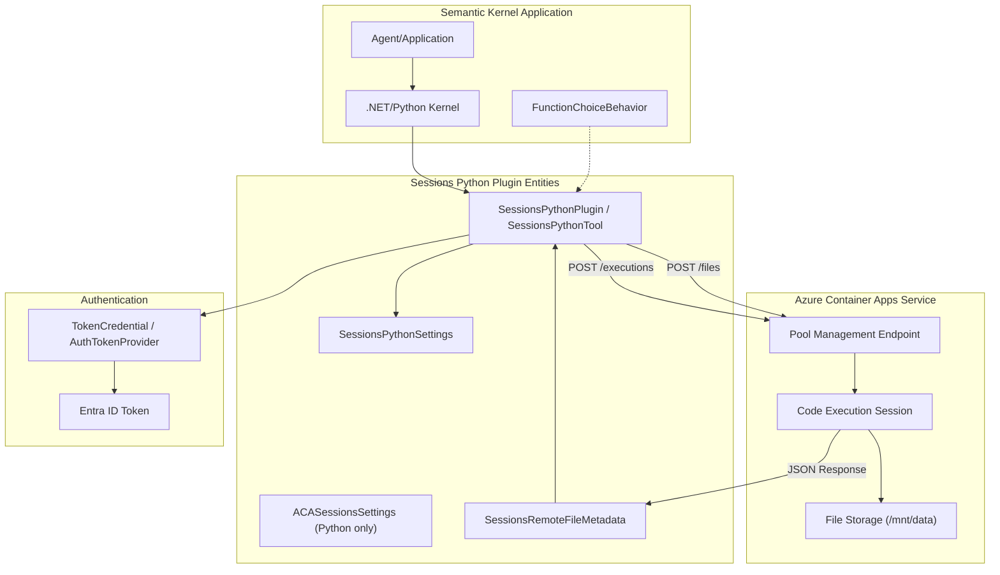
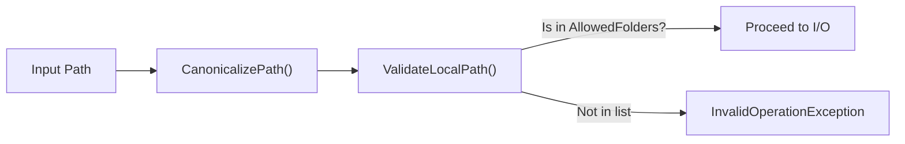

<!-- source: DeepWiki mcp.deepwiki.com · repo microsoft/semantic-kernel · page 6.4 Python Code Execution Tools · fetched 2026-10-27 -->

# Python Code Execution Tools

Relevant source files

The following files were used as context for generating this wiki page:

- [dotnet/samples/Demos/CodeInterpreterPlugin/CodeInterpreterPlugin.csproj](dotnet/samples/Demos/CodeInterpreterPlugin/CodeInterpreterPlugin.csproj)
- [dotnet/samples/Demos/CodeInterpreterPlugin/Program.cs](dotnet/samples/Demos/CodeInterpreterPlugin/Program.cs)
- [dotnet/samples/Demos/CodeInterpreterPlugin/README.md](dotnet/samples/Demos/CodeInterpreterPlugin/README.md)
- [dotnet/src/Experimental/Orchestration.Flow.IntegrationTests/FlowOrchestratorTests.cs](dotnet/src/Experimental/Orchestration.Flow.IntegrationTests/FlowOrchestratorTests.cs)
- [dotnet/src/IntegrationTests/Plugins/Core/SessionsPythonPluginTests.cs](dotnet/src/IntegrationTests/Plugins/Core/SessionsPythonPluginTests.cs)
- [dotnet/src/IntegrationTests/TestData/SessionsPythonPlugin/file_to_upload_1.txt](dotnet/src/IntegrationTests/TestData/SessionsPythonPlugin/file_to_upload_1.txt)
- [dotnet/src/IntegrationTests/TestData/SessionsPythonPlugin/file_to_upload_2.txt](dotnet/src/IntegrationTests/TestData/SessionsPythonPlugin/file_to_upload_2.txt)
- [dotnet/src/IntegrationTests/TestSettings/AzureContainerAppSessionPoolConfiguration.cs](dotnet/src/IntegrationTests/TestSettings/AzureContainerAppSessionPoolConfiguration.cs)
- [dotnet/src/InternalUtilities/src/Http/HttpClientProvider.cs](dotnet/src/InternalUtilities/src/Http/HttpClientProvider.cs)
- [dotnet/src/InternalUtilities/src/System/PathUtilities.cs](dotnet/src/InternalUtilities/src/System/PathUtilities.cs)
- [dotnet/src/InternalUtilities/test/HttpMessageHandlerStub.cs](dotnet/src/InternalUtilities/test/HttpMessageHandlerStub.cs)
- [dotnet/src/Plugins/Plugins.Core/CodeInterpreter/SessionsPythonCodeExecutionResult.cs](dotnet/src/Plugins/Plugins.Core/CodeInterpreter/SessionsPythonCodeExecutionResult.cs)
- [dotnet/src/Plugins/Plugins.Core/CodeInterpreter/SessionsPythonPlugin.cs](dotnet/src/Plugins/Plugins.Core/CodeInterpreter/SessionsPythonPlugin.cs)
- [dotnet/src/Plugins/Plugins.Core/CodeInterpreter/SessionsPythonSettings.cs](dotnet/src/Plugins/Plugins.Core/CodeInterpreter/SessionsPythonSettings.cs)
- [dotnet/src/Plugins/Plugins.Core/FileIOPlugin.cs](dotnet/src/Plugins/Plugins.Core/FileIOPlugin.cs)
- [dotnet/src/Plugins/Plugins.Core/HttpPlugin.cs](dotnet/src/Plugins/Plugins.Core/HttpPlugin.cs)
- [dotnet/src/Plugins/Plugins.Document/DocumentPlugin.cs](dotnet/src/Plugins/Plugins.Document/DocumentPlugin.cs)
- [dotnet/src/Plugins/Plugins.UnitTests/Core/FileIOPluginTests.cs](dotnet/src/Plugins/Plugins.UnitTests/Core/FileIOPluginTests.cs)
- [dotnet/src/Plugins/Plugins.UnitTests/Core/HttpPluginTests.cs](dotnet/src/Plugins/Plugins.UnitTests/Core/HttpPluginTests.cs)
- [dotnet/src/Plugins/Plugins.UnitTests/Core/PathUtilitiesTests.cs](dotnet/src/Plugins/Plugins.UnitTests/Core/PathUtilitiesTests.cs)
- [dotnet/src/Plugins/Plugins.UnitTests/Core/SessionsPythonCodeExecutionResultTests.cs](dotnet/src/Plugins/Plugins.UnitTests/Core/SessionsPythonCodeExecutionResultTests.cs)
- [dotnet/src/Plugins/Plugins.UnitTests/Core/SessionsPythonPluginTests.cs](dotnet/src/Plugins/Plugins.UnitTests/Core/SessionsPythonPluginTests.cs)
- [dotnet/src/Plugins/Plugins.UnitTests/Document/DocumentPluginTests.cs](dotnet/src/Plugins/Plugins.UnitTests/Document/DocumentPluginTests.cs)
- [dotnet/src/Plugins/Plugins.UnitTests/Plugins.UnitTests.csproj](dotnet/src/Plugins/Plugins.UnitTests/Plugins.UnitTests.csproj)
- [dotnet/src/Plugins/Plugins.UnitTests/Web/WebFileDownloadPluginTests.cs](dotnet/src/Plugins/Plugins.UnitTests/Web/WebFileDownloadPluginTests.cs)
- [dotnet/src/Plugins/Plugins.Web/WebFileDownloadPlugin.cs](dotnet/src/Plugins/Plugins.Web/WebFileDownloadPlugin.cs)
- [python/samples/concepts/auto_function_calling/azure_python_code_interpreter_function_calling.py](python/samples/concepts/auto_function_calling/azure_python_code_interpreter_function_calling.py)
- [python/samples/concepts/plugins/azure_python_code_interpreter.py](python/samples/concepts/plugins/azure_python_code_interpreter.py)
- [python/samples/getting_started_with_agents/chat_completion/step12_chat_completion_agent_code_interpreter.py](python/samples/getting_started_with_agents/chat_completion/step12_chat_completion_agent_code_interpreter.py)
- [python/semantic_kernel/connectors/ai/open_ai/const.py](python/semantic_kernel/connectors/ai/open_ai/const.py)
- [python/semantic_kernel/core_plugins/__init__.py](python/semantic_kernel/core_plugins/__init__.py)
- [python/semantic_kernel/core_plugins/sessions_python_tool/README.md](python/semantic_kernel/core_plugins/sessions_python_tool/README.md)
- [python/semantic_kernel/core_plugins/sessions_python_tool/__init__.py](python/semantic_kernel/core_plugins/sessions_python_tool/__init__.py)
- [python/semantic_kernel/core_plugins/sessions_python_tool/sessions_python_plugin.py](python/semantic_kernel/core_plugins/sessions_python_tool/sessions_python_plugin.py)
- [python/semantic_kernel/core_plugins/sessions_python_tool/sessions_python_settings.py](python/semantic_kernel/core_plugins/sessions_python_tool/sessions_python_settings.py)
- [python/semantic_kernel/core_plugins/sessions_python_tool/sessions_remote_file_metadata.py](python/semantic_kernel/core_plugins/sessions_python_tool/sessions_remote_file_metadata.py)
- [python/tests/unit/core_plugins/test_sessions_python_plugin.py](python/tests/unit/core_plugins/test_sessions_python_plugin.py)

This document covers the specialized Python code execution capabilities within Semantic Kernel, spanning both .NET and Python implementations. These tools provide secure, remote execution of Python code using Azure Container Apps (ACA) dynamic sessions, enabling AI agents to perform computational tasks, data analysis, and file operations in isolated environments.

## Overview

The Python Code Execution Tools are built around the Azure Container Apps Sessions service. The system consists of a core plugin (`SessionsPythonPlugin` in .NET, `SessionsPythonTool` in Python) that communicates with Azure's session management endpoints to execute code, manage files, and retrieve results.

### System Architecture

**Sources:** [dotnet/src/Plugins/Plugins.Core/CodeInterpreter/SessionsPythonPlugin.cs:23-105](), [python/semantic_kernel/core_plugins/sessions_python_tool/sessions_python_plugin.py:34-117](), [python/semantic_kernel/core_plugins/sessions_python_tool/sessions_python_settings.py:30-94]()

## Core Implementation Details

### .NET Implementation: `SessionsPythonPlugin`

The .NET implementation is a sealed class that utilizes `IHttpClientFactory` for managed HTTP requests and provides `KernelFunction` methods for integration into the SK ecosystem.

| Method | Role | Logic |
|--------|------|-------|
| `ExecuteCodeAsync` | Primary execution | Serializes `SessionsPythonCodeExecutionProperties` and POSTs to `executions`. [dotnet/src/Plugins/Plugins.Core/CodeInterpreter/SessionsPythonPlugin.cs:83-105]() |
| `UploadFileAsync` | File ingestion | Uses `MultipartFormDataContent` to send local bytes to the session's `/mnt/data`. [dotnet/src/Plugins/Plugins.Core/CodeInterpreter/SessionsPythonPlugin.cs:118-144]() |
| `ListFilesAsync` | Discovery | GETs file metadata from the `files` endpoint. [dotnet/src/Plugins/Plugins.Core/CodeInterpreter/SessionsPythonPlugin.cs:175-184]() |
| `DownloadFileAsync` | Retrieval | Downloads file content as a `Stream`. Note: This is typically NOT exposed as a `KernelFunction`. [dotnet/src/Plugins/Plugins.Core/CodeInterpreter/SessionsPythonPlugin.cs:146-173]() |

**Sources:** [dotnet/src/Plugins/Plugins.Core/CodeInterpreter/SessionsPythonPlugin.cs:23-184]()

### Python Implementation: `SessionsPythonTool`

The Python version leverages `httpx.AsyncClient` and `pydantic` for settings validation.

| Component | Description |
|-----------|-------------|
| `SessionsPythonTool` | The main class inheriting from `KernelBaseModel`. [python/semantic_kernel/core_plugins/sessions_python_tool/sessions_python_plugin.py:34-46]() |
| `ACASessionsSettings` | Handles environment variables like `ACA_POOL_MANAGEMENT_ENDPOINT`. [python/semantic_kernel/core_plugins/sessions_python_tool/sessions_python_settings.py:68-94]() |
| `_sanitize_input` | Regex-based cleanup of backticks and "python" keywords from LLM outputs. [python/semantic_kernel/core_plugins/sessions_python_tool/sessions_python_plugin.py:148-162]() |

**Sources:** [python/semantic_kernel/core_plugins/sessions_python_tool/sessions_python_plugin.py:34-162]()

## Configuration and Settings

Both implementations share a similar configuration structure for session behavior.

### `SessionsPythonSettings`

| Property | Default | Description |
|----------|---------|-------------|
| `SessionId` | Random UUID | Persistent identifier for the remote container session. |
| `TimeoutInSeconds` | 100 | Maximum time for code execution. |
| `SanitizeInput` | `true` | Automatically cleans markdown/code-block markers from LLM output. |
| `EnableDangerousFileUploads` | `false` | Security gate for file operations. |

**Sources:** [dotnet/src/Plugins/Plugins.Core/CodeInterpreter/SessionsPythonSettings.cs:12-70](), [python/semantic_kernel/core_plugins/sessions_python_tool/sessions_python_settings.py:30-65]()

## Security and Path Validation

To prevent directory traversal attacks, the plugins implement path validation and allow-lists.

### Path Validation Logic

- **Allow-lists:** Users must explicitly provide `AllowedUploadDirectories` and `AllowedDownloadDirectories`. [dotnet/src/Plugins/Plugins.Core/CodeInterpreter/SessionsPythonPlugin.cs:220-250]()
- **UNC/Extended Paths:** Blocked to prevent access to network shares. [dotnet/src/Plugins/Plugins.Core/CodeInterpreter/SessionsPythonPlugin.cs:266-276]()
- **Remote Root:** All remote operations are relative to `/mnt/data/`. [python/semantic_kernel/core_plugins/sessions_python_tool/sessions_python_plugin.py:164-177]()

**Sources:** [dotnet/src/Plugins/Plugins.Core/CodeInterpreter/SessionsPythonPlugin.cs:220-276](), [python/semantic_kernel/core_plugins/sessions_python_tool/sessions_python_plugin.py:164-177]()

## Data Flow: Code Execution

When a `Kernel` invokes the Python execution function, the following flow occurs:

1.  **Input Preparation:** The LLM generates Python code. The plugin optionally calls `_sanitize_input` to remove backticks. [python/semantic_kernel/core_plugins/sessions_python_tool/sessions_python_plugin.py:148-162]()
2.  **Auth Token Retrieval:** The `auth_callback` (Python) or `authTokenProvider` (.NET) is invoked to get a Bearer token for Azure. [dotnet/src/Plugins/Plugins.Core/CodeInterpreter/SessionsPythonPlugin.cs:200-210](), [python/semantic_kernel/core_plugins/sessions_python_tool/sessions_python_plugin.py:135-146]()
3.  **Remote Call:** An HTTP POST request is sent to the ACA Sessions endpoint with a JSON body containing the code. [dotnet/src/Plugins/Plugins.Core/CodeInterpreter/SessionsPythonPlugin.cs:96-102]()
4.  **Result Parsing:** The response is deserialized into `SessionsPythonCodeExecutionResult`.
    - `stdout`: Standard output from the script.
    - `stderr`: Error output.
    - `result`: The value of the last expression in the script.

**Sources:** [dotnet/src/Plugins/Plugins.Core/CodeInterpreter/SessionsPythonPlugin.cs:83-105](), [dotnet/src/Plugins/Plugins.Core/CodeInterpreter/SessionsPythonCodeExecutionResult.cs:12-32]()

## Integration Patterns

### Auto-Function Calling
The tools are designed to be used with `FunctionChoiceBehavior.Auto`. The system prompts the LLM with specific instructions on how to format the `code` string (e.g., using `\n` for line breaks within a JSON string).

**Sources:** [dotnet/src/Plugins/Plugins.Core/CodeInterpreter/SessionsPythonPlugin.cs:74-82](), [python/semantic_kernel/core_plugins/sessions_python_tool/sessions_python_plugin.py:180-192]()

### Comparison with other Plugins
Unlike the `HttpPlugin` or `WebFileDownloadPlugin`, which operate on the local network/filesystem, the `SessionsPythonPlugin` offloads execution to a remote, managed Azure environment. However, it shares the same security philosophy: **deny-by-default** for all file and domain access.

**Sources:** [dotnet/src/Plugins/Plugins.Web/WebFileDownloadPlugin.cs:22-35](), [dotnet/src/Plugins/Plugins.Core/HttpPlugin.cs:19-29]()

---

