# Page: BabyAGI-UI Overview

# BabyAGI-UI Overview

<details>
<summary>Relevant source files</summary>

The following files were used as context for generating this wiki page:

- [README.md](README.md)
- [package-lock.json](package-lock.json)
- [package.json](package.json)
- [public/favicon.ico](public/favicon.ico)
- [public/images/screenshot-230722.png](public/images/screenshot-230722.png)
- [public/images/serpapi-logo.svg](public/images/serpapi-logo.svg)
- [public/og-image.png](public/og-image.png)
- [src/components/Sidebar/ExtraButton.tsx](src/components/Sidebar/ExtraButton.tsx)
- [src/components/Sidebar/SidebarHeader.tsx](src/components/Sidebar/SidebarHeader.tsx)
- [src/pages/_app.tsx](src/pages/_app.tsx)
- [src/pages/index.tsx](src/pages/index.tsx)
- [src/utils/translate.ts](src/utils/translate.ts)

</details>


This document provides an introduction to BabyAGI-UI, a web application designed to offer a user-friendly interface for interacting with autonomous AI agents based on the BabyAGI framework. It covers the system's purpose, architecture, key components, and how users can interact with it.

For more detailed information about specific components, please refer to other pages in this wiki:
- For detailed UI components, see [User Interface Components](#2)
- For in-depth agent architecture, see [Agent Architecture](#3)
- For API documentation, see [API Endpoints](#5)

## Purpose and Status

BabyAGI-UI is a port of the [original BabyAGI](https://github.com/yoheinakajima/babyagi) project that uses Langchain.js instead of the Python implementation. It creates a ChatGPT-like web interface that makes it easier to run, develop, and experiment with autonomous AI agents.

> **Note**: As of 2023, this project has been archived. Its role of allowing users to easily try out AI Agent technology has concluded as the field has advanced to the next phase.

Sources: [README.md:8-11]()

## System Architecture

BabyAGI-UI follows a modern web application architecture built around Next.js, with frontend components for user interaction and backend logic for agent execution.

### High-Level Architecture Diagram

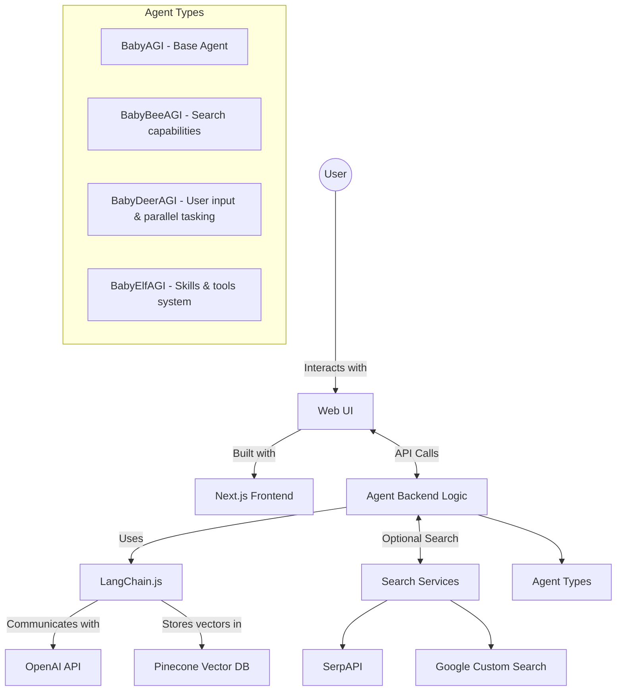

Sources: [README.md:11-13](), [package.json:12-67]()

### Technology Stack

BabyAGI-UI is built on a modern JavaScript stack:

| Layer | Technologies |
|-------|--------------|
| Frontend | Next.js, React, Tailwind CSS, Radix UI components |
| AI Services | LangChain.js, OpenAI API |
| Data Storage | Pinecone (vector database) |
| Optional Tools | SerpAPI, Google Custom Search (for web search capability) |
| Internationalization | i18next, next-i18next (40+ languages) |

Sources: [package.json:12-67](), [README.md:21-27]()

## Core Components

### UI Component Structure

The application interface is organized into two main areas: a sidebar for navigation and an agent view for interaction.

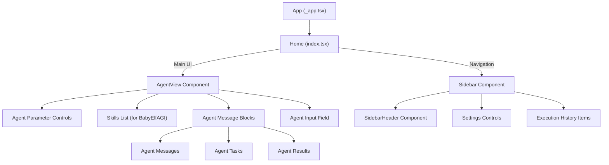

Sources: [src/pages/index.tsx:1-11](), [src/pages/index.tsx:76-91](), [src/components/Sidebar/SidebarHeader.tsx:1-6]()

### Agent Execution Flow

The typical flow of agent execution in BabyAGI-UI:

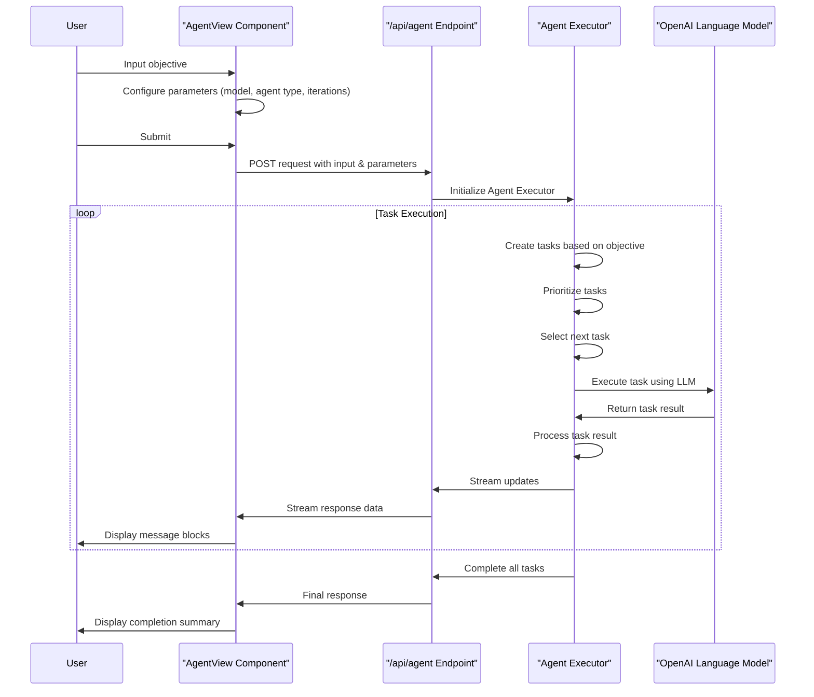

Sources: [README.md:11-12]()

## Agent Types

BabyAGI-UI supports several types of agents, each with different capabilities:

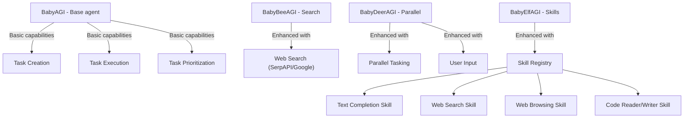

| Agent Type | Key Features |
|------------|-------------|
| BabyAGI | Base agent with task creation, prioritization, and execution |
| BabyBeeAGI | Adds web search capabilities using SerpAPI or Google Custom Search |
| BabyDeerAGI | Adds user input and parallel task execution capabilities |
| BabyElfAGI | Adds a skill system that allows the agent to use different tools |

Sources: [README.md:29-38]()

## Message System

Messages are a core part of BabyAGI-UI, representing various types of agent communication and activity that are displayed to the user.

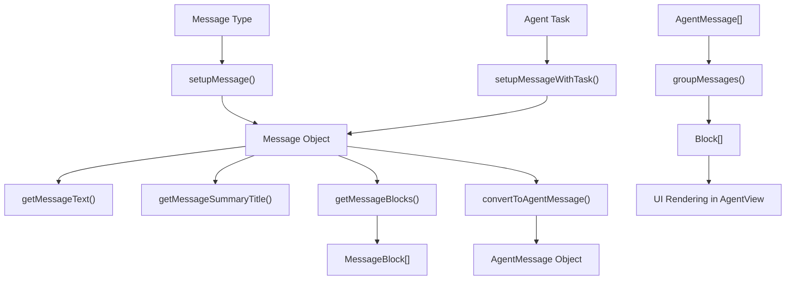

Sources: [README.md:12]()

## Internationalization

BabyAGI-UI features comprehensive internationalization support with over 40 languages.

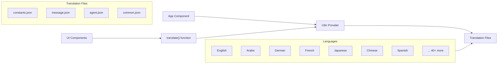

The translation system is implemented through the `translate` utility function:

```typescript
// Translation usage example
import { translate } from '@/utils/translate';

// Basic translation
const text = translate('KEY');

// Translation with namespace
const text = translate('KEY', 'agent');
```

Sources: [src/utils/translate.ts:1-13](), [src/pages/_app.tsx:8-9](), [src/components/Sidebar/SidebarHeader.tsx:5](), [src/components/Sidebar/ExtraButton.tsx:5]()

## Getting Started

To set up BabyAGI-UI locally:

1. Clone the repository:
   ```bash
   git clone https://github.com/miurla/babyagi-ui
   ```

2. Navigate to the project directory:
   ```bash
   cd babyagi-ui
   ```

3. Install dependencies:
   ```bash
   npm install
   ```

4. Create and configure environment variables:
   ```bash
   cp .env.example .env
   ```
   
   You need to set up:
   - OpenAI API key
   - Pinecone API key and index
   - SerpAPI key (optional, for web search)

5. Start the development server:
   ```bash
   npm run dev
   ```

Sources: [README.md:42-75]()

## Warning

This application is designed to be run continuously as part of a task management system. Running it continuously can result in high API usage, so please use it responsibly. Additionally, the script requires the OpenAI API to be set up correctly.

Sources: [README.md:85-89]()

## Official Sponsor

[SerpApi](https://serpapi.com) provides the search API credits for requests made on the demo site of this project.

Sources: [README.md:91-97](), [public/images/serpapi-logo.svg:1-89]()

---

# Page: Getting Started

# Getting Started

<details>
<summary>Relevant source files</summary>

The following files were used as context for generating this wiki page:

- [.env.example](.env.example)
- [README.md](README.md)
- [next-i18next.config.js](next-i18next.config.js)
- [next.config.js](next.config.js)
- [public/favicon.ico](public/favicon.ico)
- [public/images/screenshot-230722.png](public/images/screenshot-230722.png)
- [public/images/serpapi-logo.svg](public/images/serpapi-logo.svg)
- [public/og-image.png](public/og-image.png)
- [src/pages/_document.tsx](src/pages/_document.tsx)
- [src/utils/languages.ts](src/utils/languages.ts)

</details>


This document provides a step-by-step guide to installing, configuring, and running the BabyAGI-UI application - a web interface for interacting with autonomous AI agents. If you're looking for information about the system architecture, see [System Architecture](#1.2).

## System Requirements

Before installing BabyAGI-UI, ensure you have the following prerequisites:

- Node.js (latest LTS version recommended)
- npm (comes with Node.js)
- Required API keys:
  - OpenAI API key
  - Pinecone API key
  - (Optional) SerpAPI key or Google Custom Search API key for search capabilities

### Technology Stack

BabyAGI-UI is built on the following technologies:

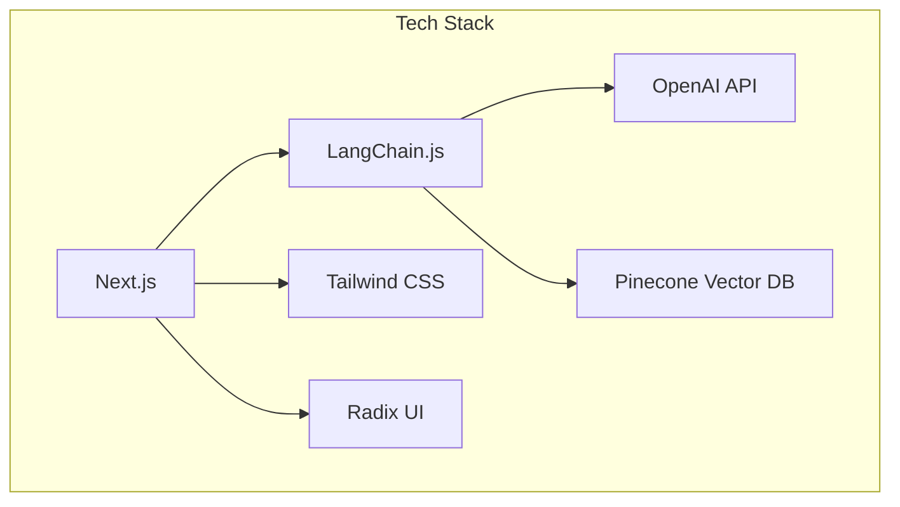

Sources: [README.md:21-28]()

## Installation

Follow these steps to install BabyAGI-UI:

1. Clone the repository:

```bash
git clone https://github.com/miurla/babyagi-ui
```

2. Navigate to the project directory:

```bash
cd babyagi-ui
```

3. Install dependencies:

```bash
npm install
```

Sources: [README.md:42-60]()

## Configuration

### Environment Setup

BabyAGI-UI requires several environment variables to be configured. Create a `.env` file in the root directory by copying the example file:

```bash
cp .env.example .env
```

Then edit the `.env` file to set the following variables:

| Variable | Description | Required |
|----------|-------------|----------|
| `OPENAI_API_KEY` | Your OpenAI API key | Yes |
| `PINECONE_API_KEY` | Your Pinecone API key | Yes |
| `PINECONE_ENVIRONMENT` | Pinecone environment (e.g., "us-west4-gcp") | Yes |
| `NEXT_PUBLIC_TABLE_NAME` | Name for your Pinecone index (default: "baby-agi-test-table") | Yes |
| `NEXT_PUBLIC_USE_USER_API_KEY` | Set to "true" to use user API key (default: "false") | No |
| `SERP_API_KEY` | Your SerpAPI key for search functionality | No |
| `GOOGLE_SEARCH_API_KEY` & `GOOGLE_CUSTOM_INDEX_ID` | Alternative to SerpAPI for search | No |
| `BASE_URL` | Your application URL (e.g., "http://localhost:3000") | Yes |

Sources: [.env.example:1-34]()

### Pinecone Setup

Before running the application, you need to create an index in Pinecone with the following recommended settings:

- Dimensions: 1536
- Metric: Cosine
- Pod Type: p1.x1 (or any available option suitable for your needs)

Sources: [README.md:63-65]()

## Running the Application

To start the development server:

```bash
npm run dev
```

The application will be available at `http://localhost:3000` by default.

### Deployment Options

For production deployment, you can use Vercel:

[](https://vercel.com/new/clone?repository-url=https%3A%2F%2Fgithub.com%2Fmiurla%2Fbabyagi-ui)

Sources: [README.md:71-83]()

## User Interface Overview

When you access BabyAGI-UI, you'll see a user interface with the following main components:

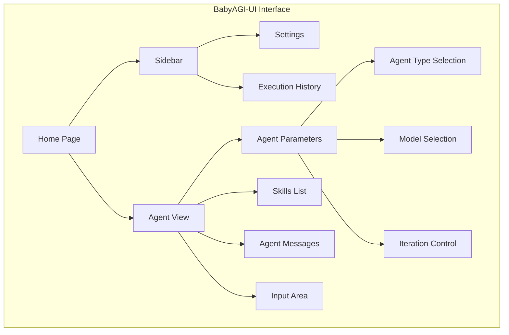

Sources: Various UI components in repository

## Language Support

BabyAGI-UI supports over 40 languages through its internationalization system. The application will automatically detect your browser's language, or you can manually select your preferred language through the settings.

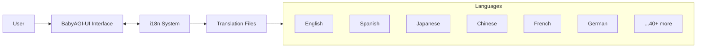

Sources: [src/utils/languages.ts:1-74](), [next-i18next.config.js:1-69]()

## Agent Types

BabyAGI-UI supports several types of agents with different capabilities:

| Agent Type | Description | Key Features |
|------------|-------------|--------------|
| BabyAGI | Base agent | Task creation, execution, and prioritization |
| BabyBeeAGI | Search-enhanced agent | Web search capabilities using SerpAPI or Google Search |
| BabyDeerAGI | Parallel processing agent | User input during execution and parallel tasking |
| BabyElfAGI | Skills-based agent | Extensible skills system including text completion, web search, web browsing, and code manipulation |

To select an agent type, use the agent parameters panel in the main interface.

## Basic Usage Flow

Here's a simplified flow of how to use BabyAGI-UI:

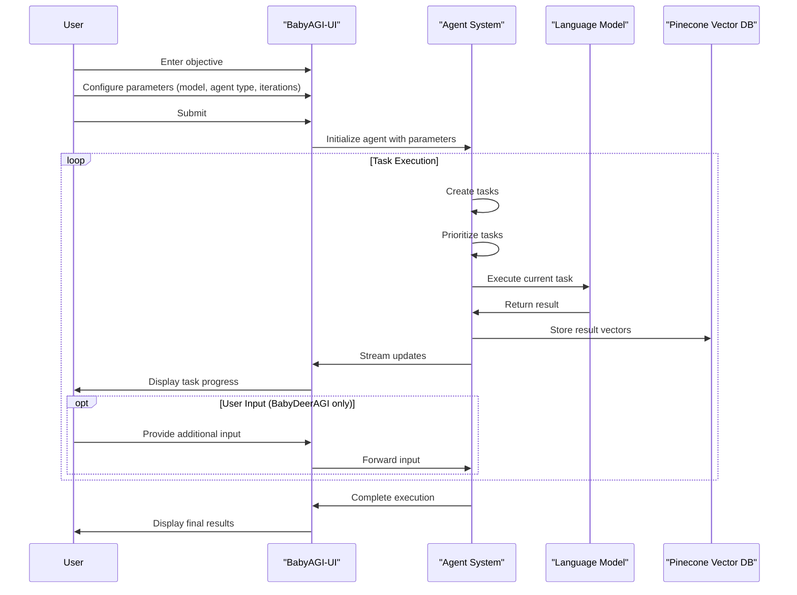

## Usage Warning

BabyAGI-UI is designed to be run continuously as part of a task management system. Running this script continuously can result in high API usage, so please use it responsibly. Ensure you have properly set up the OpenAI API and have monitoring in place for your API usage.

Sources: [README.md:85-89]()

## Next Steps

Now that you have BabyAGI-UI up and running, you might want to explore:

- [Agent Architecture](#3) to learn more about how the different agents work
- [User Interface Components](#2) for a deeper understanding of the UI
- [Agent Skills System](#3.4) to learn about extending agents with new capabilities
- [Examples and Usage](#7) for practical application examples

Sources: Table of contents provided in the task

---

# Page: System Architecture

# System Architecture

<details>
<summary>Relevant source files</summary>

The following files were used as context for generating this wiki page:

- [README.md](README.md)
- [package-lock.json](package-lock.json)
- [package.json](package.json)
- [public/favicon.ico](public/favicon.ico)
- [public/images/screenshot-230722.png](public/images/screenshot-230722.png)
- [public/images/serpapi-logo.svg](public/images/serpapi-logo.svg)
- [public/og-image.png](public/og-image.png)
- [src/components/Agent/AgentView.tsx](src/components/Agent/AgentView.tsx)
- [src/components/Sidebar/ExtraButton.tsx](src/components/Sidebar/ExtraButton.tsx)
- [src/components/Sidebar/SidebarHeader.tsx](src/components/Sidebar/SidebarHeader.tsx)
- [src/hooks/useAgent.ts](src/hooks/useAgent.ts)
- [src/pages/_app.tsx](src/pages/_app.tsx)
- [src/pages/api/agent/index.ts](src/pages/api/agent/index.ts)
- [src/pages/index.tsx](src/pages/index.tsx)
- [src/utils/translate.ts](src/utils/translate.ts)

</details>


This document provides a comprehensive overview of the BabyAGI-UI system architecture. It describes the core components, their interactions, and the data flow between frontend, backend, and external services. For information about getting started with the system, see [Getting Started](#1.1).

## Core Architecture Overview

BabyAGI-UI is a web application built with Next.js that provides a user-friendly interface for interacting with autonomous AI agents. The system is architected as a modern web application with a clear separation between frontend UI components and backend agent processing logic.

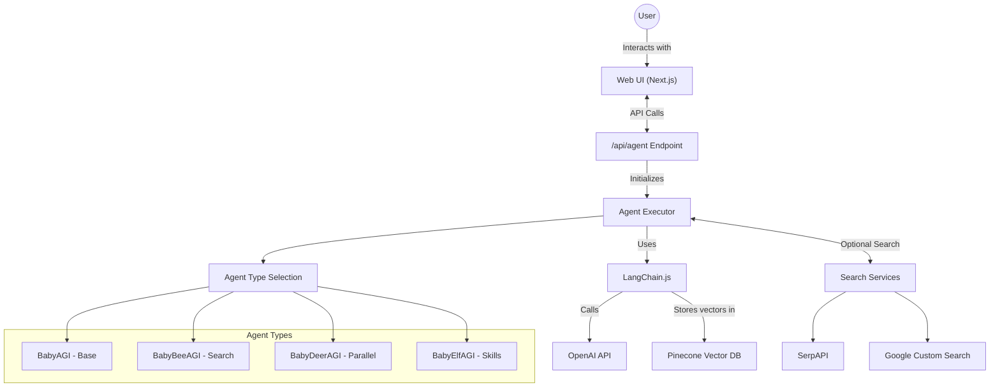

The system consists of the following major components:
- A Next.js frontend providing the user interface
- An API endpoint that handles agent execution
- Multiple agent implementations with different capabilities
- Integration with external services like OpenAI API and Pinecone
- Optional search capabilities through SerpAPI or Google Custom Search

Sources: [README.md:11-12](), [package.json:23-56](), [src/pages/api/agent/index.ts:11-34]()

## Frontend Architecture

The frontend architecture is implemented using React components with Next.js. The main application structure starts with the `_app.tsx` component, which sets up global providers for themes, internationalization, and execution state management.

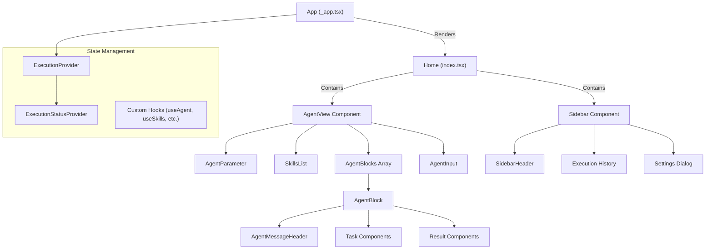

The Home component (`index.tsx`) manages the main UI structure and state:
- It renders the `AgentView` for the main UI area
- It renders the `Sidebar` for navigation
- It manages the UI state like sidebar visibility

The `AgentView` component is the heart of the user interface:
- It maintains the agent state and messages
- It manages user interactions and agent execution
- It renders agent parameters, skills, message blocks, and input

Sources: [src/pages/_app.tsx:11-32](), [src/pages/index.tsx:13-95](), [src/components/Agent/AgentView.tsx:37-251]()

## Agent Execution Flow

The execution flow represents how a user objective is processed by the system, from input to completed task.

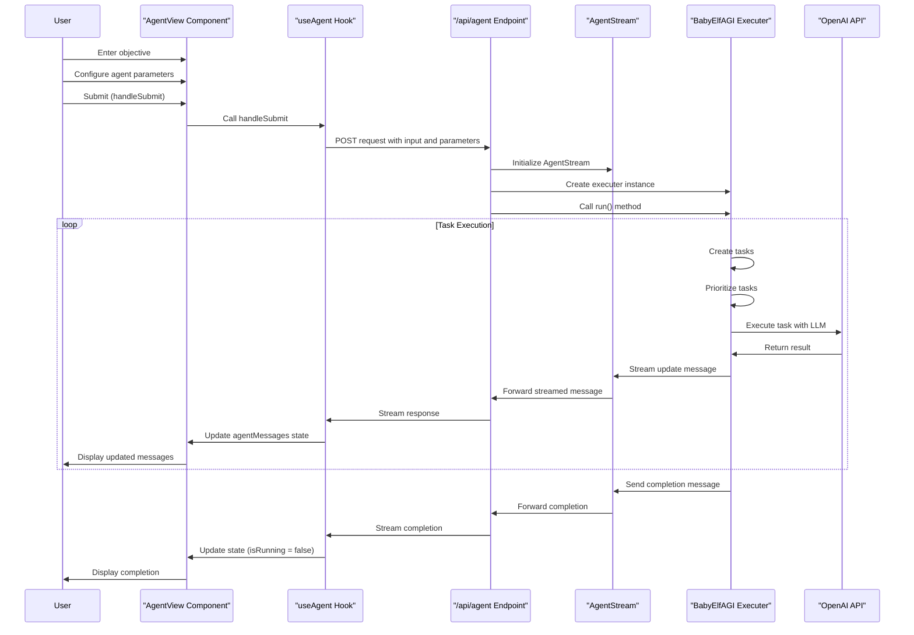

Key steps in this process:
1. User inputs objective and configures parameters in the UI
2. The `AgentView` component captures the input and passes it to the `useAgent` hook
3. The hook sends a POST request to the `/api/agent` endpoint
4. The endpoint initializes an AgentStream for real-time communication
5. The endpoint creates a BabyElfAGI executer instance and runs it
6. The executer creates, prioritizes, and executes tasks
7. Results are streamed back to the UI in real-time via the AgentStream
8. The `AgentView` component updates the UI with the messages received

Sources: [src/components/Agent/AgentView.tsx:75-102](), [src/hooks/useAgent.ts:37-273](), [src/pages/api/agent/index.ts:11-34]()

## Message Processing System

The message system handles the transformation of agent tasks and responses into structured UI components.

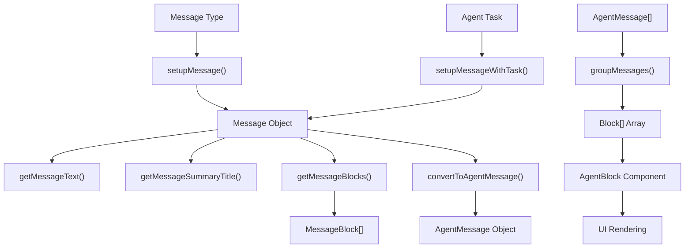

The message system:
1. Converts agent tasks into Message objects using utility functions
2. Processes Messages to extract text, generate titles, and create message blocks
3. Converts Messages to AgentMessages for UI rendering
4. Groups AgentMessages into Blocks that represent coherent units of information
5. Renders Blocks in the UI through the AgentBlock component

In the `useAgent` hook, incoming messages from the API are parsed and stored in the `agentMessages` state, which is then used by the `AgentView` component to render the UI.

Sources: [src/hooks/useAgent.ts:117-155](), [src/components/Agent/AgentView.tsx:173-186]()

## Agent Types and Skills

BabyAGI-UI implements different types of agents with varying capabilities:

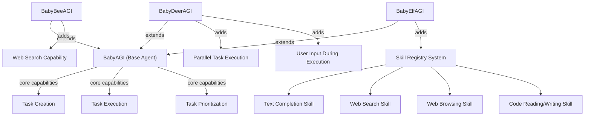

Each agent type builds on the base BabyAGI functionality:
- **BabyAGI**: Basic task creation, execution, and prioritization
- **BabyBeeAGI**: Adds web search capabilities through integration with search services
- **BabyDeerAGI**: Adds parallel task execution and user input during execution
- **BabyElfAGI**: Adds a skill registry system that allows the agent to use different tools and skills

The skills system used by BabyElfAGI allows it to perform actions such as text completion, web search, web browsing, and code manipulation.

Sources: [README.md:29-34](), [src/pages/api/agent/index.ts:22-32]()

## Integration with External Services

BabyAGI-UI integrates with several external services to provide its functionality:

| Service | Purpose | Integration Point |
|---------|---------|-------------------|
| OpenAI API | Powers the language models used by the agents | LangChain.js |
| Pinecone | Vector database for storing and retrieving task context | LangChain.js |
| SerpAPI | Web search capability for BabyBeeAGI and search skills | Agent executers |
| Google Custom Search | Alternative web search provider | Agent executers |

The integration with these services is managed through environment variables and configuration settings, which must be properly set up for the system to function correctly.

Sources: [README.md:23-26](), [README.md:62-65]()

## Internationalization Architecture

BabyAGI-UI includes extensive internationalization support:

```mermaid
graph TD
    App["App Component"] --> I18nProvider["i18n Provider (next-i18next)"]
    I18nProvider --> Translations["Translation Files"]
    
    subgraph "Translation Files"
        Constants["constants.json"]
        Message["message.json"]
        Agent["agent.json"]
        Common["common.json"]
    end
    
    subgraph "Language Support"
        English["English"]
        Arabic["Arabic"]
        German["German"]
        Japanese["Japanese"]
        Chinese["Chinese"]
        OtherLanguages["40+ other languages"]
    end
    
    Translations --> TranslateFunction["translate() Function"]
    Components["UI Components"] --> TranslateFunction
    TranslateFunction --> LocalizedText["Localized Text in UI"]
    
    Language Support --> Translations
```

The internationalization system:
1. Uses `next-i18next` for i18n support
2. Provides translation files for different aspects of the application (constants, messages, agent-related text, common UI elements)
3. Supports over 40 languages
4. Uses a `translate()` utility function that components call to get localized text

Sources: [src/utils/translate.ts:1-13](), [src/pages/_app.tsx:8-9](), [src/pages/index.tsx:97-109]()

## API Architecture

The primary API endpoint in BabyAGI-UI is the `/api/agent` endpoint, which handles agent execution requests:

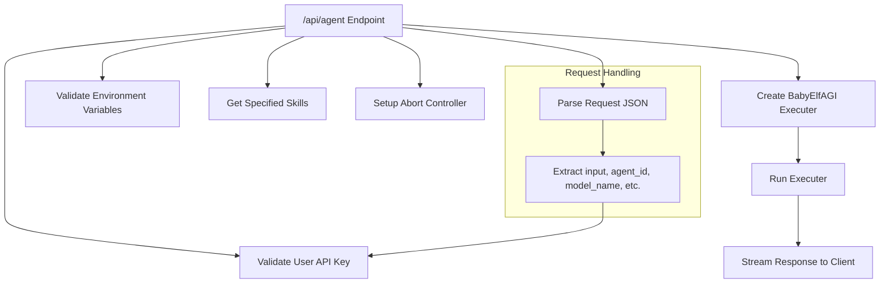

The API endpoint:
1. Receives POST requests from the frontend
2. Validates environment variables and user API keys
3. Determines which skills to use based on the agent type
4. Sets up an abort controller for request cancellation
5. Creates a BabyElfAGI executer with the appropriate parameters
6. Runs the executer and streams the response back to the client

Sources: [src/pages/api/agent/index.ts:11-64]()

## Conclusion

BabyAGI-UI is a modern web application built with Next.js that provides a user-friendly interface for interacting with autonomous AI agents. The architecture is designed to be modular, flexible, and extensible, allowing for easy addition of new agent types and capabilities.

The system's core strengths include:
- Clear separation of frontend and backend concerns
- Real-time communication through streaming responses
- Support for different agent types with varying capabilities
- Extensive internationalization support
- Integration with external services for enhanced functionality

This architecture enables users to easily experiment with different AI agent configurations and use them for a variety of tasks.

---

# Page: User Interface Components

# User Interface Components

<details>
<summary>Relevant source files</summary>

The following files were used as context for generating this wiki page:

- [package-lock.json](package-lock.json)
- [package.json](package.json)
- [src/components/Agent/AgentParameter.tsx](src/components/Agent/AgentParameter.tsx)
- [src/components/Sidebar/ExtraButton.tsx](src/components/Sidebar/ExtraButton.tsx)
- [src/components/Sidebar/SidebarHeader.tsx](src/components/Sidebar/SidebarHeader.tsx)
- [src/pages/_app.tsx](src/pages/_app.tsx)
- [src/pages/index.tsx](src/pages/index.tsx)
- [src/types/index.ts](src/types/index.ts)
- [src/utils/constants.ts](src/utils/constants.ts)
- [src/utils/message.ts](src/utils/message.ts)
- [src/utils/translate.ts](src/utils/translate.ts)

</details>


The User Interface Components in BabyAGI-UI provide a structured, responsive way for users to interact with AI agents. This document covers the core UI architecture, component hierarchy, and the message display system that powers the interface. For information about the Agent architecture itself, see [Agent Architecture](#3), and for details on the underlying message formatting utilities, see [Message Formatting Utilities](#4.1).

## UI Component Architecture Overview

BabyAGI-UI uses a React-based UI built with Next.js, styled with Tailwind CSS, and enhanced with component libraries like Radix UI and Headless UI. The interface is designed to be responsive, with appropriate layouts for both desktop and mobile devices.

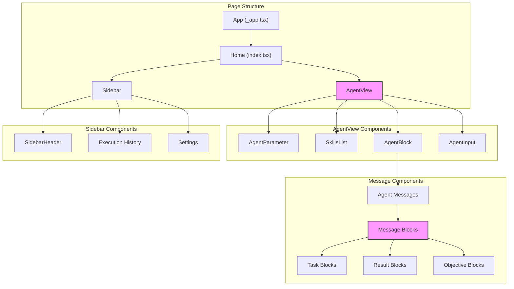

Sources: [src/pages/_app.tsx:1-33](), [src/pages/index.tsx:1-112](), [src/components/Agent/AgentParameter.tsx:1-96]()

## Main Page Structure

The UI is organized around two primary components:

1. **AgentView**: The main workspace where users interact with agents
2. **Sidebar**: Navigation and configuration panel

The visibility of the sidebar is controlled through state management, allowing users to toggle it on smaller screens.

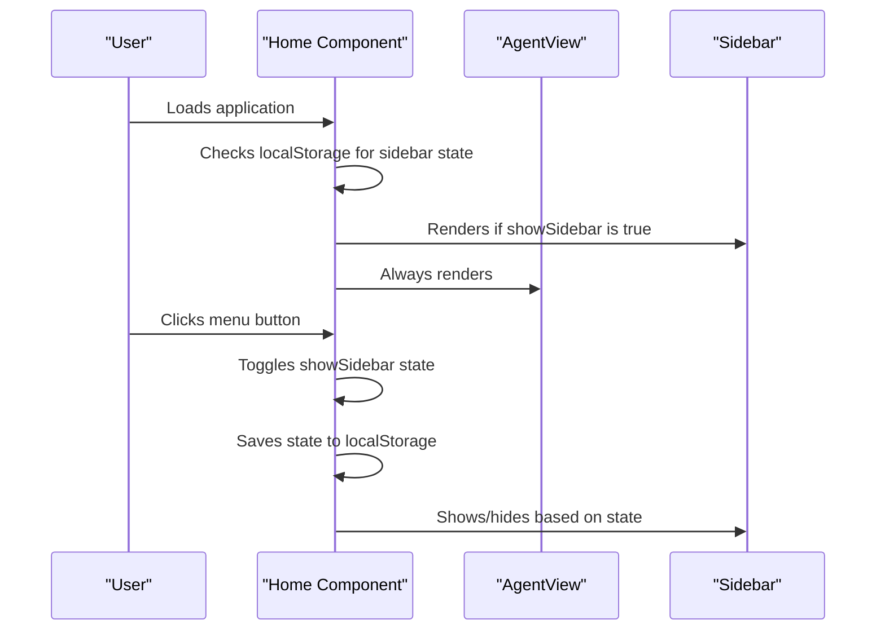

Sources: [src/pages/index.tsx:13-45]()

## AgentView Component

The AgentView is the central interface component where users interact with agents. It contains several key sub-components:

1. **AgentParameter**: Controls for configuring the agent (model, iterations, etc.)
2. **Agent Block**: Displays agent messages, tasks, and results
3. **Agent Input**: Allows users to enter their objective

### AgentParameter Component

This component provides a UI for configuring the agent before execution. It allows selection of:

- **Model**: The language model to use (GPT-4, GPT-3.5 Turbo)
- **Agent Type**: The agent implementation (BabyDeerAGI, BabyElfAGI, etc.)
- **Iterations**: Number of task iterations for the agent to perform
- **First Task**: The initial task for certain agent types

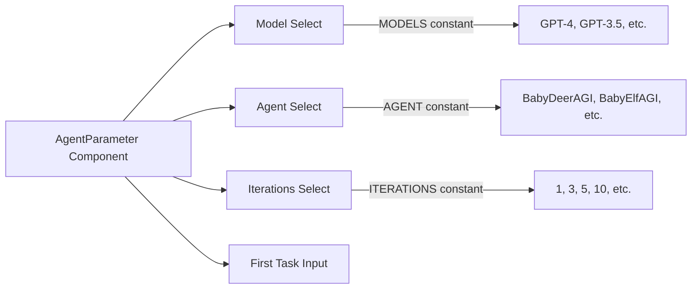

Sources: [src/components/Agent/AgentParameter.tsx:1-96](), [src/utils/constants.ts:1-92]()

## Message System

The message system is a core part of the UI, transforming agent outputs into structured, visual elements. The BabyAGI-UI has a sophisticated message handling system that processes different types of messages (objectives, tasks, results) and displays them appropriately.

### Message Types and Structure

The UI supports various message types defined in the `MessageType` enum:

```mermaid
classDiagram
    class Message {
        id?: number
        text: string
        type: MessageType
        icon?: string
        title?: string
        bgColor?: string
        status?: AgentStatus
        open?: boolean
        dependentTaskIds?: number[]
    }
    
    class MessageType {
        <<enumeration>>
        objective
        task-list
        next-task
        task-result
        task-output
        task-result-summary
        search-logs
        loading
        end-of-iterations
        session-summary
        done
        complete
        failed
        user-input
        task-execute
        final-result
    }
    
    class MessageBlock {
        id?: number
        messages: Message[]
        status?: "complete" | "incomplete" | "running"
        type?: MessageType
    }
    
    class AgentMessage {
        id?: string
        content: string
        type?: string
        title?: string
        icon?: string
        taskId?: string
        style?: "text" | "log"
        status?: "complete" | "incomplete" | "running"
        options?: { [key: string]: string }
    }
    
    class Block {
        id?: string
        messages: AgentMessage[]
        status?: "complete" | "incomplete" | "running"
        style?: "label" | "task"
    }
    
    Message --> MessageType: has
    MessageBlock o-- Message: contains
    Block o-- AgentMessage: contains
```

Sources: [src/types/index.ts:1-166]()

### Message Processing Flow

Messages go through several transformation steps before being displayed in the UI:

```mermaid
flowchart TD
    A["Agent Task"] --> B["setupMessageWithTask()"]
    C["Message Type"] --> D["setupMessage()"]
    D --> E["Message Object"]
    B --> E
    
    E --> F1["getMessageText()"]
    E --> F2["getMessageSummaryTitle()"]
    E --> F3["getMessageBlocks()"]
    
    F3 --> G["MessageBlock[]"]
    
    E --> H["convertToAgentMessages()"]
    H --> I["AgentMessage[]"]
    
    I --> J["groupMessages()"]
    J --> K["Block[]"]
    
    K --> L["UI Rendering"]
```

Sources: [src/utils/message.ts:14-516]()

## Message Display Components

The UI renders different message components based on the message type and status:

1. **ObjectiveBlock**: Displays the user's objective
2. **TaskBlock**: Shows individual tasks with status indicators
3. **ResultBlock**: Presents task results and summaries
4. **LoadingBlock**: Indicates active processing

Each message type has specific styling, icons, and formatting to visually distinguish them in the interface.

### Icon and Title Mapping

Messages are displayed with appropriate icons and titles based on their type:

| Message Type | Icon | Title Translation Key |
|--------------|------|------------------------|
| objective | 🎯 | OBJECTIVE |
| task-list | 📝 | TASK_LIST |
| next-task | 👉 | NEXT_TASK |
| task-result | ✅ | TASK_RESULT |
| loading | ⏳ | LOADING |
| complete | 🏁 | FINISHED |

Special tools also have their own icons:
- Web search: 🔍
- Web scrape: 📄
- Text completion: 🤖
- User input: 🧑‍💻

Sources: [src/utils/message.ts:14-115](), [src/utils/message.ts:360-397]()

## Sidebar Components

The sidebar provides navigation and access to saved executions and settings:

```mermaid
flowchart TD
    Sidebar["Sidebar Component"]
    SidebarHeader["SidebarHeader"]
    ExecutionItems["Execution Items"]
    SidebarSettings["Settings Dialog"]
    
    Sidebar --> SidebarHeader
    Sidebar --> ExecutionItems
    Sidebar --> SidebarSettings
    
    SidebarHeader --> NewButton["New Objective Button"]
    SidebarHeader --> CollapseButton["Collapse Button"]
    
    ExecutionItems --> ExecutionItem["Individual Execution"]
    ExecutionItem --> ExtraButton["Extra Options Button"]
    ExtraButton --> DeleteOption["Delete Option"]
    
    SidebarSettings --> ApiKeyInput["API Key Input"]
    SidebarSettings --> ThemeSelector["Theme Selector"]
    SidebarSettings --> LanguageSelector["Language Selector"]
```

Sources: [src/components/Sidebar/SidebarHeader.tsx:1-34](), [src/components/Sidebar/ExtraButton.tsx:1-43]()

## Internationalization Support

The UI components support multiple languages through the i18next internationalization framework. Text elements use the `translate()` function to fetch localized strings.

```mermaid
flowchart LR
    UIComponent["UI Component"] --> translate["translate() function"]
    translate --> i18n["i18next"]
    i18n --> Namespaces["Translation Namespaces"]
    
    Namespaces --> common["common"]
    Namespaces --> agent["agent"]
    Namespaces --> constants["constants"]
    Namespaces --> message["message"]
    
    common --> enCommon["English"]
    common --> esCommon["Spanish"]
    common --> jaCommon["Japanese"]
    
    agent --> enAgent["English"]
    agent --> esAgent["Spanish"]
    agent --> jaAgent["Japanese"]
```

Sources: [src/utils/translate.ts:1-14]()

## Theme Support

The application provides light and dark themes using the `next-themes` library. Theme settings are persisted and respected based on user preferences and system settings.

```mermaid
flowchart TD
    ThemeProvider["ThemeProvider (next-themes)"]
    ThemeProvider --> App["App Component"]
    ThemeProvider --> DefaultTheme["Default: light"]
    ThemeProvider --> Attribute["attribute: class"]
    
    App --> Components["UI Components"]
    Components --> ClassNames["TailwindCSS Dark Mode Classes"]
    ClassNames --> LightStyles["Light Mode Styles"]
    ClassNames --> DarkStyles["Dark Mode Styles: dark:bg-black, etc."]
```

Sources: [src/pages/_app.tsx:1-33]()

## UI Component Communication

Components in BabyAGI-UI communicate through a combination of:

1. **Props**: Direct parent-child communication
2. **Context Providers**: Shared state across component trees
3. **Hooks**: Custom state management and API interactions

```mermaid
flowchart TD
    App["App Component"] --> ThemeProvider["ThemeProvider"]
    App --> ExecutionProvider["ExecutionProvider"]
    App --> ExecutionStatusProvider["ExecutionStatusProvider"]
    
    ExecutionProvider --> useExecution["useExecution() Hook"]
    ExecutionStatusProvider --> useExecutionStatus["useExecutionStatus() Hook"]
    
    AgentView["AgentView"] --> useExecution
    AgentView --> useExecutionStatus
    
    Sidebar["Sidebar"] --> useExecution
    Sidebar --> useExecutionStatus
```

Sources: [src/pages/_app.tsx:11-30]()

## UI Responsiveness

The interface adapts to different screen sizes using Tailwind CSS responsive classes. On smaller screens, the sidebar can be collapsed to provide more space for the main content area.

The UI state, including sidebar visibility, is persisted in the browser's localStorage to maintain consistent user experience across page reloads.

Sources: [src/pages/index.tsx:14-34]()

## Conclusion

The BabyAGI-UI interface components create a cohesive system for interacting with AI agents. The component architecture separates concerns effectively, with dedicated components for agent configuration, message display, and navigation. The message system is particularly sophisticated, transforming structured data into visually meaningful representations of agent tasks and results.

For detailed information about the agent implementation itself, see [Agent Architecture](#3), and for the utilities that power the message formatting, see [Message Formatting Utilities](#4.1).

---

# Page: AgentView Component

# AgentView Component

<details>
<summary>Relevant source files</summary>

The following files were used as context for generating this wiki page:

- [src/components/Agent/AgentView.tsx](src/components/Agent/AgentView.tsx)
- [src/hooks/useAgent.ts](src/hooks/useAgent.ts)
- [src/pages/api/agent/index.ts](src/pages/api/agent/index.ts)

</details>


The AgentView component is the central interface component for interacting with AI agents in the BabyAGI-UI system. It manages agent configuration, execution flow, display of agent messages, and user interactions. This component serves as the primary viewport where users input objectives, configure agent parameters, and view the results of agent execution.

For information about the message system used to display agent activities, see [Agent Message System](#2.2). For details about specific task components, see [Agent Task Components](#2.3).

## Component Structure

The AgentView component integrates multiple child components to create a cohesive user interface:

```mermaid
graph TD
    AgentView["AgentView Component"]
    AgentParameter["AgentParameter"]
    SkillsList["SkillsList"]
    ProjectTile["ProjectTile"]
    IntroGuide["IntroGuide"]
    AgentMessageHeader["AgentMessageHeader"]
    AgentBlock["AgentBlock"]
    AgentLoading["AgentLoading"]
    AgentInput["AgentInput"]
    
    AgentView --> AgentParameter
    AgentView --> SkillsList
    AgentView --> ProjectTile
    AgentView --> IntroGuide
    AgentView --> AgentMessageHeader
    AgentView --> AgentBlock
    AgentView --> AgentLoading
    AgentView --> AgentInput
```

Sources: [src/components/Agent/AgentView.tsx:37-251]()

## State Management

The AgentView component uses React's useState hook to manage its internal state:

| State Variable | Purpose |
|----------------|---------|
| `model` | Selected language model (e.g., GPT-3.5, GPT-4) |
| `iterations` | Number of iterations for agent to perform |
| `objective` | User's input objective |
| `firstTask` | First task for the agent to execute |
| `selectedAgent` | Type of agent (e.g., BabyAGI, BabyDeerAGI) |
| `language` | UI language setting |
| `agentBlocks` | Grouped agent messages for display |

The component also relies on numerous custom hooks to extend its functionality:

```mermaid
graph TD
    AgentView["AgentView Component"]
    
    AgentView --> UseSkills["useSkills()"]
    AgentView --> UseExecManagement["useExecutionManagement()"]
    AgentView --> UseApiKeyCheck["useApiKeyCheck()"]
    AgentView --> UseNotifications["useNotifications()"]
    AgentView --> UseErrorHandler["useErrorHandler()"]
    AgentView --> UseClipboard["useClipboard()"]
    AgentView --> UseFileDownload["useFileDownload()"]
    AgentView --> UseCurrentEvaluation["useCurrentEvaluation()"]
    AgentView --> UseAgent["useAgent()"]
    AgentView --> UseResetAndDeselect["useResetAndDeselect()"]
    AgentView --> UseFeedback["useFeedback()"]
    AgentView --> UseScrollControl["useScrollControl()"]
```

Sources: [src/components/Agent/AgentView.tsx:42-73](), [src/components/Agent/AgentView.tsx:116-148]()

## Agent Execution Flow

The AgentView component orchestrates the complete agent execution flow, from user input to displaying results:

```mermaid
sequenceDiagram
    participant User
    participant AgentView
    participant useAgent as "useAgent Hook"
    participant API as "/api/agent Endpoint"
    participant BabyElfAGI as "BabyElfAGI Agent"
    
    User->>AgentView: Input objective
    User->>AgentView: Configure parameters
    User->>AgentView: Submit
    
    AgentView->>useAgent: handleSubmit()
    useAgent->>API: POST request
    
    API->>BabyElfAGI: Initialize agent
    
    loop Task Execution
        BabyElfAGI->>BabyElfAGI: Process tasks
        BabyElfAGI->>API: Stream results
        API->>useAgent: Stream responses
        useAgent->>AgentView: Update agentMessages
        AgentView->>User: Display updated UI
    end
    
    BabyElfAGI->>API: Complete execution
    API->>useAgent: Final response
    useAgent->>AgentView: Update final state
    AgentView->>User: Display completion
```

Sources: [src/components/Agent/AgentView.tsx:80-102](), [src/hooks/useAgent.ts:37-230](), [src/pages/api/agent/index.ts:11-35]()

## UI Rendering States

The AgentView component has distinct rendering states based on the execution status:

```mermaid
stateDiagram-v2
    [*] --> Empty: Initial load
    Empty --> Running: User submits objective
    Running --> Completed: Agent finishes execution
    Completed --> Running: User submits new objective
    Running --> Empty: User clears messages
    Completed --> Empty: User clears messages
    
    state Empty {
        [*] --> ShowParameters
        ShowParameters --> ShowSkills
        ShowSkills --> ShowProjectInfo
    }
    
    state Running {
        [*] --> DisplayMessages
        DisplayMessages --> ShowLoadingIndicator
    }
    
    state Completed {
        [*] --> DisplayFinalMessages
    }
```

The component renders different UI elements based on these states:

1. **Empty State** (`agentMessages.length === 0`):
   - AgentParameter component for configuration
   - SkillsList component (for non-BabyAGI agents)
   - ProjectTile and IntroGuide components

2. **Running/Completed States** (`agentMessages.length > 0`):
   - AgentMessageHeader showing model and agent type
   - AgentBlock components for each message group
   - AgentLoading component (only when running)
   - Reference element for automatic scrolling

3. **Input State** (always present):
   - AgentInput component for user input and control buttons

Sources: [src/components/Agent/AgentView.tsx:192-250]()

## Key Event Handlers

The component implements several event handlers to manage user interactions:

| Handler | Purpose |
|---------|---------|
| `startHandler()` | Initiates agent execution, saves execution data |
| `stopHandler()` | Aborts current execution, shows notification |
| `finishHandler()` | Handles successful completion, shows notification |
| `copyHandler()` | Copies agent messages to clipboard |
| `downloadHandler()` | Downloads messages as text file |
| `clearHandler()` | Resets state and clears messages |

Sources: [src/components/Agent/AgentView.tsx:75-114]()

## useAgent Hook Integration

The critical part of AgentView is its integration with the `useAgent` hook, which handles API communication and message processing:

```mermaid
graph TD
    AgentView["AgentView Component"]
    UseAgent["useAgent Hook"]
    API["/api/agent Endpoint"]
    
    AgentView -->|"Configures"| UseAgent
    UseAgent -->|"Sends request to"| API
    API -->|"Streams responses to"| UseAgent
    UseAgent -->|"Updates state in"| AgentView
    
    subgraph "useAgent Hook Functions"
        HandleSubmit["handleSubmit()"]
        HandleCancel["handleCancel()"]
        HandleInputChange["handleInputChange()"]
        Reset["reset()"]
    end
    
    UseAgent --- HandleSubmit
    UseAgent --- HandleCancel
    UseAgent --- HandleInputChange
    UseAgent --- Reset
    
    AgentView -->|"Calls"| HandleSubmit
    AgentView -->|"Calls"| HandleCancel
    AgentView -->|"Calls"| HandleInputChange
    AgentView -->|"Calls"| Reset
```

The hook provides these key functions to AgentView:
- `handleSubmit`: Processes form submission and sends request to API
- `handleCancel`: Aborts current execution
- `handleInputChange`: Updates input field state
- `reset`: Clears agent messages and resets state

Sources: [src/components/Agent/AgentView.tsx:116-135](), [src/hooks/useAgent.ts:37-273]()

## Effect Management

The AgentView component uses several useEffect hooks to manage side effects:

1. **Execution Selection Effect**:
   - Loads messages when a saved execution is selected
   - Resets state when no execution is selected

2. **Language Effect**:
   - Updates language state when i18n language changes

3. **Agent Messages Effect**:
   - Updates execution history with current messages
   - Groups messages for display
   - Triggers UI updates

4. **Scroll Effect**:
   - Scrolls to the bottom when new messages arrive

Sources: [src/components/Agent/AgentView.tsx:150-190]()

## Conditional Rendering Logic

The render function in AgentView implements conditional logic to display the appropriate UI based on the current state:

```mermaid
flowchart TD
    Start["Render AgentView"]
    CheckMessages{"agentMessages.length === 0?"}
    
    RenderConfigUI["Render Configuration UI:
    - AgentParameter
    - SkillsList (conditional)
    - ProjectTile
    - IntroGuide (conditional)"]
    
    RenderMessageUI["Render Message UI:
    - AgentMessageHeader
    - AgentBlocks
    - AgentLoading (if running)"]
    
    RenderInputUI["Render AgentInput UI"]
    
    Start --> CheckMessages
    CheckMessages -- "True" --> RenderConfigUI
    CheckMessages -- "False" --> RenderMessageUI
    RenderConfigUI --> RenderInputUI
    RenderMessageUI --> RenderInputUI
```

Sources: [src/components/Agent/AgentView.tsx:192-250]()

## Key Implementation Details

The AgentView component is implemented as a functional React component that uses hooks for state management and side effects. It integrates with the translation system for internationalization and uses Vercel Analytics for tracking events.

The main state management occurs through:
1. Local useState variables for UI state
2. The useAgent hook for agent interaction
3. Custom hooks for specialized functionality

The component communicates with the agent backend through the `/api/agent` API endpoint, which initializes and runs the appropriate agent executor based on the selected agent type.

Sources: [src/components/Agent/AgentView.tsx:37-251](), [src/pages/api/agent/index.ts:11-35]()

---

# Page: Agent Message System

# Agent Message System

<details>
<summary>Relevant source files</summary>

The following files were used as context for generating this wiki page:

- [src/components/Agent/AgentParameter.tsx](src/components/Agent/AgentParameter.tsx)
- [src/components/Agent/IntroGuide.tsx](src/components/Agent/IntroGuide.tsx)
- [src/components/Agent/TaskBlock.tsx](src/components/Agent/TaskBlock.tsx)
- [src/types/index.ts](src/types/index.ts)
- [src/utils/constants.ts](src/utils/constants.ts)
- [src/utils/message.ts](src/utils/message.ts)
- [src/utils/print.ts](src/utils/print.ts)

</details>


The Agent Message System is a core component of BabyAGI-UI responsible for creating, transforming, and displaying messages generated during agent execution. This system bridges the gap between agent operations and the user interface, ensuring that agent activities, tasks, and results are presented to users in a structured and comprehensible way.

For information about how these messages are visually rendered in the UI, see [Agent Task Components](#2.3).

## Message Data Structures

The message system is built around four primary data structures:

### Message

The `Message` interface represents the basic internal message format used throughout the system:

```typescript
type Message = {
  id?: number;
  text: string;
  type: MessageType;
  icon?: string;
  title?: string;
  bgColor?: string;
  status?: AgentStatus;
  open?: boolean;
  dependentTaskIds?: number[];
};
```

### AgentMessage

The `AgentMessage` interface is an enhanced message format optimized for UI display:

```typescript
type AgentMessage = {
  id?: string;
  content: string;
  type?: string;
  title?: string;
  icon?: string;
  taskId?: string;
  style?: 'text' | 'log';
  status?: 'complete' | 'incomplete' | 'running';
  options?: { [key: string]: string };
};
```

### MessageBlock

`MessageBlock` groups related `Message` objects:

```typescript
type MessageBlock = {
  id?: number;
  messages: Message[];
  status?: 'complete' | 'incomplete' | 'running';
  type?: MessageType;
};
```

### Block

`Block` groups related `AgentMessage` objects:

```typescript
type Block = {
  id?: string;
  messages: AgentMessage[];
  status?: 'complete' | 'incomplete' | 'running';
  style?: 'label' | 'task';
};
```

Sources: [src/types/index.ts:9-165]()

## Message System Architecture

The following diagram illustrates the architecture of the message system, showing how messages are created, transformed, and grouped:

### Message Transformation Flow

```mermaid
flowchart TD
    subgraph "Agent Operations"
        AgentTask["AgentTask Object"]
        MessageType["MessageType Enum"]
    end
    
    subgraph "Message Creation"
        setupMessageWithTask["setupMessageWithTask()"]
        setupMessage["setupMessage()"]
        Message["Message Object"]
    end
    
    subgraph "Message Processing"
        getMessageText["getMessageText()"]
        getMessageSummaryTitle["getMessageSummaryTitle()"]
        getMessageBlocks["getMessageBlocks()"]
        MessageBlockArray["MessageBlock[]"]
        convertToAgentMessage["convertToAgentMessage()"]
        AgentMessage["AgentMessage Object"]
        groupMessages["groupMessages()"]
        BlockArray["Block[]"]
    end
    
    subgraph "UI Rendering"
        TaskBlock["TaskBlock Component"]
        AgentResult["AgentResult Component"]
    end
    
    AgentTask --> setupMessageWithTask
    MessageType --> setupMessage
    setupMessage --> Message
    setupMessageWithTask --> Message
    
    Message --> getMessageText
    Message --> getMessageSummaryTitle
    Message --> getMessageBlocks
    getMessageBlocks --> MessageBlockArray
    
    Message --> convertToAgentMessage
    convertToAgentMessage --> AgentMessage
    AgentMessage --> groupMessages
    groupMessages --> BlockArray
    
    MessageBlockArray --> TaskBlock
    BlockArray --> AgentResult
```

Sources: [src/utils/message.ts:14-116](), [src/utils/message.ts:118-140](), [src/utils/message.ts:142-155](), [src/utils/message.ts:252-341](), [src/utils/message.ts:399-441](), [src/utils/message.ts:483-516]()

## Message Creation Process

The system creates messages through several key functions in `message.ts`:

### setupMessage

The `setupMessage` function creates a basic message object from a message type:

```typescript
export const setupMessage = (
  type: MessageType,
  text?: string,
  tool?: ToolType,
  icon?: string,
  id?: number,
): Message => {
  // Sets default icon, title, and bgColor based on type
  // Returns a structured Message object
};
```

This function determines the appropriate icon and title based on the message type. It handles many different message types, including 'objective', 'task-list', 'next-task', 'task-result', etc.

### setupMessageWithTask

`setupMessageWithTask` creates a message from an agent task:

```typescript
export const setupMessageWithTask = (task: AgentTask): Message => {
  // Extracts task information including ID, task text, and tool type
  // Returns a Message object representing the task
};
```

This function converts an `AgentTask` object directly into a `Message` object, setting appropriate icons based on the task's skill or tool.

### Message Creation Sequence

```mermaid
sequenceDiagram
    participant Agent as "Agent"
    participant MessageUtils as "Message Utilities"
    participant UIComponent as "UI Components"
    
    Agent->>MessageUtils: setupMessage(type, text)
    Note right of MessageUtils: Sets icon, title, bgColor based on type
    MessageUtils-->>Agent: Return Message object
    
    Agent->>MessageUtils: setupMessageWithTask(task)
    Note right of MessageUtils: Extracts data from AgentTask
    MessageUtils-->>Agent: Return Message object
    
    Agent->>UIComponent: Send Message objects
    
    UIComponent->>MessageUtils: convertToAgentMessage(message)
    MessageUtils-->>UIComponent: Return AgentMessage object
    
    UIComponent->>MessageUtils: getMessageBlocks(messages, isExecuting)
    MessageUtils-->>UIComponent: Return MessageBlock[] array
    
    UIComponent->>MessageUtils: groupMessages(agentMessages, isRunning)
    MessageUtils-->>UIComponent: Return Block[] array
```

Sources: [src/utils/message.ts:14-140](), [src/utils/message.ts:483-516]()

## Message Types and Styling

The message system supports various message types defined in the `MessageType` type:

```typescript
type MessageType =
  | 'objective'         // The main goal
  | 'task-list'         // List of tasks to accomplish
  | 'next-task'         // The next task to be executed
  | 'task-result'       // Result of a completed task
  | 'task-output'       // Output from a task execution
  | 'task-result-summary' // Summary of task results
  | 'search-logs'       // Logs from search operations
  | 'loading'           // Loading indicator
  | 'end-of-iterations' // End of agent iterations
  | 'session-summary'   // Summary of the session
  | 'done'              // Task completion
  | 'complete'          // Agent completion
  | 'failed'            // Task failure
  | 'user-input'        // User input request
  | 'task-execute'      // Task execution notification
  | 'final-result';     // Final result of the agent
```

Each message type has associated styling, icons, and formatting rules. The system consistently maps message types to recognizable icons:

### Message Type to Icon Mapping

| Message Type | Default Icon | Description |
|--------------|--------------|-------------|
| objective | 🎯 | Represents the main objective |
| task-list | 📝 | List of tasks |
| next-task | 👉 | The next task to be executed (varies by tool) |
| task-result | ✅ | Result of a completed task (varies by tool) |
| loading | ⏳ | Loading indicator |
| end-of-iterations | 🏁 | End of agent iterations |
| session-summary | 📑 | Summary of the session |
| done | ✅ | Task completion |
| complete | 🏁 | Agent completion |
| failed | ❌ | Task failure |
| user-input | 🧑‍💻 | User input request |

Tool-specific icons are also assigned:
- Web search: 🔍
- Web scrape: 📄
- Text completion: 🤖
- User input: 🧑‍💻

Sources: [src/utils/message.ts:14-72](), [src/types/index.ts:48-64](), [src/utils/message.ts:361-377]()

## Message Transformation Functions

The system provides functions to transform messages between different formats:

### convertToAgentMessage

Converts a `Message` to an `AgentMessage` for UI rendering:

```typescript
const convertToAgentMessage = (message: Message): AgentMessage => {
  // Converts Message format to AgentMessage format
  // Preserves key information like task ID, content, and status
};
```

This private function is used by `convertToAgentMessages` to transform an array of `Message` objects to `AgentMessage` objects:

```typescript
export const convertToAgentMessages = (messages: Message[]): AgentMessage[] => {
  return messages
    .filter((message) => message.type !== 'task-execute')
    .map((message) => convertToAgentMessage(message));
};
```

### parseMessage

Parses a JSON string into an `AgentMessage`:

```typescript
export const parseMessage = (json: string): AgentMessage | null => {
  try {
    const message = JSON.parse(json).message as AgentMessage;
    return {
      ...message,
      style: message.style ?? 'text',
      status: message.status ?? 'incomplete',
    };
  } catch (e) {
    console.error(`Failed to parse message: ${json}, length: ${json.length}`, e);
    return null;
  }
};
```

Sources: [src/utils/message.ts:483-516](), [src/utils/message.ts:343-358]()

## Message Grouping Functions

The system groups related messages together for improved UI organization:

### getMessageBlocks

Groups `Message` objects into `MessageBlock` arrays based on their IDs:

```typescript
export const getMessageBlocks = (
  messages: Message[],
  isExecutiong: boolean,
) => {
  // Groups messages by ID into MessageBlocks
  // Manages status of message blocks
  // Handles special cases like task-execute and task-output messages
};
```

This function organizes messages into blocks while maintaining their relationships and managing their status (complete, incomplete, running).

### groupMessages

Groups `AgentMessage` objects into `Block` arrays:

```typescript
export const groupMessages = (messages: AgentMessage[], isRunning: boolean) => {
  // Groups agent messages by ID into Blocks
  // Updates status based on message content
  // Manages running status based on isRunning parameter
};
```

Sources: [src/utils/message.ts:252-341](), [src/utils/message.ts:399-441]()

## Message Formatting Functions

The system provides functions to format messages for display:

### getMessageText

Extracts and formats display text from a message:

```typescript
export const getMessageText = (message: Message): string => {
  // Handles special message types with streaming status
  // Adds title formatting if appropriate
  // Returns formatted text content
};
```

### getMessageSummaryTitle

Gets a summary title for a message based on its type:

```typescript
export const getMessageSummaryTitle = (message?: Message) => {
  // Returns an appropriate translated title based on message type
};
```

### Export Functions

The system includes functions for exporting messages to text:

```typescript
export const getExportText = (messages: Message[], agentId?: string) => {
  // Filters and sorts messages based on agent type
  // Formats messages with titles and content
  // Returns a markdown-formatted string
};

export const getExportAgentMessage = (blocks: Block[]) => {
  // Formats blocks for export as text
  // Includes emojis and titles
  // Returns a markdown-formatted string
};
```

Sources: [src/utils/message.ts:142-155](), [src/utils/message.ts:238-250](), [src/utils/message.ts:215-236](), [src/utils/message.ts:443-456]()

## Integration with Agent System

The message system integrates closely with the agent system through the `Printer` class:

```mermaid
flowchart TD
    subgraph "Agent System"
        Agent["Agent"]
        AgentTask["AgentTask Objects"]
    end
    
    subgraph "Message Bridge"
        Printer["Printer Class"]
        handleMessage["handleMessage()"]
    end
    
    subgraph "Message System"
        AgentMessage["AgentMessage Objects"]
        convertToAgentMessage["convertToAgentMessage()"]
        groupMessages["groupMessages()"]
    end
    
    subgraph "UI Components"
        TaskBlock["TaskBlock Component"]
        AgentResult["AgentResult Component"]
    end
    
    Agent --> AgentTask
    Agent --> Printer
    
    Printer --> printObjective["printObjective()"]
    Printer --> printTaskExecute["printTaskExecute()"]
    Printer --> printTaskList["printTaskList()"]
    Printer --> printAllTaskCompleted["printAllTaskCompleted()"]
    
    printObjective --> handleMessage
    printTaskExecute --> handleMessage
    printTaskList --> handleMessage
    printAllTaskCompleted --> handleMessage
    
    handleMessage --> AgentMessage
    AgentMessage --> groupMessages
    groupMessages --> TaskBlock
    groupMessages --> AgentResult
```

The `Printer` class in `print.ts` acts as a bridge between agent activities and the message system. It converts agent operations into appropriate message formats and sends them to the UI through its `handleMessage` method.

Sources: [src/utils/print.ts:4-105]()

## UI Rendering of Messages

Messages are rendered in the UI through multiple components:

### TaskBlock Component

The `TaskBlock` component renders blocks of task-related messages:

```typescript
export const TaskBlock: FC<AgentTaskProps> = ({ block }) => {
  // Extracts title, dependencies, and icon from the first message
  // Renders task details and status
  // Renders message content with appropriate formatting
};
```

The component handles:
- Displaying task titles with appropriate icons
- Showing task status (complete, incomplete, running)
- Rendering message content with Markdown formatting
- Collapsible sections for detailed information

### Message Block Rendering

```mermaid
flowchart TD
    Block["Block"] --> TaskBlock["TaskBlock Component"]
    TaskBlock --> TaskHeader["Task Header (Title + Icon)"]
    TaskBlock --> AgentTaskStatus["AgentTaskStatus Component"]
    TaskBlock --> AgentResult["AgentResult Component"]
    
    AgentResult --> MessageContent["Message Content Rendering"]
    MessageContent --> Markdown["Markdown Component"]
    
    Block --> MessageType["Message Type"]
    MessageType --> RenderIcon["Icon Selection"]
    RenderIcon --> MessageContent
```

Sources: [src/components/Agent/TaskBlock.tsx:1-81]()

## Conclusion

The Agent Message System in BabyAGI-UI provides a robust infrastructure for creating, transforming, and displaying messages generated during agent execution. By organizing messages into logical blocks and applying consistent formatting, the system enables users to understand complex agent operations through a clear and structured interface.

The system demonstrates a well-designed architecture with separation of concerns:
1. Message creation functions that generate structured message objects
2. Transformation functions that convert between different message formats
3. Grouping functions that organize related messages
4. Formatting functions that prepare messages for display
5. UI components that render messages in a user-friendly way

This architecture facilitates the seamless communication of agent activities to users, making the complex operations of autonomous agents more transparent and understandable.

---

# Page: Agent Task Components

# Agent Task Components

<details>
<summary>Relevant source files</summary>

The following files were used as context for generating this wiki page:

- [public/locales/en/agent.json](public/locales/en/agent.json)
- [src/components/Agent/AgentBlock.tsx](src/components/Agent/AgentBlock.tsx)
- [src/components/Agent/AgentLoading.tsx](src/components/Agent/AgentLoading.tsx)
- [src/components/Agent/AgentResult.tsx](src/components/Agent/AgentResult.tsx)
- [src/components/Agent/AgentTastStatus.tsx](src/components/Agent/AgentTastStatus.tsx)
- [src/components/Agent/LabelBlock.tsx](src/components/Agent/LabelBlock.tsx)
- [src/components/Agent/Markdown.tsx](src/components/Agent/Markdown.tsx)

</details>


This document details the components used for visualizing agent tasks, their status, and results in the BabyAGI-UI system. These components are essential for displaying the agents' work, progress, and outputs in a structured and readable format within the user interface. For information about the overall agent message system, see [Agent Message System](#2.2).

## Component Overview

The agent task components form a hierarchy of React components that work together to visualize different aspects of agent tasks:

```mermaid
graph TD
    A["AgentBlock"] --> |"renders based on style"| B["TaskBlock"]
    A --> |"renders based on style"| C["LabelBlock"]
    B --> D["AgentTaskStatus"]
    B --> E["AgentResult"]
    C --> F["Markdown rendering"]
    E --> F
```

Sources: [src/components/Agent/AgentBlock.tsx](), [src/components/Agent/TaskBlock.tsx](), [src/components/Agent/LabelBlock.tsx]()

## AgentBlock Component

The `AgentBlock` component serves as the primary wrapper for displaying agent tasks and messages. It determines which specialized component to render based on the block's style.

```mermaid
graph LR
    A["Block"] --> |"style: 'label'"| B["LabelBlock"]
    A --> |"style: 'task'"| C["TaskBlock"]
```

The component takes a `Block` object as input and renders either a `LabelBlock` or a `TaskBlock` based on the `style` property.

Sources: [src/components/Agent/AgentBlock.tsx:10-20]()

## Task Visualization Components

### TaskBlock Component

While not directly visible in the provided files, the `TaskBlock` component is referenced in `AgentBlock.tsx`. It's responsible for rendering task blocks with their status and results.

### LabelBlock Component

The `LabelBlock` component displays message blocks that contain informational labels rather than tasks. It handles special formatting for different message types, including session summaries.

Key features:
- Renders an emoji icon based on the message type
- Displays a title and content using markdown formatting
- Includes special handling for session summary messages, with a download option

Sources: [src/components/Agent/LabelBlock.tsx:8-73]()

## Task Status Visualization

### AgentTaskStatus Component

The `AgentTaskStatus` component displays the current status of a task using appropriate visual indicators:

```mermaid
graph TD
    A["Task Status"] -->|"status: 'complete'"| B["CheckCircledIcon"]
    A -->|"status: 'incomplete'"| C["CircleIcon"]
    A -->|"status: 'loading'"| D["Spinning Loader"]
```

The component visually represents three possible states:
- Complete: Displayed with a green check circle
- Incomplete: Displayed with an empty circle
- Loading/in-progress: Displayed with a spinning loader animation

Sources: [src/components/Agent/AgentTastStatus.tsx:1-20]()

## Task Result Visualization

### AgentResult Component

The `AgentResult` component is a collapsible container that displays task results. It provides a clean interface for showing or hiding detailed task outputs.

Key features:
- Collapsible interface with toggle control
- Shows task title and optional dependencies
- Dependencies can be displayed as links to other tasks
- Can be configured to be initially open or closed

```mermaid
graph TD
    A["AgentResult"] --> B["Collapsible.Root"]
    B --> C["Collapsible.Trigger"]
    B --> D["Collapsible.Content"]
    C --> E["Title + Dependencies"]
    D --> F["Children Content"]
```

Sources: [src/components/Agent/AgentResult.tsx:6-52]()

## Helper Components

### AgentLoading Component

The `AgentLoading` component displays a loading indicator with a message while an agent is processing or performing tasks.

Key features:
- Displays an animated spinning icon
- Shows a custom loading message
- Provides visual feedback during agent processing

Sources: [src/components/Agent/AgentLoading.tsx:4-25]()

### Markdown Component

The `Markdown` component is a simple wrapper around `ReactMarkdown` that renders markdown content with GitHub Flavored Markdown support. It's used throughout the task components to display formatted text.

Sources: [src/components/Agent/Markdown.tsx:1-14]()

## Task Status Flow

The following diagram illustrates how a task transitions between different status states:

```mermaid
graph LR
    A["New Task"] --> |"initial state"| B["Incomplete"]
    B --> |"task starts"| C["Loading/Processing"]
    C --> |"task completes"| D["Complete"]
    C --> |"task fails or stops"| B
```

Sources: [src/components/Agent/AgentTastStatus.tsx:8-19]()

## Integration with Message System

The task components integrate with the broader message system to display task-related information within the UI:

```mermaid
graph TD
    A["Block"] --> |"contains"| B["Messages[]"]
    B --> |"formatted by"| C["Task Components"]
    C --> |"displayed in"| D["AgentView UI"]
    
    subgraph "Task Component Types"
        E["AgentBlock"]
        F["AgentTaskStatus"]
        G["AgentResult"]
    end
    
    C --> E
    E --> F
    E --> G
```

The agent task components translate the abstract message and block data structures into visual UI elements that help users understand the agent's activities and progress.

Sources: [src/components/Agent/AgentBlock.tsx](), [src/components/Agent/AgentTastStatus.tsx](), [src/components/Agent/AgentResult.tsx]()

## Internationalization Support

The task components include internationalization support for user-facing text, enabling localized experiences:

```mermaid
graph LR
    A["Task Components"] --> |"uses"| B["translate() function"]
    B --> |"loads from"| C["Locale Files"]
    C --> D["agent.json"]
```

Task-related messages that can be translated include:
- Task completion notifications
- Download prompts
- Execution status messages

Sources: [src/components/Agent/LabelBlock.tsx:52](), [public/locales/en/agent.json:1-7]()

## Summary

The agent task components form a cohesive system for visualizing agent activities in the BabyAGI-UI interface. By breaking down complex agent tasks into visual elements with clear status indicators and collapsible results, these components make it easier for users to understand and interact with autonomous AI agents. The components are designed to be flexible, supporting different types of task outputs and integrating with the broader message system and internationalization framework.

---

# Page: Agent Configuration Components

# Agent Configuration Components

<details>
<summary>Relevant source files</summary>

The following files were used as context for generating this wiki page:

- [src/components/Agent/AgentMessageHeader.tsx](src/components/Agent/AgentMessageHeader.tsx)
- [src/components/Agent/AgentParameter.tsx](src/components/Agent/AgentParameter.tsx)
- [src/components/Agent/ProjectTile.tsx](src/components/Agent/ProjectTile.tsx)
- [src/components/Agent/Select.tsx](src/components/Agent/Select.tsx)
- [src/types/index.ts](src/types/index.ts)
- [src/utils/constants.ts](src/utils/constants.ts)
- [src/utils/message.ts](src/utils/message.ts)
- [src/utils/settings.ts](src/utils/settings.ts)

</details>


This page documents the components used for setting agent parameters in BabyAGI-UI, including model selection, agent type selection, iteration settings, and other configuration options. For information about the agent task components, see [Agent Task Components](#2.3).

## 1. Configuration Component Overview

The agent configuration system allows users to customize their autonomous agents before execution. The key configuration parameters include:

- **Model**: The language model to use (e.g., GPT-4, GPT-3.5 Turbo)
- **Agent Type**: The agent implementation to run (e.g., BabyDeerAGI, BabyElfAGI)
- **Iterations**: How many iterations the agent should execute
- **First Task**: The initial task to start the execution (for certain agent types)

These configuration options are presented to the user through a set of specialized UI components and backed by predefined constants.

```mermaid
graph TD
    User["User"] --> |"Interacts with"| AgentParameter["AgentParameter Component"]
    AgentParameter --> |"Uses"| Select["Select Component"]
    Select --> |"Displays options from"| Constants["Constants"]
    Constants --> |"Provides"| Models["Model Options"]
    Constants --> |"Provides"| AgentTypes["Agent Type Options"]
    Constants --> |"Provides"| IterationOptions["Iteration Options"]
    AgentParameter --> |"Updates"| ExecutionParams["Execution Parameters"]
    ExecutionParams --> |"Used by"| Agent["Agent Execution"]

    class AgentParameter,Select,Constants important
```

Sources:
- [src/components/Agent/AgentParameter.tsx:18-95]()
- [src/utils/constants.ts:8-83]()
- [src/types/index.ts:38-46]()

## 2. AgentParameter Component

The `AgentParameter` component is the main interface for configuring agent execution. It provides a unified UI for setting all necessary parameters before running an agent.

### 2.1. Component Structure

```mermaid
classDiagram
    class "AgentParameter" {
        +SelectItem model
        +setModel(model: SelectItem)
        +SelectItem iterations
        +setIterations(iterations: SelectItem)
        +String firstTask
        +setFirstTask(firstTask: String)
        +SelectItem agent
        +setAgent(agent: SelectItem)
    }
    
    "AgentParameter" --> "Select" : uses for model
    "AgentParameter" --> "Select" : uses for agent
    "AgentParameter" --> "Select" : uses for iterations
    "AgentParameter" --> "Input" : uses for firstTask
```

Sources:
- [src/components/Agent/AgentParameter.tsx:7-16]()
- [src/components/Agent/AgentParameter.tsx:18-95]()

### 2.2. Implementation Details

The `AgentParameter` component renders a form-like interface with several selection controls:

1. **Model Selection**: Dropdown for selecting the language model
2. **Agent Selection**: Dropdown for selecting the agent type
3. **Iterations Selection**: Dropdown for setting iteration count (shown only for specific agent types)
4. **First Task Input**: Text input for setting the initial task (shown only for specific agent types)

The component includes conditional logic that modifies available options based on selections:

```typescript
useEffect(() => {
  let option: SelectItem[] = [];
  if (model.id !== 'gpt-4') {
    option = AGENT.filter(
      (agent) =>
        agent.id === 'babyagi' ||
        agent.id === 'babydeeragi' ||
        agent.id === 'babyelfagi',
    );
  } else {
    option = AGENT;
  }
  setAgent(option[0]);
  setAgentOption(option);
}, [model]);
```

This effect hook restricts agent options based on the selected model, ensuring compatibility.

Sources:
- [src/components/Agent/AgentParameter.tsx:29-43]()
- [src/components/Agent/AgentParameter.tsx:45-94]()

## 3. Select Component

The `Select` component is a reusable dropdown component used for various configuration selections within AgentParameter.

### 3.1. Component Structure

```mermaid
classDiagram
    class "Select" {
        +String label
        +SelectItem item
        +SelectItem[] items
        +onChange(value: String)
        -iconLabel(item: SelectItem)
        -badge(item: SelectItem)
        -linkMessage()
    }
    
    class "SelectItem" {
        +String id
        +String name
        +String? message
        +String? icon
        +String? badge
    }
    
    "Select" --> "SelectItem" : uses
```

Sources:
- [src/components/Agent/Select.tsx:14-19]()
- [src/types/index.ts:1-7]()

### 3.2. Features

The `Select` component enhances the user experience with:

1. **Icons**: Displays icons for each option (emoji or image)
2. **Badges**: Shows status badges (e.g., "BETA", "STABLE")
3. **Information**: Provides additional details about options
4. **Styling**: Consistent styling with light/dark mode support

The component uses the Radix UI library for accessible dropdown functionality.

Sources:
- [src/components/Agent/Select.tsx:21-146]()

## 4. Configuration Options

BabyAGI-UI provides several predefined configuration options stored as constants.

### 4.1. Model Options

The following language models are available for selection:

| ID | Name | Icon | Badge |
|----|------|------|-------|
| gpt-4-1106-preview | OpenAI GPT-4 Turbo | openai-logo.svg | Preview |
| gpt-4 | OpenAI GPT-4 | openai-logo.svg | |
| gpt-3.5-turbo | OpenAI GPT-3.5 Turbo | openai-logo.svg | |

Sources:
- [src/utils/constants.ts:8-25]()

### 4.2. Agent Type Options

The system supports multiple agent types, each with different capabilities:

| ID | Name | Icon | Badge | Description |
|----|------|------|-------|------------|
| babyelfagi | BabyElfAGI | 🧝 | BETA | Agent with skills-based architecture |
| babydeeragi | BabyDeerAGI | 🦌 | STABLE | Agent with parallel tasking and user input | 
| babycatagi | BabyCatAGI | 🐱 | | Agent with web search and scraping |
| babybeeagi | BabyBeeAGI | 🐝 | | Agent with web search capabilities |
| babyagi | BabyAGI | 👶 | | Basic agent with core capabilities |

In the UI, only a subset of these agents might be available based on the selected model.

Sources:
- [src/utils/constants.ts:41-83]()

### 4.3. Iteration Options

The system provides predefined iteration count options:

| ID | Name |
|----|------|
| 0 | Infinity |
| 1 | 1 |
| 3 | 3 |
| 5 | 5 |
| 10 | 10 |
| 20 | 20 |
| 50 | 50 |

BabyBeeAGI has a special iteration setting: "Until All tasks completed 🐝".

Sources:
- [src/utils/constants.ts:27-39]()

## 5. Configuration Flow

The agent configuration process follows a specific flow:

```mermaid
sequenceDiagram
    participant User as "User"
    participant AP as "AgentParameter"
    participant S as "Select Components"
    participant I as "Input Fields"
    participant EP as "Execution Parameters"
    
    User->>AP: Access configuration interface
    AP->>S: Initialize with default options
    S-->>AP: Display model options
    S-->>AP: Display agent options
    
    User->>S: Select model
    S->>AP: Update selected model
    AP->>S: Update available agent options
    S-->>AP: Display filtered agent options
    
    User->>S: Select agent
    S->>AP: Update selected agent
    
    alt Agent requires iterations
        AP->>S: Show iterations selector
        User->>S: Select iterations
        S->>AP: Update iterations
    end
    
    alt Agent requires firstTask
        AP->>I: Show firstTask input
        User->>I: Enter firstTask
        I->>AP: Update firstTask
    end
    
    AP->>EP: Populate execution parameters
```

Sources:
- [src/components/Agent/AgentParameter.tsx:29-43]()
- [src/components/Agent/AgentParameter.tsx:65-92]()

## 6. Integration with Agent Execution

The configuration components integrate with the rest of the application through the `ExecutionParams` type, which aggregates all configuration settings:

```typescript
export type ExecutionParams = {
  model: SelectItem;
  iterations: SelectItem;
  firstTask: string;
  objective: string;
  agent: AgentType;
};
```

These parameters are used to initialize and run the appropriate agent with the specified configuration.

Sources:
- [src/types/index.ts:38-45]()

## 7. Agent-Specific Configuration Behaviors

Different agent types have specific configuration requirements:

1. **BabyAGI (Base Agent)**
   - Requires iterations setting
   - Requires first task setting

2. **BabyDeerAGI & BabyElfAGI**
   - Does not require first task setting (handled internally)
   - May have restrictions on model compatibility

3. **BabyBeeAGI**
   - Uses special iteration setting ("Until All tasks completed")

The `AgentParameter` component includes conditional rendering logic to show only relevant configuration options based on the selected agent type.

Sources:
- [src/components/Agent/AgentParameter.tsx:65-92]()
- [src/utils/constants.ts:37-39]()

---

# Page: Sidebar and Settings

# Sidebar and Settings

<details>
<summary>Relevant source files</summary>

The following files were used as context for generating this wiki page:

- [package-lock.json](package-lock.json)
- [package.json](package.json)
- [public/locales/en/constants.json](public/locales/en/constants.json)
- [public/locales/gb/agent.json](public/locales/gb/agent.json)
- [public/locales/gb/common.json](public/locales/gb/common.json)
- [public/locales/gb/constants.json](public/locales/gb/constants.json)
- [public/locales/gb/message.json](public/locales/gb/message.json)
- [src/components/Sidebar/ExtraButton.tsx](src/components/Sidebar/ExtraButton.tsx)
- [src/components/Sidebar/SidebarHeader.tsx](src/components/Sidebar/SidebarHeader.tsx)
- [src/components/Sidebar/SidebarSettings.tsx](src/components/Sidebar/SidebarSettings.tsx)
- [src/pages/_app.tsx](src/pages/_app.tsx)
- [src/pages/index.tsx](src/pages/index.tsx)
- [src/utils/translate.ts](src/utils/translate.ts)

</details>


This page documents the Sidebar and Settings components in BabyAGI-UI. The Sidebar provides navigation and quick access to configuration options, while the Settings dialog allows users to customize their experience through various preferences.

For information about the main agent interface, see [AgentView Component](#2.1). For agent configuration options, see [Agent Configuration Components](#2.4).

## 1. Sidebar Architecture

The Sidebar in BabyAGI-UI serves as a navigation panel that can be toggled on and off. It contains three primary sections:

1. **Header** - Contains the "New objective" button and collapse control
2. **Settings** - Provides access to the settings dialog
3. **Execution History** - Lists previous agent executions

The sidebar visibility state is persisted in localStorage, allowing the application to remember the user's preference across sessions.

```mermaid
graph TD
    subgraph "Sidebar Architecture"
        Sidebar["Sidebar Component"]
        SidebarHeader["SidebarHeader Component"]
        SidebarSettings["SidebarSettings Component"]
        SidebarItems["SidebarItems Component (Execution History)"]
        CollapsedButton["CollapsedButton Component"]
        
        Sidebar --> SidebarHeader
        Sidebar --> SidebarSettings
        Sidebar --> SidebarItems
        SidebarHeader --> CollapsedButton
    end
    
    SettingsDialog["Settings Dialog"]
    HistoryItems["Execution History Items"]
    
    SidebarSettings --> SettingsDialog
    SidebarItems --> HistoryItems
    
    Index["index.tsx - Home Component"]
    Index --> |"Controls visibility"| Sidebar
    
    LocalStorage[(localStorage)]
    Index <--> |"Persists sidebar state"| LocalStorage
```

Sources: [src/pages/index.tsx:14-44](). [src/components/Sidebar/SidebarHeader.tsx:12-33]()

### Sidebar Toggle Mechanism

The sidebar's visibility can be toggled using a button in the top-left corner of the application. When the sidebar is hidden, clicking this button makes it visible, and vice versa.

```mermaid
sequenceDiagram
    participant User
    participant CollapsedButton as "CollapsedButton"
    participant Home as "Home Component"
    participant LocalStorage as "localStorage"
    participant Sidebar as "Sidebar Component"
    
    User->>CollapsedButton: Click
    CollapsedButton->>Home: menuClickHandler()
    Home->>Home: setShowSidebar(!showSidebar)
    Home->>LocalStorage: Save state (STATE_KEY)
    Home->>Sidebar: Update visibility
```

Sources: [src/pages/index.tsx:41-44](), [src/pages/index.tsx:85-91]()

## 2. Settings Dialog

The Settings dialog is accessed through the Sidebar and provides a central location for configuring application preferences. It is implemented using Radix UI's Dialog primitive with a custom styled overlay and content area.

### Available Settings

| Setting | Description | Storage |
|---------|-------------|---------|
| OpenAI API Key | Used for accessing OpenAI models | localStorage (SETTINGS_KEY) |
| Language | UI language selection (40+ languages) | Managed by next-i18next |
| Theme | UI theme (Dark, Light, System) | Managed by next-themes |
| Notifications | Browser notifications when tasks complete | localStorage (SETTINGS_KEY) |

```mermaid
graph TD
    subgraph "Settings Dialog Architecture"
        Dialog["DialogPrimitive.Root"]
        Trigger["DialogPrimitive.Trigger"]
        Content["DialogPrimitive.Content"]
        
        Dialog --> Trigger
        Dialog --> Content
        
        subgraph "Form Fields"
            APIKeyField["OpenAI API Key Input"]
            LanguageField["Language Select"]
            ThemeField["Theme Select"]
            NotificationField["Notifications Switch"]
        end
        
        Content --> APIKeyField
        Content --> LanguageField
        Content --> ThemeField
        Content --> NotificationField
    end
    
    LocalStorage[(localStorage)]
    i18n["i18n System"]
    ThemeProvider["next-themes Provider"]
    
    APIKeyField --> |"Save"| LocalStorage
    LanguageField --> |"Change"| i18n
    ThemeField --> |"Set"| ThemeProvider
    NotificationField --> |"Toggle"| LocalStorage
```

Sources: [src/components/Sidebar/SidebarSettings.tsx:18-134](), [src/components/Sidebar/SidebarSettings.tsx:180-289]()

### Settings Dialog Flow

When a user interacts with the Settings dialog, the application takes specific actions depending on the setting changed:

```mermaid
flowchart TD
    User([User])
    Settings["Settings Icon"]
    Dialog["Settings Dialog"]
    APIKey["API Key Input"]
    Language["Language Select"]
    Theme["Theme Select"]
    Notifications["Notifications Switch"]
    Save["Save Button"]
    
    User --> |"Click"| Settings
    Settings --> Dialog
    
    Dialog --> APIKey
    Dialog --> Language
    Dialog --> Theme
    Dialog --> Notifications
    
    APIKey --> |"Input"| Save
    Save --> |"setSettings() + localStorage"| SetGPT4Permission["Check GPT-4 Access"]
    
    Language --> |"Change"| ChangeLanguage["i18n.changeLanguage() + router.push()"]
    
    Theme --> |"Change"| SetTheme["setTheme()"]
    
    Notifications --> |"Toggle"| RequestPermission["Notification.requestPermission()"]
    RequestPermission --> |"granted"| EnableNotifications["Enable Notifications"]
    RequestPermission --> |"denied"| ShowAlert["Show Alert"]
```

Sources: [src/components/Sidebar/SidebarSettings.tsx:34-123]()

## 3. Theme System

BabyAGI-UI supports three theme options:

1. **Dark** - Dark background with light text
2. **Light** - Light background with dark text
3. **System** - Follows the user's system preferences

The theme system is implemented using the `next-themes` library, which provides a React context for managing theme preferences. The theme setting is persisted automatically by the library.

```mermaid
graph TD
    ThemeProvider["ThemeProvider (next-themes)"]
    ThemeSelect["Theme Select (Settings Dialog)"]
    AppComponents["App Components"]
    
    ThemeProvider --> |"Provides theme context"| AppComponents
    ThemeSelect --> |"setTheme()"| ThemeProvider
    
    subgraph "Available Themes"
        Dark["Dark Theme"]
        Light["Light Theme"]
        System["System Theme (Auto)"]
    end
    
    ThemeProvider --> |"applies"| Dark
    ThemeProvider --> |"applies"| Light
    ThemeProvider --> |"applies"| System
```

Sources: [src/pages/_app.tsx:11-32](), [src/components/Sidebar/SidebarSettings.tsx:255-273]()

## 4. Internationalization

The Sidebar and Settings components use the `next-i18next` library for internationalization. The translation system allows users to switch between over 40 languages, with translation files organized by feature domain.

### Translation System

Translations are managed through JSON files in the `public/locales/<language_code>/` directory, with separate files for different domains:

- `common.json` - General UI text
- `constants.json` - Constants and fixed values
- `message.json` - Message-related text
- `agent.json` - Agent-related text

The `translate` utility function is used throughout the components to translate text based on the current language setting.

```mermaid
graph TD
    TranslateFunction["translate() Function"]
    i18nSystem["i18n System (next-i18next)"]
    LanguageSelect["Language Select (Settings Dialog)"]
    
    TranslateFunction --> |"uses"| i18nSystem
    LanguageSelect --> |"changes"| i18nSystem
    
    subgraph "Translation Files"
        Common["common.json"]
        Constants["constants.json"]
        Message["message.json"]
        Agent["agent.json"]
    end
    
    i18nSystem --> |"loads"| Common
    i18nSystem --> |"loads"| Constants
    i18nSystem --> |"loads"| Message
    i18nSystem --> |"loads"| Agent
    
    UIComponents["UI Components"]
    UIComponents --> |"uses"| TranslateFunction
```

Sources: [src/utils/translate.ts:1-13](), [src/components/Sidebar/SidebarSettings.tsx:227-246](), [public/locales/en/constants.json:1-26](), [public/locales/gb/common.json:1-26]()

## 5. User Settings Storage

User settings are stored in the browser's localStorage under a key defined by `SETTINGS_KEY`. The settings are managed through the React `useState` hook in the `SidebarSettings` component.

```mermaid
flowchart TD
    subgraph "Settings State Management"
        SidebarSettings["SidebarSettings Component"]
        State["useState<UserSettings>"]
        LocalStorage[(localStorage)]
        
        SidebarSettings --> |"initializes"| State
        SidebarSettings --> |"loads from"| LocalStorage
        State --> |"updates"| LocalStorage
    end
    
    subgraph "Settings Object Structure"
        UserSettings["UserSettings Interface"]
        OpenAIApiKey["openAIApiKey: string"]
        Notifications["notifications: boolean"]
        OtherSettings["other settings..."]
        
        UserSettings --> OpenAIApiKey
        UserSettings --> Notifications
        UserSettings --> OtherSettings
    end
    
    SidebarSettings --> |"uses"| UserSettings
```

Sources: [src/components/Sidebar/SidebarSettings.tsx:26-32](), [src/components/Sidebar/SidebarSettings.tsx:95-107]()

## 6. Sidebar-Agent Interaction

The Sidebar interacts with the agent system through the `useExecution` and `useExecutionStatus` hooks, which provide access to the current execution state and control functions.

```mermaid
sequenceDiagram
    participant Sidebar
    participant SidebarHeader
    participant ExecutionContext as "Execution Context"
    participant AgentView
    
    Sidebar->>SidebarHeader: Render with onMenuClick prop
    SidebarHeader->>ExecutionContext: useExecution(), useExecutionStatus()
    
    Note over SidebarHeader: New Objective Button
    SidebarHeader->>ExecutionContext: selectExecution(undefined)
    ExecutionContext->>AgentView: Update selected execution
    
    Note over Sidebar: Execution History Item Click
    Sidebar->>ExecutionContext: selectExecution(executionId)
    ExecutionContext->>AgentView: Load and display selected execution
```

Sources: [src/components/Sidebar/SidebarHeader.tsx:13-18]()

## 7. Notification System

The Settings dialog includes an option to enable browser notifications when all agent tasks are completed. This feature uses the Browser Notifications API and requires user permission.

```mermaid
flowchart TD
    NotificationSwitch["Notification Switch (Settings Dialog)"]
    CheckPermission{"Notification.permission?"}
    RequestPermission["Notification.requestPermission()"]
    SaveSetting["Save Setting to localStorage"]
    ShowNotification["Show Browser Notification"]
    
    NotificationSwitch --> |"Toggle on"| CheckPermission
    CheckPermission --> |"denied"| ShowAlert["Show Alert"]
    CheckPermission --> |"default"| RequestPermission
    RequestPermission --> |"granted"| SaveSetting
    RequestPermission --> |"denied"| ShowAlert
    
    subgraph "When Tasks Complete"
        TaskCompletion["All Tasks Completed"]
        CheckNotificationSetting{"Notifications Enabled?"}
        
        TaskCompletion --> CheckNotificationSetting
        CheckNotificationSetting --> |"yes"| ShowNotification
    end
```

Sources: [src/components/Sidebar/SidebarSettings.tsx:74-93]()

This comprehensive documentation of the Sidebar and Settings components provides developers with a clear understanding of the navigation and configuration systems in BabyAGI-UI, including their architecture, state management, internationalization capabilities, and interactions with other parts of the application.

---

# Page: Agent Architecture

# Agent Architecture

<details>
<summary>Relevant source files</summary>

The following files were used as context for generating this wiki page:

- [src/components/Agent/AgentCollapsible.tsx](src/components/Agent/AgentCollapsible.tsx)
- [src/lib/agents/babyelfagi/executer.ts](src/lib/agents/babyelfagi/executer.ts)
- [src/lib/agents/babyelfagi/registory/taskRegistry.ts](src/lib/agents/babyelfagi/registory/taskRegistry.ts)
- [src/lib/agents/babyelfagi/skills/presets/textCompletion.ts](src/lib/agents/babyelfagi/skills/presets/textCompletion.ts)
- [src/lib/agents/babyelfagi/skills/presets/webLoader.ts](src/lib/agents/babyelfagi/skills/presets/webLoader.ts)
- [src/lib/agents/babyelfagi/skills/presets/webSearch.ts](src/lib/agents/babyelfagi/skills/presets/webSearch.ts)
- [src/lib/agents/babyelfagi/skills/skill.ts](src/lib/agents/babyelfagi/skills/skill.ts)
- [src/lib/agents/babyelfagi/tools/utils/largeTextExtract.ts](src/lib/agents/babyelfagi/tools/utils/largeTextExtract.ts)
- [src/lib/agents/babyelfagi/tools/utils/relevantInfoExtraction.ts](src/lib/agents/babyelfagi/tools/utils/relevantInfoExtraction.ts)
- [src/lib/agents/babyelfagi/tools/utils/textCompletion.ts](src/lib/agents/babyelfagi/tools/utils/textCompletion.ts)
- [src/lib/agents/babyelfagi/tools/webBrowsing.ts](src/lib/agents/babyelfagi/tools/webBrowsing.ts)

</details>


This document provides an overview of the agent system architecture in BabyAGI-UI, explaining the different agent types and their core components. For information about the user interface that interacts with these agents, see [User Interface Components](#2).

The agent architecture in BabyAGI-UI is built around a hierarchy of increasingly capable agent types, each extending the capabilities of its predecessor. All agents share a common execution flow but differ in their specialized abilities and skills. This page documents how these agents are structured, how they manage tasks, and how they utilize different skills to accomplish user objectives.

## Agent Types Hierarchy

BabyAGI-UI implements a family of agent types, each designed for specific use cases and capabilities.

```mermaid
graph TD
    subgraph "Agent Types Hierarchy"
        AgentExecuter["AgentExecuter (Base Class)"]
        BabyAGI["BabyAGI"]
        BabyBeeAGI["BabyBeeAGI"]
        BabyDeerAGI["BabyDeerAGI"]
        BabyElfAGI["BabyElfAGI"]
        
        AgentExecuter --> BabyAGI
        BabyAGI --> BabyBeeAGI
        BabyBeeAGI --> BabyDeerAGI
        BabyDeerAGI --> BabyElfAGI
    end
    
    subgraph "Capabilities"
        BasicTasking["Basic Task Management"]
        WebSearch["Web Search"]
        ParallelTasking["Parallel Tasking & User Input"]
        SkillSystem["Skill-based Architecture"]
    end
    
    BabyAGI --- BasicTasking
    BabyBeeAGI --- WebSearch
    BabyDeerAGI --- ParallelTasking
    BabyElfAGI --- SkillSystem
```

**Agent Types**:
- **BabyAGI**: Base agent with fundamental task creation, execution, and prioritization
- **BabyBeeAGI**: Extends BabyAGI with web search capabilities
- **BabyDeerAGI**: Adds parallel task execution and user input handling
- **BabyElfAGI**: Implements a skills-based architecture for more flexible and specialized task execution

Sources: [src/lib/agents/babyelfagi/executer.ts]()

## Core Agent Components

The BabyElfAGI agent, which is the most advanced agent type, consists of several key components that work together to execute tasks and accomplish user objectives.

```mermaid
graph TD
    subgraph "BabyElfAGI Components"
        Executer["BabyElfAGI Executer"]
        TaskRegistry["TaskRegistry"]
        SkillRegistry["SkillRegistry"]
        Printer["Printer"]
        
        Executer --> TaskRegistry
        Executer --> SkillRegistry
        Executer --> Printer
    end
    
    subgraph "Agent Lifecycle"
        Prepare["prepare()"]
        Loop["loop()"]
        FinishUp["finishup()"]
        
        Prepare --> Loop
        Loop --> FinishUp
    end
    
    Executer --- Prepare
    Executer --- Loop
    Executer --- FinishUp
    
    TaskRegistry --> CreateTaskList["createTaskList()"]
    TaskRegistry --> ExecuteTask["executeTask()"]
    TaskRegistry --> ReflectOnOutput["reflectOnOutput()"]
    
    SkillRegistry --> GetSkill["getSkill()"]
    SkillRegistry --> GetSkillDescriptions["getSkillDescriptions()"]
    
    subgraph "Task Execution"
        Task1["Task 1"]
        Task2["Task 2"]
        TaskN["Task N"]
        
        Loop --- Task1
        Loop --- Task2
        Loop --- TaskN
    end
```

Sources: [src/lib/agents/babyelfagi/executer.ts](), [src/lib/agents/babyelfagi/registory/taskRegistry.ts]()

### Agent Lifecycle

1. **Initialization**: An agent is initialized with an objective, model name, handlers for messages and errors, language settings, and optionally specific skills and an API key.

2. **Preparation Phase**:
   - The agent initializes the skill registry and task registry
   - Task list is created based on the objective
   - Tasks are printed to the UI

3. **Execution Loop**:
   - Tasks are executed based on their dependencies
   - Task outputs are collected
   - The loop continues until all tasks are completed

4. **Finalization**:
   - The result of the last task is provided as the final output
   - A session summary is generated
   - Cleanup actions are performed

Sources: [src/lib/agents/babyelfagi/executer.ts:8-199]()

## Task Management System

The task management system is responsible for creating, executing, and managing tasks for agents. It is implemented primarily through the `TaskRegistry` class.

```mermaid
flowchart TD
    subgraph "TaskRegistry System"
        CreateTaskList["createTaskList()"]
        ExecuteTask["executeTask()"]
        ReflectOnOutput["reflectOnOutput()"]
        TaskList["Tasks[]"]
        
        CreateTaskList --> TaskList
        TaskList --> ExecuteTask
        ExecuteTask --> TaskOutputs["TaskOutputs"]
        TaskOutputs --> ReflectOnOutput
        ReflectOnOutput --> |"New Tasks"| TaskList
    end
    
    subgraph "Task Creation Flow"
        Objective["User Objective"]
        RelevantObjective["findMostRelevantObjective()"]
        LLM["Language Model"]
        ParseTasks["parseTasks()"]
        
        Objective --> RelevantObjective
        RelevantObjective --> LLM
        LLM --> |"JSON Response"| ParseTasks
        ParseTasks --> CreateTaskList
    end
    
    subgraph "Task Execution"
        GetSkill["skillRegistry.getSkill()"]
        SkillExecute["skill.execute()"]
        Dependencies["dependentTaskOutputs"]
        
        ExecuteTask --> GetSkill
        Dependencies --> SkillExecute
        GetSkill --> SkillExecute
    end
```

Sources: [src/lib/agents/babyelfagi/registory/taskRegistry.ts:7-268]()

### Task Creation Process

1. The `createTaskList` method uses the language model to generate tasks based on the objective
2. It finds the most relevant objective using vector similarity to provide examples
3. It uses a prompt that includes the objective, available skills, and examples to create tasks
4. Tasks are parsed from the LLM response and stored in the registry

Each task contains:
- ID: Unique identifier
- Task: Description of what needs to be done
- Skill: The skill required to execute the task
- Icon: Visual representation for the UI
- Dependent Task IDs: IDs of tasks that must be completed before this one
- Status: Current state (incomplete, running, complete)

Sources: [src/lib/agents/babyelfagi/registory/taskRegistry.ts:30-119]()

### Task Execution Process

1. The agent selects tasks that are ready to be executed (all dependencies completed)
2. It executes tasks in parallel (up to 5 at a time)
3. Each task is executed by retrieving the appropriate skill and calling its `execute` method
4. Task outputs are collected and used for dependent tasks
5. Task status is updated and results are displayed in the UI

Sources: [src/lib/agents/babyelfagi/executer.ts:76-174](), [src/lib/agents/babyelfagi/registory/taskRegistry.ts:120-149]()

### Task Reflection (Optional)

The system can optionally reflect on completed tasks to generate new tasks or update existing ones:

1. The `reflectOnOutput` method analyzes a task's output
2. It can suggest new tasks to add to the task list
3. It can suggest updates to existing tasks
4. These suggestions are implemented by the agent executor

Sources: [src/lib/agents/babyelfagi/registory/taskRegistry.ts:170-267](), [src/lib/agents/babyelfagi/executer.ts:146-169]()

## Skills System

The BabyElfAGI agent's most distinctive feature is its skill-based architecture. Skills are modular components that enable agents to perform specific types of tasks.

```mermaid
classDiagram
    class Skill {
        +string name
        +string descriptionForHuman
        +string descriptionForModel
        +string icon
        +string[] apiKeysRequired
        +boolean valid
        +execute(task, dependentTaskOutputs, objective, modelName) string
        +generateText(prompt, task, params) string
    }
    
    class TextCompletion {
        +name: "text_completion"
        +execute()
    }
    
    class WebSearch {
        +name: "web_search"
        +execute()
    }
    
    class WebLoader {
        +name: "web_loader"
        +execute()
    }
    
    Skill <|-- TextCompletion
    Skill <|-- WebSearch
    Skill <|-- WebLoader
    
    class SkillRegistry {
        +skills: Map<string, Skill>
        +getSkill(name) Skill
        +getSkillDescriptions() string
    }
    
    SkillRegistry --> "*" Skill : contains
```

Sources: [src/lib/agents/babyelfagi/skills/skill.ts:8-181](), [src/lib/agents/babyelfagi/skills/presets/textCompletion.ts](), [src/lib/agents/babyelfagi/skills/presets/webSearch.ts](), [src/lib/agents/babyelfagi/skills/presets/webLoader.ts]()

### Skill Base Class

The `Skill` class serves as the foundation for all skills in the system:

- **Properties**:
  - `name`: Unique identifier for the skill
  - `descriptionForHuman`: Description shown to users
  - `descriptionForModel`: Description provided to the language model
  - `icon`: Visual representation in the UI
  - `apiKeysRequired`: API keys needed for the skill to function
  - `valid`: Whether the skill can be used (based on API keys and environment)

- **Methods**:
  - `execute()`: Main method that performs the skill's function
  - `generateText()`: Helper method for generating text using a language model
  - `callbackMessage()`: Sends messages to the UI

Sources: [src/lib/agents/babyelfagi/skills/skill.ts:8-181]()

### Core Skills

1. **Text Completion**
   - Generates, summarizes, and analyzes text
   - Uses OpenAI's text completion API
   - Basic skill used for most general-purpose tasks

2. **Web Search**
   - Performs web searches to gather information
   - Uses web browsing tools to search and extract relevant content
   - Specialized for retrieving up-to-date information

3. **Web Loader**
   - Extracts URLs from tasks and retrieves web page contents
   - Processes and extracts relevant information from web pages
   - Used for detailed analysis of specific websites

Sources: [src/lib/agents/babyelfagi/skills/presets/textCompletion.ts:4-35](), [src/lib/agents/babyelfagi/skills/presets/webSearch.ts:7-37](), [src/lib/agents/babyelfagi/skills/presets/webLoader.ts:7-125]()

## Task Execution Flow

The following diagram illustrates the end-to-end flow of a task execution in the BabyElfAGI agent.

```mermaid
sequenceDiagram
    participant User
    participant Agent as BabyElfAGI
    participant TaskReg as TaskRegistry
    participant SkillReg as SkillRegistry
    participant Skill
    participant LLM as Language Model
    
    User->>Agent: Set objective
    Agent->>Agent: Initialize
    Agent->>SkillReg: Initialize skills
    Agent->>TaskReg: Initialize task registry
    
    Agent->>TaskReg: Create task list
    TaskReg->>LLM: Generate tasks based on objective
    LLM->>TaskReg: Return list of tasks
    TaskReg->>Agent: Return tasks
    
    loop For each execution cycle
        Agent->>TaskReg: Get executable tasks
        TaskReg->>Agent: Return executable tasks
        
        loop For each executable task (parallel)
            Agent->>TaskReg: Execute task
            TaskReg->>SkillReg: Get skill for task
            SkillReg->>TaskReg: Return skill
            TaskReg->>Skill: Execute task
            
            Skill->>LLM: Generate content
            LLM->>Skill: Return content
            
            Skill->>TaskReg: Return task output
            TaskReg->>Agent: Update task status
        end
        
        opt Reflection enabled
            Agent->>TaskReg: Reflect on outputs
            TaskReg->>LLM: Analyze outputs and suggest changes
            LLM->>TaskReg: Return new/updated tasks
            TaskReg->>Agent: Update task list
        end
    end
    
    Agent->>User: Return final result
```

Sources: [src/lib/agents/babyelfagi/executer.ts:76-174](), [src/lib/agents/babyelfagi/registory/taskRegistry.ts:30-149]()

## Agent Communication System

Agents communicate with the UI through a message system that includes different types of messages for different purposes.

| Message Type | Purpose | Properties |
|-------------|---------|------------|
| `task-list` | Display initial task list | `id`, `content`, `type`, `style`, `status` |
| `task` | Display task being executed | `id`, `taskId`, `content`, `type`, `status` |
| `log` | Display informational logs | `id`, `taskId`, `content`, `type`, `style`, `status` |
| `text` | Display text output from skills | `id`, `taskId`, `content`, `type`, `status` |
| `result` | Display final result | `id`, `content`, `type` |
| `session-summary` | Provide summary of the session | `id`, `content`, `type` |

Sources: [src/lib/agents/babyelfagi/executer.ts:183-193](), [src/lib/agents/babyelfagi/tools/webBrowsing.ts:153-161](), [src/lib/agents/babyelfagi/skills/skill.ts:157-167]()

### Web Browsing Tools

The web browsing tools are an important part of the agent's capabilities, enabling it to search the web, browse websites, and extract relevant information.

```mermaid
flowchart TD
    subgraph "Web Browsing Process"
        WebBrowsing["webBrowsing()"]
        TextCompletion["textCompletion()"]
        WebSearch["webSearch()"]
        WebScrape["webScrape()"]
        LargeTextExtract["largeTextExtract()"]
        RelevantInfoExtraction["relevantInfoExtraction()"]
        
        WebBrowsing --> |"Generate search query"| TextCompletion
        TextCompletion --> WebSearch
        WebSearch --> |"Search results"| WebBrowsing
        WebBrowsing --> |"For each result"| WebScrape
        WebScrape --> |"Website content"| LargeTextExtract
        LargeTextExtract --> |"Process chunks"| RelevantInfoExtraction
        RelevantInfoExtraction --> |"Extracted info"| LargeTextExtract
        LargeTextExtract --> |"Relevant information"| WebBrowsing
        WebBrowsing --> |"Analyze results"| TextCompletion
    end
```

Sources: [src/lib/agents/babyelfagi/tools/webBrowsing.ts:10-186](), [src/lib/agents/babyelfagi/tools/utils/largeTextExtract.ts:5-46](), [src/lib/agents/babyelfagi/tools/utils/relevantInfoExtraction.ts:9-62]()

## Integration with UI

Agents integrate with the UI through the message system, displaying their progress and results in the AgentView component.

```mermaid
flowchart LR
    subgraph "UI Components"
        AgentView["AgentView"]
        AgentBlock["AgentBlock"]
        AgentMessage["AgentMessage"]
        AgentTask["AgentTask"]
    end
    
    subgraph "Agent System"
        BabyElfAGI["BabyElfAGI"]
        TaskRegistry["TaskRegistry"]
        SkillRegistry["SkillRegistry"]
        Skill["Skill"]
    end
    
    BabyElfAGI --> |"handleMessage"| AgentView
    TaskRegistry --> |"task updates"| AgentTask
    Skill --> |"skill execution messages"| AgentMessage
    AgentView --> |"User input"| BabyElfAGI
```

The collapsible component used in the UI allows for organizing and displaying agent task information in a structured way. Messages from agents are grouped and displayed in blocks corresponding to tasks or skill executions.

Sources: [src/components/Agent/AgentCollapsible.tsx:12-38]()

## Conclusion

The agent architecture in BabyAGI-UI is designed to be modular, extensible, and capable of handling a wide range of tasks. The progression from the basic BabyAGI to the advanced BabyElfAGI shows the evolution of capabilities, with each agent type building on the previous one.

The skill-based architecture of BabyElfAGI, in particular, allows for flexible composition of capabilities, enabling the agent to handle complex tasks by breaking them down into smaller, specialized sub-tasks.

For further details on specific agent implementations, see:
- [BabyAGI Base Agent](#3.1)
- [BabyDeerAGI](#3.2)
- [BabyElfAGI](#3.3)
- [Agent Skills System](#3.4)

---

# Page: BabyAGI Base Agent

# BabyAGI Base Agent

<details>
<summary>Relevant source files</summary>

The following files were used as context for generating this wiki page:

- [src/pages/api/context.ts](src/pages/api/context.ts)
- [src/pages/api/create.ts](src/pages/api/create.ts)
- [src/pages/api/enrich.ts](src/pages/api/enrich.ts)
- [src/pages/api/execute.ts](src/pages/api/execute.ts)
- [src/pages/api/prioritize.ts](src/pages/api/prioritize.ts)
- [tailwind.config.js](tailwind.config.js)

</details>


## Purpose and Scope

This document describes the BabyAGI Base Agent, which serves as the foundation for all agent types in the BabyAGI-UI system. The base agent implements the core autonomous task management functionality including task creation, execution, prioritization, and context management. Other agent implementations like BabyDeerAGI ([BabyDeerAGI](#3.2)) and BabyElfAGI ([BabyElfAGI](#3.3)) extend this base agent with additional capabilities.

## Core Architecture

The BabyAGI Base Agent follows a task-based autonomous agent architecture that breaks down user objectives into manageable tasks, executes them sequentially, and learns from completed tasks to inform future actions.

```mermaid
flowchart TD
    subgraph "BabyAGI Base Agent"
        A["taskCreationAgent"] --> B["prioritizationAgent"]
        B --> C["executionAgent"]
        C --> D["enrichResult"]
        D --> A
    end
    
    E["User Objective"] --> A
    C --> F["contextAgent"]
    F --> C
    
    G["Vector Database"] <--> F
    G <--> D
```

**Core Components of BabyAGI Base Agent**

Sources: [src/pages/api/create.ts:1-33](), [src/pages/api/execute.ts:1-21](), [src/pages/api/prioritize.ts:1-24](), [src/pages/api/context.ts:1-27](), [src/pages/api/enrich.ts:1-19]()

## Task Management System

The BabyAGI Base Agent implements a complete task management cycle with four main components:

```mermaid
sequenceDiagram
    participant User
    participant TaskCreation as "taskCreationAgent"
    participant Prioritization as "prioritizationAgent"
    participant Context as "contextAgent"
    participant Execution as "executionAgent"
    participant Enrichment as "enrichResult"
    participant VectorDB as "Vector Database"
    
    User->>TaskCreation: Submit objective
    
    loop Task Execution Cycle
        TaskCreation->>Prioritization: Create new tasks
        Prioritization->>Execution: Prioritize tasks
        Execution->>Context: Request relevant context
        Context->>VectorDB: Query for similar tasks/results
        VectorDB-->>Context: Return similar entries
        Context-->>Execution: Provide context
        Execution->>Enrichment: Complete task with result
        Enrichment->>VectorDB: Store result with embeddings
        Enrichment->>TaskCreation: Inform of completed task
    end
```

**BabyAGI Task Execution Flow**

Sources: [src/pages/api/execute.ts:1-21](), [src/lib/agents/babyagi/service.ts](main service implementation not shown in the provided files)

### Task Creation

The task creation component is responsible for generating new tasks based on:
- The original user objective
- Results from previously completed tasks
- Current incomplete tasks

Task creation uses the language model to intelligently identify what tasks are needed to accomplish the user's objective.

Sources: [src/pages/api/create.ts:8-32]()

### Task Prioritization

The prioritization component ranks tasks based on their importance to the overall objective. It ensures that the most critical tasks are executed first, optimizing progress toward the goal.

Sources: [src/pages/api/prioritize.ts:8-23]()

### Context Retrieval

Before executing a task, the agent retrieves relevant context from the vector database. This allows the agent to use information from previously completed tasks to better inform the current task execution.

Sources: [src/pages/api/context.ts:8-26](), [src/pages/api/execute.ts:12-13]()

### Task Execution

The execution component is responsible for actually performing the task using the language model. It receives the task details, relevant context, and produces a result.

Sources: [src/pages/api/execute.ts:13-14]()

### Result Enrichment

After a task is completed, its result is processed, embedded, and stored in the vector database for future reference. This creates a knowledge base that grows as more tasks are completed.

Sources: [src/pages/api/enrich.ts:8-16]()

## Service Implementation

The BabyAGI Base Agent's functionality is exposed through several API endpoints that correspond to the core components of the agent:

| API Endpoint | Function | Purpose |
|--------------|----------|---------|
| `/api/create.ts` | `taskCreationAgent` | Creates new tasks based on objective and results |
| `/api/prioritize.ts` | `prioritizationAgent` | Ranks tasks by importance to the objective |
| `/api/execute.ts` | `executionAgent` | Executes tasks with relevant context |
| `/api/context.ts` | `contextAgent` | Retrieves context from the vector database |
| `/api/enrich.ts` | `enrichResult` | Stores task results with embeddings |

Each of these endpoints is implemented as a Next.js Edge API route that:
1. Receives parameters from the client request
2. Calls the corresponding service function
3. Returns the results to the client

Sources: [src/pages/api/create.ts:1-33](), [src/pages/api/execute.ts:1-21](), [src/pages/api/prioritize.ts:1-24](), [src/pages/api/context.ts:1-27](), [src/pages/api/enrich.ts:1-19]()

## Integration with LLM and Vector Database

```mermaid
graph TD
    subgraph "API Layer"
        CreateAPI["api/create.ts"]
        PrioritizeAPI["api/prioritize.ts"]
        ExecuteAPI["api/execute.ts"]
        ContextAPI["api/context.ts"]
        EnrichAPI["api/enrich.ts"]
    end
    
    subgraph "Service Layer"
        TaskCreation["taskCreationAgent()"]
        Prioritization["prioritizationAgent()"]
        Execution["executionAgent()"]
        Context["contextAgent()"]
        Enrichment["enrichResult()"]
    end
    
    subgraph "External Services"
        LLM["Language Model\n(OpenAI API)"]
        VectorDB["Vector Database\n(Pinecone)"]
    end
    
    CreateAPI --> TaskCreation
    PrioritizeAPI --> Prioritization
    ExecuteAPI --> Execution
    ContextAPI --> Context
    EnrichAPI --> Enrichment
    
    TaskCreation --> LLM
    Prioritization --> LLM
    Execution --> LLM
    
    Context <--> VectorDB
    Enrichment --> VectorDB
    
    Execution --> Context
```

**BabyAGI Service Architecture**

Sources: [src/pages/api/create.ts:1-33](), [src/pages/api/execute.ts:1-21](), [src/pages/api/prioritize.ts:1-24](), [src/pages/api/context.ts:1-27](), [src/pages/api/enrich.ts:1-19]()

### Language Model Integration

The BabyAGI Base Agent relies heavily on language models (primarily through the OpenAI API) for:

1. **Task Creation**: Using the model to generate relevant new tasks based on the objective and previous results
2. **Task Prioritization**: Using the model to determine the relative importance of tasks
3. **Task Execution**: Using the model to actually perform the task and generate a result

Each of these components passes relevant information to the language model and uses its response to drive the agent's behavior.

Sources: [src/pages/api/create.ts:18-25](), [src/pages/api/prioritize.ts:11-16](), [src/pages/api/execute.ts:13-14]()

### Vector Database Integration

The BabyAGI Base Agent uses a vector database (typically Pinecone) for two primary purposes:

1. **Context Retrieval**: Finding relevant information from previously completed tasks to inform the current task execution
2. **Result Storage**: Storing the results of completed tasks with their vector embeddings for future reference

This integration enables the agent to maintain a growing knowledge base and learn from previous task results.

Sources: [src/pages/api/context.ts:13-19](), [src/pages/api/enrich.ts:10-11]()

## BabyAGI Base Agent vs Extended Agents

The BabyAGI Base Agent provides the core task management functionality that other agent types build upon:

```mermaid
graph TD
    BabyAGI["BabyAGI Base Agent\n- Task Creation\n- Task Execution\n- Task Prioritization\n- Context Management"]
    
    BabyBeeAGI["BabyBeeAGI\n+ Web Search"]
    BabyDeerAGI["BabyDeerAGI\n+ Parallel Tasking\n+ User Input"]
    BabyElfAGI["BabyElfAGI\n+ Skills System"]
    
    BabyAGI --> BabyBeeAGI
    BabyAGI --> BabyDeerAGI
    BabyAGI --> BabyElfAGI
```

**BabyAGI Agent Hierarchy**

While the BabyAGI Base Agent provides foundational autonomous task management capabilities, extended agent types add specialized features:

- **BabyBeeAGI**: Adds web search capabilities to enhance task execution with internet information
- **BabyDeerAGI**: Adds parallel task execution and interactive user input capabilities
- **BabyElfAGI**: Implements a skills-based system allowing agents to use specialized tools

For more information about these extended agent types, see [BabyDeerAGI](#3.2) and [BabyElfAGI](#3.3).

Sources: System architecture diagrams provided in the introduction

## Limitations and Considerations

The BabyAGI Base Agent has several key limitations to be aware of:

1. **Sequential Execution**: Tasks are performed one at a time, which can be inefficient for complex objectives
2. **Limited Memory**: While the vector database provides some memory, it's still limited compared to human-like contextual understanding
3. **No User Interaction**: The base agent does not support user interaction during task execution
4. **No External Tools**: The base agent cannot use specialized tools or APIs beyond the language model itself

These limitations are addressed by the extended agent types in the BabyAGI-UI system.

---

# Page: BabyDeerAGI

# BabyDeerAGI

<details>
<summary>Relevant source files</summary>

The following files were used as context for generating this wiki page:

- [src/components/Agent/AgentCollapsible.tsx](src/components/Agent/AgentCollapsible.tsx)

</details>


## Purpose and Scope

BabyDeerAGI is an advanced autonomous agent implementation within the BabyAGI-UI framework that enhances the base BabyAGI functionality with two key capabilities: parallel task execution and interactive user input during execution. This page documents the architecture, implementation, and usage of BabyDeerAGI. For information about the base agent implementation, see [BabyAGI Base Agent](#3.1), and for information about the skills-based agent, see [BabyElfAGI](#3.3).

## Overview

BabyDeerAGI extends the base BabyAGI agent by providing a more dynamic execution model that allows tasks to be processed concurrently rather than sequentially, while also enabling user interaction during the agent's execution cycle. This makes it particularly suitable for complex workflows that benefit from parallelization and human-in-the-loop guidance.

```mermaid
graph TD
    subgraph "BabyDeerAGI Architecture"
        User(("User"))
        BabyDeerAgent["BabyDeerAGI"]
        TaskCreation["Task Creation"]
        TaskPrioritization["Task Prioritization"]
        ParallelExecution["Parallel Task Execution"]
        UserInputHandler["User Input Handler"]
        ResultIntegration["Result Integration"]
        
        BabyDeerAgent --> TaskCreation
        BabyDeerAgent --> TaskPrioritization
        BabyDeerAgent --> ParallelExecution
        BabyDeerAgent --> UserInputHandler
        ParallelExecution --> ResultIntegration
        
        User --> UserInputHandler
        UserInputHandler --> TaskCreation
        UserInputHandler --> TaskPrioritization
        UserInputHandler --> ParallelExecution
    end
```

Sources:
- The high-level architecture is derived from the system architecture diagrams provided in the context.

## Key Features

### Parallel Task Execution

Unlike the sequential task execution model of the base BabyAGI agent, BabyDeerAGI implements a parallel execution engine that can process multiple tasks simultaneously. This provides several benefits:

1. **Improved Efficiency**: Multiple tasks can be executed in parallel, reducing overall execution time.
2. **Better Resource Utilization**: The agent can make better use of available computational resources.
3. **Faster Results**: Critical path tasks don't have to wait for unrelated tasks to complete.

### Interactive User Input

BabyDeerAGI introduces a user input mechanism that allows human intervention and guidance during the agent's execution. This feature enables:

1. **Mid-execution Guidance**: Users can provide additional context or redirect the agent's focus during execution.
2. **Task Approval**: Users can approve or reject proposed tasks before they're executed.
3. **Result Refinement**: Users can provide feedback on task results to guide subsequent tasks.

## Implementation Details

```mermaid
classDiagram
    class AgentInterface {
        +execute(objective: string)
        +stop()
    }
    
    class BabyAGI {
        +createTasks()
        +prioritizeTasks()
        +executeTask()
        +processTaskResult()
    }
    
    class BabyDeerAGI {
        -taskExecutors: TaskExecutor[]
        -userInputQueue: Queue
        +createTasks()
        +prioritizeTasks()
        +executeTasksInParallel()
        +processUserInput()
        +integrateResults()
    }
    
    class TaskExecutor {
        -task: Task
        -model: LLM
        +execute()
        +getResult()
    }
    
    class UserInputHandler {
        -inputQueue: Queue
        +handleInput(input: string)
        +hasInput(): boolean
        +getNextInput(): string
    }
    
    AgentInterface <|-- BabyAGI
    BabyAGI <|-- BabyDeerAGI
    BabyDeerAGI --> TaskExecutor
    BabyDeerAGI --> UserInputHandler
```

Sources:
- The implementation details are inferred from the system architecture diagrams and the agent types relationship diagram.

## Execution Flow

```mermaid
sequenceDiagram
    participant User as User
    participant BDA as BabyDeerAGI
    participant TP as Task Prioritizer
    participant TE as Task Executors
    participant LLM as Language Model
    
    User->>BDA: Submit objective
    activate BDA
    BDA->>BDA: Create initial tasks
    BDA->>TP: Prioritize tasks
    activate TP
    TP->>BDA: Return prioritized tasks
    deactivate TP
    
    BDA->>TE: Initialize parallel task executors
    activate TE
    
    par Task Execution
        TE->>LLM: Execute Task 1
        LLM-->>TE: Task 1 Result
        
        TE->>LLM: Execute Task 2
        LLM-->>TE: Task 2 Result
        
        TE->>LLM: Execute Task 3
        LLM-->>TE: Task 3 Result
    end
    
    TE-->>BDA: Return results
    deactivate TE
    
    BDA->>BDA: Process and integrate results
    BDA->>BDA: Generate new tasks
    
    opt User Input Available
        User->>BDA: Provide input/guidance
        BDA->>BDA: Process user input
        BDA->>BDA: Adjust task list/priorities
    end
    
    BDA->>TP: Re-prioritize tasks
    activate TP
    TP->>BDA: Return updated priorities
    deactivate TP
    
    BDA->>User: Stream updated state
    
    note over BDA: Cycle continues until<br/>completion or max iterations
    
    BDA->>User: Return final results
    deactivate BDA
```

Sources:
- The execution flow is derived from the agent execution flow diagram and the description of BabyDeerAGI's capabilities.

## User Input Handling

BabyDeerAGI provides a robust system for handling user input during execution. This is a key differentiator from the base BabyAGI agent, which runs autonomously without user intervention.

```mermaid
flowchart TD
    A["User Input"] --> B["User Input Handler"]
    B --> C{"Input Type?"}
    
    C -->|"Task Suggestion"| D["Task Creation Process"]
    C -->|"Task Modification"| E["Task Update Process"]
    C -->|"Priority Change"| F["Reprioritization Process"]
    C -->|"Execution Control"| G["Execution Flow Control"]
    
    D --> H["Task Queue"]
    E --> H
    F --> H
    G --> I["Execution Engine"]
    
    H --> I
    I --> J["Results"]
    J --> K["Result Integration"]
```

Sources:
- The user input handling flow is inferred from the agent types relationship diagram that highlights user input as a key feature of BabyDeerAGI.

## Comparison with Other Agent Types

| Feature | BabyAGI | BabyBeeAGI | BabyDeerAGI | BabyElfAGI |
|---------|---------|------------|-------------|------------|
| Base Task Management | ✓ | ✓ | ✓ | ✓ |
| Web Search | ✗ | ✓ | ✗ | ✓* |
| Parallel Tasking | ✗ | ✗ | ✓ | ✗ |
| User Input During Execution | ✗ | ✗ | ✓ | ✗ |
| Skills System | ✗ | ✗ | ✗ | ✓ |

\* Via Skills system

Sources:
- This comparison is derived from the agent types and skills relationship diagram.

## Integration with UI Components

BabyDeerAGI interfaces with the UI through the same message system used by other agents, but with additional components to support user input.

```mermaid
graph TD
    AgentView["AgentView"] --> AgentTypeSelector["Agent Type Selector"]
    AgentView --> AgentInput["Agent Input"]
    AgentView --> AgentParameters["Agent Parameters"]
    AgentView --> AgentBlock["Agent Block"]
    
    AgentTypeSelector -->|"select"| BDA["BabyDeerAGI"]
    AgentInput -->|"objective"| BDA
    AgentParameters -->|"configuration"| BDA
    
    BDA -->|"task updates"| AgentBlock
    BDA -->|"results"| AgentBlock
    
    subgraph "User Input Components"
        UserInput["User Input Field"]
        InputSubmit["Submit Button"]
        InputFeedback["Input Feedback Display"]
    end
    
    UserInput --> BDA
    BDA --> InputFeedback
```

Sources:
- The UI integration is derived from the UI component hierarchy diagram and the focus on user input as a key feature of BabyDeerAGI.

## Usage Examples

### When to Use BabyDeerAGI

BabyDeerAGI is particularly well-suited for:

1. Complex objectives that can be broken down into independent tasks
2. Scenarios where human guidance can significantly improve results
3. Workflows that benefit from dynamic reprioritization based on intermediate results
4. Projects where efficiency gains from parallel execution are valuable

### Basic Usage

To use BabyDeerAGI, select it from the agent type dropdown in the AgentView component, configure the desired parameters, and provide your objective. During execution, you can provide additional input through the user input field.

### Advanced Configuration

BabyDeerAGI supports advanced configuration options to control:

- Maximum parallel tasks
- User input frequency (how often to check for user input)
- Priority handling for user-submitted tasks
- Result integration strategies

## Conclusions

BabyDeerAGI represents a significant enhancement to the base BabyAGI agent by introducing parallel task execution and interactive user input capabilities. These features make it more flexible and efficient for complex objectives that benefit from parallelization and human guidance. While it lacks the specialized web search capabilities of BabyBeeAGI and the skills system of BabyElfAGI, its unique combination of features makes it valuable for specific use cases.

---

# Page: BabyElfAGI

# BabyElfAGI

<details>
<summary>Relevant source files</summary>

The following files were used as context for generating this wiki page:

- [src/lib/agents/babyelfagi/executer.ts](src/lib/agents/babyelfagi/executer.ts)
- [src/lib/agents/babyelfagi/registory/taskRegistry.ts](src/lib/agents/babyelfagi/registory/taskRegistry.ts)
- [src/lib/agents/babyelfagi/skills/presets/textCompletion.ts](src/lib/agents/babyelfagi/skills/presets/textCompletion.ts)
- [src/lib/agents/babyelfagi/skills/presets/webLoader.ts](src/lib/agents/babyelfagi/skills/presets/webLoader.ts)
- [src/lib/agents/babyelfagi/skills/presets/webSearch.ts](src/lib/agents/babyelfagi/skills/presets/webSearch.ts)
- [src/lib/agents/babyelfagi/skills/skill.ts](src/lib/agents/babyelfagi/skills/skill.ts)
- [src/lib/agents/babyelfagi/tools/utils/largeTextExtract.ts](src/lib/agents/babyelfagi/tools/utils/largeTextExtract.ts)
- [src/lib/agents/babyelfagi/tools/utils/relevantInfoExtraction.ts](src/lib/agents/babyelfagi/tools/utils/relevantInfoExtraction.ts)
- [src/lib/agents/babyelfagi/tools/utils/textCompletion.ts](src/lib/agents/babyelfagi/tools/utils/textCompletion.ts)
- [src/lib/agents/babyelfagi/tools/webBrowsing.ts](src/lib/agents/babyelfagi/tools/webBrowsing.ts)

</details>


BabyElfAGI is an advanced agent type in the BabyAGI-UI system that implements a skills-based architecture for executing complex tasks. It extends the base agent capabilities with a modular skill system that allows for flexible task execution through specialized skill modules. This document covers the BabyElfAGI architecture, its skill system, task management capabilities, and execution flow.

For information about other agent types, see [BabyAGI Base Agent](#3.1) and [BabyDeerAGI](#3.2). For a detailed exploration of the skill system itself, see [Agent Skills System](#3.4).

## Architecture Overview

BabyElfAGI introduces a modular architecture centered around two primary components: a skill registry that manages available skills and a task registry that handles task creation and execution.

```mermaid
graph TD
    A["BabyElfAGI Executer"] --> B["SkillRegistry"]
    A --> C["TaskRegistry"]
    
    B --> D["Skill (Base Class)"]
    D --> E["TextCompletion"]
    D --> F["WebSearch"]
    D --> G["WebLoader"]
    
    C --> H["Task Creation"]
    C --> I["Task Execution"]
    C --> J["Task Reflection"]
    
    E --> K["textCompletion Utility"]
    F --> L["webBrowsing Tool"]
    G --> M["largeTextExtract Utility"]
    G --> N["webScrape Tool"]
    
    L --> M
    L --> O["relevantInfoExtraction"]
    
    classDef primary stroke-width:2px;
    class A,B,C primary;
```

Sources: [src/lib/agents/babyelfagi/executer.ts:8-199](), [src/lib/agents/babyelfagi/registory/taskRegistry.ts:7-268]()

## Core Components

### BabyElfAGI Executer

The `BabyElfAGI` class is the main entry point that extends the base `AgentExecuter`. It orchestrates the execution of tasks using the skill and task registries.

Key properties:
- `skillRegistry`: Manages all available skills
- `taskRegistry`: Handles task creation and execution
- `sessionSummary`: Accumulates task outputs for the final summary

Main methods:
- `prepare()`: Initializes the agent and creates the task list
- `loop()`: Executes tasks until completion
- `finishup()`: Returns final results

```mermaid
sequenceDiagram
    participant User
    participant ElfAGI as "BabyElfAGI"
    participant Skills as "SkillRegistry"
    participant Tasks as "TaskRegistry"
    
    User->>ElfAGI: Initialize(objective, model)
    ElfAGI->>Skills: Initialize()
    ElfAGI->>Tasks: Initialize()
    
    ElfAGI->>Skills: getSkillDescriptions()
    Skills-->>ElfAGI: skill descriptions
    
    ElfAGI->>Tasks: createTaskList(objective, skillDescriptions)
    Tasks->>Tasks: Generate tasks via LLM
    Tasks-->>ElfAGI: tasks created
    
    loop Until all tasks complete
        ElfAGI->>Tasks: Get executable tasks
        Tasks-->>ElfAGI: executable tasks
        
        loop For each executable task
            ElfAGI->>Tasks: executeTask(task)
            Tasks->>Skills: getSkill(task.skill)
            Skills-->>Tasks: skill instance
            Tasks->>Skills: execute(task, dependentOutputs, objective)
            Skills-->>Tasks: task result
            Tasks-->>ElfAGI: task completed
            
            opt If reflection enabled
                ElfAGI->>Tasks: reflectOnOutput(output)
                Tasks->>Tasks: Generate new/updated tasks
            end
        end
    end
    
    ElfAGI->>User: Return results
```

Sources: [src/lib/agents/babyelfagi/executer.ts:8-199]()

### Skill Registry

The `SkillRegistry` manages all available skills and provides methods to retrieve them by name. It's responsible for:

1. Registering built-in and custom skills
2. Retrieving skills by name for task execution
3. Generating descriptions of available skills for task creation

Each skill inherits from the base `Skill` class and implements its own execution logic.

Sources: [src/lib/agents/babyelfagi/skills/skill.ts:6-181]()

### Task Registry

The `TaskRegistry` handles all aspects of task management:

1. Creating tasks based on the objective and available skills
2. Executing tasks using the appropriate skill
3. Managing task dependencies
4. Optionally reflecting on task outputs to generate new tasks

```typescript
async createTaskList(id, objective, skillDescriptions, modelName, handleMessage)
async executeTask(i, task, taskOutputs, objective, skillRegistry, modelName)
async reflectOnOutput(objective, taskOutput, skillDescriptions, modelName)
```

Sources: [src/lib/agents/babyelfagi/registory/taskRegistry.ts:7-268]()

## Skill System

The skill system is the core innovation of BabyElfAGI. Each skill is a specialized module that can perform a specific type of task.

### Base Skill Class

All skills inherit from the `Skill` base class, which provides:

- Core properties: name, description, icon
- Validation of required API keys
- Text generation via language models
- Message handling for UI feedback

```mermaid
classDiagram
    class Skill {
        +id: string
        +name: string
        +descriptionForHuman: string
        +descriptionForModel: string
        +icon: string
        +type: SkillType
        +apiKeysRequired: string[]
        +valid: boolean
        +execute(task, outputs, objective): Promise~string~
        +generateText(prompt, task, params): Promise~string~
    }
    
    class TextCompletion {
        +name: "text_completion"
        +icon: "🤖"
        +execute(task, outputs, objective): Promise~string~
    }
    
    class WebSearch {
        +name: "web_search"
        +icon: "🔎"
        +execute(task, outputs, objective): Promise~string~
    }
    
    class WebLoader {
        +name: "web_loader"
        +icon: "🌐"
        +execute(task, outputs, objective): Promise~string~
    }
    
    Skill <|-- TextCompletion
    Skill <|-- WebSearch
    Skill <|-- WebLoader
```

Sources: [src/lib/agents/babyelfagi/skills/skill.ts:6-181]()

### Built-in Skills

BabyElfAGI includes several built-in skills:

#### 1. Text Completion

The `TextCompletion` skill generates, summarizes, or analyzes text using language models.

```typescript
async execute(task, dependentTaskOutputs, objective, modelName): Promise<string> {
  const prompt = `Complete your assigned task based on the objective and only based on information provided in the dependent task output, if provided. \n###
    Output must be answered in ${this.language}.
    Your objective: ${objective}. \n###
    Your task: ${task.task} \n###
    Dependent tasks output: ${dependentTaskOutputs}  ###
    RESPONSE:`;

  return this.generateText(prompt, task, {
    temperature: 0.2,
    maxTokens: 800,
    modelName: modelName === 'gpt-4-1106-preview' ? modelName : 'gpt-3.5-turbo-16k',
  });
}
```

Sources: [src/lib/agents/babyelfagi/skills/presets/textCompletion.ts:1-35]()

#### 2. Web Search

The `WebSearch` skill performs web searches and returns relevant information using the `webBrowsing` tool.

Sources: [src/lib/agents/babyelfagi/skills/presets/webSearch.ts:1-38](), [src/lib/agents/babyelfagi/tools/webBrowsing.ts:10-186]()

#### 3. Web Loader

The `WebLoader` skill extracts content from specified URLs, using utilities like `webScrape` and `largeTextExtract`.

Sources: [src/lib/agents/babyelfagi/skills/presets/webLoader.ts:1-126](), [src/lib/agents/babyelfagi/tools/utils/largeTextExtract.ts:1-46]()

## Task Execution Flow

BabyElfAGI follows a structured execution flow:

```mermaid
flowchart TD
    A["Initialize BabyElfAGI"] --> B["Prepare Phase"]
    B --> C["Get Skill Descriptions"]
    C --> D["Create Task List via LLM"]
    D --> E["Execute Loop"]
    
    E --> F{"All Tasks\nCompleted?"}
    F -- "Yes" --> G["Return Final Results"]
    F -- "No" --> H["Get Executable Tasks"]
    
    H --> I["Execute Tasks in Parallel"]
    I --> J["Process with Appropriate Skill"]
    J --> K["Update Task Status"]
    
    K --> L{"Reflection\nEnabled?"}
    L -- "Yes" --> M["Generate New/Updated Tasks"]
    L -- "No" --> N["Continue Loop"]
    M --> N
    
    N --> F
```

The execution process consists of these main phases:

### 1. Preparation Phase

The agent initializes the skill and task registries and creates the initial task list based on the objective:

```typescript
async prepare() {
  await super.prepare();
  const skillDescriptions = this.skillRegistry.getSkillDescriptions();
  await this.taskRegistry.createTaskList(
    id,
    this.objective,
    skillDescriptions,
    this.modelName,
    this.handlers.handleMessage,
  );
  this.printer.printTaskList(this.taskRegistry.tasks, id);
}
```

Sources: [src/lib/agents/babyelfagi/executer.ts:53-74]()

### 2. Execution Loop

Tasks are executed in order, respecting dependencies. Multiple tasks can be executed in parallel if they're independent:

```typescript
async loop() {
  let taskOutputs: TaskOutputs = {};
  // Initialize task outputs
  for (let task of this.taskRegistry.tasks) {
    taskOutputs[task.id] = { completed: false, output: undefined };
  }
  
  // Loop until all tasks are completed
  while (!this.signal?.aborted && !Object.values(taskOutputs).every((task) => task.completed)) {
    // Get executable tasks
    const executableTasks = /* filter tasks that can be executed based on dependencies */
    
    // Execute tasks in parallel
    const taskPromises = executableTasks.map(async (task) => {
      // Execute task with appropriate skill
      const output = await this.taskRegistry.executeTask(
        i, task, taskOutputs, this.objective, this.skillRegistry, this.modelName,
      );
      
      // Update task output and status
      taskOutputs[task.id] = { completed: true, output: output };
      this.taskRegistry.updateTasks({
        id: task.id,
        updates: { status: 'complete', result: output },
      });
      
      // Optional: Reflect on output and generate new tasks
      if (REFLECTION) {
        // Reflect and possibly add new tasks or update existing ones
      }
    });
    
    await Promise.all(taskPromises);
  }
}
```

Sources: [src/lib/agents/babyelfagi/executer.ts:76-175]()

### 3. Task Execution

Each task is executed using the appropriate skill based on the task's `skill` property:

```typescript
async executeTask(i, task, taskOutputs, objective, skillRegistry, modelName) {
  const skill = skillRegistry.getSkill(task.skill ?? '');
  const dependentTaskOutputs = task.dependentTaskIds
    ? task.dependentTaskIds.map((id) => taskOutputs[id].output).join('\n')
    : '';

  return await skill.execute(
    task,
    dependentTaskOutputs,
    objective,
    modelName,
  );
}
```

Sources: [src/lib/agents/babyelfagi/registory/taskRegistry.ts:121-140]()

### 4. Optional Task Reflection

BabyElfAGI can optionally reflect on completed tasks to generate new tasks or update existing ones:

```typescript
async reflectOnOutput(objective, taskOutput, skillDescriptions, modelName) {
  // Generate prompt for reflection
  const prompt = `You are an expert task manager, review the task output to decide at least one new task to add...`;
  
  // Get reflection from language model
  const response = await model.call([
    new SystemChatMessage('You are a task creation AI.'),
    new HumanChatMessage(prompt),
  ]);
  
  // Parse and return new tasks, insertion points, and updates
  try {
    const taskList = JSON.parse(response.text);
    return [taskList[0], taskList[1], taskList[2]];
  } catch (error) {
    console.error(error);
  }
  
  return [[], [], []];
}
```

Sources: [src/lib/agents/babyelfagi/registory/taskRegistry.ts:170-267]()

## Utilities and Support Tools

BabyElfAGI relies on several utility functions to support its skills:

### Text Processing Utilities

- `textCompletion`: Generates text using language models
- `largeTextExtract`: Processes large texts by chunking and extracting relevant information
- `relevantInfoExtraction`: Extracts information relevant to the objective from text

Sources: [src/lib/agents/babyelfagi/tools/utils/textCompletion.ts:5-112](), [src/lib/agents/babyelfagi/tools/utils/largeTextExtract.ts:5-46](), [src/lib/agents/babyelfagi/tools/utils/relevantInfoExtraction.ts:9-62]()

### Web Tools

- `webBrowsing`: Performs web searches and extracts relevant information
- `webScrape`: Extracts content from web pages

Sources: [src/lib/agents/babyelfagi/tools/webBrowsing.ts:10-186]()

## Usage Example

Here's how the BabyElfAGI execution flow works with a concrete example:

1. User provides an objective: "Research the latest advancements in renewable energy"
2. BabyElfAGI creates a task list using available skills:
   - Task 1: "Search for recent developments in renewable energy" (web_search)
   - Task 2: "Analyze and summarize the information" (text_completion)
   - Task 3: "Extract key trends and technologies" (text_completion)
3. BabyElfAGI executes the tasks in order:
   - Task 1 uses WebSearch skill to find information
   - Task 2 uses TextCompletion skill to process the results from Task 1
   - Task 3 uses TextCompletion skill to identify trends, depending on Task 2
4. BabyElfAGI returns the final result and a session summary

## Conclusion

BabyElfAGI represents a significant advancement over the base BabyAGI agent with its modular skill-based architecture. This design provides several key advantages:

1. **Modularity**: New skills can be easily added without modifying the core agent
2. **Flexibility**: Tasks can use different skills based on their requirements
3. **Adaptability**: Optional reflection allows the agent to adapt its approach based on intermediate results

The skill-based approach also makes BabyElfAGI more extensible, allowing developers to implement custom skills for specialized tasks.

---

# Page: Agent Skills System

# Agent Skills System

<details>
<summary>Relevant source files</summary>

The following files were used as context for generating this wiki page:

- [src/components/Agent/SkillCard.tsx](src/components/Agent/SkillCard.tsx)
- [src/components/Agent/SkillList.tsx](src/components/Agent/SkillList.tsx)
- [src/hooks/useSkills.tsx](src/hooks/useSkills.tsx)
- [src/pages/api/local/write-file.ts](src/pages/api/local/write-file.ts)

</details>


This document covers the Agent Skills System in BabyAGI-UI, which provides a framework for agents to utilize specialized capabilities. While the skills system is primarily used by BabyElfAGI, some skills can also be specified for other agent types. For information about BabyElfAGI itself, see [BabyElfAGI](#3.3).

## Overview

The Agent Skills System enables autonomous agents to access and utilize a variety of specialized tools and capabilities. Similar to how humans develop skills to solve problems, this system allows agents to select and employ the most appropriate skill for a given task.

```mermaid
graph TD
    subgraph "Agent Skills System"
        A["SkillRegistry"] --> B["Skill Collection"]
        B --> C1["TextCompletionSkill"]
        B --> C2["WebSearchSkill"]
        B --> C3["WebBrowsingSkill"]
        B --> C4["CodeSkill"]
        B --> C5["...Other Skills"]
    end
    
    D["BabyElfAGI"] --> A
    E["UI Components"] --> |"Display"| B
    F["useSkills Hook"] --> |"Provides"| B
```

Sources: [src/hooks/useSkills.tsx:18-30]()

## Skill Registry Architecture

The Skill Registry serves as a central repository for all available skills. It provides methods for registering, retrieving, and managing skills that agents can use.

```mermaid
classDiagram
    class SkillRegistry {
        -skills: Skill[]
        +registerSkill(skill: Skill): void
        +getSkill(name: string): Skill
        +getAllSkills(): Skill[]
    }
    
    class Skill {
        +name: string
        +descriptionForHuman: string
        +descriptionForModel: string
        +icon: string
        +type: string
        +execute(params): Result
    }
    
    SkillRegistry "1" --o "*" Skill : contains
    
    class BabyElfAGI {
        -skillRegistry: SkillRegistry
    }
    
    BabyElfAGI "1" --> "1" SkillRegistry : has
```

The BabyElfAGI agent initializes and maintains a SkillRegistry, which it can access during task execution to utilize the appropriate skills based on the task requirements.

Sources: [src/hooks/useSkills.tsx:15-31]()

## Skill Properties

Each skill in the system has several key properties:

| Property | Description |
|----------|-------------|
| name | Unique identifier for the skill (e.g., "web_search") |
| descriptionForHuman | Human-readable description of what the skill does |
| descriptionForModel | Description tailored for the AI model to understand skill usage |
| icon | Emoji or icon representing the skill in the UI |
| type | Skill type category (e.g., "normal", "experimental") |
| execute | The function that performs the skill's action |

Skills are displayed in the UI with formatted names (converting snake_case to Title Case) and appropriate badges for non-normal skill types.

Sources: [src/components/Agent/SkillCard.tsx:10-19](), [src/hooks/useSkills.tsx:31-39]()

## Skill Types and Capabilities

The BabyAGI-UI system includes various skill types that extend agent capabilities:

1. **Text Completion**: Generate text based on prompts
2. **Web Search**: Search the internet for information
3. **Web Browsing**: Navigate and extract information from websites
4. **Code Reading/Writing**: Analyze and generate code
5. **File Manipulation**: Read and write files (in development environment)

Some skills may be marked as "experimental" with a special badge, indicating they are still under development or might have limitations.

## Integration with UI

The skills system is integrated into the UI through dedicated components:

1. **SkillsList**: Displays all available skills in alphabetical order
2. **SkillCard**: Renders an individual skill with its icon, name, and optional badge

```mermaid
sequenceDiagram
    participant A as "AgentView Component"
    participant B as "useSkills Hook"
    participant C as "BabyElfAGI"
    participant D as "SkillsList Component"
    participant E as "SkillCard Component"
    
    A->>B: Call useSkills(selectedAgentId)
    B->>C: Create temporary instance
    C->>B: Return skillRegistry.getAllSkills()
    B->>A: Return formatted skill infos
    A->>D: Render SkillsList with skills
    D->>E: Render SkillCard for each skill
    E->>A: Display skill with hover details
```

When a user hovers over a skill in the UI, a detailed description is shown via a hover card to help users understand the skill's capabilities.

Sources: [src/components/Agent/SkillList.tsx:10-38](), [src/components/Agent/SkillCard.tsx:20-50](), [src/hooks/useSkills.tsx:12-44]()

## Skill Selection Flow

When an agent needs to accomplish a task, it follows this general flow to utilize skills:

```mermaid
flowchart TD
    A["Agent receives task"] --> B["Analyze task requirements"]
    B --> C["Determine needed skills"]
    C --> D["Check if skill exists in registry"]
    D --> |"Yes"| E["Retrieve skill from registry"]
    D --> |"No"| F["Use basic capabilities"]
    E --> G["Execute skill with parameters"]
    G --> H["Process skill results"]
    H --> I["Incorporate into task solution"]
    F --> I
```

This process allows agents to leverage specialized capabilities when needed, falling back to basic reasoning abilities when no matching skill is available.

## Specified Skills for Different Agents

While BabyElfAGI has access to the full skill registry, other agent types can be configured to use specific skills. For example, BabyDeerAGI can be configured with a limited set of skills from the `SPECIFIED_SKILLS` constant.

```mermaid
graph LR
    A["Agent Type Selection"] --> B{"Selected Agent?"}
    B --> |"BabyElfAGI"| C["Full Skill Registry"]
    B --> |"BabyDeerAGI"| D["Specified Skills"]
    B --> |"Other Agents"| E["No Skills"]
    
    subgraph "Skills Assignment"
        C
        D
        E
    end
```

Sources: [src/hooks/useSkills.tsx:15-18]()

## File Write Skill Example

One example of a skill in the system is the file writing capability, which is implemented as an API endpoint:

```mermaid
sequenceDiagram
    participant A as "Agent"
    participant B as "File Writing Skill"
    participant C as "API Endpoint"
    participant D as "File System"
    
    A->>B: Execute with filename and content
    B->>C: POST to /api/local/write-file
    C->>C: Check environment (dev only)
    C->>D: Write file to disk
    D->>C: File written confirmation
    C->>B: Success/failure response
    B->>A: Return result
```

This skill is limited to development environments for security reasons, preventing file manipulation in production deployments.

Sources: [src/pages/api/local/write-file.ts:5-31]()

## UI Representation

Skills are visually represented in the UI with a standardized format:

1. An emoji icon representing the skill
2. The skill name in Title Case format
3. An optional badge for special skill types (e.g., "EXPERIMENTAL")
4. A hover card with a detailed description

The skills list is displayed in a scrollable container with a maximum height, showing the count of available skills.

Sources: [src/components/Agent/SkillList.tsx:17-36](), [src/components/Agent/SkillCard.tsx:20-49]()

## Using the Skills System

Developers who want to access the skills system in their components can use the `useSkills` hook:

```javascript
const skillInfos = useSkills(selectedAgentId);
```

This hook returns an array of skill information objects that can be used for display or other purposes. The `selectedAgentId` parameter can be used to filter skills for specific agent types.

Sources: [src/hooks/useSkills.tsx:12-44]()

## Conclusion

The Agent Skills System provides a modular and extensible framework for enhancing agent capabilities. By separating specialized functionalities into distinct skills, the system allows for easier maintenance, clearer organization, and the ability to selectively apply capabilities based on the agent type and task requirements.

---

# Page: Core Utilities

# Core Utilities

<details>
<summary>Relevant source files</summary>

The following files were used as context for generating this wiki page:

- [src/components/Agent/AgentInput.tsx](src/components/Agent/AgentInput.tsx)
- [src/components/Agent/FeedbackButtons.tsx](src/components/Agent/FeedbackButtons.tsx)
- [src/components/Agent/IntroGuide.tsx](src/components/Agent/IntroGuide.tsx)
- [src/components/Agent/TaskBlock.tsx](src/components/Agent/TaskBlock.tsx)
- [src/hooks/index.ts](src/hooks/index.ts)
- [src/hooks/useApiKeyCheck.ts](src/hooks/useApiKeyCheck.ts)
- [src/hooks/useClipboard.tsx](src/hooks/useClipboard.tsx)
- [src/hooks/useCurrentEvaluation.ts](src/hooks/useCurrentEvaluation.ts)
- [src/hooks/useErrorHandler.ts](src/hooks/useErrorHandler.ts)
- [src/hooks/useExecutionManagement.tsx](src/hooks/useExecutionManagement.tsx)
- [src/hooks/useFeedback.ts](src/hooks/useFeedback.ts)
- [src/utils/print.ts](src/utils/print.ts)

</details>


This page documents the core utility functions, classes, and hooks that provide essential functionality throughout the BabyAGI-UI application. These utilities serve as the foundation that connects the user interface with the agent system, handles messaging, manages state, and provides various helper functions used across the application.

For information about message formatting specifically, see [Message Formatting Utilities](#4.1). For information about custom React hooks, see [Hook Utilities](#4.2).

## 1. Printer System

At the core of BabyAGI-UI's communication system is the `Printer` class, which serves as a bridge between the agent execution engine and the user interface. This utility is responsible for transforming internal agent operations into structured messages that can be displayed in the UI.

```mermaid
classDiagram
    class "Printer" {
        +messageCallback: function
        +verbose: boolean
        +printObjective(objective)
        +printNextTask(task)
        +printTaskExecute(task)
        +printTaskList(taskList, id)
        +printTaskOutput(output, task)
        +printTaskCompleted()
        +printAllTaskCompleted()
        +handleMessage(message)
    }
    
    class "AgentMessage" {
        +id: string
        +content: string
        +type: string
        +title?: string
        +icon?: string
        +status?: string
        +taskId?: string
        +options?: object
    }
    
    class "AgentTask" {
        +id: string
        +task: string
        +status: string
        +dependentTaskIds?: string[]
        +skill: string
        +icon?: string
    }
    
    "Printer" --> "AgentMessage" : creates
    "AgentTask" --> "Printer" : input to
```

The `Printer` class provides methods for outputting different types of agent operations:

- `printObjective`: Displays the initial objective of the agent
- `printTaskExecute`: Shows when a task is being executed
- `printTaskList`: Displays the full list of tasks and their statuses
- `printAllTaskCompleted`: Indicates all tasks have been completed

The core method `handleMessage` ensures all messages have unique IDs and proper status values before sending them to the UI via the message callback.

Sources: [src/utils/print.ts:4-105]()

## 2. Message Structure and Transformation

Messages in BabyAGI-UI follow a structured format that allows for consistent display across the interface. The system transforms agent operations into displayable message blocks through a series of utility functions.

```mermaid
flowchart TD
    subgraph "Agent Operations"
        A["AgentTask"]
        B["Agent Results"]
        C["Agent Status Updates"]
    end
    
    subgraph "Message Transformation"
        D["Printer.handleMessage()"]
        E["Message Creation"]
        F["Block Grouping"]
    end
    
    subgraph "UI Display"
        G["AgentTaskStatus"]
        H["TaskBlock"]
        I["AgentResult"]
    end
    
    A --> D
    B --> D
    C --> D
    D --> E
    E --> F
    F --> G
    F --> H
    F --> I
    
    class D,E,F important
```

The message transformation process includes:

1. Creating structured messages with properties like `type`, `content`, `status`, and `taskId`
2. Converting these messages into UI-friendly formats
3. Grouping related messages into blocks for display

Sources: [src/utils/print.ts:16-104](), [src/components/Agent/TaskBlock.tsx:13-80]()

## 3. Custom React Hooks

BabyAGI-UI includes a comprehensive set of custom React hooks that provide reusable functionality throughout the application. These hooks encapsulate complex logic and state management to simplify component code.

```mermaid
graph TD
    subgraph "State Management"
        A["useExecutionManagement"]
        B["useCurrentEvaluation"]
    end
    
    subgraph "Interaction Utilities"
        C["useClipboard"]
        D["useFileDownload"]
        E["useFeedback"]
        F["useScrollControl"]
    end
    
    subgraph "Error Handling"
        G["useErrorHandler"]
        H["useApiKeyCheck"]
    end
    
    I["AgentView Component"] --> A
    I --> B
    I --> C
    I --> D
    I --> E
    I --> F
    I --> G
    I --> H
    
    A --> J["Local Storage"]
    E --> K["API /feedback"]
    H --> L["API Settings"]
    
    class A,E,G important
```

### 3.1 State Management Hooks

- **useExecutionManagement**: Manages the creation, selection, and updating of agent executions
- **useCurrentEvaluation**: Retrieves the evaluation status (good/bad) for a selected execution

### 3.2 Interaction Hooks

- **useClipboard**: Provides functionality to copy text to the clipboard with success notifications
- **useFeedback**: Handles user feedback on execution results and sends it to the server
- **useScrollControl**: Manages scrolling behavior during agent execution

### 3.3 Error Handling Hooks

- **useErrorHandler**: Provides standardized error handling with toast notifications and analytics tracking
- **useApiKeyCheck**: Verifies API key settings and alerts users when needed

Sources: [src/hooks/index.ts:1-12](), [src/hooks/useErrorHandler.ts:1-13](), [src/hooks/useClipboard.tsx:1-15](), [src/hooks/useFeedback.ts:1-61](), [src/hooks/useApiKeyCheck.ts:1-32](), [src/hooks/useExecutionManagement.tsx:1-55]()

## 4. Translation Utility

BabyAGI-UI implements internationalization through a `translate` utility function that's used throughout the application. This function retrieves text strings based on the current language setting.

```mermaid
flowchart LR
    A["translate() function"] --> B["i18n Provider"]
    B --> C["Language Files"]
    D["Components"] --> A
    
    subgraph "Translation Keys"
        E["constants"]
        F["message"]
        G["agent"]
        H["common"]
    end
    
    A --> E
    A --> F
    A --> G
    A --> H
```

The `translate` utility:
- Takes a key and a namespace (e.g., 'constants', 'agent')
- Retrieves the appropriate string from language files
- Is used extensively throughout UI components

Example usage:
```typescript
// Example from IntroGuide.tsx
translate('EXAMPLES', 'constants')
```

Sources: [src/components/Agent/IntroGuide.tsx:1-52](), [src/components/Agent/AgentInput.tsx:2-182]()

## 5. Utility Integration Table

The following table shows how core utilities are integrated across different parts of the application:

| Utility | Primary Use Cases | Related Components | Key Features |
|---------|------------------|-------------------|-------------|
| Printer | Agent output handling | AgentView, AgentBlock | Task visualization, message formatting |
| Translation | UI text localization | All UI components | 40+ language support, namespace organization |
| useErrorHandler | Error handling | API calls, agent operations | Toast notifications, analytics tracking |
| useClipboard | Copy functionality | AgentInput, result sharing | User feedback, analytics |
| useFeedback | User feedback system | AgentInput, execution results | Good/bad rating, feedback submission |
| useExecutionManagement | Execution state | Sidebar, AgentView | Storage, retrieval, selection of executions |
| useApiKeyCheck | Configuration validation | Settings, agent initialization | User prompting, validation |

Sources: [src/hooks/index.ts:1-12](), [src/components/Agent/AgentInput.tsx:50-182](), [src/components/Agent/FeedbackButtons.tsx:1-38]()

## 6. Message Flow System

The message system in BabyAGI-UI follows a specific flow from agent operations to UI representation. Understanding this flow is essential for working with the codebase.

```mermaid
sequenceDiagram
    participant Agent as "Agent Executor"
    participant Printer as "Printer Class"
    participant Transform as "Message Transformation"
    participant Blocks as "Block Grouping"
    participant UI as "UI Components"
    
    Agent->>Printer: Task update
    Printer->>Printer: Create AgentMessage
    Printer->>Transform: handleMessage()
    Transform->>Transform: Add ID, status
    Transform->>Blocks: Pass to message callback
    Blocks->>Blocks: Group related messages
    Blocks->>UI: Render as TaskBlock
    
    Agent->>Printer: Task completion
    Printer->>Transform: handleMessage()
    Transform->>Blocks: Pass to message callback
    Blocks->>UI: Update task status
```

This flow ensures that agent operations are consistently represented in the UI, with proper formatting and grouping of related messages.

Sources: [src/utils/print.ts:16-104](), [src/components/Agent/TaskBlock.tsx:13-80]()

## 7. Emoji and Icon Utilities

BabyAGI-UI includes utilities for selecting appropriate icons and emojis for different message types, enhancing visual comprehension of agent operations.

```mermaid
graph TD
    A["getEmoji() function"] --> B{"Message Type"}
    B -->|"task"| C["📝"]
    B -->|"thinking"| D["🤔"]
    B -->|"objective"| E["🎯"]
    B -->|"task-list"| F["📋"]
    B -->|"web-search"| G["🔍"]
    B -->|"web-browse"| H["🌐"]
    B -->|"complete-code"| I["💻"]
    
    J["renderIcon() function"] --> K{"Message Style"}
    K -->|"log"| L["No Icon"]
    K -->|"other"| M["Custom or Default Icon"]
```

The icon system provides visual cues that help users quickly understand the type of operation being performed or displayed.

Sources: [src/components/Agent/TaskBlock.tsx:13-17]()

## Summary

The Core Utilities of BabyAGI-UI provide the essential functionality that connects the user interface with the agent execution system. The `Printer` class serves as a bridge between these systems, while custom React hooks provide reusable state management and functionality. Translation utilities enable internationalization, and message formatting utilities ensure consistent display of agent operations.

Understanding these core utilities is fundamental to working with the BabyAGI-UI codebase, as they are used extensively throughout the application.

---

# Page: Message Formatting Utilities

# Message Formatting Utilities

<details>
<summary>Relevant source files</summary>

The following files were used as context for generating this wiki page:

- [src/components/Agent/AgentParameter.tsx](src/components/Agent/AgentParameter.tsx)
- [src/components/Agent/IntroGuide.tsx](src/components/Agent/IntroGuide.tsx)
- [src/components/Agent/TaskBlock.tsx](src/components/Agent/TaskBlock.tsx)
- [src/types/index.ts](src/types/index.ts)
- [src/utils/constants.ts](src/utils/constants.ts)
- [src/utils/message.ts](src/utils/message.ts)
- [src/utils/print.ts](src/utils/print.ts)

</details>


## Purpose and Scope

The Message Formatting Utilities provide a comprehensive set of functions for creating, transforming, and managing messages within the BabyAGI-UI system. These utilities handle the conversion between different message representations, format messages for display in the UI, and prepare messages for export. This document focuses on the message formatting infrastructure that serves as a critical bridge between the agent's internal processing and the user-facing display of agent activities.

For information about how these messages are displayed in UI components, see [Agent Message System](#2.2).

## Message Types and Structure

BabyAGI-UI uses several message-related data structures to represent and display agent activities. Understanding these structures is essential for working with the message formatting utilities.

```mermaid
classDiagram
    direction TB
    class Message {
        id?: number
        text: string
        type: MessageType
        icon?: string
        title?: string
        bgColor?: string
        status?: AgentStatus
        open?: boolean
        dependentTaskIds?: number[]
    }
    
    class AgentMessage {
        id?: string
        content: string
        type?: string
        title?: string
        icon?: string
        taskId?: string
        style?: "text" | "log"
        status?: "complete" | "incomplete" | "running"
        options?: object
    }
    
    class MessageBlock {
        id?: number
        messages: Message[]
        status?: "complete" | "incomplete" | "running"
        type?: MessageType
    }
    
    class Block {
        id?: string
        messages: AgentMessage[]
        status?: "complete" | "incomplete" | "running"
        style?: "label" | "task"
    }
    
    class MessageType {
        <<enumeration>>
        objective
        task-list
        next-task
        task-result
        task-output
        task-result-summary
        search-logs
        loading
        end-of-iterations
        session-summary
        done
        complete
        failed
        user-input
        task-execute
        final-result
    }
    
    Message --> MessageType : uses
    MessageBlock --> Message : contains
    Block --> AgentMessage : contains
    AgentMessage --> MessageType : uses
```

**Message Type Diagram:**
- `Message`: Internal representation used across the agent logic
- `AgentMessage`: User-facing representation for UI display
- `MessageBlock`: Grouping of related `Message` objects
- `Block`: Grouping of related `AgentMessage` objects

Sources: [src/types/index.ts:9-165]()

## Message Formatting Flow

The following diagram illustrates the message formatting and transformation pipeline in BabyAGI-UI:

```mermaid
flowchart TD
    subgraph "Agent System"
        A["Agent Task"] --> |"setupMessageWithTask()"| B["Message"]
        C["MessageType + Text"] --> |"setupMessage()"| B
        D["AgentStatus"] --> |"loadingAgentMessage()"| B
    end
    
    subgraph "Message Processing"
        B --> |"getMessageText()"| E["Text Content"]
        B --> |"getMessageSummaryTitle()"| F["Summary Title"]
        B --> |"convertToAgentMessage()"| G["AgentMessage"]
        H["Message[]"] --> |"getMessageBlocks()"| I["MessageBlock[]"]
        J["AgentMessage[]"] --> |"groupMessages()"| K["Block[]"]
    end
    
    subgraph "Export and Display"
        H --> |"getExportText()"| L["Exportable Text"]
        K --> |"getExportAgentMessage()"| M["Exportable Text"]
        K --> |"getAgentLoadingMessage()"| N["Loading Status"]
    end
    
    subgraph "UI Rendering"
        I --> O["AgentBlock Component"]
        K --> P["TaskBlock Component"]
    end
```

**Message Flow Diagram:** Shows how messages are created from agent tasks, processed through various utility functions, and finally displayed in UI components.

Sources: [src/utils/message.ts:14-516]()

## Core Message Creation Functions

These are the fundamental functions used to create message objects in the system.

### setupMessage

The `setupMessage` function creates a new `Message` object with appropriate defaults based on the message type:

```typescript
setupMessage(
  type: MessageType,
  text?: string,
  tool?: ToolType,
  icon?: string,
  id?: number,
): Message
```

This function handles:
- Setting the appropriate icon based on message type and tool
- Setting a localized title based on message type
- Setting background color based on message type

Sources: [src/utils/message.ts:14-116]()

### setupMessageWithTask

The `setupMessageWithTask` function creates a `Message` from an `AgentTask`:

```typescript
setupMessageWithTask(task: AgentTask): Message
```

Key attributes set include:
- Message text combining task ID and description
- Appropriate icon based on task skill or tool
- Message type set to 'next-task'

Sources: [src/utils/message.ts:118-140]()

### loadingAgentMessage

The `loadingAgentMessage` function creates a message showing the agent's current status:

```typescript
loadingAgentMessage(status: AgentStatus): Message
```

This function:
- Sets the appropriate text based on the agent status type (creating, executing, etc.)
- Includes any status message details
- Configures special styling for loading messages

Sources: [src/utils/message.ts:157-198]()

## Message Transformation Functions

These functions convert between different message representations and group messages.

### getMessageBlocks

The `getMessageBlocks` function organizes messages into logical blocks for display:

```typescript
getMessageBlocks(messages: Message[], isExecuting: boolean): MessageBlock[]
```

This function:
- Groups messages with the same ID into blocks
- Sets appropriate status for each block
- Filters redundant messages (e.g., removes user-input when task-output exists)
- Handles execution state to properly display running tasks

Sources: [src/utils/message.ts:253-341]()

### groupMessages

The `groupMessages` function organizes `AgentMessage` objects into `Block` objects:

```typescript
groupMessages(messages: AgentMessage[], isRunning: boolean): Block[]
```

This function:
- Creates blocks based on task IDs
- Combines sequential messages of the same type
- Updates block status based on message status
- Handles running state for proper display

Sources: [src/utils/message.ts:399-441]()

### convertToAgentMessage and convertToAgentMessages

These functions convert between the internal `Message` format and the UI-oriented `AgentMessage` format:

```typescript
convertToAgentMessage(message: Message): AgentMessage
convertToAgentMessages(messages: Message[]): AgentMessage[]
```

The conversion process:
- Maps message properties to their AgentMessage equivalents
- Formats task titles by removing task numbers
- Sets appropriate style based on message type
- Preserves task dependencies and other metadata

Sources: [src/utils/message.ts:483-516]()

## Export and Display Functions

These functions prepare messages for export or display specific status information.

### getExportText

The `getExportText` function prepares messages for export to text format:

```typescript
getExportText(messages: Message[], agentId?: string): string
```

This function:
- Filters messages based on agent type
- Sorts messages in a logical order
- Formats messages with appropriate titles and content
- Creates a single consolidated text export

Sources: [src/utils/message.ts:215-236]()

### getExportAgentMessage

The `getExportAgentMessage` function prepares blocks of agent messages for export:

```typescript
getExportAgentMessage(blocks: Block[]): string
```

This function:
- Gets appropriate titles and emojis for each block
- Combines message content within blocks
- Formats the text with markdown headings

Sources: [src/utils/message.ts:443-456]()

### getAgentLoadingMessage

The `getAgentLoadingMessage` function generates an appropriate loading message based on current agent activities:

```typescript
getAgentLoadingMessage(blocks: Block[]): string
```

This function:
- Identifies blocks with 'running' status
- Determines the current operation type (creating, executing, etc.)
- Returns the appropriate localized loading message

Sources: [src/utils/message.ts:458-481]()

## Helper Functions

The following table summarizes additional helper functions used in message formatting:

| Function | Description | Source |
|----------|-------------|--------|
| `getMessageText` | Extracts the text content from a message, with special handling for streaming messages | [src/utils/message.ts:142-155]() |
| `getMessageSummaryTitle` | Returns a localized summary title based on message type | [src/utils/message.ts:238-250]() |
| `getToolIcon` | Returns an emoji icon for a specific tool type | [src/utils/message.ts:200-213]() |
| `getEmoji` | Returns an emoji icon for a specific message type | [src/utils/message.ts:361-378]() |
| `getTitle` | Returns a localized title for a specific message type | [src/utils/message.ts:380-397]() |
| `parseMessage` | Safely parses a JSON string into an AgentMessage object | [src/utils/message.ts:343-359]() |

## Integration with UI Components

The message formatting utilities are used extensively in UI components to display agent activities. The following diagram shows how these utilities fit into the larger UI component architecture:

```mermaid
flowchart TD
    subgraph "Message Formatting Utilities"
        A["setupMessage()"] --> B["Message"]
        C["setupMessageWithTask()"] --> B
        B --> D["convertToAgentMessage()"]
        D --> E["AgentMessage"]
        F["Message[]"] --> G["getMessageBlocks()"]
        G --> H["MessageBlock[]"]
        I["AgentMessage[]"] --> J["groupMessages()"]
        J --> K["Block[]"]
    end
    
    subgraph "UI Components"
        L["AgentView Component"]
        M["AgentBlock Component"]
        N["AgentTask Component"]
        O["AgentMessage Component"]
        P["TaskBlock Component"]
    end
    
    H --> M
    K --> P
    M --> O
    P --> N
    L --> M
    L --> P
    
    subgraph "Agent System"
        Q["Agent Executor"]
        R["Task Execution"]
        S["Task Creation"]
    end
    
    Q --> S
    S --> C
    R --> A
```

**Integration Diagram:** Shows how message formatting utilities bridge the gap between the agent system and UI components.

Sources: [src/utils/message.ts:14-516](), [src/components/Agent/TaskBlock.tsx:1-82]()

## Internationalization Support

Message formatting utilities work closely with the translation system to provide internationalized messages. Titles, icons, and status messages are all localized using the `translate` function:

```typescript
title = type === 'objective'
  ? translate('OBJECTIVE', 'message')
  : type === 'task-list'
  ? translate('TASK_LIST', 'message')
  // ... other types
```

This ensures that messages are displayed in the user's preferred language, with appropriate culturally-relevant text.

Sources: [src/utils/message.ts:74-101](), [src/utils/translate.ts]()

---

# Page: Hook Utilities

# Hook Utilities

<details>
<summary>Relevant source files</summary>

The following files were used as context for generating this wiki page:

- [src/components/Agent/AgentInput.tsx](src/components/Agent/AgentInput.tsx)
- [src/components/Agent/FeedbackButtons.tsx](src/components/Agent/FeedbackButtons.tsx)
- [src/components/Agent/FirstTimeMessage.tsx](src/components/Agent/FirstTimeMessage.tsx)
- [src/hooks/index.ts](src/hooks/index.ts)
- [src/hooks/useApiKeyCheck.ts](src/hooks/useApiKeyCheck.ts)
- [src/hooks/useClipboard.tsx](src/hooks/useClipboard.tsx)
- [src/hooks/useCurrentEvaluation.ts](src/hooks/useCurrentEvaluation.ts)
- [src/hooks/useErrorHandler.ts](src/hooks/useErrorHandler.ts)
- [src/hooks/useExecutionManagement.tsx](src/hooks/useExecutionManagement.tsx)
- [src/hooks/useFeedback.ts](src/hooks/useFeedback.ts)
- [src/pages/example/headless/index.tsx](src/pages/example/headless/index.tsx)
- [src/pages/example/ui/index.tsx](src/pages/example/ui/index.tsx)

</details>


## Purpose and Scope

This document details the custom React hooks used in BabyAGI-UI for state management and side effects. These hooks encapsulate reusable functionality, promoting cleaner components and better code organization. For information about message formatting utilities, see [Message Formatting Utilities](#4.1).

## Overview of Hook Architecture

BabyAGI-UI employs various custom hooks that handle different aspects of the application, from agent interactions to UI utilities and state management. These hooks serve as the bridge between React components and application logic.

```mermaid
graph TD
    subgraph "Hook Categories"
        A["Agent Interaction Hooks"]
        B["UI Utility Hooks"]
        C["State Management Hooks"]
        D["API Interaction Hooks"]
    end
    
    subgraph "Agent Interaction"
        A1["useAgent"]
        A2["useSkills"]
    end
    
    subgraph "UI Utilities"
        B1["useClipboard"]
        B2["useFileDownload"]
        B3["useErrorHandler"]
        B4["useScrollControl"]
        B5["useNotifications"]
    end
    
    subgraph "State Management"
        C1["useExecutionManagement"]
        C2["useCurrentEvaluation"]
        C3["useResetAndDeselect"]
    end
    
    subgraph "API Interaction"
        D1["useApiKeyCheck"]
        D2["useFeedback"]
    end
    
    A --> A1
    A --> A2
    B --> B1
    B --> B2
    B --> B3
    B --> B4
    B --> B5
    C --> C1
    C --> C2
    C --> C3
    D --> D1
    D --> D2
    
    E["React Components"] --- A
    E --- B
    E --- C
    E --- D
```

Sources: [src/hooks/index.ts:1-12]()

## Core Agent Interaction Hooks

### useAgent

The central hook for agent interactions, providing state and methods for submitting objectives and handling agent responses.

```mermaid
flowchart TD
    subgraph "useAgent Hook"
        A["useAgent({api, agentId})"] --> B["Return Values"]
        B --> C["agentMessages: AgentMessage[]"]
        B --> D["input: string"]
        B --> E["handleSubmit: function"]
        B --> F["handleInputChange: function"]
        B --> G["isRunning: boolean"]
    end
    
    H["React Components"] --> A
    C --> I["Display Agent Responses"]
    D --> J["Input Field Value"]
    E --> K["Form Submission Handler"]
    F --> L["Input Change Handler"]
    G --> M["Loading State Indicator"]
```

**Usage Example:**
```typescript
const { 
  agentMessages, 
  input, 
  handleSubmit, 
  handleInputChange, 
  isRunning 
} = useAgent({
  api: '/api/agent',
  agentId: 'babydeeragi'
});
```

Sources: [src/pages/example/headless/index.tsx:2-8](), [src/pages/example/ui/index.tsx:3-13]()

## UI Utility Hooks

### useClipboard

Provides functionality for copying text to the clipboard.

| Method | Description | Parameters | Return |
|-|-|-|-|
| `copyToClipboard` | Copies text to clipboard and shows success toast | `text: string` | `void` |

Sources: [src/hooks/useClipboard.tsx:1-14]()

### useErrorHandler

Handles error display and tracking with Vercel Analytics.

| Method | Description | Parameters | Return |
|-|-|-|-|
| `errorHandler` | Displays error toast and tracks error | `error: Error` | `void` |

Sources: [src/hooks/useErrorHandler.ts:1-13]()

### useFeedback

Manages user feedback on agent execution results with thumbs up/down actions.

```mermaid
flowchart TD
    subgraph "useFeedback Hook"
        A["useFeedback(updateExec, executions, selectedExecutionId, agentMessages, setAgentMessages)"] --> B["Return Values"]
        B --> C["feedbackHandler: function"]
    end
    
    C --> D["Handle Feedback Submission"]
    D --> E["Update Execution Record"]
    D --> F["Send Feedback to API"]
    D --> G["Display Success Toast"]
    
    H["FeedbackButtons Component"] --> C
```

Sources: [src/hooks/useFeedback.ts:1-61](), [src/components/Agent/FeedbackButtons.tsx:1-37]()

## State Management Hooks

### useExecutionManagement

Manages the creation, selection, and updating of agent executions.

| Method | Description | Parameters | Return |
|-|-|-|-|
| `saveNewData` | Creates and selects a new execution | `input, model, iterations, firstTask, selectedAgent, agentMessages` | `execution` |
| `updateExec` | Updates an execution | `execution` | `void` |
| `selectExecution` | Selects an execution | `id: string` | `void` |

Also provides:
- `executions`: Array of all executions
- `selectedExecutionId`: ID of the currently selected execution

Sources: [src/hooks/useExecutionManagement.tsx:1-55]()

### useCurrentEvaluation

Retrieves the evaluation status for the selected execution.

| Method | Description | Parameters | Return |
|-|-|-|-|
| `currentEvaluation` | Gets evaluation of selected execution | None | `'good' \| 'bad' \| undefined` |

Sources: [src/hooks/useCurrentEvaluation.ts:1-18]()

## API Interaction Hooks

### useApiKeyCheck

Checks and validates API key settings.

```mermaid
flowchart TD
    subgraph "useApiKeyCheck Hook"
        A["useApiKeyCheck()"] --> B["Return Values"]
        B --> C["checkAndAlertApiKeySetting: function"]
    end
    
    C --> D{"Check Environment Variables"}
    D -->|"NEXT_PUBLIC_USE_USER_API_KEY === 'false'"| E["Return false (no need to check)"]
    D -->|Otherwise| F["Check localStorage"]
    
    F --> G{"API Key in localStorage?"}
    G -->|Yes| H["Return false (key exists)"]
    G -->|No| I["Return true (key needed)"]
    
    J["Form Submission"] --> C
    C -->|True| K["Alert user to set API Key"]
    C -->|False| L["Proceed with operation"]
```

Sources: [src/hooks/useApiKeyCheck.ts:1-32]()

## Hook Integration Patterns

### Headless Example

The headless example demonstrates a minimal implementation using `useAgent`:

```tsx
// Example from headless implementation
const { agentMessages, input, handleSubmit, handleInputChange } = useAgent({
  api: '/api/agent',
  agentId: 'babydeeragi',
});

// Render just the input and messages
return (
  <div>
    <form onSubmit={handleSubmit}>
      <input
        value={input}
        placeholder="Input your objective..."
        onChange={handleInputChange}
      />
    </form>
    {agentMessages.map((m) => (
      <div key={m.id}>
        {m.type}: {m.content}
      </div>
    ))}
  </div>
);
```

Sources: [src/pages/example/headless/index.tsx:1-28]()

### UI Example with Message Grouping

The UI example shows a more complete integration that groups messages into blocks:

```tsx
// Example from UI implementation
const { agentMessages, input, handleSubmit, handleInputChange, isRunning } =
  useAgent({
    api: '/api/agent',
    agentId: 'babydeeragi',
  });

// Group messages for display
useEffect(() => {
  const newGroupedMessages = groupMessages(agentMessages, isRunning);
  setAgentBlocks(newGroupedMessages);
}, [agentMessages, isRunning]);

// Render with AgentBlock component
return (
  <div>
    <form onSubmit={handleSubmit}>
      <input
        value={input}
        placeholder="Input your objective..."
        onChange={handleInputChange}
      />
    </form>
    {agentBlocks.map((block, index) => (
      <AgentBlock block={block} key={index} />
    ))}
  </div>
);
```

Sources: [src/pages/example/ui/index.tsx:1-37]()

## Integration with Agent Components

Custom hooks integrate closely with agent-related components to provide a cohesive user experience.

```mermaid
graph TD
    subgraph "Hooks"
        A["useAgent"]
        B["useFeedback"]
        C["useClipboard"]
        D["useFileDownload"]
        E["useErrorHandler"]
    end
    
    subgraph "Components"
        F["AgentView"]
        G["AgentInput"]
        H["AgentBlock"]
        I["FeedbackButtons"]
    end
    
    A --> F
    A --> G
    B --> I
    B --> G
    C --> G
    D --> G
    E --> F
    
    F --> H
    G --> I
```

Sources: [src/components/Agent/AgentInput.tsx:1-182](), [src/components/Agent/FeedbackButtons.tsx:1-37]()

## Hook Export Pattern

The application uses a centralized export pattern for hooks, making them easily accessible to components.

| Hook | Primary Purpose |
|-|-|
| `useAgent` | Agent interaction handling |
| `useSkills` | Skill management for agents |
| `useExecutionManagement` | Execution history management |
| `useApiKeyCheck` | API key validation |
| `useNotifications` | System notifications |
| `useErrorHandler` | Error handling and reporting |
| `useResetAndDeselect` | State reset functionality |
| `useClipboard` | Clipboard operations |
| `useFileDownload` | File download functionality |
| `useFeedback` | User feedback handling |
| `useScrollControl` | Scroll behavior management |
| `useCurrentEvaluation` | Execution evaluation status |

Sources: [src/hooks/index.ts:1-12]()

## Summary

The hook utilities in BabyAGI-UI provide a clean separation of concerns between UI components and business logic. They encapsulate reusable functionality, making the codebase more maintainable and components cleaner. The hooks handle everything from agent interactions to UI utilities, state management, and API interactions.

The system follows React best practices by isolating side effects and state management into custom hooks, allowing components to focus on rendering and user interaction.

---

# Page: Objective Finding Utilities

# Objective Finding Utilities

<details>
<summary>Relevant source files</summary>

The following files were used as context for generating this wiki page:

- [src/utils/objective.ts](src/utils/objective.ts)

</details>


## Purpose and Scope

The Objective Finding Utilities provide functionality for retrieving and identifying the most relevant objective examples for users based on semantic similarity. These utilities leverage OpenAI's embedding models to compare user input against pre-defined examples, helping users discover appropriate templates for their tasks. This document details the core components, workflow, and implementation of these utilities.

## Overview

The Objective Finding Utilities serve as a recommendation system that helps match user inputs with the most semantically similar pre-defined objective examples. This functionality enhances user experience by providing relevant starting points based on natural language queries.

```mermaid
flowchart TD
    subgraph "Objective Finding Process"
        A["User Input"] --> B["Generate Embedding"]
        C["Load Example Objectives"] --> D["Generate Embeddings for Examples"]
        B --> E["Calculate Similarity"]
        D --> E
        E --> F["Return Most Relevant Objective"]
    end
```

Sources: [src/utils/objective.ts:75-117]()

## Key Components

The objective finding system consists of several key functions that work together to load examples, generate embeddings, and find the most relevant objectives.

### JSON Example Provider

This component fetches pre-defined objective examples from JSON files stored in the system.

```mermaid
flowchart TD
    A["getObjectivesExamples()"] --> B{"Environment Check"}
    B -->|Development| C["Load Dev JSON Files"]
    B -->|Production| D["Load Prod JSON Files"]
    C --> E["fetchJsonFiles()"]
    D --> E
    E --> F["API Request to /api/json-provider"]
    F --> G["Return Loaded Objectives"]
```

Sources: [src/utils/objective.ts:13-43]()

### Embedding Generation

This component converts text into vector embeddings using OpenAI's embedding models.

```mermaid
flowchart LR
    A["getEmbedding()"] --> B["Initialize OpenAIEmbeddings"]
    B --> C["Call embedQuery()"]
    C --> D["Return Embedding Vector"]
```

Sources: [src/utils/objective.ts:45-59]()

### Similarity Calculation

This component calculates the cosine similarity between two embedding vectors.

```mermaid
flowchart LR
    A["calculateSimilarity()"] --> B["Calculate Dot Product"]
    A --> C["Calculate Vector Magnitudes"]
    B --> D["Compute Cosine Similarity"]
    C --> D
    D --> E["Return Similarity Score"]
```

Sources: [src/utils/objective.ts:61-73]()

## Core Function: findMostRelevantObjective

The main function that orchestrates the entire process of finding the most relevant objective.

```mermaid
sequenceDiagram
    participant User
    participant findMostRelevantObjective as "findMostRelevantObjective()"
    participant Examples as "getObjectivesExamples()"
    participant Embedding as "getEmbedding()"
    participant Similarity as "calculateSimilarity()"

    User->>findMostRelevantObjective: userInput, userApiKey
    findMostRelevantObjective->>Examples: Call
    Examples->>findMostRelevantObjective: Return examples[]
    findMostRelevantObjective->>Embedding: Get embedding for userInput
    Embedding->>findMostRelevantObjective: Return userInputEmbedding
    
    loop For each example
        findMostRelevantObjective->>Embedding: Get embedding for example.objective
        Embedding->>findMostRelevantObjective: Return objectiveEmbedding
        findMostRelevantObjective->>Similarity: Calculate similarity(objectiveEmbedding, userInputEmbedding)
        Similarity->>findMostRelevantObjective: Return similarity score
        findMostRelevantObjective->>findMostRelevantObjective: Update if highest similarity
    end
    
    findMostRelevantObjective->>User: Return mostRelevantObjective
```

Sources: [src/utils/objective.ts:75-117]()

## Implementation Details

### Example Objective Files

The system defines two sets of JSON files for examples:
- Production environment: 'example3', 'example4', 'example_deer'
- Development environment: Additional files including 'example_code', 'example_code_review'

```
// JSON files for production
const JSON_FILES = ['example3', 'example4', 'example_deer'];

// JSON files for development (includes additional examples)
const JSON_FILES_FOR_DEV = [
  'example3',
  'example4',
  'example_deer',
  'example_code',
  'example_code_review',
];
```

Sources: [src/utils/objective.ts:3-10]()

### Function Signatures and Flow

| Function | Parameters | Return Type | Purpose |
|----------|------------|-------------|---------|
| `fetchJsonFiles` | `targetJsonFiles: string[]` | `Promise<any[]>` | Fetches JSON files from API and parses them |
| `getObjectivesExamples` | None | `Promise<any[]>` | Gets the appropriate example objectives based on environment |
| `getEmbedding` | `text: string, modelName: string, userApiKey?: string` | `Promise<number[]>` | Generates vector embedding for input text |
| `calculateSimilarity` | `embedding1: number[], embedding2: number[]` | `number` | Calculates cosine similarity between embeddings |
| `findMostRelevantObjective` | `userInput: string, userApiKey?: string` | `Promise<any>` | Finds the most similar objective to user input |

Sources: [src/utils/objective.ts:13-117]()

## Technical Implementation

### Embedding Generation

The system uses OpenAI's text-embedding-ada-002 model to generate embeddings:

```mermaid
flowchart LR
    A["Text Input"] --> B["OpenAIEmbeddings"]
    B --> C["embedQuery()"]
    C --> D["Vector Embedding"]
```

Sources: [src/utils/objective.ts:45-59]()

### Cosine Similarity Calculation

The similarity between embeddings is calculated using the cosine similarity formula:

```
similarity = dot_product(embedding1, embedding2) / (magnitude(embedding1) * magnitude(embedding2))
```

Where:
- dot_product is the sum of the products of corresponding elements
- magnitude is the square root of the sum of squared elements

Sources: [src/utils/objective.ts:61-73]()

## Integration with BabyAGI-UI

The Objective Finding Utilities are primarily used in the agent initialization process to suggest relevant examples based on user input. When a user provides an objective, the system can use these utilities to find and suggest the most similar predefined example from its library.

```mermaid
flowchart TD
    subgraph "User Interface Components"
        A["AgentView Component"]
        B["Agent Input Component"]
    end
    
    subgraph "Objective Finding System"
        C["findMostRelevantObjective()"]
        D["getObjectivesExamples()"]
        E["getEmbedding()"]
        F["calculateSimilarity()"]
    end
    
    subgraph "External Services"
        G["OpenAI Embeddings API"]
        H["/api/json-provider Endpoint"]
    end
    
    A --> B
    B -->|"User Input"| C
    C --> D
    C --> E
    C --> F
    E -->|"API Call"| G
    D -->|"API Call"| H
    C -->|"Return Relevant Example"| A
```

Sources: [src/utils/objective.ts:75-117]()

## Special Cases and Error Handling

The system includes several error handling mechanisms:

1. Error handling during JSON file fetching and parsing
2. Error catching during embedding generation
3. Validation to ensure embeddings are properly defined before similarity calculation
4. Special handling for the project's demo site (babyagi-ui.vercel.app)

Sources: [src/utils/objective.ts:21-32](), [src/utils/objective.ts:56-58](), [src/utils/objective.ts:62-64](), [src/utils/objective.ts:85-87]()

## Summary

The Objective Finding Utilities provide a semantic search capability that helps users discover relevant task templates based on natural language input. By leveraging OpenAI's embedding models and cosine similarity calculations, the system can effectively match user intentions with pre-defined examples, enhancing the user experience and providing helpful starting points for various tasks.

---

# Page: API Endpoints

# API Endpoints

<details>
<summary>Relevant source files</summary>

The following files were used as context for generating this wiki page:

- [src/pages/api/context.ts](src/pages/api/context.ts)
- [src/pages/api/create.ts](src/pages/api/create.ts)
- [src/pages/api/enrich.ts](src/pages/api/enrich.ts)
- [src/pages/api/execute.ts](src/pages/api/execute.ts)
- [src/pages/api/prioritize.ts](src/pages/api/prioritize.ts)
- [tailwind.config.js](tailwind.config.js)

</details>


This document provides a comprehensive overview of the API endpoints in BabyAGI-UI. These endpoints enable communication between the frontend user interface and the backend agent logic, facilitating operations such as task creation, execution, prioritization, context retrieval, and result enrichment.

For more detailed information about the implementation of the main agent API, see [Agent API](#5.1). For specific utility operations, see [Agent Utility APIs](#5.2).

## API Endpoints Architecture

The API endpoints in BabyAGI-UI are implemented as Next.js API routes using the Edge Runtime for serverless execution. Each endpoint serves a specific function in the agent execution process.

```mermaid
graph TD
    subgraph "Next.js Frontend"
        UI["Agent UI Components"]
    end
    
    subgraph "API Endpoints"
        agent["api/agent"]
        create["api/create"]
        execute["api/execute"]
        prioritize["api/prioritize"]
        context["api/context"]
        enrich["api/enrich"]
    end
    
    subgraph "Agent Services"
        babyAgiService["BabyAGI Service Functions"]
    end
    
    UI -->|"API Requests"| API
    
    agent -->|"Calls"| babyAgiService
    create -->|"taskCreationAgent()"| babyAgiService
    execute -->|"executionAgent()"| babyAgiService
    prioritize -->|"prioritizationAgent()"| babyAgiService
    context -->|"contextAgent()"| babyAgiService
    enrich -->|"enrichResult()"| babyAgiService
    
    babyAgiService -->|"Interacts with"| LLM["Language Models"]
    babyAgiService -->|"Stores vectors in"| VectorDB["Vector Database"]
```

Sources: [src/pages/api/create.ts](), [src/pages/api/execute.ts](), [src/pages/api/prioritize.ts](), [src/pages/api/context.ts](), [src/pages/api/enrich.ts]()

## API Endpoint Flow in Agent Execution

The following diagram illustrates how these endpoints are used in the typical agent execution flow:

```mermaid
sequenceDiagram
    participant UI as Web UI
    participant Agent as api/agent
    participant Create as api/create
    participant Prioritize as api/prioritize
    participant Execute as api/execute
    participant Context as api/context
    participant Enrich as api/enrich
    
    UI->>Agent: Submit objective and parameters
    
    loop Task Execution Cycle
        Agent->>Create: Create tasks based on objective
        Create-->>Agent: Return new tasks
        
        Agent->>Prioritize: Prioritize task list
        Prioritize-->>Agent: Return prioritized tasks
        
        Agent->>Context: Get context for task execution
        Context-->>Agent: Return relevant context
        
        Agent->>Execute: Execute highest priority task
        Execute-->>Agent: Return task result
        
        Agent->>Enrich: Store task result in vector database
        Enrich-->>Agent: Confirm storage
        
        Agent->>UI: Stream updates on execution
    end
```

Sources: [src/pages/api/execute.ts](), [src/pages/api/create.ts](), [src/pages/api/prioritize.ts](), [src/pages/api/context.ts](), [src/pages/api/enrich.ts]()

## Core API Endpoints

### Main Agent API

The main API endpoint that orchestrates the entire agent execution process. This endpoint handles the initialization of the appropriate agent type and manages the execution flow.

**Note:** The main agent API is documented in detail in [Agent API](#5.1).

### Task Creation API

```
POST /api/create
```

This endpoint is responsible for creating new tasks based on the objective and the results of previously completed tasks.

| Parameter | Type | Description |
|-----------|------|-------------|
| result | string | Result of a previously completed task |
| task_description | string | Description of the task that generated the result |
| incomplete_tasks | array | List of tasks that have not been completed yet |
| objective | string | The main objective of the agent |
| model_name | string | Name of the language model to use |
| language | string | Language for the response |

**Response:** JSON object containing new tasks to be added to the task list.

Sources: [src/pages/api/create.ts:8-32]()

### Task Execution API

```
POST /api/execute
```

This endpoint executes a specific task with relevant context.

| Parameter | Type | Description |
|-----------|------|-------------|
| objective | string | The main objective of the agent |
| task | object | The task to be executed |
| table_name | string | Name of the vector store table/index |
| model_name | string | Name of the language model to use |

The execution process involves:
1. Retrieving relevant context using the `contextAgent`
2. Executing the task with the context using `executionAgent`

**Response:** JSON object containing the result of the task execution.

Sources: [src/pages/api/execute.ts:8-20]()

### Task Prioritization API

```
POST /api/prioritize
```

This endpoint prioritizes the list of tasks based on their relevance to the main objective.

| Parameter | Type | Description |
|-----------|------|-------------|
| objective | string | The main objective of the agent |
| task_names | array | List of task names to be prioritized |
| task_id | number | ID of the current task |
| model_name | string | Name of the language model to use |

**Response:** JSON object containing the prioritized list of tasks.

Sources: [src/pages/api/prioritize.ts:8-23]()

## Utility API Endpoints

### Context Retrieval API

```
POST /api/context
```

This endpoint retrieves relevant context from the vector database to assist with task execution.

| Parameter | Type | Description |
|-----------|------|-------------|
| objective | string | The main objective of the agent |
| table_name | string | Name of the vector store table/index |
| namespace | string | Namespace in the vector store |
| query_embedding | array | Vector embedding of the query |

**Response:** JSON object containing relevant context information.

Sources: [src/pages/api/context.ts:8-26]()

### Result Enrichment API

```
POST /api/enrich
```

This endpoint stores task results in the vector database for future reference.

| Parameter | Type | Description |
|-----------|------|-------------|
| task | object | The task that was executed |
| result | string | Result of the executed task |
| index | string | Name of the vector store index |
| namespace | string | Namespace in the vector store |
| vector_values | array | Vector values for storage |

**Response:** JSON object confirming successful storage.

Sources: [src/pages/api/enrich.ts:8-18]()

## Edge Runtime Configuration

All API endpoints in BabyAGI-UI are configured to use the Next.js Edge Runtime, which provides:

- Lower latency
- Faster startup times
- Global distribution
- No cold starts

This is configured in each API file using:

```javascript
export const config = {
  runtime: 'edge',
};
```

Sources: [src/pages/api/create.ts:4-6](), [src/pages/api/execute.ts:4-6](), [src/pages/api/prioritize.ts:4-6](), [src/pages/api/context.ts:4-6](), [src/pages/api/enrich.ts:4-6]()

## API Implementation Pattern

```mermaid
flowchart LR
    subgraph "API Endpoint Implementation"
        A["Request Handler"] --> B["Parse JSON Request"]
        B --> C["Call Service Function"]
        C --> D["Return JSON Response"]
        C --> E["Handle Errors"]
        E --> F["Return Error Response"]
    end
    
    subgraph "Service Layer"
        G["BabyAGI Service Functions"]
    end
    
    C ---|"Uses"| G
```

Each API endpoint follows a consistent implementation pattern:
1. Define Edge Runtime configuration
2. Parse the JSON request body
3. Call the appropriate service function from the BabyAGI service layer
4. Return a JSON response with the result
5. Handle any errors and return appropriate error responses

This pattern provides a clean separation between the API layer and the service layer, making the codebase more maintainable and easier to test.

Sources: [src/pages/api/create.ts](), [src/pages/api/execute.ts](), [src/pages/api/prioritize.ts](), [src/pages/api/context.ts](), [src/pages/api/enrich.ts]()

## Summary

The API endpoints in BabyAGI-UI serve as the bridge between the frontend user interface and the backend agent logic. They follow a consistent implementation pattern and use the Next.js Edge Runtime for optimal performance. Each endpoint has a specific role in the agent execution flow, from task creation to result enrichment, working together to provide a seamless agent execution experience.

---

# Page: Agent API

# Agent API

<details>
<summary>Relevant source files</summary>

The following files were used as context for generating this wiki page:

- [src/components/Agent/AgentView.tsx](src/components/Agent/AgentView.tsx)
- [src/hooks/useAgent.ts](src/hooks/useAgent.ts)
- [src/pages/api/agent/index.ts](src/pages/api/agent/index.ts)
- [tailwind.config.js](tailwind.config.js)

</details>


The Agent API is the backend interface that powers BabyAGI-UI's autonomous agent execution. This document details how to interact with the API, its architecture, request/response formats, and the relationship between the frontend hook and backend endpoint.

For information about utility API endpoints that support specific agent operations, see [Agent Utility APIs](#5.2).

## Overview

The Agent API provides a streaming interface for executing autonomous agents. It accepts user objectives and agent parameters, then streams back real-time updates as the agent executes tasks. The API is implemented as a Next.js Edge API route and uses event streaming to provide continuous updates.

```mermaid
graph TD
    Client["Client Application"] --> |"POST request"| AgentAPI["/api/agent Endpoint"]
    AgentAPI --> |"creates"| AgentStream["AgentStream()"]
    AgentAPI --> |"initializes"| BabyElfAGI["BabyElfAGI Executor"]
    BabyElfAGI --> |"sends updates to"| AgentStream
    AgentStream --> |"provides"| StreamResponse["StreamingTextResponse"]
    StreamResponse --> |"streams to"| Client
```

Sources: [src/pages/api/agent/index.ts:1-35]()

## API Endpoint

### Endpoint Details

- **URL**: `/api/agent`
- **Method**: POST
- **Runtime**: Edge Runtime

### Request Parameters

| Parameter    | Type     | Required | Description                                         |
|--------------|----------|----------|-----------------------------------------------------|
| `input`      | string   | Yes      | The objective or task for the agent to accomplish   |
| `agent_id`   | string   | Yes      | Identifier of the agent type to use                 |
| `model_name` | string   | Yes      | Name of the language model to use                   |
| `language`   | string   | No       | Language code (defaults to 'en')                    |
| `verbose`    | boolean  | No       | Whether to include verbose output                   |
| `user_key`   | string   | Conditionally | User's API key (required if `NEXT_PUBLIC_USE_USER_API_KEY` is 'true') |

### Response

The API returns a streaming response containing agent execution updates. Each message in the stream is a JSON object with the following structure:

```json
{
  "id": "unique-message-id",
  "type": "message-type",
  "content": "message content",
  "status": "message status",
  "style": "message style"
}
```

Message types include:
- `task-list`: List of tasks
- `thinking`: Agent thinking process
- `task`: Task execution details
- `result`: Task result
- `finish`: Final message indicating completion
- `error`: Error message

Sources: [src/pages/api/agent/index.ts:1-35](), [src/hooks/useAgent.ts:85-163]()

## API Implementation

The API endpoint is implemented as a Next.js Edge function that creates a streaming response:

```mermaid
sequenceDiagram
    participant Client
    participant API as "/api/agent endpoint"
    participant Stream as "AgentStream()"
    participant Agent as "BabyElfAGI executor"
    
    Client->>API: POST request with objective and parameters
    API->>Stream: Initialize stream and handlers
    API->>API: Validate environment variables & user key
    API->>API: Get specified skills
    API->>API: Setup AbortController
    API->>Agent: Initialize with input, model, handlers, etc.
    API->>Agent: Run execution
    Agent-->>Stream: Send message updates
    Stream-->>API: Provide stream
    API-->>Client: Return StreamingTextResponse
```

Sources: [src/pages/api/agent/index.ts:11-35]()

## useAgent Hook

The `useAgent` hook provides a convenient way for frontend components to interact with the Agent API. It handles request submission, streaming response processing, and state management.

### Hook API

```typescript
function useAgent({
  api = '/api/agent',
  agentId,
  modelName,
  onResponse,
  onError,
  onFinish,
  onSubmit,
  onCancel,
  verbose = false,
}: UseAgentOptions): UseAgentHelpers
```

### Return Values

The hook returns an object with:

| Property           | Type                   | Description                                      |
|--------------------|------------------------|--------------------------------------------------|
| `agentMessages`    | AgentMessage[]         | Array of received agent messages                 |
| `setAgentMessages` | Function               | State setter for agent messages                  |
| `handleCancel`     | Function               | Function to cancel ongoing execution             |
| `handleInputChange`| Function               | Handler for input field changes                  |
| `handleSubmit`     | Function               | Handler for form submission                      |
| `input`            | string                 | Current input value                              |
| `setInput`         | Function               | State setter for input                           |
| `isRunning`        | boolean                | Flag indicating if agent is currently running    |
| `reset`            | Function               | Resets all state to initial values               |

Sources: [src/hooks/useAgent.ts:7-35](), [src/hooks/useAgent.ts:262-273]()

## Message Processing Flow

The hook implements sophisticated message processing to handle streaming updates:

```mermaid
graph TD
    Stream["Response Stream"] --> Reader["Stream Reader"]
    Reader --> DecodedChunks["Decoded Text Chunks"]
    DecodedChunks --> SplitMessages["Split Message Objects"]
    SplitMessages --> FilteredMessages["Filtered Messages (exclude 'ping')"]
    FilteredMessages --> MessageMap["Message Map (keyed by ID)"]
    MessageMap --> |"deduplicate & concatenate"| FinalMessages["Final Agent Messages"]
    FinalMessages --> UIState["Component State"]
```

Key aspects of message processing:
1. Stream chunks are read and decoded into text
2. Text is split into individual message objects
3. Messages are filtered (excluding 'ping' type messages)
4. Messages are stored in a map, with existing messages updated (content concatenated)
5. The full collection of messages is used to update component state

Sources: [src/hooks/useAgent.ts:86-163]()

## Error Handling

The API and hook include comprehensive error handling:

1. **API-side validation**:
   - Validates environment variables
   - Validates user API keys when required
   - Provides appropriate error responses

2. **Hook-side error handling**:
   - Detects API errors from response stream
   - Handles abort operations gracefully
   - Calls provided `onError` callback with error information
   - Resets state on critical errors

Sources: [src/pages/api/agent/index.ts:37-50](), [src/hooks/useAgent.ts:173-202]()

## Cancellation Support

Both the API and hook support cancellation of in-progress operations:

```mermaid
sequenceDiagram
    participant User
    participant AgentView as "AgentView Component"
    participant Hook as "useAgent Hook"
    participant API as "/api/agent Endpoint"
    participant Agent as "BabyElfAGI Executor"
    
    User->>AgentView: Click "Stop" button
    AgentView->>Hook: Call handleCancel()
    Hook->>Hook: Abort current request
    Note over Hook: Sets abortController.abort()
    Hook->>AgentView: Update isRunning state
    Hook->>AgentView: Call onCancel callback
    API->>API: Observer detects cancellation
    API->>Agent: Signal aborted
    Agent->>Agent: Stop execution
```

The cancellation system works through:
1. An AbortController in the useAgent hook
2. An observer system in the API endpoint
3. Signal propagation to the agent executor

Sources: [src/hooks/useAgent.ts:233-244](), [src/pages/api/agent/index.ts:56-64]()

## Integration with AgentView Component

The AgentView component demonstrates how to use the Agent API through the useAgent hook:

```mermaid
graph TD
    AgentView["AgentView Component"] --> |"initializes"| UseAgentHook["useAgent Hook"]
    UseAgentHook --> |"configures with"| Options["API Options"]
    Options --> Endpoint["/api/agent"]
    Options --> ModelParams["Model & Agent Parameters"]
    Options --> Callbacks["Event Callbacks"]
    UseAgentHook --> |"provides"| Handlers["Event Handlers"]
    UseAgentHook --> |"provides"| StateValues["State Values"]
    Handlers --> AgentInput["AgentInput Component"]
    StateValues --> AgentBlocks["AgentBlock Components"]
```

The component:
1. Initializes the hook with the `/api/agent` endpoint
2. Provides event handlers and callbacks
3. Manages agent parameters and configuration
4. Processes and displays agent messages as blocks

Sources: [src/components/Agent/AgentView.tsx:126-135](), [src/components/Agent/AgentView.tsx:235-248]()

## Example Usage

Here's a simplified example of how to use the useAgent hook:

```jsx
const MyAgentComponent = () => {
  const {
    agentMessages,
    handleSubmit,
    handleInputChange,
    handleCancel,
    input,
    isRunning,
    reset
  } = useAgent({
    api: '/api/agent',
    agentId: 'babyelfagi',
    modelName: 'gpt-4',
    onSubmit: () => console.log('Agent started'),
    onFinish: () => console.log('Agent finished'),
    onError: (error) => console.error('Error:', error)
  });

  return (
    <div>
      <div className="messages">
        {agentMessages.map(message => (
          <div key={message.id}>{message.content}</div>
        ))}
      </div>
      <form onSubmit={handleSubmit}>
        <input value={input} onChange={handleInputChange} />
        <button type="submit" disabled={isRunning}>Submit</button>
        {isRunning && <button onClick={handleCancel}>Cancel</button>}
        <button onClick={reset}>Reset</button>
      </form>
    </div>
  );
};
```

Sources: [src/components/Agent/AgentView.tsx:126-135](), [src/hooks/useAgent.ts:262-273]()

---

# Page: Agent Utility APIs

# Agent Utility APIs

<details>
<summary>Relevant source files</summary>

The following files were used as context for generating this wiki page:

- [src/pages/api/context.ts](src/pages/api/context.ts)
- [src/pages/api/create.ts](src/pages/api/create.ts)
- [src/pages/api/enrich.ts](src/pages/api/enrich.ts)
- [src/pages/api/execute.ts](src/pages/api/execute.ts)
- [src/pages/api/prioritize.ts](src/pages/api/prioritize.ts)

</details>


This document provides a detailed overview of the utility API endpoints used for specific agent operations in the BabyAGI-UI system. These endpoints support the core functionality of agents by handling individual components of the agent execution process, such as task creation, execution, prioritization, context retrieval, and result enrichment.

For information about the main agent API that orchestrates the entire agent execution process, see [Agent API](#5.1).

## Overview of Agent Utility APIs

The BabyAGI-UI system includes several utility API endpoints, each responsible for a specific aspect of agent operations. These endpoints are implemented as Next.js Edge API routes and interface with the agent service functions.

```mermaid
graph TD
    subgraph "Agent Utility APIs"
        create["create.ts
        Task Creation"]
        execute["execute.ts
        Task Execution"]
        prioritize["prioritize.ts
        Task Prioritization"]
        context["context.ts
        Context Retrieval"]
        enrich["enrich.ts
        Result Enrichment"]
    end

    subgraph "Service Functions"
        taskCreationAgent["taskCreationAgent()"]
        executionAgent["executionAgent()"]
        prioritizationAgent["prioritizationAgent()"]
        contextAgent["contextAgent()"]
        enrichResult["enrichResult()"]
    end

    create --> taskCreationAgent
    execute --> executionAgent
    execute --> contextAgent
    prioritize --> prioritizationAgent
    context --> contextAgent
    enrich --> enrichResult

    subgraph "External Services"
        LLM["Language Model (OpenAI)"]
        VectorDB["Vector Database (Pinecone)"]
    end

    taskCreationAgent --> LLM
    executionAgent --> LLM
    prioritizationAgent --> LLM
    contextAgent --> VectorDB
    enrichResult --> VectorDB
```

**Diagram: Agent Utility APIs and their relationship to service functions**

Sources: [src/pages/api/create.ts](), [src/pages/api/execute.ts](), [src/pages/api/prioritize.ts](), [src/pages/api/context.ts](), [src/pages/api/enrich.ts]()

## API Endpoints

### Task Creation API

The Task Creation API creates new tasks based on a result and objective.

**Endpoint:** `/api/create`

**Request Parameters:**
- `result`: The result of a completed task
- `task_description`: Description of the completed task
- `incomplete_tasks`: List of tasks that are not yet completed
- `objective`: The main objective of the agent
- `model_name`: The language model to use
- `language`: The language for task creation

**Response:**
- `response`: New tasks generated by the task creation agent

**Implementation:**
```mermaid
sequenceDiagram
    participant Client
    participant API as "/api/create"
    participant Service as "taskCreationAgent()"
    participant LLM as "Language Model"

    Client->>API: POST {result, task_description, incomplete_tasks, objective, model_name, language}
    API->>Service: taskCreationAgent(objective, task_description, result, incomplete_tasks, model_name, language)
    Service->>LLM: Generate new tasks
    LLM->>Service: New tasks
    Service->>API: Response
    API->>Client: {response: new tasks}
```

**Diagram: Task Creation API flow**

Sources: [src/pages/api/create.ts:8-32]()

### Task Execution API

The Task Execution API executes a task in the context of an objective.

**Endpoint:** `/api/execute`

**Request Parameters:**
- `objective`: The main objective of the agent
- `task`: The task to execute
- `table_name`: The name of the table in the vector database
- `model_name`: The language model to use

**Response:**
- `response`: The result of executing the task

**Implementation:**
```mermaid
sequenceDiagram
    participant Client
    participant API as "/api/execute"
    participant ContextService as "contextAgent()"
    participant ExecutionService as "executionAgent()"
    participant VectorDB as "Vector Database"
    participant LLM as "Language Model"

    Client->>API: POST {objective, task, table_name, model_name}
    API->>ContextService: contextAgent(objective, table_name, 5)
    ContextService->>VectorDB: Retrieve relevant context
    VectorDB->>ContextService: Context data
    ContextService->>API: Context
    API->>ExecutionService: executionAgent(objective, task, context, model_name)
    ExecutionService->>LLM: Execute task with context
    LLM->>ExecutionService: Task result
    ExecutionService->>API: Response
    API->>Client: {response: task result}
```

**Diagram: Task Execution API flow**

Sources: [src/pages/api/execute.ts:8-20]()

### Task Prioritization API

The Task Prioritization API prioritizes tasks based on an objective.

**Endpoint:** `/api/prioritize`

**Request Parameters:**
- `objective`: The main objective of the agent
- `task_names`: List of task names to prioritize
- `task_id`: The ID of the current task
- `model_name`: The language model to use

**Response:**
- `response`: The prioritized list of tasks

**Implementation:**
The endpoint calls the `prioritizationAgent` function to prioritize tasks based on the objective.

Sources: [src/pages/api/prioritize.ts:8-23]()

### Context Retrieval API

The Context Retrieval API retrieves context relevant to an objective from the vector database.

**Endpoint:** `/api/context`

**Request Parameters:**
- `objective`: The main objective of the agent
- `table_name`: The name of the table in the vector database
- `namespace`: The namespace in the vector database
- `query_embedding`: Optional embedding vector for the query

**Response:**
- `response`: Relevant context for the objective

**Implementation:**
The endpoint calls the `contextAgent` function to retrieve context from the vector database.

Sources: [src/pages/api/context.ts:8-26]()

### Result Enrichment API

The Result Enrichment API stores task results in the vector database for future context retrieval.

**Endpoint:** `/api/enrich`

**Request Parameters:**
- `task`: The task that was completed
- `result`: The result of the completed task
- `index`: The index in the vector database
- `namespace`: The namespace in the vector database
- `vector_values`: The vector representation of the result

**Response:**
- `response`: Success status

**Implementation:**
The endpoint calls the `enrichResult` function to store the result in the vector database.

Sources: [src/pages/api/enrich.ts:8-18]()

## Integration with Agent Execution Flow

The utility APIs play crucial roles at different stages of the agent execution flow. The following diagram illustrates how these APIs are integrated into the overall agent operation:

```mermaid
graph TD
    subgraph "Agent Execution Flow"
        Start["Start: User provides objective"]
        TaskCreation["Task Creation: Generate initial tasks"]
        TaskPrioritization["Task Prioritization: Determine next task"]
        TaskExecution["Task Execution: Perform task"]
        ResultEnrichment["Result Enrichment: Store result"]
        TaskCompletion["Task Completion Check"]
        End["End: All tasks completed"]
    end

    Start --> TaskCreation
    TaskCreation --> TaskPrioritization
    TaskPrioritization --> TaskExecution
    TaskExecution --> ResultEnrichment
    ResultEnrichment --> TaskCompletion
    
    TaskCompletion -- "Tasks remain" --> TaskCreation
    TaskCompletion -- "No tasks remain" --> End

    subgraph "API Endpoints"
        createAPI["/api/create"]
        prioritizeAPI["/api/prioritize"]
        executeAPI["/api/execute"]
        contextAPI["/api/context"]
        enrichAPI["/api/enrich"]
    end

    TaskCreation <--> createAPI
    TaskPrioritization <--> prioritizeAPI
    TaskExecution <--> executeAPI
    executeAPI <--> contextAPI
    ResultEnrichment <--> enrichAPI
```

**Diagram: Integration of Utility APIs in the Agent Execution Flow**

Sources: [src/pages/api/create.ts](), [src/pages/api/execute.ts](), [src/pages/api/prioritize.ts](), [src/pages/api/context.ts](), [src/pages/api/enrich.ts]()

## API Usage and Configuration

All utility API endpoints are implemented as Next.js Edge API routes, which provide fast, low-latency execution. Each endpoint follows a similar pattern:

1. Define the Edge runtime configuration
2. Create a handler function that processes the request
3. Call the appropriate service function
4. Return the response

**Common Configuration:**

```javascript
export const config = {
  runtime: 'edge',
};
```

This configuration enables the Edge runtime for all utility API endpoints, providing better performance for these server-side operations.

**Example Error Handling Pattern:**

All the utility API endpoints use a similar error handling pattern:

```javascript
try {
  // Process request and call service function
  return NextResponse.json({ response: result });
} catch (error) {
  return NextResponse.error();
}
```

Sources: [src/pages/api/create.ts:4-6](), [src/pages/api/execute.ts:4-6](), [src/pages/api/prioritize.ts:4-6](), [src/pages/api/context.ts:4-6](), [src/pages/api/enrich.ts:4-6]()

## Conclusion

The Agent Utility APIs provide specialized functionality for different aspects of agent operation. These endpoints work together to create tasks, prioritize them, execute them, retrieve relevant context, and store results. They form an essential part of the BabyAGI-UI system, supporting the core agent functionality that drives the autonomous task execution process.

These APIs are designed to be modular, allowing the main agent execution process to call them as needed based on the current state of the agent's execution flow. This modular design makes the system more maintainable and allows for easier customization or extension of specific agent capabilities.

---

# Page: Internationalization (i18n)

# Internationalization (i18n)

<details>
<summary>Relevant source files</summary>

The following files were used as context for generating this wiki page:

- [public/locales/en/constants.json](public/locales/en/constants.json)
- [public/locales/gb/agent.json](public/locales/gb/agent.json)
- [public/locales/gb/common.json](public/locales/gb/common.json)
- [public/locales/gb/constants.json](public/locales/gb/constants.json)
- [public/locales/gb/message.json](public/locales/gb/message.json)
- [src/components/Sidebar/SidebarSettings.tsx](src/components/Sidebar/SidebarSettings.tsx)

</details>


This document describes the internationalization (i18n) system implemented in BabyAGI-UI. It covers the translation file structure, how translations are accessed and displayed throughout the application, the language selection mechanism, and how the system handles multiple languages.

## Overview

BabyAGI-UI implements a comprehensive internationalization system that supports over 40 languages. The system uses Next.js's i18n capabilities with the `next-i18next` library to provide translations for all user-facing text in the application.

```mermaid
flowchart TD
    subgraph "BabyAGI-UI i18n System"
        A["next-i18next Library"] --> B["Translation Files"]
        B --> |"Contains"| C["Multiple JSON files per language"]
        C --> D["constants.json"]
        C --> E["message.json"]
        C --> F["agent.json"]
        C --> G["common.json"]
        H["translate() Utility"] --> A
        I["Components"] --> H
        J["Language Selector"] --> K["useRouter()"]
        K --> L["Language Change"]
        L --> A
    end
```

Sources: [src/components/Sidebar/SidebarSettings.tsx:10-12](), [public/locales/en/constants.json]()

## Translation File Structure

The translation files are organized in a hierarchical structure under the `public/locales` directory. Each supported language has its own subdirectory identified by its language code (e.g., `en` for English, `fr` for French).

Within each language directory, there are multiple JSON files that group translations by their functional area:

- `common.json` - General UI elements and commonly used text
- `constants.json` - Constant values and system messages
- `message.json` - Task-related messages and operation statuses
- `agent.json` - Agent-specific text and notifications

```mermaid
graph TD
    subgraph "Translation File Structure"
        root["public/locales/"] --> lang1["en/"]
        root --> lang2["gb/"]
        root --> langN["... (40+ languages)"]
        
        lang1 --> en_common["common.json"]
        lang1 --> en_constants["constants.json"]
        lang1 --> en_message["message.json"]
        lang1 --> en_agent["agent.json"]
        
        lang2 --> gb_common["common.json"]
        lang2 --> gb_constants["constants.json"]
        lang2 --> gb_message["message.json"]
        lang2 --> gb_agent["agent.json"]
    end
```

Sources: [public/locales/en/constants.json](), [public/locales/gb/constants.json](), [public/locales/gb/message.json](), [public/locales/gb/agent.json](), [public/locales/gb/common.json]()

### Translation Categories

The application divides translations into different files based on their use case:

| File | Purpose | Examples |
|------|---------|----------|
| `common.json` | General UI elements | "SETTINGS", "SAVE", "MODEL" |
| `constants.json` | System constants and labels | "DARK", "LIGHT", "INFINITY" |
| `message.json` | Task-related messages | "CREATING", "EXECUTING", "TASK_RESULT" |
| `agent.json` | Agent-specific messages | "TASK_COMPLETED_TOAST", "EXECUTION_STOPPED" |

Sources: [public/locales/en/constants.json](), [public/locales/gb/common.json](), [public/locales/gb/message.json](), [public/locales/gb/agent.json]()

## Translation Implementation

BabyAGI-UI uses the `translate()` utility function to retrieve translations from the correct files based on the current language setting. This function serves as the primary interface between the application code and the translation system.

```mermaid
sequenceDiagram
    participant Component as UI Component
    participant TranslateUtil as translate() Utility
    participant i18n as i18n System
    participant Files as Translation Files
    
    Component->>TranslateUtil: translate("KEY", "namespace")
    TranslateUtil->>i18n: Get current language
    i18n->>Files: Load translation file for language
    Files->>i18n: Return translations
    i18n->>TranslateUtil: Return translation for key
    TranslateUtil->>Component: Display translated text
```

Sources: [src/components/Sidebar/SidebarSettings.tsx:8](), [src/components/Sidebar/SidebarSettings.tsx:76](), [src/components/Sidebar/SidebarSettings.tsx:138](), [src/components/Sidebar/SidebarSettings.tsx:217](), [src/components/Sidebar/SidebarSettings.tsx:270]()

### Translation Usage in Components

Components access translations using the `translate()` function, which takes a translation key and an optional namespace parameter. The namespace specifies which translation file to use (e.g., 'constants', 'common', etc.).

Examples of translation usage in the codebase:

```
translate('SETTINGS')  // Uses default namespace
translate('NOTIFICATION', 'constants')  // Uses constants namespace
translate('NOTIFICATION_LABEL', 'constants')  // Uses constants namespace
```

In cases where the translation involves dynamic content or variables, the component typically combines the translated string with the variable values.

Sources: [src/components/Sidebar/SidebarSettings.tsx:138](), [src/components/Sidebar/SidebarSettings.tsx:280](), [src/components/Sidebar/SidebarSettings.tsx:284]()

## Language Selection

The application provides a language selector in the settings dialog that allows users to change the UI language. The language selection is persisted across sessions.

```mermaid
flowchart TD
    A["SidebarSettings Component"] --> B["Settings Dialog"]
    B --> C["Language Dropdown"]
    C --> |"Contains"| D["languages.map()"]
    D --> E["Language Options"]
    C --> |"onChange"| F["handleLanguage()"]
    F --> G["i18n.changeLanguage()"]
    F --> H["router.push()"]
    H --> I["Update UI with new language"]
```

Sources: [src/components/Sidebar/SidebarSettings.tsx:64-72](), [src/components/Sidebar/SidebarSettings.tsx:227-246]()

### Language Switching Process

When a user selects a new language, the following process occurs:

1. The `handleLanguage()` function is called with the selected language code
2. The i18n system's language is changed using `i18n.changeLanguage(value)`
3. The Next.js router updates the URL to include the new locale
4. The UI components re-render with the new language translations

The language selection mechanism leverages Next.js's built-in internationalized routing to handle locale changes.

Sources: [src/components/Sidebar/SidebarSettings.tsx:64-72]()

## Supported Languages

BabyAGI-UI supports over 40 languages, imported from the `@/utils/languages` module. Each language has an associated:

- Language code (e.g., 'en', 'fr')
- Display name (e.g., 'English', 'Français')
- Flag emoji (e.g., '🇺🇸', '🇫🇷')

The application displays these elements in the language selector dropdown, making it easy for users to identify and select their preferred language.

Sources: [src/components/Sidebar/SidebarSettings.tsx:12](), [src/components/Sidebar/SidebarSettings.tsx:241-245]()

## Adding New Translations

To add support for a new language or update existing translations, developers would need to:

1. Add a new language directory under `public/locales/` using the appropriate language code
2. Create the standard translation files (`common.json`, `constants.json`, `message.json`, `agent.json`)
3. Add the language to the `languages` array in the languages utility module

The system is designed to make it straightforward to add or modify translations without changing the application code.

## Integration with Next.js

BabyAGI-UI's internationalization system integrates with Next.js's built-in i18n routing capabilities. This integration allows the application to:

- Change languages while preserving the current page and state
- Use URL-based locale detection
- Serve statically-generated pages in different languages

The integration points are visible in the `handleLanguage()` function, which updates the router with the new locale while maintaining the current path and query parameters.

Sources: [src/components/Sidebar/SidebarSettings.tsx:64-72]()

---

# Page: Localization Files

# Localization Files

<details>
<summary>Relevant source files</summary>

The following files were used as context for generating this wiki page:

- [public/locales/ar/agent.json](public/locales/ar/agent.json)
- [public/locales/ar/common.json](public/locales/ar/common.json)
- [public/locales/ar/constants.json](public/locales/ar/constants.json)
- [public/locales/ar/message.json](public/locales/ar/message.json)
- [public/locales/br/agent.json](public/locales/br/agent.json)
- [public/locales/br/common.json](public/locales/br/common.json)
- [public/locales/br/constants.json](public/locales/br/constants.json)
- [public/locales/br/message.json](public/locales/br/message.json)
- [public/locales/de/constants.json](public/locales/de/constants.json)
- [public/locales/en/message.json](public/locales/en/message.json)
- [public/locales/fr/constants.json](public/locales/fr/constants.json)
- [public/locales/he/constants.json](public/locales/he/constants.json)
- [public/locales/hi/constants.json](public/locales/hi/constants.json)
- [public/locales/hu/constants.json](public/locales/hu/constants.json)
- [public/locales/hu/message.json](public/locales/hu/message.json)
- [public/locales/ja/constants.json](public/locales/ja/constants.json)
- [public/locales/ru/constants.json](public/locales/ru/constants.json)
- [public/locales/th/constants.json](public/locales/th/constants.json)

</details>


This page details the structure and organization of localization files within the BabyAGI-UI project. These files serve as the foundation for the internationalization (i18n) system, enabling the application to support multiple languages across its user interface.

For information about how translations are applied in the application code, please see [Translation System](#6.2).

## File Structure

The localization files are organized in a hierarchical structure within the `public/locales/` directory. Each supported language has its own subdirectory containing standardized JSON files that store translated text strings.

```mermaid
graph TD
    Root["public/locales/"] --> LanguageDirs["Language Directories"]
    LanguageDirs --> en["en (English)"]
    LanguageDirs --> fr["fr (French)"]
    LanguageDirs --> de["de (German)"]
    LanguageDirs --> ja["ja (Japanese)"]
    LanguageDirs --> ar["ar (Arabic)"]
    LanguageDirs --> OtherLangs["... 40+ more languages"]
    
    en --> EnFiles["Translation Files"]
    fr --> FrFiles["Translation Files"]
    
    subgraph "Translation Files Structure"
        EnFiles --> constants_en["constants.json"]
        EnFiles --> message_en["message.json"]
        EnFiles --> agent_en["agent.json"]
        EnFiles --> common_en["common.json"]
    end
```

Sources:
- `public/locales/en/message.json`
- `public/locales/fr/constants.json`
- `public/locales/de/constants.json`
- `public/locales/ar/constants.json`

## Translation File Types

The BabyAGI-UI localization system uses four standard JSON files for each language:

| File | Purpose |
|------|---------|
| **constants.json** | UI constants, warnings, placeholder text, example objectives |
| **message.json** | Task execution messages and status indicators |
| **agent.json** | Agent-specific notifications and alerts |
| **common.json** | Common UI elements like buttons, settings, and themes |

Each file contains key-value pairs where the keys remain consistent across all languages while values are translated.

### constants.json

This file contains UI constants such as warnings, examples, and system notifications.

Example from German constants.json:
```json
{
  "GPT_4_WARNING": "🚨 DIE VERWENDUNG VON GPT-4 POTENZIELL TEUER IST, ÜBERWACHEN SIE IHRE KOSTEN!",
  "INFINITY": "Unendlichkeit",
  "DARK": "Dunkel",
  "LIGHT": "Hell",
  "SYSTEM": "System",
  "EXAMPLES": "Beispiele"
}
```

Sources:
- `public/locales/hu/constants.json`
- `public/locales/br/constants.json`
- `public/locales/de/constants.json`

### message.json

This file contains messages related to task execution, status updates, and results.

Example from English message.json:
```json
{
  "CREATING": "Creating tasks... (🤖💬: *This process takes time. Please wait...*)",
  "EXECUTING": "⚒️ Executing tasks...",
  "FINISHED": "Finished",
  "TASK_RESULT": "Task Result",
  "THINKING": "Thinking..."
}
```

Sources:
- `public/locales/en/message.json`
- `public/locales/ar/message.json`
- `public/locales/br/message.json`

### agent.json

Contains agent-specific messages such as alerts and notifications.

Example:
```json
{
  "ALERT_SET_UP_API_KEY": "Please set up your OpenAI API key from the settings menu.",
  "ALL_TASKS_COMPLETED_TOAST": "All tasks completed!",
  "EXECUTION_STOPPED": "Execution stopped"
}
```

Sources:
- `public/locales/ar/agent.json`
- `public/locales/br/agent.json`

### common.json

Contains translations for common UI elements and settings.

Example:
```json
{
  "AGENT": "Agent",
  "DELETE": "Delete",
  "FIRST_TASK": "First Task",
  "LANGUAGE": "Language",
  "MODEL": "Model",
  "SETTINGS": "Settings"
}
```

Sources:
- `public/locales/br/common.json`
- `public/locales/ar/common.json`

## Translation Key Organization

The translation keys follow a consistent naming convention and organization pattern:

```mermaid
graph LR
    subgraph "Translation Key Structure"
        root["Translation Keys"] --> task["TASK_*"]
        root --> notification["NOTIFICATION_*"]
        root --> example["EXAMPLE_*"]
        root --> ui["UI Elements (DARK, LIGHT, etc.)"]
        root --> alert["ALERT_*"]
        
        task --> task_result["TASK_RESULT"]
        task --> task_list["TASK_LIST"]
        task --> task_output["TASK_OUTPUT"]
        
        notification --> notification_title["NOTIFICATION_TITLE"]
        notification --> notification_label["NOTIFICATION_LABEL"]
        
        example --> example_obj1["EXAMPLE_OBJECTIVE_1"]
        example --> example_obj2["EXAMPLE_OBJECTIVE_2"]
    end
```

Sources:
- `public/locales/en/message.json`
- `public/locales/fr/constants.json`
- `public/locales/hu/constants.json`

Key characteristics:
- All uppercase with underscores separating words (e.g., `TASK_COMPLETED_TOAST`)
- Grouped by functional area (e.g., all notification-related keys start with `NOTIFICATION_`)
- Consistent across all language files

## Supported Languages

BabyAGI-UI supports over 40 languages, including:

| Language Code | Language Name |
|---------------|---------------|
| en | English |
| ar | Arabic |
| de | German |
| fr | French |
| ja | Japanese |
| hu | Hungarian |
| br | Brazilian Portuguese |
| ru | Russian |
| he | Hebrew |
| th | Thai |
| hi | Hindi |

Sources:
- `public/locales/` directory structure
- `public/locales/ar/constants.json`
- `public/locales/ja/constants.json`
- `public/locales/ru/constants.json`

## Integration with Application Components

The localization files integrate with the application through a translation provider system:

```mermaid
flowchart TD
    subgraph "Component Translation Flow"
        UI["UI Components"] --> |"import { useTranslation }"| TransHook["useTranslation() Hook"]
        TransHook --> |"t('KEY_NAME')"| TransFunc["Translation Function"]
        TransFunc --> |"Lookup"| i18n["i18n Provider"]
        i18n --> |"Load language files"| LangFiles["Language JSON Files"]
        LangFiles --> |"Return translated string"| UI
    end
    
    subgraph "Example: Agent Message Component"
        AgentMsg["AgentMessage Component"] --> |"Uses"| TransHook2["useTranslation()"]
        TransHook2 --> |"t('TASK_RESULT')"| GetTaskResult["Get TASK_RESULT translation"]
        GetTaskResult --> |"From"| MessageJSON["message.json"]
        MessageJSON --> |"Displays"| TaskResultUI["Task Result UI Element"]
    end
```

Sources:
- System architecture diagram from original specification
- `public/locales/en/message.json`

## Sample Translations for Key UI Elements

Below is a comparison of translations for some key UI elements across different languages:

| Key | English | German | French | Arabic |
|-----|---------|--------|--------|--------|
| DARK | Dark | Dunkel | Sombre | مظلم |
| LIGHT | Light | Hell | Lumière | ضوء |
| INFINITY | Infinity | Unendlichkeit | Infini | ما لا نهاية |
| TASK_RESULT | Task Result | Aufgabenergebnis | Résultat de la tâche | نتيجة المهمة |
| THINKING | Thinking... | Denken... | Réflexion... | التفكير ... |

Sources:
- `public/locales/en/message.json`
- `public/locales/de/constants.json`
- `public/locales/fr/constants.json`
- `public/locales/ar/constants.json`
- `public/locales/ar/message.json`

## Adding New Languages

To add a new language:

1. Create a new directory in `public/locales/` with the appropriate language code
2. Copy the four standard JSON files from an existing language (preferably English)
3. Translate all string values while keeping the keys identical
4. The new language will automatically appear in the language selection options

## Conclusion

The localization files in BabyAGI-UI provide a systematic approach to supporting multiple languages. The structured organization with standardized files and consistent key naming conventions ensures maintainability while enabling a fully localized user experience. This architecture makes it straightforward to add new languages or modify existing translations as needed.

---

# Page: Translation System

# Translation System

<details>
<summary>Relevant source files</summary>

The following files were used as context for generating this wiki page:

- [public/locales/en/constants.json](public/locales/en/constants.json)
- [public/locales/gb/agent.json](public/locales/gb/agent.json)
- [public/locales/gb/common.json](public/locales/gb/common.json)
- [public/locales/gb/constants.json](public/locales/gb/constants.json)
- [public/locales/gb/message.json](public/locales/gb/message.json)
- [src/components/Sidebar/SidebarSettings.tsx](src/components/Sidebar/SidebarSettings.tsx)

</details>


This page documents the internationalization (i18n) system used in BabyAGI-UI. It covers how translations are organized, loaded, and used throughout the application, enabling support for multiple languages. The system allows for seamless language switching and provides a framework for adding new languages or translation keys.

## Architecture Overview

BabyAGI-UI implements a comprehensive internationalization system using next-i18next, a popular i18n solution for Next.js applications. The translation system consists of several key components:

1. JSON translation files organized by language and category
2. A translation utility function for accessing translated strings
3. Integration with Next.js routing for locale-aware navigation
4. A language selection UI component in the settings panel

The following diagram illustrates the high-level architecture of the translation system:

```mermaid
flowchart TD
    subgraph "Component Rendering"
        UI["UI Components"]
        UI --> |"Uses"| TranslateFunc["translate() function"]
        TranslateFunc --> |"Calls"| NextI18n["next-i18next"]
    end

    subgraph "Configuration"
        I18nConfig["i18n Configuration"]
        I18nConfig --> NextI18n
        LanguagesUtil["languages.ts utility"]
        LanguagesUtil --> I18nConfig
    end

    subgraph "Translation Files"
        Locales["public/locales/"]
        Locales --> |"Contains"| LangFolders["Language Folders (en, fr, de, etc.)"]
        LangFolders --> |"Contains"| JsonFiles["JSON Files by Category"]
        JsonFiles --> Common["common.json"]
        JsonFiles --> Constants["constants.json"]
        JsonFiles --> Message["message.json"]
        JsonFiles --> Agent["agent.json"]
    end

    NextI18n --> |"Loads"| Locales
    Settings["SidebarSettings Component"] --> |"Changes"| I18nLocale["i18n.language"]
    Settings --> |"Updates"| NextRouter["Next.js Router locale"]
```

Sources: [src/components/Sidebar/SidebarSettings.tsx:19-304]()

## Translation Files Structure

Translation files are organized in a hierarchical structure based on language codes and categories.

### File Organization

The translation files are stored in the `public/locales/` directory, with each supported language having its own subdirectory. Within each language directory, there are separate JSON files for different categories of translations.

```mermaid
graph TD
    subgraph "Translation Files Structure"
        Root["public/locales/"]
        Root --> En["en/"]
        Root --> Fr["fr/"]
        Root --> Ja["ja/"]
        Root --> De["de/"]
        Root --> OtherLangs["... (40+ languages)"]
        
        En --> EnCommon["common.json"]
        En --> EnConstants["constants.json"]
        En --> EnMessage["message.json"]
        En --> EnAgent["agent.json"]
        
        Fr --> FrCommon["common.json"]
        Fr --> FrConstants["constants.json"]
        Fr --> FrMessage["message.json"]
        Fr --> FrAgent["agent.json"]
    end
```

Sources: [public/locales/en/constants.json:1-26](), [public/locales/gb/constants.json:1-27](), [public/locales/gb/message.json:1-33](), [public/locales/gb/agent.json:1-7](), [public/locales/gb/common.json:1-26]()

### Translation Categories

The translation files are divided into several categories, each addressing a specific area of the application:

| File | Purpose | Example Keys |
|------|---------|--------------|
| common.json | General UI elements and settings | "SETTINGS", "LANGUAGE", "SAVE", "THEME" |
| constants.json | System constants and notifications | "DARK", "LIGHT", "SYSTEM", "NOTIFICATION" |
| message.json | Agent messages and task status | "CREATING", "EXECUTING", "TASK_RESULT" |
| agent.json | Agent-specific notifications | "TASK_COMPLETED_TOAST", "EXECUTION_STOPPED" |

Sources: [public/locales/gb/common.json:1-26](), [public/locales/gb/constants.json:1-27](), [public/locales/gb/message.json:1-33](), [public/locales/gb/agent.json:1-7]()

### Example Translation File

Here's an excerpt from the English `constants.json` file showing the structure of translation keys and values:

```json
{
  "GPT_4_WARNING": "🚨 USING GPT-4 POTENTIALLY EXPENSIVE SO MONITOR YOUR COSTS!",
  "INFINITY": "Infinity",
  "UNTIL_ALL_TASKS_COMPLETED": "Until All tasks completed",
  "DARK": "Dark",
  "LIGHT": "Light",
  "SYSTEM": "System",
  "NOTIFICATION": "Notification",
  "NOTIFICATION_LABEL": "🔔 All task completed"
}
```

Sources: [public/locales/en/constants.json:1-26]()

## Translation Utility Function

The application uses a custom `translate()` utility function to access translated strings throughout the codebase. This function abstracts the details of the i18n implementation and provides a consistent interface for accessing translations.

```mermaid
flowchart LR
    Component["UI Component"] --> |"translate(key, namespace?)"| TranslateUtil["translate() utility"]
    TranslateUtil --> |"Uses"| NextI18n["next-i18next"]
    NextI18n --> |"Looks up"| TranslationFiles["Translation Files"]
    TranslateUtil --> |"Returns"| TranslatedString["Translated String"]
```

The function can be imported and used in components like this:

```typescript
import { translate } from '@/utils/translate';

// Basic usage (uses 'common' namespace by default)
const settingsLabel = translate('SETTINGS');

// With explicit namespace
const notificationLabel = translate('NOTIFICATION', 'constants');
```

Sources: [src/components/Sidebar/SidebarSettings.tsx:8](), [src/components/Sidebar/SidebarSettings.tsx:76](), [src/components/Sidebar/SidebarSettings.tsx:138](), [src/components/Sidebar/SidebarSettings.tsx:270]()

## Usage in Components

The translation system is integrated throughout the application's UI components. Here's how the SidebarSettings component uses translations:

```mermaid
flowchart TD
    SidebarSettings["SidebarSettings Component"] --> |"Imports"| TranslateFunc["translate() function"]
    SidebarSettings --> |"Imports"| UseTranslation["useTranslation() hook"]
    
    SidebarSettings --> |"Uses"| TranslateLabels["Translate UI Labels"]
    TranslateLabels --> SettingsTitle["Settings Title"]
    TranslateLabels --> InputLabels["Input Labels"]
    TranslateLabels --> ButtonTexts["Button Texts"]
    
    SidebarSettings --> |"Handles"| LanguageChange["Language Change"]
    LanguageChange --> |"Updates"| I18nLanguage["i18n.language"]
    LanguageChange --> |"Navigates with"| RouterLocale["router.push() with locale"]
```

In the SidebarSettings component, translations are used for various UI elements:

1. Component labels and titles: `translate('SETTINGS')`
2. Form field labels: `translate('OPENAI_API_KEY')`
3. Theme options: `translate(item.name, 'constants')`
4. Notification texts: `translate('NOTIFICATION', 'constants')`

The component also handles language changes through the language selector dropdown, updating both the i18n instance and the Next.js router with the new locale.

Sources: [src/components/Sidebar/SidebarSettings.tsx:21-72](), [src/components/Sidebar/SidebarSettings.tsx:138](), [src/components/Sidebar/SidebarSettings.tsx:186](), [src/components/Sidebar/SidebarSettings.tsx:270](), [src/components/Sidebar/SidebarSettings.tsx:280]()

## Language Selection and Switching

The application provides a language selector in the settings panel that allows users to switch between different languages. This is implemented in the SidebarSettings component.

```mermaid
sequenceDiagram
    participant User
    participant Settings as SidebarSettings Component
    participant I18n as i18n Instance
    participant Router as Next.js Router
    participant UI as UI Components

    User->>Settings: Select language from dropdown
    Settings->>Settings: Call handleLanguage(value)
    Settings->>I18n: i18n.changeLanguage(value)
    Settings->>Router: router.push({ pathname, query }, asPath, { locale: value })
    Router->>UI: Re-render with new locale
    UI->>I18n: Access translations with new locale
    I18n->>UI: Return translated strings
    UI->>User: Display UI in selected language
```

When a user selects a new language:

1. The `handleLanguage` function is called with the selected language code
2. The i18n instance's language is changed using `i18n.changeLanguage(value)`
3. The Next.js router navigates to the same page with the new locale
4. All components re-render with the new translations

Sources: [src/components/Sidebar/SidebarSettings.tsx:64-72](), [src/components/Sidebar/SidebarSettings.tsx:227-246]()

## Adding New Languages or Translation Keys

To add a new language to the system:

1. Create a new directory in `public/locales/` with the appropriate language code
2. Add the required JSON files (common.json, constants.json, message.json, agent.json)
3. Translate all keys from the English versions
4. Add the language to the `languages` array in the languages utility file

To add new translation keys:

1. Add the key and its English translation to the appropriate JSON file in `public/locales/en/`
2. Add the same key with appropriate translations to all other language folders
3. Use the key in components with the `translate()` function

## Summary

BabyAGI-UI's translation system provides a robust framework for internationalizing the application. By organizing translations into structured JSON files by language and category, and using a consistent translation utility function, the system enables:

1. Support for 40+ languages with consistent translations
2. Clean separation of UI text from code
3. Easy addition of new languages or translation keys
4. Runtime language switching without page reloads

This approach ensures that BabyAGI-UI can be used by a global audience, with a localized experience that feels native to each user's language.

Sources: [src/components/Sidebar/SidebarSettings.tsx:21-304](), [public/locales/en/constants.json:1-26](), [public/locales/gb/constants.json:1-27](), [public/locales/gb/message.json:1-33](), [public/locales/gb/agent.json:1-7](), [public/locales/gb/common.json:1-26]()

---

# Page: Examples and Usage

# Examples and Usage

<details>
<summary>Relevant source files</summary>

The following files were used as context for generating this wiki page:

- [src/components/Agent/FirstTimeMessage.tsx](src/components/Agent/FirstTimeMessage.tsx)
- [src/pages/example/headless/index.tsx](src/pages/example/headless/index.tsx)
- [src/pages/example/ui/index.tsx](src/pages/example/ui/index.tsx)

</details>


This document provides practical examples and usage patterns for the BabyAGI-UI system. It demonstrates how to interact with and integrate the autonomous agent capabilities in both full UI and headless/minimal contexts. For information about customizing or extending BabyAGI-UI, see [Development and Customization](#8).

## Usage Patterns Overview

BabyAGI-UI can be used in two primary ways:

1. **Full UI Mode** - Utilizing the complete user interface with agent blocks, task visualization, and interactive configuration.
2. **Headless Mode** - Using BabyAGI-UI with minimal UI components for custom integrations or simplified interfaces.

The following diagram illustrates how the examples connect to the agent system:

```mermaid
graph TD
    subgraph "Usage Patterns"
        UI["Full UI Example"]
        Headless["Headless Example"]
    end
    
    subgraph "Agent System"
        useAgent["useAgent Hook"]
        API["Agent API Endpoint"]
        Agents["Agent Executors"]
    end
    
    UI -->|"uses"| useAgent
    Headless -->|"uses"| useAgent
    useAgent -->|"calls"| API
    API -->|"initializes"| Agents
    
    subgraph "Message Processing"
        AM["agentMessages Array"]
        GM["groupMessages Function"]
        Blocks["Agent Blocks"]
    end
    
    useAgent -->|"returns"| AM
    AM -->|"processed by"| GM
    GM -->|"creates"| Blocks
    UI -->|"renders"| Blocks
    Headless -->|"renders raw"| AM
```

Sources: [src/pages/example/ui/index.tsx](), [src/pages/example/headless/index.tsx]()

## UI Example

The UI example demonstrates how to integrate BabyAGI-UI with a richer user interface experience, including properly formatted agent blocks for better visualization.

```mermaid
sequenceDiagram
    participant User
    participant UIExample as "ExampleUIPage"
    participant AgentHook as "useAgent Hook"
    participant MessageUtils as "groupMessages"
    participant Components as "AgentBlock Component"
    participant API as "Agent API"

    User->>UIExample: Input objective
    UIExample->>AgentHook: Call useAgent({api, agentId})
    AgentHook->>API: Submit objective
    API-->>AgentHook: Stream agent messages
    AgentHook-->>UIExample: Update agentMessages array
    UIExample->>MessageUtils: groupMessages(agentMessages, isRunning)
    MessageUtils-->>UIExample: Return formatted blocks
    UIExample->>Components: Render AgentBlock components
    Components-->>User: Display formatted agent output
```

### UI Example Implementation

The UI example uses the `useAgent` hook to connect to the agent system and the `groupMessages` utility to format the agent messages into blocks for display:

1. The component initializes the agent connection with the `useAgent` hook
2. Agent messages are processed with `groupMessages` to create structured blocks
3. The blocks are rendered using the `AgentBlock` component

Key code:

[src/pages/example/ui/index.tsx:9-18]()

This example provides a more sophisticated UI with formatted agent blocks, making it suitable for applications where visual presentation is important.

Sources: [src/pages/example/ui/index.tsx]()

## Headless Example

The headless example demonstrates a minimal integration of BabyAGI-UI, suitable for custom interfaces or when you want to handle the presentation layer yourself.

```mermaid
sequenceDiagram
    participant User
    participant HeadlessExample as "ExampleHeadlessPage"
    participant AgentHook as "useAgent Hook"
    participant API as "Agent API"

    User->>HeadlessExample: Input objective
    HeadlessExample->>AgentHook: Call useAgent({api, agentId})
    AgentHook->>API: Submit objective
    API-->>AgentHook: Stream agent messages
    AgentHook-->>HeadlessExample: Update agentMessages array
    HeadlessExample-->>User: Display raw agent messages
```

### Headless Example Implementation

The headless example directly renders the raw agent messages without additional formatting:

1. The component initializes the agent connection with the `useAgent` hook
2. Agent messages are rendered directly in a simple format
3. No additional message processing or formatting is applied

Key code:

[src/pages/example/headless/index.tsx:5-8]()

[src/pages/example/headless/index.tsx:18-22]()

This approach is ideal for:
- Custom integrations where you want to handle message formatting yourself
- Simpler applications that don't need the full UI components
- Headless or API-only services that use BabyAGI-UI's agent capabilities

Sources: [src/pages/example/headless/index.tsx]()

## Common Elements Between Examples

Both the UI and headless examples share certain common elements:

```mermaid
graph TD
    subgraph "Common Elements"
        useAgent["useAgent Hook"]
        Input["Input Field"]
        Form["Form Submission"]
        FTUM["FirstTimeUserMessage"]
    end
    
    subgraph "UI Example Specific"
        AgentBlock["AgentBlock Component"]
        groupMessages["groupMessages Function"]
        Blocks["Structured Block Array"]
    end
    
    subgraph "Headless Example Specific"
        RawMessages["Raw agentMessages Rendering"]
    end
    
    useAgent --> |"provides"| agentMessages["agentMessages Array"]
    useAgent --> |"provides"| input["input Value"]
    useAgent --> |"provides"| handleSubmit["handleSubmit Function"]
    useAgent --> |"provides"| handleInputChange["handleInputChange Function"]
    useAgent --> |"provides"| isRunning["isRunning State"]
    
    Form --> handleSubmit
    Input --> input
    Input --> handleInputChange
    
    agentMessages --> RawMessages
    agentMessages --> groupMessages
    groupMessages --> Blocks
    Blocks --> AgentBlock
```

Sources: [src/pages/example/ui/index.tsx](), [src/pages/example/headless/index.tsx](), [src/components/Agent/FirstTimeMessage.tsx]()

### The useAgent Hook

The core of both examples is the `useAgent` hook, which provides:

- Connection to the agent API
- Management of the input state
- Handling form submission
- Processing and streaming agent messages

Usage pattern:

```jsx
const { 
  agentMessages,  // Array of messages from the agent
  input,          // Current input field value
  handleSubmit,   // Function to handle form submission
  handleInputChange, // Function to handle input changes
  isRunning       // Boolean indicating if the agent is running
} = useAgent({
  api: '/api/agent',   // API endpoint for the agent
  agentId: 'babydeeragi' // ID of the agent to use
});
```

This pattern is identical in both examples, showing how the `useAgent` hook provides a consistent interface regardless of the UI approach.

Sources: [src/pages/example/ui/index.tsx:9-13](), [src/pages/example/headless/index.tsx:5-8]()

## Usage Scenarios

Here are some common usage scenarios for BabyAGI-UI:

| Scenario | Recommended Approach | Agent Type | Notes |
|----------|---------------------|------------|-------|
| Research task with multiple subtasks | Full UI | BabyDeerAGI | Best for visualizing complex task hierarchies |
| Simple query processing | Headless | BabyAGI | Minimal interface for straightforward queries |
| Web research with integrated search | Full UI | BabyBeeAGI | Visualize search results and agent reasoning |
| Tool-using workflows | Full UI | BabyElfAGI | See which skills the agent is using for each task |
| Integration into existing applications | Headless | Any | Customize the presentation layer while leveraging BabyAGI capabilities |
| Interactive user guidance | Full UI | BabyDeerAGI | Leverage user input capabilities with clear task visualization |

### Implementation Considerations

When implementing BabyAGI-UI in your own applications, consider:

1. **API Endpoint**: Both examples use `/api/agent` as the endpoint, but you can configure this to point to a custom endpoint.
2. **Agent Type**: The examples use 'babydeeragi', but you can select any of the available agent types.
3. **UI Components**: For full UI applications, leverage the `AgentBlock` component and `groupMessages` utility.
4. **First-time User Experience**: Both examples include the `FirstTimeUserMessage` component to guide new users.

Sources: [src/pages/example/ui/index.tsx](), [src/pages/example/headless/index.tsx](), [src/components/Agent/FirstTimeMessage.tsx]()

## Custom Implementation Example

Here's a diagram showing how you might implement a custom UI that combines elements from both examples:

```mermaid
graph TD
    subgraph "Custom Implementation"
        MyComponent["MyCustomAgentComponent"]
        CustomUI["Custom UI Elements"]
        AgentIntegration["BabyAGI Integration"]
    end
    
    subgraph "BabyAGI-UI Core"
        useAgent["useAgent Hook"]
        API["Agent API"]
        Message["Message Processing"]
    end
    
    MyComponent -->|"initializes"| AgentIntegration
    AgentIntegration -->|"uses"| useAgent
    useAgent -->|"calls"| API
    API -->|"returns"| useAgent
    useAgent -->|"updates"| AgentIntegration
    Message -->|"formats"| AgentIntegration
    AgentIntegration -->|"updates"| CustomUI
    CustomUI -->|"renders in"| MyComponent
```

This pattern allows you to:

1. Use the core agent capabilities through the `useAgent` hook
2. Implement custom UI components for presentation
3. Select which message processing utilities to use
4. Create a tailored user experience while leveraging BabyAGI-UI's agent capabilities

The key is to leverage the `useAgent` hook as the bridge between your custom UI and the BabyAGI-UI agent system.

Sources: [src/pages/example/ui/index.tsx](), [src/pages/example/headless/index.tsx]()

---

# Page: Headless Examples

# Headless Examples

<details>
<summary>Relevant source files</summary>

The following files were used as context for generating this wiki page:

- [src/components/Agent/FirstTimeMessage.tsx](src/components/Agent/FirstTimeMessage.tsx)
- [src/pages/example/headless/index.tsx](src/pages/example/headless/index.tsx)
- [src/pages/example/ui/index.tsx](src/pages/example/ui/index.tsx)

</details>


This page documents how to use BabyAGI-UI in headless or minimal mode, focusing on integrating agent capabilities with minimal UI components. For examples of using BabyAGI-UI with the full user interface, see [UI Examples](#7.1).

## What is Headless Mode?

In BabyAGI-UI, "headless mode" refers to utilizing the core agent functionality with minimal UI components. This approach is useful for:

- Embedding agent capabilities in existing applications
- Creating custom UIs with specific requirements
- Reducing bundle size and complexity
- Testing agent functionality in isolation

```mermaid
flowchart LR
    A["User Code"] --> B["useAgent Hook"]
    B --> C["Agent API"]
    C --> D["Agent Executor"]
    D --> E["Language Model"]
    D --> F["Task Management"]
    
    B --> G["agentMessages[]"]
    B --> H["input/handleInput"]
    B --> I["handleSubmit"]
    
    G --> J["Custom UI"]
    H --> J
    I --> J
```

Sources: [src/pages/example/headless/index.tsx:2-8]()

## Core Components for Headless Usage

The primary component for headless integration is the `useAgent` hook, which provides all necessary functionality to interact with agents.

### The useAgent Hook

The `useAgent` hook encapsulates agent interaction logic and provides the following:

| Return Value | Type | Description |
|--------------|------|-------------|
| agentMessages | Array | Array of messages generated by the agent |
| input | String | Current input value for the objective |
| handleInputChange | Function | Handler for input change events |
| handleSubmit | Function | Handler for form submission |
| isRunning | Boolean | Indicates if the agent is currently running |

```mermaid
classDiagram
    class "useAgent Hook" {
        +api: string
        +agentId: string
        +agentMessages: AgentMessage[]
        +input: string
        +handleInputChange(): void
        +handleSubmit(): void
        +isRunning: boolean
    }

    class "AgentMessage" {
        +id: string
        +type: string
        +content: string
        +...other properties
    }

    "useAgent Hook" --> "AgentMessage" : returns
```

Sources: [src/pages/example/headless/index.tsx:2-8](), [src/pages/example/ui/index.tsx:3-13]()

## Minimal Headless Example

The most basic implementation of a headless agent requires just a few lines of code:

```mermaid
sequenceDiagram
    participant User
    participant "React Component" as RC
    participant "useAgent Hook" as Hook
    participant "Agent API" as API

    User->>RC: Input objective
    RC->>Hook: handleInputChange
    User->>RC: Submit form
    RC->>Hook: handleSubmit
    Hook->>API: Send request
    API->>Hook: Stream response
    Hook->>RC: Update agentMessages
    RC->>User: Display messages
```

Sources: [src/pages/example/headless/index.tsx:1-28]()

## Implementing a Headless Interface

### Basic Implementation

The minimal implementation requires initializing the `useAgent` hook and rendering the messages:

```mermaid
flowchart TD
    A["Initialize useAgent"] --> B["Render Form"]
    A --> C["Render Message List"]
    B --> D["Handle User Input"]
    D --> E["Submit to Agent"]
    E --> F["Receive Messages"]
    F --> C
```

Sources: [src/pages/example/headless/index.tsx:4-26]()

### Code Structure

A basic headless implementation follows this structure:

1. Initialize the `useAgent` hook with appropriate parameters
2. Create a form for objective input
3. Render agent messages in a simple format

The key difference between headless and UI examples is in how messages are displayed:

```mermaid
flowchart LR
    subgraph "Headless Example"
        A1["useAgent Hook"] --> B1["Raw Message Display"]
        B1 --> C1["message.type: message.content"]
    end

    subgraph "UI Example"
        A2["useAgent Hook"] --> B2["groupMessages()"]
        B2 --> C2["AgentBlock Components"]
        C2 --> D2["Styled UI Display"]
    end
```

Sources: [src/pages/example/headless/index.tsx:18-22](), [src/pages/example/ui/index.tsx:15-31]()

## Comparing Headless vs. UI Implementation

The following table highlights the key differences between headless and UI implementations:

| Feature | Headless Implementation | UI Implementation |
|---------|-------------------------|-------------------|
| Message Processing | Direct rendering | Uses `groupMessages` utility |
| Display Components | Basic HTML elements | `AgentBlock` components |
| State Management | Minimal | Manages blocks state |
| Message Grouping | None | Groups related messages |
| Styling | Minimal or custom | Pre-styled components |

Sources: [src/pages/example/headless/index.tsx:9-24](), [src/pages/example/ui/index.tsx:7-32]()

## Integration Patterns

### Embedding in Existing Applications

When integrating BabyAGI-UI agent capabilities into existing applications, the headless approach offers flexibility:

```mermaid
flowchart TD
    A["Existing Application"] --> B["useAgent Hook"]
    B --> C["Agent Functionality"]
    A --> D["Custom UI Components"]
    C --> E["Raw Agent Messages"]
    E --> D
    D --> F["Application-Specific Display"]
```

Sources: [src/pages/example/headless/index.tsx:2-8]()

### Custom Message Processing

With the headless approach, you can implement custom message processing before display:

```mermaid
flowchart LR
    A["useAgent Hook"] --> B["agentMessages[]"]
    B --> C["Custom Processing"]
    C --> D["Filtered Messages"]
    C --> E["Transformed Messages"]
    C --> F["Grouped Messages"]
    D --> G["Custom UI Display"]
    E --> G
    F --> G
```

Sources: [src/pages/example/ui/index.tsx:15-18]()

## Configuration Options

When using the `useAgent` hook for headless implementation, you can configure the following parameters:

| Parameter | Type | Description | Example |
|-----------|------|-------------|---------|
| api | string | API endpoint for agent communication | '/api/agent' |
| agentId | string | Type of agent to use | 'babydeeragi' |
| options | object | Additional configuration options | { autoScroll: true } |

Sources: [src/pages/example/headless/index.tsx:5-8](), [src/pages/example/ui/index.tsx:10-13]()

## Use Cases for Headless Mode

### 1. Custom Agent Interfaces

Build specialized interfaces for specific use cases that don't require the full BabyAGI-UI interface.

### 2. Backend Integration

Use BabyAGI agents in server-side contexts where only the agent functionality is needed without UI components.

### 3. Testing and Development

Quickly prototype and test agent behavior with minimal UI overhead.

### 4. Embedded Agents

Embed agent capabilities within larger applications where the full UI would be too intrusive.

## Sample Usage Flow

The complete flow for using the headless implementation:

```mermaid
sequenceDiagram
    participant User
    participant Component as React Component
    participant Hook as useAgent Hook
    participant API as Agent API
    participant Agent as BabyDeerAGI

    User->>Component: Enter objective
    Component->>Hook: Update input state
    User->>Component: Submit form
    Component->>Hook: Call handleSubmit()
    Hook->>API: Send request
    API->>Agent: Initialize agent
    
    loop Task Execution
        Agent->>Agent: Create/execute task
        Agent->>API: Stream update
        API->>Hook: Stream message
        Hook->>Component: Update agentMessages
        Component->>User: Display message
    end
    
    Agent->>API: Complete execution
    API->>Hook: Set isRunning = false
    Hook->>Component: Final update
    Component->>User: Show completion
```

Sources: [src/pages/example/headless/index.tsx:1-28]()

## Best Practices

When implementing headless mode, consider the following best practices:

1. Provide clear feedback about agent status (running/completed)
2. Include the `FirstTimeUserMessage` component for new users
3. Handle input validation before submitting to the agent
4. Implement appropriate error handling for API failures
5. Consider accessibility when creating custom UI elements

Sources: [src/pages/example/headless/index.tsx:23](), [src/components/Agent/FirstTimeMessage.tsx:3-15]()

## Conclusion

The headless implementation of BabyAGI-UI provides a flexible way to integrate agent capabilities into various applications while maintaining full control over the UI presentation. By using the `useAgent` hook, developers can access the full power of BabyAGI agents with minimal overhead.

---

# Page: Development and Customization

# Development and Customization

<details>
<summary>Relevant source files</summary>

The following files were used as context for generating this wiki page:

- [src/components/Agent/SkillCard.tsx](src/components/Agent/SkillCard.tsx)
- [src/pages/api/local/write-file.ts](src/pages/api/local/write-file.ts)

</details>


This document provides comprehensive guidance for developers who want to extend, modify, or customize the BabyAGI-UI system. We'll cover the development environment setup, codebase structure, customization points for agents and skills, UI component modifications, and contribution workflow. For an introduction to the system's overall architecture, see [System Architecture](#1.2).

## Development Environment Setup

### Prerequisites

To develop for BabyAGI-UI, you need:
- Node.js (preferably the latest LTS version)
- npm or yarn
- Git

### Setting Up Local Development

1. Clone the repository:
```bash
git clone https://github.com/miurla/babyagi-ui.git
cd babyagi-ui
```

2. Install dependencies:
```bash
npm install
# or
yarn
```

3. Set up environment variables:
```bash
cp .env.example .env.local
```
Edit `.env.local` to add your API keys for OpenAI, Pinecone, and other services.

4. Start the development server:
```bash
npm run dev
# or
yarn dev
```

This will start the development server at [http://localhost:3000](http://localhost:3000).

## Codebase Structure

Understanding the codebase structure is essential for effective customization:

```mermaid
graph TD
    Root["Project Root"] --> SRC["src/"]
    Root --> Public["public/"]
    Root --> Config["Configuration Files"]
    
    SRC --> Pages["pages/"]
    SRC --> Components["components/"]
    SRC --> Types["types/"]
    SRC --> Utils["utils/"]
    SRC --> Agents["agents/"]
    SRC --> Skills["skills/"]
    SRC --> Services["services/"]
    SRC --> Hooks["hooks/"]
    SRC --> Styles["styles/"]
    SRC --> Localization["localization/"]
    
    Pages --> APIRoutes["api/"]
    Pages --> UIPages["UI Pages"]
    
    Components --> AgentComponents["Agent/"]
    Components --> UIComponents["UI/"]
    Components --> Layout["Layout/"]
```

### Key Directories and Files

| Directory | Purpose |
|-----------|---------|
| `pages/` | Next.js pages and API routes |
| `components/` | React components for the UI |
| `agents/` | Agent implementations |
| `skills/` | Agent skill implementations |
| `utils/` | Utility functions |
| `types/` | TypeScript type definitions |
| `hooks/` | React custom hooks |
| `localization/` | i18n translation files |

## Extending the Agent System

The agent system is designed to be extensible. You can create new agent types or enhance existing ones.

### Agent Extension Architecture

```mermaid
graph TD
    BaseAgent["BaseBabyAGI"] --> |extends| BabyBeeAGI["BabyBeeAGI (Search)"]
    BaseAgent --> |extends| BabyDeerAGI["BabyDeerAGI (Parallel)"]
    BaseAgent --> |extends| BabyElfAGI["BabyElfAGI (Skills)"]
    BaseAgent --> |extends| CustomAgent["Your Custom Agent"]
    
    subgraph "Agent Implementation Steps"
        CreateFile["1. Create agent class file"]
        ExtendBase["2. Extend base agent"]
        ImplementCore["3. Implement core methods"]
        RegisterAgent["4. Register in agent factory"]
    end
    
    subgraph "Core Agent Methods"
        TaskCreation["createTasks()"]
        TaskExecution["executeTask()"]
        TaskPrioritization["prioritizeTasks()"]
    end
    
    CustomAgent --- CreateFile
    CustomAgent --- ImplementCore
    ImplementCore --- TaskCreation
    ImplementCore --- TaskExecution
    ImplementCore --- TaskPrioritization
```

### Creating a New Agent Type

1. Create a new file in the `src/agents/` directory
2. Extend the base agent class or one of the existing specialized agents
3. Implement or override the core methods:
   - `createTasks()` - Generate new tasks based on the objective
   - `executeTask()` - Execute a single task
   - `prioritizeTasks()` - Order tasks by importance
4. Register your agent in the agent factory system

Sources: System diagrams showing agent hierarchy

## Skill System Customization

Skills are modular capabilities that agents (particularly BabyElfAGI) can leverage. The skill system is designed for easy extension.

### Skill Architecture

```mermaid
graph LR
    SkillRegistry["SkillRegistry"] --> |contains| TextCompletionSkill["TextCompletionSkill"]
    SkillRegistry --> |contains| WebSearchSkill["WebSearchSkill"]
    SkillRegistry --> |contains| WebBrowsingSkill["WebBrowsingSkill"] 
    SkillRegistry --> |contains| CodeSkill["CodeReaderWriterSkill"]
    SkillRegistry --> |contains| CustomSkill["Your Custom Skill"]
    
    CustomSkill --> |implements| SkillInterface["SkillInfo Interface"]
    CustomSkill --> |has properties| SkillProps["name, description, icon, execute()"]
    
    SkillRegistry --> |used by| BabyElfAGI["BabyElfAGI"]
    SkillInfo["SkillInfo"] --> |displayed via| SkillCard["SkillCard Component"]
```

### Adding a New Skill

To add a new skill:

1. Create a new skill file in the `src/skills/` directory
2. Implement the `SkillInfo` interface
3. Define required properties: name, description, icon, and execute function
4. Register the skill in the skill registry

### Skill Card UI Component

The `SkillCard` component displays skills in the UI with a hover card showing the description:

```typescript
interface SkillProps {
  skill: SkillInfo;
}
```

Sources: [src/components/Agent/SkillCard.tsx:1-50]()

## UI Component Customization

BabyAGI-UI uses React components styled with Tailwind CSS. You can customize existing components or create new ones.

### Modifying Existing Components

1. Locate the component in the `src/components/` directory
2. Make your changes while maintaining the component's API
3. The component hierarchy follows the structure shown in the UI Component Hierarchy diagram in [System Architecture](#1.2)

### Creating New Components

```mermaid
graph TD
    NewComponent["Your New Component"] --> |uses| ReactHooks["React Hooks"]
    NewComponent --> |may use| CustomHooks["Custom Hooks"]
    NewComponent --> |styled with| TailwindCSS["Tailwind CSS"]
    NewComponent --> |may include| ExistingComponents["Existing Components"]
    
    subgraph "Component Implementation Flow"
        CreateFile["1. Create .tsx file"]
        DefineProps["2. Define Props interface"]
        ImplementComponent["3. Implement FC<Props>"]
        StyleComponent["4. Apply Tailwind styles"]
        ExportComponent["5. Export component"]
    end
```

Example of a component structure:

```typescript
// SkillCard component structure
interface SkillProps {
  skill: SkillInfo;
}

const SkillCard: FC<SkillProps> = ({ skill }) => {
  // Format the name
  const name = skill.name.split('_').map(...).join(' ');
  
  // Render component with Tailwind classes
  return (
    <HoverCard.Root>
      <HoverCard.Trigger>
        {/* Component content */}
      </HoverCard.Trigger>
      <HoverCard.Content>
        {/* Hover content */}
      </HoverCard.Content>
    </HoverCard.Root>
  );
};
```

Sources: [src/components/Agent/SkillCard.tsx:1-50]()

## API Endpoint Customization

BabyAGI-UI uses Next.js API routes for server-side functionality. You can extend or modify these endpoints.

### Development Utility: File Writing API

An example of a development-only API endpoint:

```mermaid
graph TD
    WriteFileAPI["write-file.ts API"] --> EnvCheck["Check Environment"]
    EnvCheck --> |"Development"| MethodCheck["Check HTTP Method"]
    EnvCheck --> |"Production"| ReturnForbidden["Return 403 Forbidden"]
    MethodCheck --> |"POST"| ProcessRequest["Process Request"]
    MethodCheck --> |"Other"| ReturnError["Return 405 Error"]
    ProcessRequest --> GetParams["Extract filename and content"]
    GetParams --> WriteFile["fs.writeFile()"]
    WriteFile --> |"Success"| ReturnSuccess["Return 200 Success"]
    WriteFile --> |"Error"| ReturnFailure["Return 500 Error"]
```

This API is restricted to development environments and provides file writing capabilities:

```typescript
export default async function handler(
  req: NextApiRequest,
  res: NextApiResponse,
) {
  if (process.env.NODE_ENV !== 'development') {
    res.status(403).json({ error: 'Access is forbidden in this environment' });
    return;
  }
  
  // Process POST requests only
  if (req.method === 'POST') {
    const filePath = path.join(process.cwd(), req.body.filename);
    const content = req.body.content;
    
    try {
      await fs.writeFile(filePath, content, 'utf8');
      res.status(200).json({ message: 'File written successfully' });
    } catch (err) {
      console.error(err);
      res.status(500).json({ error: 'Failed to write file' });
    }
  } else {
    res.status(405).json({ error: 'Only POST method is allowed' });
  }
}
```

Sources: [src/pages/api/local/write-file.ts:1-31]()

### Creating New API Endpoints

To create a new API endpoint:

1. Create a file in `src/pages/api/` directory
2. Implement a handler function that processes requests
3. Add appropriate security checks and input validation
4. Return proper response status codes and data

For more details on existing API endpoints, see [API Endpoints](#5).

## Internationalization Customization

BabyAGI-UI supports multiple languages through its i18n system. To extend language support:

1. Add or modify translation files in the `src/localization/` directory
2. Use the translation function in components for new text
3. Test the application in different languages

For more details on the internationalization system, see [Internationalization (i18n)](#6).

## Testing Your Customizations

### Running Tests

```bash
npm run test
# or
yarn test
```

### Writing Tests

1. Create test files with the `.test.ts` or `.test.tsx` extension
2. Use Jest and React Testing Library for testing
3. Place tests alongside the components or functions they test

## Contributing Guidelines

When contributing to BabyAGI-UI:

1. Fork the repository and create a feature branch
2. Make your changes following the project's code style
3. Add or update tests as appropriate
4. Update documentation to reflect your changes
5. Submit a pull request with a clear description of your changes

### Code Style and Standards

- Follow TypeScript best practices
- Use functional components with hooks for React components
- Document complex functions and components
- Use proper typing for all variables and functions
- Format code using the project's Prettier configuration

## Deployment

To deploy your customized version of BabyAGI-UI:

1. Build the application:
```bash
npm run build
# or
yarn build
```

2. Deploy to your preferred hosting platform (Vercel, Netlify, etc.)

## Additional Resources

- For more detailed documentation on Agent implementation, see [Agent Architecture](#3)
- For UI component details, see [User Interface Components](#2)
- For more on the message system, see [Agent Message System](#2.2)
- For skill system details, see [Agent Skills System](#3.4)