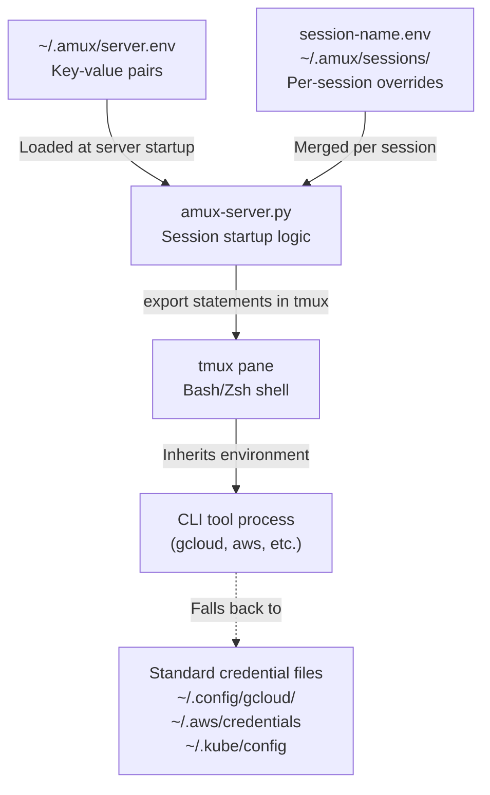
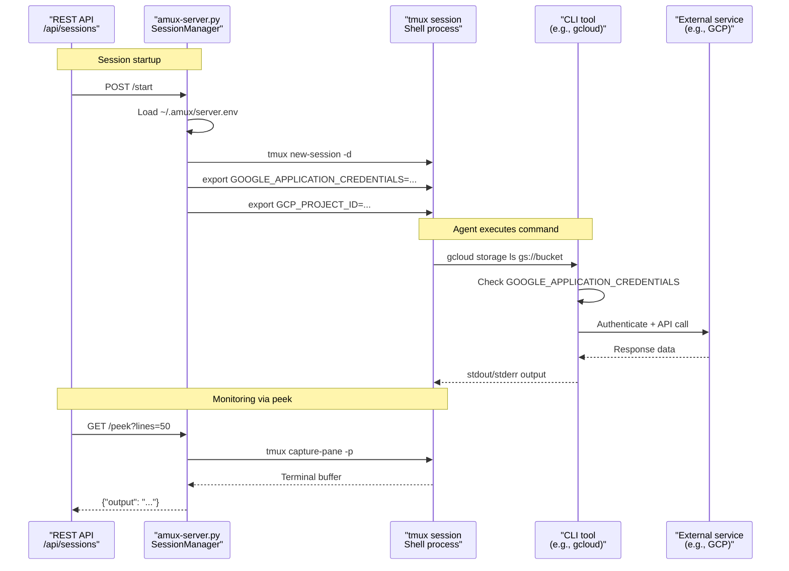

<!-- source: DeepWiki mcp.deepwiki.com · repo mixpeek/amux · page 8.4 CLI Tools · fetched 2026-10-27 -->

# CLI Tools

<details>
<summary>Relevant source files</summary>

The following files were used as context for generating this wiki page:

- [integrations/cli-tools/README.md](integrations/cli-tools/README.md)
- [integrations/cli-tools/google/README.md](integrations/cli-tools/google/README.md)

</details>


This page documents how to use command-line tools (e.g., `gcloud`, `aws`, `kubectl`) within amux sessions. CLI tools complement MCP integrations by providing shell-based access to external services where structured protocol integration is unavailable or unnecessary.

For structured read/write access to external services from within Claude's context, see [MCP Server Configuration](#8.1). For Google Docs-specific integration via MCP, see [Google Docs Integration](#8.2).

---

## Overview

CLI tools in amux leverage the fact that sessions execute inside standard `tmux` panes, inheriting the full shell environment of the host system. This means:

- Tools installed via `brew`, `apt`, or manual installation are immediately available
- No container isolation or VM boundary to cross
- Credentials and configuration persist in standard locations (`~/.config`, `~/.aws`, etc.)
- Environment variables from `~/.amux/server.env` are injected at session startup

### CLI Tools vs MCP Servers

| Aspect | CLI Tools | MCP Servers |
|--------|-----------|-------------|
| **Access Pattern** | Shell commands via `tmux send-keys` | Structured protocol with tool schema |
| **Integration Depth** | Output parsing, exit codes | Type-safe parameters, JSON responses |
| **Credential Location** | `~/.amux/server.env` or standard tool config dirs | `~/.amux/server.env` (substituted into `mcp.json`) |
| **Best For** | One-off commands, scripting, batch operations | Repeated structured operations, context-aware queries |
| **Setup Complexity** | Install tool + authenticate | Configure `mcp.json` + credentials |

**Sources:** [integrations/cli-tools/README.md:1-46]()

---

## Architecture

### Environment Injection Flow



**Diagram: Environment Variable Resolution**

When a session starts via `POST /api/sessions/{name}/start`:

1. amux-server.py reads `~/.amux/server.env` [integrations/cli-tools/google/README.md:36-41]()
2. Merges with session-specific `~/.amux/sessions/{name}.env` (see [Session Management](#2.1))
3. Issues `tmux send-keys` commands to export variables into the shell
4. CLI tools inherit the environment and also check standard credential locations

**Sources:** [integrations/cli-tools/README.md:7-12]()

---

### CLI Tool Execution Architecture



**Diagram: CLI Tool Invocation Flow**

Agents interact with CLI tools via natural language commands that Claude Code translates into shell commands. The amux REST API (see [Session Endpoints](#5.1)) provides `peek` and `send` endpoints for monitoring and injecting commands.

**Sources:** [integrations/cli-tools/README.md:7-12](), [integrations/cli-tools/google/README.md:53-76]()

---

## Google Cloud CLI

The Google Cloud CLI (`gcloud`) provides access to all GCP services including Cloud Storage, BigQuery, GKE, Cloud Run, Pub/Sub, and Cloud Logging.

### Installation

```bash
# macOS
brew install --cask google-cloud-sdk

# Linux (Debian/Ubuntu)
echo "deb [signed-by=/usr/share/keyrings/cloud.google.gpg] https://packages.cloud.google.com/apt cloud-sdk main" \
  | sudo tee -a /etc/apt/sources.list.d/google-cloud-sdk.list
curl https://packages.cloud.google.com/apt/doc/apt-key.gpg \
  | sudo apt-key --keyring /usr/share/keyrings/cloud.google.gpg add -
sudo apt-get update && sudo apt-get install google-cloud-sdk
```

Verify installation:

```bash
gcloud version
```

**Sources:** [integrations/cli-tools/google/README.md:6-16]()

---

### Authentication Methods

#### Interactive Authentication (Recommended for Local Development)

```bash
# Authorize gcloud commands (opens browser)
gcloud auth login

# Application Default Credentials (used by SDKs and client libraries)
gcloud auth application-default login
```

Both commands open a browser tab and store credentials in `~/.config/gcloud/`. These credentials persist across shell sessions and amux sessions.

**Sources:** [integrations/cli-tools/google/README.md:18-30]()

---

#### Service Account Authentication (Recommended for Automation)

For non-interactive environments (e.g., cloud deployments with [Gateway & Multi-Tenancy](#3)), use service account credentials:

1. Create a service account in [Google Cloud Console](https://console.cloud.google.com/iam-admin/serviceaccounts)
2. Grant required IAM roles (e.g., `Storage Object Viewer`, `BigQuery User`)
3. Download the JSON key file
4. Store the path in `~/.amux/server.env`:

```bash
echo 'GOOGLE_APPLICATION_CREDENTIALS=/path/to/service-account.json' >> ~/.amux/server.env
```

5. Trigger server reload:

```bash
touch /path/to/amux-server.py
```

The `GOOGLE_APPLICATION_CREDENTIALS` environment variable is the standard credential discovery mechanism for all Google client libraries and SDKs. It will be automatically injected into every session.

**Sources:** [integrations/cli-tools/google/README.md:32-43]()

---

### Setting Default Project

```bash
gcloud config set project YOUR_PROJECT_ID
```

This persists the project in `~/.config/gcloud/configurations/config_default`, eliminating the need to pass `--project` on every command.

**Sources:** [integrations/cli-tools/google/README.md:45-51]()

---

### Common Usage Patterns

#### Cloud Storage Operations

```bash
# List buckets
gcloud storage ls

# Copy file to GCS
gcloud storage cp ./data.csv gs://my-bucket/data/

# Copy directory recursively
gcloud storage cp -r ./logs/ gs://my-bucket/logs/

# Download from GCS
gcloud storage cp gs://my-bucket/report.pdf ./
```

#### BigQuery Operations

```bash
# List datasets
bq ls

# List tables in dataset
bq ls my_dataset

# Run query
bq query --nouse_legacy_sql \
  'SELECT country, COUNT(*) as cnt FROM `project.dataset.table` GROUP BY country LIMIT 10'

# Load CSV into table
bq load --source_format=CSV my_dataset.my_table gs://bucket/data.csv schema.json
```

#### Cloud Run & GKE

```bash
# List Cloud Run services
gcloud run services list --region us-central1

# Deploy new revision
gcloud run deploy my-service --image gcr.io/project/image:tag --region us-central1

# Get GKE credentials
gcloud container clusters get-credentials cluster-name --zone us-central1-a

# Then use kubectl
kubectl get pods
```

#### Cloud Logging

```bash
# Tail logs in real-time
gcloud logging tail "resource.type=cloud_run_revision AND resource.labels.service_name=my-service"

# Read logs from last hour
gcloud logging read "resource.type=gce_instance" --limit 100 --format json
```

#### Compute Engine SSH

```bash
# SSH into instance
gcloud compute ssh instance-name --zone us-central1-a

# Run command remotely
gcloud compute ssh instance-name --zone us-central1-a --command "df -h"
```

**Sources:** [integrations/cli-tools/google/README.md:53-76]()

---

## Credential Security

### Storage Hierarchy

| Location | Purpose | Visibility | Precedence |
|----------|---------|------------|------------|
| `~/.amux/server.env` | Server-wide defaults | All sessions | Lowest |
| `~/.amux/sessions/{name}.env` | Session-specific overrides | Single session | Highest |
| `~/.config/gcloud/` | gcloud-specific config | All sessions using gcloud | N/A (fallback) |
| `~/.aws/credentials` | AWS CLI config | All sessions using aws | N/A (fallback) |

Session-specific environment files override server-wide settings, allowing per-session credential isolation when needed.

### Injecting Credentials

Environment variables in `server.env` follow standard shell syntax:

```bash
# API keys
MIXPEEK_API_KEY=sk_xxx
ANTHROPIC_API_KEY=sk_xxx

# Service account paths
GOOGLE_APPLICATION_CREDENTIALS=/Users/you/.config/gcp-service-account.json
AWS_SHARED_CREDENTIALS_FILE=/Users/you/.aws/automation-creds

# Custom tool config
DATABRICKS_HOST=https://workspace.cloud.databricks.com
DATABRICKS_TOKEN=dapi_xxx
```

After editing `server.env`, reload the server to apply changes:

```bash
touch /path/to/amux-server.py
```

This triggers the file modification watchdog (see [Self-Healing Watchdog](#2.4)) to restart the server process.

**Sources:** [integrations/cli-tools/google/README.md:36-41]()

---

## Adding New CLI Tools

To document a new CLI tool in this directory:

### 1. Create Documentation

Create `integrations/cli-tools/<tool-name>/README.md` with sections:

- **Install**: Package manager command or download link
- **Authenticate**: Steps to authorize the tool
- **Environment Variables**: Required keys/tokens in `~/.amux/server.env`
- **Common Usage**: Example commands agents might run
- **MCP Alternative**: If a corresponding MCP server exists (see [MCP Server Configuration](#8.1))

### 2. Update Index

Add an entry to the table in [integrations/cli-tools/README.md:14-17]():

```markdown
| Tool | Directory | Use case |
|------|-----------|----------|
| [Tool Name](#tool-name) | [tool-name/](./tool-name) | Brief description |
```

### 3. Configure Credentials (if needed)

If the tool requires API keys or tokens, add them to `~/.amux/server.env`:

```bash
echo 'TOOL_API_KEY=xxx' >> ~/.amux/server.env
touch /path/to/amux-server.py  # reload
```

### 4. Test in Session

Create a test session and verify the tool works:

```bash
# Via CLI
./amux register test-tool-session
./amux start test-tool-session
./amux send test-tool-session "tool-command --version"
./amux peek test-tool-session

# Via REST API
curl -X POST http://localhost:8822/api/sessions \
  -H "Content-Type: application/json" \
  -d '{"name":"test-tool-session"}'

curl -X POST http://localhost:8822/api/sessions/test-tool-session/start

curl -X POST http://localhost:8822/api/sessions/test-tool-session/send \
  -H "Content-Type: application/json" \
  -d '{"text":"tool-command --version"}'
```

**Sources:** [integrations/cli-tools/README.md:40-46]()

---

## Comparison with MCP Integration

### When to Use CLI Tools

Use CLI tools when:

- **No MCP server exists** for the target service
- **One-off administrative tasks** (e.g., deploying infrastructure, running migrations)
- **Batch operations** where shell piping and scripting are more natural
- **Tool already installed** and configured on the host system
- **Output parsing flexibility** is needed (e.g., `jq`, `awk`, `grep`)

### When to Use MCP Servers

Use MCP servers when:

- **Structured operations** with well-defined input/output schemas
- **Repeated queries** where Claude benefits from tool documentation
- **Type safety** is important (e.g., validating parameters before execution)
- **Context-aware operations** (e.g., reading Google Docs into Claude's context)
- **Error handling** needs to be more granular than exit codes

See [MCP Server Configuration](#8.1) for the MCP integration architecture and [Google Docs Integration](#8.2) for a comparison of gcloud vs Google Docs MCP.

**Sources:** [integrations/cli-tools/google/README.md:78-91](), [integrations/cli-tools/README.md:1-6]()

---

## Available Tools

### Google Cloud CLI

| Aspect | Details |
|--------|---------|
| **Package** | `google-cloud-sdk` |
| **Install** | `brew install --cask google-cloud-sdk` |
| **Auth Method** | Interactive (`gcloud auth login`) or Service Account (`GOOGLE_APPLICATION_CREDENTIALS`) |
| **Documentation** | [integrations/cli-tools/google/](integrations/cli-tools/google) |
| **Common Commands** | `gcloud storage`, `bq`, `gcloud run`, `gcloud compute ssh` |
| **MCP Alternative** | [Google Docs MCP](#8.2) for Docs/Drive access |

Additional tools can be documented following the structure in [Adding New CLI Tools](#adding-new-cli-tools).

**Sources:** [integrations/cli-tools/google/README.md:1-91](), [integrations/cli-tools/README.md:14-24]()

---

