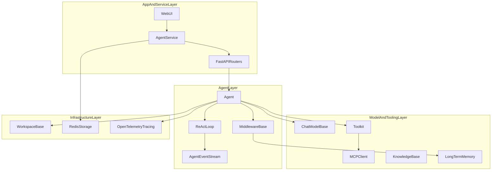
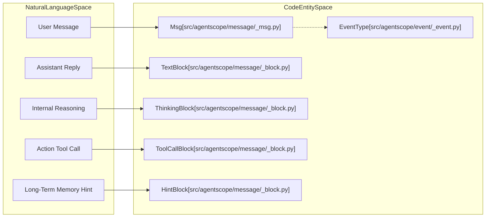

<!-- source: DeepWiki mcp.deepwiki.com · repo modelscope/agentscope · page 1 Overview · fetched 2026-10-27 -->

# Overview

Relevant source files

The following files were used as context for generating this wiki page:

- [.gemini/styleguide.md](.gemini/styleguide.md)
- [.github/copilot-instructions.md](.github/copilot-instructions.md)
- [README.md](README.md)
- [README_zh.md](README_zh.md)
- [assets/images/agentscope.png](assets/images/agentscope.png)
- [docs/NEWS.md](docs/NEWS.md)
- [docs/NEWS_zh.md](docs/NEWS_zh.md)
- [examples/agent_service/README.md](examples/agent_service/README.md)
- [src/agentscope/__init__.py](src/agentscope/__init__.py)
- [src/agentscope/_version.py](src/agentscope/_version.py)
- [src/agentscope/middleware/__init__.py](src/agentscope/middleware/__init__.py)
- [src/agentscope/middleware/_longterm_memory/__init__.py](src/agentscope/middleware/_longterm_memory/__init__.py)
- [src/agentscope/middleware/_longterm_memory/_reme/__init__.py](src/agentscope/middleware/_longterm_memory/_reme/__init__.py)
- [src/agentscope/realtime/__init__.py](src/agentscope/realtime/__init__.py)
- [src/agentscope/realtime/_base.py](src/agentscope/realtime/_base.py)

This document provides an introduction to AgentScope 2.0, its design philosophy, core capabilities, and high-level system architecture [README.md:64-70](), [README_zh.md:64-70](). It serves as an entry point for understanding how the framework's major subsystems integrate to enable the development of production-ready multi-agent applications.

For installation options, optional dependency groups, Redis environment setup, and running the example agent service, see [Installation and Setup](#1.1) [examples/agent_service/README.md:14-41](). For a detailed technical explanation of fundamental building blocks such as the single `Agent` class, message blocks, toolkits, workspaces, middlewares, the permission engine, event streams, message buses, and the ReAct loop, see [Core Concepts and Architecture](#1.2) [README.md:124-135]().

Sources: [README.md:64-70](), [README_zh.md:64-70](), [examples/agent_service/README.md:14-41](), [README.md:124-135]()

---

## What is AgentScope 2.0?

AgentScope 2.0 is a production-ready, easy-to-use agent framework that provides essential abstractions designed to keep pace with evolving LLM capabilities [README.md:64-66](), [README_zh.md:64-66](). The framework requires **Python 3.11** or higher [README.md:102-102](), [README_zh.md:102-102]() and runs under version `2.0.12dev` [src/agentscope/_version.py:4-4]().

Rather than constraining models with rigid prompts and opinionated orchestrations, AgentScope 2.0 leverages models' native reasoning and tool-use capabilities to build flexible multi-agent workflows [README.md:68-70](), [README_zh.md:68-70](). It provides comprehensive support for multi-agent teams, persistent long-term memory, distributed Retrieval-Augmented Generation (RAG), and multi-tenant FastAPI-based agent services [README.md:76-85](), [README_zh.md:75-85]().

Sources: [README.md:64-102](), [README_zh.md:64-102](), [src/agentscope/_version.py:4-4]()

---

## Design Philosophy

The core design philosophy of AgentScope 2.0 centers around several architectural pillars:

1.  **Agentic LLMs**: Prioritizing model-driven reasoning and dynamic tool invocation over hardcoded control flows [README.md:68-70](), [README_zh.md:68-70]().
2.  **Single Core Agent Abstraction**: Unifying reasoning, tool management, and event streaming into a consistent `Agent` class [README.md:124-135]().
3.  **Lazy Imports**: Third-party library dependencies are imported strictly at the point of use to maintain a lightweight core runtime [.github/copilot-instructions.md:10-18]().
4.  **Observable Execution**: Asynchronous event streams and tracing integrations provide deep visibility into agent execution [README.md:132-132]().
5.  **Production Deployment**: First-class support for multi-tenant state persistence via Redis and asynchronous SQLAlchemy storage backends [examples/agent_service/README.md:3-7]().

For detailed architectural principles and core classes, see [Core Concepts and Architecture](#1.2).

Sources: [README.md:68-70](), [README_zh.md:68-70](), [README.md:124-135](), [.github/copilot-instructions.md:10-18](), [examples/agent_service/README.md:3-7]()

---

## High-Level Architecture

AgentScope 2.0 divides its architecture into distinct modular layers, cleanly separating application entry points from core execution logic, model toolings, and infrastructure backends.

### Title: System Architecture Map

Sources: [README.md:76-85](), [README_zh.md:75-85](), [README.md:124-135]()

---

## Major Subsystems

The framework is organized into specialized subsystems designed to interoperate seamlessly. Each subsystem is documented in detail in dedicated wiki pages.

| Subsystem | Key Code Entities | Purpose | Wiki Section |
|---|---|---|---|
| **Agent System** | `Agent`, `AgentEvent`, `MiddlewareBase` | Core agent architecture, execution loops, and middleware hooks | [Agent System](#2) |
| **Model Integration** | `ChatModelBase`, `FormatterBase`, `CredentialBase` | Unified LLM abstraction across providers with robust formatting | [Model Integration](#3) |
| **Tool System** | `Toolkit`, `ToolBase`, `MCPClient` | Tool orchestration, function wrappers, and Model Context Protocol support | [Tool System](#4) |
| **Workspace** | `WorkspaceBase`, `LocalWorkspace` | Sandboxed local and remote execution environments (Docker, K8s, E2B) | [Workspace System](#5) |
| **Agent Service** | `FastAPI`, `RedisStorage`, `MessageBus` | Multi-tenant and multi-session production service layer | [Agent Service (App Layer)](#6) |
| **RAG System** | `KnowledgeBase`, `VectorStoreBase`, `RAGMiddleware` | Retrieval-augmented generation pipeline with multi-backend vector stores | [RAG System](#10) |
| **Memory System** | `Mem0Middleware`, `ReMeMiddleware`, `AgenticMemoryMiddleware` | Long-term memory integration backends | [Long-term Memory](#9.5) |

Sources: [README.md:124-136](), [src/agentscope/middleware/__init__.py:5-10]()

---

## Message Protocol and Events

AgentScope 2.0 establishes a strict correspondence between natural language agent interactions and strongly-typed code entities via its message and event protocol.

### Title: Natural Language to Code Mapping Bridge

Sources: [README.md:124-135]()

---

## Community and Resources

*   **Documentation**: [https://docs.agentscope.io/](https://docs.agentscope.io)
*   **GitHub Repository**: [https://github.com/agentscope-ai/agentscope](https://github.com/agentscope-ai/agentscope)
*   **Discord Community**: [https://discord.gg/eYMpfnkG8h](https://discord.gg/eYMpfnkG8h)
*   **License**: Apache 2.0 [README.md:46-51]()

Sources: [README.md:11-51](), [README.md:94-96]()

---

