# Page: Overview

# Overview

<details>
<summary>Relevant source files</summary>

The following files were used as context for generating this wiki page:

- [.gemini/styleguide.md](.gemini/styleguide.md)
- [.github/copilot-instructions.md](.github/copilot-instructions.md)
- [README.md](README.md)
- [README_zh.md](README_zh.md)
- [assets/images/agentscope.png](assets/images/agentscope.png)
- [docs/NEWS.md](docs/NEWS.md)
- [docs/NEWS_zh.md](docs/NEWS_zh.md)
- [examples/agent_service/README.md](examples/agent_service/README.md)
- [src/agentscope/__init__.py](src/agentscope/__init__.py)
- [src/agentscope/_version.py](src/agentscope/_version.py)
- [src/agentscope/middleware/__init__.py](src/agentscope/middleware/__init__.py)
- [src/agentscope/middleware/_longterm_memory/__init__.py](src/agentscope/middleware/_longterm_memory/__init__.py)
- [src/agentscope/middleware/_longterm_memory/_reme/__init__.py](src/agentscope/middleware/_longterm_memory/_reme/__init__.py)
- [src/agentscope/realtime/__init__.py](src/agentscope/realtime/__init__.py)
- [src/agentscope/realtime/_base.py](src/agentscope/realtime/_base.py)

</details>


This document provides an introduction to AgentScope 2.0, its design philosophy, core capabilities, and high-level system architecture [README.md:64-70](), [README_zh.md:64-70](). It serves as an entry point for understanding how the framework's major subsystems integrate to enable the development of production-ready multi-agent applications.

For installation options, optional dependency groups, Redis environment setup, and running the example agent service, see [Installation and Setup](#1.1) [examples/agent_service/README.md:14-41](). For a detailed technical explanation of fundamental building blocks such as the single `Agent` class, message blocks, toolkits, workspaces, middlewares, the permission engine, event streams, message buses, and the ReAct loop, see [Core Concepts and Architecture](#1.2) [README.md:124-135]().

Sources: [README.md:64-70](), [README_zh.md:64-70](), [examples/agent_service/README.md:14-41](), [README.md:124-135]()

---

## What is AgentScope 2.0?

AgentScope 2.0 is a production-ready, easy-to-use agent framework that provides essential abstractions designed to keep pace with evolving LLM capabilities [README.md:64-66](), [README_zh.md:64-66](). The framework requires **Python 3.11** or higher [README.md:102-102](), [README_zh.md:102-102]() and runs under version `2.0.12dev` [src/agentscope/_version.py:4-4]().

Rather than constraining models with rigid prompts and opinionated orchestrations, AgentScope 2.0 leverages models' native reasoning and tool-use capabilities to build flexible multi-agent workflows [README.md:68-70](), [README_zh.md:68-70](). It provides comprehensive support for multi-agent teams, persistent long-term memory, distributed Retrieval-Augmented Generation (RAG), and multi-tenant FastAPI-based agent services [README.md:76-85](), [README_zh.md:75-85]().

Sources: [README.md:64-102](), [README_zh.md:64-102](), [src/agentscope/_version.py:4-4]()

---

## Design Philosophy

The core design philosophy of AgentScope 2.0 centers around several architectural pillars:

1.  **Agentic LLMs**: Prioritizing model-driven reasoning and dynamic tool invocation over hardcoded control flows [README.md:68-70](), [README_zh.md:68-70]().
2.  **Single Core Agent Abstraction**: Unifying reasoning, tool management, and event streaming into a consistent `Agent` class [README.md:124-135]().
3.  **Lazy Imports**: Third-party library dependencies are imported strictly at the point of use to maintain a lightweight core runtime [.github/copilot-instructions.md:10-18]().
4.  **Observable Execution**: Asynchronous event streams and tracing integrations provide deep visibility into agent execution [README.md:132-132]().
5.  **Production Deployment**: First-class support for multi-tenant state persistence via Redis and asynchronous SQLAlchemy storage backends [examples/agent_service/README.md:3-7]().

For detailed architectural principles and core classes, see [Core Concepts and Architecture](#1.2).

Sources: [README.md:68-70](), [README_zh.md:68-70](), [README.md:124-135](), [.github/copilot-instructions.md:10-18](), [examples/agent_service/README.md:3-7]()

---

## High-Level Architecture

AgentScope 2.0 divides its architecture into distinct modular layers, cleanly separating application entry points from core execution logic, model toolings, and infrastructure backends.

### Title: System Architecture Map
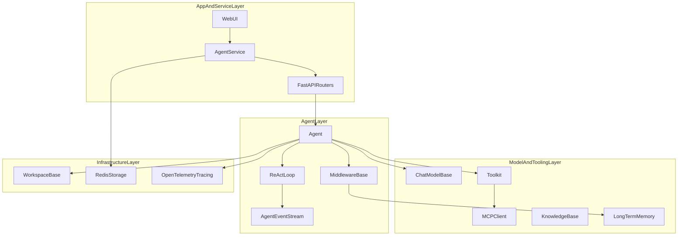

Sources: [README.md:76-85](), [README_zh.md:75-85](), [README.md:124-135]()

---

## Major Subsystems

The framework is organized into specialized subsystems designed to interoperate seamlessly. Each subsystem is documented in detail in dedicated wiki pages.

| Subsystem | Key Code Entities | Purpose | Wiki Section |
|---|---|---|---|
| **Agent System** | `Agent`, `AgentEvent`, `MiddlewareBase` | Core agent architecture, execution loops, and middleware hooks | [Agent System](#2) |
| **Model Integration** | `ChatModelBase`, `FormatterBase`, `CredentialBase` | Unified LLM abstraction across providers with robust formatting | [Model Integration](#3) |
| **Tool System** | `Toolkit`, `ToolBase`, `MCPClient` | Tool orchestration, function wrappers, and Model Context Protocol support | [Tool System](#4) |
| **Workspace** | `WorkspaceBase`, `LocalWorkspace` | Sandboxed local and remote execution environments (Docker, K8s, E2B) | [Workspace System](#5) |
| **Agent Service** | `FastAPI`, `RedisStorage`, `MessageBus` | Multi-tenant and multi-session production service layer | [Agent Service (App Layer)](#6) |
| **RAG System** | `KnowledgeBase`, `VectorStoreBase`, `RAGMiddleware` | Retrieval-augmented generation pipeline with multi-backend vector stores | [RAG System](#10) |
| **Memory System** | `Mem0Middleware`, `ReMeMiddleware`, `AgenticMemoryMiddleware` | Long-term memory integration backends | [Long-term Memory](#9.5) |

Sources: [README.md:124-136](), [src/agentscope/middleware/__init__.py:5-10]()

---

## Message Protocol and Events

AgentScope 2.0 establishes a strict correspondence between natural language agent interactions and strongly-typed code entities via its message and event protocol.

### Title: Natural Language to Code Mapping Bridge
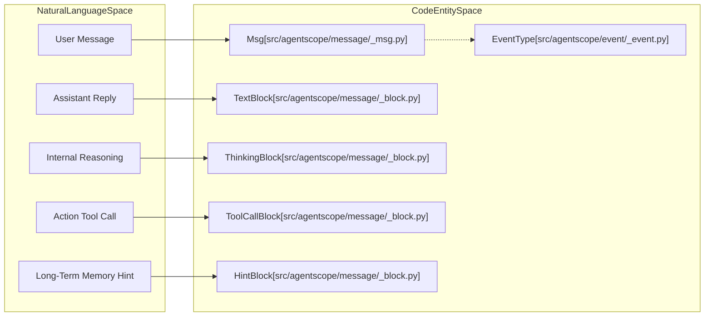

Sources: [README.md:124-135]()

---

## Community and Resources

*   **Documentation**: [https://docs.agentscope.io/](https://docs.agentscope.io)
*   **GitHub Repository**: [https://github.com/agentscope-ai/agentscope](https://github.com/agentscope-ai/agentscope)
*   **Discord Community**: [https://discord.gg/eYMpfnkG8h](https://discord.gg/eYMpfnkG8h)
*   **License**: Apache 2.0 [README.md:46-51]()

Sources: [README.md:11-51](), [README.md:94-96]()

---

# Page: Installation and Setup

# Installation and Setup

<details>
<summary>Relevant source files</summary>

The following files were used as context for generating this wiki page:

- [.gemini/styleguide.md](.gemini/styleguide.md)
- [.github/copilot-instructions.md](.github/copilot-instructions.md)
- [README.md](README.md)
- [README_zh.md](README_zh.md)
- [assets/images/agentscope.png](assets/images/agentscope.png)
- [docs/NEWS.md](docs/NEWS.md)
- [docs/NEWS_zh.md](docs/NEWS_zh.md)
- [examples/agent_service/README.md](examples/agent_service/README.md)
- [examples/rag/README.md](examples/rag/README.md)
- [pyproject.toml](pyproject.toml)
- [src/agentscope/_version.py](src/agentscope/_version.py)
- [src/agentscope/middleware/__init__.py](src/agentscope/middleware/__init__.py)
- [src/agentscope/middleware/_longterm_memory/__init__.py](src/agentscope/middleware/_longterm_memory/__init__.py)
- [src/agentscope/middleware/_longterm_memory/_reme/__init__.py](src/agentscope/middleware/_longterm_memory/_reme/__init__.py)
- [src/agentscope/rag/__init__.py](src/agentscope/rag/__init__.py)
- [src/agentscope/rag/_vdb/__init__.py](src/agentscope/rag/_vdb/__init__.py)
- [src/agentscope/realtime/__init__.py](src/agentscope/realtime/__init__.py)
- [src/agentscope/realtime/_base.py](src/agentscope/realtime/_base.py)

</details>


This page guides users through setting up AgentScope 2.0, detailing Python requirements, installation options via `pip` or `uv`, optional dependency groups defined in `pyproject.toml`, Redis configuration for persistent storage and message bus routing, and launching the FastAPI-based agent service example.

Sources: [pyproject.toml:1-216]()

---

## Prerequisites

AgentScope 2.0 requires specific runtime environments, package managers, and external services depending on the features utilized.

- **Python Version**: Python `>=3.11` is strictly required for advanced typing, modern syntax features, and async primitives [pyproject.toml:20]().
- **Package Managers**: `pip` or `uv` (recommended for high-performance dependency resolution).
- **Redis**: Required for stateful storage via `RedisStorage` and message passing via `RedisMessageBus` [pyproject.toml:74](), [examples/agent_service/README.md:28-41]().
- **ripgrep (`rg`)**: Required if executing the built-in `Grep` tool inside a `LocalWorkspace` [pyproject.toml:111-112]().
- **Sandboxing Backends**: `Docker`, `Kubernetes`, or specialized sandbox libraries if using containerized or isolated workspace backend options [pyproject.toml:92-102]().

Sources: [pyproject.toml:20](), [pyproject.toml:74](), [pyproject.toml:92-102](), [pyproject.toml:111-112](), [examples/agent_service/README.md:28-41]()

---

## Installation Methods

### Via Package Managers

To install the core framework (including foundational LLM clients and message protocols), run:

```bash
# Using uv (recommended)
uv pip install agentscope

# Using pip
pip install agentscope
```

Sources: [pyproject.toml:1-216]()

### From Source (Editable Mode)

For framework contributors or users tracking the repository source code:

```bash
# Pull the source code from GitHub
git clone https://github.com/agentscope-ai/agentscope.git
cd agentscope

# Install the package in editable mode
uv pip install -e .
```

For development and running test suites (`pytest`, `aiosqlite`, `moto`), install the `dev` extra group [pyproject.toml:197-216]():

```bash
uv pip install -e ".[dev]"
```

Sources: [pyproject.toml:197-216](), [README.md:112-120]()

---

## Optional Dependency Groups

AgentScope organizes specialized capabilities into modular optional dependency groups inside `pyproject.toml` [pyproject.toml:54-195](). This prevents bloating core installations with heavy domain-specific libraries.

### Natural Language Space to Code Entity Space: Optional Dependencies

The following diagram bridges natural language installation extras to their corresponding Python package requirements and code modules.

```mermaid
graph TD
    subgraph "Natural_Language_Space"
        E_MODELS["Model Extensions"]
        E_SERVICE["Service & API Layer"]
        E_STORAGE["Storage & Redis Bus"]
        E_WORKSPACE["Sandboxed Workspaces"]
        E_RAG["RAG & Document Parsers"]
        E_VDB["Vector Databases"]
        E_MEMORY["Long-term Memory"]
        E_REALTIME["Realtime Voice"]
        E_TUI["Terminal UI"]
        E_A2A["A2A Protocol"]
    end

    subgraph "Code_Entity_Space"
        PY_MOD["pyproject.toml [pyproject.toml:54-195]"]
        M_PKG["google-genai, ollama, xai-sdk, typesafe-sdk [pyproject.toml:55-59]"]
        S_PKG["fastapi, uvicorn, apscheduler, ag-ui-protocol [pyproject.toml:67-73]"]
        ST_PKG["redis, sqlalchemy, alembic, aioboto3 [pyproject.toml:75-84]"]
        WS_PKG["aiodocker, e2b, daytona, kubernetes-asyncio, opensandbox [pyproject.toml:92-102]"]
        RAG_PKG["pypdf, python-pptx, python-docx, openpyxl, xlrd, pandas [pyproject.toml:137-144]"]
        VDB_PKG["qdrant-client, pymilvus, milvus-lite, pymongo, elasticsearch [pyproject.toml:128-134]"]
        MEM_PKG["mem0ai, reme-ai [pyproject.toml:153-155]"]
        RT_PKG["websockets, sounddevice [pyproject.toml:115-118]"]
        TUI_PKG["textual [pyproject.toml:120-122]"]
        A2A_PKG["a2a-sdk [pyproject.toml:124-126]"]
    end

    E_MODELS --> PY_MOD
    E_SERVICE --> PY_MOD
    E_STORAGE --> PY_MOD
    E_WORKSPACE --> PY_MOD
    E_RAG --> PY_MOD
    E_VDB --> PY_MOD
    E_MEMORY --> PY_MOD
    E_REALTIME --> PY_MOD
    E_TUI --> PY_MOD
    E_A2A --> PY_MOD

    PY_MOD --> M_PKG
    PY_MOD --> S_PKG
    PY_MOD --> ST_PKG
    PY_MOD --> WS_PKG
    PY_MOD --> RAG_PKG
    PY_MOD --> VDB_PKG
    PY_MOD --> MEM_PKG
    PY_MOD --> RT_PKG
    PY_MOD --> TUI_PKG
    PY_MOD --> A2A_PKG
```

Sources: [pyproject.toml:54-195](), [pyproject.toml:55-59](), [pyproject.toml:67-73](), [pyproject.toml:75-84](), [pyproject.toml:92-102](), [pyproject.toml:115-118](), [pyproject.toml:120-122](), [pyproject.toml:124-126](), [pyproject.toml:128-134](), [pyproject.toml:137-144](), [pyproject.toml:153-155]()

### Group Reference Table

| Extra Group | Install Command | Target Capabilities |
| :--- | :--- | :--- |
| `model-gemini` | `pip install "agentscope[model-gemini]"` | Gemini (`google-genai`) integration [pyproject.toml:56]() |
| `model-ollama` | `pip install "agentscope[model-ollama]"` | Ollama (`ollama`) integration [pyproject.toml:57]() |
| `model-xai` | `pip install "agentscope[model-xai]"` | xAI (`xai-sdk`) integration [pyproject.toml:58]() |
| `classifier-jev` | `pip install "agentscope[classifier-jev]"` | Jev classifier (`typesafe-sdk`) integration [pyproject.toml:59]() |
| `models` | `pip install "agentscope[models]"` | All model integrations (Gemini, Ollama, xAI) [pyproject.toml:60-64]() |
| `classifiers` | `pip install "agentscope[classifiers]"` | All classifier integrations (Jev) [pyproject.toml:65]() |
| `service` | `pip install "agentscope[service]"` | FastAPI app hosting, Uvicorn, APScheduler, and `ag-ui-protocol` [pyproject.toml:67-73]() |
| `storage-redis` | `pip install "agentscope[storage-redis]"` | Redis client for `RedisStorage` and `RedisMessageBus` [pyproject.toml:75]() |
| `storage-sql` | `pip install "agentscope[storage-sql]"` | SQLAlchemy 2.0 async and Alembic database migrations [pyproject.toml:79-82]() |
| `storage-s3` | `pip install "agentscope[storage-s3]"` | S3-compatible blob store (`aioboto3`) [pyproject.toml:84]() |
| `channel` | `pip install "agentscope[channel]"` | Lark, Discord, and DingTalk channel integrations [pyproject.toml:86-90]() |
| `workspace-docker` | `pip install "agentscope[workspace-docker]"` | Docker workspace backend (`aiodocker`) [pyproject.toml:92]() |
| `workspace-e2b` | `pip install "agentscope[workspace-e2b]"` | E2B workspace backend (`e2b`) [pyproject.toml:93]() |
| `workspace-daytona` | `pip install "agentscope[workspace-daytona]"` | Daytona workspace backend (`daytona`) [pyproject.toml:94]() |
| `workspace-k8s` | `pip install "agentscope[workspace-k8s]"` | Kubernetes workspace backend (`kubernetes-asyncio`) [pyproject.toml:95]() |
| `workspace-opensandbox` | `pip install "agentscope[workspace-opensandbox]"` | OpenSandbox workspace backend (`opensandbox`) [pyproject.toml:96]() |
| `workspace` | `pip install "agentscope[workspace]"` | All workspace backends [pyproject.toml:97-103]() |
| `tools` | `pip install "agentscope[tools]"` | `ripgrep` binary for the built-in `Grep` tool [pyproject.toml:111-113]() |
| `realtime` | `pip install "agentscope[realtime]"` | `websockets` and `sounddevice` for realtime voice features [pyproject.toml:115-118]() |
| `tui` | `pip install "agentscope[tui]"` | `textual` for terminal UI [pyproject.toml:120-122]() |
| `a2a` | `pip install "agentscope[a2a]"` | `a2a-sdk` for A2A protocol support [pyproject.toml:124-126]() |
| `vdb-qdrant` | `pip install "agentscope[vdb-qdrant]"` | Qdrant vector store backend (`qdrant-client`) [pyproject.toml:128]() |
| `vdb-milvus` | `pip install "agentscope[vdb-milvus]"` | Milvus Lite and PyMilvus vector store backend [pyproject.toml:129-132]() |
| `vdb-mongodb`| `pip install "agentscope[vdb-mongodb]"`| MongoDB vector search backend (`pymongo`) [pyproject.toml:133]() |
| `vdb-elasticsearch` | `pip install "agentscope[vdb-elasticsearch]"` | Elasticsearch dense-vector store backend (`elasticsearch`) [pyproject.toml:134]() |
| `rag` | `pip install "agentscope[rag]"` | Document parsers (`pypdf`, `python-pptx`, `python-docx`, `openpyxl`, `xlrd`, `pandas`) [pyproject.toml:137-144]() |
| `memory-mem0` | `pip install "agentscope[memory-mem0]"` | Mem0 long-term memory middleware (`mem0ai`) [pyproject.toml:153]() |
| `memory-reme` | `pip install "agentscope[memory-reme]"` | ReMe long-term memory middleware (`reme-ai`) [pyproject.toml:155]() |
| `memory` | `pip install "agentscope[memory]"` | All long-term memory middlewares (Mem0, ReMe) [pyproject.toml:156-159]() |
| `full` | `pip install "agentscope[full]"` | Complete installation including all optional extras [pyproject.toml:176-195]() |

Sources: [pyproject.toml:54-195]()

---

## Redis Setup

The multi-tenant Agent Service relies on Redis for maintaining distributed session states via `RedisStorage` and coordinating agent messaging via `RedisMessageBus` [pyproject.toml:75](), [examples/agent_service/README.md:28-41]().

### Platform Deployment Commands

| Operating System / Tool | Command |
| :--- | :--- |
| **macOS (Homebrew)** | `brew install redis && brew services start redis` [examples/agent_service/README.md:31-33]() |
| **Linux (APT / Systemd)** | `sudo apt install redis-server && sudo systemctl start redis-server` [examples/agent_service/README.md:35-37]() |
| **Docker Container** | `docker run --rm -p 6379:6379 redis:7` [examples/agent_service/README.md:39-41]() |

Sources: [pyproject.toml:75](), [examples/agent_service/README.md:28-41]()

---

## Running the Example Agent Service

The `examples/agent_service` directory provides a FastAPI application demonstrating multi-tenant session management, scheduling, and workspace execution [examples/agent_service/README.md:1-11]().

### Natural Language Space to Code Entity Space: Agent Service Execution

The diagram below connects user-facing actions in natural language to backend routing functions, application factories, and execution services.

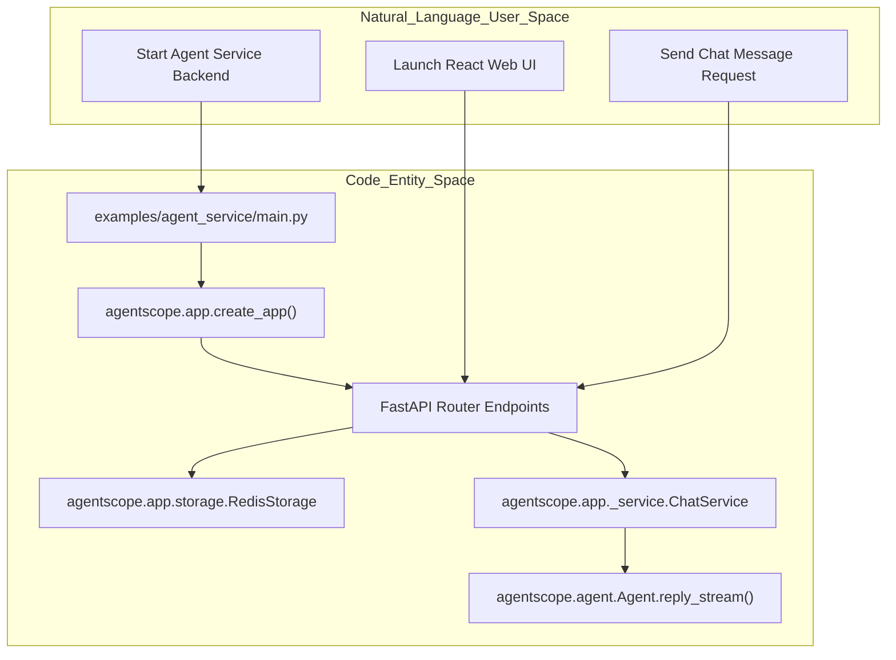

Sources: [examples/agent_service/README.md:1-63]()

### Execution Steps

1. **Start the Backend Service**:
   Navigate to the service directory and run the main entry point:
   ```bash
   cd examples/agent_service
   python main.py
   ```
   [examples/agent_service/README.md:43-49]()

2. **Launch the Companion Web UI**:
   In a separate terminal, install dependencies and start the React development server:
   ```bash
   cd examples/web_ui/
   pnpm install
   pnpm dev
   ```
   [examples/agent_service/README.md:51-61]()

3. Configure the Web UI endpoint to point to `http://localhost:8000` to interact with the multi-tenant agent system [examples/agent_service/README.md:63-63]().

Sources: [examples/agent_service/README.md:1-63]()

---

# Page: Core Concepts and Architecture

# Core Concepts and Architecture

<details>
<summary>Relevant source files</summary>

The following files were used as context for generating this wiki page:

- [.pre-commit-config.yaml](.pre-commit-config.yaml)
- [src/agentscope/__init__.py](src/agentscope/__init__.py)
- [src/agentscope/agent/_agent.py](src/agentscope/agent/_agent.py)
- [src/agentscope/agent/_config.py](src/agentscope/agent/_config.py)
- [src/agentscope/event/_event.py](src/agentscope/event/_event.py)
- [src/agentscope/message/_base.py](src/agentscope/message/_base.py)
- [src/agentscope/middleware/_base.py](src/agentscope/middleware/_base.py)
- [tests/agent_basic_test.py](tests/agent_basic_test.py)
- [tests/agent_injection_test.py](tests/agent_injection_test.py)
- [tests/agent_interrupt_test.py](tests/agent_interrupt_test.py)
- [tests/compress_context_test.py](tests/compress_context_test.py)
- [tests/event_test.py](tests/event_test.py)
- [tests/event_to_message_test.py](tests/event_to_message_test.py)
- [tests/hitl_external_execution_test.py](tests/hitl_external_execution_test.py)
- [tests/hitl_user_confirmation_test.py](tests/hitl_user_confirmation_test.py)
- [tests/message_test.py](tests/message_test.py)
- [tests/middleware_test.py](tests/middleware_test.py)

</details>


## Purpose and Scope
This page explains the fundamental building blocks of AgentScope 2.0 and how they work together to create production-ready agent applications. You will learn about the core architectural abstractions—the unified `Agent` class `[src/agentscope/agent/_agent.py:117]`, block-based messaging (`Msg` and `ContentBlock`) `[src/agentscope/message/_base.py:71]`, `Toolkit`, `WorkspaceBase`, `MiddlewareBase`, `PermissionEngine`, the `EventType` stream `[src/agentscope/event/_event.py:25]`, `MessageBus`, and how they compose. We also detail the ReAct reasoning-acting loop and the streaming event model.

Sources: `[src/agentscope/agent/_agent.py:117-203]`, `[src/agentscope/message/_base.py:71-117]`, `[src/agentscope/event/_event.py:25-68]`

---

## 1. Core Abstractions and Composition

AgentScope 2.0 is built around several primary classes that coordinate to handle complex multi-tenant reasoning, tool execution, and state management.

### The Unified Agent Class
The central orchestrator of AgentScope is the `Agent` class `[src/agentscope/agent/_agent.py:117]`. An agent combines a chat model, a toolkit, permissions, runtime configs, and state management.

**Key Components of an Agent**:
- **`model`**: A `ChatModelBase` instance used for generating reasoning and responses `[src/agentscope/agent/_agent.py:143]`.
- **`toolkit`**: A `Toolkit` instance containing registered tools, Model Context Protocol (MCP) servers, and skills `[src/agentscope/agent/_agent.py:201]`.
- **`state`**: An `AgentState` instance tracking conversation history, context, and permissions `[src/agentscope/agent/_agent.py:175]`.
- **`_engine`**: A `PermissionEngine` initialized with the agent's permission context to govern tool execution safety `[src/agentscope/agent/_agent.py:193]`.
- **`middlewares`**: A list of middleware objects intercepting execution at key lifecycle hooks `[src/agentscope/agent/_agent.py:148]`.
- **`offloader`**: An optional offloader to move compressed context or large tool results to external storage backends `[src/agentscope/agent/_agent.py:196]`.
- **`model_config`**: Configuration for the chat model, including fallback models and retries `[src/agentscope/agent/_agent.py:176]`.
- **`context_config`**: Configuration for context management, including compression triggers and reserved ratios `[src/agentscope/agent/_agent.py:177]`.
- **`react_config`**: Configuration for the ReAct loop, such as maximum iterations `[src/agentscope/agent/_agent.py:178]`.
- **`injection_config`**: Configuration for injecting runtime state (e.g., time, tasks) into the agent's context `[src/agentscope/agent/_agent.py:179]`.

Sources: `[src/agentscope/agent/_agent.py:117-203]`, `[src/agentscope/agent/_config.py:51-165]`, `[src/agentscope/state/_state.py:32-203]`

---

## 2. Message Protocol and Content Blocks

Communication in AgentScope uses the `Msg` class `[src/agentscope/message/_base.py:71]`. Rather than raw strings, messages contain structured lists of `ContentBlock` items `[src/agentscope/message/_base.py:80]`.

### Content Block Types
- **`TextBlock`**: Holds textual content or output fragments `[src/agentscope/message/_block.py:13]`.
- **`ThinkingBlock`**: Contains the model's internal reasoning chain or extended thinking output `[src/agentscope/message/_block.py:24]`.
- **`ToolCallBlock`**: Represents a model request to invoke a specific tool with JSON arguments and a lifecycle state (`ToolCallState`) `[src/agentscope/message/_block.py:50]`.
- **`ToolResultBlock`**: Stores the output of a tool execution, supporting both text chunks and multimodal data `[src/agentscope/message/_block.py:69]`.
- **`DataBlock`**: Handles binary media (images, audio, video) via `Base64Source` or `URLSource` `[src/agentscope/message/_block.py:35]`.
- **`HintBlock`**: Injected context or system hints, used for runtime notifications or background memory retrieval `[src/agentscope/message/_block.py:88]`.

The `Msg` class also includes fields for `id`, `created_at`, `metadata`, `usage`, `finished_at`, `finished_reason`, `structured_output`, and `error` to track the message's lifecycle and outcome `[src/agentscope/message/_base.py:84-117]`.

Sources: `[src/agentscope/message/_base.py:71-117]`, `[src/agentscope/message/_block.py:13-96]`

---

## 3. ReAct Reasoning-Acting Loop and Event Stream

AgentScope agents execute tasks through an automated Reasoning-Acting (ReAct) loop driven by streaming generator methods `[src/agentscope/agent/_agent.py:290]`. Execution emits a fine-grained stream of `AgentEvent` objects defined by the `EventType` enum `[src/agentscope/event/_event.py:25]`.

### Event Stream Lifecycle
Title: "Agent Event Stream Lifecycle"
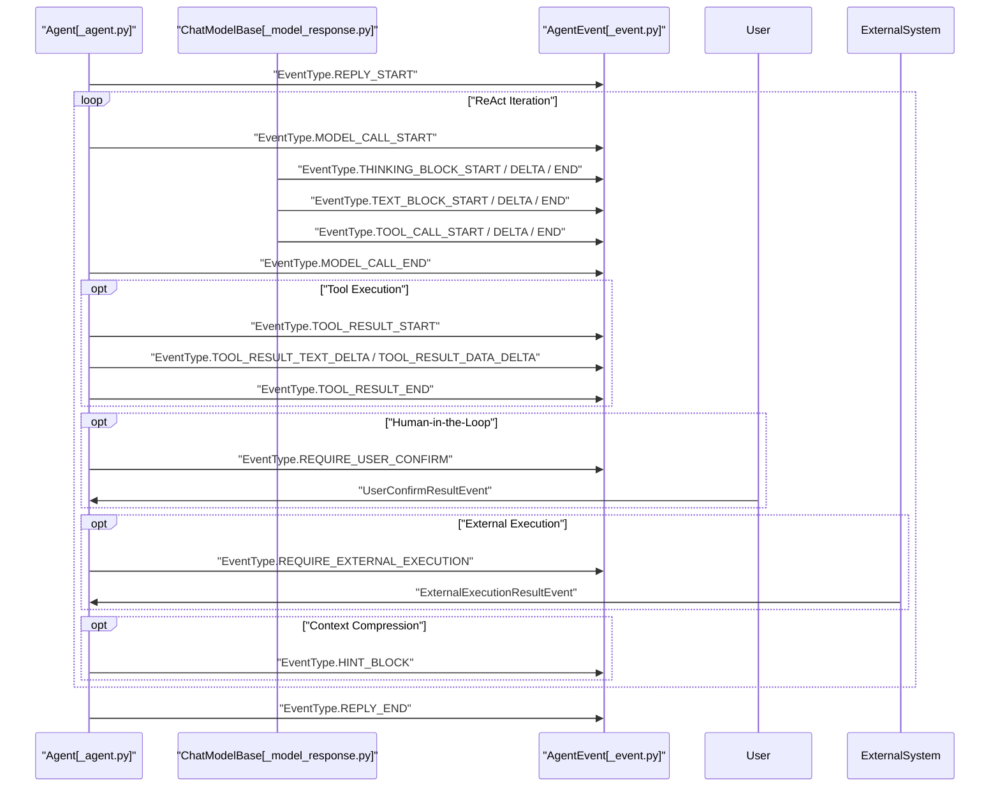
Sources: `[src/agentscope/agent/_agent.py:36-66]`, `[src/agentscope/event/_event.py:25-68]`, `[tests/middleware_test.py:183-197]`, `[tests/hitl_user_confirmation_test.py:158-172]`, `[tests/compress_context_test.py:26-27]`

---

## 4. Middleware System and Hook Points

Middlewares (`MiddlewareBase`) allow developers to intercept and modify agent behavior without altering core source code. 

### Hook Points and the Onion Pattern
Middlewares wrap execution using an onion pattern across several asynchronous hook points:
- **`on_reply`**: Wraps the entire reply generation generator `[src/agentscope/middleware/_base.py:68]`.
- **`on_reasoning`**: Intercepts model reasoning cycles `[src/agentscope/middleware/_base.py:101]`.
- **`on_acting`**: Intercepts individual tool call execution `[src/agentscope/middleware/_base.py:124]`.
- **`on_model_call`**: Intercepts raw API requests to `ChatModelBase` `[src/agentscope/middleware/_base.py:24]`.
- **`on_system_prompt`**: Dynamically modifies or extends system prompts `[src/agentscope/middleware/_base.py:28]`.
- **`on_check_permission`**: Intercepts permission evaluations `[src/agentscope/middleware/_base.py:170]`.
- **`on_compress_context`**: Manages context compression workflows `[src/agentscope/middleware/_base.py:25]`.

Sources: `[src/agentscope/middleware/_base.py:13-179]`, `[tests/middleware_test.py:43-123]`

---

## 5. Supporting Architectural Subsystems

### Toolkit and Tool Orchestration
The `Toolkit` class manages tool registration, schema generation (`get_tool_schemas()`), and unified async/sync execution (`call_tool()`). Tools can be standard Python functions wrapped via `FunctionTool`, external tools, or MCP tools. The toolkit also manages tool groups for organizing tools and loaders for loading skills.

### Workspace and Sandboxing
The workspace system provides sandboxed execution environments via workspace base subclasses. It isolates filesystem changes, manages skills, and injects workspace instructions into the agent runtime. The offloader interface is used to offload large data, such as compressed context or tool results, to external storage.

### PermissionEngine
The `PermissionEngine` evaluates tool calls against user-defined or default permission rules (`PermissionRule`), returning a `PermissionDecision` (`ALLOW`, `DENY`, or `ASK`) which triggers human-in-the-loop confirmation workflows when required `[src/agentscope/agent/_agent.py:193]`, `[tests/agent_basic_test.py:46-56]`.

### MessageBus
In multi-agent and service deployments, communication across sessions and agents is mediated by the `MessageBus` abstraction (with concrete implementations for distributed Redis and in-memory brokers), handling real-time event broadcasting and message routing.

Sources: `[src/agentscope/agent/_agent.py:106-193]`, `[tests/agent_basic_test.py:46-56]`

---

## 6. Component Interaction Architecture

The following diagrams bridge natural language concepts to their precise code entities in the codebase:

Title: "AgentScope 2.0 Core Entity Mapping"
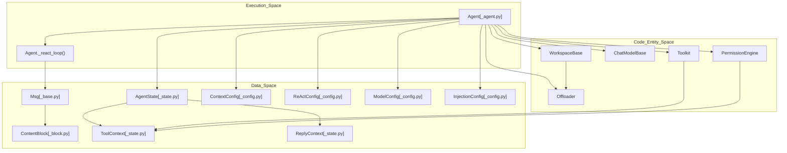
Sources: `[src/agentscope/agent/_agent.py:117-203]`, `[src/agentscope/message/_base.py:71-117]`, `[src/agentscope/message/_block.py:13-96]`, `[src/agentscope/state/_state.py:32-203]`, `[src/agentscope/agent/_config.py:51-165]`

Title: "Agent Runtime Flow to Code Mapping"
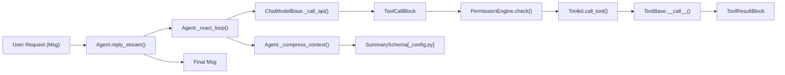
Sources: `[src/agentscope/agent/_agent.py:290-354]`, `[src/agentscope/agent/_config.py:9-49]`

### Core Concepts to Code Entity Mapping

| Concept | Primary Class / Interface | File Path |
|---------|-------------------------|-----------|
| Central Orchestrator | `Agent` | `[src/agentscope/agent/_agent.py:117]` |
| Tool Management | `Toolkit` | `[src/agentscope/tool/_toolkit.py:66]` |
| Safety & Permission | `PermissionEngine` | `[src/agentscope/permission/_permission.py:13]` |
| Structured Message | `Msg` | `[src/agentscope/message/_base.py:71]` |
| Sandbox Workspace | `WorkspaceBase` | `[src/agentscope/workspace/_base.py:13]` |
| Event Stream | `EventType` / `AgentEvent` | `[src/agentscope/event/_event.py:25]` |
| Agent State | `AgentState` | `[src/agentscope/state/_state.py:220]` |
| Tool Context | `ToolContext` | `[src/agentscope/state/_state.py:32]` |
| Reply Context | `ReplyContext` | `[src/agentscope/state/_state.py:182]` |
| Context Configuration | `ContextConfig` | `[src/agentscope/agent/_config.py:51]` |

Sources: `[src/agentscope/agent/_agent.py:73-203]`, `[src/agentscope/event/_event.py:25-68]`, `[src/agentscope/message/_base.py:71]`, `[src/agentscope/state/_state.py:32-229]`, `[src/agentscope/agent/_config.py:51-165]`

---

# Page: Agent System

# Agent System

<details>
<summary>Relevant source files</summary>

The following files were used as context for generating this wiki page:

- [.pre-commit-config.yaml](.pre-commit-config.yaml)
- [src/agentscope/agent/_agent.py](src/agentscope/agent/_agent.py)
- [src/agentscope/agent/_config.py](src/agentscope/agent/_config.py)
- [src/agentscope/event/_event.py](src/agentscope/event/_event.py)
- [src/agentscope/message/_base.py](src/agentscope/message/_base.py)
- [src/agentscope/middleware/_base.py](src/agentscope/middleware/_base.py)
- [tests/agent_basic_test.py](tests/agent_basic_test.py)
- [tests/agent_injection_test.py](tests/agent_injection_test.py)
- [tests/agent_interrupt_test.py](tests/agent_interrupt_test.py)
- [tests/compress_context_test.py](tests/compress_context_test.py)
- [tests/event_test.py](tests/event_test.py)
- [tests/event_to_message_test.py](tests/event_to_message_test.py)
- [tests/hitl_external_execution_test.py](tests/hitl_external_execution_test.py)
- [tests/hitl_user_confirmation_test.py](tests/hitl_user_confirmation_test.py)
- [tests/message_test.py](tests/message_test.py)
- [tests/middleware_test.py](tests/middleware_test.py)

</details>


## Purpose and Scope

The Agent System serves as the primary execution engine of AgentScope, coordinating reasoning, acting, tool orchestration, security permissions, and inter-agent communication. At its heart is the unified `Agent` class [src/agentscope/agent/_agent.py:117-118](), which executes a ReAct (Reasoning-Acting) loop, delegates tool invocations via `Toolkit` [src/agentscope/agent/_agent.py:201](), enforces permissions through `PermissionEngine` [src/agentscope/agent/_agent.py:193](), and streams execution telemetry using the `AgentEvent` protocol [src/agentscope/agent/_agent.py:36-66]().

As a parent page, this section provides a high-level architectural overview of the agent subsystem. For deep technical details on specific components, refer to the respective child pages:
- [Agent Class and ReAct Loop](#2.1) — Document the `Agent` class constructor parameters, the ReAct reasoning-acting loop, streaming via `reply_stream()`, and the `AgentEvent` stream (`EventType` enum, all event types including `HintBlockEvent` and `CustomEvent`).
- [Agent Configuration](#2.2) — Document `ContextConfig` (compression ratios, prompts), `ReActConfig` (max_iters, parallel tool calls, stop_on_reject, structured_output_grace_iters), `ModelConfig` (fallback model, retries), `InjectionConfig` (runtime state injection: current time, tasks, context warnings, repeated tool failures), `SummarySchema`, and `InviteConfig`.
- [Agent State and Context](#2.3) — Explain `AgentState`, `ToolContext` (activated_groups, read_file_cache, LRU eviction) [src/agentscope/state/_state.py:32-45](), `Task` model, and how state is passed through the agent lifecycle. Cover context compression workflow triggered by token ratio thresholds.
- [Message Protocol and Content Blocks](#2.4) — Document the `Msg` structure, all content block types (`TextBlock`, `DataBlock`, `ToolCallBlock`, `ToolResultBlock`, `ThinkingBlock`, `HintBlock`) [src/agentscope/agent/_agent.py:74-90](), source types (`URLSource`, `Base64Source`), message roles, and `append_event` accumulation.
- [Middleware System](#2.5) — Explain `MiddlewareBase`, the hook points (`on_reply`, `on_reasoning`, `on_acting`, `on_model_call`, `on_system_prompt`, `on_check_permission`, `on_compress_context`), the onion pattern, `ToolOffloadMiddleware`, and `ReplyBudgetControlMiddleware`.
- [Permission System](#2.6) — Document `PermissionEngine`, `PermissionContext`, `PermissionRule`, `PermissionDecision` (ALLOW/DENY/ASK), `PermissionMode` (EXPLORE/ACCEPT_EDITS/BYPASS/DONT_ASK), and how permissions are evaluated for Bash, Write, Read, and other tools.
- [Pipelines, SOP Engine, and A2A Agents](#2.7) — Document the pipeline abstraction (`PipelineProtocol`, `PipelineBase`), `GoalPipeline` (executor/verifier loop), the SOP subsystem (`SOP`/`SOPStep` definitions, `SOPEngine`, `SOPRunState`/`SOPPhase`, `VerificationResult`), and `A2AAgent`/`A2AState` for Agent-to-Agent protocol interop [tests/a2a_agent_test.py:18-20]().

Sources: [src/agentscope/agent/_agent.py:36-118](), [src/agentscope/state/_state.py:32-45](), [tests/a2a_agent_test.py:18-20]()

---

## Architecture and Subsystem Map

The agent architecture bridges natural language instructions and model outputs with concrete code subsystems, including state management, configuration schemas, toolkits, middleware interception, and permission evaluation.

### Diagram 1: High-Level Agent Composition
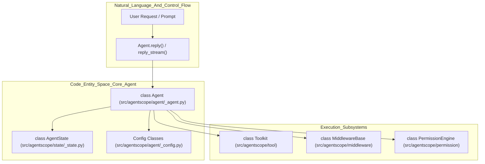
Sources: [src/agentscope/agent/_agent.py:117-195](), [src/agentscope/agent/_config.py:9-52](), [src/agentscope/state/__init__.py:4-6]()

### Diagram 2: ReAct Reasoning-Acting Loop to Code Mapping
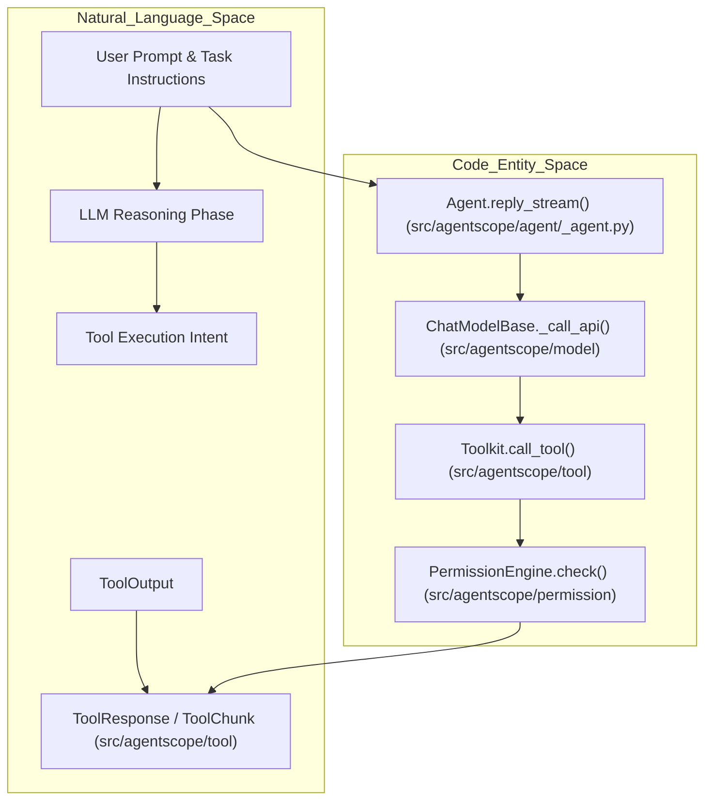
Sources: [src/agentscope/agent/_agent.py:117-135](), [src/agentscope/tool/_response.py:28-50]()

---

## Subsystem Overview

### 1. Agent Class and ReAct Loop
The `Agent` class coordinates the multi-step ReAct reasoning-acting loop [src/agentscope/agent/_agent.py:117-118](). Through `reply()` and `reply_stream()`, it manages model interactions, processes tool calls, and yields real-time agent events (`AgentEvent`) such as `ThinkingBlockStart`, `ToolCallStart`, and `RequireUserConfirmEvent` [src/agentscope/agent/_agent.py:36-66](). For full details, see [Agent Class and ReAct Loop](#2.1).

Sources: [src/agentscope/agent/_agent.py:36-66](), [src/agentscope/agent/_agent.py:117-118]()

### 2. Agent Configuration
Agents are configured via dedicated Pydantic models [src/agentscope/agent/_config.py:4-52]():
- `ContextConfig`: Governs token compression thresholds (`trigger_ratio`, `reserve_ratio`) and summary schemas (`SummarySchema`) [src/agentscope/agent/_config.py:9-64](). It also includes `context_buffer_ratio` to warn the agent about upcoming compression [src/agentscope/agent/_config.py:66-77]().
- `ReActConfig`: Controls iteration limits and runtime behavior [src/agentscope/agent/_agent.py:178]().
- `ModelConfig`: Defines model parameters and fallback settings [src/agentscope/agent/_agent.py:176]().
- `InjectionConfig`: Manages runtime state injections like wall-clock time and task lists [src/agentscope/agent/_agent.py:179]().

For detailed configuration parameters, see [Agent Configuration](#2.2).

Sources: [src/agentscope/agent/_config.py:9-145](), [src/agentscope/agent/_agent.py:176-179]()

### 3. Agent State and Context
State management is handled by `AgentState` and related context containers (`ToolContext`, `TaskContext`, `ReplyContext`) [src/agentscope/state/__init__.py:4-6](). `ToolContext` maintains activated tool groups, file caches, and LRU eviction policies [src/agentscope/state/_state.py:32-45](). Context compression workflows are automatically triggered when token usage surpasses configured thresholds [src/agentscope/agent/_config.py:57-60]().

The `ReadCacheEntry` [src/agentscope/state/_state.py:23-29]() within `ToolContext` stores file content, modification times, and size for efficient access by tools like `Read`, `Write`, and `Edit` [tests/builtin_file_cache_test.py:21-23](). The `cache_file` and `get_cache` methods manage this LRU cache, ensuring that outdated or deleted files are handled correctly [src/agentscope/state/_state.py:90-154](). For details, see [Agent State and Context](#2.3).

Sources: [src/agentscope/state/__init__.py:4-6](), [src/agentscope/state/_state.py:23-45](), [src/agentscope/state/_state.py:90-154](), [src/agentscope/agent/_config.py:57-60](), [tests/builtin_file_cache_test.py:21-23]()

### 4. Message Protocol and Content Blocks
Conversation history relies on the `Msg` abstraction and rich content blocks including `TextBlock`, `ThinkingBlock`, `ToolCallBlock`, `ToolResultBlock`, `DataBlock` (with `URLSource` and `Base64Source`), and `HintBlock` [src/agentscope/agent/_agent.py:74-90](). These blocks allow granular tracking of model thoughts, tool inputs, and multimodal data. The `_json_loads_with_repair` utility [src/agentscope/_utils/_common.py:33]() is used to robustly parse and repair JSON arguments for tool calls, ensuring type correctness against the tool's schema [tests/tool_argument_repair_test.py:61-80](). For details, see [Message Protocol and Content Blocks](#2.4).

Sources: [src/agentscope/agent/_agent.py:74-90](), [src/agentscope/_utils/_common.py:33]()

### 5. Middleware System
The middleware architecture (`MiddlewareBase`) uses an onion pattern to wrap agent execution hooks (`on_reply`, `on_reasoning`, `on_acting`, `on_model_call`, `on_system_prompt`, `on_check_permission`, `on_compress_context`). Built-in middlewares include context offloading and reply budget control. Middlewares can intercept and modify events, even swallowing `ReplyEndEvent` to force additional reasoning rounds within a single reply [tests/middleware_test.py:125-147](). For details, see [Middleware System](#2.5).

Sources: [src/agentscope/middleware/_base.py:13-53](), [tests/middleware_test.py:125-147]()

### 6. Permission System
Security and safety are enforced via `PermissionEngine`, evaluating `PermissionRule` objects against `PermissionContext` to produce `PermissionDecision` outcomes (ALLOW, DENY, ASK) across various permission modes [src/agentscope/agent/_agent.py:99-104](). For details, see [Permission System](#2.6).

Sources: [src/agentscope/agent/_agent.py:99-104]()

### 7. Pipelines, SOP Engine, and A2A Agents
Advanced workflows utilize execution pipelines (`PipelineProtocol`, `PipelineBase`, and `GoalPipeline` for executor-verifier loops), the SOP subsystem (`SOPEngine`), as well as `A2AAgent` for Agent-to-Agent protocol interoperability [tests/a2a_agent_test.py:18-20](). For details, see [Pipelines, SOP Engine, and A2A Agents](#2.7).

Sources: [tests/a2a_agent_test.py:18-20]()

---

# Page: Agent Class and ReAct Loop

# Agent Class and ReAct Loop

<details>
<summary>Relevant source files</summary>

The following files were used as context for generating this wiki page:

- [.pre-commit-config.yaml](.pre-commit-config.yaml)
- [src/agentscope/agent/_agent.py](src/agentscope/agent/_agent.py)
- [src/agentscope/agent/_config.py](src/agentscope/agent/_config.py)
- [src/agentscope/event/_event.py](src/agentscope/event/_event.py)
- [src/agentscope/message/_base.py](src/agentscope/message/_base.py)
- [src/agentscope/middleware/_base.py](src/agentscope/middleware/_base.py)
- [tests/agent_basic_test.py](tests/agent_basic_test.py)
- [tests/agent_injection_test.py](tests/agent_injection_test.py)
- [tests/agent_interrupt_test.py](tests/agent_interrupt_test.py)
- [tests/compress_context_test.py](tests/compress_context_test.py)
- [tests/event_test.py](tests/event_test.py)
- [tests/event_to_message_test.py](tests/event_to_message_test.py)
- [tests/hitl_external_execution_test.py](tests/hitl_external_execution_test.py)
- [tests/hitl_user_confirmation_test.py](tests/hitl_user_confirmation_test.py)
- [tests/message_test.py](tests/message_test.py)
- [tests/middleware_test.py](tests/middleware_test.py)

</details>


## Purpose and Scope

This page provides full technical details on the unified `Agent` class architecture (`[src/agentscope/agent/_agent.py:117-197]`), its constructor parameters, configuration models (`[src/agentscope/agent/_config.py:51-165]`), state and tool context, the Reasoning-Acting (ReAct) loop executed via `reply()` and `reply_stream()`, and the event-driven `AgentEvent` stream (`[src/agentscope/event/_event.py:25-68]`).

Sources: `[src/agentscope/agent/_agent.py:117-197]`, `[src/agentscope/agent/_config.py:51-165]`

---

## Agent Class Architecture

The `Agent` class integrates model reasoning, tool execution via `Toolkit`, permissions via `PermissionEngine` (`[src/agentscope/agent/_agent.py:193-195]`), and state management via `AgentState` (`[src/agentscope/agent/_agent.py:174-175]`).

### Constructor Parameters

The agent constructor (`[src/agentscope/agent/_agent.py:121-135]`) accepts the following configuration parameters:

| Parameter | Type | Description |
| :--- | :--- | :--- |
| `name` | `str` | Unique agent identifier (`[src/agentscope/agent/_agent.py:172-172]`). |
| `system_prompt` | `str` | Base instructions for agent behavior (`[src/agentscope/agent/_agent.py:173-173]`). |
| `model` | `ChatModelBase` | Chat model/LLM instance used for generation (`[src/agentscope/agent/_agent.py:174-174]`). |
| `toolkit` | `Toolkit \| None` | Tool collection containing functions, MCPs, and skills (`[src/agentscope/agent/_agent.py:202-202]`). |
| `middlewares` | `list[MiddlewareBase] \| None` | Interceptors modifying agent execution hooks (`[src/agentscope/agent/_agent.py:127-127]`). |
| `state` | `AgentState \| None` | Persistent conversation memory and tool/permission state (`[src/agentscope/agent/_agent.py:175-175]`). |
| `offloader` | `Offloader \| None` | Context offloader for background persistence (`[src/agentscope/agent/_agent.py:197-197]`). |
| `model_config` | `ModelConfig \| None` | Fallback models and retry configurations (`[src/agentscope/agent/_agent.py:177-177]`). |
| `context_config` | `ContextConfig \| None` | Settings for context and tool result compression (`[src/agentscope/agent/_agent.py:178-178]`). |
| `react_config` | `ReActConfig \| None` | Settings for the reasoning-acting loop execution bounds (`[src/agentscope/agent/_agent.py:179-179]`). |
| `injection_config` | `InjectionConfig \| None` | Runtime state and context injection policies (`[src/agentscope/agent/_agent.py:180-180]`). |

Sources: `[src/agentscope/agent/_agent.py:121-197]`, `[src/agentscope/agent/_config.py:51-165]`

### Agent Entity and Logic Map

This diagram maps high-level agent architecture concepts to their concrete code entities in the codebase, bridging natural language spaces to code entity spaces.

Title: "Agent Entity and Logic Map"
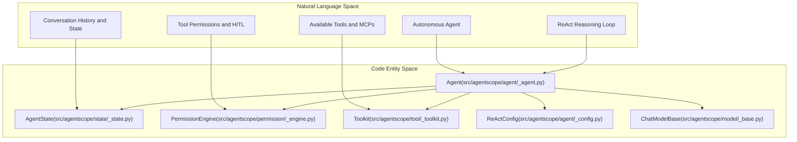

Sources: `[src/agentscope/agent/_agent.py:118-197]`, `[src/agentscope/agent/_config.py:51-165]`

---

## The ReAct Reasoning-Acting Loop and `reply_stream()`

The `Agent` execution cycle follows a ReAct (Reasoning and Acting) loop, invoked via `reply()` or streamed via `reply_stream()`.

### Execution Flow

1.  **Input Reception**: Incoming messages (`Msg`) or control events are appended to `self.state.context`.
2.  **Runtime State Injection**: Injects wall-clock time, active tasks, and context boundaries based on `InjectionConfig` (`[src/agentscope/agent/_agent.py:180-180]`).
3.  **Context Check & Compression**: Compares token counts against `ContextConfig` thresholds, triggering context summarization or truncation (`[src/agentscope/agent/_config.py:57-65]`).
4.  **Model Reasoning Phase**: Calls the underlying LLM provider (`ChatModelBase`), streaming reasoning blocks (`ThinkingBlock`), text blocks (`TextBlock`), and tool call blocks (`ToolCallBlock`) (`[src/agentscope/message/_base.py:70-91]`).
5.  **Tool Execution & Permission Verification**: Processes tool invocations through `Toolkit`, validating actions via `PermissionEngine` (`[src/agentscope/agent/_agent.py:193-195]`) and handling human-in-the-loop confirmation or external execution interrupts.
6.  **Iteration Control**: Loops until model completion or until `max_iters` is exceeded, raising an `ExceedMaxItersEvent` (`[src/agentscope/event/_event.py:57-58]`).

Title: "ReAct Loop Sequence"
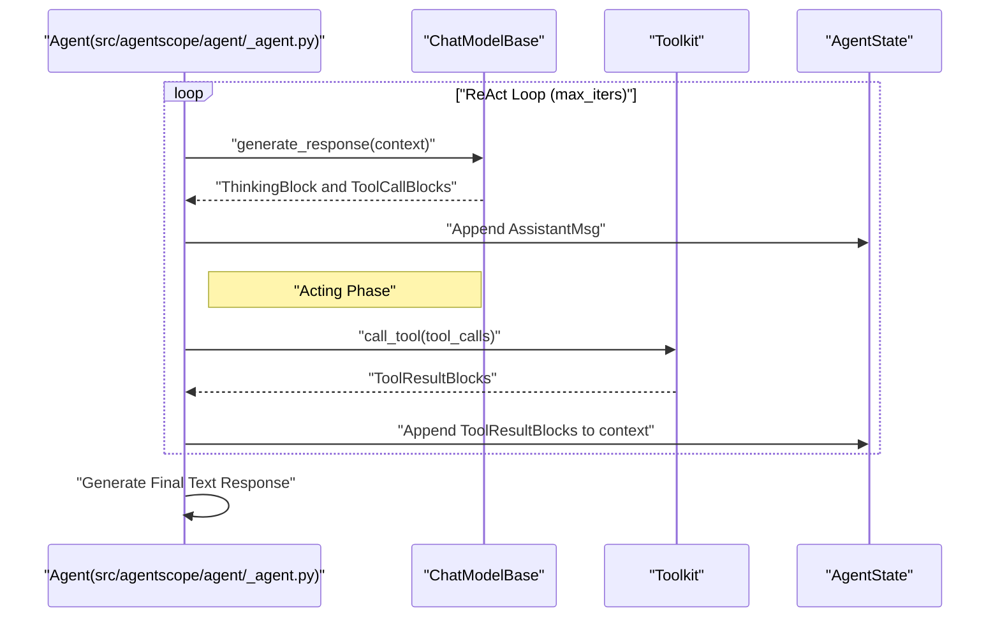

Sources: `[src/agentscope/agent/_agent.py:118-197]`, `[src/agentscope/agent/_config.py:51-165]`, `[src/agentscope/event/_event.py:25-68]`

### ReAct Loop to Code Space Mapping

This diagram maps the natural language execution phases of the ReAct loop to their implementing code methods and event structures.

Title: "ReAct Execution to Code Entity Mapping"
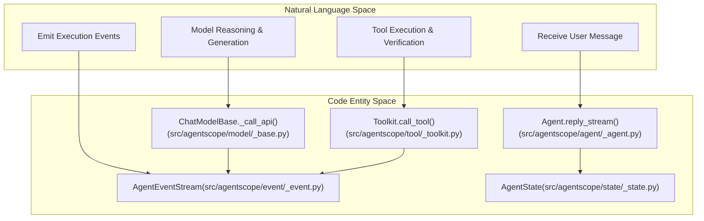

Sources: `[src/agentscope/agent/_agent.py:118-197]`, `[src/agentscope/event/_event.py:25-68]`

---

## Streaming and AgentEvents

`reply_stream()` exposes an asynchronous generator yielding items of type `AgentEvent` or `Msg` (`[src/agentscope/middleware/_base.py:68-95]`). This event-driven model decouples internal execution steps from downstream display renderers and APIs.

### Event Architecture and Code Space Mapping

This diagram maps event streaming entities to their underlying implementation classes in `[src/agentscope/event/_event.py:25-82]`.

Title: "Agent Event Hierarchy"
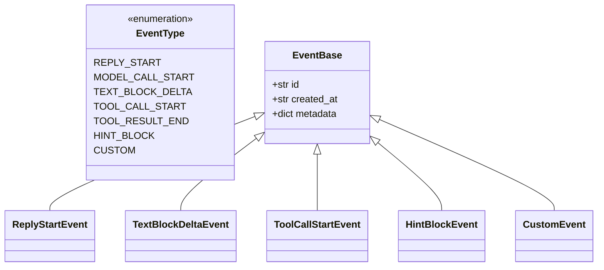

Sources: `[src/agentscope/event/_event.py:25-68]`, `[src/agentscope/event/_event.py:69-82]`

### Key Event Types

The `EventType` enumeration (`[src/agentscope/event/_event.py:25-68]`) defines the complete set of states emitted during agent execution:

| Event Category | Enum Values | Description |
| :--- | :--- | :--- |
| **Lifecycle** | `REPLY_START`, `REPLY_END` | Boundaries of a single reply turn (`[src/agentscope/event/_event.py:28-30]`). |
| **Model Interaction** | `MODEL_CALL_START`, `MODEL_CALL_END` | Tracks LLM calls, latency, and token metrics (`[src/agentscope/event/_event.py:31-33]`). |
| **Content Streams** | `TEXT_BLOCK_*`, `THINKING_BLOCK_*`, `DATA_BLOCK_*` | Incremental deltas for text, reasoning, and multimodal payloads (`[src/agentscope/event/_event.py:34-47]`). |
| **Tool Execution** | `TOOL_CALL_*`, `TOOL_RESULT_*` | Lifecycle and incremental outputs for tool calls and execution results (`[src/agentscope/event/_event.py:48-56]`). |
| **HITL & Control** | `REQUIRE_USER_CONFIRM`, `REQUIRE_EXTERNAL_EXECUTION`, `USER_CONFIRM_RESULT`, `USER_INTERRUPT` | Human-in-the-loop and external execution interrupts and responses (`[src/agentscope/event/_event.py:59-64]`). |
| **Specialized** | `HINT_BLOCK`, `CUSTOM`, `EXCEED_MAX_ITERS` | Injected system hints (`HintBlockEvent`), user-defined custom events (`CustomEvent`), and limits (`[src/agentscope/event/_event.py:46-67]`). |

Sources: `[src/agentscope/event/_event.py:25-68]`, `[src/agentscope/event/_event.py:69-126]`

---

# Page: Agent Configuration

# Agent Configuration

<details>
<summary>Relevant source files</summary>

The following files were used as context for generating this wiki page:

- [.pre-commit-config.yaml](.pre-commit-config.yaml)
- [src/agentscope/agent/_agent.py](src/agentscope/agent/_agent.py)
- [src/agentscope/agent/_config.py](src/agentscope/agent/_config.py)
- [src/agentscope/event/_event.py](src/agentscope/event/_event.py)
- [src/agentscope/message/_base.py](src/agentscope/message/_base.py)
- [src/agentscope/middleware/_base.py](src/agentscope/middleware/_base.py)
- [tests/agent_basic_test.py](tests/agent_basic_test.py)
- [tests/agent_injection_test.py](tests/agent_injection_test.py)
- [tests/agent_interrupt_test.py](tests/agent_interrupt_test.py)
- [tests/compress_context_test.py](tests/compress_context_test.py)
- [tests/event_test.py](tests/event_test.py)
- [tests/event_to_message_test.py](tests/event_to_message_test.py)
- [tests/hitl_external_execution_test.py](tests/hitl_external_execution_test.py)
- [tests/hitl_user_confirmation_test.py](tests/hitl_user_confirmation_test.py)
- [tests/message_test.py](tests/message_test.py)
- [tests/middleware_test.py](tests/middleware_test.py)

</details>


## Purpose and Scope

This page documents the configuration systems for the `Agent` class in AgentScope 2.0 [src/agentscope/agent/_agent.py:117-189](). Configuration is structured into modular Pydantic models defined in `src/agentscope/agent/_config.py`: `ContextConfig` for memory management and compression, `ReActConfig` for reasoning-acting loop control, `ModelConfig` for execution resilience, `InjectionConfig` for runtime state awareness, `InviteConfig` for cross-team agent borrowing, and `SummarySchema` for structured memory summarization [src/agentscope/agent/_config.py:1-249]().

Sources: [src/agentscope/agent/_agent.py:117-189](), [src/agentscope/agent/_config.py:1-249]()

---

## Configuration Architecture and Initialization

The `Agent` class aggregates these configuration schemas during instantiation in `Agent.__init__()` [src/agentscope/agent/_agent.py:120-190](). This modular design ensures instance-level isolation so that parameters such as `max_iters` or `trigger_ratio` do not leak across global states [tests/agent_basic_test.py:143-184]().

Title: "AgentConfigurationComponentMap"
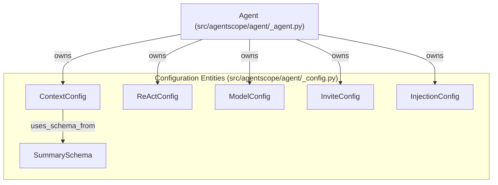
Sources: [src/agentscope/agent/_agent.py:120-190](), [src/agentscope/agent/_config.py:1-249](), [tests/agent_basic_test.py:143-184]()

---

## ContextConfig and SummarySchema

`ContextConfig` governs context window thresholds, compression triggers, and fallback mechanisms [src/agentscope/agent/_config.py:51-165]().

### Parameters

| Parameter | Type | Default | Description |
|-----------|------|---------|-------------|
| `trigger_ratio` | `float` | `0.8` | Token threshold ratio of maximum context length triggering compression ($0 < \text{trigger\_ratio} \le 0.9$) [src/agentscope/agent/_config.py:57-60](). |
| `reserve_ratio` | `float` | `0.1` | Target ratio of tokens to reserve after compression ($0 < \text{reserve\_ratio} < \text{trigger\_ratio}$) [src/agentscope/agent/_config.py:62-64](). |
| `context_buffer_ratio` | `float` | `0.2` | Buffer ahead of `trigger_ratio` warning the agent of upcoming compression [src/agentscope/agent/_config.py:66-77](). |
| `compression_prompt` | `str` | `<system-hint>...` | Prompt guiding the model to generate a structured continuation summary [src/agentscope/agent/_config.py:82-108](). |
| `summary_template` | `str` | `<system-info>...` | Template rendering the structured summary back into the agent context [src/agentscope/agent/_config.py:119-132](). |
| `summary_schema` | `dict` | `SummarySchema` | JSON schema derived from `SummarySchema` for structured output enforcement [src/agentscope/agent/_config.py:140-144](). |
| `tool_result_limit` | `int` | `50000` | Token limit for individual tool outputs to prevent context bursting [src/agentscope/agent/_config.py:146-154](). |
| `compression_fallback_to_truncation` | `bool` | `True` | Fallback behavior to truncate oldest context if summary generation fails [src/agentscope/agent/_config.py:156-164](). |

Sources: [src/agentscope/agent/_config.py:51-164]()

### SummarySchema Definition

`SummarySchema` enforces structured memory condensation via Pydantic [src/agentscope/agent/_config.py:9-50]().

| Field | Description |
|-------|-------------|
| `task_overview` | User's core request, constraints, and success criteria [src/agentscope/agent/_config.py:12-17](). |
| `current_state` | Completed actions, modified files, and produced artifacts [src/agentscope/agent/_config.py:18-24](). |
| `important_discoveries` | Technical constraints, decisions, and resolved errors [src/agentscope/agent/_config.py:25-32](). |
| `next_steps` | Specific remaining actions, blockers, and priorities [src/agentscope/agent/_config.py:33-38](). |
| `context_to_preserve` | User preferences, domain details, and promises made [src/agentscope/agent/_config.py:40-48](). |

Sources: [src/agentscope/agent/_config.py:9-50](), [tests/compress_context_test.py:108-160]()

---

## ReActConfig, ModelConfig, InjectionConfig, and InviteConfig

### ReActConfig
Controls parameters of the reasoning-acting execution loop in `Agent` [src/agentscope/agent/_agent.py:117-190]().
- `max_iters`: Maximum reasoning-acting iterations per reply execution (default `20`).
- `parallel_tool_calls`: Enables concurrent execution of multiple tool calls emitted in a single turn (default `True`).
- `stop_on_reject`: Halts the ReAct loop if the `PermissionEngine` rejects a tool call (default `False`).
- `structured_output_grace_iters`: Grace turns allowed to correct structural schema formatting errors (default `2`).

Sources: [src/agentscope/agent/_config.py:167-190]()

### ModelConfig
Defines execution parameters for model invocation resilience and error recovery [src/agentscope/model/_model.py:68-73]().
- `max_retries`: Number of retry attempts for primary model API calls before failing over (default `0`).
- `fallback_model`: Secondary `ChatModelBase` instance invoked if the primary model fails or exhausts retries (default `None`).

Sources: [src/agentscope/agent/_config.py:192-204]()

### InjectionConfig
Manages how environmental metadata (wall-clock time, active task list, context token pressure) is injected into the agent context stream [src/agentscope/agent/_agent.py:166-170]().
- `inject_runtime_state`: Enables automatic injection of time and task state (default `True`).
- `timezone`: Reference timezone used during time injections (default `UTC`).
- `context_buffer_ratio`: Maintained for legacy compatibility, superseded by `ContextConfig.context_buffer_ratio` [src/agentscope/agent/_agent.py:180-189]().

Sources: [src/agentscope/agent/_agent.py:166-189](), [src/agentscope/agent/_config.py:206-226]()

### InviteConfig
Controls whether an agent instance can be discovered and borrowed by other teams via the `AgentInvite` tool mechanism [6.5].
- `invitable`: Boolean flag indicating visibility in cross-agent sharing pools (default `False`).
- `invite_description`: Semantic text describing the agent's specific capabilities to team leaders (default `""`).

Sources: [src/agentscope/agent/_config.py:228-249]()

---

## Implementation and Data Flow

Configuration parameters dictate runtime control flow within `Agent.reply_stream()` and underlying helper functions [src/agentscope/agent/_agent.py:117-190]().

Title: "ConfigurationDrivenDataFlow"
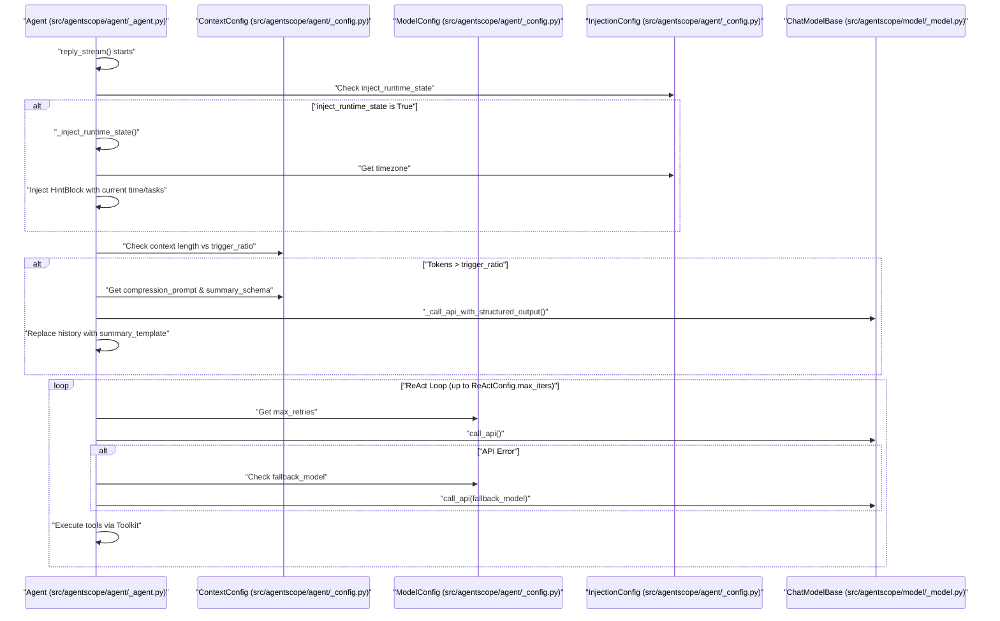
Sources: [src/agentscope/agent/_agent.py:117-190](), [src/agentscope/agent/_config.py:51-164](), [src/agentscope/agent/_config.py:167-249](), [tests/agent_injection_test.py:141-156]()

### Validation Logic

Configuration consistency is verified during initialization via `self._validate_configs()` [src/agentscope/agent/_agent.py:190](). For example, `ContextConfig` validates that `reserve_ratio` is strictly less than `trigger_ratio` to prevent overlap in the compression window thresholds [src/agentscope/agent/_config.py:62-64](). Inconsistent ratio settings raise a `ValueError` [tests/agent_basic_test.py:185-199]().

Sources: [src/agentscope/agent/_agent.py:117-190](), [src/agentscope/agent/_config.py:51-165](), [tests/agent_basic_test.py:185-199]()

---

# Page: Agent State and Context

# Agent State and Context

<details>
<summary>Relevant source files</summary>

The following files were used as context for generating this wiki page:

- [examples/web_ui/frontend/src/components/dialog/MCPConfigForm.tsx](examples/web_ui/frontend/src/components/dialog/MCPConfigForm.tsx)
- [src/agentscope/_utils/_common.py](src/agentscope/_utils/_common.py)
- [src/agentscope/embedding/_embedding_response.py](src/agentscope/embedding/_embedding_response.py)
- [src/agentscope/state/_state.py](src/agentscope/state/_state.py)
- [src/agentscope/state/_task.py](src/agentscope/state/_task.py)
- [src/agentscope/tool/_response.py](src/agentscope/tool/_response.py)
- [src/agentscope/tts/_tts_base.py](src/agentscope/tts/_tts_base.py)
- [src/agentscope/tts/_tts_response.py](src/agentscope/tts/_tts_response.py)
- [tests/agent_structured_output_test.py](tests/agent_structured_output_test.py)
- [tests/builtin_file_cache_test.py](tests/builtin_file_cache_test.py)
- [tests/id_factory_test.py](tests/id_factory_test.py)
- [tests/tool_argument_repair_test.py](tests/tool_argument_repair_test.py)

</details>


This page details how AgentScope manages agent memory, tool execution state, task tracking, and context window optimization. It covers the `AgentState` data container, `ToolContext` (including activated tool groups and LRU file caching), the `Task` model, and the automated context compression workflow.

Sources: `[src/agentscope/state/_state.py:1-203]`, `[src/agentscope/state/_task.py:1-39]`, `[src/agentscope/agent/_config.py:1-165]`

---

## Agent State Architecture

The agent's state is encapsulated in the `AgentState` class (`[src/agentscope/state/_state.py:2-203]`), which acts as the primary data container for an agent's persistent information throughout its session lifecycle.

### AgentState Model
`AgentState` tracks conversation history, task progress, permissions, and file/tool contexts. When an `Agent` is initialized, it adopts an existing state or instantiates a new one. Each state object is tied to a session identifier.

| Attribute | Type | Description |
|-----------|------|-------------|
| `context` | `list[Msg]` | Sequential conversation history containing all message blocks. |
| `summary` | `str \| list` | Compressed summary of previous context, prepended to the LLM prompt. |
| `tasks_context` | `TaskContext` | Collection of `Task` objects tracking goals and execution status (`[src/agentscope/state/_state.py:175-180]`). |
| `tool_context` | `ToolContext` | Execution state for tools, including active groups and file caches (`[src/agentscope/state/_state.py:32-44]`). |
| `permission_context` | `PermissionContext` | State used by the permission engine to evaluate tool access (`[src/agentscope/state/_state.py:20-21]`). |
| `reply_context` | `ReplyContext` | Tracks state of the current active reply (ID, iteration count, structured schema) (`[src/agentscope/state/_state.py:182-196]`). |

**Diagram: State and Context Code Entity Mapping**

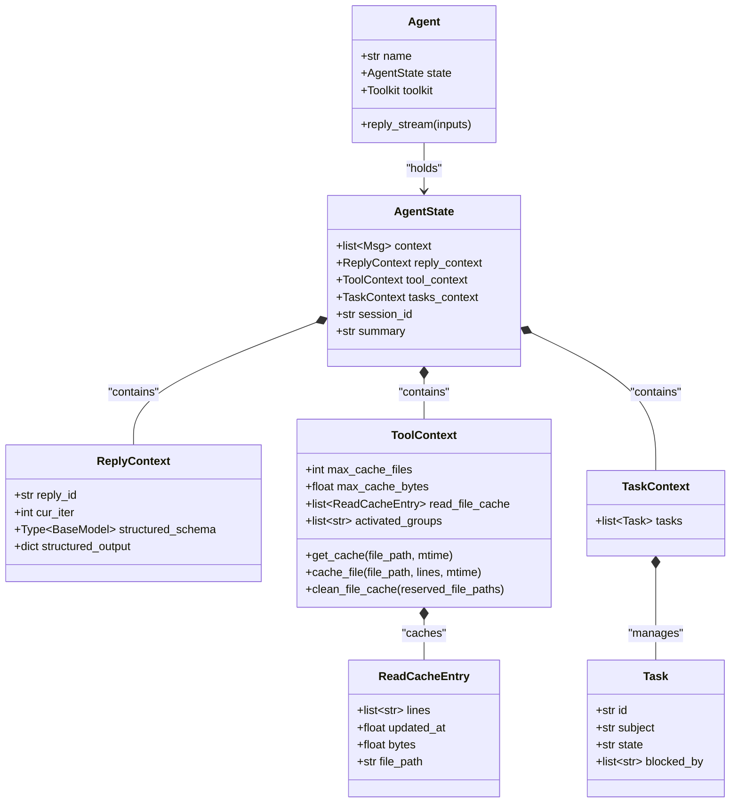

Sources: `[src/agentscope/state/_state.py:23-203]`, `[src/agentscope/agent/_agent.py:117-194]`

---

## ToolContext and LRU File Caching

The `ToolContext` model (`[src/agentscope/state/_state.py:32-44]`) maintains tool-related runtime states:

1.  **Activated Groups (`activated_groups`)**: Tracks which tool groups are currently enabled for the agent (`[src/agentscope/state/_state.py:42-44]`).
2.  **Read File Cache (`read_file_cache`)**: A cache designed for file-reading tools (`Read`, `Write`, `Edit`) to prevent redundant filesystem operations and token overhead (`[src/agentscope/state/_state.py:39-40]`).
3.  **LRU Eviction**: Implements Least Recently Used eviction when `max_cache_files` (default `100`) or `max_cache_bytes` (default `25000` KB) thresholds are breached (`[src/agentscope/state/_state.py:35-38]`, `[src/agentscope/state/_state.py:132-144]`).
4.  **Cache Validation**: The `get_cache` method validates file modification timestamps (`mtime`) via `aiofiles.os.path.getmtime` to ensure entries remain consistent with the underlying filesystem (`[src/agentscope/state/_state.py:46-88]`).

Sources: `[src/agentscope/state/_state.py:23-174]`, `[tests/builtin_file_cache_test.py:1-197]`

---

## Task Model

The task model tracks work items assigned to or created by agents. Managed via `TaskContext` (`[src/agentscope/state/_state.py:175-180]`) and `Task` definitions (`[src/agentscope/state/_task.py:10-39]`), tasks track metadata such as `subject`, `description`, `state` (`pending`, `in_progress`, `completed`), owners, and dependencies (`blocks`, `blocked_by`) (`[src/agentscope/state/_task.py:25-38]`).

Tools interact directly with `AgentState.tasks_context` during execution.

Sources: `[src/agentscope/state/_state.py:175-180]`, `[src/agentscope/state/_task.py:1-39]`

---

## Context Compression Workflow

When conversations grow too large for an LLM's context window, AgentScope triggers an automated compression workflow based on thresholds set in `ContextConfig`.

### Configuration Parameters
*   `trigger_ratio`: Token ratio (default `0.8`) that triggers compression.
*   `reserve_ratio`: Ratio of recent tokens to retain uncompressed (default `0.1`).
*   `context_buffer_ratio`: A buffer ahead of `trigger_ratio` (default `0.2`) where the agent is informed that compression is near, allowing it to self-compress if the `CompressContext` tool is enabled.
*   `compression_prompt`: The prompt used to guide the compression model to generate the summary.
*   `summary_template`: The string template to present the compressed summary to the agent.
*   `summary_schema`: Structured Pydantic schema (`SummarySchema`) enforcing generated summaries to cover `task_overview`, `current_state`, `important_discoveries`, `next_steps`, and `context_to_preserve`.
*   `compression_fallback_to_truncation`: If `True` (default), falls back to truncating the oldest context if summary generation fails.

**Diagram: Context Compression Data Flow**

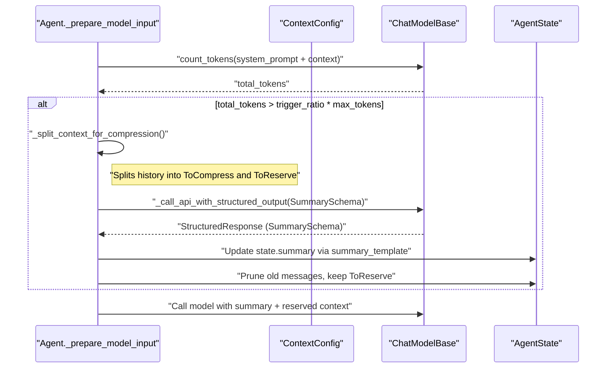

Sources: `[src/agentscope/agent/_config.py:1-165]`, `[src/agentscope/agent/_agent.py:1-1500]`

---

## Tool Result Truncation and Offloading

Large tool outputs can overwhelm context windows. AgentScope addresses this via size limits and offloaders:
*   `ContextConfig.tool_result_limit` (default `50000` tokens) caps individual tool result sizes.
*   Overflow results are intercepted, pushed to an offloader (e.g., workspace-backed storage), and replaced with pointer markers in the message context.

Sources: `[src/agentscope/agent/_config.py:1-165]`, `[src/agentscope/agent/_agent.py:1280-1320]`

---

# Page: Message Protocol and Content Blocks

# Message Protocol and Content Blocks

<details>
<summary>Relevant source files</summary>

The following files were used as context for generating this wiki page:

- [.pre-commit-config.yaml](.pre-commit-config.yaml)
- [src/agentscope/agent/_agent.py](src/agentscope/agent/_agent.py)
- [src/agentscope/agent/_config.py](src/agentscope/agent/_config.py)
- [src/agentscope/event/_event.py](src/agentscope/event/_event.py)
- [src/agentscope/message/_base.py](src/agentscope/message/_base.py)
- [src/agentscope/message/_block.py](src/agentscope/message/_block.py)
- [src/agentscope/middleware/_base.py](src/agentscope/middleware/_base.py)
- [tests/agent_basic_test.py](tests/agent_basic_test.py)
- [tests/agent_injection_test.py](tests/agent_injection_test.py)
- [tests/agent_interrupt_test.py](tests/agent_interrupt_test.py)
- [tests/compress_context_test.py](tests/compress_context_test.py)
- [tests/event_test.py](tests/event_test.py)
- [tests/event_to_message_test.py](tests/event_to_message_test.py)
- [tests/hitl_external_execution_test.py](tests/hitl_external_execution_test.py)
- [tests/hitl_user_confirmation_test.py](tests/hitl_user_confirmation_test.py)
- [tests/message_test.py](tests/message_test.py)
- [tests/middleware_test.py](tests/middleware_test.py)
- [tests/utils.py](tests/utils.py)

</details>


This page details the message protocol and content block system in AgentScope 2.0. It covers the structural definition of `Msg`, all available `ContentBlock` types, source types, role-based constraints, and event-driven accumulation via `append_event`.

## Overview

AgentScope uses a block-based architecture where every message is a collection of structured `ContentBlock` objects. This design enables:

- **Type-Safe Communication**: Each block has a strictly defined schema using Pydantic [src/agentscope/message/_block.py:11-184]().
- **Streaming Granularity**: Messages can be updated incrementally via events that target specific blocks [src/agentscope/message/_base.py:211-224]().
- **Agentic Reasoning**: Explicit support for "Thinking" and "Tool Call" states within the message lifecycle [src/agentscope/message/_block.py:26-53](), [src/agentscope/message/_block.py:138-183]().
- **Role-based Validation**: Messages enforce constraints based on the sender's role (`user`, `assistant`, or `system`) [src/agentscope/message/_base.py:120-130]().

Sources: [src/agentscope/message/_block.py:11-184](), [src/agentscope/message/_base.py:120-224]()

## The Msg Structure

The `Msg` class is the fundamental unit of information exchange, inheriting from Pydantic's `BaseModel` [src/agentscope/message/_base.py:70]().

### Message Roles and Constraints
AgentScope enforces strict validation on content blocks based on the message role via `validate_role_content` [src/agentscope/message/_base.py:120-130]():

| Role | Allowed Block Types | Logic / Citation |
| :--- | :--- | :--- |
| `user` | `TextBlock`, `DataBlock` | `_assert_user_content_blocks` [src/agentscope/message/_base.py:32-40]() |
| `system` | `TextBlock` | `_assert_system_content_blocks` [src/agentscope/message/_base.py:41-48]() |
| `assistant` | All Types (`text`, `thinking`, `tool_call`, `tool_result`, `data`, `hint`) | No strict restrictions [src/agentscope/message/_base.py:127-128]() |

Sources: [src/agentscope/message/_base.py:32-130]()

### Core Attributes
| Attribute | Type | Description |
| :--- | :--- | :--- |
| `name` | `str` | The name of the sender [src/agentscope/message/_base.py:78](). |
| `content` | `list[ContentBlock]` | A sequence of structured blocks [src/agentscope/message/_base.py:80](). |
| `role` | `Literal` | One of `user`, `assistant`, or `system` [src/agentscope/message/_base.py:82](). |
| `id` | `str` | Unique message identifier, generated by `_generate_id` [src/agentscope/message/_base.py:84](). |
| `usage` | `Usage \| None` | Token consumption details (input/output) [src/agentscope/message/_base.py:96](). |
| `metadata` | `dict` | Arbitrary key-value pairs for extension [src/agentscope/message/_base.py:92](). |
| `created_at` | `str` | ISO timestamp of message creation [src/agentscope/message/_base.py:94](). |
| `finished_at` | `str \| None` | The finished time of the message [src/agentscope/message/_base.py:104](). |
| `finished_reason` | `ReplyFinishedReason \| None` | Terminal reason for the reply (e.g., `COMPLETED`, `INTERRUPTED`, `EXCEED_MAX_ITERS`) [src/agentscope/message/_base.py:106-108](). |
| `structured_output` | `dict \| None` | Structured output if requested and successfully generated [src/agentscope/message/_base.py:109-114](). |
| `error` | `ErrorInfo \| None` | Structured error information if `finished_reason` is `ERROR` [src/agentscope/message/_base.py:115-117](). |

Sources: [src/agentscope/message/_base.py:70-117]()

## Content Block Types

The content block types define the building blocks of any message [src/agentscope/message/_block.py:11-184]().

### Text and Reasoning Blocks
- **TextBlock**: Represents standard textual content [src/agentscope/message/_block.py:11-24]().
- **ThinkingBlock**: Captures internal reasoning or "chain-of-thought". It allows extra provider-specific fields via `ConfigDict(extra="allow")` [src/agentscope/message/_block.py:26-53]().
- **HintBlock**: Used to provide instructions or hints to the LLM during the reasoning-acting loop. When passed to the LLM API, the hint block is converted into a user message [src/agentscope/message/_block.py:101-126]().

Sources: [src/agentscope/message/_block.py:11-126]()

### Multimodal Data Blocks
`DataBlock` handles binary content like images, audio, and video [src/agentscope/message/_block.py:83-99](). It uses a `source` field:
- **URLSource**: A valid URI string and its MIME `media_type` [src/agentscope/message/_block.py:67-81]().
- **Base64Source**: Inline base64-encoded data string and its MIME `media_type` [src/agentscope/message/_block.py:56-65]().

Sources: [src/agentscope/message/_block.py:56-99]()

### Tool Interaction Blocks
Tool interactions track execution state:
- **ToolCallBlock**: Tracks tool invocations with fields `id`, `name`, `input`, and `state` (`ToolCallState`) [src/agentscope/message/_block.py:138-151](). The `state` field transitions through `PENDING`, `ASKING`, `ALLOWED`, `SUBMITTED`, and `FINISHED` [src/agentscope/message/_block.py:151-175]().
- **ToolResultBlock**: Represents the outcome of tool execution, including its `output` and `state` (`ToolResultState`) [src/agentscope/message/_block.py:186-235]().

Sources: [src/agentscope/message/_block.py:138-235]()

## Data Flow: From Code to Protocol

### Diagram: Natural Language Space to Message and Block Entities

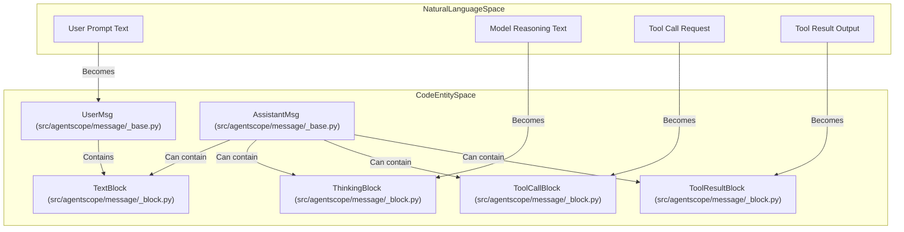
Sources: [src/agentscope/message/_base.py:70-130](), [src/agentscope/message/_block.py:11-235]()

### Diagram: Multimodal Source to DataBlock Mapping

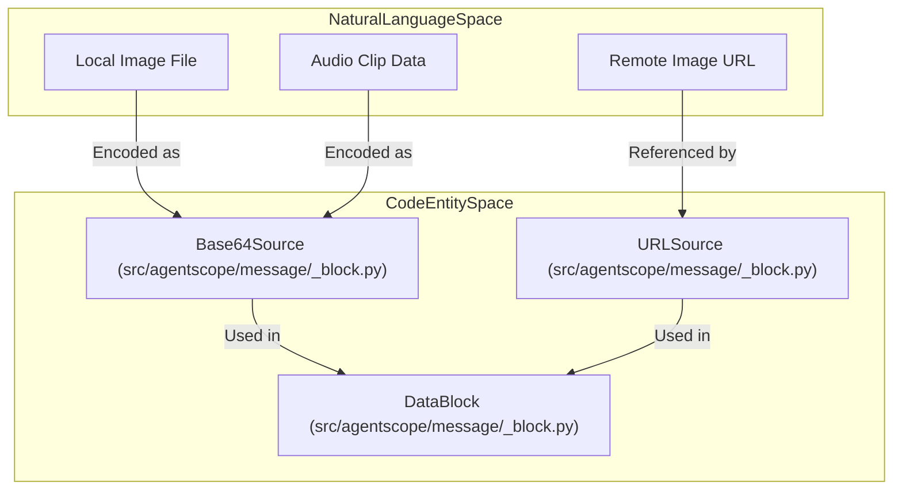
Sources: [src/agentscope/message/_block.py:56-99]()

## Streaming and Event Accumulation

The `Msg` object is reactive. During streaming execution, agents emit `AgentEvent` objects. The `Msg.append_event(event)` method mutates message state in real-time [src/agentscope/message/_base.py:211-224](). This method is crucial for building up a complete `Msg` object from a stream of granular events, as demonstrated in `tests/event_to_message_test.py` [tests/event_to_message_test.py:186-219]().

Sources: [src/agentscope/message/_base.py:211-224](), [tests/event_to_message_test.py:186-219]()

### Diagram: Message Lifecycle via Event Stream

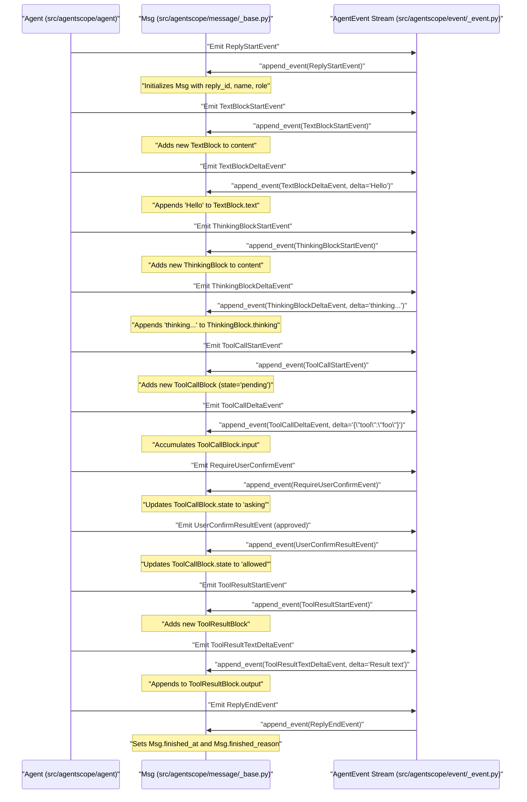
Sources: [src/agentscope/message/_base.py:211-224](), [src/agentscope/event/_event.py:25-68](), [tests/event_to_message_test.py:186-219]()

### Key Event-to-Block Mappings
- **TextBlockStartEvent**, **TextBlockDeltaEvent**, **TextBlockEndEvent**: Manage the lifecycle and content accumulation of a `TextBlock` [src/agentscope/event/_event.py:160-196]().
- **ThinkingBlockStartEvent**, **ThinkingBlockDeltaEvent**, **ThinkingBlockEndEvent**: Manage the lifecycle and content accumulation of a `ThinkingBlock` [src/agentscope/event/_event.py:42-45]().
- **DataBlockStartEvent**, **DataBlockDeltaEvent**, **DataBlockEndEvent**: Manage the lifecycle and content accumulation of a `DataBlock` [src/agentscope/event/_event.py:197-214]().
- **ToolCallStartEvent**, **ToolCallDeltaEvent**, **ToolCallEndEvent**: Manage the lifecycle and input accumulation of a `ToolCallBlock` [src/agentscope/event/_event.py:48-51]().
- **ToolResultStartEvent**, **ToolResultTextDeltaEvent**, **ToolResultDataDeltaEvent**, **ToolResultEndEvent**: Manage the lifecycle and output accumulation (text or data) of a `ToolResultBlock` [src/agentscope/event/_event.py:52-56]().
- **RequireUserConfirmEvent**: Changes the state of a `ToolCallBlock` to `ASKING` [src/agentscope/event/_event.py:59]().
- **UserConfirmResultEvent**: Updates the `ToolCallBlock` state based on user confirmation (e.g., `ALLOWED` or `FINISHED`) [src/agentscope/event/_event.py:62]().
- **RequireExternalExecutionEvent**: Changes the state of a `ToolCallBlock` to `SUBMITTED` [src/agentscope/event/_event.py:60]().
- **ExternalExecutionResultEvent**: Directly appends a `ToolResultBlock` to the message content [src/agentscope/event/_event.py:64]().
- **ModelCallEndEvent**: Updates the `usage` field of the `Msg` object [src/agentscope/event/_event.py:138-157]().
- **ReplyEndEvent**: Sets the `finished_at` timestamp and `finished_reason` for the `Msg` [src/agentscope/event/_event.py:111-125]().

Sources: [src/agentscope/event/_event.py:25-68](), [src/agentscope/event/_event.py:111-214](), [tests/event_to_message_test.py:30-63]()

## Helper Methods

The `Msg` class provides utility methods for accessing and filtering content:
- `get_text_content(separator)`: Concatenates all `TextBlock` contents into a single string [src/agentscope/message/_base.py:155-159]().
- `get_content_blocks(block_type)`: Returns a filtered sequence of blocks matching specified types [src/agentscope/message/_base.py:160-197]().
- `has_content_blocks(block_type)`: Checks if the message contains blocks of given types [src/agentscope/message/_base.py:131-154]().

Sources: [src/agentscope/message/_base.py:131-197]()

---

# Page: Middleware System

# Middleware System

<details>
<summary>Relevant source files</summary>

The following files were used as context for generating this wiki page:

- [.pre-commit-config.yaml](.pre-commit-config.yaml)
- [src/agentscope/agent/_agent.py](src/agentscope/agent/_agent.py)
- [src/agentscope/agent/_config.py](src/agentscope/agent/_config.py)
- [src/agentscope/app/_bus_ops.py](src/agentscope/app/_bus_ops.py)
- [src/agentscope/app/_manager/_wakeup_dispatcher.py](src/agentscope/app/_manager/_wakeup_dispatcher.py)
- [src/agentscope/app/message_bus/_keys.py](src/agentscope/app/message_bus/_keys.py)
- [src/agentscope/app/middleware/_tool_offload_middleware.py](src/agentscope/app/middleware/_tool_offload_middleware.py)
- [src/agentscope/event/_event.py](src/agentscope/event/_event.py)
- [src/agentscope/message/_base.py](src/agentscope/message/_base.py)
- [src/agentscope/middleware/_base.py](src/agentscope/middleware/_base.py)
- [src/agentscope/middleware/_budget.py](src/agentscope/middleware/_budget.py)
- [src/agentscope/tool/_builtin/_glob.py](src/agentscope/tool/_builtin/_glob.py)
- [src/agentscope/tool/_builtin/_grep.py](src/agentscope/tool/_builtin/_grep.py)
- [src/agentscope/tool/_builtin/_scripts/_glob_helper.py](src/agentscope/tool/_builtin/_scripts/_glob_helper.py)
- [tests/agent_basic_test.py](tests/agent_basic_test.py)
- [tests/agent_injection_test.py](tests/agent_injection_test.py)
- [tests/agent_interrupt_test.py](tests/agent_interrupt_test.py)
- [tests/builtin_glob_test.py](tests/builtin_glob_test.py)
- [tests/builtin_grep_test.py](tests/builtin_grep_test.py)
- [tests/compress_context_test.py](tests/compress_context_test.py)
- [tests/event_test.py](tests/event_test.py)
- [tests/event_to_message_test.py](tests/event_to_message_test.py)
- [tests/hitl_external_execution_test.py](tests/hitl_external_execution_test.py)
- [tests/hitl_user_confirmation_test.py](tests/hitl_user_confirmation_test.py)
- [tests/message_test.py](tests/message_test.py)
- [tests/middleware_budget_test.py](tests/middleware_budget_test.py)
- [tests/middleware_test.py](tests/middleware_test.py)
- [tests/service_wakeup_dispatcher_test.py](tests/service_wakeup_dispatcher_test.py)
- [tests/tool_offload_middleware_test.py](tests/tool_offload_middleware_test.py)

</details>


## Purpose and Scope

This page provides full technical documentation for the AgentScope 2.0 Middleware System. The middleware architecture offers a structured interception mechanism to modify, extend, and observe agent behavior across the agent lifecycle without altering core classes [src/agentscope/middleware/_base.py:13-53](). You will learn about `MiddlewareBase`, the seven hook points (`on_reply`, `on_reasoning`, `on_acting`, `on_model_call`, `on_system_prompt`, `on_check_permission`, and `on_compress_context`) [src/agentscope/middleware/_base.py:16-28](), the onion and transformer execution patterns [src/agentscope/middleware/_base.py:19-28](), and concrete implementations such as `ReplyBudgetControlMiddleware` [src/agentscope/middleware/_budget.py:21-70]() and `ToolOffloadMiddleware` [src/agentscope/middleware/_base.py:124-168]().

Sources: [src/agentscope/middleware/_base.py:1-53](), [src/agentscope/middleware/_budget.py:21-70]()

---

## MiddlewareBase and Hook Points

All custom and built-in middlewares inherit from `MiddlewareBase` [src/agentscope/middleware/_base.py:13-66](). The base class defines method signatures that subclasses can optionally override. The runtime inspection method `is_implemented()` detects which hook methods are overridden in subclasses, avoiding unnecessary execution overhead for unused hooks [src/agentscope/middleware/_base.py:55-66]().

The system provides seven execution hook points categorized into two architectural patterns [src/agentscope/middleware/_base.py:16-28]():

| Hook Point | Description | Pattern | Code Reference |
|------------|-------------|---------|----------------|
| `on_reply` | Intercepts the entire reply loop, from input messages to final response generation. Allows swallowing completion events to force subsequent reasoning rounds. | Onion | [src/agentscope/middleware/_base.py:68-95]() |
| `on_reasoning` | Intercepts the reasoning/thought generation phase before tools are selected or model generation is triggered. | Onion | [src/agentscope/middleware/_base.py:101-123]() |
| `on_acting` | Intercepts individual tool execution. Wraps **only** the pure I/O execution layer (`toolkit.call_tool`) to ensure state safety during offloading. | Onion | [src/agentscope/middleware/_base.py:124-168]() |
| `on_check_permission` | Intercepts permission checking for a tool call after schema validation but before decision consumption. | Onion | [src/agentscope/middleware/_base.py:170-179]() |
| `on_model_call` | Intercepts the raw model API invocation, granting access to model requests, responses, or stream chunks. | Onion | [src/agentscope/middleware/_base.py:13-53]() |
| `on_compress_context`| Intercepts context compression routines triggered by token thresholds. | Onion | [src/agentscope/middleware/_base.py:13-53]() |
| `on_system_prompt` | Sequential pipeline transforming the system prompt string dynamically. | Transformer | [src/agentscope/middleware/_base.py:27-29]() |

Sources: [src/agentscope/middleware/_base.py:13-233]()

---

## Architectural Patterns: Onion and Transformer

The middleware system utilizes two primary composition patterns:

### 1. The Onion Pattern (Async Decorators)
For hooks like `on_reply`, `on_reasoning`, `on_acting`, `on_check_permission`, `on_model_call`, and `on_compress_context`, middlewares wrap execution using an onion pattern [src/agentscope/middleware/_base.py:19-26](). Each middleware receives a `next_handler` callable [src/agentscope/middleware/_base.py:72]() which it invokes and `yields` from (or awaits). Execution flows outward-to-inward during pre-processing, hits the core method, and flows inward-to-outward as events or return values are yielded back.

### 2. The Transformer Pattern (Sequential Pipeline)
For `on_system_prompt`, middlewares form a strict sequential pipeline where each middleware modifies the system prompt string in-turn and passes the accumulator forward [src/agentscope/middleware/_base.py:27-29]().

### Diagram: Middleware Execution Flow and Code Entity Association
```mermaid
sequenceDiagram
    participant Agent as "Agent.reply_stream()"
    participant OuterMW as "MiddlewareBase (Outer)"
    participant InnerMW as "MiddlewareBase (Inner)"
    participant Core as "Agent._reasoning_impl()"

    Agent->>OuterMW: "on_reasoning(agent, input_kwargs, next_handler)"
    activate OuterMW
    Note over OuterMW: "Pre-reasoning interception"
    OuterMW->>InnerMW: "next_handler()"
    activate InnerMW
    Note over InnerMW: "Pre-reasoning interception"
    InnerMW->>Core: "next_handler()"
    activate Core
    Core-->>InnerMW: "yield AgentEvent"
    deactivate Core
    InnerMW-->>OuterMW: "yield AgentEvent"
    deactivate InnerMW
    Note over OuterMW: "Post-reasoning processing"
    OuterMW-->>Agent: "yield AgentEvent"
    deactivate OuterMW
```
Sources: [src/agentscope/middleware/_base.py:13-233]()

---

## Built-in Middlewares

### ReplyBudgetControlMiddleware
`ReplyBudgetControlMiddleware` enforces a weighted token budget per reply [src/agentscope/middleware/_budget.py:21-70]().
*   **State Management**: It tracks cumulative token usage across model calls within a reply, storing state inside `agent.state.middle_context` keyed by the middleware key and `reply_id` [src/agentscope/middleware/_budget.py:21-70](). This ensures persistence across human-in-the-loop (HITL) interruptions.
*   **Enforcement**: When the weighted cost exceeds `token_budget`, the middleware injects a `HintBlock` into context and overrides `tool_choice` to `ToolChoice(mode="none")`, forcing the agent to wrap up without calling further tools [src/agentscope/middleware/_budget.py:21-70]().

Sources: [src/agentscope/middleware/_budget.py:21-199]()

### ToolOffloadMiddleware
`ToolOffloadMiddleware` handles asynchronous tool execution offloading in service-layer architectures.
*   **Mechanism**: It intercepts `on_acting` [src/agentscope/middleware/_base.py:124-168]() to determine if a tool invocation should be offloaded to a background task manager.
*   **Safety Boundaries**: Because `on_acting` wraps **only** the pure I/O execution layer (`toolkit.call_tool`), it is fully decoupled from permission checks and context mutations, making background offloading safe from race conditions (barring state-injected tools) [src/agentscope/middleware/_base.py:130-146]().

Sources: [src/agentscope/middleware/_base.py:124-168](), [src/agentscope/middleware/_budget.py:21-70]()

---

## Middleware Assembly and Lifecycle Wiring

When an `Agent` instance initializes, it processes the provided `middlewares` list. Using `is_implemented()` [src/agentscope/middleware/_base.py:55-66](), it registers each middleware into dedicated internal hook queues (e.g., `_reply_middlewares`, `_reasoning_middlewares`, `_acting_middlewares`).

### Diagram: Class Structure and Component Association
```mermaid
classDiagram
    class MiddlewareBase {
        +is_implemented(hook_name: str) bool
        +on_reply(agent, input_kwargs, next_handler) AsyncGenerator
        +on_reasoning(agent, input_kwargs, next_handler) AsyncGenerator
        +on_acting(agent, input_kwargs, next_handler) AsyncGenerator
        +on_model_call(agent, input_kwargs, next_handler) AsyncGenerator
        +on_system_prompt(agent, prompt: str) str
        +on_check_permission(agent, input_kwargs, next_handler) PermissionDecision
        +on_compress_context(agent, input_kwargs, next_handler) AsyncGenerator
    }

    class ReplyBudgetControlMiddleware {
        +token_budget: float
        +on_reply(agent, input_kwargs, next_handler)
        +on_reasoning(agent, input_kwargs, next_handler)
    }

    class ToolOffloadMiddleware {
        +on_acting(agent, input_kwargs, next_handler)
    }

    class Agent {
        -_reply_middlewares: list
        -_reasoning_middlewares: list
        -_acting_middlewares: list
        +reply_stream(inputs) AsyncGenerator
        -_reasoning_impl()
    }

    class AgentState {
        +middle_context: dict
        +session_id: str
    }

    MiddlewareBase <|-- ReplyBudgetControlMiddleware : "inherits"
    MiddlewareBase <|-- ToolOffloadMiddleware : "inherits"
    Agent "1" *-- "many" MiddlewareBase : "registers via is_implemented()"
    Agent "1" *-- "1" AgentState : "stores middleware state"
```
Sources: [src/agentscope/middleware/_base.py:13-66](), [src/agentscope/middleware/_budget.py:21-70]()

---

# Page: Permission System

# Permission System

<details>
<summary>Relevant source files</summary>

The following files were used as context for generating this wiki page:

- [src/agentscope/app/_router/_schema/_workspace.py](src/agentscope/app/_router/_schema/_workspace.py)
- [src/agentscope/app/_service/_download_token.py](src/agentscope/app/_service/_download_token.py)
- [src/agentscope/permission/_decision.py](src/agentscope/permission/_decision.py)
- [src/agentscope/permission/_engine.py](src/agentscope/permission/_engine.py)
- [src/agentscope/permission/_types.py](src/agentscope/permission/_types.py)
- [src/agentscope/tool/_builtin/_backend.py](src/agentscope/tool/_builtin/_backend.py)
- [src/agentscope/tool/_builtin/_bash.py](src/agentscope/tool/_builtin/_bash.py)
- [src/agentscope/tool/_builtin/_bash_parser.py](src/agentscope/tool/_builtin/_bash_parser.py)
- [tests/backend_local_test.py](tests/backend_local_test.py)
- [tests/builtin_bash_test.py](tests/builtin_bash_test.py)
- [tests/permission_bash_parser_test.py](tests/permission_bash_parser_test.py)
- [tests/permission_mode_test.py](tests/permission_mode_test.py)
- [tests/service_chat_middleware_factory_test.py](tests/service_chat_middleware_factory_test.py)
- [tests/service_workspace_files_test.py](tests/service_workspace_files_test.py)

</details>


## Purpose and Scope

The Permission System in AgentScope 2.0 provides a granular, rule-based security and policy enforcement layer for tool execution. It mediates between agent-generated tool calls and their execution environments, ensuring safety and compliance when agents interact with sensitive capabilities such as filesystem modifications or shell execution [src/agentscope/permission/_types.py:3-13]().

**Key capabilities:**
- **Dynamic Policy Enforcement**: Evaluates permissions at runtime based on tool names and specific tool arguments (e.g., file paths, command substrings) via `PermissionEngine.check_permission()` [src/agentscope/permission/_engine.py:17-31]().
- **Safety Guardrails**: Built-in protection against dangerous operations (e.g., destructive shell commands, editing sensitive files like `.bashrc`, command-injection patterns) that remain active even in relaxed modes via `bypass_immune` flags [src/agentscope/permission/_decision.py:33-68]().
- **Human-in-the-Loop**: Support for `ASK` behaviors that interrupt the agent execution loop to request explicit user confirmation [src/agentscope/permission/_types.py:88-102]().
- **Operational Modes**: Configurable execution strategies (`PermissionMode`) ranging from strict `DEFAULT` to `BYPASS` and `EXPLORE` (read-only) [src/agentscope/permission/_types.py:18-86]().

Sources: [src/agentscope/permission/_types.py:3-102](), [src/agentscope/permission/_engine.py:17-31](), [src/agentscope/permission/_decision.py:10-68]()

---

## Core Components and Data Structures

The permission architecture centers around several core classes responsible for holding rules, contexts, decisions, and evaluation logic.

### Permission Entities

| Class / Enum | Role | Key Attributes / Methods |
| :--- | :--- | :--- |
| `PermissionRule` | Defines a specific permission rule matching pattern and behavior. | `tool_name`, `rule_content`, `behavior`, `source` [src/agentscope/permission/_engine.py:49-62]() |
| `PermissionContext` | Holds the active runtime configuration and rule sets for a session. | `mode`, `allow_rules`, `deny_rules`, `ask_rules`, `working_directories` [src/agentscope/permission/_engine.py:33-47]() |
| `PermissionDecision` | Represents the outcome of an evaluation. | `behavior` (ALLOW/DENY/ASK), `message`, `suggested_rules`, `bypass_immune` [src/agentscope/permission/_decision.py:10-68]() |
| `PermissionEngine` | Orchestrates policy evaluation and rule matching. | `check_permission()`, `add_rule()`, `_check_default()` [src/agentscope/permission/_engine.py:17-115]() |

### Permission Modes (`PermissionMode`)

The engine behavior is governed by five concrete modes defined in `PermissionMode` [src/agentscope/permission/_types.py:18-86]():

1.  **`DEFAULT`**: Strict operational mode. Every operation requires an explicit `ALLOW` rule or successful tool safety check, unless it matches a read-only fast path [src/agentscope/permission/_types.py:27-35]().
2.  **`ACCEPT_EDITS`**: Development mode. Automatically allows file writes/reads and directory operations when target paths resolve inside authorized working directories [src/agentscope/permission/_types.py:37-42]().
3.  **`EXPLORE`**: Read-only mode. Allows tools marked as read-only (such as `Read`, `Grep`, `Glob`) and read-only bash commands, but blocks any modification [src/agentscope/permission/_types.py:44-50]().
4.  **`BYPASS`**: Sandbox mode. Bypasses standard confirmation rules and safety checks unless explicit user-configured `DENY` or `ASK` rules exist [src/agentscope/permission/_types.py:52-59]().
5.  **`DONT_ASK`**: Unattended mode. Converts all `ASK` decisions (including safety ASKs) into `DENY` for headless background execution [src/agentscope/permission/_types.py:61-63]().

Sources: [src/agentscope/permission/_types.py:18-86](), [src/agentscope/permission/_engine.py:104-115](), [src/agentscope/tool/_builtin/_bash.py:25-136]()

---

## Evaluation Engine and Priority Architecture

The `PermissionEngine` coordinates permission checks by dispatching requests to mode-specific internal handlers (e.g., `_check_default()`, `_check_accept_edits()`) [src/agentscope/permission/_engine.py:104-115](). 

### Title: Permission Evaluation Code Entity Flow
```mermaid
graph TB
    Agent["Agent"] -->|calls| PermissionEngine["PermissionEngine.check_permission()"]
    PermissionEngine -->|dispatches| ModeHandler["PermissionEngine._check_default()"]
    
    ModeHandler -->|1. checks| DenyCheck["PermissionEngine._check_deny_rules()"]
    DenyCheck -->|matched| DenyDecision["PermissionDecision(DENY)"]
    
    ModeHandler -->|2. checks| AskCheck["PermissionEngine._check_ask_rules()"]
    AskCheck -->|matched| AskDecision["PermissionDecision(ASK)"]
    
    ModeHandler -->|3. checks| ReadOnlyCheck["PermissionEngine._check_read_only_fast_path()"]
    ReadOnlyCheck -->|matched| AllowDecision1["PermissionDecision(ALLOW)"]
    
    ModeHandler -->|4. invokes| ToolCheck["ToolBase.check_permissions()"]
    ToolCheck -->|sensitive path| SafetyAsk["PermissionDecision(ASK,bypass_immune=True)"]
    
    ModeHandler -->|5. checks| AllowCheck["PermissionEngine._check_allow_rules()"]
    AllowCheck -->|matched| AllowDecision2["PermissionDecision(ALLOW)"]
    
    ModeHandler -->|6. fallback| DefaultFallback["PermissionDecision(ASK)"]
```
Sources: [src/agentscope/permission/_engine.py:77-176](), [src/agentscope/permission/_decision.py:10-68]()

### Rule Priority Sequence
When evaluating permissions under standard modes (like `DEFAULT`), execution proceeds through a strict priority order [src/agentscope/permission/_engine.py:117-176]():
1.  **`DENY` Rules**: Highest priority. If a matching deny rule exists, execution is immediately blocked [src/agentscope/permission/_engine.py:150-155]().
2.  **`ASK` Rules**: Prompts the user for confirmation and attaches suggested rules [src/agentscope/permission/_engine.py:157-166]().
3.  **Read-only Fast Path**: Automatically allows known read-only tools and commands [src/agentscope/permission/_engine.py:168-173]().
4.  **`tool.check_permissions`**: Tool-specific safety logic. If it returns a **bypass-immune** `ASK` (e.g., accessing sensitive paths like `/etc/passwd` or `.bashrc`), it cannot be overridden by allow rules [src/agentscope/permission/_engine.py:117-176]().
5.  **`ALLOW` Rules**: Grants permission if no higher-priority rule or safety guardrail blocks it [src/agentscope/permission/_engine.py:77-115]().
6.  **Default Fallback**: Resolves to `ASK` in `DEFAULT` mode or `DENY` in `DONT_ASK` mode [src/agentscope/permission/_types.py:18-86]().

Sources: [src/agentscope/permission/_engine.py:117-176](), [tests/permission_engine_test.py:30-130]()

---

## Bash Command Parsing and Read-Only Analysis

The `Bash` tool and permission engine leverage `BashCommandParser` for precise syntax analysis of shell commands using `tree-sitter-bash` [src/agentscope/tool/_builtin/_bash_parser.py:144-150]().

### Title: Bash Command Parsing Entity Flow
```mermaid
graph LR
    BashTool["Bash.check_permissions()"] -->|passes command| BashCommandParser["BashCommandParser.is_read_only_command()"]
    
    BashCommandParser -->|parses AST| TreeSitter["Parser(Language(tsbash.language()))"]
    TreeSitter -->|splits compound| SplitCmd["BashCommandParser.split_compound_command()"]
    
    SplitCmd -->|evaluates subcommands| SingleCheck["BashCommandParser._is_single_command_read_only()"]
    SingleCheck -->|checks| ReadOnlySet["READ_ONLY_COMMANDS / SAFE_COMMANDS"]
    
    ReadOnlySet -->|valid| ReturnTrue["Returns True (Read-Only)"]
    ReadOnlySet -->|mutating/unknown| ReturnFalse["Returns False (Requires Permission)"]
```
Sources: [src/agentscope/tool/_builtin/_bash.py:25-136](), [src/agentscope/tool/_builtin/_bash_parser.py:144-198]()

- **Compound Command Splitting**: Expressions containing `&&`, `||`, `;`, or `|` are decomposed into individual subcommands via AST inspection, ensuring that *every* subcommand must be read-only for the entire compound command to qualify for the read-only fast path [src/agentscope/tool/_builtin/_bash_parser.py:151-194]().
- **Prefix Matching**: `match_rule()` supports prefix and wildcard pattern matching (e.g., `git:*`) against the shell command [src/agentscope/tool/_builtin/_bash.py:25-136]().
- **Safe Environment Variables**: The parser identifies and ignores safe environment variable assignments (e.g., `NODE_ENV=prod`) when extracting command prefixes, preventing them from interfering with rule matching [src/agentscope/tool/_builtin/_bash_parser.py:38-63]().
- **Dangerous Node Types**: The parser can identify dangerous node types in the AST, such as command substitutions or process substitutions, which are used to detect potentially malicious commands [src/agentscope/tool/_builtin/_bash_parser.py:21-21]().

Sources: [src/agentscope/tool/_builtin/_bash.py:25-136](), [src/agentscope/tool/_builtin/_bash_parser.py:21-154](), [src/agentscope/tool/_builtin/_bash_parser.py:38-63](), [tests/permission_bash_parser_test.py:53-79]()

---

## Tool-Specific Permission Integration

Builtin tools override `check_permissions()`, `match_rule()`, and related hooks to implement custom security policies [src/agentscope/tool/_builtin/_bash.py:25-136]().

- **Dangerous Path Checking**: File tools (`Write`, `Edit`, `Read`) validate paths against sensitive files and directories to trigger bypass-immune `ASK` decisions [src/agentscope/tool/_builtin/_bash.py:10-12]().
- **Working Directory Integration**: In `ACCEPT_EDITS` mode, file and filesystem operations auto-allow operations if the target path resides within authorized working directories [src/agentscope/permission/_types.py:37-42]().
- **Write Tool Pre-read Requirement**: The `Write` tool enforces that an existing file must have been read by the agent in the current conversation before it can be overwritten, preventing accidental data loss [tests/builtin_bash_test.py:1-190]().

Sources: [src/agentscope/tool/_builtin/_bash.py:25-136](), [src/agentscope/permission/_types.py:37-42](), [tests/builtin_bash_test.py:1-190]()

---

## Usage Example

Configuring a `PermissionEngine` instance with custom rules and executing checks:

```python
from agentscope.permission import (
    PermissionEngine, 
    PermissionContext, 
    PermissionRule, 
    PermissionMode, 
    PermissionBehavior
)
from agentscope.tool import Bash

# 1. Setup Context with an ALLOW rule for git commands
context = PermissionContext(
    mode=PermissionMode.DEFAULT,
)
engine = PermissionEngine(context)
engine.add_rule(PermissionRule(
    tool_name="Bash",
    rule_content="git:*",
    behavior=PermissionBehavior.ALLOW,
    source="user"
))

# 2. Check permission for an allowed command
decision = await engine.check_permission(Bash(), {"command": "git status"})

# 3. Check permission for an unhandled command (returns ASK)
decision = await engine.check_permission(Bash(), {"command": "rm -rf tmp/"})
```

Sources: [src/agentscope/permission/_engine.py:33-75](), [tests/permission_engine_test.py:1-100]()

---

# Page: Pipelines, SOP Engine, and A2A Agents

# Pipelines, SOP Engine, and A2A Agents

<details>
<summary>Relevant source files</summary>

The following files were used as context for generating this wiki page:

- [examples/a2a/README.md](examples/a2a/README.md)
- [examples/a2a/client.py](examples/a2a/client.py)
- [examples/a2a/server.py](examples/a2a/server.py)
- [examples/pipeline/goal/README.md](examples/pipeline/goal/README.md)
- [examples/pipeline/goal/goal_pipeline.py](examples/pipeline/goal/goal_pipeline.py)
- [src/agentscope/agent/__init__.py](src/agentscope/agent/__init__.py)
- [src/agentscope/agent/_a2a_agent.py](src/agentscope/agent/_a2a_agent.py)
- [src/agentscope/middleware/_longterm_memory/_agentic_memory/_middleware.py](src/agentscope/middleware/_longterm_memory/_agentic_memory/_middleware.py)
- [src/agentscope/pipeline/__init__.py](src/agentscope/pipeline/__init__.py)
- [src/agentscope/pipeline/_base.py](src/agentscope/pipeline/_base.py)
- [src/agentscope/pipeline/_goal_pipeline.py](src/agentscope/pipeline/_goal_pipeline.py)
- [src/agentscope/pipeline/_team_pipeline.py](src/agentscope/pipeline/_team_pipeline.py)
- [src/agentscope/sop/__init__.py](src/agentscope/sop/__init__.py)
- [src/agentscope/sop/_engine.py](src/agentscope/sop/_engine.py)
- [src/agentscope/sop/_schema.py](src/agentscope/sop/_schema.py)
- [src/agentscope/sop/_state.py](src/agentscope/sop/_state.py)
- [src/agentscope/state/__init__.py](src/agentscope/state/__init__.py)
- [src/agentscope/state/_a2a_state.py](src/agentscope/state/_a2a_state.py)
- [src/agentscope/tui/_messages.py](src/agentscope/tui/_messages.py)
- [tests/a2a_agent_e2e_test.py](tests/a2a_agent_e2e_test.py)
- [tests/a2a_agent_test.py](tests/a2a_agent_test.py)
- [tests/middleware_filesystem_memory_test.py](tests/middleware_filesystem_memory_test.py)
- [tests/pipeline_goal_test.py](tests/pipeline_goal_test.py)
- [tests/pipeline_team_cleanup_test.py](tests/pipeline_team_cleanup_test.py)
- [tests/pipeline_team_test.py](tests/pipeline_team_test.py)
- [tests/sop_engine_test.py](tests/sop_engine_test.py)

</details>


This page documents AgentScope's fixed-logic workflow and inter-operability layers: the pipeline abstractions (`PipelineProtocol`), `GoalPipeline` (executor/verifier loop), `TeamPipeline` (leader-worker multi-agent delegation), the SOP subsystem (`SOP`/`SOPStep` definitions, `SOPEngine`, `SOPRunState`/`SOPPhase`), and `A2AAgent`/`A2AAgentState` for Agent-to-Agent protocol interop.

---

## 1. Pipeline Abstraction and Protocol

AgentScope pipelines provide deterministic, multi-level orchestration around agents. To ensure seamless substitutability, pipeline implementations conform to `PipelineProtocol`, mirroring the core interface of the standalone `Agent` class (`reply_stream()`, `reply()`, and `observe()`).

`PipelineProtocol` defines the structural contract that allows any composite multi-agent workflow to be plugged directly into consoles, routers, and higher-level execution loops without changing client code.

### Natural Language to Code Entity Space: Pipeline Orchestration
```mermaid
graph TD
    subgraph "NaturalLanguageSpace"
        UserQueryInputMsg["UserQueryInputMessage"] --> PipelineExecutionController["PipelineExecutionController"]
        PipelineExecutionController --> ExecutorAgentStep["ExecutorAgentWorkingStep"]
        ExecutorAgentStep --> VerifierAgentEvaluation["VerifierAgentEvaluation"]
        VerifierAgentEvaluation --> UnifiedEventStreamOutput["UnifiedEventStreamOutput"]
    end
    subgraph "CodeEntitySpace"
        UserMsg["UserMsg"] --> PipelineProtocol["PipelineProtocol"]
        PipelineProtocol --> GoalPipeline["GoalPipeline"]
        GoalPipeline --> Agent["Agent"]
        GoalPipeline --> AgentEvent["AgentEvent"]
    end
```
*Figure 1: Natural Language to Code Entity Space mapping for Pipeline orchestration.*

Sources: `[src/agentscope/pipeline/_base.py:1-32]()`, `[src/agentscope/pipeline/_goal_pipeline.py:1-60]()`

---

## 2. GoalPipeline and Verification Loops

`GoalPipeline` implements an iterative executor-verifier pattern. It drives an execution agent toward a target goal while routing outputs through a verification agent, managing retries, iteration limits, and human-in-the-loop (HITL) pause states safely `[src/agentscope/pipeline/_goal_pipeline.py:55-90]()`.

### Executor-Verifier Architecture
The pipeline coordinates two primary actors:
1. **Executor**: Generates content, calls tools, or solves sub-tasks.
2. **Verifier**: Evaluates the executor's output against the defined goal, returning structured reports.

The internal loop relies on two private schema classes defined alongside the pipeline:
- `_ExecutionReport`: Captures output artifacts, tool states, and status flags from the executor step `[src/agentscope/pipeline/_goal_pipeline.py:22-31]()`.
- `_VerificationResult`: Holds evaluation outcomes, error descriptions, and pass/fail boolean flags returned by the verifier `[src/agentscope/pipeline/_goal_pipeline.py:34-52]()`.

### Iteration Control and HITL Safety
`GoalPipeline` accepts configuration parameters `max_iters` and `max_retries` to prevent infinite loops during stubborn reasoning paths `[src/agentscope/pipeline/_goal_pipeline.py:59-90]()`. Iteration tracking is state-aware and HITL-safe: if an execution or verification step pauses for user confirmation (`RequireUserConfirmEvent`), the iteration count suspends correctly across resumed turns, preventing premature timeout errors `[src/agentscope/pipeline/_goal_pipeline.py:93-170]()`.

### GoalPipeline Execution Loop
```mermaid
graph TD
    GoalPipelineReplyStream["GoalPipeline.reply_stream()"] --> RunExecutorAgent["Run Executor Agent"]
    RunExecutorAgent --> RunVerifierAgent["Run Verifier Agent"]
    RunVerifierAgent --> IsVerifiedSuccessfully["Is Verified Successfully?"]
    IsVerifiedSuccessfully -->|"No (Retry Budget Left)"| IncrementCounter["Increment Iteration / Retry Counter"]
    IncrementCounter --> RunExecutorAgent
    IsVerifiedSuccessfully -->|"No (Budget Exhausted)"| EmitErrorState["Emit Error / Fail State"]
    IsVerifiedSuccessfully -->|"Yes"| CompletePipelineReply["Complete Pipeline Reply"]
```
*Figure 2: GoalPipeline execution-verification iteration control loop.*

Sources: `[src/agentscope/pipeline/_goal_pipeline.py:22-189]()`

---

## 3. TeamPipeline and Multi-Agent Delegation

`TeamPipeline` implements a leader-worker delegation model where a leader agent assigns tasks to specialized team members via dynamic tool calls `[src/agentscope/pipeline/_team_pipeline.py:110-128]()`.

### Team Structure (`TeamMember`, `_TeamAssign`)
- `TeamMember`: Associates an underlying `Agent` with a descriptive string defining its specialty and when it should be invoked `[src/agentscope/pipeline/_team_pipeline.py:37-49]()`.
- `_TeamAssign`: An internal external tool exposed to the leader. Its input schema dynamically enumerates the registered team members and expects a `member` name and a `prompt` string `[src/agentscope/pipeline/_team_pipeline.py:51-100]()`.

### Execution and Concurrency Model
When the leader invokes `TeamAssign`, the pipeline executes the target member agent in its own isolated context. The member's intermediate steps remain hidden from the leader; only its final reply is returned as the tool result. Members assigned within the same round execute concurrently, except that multiple assignments targeting the same member run sequentially in call order `[src/agentscope/pipeline/_team_pipeline.py:110-186]()`.

Sources: `[src/agentscope/pipeline/_team_pipeline.py:37-186]()`

---

## 4. SOP Subsystem and SOPEngine

The Standard Operating Procedure (SOP) subsystem provides a deterministic mechanism to execute a fixed sequence of milestones or steps (`SOPStep`), where each step enforces defined objectives, execution rules, and verification loops `[src/agentscope/sop/_schema.py:1-204]()`, `[src/agentscope/sop/_engine.py:24-30]()`.

### SOP Definitions (`SOP`, `SOPStep`, `SOPStepBase`)
- `SOP`: Holds a sequence of `SOPStep` instances, a name, and a description `[src/agentscope/sop/_schema.py:1-25]()`.
- `SOPStepBase` / `SOPStep`: Defines a milestone with a `subject`, `description`, and `max_attempts`. In standard `SOPStep`, an executor agent performs the work and an optional verifier agent evaluates the outcome against structured criteria `[src/agentscope/sop/_schema.py:65-204]()`.

### Execution Engine (`SOPEngine`)
`SOPEngine` walks through the steps sequentially. It manages run states (`SOPRunState`), transitions phases (`SOPPhase`), handles handovers between adjacent steps via handover blocks (`_handover`), and preserves progress across interruptions or HITL events `[src/agentscope/sop/_engine.py:24-174]()`.

### Natural Language to Code Entity Space: SOP Subsystem
```mermaid
graph TD
    subgraph "NaturalLanguageSpace"
        UserTaskInputMsg["UserTaskInputMessage"] --> SOPEngineRunner["SOPEngineRunner"]
        SOPEngineRunner --> SOPStepExecutionPhase["SOPStepExecutionPhase"]
        SOPStepExecutionPhase --> StepHandoverPayload["StepHandoverPayload"]
        StepHandoverPayload --> NextSOPStepExecution["NextSOPStepExecution"]
    end
    subgraph "CodeEntitySpace"
        UserMsg["UserMsg"] --> SOPEngine["SOPEngine"]
        SOPEngine --> SOPStep["SOPStep"]
        SOPStep --> AgentLike["AgentLike"]
        SOPStep --> SOPRunState["SOPRunState"]
    end
```
*Figure 3: Natural Language to Code Entity Space mapping for SOP execution subsystem.*

Sources: `[src/agentscope/sop/_schema.py:1-204]()`, `[src/agentscope/sop/_engine.py:24-174]()`

---

## 5. Agent-to-Agent (A2A) Protocol Interop

`A2AAgent` and `A2AAgentState` provide a stateful client-side adapter implementing the A2A 1.0 specification. This enables local AgentScope applications to interact seamlessly with remote A2A-compliant agent servers `[src/agentscope/agent/_a2a_agent.py:189-207]()`, `[src/agentscope/state/_a2a_state.py:1-23]()`.

### `A2AAgent` and Content Stream Mapping
`A2AAgent` intentionally avoids inheriting from the base `Agent` class. While a local `Agent` manages its own model, toolkit, workspace, and prompt loop, `A2AAgent` delegates reasoning to a remote server. It tracks only conversation context (`context_id`) and task continuation markers (`task_id`) within `A2AAgentState` `[src/agentscope/agent/_a2a_agent.py:189-207]()`, `[src/agentscope/state/_a2a_state.py:1-23]()`.

As response chunks arrive from the remote A2A server, `A2AAgent` maps incoming parts to native AgentScope event streams via `_parts_to_events()`:
- Text parts stream into `TextBlockStartEvent`, `TextBlockDeltaEvent`, and `TextBlockEndEvent` (mapped to `TextBlock`) `[src/agentscope/agent/_a2a_agent.py:53-106]()`.
- Raw binary and URL parts map to `DataBlockStartEvent`, `DataBlockDeltaEvent`, and `DataBlockEndEvent` (mapped to `DataBlock`) `[src/agentscope/agent/_a2a_agent.py:108-149]()`.

### Natural Language to Code Entity Space: A2A Interop
```mermaid
graph TD
    subgraph "NaturalLanguageSpace"
        ClientInputQuery["ClientInputQuery"] --> A2AAgentClientAdapter["A2AAgentClientAdapter"]
        A2AAgentClientAdapter --> A2ATransport["A2ATransport"]
        A2ATransport --> RemoteAgentScopeExecutorServer["RemoteAgentScopeExecutorServer"]
        RemoteAgentScopeExecutorServer --> DashScopeChatModel["DashScopeChatModel"]
    end
    subgraph "CodeEntitySpace"
        UserMsg["UserMsg"] --> A2AAgent["A2AAgent"]
        A2AAgent --> SdkClient["Client"]
        SdkClient --> AgentScopeExecutor["AgentScopeExecutor"]
        AgentScopeExecutor --> Agent["Agent"]
    end
```
*Figure 4: Natural Language to Code Entity Space mapping for A2A remote interop.*

Sources: `[src/agentscope/agent/_a2a_agent.py:40-207]()`, `[src/agentscope/state/_a2a_state.py:1-23]()`

---

# Page: Model Integration

# Model Integration

<details>
<summary>Relevant source files</summary>

The following files were used as context for generating this wiki page:

- [scripts/model_examples/README.md](scripts/model_examples/README.md)
- [scripts/model_examples/minimax_call.py](scripts/model_examples/minimax_call.py)
- [scripts/model_examples/minimax_multiagent.py](scripts/model_examples/minimax_multiagent.py)
- [scripts/model_examples/minimax_multiagent_multimodal.py](scripts/model_examples/minimax_multiagent_multimodal.py)
- [scripts/model_examples/minimax_multimodal.py](scripts/model_examples/minimax_multimodal.py)
- [scripts/model_examples/run_tests.py](scripts/model_examples/run_tests.py)
- [src/agentscope/_utils/_audio.py](src/agentscope/_utils/_audio.py)
- [src/agentscope/credential/__init__.py](src/agentscope/credential/__init__.py)
- [src/agentscope/credential/_factory.py](src/agentscope/credential/_factory.py)
- [src/agentscope/credential/_minimax.py](src/agentscope/credential/_minimax.py)
- [src/agentscope/formatter/__init__.py](src/agentscope/formatter/__init__.py)
- [src/agentscope/formatter/_minimax_formatter.py](src/agentscope/formatter/_minimax_formatter.py)
- [src/agentscope/model/__init__.py](src/agentscope/model/__init__.py)
- [src/agentscope/model/_base.py](src/agentscope/model/_base.py)
- [src/agentscope/model/_openai_chat/_model.py](src/agentscope/model/_openai_chat/_model.py)
- [src/agentscope/model/_utils.py](src/agentscope/model/_utils.py)
- [tests/model_base_test.py](tests/model_base_test.py)
- [tests/model_openai_chat_test.py](tests/model_openai_chat_test.py)

</details>


## Purpose and Scope

This document describes AgentScope's model integration layer, which provides a unified interface for interacting with multiple Large Language Model (LLM) providers, embedding models, text-to-speech services, classifiers, speech recognition (ASR), and dynamic routing mechanisms. The integration layer abstracts provider-specific API differences while exposing common capabilities like tool calling, streaming, structured output, and multimodal content.

For information about how agents use these models, see [Agent System](#2). For details on message formatting and content blocks, see [Message Protocol and Content Blocks](#2.4). For tool integration with models, see [Tool System](#4).

Sources: [src/agentscope/model/_base.py:37-38](), [src/agentscope/credential/_factory.py:19-48]()

## Architecture Overview

AgentScope implements a provider abstraction pattern where all LLM integrations inherit from `ChatModelBase` [src/agentscope/model/_base.py:37-38]() and implement a unified interface. Each provider handles its own API communication, response parsing, and feature mapping while presenting a consistent interface to agents through `CredentialBase` [src/agentscope/model/_base.py:44-45]() and formatters [src/agentscope/formatter/__init__.py:1-68]().

### Core Model Hierarchy

The diagram below bridges the natural language concepts of model providers to their corresponding code entities in `agentscope.model`.

Title: "Model Integration Class Hierarchy"
```mermaid
graph TB
    subgraph "NaturalLanguageSpace"
        NLP["DashScopeProvider" / "OpenAIProvider" / "GeminiProvider"]
    end

    subgraph "CodeEntitySpace"
        A["ChatModelBase"] --> B["src/agentscope/model/_base.py"]
        C["CredentialBase"] --> D["src/agentscope/credential/_base.py"]
        E["CredentialFactory"] --> F["src/agentscope/credential/_factory.py"]
        
        G["DashScopeChatModel"] --> H["src/agentscope/model/_dashscope.py"]
        I["OpenAIChatModel"] --> J["src/agentscope/model/_openai_chat.py"]
        K["GeminiChatModel"] --> L["src/agentscope/model/_gemini.py"]
        M["AnthropicChatModel"] --> N["src/agentscope/model/_anthropic.py"]
        O["OllamaChatModel"] --> P["src/agentscope/model/_ollama.py"]
        Q["DeepSeekChatModel"] --> R["src/agentscope/model/_deepseek.py"]
        S["XAIChatModel"] --> T["src/agentscope/model/_xai.py"]
        U["MoonshotChatModel"] --> V["src/agentscope/model/_moonshot.py"]
        W["VolcengineChatModel"] --> X["src/agentscope/model/_volcengine.py"]
        MM["MiniMaxChatModel"] --> MN["src/agentscope/model/_minimax.py"]
    end
    
    NLP -.-> G
    NLP -.-> I
    NLP -.-> K
    
    A --> G
    A --> I
    A --> K
    A --> M
    A --> O
    A --> Q
    A --> S
    A --> U
    A --> W
    A --> MM
```

Sources: [src/agentscope/model/_base.py:37-38](), [src/agentscope/credential/_factory.py:19-48](), [src/agentscope/model/__init__.py:8-18]()

### ChatModelBase and Provider Architecture

The `ChatModelBase` interface [src/agentscope/model/_base.py:37-38]() defines the contract for all chat models. Key patterns include `__call__` / `_call_api` for request execution [src/agentscope/model/_base.py:182-199](), response parsing, and tool formatting for mapping AgentScope tool schemas to provider-specific payloads. It also manages retry logic via `_get_retryable_exceptions` [src/agentscope/model/_base.py:101-109]() and supports listing models via the model card YAML system [src/agentscope/model/_base.py:135-180]().

For details, see [ChatModelBase and Provider Architecture](#3.1).

Sources: [src/agentscope/model/_base.py:37-180]()

## Provider Implementations

### DashScope Integration

The `DashScopeChatModel` class provides integration with Alibaba's DashScope API, supporting advanced features like multimodality, thinking parameters (`thinking_enable`, `thinking_budget`), and OpenAI-compatible client usage [src/agentscope/model/_dashscope.py:34-112]().

For details, see [DashScope Integration](#3.2).

Sources: [src/agentscope/model/_dashscope.py:34-112]()

### OpenAI and Compatible APIs

The integration covers standard OpenAI models and compatible providers like DeepSeek, XAI, Moonshot, Volcengine Ark, and MiniMax [src/agentscope/model/__init__.py:13-18]().

- **OpenAIChatModel & OpenAIResponseModel**: Support standard chat completions as well as reasoning models (o1, o3) [src/agentscope/model/_openai_chat.py:35-35](), [src/agentscope/model/_openai_response.py:25-35]().
- **DeepSeekChatModel**: Specialized for DeepSeek reasoning tracks (`reasoning_content`) [src/agentscope/model/_deepseek.py:26-77]().
- **MoonshotChatModel & VolcengineChatModel**: Integration for Moonshot AI (Kimi) and Volcengine Ark (Doubao) models with thinking mode support [src/agentscope/model/_moonshot.py:26-75](), [src/agentscope/model/_volcengine.py:25-80]().
- **MiniMaxChatModel**: Integrates MiniMax M-series models via their Anthropic-compatible API, supporting thinking parameters and multimodal input [src/agentscope/model/_minimax.py:26-75](), [src/agentscope/credential/_minimax.py:17-42](), [scripts/model_examples/minimax_call.py:34-45](), [scripts/model_examples/minimax_multiagent_multimodal.py:29-38]().

For details, see [OpenAI and Compatible APIs](#3.3).

Sources: [src/agentscope/model/_openai_chat.py:35-108](), [src/agentscope/model/_deepseek.py:26-77](), [src/agentscope/model/_moonshot.py:26-75](), [src/agentscope/model/_minimax.py:26-75](), [src/agentscope/credential/_minimax.py:17-42](), [scripts/model_examples/minimax_call.py:34-45](), [scripts/model_examples/minimax_multiagent_multimodal.py:29-38]()

### Gemini, Anthropic, and Ollama

- **GeminiChatModel**: Handles complex JSON schema sanitization and thinking parts for the Gemini API [src/agentscope/model/_gemini.py:33-140]().
- **AnthropicChatModel**: Manages event-based streaming and extended thinking modes [src/agentscope/model/_anthropic.py:27-96]().
- **OllamaChatModel**: Provides local model integration, supporting thinking models like `deepseek-r1` [src/agentscope/model/_ollama.py:25-53]().

For details, see [Gemini and Anthropic Integrations](#3.4).

Sources: [src/agentscope/model/_gemini.py:33-140](), [src/agentscope/model/_anthropic.py:27-96](), [src/agentscope/model/_ollama.py:25-53]()

## Message Formatters

The `FormatterBase` architecture is responsible for converting AgentScope's message history into the specific payload format required by each provider [src/agentscope/formatter/_formatter_base.py:1-25]().

| Formatter Class | Purpose | Source File |
|-----------------|---------|-------------|
| `ChatFormatter` | Standard single-agent conversation formatting. | `src/agentscope/formatter/_formatter_base.py` |
| `MultiAgentFormatter` | Handles multi-agent history flattening using shared transcripts. | `src/agentscope/formatter/_formatter_base.py` |
| `TruncatedFormatterBase` | Base for formatters supporting context window truncation. | `src/agentscope/formatter/_formatter_base.py` |

The `agentscope.formatter` package includes provider-specific implementations such as `DashScopeChatFormatter`, `OpenAIChatFormatter`, `AnthropicChatFormatter`, `GeminiChatFormatter`, `OllamaChatFormatter`, `DeepSeekChatFormatter`, `OpenAIResponseFormatter`, `MiniMaxChatFormatter`, `MoonshotChatFormatter`, `XAIChatFormatter`, and `VolcengineChatFormatter`, each with corresponding `MultiAgentFormatter` variants [src/agentscope/formatter/__init__.py:5-48]().

For details, see [Message Formatters](#3.5).

Sources: [src/agentscope/formatter/__init__.py:1-68]()

## Response and Message Structures

### ChatResponse and Content Blocks

All model providers return responses in a unified `ChatResponse` format [src/agentscope/model/_model_response.py:14-14](). During streaming, `_StreamAccumulator` [src/agentscope/model/_utils.py:199-204]() collects incremental deltas into structured content blocks such as `TextBlock`, `ThinkingBlock`, `ToolCallBlock`, and `DataBlock` [src/agentscope/model/_base.py:23-30]().

The diagram below bridges natural language response types to their concrete code entity classes.

Title: "Model Response Block Association"
```mermaid
graph LR
    subgraph "NaturalLanguageSpace"
        NL_RESP["ChatResponse" / "StreamingAccumulator"]
    end

    subgraph "CodeEntitySpace"
        CR["ChatResponse"] --> C1["src/agentscope/model/_model_response.py"]
        TB["TextBlock"] --> B1["src/agentscope/message/_text_block.py"]
        TH["ThinkingBlock"] --> B2["src/agentscope/message/_thinking_block.py"]
        TC["ToolCallBlock"] --> B3["src/agentscope/message/_tool_call_block.py"]
        DB["DataBlock"] --> B4["src/agentscope/message/_data_block.py"]
    end
    
    NL_RESP -.-> CR
    CR -- "contains list of" --> TB
    CR -- "contains list of" --> TH
    CR -- "contains list of" --> TC
    CR -- "contains list of" --> DB
```

Sources: [src/agentscope/model/_model_response.py:14-14](), [src/agentscope/model/_utils.py:199-204](), [src/agentscope/model/_base.py:23-30]()

### Streaming, Structured Output, and Tool Calling

AgentScope supports advanced model features across providers:
- **Streaming Execution**: Accumulates chunks via `_StreamAccumulator` while forwarding deltas [src/agentscope/model/_utils.py:199-204]().
- **Structured Output**: Validates outputs against Pydantic models with automated schema generation and error handling [src/agentscope/model/_base.py:123-132](). The `_get_structured_output_fallback_exceptions` method [src/agentscope/model/_base.py:123-132]() allows providers to declare exceptions that trigger fallback strategies for structured output [tests/model_base_test.py:53-57]().
- **Tool Calling**: Configurable via `ToolChoice` modes (`auto`, `none`, `required`) with automated JSON argument repair [src/agentscope/model/_base.py:31-33]().

For details, see [Streaming, Structured Output, and Tool Calling](#3.6).

Sources: [src/agentscope/model/_base.py:31-204](), [tests/model_base_test.py:53-57]()

## Embedding, TTS, Classifiers, Routing, and ASR

In addition to core chat completions, AgentScope provides integrated subsystems for embeddings, speech synthesis, classification, speech recognition, and runtime model selection:

- **Embedding Models**: `EmbeddingModelBase` provides vector representations for text and multimodal content across providers with caching and RAG support. For details, see [Embedding Models](#3.7).
- **Text-to-Speech (TTS) Models**: `TTSModelBase` and `TTSMiddleware` integrate speech synthesis (DashScope/CosyVoice, OpenAI, Gemini) into agent pipelines. For details, see [Text-to-Speech (TTS) Models](#3.8).
- **Classifier Models**: The `agentscope.classifier` package defines `ClassifierModelBase`, question types (`BinaryQuestion`, `ChoiceQuestion`, `ScoreQuestion`, `BinaryCriteria`), and implementations like `JevClassifierModel`. For details, see [Classifier Models](#3.9).
- **Model Routing**: `ModelRouterMiddleware` and `ChatModelCandidate` enable dynamic per-request model selection, fallback chains, and app-layer model services. For details, see [Model Routing](#3.10).
- **Speech Recognition (ASR) Models**: The `agentscope.asr` package defines `ASRModelBase`, `ASRResponse`, and transcription model integrations. For details, see [Speech Recognition (ASR) Models](#3.11).

Sources: [src/agentscope/model/_base.py:37-38]()

---

# Page: ChatModelBase and Provider Architecture

# ChatModelBase and Provider Architecture

<details>
<summary>Relevant source files</summary>

The following files were used as context for generating this wiki page:

- [src/agentscope/_utils/_audio.py](src/agentscope/_utils/_audio.py)
- [src/agentscope/asr/__init__.py](src/agentscope/asr/__init__.py)
- [src/agentscope/asr/_asr_base.py](src/agentscope/asr/_asr_base.py)
- [src/agentscope/asr/_asr_model_card.py](src/agentscope/asr/_asr_model_card.py)
- [src/agentscope/asr/_asr_response.py](src/agentscope/asr/_asr_response.py)
- [src/agentscope/asr/_openai/__init__.py](src/agentscope/asr/_openai/__init__.py)
- [src/agentscope/asr/_openai/_model.py](src/agentscope/asr/_openai/_model.py)
- [src/agentscope/asr/_openai/_models/gpt-4o-mini-transcribe.yaml](src/agentscope/asr/_openai/_models/gpt-4o-mini-transcribe.yaml)
- [src/agentscope/asr/_openai/_models/gpt-4o-transcribe.yaml](src/agentscope/asr/_openai/_models/gpt-4o-transcribe.yaml)
- [src/agentscope/credential/_base.py](src/agentscope/credential/_base.py)
- [src/agentscope/credential/_openai.py](src/agentscope/credential/_openai.py)
- [src/agentscope/model/_base.py](src/agentscope/model/_base.py)
- [src/agentscope/model/_model_card.py](src/agentscope/model/_model_card.py)
- [src/agentscope/model/_openai_chat/_model.py](src/agentscope/model/_openai_chat/_model.py)
- [src/agentscope/model/_openai_response/_models/gpt-4.1-mini.yaml](src/agentscope/model/_openai_response/_models/gpt-4.1-mini.yaml)
- [src/agentscope/model/_openai_response/_models/gpt-4.1-nano.yaml](src/agentscope/model/_openai_response/_models/gpt-4.1-nano.yaml)
- [src/agentscope/model/_openai_response/_models/gpt-4.1.yaml](src/agentscope/model/_openai_response/_models/gpt-4.1.yaml)
- [src/agentscope/model/_openai_response/_models/gpt-4o-mini.yaml](src/agentscope/model/_openai_response/_models/gpt-4o-mini.yaml)
- [src/agentscope/model/_openai_response/_models/gpt-4o.yaml](src/agentscope/model/_openai_response/_models/gpt-4o.yaml)
- [src/agentscope/model/_openai_response/_models/gpt-5.5.yaml](src/agentscope/model/_openai_response/_models/gpt-5.5.yaml)
- [src/agentscope/model/_openai_response/_models/gpt-5.6-luna.yaml](src/agentscope/model/_openai_response/_models/gpt-5.6-luna.yaml)
- [src/agentscope/model/_openai_response/_models/gpt-5.6-sol.yaml](src/agentscope/model/_openai_response/_models/gpt-5.6-sol.yaml)
- [src/agentscope/model/_openai_response/_models/gpt-5.6-terra.yaml](src/agentscope/model/_openai_response/_models/gpt-5.6-terra.yaml)
- [src/agentscope/model/_utils.py](src/agentscope/model/_utils.py)
- [tests/asr_openai_test.py](tests/asr_openai_test.py)
- [tests/model_base_test.py](tests/model_base_test.py)
- [tests/model_openai_chat_test.py](tests/model_openai_chat_test.py)

</details>


## Purpose and Scope

This page covers the foundational abstract classes and utilities that power LLM integration in AgentScope 2.0. Specifically, it details:
- The `ChatModelBase` abstract base class and its execution lifecycle [src/agentscope/model/_base.py:37-98]().
- The method pattern (`_call_api`, `_parse_stream_response`, `_parse_completion_response`, `_format_tools`).
- Standardized data containers (`ChatResponse`, `ChatUsage`, and accumulation utilities) [src/agentscope/model/_base.py:14-16](), [src/agentscope/model/_utils.py:199-204]().
- Authentication via `CredentialBase` [src/agentscope/credential/_base.py:18-30]() and concrete credentials like `OpenAICredential` [src/agentscope/credential/_openai.py:17-30]().
- The decentralized Model Card YAML configuration system and discovery mechanism [src/agentscope/model/_base.py:135-180]().

Sources: [src/agentscope/model/_base.py:37-98](), [src/agentscope/model/_base.py:135-180](), [src/agentscope/model/_utils.py:199-204](), [src/agentscope/credential/_base.py:18-30](), [src/agentscope/credential/_openai.py:17-30]()

## Overview

The model integration layer follows a decoupled architecture that separates model execution logic, network configuration, API authentication, and static metadata:

1. **`ChatModelBase`**: The abstract base class defining the core execution pattern (`__call__`, `_call_api`, `_call_api_with_structured_output`) [src/agentscope/model/_base.py:37-38]().
2. **`CredentialBase`**: The base class managing API keys, organization IDs, and provider base URLs [src/agentscope/credential/_base.py:18-30](), [src/agentscope/credential/_openai.py:17-30]().
3. **`ModelCard`**: A YAML-driven system for defining model capabilities, context window limits, and default parameters [src/agentscope/model/_base.py:135-180]().
4. **Provider Classes**: Concrete implementations (`OpenAIChatModel`, `DashScopeChatModel`) that bridge the framework to specific REST or SDK endpoints [src/agentscope/model/_openai_chat/_model.py:38-39]().

### Class Hierarchy and Space Bridge

```mermaid
---
title: "ChatModel and Credential Class Hierarchy"
---
graph TD
    subgraph "NaturalLanguageSpace"
    A1["LLMCapabilitiesAndPrompts"]
    A2["APIAuthenticationAndSecrets"]
    end

    subgraph "CodeEntitySpace"
    B1["ChatModelBase"]
    B2["OpenAIChatModel"]
    B3["CredentialBase"]
    B4["OpenAICredential"]
    B5["ModelCard"]
    end

    A1 -->|ManagedBy| B5
    A2 -->|AuthenticatedBy| B3
    B1 -->|ExtendedBy| B2
    B3 -->|ExtendedBy| B4
    B3 -->|Instantiates| B1
    B5 -->|LoadedBy| B1
```
Sources: [src/agentscope/model/_base.py:37-38](), [src/agentscope/model/_openai_chat/_model.py:38-39](), [src/agentscope/credential/_base.py:18-30](), [src/agentscope/credential/_openai.py:17-30](), [src/agentscope/model/_base.py:135-180]()

## ChatModelBase Interface and Execution Pattern

The `ChatModelBase` class defines the contract for all provider implementations. It manages retries, exception handling, and the high-level orchestration of API invocations [src/agentscope/model/_base.py:62-71](), [src/agentscope/model/_base.py:184-198]().

### Core Pattern: `__call__` and Subclass Hooks

The entry point for inference is the `__call__` method, which implements a standard retry loop based on `max_retries` and `retry_delay` [src/agentscope/model/_base.py:62-71](), [src/agentscope/model/_base.py:184-198](). It delegates the actual network request to the provider's implementation of `_call_api`.

Subclasses implement a consistent internal convention to decouple network I/O from payload transformation:
- `_format_tools(tools)`: Translates AgentScope's unified tool definitions into the provider's expected schema format.
- `_call_api(...)`: Executes the raw HTTP or SDK-based client request, returning either a complete response or an async generator of stream deltas [src/agentscope/model/_base.py:184-198]().
- `_parse_stream_response(...)`: Translates raw streaming chunks into AgentScope's standardized delta structures.
- `_parse_completion_response(...)`: Translates non-streaming completion payloads into `ChatResponse` objects.

If a call is cancelled (e.g., via `asyncio.CancelledError`), the base class intercepts it and returns a `ChatResponse` with `FinishedReason.INTERRUPTED` [tests/model_base_test.py:171-187](). For streaming calls, it uses a `_StreamAccumulator` to collect deltas into a final complete response [src/agentscope/model/_base.py:14-16](), [src/agentscope/model/_utils.py:199-204]().

| Method | Role | Return Type |
| :--- | :--- | :--- |
| `__call__` | Public entry point with retry logic [src/agentscope/model/_base.py:184-198]() | `ChatResponse \| AsyncGenerator` |
| `_call_api` | Abstract method for provider-specific API calls [src/agentscope/model/_base.py:184-198]() | `ChatResponse \| AsyncGenerator` |
| `_get_retryable_exceptions` | Declares provider-specific retryable error types [src/agentscope/model/_base.py:101-110]() | `tuple[Type[Exception], ...]` |
| `_get_disable_thinking_kwargs` | Returns provider kwargs to toggle off reasoning/thinking [src/agentscope/model/_base.py:111-120]() | `dict` |
| `list_models` | Discovers models from local YAML model cards [src/agentscope/model/_base.py:135-180]() | `list[ModelCard]` |

Sources: [src/agentscope/model/_base.py:62-198](), [tests/model_base_test.py:171-187]()

## Model Response, Usage, and Accumulation

All models return standardized objects to ensure interoperability across the framework.

### ChatResponse, ChatUsage, and Space Bridge
The `ChatResponse` contains a sequence of content blocks, representing the multimodal and agentic nature of modern LLMs [src/agentscope/model/_base.py:14-16]().

```mermaid
---
title: "ChatResponse Content Blocks Mapping"
---
graph LR
    subgraph "NaturalLanguageSpace"
    N1["ModelGeneratedText"]
    N2["ChainOfThoughtReasoning"]
    N3["FunctionArguments"]
    N4["MultimodalAudioOrImage"]
    end

    subgraph "CodeEntitySpace"
    C1["TextBlock"]
    C2["ThinkingBlock"]
    C3["ToolCallBlock"]
    C4["DataBlock"]
    C5["ChatResponse"]
    C6["ChatUsage"]
    end

    N1 -->|MappedTo| C1
    N2 -->|MappedTo| C2
    N3 -->|MappedTo| C3
    N4 -->|MappedTo| C4
    C1 -->|ContainedIn| C5
    C2 -->|ContainedIn| C5
    C3 -->|ContainedIn| C5
    C4 -->|ContainedIn| C5
    C5 -->|HasUsage| C6
```
Sources: [src/agentscope/model/_base.py:14-16](), [src/agentscope/model/_utils.py:199-204]()

- **`ChatUsage`**: Tracks token counts and usage details [src/agentscope/model/_utils.py:9-9]().
- **`FinishedReason`**: Indicates if a response was successfully completed (`COMPLETED`), stopped by length, or interrupted (`INTERRUPTED`) [src/agentscope/model/_base.py:14-16]().

### Stream Accumulation
During streaming, AgentScope uses `_StreamAccumulator` to efficiently merge deltas. This avoids performance penalties for large payloads by keeping fragments in lists until the final `build()` call [src/agentscope/model/_utils.py:199-204]().

- **`_AccTextBlock`**: Accumulates text fragments [src/agentscope/model/_utils.py:22-41]().
- **`_AccThinkingBlock`**: Accumulates chain-of-thought fragments and preserves provider-specific metadata [src/agentscope/model/_utils.py:44-71]().
- **`_AccToolCallBlock`**: Accumulates JSON input fragments and captures the tool `name` from the opening delta [src/agentscope/model/_utils.py:74-100]().
- **`_AccDataBlock`**: Handles audio stream concatenation by decoding base64 deltas into raw bytes via `_AccBase64Source` before a final re-encoding and WAV header finalization [src/agentscope/model/_utils.py:103-138](), [src/agentscope/model/_utils.py:140-197]().

Sources: [src/agentscope/model/_base.py:14-16](), [src/agentscope/model/_utils.py:22-197](), [src/agentscope/model/_utils.py:199-204]()

## Credential Architecture

Credentials are decoupled from model logic, allowing for secure handling and easy rotation. Every `ChatModelBase` instance requires a `CredentialBase` object upon initialization [src/agentscope/model/_base.py:44-45]().

Concrete implementations like `OpenAICredential` manage specific `api_key` (`SecretStr`), organization strings, and custom base URLs required for provider-compatible gateways [src/agentscope/credential/_openai.py:17-30](). Base classes define abstract methods for retrieving model classes and listing available model cards per provider [src/agentscope/credential/_base.py:18-145]().

Sources: [src/agentscope/model/_base.py:44-45](), [src/agentscope/credential/_base.py:18-145](), [src/agentscope/credential/_openai.py:17-30]()

## Model Card YAML System and Discovery

AgentScope employs a decentralized configuration pattern where model definitions are stored as YAML files inside a provider-specific `_models/` directory adjacent to each concrete model implementation [src/agentscope/model/_base.py:135-155]().

The `ModelCard` class parses these YAML declarations and links them with the subclass's inner `Parameters` schema via `ModelCard.from_yaml()` [src/agentscope/model/_base.py:165-170](). The `ChatModelBase.list_models()` method scans this directory at runtime to dynamically surface available models, context lengths, and parameter defaults without hardcoding model catalogs into the core library [src/agentscope/model/_base.py:135-180]().

Sources: [src/agentscope/model/_base.py:135-180]()

## Provider Execution Flow

The typical lifecycle of a model request, from agent invocation to response parsing, is illustrated below:

```mermaid
---
title: "Provider Execution Flow Sequence"
---
sequenceDiagram
    participant Agent as "Agent"
    participant Model as "ChatModelBase"
    participant API as "ProviderAPI"

    Agent->>Model: "__call__(messages, tools)"
    Model->>Model: "_format_tools(tools)"
    Model->>API: "_call_api()"
    API-->>Model: "StreamOrObjectResponse"
    Model->>Model: "_parse_stream_response() / _parse_completion_response()"
    Model-->>Agent: "ChatResponse | AsyncGenerator"
```
Sources: [src/agentscope/model/_base.py:184-198]()

---

# Page: DashScope Integration

# DashScope Integration

<details>
<summary>Relevant source files</summary>

The following files were used as context for generating this wiki page:

- [src/agentscope/model/_anthropic/_model.py](src/agentscope/model/_anthropic/_model.py)
- [src/agentscope/model/_dashscope/_model.py](src/agentscope/model/_dashscope/_model.py)
- [src/agentscope/model/_dashscope/_models/deepseek-v4-pro.yaml](src/agentscope/model/_dashscope/_models/deepseek-v4-pro.yaml)
- [src/agentscope/model/_dashscope/_models/glm-5.2.yaml](src/agentscope/model/_dashscope/_models/glm-5.2.yaml)
- [src/agentscope/model/_dashscope/_models/qwen3.7-plus.yaml](src/agentscope/model/_dashscope/_models/qwen3.7-plus.yaml)
- [src/agentscope/model/_gemini/_model.py](src/agentscope/model/_gemini/_model.py)
- [src/agentscope/model/_ollama/_model.py](src/agentscope/model/_ollama/_model.py)
- [src/agentscope/model/_xai/_model.py](src/agentscope/model/_xai/_model.py)
- [tests/model_anthropic_test.py](tests/model_anthropic_test.py)
- [tests/model_dashscope_test.py](tests/model_dashscope_test.py)
- [tests/model_gemini_test.py](tests/model_gemini_test.py)
- [tests/model_ollama_test.py](tests/model_ollama_test.py)
- [tests/model_xai_test.py](tests/model_xai_test.py)

</details>


This page details the DashScope model adapter implementation (`DashScopeChatModel`) [src/agentscope/model/_dashscope/_model.py:34-41](), which provides integration with Alibaba Cloud's DashScope API. This integration relies on the OpenAI-compatible endpoint (`compatible-mode/v1`) while maintaining specialized support for DashScope-specific features such as deep thinking (`thinking_enable`/`thinking_budget`), multimodal inputs, audio streaming with dynamic WAV headers, and Text-to-Speech (TTS) services.

---

## 1. Overview and Architecture

The `DashScopeChatModel` class [src/agentscope/model/_dashscope/_model.py:34-41]() inherits from `ChatModelBase` [src/agentscope/model/_base.py:37-38]() and initializes an underlying `openai.AsyncClient` targeting DashScope's base URL [src/agentscope/model/_dashscope/_model.py:167-171](). Messages are formatted using `DashScopeChatFormatter` [src/agentscope/model/_dashscope/_model.py:162-162]() to match the expected API structure.

Title: "DashScope Integration Architecture Bridge"
```mermaid
graph TB
    subgraph "NaturalLanguageSpace"
        Agent["AgentLoopAndIntent"]
        MsgObj["MsgObjects"]
    end

    subgraph "CodeEntitySpace"
        Formatter["DashScopeChatFormatter"]
        Model["DashScopeChatModel"]
        AsyncClient["openai.AsyncClient"]
        StreamParser["_parse_stream_response"]
        NonStreamParser["_parse_completion_response"]
        RespObj["ChatResponse"]
    end

    subgraph "ExternalCloudAPI"
        Endpoint["DashScopeCompatibleEndpoint"]
    end

    Agent --> MsgObj
    MsgObj --> Formatter
    Formatter --> Model
    Model --> AsyncClient
    AsyncClient --> Endpoint
    Endpoint --> StreamParser
    Endpoint --> NonStreamParser
    StreamParser --> RespObj
    NonStreamParser --> RespObj
    RespObj --> Agent
```
Sources: [src/agentscope/model/_dashscope/_model.py:34-183]()

---

## 2. DashScopeCredential

Authentication and connection configurations for DashScope are encapsulated in `DashScopeCredential` [src/agentscope/credential/_dashscope.py:17-38](). It manages the API key and base URL parameters.

| Attribute | Default Value | Description |
|-----------|---------------|-------------|
| `api_key` | Required | DashScope API key wrapped as a `SecretStr` [src/agentscope/credential/_dashscope.py:27-30]() |
| `base_url` | `https://dashscope.aliyuncs.com/compatible-mode/v1` | OpenAI-compatible endpoint URL [src/agentscope/credential/_dashscope.py:32-38]() |

`DashScopeCredential` exposes factory methods to instantiate associated models, including `DashScopeChatModel` [src/agentscope/credential/_dashscope.py:41-46](), embedding models [src/agentscope/credential/_dashscope.py:63-67](), and TTS model variants [src/agentscope/credential/_dashscope.py:48-61]().

Sources: [src/agentscope/credential/_dashscope.py:1-67](), [src/agentscope/model/_dashscope/_model.py:16-16]()

---

## 3. Parameters and Thinking Mode

`DashScopeChatModel.Parameters` [src/agentscope/model/_dashscope/_model.py:43-110]() defines configurable parameters for generation requests, supporting extended reasoning and voice outputs.

### Parameters Summary
- `max_tokens`: Maximum output tokens limit [src/agentscope/model/_dashscope/_model.py:46-51]().
- `thinking_enable`: Boolean flag to enable reasoning outputs [src/agentscope/model/_dashscope/_model.py:53-57]().
- `thinking_budget`: Token budget allocated specifically to reasoning/thinking [src/agentscope/model/_dashscope/_model.py:59-64]().
- `temperature`, `top_p`, `top_k`: Standard sampling controls [src/agentscope/model/_dashscope/_model.py:66-88]().
- `parallel_tool_calls`: Enables parallel tool invocation [src/agentscope/model/_dashscope/_model.py:90-94]().
- `voice`: Configures voice output for omni-style models [src/agentscope/model/_dashscope/_model.py:96-109]().

### API Call Injection
During execution, `_call_api` inspects these parameters. If `thinking_enable` is active, it appends reasoning configurations to the request payload.

Sources: [src/agentscope/model/_dashscope/_model.py:43-264]()

---

## 4. Multimodality and Audio Support

`DashScopeChatModel` supports multimodal inputs (images, videos) via the OpenAI-compatible schema and handles audio streaming outputs.

### Audio Processing Data Flow
1. **Input**: A `Msg` object carries a `DataBlock` containing `Base64Source` or `URLSource`.
2. **Formatting**: `DashScopeChatFormatter` serializes these media contents into the API payload.
3. **Audio Streaming**: For omni models, audio binary chunks returned in `delta.audio` are processed and converted into `DataBlock` instances. Streaming WAV headers are generated dynamically using `_build_streaming_wav_header` [src/agentscope/_utils/_audio.py:47-74]() to ensure compliant audio playback streams.

Sources: [src/agentscope/model/_dashscope/_model.py:11-23](), [src/agentscope/_utils/_audio.py:47-74]()

---

## 5. Response Parsing and Streaming

`DashScopeChatModel` parses both non-streaming completions and asynchronous streaming responses into AgentScope `ChatResponse` objects, utilizing accumulator classes (`_AccTextBlock`, `_AccThinkingBlock`, `_AccToolCallBlock`, `_AccDataBlock`) defined in the internal model utilities [src/agentscope/model/_utils.py:22-202]().

### Non-Streaming Parsing
`_parse_completion_response` extracts reasoning content into `ThinkingBlock` and message text into `TextBlock`.

### Streaming Parsing
`_parse_stream_response` iterates over chunks from `openai.AsyncStream`, accumulating reasoning content, text content, tool calls, and audio streams.

Title: "DashScope Response and Stream Accumulation Bridge"
```mermaid
graph TB
    subgraph "NaturalLanguageSpace"
        AgentPrompt["AgentPromptAndIntent"]
    end

    subgraph "CodeEntitySpace"
        Chunk["openai.AsyncStreamChunk"]
        CheckReasoning["delta.reasoning_content"]
        CheckContent["delta.content"]
        CheckTools["delta.tool_calls"]
        CheckAudio["delta.audio"]
        Think["_AccThinkingBlock"]
        Text["_AccTextBlock"]
        Tools["_AccToolCallBlock"]
        Audio["_AccDataBlock"]
    end

    AgentPrompt --> Chunk
    Chunk --> CheckReasoning --> Think
    Chunk --> CheckContent --> Text
    Chunk --> CheckTools --> Tools
    Chunk --> CheckAudio --> Audio
```
Sources: [src/agentscope/model/_dashscope/_model.py:266-412](), [src/agentscope/model/_utils.py:22-202]()

---

## 6. Usage Tracking

Token utilization is reported via `ChatUsage` and attached to the resulting `ChatResponse`. DashScope usage stats map prompt tokens, completion tokens, and reasoning tokens when returned by the API.

Sources: [src/agentscope/model/_dashscope/_model.py:317-333]()

---

## 7. Text-to-Speech (TTS) Subsystem

DashScope integration provides specialized text-to-speech classes supporting non-realtime and real-time WebSocket streaming:
1. `DashScopeTTSModel`: Standard non-realtime synthesis.
2. `DashScopeRealtimeTTSModel`: Low-latency WebSocket streaming synthesis.
3. `DashScopeCosyVoiceTTSModel`: CosyVoice family integration supporting advanced voice cloning and streaming output.

Sources: [src/agentscope/credential/_dashscope.py:48-61]()

---

# Page: OpenAI and Compatible APIs

# OpenAI and Compatible APIs

<details>
<summary>Relevant source files</summary>

The following files were used as context for generating this wiki page:

- [src/agentscope/formatter/_openai_response_formatter.py](src/agentscope/formatter/_openai_response_formatter.py)
- [src/agentscope/model/_anthropic/_models/claude-opus-4-5.yaml](src/agentscope/model/_anthropic/_models/claude-opus-4-5.yaml)
- [src/agentscope/model/_anthropic/_models/claude-opus-4-6.yaml](src/agentscope/model/_anthropic/_models/claude-opus-4-6.yaml)
- [src/agentscope/model/_anthropic/_models/claude-opus-4-8.yaml](src/agentscope/model/_anthropic/_models/claude-opus-4-8.yaml)
- [src/agentscope/model/_anthropic/_models/claude-sonnet-4-5.yaml](src/agentscope/model/_anthropic/_models/claude-sonnet-4-5.yaml)
- [src/agentscope/model/_deepseek/_model.py](src/agentscope/model/_deepseek/_model.py)
- [src/agentscope/model/_moonshot/_model.py](src/agentscope/model/_moonshot/_model.py)
- [src/agentscope/model/_openai_chat/_models/gpt-4.1-mini.yaml](src/agentscope/model/_openai_chat/_models/gpt-4.1-mini.yaml)
- [src/agentscope/model/_openai_chat/_models/gpt-4.1-nano.yaml](src/agentscope/model/_openai_chat/_models/gpt-4.1-nano.yaml)
- [src/agentscope/model/_openai_chat/_models/gpt-4o-mini.yaml](src/agentscope/model/_openai_chat/_models/gpt-4o-mini.yaml)
- [src/agentscope/model/_openai_chat/_models/gpt-4o.yaml](src/agentscope/model/_openai_chat/_models/gpt-4o.yaml)
- [src/agentscope/model/_openai_chat/_models/gpt-5.5.yaml](src/agentscope/model/_openai_chat/_models/gpt-5.5.yaml)
- [src/agentscope/model/_openai_response/_model.py](src/agentscope/model/_openai_response/_model.py)
- [src/agentscope/model/_volcengine/_model.py](src/agentscope/model/_volcengine/_model.py)
- [tests/formatter_openai_response_test.py](tests/formatter_openai_response_test.py)
- [tests/formatter_openai_response_tool_result_test.py](tests/formatter_openai_response_tool_result_test.py)
- [tests/model_deepseek_test.py](tests/model_deepseek_test.py)
- [tests/model_moonshot_test.py](tests/model_moonshot_test.py)
- [tests/model_openai_response_test.py](tests/model_openai_response_test.py)
- [tests/model_volcengine_test.py](tests/model_volcengine_test.py)

</details>


This page documents the OpenAI model integration suite in AgentScope, covering the standard `OpenAIChatModel`, the specialized `OpenAIResponseModel` for the Responses API (including reasoning items and allowed tools), native gRPC integration for xAI via `XAIChatModel`, specialized parameters for DeepSeek and Moonshot, and OpenAI-compatible integration patterns for providers like Volcengine.

---

## Overview

The OpenAI integration layer provides unified chat model adapters built on top of `ChatModelBase`. AgentScope supports the **Responses API** via `OpenAIResponseModel` for models like `o3` and `o4-mini`, alongside native gRPC integration for xAI (`XAIChatModel`), specialized parameters for DeepSeek and Moonshot, and flexible compatibility options for providers such as Volcengine.

| Component | File Path | Purpose |
|-----------|-----------|---------|
| `OpenAIChatModel` | [src/agentscope/model/_openai_chat/_model.py:38-112]() | Standard Chat Completions API wrapper with audio/image support and OpenAI-compatible endpoints. |
| `OpenAIResponseModel` | [src/agentscope/model/_openai_response/_model.py:53-104]() | Responses API wrapper with native thinking support and `reasoning_item_id`. |
| `DeepSeekChatModel` | [src/agentscope/model/_deepseek/_model.py:26-76]() | DeepSeek integration with thinking mode (`reasoning_content`) and structured output fallbacks. |
| `XAIChatModel` | [src/agentscope/model/_xai/_model.py:30-91]() | xAI integration using the official gRPC client (`xai_sdk`). |
| `MoonshotChatModel` | [src/agentscope/model/_moonshot/_model.py:26-76]() | Moonshot (Kimi K2/K3) integration with reasoning effort and Kimi-specific parameters. |
| `VolcengineChatModel` | [src/agentscope/model/_volcengine/_model.py:27-78]() | Volcengine Ark integration supporting Ark-specific reasoning effort and thinking parameters. |

Sources: [src/agentscope/model/_openai_chat/_model.py:38-112](), [src/agentscope/model/_openai_response/_model.py:53-104](), [src/agentscope/model/_deepseek/_model.py:26-76](), [src/agentscope/model/_xai/_model.py:30-91](), [src/agentscope/model/_moonshot/_model.py:26-76](), [src/agentscope/model/_volcengine/_model.py:27-78]()

---

## Model Implementations

### OpenAIChatModel (Chat Completions)

`OpenAIChatModel` implements the standard OpenAI Chat Completions API via `openai.AsyncClient` [src/agentscope/model/_openai_chat/_model.py:170-177](). It supports multimodal inputs (images and audio) and parallel tool calling.

**Key Parameters:**
- `thinking_enable`: Whether to enable reasoning for reasoning models (e.g., `o3`, `o4-mini`) [src/agentscope/model/_openai_chat/_model.py:51-60]().
- `reasoning_effort`: Controls the depth of reasoning (`none`, `minimal`, `low`, `medium`, `high`, `xhigh`) [src/agentscope/model/_openai_chat/_model.py:61-72]().
- `parallel_tool_calls`: Whether to enable parallel tool calls [src/agentscope/model/_openai_chat/_model.py:90-94]().
- `voice`: Specifies the voice for audio output on omni-style models, implicitly configuring `modalities` [src/agentscope/model/_openai_chat/_model.py:96-109]().

Sources: [src/agentscope/model/_openai_chat/_model.py:38-177]()

### OpenAIResponseModel (Responses API)

`OpenAIResponseModel` utilizes OpenAI's newer Responses API (`client.responses.create`). This API provides first-class streaming events for reasoning, text output, and function-call arguments, making it ideal for reasoning models like `o3` and `o4-mini`.
The `OpenAIResponseModel.Parameters` class defines specific parameters for this model, including `max_tokens`, `thinking_enable`, and `reasoning_effort` [src/agentscope/model/_openai_response/_model.py:62-101](). The `_dump_reasoning_item` function serializes reasoning items for history replay, excluding `null` values to prevent API rejection [src/agentscope/model/_openai_response/_model.py:32-50](). The model uses `OpenAICredential` for authentication and `OpenAIResponseFormatter` for message formatting [src/agentscope/model/_openai_response/_model.py:106-163]().

Title: "OpenAI Responses API Execution Flow"
```mermaid
graph TD
    RequestConstruction["OpenAIResponseModel._call_api()"] --> Formatter["OpenAIResponseFormatter.format()"]
    Formatter --> APIClient["openai.AsyncClient.responses.create()"]
    
    APIClient --> ResponseStream["ResponseStreamEvent / Response"]
    ResponseStream --> ContentAccumulation["ContentAccumulation"]
    ContentAccumulation --> ThinkingBlock["ThinkingBlock"]
    ContentAccumulation --> TextBlock["TextBlock"]
    ContentAccumulation --> ToolCallBlock["ToolCallBlock"]
```

Sources: [src/agentscope/model/_openai_response/_model.py:32-163](), [tests/model_openai_response_test.py:177-193]()

### DeepSeekChatModel

`DeepSeekChatModel` integrates DeepSeek models using an OpenAI-compatible client [src/agentscope/model/_deepseek/_model.py:130-136](). It natively supports a thinking mode where chain-of-thought reasoning is returned before the final answer via the `reasoning_content` field.

**Key Parameters:**
- `thinking_enable`: Enables the reasoning chain output [src/agentscope/model/_deepseek/_model.py:39-47]().
- `reasoning_effort`: Controls reasoning depth (`high`, `max`), with compatibility mappings for standard effort levels [src/agentscope/model/_deepseek/_model.py:49-58]().

Sources: [src/agentscope/model/_deepseek/_model.py:26-136]()

### XAIChatModel (gRPC xai_sdk)

`XAIChatModel` connects to xAI models using the official gRPC `xai_sdk` client rather than the REST endpoint [src/agentscope/model/_xai/_model.py:30-37](). This provides native access to server-side agentic tools (such as web search and code execution) and advanced reasoning controls.

**Implementation Details:**
- Uses `xai_sdk.AsyncClient` for gRPC transport [src/agentscope/model/_xai/_model.py:160-168]().
- Uses `XAIChatFormatter` to map `Msg` objects to `xai_sdk` proto messages [src/agentscope/model/_xai/_model.py:144-145]().
- Supports `reasoning_effort` for models like `grok-3-mini` (`low`, `medium`, `high`) [src/agentscope/model/_xai/_model.py:60-70]().

Sources: [src/agentscope/model/_xai/_model.py:30-91](), [src/agentscope/model/_xai/_model.py:160-185]()

### MoonshotChatModel (Kimi K2/K3)

`MoonshotChatModel` provides integration with Moonshot AI models (including Kimi K2 and K3 series) via an OpenAI-compatible interface [src/agentscope/model/_moonshot/_model.py:130-135]().

**Key Features:**
- `thinking_enable`: Toggles thinking mode (always enabled for `kimi-k2-thinking`) [src/agentscope/model/_moonshot/_model.py:39-47]().
- `reasoning_effort`: Supports `low`, `high`, and `max` reasoning effort levels specifically for `kimi-k3` [src/agentscope/model/_moonshot/_model.py:49-57]().

Sources: [src/agentscope/model/_moonshot/_model.py:26-135]()

### VolcengineChatModel (Ark Engine)

`VolcengineChatModel` connects to Volcengine Ark models via an OpenAI-compatible interface [src/agentscope/model/_volcengine/_model.py:132-138]().

**Key Parameters:**
- `thinking_enable`: Enables or disables thinking mode; when unset, Ark uses its default auto mode [src/agentscope/model/_volcengine/_model.py:40-47]().
- `reasoning_effort`: Controls reasoning depth (`minimal`, `low`, `medium`, `high`), where `minimal` disables reasoning [src/agentscope/model/_volcengine/_model.py:49-59]().

Sources: [src/agentscope/model/_volcengine/_model.py:27-138]()

---

## Request Routing and Code Architecture

This section bridges natural language concepts (such as user chat requests and streaming responses) directly to their implementation entities in code.

Title: "NLP Request Dispatching to Model Implementations"
```mermaid
graph TD
    UserRequest["UserChatRequest"] --> AgentLoop["AgentReActLoop"]
    AgentLoop --> BaseModel["ChatModelBase._call_api()"]
    BaseModel --> OpenAIChat["OpenAIChatModel._call_api()"]
    BaseModel --> ResponseModel["OpenAIResponseModel._call_api()"]
    BaseModel --> DeepSeekModel["DeepSeekChatModel._call_api()"]
    BaseModel --> XAIModel["XAIChatModel._call_api()"]
    BaseModel --> MoonshotModel["MoonshotChatModel._call_api()"]
    BaseModel --> VolcengineModel["VolcengineChatModel._call_api()"]
    OpenAIChat --> AsyncClientOpenAI["openai.AsyncClient.chat.completions.create"]
    ResponseModel --> AsyncClientResponse["openai.AsyncClient.responses.create"]
    DeepSeekModel --> AsyncClientDS["openai.AsyncClient.chat.completions.create"]
    MoonshotModel --> AsyncClientMoon["openai.AsyncClient.chat.completions.create"]
    VolcengineModel --> AsyncClientVolc["openai.AsyncClient.chat.completions.create"]
    XAIModel --> XAISdkClient["xai_sdk.AsyncClient"]
```

Sources: [src/agentscope/model/_openai_chat/_model.py:38](), [src/agentscope/model/_openai_response/_model.py:53](), [src/agentscope/model/_deepseek/_model.py:26](), [src/agentscope/model/_moonshot/_model.py:26](), [src/agentscope/model/_volcengine/_model.py:27](), [src/agentscope/model/_xai/_model.py:30]()

Title: "Streaming Response Parsing and Block Accumulation"
```mermaid
graph TD
    StreamChunk["StreamingAPIChunk"] --> ModelParser["OpenAIResponseModel._call_api() / OpenAIChatModel"]
    ModelParser --> FormatterInvoke["OpenAIResponseFormatter.format()"]
    ModelParser --> ResponseBuilder["ChatResponse / ChatUsage"]
    ResponseBuilder --> ThinkingBlock["ThinkingBlock"]
    ResponseBuilder --> TextBlock["TextBlock"]
    ResponseBuilder --> ToolCallBlock["ToolCallBlock"]
```

Sources: [src/agentscope/model/_openai_chat/_model.py:38](), [src/agentscope/model/_openai_response/_model.py:53](), [src/agentscope/formatter/_openai_response_formatter.py:162]()

---

## Technical Architecture

Title: "OpenAI and Compatible Provider Class Hierarchy"
```mermaid
classDiagram
    class ChatModelBase {
        <<abstract>>
        +_call_api()
    }
    class OpenAIChatModel {
        +Parameters parameters
        +OpenAIChatFormatter formatter
        +_call_api()
    }
    class OpenAIResponseModel {
        +Parameters parameters
        +OpenAIResponseFormatter formatter
        +_call_api()
    }
    class DeepSeekChatModel {
        +Parameters parameters
        +DeepSeekChatFormatter formatter
        +_call_api()
    }
    class XAIChatModel {
        +Parameters parameters
        +XAIChatFormatter formatter
        +_call_api()
    }
    class MoonshotChatModel {
        +Parameters parameters
        +MoonshotChatFormatter formatter
        +_call_api()
    }
    class VolcengineChatModel {
        +Parameters parameters
        +VolcengineChatFormatter formatter
        +_call_api()
    }

    ChatModelBase <|-- OpenAIChatModel
    ChatModelBase <|-- OpenAIResponseModel
    ChatModelBase <|-- DeepSeekChatModel
    ChatModelBase <|-- XAIChatModel
    ChatModelBase <|-- MoonshotChatModel
    ChatModelBase <|-- VolcengineChatModel
```

Sources: [src/agentscope/model/_openai_chat/_model.py:38](), [src/agentscope/model/_openai_response/_model.py:53](), [src/agentscope/model/_deepseek/_model.py:26](), [src/agentscope/model/_xai/_model.py:30](), [src/agentscope/model/_moonshot/_model.py:26](), [src/agentscope/model/_volcengine/_model.py:27]()

---

# Page: Gemini and Anthropic Integrations

# Gemini and Anthropic Integrations

<details>
<summary>Relevant source files</summary>

The following files were used as context for generating this wiki page:

- [src/agentscope/model/_anthropic/_model.py](src/agentscope/model/_anthropic/_model.py)
- [src/agentscope/model/_dashscope/_model.py](src/agentscope/model/_dashscope/_model.py)
- [src/agentscope/model/_gemini/_model.py](src/agentscope/model/_gemini/_model.py)
- [src/agentscope/model/_ollama/_model.py](src/agentscope/model/_ollama/_model.py)
- [src/agentscope/model/_ollama/_models/llama3.2-3b.yaml](src/agentscope/model/_ollama/_models/llama3.2-3b.yaml)
- [src/agentscope/model/_ollama/_models/phi4-mini.yaml](src/agentscope/model/_ollama/_models/phi4-mini.yaml)
- [src/agentscope/model/_ollama/_models/qwen3-8b.yaml](src/agentscope/model/_ollama/_models/qwen3-8b.yaml)
- [src/agentscope/model/_xai/_model.py](src/agentscope/model/_xai/_model.py)
- [tests/model_anthropic_test.py](tests/model_anthropic_test.py)
- [tests/model_dashscope_test.py](tests/model_dashscope_test.py)
- [tests/model_gemini_test.py](tests/model_gemini_test.py)
- [tests/model_ollama_test.py](tests/model_ollama_test.py)
- [tests/model_xai_test.py](tests/model_xai_test.py)

</details>


This page details the technical implementation and architecture of Google Gemini, Anthropic Claude, and Ollama chat models in AgentScope 2.0. It covers provider-specific mechanisms including Gemini's JSON schema sanitization and thinking parts translation, Anthropic's event-based streaming and thinking signatures, and Ollama's local async client execution.

---

## 1. Gemini Integration (`GeminiChatModel`)

The Gemini integration relies on the `google-genai` SDK via `GeminiChatModel` [src/agentscope/model/_gemini/_model.py:143](), translating between AgentScope's block-based message format and Gemini's part-based content structures.

### Architecture and Data Flow

Title: "Gemini Message and Schema Processing"
```mermaid
graph TB
    subgraph "NaturalLanguageSpace"
        NL["MsgObjects"]
    end
    
    subgraph "CodeEntitySpace"
        NL --> FM["GeminiChatFormatter.format"]
        FM --> FS["_flatten_json_schema"]
        FS --> SZ["_sanitize_schema_for_gemini"]
        SZ --> CA["GeminiChatModel._call_api"]
        CA --> GC["google.genai.Client"]
    end
    
    subgraph "GeminiAPISpace"
        GC --> RES["GenerateContentResponse"]
        RES --> PS["GeminiChatModel._parse_stream_response"]
        RES --> PC["GeminiChatModel._parse_completion_response"]
    end
    
    PS --> CR["ChatResponse"]
    PC --> CR
```
Sources: [src/agentscope/model/_gemini/_model.py:143-284](), [src/agentscope/_utils/_common.py:11]()

### Key Implementation Details

- **JSON Schema Flattening**: Gemini tool declarations do not support `$defs` or `$ref` schemas. The `_flatten_json_schema` utility [src/agentscope/_utils/_common.py:11]() inline-resolves these definitions.
- **Schema Sanitization**: The `_sanitize_schema_for_gemini` function [src/agentscope/model/_gemini/_model.py:33-140]() sanitizes schemas by removing `$schema` and `additionalProperties` [src/agentscope/model/_gemini/_model.py:97](), converting `const` keywords into single-value `enum` arrays [src/agentscope/model/_gemini/_model.py:101-103](), and simplifying nullable type arrays or `anyOf` unions [src/agentscope/model/_gemini/_model.py:106-123]().
- **Thinking Mode**: Configured via `thinking_enable` and `thinking_budget` inside `GeminiChatModel.Parameters` [src/agentscope/model/_gemini/_model.py:156-167](). Reasoning segments returned by the API map directly to `ThinkingBlock` instances [src/agentscope/message:16]() [tests/model_gemini_test.py:41-59]().
- **Tool Calling**: Tool definitions are formatted through `_format_tools` [src/agentscope/model/_gemini/_model.py:284](), and incoming function calls are parsed into `ToolCallBlock` objects [tests/model_gemini_test.py:154-187]().

Sources: [src/agentscope/model/_gemini/_model.py:33-284](), [src/agentscope/_utils/_common.py:11](), [tests/model_gemini_test.py:41-187]()

---

## 2. Anthropic Integration (`AnthropicChatModel`)

The Anthropic integration connects to the Claude model series through `AnthropicChatModel` [src/agentscope/model/_anthropic/_model.py:27](), implementing extended thinking, event-driven streaming, and prompt caching tracking.

### Architecture and Data Flow

Title: "Anthropic Message Processing Flow"
```mermaid
graph TD
    subgraph "NaturalLanguageSpace"
        NL["MsgObjects"]
    end

    subgraph "CodeEntitySpace"
        NL --> FM["AnthropicChatFormatter.format"]
        FM --> PM["AnthropicChatModel._format_messages"]
        PM --> CL["anthropic.AsyncAnthropic"]
    end

    subgraph "AnthropicAPISpace"
        CL --> ES["EventStream"]
        ES --> PSR["AnthropicChatModel._parse_stream_response"]
        ES --> PCR["AnthropicChatModel._parse_completion_response"]
    end

    PSR --> TB["ThinkingBlockWithSignature"]
    PSR --> TX["TextBlock"]
    PSR --> TC["ToolCallBlock"]
```
Sources: [src/agentscope/model/_anthropic/_model.py:27-230]()

### Key Implementation Details

- **System Prompt Separation**: Anthropic expects system instructions as a separate top-level parameter rather than an interleaved message role. `AnthropicChatModel` isolates system messages during formatting [src/agentscope/model/_anthropic/_model.py:230]().
- **Extended Thinking Controls**: Supports `thinking_mode` (`adaptive`, `enabled`, `disabled`), `thinking_display`, and `reasoning_effort` [src/agentscope/model/_anthropic/_model.py:59-96](). Validation logic ensures `max_tokens` accommodates the configured thinking budget [src/agentscope/model/_anthropic/_model.py:215-224]().
- **Thinking Signatures**: Retains cryptographic `signature` properties on `ThinkingBlock` elements to preserve multi-turn reasoning continuity [tests/model_anthropic_test.py:51]() [tests/model_anthropic_test.py:198]().
- **Cache Tracking**: Captures prompt caching metrics (`cache_read_input_tokens` and `cache_creation_input_tokens`) via `ChatUsage` [src/agentscope/model/_model_usage.py:20-21]() [tests/model_anthropic_test.py:73-74]().
- **Event-Driven Streaming**: Parses streaming deltas across events like `message_start`, `content_block_start`, `content_block_delta`, and `message_delta` [tests/model_anthropic_test.py:6-7]().

Sources: [src/agentscope/model/_anthropic/_model.py:27-230](), [tests/model_anthropic_test.py:6-198]()

---

## 3. Ollama Integration (`OllamaChatModel`)

The `OllamaChatModel` [src/agentscope/model/_ollama/_model.py:25]() interfaces with locally hosted open-weights models via the `ollama` Python package.

### Implementation and Features

- **Parameter Mapping**: Translates standard configuration fields such as `max_tokens` into Ollama's `num_predict` option, along with `temperature` and `thinking_enable` [src/agentscope/model/_ollama/_model.py:31-43]().
- **Thinking and Reasoning**: Configures reasoning flags (`think`) for reasoning-capable models like DeepSeek-R1 during `client.chat` execution [src/agentscope/model/_ollama/_model.py:176]().
- **Tool Execution**: Parses model tool invocations into `ToolCallBlock` instances, accepting arguments natively as dictionaries [src/agentscope/message:15]() [tests/model_ollama_test.py:51-52]().
- **Async Streaming**: Leverages `ollama.AsyncClient` iterators to progressively stream and aggregate responses [src/agentscope/model/_ollama/_model.py:114]() [src/agentscope/model/_ollama/_model.py:189]().

Sources: [src/agentscope/model/_ollama/_model.py:25-191](), [tests/model_ollama_test.py:51-52]()

---

## 4. Provider Feature Matrix

| Feature | Gemini (`GeminiChatModel`) | Anthropic (`AnthropicChatModel`) | Ollama (`OllamaChatModel`) |
| :--- | :--- | :--- | :--- |
| **Thinking Block** | `thought: true` part [tests/model_gemini_test.py:50]() | `thinking` block + `signature` [tests/model_anthropic_test.py:50-51]() | `think: true` flag [src/agentscope/model/_ollama/_model.py:176]() |
| **Streaming Mechanism** | Async Iterator [tests/model_gemini_test.py:111]() | Event-based [tests/model_anthropic_test.py:6]() | Async Iterator [tests/model_ollama_test.py:101]() |
| **System Prompt Handling** | Content part / Configuration | Top-level parameter [src/agentscope/model/_anthropic/_model.py:230]() | System role message |
| **Tool Choice Mode** | `tool_config` [src/agentscope/model/_gemini/_model.py:284]() | `tool_choice` parameter [src/agentscope/model/_anthropic/_model.py:228]() | `tools` list argument [src/agentscope/model/_ollama/_model.py:183]() |

Sources: [src/agentscope/model/_gemini/_model.py:143-284](), [src/agentscope/model/_anthropic/_model.py:27-230](), [src/agentscope/model/_ollama/_model.py:25-191](), [tests/model_gemini_test.py:50-111](), [tests/model_anthropic_test.py:6-51]()

---

# Page: Message Formatters

# Message Formatters

<details>
<summary>Relevant source files</summary>

The following files were used as context for generating this wiki page:

- [src/agentscope/formatter/_anthropic_formatter.py](src/agentscope/formatter/_anthropic_formatter.py)
- [src/agentscope/formatter/_dashscope_formatter.py](src/agentscope/formatter/_dashscope_formatter.py)
- [src/agentscope/formatter/_deepseek_formatter.py](src/agentscope/formatter/_deepseek_formatter.py)
- [src/agentscope/formatter/_formatter_base.py](src/agentscope/formatter/_formatter_base.py)
- [src/agentscope/formatter/_gemini_formatter.py](src/agentscope/formatter/_gemini_formatter.py)
- [src/agentscope/formatter/_moonshot_formatter.py](src/agentscope/formatter/_moonshot_formatter.py)
- [src/agentscope/formatter/_ollama_formatter.py](src/agentscope/formatter/_ollama_formatter.py)
- [src/agentscope/formatter/_openai_formatter.py](src/agentscope/formatter/_openai_formatter.py)
- [src/agentscope/formatter/_xai_formatter.py](src/agentscope/formatter/_xai_formatter.py)
- [tests/formatter_anthropic_test.py](tests/formatter_anthropic_test.py)
- [tests/formatter_dashscope_test.py](tests/formatter_dashscope_test.py)
- [tests/formatter_deepseek_test.py](tests/formatter_deepseek_test.py)
- [tests/formatter_gemini_test.py](tests/formatter_gemini_test.py)
- [tests/formatter_moonshot_test.py](tests/formatter_moonshot_test.py)
- [tests/formatter_ollama_test.py](tests/formatter_ollama_test.py)
- [tests/formatter_openai_chat_test.py](tests/formatter_openai_chat_test.py)
- [tests/formatter_xai_test.py](tests/formatter_xai_test.py)

</details>


## Purpose and Scope

Message Formatters convert AgentScope's internal `Msg` objects into provider-specific API formats. They bridge AgentScope's multimodal message protocol (`Msg`, `DataBlock`, `TextBlock`, `ThinkingBlock`, `ToolCallBlock`, `ToolResultBlock`) and the JSON payload conventions of external LLM services.

Key responsibilities include:
- **Format Conversion**: Transforming message blocks into API-specific schemas (e.g., OpenAI content parts, Gemini `parts`, Anthropic `content` blocks) `[src/agentscope/formatter/_openai_formatter.py:30-78]`, `[src/agentscope/formatter/_gemini_formatter.py:32-62]`, `[src/agentscope/formatter/_anthropic_formatter.py:33-124]`.
- **Context Truncation**: Managing context window limits using token counting and FIFO truncation strategies `[src/agentscope/formatter/_truncated_formatter_base.py:18-82]`.
- **Multi-Agent History Flattening**: Consolidating multi-agent conversation histories into standard user-assistant chat APIs via `<history>` tags and prompt prefixes `[src/agentscope/formatter/_formatter_base.py:20-46]`.
- **Multimodal Handling**: Processing `DataBlock` sources (URLs, base64 strings, local `file://` URIs) into inline data URIs or multipart payloads `[src/agentscope/formatter/_openai_formatter.py:80-121]`, `[src/agentscope/formatter/_gemini_formatter.py:64-110]`.

Sources: `[src/agentscope/formatter/_formatter_base.py:20-46]`, `[src/agentscope/formatter/_truncated_formatter_base.py:18-51]`

---

## Formatter Architecture

AgentScope implements a class hierarchy rooted at `FormatterBase` and extended by `TruncatedFormatterBase`.

### Formatter Hierarchy

Title: "MessageFormatterClassHierarchy"
```mermaid
graph TB
    subgraph BaseAbstractions["Base Abstractions"]
    FormatterBase["FormatterBase"]
    TruncatedFormatterBase["TruncatedFormatterBase"]
    end
    
    subgraph ChatFormatterImplementations["Chat Formatter Implementations"]
    OpenAIChatFormatter["OpenAIChatFormatter"]
    OpenAIResponseFormatter["OpenAIResponseFormatter"]
    DashScopeChatFormatter["DashScopeChatFormatter"]
    AnthropicChatFormatter["AnthropicChatFormatter"]
    GeminiChatFormatter["GeminiChatFormatter"]
    OllamaChatFormatter["OllamaChatFormatter"]
    MoonshotChatFormatter["MoonshotChatFormatter"]
    DeepSeekChatFormatter["DeepSeekChatFormatter"]
    VolcengineChatFormatter["VolcengineChatFormatter"]
    XAIChatFormatter["XAIChatFormatter"]
    end
    
    subgraph MultiAgentFormatterImplementations["Multi-Agent Formatter Implementations"]
    OpenAIMultiAgentFormatter["OpenAIMultiAgentFormatter"]
    DashScopeMultiAgentFormatter["DashScopeMultiAgentFormatter"]
    AnthropicMultiAgentFormatter["AnthropicMultiAgentFormatter"]
    GeminiMultiAgentFormatter["GeminiMultiAgentFormatter"]
    OllamaMultiAgentFormatter["OllamaMultiAgentFormatter"]
    MoonshotMultiAgentFormatter["MoonshotMultiAgentFormatter"]
    DeepSeekMultiAgentFormatter["DeepSeekMultiAgentFormatter"]
    VolcengineMultiAgentFormatter["VolcengineMultiAgentFormatter"]
    XAIMultiAgentFormatter["XAIMultiAgentFormatter"]
    end
    
    FormatterBase --> TruncatedFormatterBase
    TruncatedFormatterBase --> OpenAIChatFormatter
    TruncatedFormatterBase --> OpenAIResponseFormatter
    TruncatedFormatterBase --> DashScopeChatFormatter
    TruncatedFormatterBase --> AnthropicChatFormatter
    TruncatedFormatterBase --> GeminiChatFormatter
    TruncatedFormatterBase --> OllamaChatFormatter
    TruncatedFormatterBase --> MoonshotChatFormatter
    TruncatedFormatterBase --> DeepSeekChatFormatter
    TruncatedFormatterBase --> VolcengineChatFormatter
    TruncatedFormatterBase --> XAIChatFormatter
    
    TruncatedFormatterBase --> OpenAIMultiAgentFormatter
    TruncatedFormatterBase --> DashScopeMultiAgentFormatter
    TruncatedFormatterBase --> AnthropicMultiAgentFormatter
    TruncatedFormatterBase --> GeminiMultiAgentFormatter
    TruncatedFormatterBase --> OllamaMultiAgentFormatter
    TruncatedFormatterBase --> MoonshotMultiAgentFormatter
    TruncatedFormatterBase --> DeepSeekMultiAgentFormatter
    TruncatedFormatterBase --> VolcengineMultiAgentFormatter
    TruncatedFormatterBase --> XAIMultiAgentFormatter
```
Sources: `src/agentscope/formatter/_formatter_base.py`, `src/agentscope/formatter/_truncated_formatter_base.py`, `src/agentscope/formatter/_openai_formatter.py`, `src/agentscope/formatter/_dashscope_formatter.py`, `src/agentscope/formatter/_anthropic_formatter.py`, `src/agentscope/formatter/_gemini_formatter.py`, `src/agentscope/formatter/_ollama_formatter.py`, `src/agentscope/formatter/_moonshot_formatter.py`, `src/agentscope/formatter/_deepseek_formatter.py`, `src/agentscope/formatter/_volcengine_formatter.py`, `src/agentscope/formatter/_xai_formatter.py`

### Base Class Responsibilities

| Class | Location | Key Functionality |
|-------|----------|-------------------|
| `FormatterBase` | `src/agentscope/formatter/_formatter_base.py` | Defines the abstract `format(msgs)` interface, input validation via `assert_list_of_msgs()`, and `convert_tool_result_to_string()` for text-only tool fallbacks `[src/agentscope/formatter/_formatter_base.py:20-173]`. |
| `TruncatedFormatterBase` | `src/agentscope/formatter/_truncated_formatter_base.py` | Integrates token limit enforcement and FIFO message dropping prior to provider-specific serialization `[src/agentscope/formatter/_truncated_formatter_base.py:18-112]`. |

Sources: `[src/agentscope/formatter/_formatter_base.py:20-173]`, `[src/agentscope/formatter/_truncated_formatter_base.py:18-112]`

---

## Formatter Patterns: Chat vs. Multi-Agent

Formatters handle conversation structure differently depending on whether they operate in a single-agent chat setting or a multi-agent team environment.

### ChatFormatter Pattern
Designed for single-agent chat scenarios where participants are strictly a user and an assistant `[src/agentscope/formatter/_openai_formatter.py:189-193]`.
- **Role Mapping**: Maps `Msg.role` directly to API roles (`user`, `assistant`, `system`) `[src/agentscope/formatter/_openai_formatter.py:189-217]`.
- **Block Iteration**: Processes content blocks (`TextBlock`, `DataBlock`, `ThinkingBlock`, `ToolCallBlock`, `ToolResultBlock`) sequentially `[src/agentscope/formatter/_anthropic_formatter.py:33-172]`.

### MultiAgentFormatter Pattern
Designed for multi-agent settings where messages originate from various named agents.
- **History Consolidation**: Flattens peer messages into a unified `user` role payload encapsulated within XML `<history>` tags `[tests/formatter_ollama_test.py:127-162]`.
- **Prompt Prefixing**: Injects `conversation_history_prompt` to provide role and identity context to the LLM `[tests/formatter_ollama_test.py:31-35]`.

Title: "ChatVsMultiAgentBridgeSpace"
```mermaid
graph TB
    subgraph NaturalLanguageSpace["Natural Language Space"]
    MsgUser["Msg(role='user',content='Hello')"]
    MsgAgentA["Msg(role='agentA',content='Hi')"]
    MsgAgentB["Msg(role='agentB',content='Hey')"]
    end

    subgraph CodeEntitySpace["Code Entity Space"]
    ChatF["ChatFormatter.format()"]
    MultiF["MultiAgentFormatter.format()"]
    Flatten["_flatten_history_with_tags()"]
    end

    MsgUser --> ChatF
    MsgAgentA --> MultiF
    MsgAgentB --> MultiF
    MultiF --> Flatten
```
Sources: `[src/agentscope/formatter/_formatter_base.py:20-46]`, `[tests/formatter_ollama_test.py:31-162]`

---

## ReAct-Oriented Formatting Logic

Formatters serialize interleaved reasoning, tool invocation, and execution outputs during ReAct agent executions.

### Message Sequence Processing

`TruncatedFormatterBase` segments conversation histories into:
1. **System Prompt**: Initialization directives `[src/agentscope/formatter/_truncated_formatter_base.py:84-88]`.
2. **Conversation Turns**: User requests and agent responses `[src/agentscope/formatter/_truncated_formatter_base.py:90-94]`.
3. **Tool Sequences**: `ToolCallBlock` objects paired with corresponding `ToolResultBlock` entries `[src/agentscope/formatter/_truncated_formatter_base.py:96-103]`.

Title: "ReActMessageMappingToCodeEntities"
```mermaid
graph TB
    subgraph NaturalLanguageSpace["Natural Language Space"]
    M1["Msg(role='system',content='You are...')"]
    M2["Msg(role='user',content='Search for...')"]
    M3["Msg(role='assistant',content=[ToolCallBlock])"]
    M4["Msg(role='assistant',content=[ToolResultBlock])"]
    end

    subgraph CodeEntitySpace["Code Entity Space"]
    FBase["TruncatedFormatterBase._format()"]
    FBlock["_format_agent_message()"]
    FTool["_format_tool_sequence()"]
    FSystem["_format_system_message()"]
    end

    M1 --> FSystem
    M2 --> FBlock
    M3 & M4 --> FTool
    FSystem & FBlock & FTool --> FBase
```
Sources: `[src/agentscope/formatter/_truncated_formatter_base.py:84-112]`, `[src/agentscope/formatter/_openai_formatter.py:203-217]`

---

## Provider-Specific Implementations

### OpenAI & OpenAIResponse Formatters
- **OpenAIChatFormatter**: Formats multimodal content using `image_url` and `input_audio` types. Local `file://` URLs are loaded and base64-encoded; remote URLs pass through unaltered `[src/agentscope/formatter/_openai_formatter.py:80-121]`. Audio inputs support `wav` and `mp3` formats `[src/agentscope/formatter/_openai_formatter.py:139-150]`.
- **OpenAIResponseFormatter**: Targets OpenAI's Responses API (`o3`, `o4-mini`), mapping `TextBlock` to `input_text`/`output_text` and preserving `ThinkingBlock` metadata via `reasoning_item_id` `[src/agentscope/formatter/_openai_response_formatter.py:169-174]`.

Sources: `[src/agentscope/formatter/_openai_formatter.py:27-184]`, `src/agentscope/formatter/_openai_response_formatter.py`

### DashScope Formatter
Extends OpenAI-compatible specifications with `video_url` support and `application/x-thinking` reasoning content integration `[src/agentscope/formatter/_dashscope_formatter.py:27-62]`, `[src/agentscope/formatter/_dashscope_formatter.py:144-170]`.

Sources: `[src/agentscope/formatter/_dashscope_formatter.py:27-176]`

### Gemini Formatter
Utilizes a `parts` list structure per message dictionary `[src/agentscope/formatter/_gemini_formatter.py:150-155]`.
- **Thinking**: Marks reasoning content with `{"thought": True, "text": ...}` while filtering out empty reasoning parts `[src/agentscope/formatter/_gemini_formatter.py:199-203]`.
- **Tool Results**: Serializes tool output into `function_response` parts under `role="user"` messages `[tests/formatter_gemini_test.py:111-167]`.

Sources: `[src/agentscope/formatter/_gemini_formatter.py:28-203]`, `[tests/formatter_gemini_test.py:111-167]`

### Anthropic Formatter
Strictly requires cryptographic signatures on `thinking` blocks; unsigned thinking blocks from non-Anthropic providers are dropped to prevent API validation errors `[src/agentscope/formatter/_anthropic_formatter.py:85-124]`.
- **Tool Use**: Serializes `ToolCallBlock` into `tool_use` elements with dictionary inputs repaired via `_json_loads_with_repair` `[src/agentscope/formatter/_anthropic_formatter.py:164-172]`.
- **Role Enforcement**: Forces `role="user"` when handling `ToolResultBlock` sequences `[src/agentscope/formatter/_anthropic_formatter.py:60-73]`.

Sources: `[src/agentscope/formatter/_anthropic_formatter.py:28-172]`, `[tests/formatter_anthropic_test.py:150-174]`

### Ollama Formatter
- **Images**: Restricts binary data blocks to base64-encoded images `[src/agentscope/formatter/_ollama_formatter.py:61-100]`.
- **Tool Calls**: Formats tool call arguments as dictionaries rather than JSON strings `[tests/formatter_ollama_test.py:105-112]`.

Sources: `[src/agentscope/formatter/_ollama_formatter.py:28-100]`, `[tests/formatter_ollama_test.py:88-168]`

### Moonshot Formatter
- **OpenAI-Compatible**: Inherits from `_OpenAIFormatterBase` `[src/agentscope/formatter/_moonshot_formatter.py:63]`.
- **Preserved Thinking**: Specifically handles `ThinkingBlock` content by placing it into the `reasoning_content` field of assistant messages, which is crucial for Moonshot's "Preserved Thinking" feature in models like `kimi-k2.6` `[src/agentscope/formatter/_moonshot_formatter.py:141-143]`.
- **Media Handling**: Converts all media (images, videos) to base64 data URIs, downloading remote URLs if necessary, as Moonshot's vision API does not accept raw remote URLs `[src/agentscope/formatter/_moonshot_formatter.py:27-60]`.

Sources: `[src/agentscope/formatter/_moonshot_formatter.py:27-185]`, `[tests/formatter_moonshot_test.py:106-111]`

### DeepSeek Formatter
- **OpenAI-Compatible**: Inherits from `_OpenAIFormatterBase` `src/agentscope/formatter/_deepseek_formatter.py`.
- **Tool Calls**: Formats tool call arguments as dictionaries rather than JSON strings `src/agentscope/formatter/_deepseek_formatter.py`.

Sources: `src/agentscope/formatter/_deepseek_formatter.py`, `tests/formatter_deepseek_test.py`

### Volcengine Formatter
- **OpenAI-Compatible**: Inherits from `_OpenAIFormatterBase` `src/agentscope/formatter/_volcengine_formatter.py`.
- **Tool Calls**: Formats tool call arguments as dictionaries rather than JSON strings `src/agentscope/formatter/_volcengine_formatter.py`.

Sources: `src/agentscope/formatter/_volcengine_formatter.py`, `tests/formatter_volcengine_test.py`

### xAI Formatter
- **Protobuf Output**: Uniquely returns a list of `xai_sdk` protobuf `Message` objects instead of plain dictionaries, directly compatible with the `xai_sdk` gRPC client `[src/agentscope/formatter/_xai_formatter.py:121-146]`.
- **Image Handling**: Converts `DataBlock` images to `xai_sdk.chat.image` objects, handling both base64 and URL sources `[src/agentscope/formatter/_xai_formatter.py:70-98]`.
- **Thinking/Hint Blocks**: Silently skips `ThinkingBlock` and processes `HintBlock` by appending its content as user messages `[src/agentscope/formatter/_xai_formatter.py:165-179]`.

Sources: `[src/agentscope/formatter/_xai_formatter.py:10-190]`, `[tests/formatter_xai_test.py:35-108]`

---

## Token Truncation and FIFO Strategy

To prevent context window overflow, `TruncatedFormatterBase` applies a FIFO truncation workflow.

### Truncation Flow

Title: "ContextTruncationWorkflow"
```mermaid
graph LR
    subgraph TokenManagementSystem["Token Management System"]
    TCounter["TokenCounterBase.count()"]
    TBase["TruncatedFormatterBase.format()"]
    TLogic["_truncate()"]
    end
    
    TCounter --> TBase
    TBase -->|If Over Limit| TLogic
    TLogic -->|Remove Oldest Msg| TBase
    TBase -->|If Under Limit| Result["Final Provider Dict"]
```
Sources: `[src/agentscope/formatter/_truncated_formatter_base.py:47-82]`, `[src/agentscope/formatter/_truncated_formatter_base.py:150-177]`

---

# Page: Streaming, Structured Output, and Tool Calling

# Streaming, Structured Output, and Tool Calling

<details>
<summary>Relevant source files</summary>

The following files were used as context for generating this wiki page:

- [examples/web_ui/frontend/src/components/dialog/MCPConfigForm.tsx](examples/web_ui/frontend/src/components/dialog/MCPConfigForm.tsx)
- [src/agentscope/_utils/_common.py](src/agentscope/_utils/_common.py)
- [src/agentscope/model/_model_response.py](src/agentscope/model/_model_response.py)
- [src/agentscope/state/_state.py](src/agentscope/state/_state.py)
- [src/agentscope/tool/_response.py](src/agentscope/tool/_response.py)
- [tests/agent_structured_output_test.py](tests/agent_structured_output_test.py)
- [tests/builtin_file_cache_test.py](tests/builtin_file_cache_test.py)
- [tests/model_response_test.py](tests/model_response_test.py)
- [tests/service_agent_interrupt_test.py](tests/service_agent_interrupt_test.py)
- [tests/tool_argument_repair_test.py](tests/tool_argument_repair_test.py)

</details>


This page details how AgentScope handles LLM responses across streaming and non-streaming execution modes. It covers the `ChatResponse` and `ChatUsage` data structures, structured output generation via Pydantic models, tool selection modes (`tool_choice`), JSON schema flattening, and schema-guided JSON argument repair.

---

## Streaming Execution and Response Structures

AgentScope implements a unified streaming architecture built around the accumulator pattern within `ChatModelBase`. Provider implementations parse incremental API stream chunks and update a cumulative `ChatResponse` object.

### The Accumulator Pattern and `ChatResponse`
During streaming execution, incoming chunks are accumulated into a single `ChatResponse` instance using specialized mutation methods:
- `append_text`: Accumulates text deltas into a `TextBlock` [src/agentscope/model/_model_response.py:68-83]().
- `append_thinking`: Accumulates reasoning deltas and extra provider-specific attributes (e.g. Anthropic signatures) into a `ThinkingBlock` [src/agentscope/model/_model_response.py:84-121]().
- `append_tool_call`: Accumulates incremental JSON argument strings into a `ToolCallBlock` [src/agentscope/model/_model_response.py:123-164]().
- `append_data_block`: Accumulates raw media bytes into a base64-encoded `DataBlock` [src/agentscope/model/_model_response.py:166-190]().

Title: "Streaming Accumulator Flow"
```mermaid
graph TD
    APIStream["APIEventStream"] --> ParseChunk["_parse_stream_response"]
    ParseChunk --> UpdateAccumulator["UpdateContentBlocks"]
    UpdateAccumulator --> CheckLast["IsLastFlagCheck"]
    CheckLast --> YieldResponse["YieldChatResponse"]
    
    subgraph ChatResponseStructure ["ChatResponseStructure"]
        Content["content:List"]
        IsLast["is_last:bool"]
        Usage["usage:ChatUsage"]
        Reason["finished_reason:FinishedReason"]
    end
    
    YieldResponse --> ChatResponseStructure
    UpdateAccumulator -.->|"append_text"| Content
    UpdateAccumulator -.->|"append_thinking"| Content
    UpdateAccumulator -.->|"append_tool_call"| Content
    UpdateAccumulator -.->|"append_data_block"| Content
```
Sources: [src/agentscope/model/_base.py:182-198](), [src/agentscope/model/_model_response.py:32-190]()

### Response and Usage Classes
- **`ChatResponse`**: A dataclass inheriting from `DictMixin` that encapsulates response content blocks, the `is_last` flag, execution usage, and `FinishedReason` [src/agentscope/model/_model_response.py:32-67]().
- **`FinishedReason`**: An enumeration defining completion states (`COMPLETED` and `INTERRUPTED`) [src/agentscope/model/_model_response.py:21-29]().
- **`ChatUsage`**: Tracks consumption metrics including input tokens, output tokens, execution time, and cache statistics [src/agentscope/model/_model_usage.py:19-30]().

Sources: [src/agentscope/model/_model_response.py:32-67](), [src/agentscope/model/_model_usage.py:19-30](), [src/agentscope/model/_model_response.py:21-29]()

---

## Structured Output with Pydantic Models

AgentScope supports structured output by accepting Pydantic `BaseModel` classes at the agent call site.

### Schema Registration and State
The structured generation requirement is tracked within `ReplyContext`, which stores the target Pydantic model or raw JSON schema dictionary [src/agentscope/state/_state.py:182-196](). When a Pydantic class is supplied, `_serialize_structured_schema` serializes it via `.model_json_schema()` [src/agentscope/state/_state.py:197-203]().

To ensure compatibility across LLM providers, schemas undergo sanitization:
- Top-level and nested `title` attributes are stripped to prevent model confusion.
- Stringized type annotations are dynamically resolved using `typing.get_type_hints` under PEP 563.
- Provider-specific normalizations (such as Gemini's sanitization of `$schema`, `additionalProperties`, and `const` conversions) are applied [src/agentscope/model/_gemini/_model.py:33-140]().

Sources: [src/agentscope/state/_state.py:182-203](), [src/agentscope/model/_base.py:37-71](), [src/agentscope/model/_gemini/_model.py:33-140]()

---

## Tool Calling, ToolChoice Modes, and Schema Flattening

### ToolChoice Modes
The `tool_choice` configuration parameter controls how models select tools (`auto`, `none`, `required`, or explicit named tool enforcement) through validated literal modes defined in provider base modules [src/agentscope/model/_base.py:37-71]().

### Schema Flattening
Complex nested Pydantic structures used in tool argument definitions are flattened via `_flatten_json_schema()` to accommodate LLM APIs that do not support arbitrary nesting levels [src/agentscope/_utils/_common.py:400-435]().

Sources: [src/agentscope/model/_base.py:37-71](), [src/agentscope/_utils/_common.py:400-435]()

---

## JSON Argument Repair (`_json_loads_with_repair`)

Streaming tool calls frequently emit incomplete JSON payloads or argument types that violate the input schema (e.g. passing `"42"` where an integer is expected). AgentScope resolves this via `_json_loads_with_repair()` [src/agentscope/_utils/_common.py:95-123]().

### Repair Workflow
1. **Direct Parsing**: Attempts standard `json.loads()`. If a schema is present, type coercion is validated [src/agentscope/_utils/_common.py:130-141]().
2. **Schema-Guided Repair**: Utilizes `json_repair.repair_json()` with `stream_stable=True` and the provided `schema` to correct structural syntax and mismatched types [src/agentscope/_utils/_common.py:149-160]().
3. **Error Handling**: If repair fails or produces invalid JSON numbers (`NaN`, `Infinity`), a `ToolJSONDecodeError` exception containing diagnostic hints is raised, prompting the agent to self-correct in subsequent iterations [src/agentscope/_utils/_common.py:172-202]().

Sources: [src/agentscope/_utils/_common.py:95-202](), [tests/tool_argument_repair_test.py:61-143]()

---

## Code Entity Mappings

Title: "Natural Language to Code Entity Space - Response Blocks"
```mermaid
graph TD
    subgraph NaturalLanguageSpace1 ["NaturalLanguageSpace"]
        UserPrompt["UserPrompt"]
        LLMThought["LLMReasoning"]
        LLMAnswer["LLMAnswer"]
    end

    subgraph CodeEntitySpace1 ["CodeEntitySpace"]
        MsgClass["agentscope.message.Msg"]
        ThinkingBlockClass["agentscope.message.ThinkingBlock"]
        TextBlockClass["agentscope.message.TextBlock"]
        ChatResponseClass["agentscope.model.ChatResponse"]
        ChatUsageClass["agentscope.model.ChatUsage"]
    end

    UserPrompt -.-> MsgClass
    LLMThought -.-> ThinkingBlockClass
    LLMAnswer -.-> TextBlockClass
    
    ThinkingBlockClass --> ChatResponseClass
    TextBlockClass --> ChatResponseClass
    ChatResponseClass --> ChatUsageClass
```
Sources: [src/agentscope/model/_model_response.py:32-67](), [src/agentscope/model/_model_usage.py:19-30]()

Title: "Natural Language to Code Entity Space - Tool Execution and Repair"
```mermaid
graph TD
    subgraph NaturalLanguageSpace2 ["NaturalLanguageSpace"]
        ToolCall["ToolInvocationIntent"]
        MalformedJSON["IncompleteOrMalformedArgumentJSON"]
    end

    subgraph CodeEntitySpace2 ["CodeEntitySpace"]
        ToolCallBlockClass["agentscope.message.ToolCallBlock"]
        ChatResponseClass["agentscope.model.ChatResponse"]
        RepairFunc["agentscope._utils._common._json_loads_with_repair"]
        ErrorClass["agentscope.exception.ToolJSONDecodeError"]
    end

    ToolCall -.-> ToolCallBlockClass
    ToolCallBlockClass --> ChatResponseClass
    MalformedJSON -.-> RepairFunc
    RepairFunc -- "Failure" --> ErrorClass
```
Sources: [src/agentscope/_utils/_common.py:95-202](), [tests/tool_argument_repair_test.py:123-142]()

---

# Page: Embedding Models

# Embedding Models

<details>
<summary>Relevant source files</summary>

The following files were used as context for generating this wiki page:

- [src/agentscope/embedding/__init__.py](src/agentscope/embedding/__init__.py)
- [src/agentscope/embedding/_dashscope/_model.py](src/agentscope/embedding/_dashscope/_model.py)
- [src/agentscope/embedding/_embedding_base.py](src/agentscope/embedding/_embedding_base.py)
- [src/agentscope/embedding/_file_cache.py](src/agentscope/embedding/_file_cache.py)
- [src/agentscope/embedding/_gemini/_model.py](src/agentscope/embedding/_gemini/_model.py)
- [src/agentscope/embedding/_ollama/_model.py](src/agentscope/embedding/_ollama/_model.py)
- [src/agentscope/embedding/_openai/_model.py](src/agentscope/embedding/_openai/_model.py)
- [src/agentscope/tts/_openai/_model.py](src/agentscope/tts/_openai/_model.py)
- [tests/embedding_base_test.py](tests/embedding_base_test.py)
- [tests/embedding_dashscope_test.py](tests/embedding_dashscope_test.py)
- [tests/embedding_file_cache_test.py](tests/embedding_file_cache_test.py)
- [tests/embedding_gemini_test.py](tests/embedding_gemini_test.py)
- [tests/embedding_ollama_test.py](tests/embedding_ollama_test.py)
- [tests/embedding_openai_test.py](tests/embedding_openai_test.py)
- [tests/tts_openai_test.py](tests/tts_openai_test.py)

</details>


The embedding module in AgentScope provides a unified, production-ready interface for generating vector representations of text and multimodal data. It abstracts diverse model providers, handles automatic batching and retries, supports multimodal inputs (`str`, `DataBlock`, `TextBlock`), and implements a local caching layer to optimize performance and minimize API execution costs [src/agentscope/embedding/_embedding_base.py:20-31](). These models serve as the foundational vector transformation layer for Retrieval-Augmented Generation (RAG) and long-term memory subsystems.

Sources: [src/agentscope/embedding/_embedding_base.py:20-31]()

---

## 1. Architecture and Base Abstractions

All embedding implementations in AgentScope derive from a common base class, guaranteeing a uniform developer experience and consistent error handling across providers.

### EmbeddingModelBase
`EmbeddingModelBase` defines the core contract for all embedding models [src/agentscope/embedding/_embedding_base.py:34-52](). It uses generic input typing via `InputT` to handle both text (`str`, `TextBlock`) and multimodal (`DataBlock`) content [src/agentscope/embedding/_embedding_base.py:20-31]().
- **Automatic Batching**: The `__call__` method splits incoming payloads into chunks based on `batch_size`, dispatches them concurrently via `asyncio.gather`, and merges the resulting vectors [src/agentscope/embedding/_embedding_base.py:34-52]().
- **Retry Logic**: It wraps batch API calls with a retry mechanism [src/agentscope/embedding/_embedding_base.py:34-52](). Subclasses specify provider-specific transient errors by overriding `_get_retryable_exceptions` [src/agentscope/embedding/_embedding_base.py:50-52]().
- **Parameters and Dimensions**: `dimensions` is treated as a first-class required attribute on the instance rather than a tunable parameter [src/agentscope/embedding/_embedding_base.py:54-84](). Subclasses extend the nested `Parameters` class for non-dimensional settings (e.g., Gemini's `task_type`) [src/agentscope/embedding/_embedding_base.py:54-68]().

Sources: [src/agentscope/embedding/_embedding_base.py:20-164]()

### EmbeddingResponse and Usage
The output of an embedding operation is wrapped in an `EmbeddingResponse` instance [src/agentscope/embedding/_embedding_response.py:7-14]():
- `embeddings`: A list of float vectors [src/agentscope/embedding/_embedding_response.py:7-14]().
- `usage`: An `EmbeddingUsage` object recording token counts and elapsed execution time [src/agentscope/embedding/_embedding_usage.py:11]().
- `source`: Indicates whether the response originated from the `"api"` or the `"cache"` [src/agentscope/embedding/_embedding_response.py:7-14]().

Sources: [src/agentscope/embedding/_embedding_response.py:7-14](), [src/agentscope/embedding/_embedding_usage.py:11]()

### Embedding Input Processing Flow
The following diagram illustrates how inputs from the Natural Language Space flow through the framework into concrete embedding model implementations in the Code Entity Space.

**Embedding Input Processing Flow**
```mermaid
graph TD
    subgraph "NaturalLanguageSpace"
        UserText["UserTextString"]
        UserImage["UserImageBlock"]
    end

    subgraph "CodeEntitySpace"
        Base["EmbeddingModelBase"]
        DashScope["DashScopeEmbeddingModel"]
        OpenAI["OpenAIEmbeddingModel"]
        Gemini["GeminiEmbeddingModel"]
        Ollama["OllamaEmbeddingModel"]
        Resp["EmbeddingResponse"]
    end

    UserText --> Base
    UserImage --> Base
    Base --> DashScope
    Base --> OpenAI
    Base --> Gemini
    Base --> Ollama
    DashScope --> Resp
    OpenAI --> Resp
    Gemini --> Resp
    Ollama --> Resp
```
Sources: [src/agentscope/embedding/_embedding_base.py:20-89](), [src/agentscope/embedding/_dashscope/_model.py:91-103](), [src/agentscope/embedding/_openai/_model.py:16-43](), [src/agentscope/embedding/_gemini/_model.py:67-87](), [src/agentscope/embedding/_ollama/_model.py:15-24]()

---

## 2. Provider Implementations

AgentScope supports multiple model providers, each configured to handle specific API constraints, input payloads, and limits.

| Provider | Class | Input Type | Features |
| :--- | :--- | :--- | :--- |
| **DashScope** | `DashScopeEmbeddingModel` | `str \| DataBlock \| TextBlock` | Unified text and multimodal processing with content-aware batching [src/agentscope/embedding/_dashscope/_model.py:91-103](). |
| **OpenAI** | `OpenAIEmbeddingModel` | `str \| TextBlock` | Supports `text-embedding-3-small/large` and compatible endpoints with `pass_dimensions` control [src/agentscope/embedding/_openai/_model.py:16-43](). |
| **Gemini** | `GeminiEmbeddingModel` | `str \| TextBlock \| DataBlock` | Uses Google's `genai` SDK; supports multimodal inputs on `gemini-embedding-2` [src/agentscope/embedding/_gemini/_model.py:67-87](). |
| **Ollama** | `OllamaEmbeddingModel` | `str \| TextBlock` | Local model support via Ollama with host-aware caching identifiers [src/agentscope/embedding/_ollama/_model.py:15-88](). |

Sources: [src/agentscope/embedding/_dashscope/_model.py:91-103](), [src/agentscope/embedding/_openai/_model.py:16-43](), [src/agentscope/embedding/_gemini/_model.py:67-87](), [src/agentscope/embedding/_ollama/_model.py:15-88]()

### DashScope and Gemini Multimodal Embeddings
- **DashScopeEmbeddingModel**: Routes requests based on model name prefixes (e.g., `qwen*-vl-embedding`, `multimodal-embedding-*`) [src/agentscope/embedding/_dashscope/_model.py:31-103](). It overrides `__call__` to enforce per-model request limits on images and videos via `_MultimodalLimits` [src/agentscope/embedding/_dashscope/_model.py:40-81](), executing SDK calls on worker threads to keep the event loop unblocked [tests/embedding_dashscope_test.py:163-182]().
- **GeminiEmbeddingModel**: Routes multimodal requests for models like `gemini-embedding-2` [src/agentscope/embedding/_gemini/_model.py:31-87](). It applies content-aware batching constrained by `_MultimodalLimits` for elements, images, videos, audios, and PDFs [src/agentscope/embedding/_gemini/_model.py:35-87]().

Sources: [src/agentscope/embedding/_dashscope/_model.py:31-103](), [tests/embedding_dashscope_test.py:163-182](), [src/agentscope/embedding/_gemini/_model.py:31-87]()

### OpenAI and Ollama Text Embeddings
- **OpenAIEmbeddingModel**: Implements retryable error handling for rate limits, timeouts, and connection errors [src/agentscope/embedding/_openai/_model.py:104-113](), mapping API items back to input indexes [src/agentscope/embedding/_openai/_model.py:155-168]().
- **OllamaEmbeddingModel**: Integrates local Ollama models via `ollama.AsyncClient` [src/agentscope/embedding/_ollama/_model.py:15-88](). It includes the resolved client base URL in cache identifiers to prevent cross-host cache pollution [src/agentscope/embedding/_ollama/_model.py:84-129]().

Sources: [src/agentscope/embedding/_openai/_model.py:104-168](), [src/agentscope/embedding/_ollama/_model.py:15-129]()

---

## 3. Embedding Caching

To eliminate redundant computation, AgentScope provides an embedding cache architecture integrated directly into model execution pipelines.

- **EmbeddingCacheBase**: Abstract base class defining `retrieve`, `store`, `remove`, and `clear` interfaces [src/agentscope/embedding/_file_cache.py:11-134]().
- **FileEmbeddingCache**: A filesystem backend that serializes identifiers to SHA-256 `.npy` binary files [src/agentscope/embedding/_file_cache.py:19-48](). It maintains strict directory bounds via `_maintain_cache_dir`, enforcing file count and size limits while gracefully bypassing oversized entries [src/agentscope/embedding/_file_cache.py:151-171]().

Sources: [src/agentscope/embedding/_file_cache.py:11-171]()

**Embedding Execution Flow with Cache**
```mermaid
sequenceDiagram
    participant App as "ApplicationCode"
    participant Model as "OpenAIEmbeddingModel"
    participant Cache as "FileEmbeddingCache"
    participant API as "OpenAIAPI"

    App->>Model: "__call__(inputs)"
    Note over Model: "Batch inputs and generate identifiers"
    Model->>Cache: "retrieve(identifier=api_kwargs)"
    alt "Cache Hit"
        Cache-->>Model: "return list[list[float]]"
        Model-->>App: "EmbeddingResponse (source='cache')"
    else "Cache Miss"
        Model->>API: "client.embeddings.create(**api_kwargs)"
        API-->>Model: "return response"
        Model->>Cache: "store(identifier=api_kwargs, embeddings=embeddings)"
        Model-->>App: "EmbeddingResponse (source='api')"
    end
```
Sources: [src/agentscope/embedding/_openai/_model.py:140-179](), [src/agentscope/embedding/_dashscope/_model.py:204-245](), [src/agentscope/embedding/_file_cache.py:16-55]()

---

## 4. Usage in RAG Pipelines

Embedding models serve as the bridge between human-readable language and vector indexing layers within AgentScope's Retrieval-Augmented Generation (RAG) system [src/agentscope/embedding/_embedding_base.py:20-31](). Knowledge base modules leverage these models during two distinct phases:
1. **Indexing**: Transforming raw document chunks and multimodal data blocks into dense vector records before saving them to vector stores [src/agentscope/embedding/_embedding_base.py:20-31]().
2. **Retrieval**: Converting user queries into vector representations to execute approximate nearest-neighbor similarity searches [src/agentscope/embedding/_embedding_base.py:20-31]().

Sources: [src/agentscope/embedding/_embedding_base.py:20-31]()

**RAG Data Flow: Text to Vector Space**
```mermaid
graph TD
    subgraph "NaturalLanguageSpace"
        UserQuery["UserQueryString"]
        RawDoc["RawDocumentString"]
        ImageDoc["MultimodalImageBlock"]
    end

    subgraph "CodeEntitySpace"
        Embedder["DashScopeEmbeddingModel"]
        Cache["FileEmbeddingCache"]
        Response["EmbeddingResponse"]
        Record["VectorRecord"]
        VDB["MilvusLiteStore"]
    end

    RawDoc --> Embedder
    UserQuery --> Embedder
    ImageDoc --> Embedder
    Embedder --> Cache
    Cache --> Embedder
    Embedder --> Response
    Response --> Record
    Record --> VDB
```
Sources: [src/agentscope/embedding/_embedding_base.py:146-200](), [src/agentscope/embedding/_dashscope/_model.py:91-103](), [src/agentscope/embedding/_openai/_model.py:16-168]()

---

# Page: Text-to-Speech (TTS) Models

# Text-to-Speech (TTS) Models

<details>
<summary>Relevant source files</summary>

The following files were used as context for generating this wiki page:

- [src/agentscope/credential/_dashscope.py](src/agentscope/credential/_dashscope.py)
- [src/agentscope/embedding/_embedding_response.py](src/agentscope/embedding/_embedding_response.py)
- [src/agentscope/middleware/_tts_middleware.py](src/agentscope/middleware/_tts_middleware.py)
- [src/agentscope/state/_task.py](src/agentscope/state/_task.py)
- [src/agentscope/tts/__init__.py](src/agentscope/tts/__init__.py)
- [src/agentscope/tts/_dashscope/__init__.py](src/agentscope/tts/_dashscope/__init__.py)
- [src/agentscope/tts/_dashscope/_cosyvoice_model.py](src/agentscope/tts/_dashscope/_cosyvoice_model.py)
- [src/agentscope/tts/_dashscope/_cosyvoice_models/cosyvoice-v3-flash.yaml](src/agentscope/tts/_dashscope/_cosyvoice_models/cosyvoice-v3-flash.yaml)
- [src/agentscope/tts/_dashscope/_cosyvoice_models/cosyvoice-v3-plus.yaml](src/agentscope/tts/_dashscope/_cosyvoice_models/cosyvoice-v3-plus.yaml)
- [src/agentscope/tts/_dashscope/_cosyvoice_utils.py](src/agentscope/tts/_dashscope/_cosyvoice_utils.py)
- [src/agentscope/tts/_dashscope/_model.py](src/agentscope/tts/_dashscope/_model.py)
- [src/agentscope/tts/_dashscope/_realtime_model.py](src/agentscope/tts/_dashscope/_realtime_model.py)
- [src/agentscope/tts/_tts_base.py](src/agentscope/tts/_tts_base.py)
- [src/agentscope/tts/_tts_response.py](src/agentscope/tts/_tts_response.py)
- [tests/id_factory_test.py](tests/id_factory_test.py)
- [tests/tts_dashscope_test.py](tests/tts_dashscope_test.py)
- [tests/tts_middleware_test.py](tests/tts_middleware_test.py)

</details>


The Text-to-Speech (TTS) module in AgentScope provides a unified, production-ready abstraction for converting text generated by agents into audio output [src/agentscope/tts/__init__.py:1-25](). It supports traditional non-realtime (batch and streaming-output) synthesis as well as low-latency realtime streaming-input synthesis via WebSockets [src/agentscope/middleware/_tts_middleware.py:21-39](). The system integrates directly into the agent reasoning loop through `TTSMiddleware`, translating assistant text blocks into streaming audio data blocks (`DataBlock`) [src/agentscope/middleware/_tts_middleware.py:21-118]().

---

## 1. TTS Model Architecture & Base Classes (`TTSModelBase`)

The abstract base class `TTSModelBase` establishes the standard interface, configuration, and lifecycle management for all TTS providers in AgentScope [src/agentscope/tts/_tts_base.py:18-31]().

### Core Lifecycle Methods and Modes
- **Non-RealTime Mode (`realtime = False`)**: Subclasses implement `synthesize(text, **kwargs)` which accepts a text string and returns either a single `TTSResponse` or an `AsyncGenerator[TTSResponse, None]` [src/agentscope/tts/_tts_base.py:187-191](). Default no-op implementations are provided for `connect()`, `close()`, and `push()` so non-realtime models degrade gracefully if hooks are invoked [tests/tts_dashscope_test.py:6-7](), [tests/tts_dashscope_test.py:172-184]().
- **Realtime Mode (`realtime = True`)**: Subclasses manage a persistent bidirectional session (such as a WebSocket connection). Lifecycle operations are governed by an async context manager (`__aenter__` and `__aexit__`) [src/agentscope/tts/_tts_base.py:76-92]():
  - `connect()`: Establishes the underlying connection to the provider service [src/agentscope/tts/_tts_base.py:93-101]().
  - `push(text)`: Pushes incremental text chunks into the active synthesis queue asynchronously without blocking [src/agentscope/tts/_tts_base.py:112-138]().
  - `synthesize()`: Acts as a drain operation in realtime mode, blocking until all pushed tokens have been processed and the final audio stream is completed [src/agentscope/tts/_tts_base.py:187-198]().
  - `close()`: Cleans up resources and tears down network connections [src/agentscope/tts/_tts_base.py:103-110]().

`TTSResponse` wraps the resulting `DataBlock` (which contains a `Base64Source` with media types such as `audio/wav`), optional token/character usage statistics (`TTSUsage`), and an `is_last` boolean flag [src/agentscope/tts/__init__.py:4-6](), [src/agentscope/tts/_dashscope/_realtime_model.py]().

### Diagram: TTS Core Entities and Data Flow

Title: "TTS Core Entity Architecture"
```mermaid
graph TD
    subgraph "Natural_Language_Space"
        A["Agent Text Output"] --> B["TTSMiddleware.on_reply()"]
    end

    subgraph "Code_Entity_Space"
        C["TTSModelBase"] --> |"manages lifecycle"| D["connect() / push() / synthesize() / close()"]
        C --> |"returns"| E["TTSResponse"]
        E --> |"contains"| F["DataBlock"]
        F --> |"wraps"| G["Base64Source"]
        E --> |"reports"| H["TTSUsage"]
    end

    B -.-> C
```

Sources: [src/agentscope/tts/__init__.py:4-6](), [src/agentscope/middleware/_tts_middleware.py:51-118](), [src/agentscope/tts/_tts_base.py:18-138](), [tests/tts_dashscope_test.py:6-7](), [tests/tts_dashscope_test.py:172-184]()

---

## 2. Provider Implementations

AgentScope ships with built-in integrations for DashScope, Google Gemini, and OpenAI [src/agentscope/tts/__init__.py:7-13]().

### DashScope Implementations
- **`DashScopeTTSModel`**: Standard non-realtime and output-streaming TTS model using DashScope services [src/agentscope/tts/__init__.py:9](). It aggregates API chunks into a complete WAV container when `stream=False` [src/agentscope/tts/_dashscope/_model.py:146-180]().
- **`DashScopeRealtimeTTSModel`**: Implements realtime streaming-input synthesis via WebSocket using underlying real-time endpoints [src/agentscope/tts/__init__.py:10](). It utilizes internal callback mechanisms to handle asynchronous audio deltas and thread synchronization events [src/agentscope/tts/_dashscope/_realtime_model.py]().
- **`DashScopeCosyVoiceTTSModel`**: Provides access to advanced models like CosyVoice (`cosyvoice-v3-plus`, `cosyvoice-v3-flash`), supporting prosody controls, voice presets, and callback-based audio accumulation via `_make_cosyvoice_callback_class()` [src/agentscope/tts/__init__.py:8](), [src/agentscope/tts/_dashscope/_cosyvoice_utils.py:41-45](), [src/agentscope/tts/_dashscope/_cosyvoice_models/cosyvoice-v3-flash.yaml:1-23]().

### Gemini Implementation
- **`GeminiTTSModel`**: Utilizes the Google GenAI `generateContent` API with audio response modalities [src/agentscope/tts/__init__.py:12](), [src/agentscope/tts/_gemini/_model.py]().
- **PCM Wrapping**: Because Gemini returns raw 24kHz mono 16-bit PCM bytes, the model wraps them in a self-contained WAV header using streaming WAV header utilities so frontend clients can play the resulting audio directly [src/agentscope/tts/_gemini/_model.py]().
- **Streaming Output**: Supports generator-based response structures to yield incremental `TTSResponse` chunks [src/agentscope/tts/__init__.py:12]().

### OpenAI Implementation
- **`OpenAITTSModel`**: Implements text-to-speech using the OpenAI Audio Speech endpoint [src/agentscope/tts/__init__.py:13](), [src/agentscope/tts/_openai/_model.py:46-50]().
- **Formats & Streaming**: Supports multiple output formats mapped to appropriate MIME media types via `_media_types`, with built-in support for both single aggregation (`_aggregate`) and incremental streaming (`_stream`) [src/agentscope/tts/_openai/_model.py:24-31](), [src/agentscope/tts/_openai/_model.py:177-205]().

Sources: [src/agentscope/tts/__init__.py:7-13](), [src/agentscope/tts/_dashscope/_realtime_model.py](), [src/agentscope/tts/_dashscope/_cosyvoice_utils.py:41-45](), [src/agentscope/tts/_dashscope/_cosyvoice_models/cosyvoice-v3-flash.yaml:1-23](), [src/agentscope/tts/_openai/_model.py:24-50](), [src/agentscope/tts/_openai/_model.py:177-205](), [src/agentscope/tts/_gemini/_model.py](), [src/agentscope/tts/_dashscope/_model.py:146-180]()

---

## 3. Configuration and Discovery (`TTSModelCard` & Credentials)

### Model Cards and YAML Discovery
- **`TTSModelCard`**: Encapsulates metadata for TTS models, including model names, labels, supported input types, output types, and available voice lists [src/agentscope/tts/__init__.py:5]().
- **YAML Discovery**: Concrete TTS model subclasses implement discovery by scanning YAML configuration files located within provider-specific `_models` directories (e.g., `cosyvoice-v3-flash.yaml`) [src/agentscope/tts/_dashscope/_cosyvoice_models/cosyvoice-v3-flash.yaml:1-23](), [src/agentscope/tts/_tts_base.py:140-184]().

### Credential Mapping
Credentials inherit from `CredentialBase` and declare support for TTS via `get_tts_model_classes()` [src/agentscope/credential/_dashscope.py:48-61](). For example, `DashScopeCredential` maps to `DashScopeTTSModel`, `DashScopeRealtimeTTSModel`, and `DashScopeCosyVoiceTTSModel` [src/agentscope/credential/_dashscope.py:48-61]().

Sources: [src/agentscope/tts/__init__.py:5](), [src/agentscope/tts/_tts_base.py:140-184](), [src/agentscope/credential/_dashscope.py:48-61](), [src/agentscope/tts/_dashscope/_cosyvoice_models/cosyvoice-v3-flash.yaml:1-23]()

---

## 4. `TTSMiddleware` and Event Flow

The `TTSMiddleware` intercepts the agent's `on_reply` event stream to transform text generation into speech events [src/agentscope/middleware/_tts_middleware.py:21-58]().

### Operation Modes
1. **Non-RealTime Path (`realtime = False`)**:
   - Accumulates text from incoming `TextBlockDeltaEvent` objects [src/agentscope/middleware/_tts_middleware.py:67-68]().
   - Upon receiving a `TextBlockEndEvent`, invokes `tts.synthesize(full_text)` and emits `DATA_BLOCK_START`, `DATA_BLOCK_DELTA`, and `DATA_BLOCK_END` events [src/agentscope/middleware/_tts_middleware.py:82-117]().
2. **Realtime Path (`realtime = True`)**:
   - Immediately invokes `tts.push(delta)` for every `TextBlockDeltaEvent` [src/agentscope/middleware/_tts_middleware.py:69-70]().
   - Upon `TextBlockEndEvent`, calls `tts.synthesize()` to flush remaining audio buffers and emits corresponding audio block events [src/agentscope/middleware/_tts_middleware.py:86-97]().

### Diagram: Middleware Interception and Event Flow

Title: "TTSMiddleware Event Interception Flow"
```mermaid
sequenceDiagram
    participant Agent as "Agent.reply_stream()"
    participant Middleware as "TTSMiddleware.on_reply()"
    participant TTS as "TTSModelBase"
    participant Stream as "Event Stream Consumer"

    Agent->>Middleware: "TextBlockDeltaEvent(delta='Hello')"
    alt "realtime=True"
        Middleware->>TTS: "push('Hello')"
        TTS-->>Middleware: "TTSResponse(audio_chunk)"
        Middleware->>Stream: "DATA_BLOCK_START / DELTA"
    else "realtime=False"
        Note over Middleware: "Buffer text internally"
    end
    Middleware->>Stream: "TextBlockDeltaEvent('Hello')"

    Agent->>Middleware: "TextBlockEndEvent"
    alt "realtime=True"
        Middleware->>TTS: "synthesize() (drain)"
    else "realtime=False"
        Middleware->>TTS: "synthesize(full_text)"
    end
    TTS-->>Middleware: "TTSResponse(audio)"
    Middleware->>Stream: "DATA_BLOCK_START"
    Middleware->>Stream: "DATA_BLOCK_DELTA(audio)"
    Middleware->>Stream: "DATA_BLOCK_END"
    Middleware->>Stream: "TextBlockEndEvent"
```

Sources: [src/agentscope/middleware/_tts_middleware.py:21-174](), [tests/tts_middleware_test.py:49-124]()

---

## 5. Service Layer and `tts_model_router`

In the service application layer, TTS models are dynamically resolved and exposed via FastAPI routers.

### Service Integration
- **Model Resolution**: Helper functions such as `_resolve_tts_class` inspect credential types and model names to instantiate the correct `TTSModelBase` subclass [tests/tts_dashscope_test.py:27-35]().
- **`tts_model_router`**: Exposes endpoints for listing supported TTS models, querying voice catalogs under configured credentials, and performing audio synthesis validation in multi-tenant application deployments.

### Diagram: Service Routing and Resolution

Title: "TTS Service Routing and Resolution"
```mermaid
graph TD
    subgraph "Natural_Language_Space"
        A["Client API Request"] --> B["tts_model_router"]
    end

    subgraph "Code_Entity_Space"
        B --> C["_resolve_tts_class()"]
        C --> D["CredentialBase.get_tts_model_classes()"]
        D --> E["DashScopeCredential"]
        E --> F["DashScopeTTSModel"]
        F --> G["TTSModelBase"]
    end
```

Sources: [tests/tts_dashscope_test.py:27-35](), [src/agentscope/credential/_dashscope.py:48-61]()

---

# Page: Classifier Models

# Classifier Models

<details>
<summary>Relevant source files</summary>

The following files were used as context for generating this wiki page:

- [src/agentscope/classifier/__init__.py](src/agentscope/classifier/__init__.py)
- [src/agentscope/classifier/_base.py](src/agentscope/classifier/_base.py)
- [src/agentscope/classifier/_jev/__init__.py](src/agentscope/classifier/_jev/__init__.py)
- [src/agentscope/classifier/_jev/_model.py](src/agentscope/classifier/_jev/_model.py)
- [src/agentscope/classifier/_openai/__init__.py](src/agentscope/classifier/_openai/__init__.py)
- [src/agentscope/classifier/_openai/_model.py](src/agentscope/classifier/_openai/_model.py)
- [src/agentscope/classifier/_question.py](src/agentscope/classifier/_question.py)
- [src/agentscope/classifier/_response.py](src/agentscope/classifier/_response.py)
- [src/agentscope/middleware/_model_router.py](src/agentscope/middleware/_model_router.py)
- [tests/classifier_jev_test.py](tests/classifier_jev_test.py)
- [tests/classifier_openai_test.py](tests/classifier_openai_test.py)
- [tests/classifier_test.py](tests/classifier_test.py)
- [tests/middleware_model_router_test.py](tests/middleware_model_router_test.py)

</details>


## Purpose and Scope
The `agentscope.classifier` package provides a typed, probabilistic classification interface for AgentScope 2.0. Rather than returning free-form text like standard chat models, classifier models evaluate structured inputs (text, JSON state, or multimodal image blocks) against collections of named typed questions, returning probability distributions, confidence scores, expected values, and explicit refusals. This page details the core abstractions (`ClassifierModelBase`), provider-independent question and response types, usage tracking, and the concrete `OpenAIClassifierModel` and `JevClassifierModel` implementations.

Sources: `src/agentscope/classifier/__init__.py:1-41`()

---

## Base Classifier Architecture
All classifier models inherit from `ClassifierModelBase`, an abstract base class. It defines a common initialization routine and an abstract `__call__` method for model execution.

*   `ClassifierModelBase`: The abstract base class taking a `CredentialBase` instance, a model name string, and optional provider-specific parameters `[src/agentscope/classifier/_base.py:13-38]()`.
*   `ClassifierModelBase.Parameters`: An inner container for provider-specific configuration options `[src/agentscope/classifier/_base.py:16-17]()`.
*   `__call__`: The asynchronous abstract method accepting an input state (`str | dict`), a mapping of named `ClassifierQuestion` objects, and arbitrary keyword arguments, returning a normalized `ClassifierResponse` `[src/agentscope/classifier/_base.py:39-59]().

### Classifier Model Inheritance and Core Interface
```mermaid
graph TD
    A["ClassifierModelBase"] --> B["OpenAIClassifierModel"]
    A --> C["JevClassifierModel"]
    A --> D["__init__(credential,model,parameters)"]
    A --> E["__call__(state,questions,**kwargs)"]
```
Sources: `src/agentscope/classifier/_base.py:13-60`(), `src/agentscope/classifier/_openai/_model.py:125-171`(), `src/agentscope/classifier/_jev/_model.py:70-123`()

---

## Question Types and Criteria
The package defines provider-independent question schemas using Pydantic. Every question type is validated with `model_config = ConfigDict(extra="forbid")`.

*   `BinaryCriteria`: Optional descriptions for positive (`true`) and negative (`false`) outcomes of a binary question `[src/agentscope/classifier/_question.py:8-18]()`.
*   `BinaryQuestion`: A question evaluating to a probability between zero and one. Contains optional `instructions` and `criteria` `[src/agentscope/classifier/_question.py:20-33]()`.
*   `ChoiceQuestion`: A question selecting one named alternative from a set of criteria (`dict[str, str | None]`) with mandatory minimum length of 1 `[src/agentscope/classifier/_question.py:35-48]()`.
*   `ScoreQuestion`: A question assigning an expected score using an ordered rubric list (`list[str]`) starting at score zero `[src/agentscope/classifier/_question.py:50-63]()`.
*   `ClassifierQuestion`: A discriminated `TypeAlias` union of `BinaryQuestion`, `ChoiceQuestion`, and `ScoreQuestion` `[src/agentscope/classifier/_question.py:65-69]()`.

### Question Schema Hierarchy
```mermaid
graph TD
    Q["ClassifierQuestion"] --> B["BinaryQuestion"]
    Q --> C["ChoiceQuestion"]
    Q --> S["ScoreQuestion"]
    B --> BC["BinaryCriteria"]
```
Sources: `src/agentscope/classifier/_question.py:8-69`(), `tests/classifier_test.py:44-90`()

---

## Answer, Response, and Usage Types
Classifier outputs are normalized into provider-independent response and answer data structures.

*   `BinaryAnswer`: Contains a `probability` float between 0 and 1, and a `type` discriminator set to `"binary_answer"` `[src/agentscope/classifier/_response.py:13-22]()`.
*   `ChoiceAnswer`: Contains the selected alternative (`choice`), provider-reported `confidence`, and a dictionary of `probabilities` `[src/agentscope/classifier/_response.py:26-41]()`.
*   `ScoreAnswer`: Contains the probability-weighted expected `score`, `confidence`, an integer-keyed rubric `legend`, and `probabilities` across score levels `[src/agentscope/classifier/_response.py:45-70]()`.
*   `RefusalAnswer`: Represents a refusal to answer a specific question, independent of other answers, with `type` set to `"refusal_answer"` `[src/agentscope/classifier/_response.py:73-80]()`.
*   `ClassifierAnswer`: A `TypeAlias` union of `BinaryAnswer | ChoiceAnswer | ScoreAnswer | RefusalAnswer` `[src/agentscope/classifier/_response.py:82-85]()`.
*   `ClassifierResponse`: A top-level container holding the `model` identifier, a dictionary of `content` mapping question names to `ClassifierAnswer` instances, optional `ClassifierUsage`, a generated `id`, `created_at` timestamp, and `metadata` `[src/agentscope/classifier/_response.py:88-115]()`.
*   `ClassifierUsage`: Tracks wall-clock execution `time`, optional `input_tokens`, and optional `output_tokens` `[src/agentscope/classifier/_usage.py:1-25]()`.

Sources: `src/agentscope/classifier/_response.py:1-116`()

---

## OpenAI Classifier Implementation
The `OpenAIClassifierModel` integrates OpenAI's Decisions API into AgentScope. It requires `openai>=3.26.0` `[src/agentscope/classifier/_openai/_model.py:125-135]()`.

### SDK Translation and Input Conversion
*   `_to_sdk_question(name: str, question: ClassifierQuestion)`: Translates binary questions to predicates, choice questions to choice options, and score questions to scored levels `[src/agentscope/classifier/_openai/_model.py:30-62]()`.
*   `_from_sdk_answer(answer: Any)`: Translates SDK predicate, choice, score, and refusal responses into AgentScope `BinaryAnswer`, `ChoiceAnswer`, `ScoreAnswer`, and `RefusalAnswer` instances `[src/agentscope/classifier/_openai/_model.py:65-90]()`.
*   `_to_sdk_input(state: str | dict | list[TextBlock | DataBlock])`: Converts text strings, JSON dictionaries, or ordered text and base64 image data blocks into input payloads accepted by the Decisions endpoint `[src/agentscope/classifier/_openai/_model.py:92-123]()`.

### OpenAI Decision Flow (Natural Language to Code Entity Space)
```mermaid
graph TD
    subgraph "NaturalLanguageSpace"
        NL["UserTextOrImagePrompt"]
    end

    subgraph "CodeEntitySpace"
        S["ClassifierQuestion"] -->|"_to_sdk_question()"| SDKQ["OpenAIDecisionsQuestion"]
        ST["str | dict | blocks"] -->|"_to_sdk_input()"| SDICK["DecisionsInputPayload"]
        SDKQ --> CLI["openai.AsyncOpenAI.decisions.create()"]
        SDICK --> CLI
        CLI -->|"_from_sdk_answer()"| ANS["ClassifierAnswer"]
        ANS --> RES["ClassifierResponse"]
    end

    NL --> ST
    NL --> S
```
Sources: `src/agentscope/classifier/_openai/_model.py:30-123`(), `tests/classifier_openai_test.py:38-174`()

---

## Jev Classifier Implementation
The `JevClassifierModel` integrates TypeSafe's Jev System One API into AgentScope. It requires the optional `typesafe-sdk` dependency `[src/agentscope/classifier/_jev/_model.py:70-111]()`.

### SDK Translation Layer
AgentScope question and answer objects are translated to and from the TypeSafe SDK models:

*   `_to_sdk_question(question: ClassifierQuestion)`: Converts `BinaryQuestion` to TypeSafe's `Noul` primitive, `ChoiceQuestion` to `Choice`, and `ScoreQuestion` to `Score` `[src/agentscope/classifier/_jev/_model.py:26-47]()`.
*   `_from_sdk_answer(answer: Any)`: Converts SDK answer types into AgentScope's `BinaryAnswer`, `ChoiceAnswer`, and `ScoreAnswer` `[src/agentscope/classifier/_jev/_model.py:49-68]()`.

### Jev Question Translation Flow (Natural Language to Code Entity Space)
```mermaid
graph TD
    subgraph "NaturalLanguageSpace"
        NLQ["UserQuestionsAndCriteria"]
    end

    subgraph "CodeEntitySpace"
        Q["ClassifierQuestion"] -->|"_to_sdk_question()"| SDKQ["typesafe_sdk_Primitive"]
        SDKQ --> SDK["AsyncTypeSafeClient.system_one()"]
        SDK -->|"_from_sdk_answer()"| ANS["ClassifierAnswer"]
        ANS --> RES["ClassifierResponse"]
    end

    NLQ --> Q
```
Sources: `src/agentscope/classifier/_jev/_model.py:26-68`(), `tests/classifier_jev_test.py:30-170`()

### Invocation and Execution Flow
When `JevClassifierModel.__call__` is invoked:
1. It records the start wall-clock time using `perf_counter()` `[src/agentscope/classifier/_jev/_model.py:146]`.
2. It delegates execution to `self.client.system_one(...)`, passing the state and mapped questions `[src/agentscope/classifier/_jev/_model.py:148-158]()`.
3. It wraps the raw SDK response inside a normalized `ClassifierResponse` populated with usage statistics and latency metrics `[src/agentscope/classifier/_jev/_model.py:159-170]()`.

### Jev Classifier Execution Flow
```mermaid
graph TD
    Call["JevClassifierModel.__call__(state,questions)"] --> Start["perf_counter()"]
    Start --> SDKCall["AsyncTypeSafeClient.system_one()"]
    SDKCall --> MapAns["_from_sdk_answer() for each answer"]
    MapAns --> BuildResp["ClassifierResponse and ClassifierUsage"]
```
Sources: `src/agentscope/classifier/_jev/_model.py:124-171`(), `tests/classifier_jev_test.py:30-170`()

---

# Page: Model Routing

# Model Routing

<details>
<summary>Relevant source files</summary>

The following files were used as context for generating this wiki page:

- [examples/web_ui/frontend/src/components/popover/ModelParametersPopover.tsx](examples/web_ui/frontend/src/components/popover/ModelParametersPopover.tsx)
- [examples/web_ui/frontend/src/components/select/EmbeddingSelect.tsx](examples/web_ui/frontend/src/components/select/EmbeddingSelect.tsx)
- [examples/web_ui/frontend/src/components/select/LlmSelect.tsx](examples/web_ui/frontend/src/components/select/LlmSelect.tsx)
- [examples/web_ui/frontend/src/pages/channel/channel-form.tsx](examples/web_ui/frontend/src/pages/channel/channel-form.tsx)
- [examples/web_ui/frontend/src/pages/chat/ChatViewport.tsx](examples/web_ui/frontend/src/pages/chat/ChatViewport.tsx)
- [examples/web_ui/frontend/src/utils/common.ts](examples/web_ui/frontend/src/utils/common.ts)
- [src/agentscope/app/_router/_model.py](src/agentscope/app/_router/_model.py)
- [src/agentscope/app/_service/_model.py](src/agentscope/app/_service/_model.py)
- [src/agentscope/app/storage/_model/_session.py](src/agentscope/app/storage/_model/_session.py)
- [src/agentscope/classifier/__init__.py](src/agentscope/classifier/__init__.py)
- [src/agentscope/classifier/_openai/__init__.py](src/agentscope/classifier/_openai/__init__.py)
- [src/agentscope/classifier/_openai/_model.py](src/agentscope/classifier/_openai/_model.py)
- [src/agentscope/classifier/_response.py](src/agentscope/classifier/_response.py)
- [src/agentscope/middleware/_model_router.py](src/agentscope/middleware/_model_router.py)
- [tests/classifier_openai_test.py](tests/classifier_openai_test.py)
- [tests/classifier_test.py](tests/classifier_test.py)
- [tests/middleware_model_router_test.py](tests/middleware_model_router_test.py)
- [tests/service_model_test.py](tests/service_model_test.py)
- [tests/session_auto_naming_test.py](tests/session_auto_naming_test.py)

</details>


## Purpose and Scope

This page covers the model routing and resolution architecture in AgentScope 2.0. Specifically, it details `ModelRouterMiddleware` and `ChatModelCandidate` for dynamic per-request model selection via text classification or structured fallback generation [src/agentscope/middleware/_model_router.py:23-158](), as well as the application-layer model factory services (`get_model` and `get_realtime_model`) which construct and configure chat and realtime model instances from persistent user credentials and configuration records [src/agentscope/app/_service/_model.py:11-145]().

Sources: `src/agentscope/middleware/_model_router.py:23-158](), `src/agentscope/app/_service/_model.py:11-146`()

---

## Model Router Architecture and Candidates

The model routing subsystem allows an agent to dynamically switch its underlying chat model per request by analyzing the user's input text through a classifier model (`ClassifierModelBase`) or a structured-output chat model (`ChatModelBase`) [src/agentscope/middleware/_model_router.py:37-43]().

### `ChatModelCandidate`

`ChatModelCandidate` is a configuration dataclass that defines a named candidate model and the criteria for selecting it [src/agentscope/middleware/_model_router.py:23-36]().

*   `name` (`str`): The stable unique identifier returned by the classifier [src/agentscope/middleware/_model_router.py:27-28]().
*   `model` (`ChatModelBase`): The concrete chat model instance used when this candidate is selected [src/agentscope/middleware/_model_router.py:30-31]().
*   `description` (`str`): Natural language criteria text explaining when the candidate is appropriate [src/agentscope/middleware/_model_router.py:33-34]().

### `ModelRouterMiddleware`

`ModelRouterMiddleware` inherits from `MiddlewareBase` and intercepts the agent's `on_reply` hook [src/agentscope/middleware/_model_router.py:37-89](). During initialization, it verifies that candidate names are unique, compiles a `ChoiceQuestion` using the criteria descriptions, and prepares a JSON schema for structured fallback generation [src/agentscope/middleware/_model_router.py:45-82]().

Sources: `src/agentscope/middleware/_model_router.py:23-83](), `tests/middleware_model_router_test.py:26-28`()

---

## Routing Execution Flow and Fallbacks

When an agent processes a reply, `ModelRouterMiddleware.on_reply` executes a sequence of checks to determine whether to retain an existing routed model, classify a new input, or fall back to the agent's default model [src/agentscope/middleware/_model_router.py:84-111]().

### Diagram: Model Routing Execution Flow (Natural Language Space to Code Entity Space)

```mermaid
graph TD
    AgentReply["Agent.reply_stream()"] --> RouterOnReply["ModelRouterMiddleware.on_reply()"]
    RouterOnReply --> CheckNew{"Is New Reply?"}
    CheckNew -- "No / Resuming" --> RetrieveRouted["agent.state.middle_context[key]"]
    CheckNew -- "Yes" --> EmitStart["Emit ReplyStartEvent"]
    EmitStart --> RouterMethod["ModelRouterMiddleware._route()"]
    RouterMethod --> CheckClassifier{"ClassifierModelBase?"}
    CheckClassifier -- "Yes" --> CallClassifier["ClassifierModelBase.__call__()"]
    CheckClassifier -- "No" --> CallStructured["ChatModelBase.generate_structured_output()"]
    CallClassifier --> CheckChoice{"Valid ChoiceAnswer?"}
    CallStructured --> CheckChoice
    CheckChoice -- "Yes" --> SetModel["agent.model = _models[name]"]
    CheckChoice -- "No / Error" --> FallbackModel["Keep original agent.model"]
    SetModel --> YieldEvents["Yield Reply Events"]
    FallbackModel --> YieldEvents
    RetrieveRouted --> YieldEvents
    YieldEvents --> RestoreModel["Restore original agent.model (finally block)"]
```

Sources: `src/agentscope/middleware/_model_router.py:84-150](), `tests/middleware_model_router_test.py:92-186`()

### Key Routing Methods

*   `on_reply`: Manages the request lifecycle by swapping `agent.model` to the selected candidate during event generation and restoring the original model in a `finally` block [src/agentscope/middleware/_model_router.py:84-110]().
*   `_route`: Evaluates the latest user text using either a dedicated `ClassifierModelBase` or fallback structured generation [src/agentscope/middleware/_model_router.py:112-150](). If classification fails or returns an unknown candidate name, a warning is logged via `logger.warning` and the agent's primary model is retained [src/agentscope/middleware/_model_router.py:135-147]().
*   `_latest_user_text`: Extracts the text content from the most recent message with role `"user"` in the input payload [src/agentscope/middleware/_model_router.py:151-158]().

Sources: `src/agentscope/middleware/_model_router.py:84-158`()

---

## App-Layer Model Service

At the application tier, chat and realtime models are dynamically constructed from persistent configurations and stored credentials via factory functions like `get_model` and `get_realtime_model` [src/agentscope/app/_service/_model.py:11-145]().

### Diagram: App-Layer Model Resolution (Natural Language Space to Code Entity Space)

```mermaid
graph TD
    ApiRequest["API Request / Agent Session"] --> GetModelFunc["get_model(user_id, config, access)"]
    GetModelFunc --> ResolveCred["ResourceAccessService.resolve_credential()"]
    ResolveCred --> CredFactory["CredentialFactory.from_dict()"]
    CredFactory --> GetChatClass["credential.get_chat_model_classes()"]
    GetChatClass --> InitParams["model_cls.Parameters()"]
    InitParams --> InstantiateModel["model = model_cls(credential, model, parameters)"]
    InstantiateModel --> ListCards["model_cls.list_models()"]
    ListCards --> CheckCard{"Matching Model Card Found?"}
    CheckCard -- "Yes" --> OverrideProps["Override context_size and input_types"]
    CheckCard -- "No" --> KeepDefaults["Keep Class Defaults"]
    OverrideProps --> ReturnModel["Return ChatModelBase instance"]
    KeepDefaults --> ReturnModel
```

Sources: `src/agentscope/app/_service/_model.py:11-90](), `tests/service_model_test.py:51-121`()

### Model Factory Mechanics

*   **Credential Resolution**: `ResourceAccessService.resolve_credential` resolves credential records for the requesting user (`user_id`), respecting multi-tenant sharing rules [src/agentscope/app/_service/_model.py:45-48]().
*   **Instantiation**: `CredentialFactory.from_dict` reconstructs the credential instance, which then provides the correct model class via `get_chat_model_class()` or `get_realtime_model_classes()` [src/agentscope/app/_service/_model.py:50-61](), [src/agentscope/app/_service/_model.py:117]().
*   **Model Card Overrides**: The factory inspects built-in model cards (`model_cls.list_models()`) to override the model's `context_size` and its formatter's `input_types` if a matching card is discovered [src/agentscope/app/_service/_model.py:77-87]().

Sources: `src/agentscope/app/_service/_model.py:11-146](), `tests/service_model_test.py:51-176`()

---

# Page: Speech Recognition (ASR) Models

# Speech Recognition (ASR) Models

<details>
<summary>Relevant source files</summary>

The following files were used as context for generating this wiki page:

- [src/agentscope/asr/__init__.py](src/agentscope/asr/__init__.py)
- [src/agentscope/asr/_asr_base.py](src/agentscope/asr/_asr_base.py)
- [src/agentscope/asr/_asr_model_card.py](src/agentscope/asr/_asr_model_card.py)
- [src/agentscope/asr/_asr_response.py](src/agentscope/asr/_asr_response.py)
- [src/agentscope/asr/_openai/__init__.py](src/agentscope/asr/_openai/__init__.py)
- [src/agentscope/asr/_openai/_model.py](src/agentscope/asr/_openai/_model.py)
- [src/agentscope/asr/_openai/_models/gpt-4o-mini-transcribe.yaml](src/agentscope/asr/_openai/_models/gpt-4o-mini-transcribe.yaml)
- [src/agentscope/asr/_openai/_models/gpt-4o-transcribe.yaml](src/agentscope/asr/_openai/_models/gpt-4o-transcribe.yaml)
- [src/agentscope/credential/_base.py](src/agentscope/credential/_base.py)
- [src/agentscope/credential/_openai.py](src/agentscope/credential/_openai.py)
- [tests/asr_openai_test.py](tests/asr_openai_test.py)

</details>


The purpose of this page is to document the `agentscope.asr` package, which provides a unified abstract framework for Automatic Speech Recognition (ASR) models within AgentScope. It covers batch transcription workflows, realtime streaming audio input capabilities, base interfaces, response containers, model card metadata loaders, and concrete integrations such as OpenAI's transcription models (`gpt-4o-transcribe` and `gpt-4o-mini-transcribe`).

---

## 1. Core Abstractions

The ASR subsystem centers around three core components: `ASRModelBase`, which defines the execution contract [src/agentscope/asr/_asr_base.py:19-30](); `ASRResponse`, which encapsulates transcription results [src/agentscope/asr/_asr_response.py:13-35](); and `ASRModelCard`, which handles metadata and capability parsing from YAML configuration files [src/agentscope/asr/_asr_model_card.py:10-63]().

### ASRModelBase Interface

`ASRModelBase` serves as the abstract base class for all speech recognition models [src/agentscope/asr/_asr_base.py:19-30](). It handles asynchronous context management and declares abstract hooks for concrete implementations.

*   **Initialization**: Configures the underlying model name, credential, and provider-specific parameters [src/agentscope/asr/_asr_base.py:51-71]().
*   **Asynchronous Context Manager**: The `__aenter__` and `__aexit__` methods manage connections for realtime models by automatically invoking `connect()` upon entry and `close()` upon exit (even during exceptions) [src/agentscope/asr/_asr_base.py:72-109](). Batch models bypass lifecycle hooks.
*   **Discovery**: `list_models()` scans implementation directories for `.yaml` files, instantiating `ASRModelCard` objects and filtering them by realtime capabilities [src/agentscope/asr/_asr_base.py:160-198]().

```mermaid
graph TD
    ASRModelBase["ASRModelBase"] --> OpenAIASRModel["OpenAIASRModel"]
    ASRModelBase --> CustomRealtimeASRModel["CustomRealtimeASRModel"]
    
    subgraph "Lifecycle_And_Methods"
        aenter["__aenter__()"] --> connect["connect()"]
        push["push(audio)"] --> resp["ASRResponse"]
        transcribe["transcribe()"] --> resp
        aexit["__aexit__()"] --> close["close()"]
    end

    classDef default fill:#fff,stroke:#333,stroke-width:2px;
```
Sources: [src/agentscope/asr/_asr_base.py:19-198]()

### Response and Model Cards

*   `ASRResponse`: A data structure wrapping transcribed text blocks (`TextBlock`), unique identifiers, timestamps, response types (`asr`), metadata, and completion flags (`is_last`) [src/agentscope/asr/_asr_response.py:13-35]().
*   `ASRModelCard`: A Pydantic model that parses YAML files to expose metadata such as model names, labels, input media types (`input_types`), output types (`output_types`), realtime support flags, and provider-specific parameter schemas [src/agentscope/asr/_asr_model_card.py:10-63]().

```mermaid
graph TD
    subgraph "Natural_Language_To_Code_Entity_Space"
        NL_YAML["ASR_Model_Configuration_YAML"] -->|Parsed by| Code_Card["ASRModelCard.from_yaml()"]
        NL_Audio["Raw_Audio_Stream_Bytes"] -->|Processed by| Code_Model["ASRModelBase.transcribe()"]
        NL_Transcript["Transcribed_Text_Result"] -->|Wrapped in| Code_Resp["ASRResponse"]
    end

    classDef default fill:#fff,stroke:#333,stroke-width:2px;
```
Sources: [src/agentscope/asr/_asr_model_card.py:48-63](), [src/agentscope/asr/_asr_base.py:51-133](), [src/agentscope/asr/_asr_response.py:13-35]()

---

## 2. OpenAI ASR Implementation

The OpenAI integration is implemented via `OpenAIASRModel`, which bridges AgentScope's ASR interface to OpenAI's Audio Transcriptions API [src/agentscope/asr/_openai/_model.py:14-72]().

### OpenAIASRModel Architecture

*   **Parameters**: Defines configuration options via `OpenAIASRModel.Parameters`, accepting optional ISO-639-1 language codes and prompt guidance [src/agentscope/asr/_openai/_model.py:17-28]().
*   **Client Initialization**: Instantiates an `openai.AsyncClient` utilizing API keys, organization IDs, and custom base URLs derived from `OpenAICredential` [src/agentscope/asr/_openai/_model.py:35-50]().
*   **Transcription Workflow**: The `transcribe()` method validates input buffers and filenames, compiles provider options, and queries `client.audio.transcriptions.create()`, returning an `ASRResponse` containing a `TextBlock` [src/agentscope/asr/_openai/_model.py:51-72]().

```mermaid
sequenceDiagram
    participant User as Agent / Caller
    participant Model as OpenAIASRModel
    participant API as openai.AsyncClient

    User->>Model: transcribe(audio, filename, **kwargs)
    Model->>Model: Validate audio and filename are not empty
    Model->>Model: Compile parameters & user options
    Model->>API: client.audio.transcriptions.create(file, model, response_format)
    API-->>Model: TranscriptionResult (text)
    Model-->>User: ASRResponse(content=TextBlock(text))
```
Sources: [src/agentscope/asr/_openai/_model.py:51-72]()

### Model Card YAML Definitions

OpenAI transcription models are defined by configuration files stored under the provider's model registry directory:
*   `gpt-4o-transcribe.yaml`: Declares support for standard audio formats (`audio/flac`, `audio/mpeg`, `audio/mp4`, `audio/ogg`, `audio/wav`, `audio/webm`) [src/agentscope/asr/_openai/_models/gpt-4o-transcribe.yaml:1-9]().
*   `gpt-4o-mini-transcribe.yaml`: Lightweight counterpart with equivalent media type constraints [src/agentscope/asr/_openai/_models/gpt-4o-mini-transcribe.yaml:1-9]().

Sources: [src/agentscope/asr/_openai/_models/gpt-4o-transcribe.yaml:1-9](), [src/agentscope/asr/_openai/_models/gpt-4o-mini-transcribe.yaml:1-9]()

---

## 3. Credential Integration

Authentication and instantiation are tied into AgentScope's credential framework via `OpenAICredential` [src/agentscope/credential/_openai.py:17-90]() and its base class `CredentialBase` [src/agentscope/credential/_base.py:18-145]().

*   `OpenAICredential.get_asr_model_classes()` returns a list containing `OpenAIASRModel` [src/agentscope/credential/_openai.py:79-84]().
*   `CredentialBase.list_asr_models()` iterates over registered ASR classes and aggregates their respective `ASRModelCard` entries [src/agentscope/credential/_base.py:80-86]().

```mermaid
graph TD
    subgraph "Credential_To_ASR_Code_Mapping"
        Cred["OpenAICredential"] -->|get_asr_model_classes()| ModelClass["OpenAIASRModel"]
        ModelClass -->|list_models()| Card["ASRModelCard"]
        Card -->|from_yaml()| YAML["gpt-4o-transcribe.yaml"]
    end

    classDef default fill:#fff,stroke:#333,stroke-width:2px;
```
Sources: [src/agentscope/credential/_openai.py:79-84](), [src/agentscope/credential/_base.py:80-86](), [src/agentscope/asr/_asr_base.py:160-198]()

---

# Page: Tool System

# Tool System

<details>
<summary>Relevant source files</summary>

The following files were used as context for generating this wiki page:

- [src/agentscope/skill/_local_loader.py](src/agentscope/skill/_local_loader.py)
- [src/agentscope/tool/__init__.py](src/agentscope/tool/__init__.py)
- [src/agentscope/tool/_base.py](src/agentscope/tool/_base.py)
- [src/agentscope/tool/_builtin/__init__.py](src/agentscope/tool/_builtin/__init__.py)
- [src/agentscope/tool/_builtin/_ask_user.py](src/agentscope/tool/_builtin/_ask_user.py)
- [src/agentscope/tool/_builtin/_meta.py](src/agentscope/tool/_builtin/_meta.py)
- [src/agentscope/tool/_builtin/_skill.py](src/agentscope/tool/_builtin/_skill.py)
- [src/agentscope/tool/_toolkit.py](src/agentscope/tool/_toolkit.py)
- [src/agentscope/tool/_types.py](src/agentscope/tool/_types.py)
- [tests/ask_user_tool_test.py](tests/ask_user_tool_test.py)
- [tests/permission_engine_test.py](tests/permission_engine_test.py)
- [tests/skill_loader_test.py](tests/skill_loader_test.py)
- [tests/toolkit_skill_test.py](tests/toolkit_skill_test.py)

</details>


The Tool System provides the infrastructure for registering, managing, and executing tool functions in AgentScope. It enables agents to extend their capabilities through Python functions, Model Context Protocol (MCP) servers, and agent skills. The system supports dynamic tool activation via groups, schema extraction from docstrings, and a unified execution pipeline for both sync and async tools [src/agentscope/tool/_toolkit.py:66-86]().

**Key Capabilities:**
- **Multi-source registration**: Support for Python functions, MCP clients, and Skill directories [src/agentscope/tool/_toolkit.py:88-115]().
- **Hierarchical organization**: Tool groups with runtime activation/deactivation control via `ToolGroup` [src/agentscope/tool/_toolkit.py:127-142]().
- **Unified execution**: A common interface for sync/async functions and generators using `Toolkit.call_tool()`.
- **Schema management**: Automatic JSON schema generation from docstrings and Pydantic models, including `$defs` preservation for nested structures [src/agentscope/tool/_base.py:29-40]().
- **Meta-tools**: Built-in tools for agents to manage their own toolset, such as `ResetTools` [src/agentscope/tool/_builtin/_meta.py:21-47]() and `SkillViewer` [src/agentscope/tool/_builtin/_skill.py]().
- **MCP Integration**: Native support for connecting to MCP servers via `MCPClient` with support for Stdio, SSE, and streamable-HTTP transports [src/agentscope/tool/_toolkit.py:144-151]().

This page provides an architectural overview. For detailed information, see the child pages:
- **[Toolkit Core Architecture](#4.1)**: The `Toolkit` class, `RegisteredTool` data structures, schema repair via `_json_loads_with_repair`, and group management.
- **[Tool Registration and Adapters](#4.2)**: `FunctionTool` and `MCPTool` adapters, schema extraction, state injection, and the `ToolBase` abstraction [src/agentscope/tool/_base.py:100-120]().
- **[Built-in Tools and Skills](#4.3)**: Standard tools (`Bash`, `Read`, `Write`, etc.) and the `SKILL.md` skill system [src/agentscope/tool/_builtin/__init__.py:4-20]().
- **[MCP Integration](#4.4)**: Patterns for connecting to Model Context Protocol servers using `MCPClient`.

Sources: [src/agentscope/tool/_toolkit.py:66-170](), [src/agentscope/tool/_base.py:29-120](), [src/agentscope/tool/_builtin/__init__.py:4-20](), [src/agentscope/tool/_builtin/_meta.py:21-47]()

## Toolkit Core Architecture

The tool system is centered around the `Toolkit` class, which manages registration, storage, schema generation, and execution [src/agentscope/tool/_toolkit.py:66-86](). It bridges the "Natural Language Space" (where LLMs select tools by name and description) to the "Code Entity Space" (where Python callables and MCP endpoints reside).

Title: "Toolkit Registration bridging Natural Language Space and Code Entity Space"
```mermaid
graph TB
    subgraph "Natural Language Space"
        NL_Tool["ToolNameAndDescription"]
        NL_Schema["JSONSchemaParameters"]
    end

    subgraph "Code Entity Space"
        Toolkit_Class["Toolkit"]
        ToolGroup_Class["ToolGroup"]
        RegisteredTool_Class["RegisteredTool"]
        ToolBase_Class["ToolBase"]
    end

    NL_Tool --> Toolkit_Class
    Toolkit_Class --> ToolGroup_Class
    ToolGroup_Class --> RegisteredTool_Class
    RegisteredTool_Class --> ToolBase_Class
    ToolBase_Class --> NL_Schema
```

For details on the `Toolkit` class, `RegisteredTool`, group activation, JSON argument repair, and streaming execution pipeline, see [Toolkit Core Architecture](#4.1).

Sources: [src/agentscope/tool/_toolkit.py:66-170]()

## Tool Registration and Adapters

Tools in AgentScope are abstracted via the `ToolBase` base class [src/agentscope/tool/_base.py:100-101]() and adapted from multiple sources through `FunctionTool` and `MCPTool`. These adapters handle docstring parsing, Pydantic schema extraction, and state injection (`is_state_injected`) [src/agentscope/tool/_base.py:117-120](). Middlewares implement the onion wrapping pattern via `ToolMiddlewareBase` [src/agentscope/tool/_base.py:42-50]().

Title: "Tool Execution bridging Natural Language Space and Code Entity Space"
```mermaid
graph TB
    subgraph "Natural Language Space"
        ModelCall["ToolCallBlock_JSONInput"]
    end

    subgraph "Code Entity Space"
        FunctionTool_Class["FunctionTool"]
        MCPTool_Class["MCPTool"]
        ToolBase_Class["ToolBase"]
        ToolChunk_Class["ToolChunk"]
    end

    ModelCall --> FunctionTool_Class
    ModelCall --> MCPTool_Class
    FunctionTool_Class --> ToolBase_Class
    MCPTool_Class --> ToolBase_Class
    ToolBase_Class --> ToolChunk_Class
```

For details on schema extraction, preset arguments, state injection, and `ToolResponse`/`ToolChunk` streaming, see [Tool Registration and Adapters](#4.2).

Sources: [src/agentscope/tool/_base.py:42-120]()

## Built-in Tools and Skills

AgentScope provides a comprehensive suite of built-in tools for system and file operations, such as `Bash`, `Read`, `Write`, `Edit`, `Grep`, `Glob`, `PowerShell`, and `AskUser` [src/agentscope/tool/_builtin/__init__.py:4-20](). The `AskUser` tool is an external tool, meaning its execution is handled by an external entity (e.g., a UI) rather than directly by the agent [src/agentscope/tool/_builtin/_ask_user.py:166-173](). Meta-tools like `ResetTools` [src/agentscope/tool/_builtin/_meta.py:21-47]() and `SkillViewer` allow agents to self-manage tool groups and inspect loaded markdown skills.

For details on built-in tools, backends (`LocalBackend`), and the skill loader architecture, see [Built-in Tools and Skills](#4.3).

Sources: [src/agentscope/tool/_builtin/__init__.py:4-39](), [src/agentscope/tool/_builtin/_meta.py:21-47](), [src/agentscope/tool/_builtin/_ask_user.py:166-173]()

## MCP Integration

The `Toolkit` supports the Model Context Protocol (MCP) to connect to external tool servers [src/agentscope/tool/_toolkit.py:67-86](). It manages stateful and stateless connections using `MCPClient` [src/agentscope/tool/_toolkit.py:144-151]() alongside transport configurations.

For details on MCP clients, connection scopes, transports, and tool name prefixing, see [MCP Integration](#4.4).

Sources: [src/agentscope/tool/_toolkit.py:67-151]()

---

# Page: Toolkit Core Architecture

# Toolkit Core Architecture

<details>
<summary>Relevant source files</summary>

The following files were used as context for generating this wiki page:

- [src/agentscope/skill/_local_loader.py](src/agentscope/skill/_local_loader.py)
- [src/agentscope/tool/_tool_group.py](src/agentscope/tool/_tool_group.py)
- [src/agentscope/tool/_toolkit.py](src/agentscope/tool/_toolkit.py)
- [src/agentscope/tool/_types.py](src/agentscope/tool/_types.py)
- [tests/skill_loader_test.py](tests/skill_loader_test.py)
- [tests/tool_group_ownership_test.py](tests/tool_group_ownership_test.py)
- [tests/toolkit_skill_test.py](tests/toolkit_skill_test.py)

</details>


Purpose: Toolkit class, RegisteredTool, get_tool_schemas(), call_tool(), ToolGroup activation, JSON repair, and streaming execution pipeline.

This page documents the architecture of the `Toolkit` class in AgentScope, which serves as the central registry and execution engine for tool functions, MCP clients, and agent skills. The Toolkit manages tool registration, JSON schema generation, execution with unified streaming, schema-guided JSON argument repair, and dynamic tool group activation.

For information about registering and executing specific tools, see [4.2 Tool Registration and Adapters](). For MCP client integration, see [4.4 MCP Integration]().

---

## Overview

The `Toolkit` class [src/agentscope/tool/_toolkit.py:66-86]() is the core module for managing tool functions, MCP clients, and Agent skills. It provides a unified interface for:

- **Unified Registry**: Manages `ToolBase` objects, `MCPClient` instances, and `Skill` objects organized into groups [src/agentscope/tool/_toolkit.py:127-134]().
- **JSON Schema Generation**: Automatically parses schemas from docstrings and merges dynamic Pydantic model extensions [src/agentscope/tool/_types.py:56-153]().
- **Dynamic Group Management**: Supports activating/deactivating tool groups at runtime, allowing agents to manage their own tool context space via meta-tools like `ResetTools` [src/agentscope/tool/_toolkit.py:156-163]().
- **Unified Execution Pipeline**: Executes tools through a unified async/sync pipeline that supports streaming `ToolChunk` objects and final `ToolResponse` assembly [src/agentscope/tool/_toolkit.py:1-695]() (see also [src/agentscope/tool/_response.py:28-170]()).
- **Schema-Guided JSON Argument Repair**: Robustly parses and repairs malformed or type-mismatched tool arguments using `_json_loads_with_repair` [src/agentscope/tool/_toolkit.py:26-26]().

Sources: [src/agentscope/tool/_toolkit.py:66-163](), [src/agentscope/tool/_types.py:56-153]()

---

## Core Class Structure

### Toolkit, ToolGroup, and RegisteredTool

The `Toolkit` maintains a list of `ToolGroup` objects [src/agentscope/tool/_toolkit.py:127-134](). Each group contains tools that are wrapped into `RegisteredTool` dataclasses for schema management and execution [src/agentscope/tool/_types.py:25-42]().

Title: "Toolkit Architecture Diagram"
```mermaid
classDiagram
    class Toolkit["Toolkit"] {
        +list[ToolGroup] tool_groups
        +RegisteredTool builtin_meta_tool
        +RegisteredTool builtin_skill_viewer
        +get_tool_schemas(groups)
        +call_tool(tool_call, state)
    }
    
    class ToolGroup["ToolGroup"] {
        +str name
        +str description
        +str instructions
        +list[ToolBase] tools
        +list[MCPClient] mcps
        +list[Skill] skills
    }
    
    class RegisteredTool["RegisteredTool"] {
        +ToolBase tool
        +Type[BaseModel] extended_model
        +str group
        +str original_name
        +get_tool_schema()
    }
    
    class ToolBase["ToolBase"] {
        <<interface>>
        +str name
        +str description
        +dict input_schema
        +check_permissions()
        +call()
    }

    Toolkit "1" *-- "many" ToolGroup : "manages"
    ToolGroup "1" *-- "many" ToolBase : "contains"
    RegisteredTool "1" *-- "1" ToolBase : "wraps"
```

**Key Entities:**

| Entity | Role | Reference |
|-----------|------|---------|
| `Toolkit` | Central orchestrator for tool discovery and execution. | [src/agentscope/tool/_toolkit.py:66-86]() |
| `ToolGroup` | A logical container for tools, skills, and MCP clients. | [src/agentscope/tool/_toolkit.py:38-38](), [src/agentscope/tool/_tool_group.py:10-17]() |
| `RegisteredTool` | Metadata wrapper for execution and schema extension. | [src/agentscope/tool/_types.py:25-42]() |
| `ToolBase` | Abstract base class for all tool implementations. | [src/agentscope/tool/_base.py:1-50]() |

Sources: [src/agentscope/tool/_toolkit.py:66-170](), [src/agentscope/tool/_types.py:25-42](), [src/agentscope/tool/_tool_group.py:10-40]()

---

## Tool Registration and Schema Generation

### JSON Schema Extraction

The `Toolkit` relies on `ToolBase.input_schema`, which is generated by adapters like `FunctionTool` or `MCPTool`. For standard Python functions, the schema is derived from type hints and docstrings.

- **Title Removal**: The `_remove_title_field` function recursively strips `title` fields from the generated schema to reduce token noise for LLMs [src/agentscope/tool/_utils.py:123-156]().

### Schema Extension via RegisteredTool

The `RegisteredTool.get_tool_schema()` method allows for dynamic modification of the tool's interface [src/agentscope/tool/_types.py:56-153]():
- **Merging**: Combines the original function schema with an `extended_model` (Pydantic `BaseModel`).
- **Conflict Resolution**: Validates that extended fields do not collide with existing function parameters [src/agentscope/tool/_types.py:98-104]().
- **$defs Support**: Merges nested model definitions from `$defs` to support complex object inputs, preserving structure during the merge while checking for definition conflicts [src/agentscope/tool/_types.py:118-151]().

Sources: [src/agentscope/tool/_types.py:56-153](), [src/agentscope/tool/_toolkit.py:171-182]()

---

## Tool Execution Pipeline & Argument Repair

### JSON Argument Repair (`_json_loads_with_repair`)

When an LLM generates streaming or complete tool arguments (e.g. within a `ToolCallBlock`), the payload may be incomplete or contain type mismatches. The `_json_loads_with_repair` function handles this robustly [src/agentscope/_utils/_common.py:1-50]():
- **Standard Parsing**: Attempts direct JSON decoding with fallback repair strategies.
- **Repair Utility**: Leverages schema guidance to correct types and syntax best-effort.
- **Error Handling**: If unrecoverable, raises parsing exceptions with detailed error information to guide the agent in self-correction.

### Unified Async/Sync Streaming Execution

The `Toolkit.call_tool` method provides a unified entry point for executing any tool, verifying availability and processing streams via `ToolChunk` and `ToolResponse` [src/agentscope/tool/_response.py:28-170]().

Title: "Unified Tool Execution Data Flow"
```mermaid
flowchart TB
    subgraph "NaturalLanguageSpace"
        Input["ToolCallBlock<br/>(UserPrompt / LLMGeneration)"]
    end

    subgraph "ToolkitOrchestration"
        Parse["_json_loads_with_repair<br/>(src/agentscope/_utils/_common.py)"]
        Lookup["Toolkit.check_tool_available<br/>(src/agentscope/tool/_toolkit.py)"]
    end

    subgraph "CodeEntitySpace"
        Perm["ToolBase.check_permissions<br/>(src/agentscope/tool/_base.py)"]
        Exec["ExecuteToolEntity<br/>(Sync/Async Call & Generators)"]
        Wrap["ToolResponse & ToolChunk<br/>(src/agentscope/tool/_response.py)"]
    end

    Input --> Parse
    Parse --> Lookup
    Lookup -->|"Found & Active"| Perm
    Perm -->|"Decision: ALLOW"| Exec
    Exec --> Wrap
```

**Execution Steps:**
1. **Availability Check**: Verifies the tool exists and its group is currently activated in `AgentState.tool_context.activated_groups` via internal checks [src/agentscope/tool/_toolkit.py:66-182]().
2. **Argument Repair**: Parses and repairs tool arguments using `_json_loads_with_repair()` against the tool's input schema [src/agentscope/tool/_toolkit.py:26-26]().
3. **Permission Evaluation**: Calls `check_permissions` before execution [src/agentscope/tool/_base.py:1-50]().
4. **Streaming**: Results are yielded as `ToolChunk` objects and aggregated into `ToolResponse` [src/agentscope/tool/_response.py:28-170]().

Sources: [src/agentscope/tool/_toolkit.py:66-182](), [src/agentscope/tool/_response.py:28-170]()

---

## Tool Group Activation and Skills

AgentScope supports dynamic tool management where an agent can enable or disable sets of tools to manage context window efficiency.

### ToolGroup Activation Logic
- **The "basic" Group**: Always active and included in schema generation by default [src/agentscope/tool/_toolkit.py:127-134]().
- **Activation State**: Checked against `AgentState.tool_context.activated_groups` during tool calls and schema queries [src/agentscope/tool/_toolkit.py:171-182]().
- **Meta-Tool (`ResetTools`)**: A built-in meta-tool [src/agentscope/tool/_toolkit.py:156-163]() that allows agents to modify their own `activated_groups` list.

### Skill Integration
Skills are treated as specialized resources. While skills are not directly callable as tools, the `SkillViewer` tool [src/agentscope/tool/_toolkit.py:165-169]() allows agents to read full skill instructions. 

The `Toolkit` manages skills through `SkillLoaderBase` implementations, such as `LocalSkillLoader` [src/agentscope/tool/_toolkit.py:24-24](), which scans directories for skill definition files [src/agentscope/tool/_toolkit.py:82-86](). The `Toolkit` generates combined skill instruction prompts using built-in templates [src/agentscope/tool/_toolkit.py:51-63]().

Title: "Skill and Group Mapping"
```mermaid
graph LR
    subgraph "NaturalLanguageSpace"
        UserReq["User Request"]
        SysPrompt["System Prompt Instructions"]
    end

    subgraph "ToolkitOrchestration"
        ToolkitInstance["Toolkit<br/>(src/agentscope/tool/_toolkit.py)"]
        TGInstance["ToolGroup<br/>(src/agentscope/tool/_tool_group.py)"]
    end

    subgraph "CodeEntitySpace"
        RTInstance["RegisteredTool<br/>(src/agentscope/tool/_types.py)"]
        TBInstance["ToolBase Implementation<br/>(e.g., Bash, Read)"]
        SKInstance["Skill<br/>(src/agentscope/skill/__init__.py)"]
        LSLInstance["LocalSkillLoader<br/>(src/agentscope/skill/_local_loader.py)"]
        RT_Meta["ResetTools<br/>(src/agentscope/tool/_builtin/_meta.py)"]
    end

    UserReq --> ToolkitInstance
    ToolkitInstance --> TGInstance
    TGInstance --> RTInstance
    RTInstance --> TBInstance
    TGInstance --> LSLInstance
    LSLInstance --> SKInstance
    ToolkitInstance --> RT_Meta
    SysPrompt -.->|Contains| ToolkitInstance
```

Sources: [src/agentscope/tool/_toolkit.py:51-169](), [src/agentscope/tool/_toolkit.py:257-308](), [src/agentscope/tool/_tool_group.py:10-108]()

---

# Page: Tool Registration and Adapters

# Tool Registration and Adapters

<details>
<summary>Relevant source files</summary>

The following files were used as context for generating this wiki page:

- [examples/web_ui/frontend/src/components/dialog/MCPConfigForm.tsx](examples/web_ui/frontend/src/components/dialog/MCPConfigForm.tsx)
- [src/agentscope/_utils/_common.py](src/agentscope/_utils/_common.py)
- [src/agentscope/mcp/_mcp_client.py](src/agentscope/mcp/_mcp_client.py)
- [src/agentscope/state/_state.py](src/agentscope/state/_state.py)
- [src/agentscope/tool/_adapters.py](src/agentscope/tool/_adapters.py)
- [src/agentscope/tool/_response.py](src/agentscope/tool/_response.py)
- [src/agentscope/tool/_utils.py](src/agentscope/tool/_utils.py)
- [src/agentscope/workspace/_gateway_client.py](src/agentscope/workspace/_gateway_client.py)
- [src/agentscope/workspace/_mcp_gateway/_mcp_gateway_app.py](src/agentscope/workspace/_mcp_gateway/_mcp_gateway_app.py)
- [tests/agent_structured_output_test.py](tests/agent_structured_output_test.py)
- [tests/builtin_file_cache_test.py](tests/builtin_file_cache_test.py)
- [tests/mcp_client_reconnect_test.py](tests/mcp_client_reconnect_test.py)
- [tests/mcp_runtime_headers_test.py](tests/mcp_runtime_headers_test.py)
- [tests/mcp_sse_client_test.py](tests/mcp_sse_client_test.py)
- [tests/mcp_streamable_http_client_test.py](tests/mcp_streamable_http_client_test.py)
- [tests/mcp_tool_result_test.py](tests/mcp_tool_result_test.py)
- [tests/tool_argument_repair_test.py](tests/tool_argument_repair_test.py)
- [tests/tool_lazy_annotations_test.py](tests/tool_lazy_annotations_test.py)
- [tests/toolkit_test.py](tests/toolkit_test.py)

</details>


## Purpose and Scope
This page documents the tool registration and adapter mechanisms in AgentScope 2.0. It details the `ToolBase` abstract base class [src/agentscope/tool/_adapters.py:16](), how standard Python functions and Model Context Protocol (MCP) tools are adapted into the unified tool interface via `FunctionTool` [src/agentscope/tool/_adapters.py:39-116]() and MCP integration [src/agentscope/mcp/_mcp_client.py:32](), state injection (`is_state_injected`) [src/agentscope/tool/_adapters.py:65](), preset arguments, runtime headers in `MCPClient` [src/agentscope/mcp/_mcp_client.py:141](), and the streaming `ToolChunk` and `ToolResponse` execution model [src/agentscope/tool/_adapters.py:21]().

Sources: [src/agentscope/tool/_adapters.py:16](), [src/agentscope/tool/_adapters.py:39-116](), [src/agentscope/mcp/_mcp_client.py:32](), [src/agentscope/mcp/_mcp_client.py:141](), [src/agentscope/tool/_adapters.py:21]()

---

## ToolBase Abstract Class

The `ToolBase` class defines the foundational protocol and metadata attributes required for an agent to inspect, authorize, and invoke a tool. Concrete tool wrappers inherit from `ToolBase` to expose uniform metadata and execution contracts [src/agentscope/tool/_adapters.py:39]().

| Attribute / Method | Type | Description |
| :--- | :--- | :--- |
| `name` | `str` | The identifier presented to the LLM [src/agentscope/tool/_adapters.py:99](). |
| `description` | `str` | Agent-oriented instructions on when and how to use the tool [src/agentscope/tool/_adapters.py:100](). |
| `input_schema` | `dict` | JSON schema (OpenAPI compatible) defining tool parameters [src/agentscope/tool/_adapters.py:110](). |
| `is_concurrency_safe` | `bool` | Indicates whether the tool can be executed concurrently [src/agentscope/tool/_adapters.py:111](). |
| `is_read_only` | `bool` | Indicates whether the tool only reads data without side effects [src/agentscope/tool/_adapters.py:112](). |
| `is_external_tool` | `bool` | If `True`, the tool's `call` method is not invoked directly; instead, an external tool call event is yielded [src/agentscope/tool/_adapters.py:48-50](). |
| `is_state_injected` | `bool` | If `True`, injects the `AgentState` object as `_agent_state` [src/agentscope/tool/_adapters.py:65](). |
| `is_mcp` | `bool` | If `True`, indicates this is an MCP tool [src/agentscope/tool/_adapters.py:51-52](). |
| `mcp_name` | `str | None` | The name of the MCP server this tool belongs to, if `is_mcp` is `True` [src/agentscope/tool/_adapters.py:53-55](). |
| `call()` | `Callable` | Async execution override point returning a `ToolChunk` or async generator [src/agentscope/tool/_adapters.py:140-176](). |
| `check_permissions()` | `Callable` | Asynchronous method to determine if the tool call is allowed [src/agentscope/tool/_adapters.py:119-138](). |

Sources: [src/agentscope/tool/_adapters.py:39-138](), [src/agentscope/tool/_adapters.py:140-176]()

---

## FunctionTool Adapter

The `FunctionTool` class wraps standard Python functions, automatically extracting metadata from type annotations and docstrings [src/agentscope/tool/_adapters.py:39-46]().

### Schema Extraction and Normalization
`FunctionTool` utilizes `_extract_input_schema` to generate JSON schemas from function signatures (`inspect`) and docstrings (`docstring_parser`) [src/agentscope/tool/_utils.py:190-217](). The `_remove_title_field` helper recursively strips redundant `"title"` keys from properties, `$defs`, and nested structures to reduce token consumption for the LLM [src/agentscope/tool/_utils.py:123-156]().

Diagram: Mapping Function Metadata to LLM Schema via FunctionTool
```mermaid
graph LR
    subgraph NaturalLanguageSpace
        P1["ParameterDocstring"]
        P2["FunctionDocstringDescription"]
    end

    subgraph CodeEntitySpace
        FT[FunctionTool]
        Doc["_get_callable_docstring"]
        Sig["inspect.signature"]
        Parser["docstring_parser.parse"]
        ExtractInputSchema["_extract_input_schema"]
        RemoveTitleField["_remove_title_field"]
    end

    FT -->|"wraps"| Doc
    FT -->|"inspects"| Sig
    ExtractInputSchema -->|"uses"| Parser
    ExtractInputSchema -->|"uses"| Sig
    ExtractInputSchema -->|"generates"| JSONSchema["JSON Schema"]
    JSONSchema -->|"processed_by"| RemoveTitleField
    RemoveTitleField -->|"produces"| CleanedSchema["Cleaned JSON Schema"]
    FT -->|"uses_as_input_schema"| CleanedSchema
```
Sources: [src/agentscope/tool/_adapters.py:39-116](), [src/agentscope/tool/_utils.py:123-217]()

### Execution and Async Generator Normalization
When invoked, `FunctionTool` inspects whether the underlying callable returns an awaitable or a generator, executing and normalizing standard return values, generators, and async generators into `ToolChunk` streams [src/agentscope/tool/_adapters.py:140-176]().

Sources: [src/agentscope/tool/_adapters.py:140-176]()

---

## MCPTool Adapter and MCPClient

The `MCPTool` adapter integrates tools exposed by Model Context Protocol (MCP) servers, preserving complex JSON schemas including `$defs` sub-schemas [tests/mcp_sse_client_test.py:45-67]().

### Connection Modes, Name Prefixing, and Runtime Headers
`MCPClient` manages underlying transport sessions in two modes:
1. **Stateful**: Maintains a persistent connection via explicit `connect()` and `close()` calls [src/agentscope/mcp/_mcp_client.py:38-39]().
2. **Stateless**: Instantiates ephemeral connections per request [src/agentscope/mcp/_mcp_client.py:39-40]().

Tool names from MCP servers are prefixed to avoid collisions (e.g., `mcp__{name}__{tool}`) [tests/mcp_sse_client_test.py:93](). Additionally, `MCPClient` supports live runtime header updates via `set_runtime_headers()`, allowing authentication contexts or routing headers to be modified without re-instantiating the client configuration [src/agentscope/mcp/_mcp_client.py:141](), [tests/mcp_runtime_headers_test.py:76-86]().

Diagram: MCP Protocol Integration and Execution Flow
```mermaid
graph TD
    subgraph NaturalLanguageSpace
        ToolName["ToolName_mcp__server__tool"]
        ToolArgs["ToolArgumentsPayload"]
    end

    subgraph CodeEntitySpace
        MCPC[MCPClient]
        SDKC["mcp.ClientSession"]
        Conf["StdioMCPConfig_or_HttpMCPConfig"]
        Toolkit["Toolkit.call_tool"]
    end

    MCPC -->|"manages"| SDKC
    MCPC -->|"configured_by"| Conf
    Toolkit -->|"invokes"| ToolName
    ToolName -->|"passes"| ToolArgs
    SDKC -->|"executes_with"| ToolArgs
```
Sources: [src/agentscope/mcp/_mcp_client.py:32-142](), [tests/mcp_sse_client_test.py:85-110](), [tests/mcp_runtime_headers_test.py:76-86]()

---

## State Injection and Preset Arguments

Tools can be configured with preset keyword arguments during registration, which are injected automatically into every call without exposing them in the LLM's tool schema.

When `is_state_injected=True`, the agent's runtime `AgentState` (including tool context and activated groups) is automatically passed to tool methods via the `_agent_state` parameter [src/agentscope/state/_state.py:32-45](), [src/agentscope/tool/_adapters.py:65](). For example, file-system tools like `Read`, `Write`, and `Edit` utilize `AgentState.tool_context` to manage file caches with LRU eviction and modification time checks [src/agentscope/state/_state.py:32-154]().

Sources: [src/agentscope/tool/_adapters.py:39-116](), [src/agentscope/state/_state.py:32-154]()

---

## ToolResponse and ToolChunk Streaming Model

AgentScope uses a chunk-based streaming model for tool execution, allowing real-time progress reporting and incremental output delivery [src/agentscope/tool/_response.py:28-70]().

1. **`ToolChunk`**: Represents an incremental piece of execution output containing partial `TextBlock` or `DataBlock` items, an execution state (defaulting to `RUNNING`), and an `is_last` boolean flag [src/agentscope/tool/_response.py:28-48]().
2. **`ToolResponse`**: Represents the final aggregated result collected from all chunks [src/agentscope/tool/_response.py:51-73]().

The `ToolResponse.append_chunk()` method merges incoming chunks, accumulating text blocks and merging base64-encoded binary chunks safely via `_merge_base64_chunks` without corrupting padding [src/agentscope/tool/_response.py:13-26](), [src/agentscope/tool/_response.py:74-134]().

Diagram: Streaming Tool Execution and Chunk Aggregation
```mermaid
sequenceDiagram
    participant A as "AgentReActLoop"
    participant TK as "Toolkit.call_tool"
    participant T as "ToolBase.call"
    participant R as "ToolResponse"
    
    A->>TK: "ToolCallBlock"
    TK->>T: "InvokeTool"
    T-->>TK: "YieldToolChunk_StateRunning"
    TK-->>A: "YieldToolChunkToUI"
    TK->>R: "append_chunk_chunk1"
    T-->>TK: "YieldToolChunk_IsLastTrue"
    TK-->>A: "YieldToolChunkToUI"
    TK->>R: "append_chunk_chunk2"
    Note over R: "MergeBlocksViaAppendChunk"
    TK-->>A: "YieldToolResponseFinal"
```
Sources: [src/agentscope/tool/_response.py:13-170](), [tests/toolkit_test.py:193-247]()

---

# Page: Built-in Tools and Skills

# Built-in Tools and Skills

<details>
<summary>Relevant source files</summary>

The following files were used as context for generating this wiki page:

- [src/agentscope/app/_router/_schema/_workspace.py](src/agentscope/app/_router/_schema/_workspace.py)
- [src/agentscope/app/_service/_download_token.py](src/agentscope/app/_service/_download_token.py)
- [src/agentscope/middleware/_budget.py](src/agentscope/middleware/_budget.py)
- [src/agentscope/tool/_builtin/_backend.py](src/agentscope/tool/_builtin/_backend.py)
- [src/agentscope/tool/_builtin/_bash.py](src/agentscope/tool/_builtin/_bash.py)
- [src/agentscope/tool/_builtin/_bash_parser.py](src/agentscope/tool/_builtin/_bash_parser.py)
- [src/agentscope/tool/_builtin/_edit.py](src/agentscope/tool/_builtin/_edit.py)
- [src/agentscope/tool/_builtin/_glob.py](src/agentscope/tool/_builtin/_glob.py)
- [src/agentscope/tool/_builtin/_grep.py](src/agentscope/tool/_builtin/_grep.py)
- [src/agentscope/tool/_builtin/_read.py](src/agentscope/tool/_builtin/_read.py)
- [src/agentscope/tool/_builtin/_scripts/_glob_helper.py](src/agentscope/tool/_builtin/_scripts/_glob_helper.py)
- [src/agentscope/tool/_builtin/_write.py](src/agentscope/tool/_builtin/_write.py)
- [src/agentscope/tool/_constants.py](src/agentscope/tool/_constants.py)
- [src/agentscope/tool/_task/_update_task.py](src/agentscope/tool/_task/_update_task.py)
- [tests/backend_local_test.py](tests/backend_local_test.py)
- [tests/builtin_bash_test.py](tests/builtin_bash_test.py)
- [tests/builtin_edit_test.py](tests/builtin_edit_test.py)
- [tests/builtin_glob_test.py](tests/builtin_glob_test.py)
- [tests/builtin_grep_test.py](tests/builtin_grep_test.py)
- [tests/builtin_read_test.py](tests/builtin_read_test.py)
- [tests/builtin_write_test.py](tests/builtin_write_test.py)
- [tests/middleware_budget_test.py](tests/middleware_budget_test.py)
- [tests/permission_bash_parser_test.py](tests/permission_bash_parser_test.py)
- [tests/service_chat_middleware_factory_test.py](tests/service_chat_middleware_factory_test.py)
- [tests/service_workspace_files_test.py](tests/service_workspace_files_test.py)
- [tests/task_tool_test.py](tests/task_tool_test.py)

</details>


## Purpose and Scope

This page documents the built-in tools, meta-tools, task management utilities, and the skill system provided by AgentScope. Built-in tools are atomic functions designed for filesystem operations, shell execution, user interaction, and task handling, backed by the `BackendBase` abstraction `[src/agentscope/tool/_builtin/_backend.py:138-147]()` to support local execution, Docker containers, and E2B sandboxes. The skill system enables agents to dynamically discover and learn complex procedures from structured documentation and resource directories, bridging atomic tool capabilities with higher-level execution strategies.

Sources: `[src/agentscope/tool/_toolkit.py:1-270]`, `[src/agentscope/tool/_builtin/_backend.py:138-147]()`

---

## 1. Built-in Filesystem and Shell Tools

AgentScope provides a robust suite of built-in tools implemented as subclasses of `ToolBase` and orchestrated via the `Toolkit` `[src/agentscope/tool/_toolkit.py:66-86]()`. These tools interact with operating environments exclusively through the `BackendBase` abstraction `[src/agentscope/tool/_builtin/_backend.py:138-147]()`, ensuring identical code paths for local execution (`LocalBackend`), Docker (`DockerBackend`), and remote sandboxes (`E2BBackend`) `[src/agentscope/tool/_builtin/_backend.py:22-32]()`.

| Tool Class | Purpose | Key Code References |
| :--- | :--- | :--- |
| `Bash` | Execute shell commands | `[src/agentscope/tool/_builtin/_bash.py:25-144]()` |
| `PowerShell` | Execute PowerShell commands | `[src/agentscope/tool/__init__.py:12-12]()` |
| `Read` | Read file content, images, and PDFs | `[src/agentscope/tool/_builtin/_read.py:82-172]()` |
| `Write` | Create or overwrite files | `[src/agentscope/tool/_builtin/_write.py:26-101]()` |
| `Edit` | Targeted string replacement | `[src/agentscope/tool/_builtin/_edit.py:25-122]()` |
| `Grep` | Search file contents (`ripgrep`) | `[src/agentscope/tool/_builtin/_grep.py:39-179]()` |
| `Glob` | File discovery via pattern matching | `[src/agentscope/tool/_builtin/_glob.py:45-124]()` |
| `AskUser` | Prompt user for input / clarification | `[src/agentscope/tool/__init__.py:1-50]()` |

### Natural Language to Code Entity Mapping: Tool Architecture

The following diagram illustrates how natural language agent intents map onto concrete code entities within the tool and backend execution subsystem.

Title: "Tool Execution Architecture"
```mermaid
graph TD
    subgraph "NaturalLanguageSpace"
        AgentIntent["Agent Intent / Command"]
    end

    subgraph "CodeEntitySpace"
        ToolBaseClass["ToolBase"]
        BashTool["Bash"]
        ReadTool["Read"]
        WriteTool["Write"]
        EditTool["Edit"]
        GrepTool["Grep"]
        GlobTool["Glob"]
        BackendBaseClass["BackendBase"]
        LocalBackendClass["LocalBackend"]
    end

    AgentIntent --> ToolBaseClass
    ToolBaseClass --> BashTool
    ToolBaseClass --> ReadTool
    ToolBaseClass --> WriteTool
    ToolBaseClass --> EditTool
    ToolBaseClass --> GrepTool
    ToolBaseClass --> GlobTool
    
    BashTool --> BackendBaseClass
    ReadTool --> BackendBaseClass
    WriteTool --> BackendBaseClass
    EditTool --> BackendBaseClass
    GrepTool --> BackendBaseClass
    GlobTool --> BackendBaseClass
    
    BackendBaseClass --> LocalBackendClass
```
Sources: `[src/agentscope/tool/_builtin/_bash.py:25-144]()`, `[src/agentscope/tool/_builtin/_read.py:82-172]()`, `[src/agentscope/tool/_builtin/_backend.py:138-176]()`

### Shell Execution and Safety (`Bash` and `PowerShell`)
The `Bash` tool executes shell commands with configurable timeouts and working directories (`cwd`) `[src/agentscope/tool/_builtin/_bash.py:101-144]`, `[tests/builtin_bash_test.py:48-77]()`. It relies on a `BashCommandParser` `[src/agentscope/tool/_builtin/_bash_parser.py:7-7]()` to analyze shell commands statically using `tree-sitter-bash` `[src/agentscope/tool/_builtin/_bash_parser.py:18-19]()`. It detects dangerous node types and matches command prefixes against `PermissionRule` definitions `[src/agentscope/tool/_builtin/_bash_parser.py:14-30]`, raising `PermissionBehavior.ASK` decisions when sensitive patterns are encountered `[src/agentscope/tool/_builtin/_bash.py:13-19]`, `[tests/builtin_bash_test.py:143-151]()`. The `BashCommandParser`'s `extract_command_prefixes` method `[tests/permission_bash_parser_test.py:34-35]()` is crucial for permission evaluation, identifying base commands and arguments across compound expressions (`&&`, `||`, `;`, `|`) `[tests/permission_bash_parser_test.py:82-150]()`.

Sources: `[src/agentscope/tool/_builtin/_bash.py:25-144]()`, `[tests/builtin_bash_test.py:48-151]()`, `[src/agentscope/tool/_builtin/_backend.py:138-176]()`, `[src/agentscope/tool/_builtin/_bash_parser.py:7-30]()`, `[tests/permission_bash_parser_test.py:34-150]()`

### File Access, Caching, and State Injection
Tools like `Read`, `Write`, and `Edit` set `is_state_injected: bool = True` `[src/agentscope/tool/_builtin/_read.py:129-129]`, `[src/agentscope/tool/_builtin/_edit.py:85-85]`, `[src/agentscope/tool/_builtin/_write.py:63-63]`, granting them direct access to `AgentState` and its `ToolContext` `[src/agentscope/state/_state.py:32-40]()`.

- **Read File Cache**: The `Read` tool caches file contents in `ToolContext.read_file_cache` `[src/agentscope/state/_state.py:39-40]()` with LRU eviction governed by `max_cache_files` and `max_cache_bytes` `[src/agentscope/state/_state.py:35-38]()`. Cache validity is verified against file modification times (`mtime`) `[src/agentscope/state/_state.py:56-83]()`. The `Read` tool also supports reading specific line offsets and limits for text files `[src/agentscope/tool/_builtin/_read.py:60-72]()`, and page ranges for PDF files `[src/agentscope/tool/_builtin/_read.py:73-79]()`. It can return image files as `DataBlock` objects if the model supports the media type `[src/agentscope/tool/_builtin/_read.py:103-109]`, `[src/agentscope/tool/_builtin/_read.py:147-158]()`.
- **Overwrite and Edit Guardrails**: The `Write` and `Edit` tools enforce that an existing file must be read into the cache prior to modification `[src/agentscope/tool/_builtin/_edit.py:34-36]`, `[src/agentscope/tool/_builtin/_write.py:37-37]()`. The `Edit` tool performs exact string replacements, with an option for `replace_all` `[src/agentscope/tool/_builtin/_edit.py:69-77]()`. Both `Write` and `Edit` include checks for "dangerous files" and "dangerous directories" `[src/agentscope/tool/_builtin/_write.py:66-68]`, `[src/agentscope/tool/_builtin/_edit.py:89-91]()`, which require explicit user confirmation `[src/agentscope/tool/_builtin/_write.py:133-140]`, `[src/agentscope/tool/_builtin/_edit.py:155-162]()`.
- **Glob and Grep**: `Glob` supports pagination via `head_limit` and `offset` `[src/agentscope/tool/_builtin/_glob.py:63-91]`, `[tests/builtin_glob_test.py:158-190]()`, while `Grep` invokes `ripgrep` via `exec_shell` across backends with support for regular expressions, context lines (`-A`, `-B`, `-C`), and output modes `[src/agentscope/tool/_builtin/_grep.py:39-179]()`. `Grep` also handles dash-prefixed paths correctly to avoid misinterpreting them as `ripgrep` options `[tests/builtin_grep_test.py:99-157]()`.

Sources: `[src/agentscope/tool/_toolkit.py:66-86]()`, `[src/agentscope/tool/_builtin/_backend.py:138-176]()`, `[src/agentscope/tool/_builtin/_read.py:82-172]()`, `[src/agentscope/tool/_builtin/_write.py:26-101]()`, `[src/agentscope/tool/_builtin/_edit.py:25-122]()`, `[src/agentscope/tool/_builtin/_grep.py:39-179]()`, `[src/agentscope/tool/_builtin/_glob.py:45-124]()`, `[tests/builtin_glob_test.py:158-190]()`, `[tests/builtin_grep_test.py:99-157]()`

---

## 2. Meta-Tools (`ResetTools` and `SkillViewer`)

Meta-tools allow agents to dynamically manage their own execution environment, equipped tools, and skills without exiting the ReAct loop.

- **`ResetTools`**: Allows an agent to self-manage equipped tool groups `[src/agentscope/tool/_builtin/_meta.py:21-23]()`. It dynamically constructs its input schema based on available tool groups `[src/agentscope/tool/_builtin/_meta.py:60-77]()` and updates `AgentState.tool_context.activated_groups` upon execution `[src/agentscope/tool/_builtin/_meta.py:142-143]()`.
- **`SkillViewer`**: A meta-tool registered by the `Toolkit` `[src/agentscope/tool/_toolkit.py:165-169]()` that retrieves and renders the full instructions and resource paths of a specific skill `[src/agentscope/tool/_builtin/_skill.py:12-12]()`.

Sources: `[src/agentscope/tool/_toolkit.py:165-169]()`, `[src/agentscope/tool/_builtin/_skill.py:12-12]()`

---

## 3. Task Management and Schedule Tools

AgentScope exposes task and schedule management tools to handle asynchronous operations and background execution across agent teams and multi-turn workflows.

- **Task Tools (`TaskCreate`, `TaskList`, `TaskUpdate`, `TaskGet`)**: Provide programmatic interfaces for creating, querying, and updating asynchronous background tasks and offloaded workloads `[src/agentscope/tool/__init__.py:27-32]()`. `TaskUpdate` `[src/agentscope/tool/_task/_update_task.py:54-133]()` enforces status state transitions (`pending` $\to$ `in_progress` $\to$ `completed` or `deleted`) and task dependency mapping against `AgentState.tasks_context` `[src/agentscope/tool/_task/_update_task.py:135-171]()`.
- **Schedule Tools**: Allow agents to establish and manage scheduled or cron-based agent triggers backed by the service layer's scheduling infrastructure.

Sources: `[src/agentscope/tool/__init__.py:27-32]()`, `[src/agentscope/tool/_task/_update_task.py:54-171]()`

---

## 4. Agent Skills System

The skill system bridges atomic tool execution and higher-level workflows. A `Skill` encapsulates metadata (`name`, `description`) and markdown instructions, typically loaded from directories containing a `SKILL.md` file `[src/agentscope/tool/_toolkit.py:24-24]`, `[tests/toolkit_skill_test.py:48-58]()`.

### Natural Language to Code Entity Mapping: Skill Subsystem

The following diagram maps natural language capabilities to concrete code entities and filesystem artifacts within the skill subsystem.

Title: "Skill Subsystem Code Mapping"
```mermaid
graph TD
    subgraph "NaturalLanguageSpace"
        AgentCapability["Agent Capability"]
    end

    subgraph "CodeEntitySpace"
        SkillDataclass["Skill"]
        LocalSkillLoader["LocalSkillLoader"]
        ToolkitClass["Toolkit"]
        SkillViewerTool["SkillViewer"]
    end

    subgraph "FilesystemSpace"
        SkillDirectory["Skill Directory"]
        SKILLmdFile["SKILL.md File"]
    end

    AgentCapability --> SkillDataclass
    SkillDataclass --> LocalSkillLoader
    LocalSkillLoader -->|"scans"| SkillDirectory
    SkillDirectory -->|"contains"| SKILLmdFile
    ToolkitClass -->|"uses"| LocalSkillLoader
    ToolkitClass -->|"registers"| SkillViewerTool
    SkillViewerTool -->|"reads"| SkillDataclass
```
Sources: `[src/agentscope/tool/_toolkit.py:88-170]`, `[src/agentscope/tool/_toolkit.py:165-170]`, `[src/agentscope/skill/_local_loader.py:1-20]()`

### Skill Definition (`SKILL.md`)
Skills are authored using Markdown files featuring YAML frontmatter for metadata configuration:

```markdown
---
name: data_cleaner
description: Cleans CSV files using pandas scripts in this directory.
---
# Data Cleaner Instructions
1. Use `Read` to check the CSV header.
2. Run `python clean.py` located in this skill directory.
```

The `LocalSkillLoader` parses the YAML frontmatter to extract metadata while preserving the markdown body for retrieval via `SkillViewer` `[src/agentscope/skill/_local_loader.py:1-20]`, `[tests/skill_loader_test.py:24-36]()`. It handles UTF-8 BOM encoding safely to prevent frontmatter parsing errors on Windows platforms `[tests/skill_loader_test.py:92-130]()`.

Sources: `[src/agentscope/skill/_local_loader.py:1-20]()`, `[tests/skill_loader_test.py:24-130]()`

### Skill Discovery and Execution Flow

The `Toolkit` aggregates loaded skills and injects a summary into the agent's system prompt using `get_skill_instructions()` `[src/agentscope/tool/_toolkit.py:51-63]`, `[src/agentscope/tool/_toolkit.py:236-258]()`.

Title: "Skill Discovery and Execution Sequence"
```mermaid
sequenceDiagram
    participant Agent as "AgentLLM"
    participant TK as "Toolkit"
    participant SV as "SkillViewer"
    participant SK as "SkillObject"

    Note over Agent, SK: "1. Discovery Phase"
    TK->>Agent: "SystemPrompt: Available Skills List"
    
    Note over Agent, SK: "2. Retrieval Phase"
    Agent->>TK: "call_tool('SkillViewer', skill='data_cleaner')"
    TK->>SV: "call(skill='data_cleaner', _agent_state=state)"
    SV->>SK: "Fetch markdown instructions"
    SK-->>Agent: "Full Instructions & Resource Paths"
    
    Note over Agent, SK: "3. Execution Phase"
    Agent->>Agent: "Execute workflow via Bash/Read/Write tools"
```
Sources: `[src/agentscope/tool/_toolkit.py:51-63]`, `[src/agentscope/tool/_toolkit.py:165-170]`, `[src/agentscope/tool/_builtin/_skill.py:12-12]()`

### Skill Loading and Management
- **Initialization**: The `Toolkit` accepts `skills_or_loaders`, which can be path strings (automatically wrapped by `LocalSkillLoader`), `Skill` instances, or custom loaders `[src/agentscope/tool/_toolkit.py:90-97]()`.
- **Filtering**: Skills are filtered against `activated_groups`, ensuring only skills tied to active tool groups are exposed to the agent `[src/agentscope/tool/_toolkit.py:246-251]`, `[src/agentscope/tool/_tool_group.py:29-29]()`.
- **Prompt Rendering**: A Jinja2 template (`skill_instruction_template`) formats available skills into the system prompt, instructing the model to inspect detailed procedures via `SkillViewer` rather than treating skills as direct executable tools `[src/agentscope/tool/_toolkit.py:51-63]()`.

Sources: `[src/agentscope/tool/_toolkit.py:51-170]`, `[src/agentscope/tool/_toolkit.py:236-258]`, `[src/agentscope/skill/_local_loader.py:1-20]()`

---

# Page: MCP Integration

# MCP Integration

<details>
<summary>Relevant source files</summary>

The following files were used as context for generating this wiki page:

- [src/agentscope/app/_router/_mcp.py](src/agentscope/app/_router/_mcp.py)
- [src/agentscope/mcp/_mcp_client.py](src/agentscope/mcp/_mcp_client.py)
- [src/agentscope/tool/_adapters.py](src/agentscope/tool/_adapters.py)
- [src/agentscope/tool/_utils.py](src/agentscope/tool/_utils.py)
- [src/agentscope/workspace/_gateway_client.py](src/agentscope/workspace/_gateway_client.py)
- [src/agentscope/workspace/_mcp_gateway/_mcp_gateway_app.py](src/agentscope/workspace/_mcp_gateway/_mcp_gateway_app.py)
- [tests/mcp_client_reconnect_test.py](tests/mcp_client_reconnect_test.py)
- [tests/mcp_rename_test.py](tests/mcp_rename_test.py)
- [tests/mcp_runtime_headers_test.py](tests/mcp_runtime_headers_test.py)
- [tests/mcp_sse_client_test.py](tests/mcp_sse_client_test.py)
- [tests/mcp_streamable_http_client_test.py](tests/mcp_streamable_http_client_test.py)
- [tests/mcp_tool_result_test.py](tests/mcp_tool_result_test.py)
- [tests/tool_lazy_annotations_test.py](tests/tool_lazy_annotations_test.py)
- [tests/toolkit_test.py](tests/toolkit_test.py)

</details>


This page details AgentScope's native integration with the Model Context Protocol (MCP), enabling agents to access external tools and data sources hosted on MCP-compliant servers via standard `stdio` and HTTP/SSE transports.

---

## 1. Overview and Architecture

MCP decouples LLM agent frameworks from concrete tool implementations. AgentScope integrates MCP through the `MCPClient` abstraction, which coordinates transport connection lifecycles, configuration validation, tool discovery, runtime headers, and strict name prefixing [src/agentscope/mcp/_mcp_client.py:32-79]().

### Natural Language to Code Entity Mapping: Initialization and Discovery

The following diagram maps high-level user intents for MCP client setup and tool discovery to their corresponding classes and methods in the codebase.

**Diagram: MCP Client Initialization and Tool Discovery Flow**
```mermaid
graph TB
    subgraph "NaturalLanguageSpace"
        IntentSetup["Configure and connect to local filesystem MCP server"]
        IntentList["Discover and filter tools exposed by MCP server"]
    end

    subgraph "CodeEntitySpace"
        MCPClient["MCPClient"]
        StdioConfig["StdioMCPConfig"]
        ClientSession["ClientSession"]
        Toolkit["Toolkit"]
        ToolGroup["ToolGroup"]
    end

    IntentSetup -- "instantiates" --> MCPClient
    MCPClient -- "validates config" --> StdioConfig
    MCPClient -- "opens session" --> ClientSession
    IntentList -- "registers into" --> Toolkit
    Toolkit -- "contains" --> ToolGroup
    ToolGroup -- "manages" --> MCPClient
```
Sources: [src/agentscope/mcp/_mcp_client.py:32-111](), [src/agentscope/tool/_toolkit.py:66-135]()

---

## 2. Configuration Classes and Validation

`MCPClient` accepts two concrete configuration schemas through a Pydantic discriminator field (`mcp_config`) [src/agentscope/mcp/_mcp_client.py:106-111]():

- **`StdioMCPConfig`**: Configures local subprocess communication, requiring an executable `command` and arguments [src/agentscope/mcp/_config.py]().
- **`HttpMCPConfig`**: Configures HTTP-based Server-Sent Events (SSE) or Streamable-HTTP endpoints via a target `url` and optional headers/timeouts [src/agentscope/mcp/_config.py]().

During Pydantic model post-initialization (`model_post_init`), `MCPClient` enforces strict validation checks [src/agentscope/mcp/_mcp_client.py:152-187]():
1. **Name Format Constraint**: The client `name` must match `^[a-zA-Z0-9_-]+$` to ensure compliance with LLM tool-calling provider requirements [src/agentscope/mcp/_mcp_client.py:155-161]().
2. **Transport Rule**: Stdio-based MCP clients must be stateful (`is_stateful=True`), raising a `ValueError` otherwise [src/agentscope/mcp/_mcp_client.py:163-167]().
3. **Tool Filtering**: Validates `enable_tools` and `disable_tools` list integrity [src/agentscope/mcp/_mcp_client.py:169-186]().

Sources: [src/agentscope/mcp/_mcp_client.py:32-187]()

---

## 3. Stateful vs. Stateless Connections and Reconnection

`MCPClient` operates in two distinct connection modes governed by the `is_stateful` property [src/agentscope/mcp/_mcp_client.py:97-105]():

- **Stateful Connections**: Require explicit `connect()` and `close()` lifecycle calls. They maintain a persistent `ClientSession` backed by an `AsyncExitStack` and active transport stream [src/agentscope/mcp/_mcp_client.py:38-44]().
- **Stateless Connections**: Bypass explicit `connect()` calls, spinning up ephemeral transport sessions dynamically on every individual tool execution or tool listing request [src/agentscope/mcp/_mcp_client.py:39-41]().

### Reconnection and Transport Lifecycles

Stateful MCP transports are one-shot resources and cannot be re-entered after closing or encountering exceptions [tests/mcp_client_reconnect_test.py:14-35](). When `connect()` is invoked after `close()`, `MCPClient` discards the exhausted transport and initializes a fresh underlying instance [tests/mcp_client_reconnect_test.py:121-151](). Failed or cancelled connection attempts invoke cleanup handlers via `AsyncExitStack` to ensure complete resource reclamation [tests/mcp_client_reconnect_test.py:52-74]().

Sources: [src/agentscope/mcp/_mcp_client.py:32-44](), [tests/mcp_client_reconnect_test.py:14-194]()

---

## 4. Runtime Headers and Tool Name Prefixing

### Runtime Headers

In multi-tenant or rotating-credential environments, authentication headers (such as OAuth or bearer tokens) must be updatable without tearing down client instances. `MCPClient` provides `set_runtime_headers()` to dynamically override or clear headers on active HTTP clients [src/agentscope/mcp/_mcp_client.py:48-50](), [tests/mcp_runtime_headers_test.py:60-88](). These runtime headers respect reserved HTTP headers (`connection`, `content-length`, `host`, `transfer-encoding`) and allow per-request transport headers to take precedence [src/agentscope/mcp/_mcp_client.py:83-91](), [tests/mcp_runtime_headers_test.py:139-155]().

### Tool Name Prefixing

To eliminate naming collisions when multiple MCP servers or local tools are aggregated into a single `Toolkit`, `MCPClient` formats exposed tool names with strict namespacing: `mcp__{mcp_name}__{tool_name}` [src/agentscope/tool/_adapters.py:51-55](), [tests/mcp_sse_client_test.py:89-93]().

### Natural Language to Code Entity Mapping: Runtime Headers & Namespacing

**Diagram: Runtime Header Update and Namespaced Tool Execution Flow**
```mermaid
graph TB
    subgraph "NaturalLanguageSpace"
        IntentHeader["Update bearer authentication header at runtime"]
        IntentExec["Execute tool call across namespaced MCP client"]
    end

    subgraph "CodeEntitySpace"
        Client["MCPClient"]
        SetHeaders["set_runtime_headers"]
        Toolkit["Toolkit"]
        ToolAdapter["GatewayMCPTool"]
    end

    IntentHeader -- "invokes method" --> Client
    Client --> SetHeaders
    IntentExec -- "dispatches via" --> Toolkit
    Toolkit -- "routes to" --> ToolAdapter
    ToolAdapter -- "uses prefix" --> Client
```
Sources: [src/agentscope/mcp/_mcp_client.py:32-51](), [src/agentscope/tool/_adapters.py:51-55](), [src/agentscope/workspace/_gateway_client.py:57-118](), [tests/mcp_runtime_headers_test.py:60-88]()

---

## 5. Toolkit Integration and Gateway Proxies

When MCP clients are registered into a `Toolkit` (either directly or via `ToolGroup`), the toolkit verifies that any stateful MCP client is connected prior to tool schema extraction or execution [src/agentscope/tool/_toolkit.py:93-152]().

Furthermore, in sandboxed environments, MCP connections are proxied through container gateway modules (`GatewayClient`, `GatewayMCPClient`, and `GatewayMCPTool`) to execute requests securely via loopback shell communication (`exec_shell`) without exposing host networks to untrusted subprocesses [src/agentscope/workspace/_gateway_client.py:5-22]().

Sources: [src/agentscope/tool/_toolkit.py:93-152](), [src/agentscope/workspace/_gateway_client.py:5-189]()

---

# Page: Workspace System

# Workspace System

<details>
<summary>Relevant source files</summary>

The following files were used as context for generating this wiki page:

- [src/agentscope/app/workspace_manager/__init__.py](src/agentscope/app/workspace_manager/__init__.py)
- [src/agentscope/workspace/__init__.py](src/agentscope/workspace/__init__.py)
- [src/agentscope/workspace/_base.py](src/agentscope/workspace/_base.py)
- [src/agentscope/workspace/_gateway_shim.py](src/agentscope/workspace/_gateway_shim.py)
- [src/agentscope/workspace/_local_workspace.py](src/agentscope/workspace/_local_workspace.py)
- [src/agentscope/workspace/_sandboxed_base.py](src/agentscope/workspace/_sandboxed_base.py)
- [tests/workspace_local_test.py](tests/workspace_local_test.py)
- [tests/workspace_manager_applecontainer_test.py](tests/workspace_manager_applecontainer_test.py)

</details>


The **Workspace System** provides agents with isolated, persistent, and manageable execution environments [src/agentscope/workspace/_base.py:5-10](). It abstracts underlying storage and compute backends—whether local filesystems, Docker containers, or cloud sandboxes—into a unified interface [src/agentscope/workspace/_base.py:12-20](). This system ensures that agents maintain a consistent execution context for their data, skills, and tools, while offering mechanisms to offload large context blocks and reduce LLM token overhead [src/agentscope/workspace/_base.py:5-10]().

### System Architecture

The workspace system architecture rests on three primary pillars:
1. **Discovery**: Providing agents with access to tools, Model Context Protocol (MCP) servers, and reusable skills [src/agentscope/workspace/_base.py:7-10]().
2. **Sandboxed Execution**: Executing code and file operations within isolated boundaries via a `BackendBase` implementation [src/agentscope/tool/_builtin/_backend.py:8-20](), [src/agentscope/workspace/_base.py:32-35]().
3. **Persistence and Offloading**: Managing session state, skill partitions, and offloaded multimodal payloads in a standardized filesystem layout [src/agentscope/workspace/_base.py:33-43]().

Sources: [src/agentscope/workspace/_base.py:5-43](), [src/agentscope/tool/_builtin/_backend.py:8-20]()

#### Workspace Class Hierarchy

The following diagram bridges natural language architectural concepts to concrete code entities, mapping abstract workspace definitions to their implementation files and classes.

**Workspace Backend Class Mapping**
```mermaid
classDiagram
    class WorkspaceBase["WorkspaceBase"] {
        <<abstract>>
        +workspace_id: str
        +is_alive: bool
        +initialize()*
        +close()*
        +list_tools()
        +list_mcps()
        +list_skills()
        +offload_context()
    }
    class LocalWorkspace["LocalWorkspace"] {
        +workdir: str
        -_backend: LocalBackend
        +list_tools()
        +initialize()
    }
    class SandboxedWorkspaceBase["SandboxedWorkspaceBase"] {
        +workdir: str
        +gateway_port: int
        -_gateway: GatewayClient
        +_provision_backend()*
        +_teardown_backend()*
    }
    class DockerWorkspace["DockerWorkspace"] {
        +host_workdir: str
        -_backend: DockerBackend
    }
    class E2BWorkspace["E2BWorkspace"] {
        +api_key: str
        -_backend: E2BBackend
    }
    class K8sWorkspace["K8sWorkspace"] {
        +namespace: str
        -_backend: K8sBackend
    }
    class DaytonaWorkspace["DaytonaWorkspace"] {
        +api_key: str
        -_backend: DaytonaBackend
    }
    class BubblewrapWorkspace["BubblewrapWorkspace"] {
        +host_workdir: str
        -_backend: BubblewrapBackend
    }
    class AppleContainerWorkspace["AppleContainerWorkspace"] {
        +base_image: str
        -_backend: AppleContainerBackend
    }
    class OpenSandboxWorkspace["OpenSandboxWorkspace"] {
        +sandbox_id: str
        -_backend: OpenSandboxBackend
    }

    WorkspaceBase <|-- LocalWorkspace
    WorkspaceBase <|-- SandboxedWorkspaceBase
    SandboxedWorkspaceBase <|-- DockerWorkspace
    SandboxedWorkspaceBase <|-- E2BWorkspace
    SandboxedWorkspaceBase <|-- K8sWorkspace
    SandboxedWorkspaceBase <|-- DaytonaWorkspace
    SandboxedWorkspaceBase <|-- BubblewrapWorkspace
    SandboxedWorkspaceBase <|-- AppleContainerWorkspace
    SandboxedWorkspaceBase <|-- OpenSandboxWorkspace
```
Sources: [src/agentscope/workspace/_base.py:12-26](), [src/agentscope/workspace/_local_workspace.py:65-75](), [src/agentscope/workspace/_sandboxed_base.py:38-50]()

---

### Core Components

#### 5.1 WorkspaceBase and LocalWorkspace
The `WorkspaceBase` class establishes the foundational lifecycle contract (`initialize`, `close`, `reset`) and resource discovery APIs [src/agentscope/workspace/_base.py:21-26](). `LocalWorkspace` serves as the default implementation managing a structured host directory [src/agentscope/workspace/_local_workspace.py:65-75](). It organizes content into `data/` for multimodal assets, `skills/` for agent-editable skill partitions, and `sessions/` for compressed context logs [src/agentscope/workspace/_local_workspace.py:67-74](). File operations are executed directly through a bound `LocalBackend` [src/agentscope/workspace/_local_workspace.py:127](). The `LocalWorkspace` also handles the dynamic switching between `Bash` and `PowerShell` for shell tools based on the operating system [src/agentscope/workspace/_local_workspace.py:141-154](). Skill management includes migrating old skill layouts to a seed template and equipping agent partitions from this template [src/agentscope/workspace/_local_workspace.py:184-193](), [src/agentscope/workspace/_base.py:117-159]().

For details, see [WorkspaceBase and LocalWorkspace](#5.1).

Sources: [src/agentscope/workspace/_base.py:21-26](), [src/agentscope/workspace/_local_workspace.py:65-127](), [src/agentscope/workspace/_local_workspace.py:141-154](), [src/agentscope/workspace/_local_workspace.py:184-193](), [src/agentscope/workspace/_base.py:117-159]()

#### 5.2 Docker, E2B, K8s, Daytona, OpenSandbox, Bubblewrap, and AppleContainer Workspaces
To achieve stricter isolation, containerized and cloud-sandboxed backends inherit from `SandboxedWorkspaceBase` [src/agentscope/workspace/_sandboxed_base.py:38-50](). These backends operate an in-sandbox MCP gateway orchestrated via `GatewayClient` for secure tool routing and MCP execution [src/agentscope/workspace/_sandboxed_base.py:15-17](). Supported sandboxed implementations include `DockerWorkspace`, `E2BWorkspace`, `K8sWorkspace`, `DaytonaWorkspace`, `OpenSandboxWorkspace`, `BubblewrapWorkspace`, and `AppleContainerWorkspace` [src/agentscope/workspace/__init__.py:8-14](). The `SandboxedWorkspaceBase` defines properties for gateway paths like `_gateway_venv`, `_gateway_python`, `_gateway_script`, `_gateway_log`, and `_glob_helper_path` [src/agentscope/workspace/_sandboxed_base.py:74-112](). Subclasses must implement `_provision_backend`, `_teardown_backend`, and optionally `_bootstrap_commands` [src/agentscope/workspace/_sandboxed_base.py:146-170]().

For details, see [Docker, E2B, K8s, Daytona, OpenSandbox, Bubblewrap, and AppleContainer Workspaces](#5.2).

Sources: [src/agentscope/workspace/_sandboxed_base.py:38-50](), [src/agentscope/workspace/__init__.py:8-14](), [src/agentscope/workspace/_sandboxed_base.py:74-112](), [src/agentscope/workspace/_sandboxed_base.py:146-170]()

#### 5.3 Workspace Manager
Workspace Managers oversee the provisioning, lifecycle management, and resource clean-up of workspace instances across multi-tenant applications. They enforce isolation strategies via `IsolationPolicy` (such as `PER_AGENT` or `PER_SESSION`) to guarantee correct session reattachment [src/agentscope/app/workspace_manager/_base.py:5-15](). Concrete managers like `LocalWorkspaceManager` and `DockerWorkspaceManager` provide application-layer hooks for TTL and idle sweeping [src/agentscope/app/workspace_manager/__init__.py:5-17](). The session services interact with the `WorkspaceManagerBase` to manage and drop deleted session workspace states [src/agentscope/app/workspace_manager/_base.py:5-22]().

For details, see [Workspace Manager](#5.3).

Sources: [src/agentscope/app/workspace_manager/_base.py:5-22](), [src/agentscope/app/workspace_manager/__init__.py:5-17]()

---

### Integration Flow

The following sequence diagram associates runtime operations with specific methods and modules in the codebase, bridging the conceptual execution flow to concrete code symbols.

**Agent-Workspace Interaction Sequence**
```mermaid
sequenceDiagram
    participant Agent["Agent"]
    participant Workspace["WorkspaceBase"]
    participant Gateway["GatewayClient"]
    participant Backend["BackendBase"]

    Agent->>Workspace: "initialize()"
    Workspace->>Backend: "exec_shell(provision)"
    Agent->>Workspace: "list_mcps(agent_id, session_id)"
    Workspace-->>Agent: "list[MCPClient]"
    Agent->>Workspace: "offload_context(session_id, msgs)"
    Workspace->>Backend: "write_file(sessions/{id}/context.jsonl)"
    Note over Agent, Backend: "Tool Execution (Sandboxed)"
    Agent->>Workspace: "call_tool(mcp_tool)"
    Workspace->>Gateway: "exec_request(POST /tools)"
    Gateway->>Backend: "exec_shell(python3 -c _mcp_gateway_app.py)"
    Backend-->>Agent: "ToolChunk"
```
Sources: [src/agentscope/workspace/_base.py:21-26](), [src/agentscope/workspace/_sandboxed_base.py:174-208](), [src/agentscope/workspace/_local_workspace.py:141-162](), [src/agentscope/workspace/_base.py:450-452]()

### Summary Table of Backends

| Feature | `LocalWorkspace` | `DockerWorkspace` | `E2BWorkspace` | `K8sWorkspace` | `DaytonaWorkspace` | `OpenSandboxWorkspace` | `BubblewrapWorkspace` | `AppleContainerWorkspace` |
| :--- | :--- | :--- | :--- | :--- | :--- | :--- | :--- | :--- |
| **Isolation** | Process-level (Low) | Container-level (High) | Cloud Sandbox (Highest) | Cluster-level (High) | Cloud Sandbox (High) | Cloud Sandbox (High) | Namespace-level (Medium) | macOS VM-level (High) |
| **Backend** | `LocalBackend` | `DockerBackend` | `E2BBackend` | `K8sBackend` | `DaytonaBackend` | `OpenSandboxBackend` | `BubblewrapBackend` | `AppleContainerBackend` |
| **Persistence** | Local Directory | Bind-mounted Volume | Pause/Resume Session | PVC | Pause/Resume Session | Pause/Resume Session | Host Directory | TTL-based Cache |
| **Gateway** | N/A (Direct) | `GatewayClient` | `GatewayClient` | `GatewayClient` | `GatewayClient` | `GatewayClient` | `GatewayClient` | `GatewayClient` |

Sources: [src/agentscope/workspace/_base.py:12-19](), [src/agentscope/workspace/_local_workspace.py:67-74](), [src/agentscope/workspace/__init__.py:18-35]()

---

# Page: WorkspaceBase and LocalWorkspace

# WorkspaceBase and LocalWorkspace

<details>
<summary>Relevant source files</summary>

The following files were used as context for generating this wiki page:

- [src/agentscope/workspace/_base.py](src/agentscope/workspace/_base.py)
- [src/agentscope/workspace/_local_workspace.py](src/agentscope/workspace/_local_workspace.py)
- [src/agentscope/workspace/_sandboxed_base.py](src/agentscope/workspace/_sandboxed_base.py)
- [tests/workspace_local_test.py](tests/workspace_local_test.py)

</details>


A workspace provides a sandboxed execution environment for agents, managing resources such as tools, skills, and persistent storage for offloaded context and tool results [src/agentscope/workspace/_base.py:5-10](). The `WorkspaceBase` abstract base class defines a unified lifecycle and discovery interface [src/agentscope/workspace/_base.py:14-26](), while `LocalWorkspace` implements this contract on the host's local filesystem [src/agentscope/workspace/_local_workspace.py:65-74]().

Sources: [src/agentscope/workspace/_base.py:5-26](), [src/agentscope/workspace/_local_workspace.py:65-74]()

## WorkspaceBase Interface

`WorkspaceBase` is the abstract base class defining the contract for all workspace backends, including local and sandboxed environments [src/agentscope/workspace/_base.py:14-26](). It manages properties such as `workspace_id` and the `is_alive` lifecycle flag.

### Lifecycle Management
Workspaces follow a strict lifecycle to ensure resources (such as MCP connections or containerized environments) are properly provisioned and released.

| Method | Description |
| :--- | :--- |
| `initialize()` | Provisions resources, restores MCP declarations, and seeds initial skills [src/agentscope/workspace/_base.py:177-190](). |
| `close()` | Releases all resources and active connections [src/agentscope/workspace/_sandboxed_base.py:159-164](). |
| `reset()` | Wipes per-session state and returns the workspace to an empty state. |
| `__aenter__` / `__aexit__` | Provides asynchronous context manager support, automatically invoking `initialize` and `close`. |

### Discovery and Offloading
The `Agent` class and app layer consume the workspace via several key discovery and persistence methods:
*   **Discovery**: `list_tools()`, `list_mcps()`, and `list_skills()` allow the agent to inspect its capabilities within the sandbox [src/agentscope/workspace/_base.py:22-28]().
*   **Persistence**: `offload_context()` and `offload_tool_result()` move large or multimodal data out of primary conversation history into workspace storage [src/agentscope/workspace/_base.py:9-10]().

Sources: [src/agentscope/workspace/_base.py:5-28](), [src/agentscope/workspace/_sandboxed_base.py:159-164]()

## LocalWorkspace Implementation and Filesystem Layout

`LocalWorkspace` implements the workspace interface using the local filesystem, organizing files into a structured directory layout and managing persistent state for MCP clients and skills [src/agentscope/workspace/_local_workspace.py:65-74]().

### Filesystem Layout
When initialized, `LocalWorkspace` creates and manages the following directory structure within its `workdir` [src/agentscope/workspace/_local_workspace.py:67-74]():

```text
{workdir}/
├── .mcp          # JSON array of persisted MCPClient configurations
├── data/         # Offloaded multimodal files (images, audio, etc.)
├── skills/       # .seed template, plus one partition per agent
│   ├── .seed     # Template directory for equipping new partitions
│   └── {agent}/  # Partitioned skill storage per agent
└── sessions/     # Per-session context.jsonl and tool-result files
```

### Tool Listing
`LocalWorkspace.list_tools()` provides core filesystem and shell tools. It dynamically selects the shell based on the operating system: `PowerShell` for Windows (`nt`) and `Bash` for POSIX systems [src/agentscope/workspace/_local_workspace.py:150-153](). The standard toolset includes `Edit`, `Glob`, `Grep`, `Read`, and `Write`, all bound to a `LocalBackend` [src/agentscope/workspace/_local_workspace.py:155-162]().

### Workspace Entity Mapping

The following diagram bridges the Natural Language Space (such as skill markdown frontmatter and prompt text) to Code Entity Space and Filesystem Space.

**Workspace Entity Mapping**
```mermaid
graph TD
    subgraph NaturalLanguageSpace
        NL1["SKILL.md (YAML Frontmatter)"]
        NL2["System Prompt Instructions"]
    end

    subgraph CodeEntitySpace
        CE1["LocalWorkspace"]
        CE2["MCPClient"]
        CE3["Skill"]
        CE4["offload_context()"]
        CE5["LocalBackend"]
    end

    subgraph FilesystemSpace
        FS1["/data/"]
        FS2["/sessions/{id}/context.jsonl"]
        FS3["/skills/{partition}/"]
        FS4[".mcp"]
    end

    NL1 -->|"Parsed by"| CE3
    CE3 -->|"Stored in"| FS3
    CE1 -->|"manages"| CE2
    CE1 -->|"manages"| CE3
    CE1 -->|"uses"| CE5
    CE2 -->|"persisted in"| FS4
    CE4 -->|"writes JSONL"| FS2
    CE4 -->|"extracts Base64 to"| FS1
    NL2 -->|"injected by"| CE1
```

Sources: [src/agentscope/workspace/_local_workspace.py:65-162](), [src/agentscope/workspace/_base.py:50-60]()

## Skill Indexing and Management

`LocalWorkspace` tracks installed skill states using a `.skills` index file modeled by `_SkillsFile` [src/agentscope/workspace/_local_workspace.py:38-45](). It records the SHA-256 hash of each skill's `SKILL.md` content [src/agentscope/workspace/_local_workspace.py:29-36]() and the modification time (`mtime`) of the directory [src/agentscope/workspace/_local_workspace.py:40-42]() to support fast change detection during initialization. Skills are partitioned per agent under `skills/` to prevent editing interference between agents [src/agentscope/workspace/_base.py:50-55]().

The `_sanitize_dir_name` function [src/agentscope/workspace/_local_workspace.py:47-62]() ensures that skill names from `SKILL.md` frontmatter are converted into safe directory names, allowing ASCII letters, digits, CJK unified ideographs, hyphens, and underscores, replacing other characters with `_`. This prevents issues with invalid characters in filesystem paths [src/agentscope/workspace/_local_workspace.py:47-62]().

Sources: [src/agentscope/workspace/_local_workspace.py:29-62](), [src/agentscope/workspace/_base.py:50-55]()

## System Prompt Instructions and Initialization

Workspaces inject instructions into the agent's system prompt via `self.instructions`, which formats the configured `workdir` and backend type [src/agentscope/workspace/_local_workspace.py:121-125](). These instructions provide agents with guidelines on filesystem usage, project organization, and tool invocation. The default instructions are defined by `DEFAULT_WORKSPACE_INSTRUCTIONS` [src/agentscope/workspace/_local_workspace.py:15]().

### Natural Language to Code Entity Bridge: Instructions and Initialization

The second architecture bridge illustrates how natural language system instructions map to internal initialization flows across code entities.

**Instruction and Initialization Flow**
```mermaid
graph TD
    subgraph NaturalLanguageSpace
        NL_INST["DEFAULT_WORKSPACE_INSTRUCTIONS"]
        NL_PROMPT["Agent System Prompt"]
    end

    subgraph CodeEntitySpace
        CE_WS["WorkspaceBase"]
        CE_LW["LocalWorkspace"]
        CE_INIT["initialize()"]
        CE_MCP["_restore_mcp_specs()"]
    end

    subgraph FilesystemSpace
        FS_DIR["workdir root"]
        FS_MCP[".mcp file"]
    end

    NL_INST -->|"Formats workdir/backend"| CE_LW
    CE_LW -->|"Injected as"| NL_PROMPT
    CE_LW -->|"Extends"| CE_WS
    CE_LW -->|"Calls"| CE_INIT
    CE_INIT -->|"Creates"| FS_DIR
    CE_INIT -->|"Invokes"| CE_MCP
    CE_MCP -->|"Reads"| FS_MCP
```

**LocalWorkspace Initialization Sequence**
```mermaid
sequenceDiagram
    participant A as "Agent"
    participant LW as "LocalWorkspace"
    participant FS as "Filesystem"

    A->>LW: "initialize()"
    LW->>FS: "os.makedirs(workdir)"
    LW->>LW: "_restore_mcp_specs() from .mcp"
    LW->>LW: "_migrate_skill_layout()"
    LW->>LW: "_load_skills_file() for seed"
    LW->>LW: "Validate and hash skill_paths"
    LW->>LW: "Update .skills index"
    LW-->>A: "Ready"
```

Sources: [src/agentscope/workspace/_local_workspace.py:15-15](), [src/agentscope/workspace/_local_workspace.py:121-125](), [src/agentscope/workspace/_local_workspace.py:164-190](), [src/agentscope/workspace/_base.py:14-26]()

## Context Offloading

`WorkspaceBase` and `LocalWorkspace` handle the persistence of message histories, offloading large objects and multimodal payloads [src/agentscope/workspace/_base.py:5-10]().

### Offload Process
1.  **Session Partitioning**: Data is stored under `sessions/{session_id}/` [tests/workspace_local_test.py:198-201]().
2.  **Multimodal Extraction**: If a message contains a `DataBlock` with `Base64Source`, the workspace generates a unique filename using a hash, saves binary data to the `data/` directory, and converts the source into a `URLSource` pointing to the file.
3.  **JSONL Persistence**: Modified messages are appended to `context.jsonl` within the session directory.

Sources: [src/agentscope/workspace/_base.py:5-10](), [tests/workspace_local_test.py:198-201]()

---

# Page: Docker, E2B, K8s, Daytona, OpenSandbox, Bubblewrap, and AppleContainer Workspaces

# Docker, E2B, K8s, Daytona, OpenSandbox, Bubblewrap, and AppleContainer Workspaces

<details>
<summary>Relevant source files</summary>

The following files were used as context for generating this wiki page:

- [examples/workspace/apple-container-workspace.md](examples/workspace/apple-container-workspace.md)
- [src/agentscope/workspace/_applecontainer/__init__.py](src/agentscope/workspace/_applecontainer/__init__.py)
- [src/agentscope/workspace/_applecontainer/_applecontainer_backend.py](src/agentscope/workspace/_applecontainer/_applecontainer_backend.py)
- [src/agentscope/workspace/_applecontainer/_applecontainer_workspace.py](src/agentscope/workspace/_applecontainer/_applecontainer_workspace.py)
- [src/agentscope/workspace/_applecontainer/_constants.py](src/agentscope/workspace/_applecontainer/_constants.py)
- [src/agentscope/workspace/_daytona/_daytona_workspace.py](src/agentscope/workspace/_daytona/_daytona_workspace.py)
- [src/agentscope/workspace/_docker/_docker_workspace.py](src/agentscope/workspace/_docker/_docker_workspace.py)
- [src/agentscope/workspace/_e2b/_e2b_workspace.py](src/agentscope/workspace/_e2b/_e2b_workspace.py)
- [src/agentscope/workspace/_k8s/_k8s_workspace.py](src/agentscope/workspace/_k8s/_k8s_workspace.py)
- [src/agentscope/workspace/_opensandbox/_constants.py](src/agentscope/workspace/_opensandbox/_constants.py)
- [src/agentscope/workspace/_opensandbox/_opensandbox_backend.py](src/agentscope/workspace/_opensandbox/_opensandbox_backend.py)
- [src/agentscope/workspace/_opensandbox/_opensandbox_workspace.py](src/agentscope/workspace/_opensandbox/_opensandbox_workspace.py)
- [src/agentscope/workspace/_utils.py](src/agentscope/workspace/_utils.py)
- [tests/backend_applecontainer_test.py](tests/backend_applecontainer_test.py)
- [tests/backend_daytona_test.py](tests/backend_daytona_test.py)
- [tests/backend_docker_test.py](tests/backend_docker_test.py)
- [tests/backend_e2b_test.py](tests/backend_e2b_test.py)
- [tests/backend_opensandbox_test.py](tests/backend_opensandbox_test.py)
- [tests/docker/k8s_workspace_test.Dockerfile](tests/docker/k8s_workspace_test.Dockerfile)
- [tests/sandbox_checkout_wheel_test.py](tests/sandbox_checkout_wheel_test.py)
- [tests/sandbox_test_support/__init__.py](tests/sandbox_test_support/__init__.py)
- [tests/sandbox_test_support/_verify_wheel.py](tests/sandbox_test_support/_verify_wheel.py)
- [tests/test_e2e_docker_mcp.py](tests/test_e2e_docker_mcp.py)
- [tests/test_e2e_e2b_mcp.py](tests/test_e2e_e2b_mcp.py)
- [tests/workspace_applecontainer_test.py](tests/workspace_applecontainer_test.py)
- [tests/workspace_bubblewrap_test.py](tests/workspace_bubblewrap_test.py)
- [tests/workspace_daytona_test.py](tests/workspace_daytona_test.py)
- [tests/workspace_docker_test.py](tests/workspace_docker_test.py)
- [tests/workspace_e2b_test.py](tests/workspace_e2b_test.py)
- [tests/workspace_k8s_test.py](tests/workspace_k8s_test.py)
- [tests/workspace_opensandbox_test.py](tests/workspace_opensandbox_test.py)

</details>


AgentScope provides isolated and reproducible execution environments through sandboxed `Workspace` backends [src/agentscope/workspace/_sandboxed_base.py:15-17](). While local workspaces operate directly on the host filesystem, sandboxed backends manage isolated execution contexts via a unified gateway architecture [src/agentscope/workspace/_mcp_gateway/_mcp_gateway_app.py:2-30]().

Sources: [src/agentscope/workspace/_sandboxed_base.py:15-17](), [src/agentscope/workspace/_mcp_gateway/_mcp_gateway_app.py:2-30]()

---

## Sandboxed Workspace Architecture

All sandboxed workspace backends—including Docker, E2B, Kubernetes, Daytona, OpenSandbox, Bubblewrap, and AppleContainer—inherit from `SandboxedWorkspaceBase` [src/agentscope/workspace/_sandboxed_base.py:15-17](). This base class defines a template-method lifecycle for environments running an in-sandbox **MCP Gateway** process [src/agentscope/workspace/_mcp_gateway/_mcp_gateway_app.py:2-30]().

Sources: [src/agentscope/workspace/_sandboxed_base.py:15-17](), [src/agentscope/workspace/_mcp_gateway/_mcp_gateway_app.py:2-30]()

---

## The Gateway Shim and Transport

To prevent the need for complex host-to-sandbox network reachability or port forwarding, AgentScope uses a **Gateway Shim** mechanism [src/agentscope/workspace/_utils.py:124-137]():

1. **Request Execution**: The host-side `GatewayClient` triggers a request by spawning a lightweight Python script inside the sandbox using `backend.exec_shell` [src/agentscope/workspace/_e2b/_e2b_workspace.py:28-30]().
2. **Shim Operation**: The script executes local loopback HTTP calls against the gateway process running inside the sandbox [src/agentscope/workspace/_mcp_gateway/_mcp_gateway_app.py:2-30]().
3. **Data Relay**: Small responses are returned directly via `stdout`. Large payloads spill to temporary files to protect host memory [src/agentscope/workspace/_utils.py:124-137]().
4. **Security**: Communication is secured via bearer tokens generated during workspace initialization.

Title: Gateway Communication Flow and Code Entity Mapping
```mermaid
graph TD
    subgraph "NaturalLanguageSpace"
        HostProcess["HostProcessLayer"] -->|DispatchesCommand| SandboxEnv["SandboxExecutionEnvironment"]
    end

    subgraph "CodeEntitySpace"
        GatewayClient["GatewayClient"] -->|CallsExecShell| BackendBase["SandboxedWorkspaceBase"]
        BackendBase -->|ExecutesShimScript| SandboxTmpDir["SANDBOX_WORKDIR"]
        SandboxTmpDir -->|HTTPPostGet| FastAPIGateway["_mcp_gateway_app.py"]
        FastAPIGateway -->|RouteHandlers| RouteMcps["_add_mcp / _list_mcps"]
        RouteMcps -->|ManagesState| StateClass["_State"]
    end
```
Sources: [src/agentscope/workspace/_e2b/_e2b_workspace.py:28-30](), [src/agentscope/workspace/_utils.py:124-137](), [src/agentscope/workspace/_mcp_gateway/_mcp_gateway_app.py:2-30]()

---

## DockerWorkspace

`DockerWorkspace` implements a containerized execution environment using `aiodocker` [src/agentscope/workspace/_docker/_docker_workspace.py:43-148]().

* **Content-Hashed Builds**: Images are built via `prepare_build_context` [src/agentscope/workspace/_docker/_make_dockerfile.py:31-37](). A SHA-256 hash of the Dockerfile template and dependencies serves as the image tag; existing tags skip building.
* **Persistence**: When `host_workdir` is specified, it is bind-mounted to `/workspace` inside the container [src/agentscope/workspace/_docker/_docker_workspace.py:116-118](), ensuring `.mcp`, `skills/`, and `sessions/` survive container restarts.
* **GatewayClient**: Manages the in-container FastAPI process, reading `.mcp` configurations directly [src/agentscope/workspace/_docker/_docker_workspace.py:14-17]().

Title: Docker Workspace Entity Mapping
```mermaid
graph TD
    subgraph "NaturalLanguageSpace"
        ContainerLifeCycle["ContainerLifeCycleManagement"] -->|BuildsAndRuns| ContainerContainer["IsolatedDockerContainer"]
    end

    subgraph "CodeEntitySpace"
        DockerWorkspace["DockerWorkspace"] -->|Inherits| SandboxedWorkspaceBase["SandboxedWorkspaceBase"]
        DockerWorkspace -->|Drives| DockerBackend["DockerBackend"]
        DockerWorkspace -->|Uses| GatewayClient["GatewayClient"]
        DockerBackend -->|ExecutesContainerShell| ContainerApp["_mcp_gateway_app.py"]
        ContainerApp -->|RestoresMCPClients| MCPClient["MCPClient"]
    end
```
Sources: [src/agentscope/workspace/_docker/_docker_workspace.py:43-148](), [src/agentscope/workspace/_docker/_make_dockerfile.py:31-37](), [src/agentscope/workspace/_sandboxed_base.py:15-17]()

---

## E2BWorkspace

`E2BWorkspace` provides cloud-based sandboxes using the E2B SDK (`e2b.AsyncSandbox`) [src/agentscope/workspace/_e2b/_e2b_workspace.py:66-153]().

* **Reattachment**: `initialize()` searches for existing sandboxes via `METADATA_WORKSPACE_ID_KEY` in E2B metadata to resume them [src/agentscope/workspace/_e2b/_e2b_workspace.py:52-59]().
* **Bootstrap Sequence**: Installs `uv`, creates a gateway venv, installs `agentscope` with `--no-deps`, and uploads the gateway script if missing [src/agentscope/workspace/_e2b/_e2b_workspace.py:20-25]().
* **Persistence**: `close()` calls `sandbox.pause()`, preserving the entire cloud filesystem for subsequent sessions [src/agentscope/workspace/_e2b/_e2b_workspace.py:10-16]().

Title: E2B Sandbox Interaction Flow
```mermaid
sequenceDiagram
    participant W as "E2BWorkspace"
    participant S as "e2b.AsyncSandbox"
    participant B as "E2BBackend"

    W->>S: "list(query=metadata.workspace_id)"
    alt "Not Found"
        W->>S: "create(template)"
        W->>S: "run(bootstrap_commands)"
    else "Found"
        W->>S: "connect(sandbox_id)"
    end
    W->>B: "bind(sandbox_handle)"
    W->>S: "exec_shell(python3 gateway.py)"
```
Sources: [src/agentscope/workspace/_e2b/_e2b_workspace.py:10-59](), [src/agentscope/workspace/_e2b/_e2b_backend.py:1-50]()

---

## K8s and OpenSandbox Workspaces

### K8sWorkspace
Backs the workspace with a Kubernetes Pod using `kubernetes_asyncio`.
* **Persistence**: Utilizes a PersistentVolumeClaim (PVC) named `as-ws-{workspace_id}` mounted at `/workspace` to preserve state across Pod restarts.
* **Lifecycle**: `initialize()` reuses existing Pods by label or provisions new ones; `close()` deletes the Pod while retaining the PVC by default.

### OpenSandboxWorkspace
Integrates with the OpenSandbox remote sandbox service [tests/backend_opensandbox_test.py:42-65](). Uses `OpenSandboxBackend` to wrap remote execution and file APIs.
* **Metadata Reattachment**: Relies on `METADATA_WORKSPACE_ID_KEY` to discover and attach to existing remote sandboxes.
* **Bootstrap**: Supports streaming `apt-get` and `uv` setup into a slim base image during initial provisioning.

Sources: [tests/backend_opensandbox_test.py:42-65](), [src/agentscope/workspace/_opensandbox/_opensandbox_backend.py:2-47]()

---

## DaytonaWorkspace

`DaytonaWorkspace` leverages the Daytona SDK for remote workspace management [tests/workspace_daytona_test.py:59-65]().

* **Label-Based Reattachment**: Uses `METADATA_WORKSPACE_ID_KEY` to attach to existing Daytona workspaces via tags [tests/workspace_daytona_test.py:59-65]().
* **Workdir Detection**: Automatically discovers the project root directory within the Daytona environment before routing gateway operations [tests/workspace_daytona_test.py:142-156]().
* **Idle Management**: Compatible with Daytona's idle cleanup routines via graceful shutdown requests [tests/workspace_daytona_test.py:189-197]().

Sources: [tests/workspace_daytona_test.py:59-197]()

---

## BubblewrapWorkspace

`BubblewrapWorkspace` provides a local Linux sandbox using `bwrap` [tests/workspace_bubblewrap_test.py:99-123]().

* **Filesystem Isolation**: Mounts standard system directories as read-only while providing an ephemeral `tmpfs` layer for `/tmp` and `/run` [tests/workspace_bubblewrap_test.py:3-31]().
* **Persistence**: Supports `host_workdir` (bind-mounted to `/workspace`) and `host_cache_dir` for caching `uv` and `pip` packages [tests/workspace_bubblewrap_test.py:164-174]().
* **Network Sharing**: Requires `share_net=True` to allow TCP communication with the MCP gateway over loopback [tests/workspace_bubblewrap_test.py:137-141]().

Sources: [tests/workspace_bubblewrap_test.py:3-174](), [src/agentscope/workspace/_utils.py:18-79]()

---

## AppleContainerWorkspace

`AppleContainerWorkspace` provides sandboxed execution on macOS (v26+ Apple Silicon) using the `container` CLI [src/agentscope/workspace/_applecontainer/_applecontainer_workspace.py:75-102]().

* **AppleContainerBackend**: Drives the `container` CLI for container execution, copying, and process management [src/agentscope/workspace/_applecontainer/_applecontainer_workspace.py:152-166]().
* **OCI Image Support**: Pulls and caches OCI-compliant base images [src/agentscope/workspace/_applecontainer/_applecontainer_workspace.py:167-172]().
* **Lifecycle**: `initialize()` sets up the container, bootstraps the gateway environment via `uv`, and starts the MCP gateway [src/agentscope/workspace/_applecontainer/_applecontainer_workspace.py:157-166]().

Sources: [src/agentscope/workspace/_applecontainer/_applecontainer_workspace.py:75-166](), [tests/workspace_applecontainer_test.py:4-25]()

---

## Shared MCP Gateway Module

All sandboxed backends share the `_mcp_gateway` module for centralized tool execution [src/agentscope/workspace/_mcp_gateway/_mcp_gateway_app.py:2-30]().

* **GatewayClient**: Host-side facade that handles request authentication and command relay [src/agentscope/workspace/_gateway_client.py:2-8]().
* **GatewayMCPClient**: An `MCPClient` implementation where connection lifecycle methods are mapped to gateway HTTP calls [src/agentscope/workspace/_gateway_client.py:173-186]().
* **GatewayMCPTool**: A `ToolBase` implementation whose execution invokes remote tools via the gateway shim [src/agentscope/workspace/_gateway_client.py:57-155]().

Sources: [src/agentscope/workspace/_mcp_gateway/_mcp_gateway_app.py:2-30](), [src/agentscope/workspace/_gateway_client.py:2-189]()

---

## Backend Implementation Matrix

| Implementation | Primary Technology | Persistence Layer | OS Support |
| :--- | :--- | :--- | :--- |
| `LocalWorkspace` | `asyncio.subprocess` | Host Filesystem | Cross-platform |
| `DockerWorkspace` | `aiodocker` | Host Bind-mount | Cross-platform |
| `E2BWorkspace` | `e2b.AsyncSandbox` | Cloud Disk (Paused Sandbox) | Cloud |
| `K8sWorkspace` | `kubernetes_asyncio` | PersistentVolumeClaim (PVC) | K8s Cluster |
| `DaytonaWorkspace`| `daytona` SDK | Daytona Workspace Storage | Cloud/Self-hosted |
| `BubblewrapWorkspace`| `bwrap` CLI | Host Bind-mount | Linux Only |
| `AppleContainerWorkspace`| `container` CLI | Container Filesystem | macOS (Apple Silicon) |

Sources: [src/agentscope/workspace/_gateway_client.py:2-189](), [src/agentscope/workspace/_utils.py:18-79](), [src/agentscope/workspace/_e2b/_e2b_workspace.py:7-35](), [src/agentscope/workspace/_applecontainer/_applecontainer_workspace.py:1-37]()

---

# Page: Workspace Manager

# Workspace Manager

<details>
<summary>Relevant source files</summary>

The following files were used as context for generating this wiki page:

- [.github/workflows/k8s-workspace.yml](.github/workflows/k8s-workspace.yml)
- [src/agentscope/app/workspace_manager/_applecontainer_workspace_manager.py](src/agentscope/app/workspace_manager/_applecontainer_workspace_manager.py)
- [src/agentscope/app/workspace_manager/_base.py](src/agentscope/app/workspace_manager/_base.py)
- [src/agentscope/app/workspace_manager/_bubblewrap_workspace_manager.py](src/agentscope/app/workspace_manager/_bubblewrap_workspace_manager.py)
- [src/agentscope/app/workspace_manager/_daytona_workspace_manager.py](src/agentscope/app/workspace_manager/_daytona_workspace_manager.py)
- [src/agentscope/app/workspace_manager/_docker_workspace_manager.py](src/agentscope/app/workspace_manager/_docker_workspace_manager.py)
- [src/agentscope/app/workspace_manager/_e2b_workspace_manager.py](src/agentscope/app/workspace_manager/_e2b_workspace_manager.py)
- [src/agentscope/app/workspace_manager/_k8s_workspace_manager.py](src/agentscope/app/workspace_manager/_k8s_workspace_manager.py)
- [src/agentscope/app/workspace_manager/_local_workspace_manager.py](src/agentscope/app/workspace_manager/_local_workspace_manager.py)
- [src/agentscope/app/workspace_manager/_opensandbox_workspace_manager.py](src/agentscope/app/workspace_manager/_opensandbox_workspace_manager.py)
- [src/agentscope/workspace/_docker/Dockerfile.template](src/agentscope/workspace/_docker/Dockerfile.template)
- [src/agentscope/workspace/_docker/_make_dockerfile.py](src/agentscope/workspace/_docker/_make_dockerfile.py)
- [tests/workspace_docker_build_test.py](tests/workspace_docker_build_test.py)
- [tests/workspace_manager_daytona_test.py](tests/workspace_manager_daytona_test.py)
- [tests/workspace_manager_docker_test.py](tests/workspace_manager_docker_test.py)

</details>


The Workspace Manager subsystem (located in `src/agentscope/app/workspace_manager/`) acts as the lifecycle orchestrator for sandboxed execution environments (`WorkspaceBase`) within the AgentScope 2.0 application layer. It provides a unified, backend-agnostic interface for the service layer to provision, cache, pre-warm, and clean up environments that host tools, skills, and Model Context Protocol (MCP) servers.

Sources: [src/agentscope/app/workspace_manager/__init__.py:1-30](), [src/agentscope/app/workspace_manager/_base.py:1-40]()

---

## WorkspaceManagerBase and IsolationPolicy

The architecture implements a manager-worker pattern where concrete subclasses of `WorkspaceManagerBase` manage collections of sandboxed workspaces [src/agentscope/app/workspace_manager/_base.py:28-40]().

The `IsolationPolicy` configuration enum determines how workspace identifiers are assigned when requests do not specify an explicit `workspace_id`:
* `PER_SESSION`: Isolates workspaces per chat session [src/agentscope/app/workspace_manager/_base.py:18-26]().
* `PER_AGENT`: Isolates workspaces per individual agent instance [src/agentscope/app/workspace_manager/_base.py:18-26]().
* `PER_USER`: Isolates workspaces per user identifier [src/agentscope/app/workspace_manager/_base.py:18-26]().

When `get_workspace()` is invoked without an explicit `workspace_id`, the manager assigns a stable identifier via `assign_workspace_id()` based on the active `IsolationPolicy` [src/agentscope/app/workspace_manager/_base.py:83-125]().

Sources: [src/agentscope/app/workspace_manager/_base.py:18-40](), [src/agentscope/app/workspace_manager/_base.py:83-125]()

---

## Concrete Workspace Managers

AgentScope provides multiple concrete managers tailored to different local and cloud-based execution backends. Each manager exposes a uniform public interface (`get_workspace()`, `close()`, `close_all()`) so that upper layers like `ChatService` do not need to branch on backend types [src/agentscope/app/workspace_manager/_docker_workspace_manager.py:4-7]().

### LocalWorkspaceManager
Manages `LocalWorkspace` instances mapping directly to host filesystem directories, using TTL-based lazy lifecycle management keyed by `workspace_id` [src/agentscope/app/workspace_manager/_local_workspace_manager.py:15-22]().

### DockerWorkspaceManager
Orchestrates `DockerWorkspace` instances inside dedicated Docker containers [src/agentscope/app/workspace_manager/_docker_workspace_manager.py:2-8](). It supports `PER_AGENT` or `PER_SESSION` isolation, bind-mounts workdirs to `/workspace`, and uses deterministic container naming (`as_ws_<workspace_id>`) to support reattachment across process restarts [src/agentscope/app/workspace_manager/_docker_workspace_manager.py:15-18](). It also supports pre-warming via `WorkspacePrewarmMixin` [src/agentscope/app/workspace_manager/_docker_workspace_manager.py:49-52]().

### E2BWorkspaceManager
Integrates with the E2B cloud sandbox platform using `AsyncSandbox` [src/agentscope/app/workspace_manager/_e2b_workspace_manager.py:2-21](). It uses sandbox metadata (`agentscope.workspace.id`) for reattachment and supports pre-warming buffers [src/agentscope/app/workspace_manager/_e2b_workspace_manager.py:16-21]().

### K8sWorkspaceManager
Orchestrates Kubernetes Pods and PersistentVolumeClaims (PVCs), ensuring data durability across Pod restarts by mounting provisioned volumes [src/agentscope/app/workspace_manager/_k8s_workspace_manager.py:2-16]().

### DaytonaWorkspaceManager
Manages development environments via Daytona [src/agentscope/app/workspace_manager/_daytona_workspace_manager.py:2-15](). It writes `workspace_id` to the sandbox label `agentscope.workspace.id` at creation time for reattachment and instantiates a dedicated provider client per workspace [src/agentscope/app/workspace_manager/_daytona_workspace_manager.py:10-18]().

### OpenSandboxWorkspaceManager
Orchestrates OpenSandbox environments, reattaching via sandbox metadata lookup (`agentscope.workspace.id`) and managing lifecycle transitions such as pause and resume [src/agentscope/app/workspace_manager/_opensandbox_workspace_manager.py:2-28]().

### BubblewrapWorkspaceManager
Manages Linux Bubblewrap-based sandboxes (`BubblewrapWorkspace`) [src/agentscope/app/workspace_manager/_bubblewrap_workspace_manager.py:2-38](). It resolves host workdirs using `basedir`, `user_id`, and `workspace_id` combined with `blake2b` hashing for filesystem isolation [src/agentscope/app/workspace_manager/_bubblewrap_workspace_manager.py:24-38]().

### AppleContainerWorkspaceManager
Lifecycle manager for `AppleContainerWorkspace` on macOS with Apple silicon [src/agentscope/app/workspace_manager/_applecontainer_workspace_manager.py:2-17](). It pulls OCI images directly, uses deterministic container names for reattachment, and executes parallel teardowns via `close_all()` [src/agentscope/app/workspace_manager/_applecontainer_workspace_manager.py:11-17]().

Sources: [src/agentscope/app/workspace_manager/__init__.py:1-30](), [src/agentscope/app/workspace_manager/_docker_workspace_manager.py:2-52](), [src/agentscope/app/workspace_manager/_daytona_workspace_manager.py:2-23](), [src/agentscope/app/workspace_manager/_applecontainer_workspace_manager.py:2-48]()

---

## TTL and Idle Sweeping

Workspace managers implement Time-To-Live (TTL) caching to optimize performance and prevent resource exhaustion.

*   **TTL Configuration**: Each manager accepts a `ttl` parameter (defaulting to `3600.0` seconds) and a `sweep_interval` [src/agentscope/app/workspace_manager/_applecontainer_workspace_manager.py:50-64]().
*   **Background Sweeper Task**: When entered via its asynchronous context manager (`__aenter__`), managers spawn a background `_sweep_task` [src/agentscope/app/workspace_manager/_applecontainer_workspace_manager.py:45-48]().
*   **Eviction Logic**: The sweeper periodically iterates over cached entries, evaluates `time.monotonic() - last_access > ttl`, and invokes workspace closure (`close()`) for expired instances [src/agentscope/app/workspace_manager/_daytona_workspace_manager.py:175-187]().

Sources: [src/agentscope/app/workspace_manager/_applecontainer_workspace_manager.py:50-114](), [src/agentscope/app/workspace_manager/_daytona_workspace_manager.py:175-187]()

---

## Application Layer Integration and Data Flow

The workspace manager is registered during application startup (in FastAPI lifespan handlers) and queried by chat services during agent execution.

### Workspace Resolution Sequence

**Workspace Resolution Sequence**
```mermaid
sequenceDiagram
    participant ChatService as "ChatService"
    participant StorageBase as "StorageBase"
    participant WorkspaceManagerBase as "WorkspaceManagerBase"
    participant WorkspaceBase as "WorkspaceBase"

    ChatService->>StorageBase: "get_session(user_id, agent_id, session_id)"
    StorageBase-->>ChatService: "SessionRecord"
    ChatService->>WorkspaceManagerBase: "get_workspace(user_id, agent_id, session_id, workspace_id)"
    alt "Cache Hit"
        WorkspaceManagerBase->>WorkspaceManagerBase: "_cache[workspace_id]"
    else "Cache Miss"
        WorkspaceManagerBase->>WorkspaceBase: "initialize()"
        WorkspaceManagerBase->>WorkspaceManagerBase: "_cache[workspace_id] = (ws, time)"
    end
    WorkspaceManagerBase-->>ChatService: "WorkspaceBase instance"
    ChatService->>WorkspaceBase: "list_mcps() / list_tools()"
```
Sources: [src/agentscope/app/workspace_manager/_applecontainer_workspace_manager.py:149-185](), [src/agentscope/app/workspace_manager/_base.py:83-171]()

### System Component Association

**Workspace Management Entity Mapping**
```mermaid
graph TD
    AppLayer["FastAPI.state"] -->|contains| WMB["WorkspaceManagerBase"]
    
    subgraph Managers
        WMB -->|specializes| ACM["AppleContainerWorkspaceManager"]
        WMB -->|specializes| DWM["DaytonaWorkspaceManager"]
        WMB -->|specializes| BWM["BubblewrapWorkspaceManager"]
        WMB -->|specializes| LWM["LocalWorkspaceManager"]
        WMB -->|specializes| DKM["DockerWorkspaceManager"]
        WMB -->|specializes| K8SM["K8sWorkspaceManager"]
        WMB -->|specializes| OSWM["OpenSandboxWorkspaceManager"]
        WMB -->|specializes| E2BWM["E2BWorkspaceManager"]
    end
    
    subgraph Workspaces
        ACM -->|produces| ACW["AppleContainerWorkspace"]
        DWM -->|produces| DW["DaytonaWorkspace"]
        BWM -->|produces| BW["BubblewrapWorkspace"]
        LWM -->|produces| LW["LocalWorkspace"]
        DKM -->|produces| DKW["DockerWorkspace"]
        K8SM -->|produces| K8SW["K8sWorkspace"]
        OSWM -->|produces| OSW["OpenSandboxWorkspace"]
        E2BWM -->|produces| E2BW["E2BWorkspace"]
    end
    
    WMB -->|assigns_id_via| IP["IsolationPolicy"]
    ACW -->|implements| WB["WorkspaceBase"]
    DW -->|implements| WB
    BW -->|implements| WB
    LW -->|implements| WB
    DKW -->|implements| WB
    K8SW -->|implements| WB
    OSW -->|implements| WB
    E2BW -->|implements| WB
```
Sources: [src/agentscope/app/workspace_manager/_base.py:28-40](), [src/agentscope/app/workspace_manager/_applecontainer_workspace_manager.py:37-48](), [src/agentscope/app/workspace_manager/__init__.py:1-30]()

---

# Page: Agent Service (App Layer)

# Agent Service (App Layer)

<details>
<summary>Relevant source files</summary>

The following files were used as context for generating this wiki page:

- [examples/agent_service/main.py](examples/agent_service/main.py)
- [src/agentscope/app/_app.py](src/agentscope/app/_app.py)
- [src/agentscope/app/_lifespan.py](src/agentscope/app/_lifespan.py)
- [src/agentscope/app/_router/_chat.py](src/agentscope/app/_router/_chat.py)
- [src/agentscope/app/_service/_chat.py](src/agentscope/app/_service/_chat.py)
- [src/agentscope/app/_types.py](src/agentscope/app/_types.py)
- [src/agentscope/app/deps.py](src/agentscope/app/deps.py)
- [tests/service_team_failure_report_test.py](tests/service_team_failure_report_test.py)

</details>


The Agent Service layer provides a production-ready, FastAPI-based multi-tenant environment for deploying agents. It shifts the framework from a local script execution model to a service-oriented architecture, managing agent lifecycles, persistence, background execution, and channel integrations [src/agentscope/app/_app.py:113-140]().

The service is built around a "Service-Manager" pattern: **Routers** handle HTTP/SSE communication, **Services** encapsulate the business logic of agent assembly and execution (`ChatService` [src/agentscope/app/_service/_chat.py:140-195](), `SessionService`, `WorkspaceService`), and **Managers** handle stateful resources like sessions, workspaces, and background tasks (`ChatRunRegistry`, `WorkspaceManagerBase`, `SchedulerManager`) [src/agentscope/app/_lifespan.py:38-103]().

---

## App Factory and Routers

The application is initialized via the `create_app()` factory function [src/agentscope/app/_app.py:113-140](). This function configures a `FastAPI` instance with a comprehensive suite of built-in routers (`agent_router`, `chat_router`, `session_router`, `credential_router`, `model_router`, `tts_model_router`, `schedule_router`, `knowledge_base_router`, `skill_router`, `mcp_router`, `hub_router`, `channel_router`, and `workspace_router`) [src/agentscope/app/_app.py:17-35]() and manages the application lifecycle through a `lifespan` handler [src/agentscope/app/_lifespan.py:38-49](). Dependency injection is handled through modular helpers in `deps.py` [src/agentscope/app/deps.py:1-232]().

**Diagram: App Factory Initialization and Code Entities**

```mermaid
graph TD
    subgraph "Natural Language Space: App Initialization"
        AppFactory["App Factory"] --> FastAPICore["FastAPI Server"]
        LifespanManager["Lifespan Manager"] --> ResourceStack["Async Exit Stack"]
    end

    subgraph "Code Entity Space: Implementation Modules"
        FastAPICore --> CreateApp["create_app in src/agentscope/app/_app.py:113-140"]
        ResourceStack --> LifespanFn["lifespan in src/agentscope/app/_lifespan.py:38-49"]
        CreateApp --> Routers["Built-in Routers in src/agentscope/app/_app.py:17-35"]
        CreateApp --> Deps["Dependency Injection in src/agentscope/app/deps.py:1-232"]
    end
```
Sources: [src/agentscope/app/_app.py:17-140](), [src/agentscope/app/_lifespan.py:38-49](), [src/agentscope/app/deps.py:1-232]()

For details, see [App Factory and Routers](#6.1).

---

## Storage Layer and Message Bus

The storage layer provides the persistence backbone for the multi-tenant service, defining the `StorageBase` abstract interface for CRUD operations on agents, sessions, credentials, and schedules. Separately, the `MessageBus` acts as the live transport layer handling event fan-out, distributed session locking, and cross-process communication [src/agentscope/app/_service/_chat.py:140-195](). Implementations include `RedisStorage`, `AsyncSQLAlchemyStorage`, and `RedisMessageBus` / `InMemoryMessageBus` [src/agentscope/app/storage/__init__.py:86-140]().

Sources: [src/agentscope/app/_service/_chat.py:140-195](), [src/agentscope/app/storage/__init__.py:86-140]()

For details, see [Storage Layer and Message Bus](#6.2).

---

## Session Management and Chat Execution

Execution is coordinated by `ChatService` [src/agentscope/app/_service/_chat.py:140-195](). Unlike local execution, the service layer uses a fire-and-forget trigger, while events are streamed to clients via SSE connections. The system wires middlewares such as `InboxMiddleware`, `StateChangeMiddleware`, and `ToolOffloadMiddleware` during agent construction [src/agentscope/app/_service/_chat.py:45-51](), while `ChatRunRegistry` tracks active tasks per process [src/agentscope/app/_lifespan.py:84-89]().

**Diagram: Chat Execution and Session Management**

```mermaid
graph TD
    subgraph "Natural Language Space: Chat Execution"
        ClientReq["Client Request"] --> ChatRouter["Chat Router Endpoint"]
        ChatRouter --> ChatServiceRun["Chat Service Execution"]
    end

    subgraph "Code Entity Space: Implementation Classes"
        ChatRouter --> ChatRouteImpl["chat_router in src/agentscope/app/_router/_chat.py"]
        ChatServiceRun --> ChatServiceClass["ChatService in src/agentscope/app/_service/_chat.py:140-195"]
        ChatServiceClass --> RunRegistry["ChatRunRegistry in src/agentscope/app/_lifespan.py:84-89"]
        ChatServiceClass --> MessageBusImpl["MessageBus in src/agentscope/app/message_bus.py"]
    end
```
Sources: [src/agentscope/app/_service/_chat.py:45-195](), [src/agentscope/app/_lifespan.py:84-89]()

For details, see [Session Management and Chat Execution](#6.3).

---

## Scheduler and Scheduled Tasks

The `SchedulerManager` manages cron-based agent triggers using `APScheduler`, allowing agents to perform autonomous actions [src/agentscope/app/_lifespan.py:94-102](). When a schedule fires, it pushes a `HintBlock` to the target session's inbox and enqueues a wakeup via the `MessageBus`. Schedules are persisted as `ScheduleRecord` instances and exposed through schedule router endpoints [src/agentscope/app/_lifespan.py:94-102]().

Sources: [src/agentscope/app/_lifespan.py:94-102]()

For details, see [Scheduler and Scheduled Tasks](#6.4).

---

## Agent Teams

AgentScope supports a multi-agent team architecture where a Leader agent can spawn Worker agents using `SubAgentTemplate` blueprints [src/agentscope/app/_types.py:114-181](). Team management is driven by tools such as `TeamCreate`, `AgentCreate`, `AgentInvite`, `TeamSay`, and `TeamDelete`. Members communicate via `TeamSay`, routing messages through the `MessageBus` to target inboxes [src/agentscope/app/_service/_chat.py:140-195]().

Sources: [src/agentscope/app/_types.py:114-181](), [src/agentscope/app/_service/_chat.py:140-195]()

For details, see [Agent Teams](#6.5).

---

## Hub System

The Hub system allows users to browse and install resources like Skills and MCP servers from remote registries into their local workspaces. It defines abstract interfaces (`HubBase`, `MCPHubBase`, `SkillHubBase`) [src/agentscope/app/_app.py:13]() and concrete clients backed by `hub_router` endpoints and MCP render services [src/agentscope/app/_app.py:23]().

Sources: [src/agentscope/app/_app.py:13-23]()

For details, see [Hub System](#6.6).

---

## Channel System

The Channel system connects AgentScope agents to external instant messaging platforms such as Feishu, Discord, and DingTalk. The stateless `ChannelGateway` orchestrates events, `ChannelService` manages CRUD operations [src/agentscope/app/_lifespan.py:139-143](), and `ChannelLifecycleDispatcher` synchronizes live instances with storage [src/agentscope/app/_lifespan.py:153-163]().

Sources: [src/agentscope/app/_lifespan.py:139-163]()

For details, see [Channel System](#6.7).

---

## Resource Access Policy

The resource access subsystem governs multi-tenant sharing of credentials, agents, and knowledge bases [src/agentscope/app/_lifespan.py:108-112](). The `ResourceAccessService` combines owner-scoped storage reads with injected policies like `DenyAllResourceAccessPolicy` [src/agentscope/app/_app.py:12](), ensuring secure resolution across tenants during agent assembly.

Sources: [src/agentscope/app/_app.py:12](), [src/agentscope/app/_lifespan.py:108-112]()

For details, see [Resource Access Policy](#6.8).

---

# Page: App Factory and Routers

# App Factory and Routers

<details>
<summary>Relevant source files</summary>

The following files were used as context for generating this wiki page:

- [examples/agent_service/main.py](examples/agent_service/main.py)
- [examples/web_ui/frontend/src/api/client.ts](examples/web_ui/frontend/src/api/client.ts)
- [examples/web_ui/frontend/src/api/health.ts](examples/web_ui/frontend/src/api/health.ts)
- [examples/web_ui/frontend/src/api/index.ts](examples/web_ui/frontend/src/api/index.ts)
- [examples/web_ui/frontend/src/pages/setup/index.tsx](examples/web_ui/frontend/src/pages/setup/index.tsx)
- [src/agentscope/app/_app.py](src/agentscope/app/_app.py)
- [src/agentscope/app/_lifespan.py](src/agentscope/app/_lifespan.py)
- [src/agentscope/app/_router/__init__.py](src/agentscope/app/_router/__init__.py)
- [src/agentscope/app/_router/_agent.py](src/agentscope/app/_router/_agent.py)
- [src/agentscope/app/_router/_chat.py](src/agentscope/app/_router/_chat.py)
- [src/agentscope/app/_router/_health.py](src/agentscope/app/_router/_health.py)
- [src/agentscope/app/_router/_schema/_agent.py](src/agentscope/app/_router/_schema/_agent.py)
- [src/agentscope/app/_router/_schema/_sop.py](src/agentscope/app/_router/_schema/_sop.py)
- [src/agentscope/app/_router/_sop.py](src/agentscope/app/_router/_sop.py)
- [src/agentscope/app/_router/_workspace.py](src/agentscope/app/_router/_workspace.py)
- [src/agentscope/app/_service/_chat.py](src/agentscope/app/_service/_chat.py)
- [src/agentscope/app/_service/_knowledge_base.py](src/agentscope/app/_service/_knowledge_base.py)
- [src/agentscope/app/_service/_sop.py](src/agentscope/app/_service/_sop.py)
- [src/agentscope/app/_types.py](src/agentscope/app/_types.py)
- [src/agentscope/app/deps.py](src/agentscope/app/deps.py)
- [tests/service_team_failure_report_test.py](tests/service_team_failure_report_test.py)
- [tests/workspace_skill_archive_test.py](tests/workspace_skill_archive_test.py)

</details>


This page documents the AgentScope 2.0 application layer, centered around the `create_app()` factory function [src/agentscope/app/_app.py:113-140](). It details the FastAPI-based multi-tenant agent service architecture, including all built-in routers, lifespan management via `AsyncExitStack` [src/agentscope/app/_lifespan.py:37-49](), dependency injection via `deps.py`, live transport via `MessageBus`, protocol middleware (`ag-ui`), and extension factories.

---

## Overview and System Architecture

AgentScope 2.0 provides a production-ready, multi-tenant agent service built on FastAPI. The architecture cleanly separates the HTTP routing layer from agent execution (`ChatService`) [src/agentscope/app/_service/_chat.py:140-153](), live transport (`MessageBus`), and persistence backends (`StorageBase`).

### Key Components

- **`create_app()`**: The central factory function for configuring and instantiating the FastAPI application, wiring global state into `app.state` [src/agentscope/app/_app.py:113-140]().
- **`lifespan`**: An asynchronous context manager utilizing `AsyncExitStack` to manage startup and shutdown ordering across storage, message bus, workspaces, hubs, workers, and schedulers [src/agentscope/app/_lifespan.py:37-103]().
- **`ChatService`**: The single source of truth for chat runs, encapsulating agent assembly, persistence, and middleware wiring [src/agentscope/app/_service/_chat.py:140-153]().
- **`deps.py`**: A comprehensive collection of FastAPI dependency injection functions (`get_storage`, `get_message_bus`, `get_chat_service`, etc.) [src/agentscope/app/deps.py:35-230]().

**Diagram: Natural Language to Code Entity Mapping: Application Bootstrap**
```mermaid
graph TD
    UserCode["UserCodeOrUvicorn"] -->|"Calls function"| CreateApp["create_app() [src/agentscope/app/_app.py:113]"]
    CreateApp -->|"Builds instance"| FastAPIApp["FastAPIAppInstance"]
    
    subgraph Code_Entity_Space
        FastAPIApp -->|"Stores in app.state"| Storage["StorageBase [src/agentscope/app/_app.py:114]"]
        FastAPIApp -->|"Stores in app.state"| MessageBus["MessageBus [src/agentscope/app/_app.py:115]"]
        FastAPIApp -->|"Stores in app.state"| WorkspaceManager["WorkspaceManagerBase [src/agentscope/app/_app.py:116]"]
        FastAPIApp -->|"Manages via AsyncExitStack"| Lifespan["lifespan() [src/agentscope/app/_lifespan.py:37]"]
        FastAPIApp -->|"Registers routers"| Routers["agent_router, chat_router, session_router, channel_router ... [src/agentscope/app/_app.py:17-35]"]
    end
```
Sources: [src/agentscope/app/_app.py:113-140](), [src/agentscope/app/_lifespan.py:37-67]()

---

## App Factory: `create_app()` and Application State

The `create_app()` function instantiates a FastAPI application, registers all built-in routers, attaches ASGI middlewares, and configures `app.state` attributes required by routers and dependency injectors [src/agentscope/app/_app.py:113-140]().

### Configuration Parameters and Helpers

- **Core Storage and Bus**: `storage` (`StorageBase`), `message_bus` (`MessageBus`), and `workspace_manager` (`WorkspaceManagerBase`) [src/agentscope/app/_app.py:114-116]().
- **Knowledge Base Subsystem**: `knowledge_base_manager`, `knowledge_parsers`, `knowledge_chunkers`, and `blob_store` [src/agentscope/app/_app.py:117-120]().
- **Hub Registries**: `mcp_hubs` and `skill_hubs` indexed via `_index_hubs()` to guarantee unique `hub_id` values [src/agentscope/app/_app.py:61-87,122-123]().
- **Realtime ICE Servers**: Loaded and validated via `_load_realtime_ice_servers()` from explicit configuration or the `AGENTSCOPE_REALTIME_ICE_SERVERS` environment variable [src/agentscope/app/_app.py:90-110,136]().
- **Optional Services & Flags**: `enable_index_worker`, `enable_channel_worker`, `enable_scheduler`, `extra_credentials`, `extra_middlewares`, `extra_agent_middlewares`, `extra_agent_tools`, `custom_subagent_templates`, `custom_agent_cls`, `resource_access_policy`, `channels`, and `download_secret` [src/agentscope/app/_app.py:121-139]().

Sources: [src/agentscope/app/_app.py:61-140]()

---

## Lifespan Management and Resource Lifecycles

The `lifespan(app: FastAPI)` asynchronous context manager orchestrates initialization and teardown of application-wide resources using an `AsyncExitStack` [src/agentscope/app/_lifespan.py:37-49](). 

### Startup Sequence and Shutdown Ordering

1. **Storage & Transport**: Enters `storage` and `message_bus` async contexts [src/agentscope/app/_lifespan.py:61-62]().
2. **Workspaces & KBs**: Enters `workspace_manager`, `knowledge_base_manager`, and `blob_store` [src/agentscope/app/_lifespan.py:63-69]().
3. **Hubs**: Enters each MCP and skill hub in `app.state.mcp_hubs` and `app.state.skill_hubs` to maintain persistent registry connections [src/agentscope/app/_lifespan.py:73-77]().
4. **Managers & Dispatchers**: Initializes `BackgroundTaskManager`, `ChatRunRegistry`, `SchedulerManager`, `ResourceAccessService`, and channel services (`ChannelService`, `CredentialBindingService`, `ChannelLifecycleDispatcher`) [src/agentscope/app/_lifespan.py:79-165]().
5. **Chat Service**: Constructs `ChatService` with all bound managers and background services [src/agentscope/app/_lifespan.py:167-171]().

On shutdown, the `AsyncExitStack` unwinds all entered contexts in exact reverse order, preventing resource leaks even on partial startup failures [src/agentscope/app/_lifespan.py:40-45]().

Sources: [src/agentscope/app/_lifespan.py:37-171]()

---

## Dependency Injection (`deps.py`)

The `src/agentscope/app/deps.py` module exposes FastAPI dependency providers used across route handlers to extract request-scoped state and services [src/agentscope/app/deps.py:35-230]().

| Dependency Function | Return Type | Description |
| :--- | :--- | :--- |
| `get_current_user_id()` | `str` | Extracts authenticated user ID from `X-User-ID` header (401 if missing) [src/agentscope/app/deps.py:35-57]() |
| `get_storage()` | `StorageBase` | Retrieves storage backend from `request.app.state.storage` [src/agentscope/app/deps.py:60-70]() |
| `get_message_bus()` | `MessageBus` | Retrieves message bus from `request.app.state.message_bus` [src/agentscope/app/deps.py:72-82]() |
| `get_chat_service()` | `ChatService` | Retrieves chat service instance [src/agentscope/app/deps.py:84-94]() |
| `get_realtime_service()` | `RealtimeService` | Retrieves realtime agent assembly service [src/agentscope/app/deps.py:96-99]() |
| `get_resource_access_service()` | `ResourceAccessService` | Retrieves resource access authorization service [src/agentscope/app/deps.py:101-116]() |
| `get_session_service()` | `SessionService` | Retrieves session management service [src/agentscope/app/deps.py:118-129]() |
| `get_workspace_service()` | `WorkspaceService` | Retrieves workspace filesystem service [src/agentscope/app/deps.py:131-141]() |
| `get_chat_run_registry()` | `ChatRunRegistry` | Retrieves in-flight run tracking registry [src/agentscope/app/deps.py:143-153]() |
| `get_scheduler_manager()` | `SchedulerManager` | Retrieves APScheduler-backed scheduler manager [src/agentscope/app/deps.py:155-165]() |
| `get_background_task_manager()` | `BackgroundTaskManager` | Retrieves background task tracker [src/agentscope/app/deps.py:167-180]() |
| `get_sop_service()` | `SOPService` | Retrieves SOP service instance [src/agentscope/app/deps.py:182-192]() |
| `get_workspace_manager()` | `WorkspaceManagerBase` | Retrieves workspace manager backend [src/agentscope/app/deps.py:194-204]() |
| `get_download_secret()` | `str` | Retrieves file-download token signing secret [src/agentscope/app/deps.py:206-215]() |
| `get_extra_agent_middlewares()` | `AgentMiddlewareFactory \| None` | Retrieves extra agent middleware factory [src/agentscope/app/deps.py:217-230]() |

Sources: [src/agentscope/app/deps.py:35-230]()

---

## Built-in Routers Reference

AgentScope includes built-in `APIRouter` instances mounted by `create_app()` [src/agentscope/app/_app.py:17-35]().

| Router Object | Prefix | Module Source | Core Purpose & Operations |
| :--- | :--- | :--- | :--- |
| `agent_router` | `/agent` | `_agent.py` | Agent configuration CRUD (`AgentRecord`) [src/agentscope/app/_app.py:18]() |
| `chat_router` | `/chat` | `_chat.py` | Trigger chat executions (`ChatRequest`) [src/agentscope/app/_app.py:20]() |
| `session_router` | `/sessions` | `_session.py` | Session management, history, and SSE streaming [src/agentscope/app/_app.py:31]() |
| `credential_router` | `/credential` | `_credential.py` | API keys and credentials CRUD [src/agentscope/app/_app.py:21]() |
| `model_router` | `/model` | `_model.py` | LLM model discovery and parameter settings [src/agentscope/app/_app.py:27]() |
| `tts_model_router` | `/tts_model` | `_tts_model.py` | Text-to-Speech model configurations [src/agentscope/app/_app.py:29]() |
| `embedding_model_router` | `/embedding_model` | `_embedding_model.py` | Embedding model listings and dimensions [src/agentscope/app/_app.py:25]() |
| `schedule_router` | `/schedule` | `_schedule.py` | Cron-based scheduled task CRUD [src/agentscope/app/_app.py:30]() |
| `workspace_router` | `/workspace` | `_workspace.py` | Filesystem, tool, MCP, and skill inspection [src/agentscope/app/_app.py:34]() |
| `mcp_router` | `/mcp` | `_mcp.py` | Model Context Protocol client management [src/agentscope/app/_app.py:26]() |
| `skill_router` | `/skill` | `_skill.py` | Skill installation and management [src/agentscope/app/_app.py:32]() |
| `hub_router` | `/hub` | `_hub.py` | Browsing and installing from MCP/Skill hubs [src/agentscope/app/_app.py:23]() |
| `knowledge_base_router`| `/knowledge_base`| `_knowledge_base.py` | RAG knowledge bases and document parsing [src/agentscope/app/_app.py:24]() |
| `channel_router` | `/channel` | `_channel.py` | IM platform binding (DingTalk, Feishu, Discord) [src/agentscope/app/_app.py:19]() |
| `health_router` | `/health` | `_health.py` | Service liveness and readiness reporting [src/agentscope/app/_app.py:22]() |
| `realtime_router` | `/realtime` | `_realtime.py` | Realtime voice session configuration and ICE servers [src/agentscope/app/_app.py:28]() |
| `sop_router` | `/sop` | `_sop.py` | Standard Operating Procedure (SOP) state inspection [src/agentscope/app/_app.py:33]() |

Sources: [src/agentscope/app/_app.py:17-35]()

---

## Agent Assembly and `ChatService` Data Flow

`ChatService` serves as the single source of truth for executing an agent against a session [src/agentscope/app/_service/_chat.py:140-153](). Both HTTP chat triggers and background wakeup dispatchers invoke `ChatService.run()`, ensuring uniform persistence, middleware wiring, and locking semantics via `MessageBus.session_run()`. Toolkits are assembled dynamically per turn via `get_toolkit()` [src/agentscope/app/_service/_toolkit.py:40-135]().

**Diagram: Natural Language to Code Entity Mapping: Chat Execution Flow**
```mermaid
graph TD
    UserAction["UserSubmitsChat"] -->|"HTTP POST /chat"| ChatRouter["chat_router"]
    WakeupEvent["ScheduledTrigger"] -->|"Dispatches"| WakeupDispatcher["WakeupDispatcher"]

    subgraph Code_Entity_Space
        ChatRouter -->|"Calls method"| ChatServiceRun["ChatService.run() [src/agentscope/app/_service/_chat.py:140]"]
        WakeupDispatcher -->|"Calls method"| ChatServiceRun
        
        ChatServiceRun -->|"Acquires lock"| MessageBus["MessageBus.session_run()"]
        ChatServiceRun -->|"Assembles toolkit"| Toolkit["get_toolkit() [src/agentscope/app/_service/_toolkit.py:40]"]
        ChatServiceRun -->|"Invokes agent"| AgentReply["Agent.reply_stream()"]
        
        AgentReply -->|"Publishes events"| EventBus["MessageBus.session_publish_event()"]
    end

    EventBus -->|"SSE Stream / Broadcast"| Frontend["FrontendSubscriberClient"]
```
Sources: [src/agentscope/app/_service/_chat.py:140-153]()

---

## Protocol Middleware (`ag-ui`)

AgentScope includes specialized ASGI middleware (`AGUIProtocolMiddleware`) to bridge internal `AgentEvent` data streams with external UI requirements (such as the `ag-ui` protocol) [src/agentscope/app/middleware/_protocol/_agui.py:44-68]().

- **Stream Interception**: Wraps `text/event-stream` HTTP responses, intercepting raw JSON data frames and SSE data frames [tests/agui_protocol_test.py:73-152]().
- **Protocol Mapping**: Converts internal event types (`ReplyStartEvent`, `ReplyEndEvent`, `TextBlockDeltaEvent`, `ToolCallStartEvent`, etc.) into standardized protocol events (`RUN_STARTED`, `RUN_FINISHED`, `TEXT_DELTA`, `TOOL_CALL_START`) [src/agentscope/app/middleware/_protocol/_agui.py:71-190]().

Sources: [src/agentscope/app/middleware/_protocol/_agui.py:44-190](), [tests/agui_protocol_test.py:73-152]()

---

## Extension Factories

`create_app()` accepts several factory parameters to customize agent behavior dynamically during runtime assembly:

- **`AgentMiddlewareFactory`**: An async factory callable producing session- or user-specific middlewares [src/agentscope/app/_types.py:46-56](). The factory signature supports `(user_id, agent_id, session_id)` or optionally accepts `workspace` [src/agentscope/app/_types.py:46-56]().
- **`AgentToolFactory`**: An async factory callable producing dynamic tools to register into the agent's toolkit per session with signature `(user_id, agent_id, session_id)` returning an awaitable list of `ToolBase` instances [src/agentscope/app/_types.py:58-63]().
- **`SubAgentTemplate`**: Declarative blueprints for worker agents within multi-agent teams, specifying prompts, permission contexts, and role boundaries [src/agentscope/app/_types.py:114-181]().
- **`EventProjector`**: Strategy protocol defining `maybe_project()` to mirror events across sessions for specialized UI feeds such as HITL progress tracking [src/agentscope/app/_types.py:66-112]().

Sources: [src/agentscope/app/_types.py:46-181]()

---

# Page: Storage Layer and Message Bus

# Storage Layer and Message Bus

<details>
<summary>Relevant source files</summary>

The following files were used as context for generating this wiki page:

- [src/agentscope/app/_bus_ops.py](src/agentscope/app/_bus_ops.py)
- [src/agentscope/app/_manager/_background_task_manager.py](src/agentscope/app/_manager/_background_task_manager.py)
- [src/agentscope/app/_manager/_cancel_dispatcher.py](src/agentscope/app/_manager/_cancel_dispatcher.py)
- [src/agentscope/app/_manager/_wakeup_dispatcher.py](src/agentscope/app/_manager/_wakeup_dispatcher.py)
- [src/agentscope/app/message_bus/__init__.py](src/agentscope/app/message_bus/__init__.py)
- [src/agentscope/app/message_bus/_base.py](src/agentscope/app/message_bus/_base.py)
- [src/agentscope/app/message_bus/_in_memory_message_bus.py](src/agentscope/app/message_bus/_in_memory_message_bus.py)
- [src/agentscope/app/message_bus/_keys.py](src/agentscope/app/message_bus/_keys.py)
- [src/agentscope/app/message_bus/_redis_message_bus.py](src/agentscope/app/message_bus/_redis_message_bus.py)
- [src/agentscope/app/middleware/_tool_offload_middleware.py](src/agentscope/app/middleware/_tool_offload_middleware.py)
- [src/agentscope/app/storage/_base.py](src/agentscope/app/storage/_base.py)
- [src/agentscope/app/storage/_redis_storage.py](src/agentscope/app/storage/_redis_storage.py)
- [src/agentscope/app/storage/_sql/_mappers.py](src/agentscope/app/storage/_sql/_mappers.py)
- [src/agentscope/app/storage/_sql/_storage.py](src/agentscope/app/storage/_sql/_storage.py)
- [tests/in_memory_message_bus_test.py](tests/in_memory_message_bus_test.py)
- [tests/service_cancel_dispatcher_test.py](tests/service_cancel_dispatcher_test.py)
- [tests/service_message_bus_test.py](tests/service_message_bus_test.py)
- [tests/service_wakeup_dispatcher_test.py](tests/service_wakeup_dispatcher_test.py)
- [tests/storage_redis_test.py](tests/storage_redis_test.py)
- [tests/storage_sql_test.py](tests/storage_sql_test.py)
- [tests/tool_offload_middleware_test.py](tests/tool_offload_middleware_test.py)

</details>


## Purpose and Scope

The Storage Layer and Message Bus provide the persistence and live transport infrastructure for the AgentScope 2.0 multi-tenant service architecture [src/agentscope/app/message_bus/_base.py:4-9](), [src/agentscope/app/storage/_base.py:29-30](). The **Storage Layer** manages long-term state persistence for agents, sessions, credentials, tools, and conversation history via `StorageBase` implementations (`RedisStorage` and `AsyncSQLAlchemyStorage`) [src/agentscope/app/storage/_base.py:29-30](), [src/agentscope/app/storage/_redis_storage.py:56-57](), [src/agentscope/app/storage/_sql/_storage.py:95-109](). The **Message Bus** (`MessageBus`, `RedisMessageBus`, `InMemoryMessageBus`) acts as a transactional, push-capable transport layer for real-time event streaming, queue-based agent inboxes, and distributed synchronization [src/agentscope/app/message_bus/_base.py:53-59](), [src/agentscope/app/message_bus/_redis_message_bus.py:48-71](), [src/agentscope/app/message_bus/_in_memory_message_bus.py:30-56]().

Sources: [src/agentscope/app/message_bus/_base.py:4-9](), [src/agentscope/app/storage/_base.py:29-30](), [src/agentscope/app/message_bus/_in_memory_message_bus.py:30-56]()

---

## Storage Layer Architecture

The storage subsystem abstracts persistence operations behind the `StorageBase` abstract base class [src/agentscope/app/storage/_base.py:32-33](). This interface defines uniform asynchronous contracts for managing user-scoped entities, configuration records, and relational hierarchies [src/agentscope/app/storage/_base.py:51-279]().

### StorageBase Interface
`StorageBase` defines lifecycle management methods across multiple resource domains:
- **Credentials**: `upsert_credential()`, `list_credentials()`, `get_credential()`, and `delete_credential()` [src/agentscope/app/storage/_base.py:51-116]().
- **MCP Clients**: `upsert_mcp()`, `list_mcps()`, `get_mcp()`, `get_mcp_by_name()`, and `delete_mcp()` [src/agentscope/app/storage/_base.py:119-204]().
- **Skills**: `upsert_skill()`, `list_skills()`, `get_skill()`, `get_skill_by_name()`, and `delete_skill()` [src/agentscope/app/storage/_base.py:207-279]().
- **Agents and Sessions**: `upsert_agent()`, `list_agents()`, `get_agent()`, `delete_agent()`, `upsert_session()`, `list_sessions()`, `get_session()`, and `delete_session()` [src/agentscope/app/storage/_base.py:51-279]().

Sources: [src/agentscope/app/storage/_base.py:32-279]()

---

### Concrete Backends

#### RedisStorage
`RedisStorage` implements `StorageBase` using `redis.asyncio`, utilizing structured key templates defined within `RedisStorage.KeyConfig` [src/agentscope/app/storage/_redis_storage.py:56-138]().
- **Sliding TTL**: Supports an optional `key_ttl` parameter which refreshes key expirations on every write operation [src/agentscope/app/storage/_redis_storage.py:152-176]().
- **Secret Sanitization**: Employs `_dump_with_secrets()` to ensure sensitive parameters are safely serialized [src/agentscope/app/storage/_redis_storage.py:30-32]().
- **Uniqueness Indexes**: Uses Redis Hashes (`mcp_name_index`, `skill_name_index`) to enforce per-user uniqueness constraints on tool and skill names [src/agentscope/app/storage/_redis_storage.py:82-86]().

#### AsyncSQLAlchemyStorage
`AsyncSQLAlchemyStorage` provides a relational backend utilizing SQLAlchemy 2.0 async engines (`AsyncEngine`, `AsyncSession`) [src/agentscope/app/storage/_sql/_storage.py:95-109]().
- **Naive UTC Timestamps**: Normalizes all datetimes using `_utcnow()` and `_to_naive_utc()`, ensuring cross-node comparability in distributed deployments [src/agentscope/app/storage/_sql/_storage.py:72-92]().
- **Dialect Portability**: Uses dialect-neutral constructs to support SQLite (`sqlite+aiosqlite`), PostgreSQL (`postgresql+asyncpg`), and MySQL [src/agentscope/app/storage/_sql/_storage.py:3-9]().
- **Schema Management**: Supports `create_tables` via `Base.metadata.create_all` and `auto_migrate` to execute Alembic upgrade scripts on startup [src/agentscope/app/storage/_sql/_storage.py:111-142]().

Sources: [src/agentscope/app/storage/_redis_storage.py:30-138](), [src/agentscope/app/storage/_sql/_storage.py:72-160]()

---

## Relational Schema, Alembic, and Record Models

The relational backend structured in `AsyncSQLAlchemyStorage` maps domain records to normalized SQL tables defined in `src/agentscope/app/storage/_sql/_tables.py`. Entities are wrapped in Pydantic record models before persistence, binding metadata (such as owner `user_id` and timestamps) to core domain data structures [tests/storage_redis_test.py:42-53]().

### Core Database Tables and Record Models
- `AgentRow` / `AgentRecord`: Stores agent definitions, system prompts, and configuration blobs (`AgentData`) [src/agentscope/app/storage/_sql/_tables.py:43-58](), [tests/storage_redis_test.py:51-62]().
- `SessionRow` / `SessionRecord`: Maintains session state, workspace bindings, `SessionOrigin` (`UserOrigin`, `ScheduleOrigin`, `ChannelOrigin`, `TeamOrigin`, `SOPOrigin`), and associated agent references [src/agentscope/app/storage/_sql/_tables.py:43-58](), [src/agentscope/app/storage/_model/_session.py:15-108]().
- `MessageRow`: Persists sequential message history linked to specific sessions [src/agentscope/app/storage/_sql/_tables.py:43-58]().
- `CredentialRow` / `CredentialRecord`: Stores provider authentication payloads per user [src/agentscope/app/storage/_sql/_tables.py:43-58](), [src/agentscope/app/storage/_model/__init__.py:12-12]().
- `ScheduleRow` & `TeamRow`: Manage recurring task definitions and multi-agent team rosters (`TeamData`) [src/agentscope/app/storage/_sql/_tables.py:43-58](), [src/agentscope/app/storage/_model/__init__.py:54-54]().

### Mappers and Serialization Contracts
Conversion between Pydantic record models and SQLAlchemy ORM rows is handled by `_from_record()` and `_to_record()` in `src/agentscope/app/storage/_sql/_mappers.py` [src/agentscope/app/storage/_sql/_mappers.py:54-137](). Envelope fields (`id`, `created_at`, `updated_at`) and indexed search properties are promoted to dedicated columns, while remaining properties are stored as JSON in the `payload` column.

Title: Storage Entity Mapping
```mermaid
graph TD
    subgraph "NaturalLanguageSpace"
        User["UserIdentity"]
        AgentDef["AgentDefinition"]
        ChatSess["ChatSession"]
        History["MessageHistory"]
        TeamDef["AgentTeam"]
        KBDef["KnowledgeBase"]
    end

    subgraph "CodeEntitySpace"
        UserID["user_id"]
        ARec["AgentRecord"]
        SRec["SessionRecord"]
        MsgList["List[Msg]"]
        TRec["TeamRecord"]
        KRec["KnowledgeBaseRecord"]
        SQLStorage["AsyncSQLAlchemyStorage"]
        MapperFrom["_from_record"]
        MapperTo["_to_record"]
    end

    User --> UserID
    AgentDef --> ARec
    ChatSess --> SRec
    History --> MsgList
    TeamDef --> TRec
    KBDef --> KRec

    ARec --> MapperFrom
    MapperFrom -->|"AgentRow"| SQLStorage
    SRec --> MapperFrom
    MapperFrom -->|"SessionRow"| SQLStorage

    SQLStorage -->|"MessageRow"| MsgList
    SQLStorage -->|"TeamRow"| TRec
    SQLStorage -->|"KnowledgeBaseRow"| KRec
```
Sources: [src/agentscope/app/storage/_sql/_tables.py:43-58](), [src/agentscope/app/storage/_sql/_mappers.py:54-137](), [tests/storage_redis_test.py:42-62]()

---

## Redis Key Configuration and Namespacing

`RedisStorage` structures multi-tenant keys through nested templates inside `RedisStorage.KeyConfig` [src/agentscope/app/storage/_redis_storage.py:59-151]().

| Entity | Key Template | Redis Data Structure |
|:---|:---|:---|
| **Agent** | `agentscope:user:{user_id}:agent:{agent_id}` | Hash [src/agentscope/app/storage/_redis_storage.py:71-71]() |
| **Session** | `agentscope:user:{user_id}:session:{session_id}` | Hash [src/agentscope/app/storage/_redis_storage.py:72-72]() |
| **Messages** | `agentscope:user:{user_id}:session:{session_id}:messages` | List [src/agentscope/app/storage/_redis_storage.py:97-99]() |
| **Credential** | `agentscope:user:{user_id}:credential:{credential_id}` | Hash [src/agentscope/app/storage/_redis_storage.py:68-70]() |
| **Team** | `agentscope:user:{user_id}:team:{team_id}` | Hash [src/agentscope/app/storage/_redis_storage.py:130-131]() |
| **Schedule** | `agentscope:user:{user_id}:schedule:{schedule_id}` | Hash [src/agentscope/app/storage/_redis_storage.py:104-104]() |
| **Knowledge Base** | `agentscope:user:{user_id}:knowledge_base:{knowledge_base_id}` | Hash [src/agentscope/app/storage/_redis_storage.py:133-136]() |

Sources: [src/agentscope/app/storage/_redis_storage.py:59-151]()

---

## Message Bus Abstraction and Consumption Modes

The `MessageBus` abstract base class provides the live messaging transport layer [src/agentscope/app/message_bus/_base.py:53-59](). It is decoupled from `StorageBase` to allow persistence on relational databases while leveraging high-throughput push brokers for real-time delivery [src/agentscope/app/message_bus/_base.py:4-9]().

The interface exposes orthogonal consumption modes managed through helper definitions in `MessageBusKeys` [src/agentscope/app/message_bus/_base.py:53-475](), [src/agentscope/app/message_bus/_keys.py:19-24]():
1. **Mode A (Drain Queue)** (`queue_push()`, `queue_drain()`, `queue_delete()`): Ack-on-read queues with sliding TTLs, used for agent inboxes [src/agentscope/app/message_bus/_base.py:96-169]().
2. **Mode C (Replay Log)** (`log_append()`, `log_read()`, `log_trim()`): Append-only logs with cursor-based reading, used for SSE event history [src/agentscope/app/message_bus/_base.py:176-240]().
3. **Mode D (Transient Broadcast)** (`publish()`, `subscribe()`): Fire-and-forget pub/sub channels for wake-up signals [src/agentscope/app/message_bus/_base.py:273-308]().
4. **Mode E (Distributed Lock)** (`acquire_lock()`, `is_locked()`, `try_lock()`, `unlock()`): Mutex primitives for session concurrency control [src/agentscope/app/message_bus/_base.py:358-401]().
5. **Mode F (Registry Map)** (`registry_set()`, `registry_set_if()`, `registry_pop()`): Hash mappings supporting compare-and-set semantics for tracking active tasks [src/agentscope/app/message_bus/_base.py:411-475]().

Sources: [src/agentscope/app/message_bus/_base.py:53-475](), [src/agentscope/app/message_bus/_keys.py:19-24]()

---

## Message Bus Concrete Backends and Lua Scripting

### RedisMessageBus
`RedisMessageBus` implements the `MessageBus` protocol over Redis primitives [src/agentscope/app/message_bus/_redis_message_bus.py:48-71]().
- **Queue and Log Operations**: Uses Redis Streams combined with atomic Lua scripts such as `_QUEUE_DRAIN_LUA` to guarantee single-consumer delivery [src/agentscope/app/message_bus/_redis_message_bus.py:21-27]().
- **Registry and Locking**: Utilizes Redis Hashes with custom Lua scripts (`_REGISTRY_SET_IF_LUA`, `_REGISTRY_POP_LUA`) for safe conditional updates and take-once semantics [src/agentscope/app/message_bus/_redis_message_bus.py:32-45]().

### InMemoryMessageBus
`InMemoryMessageBus` provides a pure-Python, `asyncio`-backed implementation of `MessageBus` designed for single-process development, testing, and fallback scenarios without external dependencies [src/agentscope/app/message_bus/_in_memory_message_bus.py:4-16](). It maps modes to internal lists, dicts, and `asyncio.Queue`/`asyncio.Lock` primitives [src/agentscope/app/message_bus/_in_memory_message_bus.py:30-56]().

Title: Message Bus Data Flow
```mermaid
sequenceDiagram
    participant CS as "ChatService"
    participant BUS as "RedisMessageBus"
    participant REDIS as "Redis"
    participant SUB as "SSESubscriber"

    CS->>BUS: "acquire_lock(session_id)"
    BUS->>REDIS: "SET lock:session:{sid} NX EX 600"
    REDIS-->>BUS: "OK"
    
    CS->>BUS: "log_append(session_id, event)"
    par Replay Log Mode C
        BUS->>REDIS: "XADD stream:replay:{sid} MAXLEN 1000"
    and Live Stream Mode D
        BUS->>REDIS: "PUBLISH stream:live:{sid} event"
    end
    REDIS-->>SUB: "Event delivered via Pub/Sub"
    
    CS->>BUS: "exit context"
    BUS->>REDIS: "DEL lock:session:{sid}"
```

Title: Coordination and Dispatch Architecture
```mermaid
graph LR
    subgraph "NaturalLanguageSpace"
        AgentWakeup["AgentWakeupRequest"]
        SessionCancel["SessionCancellation"]
        ChannelLife["ChannelHeartbeat"]
    end

    subgraph "CodeEntitySpace"
        WUP["MessageBusKeys.session_events()"]
        CAN["MessageBusKeys.session_lock()"]
        LIFE["MessageBusKeys.projection_namespace()"]
        WD["WakeupDispatcher"]
        CD["CancelDispatcher"]
        CLD["ChannelLifecycleDispatcher"]
        CRR["ChatRunRegistry"]
        RMB["RedisMessageBus"]
        IMB["InMemoryMessageBus"]
    end

    AgentWakeup --> WUP
    SessionCancel --> CAN
    ChannelLife --> LIFE

    WUP -->|"subscribe"| WD
    CAN -->|"acquire"| CD
    LIFE -->|"project"| CLD

    WD -->|"ChatService.run()"| CRR
    CD -->|"task.cancel()"| CRR
    CLD -->|"reconcile()"| CRR

    RMB --> WUP
    IMB --> WUP
```
Sources: [src/agentscope/app/message_bus/_redis_message_bus.py:21-71](), [src/agentscope/app/message_bus/_keys.py:67-149](), [src/agentscope/app/message_bus/_in_memory_message_bus.py:30-88]()

---

# Page: Session Management and Chat Execution

# Session Management and Chat Execution

<details>
<summary>Relevant source files</summary>

The following files were used as context for generating this wiki page:

- [examples/agent_service/main.py](examples/agent_service/main.py)
- [examples/web_ui/frontend/src/api/session.ts](examples/web_ui/frontend/src/api/session.ts)
- [src/agentscope/app/_app.py](src/agentscope/app/_app.py)
- [src/agentscope/app/_lifespan.py](src/agentscope/app/_lifespan.py)
- [src/agentscope/app/_router/_chat.py](src/agentscope/app/_router/_chat.py)
- [src/agentscope/app/_router/_schema/_session.py](src/agentscope/app/_router/_schema/_session.py)
- [src/agentscope/app/_router/_session.py](src/agentscope/app/_router/_session.py)
- [src/agentscope/app/_service/__init__.py](src/agentscope/app/_service/__init__.py)
- [src/agentscope/app/_service/_chat.py](src/agentscope/app/_service/_chat.py)
- [src/agentscope/app/_service/_session.py](src/agentscope/app/_service/_session.py)
- [src/agentscope/app/_service/_toolkit.py](src/agentscope/app/_service/_toolkit.py)
- [src/agentscope/app/_tool/__init__.py](src/agentscope/app/_tool/__init__.py)
- [src/agentscope/app/_tool/_agent_create.py](src/agentscope/app/_tool/_agent_create.py)
- [src/agentscope/app/_tool/_agent_invite.py](src/agentscope/app/_tool/_agent_invite.py)
- [src/agentscope/app/_tool/_team_say.py](src/agentscope/app/_tool/_team_say.py)
- [src/agentscope/app/_types.py](src/agentscope/app/_types.py)
- [src/agentscope/app/deps.py](src/agentscope/app/deps.py)
- [src/agentscope/app/middleware/__init__.py](src/agentscope/app/middleware/__init__.py)
- [src/agentscope/app/storage/_model/_team.py](src/agentscope/app/storage/_model/_team.py)
- [src/agentscope/app/storage/_utils.py](src/agentscope/app/storage/_utils.py)
- [tests/service_inbox_handoff_test.py](tests/service_inbox_handoff_test.py)
- [tests/service_inbox_middleware_test.py](tests/service_inbox_middleware_test.py)
- [tests/service_team_failure_report_test.py](tests/service_team_failure_report_test.py)
- [tests/service_team_tools_test.py](tests/service_team_tools_test.py)
- [tests/service_toolkit_test.py](tests/service_toolkit_test.py)

</details>


## Purpose and Scope

In AgentScope 2.0, Session Management and Chat Execution provide the robust backend infrastructure for multi-tenant, production-grade agent services [src/agentscope/app/_service/_chat.py:2-13](). This subsystem guarantees serialized agent execution per session via distributed locking [src/agentscope/app/_service/_chat.py:146-153](), reliable event broadcasting and durable replay logs [src/agentscope/app/_service/_chat.py:9-13](), and asynchronous recovery of idle sessions triggered by background completions, tool events, or scheduled triggers.

**Scope**: This page covers `ChatService` [src/agentscope/app/_service/_chat.py:140-153](), `ChatRunRegistry` [src/agentscope/app/_lifespan.py:84-89](), wakeup and cancel dispatchers, `BackgroundTaskManager` [src/agentscope/app/_lifespan.py:79-82](), the middleware stack (`InboxMiddleware`, `StateChangeMiddleware`, `ToolOffloadMiddleware`, `SOPStepSubmitMiddleware`, `TeamMemberLoopMiddleware`, `RAGMiddleware`, `TTSMiddleware`) [src/agentscope/app/_service/_chat.py:45-52](), inbox hand-off protocols [src/agentscope/app/_bus_ops.py:23-30](), RAG and TTS wiring, and the underlying session and workspace services [src/agentscope/app/_service/_session.py:98-140]().

Sources: [src/agentscope/app/_service/_chat.py:2-153](), [src/agentscope/app/_lifespan.py:79-89](), [src/agentscope/app/_service/_session.py:98-140]()

---

## Chat Execution Architecture (`ChatService`)

`ChatService` is the single source of truth for executing an agent against a specific session [src/agentscope/app/_service/_chat.py:2-7](). Both the HTTP REST chat endpoints and the asynchronous wakeup dispatcher route through `ChatService.run`, ensuring identical validation, middleware wiring, and state persistence [src/agentscope/app/_service/_chat.py:140-148]().

### The `ChatService.run` Workflow

1.  **Distributed Session Locking**: `ChatService` wraps execution in `MessageBus.session_run`, which acquires a distributed lock over the session key [src/agentscope/app/_service/_chat.py:146-153](). This guarantees at most one active execution per session across all cluster replicas.
2.  **Resource Resolution**: It resolves the agent record via `ResourceAccessService`, builds or mounts the session's isolated workspace using `WorkspaceManagerBase`, and initializes the model and toolkit configurations [src/agentscope/app/_service/_chat.py:155-195]().
3.  **Message Input Handling**: User inputs or continuation prompts are ingested and persisted via `StorageBase`. If running as a wakeup trigger with no fresh input, it consumes pending items from the session's message inbox using inbox hand-off mechanisms.
4.  **Agent Reply Stream**: It invokes `agent.reply_stream()` while fanning out every yielded `AgentEvent` through session event publishing primitives to both a live Pub/Sub channel and a durable replay log.
5.  **State Synchronization**: Upon completion, the updated `AgentState` and final messages are committed back to `StorageBase` [src/agentscope/app/_service/_chat.py:2-7]().

### Code-to-Concept Bridge: Chat Execution

```mermaid
graph TD
    subgraph CodeEntitySpace
        CS["ChatService.run"]
        MB["MessageBus.session_run"]
        AS["StorageBase"]
        WM["WorkspaceManagerBase"]
        AG["Agent.reply_stream"]
        PSE["publish_session_event"]
    end

    subgraph NaturalLanguageSpace
        Lock[""Distributed Session Lock""]
        Persistence[""Durable State & Message Storage""]
        SandboxedSpace[""Per-Session Workspace Isolation""]
        Stream[""Live Event Streaming & Replay Log""]
    end

    CS -->|"acquires"| MB
    MB -->|"implements"| Lock
    CS -->|"persists to"| AS
    AS -->|"manages"| Persistence
    CS -->|"allocates via"| WM
    WM -->|"provides"| SandboxedSpace
    CS -->|"drives"| AG
    AG -->|"emits events to"| PSE
    PSE -->|"publishes to"| Stream
```
*Figure: ChatService Code-to-Concept Mapping*

Sources: [src/agentscope/app/_service/_chat.py:2-195](), [src/agentscope/app/_bus_ops.py:23-30]()

---

## Lifecycle, Concurrency, and Dispatchers

AgentScope coordinates distributed background work across worker nodes using specialized registries and dispatchers integrated into the FastAPI application lifespan [src/agentscope/app/_lifespan.py:37-103]().

### Key Components

-   **`ChatRunRegistry`**: A process-local registry tracking all in-flight chat-run `asyncio.Task` instances [src/agentscope/app/_lifespan.py:84-89](). It allows graceful shutdown routines and cancel dispatchers to target active tasks precisely.
-   **Dispatchers (`WakeupDispatcher`, `CancelDispatcher`)**: Subscribes to wake-up and cancel signals over the `MessageBus` [src/agentscope/app/_lifespan.py:14-14](). When a background task completes or a scheduled task fires, the wakeup dispatcher triggers `ChatService.run` to process pending inbox items for idle or sleeping sessions. Run triggers are typed via `MessageBusKeys`.
-   **`BackgroundTaskManager`**: Manages long-running tool executions offloaded from the main agent loop [src/agentscope/app/_lifespan.py:79-82](). It registers running tasks with metadata (`session_id`, `agent_id`, `user_id`) so that tool cancellation or timeout monitoring can operate asynchronously.

### Code-to-Concept Bridge: Concurrency and Dispatchers

```mermaid
graph TD
    subgraph CodeEntitySpace
        WD["WakeupDispatcher"]
        CRR["ChatRunRegistry"]
        BTM["BackgroundTaskManager"]
        MB["MessageBus"]
    end

    subgraph NaturalLanguageSpace
        Wakeup[""Idle Session Wakeup & Inbox Drain""]
        TaskTrack[""Process-Level Asyncio Task Registry""]
        BgExec[""Long-Running Tool Offloading""]
    end

    WD -->|"subscribes via"| MB
    WD -->|"triggers"| Wakeup
    CRR -->|"records"| TaskTrack
    BTM -->|"manages"| BgExec
```
*Figure: Concurrency and Dispatchers Mapping*

Sources: [src/agentscope/app/_lifespan.py:14](), [src/agentscope/app/_lifespan.py:79-89]()

---

## Middleware Integration Pipeline

The `ChatService` assembles the agent with a comprehensive middleware stack that intercepts execution at critical lifecycle hooks [src/agentscope/app/_service/_chat.py:45-52]().

### Middleware Roles and Hooks

| Middleware | Target Hook | Description |
| :--- | :--- | :--- |
| `InboxMiddleware` | `on_reasoning` | Drains the session's `MessageBus` inbox queue and injects pending hints (such as tool completion results or team messages) as `HintBlock` instances into the agent context [src/agentscope/app/_service/_chat.py:46](). |
| `StateChangeMiddleware` | `on_reply`, `on_acting` | Monitors modifications to task lists, subagent structures, or permission contexts, emitting `CustomEvent` notifications for UI clients [src/agentscope/app/_service/_chat.py:48](). |
| `ToolOffloadMiddleware` | `on_acting` | Intercepts tool execution; if a tool exceeds time limits, it offloads the call to `BackgroundTaskManager`, yields a synthetic running response, and schedules an async wakeup upon completion [src/agentscope/app/_service/_chat.py:49](). |
| `SOPStepSubmitMiddleware` | `on_acting` | Handles SOP step submission states and triggers phase advances. |
| `TeamMemberLoopMiddleware` | `on_reasoning` | Coordinates team interaction loops for leader and worker agents [src/agentscope/app/_service/_chat.py:50](). |
| `RAGMiddleware` | `on_reasoning` | Injects knowledge base search results as static hints or provides dynamic retrieval tools to the agent toolkit [src/agentscope/app/_service/_chat.py:52](). |
| `TTSMiddleware` | `on_reply` | Integrates text-to-speech synthesis into the agent reply stream, attaching audio blocks to assistant messages [src/agentscope/app/_service/_chat.py:52](). |

### Inbox Hand-Off Protocol

Producers and running agent turns coordinate inbox items through helper functions in `_bus_ops.py`:
-   `deliver_to_inbox`: Pushes a payload to the per-session inbox queue and enqueues a wakeup signal if no worker is currently registered as consuming the session [src/agentscope/app/_bus_ops.py:23-30]().
-   `register_inbox_consumer` / `abandon_inbox_consumer` / `has_pending_inbox_or_release`: Ensures that a finishing run inspects the inbox one final time before releasing its consumer status, preventing race conditions where payloads arrive just as a run completes [src/agentscope/app/_bus_ops.py:23-30]().

### Data Flow: Background Tool Completion & Agent Wakeup

```mermaid
sequenceDiagram
    participant BT as BackgroundTaskManager
    participant MB as MessageBus
    participant WD as WakeupDispatcher
    participant CS as ChatService
    participant IM as InboxMiddleware
    participant AG as Agent

    Note over BT: "Long-Running Tool Finishes"
    BT->>MB: "Deliver Result to Session Inbox (deliver_to_inbox)"
    MB->>WD: "Enqueue Wakeup Signal (enqueue_run_trigger)"
    WD->>CS: "run(session_id, input=None)"
    CS->>IM: "on_reasoning() hook"
    IM->>MB: "Drain Inbox (has_pending_inbox_or_release)"
    IM-->>AG: "Inject HintBlock (Tool Result)"
    AG->>AG: "Resume ReAct Loop with Result"
```
*Figure: Background Tool Completion and Agent Wakeup Sequence*

Sources: [src/agentscope/app/_service/_chat.py:45-52](), [src/agentscope/app/_bus_ops.py:23-30]()

---

## RAG and TTS Wiring

`ChatService` integrates retrieval-augmented generation and text-to-speech capabilities dynamically at runtime:
-   **RAG Wiring**: Instantiates `RAGMiddleware` utilizing `KnowledgeBaseManagerBase` and session-specific knowledge base configurations to inject relevant document chunks into the agent's context or provide search tools [src/agentscope/app/_service/_chat.py:32](), [src/agentscope/app/_service/_chat.py:52]().
-   **TTS Wiring**: Instantiates `TTSMiddleware` via `get_tts_model` to synthesize spoken audio from text responses generated during `agent.reply_stream()` [src/agentscope/app/_service/_chat.py:63](), [src/agentscope/app/_service/_chat.py:52]().

Sources: [src/agentscope/app/_service/_chat.py:32](), [src/agentscope/app/_service/_chat.py:52](), [src/agentscope/app/_service/_chat.py:63]()

---

## Session and Workspace Services

Supporting the chat execution pipeline are dedicated service classes that manage high-level persistence and sandbox provisioning [src/agentscope/app/_service/_session.py:98-140]().

-   **`SessionService`**: Manages session CRUD operations, session listing, history trimming, and cascading purges (deleting associated storage records, vector indexes, and message bus queues via `StorageBase`) [src/agentscope/app/_service/_session.py:98-140](). It computes unified `SessionStatus` indicators combining cluster liveness from the message bus with durable parking states [src/agentscope/app/_service/_session.py:61-96]():
    -   `RUNNING`: A worker in the cluster holds the session's run lease [src/agentscope/app/_service/_session.py:78-80]().
    -   `IDLE`: No worker is running the session, and the context is not parked [src/agentscope/app/_service/_session.py:81-83]().
    -   `AWAITING_PERMISSION`: Persisted context tail has a tool call waiting for human permission (HITL) [src/agentscope/app/_service/_session.py:83-85]().
    -   `AWAITING_EXTERNAL_RESULT`: Persisted context tail has a tool call dispatched to an external executor [src/agentscope/app/_service/_session.py:86-90]().
-   **`WorkspaceService`**: Interfaces directly with `WorkspaceManagerBase` to provision, reset, and inspect sandboxed environments associated with user sessions or agents. It handles file staging, MCP server binding, and skill index synchronization.

Sources: [src/agentscope/app/_service/_session.py:61-140]()

---

# Page: Scheduler and Scheduled Tasks

# Scheduler and Scheduled Tasks

<details>
<summary>Relevant source files</summary>

The following files were used as context for generating this wiki page:

- [src/agentscope/app/_manager/_scheduler/_scheduler_manager.py](src/agentscope/app/_manager/_scheduler/_scheduler_manager.py)
- [src/agentscope/app/_manager/_scheduler/_tools/_schedule_create.py](src/agentscope/app/_manager/_scheduler/_tools/_schedule_create.py)
- [src/agentscope/app/_manager/_scheduler/_tools/_schedule_delete.py](src/agentscope/app/_manager/_scheduler/_tools/_schedule_delete.py)
- [src/agentscope/app/_router/_schedule.py](src/agentscope/app/_router/_schedule.py)
- [src/agentscope/app/storage/_model/_schedule.py](src/agentscope/app/storage/_model/_schedule.py)
- [tests/schedule_router_test.py](tests/schedule_router_test.py)
- [tests/service_scheduler_test.py](tests/service_scheduler_test.py)

</details>


## Purpose and Scope

This section documents the cron-based scheduling subsystem in the AgentScope 2.0 application layer. The scheduler enables long-running automated workflows—such as periodic report generation, background monitoring, and scheduled alerts—by leveraging `SchedulerManager` and `APScheduler`. Triggered runs execute within the core session infrastructure, workspace isolation policies, and middleware pipelines.

Sources: [src/agentscope/app/_manager/_scheduler/_scheduler_manager.py:33-53]()

---

## Scheduler Architecture and SchedulerManager

The core orchestrator of scheduled tasks is `SchedulerManager`, which wraps an in-memory `APScheduler` `AsyncIOScheduler` instance [src/agentscope/app/_manager/_scheduler/_scheduler_manager.py:33-90]().

### Ownership and Synchronization
- **Timer Ownership**: Because APScheduler maintains an in-memory job store, **exactly one node** in a multi-replica deployment should enable the scheduler (`enabled=True`) [src/agentscope/app/_manager/_scheduler/_scheduler_manager.py:45-52](). Other nodes can still create, update, and delete schedules via storage, but they do not fire them [src/agentscope/app/_manager/_scheduler/_scheduler_manager.py:79-83]().
- **Source of Truth**: Storage acts as the definitive source of truth [src/agentscope/app/_manager/_scheduler/_scheduler_manager.py:50-51](). The timer-owning node reconciles active jobs against storage periodically (`RECONCILE_INTERVAL_SECS = 60`) [src/agentscope/app/_manager/_scheduler/_scheduler_manager.py:55-57]().
- **Immediate Notification**: When a schedule is created or modified through API routes or tools, `notify_changed(schedule_id)` is called to immediately prompt the scheduler owner to reload the job without waiting for the periodic reconcile pass [src/agentscope/app/_manager/_scheduler/_scheduler_manager.py:50-52](), [src/agentscope/app/_router/_schedule.py:134-136]().
- **Async Context Lifecycle**: Managed via `__aenter__` and `__aexit__`, which start/stop the underlying `AsyncIOScheduler`, lifecycle background tasks, and periodic reconcilers [src/agentscope/app/_manager/_scheduler/_scheduler_manager.py:100-146]().

Sources: [src/agentscope/app/_manager/_scheduler/_scheduler_manager.py:33-146](), [src/agentscope/app/_router/_schedule.py:134-136]()

---

## Trigger Execution Flow and Data Flow

When a scheduled trigger fires, `SchedulerManager` executes a zero-argument coroutine built via `_build_trigger()` [src/agentscope/app/_manager/_scheduler/_scheduler_manager.py:151-164](). Rather than invoking `ChatService` directly, the trigger pushes work through the message bus infrastructure [src/agentscope/app/_manager/_scheduler/_scheduler_manager.py:37-43]().

### Natural Language Space to Code Entity Space: Trigger Execution

```mermaid
graph TD
    subgraph Natural_Language_Space
        UserIntent[""User intent for recurring task""] --> CronExpr[""Cron Expression & Timezone""]
    end

    subgraph APScheduler_Space
        CronExpr --> APScheduler[""AsyncIOScheduler""]
        APScheduler --> TriggerFire[""Job Trigger Event""]
    end

    subgraph SchedulerManager_Space
        TriggerFire --> BuildTrigger[""SchedulerManager._build_trigger()""]
        BuildTrigger --> CheckEnabled[""ScheduleData.enabled check""]
        CheckEnabled --> ResolveSession[""Session Resolution stateful vs fresh""]
    end

    subgraph Message_Bus_Space
        ResolveSession --> CreateHint[""Wrap Prompt in HintBlock scheduled-task""]
        CreateHint --> DeliverInbox[""deliver_to_inbox()""]
        DeliverInbox --> RedisBus[""RedisMessageBus""]
        RedisBus --> EnqueueWake[""MessageBus.enqueue_run_trigger kind='wake'""]
    end

    subgraph Chat_Service_Space
        EnqueueWake --> WakeupDisp[""WakeupDispatcher""]
        WakeupDisp --> ChatServiceRun[""ChatService.run()""]
        ChatServiceRun --> AgentLoop[""Agent ReAct Loop Execution""]
    end
```
Sources: [src/agentscope/app/_manager/_scheduler/_scheduler_manager.py:151-214](), [tests/service_scheduler_test.py:113-192]()

---

## Persistence and ScheduleRecord

Schedules are persisted as `ScheduleRecord` entries in the storage backend, enabling survival across process reboots [src/agentscope/app/storage/_model/_schedule.py:108-117]().

### Data Model Structure
- **Identifiers**: `id` (unique schedule UUID), `user_id` (owner), and `agent_id` (target agent to execute) [src/agentscope/app/_router/_schedule.py:108-113]().
- **ScheduleData**: Encapsulates configuration parameters:
  - `name` and `description` [src/agentscope/app/_manager/_scheduler/_tools/_schedule_create.py:28-33]()
  - `cron_expression` and `timezone` (validated against IANA timezones) [src/agentscope/app/_manager/_scheduler/_tools/_schedule_create.py:35-43]()
  - `enabled` (boolean activation toggle) [src/agentscope/app/_manager/_scheduler/_tools/_schedule_create.py:45-49]()
  - `started_at` and `ended_at` time bounds [src/agentscope/app/_manager/_scheduler/_tools/_schedule_create.py:51-61]()
  - `stateful` (if `True`, reuses session `{record_id}_stateful`; if `False`, spawns a fresh session on each fire) [src/agentscope/app/_manager/_scheduler/_tools/_schedule_create.py:63-67]()
  - `permission_mode` (defaults to `PermissionMode.DONT_ASK` since no user is present) [src/agentscope/app/_manager/_scheduler/_tools/_schedule_create.py:69-76]()
  - `chat_model_config` (inherited model credentials and parameter settings) [src/agentscope/app/_router/_schedule.py:119-119]()
  - `source` (indicates `ScheduleSource.USER` vs `ScheduleSource.AGENT`) [src/agentscope/app/storage/_model/_schedule.py:13-22]()

Sources: [src/agentscope/app/storage/_model/_schedule.py:1-117](), [src/agentscope/app/_manager/_scheduler/_tools/_schedule_create.py:25-78](), [src/agentscope/app/_router/_schedule.py:108-119]()

---

## Schedule Meta-Tools

AgentScope provides built-in meta-tools that allow agents to programmatically inspect and manage their own scheduled tasks during runtime [src/agentscope/app/_manager/_scheduler/_scheduler_manager.py:17]().

| Tool Name | Class Name | Description |
| :--- | :--- | :--- |
| `ScheduleCreate` | `ScheduleCreate` | Creates a new cron-based recurring task for the agent [src/agentscope/app/_manager/_scheduler/_tools/_schedule_create.py:79-89]() |
| `ScheduleList` | `ScheduleList` | Lists all active schedules owned by the current user [src/agentscope/app/_manager/_scheduler/_scheduler_manager.py:17]() |
| `ScheduleDelete` | `ScheduleDelete` | Stops and deletes an existing schedule, cleaning up storage, sessions, and message bus bindings [src/agentscope/app/_manager/_scheduler/_tools/_schedule_delete.py:27-34]() |
| `ScheduleView` | `ScheduleView` | Retrieves detailed configuration and execution metadata for a schedule [src/agentscope/app/_manager/_scheduler/_scheduler_manager.py:17]() |

Sources: [src/agentscope/app/_manager/_scheduler/_scheduler_manager.py:17](), [src/agentscope/app/_manager/_scheduler/_tools/_schedule_create.py:79-115](), [src/agentscope/app/_manager/_scheduler/_tools/_schedule_delete.py:27-43]()

---

## Schedule Router Endpoints

The FastAPI application exposes schedule management operations via `schedule_router` under the `/schedule` prefix [src/agentscope/app/_router/_schedule.py:31-35]().

### Endpoints Overview
- `GET /schedule/`: Lists all schedules owned by the authenticated user [src/agentscope/app/_router/_schedule.py:38-58]().
- `POST /schedule/`: Validates agent visibility and credential references via `ResourceAccessService`, constructs a `ScheduleRecord`, validates cron expressions and timezones, persists it to storage, and notifies `SchedulerManager` [src/agentscope/app/_router/_schedule.py:61-138]().
- `PATCH /schedule/{schedule_id}`: Partially updates schedule attributes, re-validates constraints, and triggers scheduler reconciliation [src/agentscope/app/_router/_schedule.py:141-200]().
- `DELETE /schedule/{schedule_id}`: Removes the schedule from storage and halts its execution [src/agentscope/app/_router/_schedule.py:203-207]().

### Natural Language Space to Code Entity Space: REST API and Validation Flow

```mermaid
graph TD
    subgraph Natural_Language_Space
        UserRequest[""User API request to create/update schedule""] --> CronDesc[""Cron text & timezone configuration""]
    end

    subgraph Router_Endpoint_Space
        CronDesc --> ScheduleRouter[""schedule_router endpoint in _schedule.py""]
        ScheduleRouter --> ResolveAccess[""ResourceAccessService.resolve_agent()""]
        ResolveAccess --> ResolveCred[""ResourceAccessService.get_resource CREDENTIAL""]
    end

    subgraph Validation_And_Storage_Space
        ResolveCred --> BuildRecord[""Construct ScheduleRecord & ScheduleData""]
        BuildRecord --> ValidateSched[""SchedulerManager.validate_schedule()""]
        ValidateSched -- "Invalid raises 422" --> HttpError[""HTTPException 422 Unprocessable Content""]
        ValidateSched -- "Valid" --> StorageUpsert[""StorageBase.upsert_schedule()""]
        StorageUpsert --> NotifySched[""SchedulerManager.notify_changed()""]
    end
```
Sources: [src/agentscope/app/_router/_schedule.py:31-207](), [src/agentscope/app/storage/_model/_schedule.py:108-117](), [tests/schedule_router_test.py:25-122]()

---

# Page: Agent Teams

# Agent Teams

<details>
<summary>Relevant source files</summary>

The following files were used as context for generating this wiki page:

- [examples/web_ui/frontend/src/api/session.ts](examples/web_ui/frontend/src/api/session.ts)
- [src/agentscope/app/_router/_schema/_session.py](src/agentscope/app/_router/_schema/_session.py)
- [src/agentscope/app/_router/_session.py](src/agentscope/app/_router/_session.py)
- [src/agentscope/app/_service/__init__.py](src/agentscope/app/_service/__init__.py)
- [src/agentscope/app/_service/_session.py](src/agentscope/app/_service/_session.py)
- [src/agentscope/app/_service/_toolkit.py](src/agentscope/app/_service/_toolkit.py)
- [src/agentscope/app/_tool/__init__.py](src/agentscope/app/_tool/__init__.py)
- [src/agentscope/app/_tool/_agent_create.py](src/agentscope/app/_tool/_agent_create.py)
- [src/agentscope/app/_tool/_agent_invite.py](src/agentscope/app/_tool/_agent_invite.py)
- [src/agentscope/app/_tool/_team_say.py](src/agentscope/app/_tool/_team_say.py)
- [src/agentscope/app/middleware/__init__.py](src/agentscope/app/middleware/__init__.py)
- [src/agentscope/app/storage/_model/_team.py](src/agentscope/app/storage/_model/_team.py)
- [src/agentscope/app/storage/_utils.py](src/agentscope/app/storage/_utils.py)
- [tests/service_inbox_handoff_test.py](tests/service_inbox_handoff_test.py)
- [tests/service_team_tools_test.py](tests/service_team_tools_test.py)
- [tests/service_toolkit_test.py](tests/service_toolkit_test.py)

</details>


The purpose and scope of this page is to document the multi-agent team system in AgentScope 2.0. This includes the hierarchical leader/worker session architecture, team tool implementations (`TeamCreate`, `AgentCreate`, `AgentInvite`, `TeamSay`, `TeamDelete`) [src/agentscope/app/_tool/__init__.py](), the `TeamRecord`, `TeamData`, and `TeamMember` storage models [src/agentscope/app/storage/_model/_team.py:10-124](), toolkit role-gating [src/agentscope/app/_service/_toolkit.py:40-135](), state changes and event notifications, inbox hand-off protocols [tests/service_inbox_handoff_test.py:31-176](), and cascade deletion via `SessionService` [src/agentscope/app/_service/_session.py:98-140]().

---

## Architectural Overview & Leader/Worker Sessions

The multi-agent team system extends the single-agent ReAct loop into a collaborative network where a **Leader Agent** can dynamically spawn, configure, and coordinate **Worker Agents**.

- **Leader-Worker Relationship**: A leader agent initiates a team and spawns workers using `AgentCreate` [src/agentscope/app/_tool/_agent_create.py:146-176]().
- **Agent Borrowing**: Leaders can "invite" existing user-owned agents into a team via `AgentInvite` [src/agentscope/app/_tool/_agent_invite.py:141-153](). This borrows a pre-existing agent by minting a fresh team-scoped `SessionRecord` on top of an existing `AgentRecord`.
- **Session Isolation**: Every worker agent operates within its own session, tracked via session services and backed by isolated storage.
- **Communication**: Coordination occurs via `TeamSay`, which utilizes the message bus to push messages and trigger runs [src/agentscope/app/_tool/_team_say.py:121-148]().
- **Toolkit Gating**: Toolkit assembly (`get_toolkit`) injects team tools depending on the caller's resolved `team_role` (`"leader"` or `"worker"`) [src/agentscope/app/_service/_toolkit.py:73-75]().

| Entity | Role | Source Attribute | Tool Set |
| :--- | :--- | :--- | :--- |
| **Leader** | Orchestrator | `user` | `TeamCreate`, `AgentCreate`, `AgentInvite`, `TeamSay`, `TeamDelete` |
| **Worker (Created)** | Specialist | `team` | `TeamSay` (Worker Role) |
| **Worker (Invited)** | Specialist | `user` | `TeamSay` (Worker Role) |

### Diagram: Team Creation & Toolkit Assembly

```mermaid
graph TD
    subgraph "Natural Language Space"
        NL_Leader["LeaderAgentDecidesToCreateATeam"]
    end

    subgraph "Code Entity Space"
        GT["get_toolkit"]
        TC["TeamCreate"]
        AC["AgentCreate"]
        AI["AgentInvite"]
        TS["TeamSay"]
        TD["TeamDelete"]
        ST["StorageBase"]
        TR["TeamRecord"]
        SR["SessionRecord"]
        AR["AgentRecord"]
        MB["MessageBus"]
        WM["WorkspaceManagerBase"]
        SCHED["SchedulerManager"]
        BTM["BackgroundTaskManager"]
        RAS["ResourceAccessService"]
        TK["Toolkit"]
    end

    NL_Leader --> GT
    GT -- "if_team_role_leader" --> TC
    GT -- "if_team_role_leader" --> AC
    GT -- "if_team_role_leader" --> AI
    GT -- "if_team_role_leader_or_worker" --> TS
    GT -- "if_team_role_leader" --> TD

    TC --> ST
    AC --> ST
    AC --> SR
    AC --> AR
    AI --> ST
    AI --> SR
    AI --> AR
    TS --> MB
    TD --> ST

    GT -- "uses" --> ST
    GT -- "uses" --> WM
    GT -- "uses" --> SCHED
    GT -- "uses" --> BTM
    GT -- "uses" --> MB
    GT -- "uses" --> RAS
    GT -- "returns" --> TK
```
Sources: [src/agentscope/app/_service/_toolkit.py:40-135](), [src/agentscope/app/_tool/_agent_create.py:146-176](), [src/agentscope/app/_tool/_team_say.py:78-148](), [src/agentscope/app/storage/_model/_team.py:100-124]()

---

## Team Data Model and Storage

Teams are represented by `TeamRecord`, `TeamData`, and `TeamMember` models [src/agentscope/app/storage/_model/_team.py:10-124]().

### Team Member Schema
The `TeamMember` model maintains the explicit roster with roles [src/agentscope/app/storage/_model/_team.py:10-53]():
- **`role='created'`**: Spawned from a `SubAgentTemplate` via `AgentCreate`. Fully deleted when the team dissolves.
- **`role='invited'`**: Borrowed user-owned agent via `AgentInvite`. Only the team-scoped session is cleaned up; the underlying `AgentRecord` survives.

Storage utilities such as `_ensure_team_members` and `_resolve_team_leader` handle lazy migration of legacy `member_ids` and runtime leader resolution [src/agentscope/app/storage/_model/_team.py:74-122]().

Sources: [src/agentscope/app/storage/_model/_team.py:10-124]()

---

## Sub-Agent Templates and Permission Merging

`SubAgentTemplate` serves as a blueprint for worker agents spawned via `AgentCreate` [src/agentscope/app/_tool/_agent_create.py:45-65]().

### Configuration Inheritance
When an agent is created, `_merge_leader_permissions` combines the template's configuration with the leader's runtime `PermissionContext` [src/agentscope/app/_tool/_agent_create.py:67-112]():
- **`override_leader_mode`**: If `False`, the worker inherits the leader's `PermissionMode` [src/agentscope/app/_tool/_agent_create.py:94-95]().
- **`extend_leader_permission_rules`**: Appends leader permission rules after template rules [src/agentscope/app/_tool/_agent_create.py:104-110]().
- **`extend_leader_working_directories`**: Merges working directories from the leader's context [src/agentscope/app/_tool/_agent_create.py:97-102]().

Sources: [src/agentscope/app/_tool/_agent_create.py:45-112]()

---

## Core Team Tools and Base Class

All team tools inherit from `_TeamToolBase`, binding request-scoped identifiers (`user_id`, `session_id`, `agent_id`) and shared dependencies (`storage`, `message_bus`, `workspace_manager`).

- **`TeamCreate`**: Initializes a `TeamRecord` and stamps `team_id` onto the calling session [tests/service_team_tools_test.py:178-214]().
- **`AgentCreate`**: Spawns a new worker agent, creates a `SessionRecord`, and initializes its execution run [src/agentscope/app/_tool/_agent_create.py:146-176]().
- **`AgentInvite`**: Borrows an existing user-owned agent by minting a team-scoped session [src/agentscope/app/_tool/_agent_invite.py:141-153]().
- **`TeamDelete`**: Dissolves the team by delegating the cleanup cascade to `SessionService.delete_team` [src/agentscope/app/_service/_session.py:98-140]().
- **`TeamSay`**: Sends messages to a teammate or broadcasts to all teammates, adapting its description based on whether the caller is a `leader` or `worker` [src/agentscope/app/_tool/_team_say.py:78-120]().

Sources: [src/agentscope/app/_tool/_agent_create.py:146-176](), [src/agentscope/app/_tool/_agent_invite.py:141-153](), [src/agentscope/app/_tool/_team_say.py:78-120](), [src/agentscope/app/_service/_session.py:98-140](), [tests/service_team_tools_test.py:178-214]()

---

## Message Routing, Inbox Handoff, and Delivery

Inter-session messaging relies on the message bus and inbox injection patterns managed via `deliver_to_inbox` [src/agentscope/app/_bus_ops.py:23-30]() and coordinated via `register_inbox_consumer` and `has_pending_inbox_or_release` [tests/service_inbox_handoff_test.py:68-102](). When a worker turn finishes or fails, notifications and hints are delivered directly to the target inbox.

### Diagram: Message Routing & Delivery

```mermaid
graph TD
    subgraph "Natural Language Space"
        NL_Msg["WorkerReportsResultOrLeaderSendsInstruction"]
    end

    subgraph "Code Entity Space"
        TS["TeamSay"]
        MB["MessageBus"]
        DTI["deliver_to_inbox"]
        WAKE["enqueue_run_trigger"]
        HINT["HintBlock"]
        TEXT["TextBlock"]
        TC["ToolChunk"]
    end

    NL_Msg --> TS
    TS -- "resolves_recipients" --> DTI
    DTI -- "pushes" --> HINT
    DTI -- "pushes" --> WAKE
    TS -- "returns" --> TC
    TS -- "returns" --> TEXT
```
Sources: [src/agentscope/app/_tool/_team_say.py:121-148](), [src/agentscope/app/_bus_ops.py:23-30]()

---

# Page: Hub System

# Hub System

<details>
<summary>Relevant source files</summary>

The following files were used as context for generating this wiki page:

- [examples/web_ui/frontend/src/components/dialog/InstallMCPDialog.tsx](examples/web_ui/frontend/src/components/dialog/InstallMCPDialog.tsx)
- [src/agentscope/app/_router/_hub.py](src/agentscope/app/_router/_hub.py)
- [src/agentscope/app/_service/_mcp_render.py](src/agentscope/app/_service/_mcp_render.py)
- [src/agentscope/app/hub/_mcp/_github_hub.py](src/agentscope/app/hub/_mcp/_github_hub.py)
- [src/agentscope/app/hub/_skill/_claw_hub.py](src/agentscope/app/hub/_skill/_claw_hub.py)
- [tests/hub_claw_test.py](tests/hub_claw_test.py)
- [tests/hub_github_test.py](tests/hub_github_test.py)
- [tests/hub_router_test.py](tests/hub_router_test.py)
- [tests/service_mcp_render_test.py](tests/service_mcp_render_test.py)

</details>


The Hub System in AgentScope 2.0 provides a standardized mechanism for browsing, searching, and installing external resources—specifically **Model Context Protocol (MCP)** servers and **Skills**—into a user's library and subsequently into agent workspaces. It abstracts various upstream registries (such as GitHub and ClawHub) into a unified interface for the Agent Service.

Sources: [src/agentscope/app/_router/_hub.py:2-10]()

## Core Architecture

The system is built on a hierarchy of abstract base classes that define how registries are queried and how resources are downloaded.

### Hub Base Interfaces
All hubs inherit from `HubBase`, which provides metadata for UI rendering.
*   **`HubBase`**: Defined in `src/agentscope/app/hub/_base.py`, it contains `hub_id`, `display_name`, `description`, and `icon_url` [src/agentscope/app/hub/_base.py:16-56]().
*   **`MCPHubBase`**: Defined in `src/agentscope/app/hub/_mcp/_base.py`, it extends `HubBase` with methods for listing MCP cards (`list_mcps`) and retrieving specific cards (`get_mcp`) [src/agentscope/app/hub/_mcp/_base.py:1-69]().
*   **`SkillHubBase`**: Defined in `src/agentscope/app/hub/_skill/_base.py`, it extends `HubBase` with methods for listing skill cards (`list_skills`), getting card details (`get_skill`), and downloading skill archives (`download`) [src/agentscope/app/hub/_skill/_base.py:1-125]().

Sources: [src/agentscope/app/hub/_base.py:16-56](), [src/agentscope/app/hub/_mcp/_base.py:1-69](), [src/agentscope/app/hub/_skill/_base.py:1-125]()

### Resource Flow Diagram
This diagram illustrates how a resource moves from a remote registry into an active AgentScope workspace, bridging natural language spaces to code entities.

```mermaid
graph TD
    GH["GitHubMCPRegistry"] --> GH_Hub["GitHubMCPHub"]
    CH["ClawHubSkillRegistry"] --> CH_Hub["ClawSkillHub"]
    
    GH_Hub -->|"render_mcp()"| MCP_Rec["MCPRecord"]
    CH_Hub -->|"download()"| Skill_Rec["SkillRecord"]
    
    MCP_Rec -->|"add_mcp()"| WS["LocalWorkspaceManager"]
    Skill_Rec -->|"add_skill()"| WS
    
    WS --> Tools["ActivatedToolsAndMCPs"]
```
Title: Registry to Workspace Data Flow
Sources: [src/agentscope/app/hub/_mcp/_github_hub.py:101-108](), [src/agentscope/app/hub/_skill/_claw_hub.py:75-84](), [src/agentscope/app/_router/_hub.py:134-203]()

## Hub Implementations

### GitHubMCPHub
The `GitHubMCPHub` (`src/agentscope/app/hub/_mcp/_github_hub.py`) acts as a client for the GitHub-hosted MCP registry (`api.mcp.github.com`). It handles the mapping of environment variable placeholders and runtime hints [src/agentscope/app/hub/_mcp/_github_hub.py:101-121]().
*   **Runtime Hints**: The registry uses `runtime_hint` fields. `GitHubMCPHub` maps these to local execution commands, such as `npx` (with `-y`), `uvx`, `uv` (with `tool run`), or `docker` (with `run -i --rm`) [src/agentscope/app/hub/_mcp/_github_hub.py:37-42]().
*   **Placeholder Substitution**: The registry writes secret placeholders as `{TOKEN}`. The hub rewrites these to `${TOKEN}` via `_substitute()` to be compatible with `string.Template` used by the service-layer renderer [src/agentscope/app/hub/_mcp/_github_hub.py:31-33](), [src/agentscope/app/hub/_mcp/_github_hub.py:45-62]().
*   **Input Schema Generation**: Registry variable definitions (secrets, choices, defaults) are converted into standard JSON Schema via `_inputs_schema()` for frontend form rendering [src/agentscope/app/hub/_mcp/_github_hub.py:82-98]().

Sources: [src/agentscope/app/hub/_mcp/_github_hub.py:31-121]()

### ClawSkillHub
`ClawSkillHub` (`src/agentscope/app/hub/_skill/_claw_hub.py`) is a client for `clawhub.ai`, providing access to a large repository of agent skills via a thin async client [src/agentscope/app/hub/_skill/_claw_hub.py:75-97]().
*   **Pagination**: Supports cursor-based pagination for browsing (`GET /api/v1/skills`) and single-page results for search queries (`GET /api/v1/search`) [src/agentscope/app/hub/_skill/_claw_hub.py:14-17]().
*   **Archive Download**: Uses `httpx` to stream-download skill archives with a default chunk size of 64 KiB (`DEFAULT_CHUNK_SIZE`) [src/agentscope/app/hub/_skill/_claw_hub.py:35-37](), [src/agentscope/app/hub/_skill/_claw_hub.py:192-207]().
*   **Version Humanization**: Automatically converts timestamp-based versions (e.g., `0.20260729.110214`) into readable date formats (`2026-07-29`) via `_humanize_version` [src/agentscope/app/hub/_skill/_claw_hub.py:46-72]().

Sources: [src/agentscope/app/hub/_skill/_claw_hub.py:14-97]()

## Service Layer and API

The Hub System is exposed via `hub_router` in `src/agentscope/app/_router/_hub.py`, providing endpoints for the Web UI to browse and install resources [src/agentscope/app/_router/_hub.py:34-34]().

### MCP Card Rendering and Installation
When a user installs an MCP card, the `render_mcp` utility (`src/agentscope/app/_service/_mcp_render.py`) transforms the `MCPCard` template and user-supplied values into a connectable `MCPClient` [src/agentscope/app/_service/_mcp_render.py:103-127]().
*   **`render_mcp(card, values, name)`**: Performs JSON Schema validation, fills placeholders, and handles optional environment variables [src/agentscope/app/_service/_mcp_render.py:103-127]().
*   **Placeholder Logic**: Uses `string.Template.safe_substitute`. If a declared placeholder is missing from the user's `values`, an `MCPRenderError` is raised [src/agentscope/app/_service/_mcp_render.py:12-18](), [src/agentscope/app/_service/_mcp_render.py:153-158]().
*   **Optional Env Omission**: If an optional environment variable placeholder is unfilled, that specific key is omitted from the `env` dict rather than failing the installation [src/agentscope/app/_service/_mcp_render.py:32-55]().

Sources: [src/agentscope/app/_service/_mcp_render.py:12-168]()

### API Endpoints
*   **`GET /hub/mcp` / `GET /hub/skill`**: Lists available hub providers registered in the system [src/agentscope/app/_router/_hub.py:92-97](), [src/agentscope/app/_router/_hub.py:211-216]().
*   **`GET /hub/mcp/{hub_id}/cards`**: Browses MCP resources within a specific hub with optional search query `q` and pagination `cursor` [src/agentscope/app/_router/_hub.py:100-112]().
*   **`POST /hub/mcp/{hub_id}/cards/{card_id}/install`**: Persists the MCP resource into the user's library as an `MCPRecord` [src/agentscope/app/_router/_hub.py:134-203]().
*   **`POST /hub/skill/{hub_id}/cards/{card_id}/install`**: Downloads and persists a skill into the user's library as a `SkillRecord` [src/agentscope/app/_router/_hub.py:252-303]().

Sources: [src/agentscope/app/_router/_hub.py:92-303]()

## Resource Installation Flow

The installation process bridges user-level Web UI interactions down to backend storage and workspace execution entities.

```mermaid
sequenceDiagram
    participant UI as "InstallMCPDialog"
    participant Hub as "hub_router"
    participant Render as "render_mcp"
    participant Storage as "RedisStorage"
    participant WS as "LocalWorkspaceManager"

    UI->>Hub: "install_mcp(hub_id, card_id, body)"
    Hub->>Render: "render_mcp(card, values)"
    Render-->>Hub: "MCPClient"
    Hub->>Storage: "upsert_mcp(user_id, record)"
    Storage-->>UI: "201 Created"
    
    Note over UI,WS: "Session Activation"
    UI->>WS: "add_mcp(mcp_client)"
    WS->>WS: "Spawn gateway / transport"
```
Title: Installation Sequence
Sources: [examples/web_ui/frontend/src/components/dialog/InstallMCPDialog.tsx:61-94](), [src/agentscope/app/_service/_mcp_render.py:103-127](), [src/agentscope/app/_router/_hub.py:134-203]()

## Implementation Details

### ClawHub Card Mapping
The `ClawSkillHub` performs extensive mapping to normalize upstream data into `SkillCard` objects:
*   **Author/Icon**: Extracted from the `owner` or `native.owner` fields [tests/hub_claw_test.py:79-98]().
*   **IDs**: Card IDs are owner-scoped (e.g., `runware/music`) to prevent collisions [tests/hub_claw_test.py:112-147]().

Sources: [tests/hub_claw_test.py:79-147]()

### Frontend Components
*   **`InstallMCPDialog`**: Collected answers from `SchemaForm`. For edits, it only sends filled fields to the server to avoid overwriting existing secrets with blanks [examples/web_ui/frontend/src/components/dialog/InstallMCPDialog.tsx:44-94]().
*   **`hub_router` Utility**: The internal `_pick_hub` function ensures requested hub IDs exist before attempting operations, raising `404 NOT FOUND` otherwise [src/agentscope/app/_router/_hub.py:39-62]().

Sources: [examples/web_ui/frontend/src/components/dialog/InstallMCPDialog.tsx:44-94](), [src/agentscope/app/_router/_hub.py:39-62]()

### Data Persistence
Installed resources flow into the user-level library managed by `StorageBase` implementations.
*   **`MCPRecord`**: Stores the rendered `MCPClient` configuration along with source identifiers to track origin and versions [src/agentscope/app/storage/_model.py:176-189]().
*   **`SkillRecord`**: Stores the skill name, description, and the local path to the downloaded archive in the user's storage area [src/agentscope/app/storage/_model.py:206-218]().

Sources: [src/agentscope/app/storage/_model.py:176-218]()

---

# Page: Channel System

# Channel System

<details>
<summary>Relevant source files</summary>

The following files were used as context for generating this wiki page:

- [assets/dingtalk/tool_approval_card.json](assets/dingtalk/tool_approval_card.json)
- [src/agentscope/app/_router/_channel.py](src/agentscope/app/_router/_channel.py)
- [src/agentscope/app/_router/_schema/_channel.py](src/agentscope/app/_router/_schema/_channel.py)
- [src/agentscope/app/_service/_channel.py](src/agentscope/app/_service/_channel.py)
- [src/agentscope/app/channel/__init__.py](src/agentscope/app/channel/__init__.py)
- [src/agentscope/app/channel/_base.py](src/agentscope/app/channel/_base.py)
- [src/agentscope/app/channel/_clients.py](src/agentscope/app/channel/_clients.py)
- [src/agentscope/app/channel/_dingtalk/_card.py](src/agentscope/app/channel/_dingtalk/_card.py)
- [src/agentscope/app/channel/_dingtalk/_channel.py](src/agentscope/app/channel/_dingtalk/_channel.py)
- [src/agentscope/app/channel/_dingtalk/_openapi.py](src/agentscope/app/channel/_dingtalk/_openapi.py)
- [src/agentscope/app/channel/_dingtalk/_tools/_list_conversations.py](src/agentscope/app/channel/_dingtalk/_tools/_list_conversations.py)
- [src/agentscope/app/channel/_dingtalk/_tools/_list_users.py](src/agentscope/app/channel/_dingtalk/_tools/_list_users.py)
- [src/agentscope/app/channel/_discord/_channel.py](src/agentscope/app/channel/_discord/_channel.py)
- [src/agentscope/app/channel/_dispatcher.py](src/agentscope/app/channel/_dispatcher.py)
- [src/agentscope/app/channel/_feishu/_channel.py](src/agentscope/app/channel/_feishu/_channel.py)
- [src/agentscope/app/channel/_gateway.py](src/agentscope/app/channel/_gateway.py)
- [src/agentscope/app/channel/_stream.py](src/agentscope/app/channel/_stream.py)
- [src/agentscope/app/storage/_model/_channel.py](src/agentscope/app/storage/_model/_channel.py)
- [src/agentscope/app/storage/_sql/_alembic/versions/0003_channels.py](src/agentscope/app/storage/_sql/_alembic/versions/0003_channels.py)
- [src/agentscope/app/storage/_sql/_tables.py](src/agentscope/app/storage/_sql/_tables.py)
- [tests/channel_clients_test.py](tests/channel_clients_test.py)
- [tests/channel_dingtalk_test.py](tests/channel_dingtalk_test.py)
- [tests/channel_gateway_test.py](tests/channel_gateway_test.py)
- [tests/channel_routing_test.py](tests/channel_routing_test.py)
- [tests/channel_stream_test.py](tests/channel_stream_test.py)
- [tests/service_chat_channel_delivery_test.py](tests/service_chat_channel_delivery_test.py)

</details>


The Channel System in AgentScope 2.0 provides a production-ready framework for bridging multi-agent applications with external instant messaging (IM) platforms such as Feishu/Lark, Discord, and DingTalk. It normalizes inbound messaging and interactive UI events into standard AgentScope data structures (`ChannelEvent`, `ChannelConfirmationResultEvent`), manages session mapping and routing bindings via `RoutingConfig` and `ChannelBinding`, and streams agent execution events back to platform clients using decoupled stream/client mechanisms.

Sources: [src/agentscope/app/channel/_base.py:1-14](), [src/agentscope/app/channel/_gateway.py:1-18]()

---

## Core Abstractions and Data Models

All channel integrations inherit from the `ChannelBase` abstract base class defined in `src/agentscope/app/channel/_base.py` [src/agentscope/app/channel/_base.py:17-200](). The architecture cleanly separates long-lived connection management from stateful agent execution, allowing platform integration code to run in isolated workers or scale across distributed cluster nodes.

*   **`ChannelBase`**: Abstract base class defining connection lifecycles (`start_listening`, `aclose`), configuration validation models (`Credentials` and `Config`), and response delivery hooks (`send_response`) [src/agentscope/app/channel/_base.py:17-200]().
*   **`ChannelEvent`**: Normalized inbound payload wrapping unified content blocks (`TextBlock`, `DataBlock`), user IDs (`channel_user_id`), chat IDs (`chat_id`), and platform metadata [src/agentscope/app/channel/_base.py:57-106]().
*   **`ChannelConfirmationResultEvent`**: Normalizes inbound Human-in-the-Loop (HITL) button clicks or approval decisions from message cards, routing approvals back to suspended agent runs [src/agentscope/app/channel/_base.py:107-143]().
*   **`ChannelStatus` & `ChannelHeartbeat`**: Track live connection health (`stopped`, `connecting`, `connected`, `retrying`, `failed`) and publish periodic liveness reports to the `MessageBus` with a defined time-to-live (`LIVENESS_TTL_SECS`) [src/agentscope/app/channel/_base.py:144-185]().
*   **`ChannelCapability`**: Declares platform rendering capabilities (text, markdown, image, file, interactive components, streaming) [src/agentscope/app/channel/_base.py:190-200]().

**Diagram: Inbound Processing and Lifecycle Architecture**
```mermaid
graph TD
    subgraph "Natural-Language-Space"
        User["UserMessageOrClick"]
    end

    subgraph "Platform-Gateway-Space"
        Webhook["WebhookOrWebSocket"]
        Dispatcher["ChannelLifecycleDispatcher"]
        Gateway["ChannelGateway"]
    end

    subgraph "Code-Entity-Space"
        Bus["InMemoryMessageBus"]
        Service["ChannelService"]
        Router["_router/_channel.py"]
        Clients["ChannelClients"]
    end

    subgraph "Execution-Space"
        Agent["AgentReActLoop"]
    end

    User --> Webhook
    Webhook -- "InboundEvent" --> Dispatcher
    Dispatcher -- "start_listening(gateway.process)" --> Gateway
    Gateway -- "process(ChannelEvent)" --> Bus
    Gateway -- "enqueue_run_trigger()" --> Bus
    Bus -- "MessageBusKeys.run_trigger" --> Agent
    Agent -- "AgentEvent stream" --> Clients
    Clients -- "send_response(ChannelEvent, AgentEvent stream)" --> Webhook
    Webhook -- "OutboundMessage" --> User

    Router -- "CRUDOperations" --> Service
    Service -- "notify(channel_id)" --> Dispatcher
```
Sources: [src/agentscope/app/channel/_dispatcher.py:54-126](), [src/agentscope/app/channel/_gateway.py:15-30](), [src/agentscope/app/channel/_base.py:57-143](), [src/agentscope/app/_service/_channel.py:99]()

---

## Routing, Gateway, and Session Mapping

The `ChannelGateway` (`src/agentscope/app/channel/_gateway.py`) coordinates inbound processing, matching platform events to routing rules and deriving internal sessions [src/agentscope/app/channel/_gateway.py:46-181]().

*   **Routing and Binding**: Inbound events are matched against `RoutingConfig` and `ChannelBinding` rules using platform properties or wildcards (`*`) to resolve target agent IDs [tests/channel_gateway_test.py:29]().
*   **Session Derivation**: Maps platform chat identifiers (`chat_id`) to internal agent sessions, isolating conversations per chat or per chat-user [src/agentscope/app/channel/_gateway.py:46-180]().
*   **Card-Click Resumption**: When a `ChannelConfirmationResultEvent` arrives, the gateway matches the `tool_call_id` and resumes the waiting session via `resume_after_decision` [src/agentscope/app/channel/_gateway.py:88-181]().
*   **`ChannelOrigin`**: Sessions created via channels record their origin parameters (`ChannelOrigin`) to ensure replies can be correctly routed back even on background triggers or scheduled wakes [src/agentscope/app/storage/_model/_session.py:44-69]().

Sources: [src/agentscope/app/channel/_gateway.py:46-181](), [src/agentscope/app/channel/_base.py:107-143](), [src/agentscope/app/storage/_model/_session.py:44-69]()

---

## Channel Lifecycle, Services, and Client Factories

Management operations and connection lifecycles are divided between stateless CRUD services, node-level dispatchers, and connection-free client factories.

*   **`ChannelService`**: Stateless CRUD provider (`src/agentscope/app/_service/_channel.py`) handling database writes, bot ID uniqueness checks [src/agentscope/app/_service/_channel.py:69-81](), and broadcasting lifecycle notification events via `MessageBus` [src/agentscope/app/_service/_channel.py:99]().
*   **`ChannelLifecycleDispatcher`**: Reconciles local channel process instances against storage records per node (`src/agentscope/app/channel/_dispatcher.py`), spawning background tasks for `start_listening` and publishing heartbeat liveness statuses [src/agentscope/app/channel/_dispatcher.py:81-98]().
*   **`ChannelClients`**: Factory providing connection-free channel wrappers (`src/agentscope/app/channel/_clients.py`) for API replicas or workers needing to deliver outbound responses or run platform tools without holding a persistent WebSocket socket [tests/channel_clients_test.py:130-195]().
*   **Channel Stream**: Manages formatting and streaming rendering of agent event streams (`AgentEvent`) into platform-specific message blocks or chunks (`src/agentscope/app/channel/_stream.py`).

Sources: [src/agentscope/app/_service/_channel.py:24-191](), [src/agentscope/app/channel/_dispatcher.py:54-180](), [tests/channel_clients_test.py:130-195](), [src/agentscope/app/channel/_clients.py]()

---

## Platform Implementations

### DingTalk Channel Integration
The `DingTalkChannel` (`src/agentscope/app/channel/_dingtalk/_channel.py`) uses the official DingTalk Stream SDK for persistent WebSocket connectivity, combined with a lightweight `_DingTalkOpenAPI` client (`src/agentscope/app/channel/_dingtalk/_openapi.py`) for media downloads, uploads, and card rendering [src/agentscope/app/channel/_dingtalk/_channel.py:83-190]().

*   **Interactive Approval Cards**: Uses structured card layouts (`_card.py`) and tracking IDs to manage tool approval workflows [src/agentscope/app/channel/_dingtalk/_card.py]()
*   **Platform Tools**: Exposes OpenAPI-backed tools (such as wiki workspace/node listing and document reading) to let agents interact with DingTalk enterprise knowledge bases [src/agentscope/app/channel/_dingtalk/_openapi.py:31-82]().

**Diagram: DingTalk Tool and Card Execution Flow**
```mermaid
graph TD
    subgraph "Natural-Language-Space"
        User["UserMessageOrApprovalClick"]
    end

    subgraph "Platform-Gateway-Space"
        Stream["DingTalkStreamSDK"]
        Callback["_parse_card_callback()"]
        OpenAPI["_DingTalkOpenAPI"]
    end

    subgraph "Code-Entity-Space"
        Channel["DingTalkChannel"]
        Gateway["ChannelGateway"]
    end

    subgraph "Execution-Space"
        Agent["AgentReActLoop"]
    end

    User -- "Message" --> Stream
    Stream -- "WebSocketInbound" --> Channel
    Channel -- "ChannelEvent" --> Gateway
    Gateway -- "process(ChannelEvent)" --> Agent
    Agent -- "ToolCall(WikiTool)" --> OpenAPI
    OpenAPI -- "OpenAPIHttpCall" --> Stream
    Stream -- "CardToUser" --> User
    User -- "ClickApprovalButton" --> Stream
    Stream -- "CardCallback" --> Callback
    Callback -- "ChannelConfirmationResultEvent" --> Channel
    Channel -- "ChannelConfirmationResultEvent" --> Gateway
    Gateway -- "resume_after_decision()" --> Agent
```
Sources: [src/agentscope/app/channel/_dingtalk/_channel.py:83-190](), [src/agentscope/app/channel/_dingtalk/_openapi.py:31-82](), [tests/channel_dingtalk_test.py:132-227](), [src/agentscope/app/channel/_dingtalk/_card.py]()

### Feishu and Discord Channels
*   **`FeishuChannel`**: Integrates with Feishu/Lark open platform Webhooks and Event Subscriptions via `lark_oapi`, translating interactive message cards for approval flows and handling multimodal image/file attachments [src/agentscope/app/channel/_feishu/_channel.py:91-175]().
*   **`DiscordChannel`**: Connects via the `discord.py` gateway client, mapping Discord message events and button interactions into unified `ChannelEvent` and `ChannelConfirmationResultEvent` streams [src/agentscope/app/channel/_discord/_channel.py]() [src/agentscope/app/channel/_base.py:57-143]().

Sources: [src/agentscope/app/channel/_feishu/_channel.py:91-175](), [src/agentscope/app/channel/_discord/_channel.py](), [src/agentscope/app/channel/_base.py:57-143]()

---

## Channel Router and Out-of-Process Worker

The channel system exposes administrative controls via `channel_router` and supports out-of-process execution.

*   **API Endpoints (`channel_router`)**: Provides CRUD endpoints (`POST /channels/`, `GET /channels/{id}`, `PATCH /channels/{id}`, `DELETE /channels/{id}`), liveness status checks, and channel type discovery [src/agentscope/app/_router/_channel.py]() [src/agentscope/app/channel/_errors.py]().
*   **Channel Worker Process (`run_channel_worker`)**: Production deployments can run channel adapters inside a dedicated worker process, separating long-lived WebSocket connections from stateless FastAPI application replicas [src/agentscope/app/channel/worker/__init__.py]() [src/agentscope/app/channel/_dispatcher.py:54-126]().

Sources: [src/agentscope/app/_router/_schema/_channel.py](), [src/agentscope/app/channel/worker/__init__.py](), [src/agentscope/app/_router/_channel.py](), [src/agentscope/app/channel/_dispatcher.py:54-126]()

---

# Page: Resource Access Policy

# Resource Access Policy

<details>
<summary>Relevant source files</summary>

The following files were used as context for generating this wiki page:

- [examples/agent_service/main.py](examples/agent_service/main.py)
- [examples/web_ui/frontend/src/api/session.ts](examples/web_ui/frontend/src/api/session.ts)
- [src/agentscope/app/_app.py](src/agentscope/app/_app.py)
- [src/agentscope/app/_lifespan.py](src/agentscope/app/_lifespan.py)
- [src/agentscope/app/_router/_chat.py](src/agentscope/app/_router/_chat.py)
- [src/agentscope/app/_router/_schema/_session.py](src/agentscope/app/_router/_schema/_session.py)
- [src/agentscope/app/_router/_session.py](src/agentscope/app/_router/_session.py)
- [src/agentscope/app/_service/__init__.py](src/agentscope/app/_service/__init__.py)
- [src/agentscope/app/_service/_chat.py](src/agentscope/app/_service/_chat.py)
- [src/agentscope/app/_service/_session.py](src/agentscope/app/_service/_session.py)
- [src/agentscope/app/_service/_toolkit.py](src/agentscope/app/_service/_toolkit.py)
- [src/agentscope/app/_tool/__init__.py](src/agentscope/app/_tool/__init__.py)
- [src/agentscope/app/_tool/_agent_create.py](src/agentscope/app/_tool/_agent_create.py)
- [src/agentscope/app/_tool/_agent_invite.py](src/agentscope/app/_tool/_agent_invite.py)
- [src/agentscope/app/_tool/_team_say.py](src/agentscope/app/_tool/_team_say.py)
- [src/agentscope/app/_types.py](src/agentscope/app/_types.py)
- [src/agentscope/app/deps.py](src/agentscope/app/deps.py)
- [src/agentscope/app/middleware/__init__.py](src/agentscope/app/middleware/__init__.py)
- [src/agentscope/app/storage/_model/_team.py](src/agentscope/app/storage/_model/_team.py)
- [src/agentscope/app/storage/_utils.py](src/agentscope/app/storage/_utils.py)
- [tests/service_inbox_handoff_test.py](tests/service_inbox_handoff_test.py)
- [tests/service_team_failure_report_test.py](tests/service_team_failure_report_test.py)
- [tests/service_team_tools_test.py](tests/service_team_tools_test.py)
- [tests/service_toolkit_test.py](tests/service_toolkit_test.py)

</details>


The purpose of this section is to document the **Resource Access Policy** system in AgentScope 2.0, which provides a structured mechanism for cross-owner resource sharing in multi-tenant environments. While the underlying storage layer (e.g., `RedisStorage` [src/agentscope/app/storage/_redis_storage.py:53-55]() or `AsyncSQLAlchemyStorage` [src/agentscope/app/storage/_sql/_storage.py:90-91]()) is strictly owner-isolated by default, the access policy layer allows applications to grant `READ` or `EDIT` permissions to external users (viewers) for specific resources like credentials, agents, and knowledge bases.

Sources: [src/agentscope/app/storage/_redis_storage.py:53-55](), [src/agentscope/app/storage/_sql/_storage.py:90-91]()

---

## Core Abstractions

The system is built on a set of primitives that decouple identity management from resource storage within `ResourceAccessPolicyBase` and associated classes [src/agentscope/app/access/_policy.py:11-163]().

### Resource Primitives
- **`ResourceKind`**: An enumeration defining the types of sharable entities: `CREDENTIAL`, `AGENT`, and `KNOWLEDGE_BASE` [src/agentscope/app/access/_policy.py:11-30]().
- **`ResourcePermission`**: Defines the access level. `READ` allows viewing and runtime usage, while `EDIT` grants mutation rights (equivalent to co-ownership) [src/agentscope/app/access/_policy.py:32-50]().
- **`ResourceRef`**: A lightweight model that points to a specific resource using an `(owner_id, resource_id)` tuple, carrying a specific permission level [src/agentscope/app/access/_policy.py:51-77]().

### Policy Base Class
`ResourceAccessPolicyBase` is an abstract class that applications must implement to define sharing logic. It does not store sharing records itself but acts as an oracle that the service layer queries [src/agentscope/app/access/_policy.py:79-88]().

| Method | Description |
| :--- | :--- |
| `list_accessible` | Returns a list of `ResourceRef` objects for a given viewer and kind [src/agentscope/app/access/_policy.py:91-112](). |
| `can_edit` | Checks if a viewer has mutation rights. The default implementation checks if the viewer is the owner or has a `ResourceRef` with `EDIT` permission [src/agentscope/app/access/_policy.py:114-150](). |

Sources: [src/agentscope/app/access/_policy.py:11-150]()

---

## System Integration and Data Flow

`ResourceAccessService` acts as the orchestrator between the **Access Policy** and the **Storage Layer** (`StorageBase` [src/agentscope/app/storage/_base.py:29-30](), implemented by `RedisStorage` [src/agentscope/app/storage/_redis_storage.py:53-55]() and `AsyncSQLAlchemyStorage` [src/agentscope/app/storage/_sql/_storage.py:90-91]()). It provides views which are viewer-relative projections of storage records, including an `editable` flag [src/agentscope/app/_service/_access.py:32-44]().

### Natural Language to Code Entity Resolution Flow

Title: "Natural Language to Code Entity Resolution Flow"

```mermaid
graph TD
    subgraph "NaturalLanguageSpace"
        UserRequest["\"Can I see Alice's Agent?\""]
    end

    subgraph "CodeEntitySpace"
        Router["agent_router"]
        RAS["ResourceAccessService"]
        Policy["ResourceAccessPolicyBase"]
        Storage["StorageBase"]
        
        Router -- "\"list_resource(viewer_id, kind)\"" --> RAS
        RAS -- "\"list_accessible(viewer_id, kind)\"" --> Policy
        RAS -- "\"get_agent(owner_id, agent_id)\"" --> Storage
        RAS -- "\"Returns AgentView with .editable\"" --> Router
    end

    UserRequest -.-> Router
```
Sources: [src/agentscope/app/_service/_access.py:193-210](), [tests/storage_redis_test.py:140-148]()

### Data Masking and Security
A critical security feature of `ResourceAccessService` is the handling of credentials. When a credential is shared with `READ` access:
1.  **API Views**: `CredentialView` masks the sensitive `data` field, leaving only metadata like `type` and `name` to prevent leakage to the frontend [src/agentscope/app/_service/_access.py:47-61]().
2.  **Runtime Resolution**: `resolve_credential` returns the full record, but it is intended for internal use when constructing models, not for exposure via REST endpoints [src/agentscope/app/_service/_access.py:325-340]().

Sources: [src/agentscope/app/_service/_access.py:47-61](), [src/agentscope/app/_service/_access.py:325-340]()

### Resource Resolution and Sharing Logic Flow

Title: "Resource Resolution and Sharing Logic Flow"

```mermaid
flowchart TD
    subgraph "NaturalLanguageSpace"
        Prompt["\"Share my credential with team\""]
    end

    subgraph "CodeEntitySpace"
        Start["ResourceAccessService.list_resource"]
        GetOwn["StorageBase.list_own"]
        GetShared["ResourceAccessPolicyBase.list_accessible"]
        
        Start --> GetOwn
        Start --> GetShared
        
        GetOwn --> BuildViews1["Build Views editable=True"]
        GetShared --> ResolveRefs["Fetch Records from Storage"]
        
        ResolveRefs --> FilterTeam["Filter out AgentRecord.source == 'team'"]
        FilterTeam --> BuildViews2["Build Views editable=ref.permission == EDIT"]
        
        BuildViews1 --> Merge["Merge and Deduplicate"]
        BuildViews2 --> Merge
        Merge --> End["Return list[View]"]
    end

    Prompt -.-> Start
```
Sources: [src/agentscope/app/_service/_access.py:211-255](), [tests/storage_sql_test.py:214-220]()

---

## Default Behavior and Safety

AgentScope 2.0 defaults to a **Deny-All** posture to ensure backward compatibility and security.

- **`DenyAllResourceAccessPolicy`**: The default implementation of the policy. It returns an empty list for all `list_accessible` calls [src/agentscope/app/access/_policy.py:153-163](), which can also be verified in unit tests [tests/storage_redis_test.py:140-148](). This policy is used by default in `create_app` if no other policy is provided.
- **Isolation of Team Agents**: Agents created as part of a team (where `source == "team"`) are explicitly excluded from sharing results in `list_resource`. This ensures that internal worker agents do not leak into a user's primary agent list [src/agentscope/app/_service/_access.py:236-240]().
- **Knowledge Base Flattening**: `KnowledgeBaseView` uses a model validator called `_lift_data_payload` to flatten the nested `data` payload from `KnowledgeBaseRecord` into a top-level wire format for API consumers [src/agentscope/app/_service/_access.py:155-182](). This ensures `name`, `description`, and `embedding_model_config` are accessible at the root of the JSON response [src/agentscope/app/_service/_access.py:81-153]().

Sources: [src/agentscope/app/access/_policy.py:153-163](), [src/agentscope/app/_service/_access.py:155-182](), [src/agentscope/app/_service/_access.py:236-240](), [tests/storage_redis_test.py:140-148]()

---

## Multi-Tenant Sharing Integration

The resource access policy plays a crucial role in enabling multi-tenant sharing, particularly for team tools like `AgentInvite`.

### `AgentInvite` and Resource Access
`AgentInvite` allows a leader agent to borrow a pre-existing user-owned agent into its team [src/agentscope/app/_tool/_agent_invite.py:2-16](). This process relies on `ResourceAccessService` to determine which agents are invitable by the current user.

1.  **Invitable Pool**: When the `AgentInvite` tool is attached to a leader's toolkit (via `get_toolkit` [src/agentscope/app/_service/_toolkit.py:58-134]()), `ResourceAccessService.list_resource` is called to build a snapshot of invitable agents [src/agentscope/app/_service/_toolkit.py:250-254]().
2.  **Policy Enforcement**: `list_resource` queries the configured `ResourceAccessPolicyBase` (e.g., `_SharedAgentPolicy` in tests [tests/service_team_tools_test.py:114-136]()) to identify agents that the current user can access and invite.
3.  **Agent Record Survival**: Unlike agents created with `AgentCreate` (which are deleted with the team), an invited agent's underlying `AgentRecord` survives team dissolution, with only the borrowed session being cleaned up [src/agentscope/app/_tool/_agent_invite.py:12-16](), [src/agentscope/app/storage/_model/_team.py:45-54](). This is reflected in `TeamMember.role`, which can be `"created"` or `"invited"` [src/agentscope/app/storage/_model/_team.py:45-54]().

### `AgentCreate` and Permissions
`AgentCreate` spawns a new worker agent into the team [src/agentscope/app/_tool/_agent_create.py:2-3](). The permissions for this new agent are derived from a `SubAgentTemplate` [src/agentscope/app/_types.py:114-174]().

- **Permission Context Inheritance**: `_merge_leader_permissions` [src/agentscope/app/_tool/_agent_create.py:67-112]() merges the template's `PermissionContext` with the leader's runtime `PermissionContext`. This allows for flexible control over the worker's capabilities:
    - `override_leader_mode`: Determines if the template's permission mode overrides the leader's [src/agentscope/app/_tool/_agent_create.py:94-95]().
    - `extend_leader_permission_rules`: Appends the leader's permission rules to the template's rules [src/agentscope/app/_tool/_agent_create.py:104-110]().
    - `extend_leader_working_directories`: Merges the leader's working directories into the worker's context [src/agentscope/app/_tool/_agent_create.py:97-102]().

### Team Tool Permissions
All team tools (`TeamCreate`, `AgentCreate`, `AgentInvite`, `TeamSay`, `TeamDelete`) inherit from `_TeamToolBase` [src/agentscope/app/_tool/_team_tool_base.py:22-25](). These tools inherently allow themselves unconditionally within their `check_permissions` method [src/agentscope/app/_tool/_team_tool_base.py:134-155](). The actual gating of which team tools are available to an agent is handled at the toolkit assembly stage in `get_toolkit` based on the session's team role (leader vs. worker) [src/agentscope/app/_tool/__init__.py:13-32]().

Sources: [src/agentscope/app/_tool/_agent_invite.py:2-16](), [src/agentscope/app/_tool/_agent_create.py:2-3](), [src/agentscope/app/_tool/_agent_create.py:67-112](), [src/agentscope/app/_tool/__init__.py:13-32](), [src/agentscope/app/_tool/_team_tool_base.py:22-25](), [src/agentscope/app/_tool/_team_tool_base.py:134-155](), [src/agentscope/app/_service/_toolkit.py:58-134](), [src/agentscope/app/_service/_toolkit.py:250-254](), [src/agentscope/app/_types.py:114-174](), [src/agentscope/app/storage/_model/_team.py:45-54](), [tests/service_team_tools_test.py:114-136]()

---

## Validation Patterns

The system is validated using test suites that demonstrate common implementation patterns:

1.  **Sharing Policies**: Demonstrates granting `READ` access to specific hardcoded resource IDs for agents and credentials [tests/storage_redis_test.py:140-148]().
2.  **Edit Policies**: Demonstrates granting `EDIT` access, allowing a viewer to pass mutation checks for a specific agent.
3.  **Owner Check**: Validates that the base policy preserves owner-isolated behavior unless explicitly overridden [tests/storage_redis_test.py:140-148]().

### Integration with Storage Backends
The storage layer (`RedisStorage` [src/agentscope/app/storage/_redis_storage.py:53-55]() and `AsyncSQLAlchemyStorage` [src/agentscope/app/storage/_sql/_storage.py:90-91]()) enforces strict owner-scoping at the database query level (e.g. `list_credentials(user_id)` [src/agentscope/app/storage/_base.py:68-78](), `list_agents`, `list_knowledge_bases`). `ResourceAccessService` bridges multi-tenant sharing by orchestrating multi-owner fetching when `ResourceAccessPolicyBase` grants cross-owner references.

Sources: [tests/storage_redis_test.py:140-148](), [src/agentscope/app/access/_policy.py:79-112](), [src/agentscope/app/storage/_base.py:68-78]()

---

# Page: Observability

# Observability

<details>
<summary>Relevant source files</summary>

The following files were used as context for generating this wiki page:

- [src/agentscope/middleware/_tracing/__init__.py](src/agentscope/middleware/_tracing/__init__.py)
- [src/agentscope/middleware/_tracing/_attributes.py](src/agentscope/middleware/_tracing/_attributes.py)
- [src/agentscope/middleware/_tracing/_converter.py](src/agentscope/middleware/_tracing/_converter.py)
- [src/agentscope/middleware/_tracing/_extractor.py](src/agentscope/middleware/_tracing/_extractor.py)
- [src/agentscope/middleware/_tracing/_setup.py](src/agentscope/middleware/_tracing/_setup.py)
- [src/agentscope/middleware/_tracing/_trace.py](src/agentscope/middleware/_tracing/_trace.py)
- [src/agentscope/middleware/_tracing/_utils.py](src/agentscope/middleware/_tracing/_utils.py)
- [tests/tracing_test.py](tests/tracing_test.py)

</details>


This page provides a high-level overview of AgentScope's monitoring and tracing capabilities. AgentScope uses OpenTelemetry (OTel) to track agent execution flows, debug reasoning loops, and analyze model performance across distributed environments [src/agentscope/middleware/_tracing/_trace.py:117-132]().

For deep technical details, refer to the child pages:
- [OpenTelemetry Integration](#7.1) — Tracing setup, OTLP configuration, attribute mapping, and semantic conventions.
- [Tracing Middleware and Decorators](#7.2) — Middleware hook points, helper utilities, and custom component instrumentation.

Sources: `[src/agentscope/middleware/_tracing/_trace.py:117-132]`, `[src/agentscope/middleware/_tracing/_attributes.py:8-154]`

## Overview of Observability Subsystem

AgentScope's observability layer relies on a non-invasive middleware architecture that captures execution metrics without altering core agent logic. The subsystem is structured around standardized OpenTelemetry GenAI semantic conventions [src/agentscope/middleware/_tracing/_attributes.py:8-154]() and converts internal message structures into exportable telemetry spans via `TracingMiddleware` [src/agentscope/middleware/_tracing/_trace.py:117-132]().

Title: "Tracing Component Architecture"
```mermaid
graph TB
    subgraph "Natural_Language_Space"
        AgentReply["AgentReply"]
        ModelInteraction["ModelInteraction"]
        ToolExecution["ToolExecution"]
    end

    subgraph "Code_Entity_Space"
        TracingMiddleware["TracingMiddleware:_trace.py"]
        GetTracer["_setup.py:_get_tracer"]
        GetAttrs["_extractor.py:_get_llm_request_attributes"]
        ConvertPart["_converter.py:_convert_block_to_part"]
    end

    subgraph "OpenTelemetry_SDK"
        TracerProvider["TracerProvider"]
        Span["Span"]
    end

    AgentReply -- "on_reply" --> TracingMiddleware
    ModelInteraction -- "on_model_call" --> TracingMiddleware
    ToolExecution -- "on_acting" --> TracingMiddleware
    TracingMiddleware -- "calls" --> GetTracer
    TracingMiddleware -- "calls" --> GetAttrs
    GetAttrs -- "calls" --> ConvertPart
    TracingMiddleware -- "interacts" --> TracerProvider
    TracerProvider -- "yields" --> Span
```
Sources: `[src/agentscope/middleware/_tracing/_trace.py:117-132]`, `[src/agentscope/middleware/_tracing/_setup.py:11-19]`, `[src/agentscope/middleware/_tracing/_extractor.py:170-190]`, `[src/agentscope/middleware/_tracing/_converter.py:63-121]`

## OpenTelemetry Integration

The OpenTelemetry integration standardizes how agent runs, model calls, and tool executions are serialized into telemetry data. It maps internal configuration values and provider endpoints (such as DashScope, OpenAI, Anthropic, and Volcengine) to standard GenAI span attributes defined in `SpanAttributes` [src/agentscope/middleware/_tracing/_attributes.py:8-154](). The `_extractor.py` module contains logic to derive provider names from model instances, including special handling for OpenAI-compatible APIs based on their `base_url` [src/agentscope/middleware/_tracing/_extractor.py:70-105]().

For details on tracing setup (`_setup.py`), OTLP configuration, backend integration, span attribute mapping (`_converter.py`), semantic conventions (`_attributes.py`), and context propagation (`_extractor.py`), see [OpenTelemetry Integration](#7.1).

Sources: `[src/agentscope/middleware/_tracing/_setup.py:11-19]`, `[src/agentscope/middleware/_tracing/_extractor.py:69-105]`, `[src/agentscope/middleware/_tracing/_attributes.py:8-154]`

## Tracing Middleware and Decorators

Tracing is injected into the execution pipeline via `TracingMiddleware` [src/agentscope/middleware/_tracing/_trace.py:117-132](), which hooks into key lifecycle events such as `on_reply`, `on_model_call`, and `on_acting`. It handles asynchronous generator wrapping for streaming responses [src/agentscope/middleware/_tracing/_trace.py:86-110](), error recording, and status code propagation across async boundaries. The middleware also creates synthetic `execute_tool` spans for externally executed tools or tools requiring human-in-the-loop confirmation [src/agentscope/middleware/_tracing/_trace.py:173-198]().

For details on `_trace.py` middleware mechanics, helper utilities, and instrumenting custom components, see [Tracing Middleware and Decorators](#7.2).

Sources: `[src/agentscope/middleware/_tracing/_trace.py:117-132]`, `[src/agentscope/middleware/_tracing/_utils.py:60-79]`, `[src/agentscope/middleware/_tracing/_trace.py:86-110]`, `[src/agentscope/middleware/_tracing/_trace.py:173-198]`

## Code Entity Mapping

The mapping between high-level observability concepts and underlying codebase entities is summarized below.

Title: "Observability Mapping (NL Space to Code Space)"
```mermaid
graph LR
    subgraph "Natural_Language_Space"
        AgentReply["AgentReply"]
        ModelCall["ModelCall"]
        ToolExecution["ToolExecution"]
        ContextConversion["ContextConversion"]
        ProviderIdentification["ProviderIdentification"]
    end

    subgraph "Code_Entity_Space"
        OnReply["TracingMiddleware.on_reply:_trace.py"]
        OnModelCall["TracingMiddleware.on_model_call:_trace.py"]
        OnActing["TracingMiddleware.on_acting:_trace.py"]
        ConvertBlock["_convert_block_to_part:_converter.py"]
        GetProviderName["_get_provider_name:_extractor.py"]
    end

    AgentReply --- OnReply
    ModelCall --- OnModelCall
    ToolExecution --- OnActing
    ContextConversion --- ConvertBlock
    ProviderIdentification --- GetProviderName
```
Sources: `[src/agentscope/middleware/_tracing/_trace.py:137-142]`, `[src/agentscope/middleware/_tracing/_converter.py:63-121]`, `[src/agentscope/middleware/_tracing/_extractor.py:70-105]`

## Child Pages

*   **[OpenTelemetry Integration](#7.1)** — Document tracing setup (`_setup.py`), OTLP configuration, supported backends, `_converter.py` span attribute mapping, `_attributes.py` semantic conventions, and `_extractor.py` context propagation. For details, see [OpenTelemetry Integration](#7.1).
*   **[Tracing Middleware and Decorators](#7.2)** — Explain `_trace.py` middleware, helper utilities, how tracing hooks into middleware hook points, and how to instrument custom components. For details, see [Tracing Middleware and Decorators](#7.2).

Sources: `[src/agentscope/middleware/_tracing/_trace.py:117-132]`, `[src/agentscope/middleware/_tracing/_setup.py:11-19]`

---

# Page: OpenTelemetry Integration

# OpenTelemetry Integration

<details>
<summary>Relevant source files</summary>

The following files were used as context for generating this wiki page:

- [src/agentscope/middleware/_tracing/__init__.py](src/agentscope/middleware/_tracing/__init__.py)
- [src/agentscope/middleware/_tracing/_attributes.py](src/agentscope/middleware/_tracing/_attributes.py)
- [src/agentscope/middleware/_tracing/_converter.py](src/agentscope/middleware/_tracing/_converter.py)
- [src/agentscope/middleware/_tracing/_extractor.py](src/agentscope/middleware/_tracing/_extractor.py)
- [src/agentscope/middleware/_tracing/_setup.py](src/agentscope/middleware/_tracing/_setup.py)
- [src/agentscope/middleware/_tracing/_trace.py](src/agentscope/middleware/_tracing/_trace.py)
- [src/agentscope/middleware/_tracing/_utils.py](src/agentscope/middleware/_tracing/_utils.py)
- [tests/tracing_test.py](tests/tracing_test.py)

</details>


## Purpose and Scope
This page documents the OpenTelemetry (OTel) integration in AgentScope 2.0, detailing tracing setup (`_setup.py`), OTLP configuration, supported backends, span attribute mapping via `_converter.py`, semantic conventions in `_attributes.py`, and context propagation through `_extractor.py` [src/agentscope/middleware/_tracing/_trace.py:116-131](). It provides a technical reference for capturing execution flows across agents, models, tools, and formatters.

Sources: [src/agentscope/middleware/_tracing/_trace.py:116-131]()

---

## Tracing Architecture & Setup (`_setup.py` & `_trace.py`)

AgentScope implements distributed tracing primarily via `TracingMiddleware`, which hooks into agent reply, model call, and tool execution lifecycles [src/agentscope/middleware/_tracing/_trace.py:117-132](). 

The initialization and tracer acquisition are managed by `_get_tracer()` in `_setup.py`, which retrieves an OTel tracer named `"agentscope"` using the framework version [src/agentscope/middleware/_tracing/_setup.py:11-19](). Before emitting spans, the middleware verifies whether a real SDK `TracerProvider` is active via `_check_tracing_enabled()`, ensuring zero overhead when tracing is unconfigured [src/agentscope/middleware/_tracing/_trace.py:59-71]().

### Tracing System Data Flow and Code Entities

```mermaid
graph TB
    subgraph "NaturalLanguageSpace"
        AgentReply["Agent Reply Phase"]
        ModelCall["Model Inference Phase"]
        ToolExec["Tool Execution Phase"]
    end
    
    subgraph "CodeEntitySpace"
        TM["TracingMiddleware<br/>src/agentscope/middleware/_tracing/_trace.py"]
        Extractor["_get_llm_request_attributes<br/>src/agentscope/middleware/_tracing/_extractor.py"]
        Converter["_convert_block_to_part<br/>src/agentscope/middleware/_tracing/_converter.py"]
        TracerSetup["_get_tracer<br/>src/agentscope/middleware/_tracing/_setup.py"]
    end

    AgentReply --> TM
    ModelCall --> TM
    ToolExec --> TM
    
    TM --> Extractor
    Extractor --> Converter
    TM --> TracerSetup
    TracerSetup --> Tracer["Tracer agentscope"]
    Tracer --> Span["Span"]
    Span --> Exporter["OTLPSpanExporter"]
```
Sources: [src/agentscope/middleware/_tracing/_setup.py:11-19](), [src/agentscope/middleware/_tracing/_trace.py:59-132](), [src/agentscope/middleware/_tracing/_extractor.py:1-191](), [src/agentscope/middleware/_tracing/_converter.py:1-121]()

### Key Implementation Mechanisms
- **Tracer Acquisition**: `_get_tracer()` instantiates or fetches the OTel tracer with the correct package version [src/agentscope/middleware/_tracing/_setup.py:11-19]().
- **Async Generator Wrapping**: Streaming LLM responses are intercepted by `_trace_async_generator_wrapper()`, which captures token usage and response attributes from the last yielded chunk before finalizing the span [src/agentscope/middleware/_tracing/_trace.py:86-111]().
- **External Execution Tracing**: Synthetic `execute_tool` spans are generated for externally executed tools (e.g., via `ExternalExecutionResultEvent`), marked with `AGENTSCOPE_IS_EXTERNAL_EXECUTION` [src/agentscope/middleware/_tracing/_trace.py:173-197]().

Sources: [src/agentscope/middleware/_tracing/_setup.py:11-19](), [src/agentscope/middleware/_tracing/_trace.py:59-111](), [src/agentscope/middleware/_tracing/_trace.py:173-197]()

---

## Semantic Conventions and Supported Backends (`_attributes.py`)

AgentScope adheres to OpenTelemetry GenAI semantic conventions, complemented by framework-specific attributes for Human-in-the-Loop (HITL) and caching metrics [src/agentscope/middleware/_tracing/_attributes.py:8-154]().

### Span Attributes Reference
The `SpanAttributes` class defines mapping keys for requests, responses, usage, and agent metadata [src/agentscope/middleware/_tracing/_attributes.py:8-154]().

| Attribute Category | Constant / Key | Description |
|--------------------|----------------|-------------|
| **Common** | `SpanAttributes.GEN_AI_CONVERSATION_ID` | Maps to AgentScope `session_id` [src/agentscope/middleware/_tracing/_attributes.py:12-13](). |
| **Request** | `SpanAttributes.GEN_AI_REQUEST_MODEL` | The model name used in the invocation [src/agentscope/middleware/_tracing/_attributes.py:22-23](). |
| **Usage** | `SpanAttributes.GEN_AI_USAGE_INPUT_TOKENS` | Token usage reporting for inputs [src/agentscope/middleware/_tracing/_attributes.py:65-66](). |
| **Cache Usage** | `SpanAttributes.AGENTSCOPE_CACHE_INPUT_TOKENS` | Tokens read from the prompt cache [src/agentscope/middleware/_tracing/_attributes.py:107-108](). |
| **AgentScope Specific** | `SpanAttributes.AGENTSCOPE_REPLY_ID` | Unique ID grouping multi-step HITL or external-execution chains [src/agentscope/middleware/_tracing/_attributes.py:115-121](). |
| **HITL/External** | `SpanAttributes.AGENTSCOPE_HITL_PENDING_TOOLS` | JSON list of tools awaiting human confirmation [src/agentscope/middleware/_tracing/_attributes.py:123-128](). |

### Supported Backends and Operation Names
Supported providers are enumerated via `ProviderNameValues`, including `DASHSCOPE`, `OLLAMA`, `DEEPSEEK`, `OPENAI`, `ANTHROPIC`, `GCP_GEMINI`, `MOONSHOT`, `MINIMAX`, `VOLCENGINE`, `AZURE_AI_OPENAI`, and `AWS_BEDROCK` [src/agentscope/middleware/_tracing/_attributes.py:168-202](). 

Spans are categorized into three core operation names (`OperationNameValues`):
- `chat`: LLM model interactions [src/agentscope/middleware/_tracing/_attributes.py:158-159]().
- `invoke_agent`: High-level agent `reply` execution [src/agentscope/middleware/_tracing/_attributes.py:161-162]().
- `execute_tool`: Tool/function execution [src/agentscope/middleware/_tracing/_attributes.py:164-165]().

Sources: [src/agentscope/middleware/_tracing/_attributes.py:8-202]()

---

## Attribute Mapping and Context Propagation (`_extractor.py`)

The `_extractor.py` module extracts metadata from agents, models, and tools, mapping them into OTel GenAI attributes [src/agentscope/middleware/_tracing/_extractor.py:1-191]().

### Key Extraction Functions
- **Provider Resolution**: `_get_provider_name()` determines the LLM provider from the `ChatModelBase` instance class name and inspects credential `base_url` fragments (e.g., `api.openai.com`, `dashscope`, `generativelanguage.googleapis.com`) to correctly attribute OpenAI-compatible APIs [src/agentscope/middleware/_tracing/_extractor.py:67-104]().
- **Tool Definition Serialization**: `_get_tool_definitions()` converts nested tool schemas into flat OTel GenAI-compliant tool definition strings [src/agentscope/middleware/_tracing/_extractor.py:106-166]().
- **Common Attributes**: `_get_common_attributes()` injects conversation identifiers (`session_id`) into span attributes [src/agentscope/middleware/_tracing/_extractor.py:49-64]().

### Attribute Extraction Data Flow and Code Mapping

```mermaid
graph TB
    subgraph "NaturalLanguageSpace"
        ProviderResolution["Provider Identification"]
        ToolSchema["Tool Definition Flattening"]
        SessionContext["Session Tracking"]
    end
    
    subgraph "CodeEntitySpace"
        ExtProv["_get_provider_name<br/>src/agentscope/middleware/_tracing/_extractor.py"]
        ExtTools["_get_tool_definitions<br/>src/agentscope/middleware/_tracing/_extractor.py"]
        ExtCommon["_get_common_attributes<br/>src/agentscope/middleware/_tracing/_extractor.py"]
        ModelInstance["ChatModelBase / Credential"]
        ToolList["tools list & tool_choice"]
        Session["session_id"]
    end

    ModelInstance --> ExtProv
    ToolList --> ExtTools
    Session --> ExtCommon
    ProviderResolution --> ExtProv
    ToolSchema --> ExtTools
    SessionContext --> ExtCommon
```
Sources: [src/agentscope/middleware/_tracing/_extractor.py:49-166]()

---

## Span Attribute Mapping (`_converter.py`)

AgentScope uses a block-based message architecture. The `_converter.py` module maps internal `ContentBlock` subclasses into standardized OTel GenAI parts [src/agentscope/middleware/_tracing/_converter.py:1-121]().

### Content Block Conversions
- `TextBlock` → `{"type": "text", "content": block.text}` [src/agentscope/middleware/_tracing/_converter.py:85-89]().
- `ThinkingBlock` → `{"type": "reasoning", "content": block.thinking}` [src/agentscope/middleware/_tracing/_converter.py:90-94]().
- `ToolCallBlock` → `{"type": "tool_call", "id": block.id, "name": block.name, "arguments": arguments}` [src/agentscope/middleware/_tracing/_converter.py:95-105]().
- `ToolResultBlock` → `{"type": "tool_call_response", "id": block.id, "response": result}` [src/agentscope/middleware/_tracing/_converter.py:106-117]().
- `DataBlock` → Converted via `_convert_media_block()` to `uri` or `blob` parts with derived modalities (`image`, `audio`, `video`) [src/agentscope/middleware/_tracing/_converter.py:24-61]().

Sources: [src/agentscope/middleware/_tracing/_converter.py:24-121]()

---

# Page: Tracing Middleware and Decorators

# Tracing Middleware and Decorators

<details>
<summary>Relevant source files</summary>

The following files were used as context for generating this wiki page:

- [src/agentscope/middleware/_tracing/__init__.py](src/agentscope/middleware/_tracing/__init__.py)
- [src/agentscope/middleware/_tracing/_attributes.py](src/agentscope/middleware/_tracing/_attributes.py)
- [src/agentscope/middleware/_tracing/_converter.py](src/agentscope/middleware/_tracing/_converter.py)
- [src/agentscope/middleware/_tracing/_extractor.py](src/agentscope/middleware/_tracing/_extractor.py)
- [src/agentscope/middleware/_tracing/_setup.py](src/agentscope/middleware/_tracing/_setup.py)
- [src/agentscope/middleware/_tracing/_trace.py](src/agentscope/middleware/_tracing/_trace.py)
- [src/agentscope/middleware/_tracing/_utils.py](src/agentscope/middleware/_tracing/_utils.py)
- [tests/tracing_test.py](tests/tracing_test.py)

</details>


This page covers the implementation details of OpenTelemetry (OTel) tracing in AgentScope 2.0. It details `TracingMiddleware` (`[src/agentscope/middleware/_tracing/_trace.py:117-132]()`), how it hooks into agent lifecycle methods (`MiddlewareBase` `[src/agentscope/middleware/_base.py:13-53]()`), helper utilities (`[src/agentscope/middleware/_tracing/_utils.py:15-87]()`), attribute extractors (`[src/agentscope/middleware/_tracing/_extractor.py:2-106]()`), and conventions (`[src/agentscope/middleware/_tracing/_attributes.py:8-154]()`).

Sources: `[src/agentscope/middleware/_tracing/_trace.py:117-132](), [src/agentscope/middleware/_base.py:13-53](), [src/agentscope/middleware/_tracing/_extractor.py:2-106](), [src/agentscope/middleware/_tracing/_attributes.py:8-154](), [src/agentscope/middleware/_tracing/_utils.py:15-87]()`

---

## 1. Tracing Architecture and Middleware Hook Points

`TracingMiddleware` intercepts execution across several hook points in the agent lifecycle defined in `MiddlewareBase`, specifically `on_reply` (`[src/agentscope/middleware/_tracing/_trace.py:137-142]()`). Before performing any tracing operations, it checks whether an OTel SDK `TracerProvider` has been initialized via `_check_tracing_enabled()` (`[src/agentscope/middleware/_tracing/_trace.py:59-70]()`). If disabled, it short-circuits to `next_handler` with minimal overhead (`[src/agentscope/middleware/_tracing/_trace.py:143-146]()`).

```mermaid
graph TD
    Agent["Agent.reply()"] --> TracingMid["TracingMiddleware"]

    subgraph "MiddlewareHookPoints"
        OnReply["on_reply"]
        OnReasoning["on_reasoning"]
        OnModel["on_model_call"]
        OnActing["on_acting"]
    end

    subgraph "OpenTelemetrySDK"
        Tracer["_get_tracer()"]
        Span["otel_trace.Span"]
    end

    TracingMid --> OnReply
    TracingMid --> OnReasoning
    TracingMid --> OnModel
    TracingMid --> OnActing

    OnReply --> Tracer
    OnModel --> Tracer
    OnActing --> Tracer
    Tracer --> Span
```
*Diagram 1: Tracing Middleware Hook Flow bridging agent calls to OpenTelemetry spans.*

Sources: `[src/agentscope/middleware/_tracing/_trace.py:59-146](), [src/agentscope/middleware/_base.py:13-53]()`

---

## 2. Attribute Extraction and Semantics

The attribute extraction subsystem (`[src/agentscope/middleware/_tracing/_extractor.py:2-635]()`) maps AgentScope data structures (such as `ChatModelBase`, `ChatResponse`, `Msg`, and `Toolkit`) to OpenTelemetry GenAI semantic conventions (`[src/agentscope/middleware/_tracing/_attributes.py:8-154]()`).
- `_get_provider_name()` determines the provider (e.g., `openai`, `dashscope`, `volcengine`) by checking class names and inspecting `base_url` patterns against `_BASE_URL_PROVIDER_MAP` (`[src/agentscope/middleware/_tracing/_extractor.py:38-105]()`).
- `_get_llm_request_attributes()` extracts parameters like temperature, top_p, max_tokens, and flattened tool definitions via `_get_tool_definitions()` (`[src/agentscope/middleware/_tracing/_extractor.py:108-164](), [src/agentscope/middleware/_tracing/_extractor.py:170-191]()`).
- `_convert_block_to_part()` transforms content blocks (`TextBlock`, `ThinkingBlock`, `ToolCallBlock`, `ToolResultBlock`, `DataBlock`) into standardized OTel GenAI part formats (`[src/agentscope/middleware/_tracing/_converter.py:63-121]()`).

```mermaid
graph LR
    subgraph "NaturalLanguageSpace"
        ChatModel["ChatModelBase"]
        ChatResp["ChatResponse"]
        ContentBlock["ContentBlock"]
    end

    subgraph "CodeEntitySpace"
        ProviderName["_get_provider_name()"]
        ReqAttrs["_get_llm_request_attributes()"]
        RespAttrs["_get_llm_response_attributes()"]
        PartConv["_convert_block_to_part()"]
        Attrs["SpanAttributes"]
    end

    ChatModel --> ProviderName
    ChatModel --> ReqAttrs
    ChatResp --> RespAttrs
    ContentBlock --> PartConv
    ReqAttrs --> Attrs
    RespAttrs --> Attrs
    PartConv --> Attrs
```
*Diagram 2: Bridging domain model objects to OpenTelemetry attributes.*

Sources: `[src/agentscope/middleware/_tracing/_extractor.py:38-191](), [src/agentscope/middleware/_tracing/_converter.py:63-121](), [src/agentscope/middleware/_tracing/_attributes.py:8-154]()`

---

## 3. Handling External Execution and HITL

When agents pause for human-in-the-loop confirmation (`RequireUserConfirmEvent`) or external tool execution (`RequireExternalExecutionEvent`), `TracingMiddleware` captures pending tool lists as attributes (`AGENTSCOPE_HITL_PENDING_TOOLS`, `AGENTSCOPE_EXTERNAL_EXECUTION_PENDING_TOOLS`) (`[src/agentscope/middleware/_tracing/_attributes.py:123-137]()`). When resumption events such as `ExternalExecutionResultEvent` arrive, synthetic `execute_tool` spans are created to record external executions (`[src/agentscope/middleware/_tracing/_trace.py:173-197]()`). The `AGENTSCOPE_IS_EXTERNAL_EXECUTION` attribute (`[src/agentscope/middleware/_tracing/_attributes.py:147-152]()`) marks these spans.

Sources: `[src/agentscope/middleware/_tracing/_trace.py:173-197](), [src/agentscope/middleware/_tracing/_attributes.py:123-152]()`

---

## 4. Streaming and Async Generators

For streaming LLM calls and tool executions, `_trace_async_generator_wrapper()` intercepts the `AsyncGenerator` stream (`[src/agentscope/middleware/_tracing/_trace.py:86-111]()`). It iterates over chunks, preserves the last chunk for usage and finish reason extraction via `_get_llm_response_attributes()`, sets span status (`StatusCode.OK`), or records exceptions (`_set_span_error_status()`) if an error occurs (`[src/agentscope/middleware/_tracing/_trace.py:79-110]()`).

Sources: `[src/agentscope/middleware/_tracing/_trace.py:79-111]()`

---

## 5. Serialization Utilities

The `_utils.py` module supplies `_serialize_to_str()` and `_to_serializable()` to safely format complex python objects, Pydantic models, enums, and timestamps into JSON strings suitable for OpenTelemetry span attributes (`[src/agentscope/middleware/_tracing/_utils.py:15-87]()`).

Sources: `[src/agentscope/middleware/_tracing/_utils.py:15-87]()`

---

## 6. Instrumenting Custom Components and Middleware

To instrument custom agent components or write custom middlewares, inherit from `MiddlewareBase` (`[src/agentscope/middleware/_base.py:13-53]()`), implement the desired hook methods (e.g. `on_reasoning`, `on_acting`), and utilize `_get_tracer()` (`[src/agentscope/middleware/_tracing/_setup.py:11-19]()`) to start custom spans and set semantic attributes.

```mermaid
graph LR
    subgraph "NaturalLanguageSpace"
        CustomOp["CustomAgentOperation"]
        AgentHook["CustomMiddlewareHook"]
    end

    subgraph "CodeEntitySpace"
        BaseClass["MiddlewareBase"]
        HookImpl["on_reasoning() / on_acting()"]
        Tracer["_get_tracer()"]
        CustomSpan["Span"]
    end

    CustomOp --> AgentHook
    AgentHook --> BaseClass
    BaseClass --> HookImpl
    HookImpl --> Tracer
    Tracer --> CustomSpan
```
*Diagram 3: Bridging custom agent operations to OpenTelemetry instrumentation entities.*

Sources: `[src/agentscope/middleware/_base.py:13-53](), [src/agentscope/middleware/_tracing/_setup.py:11-19](), [src/agentscope/middleware/_tracing/_trace.py:117-132]()`

---

# Page: Web UI

# Web UI

<details>
<summary>Relevant source files</summary>

The following files were used as context for generating this wiki page:

- [examples/web_ui/frontend/src/App.tsx](examples/web_ui/frontend/src/App.tsx)
- [examples/web_ui/frontend/src/components/error/RouteError.tsx](examples/web_ui/frontend/src/components/error/RouteError.tsx)
- [examples/web_ui/frontend/src/hooks/useMCPHubs.ts](examples/web_ui/frontend/src/hooks/useMCPHubs.ts)
- [examples/web_ui/frontend/src/hooks/useSkillHubs.ts](examples/web_ui/frontend/src/hooks/useSkillHubs.ts)

</details>


The AgentScope Web UI is a production-grade React-based companion for the agent service. It provides a graphical interface for managing agents, configuring model credentials, and interacting with agent sessions through a rich chat interface. Built on **React 19** and **Vite**, it utilizes a modern stack including **Tailwind CSS**, **Shadcn UI**, and **Lucide** for iconography [examples/web_ui/frontend/package.json:13-43](), [examples/web_ui/frontend/package.json:63-64](), [examples/web_ui/frontend/package.json:68-69](), [examples/web_ui/frontend/src/App.tsx:1-96](). Routing is managed by `react-router-dom` with robust route-level error boundaries (`RouteError`) and multi-tenant setup flows [examples/web_ui/frontend/src/App.tsx:35-66](), [examples/web_ui/frontend/src/components/error/RouteError.tsx:28-58]().

The purpose of this page is to provide a high-level overview of the Web UI architecture, core functional areas, and how frontend components coordinate with backend agent services. For deep technical details, refer to the child pages linked below.

*   [Frontend Architecture and API Client](#8.1) — React/Vite structure, routing, API client modules (`examples/web_ui/frontend/src/api/types.ts`), and SSE event consumption.
*   [Chat Components and Tool Renderers](#8.2) — ChatViewport, ChatContent, ASMessageBubble, TextInput, and tool-renderer components.
*   [Agent and Credential Management UI](#8.3) — AgentDialog, SchemaForm (`examples/web_ui/frontend/src/components/form/SchemaForm.tsx`), and credential dialogs.
*   [Panel System and Workspace UI](#8.4) — PanelDock layout, TaskPanel, PermissionPanel, SkillPanel, and MCP Hub browsing.

Sources: [examples/web_ui/frontend/src/App.tsx:1-96](), [examples/web_ui/frontend/src/components/error/RouteError.tsx:28-58]()

### Core Functional Areas

*   **Chat Interface**: A multi-session chat surface supporting streaming text, "thinking" blocks, and specialized renderers for tool inputs and outputs. For details, see [Chat Components and Tool Renderers](#8.2).
*   **Agent & Team Management**: CRUD operations for agents and real-time visualization of agent teams, including worker-level session drilling [examples/web_ui/frontend/src/api/types.ts:43-50](), [examples/web_ui/frontend/src/api/types.ts:143-149]().
*   **Model & Credential Configuration**: Management of API keys and model parameters across different providers [examples/web_ui/frontend/src/api/types.ts:9-14]().
*   **Knowledge Base Management**: Interface for creating knowledge bases and configuring session-level RAG settings [examples/web_ui/frontend/src/api/types.ts:162-163]().
*   **Panel System**: A flexible, dockable layout (`PanelDock`) for monitoring tasks via `TaskPanel`, permissions via `PermissionPanel`, and workspace resources like MCP servers (`McpPanel`) and Skills (`SkillPanel`) [examples/web_ui/frontend/src/components/panel/PanelDock.tsx:143-189](), [examples/web_ui/frontend/src/components/panel/McpPanel.tsx:197-209](), [examples/web_ui/frontend/src/components/panel/SkillPanel.tsx:65-72](), [examples/web_ui/frontend/src/components/panel/PermissionPanel.tsx:154-156](), [examples/web_ui/frontend/src/components/panel/TaskPanel.tsx:86-88](). For details, see [Panel System and Workspace UI](#8.4).
*   **Hub Browsing**: The UI provides dedicated pages for browsing and managing MCP Hubs (`/mcp`) and Skill Hubs (`/skill`), which are registered on the server at deploy time [examples/web_ui/frontend/src/App.tsx:55-58](), [examples/web_ui/frontend/src/hooks/useMCPHubs.ts:14-19](), [examples/web_ui/frontend/src/hooks/useSkillHubs.ts:14-19]().
*   **Internationalization**: Full support for English and Chinese via `react-i18next` [examples/web_ui/frontend/package.json:29-43]().

Sources: [examples/web_ui/frontend/src/App.tsx:35-66](), [examples/web_ui/frontend/src/components/panel/PanelDock.tsx:143-189](), [examples/web_ui/frontend/src/components/panel/McpPanel.tsx:197-209](), [examples/web_ui/frontend/src/components/panel/SkillPanel.tsx:65-72](), [examples/web_ui/frontend/src/components/panel/PermissionPanel.tsx:154-156](), [examples/web_ui/frontend/src/components/panel/TaskPanel.tsx:86-88](), [examples/web_ui/frontend/src/hooks/useMCPHubs.ts:14-19](), [examples/web_ui/frontend/src/hooks/useSkillHubs.ts:14-19]()

### System Entity Mapping

The following diagram bridges natural language configuration concepts to their underlying TypeScript definitions in `types.ts` and React router structures (`App.tsx`).

**Entity Relationship Diagram**
```mermaid
classDiagram
    class AgentView {
        +string id
        +AgentData data
        +boolean editable
    }
    class AgentData {
        +string name
        +string system_prompt
        +ContextConfig context_config
        +ReActConfig react_config
        +InviteConfig invite_config
    }
    class SessionRecord {
        +string id
        +string agent_id
        +SessionConfig config
        +AgentState state
        +SessionSource source
    }
    class SessionConfig {
        +string name
        +string workspace_id
        +ChatModelConfig chat_model_config
        +TTSModelConfig tts_model_config
    }
    class ChatModelConfig {
        +string type
        +string credential_id
        +string model
        +Record parameters
    }
    class RoutePaths {
        +string "/chat/:agentId?/:sessionId?/:memberId?"
        +string "/schedule"
        +string "/channel"
        +string "/credential"
        +string "/mcp/:hubId?"
        +string "/skill/:hubId?"
        +string "/knowledge/:kbId?"
        +string "/setup"
    }

    AgentView "1" *-- "1" AgentData : "contains"
    SessionRecord "n" --> "1" AgentView : "belongs_to"
    SessionRecord "1" *-- "1" SessionConfig : "configured_by"
    SessionConfig "1" *-- "1" ChatModelConfig : "uses"
    AgentData "1" *-- "1" InviteConfig : "defines_borrowing"
    RoutePaths "1" -- "1" AppLayout : "renders"
    RoutePaths "1" -- "1" SetupPageRoute : "renders"
```
Sources: [examples/web_ui/frontend/src/api/types.ts:9-14](), [examples/web_ui/frontend/src/api/types.ts:43-60](), [examples/web_ui/frontend/src/api/types.ts:116-152](), [examples/web_ui/frontend/src/App.tsx:35-66]()

---

### 8.1 Frontend Architecture and API Client

The frontend follows a modular architecture using `react-router-dom` for navigation, where the URL serves as the single source of truth for agent and session selection [examples/web_ui/frontend/src/App.tsx:35-66](). Communication with the backend is handled by typed API modules and contracts defined in `types.ts`. Event consumption is managed via SSE streams which process `AgentEvent` payloads to update the UI state in real-time.

For details, see [Frontend Architecture and API Client](#8.1).

Sources: [examples/web_ui/frontend/src/App.tsx:35-66](), [examples/web_ui/frontend/src/api/types.ts:1-226]()

---

### 8.2 Chat Components and Tool Renderers

The chat experience utilizes specialized rendering for different content blocks. `ASMessageBubble` handles agent and user messages, including thinking durations and audio playback. Tool renderers display tool-specific outputs, while confirmation cards and HITL widgets provide human-in-the-loop interaction workflows [examples/web_ui/frontend/src/components/chat/TextInput.tsx:51-100]().

For details, see [Chat Components and Tool Renderers](#8.2).

Sources: [examples/web_ui/frontend/src/components/chat/TextInput.tsx:51-100]()

---

### 8.3 Agent and Credential Management UI

Management of agents and credentials is implemented through dynamic dialogs and schema-driven forms (`SchemaForm`) which consume JSON Schema definitions to render structured inputs for model parameters and agent configurations.

For details, see [Agent and Credential Management UI](#8.3).

Sources: [examples/web_ui/frontend/src/App.tsx:35-66]()

---

### 8.4 Panel System and Workspace UI

The UI features a flexible dockable panel system (`PanelDock`) that arranges columns and panels dynamically based on `PanelKey` mappings [examples/web_ui/frontend/src/components/panel/PanelDock.tsx:16-63](), [examples/web_ui/frontend/src/components/panel/PanelDock.tsx:143-189](). Specialized panels include `McpPanel` for MCP clients [examples/web_ui/frontend/src/components/panel/McpPanel.tsx:197-209](), `SkillPanel` for equipped skills [examples/web_ui/frontend/src/components/panel/SkillPanel.tsx:65-72](), `PermissionPanel` for security context [examples/web_ui/frontend/src/components/panel/PermissionPanel.tsx:154-156](), and `TaskPanel` for tracking tasks and execution dependencies [examples/web_ui/frontend/src/components/panel/TaskPanel.tsx:86-88]().

For details, see [Panel System and Workspace UI](#8.4).

Sources: [examples/web_ui/frontend/src/components/panel/PanelDock.tsx:16-63](), [examples/web_ui/frontend/src/components/panel/PanelDock.tsx:143-189](), [examples/web_ui/frontend/src/components/panel/McpPanel.tsx:197-209](), [examples/web_ui/frontend/src/components/panel/SkillPanel.tsx:65-72](), [examples/web_ui/frontend/src/components/panel/PermissionPanel.tsx:154-156](), [examples/web_ui/frontend/src/components/panel/TaskPanel.tsx:86-88]()

### Component Communication Flow

This diagram maps user-facing panel actions and layout mutations to underlying React components like `PanelDock`, `McpPanel`, and `TaskPanel`.

**Dock Panel Layout and Interaction Flow**
```mermaid
sequenceDiagram
    participant User as "User(Browser)"
    participant Dock as "PanelDock"
    participant Task as "TaskPanel"
    participant Mcp as "McpPanel"
    participant HubApi as "hubApi"
    participant UseMCPHubs as "useMCPHubs"
    participant UseSkillHubs as "useSkillHubs"

    User->>Dock: "Toggle Panel (PanelKey)"
    Dock->>Dock: "Update layout Record[][] state"
    alt PanelKey is "plan"
        Dock->>Task: "Render TaskPanel (TaskContext)"
        Task-->>User: "Display tasks & completion badges"
    else PanelKey is "mcp"
        Dock->>UseMCPHubs: "Call useMCPHubs()"
        UseMCPHubs->>HubApi: "hubApi.mcp.listHubs()"
        HubApi-->>UseMCPHubs: "MCPHub[]"
        UseMCPHubs-->>Mcp: "Render McpPanel (hubs: MCPHub[])"
        Mcp-->>User: "Display MCP servers & tool lists"
    else PanelKey is "skill"
        Dock->>UseSkillHubs: "Call useSkillHubs()"
        UseSkillHubs->>HubApi: "hubApi.skill.listHubs()"
        HubApi-->>UseSkillHubs: "SkillHub[]"
        UseSkillHubs-->>SkillPanel: "Render SkillPanel (hubs: SkillHub[])"
        SkillPanel-->>User: "Display skill hubs & available skills"
    end
```
Sources: [examples/web_ui/frontend/src/components/panel/PanelDock.tsx:143-189](), [examples/web_ui/frontend/src/components/panel/McpPanel.tsx:197-209](), [examples/web_ui/frontend/src/components/panel/TaskPanel.tsx:86-88](), [examples/web_ui/frontend/src/hooks/useMCPHubs.ts:14-19](), [examples/web_ui/frontend/src/hooks/useSkillHubs.ts:14-19]()

---

# Page: Frontend Architecture and API Client

# Frontend Architecture and API Client

<details>
<summary>Relevant source files</summary>

The following files were used as context for generating this wiki page:

- [examples/web_ui/frontend/src/App.tsx](examples/web_ui/frontend/src/App.tsx)
- [examples/web_ui/frontend/src/api/client.ts](examples/web_ui/frontend/src/api/client.ts)
- [examples/web_ui/frontend/src/api/health.ts](examples/web_ui/frontend/src/api/health.ts)
- [examples/web_ui/frontend/src/api/index.ts](examples/web_ui/frontend/src/api/index.ts)
- [examples/web_ui/frontend/src/api/types.ts](examples/web_ui/frontend/src/api/types.ts)
- [examples/web_ui/frontend/src/components/chat/ASMessageBubble.tsx](examples/web_ui/frontend/src/components/chat/ASMessageBubble.tsx)
- [examples/web_ui/frontend/src/components/chat/ChatContent.tsx](examples/web_ui/frontend/src/components/chat/ChatContent.tsx)
- [examples/web_ui/frontend/src/components/error/RouteError.tsx](examples/web_ui/frontend/src/components/error/RouteError.tsx)
- [examples/web_ui/frontend/src/hooks/useMCPHubs.ts](examples/web_ui/frontend/src/hooks/useMCPHubs.ts)
- [examples/web_ui/frontend/src/hooks/useMessages.ts](examples/web_ui/frontend/src/hooks/useMessages.ts)
- [examples/web_ui/frontend/src/hooks/useSessions.ts](examples/web_ui/frontend/src/hooks/useSessions.ts)
- [examples/web_ui/frontend/src/hooks/useSkillHubs.ts](examples/web_ui/frontend/src/hooks/useSkillHubs.ts)
- [examples/web_ui/frontend/src/i18n/locales/en.json](examples/web_ui/frontend/src/i18n/locales/en.json)
- [examples/web_ui/frontend/src/i18n/locales/zh.json](examples/web_ui/frontend/src/i18n/locales/zh.json)
- [examples/web_ui/frontend/src/pages/chat/index.tsx](examples/web_ui/frontend/src/pages/chat/index.tsx)
- [examples/web_ui/frontend/src/pages/credential/index.tsx](examples/web_ui/frontend/src/pages/credential/index.tsx)
- [examples/web_ui/frontend/src/pages/setup/index.tsx](examples/web_ui/frontend/src/pages/setup/index.tsx)
- [src/agentscope/app/_router/__init__.py](src/agentscope/app/_router/__init__.py)
- [src/agentscope/app/_router/_health.py](src/agentscope/app/_router/_health.py)
- [src/agentscope/app/_router/_schema/__init__.py](src/agentscope/app/_router/_schema/__init__.py)
- [src/agentscope/credential/_moonshot.py](src/agentscope/credential/_moonshot.py)

</details>


## Purpose and Scope
This page documents the architecture of the AgentScope Web UI, a single-page application built with **React**, **Vite**, and **TypeScript** (`[examples/web_ui/frontend/src/App.tsx:1-96]()`). It details the routing engine, API client modules, TypeScript contract types (`[examples/web_ui/frontend/src/api/types.ts:1-225]()`), Server-Sent Events (SSE) consumption in `useMessages` (`[examples/web_ui/frontend/src/hooks/useMessages.ts:110-140]()`), internationalization, and styling utilities.

---

## App Routing and Component Structure

The frontend application uses **React Router** via `createBrowserRouter` to drive application state from URL path segments, managing routes for chat sessions, schedules, channels, credentials, MCP hubs, skill hubs, and knowledge bases (`[examples/web_ui/frontend/src/App.tsx:35-66]()`).

Application setup and provider wrappers are configured in `App.tsx`, wrapping the router in `@tanstack/react-query`'s `QueryClientProvider`, Onborda tour providers, and an `UploadProvider` (`[examples/web_ui/frontend/src/App.tsx:78-93]()`). The `RouteError` component acts as a route-level error boundary capturing rendering faults inside the `Outlet` area without crashing the persistent navigation frame (`[examples/web_ui/frontend/src/components/error/RouteError.tsx]()`, `[examples/web_ui/frontend/src/App.tsx:35-46]()`). Furthermore, the chat page structure relies on an outer shell (`ChatPageInner`) in `[examples/web_ui/frontend/src/pages/chat/index.tsx]()` that coordinates URL-derived parameters (`agentId`, `sessionId`, `memberId`) and syncs session state across sidebar and viewport mounts (`[examples/web_ui/frontend/src/pages/chat/index.tsx:92-144]()`).

Title: Routing and Component Architecture
```mermaid
graph TD
    subgraph "NaturalLanguageSpace: Application Root & Routing"
        RootApp["App Entry Point"]
        Router["React Router Engine"]
        ErrorB["Route Error Boundary"]
    end

    subgraph "CodeEntitySpace: Implementation Files"
        App["App.tsx"]
        AppLayout["AppLayout.tsx"]
        RouteError["RouteError.tsx"]
        ChatPage["ChatPage (index.tsx)"]
        SchedulePage["SchedulePage (index.tsx)"]
        CredentialPage["CredentialPage (index.tsx)"]
        SetupPage["SetupPage (index.tsx)"]
        MCPHubPage["MCPHubPage (mcp/index.tsx)"]
        SkillHubPage["SkillHubPage (skill/index.tsx)"]
        KnowledgePage["KnowledgePage (knowledge/index.tsx)"]
        ChannelPage["ChannelPage (channel/index.tsx)"]
    end

    RootApp --> App
    App --> Router
    Router --> AppLayout
    AppLayout --> ErrorB
    ErrorB --> RouteError
    Router --> ChatPage
    Router --> SchedulePage
    Router --> CredentialPage
    Router --> SetupPage
    Router --> MCPHubPage
    Router --> SkillHubPage
    Router --> KnowledgePage
    Router --> ChannelPage
```
Sources: `[examples/web_ui/frontend/src/App.tsx:35-96]()`, `[examples/web_ui/frontend/src/pages/chat/index.tsx:92-144]`, `[examples/web_ui/frontend/src/pages/credential/index.tsx]()`

---

## API Client and Type System

Communication with the FastAPI backend is mediated through modular API service wrappers in `src/api/` backed by a unified fetch client (`client.ts`), paired with strict TypeScript interfaces in `types.ts` that mirror backend Pydantic models.

### Core Contracts (`types.ts`)
The `[examples/web_ui/frontend/src/api/types.ts]()` file defines the TypeScript interfaces that contractually bind the frontend to the backend API schemas.

-   **`RecordBase`**: Foundational interface for record-like entities providing `id`, `created_at`, and `updated_at` (`[examples/web_ui/frontend/src/api/types.ts:3-7]()`).
-   **`ChatModelConfig`**: Specifies chat model configuration (`type`, `credential_id`, `model`, `parameters`) (`[examples/web_ui/frontend/src/api/types.ts:9-15]()`).
-   **`TTSModelConfig`**: Text-to-Speech model configuration parameters (`[examples/web_ui/frontend/src/api/types.ts:17-22]()`).
-   **`RealtimeModelConfig`**: Realtime voice model configuration (`[examples/web_ui/frontend/src/api/types.ts:24-29]()`).
-   **`ContextConfig`**: Context management parameters such as `trigger_ratio`, `reserve_ratio`, `tool_result_limit`, `compression_prompt`, and `summary_template` (`[examples/web_ui/frontend/src/api/types.ts:31-37]()`).
-   **`ReActConfig`**: ReAct loop configuration (`max_iters`, `stop_on_reject`) (`[examples/web_ui/frontend/src/api/types.ts:39-42]()`).
-   **`InviteConfig`**: Agent invitation parameters (`invitable`, `invite_description`) (`[examples/web_ui/frontend/src/api/types.ts:44-47]()`).
-   **`AgentData`**: Encapsulates agent identity, `system_prompt`, and `chat_config` (`[examples/web_ui/frontend/src/api/types.ts:61-66]()`).
-   **`AgentView`**: Extends `RecordBase` with `AgentData`, `user_id`, and `editable` permissions flag (`[examples/web_ui/frontend/src/api/types.ts:68-76]()`).
-   **`SessionOrigin`**: Discriminated union describing session creation source (`'user'`, `'schedule'`, `'channel'`, `'team'`) (`[examples/web_ui/frontend/src/api/types.ts:138-147]()`).
-   **`SessionConfig`**: Configuration for a specific session including model configurations, workspace ID, and `cwd` (`[examples/web_ui/frontend/src/api/types.ts:152-172]()`).
-   **`SessionRecord`**: Persistent session record structure extending `RecordBase` with `user_id`, `agent_id`, `origin`, `team_id`, `config`, and `state` (`[examples/web_ui/frontend/src/api/types.ts:177-190]()`).

### API Client Modules
API modules in `src/api/` encapsulate HTTP operations corresponding to backend FastAPI routers (`[src/agentscope/app/_router/__init__.py:1-39]()`).

Title: API Client and Data Model Architecture
```mermaid
graph TD
    subgraph "NaturalLanguageSpace: Type Definitions & Services"
        ClientBase["HTTP Client Base"]
        AgentContracts["Agent & Session Models"]
        ApiModules["Domain API Wrappers"]
        BackendRouters["Backend FastAPI Routers"]
    end

    subgraph "CodeEntitySpace: Implementation Files"
        Client["client.ts"]
        Types["types.ts"]
        AgentApi["agent.ts"]
        SessionApi["session.ts"]
        CredentialApi["credential.ts"]
        ChatApi["chat.ts"]
        WorkspaceApi["workspace.ts"]
        HubApi["hub.ts"]
        McpApi["mcp.ts"]
        SkillApi["skill.ts"]
        ScheduleApi["schedule.ts"]
        ModelApi["model.ts"]
        EmbeddingModelApi["embeddingModel.ts"]
        TtsModelApi["ttsModel.ts"]
        KnowledgeBaseApi["knowledgeBase.ts"]
        ChannelApi["channel.ts"]
        HealthApi["health.ts"]
        IndexApi["index.ts"]
        BackendAgentRouter["_agent.py"]
        BackendChatRouter["_chat.py"]
        BackendCredentialRouter["_credential.py"]
        BackendSessionRouter["_session.py"]
        BackendRouterInit["_router/__init__.py"]
    end

    ClientBase --> Client
    AgentContracts --> Types
    ApiModules --> AgentApi
    ApiModules --> SessionApi
    ApiModules --> CredentialApi
    ApiModules --> ChatApi
    ApiModules --> WorkspaceApi
    ApiModules --> HubApi
    ApiModules --> McpApi
    ApiModules --> SkillApi
    ApiModules --> ScheduleApi
    ApiModules --> ModelApi
    ApiModules --> EmbeddingModelApi
    ApiModules --> TtsModelApi
    ApiModules --> KnowledgeBaseApi
    ApiModules --> ChannelApi
    ApiModules --> HealthApi

    IndexApi --> AgentApi
    IndexApi --> SessionApi
    IndexApi --> CredentialApi
    IndexApi --> ChatApi

    AgentApi --> Client
    SessionApi --> Client
    CredentialApi --> Client
    ChatApi --> Client

    AgentApi --> Types
    SessionApi --> Types
    CredentialApi --> Types
    ChatApi --> Types

    BackendRouters --> BackendAgentRouter
    BackendRouters --> BackendChatRouter
    BackendRouters --> BackendCredentialRouter
    BackendRouters --> BackendSessionRouter
    BackendRouterInit --> BackendAgentRouter
    BackendRouterInit --> BackendChatRouter
    BackendRouterInit --> BackendCredentialRouter
    BackendRouterInit --> BackendSessionRouter
    Types --> BackendRouterInit
```
Sources: `[examples/web_ui/frontend/src/api/types.ts:3-225]()`, `[src/agentscope/app/_router/__init__.py:1-39]()`, `[src/agentscope/app/_router/_schema/__init__.py:1-213]()`

---

## Chat Interaction Surface and SSE Event Consumption

The chat interface coordinates asynchronous message streaming, user inputs, and human-in-the-loop (HITL) tool execution confirmations via specialized hooks like `useMessages` and UI components (`[examples/web_ui/frontend/src/hooks/useMessages.ts:110-140]()`, `[examples/web_ui/frontend/src/components/chat/ChatContent.tsx:63-116]()`, `[examples/web_ui/frontend/src/components/chat/ASMessageBubble.tsx:61-143]()`).

-   **URL-Driven Session State**: Routing parameters (`agentId`, `sessionId`, `memberId`) extracted via React Router define the active context and synchronize session state (`[examples/web_ui/frontend/src/pages/chat/index.tsx:92-144]()`).
-   **Server-Sent Events (SSE) Stream Processing**: Real-time updates stream agent execution events into message arrays via `useMessages`, tracking reply phases (`idle`, `streaming`, `interrupting`) and handling subagent HITL projections (`[examples/web_ui/frontend/src/hooks/useMessages.ts:73-157]()`).
-   **Tool Grouping and Message Bubbles**: `ASMessageBubble` groups consecutive tool calls and pairs them with their respective tool results (`[examples/web_ui/frontend/src/components/chat/ASMessageBubble.tsx:81-143]()`).

Sources: `[examples/web_ui/frontend/src/hooks/useMessages.ts:73-157]()`, `[examples/web_ui/frontend/src/components/chat/ChatContent.tsx:63-116]()`, `[examples/web_ui/frontend/src/components/chat/ASMessageBubble.tsx:81-143]()`

---

## Internationalization (i18n)

Localization is managed through `react-i18next`, maintaining parallel JSON dictionaries.

-   **Locale Dictionaries**: Stored in `[examples/web_ui/frontend/src/i18n/locales/en.json:1-55]()` and `[examples/web_ui/frontend/src/i18n/locales/zh.json:1-55]()`, covering standard actions (`common.*`), form definitions, dialog prompts, and error taxonomies.
-   **Tool Summaries**: Implements localized rules for execution counts and tool outputs (`[examples/web_ui/frontend/src/i18n/locales/en.json:79-95]()`, `[examples/web_ui/frontend/src/i18n/locales/zh.json:79-95]()`).
-   **Error Localization**: Formats upstream model errors, rate limits, authentication failures, and setup issues into structured notifications (`[examples/web_ui/frontend/src/i18n/locales/en.json:125-136]()`, `[examples/web_ui/frontend/src/i18n/locales/zh.json:125-136]()`).

Sources: `[examples/web_ui/frontend/src/i18n/locales/en.json:1-218]()`, `[examples/web_ui/frontend/src/i18n/locales/zh.json:1-274]()`

---

## Utility Libraries and Styling

Common UI composition relies on utility functions and shared styling helpers:
-   **Query Caching & Hooks**: Global client configurations manage server state persistence and synchronization across components via `@tanstack/react-query` and custom hooks like `useSessions` (`[examples/web_ui/frontend/src/hooks/useSessions.ts:32-112]()`).
-   **Credential Management**: Shared utilities and credential viewing components render masked secrets and model tables (`[examples/web_ui/frontend/src/pages/credential/index.tsx:53-69]()`).

Sources: `[examples/web_ui/frontend/src/hooks/useSessions.ts:32-112]()`, `[examples/web_ui/frontend/src/pages/credential/index.tsx:53-69]()`

---

# Page: Chat Components and Tool Renderers

# Chat Components and Tool Renderers

<details>
<summary>Relevant source files</summary>

The following files were used as context for generating this wiki page:

- [examples/web_ui/frontend/index.html](examples/web_ui/frontend/index.html)
- [examples/web_ui/frontend/package.json](examples/web_ui/frontend/package.json)
- [examples/web_ui/frontend/src/assets/images/agentscope_mono.svg](examples/web_ui/frontend/src/assets/images/agentscope_mono.svg)
- [examples/web_ui/frontend/src/components/chat/ConfirmCard.tsx](examples/web_ui/frontend/src/components/chat/ConfirmCard.tsx)
- [examples/web_ui/frontend/src/components/chat/SubagentHitlCard.tsx](examples/web_ui/frontend/src/components/chat/SubagentHitlCard.tsx)
- [examples/web_ui/frontend/src/components/chat/TextInput.tsx](examples/web_ui/frontend/src/components/chat/TextInput.tsx)
- [examples/web_ui/frontend/src/components/chat/tool-renderers/BashRenderer.tsx](examples/web_ui/frontend/src/components/chat/tool-renderers/BashRenderer.tsx)
- [examples/web_ui/frontend/src/components/chat/tool-renderers/DefaultRenderer.tsx](examples/web_ui/frontend/src/components/chat/tool-renderers/DefaultRenderer.tsx)
- [examples/web_ui/frontend/src/components/chat/tool-renderers/EditRenderer.tsx](examples/web_ui/frontend/src/components/chat/tool-renderers/EditRenderer.tsx)
- [examples/web_ui/frontend/src/components/chat/tool-renderers/ReadRenderer.tsx](examples/web_ui/frontend/src/components/chat/tool-renderers/ReadRenderer.tsx)
- [examples/web_ui/frontend/src/components/chat/tool-renderers/WriteRenderer.tsx](examples/web_ui/frontend/src/components/chat/tool-renderers/WriteRenderer.tsx)
- [examples/web_ui/frontend/src/components/chat/tool-renderers/_shared.tsx](examples/web_ui/frontend/src/components/chat/tool-renderers/_shared.tsx)
- [examples/web_ui/frontend/src/components/layout/AppSidebar.tsx](examples/web_ui/frontend/src/components/layout/AppSidebar.tsx)
- [examples/web_ui/frontend/src/components/panel/McpPanel.tsx](examples/web_ui/frontend/src/components/panel/McpPanel.tsx)
- [examples/web_ui/frontend/src/components/panel/PanelDock.tsx](examples/web_ui/frontend/src/components/panel/PanelDock.tsx)
- [examples/web_ui/frontend/src/components/panel/PanelEmpty.tsx](examples/web_ui/frontend/src/components/panel/PanelEmpty.tsx)
- [examples/web_ui/frontend/src/components/panel/PermissionPanel.tsx](examples/web_ui/frontend/src/components/panel/PermissionPanel.tsx)
- [examples/web_ui/frontend/src/components/panel/SkillPanel.tsx](examples/web_ui/frontend/src/components/panel/SkillPanel.tsx)
- [examples/web_ui/frontend/src/components/panel/TaskPanel.tsx](examples/web_ui/frontend/src/components/panel/TaskPanel.tsx)
- [examples/web_ui/frontend/src/components/popover/ModelParametersPopover.tsx](examples/web_ui/frontend/src/components/popover/ModelParametersPopover.tsx)
- [examples/web_ui/frontend/src/components/select/EmbeddingSelect.tsx](examples/web_ui/frontend/src/components/select/EmbeddingSelect.tsx)
- [examples/web_ui/frontend/src/components/select/LlmSelect.tsx](examples/web_ui/frontend/src/components/select/LlmSelect.tsx)
- [examples/web_ui/frontend/src/components/ui/resizable.tsx](examples/web_ui/frontend/src/components/ui/resizable.tsx)
- [examples/web_ui/frontend/src/components/ui/toggle.tsx](examples/web_ui/frontend/src/components/ui/toggle.tsx)
- [examples/web_ui/frontend/src/index.css](examples/web_ui/frontend/src/index.css)
- [examples/web_ui/frontend/src/pages/channel/channel-form.tsx](examples/web_ui/frontend/src/pages/channel/channel-form.tsx)
- [examples/web_ui/frontend/src/pages/chat/ChatViewport.tsx](examples/web_ui/frontend/src/pages/chat/ChatViewport.tsx)
- [examples/web_ui/frontend/src/utils/common.ts](examples/web_ui/frontend/src/utils/common.ts)
- [examples/web_ui/pnpm-lock.yaml](examples/web_ui/pnpm-lock.yaml)
- [src/agentscope/app/_router/_model.py](src/agentscope/app/_router/_model.py)
- [src/agentscope/app/_service/_model.py](src/agentscope/app/_service/_model.py)
- [src/agentscope/app/storage/_model/_session.py](src/agentscope/app/storage/_model/_session.py)
- [tests/service_model_test.py](tests/service_model_test.py)
- [tests/session_auto_naming_test.py](tests/session_auto_naming_test.py)

</details>


This page documents the frontend components responsible for rendering agent messages, input composer flows, session viewports, and tool execution details in the AgentScope 2.0 Web UI. The system uses a specialized rendering pipeline to transform structured `Msg` objects and `AgentEvent` streams into interactive UI elements.

Sources: [examples/web_ui/frontend/src/components/chat/ConfirmCard.tsx:17-23](), [examples/web_ui/frontend/src/components/chat/SubagentHitlCard.tsx:23-33]()

---

## Chat Viewport, Chat Content, and Text Input

The main chat interface is structured around core layout and input components: `ChatViewport`, `ChatContent`, message scrollers, and `TextInput`.

### ChatViewport
`ChatViewport` serves as the primary container for a single session, hosting the model selector, permission mode selector, message stream, workspace drawer, and the team sidebar [examples/web_ui/frontend/src/pages/chat/ChatViewport.tsx:160-176](). It manages panel docking via `PanelDock` [examples/web_ui/frontend/src/pages/chat/ChatViewport.tsx:29]() and persists layout configurations in `localStorage` [examples/web_ui/frontend/src/pages/chat/ChatViewport.tsx:92-93]().

Sources: [examples/web_ui/frontend/src/pages/chat/ChatViewport.tsx:1-176]()

### Chat Content and Message Scroller
`ChatContent` orchestrates the message list, input area (`TextInput`), diff viewers, and loading indicators [examples/web_ui/frontend/src/components/chat/ChatContent.tsx:63-116](). It uses scroller mechanisms to manage smooth automatic scrolling while preventing visual flickering during fast loads via latency thresholds (`SPINNER_DELAY_MS`) [examples/web_ui/frontend/src/components/chat/ChatContent.tsx:36-159](). The `message-scroller` components handle overflow and auto-scrolling behavior [examples/web_ui/frontend/src/components/chat/ChatContent.tsx:189-189]().

Sources: [examples/web_ui/frontend/src/components/chat/ChatContent.tsx:1-189]()

### TextInput Component
`TextInput` provides a dynamic textarea input with auto-growing height bounds, file attachment processing, and phase-driven control buttons switching between send and stop actions [examples/web_ui/frontend/src/components/chat/TextInput.tsx:138-184](). It supports file attachments with `allowedInputTypes` and a `fileProcessor` callback [examples/web_ui/frontend/src/components/chat/TextInput.tsx:73-79](). The component also integrates with real-time voice functionality via `voiceState` and `onVoiceToggle` props [examples/web_ui/frontend/src/components/chat/TextInput.tsx:89-94]().

Sources: [examples/web_ui/frontend/src/components/chat/TextInput.tsx:1-186]()

**Chat Layout Data Flow**
```mermaid
graph TD
    subgraph NaturalLanguageSpace["Natural Language Space"]
        SESS["SessionRecordAndMessages"]
    end

    subgraph CodeEntitySpace["Code Entity Space"]
        VP["ChatViewport.tsx"]
        CC["ChatContent.tsx"]
        MS["message-scroller"]
        TI["TextInput.tsx"]
    end

    SESS --> VP
    VP --> CC
    CC --> MS
    CC --> TI
```
Sources: [examples/web_ui/frontend/src/pages/chat/ChatViewport.tsx:160-176](), [examples/web_ui/frontend/src/components/chat/TextInput.tsx:138-154]()

---

## Message Bubbles and Tool Call Grouping

The `ASMessageBubble` component transforms a `Msg` object into a sequence of visual blocks, including Markdown text, thinking blocks, multimodal data, and tool interactions.

### Tool Call Grouping
To maintain a clean user experience, message pre-processing relies on `groupToolCalls`, which collapses consecutive `tool_call` blocks into a single `tool_call_group` container [examples/web_ui/frontend/src/components/chat/ASMessageBubble.tsx:61-80]().

- **Pairing Logic**: Because results may arrive out-of-order or concurrently (`[call_A, call_B, result_A, result_B]`), `groupToolCalls` matches calls and results by `id` in a first pass [examples/web_ui/frontend/src/components/chat/ASMessageBubble.tsx:81-99]().
- **Orphan Results**: Results lacking a matching call (e.g., from interrupted sessions) are surfaced as standalone synthetic groups to prevent data loss [examples/web_ui/frontend/src/components/chat/ASMessageBubble.tsx:121-140]().

Sources: [examples/web_ui/frontend/src/components/chat/ASMessageBubble.tsx:61-143]()

**Message Content to Bubble Mapping**
```mermaid
graph TD
    subgraph NaturalLanguageSpace["Natural Language Space"]
        NL_TEXT["TextBlock"]
        NL_THINK["ThinkingBlock"]
        NL_DATA["DataBlock"]
        NL_TOOL["ToolCallBlockAndToolResultBlock"]
    end

    subgraph CodeEntitySpace["Code Entity Space"]
        MB["ASMessageBubble.tsx"]
        GTC["groupToolCalls"]
        RTC["renderToolCall"]
        AIC["AudioInlineControl"]
    end

    MB --> GTC
    GTC --> NL_TEXT
    GTC --> NL_THINK
    GTC --> NL_DATA
    GTC --> NL_TOOL

    NL_TOOL --> RTC
    NL_DATA --> AIC
```
Sources: [examples/web_ui/frontend/src/components/chat/ASMessageBubble.tsx:61-220]()

---

## Human-in-the-Loop Cards

When tool execution requires user approval (`PermissionDecision` is `ASK`), the interface renders specialized confirmation components.

### ConfirmCard
`ConfirmCard` presents pending tool calls with argument previews and interactive controls [examples/web_ui/frontend/src/components/chat/ConfirmCard.tsx:17-23]().
- **Keyboard Navigation**: Supports Arrow keys (`ArrowUp`, `ArrowDown`) and `Enter` to select and confirm actions [examples/web_ui/frontend/src/components/chat/ConfirmCard.tsx:49-69]().
- **Rule Suggestion**: If `suggested_rules` are present, users can approve the call while simultaneously persisting a session-level rule [examples/web_ui/frontend/src/components/chat/ConfirmCard.tsx:25-28]().

Sources: [examples/web_ui/frontend/src/components/chat/ConfirmCard.tsx:17-74]()

### SubagentHitlCard
`SubagentHitlCard` surfaces pending HITL confirmations raised by team member (worker) sessions directly on the leader's view [examples/web_ui/frontend/src/components/chat/SubagentHitlCard.tsx:8-22](). It nests one or more `ConfirmCard` instances under a header identifying the requesting worker agent [examples/web_ui/frontend/src/components/chat/SubagentHitlCard.tsx:39-55]().

Sources: [examples/web_ui/frontend/src/components/chat/SubagentHitlCard.tsx:8-55]()

---

## Tool Renderers and Shared Utilities

Tool renderers implement specialized layouts for different tool types via a uniform rendering structure (`ToolCallRow` in `_shared.tsx`) [examples/web_ui/frontend/src/components/chat/tool-renderers/_shared.tsx:67-111]().

### Built-in Renderers

| Renderer | Tool Name | Specific Behavior | Source Citation |
| :--- | :--- | :--- | :--- |
| `BashRenderer` | `bash` | Renders shell commands in monospace font with JSON-formatted input/output previews. | [examples/web_ui/frontend/src/components/chat/tool-renderers/_shared.tsx:1-24]() |
| `ReadRenderer` | `read` | Synthesizes a unified diff from file contents to ensure consistent line-number gutters by building a context diff. | [examples/web_ui/frontend/src/components/chat/tool-renderers/_shared.tsx:1-50]() |
| `WriteRenderer`| `write` | Displays `+N -M` diff statistics using `DiffStats` and file previews utilizing `getResultDiff`. | [examples/web_ui/frontend/src/components/chat/tool-renderers/_shared.tsx:157-178]() |
| `EditRenderer` | `edit` | Calculates line changes between old and new strings via `unidiff` or backend metadata diffs. | [examples/web_ui/frontend/src/components/chat/tool-renderers/_shared.tsx:157-178]() |
| `DefaultRenderer`| *Any* | Fallback renderer for MCP and custom tools, displaying raw input and output text. | [examples/web_ui/frontend/src/components/chat/tool-renderers/_shared.tsx:1-125]() |

Sources: [examples/web_ui/frontend/src/components/chat/tool-renderers/_shared.tsx:67-109]()

**Tool Renderer Dispatch Flow**
```mermaid
graph LR
    subgraph NaturalLanguageSpace["Natural Language Space"]
        TC["ToolCallBlock"]
    end

    subgraph CodeEntitySpace["Code Entity Space"]
        RTC["renderToolCall"]
        SR["SpecificRenderer"]
        DR["DefaultRenderer"]
        TR["ToolCallRow"]
    end

    TC --> RTC
    RTC -- "If tool has specific renderer" --> SR
    RTC -- "Otherwise" --> DR
    SR --> TR
    DR --> TR
```
Sources: [examples/web_ui/frontend/src/components/chat/ASMessageBubble.tsx:27-29](), [examples/web_ui/frontend/src/components/chat/tool-renderers/_shared.tsx:67-109]()

### Shared Components and Utilities
- **`ToolStateIcon`**: Renders an icon indicating the state of a tool call (`success`, `error`, `interrupted`, `denied`, or `running`) [examples/web_ui/frontend/src/components/chat/tool-renderers/_shared.tsx:11-24]().
- **`getResultText`**: Flattens a `ToolResultBlock`'s output into plain text [examples/web_ui/frontend/src/components/chat/tool-renderers/_shared.tsx:30-37]().
- **`toolLabelClass` / `toolArgClass`**: CSS classes for consistent styling of tool labels and primary arguments [examples/web_ui/frontend/src/components/chat/tool-renderers/_shared.tsx:46-55]().
- **`parseInput` / `tryGetFilePath` / `tryGetFileName`**: Utilities for parsing tool call input JSON and extracting file paths or names safely from partial JSON streams [examples/web_ui/frontend/src/components/chat/tool-renderers/_shared.tsx:118-152]().
- **`countDiffStats` / `getResultDiff`**: Functions to tally insertions and deletions from unified diff text and extract diffs from tool result metadata [examples/web_ui/frontend/src/components/chat/tool-renderers/_shared.tsx:157-177]().

Sources: [examples/web_ui/frontend/src/components/chat/tool-renderers/_shared.tsx:1-184]()

---

# Page: Agent and Credential Management UI

# Agent and Credential Management UI

<details>
<summary>Relevant source files</summary>

The following files were used as context for generating this wiki page:

- [examples/web_ui/frontend/src/components/dialog/AgentDialog.tsx](examples/web_ui/frontend/src/components/dialog/AgentDialog.tsx)
- [examples/web_ui/frontend/src/components/dialog/CreateCredentialDialog.tsx](examples/web_ui/frontend/src/components/dialog/CreateCredentialDialog.tsx)
- [examples/web_ui/frontend/src/components/dialog/EditAgentDialog.tsx](examples/web_ui/frontend/src/components/dialog/EditAgentDialog.tsx)
- [examples/web_ui/frontend/src/components/dialog/EditCredentialDialog.tsx](examples/web_ui/frontend/src/components/dialog/EditCredentialDialog.tsx)
- [examples/web_ui/frontend/src/components/dialog/RenameSessionDialog.tsx](examples/web_ui/frontend/src/components/dialog/RenameSessionDialog.tsx)
- [examples/web_ui/frontend/src/components/popover/ModelParametersPopover.tsx](examples/web_ui/frontend/src/components/popover/ModelParametersPopover.tsx)
- [examples/web_ui/frontend/src/components/select/EmbeddingSelect.tsx](examples/web_ui/frontend/src/components/select/EmbeddingSelect.tsx)
- [examples/web_ui/frontend/src/components/select/LlmSelect.tsx](examples/web_ui/frontend/src/components/select/LlmSelect.tsx)
- [examples/web_ui/frontend/src/components/select/RealtimeModelSelect.tsx](examples/web_ui/frontend/src/components/select/RealtimeModelSelect.tsx)
- [examples/web_ui/frontend/src/hooks/useAvailableRealtimeModels.ts](examples/web_ui/frontend/src/hooks/useAvailableRealtimeModels.ts)
- [examples/web_ui/frontend/src/pages/channel/channel-form.tsx](examples/web_ui/frontend/src/pages/channel/channel-form.tsx)
- [examples/web_ui/frontend/src/pages/chat/ChatViewport.tsx](examples/web_ui/frontend/src/pages/chat/ChatViewport.tsx)
- [examples/web_ui/frontend/src/utils/common.ts](examples/web_ui/frontend/src/utils/common.ts)
- [src/agentscope/app/_router/_model.py](src/agentscope/app/_router/_model.py)
- [src/agentscope/app/_service/_model.py](src/agentscope/app/_service/_model.py)
- [src/agentscope/app/storage/_model/_session.py](src/agentscope/app/storage/_model/_session.py)
- [src/agentscope/realtime/_dashscope/_audio_models/qwen-audio-3.1-realtime-plus.yaml](src/agentscope/realtime/_dashscope/_audio_models/qwen-audio-3.1-realtime-plus.yaml)
- [tests/service_model_test.py](tests/service_model_test.py)
- [tests/session_auto_naming_test.py](tests/session_auto_naming_test.py)

</details>


This page documents the user interface components and logic responsible for managing agents, sessions, and credentials within the AgentScope 2.0 Web UI. The subsystem relies on a schema-driven architecture where JSON Schemas generated from Pydantic models on the FastAPI backend dictate frontend form generation, field validation, and dynamic model configuration.

---

## Schema-Driven Architecture and Schema Fetching

The management UI avoids hardcoded form fields by fetching JSON Schemas dynamically from the backend [src/agentscope/app/_router/_agent.py:91-136]() and credential API endpoints [examples/web_ui/frontend/src/components/dialog/CreateCredentialDialog.tsx:45-55]().

- **`useAgentSchema`**: A React hook that retrieves the full `AgentData` JSON Schema via `GET /agent/schema/v2` [src/agentscope/app/_router/_agent.py:91-136]().
- **`_flatten_json_schema`**: A backend utility function called in router definitions that inlines `$ref` definitions so the frontend can render all properties directly without resolving nested references [src/agentscope/app/_router/_agent.py:126-136]().

Sources: `src/agentscope/app/_router/_agent.py:91-136]`, `examples/web_ui/frontend/src/components/dialog/CreateCredentialDialog.tsx:45-55]()`

---

## Agent Management UI

Agent creation and updates are managed by `AgentDialog` [examples/web_ui/frontend/src/components/dialog/AgentDialog.tsx:33-134]() and `EditAgentDialog` [examples/web_ui/frontend/src/components/dialog/EditAgentDialog.tsx:34-153]() acting as wrappers around `AgentFormFields`.

### Agent Configuration Data Flow

```mermaid
sequenceDiagram
    participant "UI [AgentDialog]" as UI
    participant "Hook [useAgentSchema]" as Hook
    participant "API [/agent/schema/v2]" as API
    participant "Form [AgentFormFields]" as Form

    UI->>Hook: "useAgentSchema()"
    Hook->>API: "GET /agent/schema/v2"
    API-->>Hook: "AgentSchemaV2Response"
    Hook-->>UI: "schema"
    UI->>Form: "Render with schema + values"
    Note over Form: "User edits identity and chat_config"
    Form-->>UI: "onChange(section, key, value)"
    UI->>Agents: "create() / update()"
```
Sources: `examples/web_ui/frontend/src/components/dialog/AgentDialog.tsx:33-134]`, `src/agentscope/app/_router/_agent.py:91-136]()`

### AgentDialog and EditAgentDialog
- **`AgentDialog`**: Coordinates initial agent creation. It listens to the `open` state, initializes form values using `defaultAgentFormValues(schema)` [examples/web_ui/frontend/src/components/dialog/AgentDialog.tsx:42-50](), and submits payloads through hooks.
- **`EditAgentDialog`**: Handles partial updates to existing agent instances (`AgentView`). It merges schema defaults with the agent's current configuration and identity properties [examples/web_ui/frontend/src/components/dialog/EditAgentDialog.tsx:42-65]().

Sources: `examples/web_ui/frontend/src/components/dialog/AgentDialog.tsx:33-134]`, `examples/web_ui/frontend/src/components/dialog/EditAgentDialog.tsx:34-153]()`

---

## Credential Management UI

Credential dialogs allow users to securely store and configure API keys and provider-specific parameters via management hooks [examples/web_ui/frontend/src/components/dialog/CreateCredentialDialog.tsx:24-35]().

### CreateCredentialDialog & EditCredentialDialog
- **`CreateCredentialDialog`**: Fetches all available credential schemas from API endpoints [examples/web_ui/frontend/src/components/dialog/CreateCredentialDialog.tsx:45-55](). Users select a provider type via `Select`, rendering matching fields inside `SchemaForm` [examples/web_ui/frontend/src/components/dialog/CreateCredentialDialog.tsx:97-130]().
- **`EditCredentialDialog`**: Pre-fills values for existing credentials while explicitly ignoring `writeOnly` schema properties (such as `api_key`) to prevent leaking secrets into plain-text form states or rendering empty overridden values [examples/web_ui/frontend/src/components/dialog/EditCredentialDialog.tsx:46-58]().

Sources: `examples/web_ui/frontend/src/components/dialog/CreateCredentialDialog.tsx:34-152]`, `examples/web_ui/frontend/src/components/dialog/EditCredentialDialog.tsx:26-118]()`

---

## Form Engine and Specialized Inputs

### SchemaForm and ModelParametersPopover
`SchemaForm` maps JSON Schema types to atomic UI widgets (`Switch`, `Select`, numeric/text `Input`) [examples/web_ui/frontend/src/components/popover/ModelParametersPopover.tsx:107-222](). 

- **`resolveType`**: Helper function inspecting schema properties and `anyOf` variants to determine effective scalar types and enum options [examples/web_ui/frontend/src/components/popover/ModelParametersPopover.tsx:68-81]().
- **`extractDefaults`**: Parses default parameter values directly from model card schemas [examples/web_ui/frontend/src/components/popover/ModelParametersPopover.tsx:84-92]().
- **`ModelParametersPopover`**: Renders detailed popovers for tuning model parameters across LLMs, TTS, and embedding models [examples/web_ui/frontend/src/components/popover/ModelParametersPopover.tsx:1-223]().

### Specialized Selectors
- **`LlmSelect`**: Groups available language models by provider type and credential ID, supporting clear selections and quick credential creation prompts [examples/web_ui/frontend/src/components/select/LlmSelect.tsx:42-182]().
- **`EmbeddingSelect`**: Renders embedding model options for RAG knowledge bases, emitting a `SelectedEmbedding` object complete with provider metadata and model cards [examples/web_ui/frontend/src/components/select/EmbeddingSelect.tsx:21-67]().
- **`RealtimeModelSelect`**: Provides dropdown selection for real-time voice models with configuration and parameter defaults [examples/web_ui/frontend/src/components/select/RealtimeModelSelect.tsx:29-58]().

Sources: `examples/web_ui/frontend/src/components/popover/ModelParametersPopover.tsx:40-223]`, `examples/web_ui/frontend/src/components/select/LlmSelect.tsx:42-183]`, `examples/web_ui/frontend/src/components/select/EmbeddingSelect.tsx:21-146]`, `examples/web_ui/frontend/src/components/select/RealtimeModelSelect.tsx:29-135]()`

---

## UI to Code Entity Mapping

The following diagrams map the Web UI components to their underlying React modules, hooks, API schemas, and utility functions, bridging Natural Language Space to Code Entity Space.

**UI Component to Frontend Entity Mapping**
```mermaid
graph TD
    UIAG["AgentDialog.tsx"] --> AF["AgentFormFields.tsx"]
    AF --> SF["SchemaForm.tsx"]
    UIED["EditAgentDialog.tsx"] --> AF
    UICC["CreateCredentialDialog.tsx"] --> SF
    UIEC["EditCredentialDialog.tsx"] --> SF
    UILS["LlmSelect.tsx"] --> CL["credentialLabel()"]
    UIES["EmbeddingSelect.tsx"] --> CL
    UIPP["ModelParametersPopover.tsx"] --> TC["ChatModelConfig"]
```
Sources: `examples/web_ui/frontend/src/components/dialog/AgentDialog.tsx:1-134]`, `examples/web_ui/frontend/src/components/select/LlmSelect.tsx:1-183]`, `examples/web_ui/frontend/src/utils/common.ts:4-6]()`

**Backend Schema to Frontend Form Mapping**
```mermaid
graph TD
    PYSchema["AgentData(BaseModel)"] --> GenSchema["_agent.py get_agent_schema_v2"]
    GenSchema --> Flatten["_flatten_json_schema"]
    Flatten --> APIWire["GET /agent/schema/v2"]
    APIWire --> Hook["useAgentSchema.ts"]
    Hook --> ReactUI["AgentDialog / AgentFormFields"]
```
Sources: `src/agentscope/app/_router/_agent.py:91-136]`, `examples/web_ui/frontend/src/components/dialog/AgentDialog.tsx:25-50]()`

### Session Renaming and Common Utilities
- **`RenameSessionDialog`**: Provides a focused modal dialog for updating session display names with inline validation and keyboard event handling (`Enter` key confirmation) [examples/web_ui/frontend/src/components/dialog/RenameSessionDialog.tsx:24-82]().
- **`credentialLabel`**: Utility function returning a user-facing credential name or falling back to a truncated 8-character ID prefix [examples/web_ui/frontend/src/utils/common.ts:4-6]().
- **`get_model`**: Backend factory helper that constructs `ChatModelBase` instances from stored `ChatModelConfig` and credentials resolved via `ResourceAccessService` [src/agentscope/app/_service/_model.py:11-89]().

Sources: `examples/web_ui/frontend/src/components/dialog/RenameSessionDialog.tsx:24-82]`, `examples/web_ui/frontend/src/utils/common.ts:4-6]`, `src/agentscope/app/_service/_model.py:11-89]()`

---

# Page: Panel System and Workspace UI

# Panel System and Workspace UI

<details>
<summary>Relevant source files</summary>

The following files were used as context for generating this wiki page:

- [examples/web_ui/frontend/package.json](examples/web_ui/frontend/package.json)
- [examples/web_ui/frontend/src/api/knowledgeBase.ts](examples/web_ui/frontend/src/api/knowledgeBase.ts)
- [examples/web_ui/frontend/src/components/chat/TextInput.tsx](examples/web_ui/frontend/src/components/chat/TextInput.tsx)
- [examples/web_ui/frontend/src/components/knowledge/DocumentDetailDrawer.tsx](examples/web_ui/frontend/src/components/knowledge/DocumentDetailDrawer.tsx)
- [examples/web_ui/frontend/src/components/knowledge/KnowledgeDocumentsPanel.tsx](examples/web_ui/frontend/src/components/knowledge/KnowledgeDocumentsPanel.tsx)
- [examples/web_ui/frontend/src/components/panel/McpPanel.tsx](examples/web_ui/frontend/src/components/panel/McpPanel.tsx)
- [examples/web_ui/frontend/src/components/panel/PanelDock.tsx](examples/web_ui/frontend/src/components/panel/PanelDock.tsx)
- [examples/web_ui/frontend/src/components/panel/PanelEmpty.tsx](examples/web_ui/frontend/src/components/panel/PanelEmpty.tsx)
- [examples/web_ui/frontend/src/components/panel/PermissionPanel.tsx](examples/web_ui/frontend/src/components/panel/PermissionPanel.tsx)
- [examples/web_ui/frontend/src/components/panel/SkillPanel.tsx](examples/web_ui/frontend/src/components/panel/SkillPanel.tsx)
- [examples/web_ui/frontend/src/components/panel/TaskPanel.tsx](examples/web_ui/frontend/src/components/panel/TaskPanel.tsx)
- [examples/web_ui/frontend/src/components/ui/calendar.tsx](examples/web_ui/frontend/src/components/ui/calendar.tsx)
- [examples/web_ui/frontend/src/components/ui/resizable.tsx](examples/web_ui/frontend/src/components/ui/resizable.tsx)
- [examples/web_ui/frontend/src/components/ui/toggle.tsx](examples/web_ui/frontend/src/components/ui/toggle.tsx)
- [examples/web_ui/frontend/src/hooks/useKnowledgeBases.ts](examples/web_ui/frontend/src/hooks/useKnowledgeBases.ts)
- [examples/web_ui/frontend/src/hooks/useKnowledgeDocuments.ts](examples/web_ui/frontend/src/hooks/useKnowledgeDocuments.ts)
- [examples/web_ui/frontend/src/hooks/useSkills.ts](examples/web_ui/frontend/src/hooks/useSkills.ts)
- [examples/web_ui/frontend/tsconfig.app.json](examples/web_ui/frontend/tsconfig.app.json)
- [examples/web_ui/pnpm-lock.yaml](examples/web_ui/pnpm-lock.yaml)

</details>


The Panel System in AgentScope 2.0 provides a modular, dockable layout for monitoring and managing the internal state of an agent and its workspace [examples/web_ui/frontend/src/components/panel/PanelDock.tsx:1-189](). It bridges the gap between the autonomous reasoning loop and human oversight by visualizing task progress, active permissions, and available resources like skills, MCP servers, and knowledge bases [examples/web_ui/frontend/src/components/panel/TaskPanel.tsx:1-163]().

Sources: [examples/web_ui/frontend/src/components/panel/PanelDock.tsx:1-189](), [examples/web_ui/frontend/src/components/panel/TaskPanel.tsx:1-163]()

## PanelDock Layout System

The `PanelDock` is a layout engine responsible for arranging various information panels into a grid of horizontally-resizable columns (`ResizablePanelGroup`), each containing up to two vertically-resizable rows [examples/web_ui/frontend/src/components/panel/PanelDock.tsx:126-189](). It utilizes a controlled layout state (`PanelKey[][]`) to manage visibility and positioning without holding internal business logic [examples/web_ui/frontend/src/components/panel/PanelDock.tsx:43-63]().

### Data Flow and Architecture

The system follows a presentation-only pattern where the dock itself is agnostic to domain data. The `PanelDescriptor` interface defines the chrome (header, title, icon, actions) and the pre-bound content node [examples/web_ui/frontend/src/components/panel/PanelDock.tsx:23-41]().

| Entity | Role |
| :--- | :--- |
| `PanelKey` | Enumeration of dockable types: `'plan'`, `'mcp'`, `'skill'`, `'permission'`, `'knowledge'`, `'team'` [examples/web_ui/frontend/src/components/panel/PanelDock.tsx:16-16]() |
| `PanelDescriptor` | Metadata and content for a panel, including custom header actions [examples/web_ui/frontend/src/components/panel/PanelDock.tsx:23-41]() |
| `PanelDock` | Top-level layout component that maps 2D arrays of keys to resizable columns and rows [examples/web_ui/frontend/src/components/panel/PanelDock.tsx:143-189]() |
| `Panel` | Visual wrapper providing the border, title bar, and close button [examples/web_ui/frontend/src/components/panel/PanelDock.tsx:99-123]() |

Title: "PanelDock Layout Structure"
```mermaid
graph TD
    subgraph "OwnerContainer"
        layout_state["layout: PanelKey[][]"]
        panels_map["panels: Record<PanelKey, PanelDescriptor>"]
    end

    OwnerContainer --> PanelDock["PanelDock"]
    
    subgraph "PanelDockComponent"
        ResizablePanelGroup_H["ResizablePanelGroup"]
        ResizablePanelGroup_H --> Col_1["ResizablePanelColumn"]
        
        subgraph "Col_1"
            ResizablePanelGroup_V["ResizablePanelGroupVertical"]
            ResizablePanelGroup_V --> Row_1["PanelChrome"]
            ResizablePanelGroup_V --> Row_2["PanelChrome"]
        end
    end

    Row_1 --> Content_Component["TaskPanel_SkillPanel_McpPanel_PermissionPanel"]
```
Sources: [examples/web_ui/frontend/src/components/panel/PanelDock.tsx:1-189]()

## Workspace Management Panels

### TaskPanel (Agent Progress)
The `TaskPanel` visualizes task contexts from the agent's state, rendering tasks with their current states (`completed`, `in_progress`, or `pending`) and dependency mapping [examples/web_ui/frontend/src/components/panel/TaskPanel.tsx:11-35](). 
- **Ellipsis Collapse**: Completed tasks exceeding a threshold are collapsed behind an expandable ellipsis sentinel using `filterTasksWithEllipsis` [examples/web_ui/frontend/src/components/panel/TaskPanel.tsx:46-70]().
- **Progress Badges**: Displays completion statistics in header badges [examples/web_ui/frontend/src/components/panel/TaskPanel.tsx:107-115]().

Sources: [examples/web_ui/frontend/src/components/panel/TaskPanel.tsx:1-163]()

### Skill and MCP Panels
These panels manage the toolkit available to the agent within the current workspace.

- **SkillPanel**: Lists equipped skills (`Skill[]`), correlating local workspace skills with the user's global library via `useSkills` to display icons, descriptions, and authors [examples/web_ui/frontend/src/components/panel/SkillPanel.tsx:23-47](). It provides folder upload capabilities and library installation dialogs [examples/web_ui/frontend/src/components/panel/SkillPanel.tsx:167-176]().
- **McpPanel**: Manages Model Context Protocol (MCP) servers (`MCPClientStatus[]`) [examples/web_ui/frontend/src/components/panel/McpPanel.tsx:37-55](). It provides health status indicators, tool counts, and collapsible tool detail listings for connected servers, alongside error alert banners for unhealthy servers [examples/web_ui/frontend/src/components/panel/McpPanel.tsx:113-176]().

Sources: [examples/web_ui/frontend/src/components/panel/SkillPanel.tsx:1-192](), [examples/web_ui/frontend/src/components/panel/McpPanel.tsx:1-286]()

## Knowledge Base and Document Ingestion Pipeline

The knowledge base panels manage RAG configurations and document indexing for the workspace, leveraging `useKnowledgeDocuments` for tracking ingestion state [examples/web_ui/frontend/src/hooks/useKnowledgeDocuments.ts:16-54]().

- **Document Ingestion**: The `KnowledgeDocumentsPanel` handles multi-stage processing states (`queued`, `uploading`, `pending`, `parsing`, `chunking`, `indexing`, `ready`, `error`) with dynamic progress calculation based on file size and processing phases [examples/web_ui/frontend/src/components/knowledge/KnowledgeDocumentsPanel.tsx:36-150]().
- **Polling & Synchronization**: Document lists are periodically synced and refactored through `knowledgeBaseApi.listAllDocuments` [examples/web_ui/frontend/src/hooks/useKnowledgeDocuments.ts:38-38]().

Title: "Natural Language Space to Code Entity Space: Resource Integration"
```mermaid
graph TD
    subgraph "NaturalLanguageSpace"
        UserAction["UserUploadsDocumentOrSkill"]
    end

    subgraph "CodeEntitySpace"
        SkillApi["skillApi.remove() / skillApi.list()"]
        KnowledgeApi["knowledgeBaseApi.listAllDocuments()"]
        UseSkillsHook["useSkills.ts"]
        UseDocsHook["useKnowledgeDocuments.ts"]
    end

    UserAction --> SkillApi
    UserAction --> KnowledgeApi
    SkillApi --> UseSkillsHook
    KnowledgeApi --> UseDocsHook
```
Sources: [examples/web_ui/frontend/src/hooks/useKnowledgeDocuments.ts:1-54](), [examples/web_ui/frontend/src/hooks/useSkills.ts:1-45](), [examples/web_ui/frontend/src/components/knowledge/KnowledgeDocumentsPanel.tsx:1-525]()

## Channel Management and Resource Installation Dialogs

The UI facilitates resource discovery and installation through specialized dialogs and hub browsing interfaces.

### Resource Discovery and Dialogs
- **Skill Library Integration**: The `useSkills` hook provides the data layer for installed skill libraries, enabling deletion and refetching logic [examples/web_ui/frontend/src/hooks/useSkills.ts:13-45]().
- **MCP Management**: MCP servers are added via configuration inputs or library picks using `McpPanel` and associated modal dialogs [examples/web_ui/frontend/src/components/panel/McpPanel.tsx:13-14]().

| Functionality | Implementation |
| :--- | :--- |
| **Search Filtering** | Local string matching on name and description fields [examples/web_ui/frontend/src/components/panel/SkillPanel.tsx:81-84]() |
| **Deletion Confirmation** | `DeleteDialog` triggers `onRemove` callbacks to purge resources from the workspace [examples/web_ui/frontend/src/components/panel/SkillPanel.tsx:178-189]() |
| **Collapsible Tool View** | Uses `Collapsible` components to render tool signatures without cluttering panel dimensions [examples/web_ui/frontend/src/components/panel/McpPanel.tsx:131-144]() |

Title: "Frontend Component to Backend Entity Mapping"
```mermaid
graph LR
    subgraph "FrontendUI"
        SkillPanel_tsx["SkillPanel.tsx"]
        McpPanel_tsx["McpPanel.tsx"]
        DocPanel_tsx["KnowledgeDocumentsPanel.tsx"]
    end

    subgraph "APIHooks"
        useSkills_ts["useSkills.ts"]
        useDocs_ts["useKnowledgeDocuments.ts"]
    end

    subgraph "CodeEntitySpace"
        SkillView["SkillView"]
        MCPClientStatus["MCPClientStatus"]
        DocView["KnowledgeDocumentView"]
    end

    SkillPanel_tsx --> useSkills_ts
    useSkills_ts --> SkillView
    
    McpPanel_tsx --> McpPanelProps["McpPanelProps"]
    McpPanelProps --> MCPClientStatus

    DocPanel_tsx --> useDocs_ts
    useDocs_ts --> DocView
```
Sources: [examples/web_ui/frontend/src/components/panel/SkillPanel.tsx:1-192](), [examples/web_ui/frontend/src/components/panel/McpPanel.tsx:1-286](), [examples/web_ui/frontend/src/hooks/useSkills.ts:1-45](), [examples/web_ui/frontend/src/hooks/useKnowledgeDocuments.ts:1-54]()

---

# Page: Advanced Topics

# Advanced Topics

<details>
<summary>Relevant source files</summary>

The following files were used as context for generating this wiki page:

- [.gemini/styleguide.md](.gemini/styleguide.md)
- [.github/copilot-instructions.md](.github/copilot-instructions.md)
- [README.md](README.md)
- [README_zh.md](README_zh.md)
- [assets/images/agentscope.png](assets/images/agentscope.png)
- [docs/NEWS.md](docs/NEWS.md)
- [docs/NEWS_zh.md](docs/NEWS_zh.md)
- [examples/agent_service/README.md](examples/agent_service/README.md)
- [src/agentscope/_version.py](src/agentscope/_version.py)
- [src/agentscope/middleware/__init__.py](src/agentscope/middleware/__init__.py)
- [src/agentscope/middleware/_longterm_memory/__init__.py](src/agentscope/middleware/_longterm_memory/__init__.py)
- [src/agentscope/middleware/_longterm_memory/_reme/__init__.py](src/agentscope/middleware/_longterm_memory/_reme/__init__.py)
- [src/agentscope/realtime/__init__.py](src/agentscope/realtime/__init__.py)
- [src/agentscope/realtime/_base.py](src/agentscope/realtime/_base.py)

</details>


This page serves as a high-level parent guide to advanced features and extension mechanisms in AgentScope 2.0 for power users. Topics span multimodal content handling, human-in-the-loop workflows, framework extension points, CI/CD pipelines, long-term memory integrations, and terminal/TUI interfaces.

For detailed technical references, refer to the child pages:
- [Multimodal Content Handling](#9.1) — Multimodal DataBlock (image/audio/video), URLSource vs Base64Source, media retrieval, streaming WAV headers, provider formatting, promote_tool_result_images.
- [Human-in-the-Loop and External Execution](#9.2) — REQUIRE_USER_CONFIRM events, RequireExternalExecutionEvent, result events, CustomEvent, HintBlockEvent, interrupt/resume pattern, and the ConfirmCard flow.
- [Extending AgentScope](#9.3) — Creating custom tools, middlewares, model providers, workspace backends, storage backends, hub providers, channels; lazy import and naming rules.
- [CI/CD and Development Workflow](#9.4) — GitHub Actions workflows, pre-commit hooks, conventional commits, issue/PR templates, issue triage scripts, and the scripts/model_examples provider test runner.
- [Long-term Memory](#9.5) — Overview of the three long-term memory middleware backends: Mem0, ReMe, and AgenticMemory. Links to child pages.
- [Terminal Console and TUI Interfaces](#9.6) — launch_console()/ConsoleRenderer and the Textual-based TUI package, plus the examples/tui and examples/console demos.

---

## 9.1 Multimodal Content Handling

AgentScope provides comprehensive support for multimodal content (images, audio, and video) via a unified content block model embedded in `Msg`. The framework automatically manages format conversion between internal representations (`DataBlock`) and provider-specific API expectations.

### Content Block Architecture

Messages accommodate diverse content types using specialized blocks, leveraging `URLSource` and `Base64Source` for media assets.

| Block Type | Purpose | Source Types | Provider Support |
|------------|---------|--------------|------------------|
| `TextBlock` | Plain text content | N/A | Universal |
| `DataBlock` | Media (image, audio, video) | `URLSource`, `Base64Source` | OpenAI, DashScope, Gemini, Anthropic |
| `ToolCallBlock`| Tool invocation records | N/A | All providers |
| `ToolResultBlock`| Tool execution outputs | N/A | All providers |
| `ThinkingBlock` | Reasoning traces | N/A | DeepSeek, DashScope, Gemini, Anthropic |

Diagram: Multimodal Message Handling Flow
```mermaid
graph TB
    subgraph "MessageContentBlocks"
        Msg["Msg"]
        TextBlock["TextBlock"]
        DataBlock["DataBlock"]
        ToolCallBlock["ToolCallBlock"]
        ToolResultBlock["ToolResultBlock"]
        ThinkingBlock["ThinkingBlock"]
    end
    
    subgraph "SourceRepresentations"
        URLSource["URLSource"]
        Base64Source["Base64Source"]
    end
    
    subgraph "ProviderSpecificLogic"
        DashScope["DashScopeChatModel"]
        OpenAI["OpenAIChatModel"]
        Gemini["GeminiChatModel"]
        Anthropic["AnthropicChatModel"]
    end
    
    Msg --> TextBlock
    Msg --> DataBlock
    Msg --> ToolCallBlock
    Msg --> ToolResultBlock
    Msg --> ThinkingBlock
    
    DataBlock --> URLSource
    DataBlock --> Base64Source
    
    DashScope -.-> DashScopeChatModel
    OpenAI -.-> OpenAIChatModel
    Gemini -.-> GeminiChatModel
    Anthropic -.-> AnthropicChatModel
```
Sources: [src/agentscope/message/__init__.py](), [src/agentscope/message/_message.py:75-90](), [src/agentscope/tool/_response.py:96-104]()

For details, see [Multimodal Content Handling](#9.1).

---

## 9.2 Human-in-the-Loop and External Execution

AgentScope supports interrupting agent reasoning-acting loops for human intervention and external authorization via structured event types and permission engines.

### Interruption and Confirmation Flow

When a tool call or action requires confirmation, the `PermissionEngine` evaluates policies and returns an `ASK` decision, emitting a `RequireUserConfirmEvent`. Results are transmitted back via `UserConfirmResultEvent` or `ExternalExecutionResultEvent`.

Diagram: Human-in-the-Loop Execution Flow
```mermaid
sequenceDiagram
    participant A as "Agent"
    participant PE as "PermissionEngine"
    participant E as "AgentEvent"
    participant UI as "ConfirmCard"

    A->>PE: "check_permissions(tool_input, context)"
    PE-->>A: "PermissionDecision(behavior=PermissionBehavior.ASK)"
    A->>E: "emit(RequireUserConfirmEvent)"
    E->>UI: "Render ConfirmCard"
    UI->>E: "emit(UserConfirmResultEvent)"
    E-->>A: "Resume reasoning-acting loop"
```
Sources: [src/agentscope/agent/_agent.py:55-58](), [src/agentscope/permission/_permission.py:101-102]()

For details, see [Human-in-the-Loop and External Execution](#9.2).

---

## 9.3 Extending AgentScope

AgentScope is built for modular extensibility. Custom components integrate seamlessly through standardized base classes while adhering to strict lazy-loading rules.

### Extension Points Overview

*   **Custom Tools**: Implement `ToolBase` or wrap functions via `FunctionTool`.
*   **Custom Middlewares**: Subclass `MiddlewareBase` to hook into execution points (`on_model_call`, `on_reply`, `on_acting`).
*   **Custom Models**: Implement `CredentialBase`, `ChatModelBase`, and `FormatterBase`.
*   **Custom Workspaces**: Subclass `WorkspaceBase` for sandboxed execution.
*   **Storage & Hubs & Channels**: Extend `StorageBase`, `MCPHubBase`, `SkillHubBase`, or `ChannelBase`.

### Lazy Import Principle
Any dependency not declared in core `pyproject.toml` requirements **must** be lazy-imported at the point of use to maintain a lightweight core package. This is a [MUST] requirement in the AgentScope code review guide [src/.gemini/styleguide.md:10-11]().

Sources: [pyproject.toml:21-50](), [src/agentscope/tool/_base.py:30](), [src/agentscope/tool/_adapters.py:36](), [src/agentscope/middleware/_base.py:30](), [src/agentscope/workspace/_base.py:30](), [src/.gemini/styleguide.md:10-11]()

For details, see [Extending AgentScope](#9.3).

---

## 9.4 CI/CD and Development Workflow

AgentScope relies on GitHub Actions, pre-commit hooks, and Conventional Commits to maintain high code quality across multi-OS test matrices.

### Development Standards
*   **Python Version**: Requires Python 3.11+ [README.md:102]().
*   **Commit Validation**: PR titles and commits must follow Conventional Commits format (`type(scope): description`) verified by automated workflows [src/.gemini/styleguide.md:93-97]().
*   **Pre-commit Hooks**: Enforce linting, formatting, and type checks [src/.gemini/styleguide.md:83-87]().

Sources: [pyproject.toml:20](), [README.md:102](), [src/.gemini/styleguide.md:83-87](), [src/.gemini/styleguide.md:93-97]()

For details, see [CI/CD and Development Workflow](#9.4).

---

## 9.5 Long-term Memory

AgentScope supports cross-session memory preservation through pluggable middleware backends integrated into the agent execution lifecycle. These middlewares are exposed via `src/agentscope/middleware/__init__.py` [src/agentscope/middleware/__init__.py:7-11]() and `src/agentscope/middleware/_longterm_memory/__init__.py` [src/agentscope/middleware/_longterm_memory/__init__.py:4-6]().

### 9.5.1 Mem0 Middleware
`Mem0Middleware` integrates with Mem0 vector backends for semantic memory retrieval and storage, targeting `mem0ai>=2.0.0` [pyproject.toml:150](). It supports custom construction paths, search/add memory tools, prompts, and fallback logic.

### 9.5.2 ReMeMiddleware
`ReMeMiddleware` provides file-based local memory capturing conversation histories via `on_reply` hooks and injecting hints, utilizing the embedded app package defined in `src/agentscope/middleware/_longterm_memory/_reme/__init__.py` [src/agentscope/middleware/_longterm_memory/_reme/__init__.py:1-16](). It requires `reme-ai>=0.4.0.6` [pyproject.toml:152]().

### 9.5.3 AgenticMemoryMiddleware
`AgenticMemoryMiddleware` implements agent-driven Markdown file memory managed directly through tools and workspace persistence (`MEMORY.md`), supporting topic frontmatter and agent-driven read/write operations.

Diagram: Long-term Memory Architecture and Code Entities
```mermaid
graph TB
    subgraph "NaturalLanguageSpace"
        Mem0Concept["Mem0 Vector Memory"]
        ReMeConcept["ReMe File-Based Memory"]
        AgenticConcept["Agentic Markdown Memory"]
    end

    subgraph "CodeEntitySpace"
        MiddlewareBaseClass["MiddlewareBase"]
        Mem0CodeClass["Mem0Middleware"]
        ReMeCodeClass["ReMeMiddleware"]
        AgenticCodeClass["AgenticMemoryMiddleware"]
        MemoryPackage["src/agentscope/middleware/_longterm_memory/"]
    end

    Mem0Concept --> Mem0CodeClass
    ReMeConcept --> ReMeCodeClass
    AgenticConcept --> AgenticCodeClass

    Mem0CodeClass --> MiddlewareBaseClass
    ReMeCodeClass --> MiddlewareBaseClass
    AgenticCodeClass --> MiddlewareBaseClass

    Mem0CodeClass -.-> MemoryPackage
    ReMeCodeClass -.-> MemoryPackage
    AgenticCodeClass -.-> MemoryPackage
```
Sources: [src/agentscope/middleware/__init__.py:7-11](), [src/agentscope/middleware/_base.py:30](), [src/agentscope/middleware/_longterm_memory/__init__.py:4-6](), [src/agentscope/middleware/_longterm_memory/_reme/__init__.py:1-16](), [pyproject.toml:150](), [pyproject.toml:152]()

For details, see [Long-term Memory](#9.5).

---

## 9.6 Terminal Console and TUI Interfaces

For interactive local development and debugging without launching the full Web UI, AgentScope provides console utilities and a Textual-based TUI package.

### Interface Features
*   **`launch_console()` & `ConsoleRenderer`**: Powers stream rendering, tool confirmation prompts, and verbosity settings in standard terminals [src/agentscope/console/_renderer.py:78-120]().
*   **Signal Interruption**: Handles `Ctrl+C` (`SIGINT`) gracefully to emit user interruption events.
*   **Textual TUI Package**: The TUI functionality relies on `textual>=8.2,<9` [pyproject.toml:118-119]() and is demonstrated in `examples/tui/` and `examples/console/`.

Diagram: Terminal and Console Code Entity Architecture
```mermaid
graph TB
    subgraph "NaturalLanguageSpace"
        ConsoleConcept["Interactive Terminal Console"]
        TUIConcept["Textual-based TUI Application"]
    end

    subgraph "CodeEntitySpace"
        ConsoleRendererClass["ConsoleRenderer"]
        LaunchConsoleFunc["launch_console()"]
        ConsoleModule["src/agentscope/console/"]
    end

    ConsoleConcept --> LaunchConsoleFunc
    ConsoleConcept --> ConsoleRendererClass
    LaunchConsoleFunc --> ConsoleModule
    ConsoleRendererClass --> ConsoleModule
    TUIConcept -.-> ConsoleModule
```
Sources: [src/agentscope/console/_renderer.py:78-120](), [pyproject.toml:118-119]()

For details, see [Terminal Console and TUI Interfaces](#9.6).

---

# Page: Multimodal Content Handling

# Multimodal Content Handling

<details>
<summary>Relevant source files</summary>

The following files were used as context for generating this wiki page:

- [src/agentscope/_utils/_audio.py](src/agentscope/_utils/_audio.py)
- [src/agentscope/formatter/_anthropic_formatter.py](src/agentscope/formatter/_anthropic_formatter.py)
- [src/agentscope/formatter/_dashscope_formatter.py](src/agentscope/formatter/_dashscope_formatter.py)
- [src/agentscope/formatter/_formatter_base.py](src/agentscope/formatter/_formatter_base.py)
- [src/agentscope/formatter/_gemini_formatter.py](src/agentscope/formatter/_gemini_formatter.py)
- [src/agentscope/formatter/_moonshot_formatter.py](src/agentscope/formatter/_moonshot_formatter.py)
- [src/agentscope/formatter/_openai_formatter.py](src/agentscope/formatter/_openai_formatter.py)
- [src/agentscope/formatter/_xai_formatter.py](src/agentscope/formatter/_xai_formatter.py)
- [src/agentscope/message/_block.py](src/agentscope/message/_block.py)
- [src/agentscope/model/_base.py](src/agentscope/model/_base.py)
- [src/agentscope/model/_openai_chat/_model.py](src/agentscope/model/_openai_chat/_model.py)
- [src/agentscope/model/_utils.py](src/agentscope/model/_utils.py)
- [tests/formatter_anthropic_test.py](tests/formatter_anthropic_test.py)
- [tests/formatter_dashscope_test.py](tests/formatter_dashscope_test.py)
- [tests/formatter_gemini_test.py](tests/formatter_gemini_test.py)
- [tests/formatter_moonshot_test.py](tests/formatter_moonshot_test.py)
- [tests/formatter_openai_chat_test.py](tests/formatter_openai_chat_test.py)
- [tests/formatter_xai_test.py](tests/formatter_xai_test.py)
- [tests/model_base_test.py](tests/model_base_test.py)
- [tests/model_openai_chat_test.py](tests/model_openai_chat_test.py)
- [tests/utils.py](tests/utils.py)

</details>


## Purpose and Scope

This document details multimodal content handling in AgentScope 2.0. The framework supports rich media inputs and outputs—including images, audio, video, and PDF documents—across diverse model providers such as Gemini, Anthropic, Ollama, DashScope, OpenAI, Moonshot, Volcengine, and xAI. The scope covers the block-based message protocol (`DataBlock`, `URLSource`, `Base64Source`), media retrieval and base64 encoding logic, streaming WAV headers for omni-style audio models, provider-specific formatting implementations, and tool result promotion (`promote_tool_result_images` and pending media handling).

Sources: [src/agentscope/message/_block.py:1-126](), [src/agentscope/formatter/_openai_formatter.py:26-198](), [src/agentscope/formatter/_dashscope_formatter.py:26-196](), [src/agentscope/formatter/_moonshot_formatter.py:24-81]()

---

## Content Block & Source Architecture

AgentScope represents multimodal data within messages via `DataBlock` instances embedded in a `Msg` object [src/agentscope/message/_block.py:83-92](). A `DataBlock` delegates actual payload management to source abstractions: `URLSource` for URIs or local file paths, and `Base64Source` for raw in-memory encoded strings [src/agentscope/message/_block.py:56-75]().

### Multimodal Content Entity Mapping

The following diagram bridges the conceptual multimodal domain to concrete Python classes and modules in the codebase.

Title: "Multimodal Content Entity Mapping"
```mermaid
graph TB
    subgraph "NaturalLanguageSpace"
        UserImage["UserUploadedImage"]
        LocalFile["LocalFilePath"]
        RemoteAudio["RemoteAudioStream"]
    end

    subgraph "CodeEntitySpace"
        Msg["Msg"]
        DataBlock["DataBlock"]
        URLSource["URLSource"]
        Base64Source["Base64Source"]
    end

    UserImage -->|encoded into| Base64Source
    LocalFile -->|referenced by| URLSource
    RemoteAudio -->|referenced by| URLSource

    Msg -->|contains blocks| DataBlock
    DataBlock -->|wraps source| URLSource
    DataBlock -->|wraps source| Base64Source
```

Sources: [src/agentscope/message/_block.py:56-92]()

| Class | Purpose | Key Attributes |
| :--- | :--- | :--- |
| `DataBlock` | Represents a single piece of media (image, audio, video, PDF). | `source`, `type="data"`, `name` [src/agentscope/message/_block.py:83-94]() |
| `URLSource` | References media via a URI (Web URL or local path). | `url` (conforming to RFC 3986), `media_type` [src/agentscope/message/_block.py:67-75]() |
| `Base64Source` | Contains raw media data in-memory. | `data` (base64 string), `media_type` [src/agentscope/message/_block.py:56-64]() |

Sources: [src/agentscope/message/_block.py:56-94]()

---

## Media Retrieval, Base64 Encoding, and Streaming WAV Headers

Model providers frequently require media payloads to be transmitted as base64-encoded strings or specific data URI formats. AgentScope's formatter layer automates retrieval and transformation.

### Retrieval Logic and Provider Encoding Rules
1. **Local Files**: If a `URLSource` specifies a URI starting with `file://`, formatters strip the prefix, read the file bytes from the local filesystem, and encode them to base64 [src/agentscope/formatter/_gemini_formatter.py:86-90](), [src/agentscope/formatter/_openai_formatter.py:106-109](), [src/agentscope/formatter/_anthropic_formatter.py:190-194]().
2. **Remote URLs**: Standard `http(s)://` URLs are either passed through directly (for providers supporting remote HTTPS URLs like OpenAI and DashScope) [src/agentscope/formatter/_openai_formatter.py:110-112](), [src/agentscope/formatter/_dashscope_formatter.py:132-133]() or downloaded via `requests.get()` and converted to base64 data URIs (for stricter APIs like Gemini, Anthropic, and Moonshot) [src/agentscope/formatter/_gemini_formatter.py:97-100](), [src/agentscope/formatter/_anthropic_formatter.py:196-199](), [src/agentscope/formatter/_moonshot_formatter.py:49-52]().
3. **Streaming Audio & WAV Headers**: For omni-style audio models (e.g., in `OpenAIChatModel` and `DashScopeChatModel`), streaming audio chunks are processed with utility functions (`_build_streaming_wav_header`, `_build_wav_header`) to construct valid WAV headers on-the-fly [src/agentscope/model/_openai_chat/_model.py:10-13](), [src/agentscope/_utils/_audio.py:1-100]().

### Media Retrieval Entity Mapping

The following diagram bridges external media references to internal formatter and request generation code entities.

Title: "Media Retrieval Entity Mapping"
```mermaid
graph TB
    subgraph "NaturalLanguageSpace"
        ExternalURL["RemoteHTTPSURL"]
        DiskFile["LocalDiskFile"]
    end

    subgraph "CodeEntitySpace"
        GeminiFormatter["_GeminiFormatterBase"]
        AnthropicFormatter["_AnthropicFormatterBase"]
        MoonshotFormatter["_moonshot_format_media_source"]
    end

    ExternalURL -->|requests.get + base64 encode| GeminiFormatter
    ExternalURL -->|requests.get + base64 encode| AnthropicFormatter
    ExternalURL -->|requests.get + base64 encode| MoonshotFormatter
    DiskFile -->|read bytes + base64 encode| GeminiFormatter
    DiskFile -->|read bytes + base64 encode| AnthropicFormatter
    DiskFile -->|read bytes + base64 encode| MoonshotFormatter
```

Sources: [src/agentscope/formatter/_gemini_formatter.py:71-108](), [src/agentscope/formatter/_anthropic_formatter.py:176-205](), [src/agentscope/formatter/_moonshot_formatter.py:27-54]()

### Media Encoding Pipeline

Title: "Media Encoding Flow in Model Call"
```mermaid
sequenceDiagram
    participant M as ChatModelBase
    participant F as FormatterBase
    participant S as _GeminiFormatterBase
    participant B as DataBlock

    M->>F: format(messages)
    loop For each message block
        F->>B: get_content_blocks()
        alt is DataBlock
            F->>S: _format_gemini_data_block(block)
            alt is Base64Source
                S-->>F: Return inline_data dict
            else is URLSource
                S->>S: Read file or requests.get(url)
                S->>S: base64.b64encode()
                S-->>F: Return inline_data dict
            end
        end
    end
    F-->>M: list[dict[str, Any]] formatted messages
```

Sources: [src/agentscope/formatter/_gemini_formatter.py:31-61]()

---

## Provider-Specific Multimodal Formatting

Different model backends require distinct JSON payloads for multimodal content. AgentScope encapsulates this variance inside provider-specific formatters.

### Gemini Formatter (`_GeminiFormatterBase`)
- Formats `DataBlock` into Gemini's `inline_data` format, which includes `data` (base64 string) and `mime_type` [src/agentscope/formatter/_gemini_formatter.py:76-82]().
- Supports `image/*`, `audio/*`, `video/*`, and `application/pdf` media types [src/agentscope/formatter/_gemini_formatter.py:117-124]().
- Handles `file://` URLs by reading local files and `http(s)://` URLs by downloading and base64 encoding [src/agentscope/formatter/_gemini_formatter.py:86-100]().

Sources: [src/agentscope/formatter/_gemini_formatter.py:31-124]()

### Anthropic Formatter (`_AnthropicFormatterBase`)
- Formats `DataBlock` into Anthropic's `image` or `source` content types, with `media_type` and `data` (base64 string) [src/agentscope/formatter/_anthropic_formatter.py:176-182]().
- Supports `image/*`, `audio/*`, `video/*`, and `application/pdf` media types [src/agentscope/formatter/_anthropic_formatter.py:210-217]().
- Downloads remote URLs and converts local files to base64 [src/agentscope/formatter/_anthropic_formatter.py:190-199]().

Sources: [src/agentscope/formatter/_anthropic_formatter.py:158-217]()

### OpenAI Formatter (`_OpenAIFormatterBase`)
- Maps image blocks to `{"type": "image_url", "image_url": {"url": ...}}` [src/agentscope/formatter/_openai_formatter.py:117-120]().
- Maps audio blocks to `{"type": "input_audio", "input_audio": {"data": ..., "format": ...}}` (supporting WAV and MP3) [src/agentscope/formatter/_openai_formatter.py:139-159]().
- Maps PDF files to OpenAI file content parts [src/agentscope/formatter/_openai_formatter.py:185-198]().

Sources: [src/agentscope/formatter/_openai_formatter.py:30-198]()

### DashScope Formatter (`_DashScopeFormatterBase`)
- Inherits OpenAI-compatible multimodal patterns and adds explicit support for video data blocks via `{"type": "video_url", "video_url": {"url": ...}}` [src/agentscope/formatter/_dashscope_formatter.py:143-169]().
- Supports `application/x-thinking` in `input_types` to pass `reasoning_content` back in conversation history [src/agentscope/formatter/_dashscope_formatter.py:30-61]().

Sources: [src/agentscope/formatter/_dashscope_formatter.py:63-169]()

### Moonshot Formatter (`MoonshotChatFormatter`)
- Extends OpenAI base format but enforces local downloading and base64 data URI inlining for remote image URLs via `_moonshot_format_media_source()` because Moonshot's vision API rejects raw HTTPS URLs [src/agentscope/formatter/_moonshot_formatter.py:24-56]().
- Preserves `reasoning_content` fields in assistant turns for thinking models (`kimi-k2.6`, `kimi-k2-thinking`) [src/agentscope/formatter/_moonshot_formatter.py:59-67]().

Sources: [src/agentscope/formatter/_moonshot_formatter.py:24-81]()

### xAI Formatter (`XAIChatFormatter`)
- Formats `DataBlock` instances into `xai_sdk.chat.image` objects, which are then passed as positional arguments to `xai_sdk.chat.user()` [src/agentscope/formatter/_xai_formatter.py:58-97]().
- Only supports `image/jpeg` and `image/png` media types for `DataBlock` [src/agentscope/formatter/_xai_formatter.py:113-116]().
- Downloads remote URLs and converts local files to base64 data URIs for image content [src/agentscope/formatter/_xai_formatter.py:76-97]().

Sources: [src/agentscope/formatter/_xai_formatter.py:32-97](), [src/agentscope/formatter/_xai_formatter.py:113-116]()

---

## Tool Result and Pending Media Handling (`promote_tool_result_images`)

Tools executing in multimodal environments may return images, charts, or files inside a `ToolResultBlock`. Because many LLM APIs enforce strict role-based content restrictions (e.g., requiring tool role messages to be text-only or ordered in specific sequences), formatters implement pending media accumulation and promotion logic.

### Pending Media Promotion Flow

Title: "Pending Media Promotion and Tool Result Handling"
```mermaid
graph TD
    ContentIteration["IterateMessageContentBlocks"] --> CheckBlock{BlockType}
    
    CheckBlock -->|DataBlock| AccumulateMedia["HoldMediaInPendingMediaList"]
    CheckBlock -->|ToolResultBlock| FlushPending["FlushPendingMediaIntoMessageSequence"]
    CheckBlock -->|TextBlock| AppendText["AppendTextToContentParts"]
    
    FlushPending --> OutputMessages["GenerateProviderCompatiblePayload"]
    AppendText --> OutputMessages
```

Sources: [src/agentscope/formatter/_moonshot_formatter.py:137-140](), [src/agentscope/formatter/_gemini_formatter.py:190-196](), [src/agentscope/formatter/_anthropic_formatter.py:60-72]()

- **Pending Media Buffer**: Formatters across Moonshot, Gemini, and Anthropic maintain a `pending_media` accumulator during block iteration, flushing promoted media elements before processing subsequent non-tool blocks or tool messages [src/agentscope/formatter/_moonshot_formatter.py:137-140](), [src/agentscope/formatter/_gemini_formatter.py:190-196](), [src/agentscope/formatter/_anthropic_formatter.py:60-72]().
- **HintBlock Injection**: `HintBlock` instances allow injecting multimodal reference hints or user feedback directly into the agent reasoning context, which formatters translate into appropriate `user` role turns [src/agentscope/message/_block.py:101-115](), [src/agentscope/formatter/_gemini_formatter.py:171-196](), [src/agentscope/formatter/_anthropic_formatter.py:124-157](), [src/agentscope/formatter/_moonshot_formatter.py:179-183](), [src/agentscope/formatter/_xai_formatter.py:167-181]().

Sources: [src/agentscope/message/_block.py:101-115](), [src/agentscope/formatter/_moonshot_formatter.py:137-183](), [src/agentscope/formatter/_gemini_formatter.py:171-196](), [src/agentscope/formatter/_anthropic_formatter.py:60-157](), [src/agentscope/formatter/_xai_formatter.py:167-181]()

---

# Page: Human-in-the-Loop and External Execution

# Human-in-the-Loop and External Execution

<details>
<summary>Relevant source files</summary>

The following files were used as context for generating this wiki page:

- [.pre-commit-config.yaml](.pre-commit-config.yaml)
- [src/agentscope/agent/_agent.py](src/agentscope/agent/_agent.py)
- [src/agentscope/agent/_config.py](src/agentscope/agent/_config.py)
- [src/agentscope/event/_event.py](src/agentscope/event/_event.py)
- [src/agentscope/message/_base.py](src/agentscope/message/_base.py)
- [src/agentscope/middleware/_base.py](src/agentscope/middleware/_base.py)
- [src/agentscope/tool/__init__.py](src/agentscope/tool/__init__.py)
- [src/agentscope/tool/_base.py](src/agentscope/tool/_base.py)
- [src/agentscope/tool/_builtin/__init__.py](src/agentscope/tool/_builtin/__init__.py)
- [src/agentscope/tool/_builtin/_ask_user.py](src/agentscope/tool/_builtin/_ask_user.py)
- [src/agentscope/tool/_builtin/_meta.py](src/agentscope/tool/_builtin/_meta.py)
- [src/agentscope/tool/_builtin/_skill.py](src/agentscope/tool/_builtin/_skill.py)
- [tests/agent_basic_test.py](tests/agent_basic_test.py)
- [tests/agent_injection_test.py](tests/agent_injection_test.py)
- [tests/agent_interrupt_test.py](tests/agent_interrupt_test.py)
- [tests/ask_user_tool_test.py](tests/ask_user_tool_test.py)
- [tests/compress_context_test.py](tests/compress_context_test.py)
- [tests/event_test.py](tests/event_test.py)
- [tests/event_to_message_test.py](tests/event_to_message_test.py)
- [tests/hitl_external_execution_test.py](tests/hitl_external_execution_test.py)
- [tests/hitl_user_confirmation_test.py](tests/hitl_user_confirmation_test.py)
- [tests/message_test.py](tests/message_test.py)
- [tests/middleware_test.py](tests/middleware_test.py)
- [tests/permission_engine_test.py](tests/permission_engine_test.py)

</details>


This page details AgentScope 2.0's Human-in-the-Loop (HITL) and external execution architecture. It covers permission-based interruption via `RequireUserConfirmEvent` (`REQUIRE_USER_CONFIRM`), the protocol for `RequireExternalExecutionEvent`, out-of-band notification events like `CustomEvent` and `HintBlockEvent`, the interrupt/resume pattern driven by `UserInterruptEvent`, and the `ConfirmCard` flow.

Sources: [src/agentscope/event/_event.py:25-67](), [tests/hitl_user_confirmation_test.py:29-103](), [tests/agent_interrupt_test.py:20-42]()

---

## Overview

AgentScope 2.0 implements a stateful interruption and resume pattern inside the agent's core reasoning-acting (`ReAct`) execution loop. This architecture allows an `Agent` instance [tests/agent_basic_test.py:109]() to pause execution when encountering sensitive operations or external dependencies, yield structured event streams via `reply_stream()`, and resume upon receiving user authorization or external task completion.

The primary triggers are:
1. **Permission Decisions (`PermissionBehavior.ASK`)**: Evaluated via `PermissionEngine`, yielding a `RequireUserConfirmEvent` [src/agentscope/event/_event.py:59]().
2. **External Execution (`is_external_tool = True`)**: Configured on tools [tests/agent_basic_test.py:43](), yielding a `RequireExternalExecutionEvent` [src/agentscope/event/_event.py:60]() when execution must happen outside the local Python runtime.

Sources: [tests/agent_basic_test.py:43](), [tests/agent_basic_test.py:109](), [src/agentscope/event/_event.py:59-60]()

---

## Permission-Based Confirmation (`REQUIRE_USER_CONFIRM`)

When an agent invokes a tool, the `PermissionEngine` checks the tool call against the active `PermissionContext` [tests/agent_basic_test.py:18](). If the rule returns `PermissionBehavior.ASK`, the agent suspends execution and yields a `RequireUserConfirmEvent` [src/agentscope/event/_event.py:59](). The application layer responds with a `UserConfirmResultEvent` [src/agentscope/event/_event.py:62]() carrying a `ConfirmResult` response before the ReAct loop resumes.

### Confirmation Data Flow and Code Entity Mapping

The following diagram bridges system concepts to concrete code entities involved in user confirmation.

Title: "User Confirmation System Mapping"

```mermaid
graph TD
    Agent["Agent._run_react_loop()"] --> PermEngine["PermissionEngine.check_permission()"]
    PermEngine -->|"Returns PermissionBehavior.ASK"| ReqEvent["RequireUserConfirmEvent"]
    ReqEvent -->|"Yields via reply_stream()"| ConfirmCard["ConfirmCard.tsx"]
    ConfirmCard -->|"Triggers User Action"| UserAction["User Click ALLOW or DENY"]
    UserAction -->|"Sends"| ResEvent["UserConfirmResultEvent"]
    ResEvent -->|"Resumes Execution"| Agent
    Agent -->|"Executes if allowed"| Tool["ToolBase.__call__()"]
```

Sources: [tests/agent_basic_test.py:18](), [src/agentscope/event/_event.py:59](), [src/agentscope/event/_event.py:62](), [tests/hitl_user_confirmation_test.py:52-56]()

---

## External Tool Execution (`REQUIRE_EXTERNAL_EXECUTION`)

Tools configured with `is_external_tool = True` [tests/agent_basic_test.py:43]() do not execute locally through `Toolkit.call_tool()`. Instead, the agent emits a `RequireExternalExecutionEvent` [src/agentscope/event/_event.py:60](), serializes the `ToolCallBlock` [src/agentscope/message/_base.py:16](), and pauses until an external executor yields an `ExternalExecutionResultEvent` [src/agentscope/event/_event.py:64]().

### External Execution Sequence and Code Mapping

Title: "External Execution Sequence Mapping"

```mermaid
sequenceDiagram
    participant Agent as "Agent._run_react_loop()"
    participant Stream as "AgentEvent Stream"
    participant Executor as "External Executor"

    Agent->>Stream: "RequireExternalExecutionEvent(tool_calls)"
    Note over Agent: "Loop Paused (Waiting for Result)"
    Executor->>Executor: "Execute Tool externally via ToolBase"
    Executor->>Agent: "ExternalExecutionResultEvent(tool_call_id, result)"
    Note over Agent: "Loop Resumed"
    Agent->>Agent: "Appends ToolResultBlock and continues ReAct"
```

Sources: [tests/agent_basic_test.py:43](), [src/agentscope/event/_event.py:60](), [src/agentscope/event/_event.py:64](), [src/agentscope/message/_base.py:16]()

---

## Notification and Inbox Events (`CustomEvent` and `HintBlockEvent`)

AgentScope supports asynchronous event injection outside the synchronous model-call loop via specialized event types:
* **`CustomEvent`**: Encapsulates custom application metadata, session updates, or multi-agent messaging events [src/agentscope/event/_event.py:66]().
* **`HintBlockEvent`**: Wraps a `HintBlock` [src/agentscope/message/_base.py:12](), injecting system-level instructions, guidance, or inbox reminders directly into the agent's context or event stream prior to the next reasoning step [src/agentscope/event/_event.py:46]().

Sources: [src/agentscope/event/_event.py:46](), [src/agentscope/event/_event.py:66](), [src/agentscope/message/_base.py:12]()

---

## Interrupt/Resume Pattern and Cancellation

Agent execution state is preserved across interruption boundaries to support graceful recovery or cancellation:
* **`UserInterruptEvent`**: Delivered to a parked or waiting reply to abort pending HITL tool calls without executing further reasoning-acting iterations [src/agentscope/event/_event.py:63](), [tests/agent_interrupt_test.py:9-13]().
* **`ReplyFinishedReason.INTERRUPTED`**: When an active task is cancelled mid-execution via `task.cancel()`, the agent finalizes all pending tool calls with an `INTERRUPTED` result state and terminates the reply stream with `ReplyFinishedReason.INTERRUPTED` [src/agentscope/event/_event.py:107](), [tests/agent_interrupt_test.py:5-8]().
* **Concurrency (`is_concurrency_safe`)**: Tools marked with `is_concurrency_safe = True` can process multiple parallel external executions or confirmations within a single ReAct iteration [tests/agent_basic_test.py:78](), [src/agentscope/tool/_base.py:109]().

Sources: [src/agentscope/event/_event.py:63](), [src/agentscope/event/_event.py:107](), [src/agentscope/tool/_base.py:109](), [tests/agent_basic_test.py:78](), [tests/agent_interrupt_test.py:5-13]()

---

## UI Components and Renderers (`ConfirmCard`)

In the Web UI companion, `REQUIRE_USER_CONFIRM` events are rendered using the `ConfirmCard` component to present tool parameters and authorization choices [tests/hitl_user_confirmation_test.py:52-56]().

### ConfirmCard Decision Actions
The `ConfirmCard` renders buttons mapped to three decision behaviors:
1. **`ALLOW`**: Permits the current execution instance to proceed.
2. **`DENY`**: Rejects the tool call; the agent receives an interrupted error result [tests/agent_interrupt_test.py:210-225]().
3. **`ALLOW_ALWAYS`**: Registers a permanent rule in the `PermissionEngine` for the tool pattern, permitting current and future calls.

### Team HITL Projection (`SubagentHitlCard`)
In multi-agent teams, HITL requests initiated by worker agents are projected onto the team leader's session via `SubagentHitlCard`. This wrapper component hosts one or more `ConfirmCard` instances with a header indicating which subagent requested authorization.

Sources: [tests/agent_interrupt_test.py:210-225](), [tests/hitl_user_confirmation_test.py:52-56]()

---

# Page: Extending AgentScope

# Extending AgentScope

<details>
<summary>Relevant source files</summary>

The following files were used as context for generating this wiki page:

- [scripts/model_examples/README.md](scripts/model_examples/README.md)
- [scripts/model_examples/minimax_call.py](scripts/model_examples/minimax_call.py)
- [scripts/model_examples/minimax_multiagent.py](scripts/model_examples/minimax_multiagent.py)
- [scripts/model_examples/minimax_multiagent_multimodal.py](scripts/model_examples/minimax_multiagent_multimodal.py)
- [scripts/model_examples/minimax_multimodal.py](scripts/model_examples/minimax_multimodal.py)
- [scripts/model_examples/run_tests.py](scripts/model_examples/run_tests.py)
- [src/agentscope/__init__.py](src/agentscope/__init__.py)
- [src/agentscope/app/workspace_manager/__init__.py](src/agentscope/app/workspace_manager/__init__.py)
- [src/agentscope/credential/__init__.py](src/agentscope/credential/__init__.py)
- [src/agentscope/credential/_factory.py](src/agentscope/credential/_factory.py)
- [src/agentscope/credential/_minimax.py](src/agentscope/credential/_minimax.py)
- [src/agentscope/formatter/__init__.py](src/agentscope/formatter/__init__.py)
- [src/agentscope/formatter/_minimax_formatter.py](src/agentscope/formatter/_minimax_formatter.py)
- [src/agentscope/model/__init__.py](src/agentscope/model/__init__.py)
- [src/agentscope/workspace/__init__.py](src/agentscope/workspace/__init__.py)
- [src/agentscope/workspace/_gateway_shim.py](src/agentscope/workspace/_gateway_shim.py)
- [tests/workspace_manager_applecontainer_test.py](tests/workspace_manager_applecontainer_test.py)

</details>


## Purpose and Scope

This document provides a comprehensive developer guide for extending AgentScope. The framework is designed with a modular architecture that allows developers to customize core components including tools, middlewares, model providers, workspace backends, storage backends, hub providers, and channels.

Sources: `[src/agentscope/__init__.py:1-22]()`

---

## Extension Principles and Guidelines

To maintain a lightweight core and ensure high quality, all extensions must follow these fundamental principles:

1.  **Lazy Import Principle**: Third-party dependencies not included in the base dependencies (e.g., provider-specific SDKs or database drivers) **must** be imported at the point of use within methods rather than at module top-level. For base classes and factories, use registry patterns (e.g., `CredentialFactory`) to defer loading.
2.  **Encapsulation Standards**: All Python files under `src/agentscope` should be named with a leading underscore (`_`), and public exposure must be explicitly controlled through package `__init__.py` files. Internal classes and helper methods must also be prefixed with an underscore.

Sources: `[src/agentscope/__init__.py:1-22]()`, `[src/agentscope/credential/_factory.py:20-120]()`

---

## Custom Tools (`ToolBase`)

Creating a custom tool involves subclassing `ToolBase`. Unlike simple function adapters, `ToolBase` subclasses allow for complex state management, custom argument validation, and fine-grained permission logic.

### Implementation Requirements
-   **`check_permissions`**: Evaluates whether a tool call is safe to run under the active `PermissionEngine` rules.
-   **`call`**: The main execution logic override. It yields or returns `ToolChunk` or `ToolResponse` objects.
-   **State Injection**: If `is_state_injected` is enabled, the tool receives live agent context during execution.

Title: "Tool Execution and Permission Flow"
```mermaid
graph TD
    subgraph "NaturalLanguageSpace"
        LLM["LLM reasoning"] -->|generates| ToolCall["ToolCallBlock<br/>(name, arguments)"]
    end
    
    subgraph "CodeEntitySpace"
        Agent["Agent.reply()"] -->|invokes| Toolkit["Toolkit.call_tool()"]
        Toolkit -->|calls| CheckPerm["ToolBase.check_permissions()"]
        CheckPerm -->|returns| Decision["PermissionDecision"]
        
        Decision -->|ALLOW| Exec["ToolBase.call()"]
        Decision -->|ASK| HITL["RequireUserConfirmEvent"]
        
        Exec -->|yields| Result["ToolChunk"]
    end
    
    Result -->|aggregated to| TResultBlock["ToolResultBlock"]
    TResultBlock -->|appended to| AgentContext["Agent.context"]
```

Sources: `[scripts/model_examples/README.md:1-194]()`

---

## Custom Middlewares (`MiddlewareBase`)

Middlewares provide interception mechanisms at key execution points in the agent lifecycle using the onion pattern.

### Agent Middleware Hooks
-   **`on_reply`**: Intercepts the entire reply process.
-   **`on_reasoning`**: Intercepts the reasoning and model call phase.
-   **`on_acting`**: Intercepts individual tool call execution.
-   **`on_model_call`**: Intercepts the raw model API call.
-   **`on_system_prompt`**: Transforms the system prompt string.
-   **`on_check_permission`**: Intercepts permission evaluation for tool calls.
-   **`on_compress_context`**: Intercepts context compression workflows.

Sources: `[src/agentscope/__init__.py:1-22]()`

---

## Custom Model Providers

Adding a new LLM provider requires implementing a credential model, a chat model client, and a message formatter. Custom credentials are registered via `CredentialFactory`.

### Components to Implement
1.  **`CredentialBase` Subclass**: Carries authentication details, API keys, and base URLs (e.g., `MiniMaxCredential`) `[src/agentscope/credential/_minimax.py:17-42]()`.
2.  **`CredentialFactory` Registration**: Register custom credentials using `CredentialFactory.register_credential()` so they appear in dynamic UI schemas `[src/agentscope/credential/_factory.py:63-76]()`.
3.  **`ChatModelBase` Subclass**: Implements the provider API client wrapper, managing streaming and tool calling `[src/agentscope/model/__init__.py:4-38]()`.
4.  **`FormatterBase` Subclass**: Converts framework-standard `Msg` blocks into provider-specific request structures `[src/agentscope/formatter/__init__.py:4-51]()`.

Title: "Model Provider Entity Association"
```mermaid
graph LR
    subgraph "NaturalLanguageSpace"
        Prompt["SystemPrompt + ConversationHistory"]
    end
    
    subgraph "CodeEntitySpace"
        Cred["CredentialBase<br/>(e.g. MiniMaxCredential)"]
        Fact["CredentialFactory"]
        Format["FormatterBase<br/>(e.g. MiniMaxChatFormatter)"]
        Model["ChatModelBase<br/>(e.g. MiniMaxChatModel)"]
    end
    
    Prompt --> Format
    Format --> Model
    Cred -->|registered in| Fact
    Fact -.->|supplies auth to| Model
```

Sources: `[src/agentscope/credential/_factory.py:20-121]`, `[src/agentscope/credential/_minimax.py:17-43]`, `[src/agentscope/model/__init__.py:4-38]`, `[src/agentscope/formatter/__init__.py:4-51]`

---

## Custom Workspace Backends (`WorkspaceBase`)

Workspaces provide sandboxed execution environments for running tools and interpreting code safely. AgentScope supports backends such as Local, Docker, Kubernetes, Daytona, OpenSandbox, AppleContainer, and Bubblewrap.

### Core Architecture and Gateway Shims
Sandboxed workspaces rely on a container-side gateway shim (`_gateway_shim.py`) that communicates over loopback pipes using standard JSON envelopes, allowing host-side workspace managers (e.g., `AppleContainerWorkspaceManager`, `DockerWorkspaceManager`) to execute commands and manage lifecycles securely `[src/agentscope/workspace/_gateway_shim.py:1-96]`, `[src/agentscope/app/workspace_manager/__init__.py:5-30]`.

Title: "Workspace Management and Gateway Architecture"
```mermaid
graph TD
    subgraph "NaturalLanguageSpace"
        UserReq["Execution Instruction"]
    end

    subgraph "CodeEntitySpace"
        Mgr["WorkspaceManagerBase<br/>(e.g. AppleContainerWorkspaceManager)"] -->|provisions| WS["WorkspaceBase<br/>(e.g. AppleContainerWorkspace)"]
        WS -->|spawns via exec_shell| Shim["_gateway_shim.py"]
        Shim -->|HTTP loopback| Gateway["Sandbox Gateway Server"]
    end

    UserReq --> Mgr
```

Sources: `[src/agentscope/workspace/__init__.py:5-35]`, `[src/agentscope/workspace/_gateway_shim.py:1-96]`, `[src/agentscope/app/workspace_manager/__init__.py:5-30]`, `[tests/workspace_manager_applecontainer_test.py:38-195]`

---

## Custom Storage Backends (`StorageBase`)

Storage backends handle persistence for the multi-tenant agent service layer.

### Implementation Requirements
-   **`StorageBase` Interface**: Custom storage backends must implement asynchronous CRUD operations for agent records, sessions, teams, and scheduler logs.
-   **Dependency Isolation**: Database drivers (such as `redis` or `sqlalchemy`) must be imported lazily inside storage methods or connection factories to avoid mandatory dependencies in lightweight client installations.

Sources: `[src/agentscope/__init__.py:1-22]()`

---

## Custom Hub Providers (`HubBase`)

The Hub subsystem supports browsing and installing remote resources.

### Interface Extension
-   **`MCPHubBase`**: Implemented for custom Model Context Protocol (MCP) registries.
-   **`SkillHubBase`**: Implemented for custom skill and tool repositories.
-   **Installation Flow**: Installed packages are registered in the user resource registry and bound to active `Workspace` sessions.

Sources: `[src/agentscope/__init__.py:1-22]()`

---

## Custom Channels (`ChannelBase`)

Channels enable bi-directional integration with external messaging platforms (e.g., Feishu, Discord, DingTalk).

### Implementation Requirements
-   **`ChannelBase` Subclass**: Implement message ingestion and transmission methods.
-   **Event Handling**: Process `ChannelEvent` messages and interface with the `ChannelGateway`.
-   **Routing Configuration**: Utilize `RoutingConfig` and `ChannelBinding` structures to map incoming platform events to target agent sessions.
-   **Worker Isolation**: Channels run within out-of-process workers to handle persistent WebSocket connections or webhook callbacks reliably.

Sources: `[src/agentscope/__init__.py:1-22]()`

---

# Page: CI/CD and Development Workflow

# CI/CD and Development Workflow

<details>
<summary>Relevant source files</summary>

The following files were used as context for generating this wiki page:

- [.github/PULL_REQUEST_TEMPLATE.md](.github/PULL_REQUEST_TEMPLATE.md)
- [.github/workflows/github-monitor.yml](.github/workflows/github-monitor.yml)
- [.github/workflows/issue-claim.yml](.github/workflows/issue-claim.yml)
- [.github/workflows/issue-triage.yml](.github/workflows/issue-triage.yml)
- [.github/workflows/pr-title-check.yml](.github/workflows/pr-title-check.yml)
- [.github/workflows/pre-commit.yml](.github/workflows/pre-commit.yml)
- [.github/workflows/publish-pypi.yml](.github/workflows/publish-pypi.yml)
- [.github/workflows/stale.yml](.github/workflows/stale.yml)
- [.github/workflows/unittest.yml](.github/workflows/unittest.yml)
- [.github/workflows/web-ui.yml](.github/workflows/web-ui.yml)
- [CONTRIBUTING.md](CONTRIBUTING.md)
- [CONTRIBUTING_zh.md](CONTRIBUTING_zh.md)
- [scripts/model_examples/anthropic_call.py](scripts/model_examples/anthropic_call.py)
- [scripts/model_examples/dashscope_call.py](scripts/model_examples/dashscope_call.py)
- [scripts/model_examples/deepseek_call.py](scripts/model_examples/deepseek_call.py)
- [scripts/model_examples/gemini_call.py](scripts/model_examples/gemini_call.py)
- [scripts/model_examples/moonshot_call.py](scripts/model_examples/moonshot_call.py)
- [scripts/model_examples/ollama_call.py](scripts/model_examples/ollama_call.py)
- [scripts/model_examples/openai_chat_call.py](scripts/model_examples/openai_chat_call.py)
- [scripts/model_examples/openai_response_call.py](scripts/model_examples/openai_response_call.py)
- [scripts/model_examples/xai_call.py](scripts/model_examples/xai_call.py)
- [src/agentscope/workspace/_bubblewrap/_bubblewrap_workspace.py](src/agentscope/workspace/_bubblewrap/_bubblewrap_workspace.py)

</details>


This page documents the automated pipelines, development environment setup, contribution standards, responsible AI guidelines, automated issue triage scripts, and model example test runners for AgentScope 2.0. The framework utilizes modern tooling like `uv` for high-performance dependency management and GitHub Actions for continuous integration, automated issue triage, security gating, and package publishing.

Sources: [CONTRIBUTING.md:1-15](), [.github/workflows/unittest.yml:1-15]()

---

## 1. Development Environment Setup

AgentScope relies on `uv` as its primary package and environment manager to ensure fast, reproducible builds and strict dependency resolution [CONTRIBUTING.md:123-130]().

### Dependency Management with `uv`
The project defines several dependency groups in `pyproject.toml`. For local development, the `[dev]` extra is required, which pulls in testing utilities (`pytest`), linting tools, documentation builders, and the `full` extra (including `models`, `service`, and `storage`) [CONTRIBUTING.md:136-139]().

**Standard setup commands:**
1. Install `uv` via the official installer [CONTRIBUTING.md:123]().
2. Create an isolated virtual environment: `uv venv` [CONTRIBUTING.md:124]().
3. Activate the environment: `source .venv/bin/activate` [CONTRIBUTING.md:125]().
4. Install AgentScope in editable mode with dev dependencies: `uv pip install -e ".[dev]"` [CONTRIBUTING.md:127-130]().
5. Enable pre-commit hooks: `pre-commit install` [CONTRIBUTING.md:132-135]().

Sources: [CONTRIBUTING.md:118-140](), [.github/workflows/unittest.yml:17-29]()

### Pre-commit Hooks
AgentScope enforces code quality and formatting through `pre-commit` hooks [CONTRIBUTING.md:132-135](). These checks must pass before any code review [CONTRIBUTING.md:198]().

- **Enforced Checks**: AST validation, YAML linting, `mypy` strict type checking, code formatting, and error code verification [.github/workflows/pre-commit.yml:33-38]().
- **Manual Execution**: Run `pre-commit run --all-files` to format and inspect all repository files locally [.github/workflows/pre-commit.yml:37-38]().

Sources: [CONTRIBUTING.md:118-135](), [.github/workflows/pre-commit.yml:1-38]()

---

## 2. Contribution Standards and Responsible AI Guidelines

Contributions to AgentScope must adhere to structural, stylistic, and governance constraints.

### Responsible Use of AI
AgentScope permits contributors to use AI coding assistants (such as Claude Code, Cursor, Copilot, or Codex), provided they are used responsibly [CONTRIBUTING.md:46-51]().
- **Human Accountability**: The human contributor, not the AI, is the author [CONTRIBUTING.md:55](). Contributors must inspect diffs line by line and understand every change before pushing [CONTRIBUTING.md:55-60](). PRs whose authors cannot explain their code will be closed [CONTRIBUTING.md:59-60]().
- **Atomic PRs**: Monolithic PRs exceeding thousands of lines produced by LLMs in a single shot are unreviewable and will be rejected [CONTRIBUTING.md:66-70](). Work must be broken into focused, single-purpose PRs [CONTRIBUTING.md:68-70]().
- **Adherence to Conventions**: AI-generated code must comply with all project rules, including modularity, lazy imports for optional dependencies, and test coverage [CONTRIBUTING.md:71-75]().

### Conventional Commits and PR Title Validation
Commit messages and PR titles must follow the **Conventional Commits** specification (`<type>(<scope>): <description>`) [CONTRIBUTING.md:128-132]().
- **Allowed Types**: `feat`, `fix`, `docs`, `ci`, `refactor`, `test`, `chore`, `perf`, `style`, `build`, `revert` [CONTRIBUTING.md:135-144]().
- **Scope Rules**: Scope is optional but must be lowercase (only lowercase letters, numbers, hyphens, and underscores) [CONTRIBUTING.md:156-163]().
- **Issue and Claim Quotas**: To maintain tracker quality, individual contributors are restricted to a maximum of 5 open issues and 5 active claims simultaneously [CONTRIBUTING.md:95-98]().

Sources: [CONTRIBUTING.md:46-188](), [.github/PULL_REQUEST_TEMPLATE.md:1-25]()

---

## 3. GitHub Actions Workflows

Continuous integration and repository automation are driven by a suite of specialized GitHub Actions workflows.

### 1. Python Unittest Coverage (`unittest.yml`)
Executes the pytest test suite across a multi-OS matrix to verify core and tool functionalities [.github/workflows/unittest.yml:1-15]().
- **Matrix**: Runs on `ubuntu-latest`, `windows-latest`, and `macos-26` using Python 3.11 [.github/workflows/unittest.yml:11-12]().
- **Conditions**: Triggers on `push` and `pull_request`, skipping runs if the PR title contains `WIP` [.github/workflows/unittest.yml:3-7]().
- **Execution**: Uses `coverage run -m pytest tests -v` to measure code coverage [.github/workflows/unittest.yml:31-35]().
- **Platform Dependencies**: On Linux runners, `bubblewrap` is installed to support sandboxed workspace backends [.github/workflows/unittest.yml:22-26]().

Sources: [.github/workflows/unittest.yml:1-38]()

### 2. Pre-commit (`pre-commit.yml`)
Validates repository formatting, linting, and type checking on every push and pull request by running `pre-commit run --all-files` [.github/workflows/pre-commit.yml:1-38]().

Sources: [.github/workflows/pre-commit.yml:1-38]()

### 3. Automated Issue Triage & Claim Workflows (`issue-triage.yml`, `issue-claim.yml`)
- **`issue-triage.yml`**: Triggers when a new issue is opened [.github/workflows/issue-triage.yml:10-13](). It checks author quotas (max 5 open issues per user) [.github/workflows/issue-triage.yml:19-72]() and executes `scripts/issue_triage.py` using `TRIAGE_MODEL: qwen3.8-max` inside a sandboxed runner with `persist-credentials: false` to verify bug reports against `main` without exposing write tokens [.github/workflows/issue-triage.yml:18-153](). Results are written to JSON and mapped to GitHub labels (`triage/confirmed`, `triage/suggest-close`, etc.) [.github/workflows/issue-triage.yml:154-178]().
- **`issue-claim.yml`**: Intercepts issue comments where contributors request to take an issue [.github/workflows/issue-claim.yml:10-54](). It invokes `scripts/claim_intent.py` to evaluate user intent and securely assigns eligible contributors [.github/workflows/issue-claim.yml:70-173]().

Sources: [.github/workflows/issue-triage.yml:1-178](), [.github/workflows/issue-claim.yml:1-172]()

### 4. Release and Monitoring Workflows
- **`publish-pypi.yml`**: Builds Python source distributions and wheels using `build` and publishes them to PyPI via `pypa/gh-action-pypi-publish` upon publication of a GitHub release [.github/workflows/publish-pypi.yml:9-45]().
- **`github-monitor.yml`**: Forwards repository events (issues, comments, PR updates) to a centralized monitoring repository and notifies DingTalk webhooks [.github/workflows/github-monitor.yml:11-66]().
- **`web-ui.yml`**: Builds and tests the Web UI companion under `examples/web_ui` using pnpm [.github/workflows/web-ui.yml:1-46]().
- **`stale.yml`**: Automatically flags and closes inactive issues and pull requests after 60 days of inactivity [.github/workflows/stale.yml:6-35]().

Sources: [.github/workflows/publish-pypi.yml:1-45](), [.github/workflows/github-monitor.yml:1-66](), [.github/workflows/web-ui.yml:1-46](), [.github/workflows/stale.yml:1-35]()

---

## 4. Model Integration Verification (`scripts/model_examples/`)

The `scripts/model_examples/` directory houses executable example scripts that serve as functional integration tests for chat model providers [scripts/model_examples/openai_chat_call.py:1-191]().

### Provider Test Scripts
Developers integrating or updating model providers must use these scripts to verify core capabilities:
- **Simple Text Calls**: Non-streaming and streaming generation via `ChatModelBase` subclasses [scripts/model_examples/openai_chat_call.py:27-52]().
- **Tool Calling**: Integration with `Toolkit`, `FunctionTool`, schema serialization via `Toolkit.get_tool_schemas()`, and multi-round execution [scripts/model_examples/openai_chat_call.py:71-134]().
- **Structured Output**: Forcing typed outputs using Pydantic `BaseModel` schemas via `generate_structured_output()` [scripts/model_examples/openai_chat_call.py:140-186]().

**Key Example Runners:**
- `openai_chat_call.py`: Tests `OpenAIChatModel` and `OpenAICredential` [scripts/model_examples/openai_chat_call.py:17-191]().
- Additional provider runners include `openai_response_call.py`, `xai_call.py`, `dashscope_call.py`, `anthropic_call.py`, `gemini_call.py`, `deepseek_call.py`, `moonshot_call.py`, and `ollama_call.py`.

Sources: [scripts/model_examples/openai_chat_call.py:1-191]()

---

## 5. Technical Implementation Details

### Issue Triage and Claim Data Flow
This diagram illustrates how GitHub events invoke sandboxed Python scripts (`scripts/issue_triage.py` and `scripts/claim_intent.py`) to process natural language inputs safely without compromising repository write tokens.

Diagram: "Issue Triage and Claim Data Flow"
```mermaid
graph TD
    subgraph "NaturalLanguageSpace"
        E_ISSUE["issues:opened"] --> W_TRIAGE[".github/workflows/issue-triage.yml"]
        E_COMM["issue_comment:created"] --> W_CLAIM[".github/workflows/issue-claim.yml"]
    end

    subgraph "CodeEntitySpace"
        W_TRIAGE --> UV_T["uv venv setup"]
        UV_T --> SCR_T["scripts/issue_triage.py"]
        W_CLAIM --> UV_C["uv venv setup"]
        UV_C --> SCR_C["scripts/claim_intent.py"]
        SCR_T --> RES_T["/tmp/triage/result.json"]
        RES_T --> GHS_T["github.rest.issues.addLabels()"]
        RES_T --> GHS_T_COMMENT["github.rest.issues.createComment()"]
        SCR_C --> RES_C["wants_to_claim:bool"]
        RES_C --> GHS_C["github.rest.issues.addAssignees()"]
        GHS_T --> G_ISSUE["GitHub Issue"]
        GHS_T_COMMENT --> G_ISSUE
        GHS_C --> G_ISSUE
    end
```
Sources: [.github/workflows/issue-triage.yml:10-178](), [.github/workflows/issue-claim.yml:10-172](), [.github/workflows/unittest.yml:1-38]()

### Development to Release Pipeline
This diagram associates local workspace development tasks and model verification scripts with remote GitHub Actions continuous integration and PyPI deployment workflows.

Diagram: "Code to Deployment Flow"
```mermaid
graph TD
    subgraph "LocalDevelopmentSpace"
        VENV["uv venv"] --> PIP["uv pip install -e .[dev]"]
        PIP --> PRE["pre-commit install"]
        PRE --> RUN_SCRIPTS["scripts/model_examples/openai_chat_call.py"]
    end

    subgraph "GitHubActionsCI"
        RUN_SCRIPTS -- "git push / pull_request" --> UNIT[".github/workflows/unittest.yml"]
        UNIT --> COV_RUN["coverage run -m pytest tests"]
        UNIT --> PRE_CHK[".github/workflows/pre-commit.yml"]
    end

    subgraph "ReleasePipeline"
        PRE_CHK -- "release published event" --> PUB[".github/workflows/publish-pypi.yml"]
        PUB --> BUILD["python -m build"]
        BUILD --> TEST_INSTALL["uv pip install dist/*.whl"]
        TEST_INSTALL --> PYPI["pypa/gh-action-pypi-publish"]
    end
```
Sources: [CONTRIBUTING.md:118-140](), [.github/workflows/unittest.yml:1-38](), [.github/workflows/publish-pypi.yml:1-45](), [.github/workflows/pre-commit.yml:1-38](), [scripts/model_examples/openai_chat_call.py:27-191]()

---

# Page: Long-term Memory

# Long-term Memory

<details>
<summary>Relevant source files</summary>

The following files were used as context for generating this wiki page:

- [examples/long_term_memory/mem0/README.md](examples/long_term_memory/mem0/README.md)
- [examples/long_term_memory/reme/README.md](examples/long_term_memory/reme/README.md)
- [examples/long_term_memory/reme/reme_demo.py](examples/long_term_memory/reme/reme_demo.py)
- [src/agentscope/middleware/_longterm_memory/_reme/_config.py](src/agentscope/middleware/_longterm_memory/_reme/_config.py)
- [src/agentscope/middleware/_longterm_memory/_reme/_middleware.py](src/agentscope/middleware/_longterm_memory/_reme/_middleware.py)
- [tests/reme_middleware_test.py](tests/reme_middleware_test.py)

</details>


Long-term memory in AgentScope 2.0 provides persistent storage for user preferences, past interactions, and durable facts that span across multiple sessions [src/agentscope/middleware/_longterm_memory/_reme/_middleware.py:1-32](). Unlike short-term context limited by model token windows, long-term memory allows agents to recall relevant historical information to maintain personalized and consistent behavior over time [src/agentscope/middleware/_longterm_memory/_reme/_middleware.py:1-32]().

AgentScope offers three distinct middleware implementations for long-term memory, each catering to different architectural needs and storage backends. As a parent overview, this page introduces the core backends. For granular implementation details, construction parameters, and examples, refer to the child pages:
- [Mem0 Middleware](#9.5.1) — `Mem0Middleware`: construction paths, modes, search/add memory tools, prompts, fallback logic, AgentScope adapter, OSS vs hosted, and the example.
- [ReMeMiddleware](#9.5.2) — `ReMeMiddleware`: file-based memory: parameters, retrieval modes, lazy init, write-back, concurrency, `HintBlock` injection, session isolation, `memory_search` tool, example.
- [AgenticMemoryMiddleware](#9.5.3) — `AgenticMemoryMiddleware`: Markdown-file-based memory: memory types, `MEMORY.md` index, topic frontmatter, agent-driven read/write, workspace-scoped persistence.

Sources: [src/agentscope/middleware/_longterm_memory/_reme/_middleware.py:1-32](), [src/agentscope/middleware/__init__.py:7-10]()

## Memory Backend Comparison

| Backend | Implementation Class | Storage Type | Control Mechanism | Key Feature |
|:---|:---|:---|:---|:---|
| **Mem0** | `Mem0Middleware` | Vector Database (Qdrant/Hosted) | Hybrid (Auto + Tools) | Production-grade, cross-session vector memory with an extraction pipeline [examples/long_term_memory/mem0/README.md:1-12]() |
| **ReMe** | `ReMeMiddleware` | Local Files (Markdown/JSON) | Hybrid (Auto + Tools) | In-process, file-based memory with automatic incremental write-back [src/agentscope/middleware/_longterm_memory/_reme/_middleware.py:4-18]() |
| **Agentic** | `AgenticMemoryMiddleware` | Markdown Files | Agent-Driven (Tools) | Self-managed memory where the agent explicitly reads/writes to a Markdown index [src/agentscope/middleware/_longterm_memory/_agentic_memory/_middleware.py:1-20]() |

Sources: [src/agentscope/middleware/_longterm_memory/_reme/_middleware.py:88-129](), [examples/long_term_memory/mem0/README.md:123-171](), [src/agentscope/middleware/__init__.py:7-10]()

## Architecture Overview

Long-term memory is integrated through the `MiddlewareBase` abstraction defined in `src/agentscope/middleware/_base.py` [src/agentscope/middleware/_base.py:13-25](). These middlewares wrap the agent execution loop, intercepting hooks such as `on_reply()`, `on_reasoning()`, and post-reply processing to execute retrieval and persistence operations.

### Diagram: Memory Middleware Logic Flow
```mermaid
graph TD
    subgraph AgentLoop ["AgentLoopCodeSpace"]
        REPLY["Agent.reply_stream()"]
        REASON["MiddlewareBase.on_reasoning()"]
        POST["MiddlewareBase.on_reply()"]
    end

    subgraph MiddlewareBackends ["MiddlewareCodeSpace"]
        MEM0["Mem0Middleware"]
        REME["ReMeMiddleware"]
        AGENTIC["AgenticMemoryMiddleware"]
    end

    subgraph StorageSpace ["StorageSpaceEntities"]
        VDB["Vector Store / Qdrant"]
        FILES["Local Workspace Files"]
        MD["MEMORY.md / Topic Files"]
    end

    REPLY -->|"invokes retrieval"| MEM0
    REPLY -->|"invokes retrieval"| REME
    MEM0 -->|"AsyncMemory client"| VDB
    REME -->|"run_job('search')"| FILES
    REASON -->|"injects HintBlock"| REPLY
    POST -->|"auto_memory / add"| VDB
    POST -->|"auto_memory / add"| FILES
    POST -->|"auto_memory / add"| MD
```
Sources: [src/agentscope/middleware/_base.py:13-32](), [src/agentscope/middleware/_longterm_memory/_reme/_middleware.py:88-113](), [examples/long_term_memory/mem0/README.md:1-40]()

## Available Backends

### Mem0 Middleware
The `Mem0Middleware` integrates the `mem0` library, supporting both local OSS deployments via Qdrant and the hosted Mem0 Platform [examples/long_term_memory/mem0/README.md:1-12](). It uses internal adapters to bridge AgentScope chat and embedding models to `AsyncMemory` clients [examples/long_term_memory/mem0/README.md:43-94](). The middleware offers three construction paths, allowing for flexible configuration of models and `mem0_config` [examples/long_term_memory/mem0/README.md:41-94](). It supports `static_control`, `agent_control`, and `both` modes for memory retrieval and write-back [examples/long_term_memory/mem0/README.md:123-168]().

For detailed construction paths, modes (`static_control`, `agent_control`, `both`), and tool exposure, see [Mem0 Middleware](#9.5.1).

Sources: [examples/long_term_memory/mem0/README.md:1-42](), [src/agentscope/middleware/_longterm_memory/__init__.py:5]()

### ReMeMiddleware
`ReMeMiddleware` embeds the `reme-ai` application in-process, utilizing local file structures for zero-service deployment [src/agentscope/middleware/_longterm_memory/_reme/_middleware.py:4-18](). It listens to `on_reply` hooks to perform automatic incremental write-backs (`auto_memory`) while scoping sessions dynamically via `agent.state.session_id` [src/agentscope/middleware/_longterm_memory/_reme/_middleware.py:14-31](). The embedded ReMe app uses a minimal configuration focused on conversation memory lifecycle, including write-back, dream consolidation, and search [src/agentscope/middleware/_longterm_memory/_reme/_config.py:4-14](). Retrieval modes include `static_control`, `agent_control`, and `both` [src/agentscope/middleware/_longterm_memory/_reme/_middleware.py:163-167]().

For parameters, retrieval modes, background task coordination, and session isolation, see [ReMeMiddleware](#9.5.2).

Sources: [src/agentscope/middleware/_longterm_memory/_reme/_middleware.py:88-129](), [examples/long_term_memory/reme/README.md:1-33](), [src/agentscope/middleware/_longterm_memory/_reme/_config.py:4-14]()

### AgenticMemoryMiddleware
`AgenticMemoryMiddleware` provides a transparent Markdown-based memory architecture where the agent acts as the primary maintainer [src/agentscope/middleware/_longterm_memory/_agentic_memory/_middleware.py:1-20](). It relies on a `MEMORY.md` index file and topic-specific frontmatter documents within a workspace-scoped directory. The agent uses explicit tools to read, write, and manage its memory, making the memory system fully observable and controllable by the agent itself.

For operational mechanics, agent-driven read/write tool flows, and workspace persistence, see [AgenticMemoryMiddleware](#9.5.3).

Sources: [src/agentscope/middleware/_longterm_memory/_agentic_memory/_middleware.py:1-20](), [src/agentscope/middleware/_longterm_memory/__init__.py:4]()

## System Entity Mapping

This diagram maps architectural abstractions to concrete code classes and methods across the codebase, bridging natural language concepts to code entity space.

### Diagram: Code Entity Association
```mermaid
classDiagram
    class Agent {
        +AgentState state
        +Toolkit toolkit
        +list middlewares
        +reply_stream(Msg)
    }
    class MiddlewareBase {
        <<interface>>
        +on_reply()
        +on_reasoning()
        +on_acting()
    }
    class Mem0Middleware {
        -AsyncMemory client
        +list_tools()
        +on_reply(agent, x, y)
    }
    class ReMeMiddleware {
        -ReMe _app
        +list_tools()
        +on_reply(agent, x, y)
        +on_reasoning(agent, x, y)
    }
    class AgenticMemoryMiddleware {
        -LocalBackend backend
        +on_reasoning(agent, x, y)
    }

    Agent "1" *-- "many" MiddlewareBase : "calls hooks"
    MiddlewareBase <|-- Mem0Middleware
    MiddlewareBase <|-- ReMeMiddleware
    MiddlewareBase <|-- AgenticMemoryMiddleware
    ReMeMiddleware ..> Agent : "injects HintBlock"
    Mem0Middleware ..> Agent : "injects AssistantMsg"
```
Sources: [src/agentscope/middleware/_base.py:13-30](), [src/agentscope/middleware/_longterm_memory/_reme/_middleware.py:88-129](), [src/agentscope/middleware/_longterm_memory/_mem0/_middleware.py:1-40]()

## Installation

Long-term memory backends require optional dependencies managed through project extras:

```bash
# For Mem0 backend
pip install "agentscope[memory-mem0]"

# For ReMe backend
pip install "agentscope[memory-reme]"
```

Sources: [examples/long_term_memory/mem0/README.md:19-30](), [examples/long_term_memory/reme/README.md:28-30]()

---

# Page: Mem0 Middleware

# Mem0 Middleware

<details>
<summary>Relevant source files</summary>

The following files were used as context for generating this wiki page:

- [examples/long_term_memory/mem0/oss_demo.py](examples/long_term_memory/mem0/oss_demo.py)
- [src/agentscope/middleware/_longterm_memory/_mem0/__init__.py](src/agentscope/middleware/_longterm_memory/_mem0/__init__.py)
- [src/agentscope/middleware/_longterm_memory/_mem0/_agentscope_adapter.py](src/agentscope/middleware/_longterm_memory/_mem0/_agentscope_adapter.py)
- [src/agentscope/middleware/_longterm_memory/_mem0/_middleware.py](src/agentscope/middleware/_longterm_memory/_mem0/_middleware.py)
- [src/agentscope/middleware/_longterm_memory/_mem0/_tools.py](src/agentscope/middleware/_longterm_memory/_mem0/_tools.py)

</details>


## Purpose and Scope

The `Mem0Middleware` (`[examples/long_term_memory/mem0/README.md:34-37]()`) provides cross-session persistent memory for AgentScope agents, utilizing the [mem0](https://github.com/mem0ai/mem0) vector-based memory engine (`[examples/long_term_memory/mem0/README.md:3-5]()`). It retrieves relevant historical facts before reasoning and persists new insights after acting across independent sessions (`[examples/long_term_memory/mem0/README.md:5-8]()`).

Sources: `[examples/long_term_memory/mem0/README.md:3-37]()`

---

## Architecture and Data Flow

The middleware integrates into the agent execution lifecycle through the `on_reply` hook, supporting both open-source (`mem0.AsyncMemory`) and hosted (`mem0.AsyncMemoryClient`) backends (`[examples/long_term_memory/mem0/README.md:10-17]`, `[examples/long_term_memory/mem0/README.md:74-76]()`).

### Diagram: Memory Lifecycle and Execution Flow
The following sequence diagram illustrates the interaction between the `Agent`, `Mem0Middleware` (`[src/agentscope/middleware/_longterm_memory/_mem0/_middleware.py:86-88]()`), and the `mem0` backend during a single turn in `both` mode, mapping execution steps to code entities.

```mermaid
sequenceDiagram
    participant U as "User"
    participant A as "Agent"
    participant M as "Mem0Middleware"
    participant B as "AsyncMemory"
    
    U->>A: "UserMsg"
    A->>M: "on_reply (pre-hook)"
    M->>B: "search(query=UserMsg)"
    B-->>M: "[Fact 1, Fact 2]"
    M-->>A: "Continue"
    
    A->>A: "Ingest UserMsg"
    A->>M: "Emit ReplyStartEvent"
    M->>A: "state.context.append(HintBlock)"
    
    A->>A: "Reasoning (LLM)"
    opt Agent-Controlled Search
        A->>M: "_SearchMemoryTool (search_memory)"
        M->>B: "search(kw)"
        B-->>M: "[Fact 3]"
        M-->>A: "ToolResultBlock"
    end
    
    A->>A: "Acting / Reply Generation"
    A-->>U: "AssistantMsg"
    
    A->>M: "on_reply (post-hook)"
    M->>B: "add([UserMsg, AssistantMsg])"
    B-->>M: "Done"
```
Sources: `[src/agentscope/middleware/_longterm_memory/_mem0/_middleware.py:86-88]`, `[examples/long_term_memory/mem0/oss_demo.py:93-152]()`

---

## Construction Paths and Configuration

The middleware provides three distinct construction paths (`[examples/long_term_memory/mem0/README.md:41-94]()`):

| Path | Required Parameters | Behavior |
| :--- | :--- | :--- |
| **Models** | `chat_model`, `embedding_model` | Builds a local OSS `AsyncMemory` using AgentScope models (`[examples/long_term_memory/mem0/README.md:44-51]()`). |
| **Models + Config** | `chat_model`, `embedding_model`, `mem0_config` | Overwrites `.llm` and `.embedder` in `mem0_config` with AgentScope adapters while preserving other settings (`[examples/long_term_memory/mem0/README.md:60-72]()`). |
| **Client** | `client` | Accepts a pre-built `AsyncMemory` or `AsyncMemoryClient`, taking absolute precedence over model parameters (`[examples/long_term_memory/mem0/README.md:74-94]()`). |

Sources: `[examples/long_term_memory/mem0/README.md:41-110]()`

---

## Operational Modes

The `mode` parameter configures retrieval behavior (`[examples/long_term_memory/mem0/README.md:122-125]()`):

1. **`static_control`**: Automatically queries mem0 before the turn and injects retrieved facts into `state.context`, writing back exchanges post-turn (`[examples/long_term_memory/mem0/README.md:127-145]()`).
2. **`agent_control`**: Exposes `search_memory` and `add_memory` tools without automated context injection or write-back (`[examples/long_term_memory/mem0/README.md:147-164]()`).
3. **`both` (Default)**: Combines automatic retrieval/write-back with agent-callable memory tools (`[examples/long_term_memory/mem0/README.md:166-168]()`).

Sources: `[examples/long_term_memory/mem0/README.md:122-168]()`

---

## AgentScope Adapter Architecture

The adapter layer translates synchronous `mem0` interfaces to asynchronous AgentScope models (`[src/agentscope/middleware/_longterm_memory/_mem0/_agentscope_adapter.py:2-16]()`).

### Diagram: Natural Language Space to Code Entity Space (Adapter Pattern)

```mermaid
graph TD
    subgraph "NaturalLanguageSpace"
        LS1["mem0MemoryExtraction"]
        LS2["mem0EmbeddingGeneration"]
    end

    subgraph "CodeEntitySpace"
        L_BASE["LLMBase"]
        E_BASE["EmbeddingBase"]
        AS_LLM["AgentScopeLLM"]
        AS_EMB["AgentScopeEmbedding"]
        BRIDGE["_AsyncBridge"]
        CM_BASE["ChatModelBase"]
        EM_BASE["EmbeddingModelBase"]
    end

    LS1 --> L_BASE
    LS2 --> E_BASE
    L_BASE --> AS_LLM
    E_BASE --> AS_EMB
    AS_LLM --> BRIDGE
    AS_EMB --> BRIDGE
    BRIDGE -.->|"run_coroutine_threadsafe"| CM_BASE
    BRIDGE -.->|"run_coroutine_threadsafe"| EM_BASE
```
Sources: `[src/agentscope/middleware/_longterm_memory/_mem0/_agentscope_adapter.py:63-120]`, `[src/agentscope/middleware/_longterm_memory/_mem0/_agentscope_adapter.py:255-274]()`

- **`_AsyncBridge`**: Maintains a dedicated event loop on a daemon thread to execute asynchronous AgentScope coroutines from synchronous mem0 calls (`[src/agentscope/middleware/_longterm_memory/_mem0/_agentscope_adapter.py:63-88]()`).
- **`AgentScopeLLM`**: Implements `mem0.llms.base.LLMBase` by routing generation requests through `ChatModelBase` (`[src/agentscope/middleware/_longterm_memory/_mem0/_agentscope_adapter.py:94-120]()`).
- **`AgentScopeEmbedding`**: Implements `mem0.embeddings.base.EmbeddingBase` via `EmbeddingModelBase` (`[src/agentscope/middleware/_longterm_memory/_mem0/_agentscope_adapter.py:255-274]()`).

Sources: `[src/agentscope/middleware/_longterm_memory/_mem0/_agentscope_adapter.py:1-274]()`

---

## Memory Tools and Fallback Logic

When operating in `agent_control` or `both` modes, the middleware registers dedicated tools (`[src/agentscope/middleware/_longterm_memory/_mem0/_tools.py:3-10]()`):

- **`_SearchMemoryTool` (`search_memory`)**: Executes parallel keyword searches via `asyncio.gather` and deduplicates results (`[src/agentscope/middleware/_longterm_memory/_mem0/_tools.py:61-149]()`).
- **`_AddMemoryTool` (`add_memory`)**: Persists structured facts with fallback extraction mechanisms to guarantee storage reliability (`[src/agentscope/middleware/_longterm_memory/_mem0/_tools.py:151-225]`, `[src/agentscope/middleware/_longterm_memory/_mem0/_middleware.py:441-477]()`).

Sources: `[src/agentscope/middleware/_longterm_memory/_mem0/_tools.py:61-225]`, `[src/agentscope/middleware/_longterm_memory/_mem0/_middleware.py:441-477]()`

---

## Context Injection and Prompts

- **System Prompt**: Appends `DEFAULT_TOOL_INSTRUCTIONS` to guide the model on memory tool utilization (`[src/agentscope/middleware/_longterm_memory/_mem0/_middleware.py:77-83]()`).
- **Context Hint**: Appends an `AssistantMsg` containing a `HintBlock` upon receiving `ReplyStartEvent` (`[src/agentscope/middleware/_longterm_memory/_mem0/_middleware.py:346-383]()`).

Constants:
- `DEFAULT_MEMORY_SECTION_HEADER`: `"## Relevant memories from past conversations"` (`[src/agentscope/middleware/_longterm_memory/_mem0/_middleware.py:71]()`).
- `DEFAULT_MEMORY_SECTION_INTRO`: Relevance instruction string (`[src/agentscope/middleware/_longterm_memory/_mem0/_middleware.py:72-75]()`).

Sources: `[src/agentscope/middleware/_longterm_memory/_mem0/_middleware.py:71-83]`, `[src/agentscope/middleware/_longterm_memory/_mem0/_middleware.py:346-383]()`

---

## Example Usage (`oss_demo.py`)

The runnable script `examples/long_term_memory/mem0/oss_demo.py` demonstrates cross-session memory persistence for `user_id="alice"` using the open-source backend (`[examples/long_term_memory/mem0/oss_demo.py:2-27]()`). It cleans local state before execution and streams responses from `agent.reply_stream` (`[examples/long_term_memory/mem0/oss_demo.py:120-174]()`).

Sources: `[examples/long_term_memory/mem0/oss_demo.py:2-174]()`

---

# Page: ReMeMiddleware

# ReMeMiddleware

<details>
<summary>Relevant source files</summary>

The following files were used as context for generating this wiki page:

- [examples/long_term_memory/mem0/README.md](examples/long_term_memory/mem0/README.md)
- [examples/long_term_memory/reme/README.md](examples/long_term_memory/reme/README.md)
- [examples/long_term_memory/reme/reme_demo.py](examples/long_term_memory/reme/reme_demo.py)
- [src/agentscope/middleware/_longterm_memory/_reme/_config.py](src/agentscope/middleware/_longterm_memory/_reme/_config.py)
- [src/agentscope/middleware/_longterm_memory/_reme/_middleware.py](src/agentscope/middleware/_longterm_memory/_reme/_middleware.py)
- [tests/reme_middleware_test.py](tests/reme_middleware_test.py)

</details>


The `ReMeMiddleware` provides a file-based long-term memory system for AgentScope agents, powered by the [ReMe](https://github.com/agentscope-ai/ReMe) toolkit [src/agentscope/middleware/_longterm_memory/_reme/_middleware.py:4-7](). Unlike service-based memory systems, ReMe is embedded **in-process**, running within the same memory space as the agent without requiring a separate server or external database process [src/agentscope/middleware/_longterm_memory/_reme/_middleware.py:4-7]().

Sources: [src/agentscope/middleware/_longterm_memory/_reme/_middleware.py:4-7]()

## Purpose and Scope

`ReMeMiddleware` embeds the ReMe application in-process, configuring chat and embedding backends via AgentScope model abstractions [src/agentscope/middleware/_longterm_memory/_reme/_middleware.py:4-7](). It manages conversation memory lifecycles—including automatic write-backs, nightly consolidation, and search—while isolating session writes and providing flexible retrieval modes (`static_control`, `agent_control`, and `both`) [src/agentscope/middleware/_longterm_memory/_reme/_middleware.py:14-31]().

Sources: [src/agentscope/middleware/_longterm_memory/_reme/_middleware.py:4-32]()

## Overview and Core Architecture

`ReMeMiddleware` records memory by listening to conversations through the `on_reply` hook [src/agentscope/middleware/_longterm_memory/_reme/_middleware.py:14-16](). It performs an automatic write-back after every reply using an LLM-backed `auto_memory` job to extract and persist key facts from dialogue [src/agentscope/middleware/_longterm_memory/_reme/_middleware.py:14-16](). The middleware manages an internal `reme.ReMe` application instance and bridges AgentScope's `ChatModelBase` and `EmbeddingModelBase` into ReMe's internal components [src/agentscope/middleware/_longterm_memory/_reme/_middleware.py:89-92]().

### Key Features
- **In-Process Storage**: Memories are stored in a local workspace directory, making file versioning and inspection straightforward [src/agentscope/middleware/_longterm_memory/_reme/_middleware.py:92-93]().
- **Auto Write-Back**: Memory extraction happens automatically in the background after each exchange via the `auto_memory` job without requiring explicit agent tool calls [src/agentscope/middleware/_longterm_memory/_reme/_middleware.py:14-16](), [examples/long_term_memory/reme/README.md:10-14]().
- **Concurrent Retrieval**: Search tasks run in parallel with the agent's reply process using `asyncio.Task` to minimize latency overhead during the reasoning loop [src/agentscope/middleware/_longterm_memory/_reme/_middleware.py:22-23]().
- **Session Isolation and Scoping**: Writes are scoped by `session_id` (read dynamically from `agent.state.session_id` at hook time), while searches are workspace-wide, enabling cross-session recall across different session IDs [src/agentscope/middleware/_longterm_memory/_reme/_middleware.py:28-31](), [examples/long_term_memory/reme/README.md:131-143]().

Sources: [src/agentscope/middleware/_longterm_memory/_reme/_middleware.py:14-31](), [examples/long_term_memory/reme/README.md:10-14](), [examples/long_term_memory/reme/README.md:131-143]()

## Architecture and Data Flow

The following diagrams bridge the natural language concepts of memory lifecycle to the specific code entities (`Agent.reply_stream`, `ReMeMiddleware`, `_search`, and `_run_job`) within `src/agentscope/middleware/_longterm_memory/_reme/_middleware.py`.

Natural Language Space to Code Entity Space: ReMe Middleware Execution Flow
```mermaid
graph TD
    subgraph NaturalLanguageSpace["Natural Language Space"]
        A["Agent Reply Processing"] --> B["Pre-Reply Hook"]
        B --> C["Reasoning & Polling"]
        C --> D["Post-Reply Write-Back"]
    end

    subgraph CodeEntitySpace["Code Entity Space"]
        A1["Agent_reply_stream[\"Agent.reply_stream()\"]"] --> B1["ReMeMiddleware_on_reply_pre[\"ReMeMiddleware.on_reply() (pre)\"]"]
        B1 --> C1["ReMeMiddleware_on_reasoning[\"ReMeMiddleware.on_reasoning()\"]"]
        C1 --> D1["ReMeMiddleware_on_reply_post[\"ReMeMiddleware.on_reply() (post)\"]"]
    end

    A --> A1
    B --> B1
    C --> C1
    D --> D1

    B1 -- "Spawns async task" --> E1["ReMeMiddleware__search[\"ReMeMiddleware._search()\"]"]
    C1 -- "Polls & injects HintBlock" --> F1["MessageContext[\"state.context\"]"]
    D1 -- "Dispatches job" --> G1["ReMeApp_run_job[\"ReMe.run_job('auto_memory')\"]"]
```
Sources: [src/agentscope/middleware/_longterm_memory/_reme/_middleware.py:20-26](), [src/agentscope/middleware/_longterm_memory/_reme/_middleware.py:103-109](), [examples/long_term_memory/reme/README.md:87-101]()

Natural Language Space to Code Entity Space: Component Interaction Flow
```mermaid
graph TD
    subgraph NaturalLanguageSpace["Natural Language Space"]
        N1["Application Initialization"] --> N2["Exposing Memory Tools"]
        N2 --> N3["Executing Memory Operation"]
    end

    subgraph CodeEntitySpace["Code Entity Space"]
        C1["ReMeMiddleware__ensure_started[\"ReMeMiddleware._ensure_started()\"]"] --> C2["ReMeMiddleware_list_tools[\"ReMeMiddleware.list_tools()\"]"]
        C2 --> C3["MemorySearchTool___call__[\"_MemorySearchTool.__call__()\"]"]
    end

    N1 --> C1
    N2 --> C2
    N3 --> C3

    C1 --> D1["ReMeApp_start[\"ReMe.start()\"]"]
    C2 --> D2["_build_memory_tools[\"_build_memory_tools()\"]"]
    C3 --> D3["ReMeMiddleware__search[\"ReMeMiddleware._search()\"]"]
```
Sources: [src/agentscope/middleware/_longterm_memory/_reme/_middleware.py:111-113](), [src/agentscope/middleware/_longterm_memory/_reme/_middleware.py:51-53](), [src/agentscope/middleware/_longterm_memory/_reme/_middleware.py:88-129]()

## Configuration Parameters

The middleware uses a nested `Parameters` class inheriting from Pydantic's `BaseModel` to define user-tunable settings [src/agentscope/middleware/_longterm_memory/_reme/_middleware.py:131-137](). This schema is parsed by the Agent Service to render configuration forms [examples/long_term_memory/reme/README.md:49-50]().

| Parameter | Type | Description |
| :--- | :--- | :--- |
| `chat_model` | `ChatModelBase \| None` | AgentScope chat model injected into the embedded app's default-named LLM component, fixed for the lifetime of the app. When `None`, the AgentScope ReMe config supplies the LLM. Needed for `auto_memory` write-back [src/agentscope/middleware/_longterm_memory/_reme/_middleware.py:140-149](). |
| `embedding_model` | `EmbeddingModelBase \| None` | AgentScope embedding model injected into the embedded app's default-named embedding component, fixed for the lifetime of the app. In the AgentScope minimal config, `None` keeps search keyword-only; providing a model enables vector search [src/agentscope/middleware/_longterm_memory/_reme/_middleware.py:151-161](). |
| `mode` | `Literal["static_control", "agent_control", "both"]` | How the agent retrieves from ReMe (write-back runs automatically in all modes) [src/agentscope/middleware/_longterm_memory/_reme/_middleware.py:163-173](). |
| `top_k` | `int` | Maximum number of memories retrieved per search query (default: 5) [src/agentscope/middleware/_longterm_memory/_reme/_middleware.py:175-177](). |

Sources: [src/agentscope/middleware/_longterm_memory/_reme/_middleware.py:131-177](), [examples/long_term_memory/reme/README.md:52-65]()

## Retrieval Modes

ReMe supports three retrieval modes:

1.  **`static_control`**:
    *   **Behavior**: The middleware initiates a search when a reply starts, running an asynchronous task concurrently with the reply [examples/long_term_memory/reme/README.md:90-91]().
    *   **Injection**: During `on_reasoning`, the middleware polls the background task. Once finished, it appends an `AssistantMsg` containing a `HintBlock` with retrieved memories to `state.context` [src/agentscope/middleware/_longterm_memory/_reme/_middleware.py:20-23](), [examples/long_term_memory/reme/README.md:92-94](). The message uses `name="memory"` and includes standard header and intro text [src/agentscope/middleware/_longterm_memory/_reme/_middleware.py:71-76]().
    *   **Best-Effort**: If reasoning completes before the background search task finishes, the hint is skipped for that turn [src/agentscope/middleware/_longterm_memory/_reme/_middleware.py:23](), [examples/long_term_memory/reme/README.md:94-99]().

2.  **`agent_control`**:
    *   **Behavior**: Exposes the `memory_search(query, limit)` tool directly to the agent [src/agentscope/middleware/_longterm_memory/_reme/_middleware.py:24-25](), [examples/long_term_memory/reme/README.md:108-109]().
    *   **Manual**: No automatic retrieval occurs. System prompt instructions guide the agent on when to invoke the tool [examples/long_term_memory/reme/README.md:121-123]().

3.  **`both` (Default)**:
    *   **Behavior**: Combines automatic background retrieval/injection with tool-based retrieval [src/agentscope/middleware/_longterm_memory/_reme/_middleware.py:26](), [examples/long_term_memory/reme/README.md:125-129]().

Sources: [src/agentscope/middleware/_longterm_memory/_reme/_middleware.py:17-27](), [src/agentscope/middleware/_longterm_memory/_reme/_middleware.py:163-173](), [examples/long_term_memory/reme/README.md:87-129]()

## Implementation Details

### Lazy Initialization
The middleware does not start the ReMe application upon instantiation. It invokes `_ensure_started()` lazily during the first hook call or when `list_tools()` is called [src/agentscope/middleware/_longterm_memory/_reme/_middleware.py:111-113]().

### Memory Injection and HintBlocks
During `on_reasoning`, completed background search tasks are polled, and their results are formatted into a `HintBlock` wrapped inside an `AssistantMsg` with `name="memory"` [src/agentscope/middleware/_longterm_memory/_reme/_middleware.py:71-76](), [src/agentscope/middleware/_longterm_memory/_reme/_middleware.py:20-23]().

Sources: [src/agentscope/middleware/_longterm_memory/_reme/_middleware.py:71-76](), [src/agentscope/middleware/_longterm_memory/_reme/_middleware.py:20-23]()

### Memory Search Tool and Write-Back Logic
The `memory_search` tool allows agents to query long-term memory explicitly [src/agentscope/middleware/_longterm_memory/_reme/_middleware.py:24-25](). The post-reply hook invokes `auto_memory`, which utilizes the configured `chat_model` to extract and persist conversation exchanges [src/agentscope/middleware/_longterm_memory/_reme/_middleware.py:14-16](). Providing an `embedding_model` configures the vector store for semantic search [examples/long_term_memory/reme/README.md:77-80]().

Sources: [src/agentscope/middleware/_longterm_memory/_reme/_middleware.py:14-16](), [examples/long_term_memory/reme/README.md:77-80](), [src/agentscope/middleware/_longterm_memory/_reme/_config.py:77-149]()

## Example Usage

The following example configures an agent with `ReMeMiddleware` in `both` mode:

```python
from agentscope.agent import Agent
from agentscope.middleware import ReMeMiddleware
from agentscope.tool import Toolkit
from agentscope.model import DashScopeChatModel
from agentscope.embedding import DashScopeEmbeddingModel
from agentscope.credential import DashScopeCredential

DashScopeCredential.set_api_key("YOUR_DASHSCOPE_API_KEY")
my_llm = DashScopeChatModel(model_name="qwen-max")
my_embedding = DashScopeEmbeddingModel(model_name="text-embedding-v2")

mw = ReMeMiddleware(
    workspace_dir=".reme_data",
    parameters=ReMeMiddleware.Parameters(
        chat_model=my_llm,
        embedding_model=my_embedding,
        mode="both"
    ),
)

agent = Agent(
    name="Assistant",
    model=my_llm,
    toolkit=Toolkit(tools=await mw.list_tools()),
    middlewares=[mw],
)
```
Sources: [src/agentscope/middleware/_longterm_memory/_reme/_middleware.py:115-129](), [examples/long_term_memory/reme/reme_demo.py:50-65]()

---

# Page: AgenticMemoryMiddleware

# AgenticMemoryMiddleware

<details>
<summary>Relevant source files</summary>

The following files were used as context for generating this wiki page:

- [examples/pipeline/goal/README.md](examples/pipeline/goal/README.md)
- [examples/pipeline/goal/goal_pipeline.py](examples/pipeline/goal/goal_pipeline.py)
- [src/agentscope/middleware/_longterm_memory/_agentic_memory/_middleware.py](src/agentscope/middleware/_longterm_memory/_agentic_memory/_middleware.py)
- [src/agentscope/pipeline/_base.py](src/agentscope/pipeline/_base.py)
- [src/agentscope/pipeline/_goal_pipeline.py](src/agentscope/pipeline/_goal_pipeline.py)
- [tests/middleware_filesystem_memory_test.py](tests/middleware_filesystem_memory_test.py)
- [tests/pipeline_goal_test.py](tests/pipeline_goal_test.py)

</details>


`AgenticMemoryMiddleware` provides a markdown-file-based long-term memory system where durable records are stored directly within an agent's workspace. Unlike vector-database-backed memory middlewares, this architecture relies on the agent itself executing read and write operations via filesystem tools (`Read`, `Write`), ensuring complete transparency, human editability, and operating without external vector embedding dependencies [src/agentscope/middleware/_longterm_memory/_agentic_memory/_middleware.py:4-15]().

---

## 1. Overview and Data Flow

The middleware maintains a dedicated directory store within the agent workspace. It injects a high-level index file, `MEMORY.md`, into the system prompt, enabling the agent to inspect, query, and update long-term facts dynamically [src/agentscope/middleware/_longterm_memory/_agentic_memory/_middleware.py:4-7]().

### Core Components
*   **`MEMORY.md`**: An index file containing Markdown links and summaries pointing to individual topic files, injected into the system prompt via `on_system_prompt` [src/agentscope/middleware/_longterm_memory/_agentic_memory/_middleware.py:44-47]().
*   **Topic Files**: Markdown files containing durable records (e.g., user profiles, project context) prefixed with YAML frontmatter parsed by `_MemoryFileHeader` [src/agentscope/middleware/_longterm_memory/_agentic_memory/_middleware.py:28-43]().
*   **Agent-Driven Management**: The agent uses standard filesystem tools to manage its own memory base [src/agentscope/middleware/_longterm_memory/_agentic_memory/_middleware.py:44-57]().

### Diagram: Agentic Memory Data Flow (Natural Language to Code Entities)
```mermaid
sequenceDiagram
    participant AgentNode as "Agent (agentscope.agent.Agent)"
    participant MiddlewareNode as "AgenticMemoryMiddleware (src/agentscope/middleware/_longterm_memory/_agentic_memory/_middleware.py)"
    participant ToolkitNode as "Toolkit (agentscope.tool.Toolkit)"
    participant WorkspaceNode as "WorkspaceBase (agentscope.workspace.WorkspaceBase)"

    Note over AgentNode, WorkspaceNode: "Initialization & Prompt Injection Phase"
    AgentNode->>MiddlewareNode: "on_system_prompt(ctx)"
    MiddlewareNode->>WorkspaceNode: "read_file('Memory/MEMORY.md')"
    WorkspaceNode-->>MiddlewareNode: "Markdown Index Content"
    MiddlewareNode-->>AgentNode: "Append SystemMsg Index"

    Note over AgentNode, WorkspaceNode: "Agent-Driven Read/Write Execution"
    AgentNode->>ToolkitNode: "call_tool('Write', filename='Memory/user.md')"
    ToolkitNode->>WorkspaceNode: "backend.write_file()"
    AgentNode->>ToolkitNode: "call_tool('Write', filename='Memory/MEMORY.md')"
    ToolkitNode->>WorkspaceNode: "backend.write_file()"
```
Sources: [src/agentscope/middleware/_longterm_memory/_agentic_memory/_middleware.py:4-15](), [src/agentscope/middleware/_longterm_memory/_agentic_memory/_middleware.py:44-57]()

---

## 2. Memory Types and Schema

Long-term memory entries are categorized into discrete functional types to guide agent organization [src/agentscope/middleware/_longterm_memory/_agentic_memory/_middleware.py:59-148]().

| Memory Type | Description | When to Save |
| :--- | :--- | :--- |
| `user` | User role, goals, responsibilities, and knowledge levels [src/agentscope/middleware/_longterm_memory/_agentic_memory/_middleware.py:65-85](). | When discovering user preferences or expertise [src/agentscope/middleware/_longterm_memory/_agentic_memory/_middleware.py:78-80](). |
| `feedback` | Guidance on approach—what to avoid and what to repeat [src/agentscope/middleware/_longterm_memory/_agentic_memory/_middleware.py:98-120](). | Any time the user corrects your approach or confirms a non-obvious approach worked [src/agentscope/middleware/_longterm_memory/_agentic_memory/_middleware.py:106-112](). |
| `project` | Context about ongoing work, tasks, bugs, or initiatives [src/agentscope/middleware/_longterm_memory/_agentic_memory/_middleware.py:140-148](). | When learning who is doing what, why, or by when [src/agentscope/middleware/_longterm_memory/_agentic_memory/_middleware.py:145-148](). |

Sources: [src/agentscope/middleware/_longterm_memory/_agentic_memory/_middleware.py:59-148]()

### Topic File Frontmatter Schema
Topic files adhere to a structured YAML frontmatter format managed by `_MemoryFileHeader` [src/agentscope/middleware/_longterm_memory/_agentic_memory/_middleware.py:28-43]():

```markdown
---
name: <Short Title>
description: <One-line summary for retrieval evaluation>
type: <user | feedback | project | reference>
---

<Memory body content>
```
Sources: [src/agentscope/middleware/_longterm_memory/_agentic_memory/_middleware.py:28-43](), [src/agentscope/middleware/_longterm_memory/_agentic_memory/_middleware.py:59-64]()

---

## 3. Implementation Details

`AgenticMemoryMiddleware` inherits from `MiddlewareBase` and hooks into agent lifecycle methods (`on_system_prompt` and `on_reasoning`) [src/agentscope/middleware/_longterm_memory/_agentic_memory/_middleware.py:17-42]().

### Diagram: Code Entity Architecture (Natural Language to Code Entities)
```mermaid
classDiagram
    class AgenticMemoryMiddleware {
        +str memory_dir
        +on_system_prompt(ctx)
        +on_reasoning(ctx)
        -_get_memory_index()
    }
    class MiddlewareBase {
        <<abstract>>
        +on_system_prompt()
        +on_reply()
        +on_reasoning()
    }
    class AgentNode["Agent"] {
        +AgentState state
        +Toolkit toolkit
        +list middlewares
    }
    class _MemoryFileHeader {
        +str filename
        +str path
        +str description
        +str type
    }
    class WorkspaceBase {
        +write_file()
        +read_file()
    }
    AgenticMemoryMiddleware --|> MiddlewareBase : "inherits"
    AgentNode "1" *-- "n" AgenticMemoryMiddleware : "executes"
    AgenticMemoryMiddleware ..> _MemoryFileHeader : "parses"
    AgenticMemoryMiddleware ..> WorkspaceBase : "uses for FS access"
```
Sources: [src/agentscope/middleware/_longterm_memory/_agentic_memory/_middleware.py:17-42](), [src/agentscope/middleware/_longterm_memory/_agentic_memory/_middleware.py:28-41]()

### Core Functions
1.  **System Prompt Injection**: Reads `MEMORY.md` via `WorkspaceBase` and appends it to the system instructions [src/agentscope/middleware/_longterm_memory/_agentic_memory/_middleware.py:44-47](). The `DEFAULT_MEMORY_INSTRUCTIONS` constant provides the initial prompt template, which includes details on memory types and how to use them [src/agentscope/middleware/_longterm_memory/_agentic_memory/_middleware.py:44-148]().
2.  **Relevance Selection**: During `on_reasoning`, the middleware can evaluate active topic headers and inject relevant snippets as `HintBlock` messages into the agent's context. This process involves a structured output call to the LLM to select relevant memory files based on the current conversation [src/agentscope/middleware/_longterm_memory/_agentic_memory/_middleware.py:20-20](). The `_MemorySelection` Pydantic model defines the expected structured output for this selection [src/agentscope/middleware/_longterm_memory/_agentic_memory/_middleware.py:200-203]().
3.  **Workspace Persistence**: All memory files are stored under a dedicated `memory_dir` within the agent's `WorkspaceBase` instance, ensuring durability across sessions. This directory is typically named `Memory` by default [src/agentscope/middleware/_longterm_memory/_agentic_memory/_middleware.py:44-48](). The `WorkspaceBase` abstraction handles the underlying filesystem operations, whether it's a `LocalWorkspace`, `DockerWorkspace`, `E2BWorkspace`, `OpenSandboxWorkspace`, `K8sWorkspace`, or `DaytonaWorkspace` [src/agentscope/workspace/_opensandbox/_opensandbox_workspace.py:123-124](), [src/agentscope/workspace/_k8s/_k8s_workspace.py:142-143](), [src/agentscope/workspace/_daytona/_daytona_workspace.py:146-147]().

Sources: [src/agentscope/middleware/_longterm_memory/_agentic_memory/_middleware.py:17-57](), [src/agentscope/middleware/_longterm_memory/_agentic_memory/_middleware.py:200-203](), [src/agentscope/workspace/_opensandbox/_opensandbox_workspace.py:123-124](), [src/agentscope/workspace/_k8s/_k8s_workspace.py:142-143](), [src/agentscope/workspace/_daytona/_daytona_workspace.py:146-147]()

---

## 4. Example Usage

To utilize `AgenticMemoryMiddleware`, configure the agent with standard file tools (`Read` and `Write`) alongside the middleware instance [src/agentscope/middleware/_longterm_memory/_agentic_memory/_middleware.py:44-57]().

```python
from agentscope.middleware import AgenticMemoryMiddleware
from agentscope.agent import Agent
from agentscope.tool import Toolkit

# Initialize memory middleware
memory_mw = AgenticMemoryMiddleware()

# Bind middleware and tools to the agent
agent = Agent(
    name="memory_assistant",
    model=model,
    toolkit=Toolkit(tools=["Read", "Write"]),
    middlewares=[memory_mw]
)
```
Sources: [src/agentscope/middleware/_longterm_memory/_agentic_memory/_middleware.py:17-57]()

---

# Page: Terminal Console and TUI Interfaces

# Terminal Console and TUI Interfaces

<details>
<summary>Relevant source files</summary>

The following files were used as context for generating this wiki page:

- [examples/console/README.md](examples/console/README.md)
- [examples/console/main.py](examples/console/main.py)
- [examples/tui/README.md](examples/tui/README.md)
- [examples/tui/main.py](examples/tui/main.py)
- [src/agentscope/app/middleware/_protocol/_agui.py](src/agentscope/app/middleware/_protocol/_agui.py)
- [src/agentscope/app/middleware/_protocol/_base.py](src/agentscope/app/middleware/_protocol/_base.py)
- [src/agentscope/console/__init__.py](src/agentscope/console/__init__.py)
- [src/agentscope/console/_console.py](src/agentscope/console/_console.py)
- [src/agentscope/console/_renderer.py](src/agentscope/console/_renderer.py)
- [src/agentscope/tui/__init__.py](src/agentscope/tui/__init__.py)
- [src/agentscope/tui/_ask_user.py](src/agentscope/tui/_ask_user.py)
- [src/agentscope/tui/_chat.py](src/agentscope/tui/_chat.py)
- [src/agentscope/tui/_launcher.py](src/agentscope/tui/_launcher.py)
- [tests/agui_protocol_test.py](tests/agui_protocol_test.py)
- [tests/console_renderer_test.py](tests/console_renderer_test.py)
- [tests/console_test.py](tests/console_test.py)
- [tests/tui_test.py](tests/tui_test.py)

</details>


This page documents the terminal interface options in AgentScope 2.0: the line-based terminal console (`launch_console()` and `ConsoleRenderer`) and the rich, interactive Textual-based Terminal User Interface (TUI) package (`src/agentscope/tui`) [src/agentscope/console/__init__.py:1-20](), [src/agentscope/tui/__init__.py:1-20](). It details their architectures, streaming event models, human-in-the-loop (HITL) confirmation flows, keyboard-driven forms, and accompanying demo applications (`examples/console` and `examples/tui`) [src/agentscope/console/_console.py:99-169](), [examples/tui/README.md:1-28]().

Sources: [src/agentscope/console/__init__.py:1-20](), [src/agentscope/console/_console.py:99-169](), [src/agentscope/tui/__init__.py:1-20](), [src/agentscope/tui/_launcher.py:44-154]()

---

## Terminal Console Interface

The Terminal Console Interface provides a lightweight, line-based environment for interacting with agents directly from a terminal. It is designed for rapid prototyping, debugging, and testing of agent behaviors without the overhead of a full web service or custom UI development.

### Overview

The console system is centered around two primary classes defined in the `agentscope.console` package:
1.  **`ConsoleRenderer`**: A passive renderer in `src/agentscope/console/_renderer.py` that converts an `AgentEvent` stream into human-readable terminal output using the `rich` library [src/agentscope/console/_renderer.py:1-100]().
2.  **`launch_console()`**: An interactive chat loop defined in `src/agentscope/console/_console.py` that manages user input, tool-call confirmations, and interruption handling [src/agentscope/console/_console.py:99-169]().

Sources: [src/agentscope/console/_console.py:99-169](), [src/agentscope/console/_renderer.py:1-100]()

---

### ConsoleRenderer Implementation

The `ConsoleRenderer` acts as a consumer for the `Agent.reply_stream()` method. It processes events sequentially and handles the buffering of streaming tool calls to ensure output remains clean and legible [src/agentscope/console/_renderer.py:78-158]().

#### Verbosity Levels
The renderer supports three verbosity levels (defined as `Verbosity = Literal["quiet", "default", "debug"]`) to control the detail of information displayed [src/agentscope/console/_renderer.py:40-42]():

| Level | Description |
| :--- | :--- |
| `quiet` | Only displays the final streamed reply text and errors [src/agentscope/console/_renderer.py:133-133](). |
| `default` | Plus thinking, tool calls/results, hint blocks, token usage and human-in-the-loop notices [src/agentscope/console/_renderer.py:134-135](). |
| `debug` | Plus lifecycle events and other events invisible by default [src/agentscope/console/_renderer.py:136-137](). |

#### Key Rendering Logic
*   **Streaming Deltas**: `TextBlockDeltaEvent` and `ThinkingBlockDeltaEvent` are printed immediately as they arrive to provide real-time feedback [src/agentscope/console/_renderer.py:163-170]().
*   **Buffered Tool Calls**: To prevent interleaving during parallel execution, tool call arguments and results are buffered and printed as complete blocks only when their respective `EndEvent` is received [src/agentscope/console/_renderer.py:93-97]().
*   **Truncation**: Tool results can be truncated to a specific number of lines (via `max_tool_result_lines`) to prevent long logs from cluttering the terminal [src/agentscope/console/_console.py:108-144]().

Sources: [src/agentscope/console/_renderer.py:1-200](), [src/agentscope/console/_console.py:108-144]()

---

### Interactive Console Loop (`launch_console`)

The `launch_console()` function implements a full REPL (Read-Eval-Print Loop) for a single agent or a pipeline satisfying `PipelineProtocol` [src/agentscope/console/_console.py:105-169]().

#### Data Flow and Code Entity Mapping

Title: Console Interaction and Event Loop Architecture
```mermaid
graph TD
    UserTerminalInput["UserTerminalInput"] -- "Input Text" --> InputThread["asyncio_to_thread_input"]
    InputThread -- "UserMsg" --> AgentReply["Agent.reply_stream"]
    
    subgraph "ConsoleExecutionLoop_agentscope.console._console"
        AgentReply -- "AgentEvent Stream" --> Renderer["ConsoleRenderer.render"]
        Renderer -- "Rich Text" --> StdoutTerminal["StdoutTerminal"]
    end

    subgraph "HumanInTheLoop_agentscope.console._console"
        AgentReply -- "RequireUserConfirmEvent" --> ConfirmPrompt["_confirm"]
        ConfirmPrompt -- "y/n/a choice" --> UserConfirmResult["UserConfirmResultEvent"]
        UserConfirmResult -- "Resumption" --> AgentReply
    end

    subgraph "InterruptionHandling"
        SIGINT["Ctrl+C SIGINT"] --> TaskCancel["task.cancel"]
        TaskCancel --> InterruptEvent["UserInterruptEvent"]
    end
```
Sources: [src/agentscope/console/_console.py:18-97](), [src/agentscope/console/_console.py:99-169]()

#### Tool-Call Confirmation Flow
When an agent attempts to execute a tool that requires permission (triggering a `RequireUserConfirmEvent`), the console enters a confirmation sub-loop via `_confirm()` [src/agentscope/console/_console.py:74-102]():
1.  **y (yes)**: Allows the specific tool call once [src/agentscope/console/_console.py:83-98]().
2.  **n (no)**: Denies the tool call [src/agentscope/console/_console.py:83-98]().
3.  **a (always)**: Accepts the tool call and automatically registers the `suggested_rules` in the agent's `PermissionEngine` [src/agentscope/console/_console.py:78-98]().

#### Interruption Handling
The console hooks into `signal.SIGINT` (Ctrl+C) using `loop.add_signal_handler` [src/agentscope/console/_console.py:51-54](). When triggered during a reply:
*   The current `reply_stream` task is cancelled via `task.cancel()` [src/agentscope/console/_console.py:50-53]().
*   The agent handles cancellation as long as `react_config.interruption_raise_cancelled_error` is false [src/agentscope/console/_console.py:25-28]().
*   If interrupted during a confirmation prompt, a `UserInterruptEvent` is generated to abort the parked reply [src/agentscope/console/_console.py:163-175]().

Sources: [src/agentscope/console/_console.py:18-102](), [src/agentscope/console/_console.py:105-175](), [tests/console_test.py:40-88]()

---

## Textual-Based TUI Package (`src/agentscope/tui`)

AgentScope provides an advanced, full-screen Terminal User Interface built on top of the `textual` library [src/agentscope/tui/__init__.py:1-20](). It supports live Markdown rendering, collapsible thinking sections, interactive tool-call confirmations, and a keyboard-first form engine for external execution (`AskUser`) [examples/tui/README.md:1-28]().

### Architecture and Module Layout

The TUI package (`src/agentscope/tui`) is decomposed into modular internal files:
*   **`__init__.py`**: Exposes public widgets (`ChatUI`, `MessagesUI`) and launchers (`launch_tui`, `launch_realtime_ui`), raising an informative ImportError if `textual` is missing [src/agentscope/tui/__init__.py:1-20]().
*   **`_launcher.py`**: Implements the standalone application (`_AgentScopeTUI`, `_RealtimeTUI`) and launchers like `launch_tui()`, managing serial reply streaming and event consumers [src/agentscope/tui/_launcher.py:44-189]().
*   **`_chat.py`**: Defines composable chat components including `ChatUI`, `ComposerUI`, and `HitlUI` (modal controls for pending tool interactions) [src/agentscope/tui/_chat.py:1-190]().
*   **`_messages.py`**: Provides the read-only history container `MessagesUI` and block widgets that efficiently consume delta updates without reordering or rebuilding unchanged blocks [src/agentscope/tui/_messages.py:1-100]().
*   **`_ask_user.py`**: Implements `AskUserUI`, a keyboard-driven form widget for rendering `AskUser` tool calls with single-select, multi-select, and `Other` text inputs [src/agentscope/tui/_ask_user.py:45-132]().

Sources: [src/agentscope/tui/__init__.py:1-20](), [src/agentscope/tui/_launcher.py:44-189](), [src/agentscope/tui/_chat.py:1-190](), [src/agentscope/tui/_ask_user.py:45-132]()

---

### Data Flow and TUI Execution Model

Title: TUI Event Processing and Component Architecture
```mermaid
graph TD
    UserTUIKeypress["UserTUIKeypress"] -- "ChatUI.Submitted" --> Launcher["launch_tui / _AgentScopeTUI"]
    Launcher -- "Agent.reply_stream" --> AgentEventStream["AgentEventStream"]
    
    subgraph "TUIEventProcessing_agentscope.tui._messages"
        AgentEventStream -- "Append Event" --> TargetMsg["Msg.append_event"]
        TargetMsg -- "update_message" --> MessagesUI["MessagesUI"]
        MessagesUI -- "Targeted Diff" --> BlockUIs["TextBlockUI / ThinkingUI / ToolGroupUI"]
    end

    subgraph "HumanInTheLoop_AskUser_agentscope.tui"
        AgentEventStream -- "RequireUserConfirmEvent" --> HitlUI["HitlUI"]
        HitlUI -- "UserConfirmResultEvent" --> Launcher
        AgentEventStream -- "AskUser tool call" --> AskUserUI["AskUserUI"]
        AskUserUI -- "ExternalExecutionResultEvent" --> Launcher
        Launcher -- "Resume reply_stream" --> AgentReply["Agent.reply_stream"]
    end

    subgraph "RealtimeTUI_agentscope.tui._launcher"
        RealtimeAgent["RealtimeAgent"] -- "Audio Stream" --> RealtimeTUI["_RealtimeTUI"]
        RealtimeTUI -- "Transcripts" --> MessagesUI
        Transport["TransportBase"] -- "Audio Input" --> RealtimeTUI
    end
```
Sources: [src/agentscope/tui/_launcher.py:44-189](), [tests/tui_test.py:74-90](), [examples/tui/README.md:1-161](), [src/agentscope/tui/_messages.py:1-100](), [src/agentscope/tui/_ask_user.py:45-132]()

#### Key TUI Components and Interactions

*   **`ChatUI`**: The main composite widget in `src/agentscope/tui/_chat.py` that combines `MessagesUI` for displaying history and `ComposerUI` for user input [src/agentscope/tui/_chat.py:1-190](). It emits `Submitted`, `Confirmed`, `ExternalExecutionSubmitted`, and `InterruptRequested` events [examples/tui/README.md:95-112]().
*   **`MessagesUI`**: Responsible in `src/agentscope/tui/_messages.py` for rendering a list of `Msg` objects. It efficiently updates individual messages and their content blocks by comparing message IDs and block IDs, avoiding full re-renders [src/agentscope/tui/_messages.py:1-100](), [tests/tui_test.py:111-144]().
    *   **`TextBlockUI`**: Renders `TextBlock` content, supporting streaming delta updates without rebuilding the widget [src/agentscope/tui/_messages.py:107-140]().
    *   **`ThinkingUI`**: Displays `ThinkingBlock` content in a collapsible widget, showing elapsed time [src/agentscope/tui/_messages.py:145-183]().
    *   **`ToolGroupUI`**: Manages the display of `ToolCallBlock` and `ToolResultBlock` within a message, ensuring correct ordering even when results arrive out of sequence [src/agentscope/tui/_messages.py:68-69](), [tests/tui_test.py:177-201]().
*   **`_AgentScopeTUI`**: The application class used by `launch_tui()` in `src/agentscope/tui/_launcher.py`. It serializes calls to `Agent.reply_stream()` to prevent concurrent modifications of the agent's context [src/agentscope/tui/_launcher.py:155-176](). It also handles the folding of `AgentEvent` streams into `Msg` objects for display [src/agentscope/tui/_launcher.py:93-135]().
*   **`_RealtimeTUI`**: A specialized launcher for `RealtimeAgent` interactions, handling continuous audio streams and displaying transcripts [src/agentscope/tui/_launcher.py:345-355]().
*   **Human-in-the-Loop (HITL)**: When a `RequireUserConfirmEvent` is received, the `HitlUI` replaces the composer, allowing the user to approve or deny tool calls using keyboard navigation [examples/tui/README.md:20-21]().
*   **`AskUser` Tool**: The `AskUserUI` widget in `src/agentscope/tui/_ask_user.py` provides a keyboard-driven form for `AskUser` tool calls, supporting single-select, multi-select, and free-text inputs, returning schema-valid structured metadata [src/agentscope/tui/_ask_user.py:45-132](), [examples/tui/README.md:24-26]().

Sources: [src/agentscope/tui/_launcher.py:44-189](), [src/agentscope/tui/_chat.py:1-190](), [src/agentscope/tui/_messages.py:1-100](), [src/agentscope/tui/_ask_user.py:45-132](), [tests/tui_test.py:111-144](), [tests/tui_test.py:177-201](), [examples/tui/README.md:1-161]()

---

## Demo Applications (`examples/console` and `examples/tui`)

### Console Demo (`examples/console`)
The console demo showcases interactive agent execution with tool usage and workspace integration. It launches a REPL using `launch_console()` [src/agentscope/console/_console.py:105-169]().

To run the console demo:
```bash
export DASHSCOPE_API_KEY=sk-...
python examples/console/main.py
```

Sources: [src/agentscope/console/_console.py:105-169]()

### TUI Demo (`examples/tui`)
The TUI demo (`examples/tui/main.py`) instantiates an Agent equipped with a `LocalWorkspace`, `AskUser` tool, skills, and model streaming, then launches the Textual interface [examples/tui/README.md:1-161](), [examples/tui/main.py:20-56]().

Controls in the TUI demo:
*   `Enter`: Sends the current message (`Shift+Enter` inserts a newline) [examples/tui/README.md:18]()
*   `Ctrl+C`: Interrupts the currently running reply [examples/tui/README.md:19]()
*   `↑`/`↓` and `Enter`: Navigate and confirm actions in HITL prompts or `AskUser` forms [examples/tui/README.md:20-24]()
*   `/exit`: Exits the TUI session [examples/tui/README.md:27]()

Sources: [examples/tui/README.md:1-161](), [examples/tui/main.py:1-56]()

---

# Page: RAG System

# RAG System

<details>
<summary>Relevant source files</summary>

The following files were used as context for generating this wiki page:

- [examples/rag/README.md](examples/rag/README.md)
- [pyproject.toml](pyproject.toml)
- [src/agentscope/rag/__init__.py](src/agentscope/rag/__init__.py)
- [src/agentscope/rag/_knowledge.py](src/agentscope/rag/_knowledge.py)
- [src/agentscope/rag/_vdb/__init__.py](src/agentscope/rag/_vdb/__init__.py)
- [src/agentscope/rag/_vdb/_elasticsearch.py](src/agentscope/rag/_vdb/_elasticsearch.py)
- [src/agentscope/rag/_vdb/_milvus_lite.py](src/agentscope/rag/_vdb/_milvus_lite.py)
- [src/agentscope/rag/_vdb/_mongodb.py](src/agentscope/rag/_vdb/_mongodb.py)
- [src/agentscope/rag/_vdb/_qdrant.py](src/agentscope/rag/_vdb/_qdrant.py)
- [src/agentscope/rag/_vdb/_vector_store.py](src/agentscope/rag/_vdb/_vector_store.py)
- [tests/rag_knowledge_metadata_test.py](tests/rag_knowledge_metadata_test.py)
- [tests/rag_vdb_elasticsearch_test.py](tests/rag_vdb_elasticsearch_test.py)
- [tests/rag_vdb_milvus_lite_test.py](tests/rag_vdb_milvus_lite_test.py)
- [tests/rag_vdb_mongodb_test.py](tests/rag_vdb_mongodb_test.py)
- [tests/rag_vdb_qdrant_test.py](tests/rag_vdb_qdrant_test.py)

</details>


The Retrieval-Augmented Generation (RAG) system in AgentScope provides a modular framework for enhancing agent intelligence with external corpora. It supports two primary operational modes: **Library Mode**, where developers compose the core pipeline directly in local scripts [examples/rag/README.md:3-3](), and **Service Mode**, where knowledge management is handled through a distributed service layer with asynchronous background indexing and RESTful APIs.

For deep technical details, refer to the child pages:
- RAG Core Pipeline: See [RAG Core Pipeline](#10.1)
- Vector Store Backends: See [Vector Store Backends](#10.2)
- RAG Service Layer: See [RAG Service Layer](#10.3)
- RAGMiddleware: See [RAGMiddleware](#10.4)

---

## 1. System Architecture and Core Components

The RAG architecture bridges unstructured document data with agent reasoning through specialized components that map raw text and files into dense vector embeddings.

### Figure 1: RAG Natural Language to Code Entity Mapping
```mermaid
graph TD
    subgraph NaturalLanguageSpace["Natural Language Space"]
        Doc["Documents(PDF,PPTX,XLSX,DOCX,TXT)"]
        Query["UserQuery"]
        Context["RetrievedContext"]
    end

    subgraph CodeEntitySpaceLibraryMode["Code Entity Space (Library Mode)"]
        ParserBase["ParserBase(PDFParser,ExcelParser,WordParser,ImageParser)"]
        ChunkerBase["ChunkerBase(ApproxTokenChunker)"]
        VectorStoreBase["VectorStoreBase(QdrantStore,MilvusLiteStore,MongoDBStore,ElasticsearchStore)"]
        KnowledgeBase["KnowledgeBase"]
    end

    subgraph CodeEntitySpaceServiceMode["Code Entity Space (Service Mode)"]
        KBS["KnowledgeBaseService"]
        Worker["IndexWorker"]
        Router["knowledge_base_router"]
        Blob["BlobStoreBase(LocalBlobStore,S3BlobStore)"]
    end

    Doc --> ParserBase
    ParserBase --> ChunkerBase
    ChunkerBase --> VectorStoreBase
    KnowledgeBase --> VectorStoreBase
    Query --> KnowledgeBase
    KnowledgeBase --> Context
    
    Router --> KBS
    KBS --> Worker
    KBS --> Blob
    Worker --> VectorStoreBase
```
Sources: [src/agentscope/rag/__init__.py:4-28](), [src/agentscope/rag/_vdb/__init__.py:4-13](), [examples/rag/README.md:1-10]()

The core building blocks defined in `agentscope.rag` manage data containers and processing units:

| Component | Code Entity | Responsibility |
| :--- | :--- | :--- |
| **Facade** | `KnowledgeBase` | High-level interface for indexing and searching [src/agentscope/rag/__init__.py:28-28](). |
| **Parser** | `ParserBase` | Extracts content from heterogeneous file formats [src/agentscope/rag/__init__.py:9-17](). |
| **Chunker** | `ChunkerBase` | Splits text into segments (e.g., `ApproxTokenChunker`) [src/agentscope/rag/__init__.py:4-4](). |
| **Storage** | `VectorStoreBase` | Manages vector embeddings and metadata [src/agentscope/rag/_vdb/__init__.py:4-13](). |
| **Data Models** | `Section`, `Chunk`, `VectorRecord`, `VectorSearchResult`, `DocumentSummary` | Structured containers for document segments, chunks, and vector records [src/agentscope/rag/__init__.py:5-24](). |

Sources: [src/agentscope/rag/__init__.py:4-51](), [src/agentscope/rag/_vdb/__init__.py:4-24]()

For implementation specifics of the library-mode pipeline, see [RAG Core Pipeline](#10.1). For vector store backends (`QdrantStore` [src/agentscope/rag/_vdb/__init__.py:24](), `MilvusLiteStore` [src/agentscope/rag/_vdb/__init__.py:21-21](), `MongoDBStore` [src/agentscope/rag/_vdb/__init__.py:24](), `ElasticsearchStore` [src/agentscope/rag/_vdb/__init__.py:20-20]()), see [Vector Store Backends](#10.2).

---

## 2. Vector Store Backends Overview

AgentScope abstracts vector operations behind `VectorStoreBase`, allowing seamless integration with various vector databases depending on infrastructure requirements.

- **Qdrant**: Supports in-memory (`:memory:`) and persistent client storage via `QdrantStore` [src/agentscope/rag/_vdb/__init__.py:24]().
- **Milvus Lite**: Local file-backed vector database via `MilvusLiteStore` [src/agentscope/rag/_vdb/__init__.py:21-21]().
- **MongoDB**: Leverages MongoDB Vector Search (`$vectorSearch`) via `MongoDBStore` [src/agentscope/rag/_vdb/__init__.py:24]().
- **Elasticsearch**: Dense vector indexes with approximate kNN search via `ElasticsearchStore` [src/agentscope/rag/_vdb/__init__.py:20-20](), [src/agentscope/rag/_vdb/_elasticsearch.py:20-31]().

For detailed configuration parameters, connection strings, and backend-specific requirements, see [Vector Store Backends](#10.2).

Sources: [src/agentscope/rag/_vdb/__init__.py:4-24](), [src/agentscope/rag/_vdb/_elasticsearch.py:20-31]()

---

## 3. Service-Oriented RAG Layer

For multi-tenant and production environments, AgentScope exposes a service-layer implementation that offloads heavy indexing tasks and manages document persistence via the `knowledge_base_router`.

*   **KnowledgeBaseService**: Orchestrates the document CRUD lifecycle and search operations over HTTP.
*   **Asynchronous Indexing**: Utilizes `IndexWorker` and `IndexSweeper` to parse and embed files in the background without blocking execution threads.
*   **Blob Storage**: `BlobStoreBase` implementations (`LocalBlobStore` or `S3BlobStore`) handle raw byte storage of uploaded assets.
*   **Management**: `KnowledgeBaseManagerBase` (such as `CollectionPerKbManager`) handles collection mappings and dimensionality policies.

For architectural details, endpoint specifications, and Web UI integration, see [RAG Service Layer](#10.3).

Sources: [pyproject.toml:67-74](), [pyproject.toml:79-84]()

---

## 4. Agent Integration via RAGMiddleware

Integration with the agent reasoning loop is implemented through `RAGMiddleware`. Knowledge bases can be exposed to agents in two operational modes:

1.  **Static Mode**: Automatically retrieves context based on the user prompt and injects it as a `HintBlock` prior to agent reasoning [examples/rag/README.md:8-8]().
2.  **Agentic Mode**: Exposes a `search_knowledge` tool, allowing the agent to dynamically decide when and what to retrieve [examples/rag/README.md:8-8]().

### Figure 2: Agent-RAG Interaction Flow
```mermaid
sequenceDiagram
    participant Agent as "Agent"
    participant RAGMiddleware as "RAGMiddleware"
    participant KnowledgeBase as "KnowledgeBase"
    participant VectorStoreBase as "VectorStoreBase"

    Agent->>RAGMiddleware: "on_reasoning()"
    RAGMiddleware->>KnowledgeBase: "search(query, top_k)"
    KnowledgeBase->>VectorStoreBase: "search(collection, query_vector, top_k)"
    VectorStoreBase-->>KnowledgeBase: "list[VectorSearchResult]"
    KnowledgeBase-->>RAGMiddleware: "list[Chunk]"
    RAGMiddleware->>Agent: "Inject HintBlock"
    Note over Agent: "Agent reasons with retrieved context"
```
Sources: [src/agentscope/rag/__init__.py:28-28](), [examples/rag/README.md:7-8]()

For configuration parameters, `SearchConfig` specifications, and event emissions, see [RAGMiddleware](#10.4).

Sources: [src/agentscope/rag/__init__.py:28-28](), [examples/rag/README.md:7-8]()

---

## 5. Dependencies and Installation

Using the RAG framework requires installing the appropriate optional dependency extras declared in `pyproject.toml`.

| Extra | Purpose | Dependencies |
| :--- | :--- | :--- |
| `rag` | Document parsers | `pypdf`, `python-pptx`, `python-docx`, `openpyxl`, `pandas` [pyproject.toml:137-144]() |
| `vdb-qdrant` | Qdrant vector store | `qdrant-client` [pyproject.toml:128-128]() |
| `vdb-milvus` | Milvus Lite storage | `pymilvus`, `milvus-lite` [pyproject.toml:129-132]() |
| `vdb-mongodb` | MongoDB Vector Search | `pymongo>=4.7` [pyproject.toml:133-133]() |
| `vdb-elasticsearch` | Elasticsearch backend | `elasticsearch[async]` [pyproject.toml:134-134]() |
| `storage-s3` | S3-compatible blob storage | `aioboto3` [pyproject.toml:84-84]() |

```bash
# Example installation for full RAG and local vector store support
pip install "agentscope[rag,vdb-milvus]"
```

Sources: [pyproject.toml:84-84](), [pyproject.toml:128-144](), [examples/rag/README.md:12-32]()

---

# Page: RAG Core Pipeline

# RAG Core Pipeline

<details>
<summary>Relevant source files</summary>

The following files were used as context for generating this wiki page:

- [src/agentscope/rag/_chunker/_approx_token_chunker.py](src/agentscope/rag/_chunker/_approx_token_chunker.py)
- [src/agentscope/rag/_chunker/_base.py](src/agentscope/rag/_chunker/_base.py)
- [src/agentscope/rag/_knowledge.py](src/agentscope/rag/_knowledge.py)
- [src/agentscope/rag/_parser/__init__.py](src/agentscope/rag/_parser/__init__.py)
- [src/agentscope/rag/_parser/_excel.py](src/agentscope/rag/_parser/_excel.py)
- [src/agentscope/rag/_parser/_pdf.py](src/agentscope/rag/_parser/_pdf.py)
- [src/agentscope/rag/_parser/_ppt.py](src/agentscope/rag/_parser/_ppt.py)
- [src/agentscope/rag/_parser/_utils.py](src/agentscope/rag/_parser/_utils.py)
- [src/agentscope/rag/_parser/_word.py](src/agentscope/rag/_parser/_word.py)
- [src/agentscope/rag/_vdb/_elasticsearch.py](src/agentscope/rag/_vdb/_elasticsearch.py)
- [src/agentscope/rag/_vdb/_milvus_lite.py](src/agentscope/rag/_vdb/_milvus_lite.py)
- [src/agentscope/rag/_vdb/_mongodb.py](src/agentscope/rag/_vdb/_mongodb.py)
- [src/agentscope/rag/_vdb/_qdrant.py](src/agentscope/rag/_vdb/_qdrant.py)
- [src/agentscope/rag/_vdb/_vector_store.py](src/agentscope/rag/_vdb/_vector_store.py)
- [tests/rag_chunker_approx_token_test.py](tests/rag_chunker_approx_token_test.py)
- [tests/rag_knowledge_metadata_test.py](tests/rag_knowledge_metadata_test.py)
- [tests/rag_parser_test.py](tests/rag_parser_test.py)
- [tests/rag_vdb_elasticsearch_test.py](tests/rag_vdb_elasticsearch_test.py)
- [tests/rag_vdb_milvus_lite_test.py](tests/rag_vdb_milvus_lite_test.py)
- [tests/rag_vdb_mongodb_test.py](tests/rag_vdb_mongodb_test.py)
- [tests/rag_vdb_qdrant_test.py](tests/rag_vdb_qdrant_test.py)

</details>


The purpose and scope of this document is to provide a comprehensive technical specification of the Retrieval-Augmented Generation (RAG) core pipeline in AgentScope 2.0. This includes the `KnowledgeBase` facade [src/agentscope/rag/_knowledge.py:44-64](), binary and text file parsers implementing `ParserBase`, token-aware chunkers extending `ChunkerBase` and implemented by `ApproxTokenChunker`, asynchronous vector database abstractions via `VectorStoreBase`, standard Pydantic data containers, and library-mode RAG examples.

Sources: [src/agentscope/rag/_knowledge.py:44-64]()

## Architecture Overview

The RAG core pipeline establishes a deterministic data transformation architecture that ingests raw documents, converts them into text and multimedia sections, segments them into token-bounded chunks, computes dense embeddings, and persists them into asynchronous vector database collections.

### Natural Language to Code Entity Mapping: Ingestion Pipeline

The diagram below bridges natural-channel document parsing and chunking phases with their corresponding code entities.

**Parser and Chunker Data Mapping**
```mermaid
graph TD
    subgraph "NaturalLanguageSpace"
        Doc["RawDocument(.pdf,.txt,.pptx,.docx,.xlsx)"]
    end

    subgraph "CodeEntitySpaceProcessing"
        Parser["ParserBase.parse()"]
        Chunker["ChunkerBase.chunk()"]
    end

    subgraph "DataContainers"
        Sect["Section"]
        Chk["Chunk"]
    end

    Doc --> Parser
    Parser --> Sect
    Sect --> Chunker
    Chunker --> Chk

    style Parser stroke-width:2px
    style Chunker stroke-width:2px
```
Sources: [src/agentscope/rag/_knowledge.py:44-64](), [src/agentscope/rag/_vdb/_vector_store.py:28-52]()

### Natural Language to Code Entity Mapping: Storage and Retrieval

The diagram below maps vector storage operations and query execution to the backing code entities.

**KnowledgeBase and VectorStore Mapping**
```mermaid
graph TD
    subgraph "NaturalLanguageSpace"
        Qry["UserQueryString"]
        DocChk["ChunkPayload"]
    end

    subgraph "CodeEntitySpaceProcessing"
        KB["KnowledgeBase.search()"]
        Embed["EmbeddingModelBase.embed()"]
        VDB["VectorStoreBase.search()"]
    end

    subgraph "DataContainers"
        Rec["VectorRecord"]
        Res["VectorSearchResult"]
    end

    Qry --> Embed
    Embed --> KB
    KB --> VDB
    DocChk --> Rec
    Rec --> VDB
    VDB --> Res

    style KB stroke-width:4px
    style VDB stroke-width:2px
```
Sources: [src/agentscope/rag/_knowledge.py:44-64](), [src/agentscope/rag/_vdb/_vector_store.py:28-102]()

## KnowledgeBase Facade

The `KnowledgeBase` class acts as the central coordination facade for RAG operations [src/agentscope/rag/_knowledge.py:44-64](). It binds an embedding model (`EmbeddingModelBase`) with a vector store collection (`VectorStoreBase`), supporting optional tenant payload scoping via `metadata_filter` [src/agentscope/rag/_knowledge.py:74-126]().

Key methods on `KnowledgeBase`:
* `ensure_collection()`: Idempotently creates the backing vector collection on first use [src/agentscope/rag/_knowledge.py:163-165]().
* `search()`: Embeds query strings and executes vector similarity search against the bound collection [src/agentscope/rag/_knowledge.py:44-64]().
* `insert_document()`: Parses, chunks, embeds, and upserts document sections into the vector store.

Sources: [src/agentscope/rag/_knowledge.py:44-165]()

## Data Containers

AgentScope defines strict Pydantic data containers to pass state across pipeline boundaries:

| Class | Role | Description |
| :--- | :--- | :--- |
| `Section` | Parsing Output | Represents a contiguous logical block of content extracted from a document [src/agentscope/rag/_document.py:5-8](). |
| `Chunk` | Chunking Output | Segment derived from a `Section`, containing a `content` (`TextBlock`), source identifier, `chunk_index`, and `total_chunks` [src/agentscope/rag/_document.py:5-8](). |
| `VectorRecord` | Storage Unit | Pairs a numerical `vector` with `document_id` and the underlying `Chunk` for database insertion [src/agentscope/rag/_vdb/_vector_store.py:28-52](). |
| `VectorSearchResult` | Retrieval Output | Holds the matched `Chunk`, normalized relevance `score`, and `document_id` [src/agentscope/rag/_vdb/_vector_store.py:53-76](). |
| `DocumentSummary` | Document Metadata | Lightweight summary of an indexed document including `document_id`, source name, `chunk_count`, and `metadata` [src/agentscope/rag/_vdb/_vector_store.py:78-102](). |

Sources: [src/agentscope/rag/_document.py:5-8](), [src/agentscope/rag/_vdb/_vector_store.py:28-102]()

## ParserBase Implementations

Parsers inherit from `ParserBase` [src/agentscope/rag/_parser/_base.py:1-25]() to convert binary files or raw streams into ordered lists of `Section` objects.

*   **`TextParser`**: Ingests plain text files and raw strings [src/agentscope/rag/_parser/__init__.py:8-10]().
*   **`PDFParser`**: Extracts text from PDF files using `pypdf` [src/agentscope/rag/_parser/_pdf.py:66-73](), returning one `Section` per page [src/agentscope/rag/_parser/_pdf.py:80-88]().
*   **`PPTParser`**: Walks PowerPoint decks (`.pptx`) slide-by-slide using `_iter_shapes()` to process text, tables (`_table_to_markdown()`, `_table_to_json()`), and embedded images (`_extract_image_data()`) [src/agentscope/rag/_parser/_ppt.py:32-120]().
*   **`WordParser`**: Parses `.docx` files via `_extract_text_from_paragraph()`, `_extract_table_data()`, and image block extraction, handling nested VML shapes and drawing nodes [src/agentscope/rag/_parser/_word.py:38-181]().
*   **`ExcelParser`**: Reads workbooks (`.xlsx`/`.xls`) via `openpyxl` and `pandas`, translating sheets into markdown or JSON tables and extracting anchor-based worksheet images via `_extract_images_from_worksheet()` [src/agentscope/rag/_parser/_excel.py:145-194]().
*   **`ImageParser`**: Processes images for multimodal RAG tasks [src/agentscope/rag/_parser/__init__.py:5-7]().

Sources: [src/agentscope/rag/_parser/_base.py:1-25](), [src/agentscope/rag/_parser/_word.py:38-181](), [src/agentscope/rag/_parser/_ppt.py:32-120](), [src/agentscope/rag/_parser/_excel.py:145-194](), [src/agentscope/rag/_parser/_pdf.py:66-73]()

## ChunkerBase and ApproxTokenChunker

Chunker implementations inherit from `ChunkerBase` to split `Section` instances into LLM-context-compliant `Chunk` objects without crossing section boundaries [src/agentscope/rag/_chunker/_base.py:26-54]().
*   **`ApproxTokenChunker`**: Estimates token length heuristically via UTF-8 byte length division to group text streams into chunks while managing sliding overlapping windows, passing `DataBlock` instances through unchanged [src/agentscope/rag/_chunker/_approx_token_chunker.py:20-67]().

Sources: [src/agentscope/rag/_chunker/_base.py:26-54](), [src/agentscope/rag/_chunker/_approx_token_chunker.py:20-67]()

## VectorStoreBase and Backends

`VectorStoreBase` provides the asynchronous abstraction for vector indexing, collection lifecycle management, and similarity search [src/agentscope/rag/_vdb/_vector_store.py:104-194]().

Concrete database backends:
*   **`QdrantStore`**: Wraps `AsyncQdrantClient` supporting in-memory (`:memory:`), local disk (`path`), and remote server (`url`) deployments with deterministic point IDs [src/agentscope/rag/_vdb/_qdrant.py:32-57]().
*   **`MilvusLiteStore`**: Leverages `pymilvus` and `MilvusClient` for local file-based vector storage (`.db`), supporting `COSINE`, `IP`, and `L2` metrics with automatic collection initialization [src/agentscope/rag/_vdb/_milvus_lite.py:26-44]().
*   **`MongoDBStore`**: Implements MongoDB Vector Search (`$vectorSearch`) using `pymongo.AsyncMongoClient` with payload metadata filters and declared `filter_fields` [src/agentscope/rag/_vdb/_mongodb.py:31-63]().
*   **`ElasticsearchStore`**: Integrates Elasticsearch for dense vector approximate nearest neighbor queries with bulk operations [src/agentscope/rag/_vdb/_elasticsearch.py:20-32](). It uses `num_candidates` to control the HNSW search performance and `refresh` for write policy [src/agentscope/rag/_vdb/_elasticsearch.py:33-58]().

Sources: [src/agentscope/rag/_vdb/_vector_store.py:104-194](), [src/agentscope/rag/_vdb/_qdrant.py:32-57](), [src/agentscope/rag/_vdb/_milvus_lite.py:26-44](), [src/agentscope/rag/_vdb/_mongodb.py:31-63](), [src/agentscope/rag/_vdb/_elasticsearch.py:20-58]()

## Pipeline Data Flow and Sequence

The following sequence diagram outlines execution flows between components during document indexing and vector similarity search, mapping natural language ingestion to stored vector records.

**Indexing and Search Sequence**
```mermaid
sequenceDiagram
    participant User
    participant KB as "KnowledgeBase"
    participant P as "ParserBase"
    participant C as "ChunkerBase"
    participant M as "EmbeddingModelBase"
    participant V as "VectorStoreBase"

    User->>KB: "index_file(file_path)"
    KB->>P: "parse(file_path)"
    P-->>KB: "List[Section]"
    KB->>C: "chunk(sections)"
    C-->>KB: "List[Chunk]"
    KB->>M: "embed(chunk_texts)"
    M-->>KB: "List[vectors]"
    KB->>V: "insert(VectorRecords)"
    
    User->>KB: "search(query, top_k)"
    KB->>M: "embed(query)"
    M-->>KB: "query_vector"
    KB->>V: "search(query_vector, top_k)"
    V-->>KB: "List[VectorSearchResult]"
    KB-->>User: "List[VectorSearchResult]"
```
Sources: [src/agentscope/rag/_knowledge.py:44-165](), [src/agentscope/rag/_vdb/_vector_store.py:104-194]()

## RAG Usage Examples

Examples under `examples/rag/` illustrate library-mode usage:
*   **Manual Composition**: Combination of parsers, chunkers, embedding models, and vector stores (`QdrantStore`, `MilvusLiteStore`, `MongoDBStore`, `ElasticsearchStore`) to parse and query files [examples/rag/README.md:3-10]().
*   **Agent Integration**: Binds a `KnowledgeBase` instance to an agent via `RAGMiddleware`, supporting both **Static Mode** (automatic context hint block injection) and **Agentic Mode** (dynamic `search_knowledge` tool calls) [examples/rag/README.md:8-8]().

Sources: [examples/rag/README.md:1-10]()

---

# Page: Vector Store Backends

# Vector Store Backends

<details>
<summary>Relevant source files</summary>

The following files were used as context for generating this wiki page:

- [examples/rag/README.md](examples/rag/README.md)
- [pyproject.toml](pyproject.toml)
- [src/agentscope/rag/__init__.py](src/agentscope/rag/__init__.py)
- [src/agentscope/rag/_knowledge.py](src/agentscope/rag/_knowledge.py)
- [src/agentscope/rag/_vdb/__init__.py](src/agentscope/rag/_vdb/__init__.py)
- [src/agentscope/rag/_vdb/_elasticsearch.py](src/agentscope/rag/_vdb/_elasticsearch.py)
- [src/agentscope/rag/_vdb/_milvus_lite.py](src/agentscope/rag/_vdb/_milvus_lite.py)
- [src/agentscope/rag/_vdb/_mongodb.py](src/agentscope/rag/_vdb/_mongodb.py)
- [src/agentscope/rag/_vdb/_qdrant.py](src/agentscope/rag/_vdb/_qdrant.py)
- [src/agentscope/rag/_vdb/_vector_store.py](src/agentscope/rag/_vdb/_vector_store.py)
- [tests/rag_knowledge_metadata_test.py](tests/rag_knowledge_metadata_test.py)
- [tests/rag_vdb_elasticsearch_test.py](tests/rag_vdb_elasticsearch_test.py)
- [tests/rag_vdb_milvus_lite_test.py](tests/rag_vdb_milvus_lite_test.py)
- [tests/rag_vdb_mongodb_test.py](tests/rag_vdb_mongodb_test.py)
- [tests/rag_vdb_qdrant_test.py](tests/rag_vdb_qdrant_test.py)

</details>


This page documents all `VectorStoreBase` implementations in AgentScope for Retrieval-Augmented Generation (RAG): `QdrantStore`, `MilvusLiteStore`, `MongoDBStore`, and `ElasticsearchStore`, along with their corresponding optional dependency extras [src/agentscope/rag/__init__.py:18-27]().

Sources: [src/agentscope/rag/__init__.py:18-27]()

---

## QdrantStore

The `QdrantStore` provides an asynchronous interface to Qdrant, a vector similarity search engine, utilizing `AsyncQdrantClient` for non-blocking execution [src/agentscope/rag/_vdb/_qdrant.py:4-7]().

### Optional Dependencies
To use `QdrantStore`, install the `vdb-qdrant` optional dependency [pyproject.toml:127-127]():
```bash
pip install "agentscope[vdb-qdrant]"
```
This installs the `qdrant-client` package [pyproject.toml:127-127]().

Sources: [pyproject.toml:127-127]()

### Initialization and Configuration
`QdrantStore` can be initialized with `location`, `url`, or `path` parameters to specify the instance mode (in-memory, local file, or remote server), supporting `api_key` and custom `distance` metrics [src/agentscope/rag/_vdb/_qdrant.py:58-93]().

```python
from agentscope.rag import QdrantStore

store = QdrantStore(location=":memory:")
```

The `get_client()` method lazily creates and caches the `AsyncQdrantClient` [src/agentscope/rag/_vdb/_qdrant.py:95-112]().

Sources: [src/agentscope/rag/_vdb/_qdrant.py:58-112]()

### Data Flow and Architecture

Title: "QdrantStore Data Flow"
```mermaid
graph TD
    subgraph "NaturalLanguageSpace"
        NL["SourceDocumentChunks"] --> CH["Chunk"]
    end

    subgraph "CodeEntitySpace"
        CH --> VR["VectorRecord"]
        VR --> QS["QdrantStore.insert"]
        QS --> AQ["AsyncQdrantClient.upsert"]
    end

    subgraph "StorageSpace"
        AQ --> DB["QdrantCollectionPoints"]
    end
```
Sources: [src/agentscope/rag/_vdb/_qdrant.py:183-201](), [src/agentscope/rag/_vdb/_vector_store.py:28-51]()

---

## MilvusLiteStore

The `MilvusLiteStore` is designed for local development and lightweight RAG workloads, backed by `pymilvus` `MilvusClient` running Milvus Lite within the Python process [src/agentscope/rag/_vdb/_milvus_lite.py:2-7]().

### Optional Dependencies
Install with `vdb-milvus` [pyproject.toml:129-132]():
```bash
pip install "agentscope[vdb-milvus]"
```
This installs `pymilvus` and `milvus_lite` [pyproject.toml:129-132]().

Sources: [pyproject.toml:129-132]()

### Initialization and Schema
Initialized with a local `.db` file path or remote endpoint URI [src/agentscope/rag/_vdb/_milvus_lite.py:45-77](). Collections contain schema fields for `id`, `vector`, `document_id`, `chunk`, and `metadata` [src/agentscope/rag/_vdb/_milvus_lite.py:133-160]().

Title: "MilvusLiteStore Insertion Flow"
```mermaid
graph TD
    subgraph "NaturalLanguageSpace"
        NL["RawDocumentText"] --> CH["Chunk"]
    end

    subgraph "CodeEntitySpace"
        CH --> VR["VectorRecord"]
        VR --> MLS["MilvusLiteStore.insert"]
        MLS --> MC["MilvusClient.insert"]
    end

    subgraph "StorageSpace"
        MC --> DB["SQLiteBackedMilvusFile"]
    end
```
Sources: [src/agentscope/rag/_vdb/_milvus_lite.py:108-175](), [src/agentscope/rag/_vdb/_milvus_lite.py:195-201](), [src/agentscope/rag/_vdb/_vector_store.py:28-51]()

---

## MongoDBStore

The `MongoDBStore` integrates with MongoDB Vector Search via `pymongo.AsyncMongoClient` [src/agentscope/rag/_vdb/_mongodb.py:2-6]().

### Optional Dependencies
Install with `vdb-mongodb` [pyproject.toml:133-133]():
```bash
pip install "agentscope[vdb-mongodb]"
```
This installs `pymongo>=4.7` [pyproject.toml:133-133]().

Sources: [pyproject.toml:133-133]()

### Initialization and Configuration
Requires `uri`, `database`, and declared `filter_fields` for metadata filtering [src/agentscope/rag/_vdb/_mongodb.py:65-99]().

Title: "MongoDBStore Search Flow"
```mermaid
graph TD
    subgraph "NaturalLanguageSpace"
        Q["UserQueryText"] --> EM["EmbeddingModelBase.embed_text"]
    end

    subgraph "CodeEntitySpace"
        EM --> QV["QueryVector"]
        QV --> MS["MongoDBStore.search"]
        MS --> AC["AsyncMongoClient.aggregate"]
    end

    subgraph "StorageSpace"
        AC --> DB["MongoDBAtlasOrReplicaSet"]
    end
```
Sources: [src/agentscope/rag/_vdb/_mongodb.py:65-122](), [src/agentscope/rag/_vdb/_mongodb.py:250-258]()

---

## ElasticsearchStore

The `ElasticsearchStore` provides vector search capabilities over Elasticsearch dense-vector indexes using `AsyncElasticsearch` [src/agentscope/rag/_vdb/_elasticsearch.py:2-27]().

### Optional Dependencies
Install with `vdb-elasticsearch` [pyproject.toml:134-134]():
```bash
pip install "agentscope[vdb-elasticsearch]"
```
This installs `elasticsearch[async]>=8.12` [pyproject.toml:134-134]().

Sources: [pyproject.toml:134-134]()

### Initialization and Configuration
Initialized with `hosts`, `num_candidates`, `refresh`, and optional `client_kwargs` [src/agentscope/rag/_vdb/_elasticsearch.py:33-64]().

Title: "ElasticsearchStore Data Flow"
```mermaid
graph TD
    subgraph "NaturalLanguageSpace"
        NL["DocumentChunkText"] --> CH["Chunk"]
    end

    subgraph "CodeEntitySpace"
        CH --> VR["VectorRecord"]
        VR --> ES["ElasticsearchStore.insert"]
        ES --> AE["AsyncElasticsearch.bulk"]
    end

    subgraph "StorageSpace"
        AE --> DB["ElasticsearchIndex"]
    end
```
Sources: [src/agentscope/rag/_vdb/_elasticsearch.py:33-76](), [src/agentscope/rag/_vdb/_elasticsearch.py:119-161](), [src/agentscope/rag/_vdb/_vector_store.py:28-51]()

---

## Optional Dependency Extras Reference

| Vector Store Backend | pyproject.toml Extra | Package Requirement | Source Class |
| --- | --- | --- | --- |
| Qdrant | `vdb-qdrant` [pyproject.toml:127-127]() | `qdrant-client` | `QdrantStore` [src/agentscope/rag/_vdb/_qdrant.py:32-32]() |
| Milvus Lite | `vdb-milvus` [pyproject.toml:129-132]() | `pymilvus>=2.4.0`, `milvus-lite>=3.1.0` | `MilvusLiteStore` [src/agentscope/rag/_vdb/_milvus_lite.py:26-26]() |
| MongoDB | `vdb-mongodb` [pyproject.toml:133-133]() | `pymongo>=4.7` | `MongoDBStore` [src/agentscope/rag/_vdb/_mongodb.py:31-31]() |
| Elasticsearch | `vdb-elasticsearch` [pyproject.toml:134-134]() | `elasticsearch[async]>=8.12` | `ElasticsearchStore` [src/agentscope/rag/_vdb/_elasticsearch.py:20-20]() |

Sources: [pyproject.toml:127-134](), [src/agentscope/rag/_vdb/__init__.py:1-24]()

---

# Page: RAG Service Layer

# RAG Service Layer

<details>
<summary>Relevant source files</summary>

The following files were used as context for generating this wiki page:

- [examples/web_ui/frontend/src/api/knowledgeBase.ts](examples/web_ui/frontend/src/api/knowledgeBase.ts)
- [examples/web_ui/frontend/src/components/knowledge/DocumentDetailDrawer.tsx](examples/web_ui/frontend/src/components/knowledge/DocumentDetailDrawer.tsx)
- [examples/web_ui/frontend/src/components/knowledge/KnowledgeDocumentsPanel.tsx](examples/web_ui/frontend/src/components/knowledge/KnowledgeDocumentsPanel.tsx)
- [examples/web_ui/frontend/src/hooks/useKnowledgeBases.ts](examples/web_ui/frontend/src/hooks/useKnowledgeBases.ts)
- [examples/web_ui/frontend/src/hooks/useKnowledgeDocuments.ts](examples/web_ui/frontend/src/hooks/useKnowledgeDocuments.ts)
- [src/agentscope/app/_service/_index_worker.py](src/agentscope/app/_service/_index_worker.py)
- [src/agentscope/app/rag/index_worker/__main__.py](src/agentscope/app/rag/index_worker/__main__.py)
- [tests/index_worker_content_type_test.py](tests/index_worker_content_type_test.py)
- [tests/index_worker_lease_test.py](tests/index_worker_lease_test.py)
- [tests/index_worker_main_test.py](tests/index_worker_main_test.py)

</details>


The RAG Service Layer provides a production-ready, multi-tenant orchestration environment for Retrieval-Augmented Generation. While the RAG Core Pipeline handles library-mode logic for parsing and searching, the Service Layer manages document lifecycles, asynchronous indexing via a message bus, persistent storage of vector collections, and raw document blob management.

Sources: [src/agentscope/app/_service/_knowledge_base.py:2-19]()

---

## 1. Architectural Overview and Component Map

The service layer is built on a distributed task-queue model that decouples HTTP requests (such as document uploads) from compute-intensive embedding and indexing tasks.

### Core Service Components

1.  **`KnowledgeBaseService`**: Coordinates persistence, blob storage, message bus dispatching, and resource access policies [src/agentscope/app/_service/_knowledge_base.py:58-77]().
2.  **`KnowledgeBaseManagerBase` / `CollectionPerKbManager`**: Manages the mapping between logical knowledge bases and physical vector store collections [src/agentscope/app/rag/knowledge_base_manager/_collection_per_kb.py:31-38]().
3.  **`BlobStoreBase` / `LocalBlobStore`**: Durable storage abstraction holding raw document bytes after upload until indexing completes [src/agentscope/app/rag/blob_store/__init__.py:1-12]().
4.  **`IndexWorker` & `IndexSweeper`**: Background workers that drive parsing, chunking, and embedding [src/agentscope/app/_service/_index_worker.py:105-113](), protected by storage-backed leases and managed by an `IndexSweeper` to handle crashed workers.

### RAG Service Entity Mapping (NL Space to Code Entity Space)

```mermaid
graph TD
    subgraph "NaturalLanguageSpace"
        NL_Create["CreateKnowledgeBase"]
        NL_Upload["UploadDocument"]
        NL_Search["VectorSimilaritySearch"]
    end

    subgraph "CodeEntitySpace"
        R1["POST_/knowledge_bases"] --> KB_S["KnowledgeBaseService.create_knowledge_base"]
        R2["POST_/knowledge_bases/{id}/documents"] --> KB_S["KnowledgeBaseService.upload_document"]
        R3["POST_/knowledge_bases/{id}/search"] --> KB_S["KnowledgeBaseService.search_knowledge_base"]
        
        KB_S --> BUS["enqueue_index_task"]
        KB_S -- "saves bytes to" --> BLOB["BlobStoreBase"]
        
        WORKER["IndexWorker.process"] -- "consumes via" --> CONSUMER["IndexTaskConsumer"]
        SWEEPER["IndexSweeper"] -- "polls" --> STORAGE["StorageBase"]
        SWEEPER -- "re-enqueues to" --> BUS
    end

    NL_Create --> R1
    NL_Upload --> R2
    NL_Search --> R3
```
Sources: [src/agentscope/app/_service/_knowledge_base.py:70-115](), [src/agentscope/app/_service/_index_worker.py:4-22](), [src/agentscope/app/_router/_knowledge_base.py:69-87]()

### Background Worker Architecture Bridge

```mermaid
graph TD
    subgraph "NaturalLanguageSpace"
        NL_Bootstrap["BootstrapWorkerDeployment"]
        NL_TaskExecution["ExecuteIndexingPipeline"]
    end

    subgraph "CodeEntitySpace"
        B["agentscope.app.rag.index_worker.__main__.main"] --> R["_resolve(AGENTSCOPE_WORKER_BOOTSTRAP)"]
        R --> RUN["run_worker"]
        RUN --> WORKER_CLASS["IndexWorker"]
        WORKER_CLASS --> NORM["_build_parser_registry"]
        WORKER_CLASS --> PROC["IndexWorker.process"]
        PROC --> LEASE["acquire_knowledge_document_lease"]
        PROC --> PIPE["IndexWorker._run_pipeline"]
    end

    NL_Bootstrap --> B
    NL_TaskExecution --> PROC
```
Sources: [src/agentscope/app/rag/index_worker/__main__.py:53-107](), [src/agentscope/app/_service/_index_worker.py:46-113]()

---

## 2. Document Lifecycle and Async Indexing

When a document is uploaded via the `knowledge_base_router`, service-mode orchestration ensures processing occurs asynchronously without blocking API threads.

### The Upload and Indexing Pipeline

1.  **Ingestion**: `KnowledgeBaseService.upload_document` receives the file stream, saves raw bytes to the `BlobStoreBase`, and creates a `KnowledgeDocumentRecord` with status `pending` [src/agentscope/app/_service/_knowledge_base.py:236-283]().
2.  **Task Dispatch**: A task is published to the `MessageBus` via `enqueue_index_task` [src/agentscope/app/_service/_knowledge_base.py:91-96]().
3.  **Consumption**: An `IndexTaskConsumer` dequeues the task and invokes `IndexWorker.process` [src/agentscope/app/_service/_index_worker.py:105-113]().
4.  **Processing**: The worker transitions the document through `parsing`, `chunking`, and `indexing` states [src/agentscope/app/_service/_index_worker.py:10-15](). It acquires a processing lease via storage CAS to enforce mutual exclusion [src/agentscope/app/_service/_index_worker.py:7-8]().
5.  **Parser Normalization**: `_build_parser_registry` accepts either lists (expanding `supported_media_types` with last-wins override rules) or dictionaries (verbatim custom routing tables) [src/agentscope/app/_service/_index_worker.py:46-102](). Content types are normalized and parameter-stripped [tests/index_worker_content_type_test.py:120-128]().
6.  **Completion**: The worker embeds chunks and writes them to the vector store through `KnowledgeBase`, updating records to `ready` or `error` [src/agentscope/app/_service/_index_worker.py:10-15]().

### Indexing Data Flow

```mermaid
sequenceDiagram
    participant Client as "Client"
    participant Router as "knowledge_base_router"
    participant KB_Service as "KnowledgeBaseService"
    participant Bus as "MessageBus"
    participant Worker as "IndexWorker"
    participant KB_Core as "KnowledgeBase"

    Client->>Router: "POST /documents (Upload)"
    Router->>KB_Service: "upload_document()"
    KB_Service->>KB_Service: "Persist KnowledgeDocumentRecord (pending)"
    KB_Service->>Bus: "enqueue_index_task()"
    KB_Service-->>Client: "201 Created (document_id)"

    loop Background Processing
        Worker->>Bus: "Consume Task"
        Worker->>Worker: "acquire_lease()"
        Worker->>Worker: "Set status='parsing'"
        Worker->>Worker: "Parse & Chunk"
        Worker->>KB_Core: "insert_document()"
        KB_Core->>Worker: "Success"
        Worker->>Worker: "Set status='ready', chunk_count=N"
        Worker->>Worker: "release_lease()"
    end
```
Sources: [src/agentscope/app/_service/_index_worker.py:4-22](), [src/agentscope/app/_service/_knowledge_base.py:236-283](), [tests/index_worker_lease_test.py:140-150]()

### Lease and Heartbeat Mechanism

To prevent duplicate processing if a worker hangs or crashes:
*   **Acquisition**: Before running the pipeline, the worker acquires a lease in storage [tests/index_worker_lease_test.py:32-38]().
*   **Heartbeat**: A background task periodically renews the lease via `renew_knowledge_document_lease` [tests/index_worker_lease_test.py:40-49]().
*   **Cancellation**: If lease renewal returns `False` (indicating the lease was claimed by the `IndexSweeper`), the worker immediately aborts execution [tests/index_worker_lease_test.py:140-147](). The worker will also mark the document with an `error` status, including the reason "Lost lease" [tests/index_worker_lease_test.py:173-176]().

Sources: [src/agentscope/app/_service/_index_worker.py:4-22](), [tests/index_worker_lease_test.py:1-77]()

---

## 3. Service Components and Storage Layer

### `KnowledgeBaseService` & `CollectionPerKbManager`

*   `KnowledgeBaseService` acts as the service-mode orchestrator for CRUD operations, search routing, and lifecycle states [src/agentscope/app/_service/_knowledge_base.py:58-67]().
*   `CollectionPerKbManager` creates a dedicated vector collection (`kb_<uuid>`) for each knowledge base and implements the `DimensionPolicy` contract [src/agentscope/app/rag/knowledge_base_manager/_collection_per_kb.py:31-97]().

### BlobStore Base and Implementations

Raw files are persisted through `BlobStoreBase` implementations (`LocalBlobStore` and `S3BlobStore`) during upload, streaming data in 1 MiB blocks (`_READ_CHUNK`) to prevent memory exhaustion [src/agentscope/app/_service/_index_worker.py:41-43]().

Sources: [src/agentscope/app/_service/_knowledge_base.py:70-115](), [src/agentscope/app/rag/knowledge_base_manager/_collection_per_kb.py:31-97]()

---

## 4. REST Endpoints (`knowledge_base_router`)

The HTTP API exposes endpoints under `/knowledge_bases` that map directly to `KnowledgeBaseService` methods:

| Endpoint | Method | Description |
| :--- | :--- | :--- |
| `/knowledge_bases/` | `POST` | Create a new knowledge base [src/agentscope/app/_router/_knowledge_base.py:76-87]() |
| `/knowledge_bases/` | `GET` | List visible knowledge bases with pagination |
| `/knowledge_bases/{id}/documents` | `POST` | Upload a document for background indexing |
| `/knowledge_bases/{id}/documents` | `GET` | Paginated listing of uploaded documents |
| `/knowledge_bases/{id}/search` | `POST` | Perform vector similarity search against the KB |

Sources: [src/agentscope/app/_router/_knowledge_base.py:69-87]()

---

## 5. Frontend Integration and Web UI Panels

The React-based Web UI provides tools for managing knowledge bases and monitoring document pipelines:

*   **`KnowledgeDocumentsPanel`**: Renders a combined view of server-side documents and in-flight upload tasks using `useKnowledgeDocuments` [examples/web_ui/frontend/src/components/knowledge/KnowledgeDocumentsPanel.tsx:31-38](), [examples/web_ui/frontend/src/hooks/useKnowledgeDocuments.ts:16-47]().
    *   It defines a `Row` type to represent either a server-side document (`kind: 'server'`) or a local upload task (`kind: 'local'`) [examples/web_ui/frontend/src/components/knowledge/KnowledgeDocumentsPanel.tsx:36-38]().
    *   The `StatusBadge` component visually indicates the current phase of an upload or indexing process, including `queued`, `uploading`, `pending`, `parsing`, `chunking`, `indexing`, `ready`, `error`, and `cancelled` [examples/web_ui/frontend/src/components/knowledge/KnowledgeDocumentsPanel.tsx:54-90]().
    *   Progress is shown either as byte-level for `uploading` or as coarse phase-derived values for other states [examples/web_ui/frontend/src/components/knowledge/KnowledgeDocumentsPanel.tsx:125-149]().
*   **`DocumentDetailDrawer`**: Provides a detailed view of a `ready` document, including its indexed chunks and a preview of the original file [examples/web_ui/frontend/src/components/knowledge/DocumentDetailDrawer.tsx:58-61]().
    *   It uses tabs for "Chunks" and "Preview" [examples/web_ui/frontend/src/components/knowledge/DocumentDetailDrawer.tsx:79-87]().
    *   The "Chunks" tab paginates and displays `KnowledgeChunk` objects, handling cases where chunk listing is unsupported by the vector store [examples/web_ui/frontend/src/components/knowledge/DocumentDetailDrawer.tsx:120-167]().
    *   The "Preview" tab attempts to render inline content for certain image and text types, falling back to a download option for others or large files [examples/web_ui/frontend/src/components/knowledge/DocumentDetailDrawer.tsx:35-43]().
*   **API Client**: `knowledgeBaseApi` handles paginated listing, schema discovery, and XHR-based file uploads with progress reporting [examples/web_ui/frontend/src/api/knowledgeBase.ts:86-153]().
    *   The `uploadDocumentXhr` function uses `XMLHttpRequest` to provide byte-level progress updates for file uploads, which `fetch` API does not natively support [examples/web_ui/frontend/src/api/knowledgeBase.ts:86-153]().
    *   `fetchAllPages` is a utility function to drain paginated API endpoints into a single flat array, ensuring all items are retrieved regardless of page count [examples/web_ui/frontend/src/api/knowledgeBase.ts:45-54]().

Sources: [examples/web_ui/frontend/src/components/knowledge/KnowledgeDocumentsPanel.tsx:31-52](), [examples/web_ui/frontend/src/hooks/useKnowledgeDocuments.ts:16-47](), [examples/web_ui/frontend/src/api/knowledgeBase.ts:158-220](), [examples/web_ui/frontend/src/components/knowledge/DocumentDetailDrawer.tsx:1-362]()

---

# Page: RAGMiddleware

# RAGMiddleware

<details>
<summary>Relevant source files</summary>

The following files were used as context for generating this wiki page:

- [src/agentscope/middleware/_rag.py](src/agentscope/middleware/_rag.py)
- [tests/middleware_rag_test.py](tests/middleware_rag_test.py)

</details>


## Overview and Purpose

`RAGMiddleware` is a core component of the AgentScope middleware system that bridges the gap between the agent's reasoning loop and external knowledge bases (`KnowledgeBase`). It enables agents to leverage large-scale vector stores for Retrieval-Augmented Generation (RAG) through two distinct operational modes: **Static** (auto-injection) and **Agentic** (tool-driven) [src/agentscope/middleware/_rag.py:10-21]().

The middleware manages interactions between an agent and one or more `KnowledgeBase` runtime handles, each carrying its own embedding model, vector store, and metadata filter [src/agentscope/middleware/_rag.py:4-8](). In the Agent Service architecture, it is attached during agent assembly when a knowledge configuration is present.

Sources: [src/agentscope/middleware/_rag.py:4-31]()

---

## Architecture and Data Flow

The following diagram illustrates how `RAGMiddleware` integrates into the agent ReAct loop and maps natural language retrieval tasks to specific code entities.

### RAGMiddleware Execution Flow and Code Entity Mapping
```mermaid
graph TD
    AgentReply["Agent.reply()"] --> MiddlewareOnReasoning["RAGMiddleware.on_reasoning()"]
    MiddlewareOnReasoning --> CheckStaticMode{"SearchConfig.mode == static"}
    CheckStaticMode -- "cur_iter == 0" --> SearchAcross["_search_across()"]
    SearchAcross --> KnowledgeBaseSearch["KnowledgeBase.search()"]
    KnowledgeBaseSearch --> InjectHint["AgentState.append_context() / HintBlock"]
    InjectHint --> EmitHintEvent["HintBlockEvent"]
    CheckStaticMode -- "agentic mode" --> RegisterTool["RAGMiddleware.list_tools() -> _SearchKnowledgeTool"]
```
Sources: [src/agentscope/middleware/_rag.py:10-21](), [src/agentscope/event.py:56](), [src/agentscope/message.py:58]()

---

## Configuration: SearchConfig

The behavior of `RAGMiddleware` is governed by configuration parameters declared on Pydantic models. These parameters control retrieval strategies, top-k limits, score thresholds, hint formatting templates, and reranking options [src/agentscope/middleware/_rag.py:23-25]().

| Parameter | Type | Description |
| :--- | :--- | :--- |
| `mode` | `Literal["static", "agentic"]` | `"static"` (auto-inject before reasoning) or `"agentic"` (expose as a tool) [src/agentscope/middleware/_rag.py:10-15](). |
| `top_k` | `int` | Maximum number of chunks to return after merging and reranking [src/agentscope/middleware/_rag.py:151-164](). |
| `score_threshold` | `float | None` | Minimum similarity score for a chunk to be included [src/agentscope/middleware/_rag.py:165-167](). |
| `hint_template` | `str` | Template used to format retrieved content into the agent's prompt (`_DEFAULT_HINT_TEMPLATE`) [src/agentscope/middleware/_rag.py:72-76](). |
| `kb_ids` | `list[str] | None` | List of knowledge base IDs to search against. If `None`, all equipped KBs are searched [src/agentscope/middleware/_rag.py:120-128](). |
| `rerank_model_name` | `str | None` | Name of the chat model to use for reranking [src/agentscope/middleware/_rag.py:168-170](). |
| `rerank_candidate_k` | `int | None` | Number of top candidates to retrieve for the reranker to judge (capped at `_MAX_CANDIDATE_K`) [src/agentscope/middleware/_rag.py:80-82](). |
| `rerank_prompt` | `str` | The instruction part of the reranker prompt (`_DEFAULT_RERANK_PROMPT`) [src/agentscope/middleware/_rag.py:84-93](). |

Sources: [src/agentscope/middleware/_rag.py:72-93](), [src/agentscope/middleware/_rag.py:120-128](), [src/agentscope/middleware/_rag.py:151-170]()

---

## Operational Modes

### 1. Static Mode (Auto-Injection)
In static mode, the middleware intercepts the reasoning hook. On the first reasoning step of each reply turn (`agent.state.cur_iter == 0`), the middleware:
1. Performs a search across configured knowledge bases using the fresh user turn as the query via internal search routines [src/agentscope/middleware/_rag.py:15-21]().
2. Formats results into a `HintBlock` using `_DEFAULT_HINT_TEMPLATE` [src/agentscope/middleware/_rag.py:72-76]().
3. Injects the `HintBlock` into `agent.state.context` [src/agentscope/middleware/_rag.py:17-18]().
4. Emits a `HintBlockEvent` [src/agentscope/event.py:11]() so frontend interfaces can display matched snippets [src/agentscope/middleware/_rag.py:19-21]().

### 2. Agentic Mode (Tool-Driven)
In agentic mode, the middleware provides a `_SearchKnowledgeTool` via tool registration hooks [src/agentscope/middleware/_rag.py:12-14]().
- The agent decides when and which knowledge bases to query based on parameters defined in `_SearchParams` [src/agentscope/middleware/_rag.py:105-130]().
- Nothing is injected automatically; search results are returned as tool execution outputs (`ToolResultBlock`) [src/agentscope/message.py:61]().

Sources: [src/agentscope/middleware/_rag.py:10-21](), [src/agentscope/middleware/_rag.py:105-130](), [src/agentscope/event.py:11](), [src/agentscope/message.py:61]()

---

## Code Entity Mapping

The following diagram maps high-level RAG middleware concepts to concrete code classes and interfaces.

### RAGMiddleware Class Hierarchy and Components
```mermaid
classDiagram
    class MiddlewareBase {
        +"on_reasoning()"
        +"on_reply()"
    }
    class RAGMiddleware {
        +mode: Literal
        +search_config: SearchConfig
        +knowledge_bases: list
        +"on_reasoning()"
        +"list_tools()"
    }
    class _SearchKnowledgeTool {
        +name: str = "search_knowledge"
        +"call()"
    }
    class KnowledgeBase {
        +name: str
        +"search()"
    }
    class HintBlockEvent {
        +type: EventType.HINT_BLOCK
    }
    MiddlewareBase <|-- RAGMiddleware
    RAGMiddleware --> _SearchKnowledgeTool : "registers"
    RAGMiddleware --> KnowledgeBase : "queries"
    RAGMiddleware ..> HintBlockEvent : "emits"
```
Sources: [src/agentscope/middleware/_rag.py:35-70](), [src/agentscope/event.py:11](), [src/agentscope/message.py:58]()

---

## Implementation Details

### Multi-KB Search Logic
`RAGMiddleware` orchestrates searches across multiple `KnowledgeBase` instances through helper functions like `_search_across` [src/agentscope/middleware/_rag.py:20](). This architecture allows querying across disparate vector stores that may use different embedding models or storage backend configurations.

### Reranking with LLMs
When `rerank_model_name` is configured, the middleware retrieves a larger set of candidates (`rerank_candidate_k`, capped at `_MAX_CANDIDATE_K`) [src/agentscope/middleware/_rag.py:80-82]() and delegates to an LLM using structured output to rank results according to `_DEFAULT_RERANK_PROMPT` [src/agentscope/middleware/_rag.py:84-93](). Unit tests in `tests/middleware_rag_test.py` validate this behavior using stub models such as `_RecordingRerankModel` [tests/middleware_rag_test.py:151-184]().

Sources: [src/agentscope/middleware/_rag.py:20-31](), [src/agentscope/middleware/_rag.py:80-93](), [tests/middleware_rag_test.py:151-184]()

---

# Page: Realtime Voice Agents

# Realtime Voice Agents

<details>
<summary>Relevant source files</summary>

The following files were used as context for generating this wiki page:

- [.gemini/styleguide.md](.gemini/styleguide.md)
- [.github/copilot-instructions.md](.github/copilot-instructions.md)
- [README.md](README.md)
- [README_zh.md](README_zh.md)
- [assets/images/agentscope.png](assets/images/agentscope.png)
- [docs/NEWS.md](docs/NEWS.md)
- [docs/NEWS_zh.md](docs/NEWS_zh.md)
- [examples/agent_service/README.md](examples/agent_service/README.md)
- [src/agentscope/_version.py](src/agentscope/_version.py)
- [src/agentscope/agent/_realtime/_agent.py](src/agentscope/agent/_realtime/_agent.py)
- [src/agentscope/middleware/__init__.py](src/agentscope/middleware/__init__.py)
- [src/agentscope/middleware/_longterm_memory/__init__.py](src/agentscope/middleware/_longterm_memory/__init__.py)
- [src/agentscope/middleware/_longterm_memory/_reme/__init__.py](src/agentscope/middleware/_longterm_memory/_reme/__init__.py)
- [src/agentscope/realtime/__init__.py](src/agentscope/realtime/__init__.py)
- [src/agentscope/realtime/_base.py](src/agentscope/realtime/_base.py)
- [src/agentscope/realtime/_dashscope/_audio_models/qwen-audio-3.0-realtime-flash.yaml](src/agentscope/realtime/_dashscope/_audio_models/qwen-audio-3.0-realtime-flash.yaml)
- [src/agentscope/realtime/_dashscope/_audio_models/qwen-audio-3.0-realtime-plus.yaml](src/agentscope/realtime/_dashscope/_audio_models/qwen-audio-3.0-realtime-plus.yaml)
- [src/agentscope/realtime/_dashscope/_models/qwen-omni-turbo-realtime.yaml](src/agentscope/realtime/_dashscope/_models/qwen-omni-turbo-realtime.yaml)
- [src/agentscope/realtime/_dashscope/_models/qwen3-omni-flash-realtime.yaml](src/agentscope/realtime/_dashscope/_models/qwen3-omni-flash-realtime.yaml)
- [src/agentscope/realtime/_dashscope/_models/qwen3.5-omni-flash-realtime.yaml](src/agentscope/realtime/_dashscope/_models/qwen3.5-omni-flash-realtime.yaml)
- [src/agentscope/realtime/_dashscope/_models/qwen3.5-omni-plus-realtime.yaml](src/agentscope/realtime/_dashscope/_models/qwen3.5-omni-plus-realtime.yaml)
- [src/agentscope/realtime/_gemini/_models/gemini-2.5-flash-native-audio-preview-12-2025.yaml](src/agentscope/realtime/_gemini/_models/gemini-2.5-flash-native-audio-preview-12-2025.yaml)
- [src/agentscope/realtime/_gemini/_models/gemini-3.1-flash-live-preview.yaml](src/agentscope/realtime/_gemini/_models/gemini-3.1-flash-live-preview.yaml)
- [src/agentscope/realtime/_model_card.py](src/agentscope/realtime/_model_card.py)
- [tests/realtime_agent_test.py](tests/realtime_agent_test.py)

</details>


This page provides an overview of the realtime speech-to-speech subsystem in AgentScope, spanning `src/agentscope/realtime` and `src/agentscope/agent/_realtime` [src/agentscope/realtime/__init__.py:1-7](). This architecture supports full-duplex voice sessions, unified event streaming, audio transport adapters, and the `RealtimeAgent` coordination loop [src/agentscope/realtime/__init__.py:2-6]().

Title: "Realtime Voice Subsystem Architecture"
```mermaid
graph TD
    subgraph "Natural_Language_Space"
        A["Full-Duplex Voice Session"] --> B["Unified Model Events"]
        A --> C["Audio Transport & VAD"]
    end
    subgraph "Code_Entity_Space"
        D["RealtimeAgent"] --> E["RealtimeModelBase"]
        D --> F["TransportBase"]
        E --> G["OpenAIRealtimeModel, XAIRealtimeModel, GeminiRealtimeModel, DashScopeRealtimeModel"]
        F --> H["LocalAudioTransport"]
    end
```
Sources: `src/agentscope/realtime/__init__.py`, `src/agentscope/realtime/_base.py`

---

## 11.1 RealtimeModelBase and Provider Implementations

`RealtimeModelBase` defines the core abstract contract for bidirectional WebSocket-based speech-to-speech streaming models [src/agentscope/realtime/_base.py:20-26](). It handles connection lifecycles (`connect`/`close`) [src/agentscope/realtime/_base.py:151-174](), WebSocket read loops with protocol-specific translation (`events`) [src/agentscope/realtime/_base.py:176-179](), and model configuration through model cards (`RealtimeModelCard`) [src/agentscope/realtime/_base.py:46-70]().

Concrete implementations include `OpenAIRealtimeModel`, `XAIRealtimeModel`, `GeminiRealtimeModel`, and `DashScopeRealtimeModel` [src/agentscope/realtime/__init__.py:44-50](), each mapping model card configurations and provider-specific parameters. These models manage their own WebSocket connections and translate incoming JSON messages into a unified `ModelEvent` stream [src/agentscope/realtime/__init__.py:63-75](). Model cards, such as `qwen3.5-omni-flash-realtime.yaml` [src/agentscope/realtime/_dashscope/_models/qwen3.5-omni-flash-realtime.yaml:1](), define model capabilities like `supports_tools` and `input_sample_rate` [src/agentscope/realtime/_dashscope/_models/qwen3.5-omni-flash-realtime.yaml:1]().

For details, see [RealtimeModelBase and Provider Implementations](#11.1).

Sources: `src/agentscope/realtime/__init__.py`, `src/agentscope/realtime/_base.py`, `src/agentscope/realtime/_dashscope/_models/qwen3.5-omni-flash-realtime.yaml`

---

## 11.2 Realtime Events, Transports, and the RealtimeAgent

The realtime subsystem normalizes incoming protocol events into unified `ModelEvent` subclasses (such as `AudioDeltaEvent`, `TranscriptDeltaEvent`, `ToolCallEvent`, `ResponseDoneEvent`, and `SpeechStartedEvent`) [src/agentscope/realtime/__init__.py:13-26](). Voice activity detection (`VADBase`) [src/agentscope/realtime/__init__.py:39]() and audio transports (`TransportBase`, `LocalAudioTransport`) [src/agentscope/realtime/__init__.py:31-38]() manage audio streaming and endpointing.

`RealtimeAgent` [src/agentscope/agent/_realtime/_agent.py:102-131]() ties these components together, managing separate lifecycles for the model session, transport connection, and temporary stream borrows during `reply_stream()` execution while wiring state and tool execution. The `RealtimeAgent` constructor takes a `RealtimeModelBase`, a `TransportBase`, and optionally a `VADBase` and `TurnAggregator` [src/agentscope/agent/_realtime/_agent.py:133-184](). It processes `AudioFrame` and `ControlFrame` from the transport [src/agentscope/realtime/_transport/_base.py:1] FileResource and emits `AgentEvent` instances [src/agentscope/agent/_realtime/_agent.py:24-45]().

Title: "Realtime Agent Event Flow"
```mermaid
graph TD
    subgraph "Natural_Language_Space"
        UI1["User Voice Audio"] --> UI2["AudioFrame Input"]
        UI3["Text Command"] --> UI4["ControlFrame TEXT"]
    end

    subgraph "Code_Entity_Space"
        UI2 --> VAD["VADBase"]
        VAD --> MA["RealtimeModelBase.push_audio"]
        UI4 --> MB["RealtimeModelBase.push_text"]
        MA --> EV["RealtimeModelBase.events"]
        MB --> EV
        EV --> TA["TurnAggregator"]
        TA --> AE["AgentEvent Stream"]
        AE --> RS["RealtimeAgent.reply_stream"]
        RS --> TR["TransportBase.send_audio"]
    end
```
Sources: `src/agentscope/realtime/__init__.py`, `src/agentscope/realtime/_base.py`, `src/agentscope/agent/_realtime/_agent.py`, `src/agentscope/realtime/_transport/_base.py`

For details, see [Realtime Events, Transports, and the RealtimeAgent](#11.2).

Sources: `src/agentscope/realtime/__init__.py`, `src/agentscope/realtime/_base.py`

---

# Page: RealtimeModelBase and Provider Implementations

# RealtimeModelBase and Provider Implementations

<details>
<summary>Relevant source files</summary>

The following files were used as context for generating this wiki page:

- [examples/realtime/README.md](examples/realtime/README.md)
- [examples/realtime/local_mic.py](examples/realtime/local_mic.py)
- [src/agentscope/realtime/_dashscope/_audio_model.py](src/agentscope/realtime/_dashscope/_audio_model.py)
- [src/agentscope/realtime/_dashscope/_model.py](src/agentscope/realtime/_dashscope/_model.py)
- [src/agentscope/realtime/_dashscope/_models/qwen3.8-omni-flash-realtime.yaml](src/agentscope/realtime/_dashscope/_models/qwen3.8-omni-flash-realtime.yaml)
- [src/agentscope/realtime/_gemini/_model.py](src/agentscope/realtime/_gemini/_model.py)
- [src/agentscope/realtime/_gemini/_models/gemini-3.8-live.yaml](src/agentscope/realtime/_gemini/_models/gemini-3.8-live.yaml)
- [src/agentscope/realtime/_openai/_model.py](src/agentscope/realtime/_openai/_model.py)
- [src/agentscope/realtime/_openai/_models/gpt-realtime-1.5.yaml](src/agentscope/realtime/_openai/_models/gpt-realtime-1.5.yaml)
- [src/agentscope/realtime/_openai/_models/gpt-realtime-2.1-mini.yaml](src/agentscope/realtime/_openai/_models/gpt-realtime-2.1-mini.yaml)
- [src/agentscope/realtime/_openai/_models/gpt-realtime-2.1.yaml](src/agentscope/realtime/_openai/_models/gpt-realtime-2.1.yaml)
- [src/agentscope/realtime/_openai/_models/gpt-realtime-2.yaml](src/agentscope/realtime/_openai/_models/gpt-realtime-2.yaml)
- [src/agentscope/realtime/_xai/_model.py](src/agentscope/realtime/_xai/_model.py)
- [tests/realtime_dashscope_test.py](tests/realtime_dashscope_test.py)
- [tests/realtime_gemini_test.py](tests/realtime_gemini_test.py)
- [tests/realtime_reconnect_test.py](tests/realtime_reconnect_test.py)

</details>


## Purpose and Scope

This document specifies the realtime voice model architecture in AgentScope 2.0 (`src/agentscope/realtime/__init__.py`) [src/agentscope/realtime/__init__.py:1-7](), which provides full-duplex speech-to-speech capabilities. It covers the lifecycle managed by `RealtimeModelBase` [src/agentscope/realtime/_base.py:33-40](), WebSocket asynchronous read loops and protocol translation via `_parse`, model card YAML schemas, credential integration (`get_realtime_model_classes`) [src/agentscope/credential/_xai.py:48-53](), and concrete provider implementations for OpenAI (`OpenAIRealtimeModel`) [src/agentscope/realtime/_openai/_model.py:20-30](), xAI (`XAIRealtimeModel`) [src/agentscope/realtime/_xai/_model.py:18-31](), Gemini (`GeminiRealtimeModel`) [src/agentscope/realtime/_gemini/_model.py:27-45](), DashScope (`DashScopeRealtimeModel`) [src/agentscope/realtime/_dashscope/_model.py:31-38](), and DashScope Audio (`DashScopeAudioRealtimeModel`) [src/agentscope/realtime/_dashscope/_audio_model.py:16-22]().

Sources: `src/agentscope/realtime/__init__.py:1-7`, `src/agentscope/realtime/_base.py:33-40`, `src/agentscope/credential/_xai.py:48-53`, `src/agentscope/realtime/_openai/_model.py:20-30`, `src/agentscope/realtime/_xai/_model.py:18-31`, `src/agentscope/realtime/_gemini/_model.py:27-45`, `src/agentscope/realtime/_dashscope/_model.py:31-38`, `src/agentscope/realtime/_dashscope/_audio_model.py:16-22`

---

## 1. RealtimeModelBase Lifecycle & Abstract Interface

`RealtimeModelBase` serves as the abstract base class for all full-duplex realtime models in AgentScope [src/agentscope/realtime/_base.py:33-39](). It standardizes connection state, bi-directional audio/text streaming, tool result submission, turn committing, and event iteration over WebSockets.

### Core Lifecycle Methods and Properties

*   `connect(instructions: str, tools: list[dict] | None = None, **kwargs)`: Establishes the WebSocket connection with the provider and transmits initial instructions, tools, and provider-specific session configurations [src/agentscope/realtime/_base.py:146-164]().
*   `close()`: Cancels background reader tasks and gracefully closes the underlying WebSocket connection [src/agentscope/realtime/_base.py:167-168]().
*   `push_audio(pcm: bytes)`: Pushes raw PCM16 mono audio buffers into the model input stream [src/agentscope/realtime/_base.py:180-182]().
*   `push_text(text: str)`: Sends a text user turn and requests an immediate model response [src/agentscope/realtime/_base.py:184-188]().
*   `push_tool_result(block: ToolResultBlock)`: Transmits function execution outputs back to the model session [src/agentscope/realtime/_base.py:190-192]().
*   `commit_turn()`: Commits the current input audio buffer as a complete user turn (used when server VAD is disabled) [src/agentscope/realtime/_base.py:194-196]().
*   `events()`: An asynchronous generator yielding unified `ModelEvent` instances from the internal response queue [src/agentscope/realtime/_base.py:171-173]().

### Truncation Support (`TruncationSupport`)

Realtime adapters declare their truncation capabilities using the `TruncationSupport` enum [src/agentscope/realtime/_base.py:21-31]():
*   `TruncationSupport.NONE`: The provider does not support server-side interruption corrections (e.g., `XAIRealtimeModel`) [src/agentscope/realtime/_base.py:25]().
*   `TruncationSupport.EXPLICIT`: The provider accepts an explicit truncate frame (e.g., `OpenAIRealtimeModel`) [src/agentscope/realtime/_base.py:29]().
*   `TruncationSupport.SERVER`: The provider corrects itself; `truncate` is a no-op (e.g., `GeminiRealtimeModel`) [src/agentscope/realtime/_base.py:26]().

Sources: `src/agentscope/realtime/_base.py:1-232`, `src/agentscope/realtime/_base.py:21-31`, `src/agentscope/realtime/_base.py:33-40`, `src/agentscope/realtime/_base.py:146-196`

---

## 2. WebSocket Read Loop and Event Translation (`_parse`)

Realtime model implementations run a persistent background reader task (`_reader`) upon connection [src/agentscope/realtime/_openai/_model.py:136](). This task consumes raw WebSocket frames, decodes JSON payloads, and normalizes them into unified `ModelEvent` subclasses via an internal parsing routine.

The `_read()` method in each concrete `RealtimeModelBase` implementation is responsible for continuously receiving messages from the WebSocket and placing parsed `ModelEvent` objects into an `asyncio.Queue` [src/agentscope/realtime/_openai/_model.py:136-137](). The `events()` method then yields these events from the queue [src/agentscope/realtime/_openai/_model.py:149-155](). The `_parse()` method (or similar logic within `_read()`) is crucial for translating provider-specific WebSocket messages into the standardized `agentscope.realtime._events.ModelEvent` types.

### Diagram: Realtime WebSocket Transport and Event Normalization

```mermaid
graph TD
    subgraph "Natural Language Space"
        NL_Agent["Real-time Voice Session & Agent"]
    end

    subgraph "Code Entity Space"
        RA["RealtimeAgent"]
        RM["RealtimeModelBase"]
        RM_Impl["OpenAIRealtimeModel / DashScopeRealtimeModel"]
        WS["websockets.connect (_ws)"]
        RT["asyncio.create_task (_reader)"]
        EQ["asyncio.Queue (_queue)"]
        ME["agentscope.realtime._events.ModelEvent"]

        RM -- "Inherits" --> RM_Impl
        RM_Impl -- "Manages" --> WS
        RM_Impl -- "Spawns" --> RT
        RT -- "Reads Frames" --> WS
        RT -- "Calls _parse()" --> EQ
        EQ -- "events()" --> RA
        EQ -- "Contains" --> ME
    end

    NL_Agent --> RA
```
Sources: `src/agentscope/realtime/_xai/_model.py:84-136`, `src/agentscope/realtime/_openai/_model.py:92-155`, `src/agentscope/realtime/_events.py:1-75`

---

## 3. Model Cards and Credential Integration

Realtime models rely on YAML-based model cards (`RealtimeModelCard`) and credential subclasses to define capability constraints, sample rates, token limits, and factory mappings.

### Model Card YAML Schema

Each realtime model has an associated YAML card defining its specifications [src/agentscope/realtime/_dashscope/_models/qwen3.8-omni-flash-realtime.yaml:1-26]() (`RealtimeModelCard`):
```yaml
type: realtime_model
name: qwen3.8-omni-flash-realtime
label: Qwen3.8-Omni-Flash Realtime
status: active

input_types:
  - audio/pcm
  - image/jpeg
output_types:
  - audio/pcm
  - text/plain

input_sample_rate: 16000
output_sample_rate: 24000

supports_tools: true

max_context_tokens: 196608
max_audio_turns: 100
max_audio_duration_s: 600
max_session_duration_s: 7200
```
The `RealtimeModelBase._find_card` method is responsible for locating the appropriate `RealtimeModelCard` based on the model name [src/agentscope/realtime/_base.py:90-99](). The `list_models` class method discovers all supported model cards for a given adapter [src/agentscope/realtime/_base.py:101-125]().

### Credential Registration

Credentials act as factories linking provider configurations to concrete `RealtimeModelBase` implementations via `get_realtime_model_classes()` [src/agentscope/credential/_xai.py:48-53]().

### Diagram: Credential and Model Card Resolution

```mermaid
graph TD
    subgraph "Natural Language Space"
        N1["API Keys & Provider Selection"]
    end
    subgraph "Code Entity Space"
        C1["CredentialBase"]
        C_OpenAI["OpenAICredential"]
        C_XAI["XAICredential"]
        C_Gemini["GeminiCredential"]
        C_DashScope["DashScopeCredential"]

        C1 -- "Inherits" --> C_OpenAI
        C1 -- "Inherits" --> C_XAI
        C1 -- "Inherits" --> C_Gemini
        C1 -- "Inherits" --> C_DashScope

        C_OpenAI -- "get_realtime_model_classes()" --> M_OpenAI["OpenAIRealtimeModel"]
        C_XAI -- "get_realtime_model_classes()" --> M_XAI["XAIRealtimeModel"]
        C_Gemini -- "get_realtime_model_classes()" --> M_Gemini["GeminiRealtimeModel"]
        C_DashScope -- "get_realtime_model_classes()" --> M_DashScope["DashScopeRealtimeModel"]
        C_DashScope -- "get_realtime_model_classes()" --> M_DashScopeAudio["DashScopeAudioRealtimeModel"]

        RC["RealtimeModelCard"]
        RC -- "Defines properties for" --> M_OpenAI
        RC -- "Defines properties for" --> M_XAI
        RC -- "Defines properties for" --> M_Gemini
        RC -- "Defines properties for" --> M_DashScope
        RC -- "Defines properties for" --> M_DashScopeAudio
    end

    N1 --> C_OpenAI
    N1 --> C_XAI
    N1 --> C_Gemini
    N1 --> C_DashScope
```
Sources: `src/agentscope/realtime/_model_card.py:1-50`, `src/agentscope/credential/_xai.py:48-53`, `src/agentscope/realtime/_dashscope/_models/qwen3.8-omni-flash-realtime.yaml:1-26`, `src/agentscope/realtime/_base.py:90-125`

---

## 4. Provider Implementations

### 4.1 OpenAI Realtime Model (`OpenAIRealtimeModel`)

`OpenAIRealtimeModel` communicates via the OpenAI Realtime WebSocket protocol (`/v1/realtime`) [src/agentscope/realtime/_openai/_model.py:20-30]().
*   **Parameters**: Configurable via `OpenAIRealtimeModel.Parameters` including `voice` (`alloy`, `marin`, etc.), `turn_detection` (`server_vad`, `semantic_vad`, `none`), VAD thresholds, and `input_audio_transcription` model [src/agentscope/realtime/_openai/_model.py:28-62]().
*   **Audio Format**: PCM 24 kHz mono input and output [src/agentscope/realtime/_openai/_model.py:21-26]().
*   **Truncation**: Supports explicit interruption management (`TruncationSupport.EXPLICIT`) [src/agentscope/realtime/_base.py:29]().
*   **Connection**: Establishes a WebSocket connection and sends a `session.update` message with instructions and tool definitions [src/agentscope/realtime/_openai/_model.py:102-137]().

Sources: `src/agentscope/realtime/_openai/_model.py:20-191`, `tests/realtime_openai_test.py:23-180`

### 4.2 xAI Realtime Model (`XAIRealtimeModel`)

`XAIRealtimeModel` implements the Grok voice speech-to-speech API over WebSocket (`/v1/realtime`) [src/agentscope/realtime/_xai/_model.py:18-31]().
*   **Parameters**: Includes `voice` (e.g., `"eve"`), `turn_detection`, `vad_threshold`, `reasoning_effort`, and `language_hint` [src/agentscope/realtime/_xai/_model.py:29-54]().
*   **Protocol Variations**: Utilizes nested `session.audio` blocks, General Availability (GA) reply-side frames (`response.output_audio.delta`), and response aggregation keyed by `response_id` [src/agentscope/realtime/_xai/_model.py:20-27]().
*   **Truncation**: Declares `TruncationSupport.NONE` [src/agentscope/realtime/_base.py:25]().
*   **Connection**: Connects to `wss://{credential.api_host}/v1/realtime` and sends a session update message [src/agentscope/realtime/_xai/_model.py:114-122]().

Sources: `src/agentscope/realtime/_xai/_model.py:18-188`

### 4.3 Gemini Realtime Model (`GeminiRealtimeModel`)

`GeminiRealtimeModel` integrates Google's Gemini Live bidirectional audio protocol over WebSocket (`BidiGenerateContent`) [src/agentscope/realtime/_gemini/_model.py:27-45]().
*   **Audio Format**: 16 kHz input sample rate, 24 kHz output sample rate [tests/realtime_gemini_test.py:108-116]().
*   **Setup Configuration**: Transmits `setup` payloads containing generation configs, prebuilt voice configurations (e.g., `"Puck"` or `"Kore"`), automatic activity detection parameters, and tool declarations [tests/realtime_gemini_test.py:121-173]().
*   **Truncation**: Declares `TruncationSupport.SERVER` [src/agentscope/realtime/_base.py:26]().
*   **Connection**: Connects to `wss://generativelanguage.googleapis.com/ws/google.ai.generativelanguage.v1beta.GenerativeService.BidiGenerateContent` and sends a `setup` message [src/agentscope/realtime/_gemini/_model.py:136-147](). It waits for server acknowledgment before accepting further input [src/agentscope/realtime/_gemini/_model.py:148-150]().

Sources: `src/agentscope/realtime/_gemini/_model.py:1-489`, `tests/realtime_gemini_test.py:1-191`

### 4.4 DashScope Realtime Model (`DashScopeRealtimeModel` and `DashScopeAudioRealtimeModel`)

`DashScopeRealtimeModel` and `DashScopeAudioRealtimeModel` provide integration with Alibaba's Qwen-Omni and Qwen-Audio realtime voice APIs over WebSocket (`/api-ws/v1/realtime`) [src/agentscope/realtime/_dashscope/_model.py:31-38](), [src/agentscope/realtime/_dashscope/_audio_model.py:16-22]().
*   **Parameters**: Configurable via `Parameters` including `voice` (e.g., `"Cherry"` or `"longanqian"`), `turn_detection`, VAD thresholds, and `input_audio_transcription` [src/agentscope/realtime/_dashscope/_model.py:40-55](), [src/agentscope/realtime/_dashscope/_audio_model.py:24-41]().
*   **Capabilities**: Full-duplex WebSocket communication supporting 16 kHz audio input, 24 kHz output, tool invocation, and session configuration updates (`session.update`) [src/agentscope/realtime/_dashscope/_model.py:136-146]().
*   **Text Input**: `DashScopeRealtimeModel` supports audio/image input, whereas `DashScopeAudioRealtimeModel` supports text input (`supports_text_input = True`) [src/agentscope/realtime/_dashscope/_audio_model.py:43]() and history replay (`replay_history`) [src/agentscope/realtime/_dashscope/_audio_model.py:44]().
*   **Connection**: Connects to the DashScope realtime WebSocket endpoint derived from `credential.base_url` and sends session initialization data [src/agentscope/realtime/_dashscope/_model.py:22-28](), [src/agentscope/realtime/_dashscope/_model.py:121-136]().

Sources: `src/agentscope/realtime/_dashscope/_model.py:1-445`, `src/agentscope/realtime/_dashscope/_audio_model.py:1-251`, `tests/realtime_dashscope_test.py:1-206`

---

# Page: Realtime Events, Transports, and the RealtimeAgent

# Realtime Events, Transports, and the RealtimeAgent

<details>
<summary>Relevant source files</summary>

The following files were used as context for generating this wiki page:

- [examples/web_ui/frontend/src/components/select/RealtimeModelSelect.tsx](examples/web_ui/frontend/src/components/select/RealtimeModelSelect.tsx)
- [examples/web_ui/frontend/src/hooks/useAvailableRealtimeModels.ts](examples/web_ui/frontend/src/hooks/useAvailableRealtimeModels.ts)
- [src/agentscope/agent/_realtime/_agent.py](src/agentscope/agent/_realtime/_agent.py)
- [src/agentscope/realtime/_dashscope/_audio_models/qwen-audio-3.0-realtime-flash.yaml](src/agentscope/realtime/_dashscope/_audio_models/qwen-audio-3.0-realtime-flash.yaml)
- [src/agentscope/realtime/_dashscope/_audio_models/qwen-audio-3.0-realtime-plus.yaml](src/agentscope/realtime/_dashscope/_audio_models/qwen-audio-3.0-realtime-plus.yaml)
- [src/agentscope/realtime/_dashscope/_audio_models/qwen-audio-3.1-realtime-plus.yaml](src/agentscope/realtime/_dashscope/_audio_models/qwen-audio-3.1-realtime-plus.yaml)
- [src/agentscope/realtime/_dashscope/_models/qwen-omni-turbo-realtime.yaml](src/agentscope/realtime/_dashscope/_models/qwen-omni-turbo-realtime.yaml)
- [src/agentscope/realtime/_dashscope/_models/qwen3-omni-flash-realtime.yaml](src/agentscope/realtime/_dashscope/_models/qwen3-omni-flash-realtime.yaml)
- [src/agentscope/realtime/_dashscope/_models/qwen3.5-omni-flash-realtime.yaml](src/agentscope/realtime/_dashscope/_models/qwen3.5-omni-flash-realtime.yaml)
- [src/agentscope/realtime/_dashscope/_models/qwen3.5-omni-plus-realtime.yaml](src/agentscope/realtime/_dashscope/_models/qwen3.5-omni-plus-realtime.yaml)
- [src/agentscope/realtime/_gemini/_models/gemini-2.5-flash-native-audio-preview-12-2025.yaml](src/agentscope/realtime/_gemini/_models/gemini-2.5-flash-native-audio-preview-12-2025.yaml)
- [src/agentscope/realtime/_gemini/_models/gemini-3.1-flash-live-preview.yaml](src/agentscope/realtime/_gemini/_models/gemini-3.1-flash-live-preview.yaml)
- [src/agentscope/realtime/_model_card.py](src/agentscope/realtime/_model_card.py)
- [tests/realtime_agent_test.py](tests/realtime_agent_test.py)

</details>


This wiki page documents the realtime speech-to-speech subsystem in AgentScope, focusing on the event type definitions (`ModelEvent`), Voice Activity Detection (VAD) and turn detection mechanics, truncation support for barge-in handling, audio transport abstractions (`TransportBase` and `LocalAudioTransport`), and the `RealtimeAgent` class wiring model sessions, state, and tools into a bidirectional voice loop [src/agentscope/agent/_realtime/_agent.py:102-131](), [tests/realtime_agent_test.py:29-40]().

Sources: [src/agentscope/agent/_realtime/_agent.py:102-131](), [tests/realtime_agent_test.py:29-40]()

---

## 1. Realtime Model Events (`ModelEvent`)

Realtime model integrations stream asynchronous events from WebSocket connections. These events are parsed into typed subclasses of `ModelEvent` defined in the realtime event module [src/agentscope/agent/_realtime/_agent.py:10-10](), [tests/realtime_agent_test.py:59-59](). Key event types include:

*   `AudioDeltaEvent`: Carries incremental PCM audio chunks (`pcm`) and sample rate metadata from the model [tests/realtime_agent_test.py:103-103]()
*   `TranscriptDeltaEvent`: Carries incremental text transcription fragments for assistant speech [tests/realtime_agent_test.py:102-102]()
*   `ResponseDoneEvent`: Indicates the completion of a model response turn, including token usage counts [tests/realtime_agent_test.py:111-111]()
*   `SpeechStartedEvent` / `SpeechEndedEvent`: Signals VAD state transitions for user or model speech [tests/realtime_agent_test.py:88-88]()
*   `InputTranscriptionEvent`: Contains the transcribed text of the user's audio input [tests/realtime_agent_test.py:89-89]()
*   `ResponseCreatedEvent`: Indicates that the model has started generating a response [tests/realtime_agent_test.py:90-90]()
*   `SessionEndedEvent`: Indicates that the model session has ended [tests/realtime_agent_test.py:188-193]()

These events are consumed within the `RealtimeAgent.reply_stream()` asynchronous generator to update internal tracking states and emit corresponding `AgentEvent` objects to downstream consumers [src/agentscope/agent/_realtime/_agent.py:102-131](), [tests/realtime_agent_test.py:182-190]().

```mermaid
graph TD
    subgraph "NaturalLanguageSpace"
        NL_EV["ModelWebSocketStream"] --> NL_PARSE["EventParsingAndTranslation"]
    end

    subgraph "CodeEntitySpace"
        WS["RealtimeModelBase.events"] --> EV["ModelEventSubclasses"]
        EV --> ADE["AudioDeltaEvent"]
        EV --> TDE["TranscriptDeltaEvent"]
        EV --> RDE["ResponseDoneEvent"]
        EV --> RCE["ResponseCreatedEvent"]
        EV --> SEE["SessionEndedEvent"]
        EV --> STE["SpeechStartedEvent"]
        EV --> SEE2["SpeechEndedEvent"]
        EV --> ITE["InputTranscriptionEvent"]
        EV --> AGENT["RealtimeAgent.reply_stream"]
    end

    classDef default font-family:monospace;
    class WS,EV,ADE,TDE,RDE,RCE,SEE,STE,SEE2,ITE,AGENT default;
```
Sources: [src/agentscope/agent/_realtime/_agent.py:102-131](), [tests/realtime_agent_test.py:88-112]()

---

## 2. VAD and Turn Detection

Voice Activity Detection (VAD) governs how user speech boundaries are determined. AgentScope supports both provider-native turn detection and caller-managed VAD via `VADBase` [src/agentscope/agent/_realtime/_agent.py:162-170](), [tests/realtime_agent_test.py:39-40]().

*   `VADBase` and `SpeechTransition`: When a custom VAD engine is supplied to `RealtimeAgent`, provider-side turn detection is disabled (`turn_detection_disabled=True`), ensuring a single source of truth for turn boundaries [src/agentscope/agent/_realtime/_agent.py:162-170](), [tests/realtime_agent_test.py:171-174]()
*   **Barge-in handling**: A `STARTED` speech transition cuts off any assistant reply currently playing when the user speaks over the model [src/agentscope/agent/_realtime/_agent.py:165-167]()
*   **Turn completion**: An `ENDED` speech transition closes the user's audio turn, commits the buffer, and requests a model response [src/agentscope/agent/_realtime/_agent.py:167-170]()

```mermaid
graph TD
    subgraph "NaturalLanguageSpace"
        NL_VAD["UserVoiceActivity"] --> NL_TRANS["SpeechStateTransitions"]
    end

    subgraph "CodeEntitySpace"
        AF["AudioFrame"] --> VAD["VADBase.on_audio_frame"]
        VAD --> ST["SpeechTransition"]
        ST -- "SpeechTransition.STARTED" --> CR["RealtimeAgent.cancel_response"]
        ST -- "SpeechTransition.ENDED" --> CT["RealtimeAgent.commit_turn"]
        CT --> RR["RealtimeAgent.request_response"]
    end

    classDef default font-family:monospace;
    class AF,VAD,ST,CR,CT,RR default;
```
Sources: [src/agentscope/agent/_realtime/_agent.py:162-170](), [tests/realtime_agent_test.py:39-40]()

---

## 3. Truncation Support and Interruption Management

When a user interrupts an ongoing assistant turn (barge-in), the system must reconcile what audio was actually played to the user versus what the model generated. This is managed via truncation configuration and the `_Reply` alignment helper [src/agentscope/agent/_realtime/_agent.py:69-83](), [tests/realtime_agent_test.py:30-34]().

*   `_Reply`: Tracks an in-flight assistant response item, maintaining alignment marks between audio duration in milliseconds and transcript length [src/agentscope/agent/_realtime/_agent.py:69-83]().
*   Interruption handling calculates the exact transcript prefix matching the audio duration played back to the user before interruption [src/agentscope/agent/_realtime/_agent.py:69-83]().

```mermaid
graph TD
    UI["UserInterruptEvent"] --> CA["RealtimeAgent.clear_audio"]
    CA --> PP["PlayoutPosition"]
    PP --> SP["_Reply.spoken_prefix"]
    SP --> TR["RealtimeModelBase.truncate"]

    classDef default font-family:monospace;
    class UI,CA,PP,SP,TR default;
```
Sources: [src/agentscope/agent/_realtime/_agent.py:69-83](), [tests/realtime_agent_test.py:30-34]()

---

## 4. Transports (`TransportBase` & `LocalAudioTransport`)

Transports abstract the input/output channels (such as local microphones/speakers or browser WebRTC/WebSocket connections) from the `RealtimeAgent` logic [src/agentscope/agent/_realtime/_agent.py:102-121](), [tests/realtime_agent_test.py:38-38]().

*   `TransportBase`: Abstract base class defining interface methods for streaming incoming audio and control frames [tests/realtime_agent_test.py:38-38]().
*   `AudioFrame`: Data container for incoming PCM audio chunks [tests/realtime_agent_test.py:30-30]().
*   `ControlFrame`: Carries control instructions (e.g., UI interruption, typed user turns) [tests/realtime_agent_test.py:31-32]().
*   `PlayoutPosition`: Tracks playout timestamps to coordinate barge-in cleanup [tests/realtime_agent_test.py:34-34]().
*   `LocalAudioTransport`: Implements sound card input and output loops for local testing and terminal execution [tests/realtime_agent_test.py:3-3]().

```mermaid
graph TD
    TB["TransportBase"] --> LAT["LocalAudioTransport"]
    LAT --> INC["incoming() -> AsyncIterator[TransportFrame]"]
    LAT --> SA["send_audio(pcm, item_id)"]
    LAT --> CA["clear_audio() -> PlayoutPosition"]

    classDef default font-family:monospace;
    class TB,LAT,INC,SA,CA default;
```
Sources: [src/agentscope/agent/_realtime/_agent.py:102-121](), [tests/realtime_agent_test.py:29-40]()

---

## 5. The `RealtimeAgent` and Voice Loop Wiring

The `RealtimeAgent` class orchestrates bidirectional voice conversations by decoupling the model session lifecycle from individual transport connections [src/agentscope/agent/_realtime/_agent.py:102-121]().

### Session Separation and Lifetimes
Three distinct lifetimes are kept apart on purpose [src/agentscope/agent/_realtime/_agent.py:102-121]():
1.  **Agent & Model Session**: Opened via `async with agent:` and remains active across multiple client connections and transport reconnects [src/agentscope/agent/_realtime/_agent.py:102-121](). The model session can time out during a long silence and be re-established on the next word without touching the transport [src/agentscope/agent/_realtime/_agent.py:102-121]().
2.  **Transport Connection**: Owned by the caller; can drop and reconnect without losing model session state [src/agentscope/agent/_realtime/_agent.py:102-121]().
3.  **`reply_stream()`**: Borrows both the agent session and transport for active streaming execution [src/agentscope/agent/_realtime/_agent.py:102-121]().

### Toolkit and State Integration
The `RealtimeAgent` accepts an optional `Toolkit` and `AgentState` [src/agentscope/agent/_realtime/_agent.py:133-181](). When the model triggers a tool call event, the agent executes the tool locally, evaluates permissions via `state.permission_context`, and pushes the resulting `ToolResultBlock` back to the model [src/agentscope/agent/_realtime/_agent.py:133-181](), [tests/realtime_agent_test.py:205-208]().

```mermaid
graph TD
    RA["RealtimeAgent"] --> MOD["RealtimeModelBase"]
    RA --> TK["Toolkit"]
    RA --> ST["AgentState"]
    RA --> TR["TransportBase"]
    RA --> RS["reply_stream"]
    RS --> EV["AgentEvent stream"]

    classDef default font-family:monospace;
    class RA,MOD,TK,ST,TR,RS,EV default;
```
Sources: [src/agentscope/agent/_realtime/_agent.py:102-181](), [tests/realtime_agent_test.py:205-208]()

---

# Page: Glossary

# Glossary

<details>
<summary>Relevant source files</summary>

The following files were used as context for generating this wiki page:

- [.gemini/styleguide.md](.gemini/styleguide.md)
- [.github/copilot-instructions.md](.github/copilot-instructions.md)
- [.pre-commit-config.yaml](.pre-commit-config.yaml)
- [README.md](README.md)
- [README_zh.md](README_zh.md)
- [assets/images/agentscope.png](assets/images/agentscope.png)
- [docs/NEWS.md](docs/NEWS.md)
- [docs/NEWS_zh.md](docs/NEWS_zh.md)
- [examples/agent_service/README.md](examples/agent_service/README.md)
- [src/agentscope/_version.py](src/agentscope/_version.py)
- [src/agentscope/agent/_agent.py](src/agentscope/agent/_agent.py)
- [src/agentscope/agent/_config.py](src/agentscope/agent/_config.py)
- [src/agentscope/event/_event.py](src/agentscope/event/_event.py)
- [src/agentscope/message/_base.py](src/agentscope/message/_base.py)
- [src/agentscope/middleware/__init__.py](src/agentscope/middleware/__init__.py)
- [src/agentscope/middleware/_base.py](src/agentscope/middleware/_base.py)
- [src/agentscope/middleware/_longterm_memory/__init__.py](src/agentscope/middleware/_longterm_memory/__init__.py)
- [src/agentscope/middleware/_longterm_memory/_reme/__init__.py](src/agentscope/middleware/_longterm_memory/_reme/__init__.py)
- [src/agentscope/realtime/__init__.py](src/agentscope/realtime/__init__.py)
- [src/agentscope/realtime/_base.py](src/agentscope/realtime/_base.py)
- [src/agentscope/skill/_local_loader.py](src/agentscope/skill/_local_loader.py)
- [src/agentscope/tool/_toolkit.py](src/agentscope/tool/_toolkit.py)
- [src/agentscope/tool/_types.py](src/agentscope/tool/_types.py)
- [tests/agent_basic_test.py](tests/agent_basic_test.py)
- [tests/agent_injection_test.py](tests/agent_injection_test.py)
- [tests/agent_interrupt_test.py](tests/agent_interrupt_test.py)
- [tests/compress_context_test.py](tests/compress_context_test.py)
- [tests/event_test.py](tests/event_test.py)
- [tests/event_to_message_test.py](tests/event_to_message_test.py)
- [tests/hitl_external_execution_test.py](tests/hitl_external_execution_test.py)
- [tests/hitl_user_confirmation_test.py](tests/hitl_user_confirmation_test.py)
- [tests/message_test.py](tests/message_test.py)
- [tests/middleware_test.py](tests/middleware_test.py)
- [tests/skill_loader_test.py](tests/skill_loader_test.py)
- [tests/toolkit_skill_test.py](tests/toolkit_skill_test.py)

</details>


## Purpose and Scope

This wiki page defines codebase-specific terms, jargon, abbreviations, and domain concepts used across AgentScope 2.0. It provides technical definitions, architectural context, and code pointers for core components such as the ReAct loop, message protocol, toolkits, workspace environments, and realtime voice subsystems.

---

## 1. Core Abstractions & Tool System

### Msg and Content Blocks
`Msg` is the fundamental unit of data exchange between agents in AgentScope, encapsulating the sender's identity, role, and a structured sequence of content blocks [src/agentscope/message/_base.py:70-118](). Content blocks represent typed payloads within messages, including `TextBlock`, `ThinkingBlock`, `ToolCallBlock`, `ToolResultBlock`, `DataBlock` (for multimodal media via `Base64Source` or `URLSource`), and `HintBlock` [src/agentscope/message/_base.py:9-22]().

**Natural Language to Code Entity Mapping: Message and Block Protocol**

```mermaid
graph TD
    subgraph "NaturalLanguageSpace"
        NL1["User question / text"]
        NL2["Model reasoning process"]
        NL3["Tool execution invocation"]
        NL4["Multimodal image/audio data"]
    end

    subgraph "CodeEntitySpace"
        TB["TextBlock(type='text')"]
        ThB["ThinkingBlock(type='thinking')"]
        TCB["ToolCallBlock(type='tool_call')"]
        DB["DataBlock(type='data')"]
    end

    NL1 --> TB
    NL2 --> ThB
    NL3 --> TCB
    NL4 --> DB

    TB --> Msg["Msg(role='user'|'assistant', content=[...])"]
    ThB --> Msg
    TCB --> Msg
    DB --> Msg
```
Sources: [src/agentscope/message/_base.py:70-118](), [src/agentscope/message/_base.py:9-22]()

### AgentEvent
An asynchronous streaming event emitted during agent execution (such as `ReplyStartEvent`, `TextBlockDeltaEvent`, `ToolCallStartEvent`, `RequireUserConfirmEvent`, etc.) that allows UIs and consumers to track fine-grained lifecycle steps [src/agentscope/agent/_agent.py:36-66]().

Sources: [src/agentscope/agent/_agent.py:36-66]()

### Toolkit & ToolGroup
`Toolkit` is the central orchestrator responsible for registering, validating, and executing tool functions, MCP clients, and skills [src/agentscope/tool/_toolkit.py:88-115](). `ToolGroup` allows tools to be organized into logical sets that can be dynamically activated or deactivated within the tool context [src/agentscope/state/_state.py:32-45]().

Sources: [src/agentscope/tool/_toolkit.py:88-115](), [src/agentscope/state/_state.py:32-45]()

### MCP (Model Context Protocol)
An open protocol enabling agents to securely connect to external tools, resources, and data sources via `MCPClient` instances supporting stdio or HTTP transports [src/agentscope/mcp/_mcp_client.py:1-10]().

Sources: [src/agentscope/mcp/_mcp_client.py:1-10]()

### Skill
Encapsulated domain knowledge packages or prompts (such as `agentscope-skill` or custom markdown instructions) that agents can dynamically discover and load into their workspace or execution context [README.md:81](). Skills are loaded via `SkillLoaderBase` [src/agentscope/skill/_local_loader.py:10-11]() and can be viewed using the `SkillViewer` tool [src/agentscope/tool/_toolkit.py:166-169]().

Sources: [README.md:81](), [src/agentscope/skill/_local_loader.py:10-11](), [src/agentscope/tool/_toolkit.py:166-169]()

### Classifier
The `agentscope.classifier` package and models like `JevClassifierModel` that provide structured intent and question classification (e.g., `BinaryQuestion`, `ChoiceQuestion`, `ScoreQuestion`) for agent decision-making workflows [README.md:81]().

Sources: [README.md:81]()

---

## 2. Agent Execution & Orchestration

### ReAct (Reason-Act) Loop
The core execution paradigm of the `Agent` class where the model alternates between generating reasoning/thinking blocks or tool calls (`Acting`), executing tools, and processing results until a final reply is formed [src/agentscope/agent/_agent.py:117-170](). The `ReActConfig` controls parameters like maximum iterations and execution timeouts [src/agentscope/agent/_config.py:409-442]().

Sources: [src/agentscope/agent/_agent.py:117-170](), [src/agentscope/agent/_config.py:409-442]()

### PermissionMode & PermissionEngine
`PermissionEngine` evaluates tool execution requests against the active permission context and rule sets, supporting modes such as read-only restrictions or requiring user confirmation (`PermissionBehavior.ASK`) [src/agentscope/agent/_agent.py:192-194](). `PermissionMode` is an enum defining these governance behaviors [src/agentscope/permission/_base.py:10-20]().

Sources: [src/agentscope/agent/_agent.py:192-194](), [src/agentscope/permission/_base.py:10-20]()

### GoalPipeline & SOP
Higher-level orchestration structures. `GoalPipeline` executes multi-agent sequences along fixed workflows, while the Standard Operating Procedure (`SOP`) subsystem defines structured multi-agent collaboration patterns [README.md:77](), [README_zh.md:75]().

Sources: [README.md:77](), [README_zh.md:75]()

### A2A (Agent-to-Agent)
A protocol and interop layer (`A2AAgent`) that enables local agents to converse with and delegate tasks to remote A2A-compliant agent instances [README.md:85]().

**Natural Language to Code Entity Mapping: Agent Execution and Governance**

```mermaid
graph LR
    subgraph "NaturalLanguageSpace"
        Intent["Execute task with tool"]
        PermCheck["Ask user permission"]
        Workflow["Run multi-agent pipeline"]
    end

    subgraph "CodeEntitySpace"
        ReAct["Agent.reply_stream() (src/agentscope/agent/_agent.py)"]
        PE["PermissionEngine (src/agentscope/agent/_agent.py)"]
        GP["GoalPipeline / SOP Subsystem"]
    end

    Intent --> ReAct
    PermCheck --> PE
    Workflow --> GP
```
Sources: [src/agentscope/agent/_agent.py:117-194](), [src/agentscope/agent/_config.py:409-442](), [src/agentscope/permission/_base.py:10-20](), [README.md:77](), [README.md:85](), [README_zh.md:75]()

---

## 3. Workspace, Environment & Infrastructure

### Workspace & IsolationPolicy
`WorkspaceBase` and its concrete implementations (such as `LocalWorkspace` or containerized backends like Docker, E2B, K8s, Daytona, OpenSandbox, Bubblewrap, and AppleContainer) provide sandboxed file systems and tool execution environments [src/agentscope/workspace/_base.py:10-20](). `IsolationPolicy` defines how workspaces are scoped across tenants, sessions, or agents [src/agentscope/workspace/_manager.py:10-20]().

Sources: [src/agentscope/workspace/_base.py:10-20](), [src/agentscope/workspace/_manager.py:10-20]()

### MessageBus
An application-layer messaging infrastructure that provides distributed session locking, event pub/sub, and inbox message delivery. Implementations include Redis storage backends [src/agentscope/server/storage/_redis_storage.py:10-20]().

Sources: [src/agentscope/server/storage/_redis_storage.py:10-20]()

### Hub & Channel
- **Hub**: Resource repositories like `GitHubMCPHub` and `ClawHub` that allow users to browse and install MCP tools and skills into the application [docs/NEWS_zh.md:20-21]().
- **Channel**: Integration gateways connecting agent service sessions to external instant messaging platforms (DingTalk, Feishu, Discord) [docs/NEWS_zh.md:16-18]().

Sources: [docs/NEWS_zh.md:16-18](), [docs/NEWS_zh.md:20-21]()

### ChatUsage
A data structure tracking token consumption metrics (prompt tokens, completion tokens, cache read tokens, cache creation tokens) across chat model invocations [src/agentscope/model/_base.py:10-20]().

Sources: [src/agentscope/model/_base.py:10-20]()

---

## 4. Realtime, Voice & Observability

### VAD (Voice Activity Detection)
A mechanism within speech-to-speech pipelines that detects user speech start/stop boundaries to control conversational turn-taking. This is a key component in `RealtimeAgent` [README.md:84]().

Sources: [README.md:84]()

### Realtime ModelEvent
Streaming event types specific to real-time multimodal voice models (such as audio delta events, transcription updates, and interruption signals) handled by `RealtimeAgent` [README.md:83](). These events are part of the unified event model for real-time agents.

Sources: [README.md:83]()

---

## 5. Abbreviations Table

| Abbreviation | Full Term | Description | Code Pointer |
| :--- | :--- | :--- | :--- |
| **MCP** | Model Context Protocol | Standard protocol for connecting LLMs to external tools and data sources. | [src/agentscope/mcp/_mcp_client.py:1-10]() |
| **OTEL** | OpenTelemetry | Observability framework for distributed tracing and metrics collection. | [src/agentscope/opentelemetry/_trace.py:1-10]() |
| **TTS** | Text-to-Speech | Subsystem converting text outputs into audio blocks or streams. | [src/agentscope/models/tts/_base.py:1-10]() |
| **RAG** | Retrieval-Augmented Generation | Framework for grounding agent responses using retrieved knowledge base documents. | [src/agentscope/rag/_base.py:1-10]() |
| **SSE** | Server-Sent Events | HTTP streaming protocol used to push agent events to the Web UI. | [src/agentscope/server/protocol.py:1-10]() |
| **HITL** | Human-in-the-Loop | Governance mechanism pausing execution for user confirmation or intervention. | [src/agentscope/agent/_agent.py:55-58]() |
| **VAD** | Voice Activity Detection | Audio processing technique for detecting speech segments in realtime voice sessions. | [README.md:84]() |
| **SOP** | Standard Operating Procedure | Structured workflow definition for multi-agent coordination. | [README.md:77]() |
| **A2A** | Agent-to-Agent | Protocol allowing agents to communicate with remote peer agents. | [README.md:85]() |

Sources: [src/agentscope/mcp/_mcp_client.py:1-10](), [src/agentscope/opentelemetry/_trace.py:1-10](), [src/agentscope/models/tts/_base.py:1-10](), [src/agentscope/rag/_base.py:1-10](), [src/agentscope/server/protocol.py:1-10](), [src/agentscope/agent/_agent.py:55-58](), [README.md:77](), [README.md:84](), [README.md:85]()