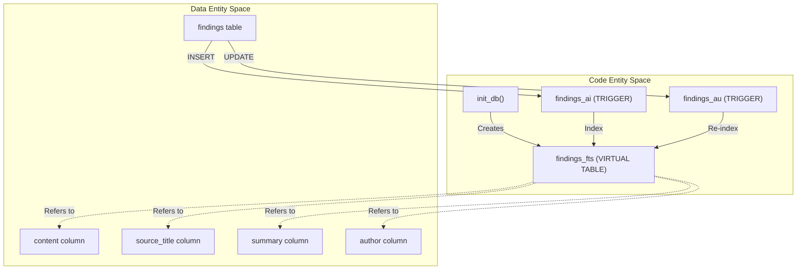
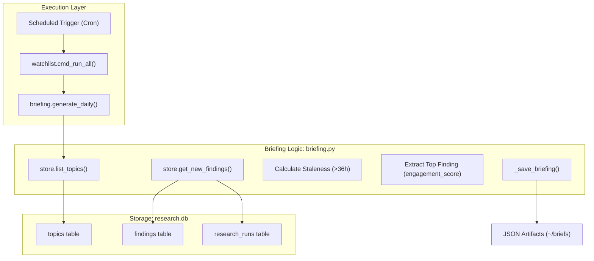

<!-- source: DeepWiki mcp.deepwiki.com · repo mvanhorn/last30days-skill · page 6.3 History and Briefings · fetched 2026-10-27 -->

# History and Briefings

Relevant source files

The following files were used as context for generating this wiki page:

- [skills/last30days/scripts/briefing.py](skills/last30days/scripts/briefing.py)
- [skills/last30days/scripts/evaluate_search_quality.py](skills/last30days/scripts/evaluate_search_quality.py)
- [skills/last30days/scripts/lib/hackernews.py](skills/last30days/scripts/lib/hackernews.py)
- [tests/test_briefing_v3.py](tests/test_briefing_v3.py)
- [tests/test_evaluator_v3.py](tests/test_evaluator_v3.py)
- [tests/test_hackernews.py](tests/test_hackernews.py)
- [tests/test_hackernews_comment_floor.py](tests/test_hackernews_comment_floor.py)
- [tests/test_schema_v3.py](tests/test_schema_v3.py)

## Purpose and Scope

This document covers the full-text search and briefing generation capabilities of the `last30days` watchlist system. Once topics are added to the watchlist and findings are persisted to the SQLite database [skills/last30days/scripts/lib/store.py](), users can query accumulated research history and generate daily or weekly digest reports via `briefing.py` [skills/last30days/scripts/briefing.py:1-12]().

The history system provides natural language search across stored findings using SQLite FTS5. The briefing system synthesizes these findings into structured data that can be rendered into formatted reports, saved as JSON artifacts, or delivered via notification webhooks [skills/last30days/scripts/briefing.py:32-36]().

Sources: [skills/last30days/scripts/briefing.py:1-36](), [skills/last30days/scripts/lib/store.py]()

---

## Full-Text Search Architecture

The history system enables querying accumulated findings using full-text search with structured filters. The primary storage engine is a SQLite database utilizing the FTS5 extension with the `porter unicode61` tokenizer.

### Search Index Implementation

The system maintains a virtual table `findings_fts` that stays synchronized with the main `findings` table through database triggers.

**Diagram: Synchronization between the findings table and the FTS5 search index**

Sources: [skills/last30days/scripts/lib/store.py]()

### Search Capability Details

The FTS5 implementation indexes the following fields to support comprehensive history retrieval:
*   `content`: The full body text or raw text of the finding.
*   `summary`: AI-generated summary of the content.
*   `source_title`: The headline or title from the source platform.
*   `author`: The handle or name of the content creator.

The tokenizer uses `porter` stemming to ensure that searches for "researching" also match "research" or "researched".

Sources: [skills/last30days/scripts/lib/store.py]()

---

## Briefing Generation System

The briefing system, implemented in `briefing.py`, generates structured data for daily and weekly digests [skills/last30days/scripts/briefing.py:1-12](). It serves as the primary mechanism for the engine to report on delta changes across the watchlist.

### Briefing Data Flow

**Diagram: Data flow from database retrieval to structured briefing generation**

Sources: [skills/last30days/scripts/briefing.py:32-139](), [skills/last30days/scripts/briefing.py:25](), [tests/test_briefing_v3.py:12-31]()

### Daily vs. Weekly Briefings

The system supports two primary modes of synthesis:

| Feature | Daily Briefing (`generate_daily`) | Weekly Digest (`generate_weekly`) |
| :--- | :--- | :--- |
| **Time Window** | Last 24 hours (default) [skills/last30days/scripts/briefing.py:55]() | Last 7 days [skills/last30days/scripts/briefing.py:146]() |
| **Comparison** | N/A | Compare vs. previous 7 days [skills/last30days/scripts/briefing.py:147]() |
| **Trend Analysis** | Staleness check (>36h) [skills/last30days/scripts/briefing.py:72]() | Engagement change % [skills/last30days/scripts/briefing.py:180-182]() |
| **Focus** | New findings per topic [skills/last30days/scripts/briefing.py:78-79]() | Top 5 findings per topic sorted by engagement [skills/last30days/scripts/briefing.py:195-196](), [tests/test_briefing_v3.py:32-88]() |
| **Output File** | JSON artifact saved via `_save_briefing` [skills/last30days/scripts/briefing.py:137]() | JSON artifact saved via `_save_briefing` [skills/last30days/scripts/briefing.py:201]() |

Sources: [skills/last30days/scripts/briefing.py:32-203](), [tests/test_briefing_v3.py:32-88]()

---

## Reference Documents and Persistence

The engine relies on a set of reference documents and a persistent SQLite store to maintain context over time.

### Storage Persistence (`store.py`)
Findings are stored with a unique constraint on `source_url` to prevent duplication. When a duplicate URL is sighted, the system updates the `engagement_score`, `last_seen` timestamp, and increments the `sighting_count`. The persistence functions convert standard `Report` objects into persistable database records.

### Notification and Delivery
The watchlist management script handles the delivery of new findings to external channels like Slack or generic webhooks.

*   **Webhook Integration**: Supports Slack incoming webhooks and generic JSON POST requests.
*   **Delivery Modes**: Supports `announce` (formatted with emojis), `silent` (minimal), and standard completion messages.
*   **Budget Awareness**: Research runs are gated by a `daily_budget` setting (default $5.00). If the daily cost exceeds this limit, the run is skipped.

### Briefing Storage
Generated briefings are saved as JSON files in `~/.local/share/last30days/briefs/` using UTF-8 encoding to support emojis and international characters [skills/last30days/scripts/briefing.py:25](), [tests/test_briefing_v3.py:89-108](). These files serve as the historical record for briefing display commands.

Sources: [skills/last30days/scripts/briefing.py:25](), [tests/test_briefing_v3.py:89-108](), [skills/last30days/scripts/lib/store.py]()

---

