# Page: Overview

# Overview

<details>
<summary>Relevant source files</summary>

The following files were used as context for generating this wiki page:

- [.claude-plugin/marketplace.json](.claude-plugin/marketplace.json)
- [.claude-plugin/plugin.json](.claude-plugin/plugin.json)
- [CHANGELOG.md](CHANGELOG.md)
- [CONCEPTS.md](CONCEPTS.md)
- [CONFIGURATION.md](CONFIGURATION.md)
- [README.md](README.md)
- [docs/solutions/architecture-patterns/discovery-checkpoint-protocol-design-conventions.md](docs/solutions/architecture-patterns/discovery-checkpoint-protocol-design-conventions.md)
- [docs/solutions/architecture-patterns/discovery-topic-queue-design-conventions.md](docs/solutions/architecture-patterns/discovery-topic-queue-design-conventions.md)
- [docs/solutions/conventions/argparse-optional-value-flag-dispatch-truthiness.md](docs/solutions/conventions/argparse-optional-value-flag-dispatch-truthiness.md)
- [docs/solutions/design-patterns/ranked-output-confidence-floor-honest-empty-state.md](docs/solutions/design-patterns/ranked-output-confidence-floor-honest-empty-state.md)
- [docs/solutions/logic-errors/fusion-source-item-dedupe-by-stream-local-id-drops-enrichment.md](docs/solutions/logic-errors/fusion-source-item-dedupe-by-stream-local-id-drops-enrichment.md)
- [docs/solutions/logic-errors/non-daemon-executor-threads-defeat-wall-clock-budget.md](docs/solutions/logic-errors/non-daemon-executor-threads-defeat-wall-clock-budget.md)
- [gemini-extension.json](gemini-extension.json)
- [skills/last30days/SKILL.md](skills/last30days/SKILL.md)
- [skills/last30days/scripts/lib/env.py](skills/last30days/scripts/lib/env.py)

</details>


## Purpose and Scope

The `/last30days` skill is an agent-led multi-source social research engine designed to aggregate, normalize, score, and synthesize real-time community sentiment and data from the last 30 days [README.md:1-25](). Rather than relying on traditional SEO-prioritized web scraping, the engine queries platforms where real people vote with their attention, engagement, and money (Reddit, X/Twitter, YouTube, TikTok, Hacker News, Polymarket, GitHub, and more) [README.md:23-49]().

This page serves as a high-level overview of the engine's purpose, supported sources, and host integrations. For detailed technical specifications, refer to the child pages:
- For the instruction contract, the eleven output LAWs, preflight checks, and stale-clone self-checks, see [SKILL.md Contract and Output LAWs](#1.1).
- For domain concepts and user-facing query modes (general, comparison, discovery, drill, deep research, confidence floor), see [Key Concepts and Query Modes](#1.2).

Sources: [SKILL.md:1-6](), [README.md:1-49]()

---

## Supported Sources and Host Integrations

The engine bridges disparate walled gardens by utilizing specialized connectors and transport mechanisms, allowing multiple AI agent harnesses to invoke the research pipeline seamlessly.

### Supported Sources
| Source | Signal Type | Transport / Implementation |
| :--- | :--- | :--- |
| **Reddit** | Unfiltered community debates & upvotes | `reddit_public.py`, `reddit_keyless.py`, `reddit_arctic.py` [README.md:71]() |
| **X / Twitter** | Breaking reactions, expert threads | `bird_x.py`, `xai_x.py`, `xapi` backend chain [README.md:72](), [CHANGELOG.md:16-20]() |
| **YouTube** | Deep dives and transcript segments | `youtube.py` (`yt-dlp` integration) [README.md:73](), [CHANGELOG.md:57]() |
| **TikTok / Instagram** | Creator reach & visual culture | `tiktok.py`, `instagram.py` (via ScrapeCreators) [README.md:74-75]() |
| **Hacker News** | Technical developer consensus | `hackernews.py` (Algolia API) [README.md:76]() |
| **Polymarket** | Real-money prediction odds | `polymarket.py` (Gamma API) [README.md:77]() |
| **GitHub** | PR velocity, repo stats, issues | `github.py` search qualifier engine [README.md:78]() |
| **Web & Perplexity** | Editorial coverage & deep search | `grounding.py`, `perplexity.py`, `brave.py` [README.md:88-89]() |

### Host Integrations
The skill is packaged for multi-harness distribution, supporting automatic loading and execution across diverse environments:
*   **Claude Code**: Native plugin marketplace integration via `.claude-plugin/plugin.json` and `.claude-plugin/marketplace.json` [.claude-plugin/plugin.json:1-30](), [.claude-plugin/marketplace.json:1-24]().
*   **Codex, Cursor, Copilot, and Agent Skills Ecosystem**: Global installation via `npx skills add mvanhorn/last30days-skill -g` [README.md:33-37]().
*   **Gemini CLI**: Configured via `gemini-extension.json` supporting environment variable injection [gemini-extension.json:1-67]().
*   **Grok / OpenClaw**: Supported via execution metadata and platform-specific hooks [SKILL.md:13-68]().
*   **Model Context Protocol (MCP)**: Bundled as a `.mcpb` package utilizing the Go MCP server located in `mcp/`.

Sources: [README.md:33-90](), [.claude-plugin/plugin.json:1-30](), [gemini-extension.json:1-67](), [SKILL.md:13-68]()

---

## Natural Language Space to Code Entity Space Mappings

To bridge high-level user intents with the underlying codebase, the following diagrams associate natural-language concepts and system workflows with exact Python modules, classes, and entry points.

### Diagram 1: Research Execution Pipeline Mapping

Title: "Natural Language to Code Entity Mapping: Research Workflow"
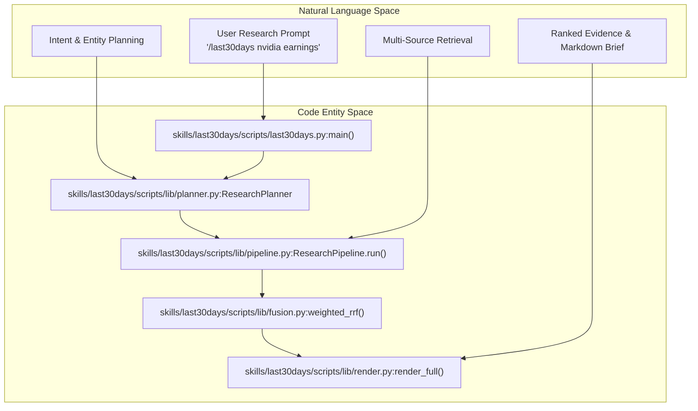
Sources: [README.md:35-41](), [CONCEPTS.md:13-18]()

### Diagram 2: Connector and Source Architecture Mapping

Title: "Natural Language to Code Entity Mapping: Source Connectors"
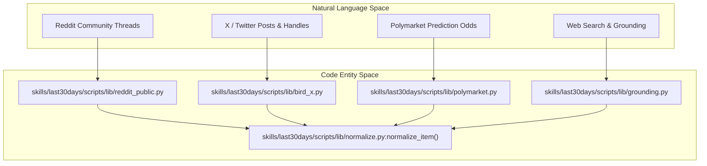
Sources: [README.md:67-90](), [CHANGELOG.md:16-20]()

---

# Page: SKILL.md Contract and Output LAWs

# SKILL.md Contract and Output LAWs

<details>
<summary>Relevant source files</summary>

The following files were used as context for generating this wiki page:

- [.claude-plugin/marketplace.json](.claude-plugin/marketplace.json)
- [.claude-plugin/plugin.json](.claude-plugin/plugin.json)
- [CHANGELOG.md](CHANGELOG.md)
- [gemini-extension.json](gemini-extension.json)
- [skills/last30days/SKILL.md](skills/last30days/SKILL.md)
- [tests/test_codex_host_contract.py](tests/test_codex_host_contract.py)
- [tests/test_doc_security_contract.py](tests/test_doc_security_contract.py)

</details>


## Purpose and Scope
This page documents the operational contract defined in `skills/last30days/SKILL.md`. The `/last30days` skill is an agent-led multi-source social research engine rather than a generic search prompt. The instruction contract prevents the host model from improvising against the skill name, enforcing strict adherence to output formatting rules, preflight checks, stale-clone self-checks, and citation rendering regimes across diverse agent runtimes (Claude Code, Codex, Grok, Gemini CLI, and MCP).

Sources: `skills/last30days/SKILL.md:99-111`

---

## Step 0: Stale-Clone Self-Check and Runtime Preflight
Before executing any retrieval or synthesis steps, the engine evaluates environment integrity to protect against stale checkouts and missing dependencies.

### Stale-Clone Self-Check
Certain agent runtimes (such as Claude Code's marketplace auto-restore mechanism) clone repositories to `origin/main` directories under `~/.claude/plugins/marketplaces/`, which can lag behind versioned plugin caches. To prevent execution of outdated instructions, the engine executes a bash-based self-check [skills/last30days/SKILL.md:70-90]():

```bash
CLAUDE_CACHE_LATEST=$(find "$HOME/.claude/plugins/cache/last30days-skill/last30days" -mindepth 1 -maxdepth 1 -type d 2>/dev/null | sort -V | tail -1)
```

If the loaded `SKILL.md` resolves from the marketplaces directory and a newer cached version exists, the agent halts and re-reads the fresh `SKILL.md` path [skills/last30days/SKILL.md:91-93](). Other installation paths (`~/.codex/skills/`, `~/.agents/skills/`, or local checkouts) bypass this check [skills/last30days/SKILL.md:95]().

### Runtime Preflight (`--preflight`)
The `--preflight` command-line flag verifies system readiness without reading browser-cookie values, writing setup/config files, or executing active research [tests/test_doc_security_contract.py:37-47](). It acts as a lightweight configuration validation gate for non-modal agent runtimes.

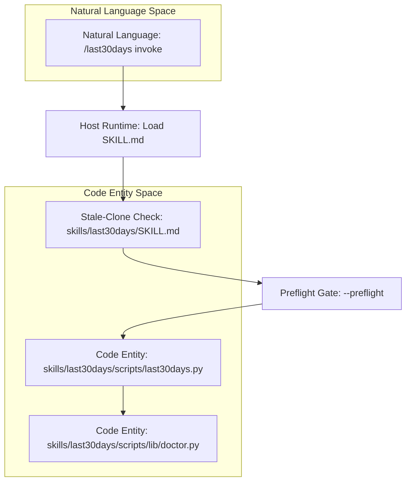
*Figure 1: Natural Language to Code Entity Space mapping for runtime preflight and invocation.*

Sources: `skills/last30days/SKILL.md:70-96`, `tests/test_doc_security_contract.py:37-47`

---

## The Eleven Output LAWs
The core contract mandates adherence to eleven strict output LAWs. These rules eliminate hallucinated section headers, custom titles, or unverified citation blocks.

1. **LAW 1 (Mandatory First-Line Badge):** Every response must begin with the exact badge emitted by the engine [skills/last30days/SKILL.md:114-123]().
2. **LAW 2 (No Invented Titles):** Do not fabricate custom titles or headers for general queries.
3. **LAW 3 (Strict Source Adherence):** Only cite sources and items explicitly returned by the engine data envelope.
4. **LAW 4 (Structured Section Integrity):** Adhere strictly to the requested query type template layout without injecting unapproved commentary blocks.
5. **LAW 5 (Freshness Verification):** Report absolute dates and verify items fall within the 30-day sliding window.
6. **LAW 6 (Confidence Floor Enforcement):** Drop or isolate items failing relevance or confidence thresholds.
7. **LAW 7 (First-Party Credit):** Preserve original creator attributions and handle identifiers.
8. **LAW 8 (Renderer-Aware Citations):** Format links according to host runtime capabilities (hidden-link vs. visible-URL formatting).
9. **LAW 9 (Evidence Envelope Compliance):** Base all synthesis exclusively on provided JSON/text evidence envelopes.
10. **LAW 10 (Strict Exit and Error Propagation):** Propagate engine exit codes and degraded status flags accurately.
11. **LAW 11 (No Bare Shell Execution):** Always execute via defined wrappers and flags rather than raw improvised scripts.

Sources: `skills/last30days/SKILL.md:114-123`, `CHANGELOG.md:12-22`

---

## Badge, Footer, and Pass-Through Rules
The Python engine outputs a standardized header badge as the first line of execution:
```
🌐 last30days v{VERSION} · synced {YYYY-MM-DD}
```
Host models are expected to pass this output through verbatim [skills/last30days/SKILL.md:114-123]().

### Host-Conditional Citation Formatting (LAW 8)
Citation rendering adapts dynamically based on the host runtime environment detected via environment variables (`CLAUDECODE`, `CURSOR_AGENT`):
* **Hidden-Link Hosts (Claude Code, Grok Bot / Cursor agent chat):** Use markdown inline links `[name](url)` because the UI hides raw URLs [tests/test_codex_host_contract.py:94-116]().
* **Visible-URL Hosts (Codex, Gemini CLI, raw CLI):** Use explicit plain-label citation formats to prevent broken markdown rendering or "URL soup" [tests/test_codex_host_contract.py:94-116]().

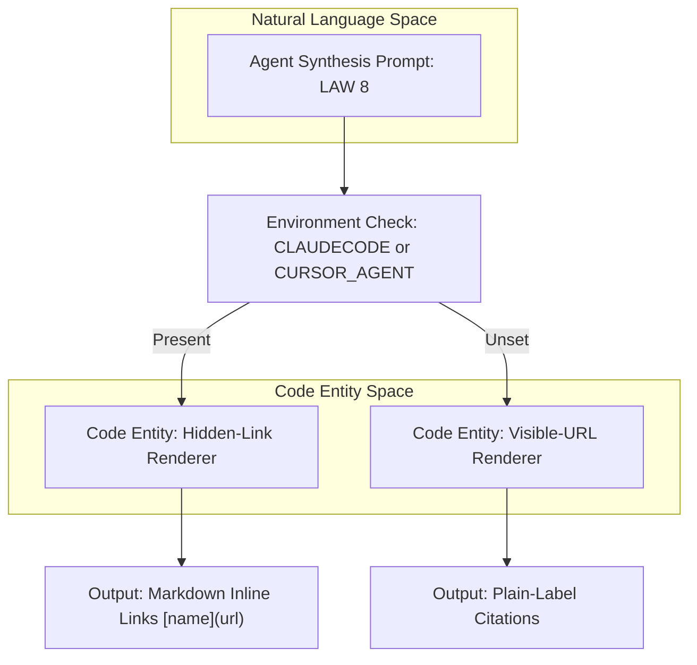
*Figure 2: Natural Language Space mapping to citation rendering code paths under LAW 8.*

Sources: `CHANGELOG.md:39`, `tests/test_codex_host_contract.py:85-161`

---

## Query Type Templates and Runtime Integration
The engine supports multiple query archetypes (general, comparison, discovery, drill mode, deep research, and competitors mode). When a query is initiated:
1. **Auto-Resolve / Pre-Research:** The orchestrator determines whether host web search tools are active (`LAST30DAYS_NATIVE_SEARCH=1`) or falls back to engine-internal search planners [tests/test_codex_host_contract.py:68-83]().
2. **Execution Plan:** Subqueries are dispatched across parallel worker pools with specified filters and flags.
3. **Synthesis:** The host model processes the returned JSON candidate structures and formats findings adhering strictly to the Output LAWs.

Sources: `skills/last30days/SKILL.md:1-68`, `tests/test_codex_host_contract.py:57-84`

---

# Page: Key Concepts and Query Modes

# Key Concepts and Query Modes

<details>
<summary>Relevant source files</summary>

The following files were used as context for generating this wiki page:

- [CONCEPTS.md](CONCEPTS.md)
- [docs/how-search-works.md](docs/how-search-works.md)
- [docs/solutions/architecture-patterns/discovery-checkpoint-protocol-design-conventions.md](docs/solutions/architecture-patterns/discovery-checkpoint-protocol-design-conventions.md)
- [docs/solutions/architecture-patterns/discovery-topic-queue-design-conventions.md](docs/solutions/architecture-patterns/discovery-topic-queue-design-conventions.md)
- [docs/solutions/conventions/argparse-optional-value-flag-dispatch-truthiness.md](docs/solutions/conventions/argparse-optional-value-flag-dispatch-truthiness.md)
- [docs/solutions/design-patterns/ranked-output-confidence-floor-honest-empty-state.md](docs/solutions/design-patterns/ranked-output-confidence-floor-honest-empty-state.md)
- [docs/solutions/logic-errors/fusion-source-item-dedupe-by-stream-local-id-drops-enrichment.md](docs/solutions/logic-errors/fusion-source-item-dedupe-by-stream-local-id-drops-enrichment.md)
- [docs/solutions/logic-errors/non-daemon-executor-threads-defeat-wall-clock-budget.md](docs/solutions/logic-errors/non-daemon-executor-threads-defeat-wall-clock-budget.md)
- [docs/v2.1-launch-copy.md](docs/v2.1-launch-copy.md)
- [skills/last30days/scripts/lib/competitors.py](skills/last30days/scripts/lib/competitors.py)
- [skills/last30days/scripts/lib/fanout.py](skills/last30days/scripts/lib/fanout.py)
- [tests/test_adversarial_v3.py](tests/test_adversarial_v3.py)
- [tests/test_competitor_fanout.py](tests/test_competitor_fanout.py)
- [tests/test_competitors_routing.py](tests/test_competitors_routing.py)
- [tests/test_registers.py](tests/test_registers.py)

</details>


## Purpose and Scope

This document explains the core domain vocabulary, user-facing query modes, ranking boundaries, and audience customization features implemented in the `last30days-skill` codebase. It details how natural language user intents are classified, routed through specialized execution paths, filtered by absolute confidence thresholds, and rendered for different consumer registers.

Sources: `CONCEPTS.md:1-20`, `skills/last30days/SKILL.md:1-50`

---

## User-Facing Query Modes

The engine supports distinct execution modes mapped from the user's prompt or CLI arguments. These modes dictate query planning, fan-out limits, parallel execution structures, and output schemas.

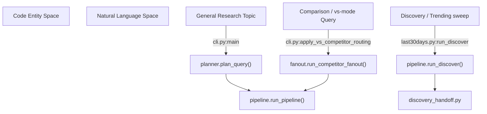
*Figure 1: Natural Language Space to Code Entity Space mapping for user-facing query modes.*

Sources: `CONCEPTS.md:1-20`, `skills/last30days/scripts/last30days.py:1-100`, `skills/last30days/scripts/lib/planner.py:1-50`, `skills/last30days/scripts/lib/fanout.py:30-49`

### General Queries
General queries target a single primary entity or topical phrase. The engine extracts the **Primary entity** and **Intent modifier**, building a structured `QueryPlan` containing multiple subquery streams executed in parallel via a `ThreadPoolExecutor` [docs/how-search-works.md:26-27, CONCEPTS.md:21-28].

Sources: `CONCEPTS.md:21-38`, `docs/how-search-works.md:26-27`, `skills/last30days/scripts/lib/planner.py:1-40`

### Comparison, Competitors, and VS Mode
Comparison queries detect side-by-side evaluations (e.g., `"React vs Vue"` or slash-separated expressions like `"React/Vue/Svelte"`) or accept explicit peer specifications via `--competitors <N>` or `--competitors-list` [skills/last30days/scripts/lib/competitors.py:1-11, tests/test_adversarial_v3.py:13-39, tests/test_competitors_routing.py:1-10].

The routing logic is managed by `cli.apply_vs_competitor_routing` and executed concurrently by `fanout.run_competitor_fanout()` [skills/last30days/scripts/lib/fanout.py:30-88, tests/test_competitors_routing.py:22-34]. Peer entities are capped between `COMPETITORS_MIN` (1) and `COMPETITORS_MAX` (6), restricting total entities under comparison to `COMPARISON_ENTITY_MAX` (7) to prevent rate-limiting downstream APIs [skills/last30days/scripts/lib/competitors.py:22-29, tests/test_competitors_routing.py:110-120].

Sources: `skills/last30days/scripts/lib/competitors.py:1-30`, `skills/last30days/scripts/lib/fanout.py:30-88`, `tests/test_competitors_routing.py:1-40`

### Discovery Queries (`--discover`)
Discovery mode operates topic-lessly or domain-scoped to surface what is worth researching. On reasoning-model hosts, it executes as a three-leg host-judged protocol (`--discover --nominate-only`, `--judgments`, `--finalize`), persisting intermediate bundles through `lib/discovery_handoff.py`. Headless executions run a deterministic distill sweep [CONCEPTS.md:56-64, docs/solutions/architecture-patterns/discovery-checkpoint-protocol-design-conventions.md:37-66].

Sources: `CONCEPTS.md:56-64`, `docs/solutions/architecture-patterns/discovery-checkpoint-protocol-design-conventions.md:37-66`, `skills/last30days/scripts/lib/discovery_handoff.py:1-30`

### Drill Mode and Deep Research
Execution depth is governed by depth flags (`--quick`, default, `--deep`), which scale thread fetch allocations, HTTP timeouts, and comment-enrichment budgets [docs/how-search-works.md:84-91, CONCEPTS.md:46-54]. For example, comment-enrichment slots allocate 4, 8, or 12 slots per subquery depending on the selected depth [CONCEPTS.md:46-49].

Sources: `CONCEPTS.md:45-54`, `docs/how-search-works.md:83-91`

---

## Domain Concepts and Data Structures

### Primary Entity and Intent Modifier
* **Primary Entity**: The brand, proper noun, or central core of a research topic with intent modifiers stripped [CONCEPTS.md:21-24].
* **Intent Modifier**: Trailing phrases expressing user intent rather than core subject identity (e.g., "review", "pricing", "use cases") [CONCEPTS.md:25-28].

Sources: `CONCEPTS.md:21-28`

### Corpus, Subquery Streams, and Candidates
* **Corpus**: The aggregated collection of raw `SourceItem` objects gathered across all configured source connectors (`reddit`, `x`, `youtube`, `grounding`, etc.) [tests/test_registers.py:29-56, docs/v2.1-launch-copy.md:13-16].
* **Subquery Stream**: A single source's ranked result list for one planner subquery [CONCEPTS.md:35-38].
* **Candidate**: The fused unit of evidence merged across subquery streams by normalized URL (`fusion.candidate_key`), combining engagement metrics, snippets, and richer metadata structures [CONCEPTS.md:39-44, docs/solutions/logic-errors/fusion-source-item-dedupe-by-stream-local-id-drops-enrichment.md:43-50].

Sources: `CONCEPTS.md:35-44`, `docs/solutions/logic-errors/fusion-source-item-dedupe-by-stream-local-id-drops-enrichment.md:40-55`, `tests/test_registers.py:29-88`

---

## Scoring, Grounding, and Quality Control

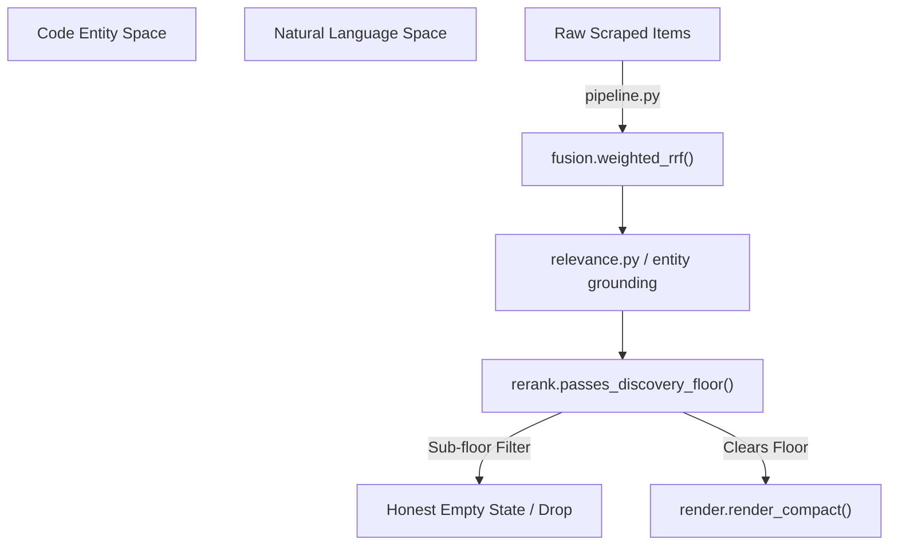
*Figure 2: Evidence processing pipeline from raw ingestion to absolute confidence floor gating.*

Sources: `docs/solutions/design-patterns/ranked-output-confidence-floor-honest-empty-state.md:45-80`, `skills/last30days/scripts/lib/fusion.py:40-70`

### Entity Grounding
Entity grounding validates that a candidate item plausibly mentions the primary entity before final ranking. It keys on the head token (first word) of the primary entity to prevent trailing descriptors from triggering false-positive demotions [CONCEPTS.md:29-34]. Items failing grounding receive a decisive entity-miss penalty that engagement metrics cannot override [CONCEPTS.md:29-34].

Sources: `CONCEPTS.md:29-34`

### Confidence Floor
To prevent relative rankers from surfacing noise in thin or over-broad query domains, candidates must clear an absolute confidence floor implemented in `rerank.passes_discovery_floor` (`skills/last30days/scripts/lib/rerank.py`) [docs/solutions/design-patterns/ranked-output-confidence-floor-honest-empty-state.md:45-80]:

```python
FLOOR_MIN_ENGAGEMENT = 25.0
FLOOR_MIN_SOURCES = 2
FLOOR_SINGLE_SOURCE_ENGAGEMENT = 200.0
```

The gate uses composite criteria: either cross-source corroboration across $\ge 2$ independent seed sources or a strong single-source engagement spike ($\ge 200.0$) [docs/solutions/design-patterns/ranked-output-confidence-floor-honest-empty-state.md:82-90]. Junk-shaped topics (help posts or beginner queries) are barred from single-source bypasses and must satisfy corroboration exclusively via seed source counts [docs/solutions/design-patterns/ranked-output-confidence-floor-honest-empty-state.md:92-105].

Sources: `docs/solutions/design-patterns/ranked-output-confidence-floor-honest-empty-state.md:45-110`

### Engagement Keepers and Best Takes
* **Engagement Keeper**: High-engagement threads (clearing relevance and entity grounding floors) that bypass stream truncation limits to ensure viral discussions reach final output [CONCEPTS.md:50-54].
* **Best Takes**: High-signal community insights extracted and scored (`fun_score`) for distinct consumer perspectives [CONCEPTS.md:39-44, tests/test_registers.py:75-77].

Sources: `CONCEPTS.md:50-54`, `tests/test_registers.py:29-88`

---

## Audience Registers

The engine supports customizable output presentation via audience registers (`exec`, `dev`, `creator`), which alter section ordering, cluster budgets, and source emphasis within `render.render_compact()` and `html_render.render_html()` [tests/test_registers.py:139-197].

| Register | Section Ordering Priority | Cluster Budget | Comment Budget | Primary Emphasis |
|---|---|---|---|---|
| `exec` | Stats, Ranked Evidence Clusters, Source Coverage, Best Takes, Top Community Comments | 5 | 3 | High-level metrics & executive synthesis |
| `dev` | Ranked Evidence Clusters, Source Coverage, Stats, Top Community Comments, Best Takes | 10 | 4 | Technical depth & code/developer repositories |
| `creator` | Best Takes, Top Community Comments, Stats, Ranked Evidence Clusters, Source Coverage | 6 | 8 | Narrative quotes, social sentiment & viral takes |

Sources: `tests/test_registers.py:139-197`

---

# Page: Core Architecture

# Core Architecture

<details>
<summary>Relevant source files</summary>

The following files were used as context for generating this wiki page:

- [skills/last30days/scripts/last30days.py](skills/last30days/scripts/last30days.py)
- [skills/last30days/scripts/lib/pipeline.py](skills/last30days/scripts/lib/pipeline.py)
- [skills/last30days/scripts/lib/planner.py](skills/last30days/scripts/lib/planner.py)
- [tests/test_cli_v3.py](tests/test_cli_v3.py)
- [tests/test_external_plan_source_contract.py](tests/test_external_plan_source_contract.py)
- [tests/test_internals_v3.py](tests/test_internals_v3.py)
- [tests/test_pipeline_v3.py](tests/test_pipeline_v3.py)
- [tests/test_planner_v3.py](tests/test_planner_v3.py)

</details>


This page provides a high-level overview of the engine architecture for the `last30days` skill, covering planning, parallel retrieval, fusion, ranking, and rendering. The codebase is organized into modular components under `skills/last30days/scripts/lib` [skills/last30days/scripts/last30days.py:51-55]().

For detailed mechanics on each subsystem, refer to the child pages:
- [Two-Phase Search Strategy](#2.1) — Intent classification, query expansion, source priority tables, and auto-resolve pre-research.
- [Orchestration Pipeline](#2.2) — CLI integration, thread pool fan-out, fetch caps, rate-limit tracking, and Report assembly.
- [Configuration and Authentication](#2.3) — Configuration priority resolution, provider descriptors, chain failover, and cookie/credential extraction.
- [Discovery Protocol](#2.4) — Host-judged discovery workflow, river listing sweeps, and confidence floor gating.

---

## System Overview and Module Layout

The engine operates as a parallel multi-source research pipeline supporting over 20 source adapters (Reddit, X, YouTube, TikTok, Hacker News, Polymarket, GitHub, web search, etc.) [skills/last30days/scripts/lib/pipeline.py:199-225](). The implementation is partitioned into dedicated functional libraries under `skills/last30days/scripts/lib/` [skills/last30days/scripts/last30days.py:51-55]():

- **Orchestration & Control**: `pipeline.py`, `planner.py`, `query.py`, `resolve.py`, `fanout.py`
- **Data Acquisition & Sources**: `reddit.py`, `bird_x.py`, `youtube_yt.py`, `grounding.py`, `polymarket.py`, etc.
- **Processing & Fusion**: `normalize.py`, `signals.py`, `fusion.py`, `rerank.py`, `cluster.py`, `dedupe.py`
- **Output & Presentation**: `render.py`, `ui.py`, `html_render.py`
- **Persistence & Management**: `store.py`, `watchlist.py`, `briefing.py`, `health.py`, `doctor.py`

Title: Component Architecture Diagram
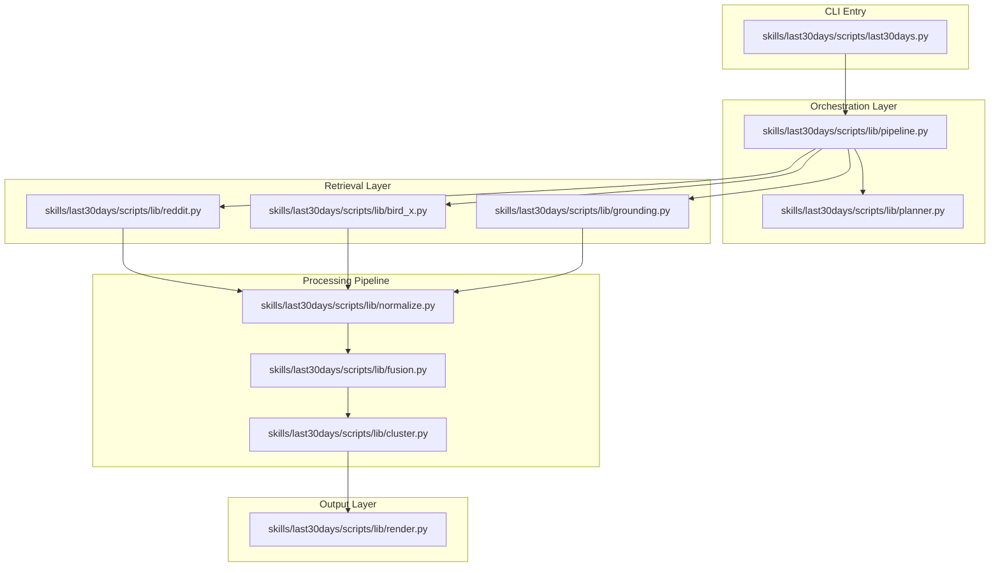
Sources: [skills/last30days/scripts/last30days.py:51-55](), [skills/last30days/scripts/lib/pipeline.py:1-85]()

---

## Execution Flow

The engine executes research across four distinct phases: intent planning and query expansion, parallel retrieval via thread pools, multi-signal fusion and ranking, and final report rendering [skills/last30days/scripts/last30days.py:114-175](), [skills/last30days/scripts/lib/pipeline.py:1-102]().

Title: Engine Execution Flow
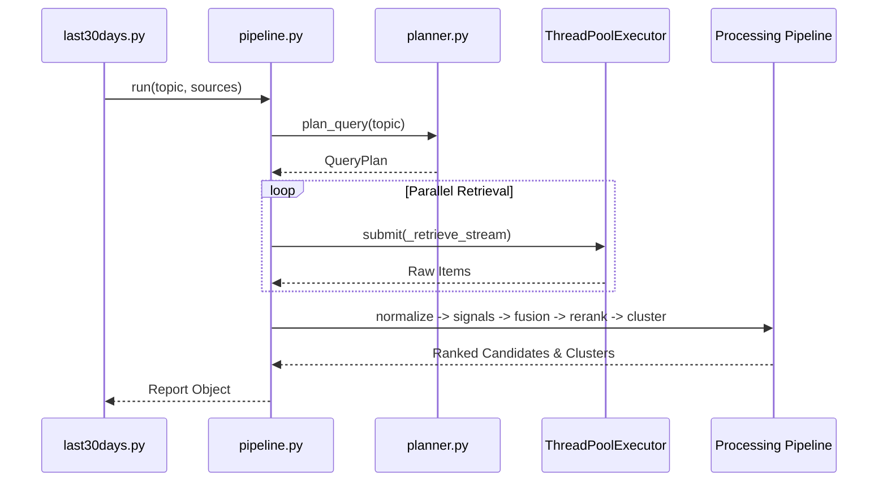
Sources: [skills/last30days/scripts/last30days.py:114-175](), [skills/last30days/scripts/lib/pipeline.py:1-102]()

---

## Summary of Subsystems and Child Pages

- **Two-Phase Search Strategy**: Details intent classification, query expansion, source priority tables, and auto-resolve pre-research. For details, see [Two-Phase Search Strategy](#2.1).
- **Orchestration Pipeline**: Covers `last30days.py` CLI integration, `pipeline.py` execution (`ThreadPoolExecutor` fan-out, fetch caps, rate-limit tracking, thin-source retries, and Report assembly). For details, see [Orchestration Pipeline](#2.2).
- **Configuration and Authentication**: Documents configuration resolution, provider/backend descriptors, chain failover, cookie extraction, and credential stores. For details, see [Configuration and Authentication](#2.3).
- **Discovery Protocol**: Details the host-judged discovery workflow, river listing sweeps, clustering, and confidence floor gating. For details, see [Discovery Protocol](#2.4).

Sources: [skills/last30days/scripts/last30days.py:1-115](), [skills/last30days/scripts/lib/pipeline.py:1-102](), [skills/last30days/scripts/lib/planner.py:19-90]()

---

# Page: Two-Phase Search Strategy

# Two-Phase Search Strategy

<details>
<summary>Relevant source files</summary>

The following files were used as context for generating this wiki page:

- [skills/last30days/scripts/lib/planner.py](skills/last30days/scripts/lib/planner.py)
- [skills/last30days/scripts/lib/query.py](skills/last30days/scripts/lib/query.py)
- [skills/last30days/scripts/lib/resolve.py](skills/last30days/scripts/lib/resolve.py)
- [tests/fixtures/prompting-gpt-image-2-resolved-block.md](tests/fixtures/prompting-gpt-image-2-resolved-block.md)
- [tests/test_categories.py](tests/test_categories.py)
- [tests/test_category_integration.py](tests/test_category_integration.py)
- [tests/test_external_plan_source_contract.py](tests/test_external_plan_source_contract.py)
- [tests/test_internals_v3.py](tests/test_internals_v3.py)
- [tests/test_planner_v3.py](tests/test_planner_v3.py)
- [tests/test_query.py](tests/test_query.py)
- [tests/test_relevance.py](tests/test_relevance.py)
- [tests/test_resolve.py](tests/test_resolve.py)

</details>


## Purpose and Scope

This page details query planning and pre-research orchestration within the `/last30days` research engine. The system implements an LLM-first query planning phase (`lib.planner.py`), an auto-resolve pre-research phase (`lib.resolve.py`), and query preprocessing utilities (`lib.query.py`). These components bridge broad natural language topics to specific community-driven data silos and structured search queries.

For orchestration details, see **2.2. Orchestration Pipeline**. For source-specific implementations, see **3. Data Sources**.

---

## Phase 0: Query Planning and Intent Classification

The search strategy begins in `skills/last30days/scripts/lib/planner.py`, which uses a reasoning LLM or deterministic fallback to generate a structured `QueryPlan` [skills/last30days/scripts/lib/planner.py:1-11]()].

### Intent Classification and Source Priority Tables
The planner classifies user topics into one of eight `ALLOWED_INTENTS` [skills/last30days/scripts/lib/planner.py:85-94]():

```python
ALLOWED_INTENTS = {
    "factual", "product", "concept", "opinion",
    "how_to", "comparison", "breaking_news", "prediction",
}
```

This classification dictates source selection via `QUICK_SOURCE_PRIORITY` and `SOURCE_PRIORITY` maps, along with latency source limits and capability filters [skills/last30days/scripts/lib/planner.py:97-161]().

| Intent | Primary Sources (Default Depth) | Typical Cluster Mode |
| :--- | :--- | :--- |
| `factual` | `hackernews`, `reddit`, `x`, `youtube` | `none` |
| `product` | `jobs`, `youtube`, `reddit`, `x`, `tiktok`, `hackernews` | `story` |
| `concept` | `hackernews`, `reddit`, `x`, `youtube` | `story` |
| `opinion` | `reddit`, `x`, `stocktwits`, `dripstack`, `youtube`, `hackernews` | `debate` |
| `how_to` | `youtube`, `reddit`, `x`, `hackernews` | `workflow` |
| `comparison` | `reddit`, `x`, `hackernews`, `youtube` | `debate` |
| `breaking_news` | `x`, `stocktwits`, `reddit`, `hackernews`, `youtube`, `polymarket` | `story` |
| `prediction` | `polymarket`, `stocktwits`, `dripstack`, `x`, `hackernews`, `reddit`, `youtube` | `market` |

Sources: [skills/last30days/scripts/lib/planner.py:85-161](), [tests/test_planner_v3.py:88-104]()

### Query Expansion and Capability Routing
The planner expands the topic into multiple `subqueries`. Each `subquery` contains a `search_query` (optimized for keyword retrieval) and a `ranking_query` (optimized for semantic reranking) [tests/test_planner_v3.py:11-27](). Sources are filtered against `SOURCE_CAPABILITIES` (e.g., matching `how_to` queries to sources providing `video` or `discussion`) [skills/last30days/scripts/lib/planner.py:136-161]().

Diagram: Planning and Intent Routing to Code Entities
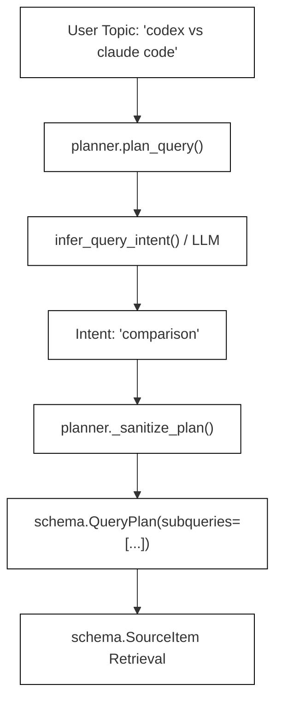
Sources: [skills/last30days/scripts/lib/planner.py:1-11](), [skills/last30days/scripts/lib/query.py:130-162](), [tests/test_planner_v3.py:88-119]()

---

## Phase 0.5: Auto-Resolve Pre-Research

Before broad discovery, `skills/last30days/scripts/lib/resolve.py` executes an auto-resolve phase using web search backends (Brave, Exa, Serper, Perplexity) to discover relevant communities and entities [skills/last30days/scripts/lib/resolve.py:1-16]().

### Entity Discovery and Category Peering
`auto_resolve()` runs targeted web queries to extract:
1. **Subreddits:** Extracted via regex `r"r/([A-Za-z0-9_]{2,21})"` from search titles, snippets, and URLs [skills/last30days/scripts/lib/resolve.py:83-95]().
2. **X Handles:** Extracted via `@handle` and `x.com/handle` patterns [skills/last30days/scripts/lib/resolve.py:98-118]().
3. **GitHub Repositories:** Extracted via `github.com/owner/repo` patterns [skills/last30days/scripts/lib/resolve.py:121-140]().
4. **Category Peers:** Topics matching known categories (`categories.detect_category()`) are augmented with curated peer subreddits (`categories.peer_subs_for()`) up to `MAX_SUBS = 10`, ensuring deep domain coverage [skills/last30days/scripts/lib/resolve.py:24-68]().

Diagram: Natural Language Space to Code Entity Space (Resolve)
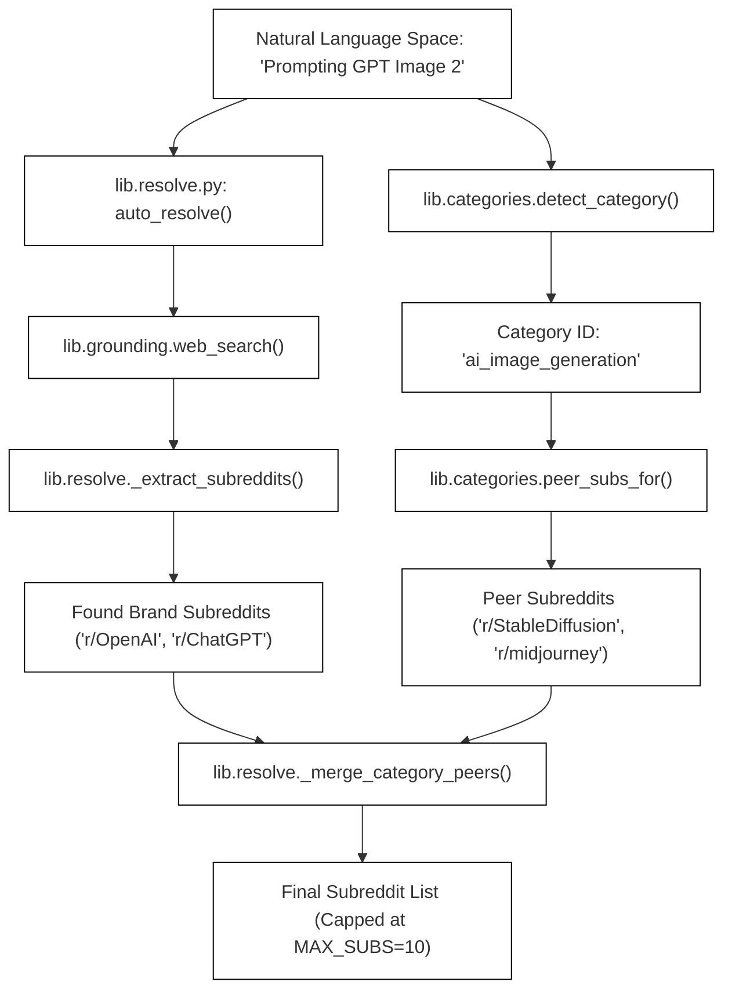
Sources: [skills/last30days/scripts/lib/resolve.py:24-95](), [skills/last30days/scripts/lib/categories.py:12-40](), [tests/test_category_integration.py:53-84]()

---

## Query Preprocessing and Normalization (`query.py`)

Shared query cleaning utilities in `skills/last30days/scripts/lib/query.py` strip noise words, extract core subjects, and detect compound terms before sending queries to adapters [skills/last30days/scripts/lib/query.py:1-6]().

### Noise Stripping and Core Subject Extraction
`extract_core_subject()` processes queries in three phases [skills/last30days/scripts/lib/query.py:79-128]():
1. **Prefix Stripping:** Removes common question/meta prefixes (e.g., `'what are the best'`, `'how to use'`, and Hebrew equivalents) [skills/last30days/scripts/lib/query.py:8-17]().
2. **Suffix Stripping:** Optionally strips trailing multi-word suffixes (e.g., `'best practices'`) [skills/last30days/scripts/lib/query.py:20-23]().
3. **Noise Word Filtering:** Filters out stopwords, question words, and research meta-descriptors using `NOISE_WORDS` (or platform-specific sets like `SOCIAL_NOISE` and `VIRAL_NOISE`) [skills/last30days/scripts/lib/query.py:26-76]().

### Compound Term Detection
`extract_compound_terms()` identifies hyphenated terms (e.g., `multi-agent`) and title-cased multi-word sequences (e.g., `Claude Code`, `React Native`) to ensure they are properly quoted in downstream search adapters [skills/last30days/scripts/lib/query.py:164-183]().

Sources: [skills/last30days/scripts/lib/query.py:1-183](), [tests/test_query.py:15-181]()

---

## Summary of Two-Phase Architecture Flow

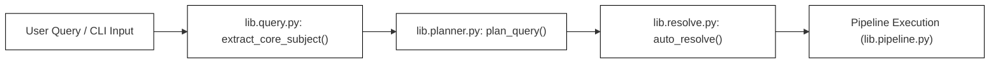
Sources: [skills/last30days/scripts/lib/query.py:79-128](), [skills/last30days/scripts/lib/planner.py:85-118](), [skills/last30days/scripts/lib/resolve.py:24-68]()

---

# Page: Orchestration Pipeline

# Orchestration Pipeline

<details>
<summary>Relevant source files</summary>

The following files were used as context for generating this wiki page:

- [docs/reference/json-export.md](docs/reference/json-export.md)
- [skills/last30days/scripts/last30days.py](skills/last30days/scripts/last30days.py)
- [skills/last30days/scripts/lib/cluster.py](skills/last30days/scripts/lib/cluster.py)
- [skills/last30days/scripts/lib/fusion.py](skills/last30days/scripts/lib/fusion.py)
- [skills/last30days/scripts/lib/http.py](skills/last30days/scripts/lib/http.py)
- [skills/last30days/scripts/lib/pipeline.py](skills/last30days/scripts/lib/pipeline.py)
- [skills/last30days/scripts/lib/schema.py](skills/last30days/scripts/lib/schema.py)
- [skills/last30days/scripts/lib/subproc.py](skills/last30days/scripts/lib/subproc.py)
- [tests/test_cli_v3.py](tests/test_cli_v3.py)
- [tests/test_cluster_v3.py](tests/test_cluster_v3.py)
- [tests/test_discover_nominate_topics.py](tests/test_discover_nominate_topics.py)
- [tests/test_fusion_v3.py](tests/test_fusion_v3.py)
- [tests/test_http_v3.py](tests/test_http_v3.py)
- [tests/test_pipeline_v3.py](tests/test_pipeline_v3.py)
- [tests/test_render_footer.py](tests/test_render_footer.py)
- [tests/test_subproc.py](tests/test_subproc.py)

</details>


## Purpose and Scope

This page documents the end-to-end execution pipeline managed by `skills/last30days/scripts/last30days.py` and `skills/last30days/scripts/lib/pipeline.py`. The orchestration engine coordinates command-line parsing, query planning, parallel multi-source data retrieval via thread pools, rate-limit tracking, thin-source retries, weighted Reciprocal Rank Fusion (RRF), LLM-based reranking, narrative clustering, strict exit codes, and aggregate `Report` assembly.

For details on the two-phase search strategy, see [Two-Phase Search Strategy](2.1). For configuration and authentication precedence, see [Configuration and Authentication](2.3).

---

## CLI Invocation and Pipeline Initialization

The CLI entry point in `skills/last30days/scripts/last30days.py` handles argument parsing, python version validation (`MIN_PYTHON = (3, 12)`), environment configuration loading, and process-group signal management (`atexit.register(_cleanup_children)`) [skills/last30days/scripts/last30days.py:1-84](). Once options such as `--quick`, `--deep`, `--search`, and `--emit` are processed, execution delegates to `pipeline.run()` [skills/last30days/scripts/lib/pipeline.py:126-234]().

**Diagram: CLI to Pipeline Entry Mapping**

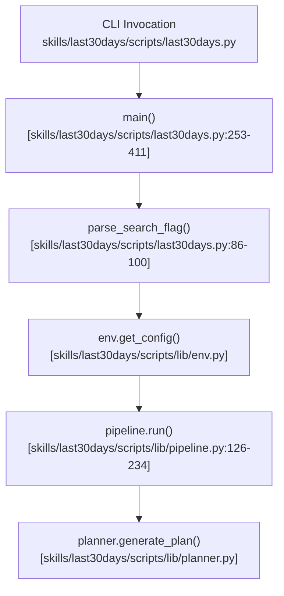

**Sources:** [skills/last30days/scripts/last30days.py:1-100](), [skills/last30days/scripts/lib/pipeline.py:126-234]()

---

## ThreadPoolExecutor Fan-Out and Fetch Caps

The retrieval phase executes subqueries concurrently across multiple sources using a `ThreadPoolExecutor` within `_execute_retrieval()` [skills/last30days/scripts/lib/pipeline.py:313-365](). To prevent API exhaustion and manage budgets, fetches are governed by per-source caps (`MAX_SOURCE_FETCHES`) and command-wide paid budget trackers (`PaidSourceBudget`) [skills/last30days/scripts/lib/pipeline.py:112-160]().

- **Depth Settings:** Configured via depth profiles (`quick`, `default`, `deep`), which dictate per-stream limits, pool limits, and rerank limits (`_resolve_depth_settings`) [skills/last30days/scripts/lib/pipeline.py:91-182]().
- **Source Caps:** Sources like `trustpilot`, `amazon`, and `telegram` are capped at 1 fetch per run to prevent redundant queries and WAF-cookie Chrome harvests [skills/last30days/scripts/lib/pipeline.py:112-115]().

**Sources:** [skills/last30days/scripts/lib/pipeline.py:91-182](), [skills/last30days/scripts/lib/pipeline.py:313-365]()

---

## Rate-Limit Tracking and Thin-Source Retries

During retrieval, HTTP requests handle rate-limiting (`HTTP 429`) and connection retries via `lib/http.py` [skills/last30days/scripts/lib/http.py:33-83](). 

- **Header Parsing:** `retry_delay_from_headers()` reads both standard `Retry-After` headers and platform-specific headers like `x-ratelimit-reset` (such as Reddit's anonymous rate-limit window resets) to calculate precise backoff wait times [skills/last30days/scripts/lib/http.py:47-83]().
- **Outcome Tracking:** Observed retrieval outcomes for each source are recorded into `SourceOutcome` dataclasses (`health.OK`, `health.RATE_LIMITED`, `schema.NO_RESULTS`, `schema.PARTIAL`, etc.), preserving failure telemetry for downstream synthesis without breaking the primary report [skills/last30days/scripts/lib/schema.py:181-222]().

**Sources:** [skills/last30days/scripts/lib/http.py:33-83](), [skills/last30days/scripts/lib/schema.py:181-222]()

---

## Fusion, Reranking, and Clustering

Once parallel retrieval and normalization complete, evidence items flow through a deterministic data processing pipeline.

**Diagram: Data Processing Pipeline Flow**

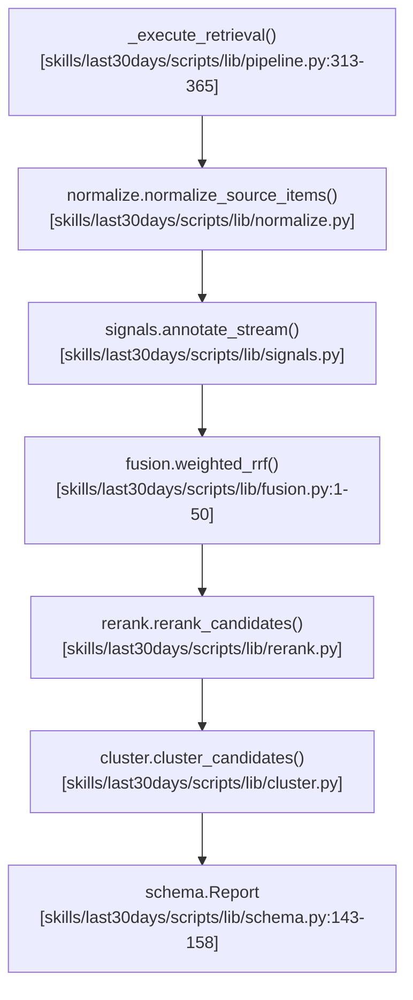

- **Weighted RRF Fusion:** `weighted_rrf()` combines rankings from multi-source subqueries using Reciprocal Rank Fusion, incorporating subquery weights and duplicate URL collapse (`collapse_duplicate_urls`) [skills/last30days/scripts/lib/fusion.py:1-108]().
- **LLM Reranking:** `rerank_candidates()` uses reasoning providers to score candidates from 0-100 based on entity grounding and relevance.
- **Clustering:** `cluster_candidates()` groups related items into narrative clusters, picking representative candidates for headline presentation [skills/last30days/scripts/lib/cluster.py]().

**Sources:** [skills/last30days/scripts/lib/fusion.py:1-108](), [skills/last30days/scripts/lib/cluster.py](), [skills/last30days/scripts/lib/schema.py:143-158]()

---

## Strict Exit Codes and Report Assembly

The pipeline aggregates all findings into a strongly-typed `schema.Report` object [skills/last30days/scripts/lib/schema.py:143-158](). 

- **Exit Codes:** The CLI enforces strict exit codes. For example, malformed `--plan` JSON or invalid plan schemas exit immediately with status `2` to prevent fallback to internal planners that would consume paid API runs [tests/test_cli_v3.py:73-115](). Successful runs exit with status `0`.
- **Output Emission:** Renderers format the report into compact, full, brief, or JSON structures, saved atomically via `save_output()` under directories like `~/Documents/Last30Days/` [skills/last30days/scripts/last30days.py:118-175]().

**Sources:** [skills/last30days/scripts/last30days.py:118-175](), [tests/test_cli_v3.py:73-115](), [skills/last30days/scripts/lib/schema.py:143-158]()

---

# Page: Configuration and Authentication

# Configuration and Authentication

<details>
<summary>Relevant source files</summary>

The following files were used as context for generating this wiki page:

- [AGENTS.md](AGENTS.md)
- [CONFIGURATION.md](CONFIGURATION.md)
- [CONTRIBUTORS.md](CONTRIBUTORS.md)
- [README.md](README.md)
- [changelog.d/+base-url-api-root.fixed.md](changelog.d/+base-url-api-root.fixed.md)
- [changelog.d/882.fixed.md](changelog.d/882.fixed.md)
- [hooks/scripts/check-config.sh](hooks/scripts/check-config.sh)
- [skills/last30days/scripts/lib/backends.py](skills/last30days/scripts/lib/backends.py)
- [skills/last30days/scripts/lib/env.py](skills/last30days/scripts/lib/env.py)
- [skills/last30days/scripts/lib/providers.py](skills/last30days/scripts/lib/providers.py)
- [skills/last30days/scripts/lib/setup_wizard.py](skills/last30days/scripts/lib/setup_wizard.py)
- [tests/test_backend_descriptors.py](tests/test_backend_descriptors.py)
- [tests/test_check_config_env_safety.py](tests/test_check_config_env_safety.py)
- [tests/test_check_config_memory_dir.py](tests/test_check_config_memory_dir.py)
- [tests/test_env_cookies.py](tests/test_env_cookies.py)
- [tests/test_github_device_auth.py](tests/test_github_device_auth.py)
- [tests/test_last_run_state.py](tests/test_last_run_state.py)
- [tests/test_onboarding_contract.py](tests/test_onboarding_contract.py)
- [tests/test_providers_v3.py](tests/test_providers_v3.py)
- [tests/test_setup_openclaw.py](tests/test_setup_openclaw.py)
- [tests/test_setup_wizard.py](tests/test_setup_wizard.py)
- [tests/test_setup_wizard_pp_sources.py](tests/test_setup_wizard_pp_sources.py)
- [tests/test_welcome.py](tests/test_welcome.py)
- [tests/test_x_chain_failover.py](tests/test_x_chain_failover.py)

</details>


## Purpose and Scope

This document describes the configuration management and authentication systems in the `/last30days` skill. It covers how API keys and credentials are loaded from multiple sources with priority resolution, how trust signaling and permission checks protect project environments, how provider and backend descriptors handle failover chains (such as `x_backend_chain`), and how the setup wizard and onboarding flows initialize the engine.

For details on secret storage mechanisms (Keychain, pass) and browser cookie extraction (`cookie_extract`, `chrome_cookies`, `safari_cookies`, `chrome_cdp`, `agentcookie`, `box_chrome_login`), see [Credential Stores and Cookie Extraction](#2.3.1).

---

## Configuration Architecture

The configuration system is managed by `skills/last30days/scripts/lib/env.py`, which aggregates settings from multiple sources with a defined priority hierarchy. The primary function `get_config()` returns a unified dictionary containing all API keys, authentication tokens, and resolved auth statuses [skills/last30days/scripts/lib/env.py:1-25].

### Configuration Loading Flow

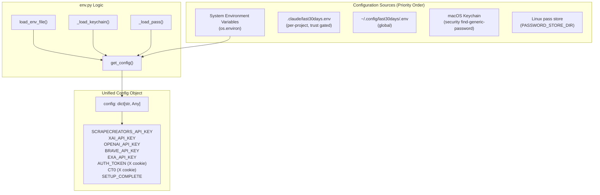

**Sources:** [skills/last30days/scripts/lib/env.py:16-83](), [hooks/scripts/check-config.sh:5-18](), [hooks/scripts/check-config.sh:103-111]()

### Configuration Priority Resolution

The `get_config()` function resolves values in the following order (highest priority wins):
1. **System Environment Variables**: Set directly in the shell or by the parent process (`os.environ`) [skills/last30days/scripts/lib/env.py:25]().
2. **Project-local `.env`**: Located at `.claude/last30days.env` relative to the current working directory, loaded only when trust is explicitly granted [hooks/scripts/check-config.sh:103-111]().
3. **Global `.env`**: Located at `~/.config/last30days/.env` (overridable via `LAST30DAYS_CONFIG_DIR`) [skills/last30days/scripts/lib/env.py:28-41]().
4. **Secret Managers**: macOS Keychain (via `security` CLI using `last30days-` service prefix) or Linux `pass` store (via `DEFAULT_PASS_PATH_PREFIX`) [skills/last30days/scripts/lib/env.py:43-82]().

---

## Trust Signaling and Permission Checks

To prevent arbitrary code execution via project-scoped configuration files (e.g., malicious `.claude/last30days.env` files in untrusted repositories), project configuration loading is strictly gated by trust signaling [hooks/scripts/check-config.sh:5-9]().

- **Trust Boundary**: Project configuration cannot self-grant trust [hooks/scripts/check-config.sh:103-111](). The `LAST30DAYS_TRUST_PROJECT_CONFIG` variable must be truthy in the process environment or the global configuration file before a project-local environment file is read.
- **Permission Enforcement**: Hook scripts (`hooks/scripts/check-config.sh`) and engine loaders inspect file permissions (`stat -c '%a'` or `stat -f '%Lp'`) and automatically correct insecure permissions (e.g., world-readable files) to `600` on POSIX systems [hooks/scripts/check-config.sh:26-43]().
- **Template Rejection**: The configuration reader inspects unexpanded template strings matching `_UNSUBSTITUTED_TEMPLATE` (such as `${user_config.x}`) to reject literal placeholder strings from host IDE integrations, ensuring valid fallbacks instead of upstream authentication errors [skills/last30days/scripts/lib/env.py:143-155]().

**Sources:** [hooks/scripts/check-config.sh:5-43](), [hooks/scripts/check-config.sh:103-111](), [skills/last30days/scripts/lib/env.py:143-155]()

---

## Provider and Backend Descriptors & Failover Chains

The system interacts with reasoning providers (OpenAI, xAI, Gemini, OpenRouter) and source backends through explicit descriptors and dynamic failover chains.

- **Provider Catalogs**: `skills/last30days/scripts/lib/providers.py` defines abstract reasoning client interfaces (`ReasoningClient`) and concrete implementations (`GeminiClient`, `OpenAIClient`, `XAIClient`, `OpenRouterClient`) with support for endpoint overrides (`*_BASE_URL`) [skills/last30days/scripts/lib/providers.py:36-220]().
- **Backend Descriptors**: Source backends manage transport methods dynamically. For instance, X/Twitter execution uses `x_backend_chain` failover routing between native APIs, cookie-authenticated CLIs (`bird_x`), and proxy fallbacks (`xai_x`, `xurl_x`, `xquik`, `grok_x`) governed by environment policies (`x_policy`) [skills/last30days/scripts/lib/setup_wizard.py:95-108]().

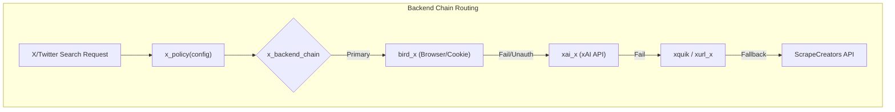

**Sources:** [skills/last30days/scripts/lib/providers.py:36-220](), [skills/last30days/scripts/lib/setup_wizard.py:95-108]()

---

## Setup Wizard and Onboarding Flows

First-run onboarding is managed by `skills/last30days/scripts/lib/setup_wizard.py` and driven by model instructions in `SKILL.md` [skills/last30days/scripts/lib/setup_wizard.py:1-6]().

### Setup Architecture Flow

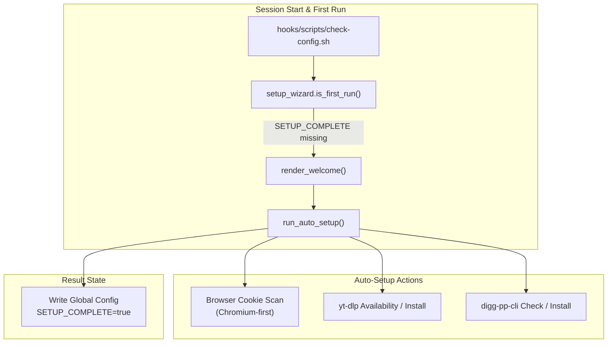

**Sources:** [skills/last30days/scripts/lib/setup_wizard.py:25-139](), [hooks/scripts/check-config.sh:5-24]()

- **First-Run Detection**: `is_first_run(config)` checks whether `SETUP_COMPLETE` is set in the configuration dictionary [skills/last30days/scripts/lib/setup_wizard.py:25-31]().
- **Auto-Setup Routine**: `run_auto_setup()` performs a warm start by scanning for browser cookies (prioritizing Chromium-first order to avoid Keychain/Full Disk Access hurdles on macOS), verifying or installing `yt-dlp` for YouTube transcripts, and setting up printing press CLIs (`digg-pp-cli`) [skills/last30days/scripts/lib/setup_wizard.py:70-139]().
- **Host-Conditional Routing**: Official-only execution environments (such as `LAST30DAYS_HOST=grok-bot`) bypass browser cookie extraction while allowing safe keyless CLI tools to install and run [skills/last30days/scripts/lib/setup_wizard.py:64-108]().

**Sources:** [skills/last30days/scripts/lib/setup_wizard.py:25-139](), [tests/test_onboarding_contract.py:1-74]()

---

# Page: Credential Stores and Cookie Extraction

# Credential Stores and Cookie Extraction

<details>
<summary>Relevant source files</summary>

The following files were used as context for generating this wiki page:

- [changelog.d/+safari-cookie-domain-match.security.md](changelog.d/+safari-cookie-domain-match.security.md)
- [docs/plans/2026-08-31-feat-bird-cookies-linux-macmini-plan.md](docs/plans/2026-08-31-feat-bird-cookies-linux-macmini-plan.md)
- [skills/last30days/scripts/box_chrome_login.py](skills/last30days/scripts/box_chrome_login.py)
- [skills/last30days/scripts/lib/agentcookie.py](skills/last30days/scripts/lib/agentcookie.py)
- [skills/last30days/scripts/lib/chrome_cdp.py](skills/last30days/scripts/lib/chrome_cdp.py)
- [skills/last30days/scripts/lib/chrome_cookies.py](skills/last30days/scripts/lib/chrome_cookies.py)
- [skills/last30days/scripts/lib/cookie_extract.py](skills/last30days/scripts/lib/cookie_extract.py)
- [skills/last30days/scripts/lib/safari_cookies.py](skills/last30days/scripts/lib/safari_cookies.py)
- [skills/last30days/scripts/setup-keychain.sh](skills/last30days/scripts/setup-keychain.sh)
- [skills/last30days/scripts/setup-pass.sh](skills/last30days/scripts/setup-pass.sh)
- [tests/test_agentcookie.py](tests/test_agentcookie.py)
- [tests/test_box_chrome_login.py](tests/test_box_chrome_login.py)
- [tests/test_chrome_cdp.py](tests/test_chrome_cdp.py)
- [tests/test_chrome_cookies.py](tests/test_chrome_cookies.py)
- [tests/test_cookie_extract.py](tests/test_cookie_extract.py)
- [tests/test_env_keychain.py](tests/test_env_keychain.py)
- [tests/test_env_pass.py](tests/test_env_pass.py)
- [tests/test_safari_cookies.py](tests/test_safari_cookies.py)
- [tests/test_x_extras_gating.py](tests/test_x_extras_gating.py)

</details>


## Purpose and Scope
This page provides a technical deep dive into how the `last30days` engine securely manages API keys, secrets, and local browser session cookies. It covers cross-platform secret storage primitives (macOS Keychain, Linux `pass`, and restricted `.env` file permissions) as well as zero-configuration browser cookie acquisition engines. This subsystem bypasses manual token generation by extracting live session credentials directly from local browser stores (Firefox, Chromium-based browsers, and Safari) and remote debugging endpoints (`chrome_cdp`, `agentcookie`, and `box_chrome_login`).

---

## 1. Secret Storage and Platform Backends

The engine resolves configuration through a prioritized cascade where persistent system secret stores act as secure fallbacks for local environment files.

### macOS Keychain Integration
On macOS systems, API keys and authentication tokens are stored as generic passwords using the system `security` binary. The `setup-keychain.sh` script automates storage using service names prefixed with `last30days-<KEY>` for the active user `[skills/last30days/scripts/setup-keychain.sh:1-46]()`. 
* **Security Guard:** The setup script validates that keychain read queries (`security find-generic-password`) never request plaintext outputs into logs or intermediate shell variables outside secure subprocess boundaries [tests/test_env_keychain.py:27-39]().
* **Opt-Out Control:** Setting the environment variable `LAST30DAYS_SKIP_KEYCHAIN=1` short-circuits keychain loading entirely in `lib/env.py` [tests/test_env_keychain.py:106-120]().

### Linux/Unix `pass` Password Manager
For POSIX environments lacking macOS Keychain, the engine integrates with `pass(1)` via `setup-pass.sh`. Secrets are stored under the path prefix `last30days/<KEY>` (or `LAST30DAYS_PASS_PREFIX`) [skills/last30days/scripts/setup-pass.sh:1-48](). The loader queries `pass show` during preflight initialization to populate missing environment keys without exposing them on the command line.

### File Permissions and `.env` Hardening
Local `.env` files are checked for restrictive file permissions. To prevent unauthorized access by multi-tenant local users, configuration loaders enforce that files containing tokens (`AUTH_TOKEN`, `CT0`, API keys) reside in directories with restricted read/write flags.

```mermaid
title "Credential Priority Resolution and Storage Backends"
graph TD
    subcode ["Code Entity Space"]
        Config["lib/env.py::get_config"]
        EnvFile["Environment Variables (.env)"]
        Keychain["lib/env._load_keychain"]
        PassStore["lib/env._load_pass"]
    end

    EnvFile -->|"Highest Priority"| Config
    Keychain -->|"macOS Darwin Fallback"| Config
    PassStore -->|"Linux/POSIX Fallback"| Config

    style Config fill:#none,stroke:#333,stroke-width:2px
    style Keychain fill:#none,stroke:#333,stroke-width:2px
    style PassStore fill:#none,stroke:#333,stroke-width:2px
```
*Sources: [skills/last30days/scripts/setup-keychain.sh:1-46](), [skills/last30days/scripts/setup-pass.sh:1-48](), [tests/test_env_keychain.py:106-120]()*

---

## 2. Browser Cookie Extraction Engine

To achieve zero-config authentication for services like X/Twitter (`auth_token` and `ct0`), the engine extracts cookies directly from active browser profile databases on disk.

### Firefox Cookie Extraction (`cookie_extract.py`)
Firefox stores cookies in SQLite databases (`cookies.sqlite`) within profile directories located via `profiles.ini` [skills/last30days/scripts/lib/cookie_extract.py:66-135]().
* **TOCTOU Mitigation:** Because Firefox locks `cookies.sqlite` at runtime, the engine copies the database to a temporary file using `tempfile.mkstemp()` [skills/last30days/scripts/lib/cookie_extract.py:174-182](). To eliminate the Time-Of-Check-To-Time-Of-Use window where `copy2` might temporarily expose live session secrets with looser source permissions, the file is written directly via `copyfile` and immediately locked with `_lock_temp_cookie_copy` enforcing `0o600` permissions on POSIX systems [skills/last30days/scripts/lib/cookie_extract.py:25-30, 174-182]().
* **WSL Support:** Under Windows Subsystem for Linux (WSL), the module automatically scans `/mnt/c/Users/*/AppData/Roaming/Mozilla/Firefox` to locate Windows host profiles [skills/last30days/scripts/lib/cookie_extract.py:33-63]().

### Chromium-Based Browser Cookie Extraction (`chrome_cookies.py`)
Chromium-based browsers (Chrome, Brave, Edge, Vivaldi, Opera, Arc) store cookies encrypted using **v10 encryption** (AES-128-CBC with a key derived from the OS Keychain via PBKDF2) [skills/last30days/scripts/lib/chrome_cookies.py:1-12]().
* **Key Derivation:** The passphrase is retrieved from the macOS Keychain service (e.g., `Chrome Safe Storage`, `Brave Safe Storage`) and passed into `_derive_aes_key()` using PBKDF2-HMAC-SHA1 (`1003` iterations) [skills/last30days/scripts/lib/chrome_cookies.py:54-108]().
* **Decryption Pipeline:** Ciphertexts are decrypted using the system `openssl` CLI (`-aes-128-cbc`, `-nopad`), followed by PKCS7 padding removal (`_remove_pkcs7_padding`) [skills/last30days/scripts/lib/chrome_cookies.py:111-185](). For Chromium 130+ databases (`db_version >= 24`), a 32-byte SHA-256 prefix is stripped from the plaintext buffer [skills/last30days/scripts/lib/chrome_cookies.py:151-154]().

### Safari Binary Cookie Extraction (`safari_cookies.py`)
Safari stores cookies in `~/Library/Cookies/Cookies.binarycookies`, an unparsed binary format [skills/last30days/scripts/lib/safari_cookies.py:1-8]().
* **Parser Architecture:** `_parse_binary_cookies()` validates the `cook` magic header, unpacks big-endian page size tables, and extracts individual cookie records [skills/last30days/scripts/lib/safari_cookies.py:157-203]().
* **Domain Matching:** `_host_matches()` verifies host boundaries strictly, ensuring stored cookies with leading dots (`.x.com`) or subdomains match exact targets without matching malicious substrings (e.g., rejecting `x.com.evil.tld`) [skills/last30days/scripts/lib/safari_cookies.py:144-155]().

---

## 3. Extras-Host Authentication and CDP/Sidecar Acquisition

On non-macOS platforms (Linux servers, headless nodes) or specific agent sink roles where local browser DBs cannot be directly decrypted, the engine falls back to remote debugging and sidecar acquisition protocols.

### Chrome DevTools Protocol (`chrome_cdp.py`) and Agent Cookies (`agentcookie.py`)
* `chrome_cdp.py` connects to running Chromium instances exposing remote debugging ports (defaulting to the last30days extras NUX port `18800`) to inspect live document cookies via CDP [skills/last30days/scripts/box_chrome_login.py:15-46]().
* `agentcookie.py` orchestrates helper sidecar processes to retrieve authenticated headers securely across container boundaries.

### Box Chrome Login Helper (`box_chrome_login.py`)
When browser cookies are entirely absent on an extras host, `box_chrome_login.py` generates gated launch recipes for disposable sign-in sessions [skills/last30days/scripts/box_chrome_login.py:1-27]().
* **Safety Guards:** On official-only hosts (`LAST30DAYS_HOST=grok-bot`), the helper suppresses browser launch recipes entirely, enforcing official API-only retrieval policies [skills/last30days/scripts/box_chrome_login.py:51-84]().
* **Binary Constraints:** It strictly wraps the host `box-chrome` binary (which sets `--class=box-chrome`) to prevent session initialization failures associated with raw `google-chrome-stable` flag soups [skills/last30days/scripts/box_chrome_login.py:20-26, 102-140]().

```mermaid
title "Natural Language Space to Code Entity Space: Host-Gated X Cookie Discovery Pipeline"
graph TD
    subcode ["Code Entity Space"]
        EnvCheck["lib/env.x_extras_enabled"]
        PolicyCheck["lib/env.x_policy"]
        CookieExtract["lib/cookie_extract.extract_cookies"]
        ChromeCDP["lib/chrome_cdp.read_x_cookies"]
        AgentCookie["lib/agentcookie.read_x_cookies"]
        BoxLogin["box_chrome_login.build_recipe"]
    end

    PolicyCheck -->|"Cookie Discovery Enabled?"| EnvCheck
    EnvCheck -->|"MacBook / Standard Host"| CookieExtract
    EnvCheck -->|"Linux / Extras Host"| AgentCookie
    AgentCookie -->|"Fallback"| ChromeCDP
    ChromeCDP -->|"Unauthenticated"| BoxLogin

    style EnvCheck fill:#none,stroke:#333,stroke-width:2px
    style PolicyCheck fill:#none,stroke:#333,stroke-width:2px
    style CookieExtract fill:#none,stroke:#333,stroke-width:2px
    style ChromeCDP fill:#none,stroke:#333,stroke-width:2px
    style AgentCookie fill:#none,stroke:#333,stroke-width:2px
    style BoxLogin fill:#none,stroke:#333,stroke-width:2px
```
*Sources: [skills/last30days/scripts/lib/cookie_extract.py:1-182](), [skills/last30days/scripts/box_chrome_login.py:1-140](), [tests/test_x_extras_gating.py:40-105]()*

---

# Page: Discovery Protocol

# Discovery Protocol

<details>
<summary>Relevant source files</summary>

The following files were used as context for generating this wiki page:

- [CONCEPTS.md](CONCEPTS.md)
- [docs/solutions/architecture-patterns/discovery-checkpoint-protocol-design-conventions.md](docs/solutions/architecture-patterns/discovery-checkpoint-protocol-design-conventions.md)
- [docs/solutions/architecture-patterns/discovery-topic-queue-design-conventions.md](docs/solutions/architecture-patterns/discovery-topic-queue-design-conventions.md)
- [docs/solutions/conventions/argparse-optional-value-flag-dispatch-truthiness.md](docs/solutions/conventions/argparse-optional-value-flag-dispatch-truthiness.md)
- [docs/solutions/design-patterns/ranked-output-confidence-floor-honest-empty-state.md](docs/solutions/design-patterns/ranked-output-confidence-floor-honest-empty-state.md)
- [docs/solutions/logic-errors/fusion-source-item-dedupe-by-stream-local-id-drops-enrichment.md](docs/solutions/logic-errors/fusion-source-item-dedupe-by-stream-local-id-drops-enrichment.md)
- [docs/solutions/logic-errors/non-daemon-executor-threads-defeat-wall-clock-budget.md](docs/solutions/logic-errors/non-daemon-executor-threads-defeat-wall-clock-budget.md)
- [skills/last30days/scripts/lib/reddit_arctic.py](skills/last30days/scripts/lib/reddit_arctic.py)
- [skills/last30days/scripts/lib/reddit_listing.py](skills/last30days/scripts/lib/reddit_listing.py)
- [tests/test_discover_enrich.py](tests/test_discover_enrich.py)
- [tests/test_discover_floor.py](tests/test_discover_floor.py)
- [tests/test_discover_mode.py](tests/test_discover_mode.py)
- [tests/test_discover_render.py](tests/test_discover_render.py)
- [tests/test_reddit_arctic.py](tests/test_reddit_arctic.py)
- [tests/test_reddit_dedicated.py](tests/test_reddit_dedicated.py)
- [tests/test_reddit_keyless.py](tests/test_reddit_keyless.py)
- [tests/test_reddit_listing.py](tests/test_reddit_listing.py)

</details>


## Purpose and Scope

The Discovery Protocol is the topic-less research engine of the `last30days-skill`. Rather than researching a pre-specified user query (e.g., "Kanye West review"), discovery mode sweeps high-velocity river feeds across platforms (Reddit shreddit partials/listings, Hacker News, Digg, and X) to discover what is currently worth researching [CONCEPTS.md:55-63](). 

This page documents the complete architecture of the discovery workflow: river listing sweeps, the three-leg host-judged checkpoint protocol (`--discover --nominate-only`, `--judgments`, and `--finalize`), narrative clustering, absolute confidence floor gating, deep enrichment passes, and the SQLite-backed persistent discovery topic queue (`discovery_topics`) [CONCEPTS.md:55-63]().

---

## 1. River Listing Sweeps & Planning

Discovery execution begins in the query planner (`planner.build_discovery_plan`), which determines whether the run is a **Global Discovery** (unscoped trending across all feeds) or a **Domain-Scoped Discovery** (restricted to categories and specific subreddits) [tests/test_discover_mode.py:62-97]().

```mermaid
graph TD
    A["CLI Entry point last30days.py"] --> B["planner.build_discovery_plan()"]
    B --> C{{"Domain provided?"}}
    C -->|No / Empty| D["Global Trending Mode (keyword_gate=False)"]
    C -->|Yes / Named Domain| E["Domain-Scoped Mode (keyword_gate=True)"]
    D --> F["reddit_listing.fetch_discovery_listings()"]
    E --> F
    F --> G["reddit_arctic.fetch_listings() (Fallback)"]
    F --> H["Hacker News / Digg / X Sweeps"]
    
    subgraph "Code Entity Space"
        B
        F
        G
        H
    end

    Sources: tests/test_discover_mode.py:62-97, skills/last30days/scripts/lib/reddit_listing.py:33-42, skills/last30days/scripts/lib/reddit_arctic.py:38-44
```

### Key Modules and Data Flow
- **`planner.py`**: Maps domains to category peer mappings (e.g., `ai_agent_framework` maps to specific subreddits like `LangChain`, `LocalLLaMA`, `AI_Agents`) [tests/test_discover_mode.py:62-71](). Bare `--discover` defaults to `subreddits=["all"]` and omits the X search lane because X search requires a keyword [tests/test_discover_mode.py:84-97]().
- **`reddit_listing.py`**: Executes keyless Reddit scrapes via shreddit `/svc/shreddit/community-more-posts/{sort}/?name={sub}` partials [skills/last30days/scripts/lib/reddit_listing.py:1-14](). These endpoints return HTTP 200 with server-rendered `<shreddit-post>` elements containing real upvote scores and comment counts [skills/last30days/scripts/lib/reddit_listing.py:1-9]().
- **`reddit_arctic.py`**: Serves as a keyless fallback when shreddit partials return 403 or errors. It queries `arctic-shift.photon-reddit.com` to batch-resolve base36 post IDs into vote metrics [skills/last30days/scripts/lib/reddit_arctic.py:1-15]().

Sources: `tests/test_discover_mode.py:62-97`, `skills/last30days/scripts/lib/reddit_listing.py:1-40`, `skills/last30days/scripts/lib/reddit_arctic.py:1-44`

---

## 2. The Three-Leg Host-Judged Discovery Workflow

To empower frontier reasoning models to act as the semantic judge without requiring paid API keys inside the execution engine, the discovery protocol implements a three-command checkpointed workflow mandated by skill contract LAW 11 ("YOU ARE THE JUDGE") [docs/solutions/architecture-patterns/discovery-checkpoint-protocol-design-conventions.md:37-66]().

```mermaid
graph TD
    A["Leg 1: --discover --nominate-only"] -->|Writes nominations bundle| B["Nominations Bundle JSON (.json)"]
    B -->|Host model reads bundle| C["Host Writes Judgments File"]
    C -->|--discover --judgments file.json| D["Leg 2: Deep Enrichment & Pending Report"]
    D -->|Writes pending report| E["Host Writes Angles File (Optional)"]
    E -->|--discover --finalize --angles file.json| F["Leg 3: Final Render & Output Emission"]

    subgraph "Execution & Protocol Flow"
        A
        D
        F
    end

    Sources: docs/solutions/architecture-patterns/discovery-checkpoint-protocol-design-conventions.md:54-66, skills/last30days/scripts/last30days.py:1716-1986
```

### Protocol Execution Legs
1. **Leg 1 (`--discover --nominate-only`)**: Sweeps river feeds, clusters items into raw topic candidates, and serializes a time-bound, identity-bound **nominations bundle** (`bundle_id`, candidates, raw items) [docs/solutions/architecture-patterns/discovery-checkpoint-protocol-design-conventions.md:54-66]().
2. **Host Judgment & Leg 2 (`--discover --judgments <file>`)**: The hosting agent model evaluates every nomination for name clarity, junk shape, and content worthiness. Leg 2 validates the bundle binding (`_require_bundle_binding`), resumes execution, and performs deep comment and source enrichment on surviving topics [docs/solutions/architecture-patterns/discovery-checkpoint-protocol-design-conventions.md:54-90]().
3. **Leg 3 (`--discover --finalize [--angles <file>]`)**: Applies host-written content angles and renders the final markdown or JSON discovery brief [docs/solutions/architecture-patterns/discovery-checkpoint-protocol-design-conventions.md:54-66]().

Every host-authored checkpoint file must match the minted `bundle_id` and respect the strict TTL (`DISCOVERY_HANDOFF_TTL_SECONDS = 3600.0`) [docs/solutions/architecture-patterns/discovery-checkpoint-protocol-design-conventions.md:74-110](). Mismatched IDs raise `HandoffContractError`, instructing the model to edit the file and retry the leg without repeating expensive re-sweeps [docs/solutions/architecture-patterns/discovery-checkpoint-protocol-design-conventions.md:74-99]().

Sources: `docs/solutions/architecture-patterns/discovery-checkpoint-protocol-design-conventions.md:37-118`, `skills/last30days/scripts/last30days.py:1716-1986`

---

## 3. Clustering & Confidence Floor Gating

Before any discovery topic enters the ranked output, it must survive narrative clustering and clear an absolute confidence floor [docs/solutions/design-patterns/ranked-output-confidence-floor-honest-empty-state.md:35-80]().

```mermaid
graph TD
    A["Raw Swept Items"] --> B["cluster.cluster_topics()"]
    B --> C["Engagement Velocity Scorer rerank.engagement_velocity_score()"]
    C --> D["passes_discovery_floor() check"]
    D -->|Fails Floor / Junk| E["Honest Empty State: 'Nothing solid this window'"]
    D -->|Clears Floor| F["Ranked Discovery Topics Output"]

    subgraph "Code Entity Space"
        B
        C
        D
    end

    Sources: docs/solutions/design-patterns/ranked-output-confidence-floor-honest-empty-state.md:35-80, skills/last30days/scripts/lib/rerank.py:52-78
```

### Absolute Confidence Floor (`passes_discovery_floor`)
To prevent quiet or over-broad domains from emitting low-engagement noise (e.g., single-like tweets) as top trends, `rerank.passes_discovery_floor` applies absolute criteria [docs/solutions/design-patterns/ranked-output-confidence-floor-honest-empty-state.md:35-80]().

```python
FLOOR_MIN_ENGAGEMENT = 25.0
FLOOR_MIN_SOURCES = 2
FLOOR_SINGLE_SOURCE_ENGAGEMENT = 200.0

def passes_discovery_floor(
    *,
    source_count: int,
    engagement_total: float,
    item_count: int,
    junk_shape: bool = False,
    seed_source_count: int | None = None,
) -> bool:
    if item_count <= 0 or engagement_total < FLOOR_MIN_ENGAGEMENT:
        return False
    if junk_shape:
        corroboration = seed_source_count if seed_source_count is not None else source_count
        return corroboration >= FLOOR_MIN_SOURCES
    if source_count >= FLOOR_MIN_SOURCES:
        return True
    return engagement_total >= FLOOR_SINGLE_SOURCE_ENGAGEMENT
```[docs/solutions/design-patterns/ranked-output-confidence-floor-honest-empty-state.md:57-78]()

- **Junk Shape & Corroboration**: For help-wanted posts or beginner musings (`junk_shape=True`), single-source high engagement bypasses are disabled. Corroboration must be verified across distinct **seed listing sources** (what the river sweep found prior to enrichment), ensuring enrichment fan-out cannot artificially inflate source counts [docs/solutions/design-patterns/ranked-output-confidence-floor-honest-empty-state.md:91-110]().

Sources: `docs/solutions/design-patterns/ranked-output-confidence-floor-honest-empty-state.md:35-110`, `skills/last30days/scripts/lib/rerank.py:52-78`

---

## 4. Enrichment & Candidate Assembly

Surviving discovery nominations undergo multi-source enrichment. 
- **Comment-enrichment slots**: Top-performing threads claim comment-fetching budgets (4 / 8 / 12 per subquery at quick / default / deep depths) [CONCEPTS.md:48-50]().
- **Fusion deduplication**: `fusion.weighted_rrf` merges duplicate URLs arriving from separate subquery streams by keying on normalized URLs (`fusion.candidate_key`) rather than per-stream adapter IDs (`R1`, `X1`) [docs/solutions/logic-errors/fusion-source-item-dedupe-by-stream-local-id-drops-enrichment.md:27-75](). When duplicate URLs merge via `fusion.merge_source_items`, enriched comment payloads and transcripts are preserved rather than silently overwritten [docs/solutions/logic-errors/fusion-source-item-dedupe-by-stream-local-id-drops-enrichment.md:43-70]().

Sources: `CONCEPTS.md:48-55`, `docs/solutions/logic-errors/fusion-source-item-dedupe-by-stream-local-id-drops-enrichment.md:27-89`, `skills/last30days/scripts/lib/fusion.py:44-95`

---

## 5. Persistent Discovery Topic Queue

Every executed discovery run records its discovered topics into the `discovery_topics` table within SQLite (`research.db`) via `store.py`, giving the engine memory across runs [docs/solutions/architecture-patterns/discovery-topic-queue-design-conventions.md:36-48]().

```mermaid
graph TD
    A["Completed Discovery Report"] --> B["store.scoped_db() connection"]
    B --> C["store.match_discovery_topic() (Fuzzy Match >= 0.6)"]
    C --> D["Two-Phase Write Hook: Match All First"]
    D --> E["store.record_discovery_surfacing() with Covered Inheritance"]
    E --> F["SQLite research.db discovery_topics Table"]

    subgraph "Persistence Architecture"
        B
        C
        D
        E
    end

    Sources: docs/solutions/architecture-patterns/discovery-topic-queue-design-conventions.md:38-147, skills/last30days/scripts/store.py:810-938
```

### Core Design Conventions
1. **Default-on with Allowlist Opt-Out**: Controlled by `LAST30DAYS_DISCOVERY_QUEUE` in `env.get_config()`. Setting it to `off` disables queue writes [docs/solutions/architecture-patterns/discovery-topic-queue-design-conventions.md:51-78]().
2. **Annotate-Only Fuzzy Matching**: `store.match_discovery_topic` uses exact normalized name matching followed by entity-overlap token analysis at a 0.6 threshold. Matches annotate rendered cards (`surfaced Nth time`) but never destructive database merges [docs/solutions/architecture-patterns/discovery-topic-queue-design-conventions.md:79-101]().
3. **Two-Phase Hook (Match All, Record After)**: All topics in a report are matched against priors *before* any surfcings are recorded, preventing same-run anchor siblings from artificially inflating surfacing counts [docs/solutions/architecture-patterns/discovery-topic-queue-design-conventions.md:102-124]().
4. **Covered Status Inheritance**: When LLM judges rename a story across runs, `record_discovery_surfacing` inherits the `covered` status from its fuzzy-matched prior so user markings never evaporate due to naming drifts [docs/solutions/architecture-patterns/discovery-topic-queue-design-conventions.md:125-152]().

Sources: `docs/solutions/architecture-patterns/discovery-topic-queue-design-conventions.md:36-161`, `skills/last30days/scripts/store.py:810-938`

---

# Page: Data Sources

# Data Sources

<details>
<summary>Relevant source files</summary>

The following files were used as context for generating this wiki page:

- [changelog.d/+base-url-api-root.fixed.md](changelog.d/+base-url-api-root.fixed.md)
- [changelog.d/+reddit-negative-engagement.fixed.md](changelog.d/+reddit-negative-engagement.fixed.md)
- [docs/reference/json-export.md](docs/reference/json-export.md)
- [skills/last30days/scripts/lib/http.py](skills/last30days/scripts/lib/http.py)
- [skills/last30days/scripts/lib/providers.py](skills/last30days/scripts/lib/providers.py)
- [skills/last30days/scripts/lib/reddit.py](skills/last30days/scripts/lib/reddit.py)
- [skills/last30days/scripts/lib/reddit_keyless.py](skills/last30days/scripts/lib/reddit_keyless.py)
- [skills/last30days/scripts/lib/schema.py](skills/last30days/scripts/lib/schema.py)
- [tests/test_env_cookies.py](tests/test_env_cookies.py)
- [tests/test_http_v3.py](tests/test_http_v3.py)
- [tests/test_providers_v3.py](tests/test_providers_v3.py)
- [tests/test_reddit.py](tests/test_reddit.py)
- [tests/test_reddit_relevance_ranking.py](tests/test_reddit_relevance_ranking.py)

</details>


## Purpose and Scope

This document provides a high-level overview of the source connectors located in `skills/last30days/scripts/lib/`. The engine integrates over 15 heterogeneous connectors that pull data under a common fetch-and-normalize contract [skills/last30days/scripts/lib/schema.py:76-100](). Retrieved raw items are mapped into standard `SourceItem` dataclasses, tracked via explicit `SourceOutcome` states, and governed by environment availability checks before the `pipeline.py` execution phase [skills/last30days/scripts/lib/schema.py:182-222]().

As a parent page, this document outlines the common contracts and system architecture. For deep technical details on individual source families, refer to the child pages:
- Reddit: [Reddit Integration](#3.1)
- X / Twitter: [X/Twitter Integration](#3.2)
- Social Media (YouTube, TikTok, Instagram, Bluesky, etc.): [Social Media Sources](#3.3)
- Forums & Prediction Markets (Hacker News, Polymarket, Digg, arXiv): [Forums and Prediction Markets](#3.4)
- Web Search & Grounding: [Web Search](#3.5)
- Developer, Commerce & Hiring: [Developer, Commerce and Hiring Sources](#3.6)

---

## Source Architecture and Entity Mapping

All connectors implement an asynchronous or multi-threaded retrieval interface that converts raw vendor payloads into normalized structures defined in `schema.py` [skills/last30days/scripts/lib/schema.py:76-100](). 

```mermaid
graph TB
    subgraph "NaturalLanguageSpace"
        R["Reddit"]
        X["X / Twitter"]
        YT["YouTube"]
        HN["Hacker News"]
        PM["Polymarket"]
        WEB["Web Search"]
    end

    subgraph "CodeEntitySpace"
        REDDIT_PY["skills/last30days/scripts/lib/reddit.py"]
        KEYLESS_PY["skills/last30days/scripts/lib/reddit_keyless.py"]
        BIRD_PY["skills/last30days/scripts/lib/bird_x.py"]
        YT_PY["skills/last30days/scripts/lib/youtube_yt.py"]
        HN_PY["skills/last30days/scripts/lib/hackernews.py"]
        PM_PY["skills/last30days/scripts/lib/polymarket.py"]
        GROUNDING_PY["skills/last30days/scripts/lib/grounding.py"]
    end

    subgraph "ExternalAPI"
        SC["api.scrapecreators.com"]
        XAI["api.x.ai"]
        ALGOLIA["hn.algolia.com"]
        GAMMA["gamma-api.polymarket.com"]
    end

    R --> REDDIT_PY
    R --> KEYLESS_PY
    X --> BIRD_PY
    YT --> YT_PY
    HN --> HN_PY
    PM --> PM_PY
    WEB --> GROUNDING_PY

    REDDIT_PY --> SC
    KEYLESS_PY --> SC
    HN_PY --> ALGOLIA
    PM_PY --> GAMMA
```
Sources: [skills/last30days/scripts/lib/reddit.py:1-29](), [skills/last30days/scripts/lib/reddit_keyless.py:1-17](), [skills/last30days/scripts/lib/schema.py:76-100]()

---

## Common Contract: Normalization and Outcomes

Connectors in `scripts/lib/` adhere to a uniform lifecycle contract:
1. **Availability Gating**: Preflight checks verify required keys, binaries, or cookies before scheduling execution [skills/last30days/scripts/lib/schema.py:182-222]().
2. **Fetch and Retry**: Network requests use bounded backoff and honor rate limit headers (`Retry-After`, `x-ratelimit-reset`) [skills/last30days/scripts/lib/http.py:47-83]().
3. **Normalization**: Raw items are mapped to `SourceItem` instances capturing identifiers, author, timestamps, raw engagement metrics, and relevance hints [skills/last30days/scripts/lib/schema.py:76-100]().
4. **Outcome Recording**: Every run logs a `SourceOutcome` stating whether retrieval resulted in `ok`, `no-results`, `rate-limited`, `auth-failed`, `unreachable`, or `timeout` [skills/last30days/scripts/lib/schema.py:146-158]().

```mermaid
graph TD
    subgraph "DataContractPipeline"
        CHECK["env.py / pipeline.py Availability Gating"]
        FETCH["http.py Fetch with Rate-Limit Backoff"]
        NORM["schema.SourceItem Normalization"]
        OUTCOME["schema.SourceOutcome Status Tracking"]
    end

    CHECK --> FETCH
    FETCH --> NORM
    NORM --> OUTCOME
```
Sources: [skills/last30days/scripts/lib/http.py:47-83](), [skills/last30days/scripts/lib/schema.py:76-100](), [skills/last30days/scripts/lib/schema.py:182-222]()

---

## Source Families

### 3.1 Reddit Integration
Managed primarily via `reddit.py` (using ScrapeCreators) and `reddit_keyless.py` (using `reddit_rss`, `reddit_shreddit`, `reddit_arctic`, and `reddit_listing`) [skills/last30days/scripts/lib/reddit.py:1-29](), [skills/last30days/scripts/lib/reddit_keyless.py:1-28](). Features multi-phase discovery, subreddit relevance scoring with utility penalties [skills/last30days/scripts/lib/reddit.py:141-188](), engagement-bounded relevance ranking (`_relevance_rank_key`) [skills/last30days/scripts/lib/reddit.py:38-61](), [skills/last30days/scripts/lib/reddit_keyless.py:45-55](), comment enrichment, and robust backoff handling. For details, see [Reddit Integration](#3.1).

Sources: [skills/last30days/scripts/lib/reddit.py:1-191](), [skills/last30days/scripts/lib/reddit_keyless.py:1-118]()

### 3.2 X/Twitter Integration
Handles resolution and failover chains through `bird_x.py`, `xai_x.py`, `xurl_x.py`, `xquik.py`, `grok_x.py`, and `xapi.py`. Supports cookie-authenticated local browser scraping, official xAI API requests, `x_judge` retry policies, and host-conditional `x_policy` routing. For details, see [X/Twitter Integration](#3.2).

Sources: [skills/last30days/scripts/lib/providers.py:160-190]()

### 3.3 Social Media Sources
Covers YouTube (`yt-dlp` search, comments, transcripts, and transcript backfill), TikTok, Instagram, Threads, Pinterest, Bluesky, Truth Social, Telegram, LinkedIn, and Xiaohongshu connectors. Includes auxiliary transcription services for audio/video media. For details, see [Social Media Sources](#3.3).

Sources: [skills/last30days/scripts/lib/schema.py:76-100]()

### 3.4 Forums and Prediction Markets
Integrates Hacker News (Algolia API with points/comment score floors), Polymarket (Gamma API odds extraction and market disambiguation), Digg, arXiv preprints, and Techmeme Printing Press CLI feeds. For details, see [Forums and Prediction Markets](#3.4).

Sources: [skills/last30days/scripts/lib/schema.py:76-100]()

### 3.5 Web Search
Encapsulates grounding modules (`grounding.py`) and external search backends (Brave, Exa, Serper, Parallel MCP, Perplexity/OpenRouter). Implements keyless web search/fetch fallbacks and provider routing. For details, see [Web Search](#3.5).

Sources: [skills/last30days/scripts/lib/providers.py:192-220]()

### 3.6 Developer, Commerce and Hiring Sources
Provides GitHub repository and issue search (with qualifier handling and spam filtering), jobs/hiring signal scraping, Amazon and Trustpilot review feeds via Bright Data, and local corpus file ingestion. For details, see [Developer, Commerce and Hiring Sources](#3.6).

Sources: [skills/last30days/scripts/lib/schema.py:76-100]()

---

# Page: Reddit Integration

# Reddit Integration

<details>
<summary>Relevant source files</summary>

The following files were used as context for generating this wiki page:

- [changelog.d/+reddit-negative-engagement.fixed.md](changelog.d/+reddit-negative-engagement.fixed.md)
- [skills/last30days/scripts/lib/entity_extract.py](skills/last30days/scripts/lib/entity_extract.py)
- [skills/last30days/scripts/lib/reddit.py](skills/last30days/scripts/lib/reddit.py)
- [skills/last30days/scripts/lib/reddit_arctic.py](skills/last30days/scripts/lib/reddit_arctic.py)
- [skills/last30days/scripts/lib/reddit_keyless.py](skills/last30days/scripts/lib/reddit_keyless.py)
- [skills/last30days/scripts/lib/reddit_listing.py](skills/last30days/scripts/lib/reddit_listing.py)
- [skills/last30days/scripts/lib/reddit_public.py](skills/last30days/scripts/lib/reddit_public.py)
- [skills/last30days/scripts/lib/reddit_rss.py](skills/last30days/scripts/lib/reddit_rss.py)
- [skills/last30days/scripts/lib/reddit_shreddit.py](skills/last30days/scripts/lib/reddit_shreddit.py)
- [tests/test_discover_mode.py](tests/test_discover_mode.py)
- [tests/test_reddit.py](tests/test_reddit.py)
- [tests/test_reddit_arctic.py](tests/test_reddit_arctic.py)
- [tests/test_reddit_dedicated.py](tests/test_reddit_dedicated.py)
- [tests/test_reddit_keyless.py](tests/test_reddit_keyless.py)
- [tests/test_reddit_keyless_backoff.py](tests/test_reddit_keyless_backoff.py)
- [tests/test_reddit_listing.py](tests/test_reddit_listing.py)
- [tests/test_reddit_public.py](tests/test_reddit_public.py)
- [tests/test_reddit_relevance_ranking.py](tests/test_reddit_relevance_ranking.py)
- [tests/test_reddit_rss.py](tests/test_reddit_rss.py)
- [tests/test_reddit_shreddit.py](tests/test_reddit_shreddit.py)
- [tests/test_reddit_transport_outcomes.py](tests/test_reddit_transport_outcomes.py)

</details>


## Purpose and Scope

This document describes the Reddit data source integration in the `/last30days` skill, which discovers and enriches Reddit discussion threads relevant to a research topic. The integration utilizes a multi-phase discovery strategy involving global search, subreddit-specific drill-downs, entity-home lane handling, and tiered enrichment.

The Reddit transport family consists of:
- **`reddit.py`**: The primary ScrapeCreators REST API transport for keyed Reddit search, global discovery, and comment trees [skills/last30days/scripts/lib/reddit.py:1-8]().
- **`reddit_keyless.py`**: A tiered fallback system using RSS discovery (`reddit_rss.py`), web scraping (`reddit_shreddit.py`), and listing partials (`reddit_listing.py`) when API keys are unavailable or exhausted [skills/last30days/scripts/lib/reddit_keyless.py:1-17]().
- **`reddit_public.py`**: A public `.json` endpoint module demoted to keyless Tier 0 discovery [skills/last30days/scripts/lib/reddit_public.py:1-12]().
- **`reddit_listing.py`**: Keyless Reddit listing scrape via shreddit `/svc` partials for real upvote scores [skills/last30days/scripts/lib/reddit_listing.py:1-14]().
- **`reddit_rss.py`**: Public RSS/Atom feed parser for query search and listing breadth [skills/last30days/scripts/lib/reddit_rss.py:1-15]().
- **`reddit_shreddit.py` & `reddit_arctic.py`**: Enrichment engines for comment trees and shift-shift supplement archives [skills/last30days/scripts/lib/reddit_keyless.py:28-34]().

Sources: [skills/last30days/scripts/lib/reddit.py:1-8](), [skills/last30days/scripts/lib/reddit_keyless.py:1-17](), [skills/last30days/scripts/lib/reddit_public.py:1-12](), [skills/last30days/scripts/lib/reddit_listing.py:1-14](), [skills/last30days/scripts/lib/reddit_rss.py:1-15]()

---

## Search Strategy and Phases

Reddit research follows a structured pipeline across the keyed and keyless transports to maximize recall while maintaining high precision through relevance filtering.

### Search Execution Flow

```mermaid
graph TD
    Start["EntryPoint: reddit.search_reddit() / reddit_keyless.search_and_enrich()"]
    Expand["expand_reddit_queries():<br/>Generate intent-based variants"]
    
    subgraph Discovery ["Discovery Phase"]
        T0["lib.reddit_public.search()<br/>(Public .json Tier 0)"]
        T1["lib.reddit_rss.search_rss()<br/>(RSS-based breadth)"]
        SC["lib.reddit._global_search()<br/>(ScrapeCreators API)"]
    end
    
    subgraph DrillDown ["Drill-down Phase"]
        SubDiscover["lib.reddit.discover_subreddits():<br/>Identify top communities"]
        SubSearch["lib.reddit_listing.fetch_listings()<br/>Targeted subreddit search"]
    end
    
    subgraph Enrichment ["Enrichment Phase"]
        Enrich["lib.reddit_shreddit.fetch_comments():<br/>Scrape comments + insights"]
    end
    
    Start --> Expand
    Expand --> Discovery
    Discovery --> SubDiscover
    SubDiscover --> DrillDown
    DrillDown --> Enrichment
    Enrichment --> Result["Return Enriched Items"]
```

Sources: [skills/last30days/scripts/lib/reddit_keyless.py:1-17](), [skills/last30days/scripts/lib/reddit.py:38-57](), [skills/last30days/scripts/lib/reddit_keyless.py:75-117]()

---

## Query Expansion and Intent Detection

To avoid missing relevant discussions, the system expands the user's topic into multiple Reddit-optimized variants based on detected query intent.

### Intent-Based Expansion Logic

The `expand_reddit_queries` function [skills/last30days/scripts/lib/reddit.py:100-138]() generates 1-4 query strings based on research depth configuration (`quick`, `default`, `deep`):

| Intent | Detection Pattern | Expanded Query Variant |
| :--- | :--- | :--- |
| **Product** | `product` type | `{core} review OR recommendation OR best` [skills/last30days/scripts/lib/reddit.py:123-124]() |
| **Comparison** | `comparison` type | `{core} worth it OR vs OR compared` [skills/last30days/scripts/lib/reddit.py:127-128]() |
| **Opinion** | `opinion` type | `{core} worth it OR thoughts OR review` [skills/last30days/scripts/lib/reddit.py:131-132]() |
| **How-to / Bug** | `how_to` / `opinion` type | `{core} issues OR problems OR bug OR broken` (Deep depth only) [skills/last30days/scripts/lib/reddit.py:135-136]() |

**Core Subject Extraction**: `_extract_core_subject` [skills/last30days/scripts/lib/reddit.py:92-97]() relies on `NOISE_WORDS` [skills/last30days/scripts/lib/reddit.py:64-75]() to strip meta-terms (e.g. "latest", "trending", "best") and isolate the primary subject.

Sources: [skills/last30days/scripts/lib/reddit.py:64-138]()

---

## Subreddit Discovery, Dedicated Lanes, and Drill-down

After global discovery, the system identifies the most relevant subreddits for targeted searches, incorporating specialized handling for entity-home communities.

### Discovery Algorithm and Dedicated Lane

The `discover_subreddits` function [skills/last30days/scripts/lib/reddit.py:150-188]() computes community weighting using frequency, keyword overlap, utility penalization, and engagement bonuses:
1. **Base Frequency**: Frequency count of post appearances [skills/last30days/scripts/lib/reddit.py:178]().
2. **Topic Match Bonus**: +2.0 bonus if the subreddit name contains core topic words [skills/last30days/scripts/lib/reddit.py:180-183]().
3. **Utility Penalty**: 0.3x multiplier for known meta/utility subs (`UTILITY_SUBS` like `r/tipofmytongue` or `r/findareddit`) [skills/last30days/scripts/lib/reddit.py:143-148](), [skills/last30days/scripts/lib/reddit.py:185-187]().
4. **Engagement Bonus**: +0.5 boost for posts with over 100 upvotes [skills/last30days/scripts/lib/reddit.py:189-191]().

**Dedicated Lane**: In `reddit_keyless.py`, entity-home subreddits (e.g., `r/Kanye` for "Kanye West") are recognized as wholly on-topic. They are pulled in full via `DEDICATED_SORTS = ["top", "hot", "new"]` and marked floor-exempt so that relevant posts lacking explicit keyword repetition are never pruned [skills/last30days/scripts/lib/reddit_keyless.py:39-42](), [skills/last30days/scripts/lib/reddit_keyless.py:129-136]().

Sources: [skills/last30days/scripts/lib/reddit.py:143-191](), [skills/last30days/scripts/lib/reddit_keyless.py:39-42](), [skills/last30days/scripts/lib/reddit_keyless.py:129-136]()

---

## Relevance Ranking and Engagement Floor Safety

Reddit's highest-upvote content (e.g., viral news, relationship subreddits) frequently exhibits zero topic overlap. To preserve research precision, the system applies strict relevance filtering and ranking keys.

### Scoring Mechanisms

*   **Token Overlap**: `token_overlap_relevance` evaluates lexical similarity between research query tokens and post text [skills/last30days/scripts/lib/reddit_listing.py:24]().
*   **Relevance Floor**: Posts scoring below `RELEVANCE_FLOOR` are filtered out when any on-topic candidate is present [skills/last30days/scripts/lib/reddit.py:33-35]().
*   **Ranking Key (`_relevance_rank_key`)**: Both `reddit.py` and `reddit_keyless.py` rank by relevance first, utilizing a log-scaled engagement bonus (bounded at a maximum of `0.25`) as a tiebreaker [skills/last30days/scripts/lib/reddit_keyless.py:45-54](). 
*   **Negative Score Protection**: Downvoted posts with negative engagement scores compute log logarithms safely via clamped totals, preventing `math domain error` exceptions [changelog.d/+reddit-negative-engagement.fixed.md:1](), [tests/test_reddit_relevance_ranking.py:43-50]().

Sources: [skills/last30days/scripts/lib/reddit.py:33-35](), [skills/last30days/scripts/lib/reddit_keyless.py:45-54](), [changelog.d/+reddit-negative-engagement.fixed.md:1](), [tests/test_reddit_relevance_ranking.py:43-50]()

---

## Technical Implementation and Transport Architecture

### Module Component Architecture

```mermaid
classDiagram
    class lib_reddit {
        +search_reddit(topic, from_date, to_date, depth, token)
        +expand_reddit_queries(topic, depth)
        +discover_subreddits(results, topic, max_subs)
    }
    class lib_reddit_keyless {
        +search_and_enrich(topic, from_date, to_date, depth)
        +_discover(topic, depth, subreddits, dedicated_subreddits)
        +_scored_listings(subreddits, depth, query, sorts)
    }
    class lib_reddit_public {
        +search(query, depth, subreddit)
        +_fetch_json(url, timeout)
    }
    class lib_reddit_listing {
        +fetch_listings(subreddits, depth, query, sorts)
        +parse_cards(html_text, query)
    }
    class lib_reddit_rss {
        +search_rss(query, depth, subreddits)
        +_parse_feed(xml_text, query)
    }
    class lib_reddit_shreddit {
        +fetch_comments(post_url)
    }
    class lib_reddit_arctic {
        +fetch_listings(subreddits, depth, query, sorts)
    }

    lib_reddit ..> lib_reddit_public : fallback
    lib_reddit_keyless --> lib_reddit_rss : Tier 1 Discovery
    lib_reddit_keyless --> lib_reddit_listing : Scored Partials
    lib_reddit_keyless --> lib_reddit_arctic : Arctic Supplement
    lib_reddit_keyless --> lib_reddit_shreddit : Comment Enrichment
    lib_reddit_keyless --> lib_reddit_public : Tier 0 Fallback
```

Sources: [skills/last30days/scripts/lib/reddit.py:1-16](), [skills/last30days/scripts/lib/reddit_keyless.py:1-34](), [skills/last30days/scripts/lib/reddit_public.py:1-12](), [skills/last30days/scripts/lib/reddit_listing.py:1-14](), [skills/last30days/scripts/lib/reddit_rss.py:1-15]()

### Backoff and Transport Outcomes

When encountering network throttling, anti-bot walls, or HTTP status codes, transports classify failure states to drive failover behavior:
*   **`classify_run_failure`**: Evaluates error message strings for markers like `"interstitial"`, `"blocked by reddit"`, or `"too many requests"` to map them to `health.RATE_LIMITED`, and `"login required"` or `"invalid token"` to `health.AUTH_FAILED` [skills/last30days/scripts/lib/reddit.py:82-90]().
*   **Retry and Rate Limit Management**: Uses `http.retry_delay_from_headers` to inspect `Retry-After` or `x-ratelimit-reset` headers during HTTP 429 exceptions with exponential backoff [skills/last30days/scripts/lib/reddit_public.py:90-103]().

Sources: [skills/last30days/scripts/lib/reddit.py:82-90](), [skills/last30days/scripts/lib/reddit_public.py:90-103]()

### Data Normalization

All raw Reddit payloads across ScrapeCreators, public JSON, RSS, and shreddit partials are mapped to the canonical `SourceItem` schema with normalized fields:

| Canonical Field | Normalization Logic |
| :--- | :--- |
| `date` | Parsed from Unix `created_utc` or ISO `created_at` / `updated` strings into `YYYY-MM-DD` [skills/last30days/scripts/lib/reddit_public.py:147-156](), [skills/last30days/scripts/lib/reddit_rss.py:52-60]() |
| `engagement` | Dict tracking `score`, `num_comments`, and `upvote_ratio` [skills/last30days/scripts/lib/reddit_public.py:169-174]() |
| `relevance` | Calculated via `token_overlap_relevance` or engagement-based heuristics [skills/last30days/scripts/lib/reddit_public.py:182-187]() |
| `author` | Sanitized author handle, mapping `[deleted]` and `[removed]` safely [skills/last30days/scripts/lib/reddit_public.py:165]() |

Sources: [skills/last30days/scripts/lib/reddit_public.py:147-187](), [skills/last30days/scripts/lib/reddit_rss.py:52-60]()

---

# Page: X/Twitter Integration

# X/Twitter Integration

<details>
<summary>Relevant source files</summary>

The following files were used as context for generating this wiki page:

- [changelog.d/+grok-x-windows-utf8-decode.fixed.md](changelog.d/+grok-x-windows-utf8-decode.fixed.md)
- [changelog.d/1051.fixed.md](changelog.d/1051.fixed.md)
- [changelog.d/978.fixed.md](changelog.d/978.fixed.md)
- [docs/plans/2026-08-14-feat-x-retrieve-judge-retry-plan.md](docs/plans/2026-08-14-feat-x-retrieve-judge-retry-plan.md)
- [docs/residual-review-findings/fix-xurl-x978.md](docs/residual-review-findings/fix-xurl-x978.md)
- [skills/last30days/scripts/lib/bird_x.py](skills/last30days/scripts/lib/bird_x.py)
- [skills/last30days/scripts/lib/grok_x.py](skills/last30days/scripts/lib/grok_x.py)
- [skills/last30days/scripts/lib/log.py](skills/last30days/scripts/lib/log.py)
- [skills/last30days/scripts/lib/x_judge.py](skills/last30days/scripts/lib/x_judge.py)
- [skills/last30days/scripts/lib/xai_x.py](skills/last30days/scripts/lib/xai_x.py)
- [skills/last30days/scripts/lib/xurl_x.py](skills/last30days/scripts/lib/xurl_x.py)
- [tests/test_bird_x.py](tests/test_bird_x.py)
- [tests/test_config_x_backends.py](tests/test_config_x_backends.py)
- [tests/test_diagnose_compat.py](tests/test_diagnose_compat.py)
- [tests/test_grok_lanes_pipeline.py](tests/test_grok_lanes_pipeline.py)
- [tests/test_grok_x.py](tests/test_grok_x.py)
- [tests/test_x_judge.py](tests/test_x_judge.py)
- [tests/test_xurl_x.py](tests/test_xurl_x.py)

</details>


## Purpose and Scope

This document specifies the X (formerly Twitter) retrieval engine architecture within `/last30days`. It details the multi-backend chain (`bird_x`, `xai_x`, `xurl_x`, `xquik`, `grok_x`, `xapi`), cookie authentication management, handle-based discovery lanes, validation via `x_judge`, chain failover mechanics, and host-conditional `x_policy` routing.

---

## Backend Chain and Failover Architecture

The engine coordinates multiple X retrieval backends through an ordered failover chain. Depending on the environment configuration, installed CLIs, and API credentials, the system evaluates availability and routes searches through the appropriate transport.

### Backend Priority and Chain Order

```mermaid
graph TD
    Start["get_x_source(config)"] --> CheckGrok["grok_x.is_available()"]
    CheckGrok -->|Yes| UseGrok["return 'grok'"]
    CheckGrok -->|No| CheckBird["bird_x.is_bird_installed()"]
    
    CheckBird -->|Yes & Authed| UseBird["return 'bird'"]
    CheckBird -->|No/Unauthed| CheckXAI["config.get('XAI_API_KEY')"]
    
    CheckXAI -->|Yes| UseXAI["return 'xai'"]
    CheckXAI -->|No| CheckXAPI["env.read_secret_env('X_BEARER_TOKEN')"]
    
    CheckXAPI -->|Yes| UseXAPI["return 'xapi'"]
    CheckXAPI -->|No| CheckXurl["xurl_x.is_available()"]
    
    CheckXurl -->|Yes| UseXurl["return 'xurl'"]
    CheckXurl -->|No| ReturnNone["return None"]
```

**Sources:** [skills/last30days/scripts/lib/bird_x.py:109-133](), [skills/last30days/scripts/lib/xurl_x.py:34-52](), [skills/last30days/scripts/lib/grok_x.py:1-150]()

| Backend Module | Transport Mechanism | Cost / Auth Requirement | Coverage / Notes |
|----------------|---------------------|------------------------|------------------|
| `grok_x` | Grok CLI subprocess | Sign-in via `grok login` (no API key needed) | Model-driven retrieval; snowflakes validated against window [skills/last30days/scripts/lib/grok_x.py:1-31]() |
| `bird_x` | Vendored `@steipete/bird` Node.js script | Free; browser cookies or `AUTH_TOKEN`/`CT0` | Twitter GraphQL API via subprocess [skills/last30days/scripts/lib/bird_x.py:1-6]() |
| `xai_x` | xAI API REST endpoint (`/v1/responses`) | Paid; requires `XAI_API_KEY` | Native `x_search` agent tool [skills/last30days/scripts/lib/xai_x.py:27-36]() |
| `xapi` | X API v2 (Bearer Token) | Free/Paid developer app; `X_BEARER_TOKEN` | Recent posts (~last week) unless full-archive access [tests/test_config_x_backends.py:15-18]() |
| `xurl_x` | xfficial `xurl` CLI | Free developer app credentials in `~/.xurl` | Official X API v2 client wrapper [skills/last30days/scripts/lib/xurl_x.py:1-12]() |
| `xquik` | Lightweight fallback scraper | Varies | Supplementary or fallback query execution |

**Sources:** [skills/last30days/scripts/lib/bird_x.py:1-6](), [skills/last30days/scripts/lib/xai_x.py:27-36](), [skills/last30days/scripts/lib/xurl_x.py:1-12](), [skills/last30days/scripts/lib/grok_x.py:1-31]()

---

## Cookie Authentication and Credential Management

For unauthenticated or cookie-dependent backends like `bird_x`, the engine manages session cookies (`AUTH_TOKEN` and `CT0`) securely.

### Subprocess Environment Isolation (`_subprocess_env`)
To prevent credential leakage to vendored or third-party Node subprocesses, `bird_x` restricts the environment passed to `node` through an explicit allowlist (`_SUBPROCESS_ENV_ALLOWLIST`) [skills/last30days/scripts/lib/bird_x.py:64-78]().

```mermaid
graph LR
    subgraph "Host Environment [os.environ]"
        Amb[("Ambient Secrets & API Keys")]
        Tokens["AUTH_TOKEN / CT0"]
        Platform["PATH / HOME / Proxy Config"]
    end
    
    subgraph "_subprocess_env()"
        Filter["_SUBPROCESS_ENV_ALLOWLIST Filter"]
    end
    
    subgraph "Node Subprocess [bird-search.mjs]"
        SubProc[("Isolated Node Runtime")]
    end
    
    Amb -.->|"Excluded (#1063)"| Filter
    Tokens --> Filter
    Platform --> Filter
    Filter --> SubProc
```

**Sources:** [skills/last30days/scripts/lib/bird_x.py:57-120](), [tests/test_bird_x.py:16-52]()

- **Hardened Cookie Disable Flag:** `BIRD_DISABLE_BROWSER_COOKIES` is hard-set to `1` during automated pipeline executions to prevent interactive Keychain prompts in Safari or Chrome [skills/last30days/scripts/lib/bird_x.py:117-120]().
- **Credential Stores:** Local token stores (such as `~/.xurl/auth.yml` and legacy flat files) are probed via stat-based helpers that correctly propagate permission errors (`EACCES`) rather than misreporting unreadable stores as missing [skills/last30days/scripts/lib/xurl_x.py:113-171]().

**Sources:** [skills/last30days/scripts/lib/bird_x.py:57-120](), [skills/last30days/scripts/lib/xurl_x.py:113-171](), [tests/test_bird_x.py:16-52]()

---

## Handle Resolution and Two-Phase Search Lanes

Entity-focused research on X requires capturing both direct statements from subjects and wider ecosystem discussions. The pipeline executes a multi-lane supplemental retrieval strategy.

### Three-Lane Supplemental Retrieval

```mermaid
graph TD
    Pipeline["pipeline._run_supplemental_searches()"] --> CheckCapable["Primary in ('grok', 'bird', 'xapi', 'xquik')"]
    CheckCapable -->|Yes| ExtractHandles["Extract Subject Handles"]
    
    ExtractHandles --> Lane1["1. From-Lane: search_handles()"]
    ExtractHandles --> Lane2["2. About-Lane: search_mentions()"]
    ExtractHandles --> Lane3["3. Name-Lane: Keyword + exclude_handles"]
    
    Lane1 --> Merge["Merge & Deduplicate Items"]
    Lane2 --> Merge
    Lane3 --> Merge
```

**Sources:** [skills/last30days/scripts/lib/pipeline.py](), [tests/test_grok_lanes_pipeline.py:20-71]()

1. **From-Lane (`_from_lane`):** Retrieves posts authored directly by the target handle (e.g., `from:steipete`) without forcing an AND-topic conjunction by default [tests/test_grok_lanes_pipeline.py:43-47, 90-106]().
2. **About-Lane (`_about_lane`):** Retrieves replies and conversations directed at the target handle (e.g., `@steipete`) [tests/test_grok_lanes_pipeline.py:43-47]().
3. **Name-Lane (`_name_lane`):** Searches for the subject's name or keywords across the platform while explicitly excluding the subject's own handles (`exclude_handles=hs`) to avoid duplication [tests/test_grok_lanes_pipeline.py:43-71]().

**Sources:** [skills/last30days/scripts/lib/pipeline.py](), [tests/test_grok_lanes_pipeline.py:20-71]()

---

## Validation, `x_judge` Retry, and Anti-Bot Handling

Because certain backends (such as `grok_x`) rely on language model inference or face edge anti-bot protections, outputs undergo rigorous structural and temporal validation.

### Snowflake Timestamp Verification
Model-recalled posts or scraped JSON responses are validated against the requested time window using snowflake ID decoding (`_decode_snowflake`) [skills/last30days/scripts/lib/grok_x.py:25-31, 51-57](). Out-of-window posts or uniformly generated artificial ID sequences are dropped to prevent hallucinated citations [tests/test_grok_x.py:40-71]().

### Anti-Bot Interstitial Recovery
When `bird_x` encounters HTML anti-bot interstitials or non-JSON payloads from Twitter's edge, `MAX_JSON_DECODE_RETRIES` triggers exponential backoff and retries before classifying the failure as schema drift or authentication failure [skills/last30days/scripts/lib/bird_x.py:21-25, 127-138]().

**Sources:** [skills/last30days/scripts/lib/bird_x.py:21-25, 127-138](), [skills/last30days/scripts/lib/grok_x.py:25-57](), [tests/test_grok_x.py:40-71]()

---

## Host-Conditional `x_policy` Routing

The engine respects host-environment constraints when selecting X policies:
- **Grok Bot Host Restrictions:** On Grok Bot host environments, standard fallback chains are restricted unless explicitly overridden by `LAST30DAYS_X_BACKEND` [tests/test_config_x_backends.py:73-80]().
- **Lane Signal Isolation:** The `LAST30DAYS_X_HOST_LANE` configuration variable is read strictly from the process environment rather than `.env` files to maintain secure container isolation [tests/test_config_x_backends.py:67-71]().

**Sources:** [tests/test_config_x_backends.py:1-84]()

---

# Page: Social Media Sources

# Social Media Sources

<details>
<summary>Relevant source files</summary>

The following files were used as context for generating this wiki page:

- [changelog.d/+groq-transcribe-user-agent.fixed.md](changelog.d/+groq-transcribe-user-agent.fixed.md)
- [changelog.d/939.fixed.md](changelog.d/939.fixed.md)
- [skills/last30days/scripts/lib/arxiv.py](skills/last30days/scripts/lib/arxiv.py)
- [skills/last30days/scripts/lib/bluesky.py](skills/last30days/scripts/lib/bluesky.py)
- [skills/last30days/scripts/lib/instagram.py](skills/last30days/scripts/lib/instagram.py)
- [skills/last30days/scripts/lib/linkedin.py](skills/last30days/scripts/lib/linkedin.py)
- [skills/last30days/scripts/lib/pinterest.py](skills/last30days/scripts/lib/pinterest.py)
- [skills/last30days/scripts/lib/telegram.py](skills/last30days/scripts/lib/telegram.py)
- [skills/last30days/scripts/lib/threads.py](skills/last30days/scripts/lib/threads.py)
- [skills/last30days/scripts/lib/tiktok.py](skills/last30days/scripts/lib/tiktok.py)
- [skills/last30days/scripts/lib/transcribe.py](skills/last30days/scripts/lib/transcribe.py)
- [skills/last30days/scripts/lib/truthsocial.py](skills/last30days/scripts/lib/truthsocial.py)
- [skills/last30days/scripts/lib/youtube_yt.py](skills/last30days/scripts/lib/youtube_yt.py)
- [tests/test_arxiv_source.py](tests/test_arxiv_source.py)
- [tests/test_bluesky.py](tests/test_bluesky.py)
- [tests/test_bluesky_refresh_contract.py](tests/test_bluesky_refresh_contract.py)
- [tests/test_linkedin.py](tests/test_linkedin.py)
- [tests/test_pinterest.py](tests/test_pinterest.py)
- [tests/test_telegram_source.py](tests/test_telegram_source.py)
- [tests/test_threads.py](tests/test_threads.py)
- [tests/test_transcribe.py](tests/test_transcribe.py)
- [tests/test_youtube_comments_ytdlp.py](tests/test_youtube_comments_ytdlp.py)
- [tests/test_youtube_transcript_fallback_spend.py](tests/test_youtube_transcript_fallback_spend.py)
- [tests/test_youtube_yt.py](tests/test_youtube_yt.py)

</details>


This page documents the full suite of social media connectors in the `/last30days` engine: YouTube (`yt-dlp` search, comments, transcripts, and backfill), TikTok, Instagram, Threads, Pinterest, Bluesky, Truth Social, Telegram, LinkedIn, and Xiaohongshu, alongside caption-free transcription support via Whisper. These integrations capture video-based trends, microblogging sentiment, visual content, and alternative discussions.

---

## Overview and Connector Matrix

The social media subsystem dispatches concurrent search requests to ten platforms using varying transport layers, ranging from unauthenticated CLI wrappers to REST API services and AT Protocol sessions.

| Source | Code Module | Transport / Backend | Auth Mechanism | Primary Content |
|--------|-------------|---------------------|----------------|-----------------|
| **YouTube** | `skills/last30days/scripts/lib/youtube_yt.py` | `yt-dlp` CLI | None (Public) | Videos, Transcripts, Highlights |
| **TikTok** | `skills/last30days/scripts/lib/tiktok.py` | ScrapeCreators REST API | `SCRAPECREATORS_API_KEY` | Short-form video, Captions |
| **Instagram** | `skills/last30days/scripts/lib/instagram.py` | ScrapeCreators REST API | `SCRAPECREATORS_API_KEY` | Reels, Transcripts, Captions |
| **LinkedIn** | `skills/last30days/scripts/lib/linkedin.py` | ScrapeCreators REST API | `SCRAPECREATORS_API_KEY` | Public Posts, Articles |
| **Pinterest** | `skills/last30days/scripts/lib/pinterest.py` | ScrapeCreators REST API | `SCRAPECREATORS_API_KEY` | Pins, Descriptions, Saves |
| **Threads** | `skills/last30days/scripts/lib/threads.py` | ScrapeCreators REST API | `SCRAPECREATORS_API_KEY` | Short Text, Engagement |
| **Bluesky** | `skills/last30days/scripts/lib/bluesky.py` | AT Protocol AppView | `BSKY_HANDLE`, `BSKY_APP_PASSWORD` | Microblogging posts |
| **Truth Social** | `skills/last30days/scripts/lib/truthsocial.py` | Mastodon API | Bearer Token | Microblogging statuses |
| **Telegram** | `skills/last30days/scripts/lib/telegram.py` | Public channel indexing | None / API Key | Channel messages |
| **Xiaohongshu** | `skills/last30days/scripts/lib/xiaohongshu.py` | ScrapeCreators / Web | `SCRAPECREATORS_API_KEY` | Lifestyle notes, reviews |

Sources: [skills/last30days/scripts/lib/youtube_yt.py:1-7](), [skills/last30days/scripts/lib/tiktok.py:1-8](), [skills/last30days/scripts/lib/instagram.py:1-9](), [skills/last30days/scripts/lib/linkedin.py:1-8](), [skills/last30days/scripts/lib/bluesky.py:1-13]()

---

## Natural Language Space to Code Entity Space

The following diagram bridges the user's natural language queries and platform targets to the underlying Python functions and modules responsible for execution.

Title: "Social Media Intent to Connector Code Entities"

```mermaid
graph TD
    subgraph "NaturalLanguageSpace"
        NL1["Search YouTube videos and transcripts"]
        NL2["Find LinkedIn professional posts"]
        NL3["Query Bluesky microblogging feed"]
        NL4["Extract TikTok or Instagram reels"]
    end

    subgraph "CodeEntitySpace"
        CE1["skills/last30days/scripts/lib/youtube_yt.py::search_youtube()"]
        CE2["skills/last30days/scripts/lib/linkedin.py::search_linkedin()"]
        CE3["skills/last30days/scripts/lib/bluesky.py::search_bluesky()"]
        CE4["skills/last30days/scripts/lib/tiktok.py::_hashtag_search()"]
    end

    NL1 --> CE1
    NL2 --> CE2
    NL3 --> CE3
    NL4 --> CE4
```

Sources: [skills/last30days/scripts/lib/youtube_yt.py:60-80](), [skills/last30days/scripts/lib/linkedin.py:161-180](), [skills/last30days/scripts/lib/bluesky.py:30-65]()

---

## YouTube Integration (`youtube_yt.py`)

YouTube research uses `yt-dlp` subprocess execution to extract video metadata, comments, and auto-generated transcripts without requiring a YouTube Data API key [skills/last30days/scripts/lib/youtube_yt.py:1-7]().

### Transcript Extraction and Highlights
- **Resilience**: The fetch routine wraps execution in a retry loop addressing transient errors (`429`, rate limits, timeouts) with a staggered backoff base [skills/last30days/scripts/lib/youtube_yt.py:66-74]().
- **Highlights**: `extract_transcript_highlights()` processes raw caption text by filtering common filler phrases (e.g., "subscribe", "welcome back") and scoring sentences based on number density, capitalization, and topic word overlap [skills/last30days/scripts/lib/youtube_yt.py:106-156]().
- **Backfill**: A two-pass mechanism runs transcript retrieval after final candidates are ranked, targeting high-relevance videos that might not lead purely in raw view count [skills/last30days/scripts/lib/youtube_yt.py:39-45]().

### Depth Configuration
- `quick`: Search limit 6, transcript limit 0 [skills/last30days/scripts/lib/youtube_yt.py:27-37]().
- `default`: Search limit 8, transcript limit 2 [skills/last30days/scripts/lib/youtube_yt.py:27-37]().
- `deep`: Search limit 40, transcript limit 8 [skills/last30days/scripts/lib/youtube_yt.py:27-37]().

Sources: [skills/last30days/scripts/lib/youtube_yt.py:26-157]()

---

## ScrapeCreators Connectors (TikTok, Instagram, LinkedIn, Pinterest, Threads)

Five platforms rely on the ScrapeCreators REST API infrastructure, sharing token headers and pagination patterns.

### LinkedIn Integration (`linkedin.py`)
- **Bucketing**: LinkedIn searches map time windows to coarse date buckets (`last-day`, `last-week`, `last-month`, `last-year`) required by the upstream endpoint [skills/last30days/scripts/lib/linkedin.py:28-37]().
- **Deduplication**: `_dedupe_key()` establishes stable item identifiers based on available URL fields or SHA-1 hashes of author bodies [skills/last30days/scripts/lib/linkedin.py:143-159]().

### TikTok & Instagram (`tiktok.py`, `instagram.py`)
- **Query Expansion**: Both modules generate intent-specific queries (e.g., product review vs. breaking news) to optimize multi-token searches [skills/last30days/scripts/lib/tiktok.py:38-78](), [skills/last30days/scripts/lib/instagram.py:87-130]().
- **Instagram Timeouts**: Transcript fetch timeouts can be tuned via `LAST30DAYS_TRANSCRIPT_TIMEOUT` [skills/last30days/scripts/lib/instagram.py:38-68]().

Sources: [skills/last30days/scripts/lib/linkedin.py:20-67](), [skills/last30days/scripts/lib/tiktok.py:38-78](), [skills/last30days/scripts/lib/instagram.py:38-68]()

---

## Microblog and Chat Connectors (Bluesky, Truth Social, Telegram)

### Bluesky (`bluesky.py`)
- **AT Protocol**: Authenticates via `com.atproto.server.createSession` using app passwords and searches via `api.bsky.app` [skills/last30days/scripts/lib/bluesky.py:1-13]().
- **Session Caching**: Access tokens are cached in memory for the duration of the execution run to prevent authentication stampedes [skills/last30days/scripts/lib/bluesky.py:91-137]().

### Telegram and Truth Social
- **Telegram (`telegram.py`)**: Indexes public channel feeds and message updates, extracting engagement telemetry.
- **Truth Social (`truthsocial.py`)**: Interacts with Mastodon-compatible APIs, stripping HTML markup from statuses before scoring relevance.

Sources: [skills/last30days/scripts/lib/bluesky.py:1-95](), [skills/last30days/scripts/lib/truthsocial.py:1-31]()

---

## Caption-Free Transcription Fallback (`transcribe.py`)

When native transcripts or captions are unavailable for audio/video media, the engine uses `transcribe.py` to route audio through Whisper APIs [skills/last30days/scripts/lib/transcribe.py:1-17]().

Title: "Media Transcription and Provider Fallback Flow"

```mermaid
graph TD
    subgraph "Execution Pipeline [transcribe.py]"
        IN["Media URL or Path"] --> ACQ["transcribe::_acquire_audio()"]
        ACQ --> FFM["ffmpeg (mono, 16kHz, 32kbps)"]
        FFM --> CHK["transcribe::_chunk_audio() (10-minute blocks)"]
        CHK --> API["transcribe::_transcribe_chunk()"]
    end

    subgraph "Whisper Providers"
        API --> GROQ["Groq API (whisper-large-v3)"]
        API --> OAI["OpenAI API (whisper-1)"]
    end

    GROQ -->|Failure| OAI
    GROQ & OAI --> RES["TranscriptResult"]
```

Sources: [skills/last30days/scripts/lib/transcribe.py:59-112](), [skills/last30days/scripts/lib/transcribe.py:122-184]()

---

## Data Normalization and Engagement Mapping

All platform connectors map their native payloads into standard candidate records consumed by downstream fusion and ranking layers.

| Platform | Native Engagement Fields | Normalized Mapping |
|----------|--------------------------|--------------------|
| **YouTube** | `view_count`, `like_count`, `comment_count` | `engagement.views`, `likes`, `comments` [tests/test_youtube_yt.py:36-41]() |
| **TikTok** | `play_count`, `digg_count`, `comment_count`, `share_count` | `engagement.views`, `likes`, `comments`, `shares` [skills/last30days/scripts/lib/tiktok.py:124-127]() |
| **Pinterest** | `save_count`, `comment_count` | `engagement.saves`, `comments` [skills/last30days/scripts/lib/pinterest.py:53-54]() |
| **Threads** | `like_count`, `reply_count`, `repost_count` | `engagement.likes`, `replies`, `reposts` [skills/last30days/scripts/lib/threads.py:89-92]() |

Sources: [tests/test_youtube_yt.py:36-41](), [skills/last30days/scripts/lib/tiktok.py:124-127](), [skills/last30days/scripts/lib/pinterest.py:53-54](), [skills/last30days/scripts/lib/threads.py:89-92]()

---

# Page: Forums and Prediction Markets

# Forums and Prediction Markets

<details>
<summary>Relevant source files</summary>

The following files were used as context for generating this wiki page:

- [skills/last30days/scripts/briefing.py](skills/last30days/scripts/briefing.py)
- [skills/last30days/scripts/lib/digg.py](skills/last30days/scripts/lib/digg.py)
- [skills/last30days/scripts/lib/hackernews.py](skills/last30days/scripts/lib/hackernews.py)
- [skills/last30days/scripts/lib/polymarket.py](skills/last30days/scripts/lib/polymarket.py)
- [skills/last30days/scripts/lib/techmeme.py](skills/last30days/scripts/lib/techmeme.py)
- [tests/test_digg.py](tests/test_digg.py)
- [tests/test_hackernews.py](tests/test_hackernews.py)
- [tests/test_hackernews_comment_floor.py](tests/test_hackernews_comment_floor.py)
- [tests/test_polymarket.py](tests/test_polymarket.py)
- [tests/test_techmeme_source.py](tests/test_techmeme_source.py)

</details>


## Purpose and Scope

This document covers the integration of specialized data sources that provide community-driven technical discussions, financial prediction probabilities, and curated editorial feeds: **Hacker News** (Algolia search with comment floor normalisation), **Polymarket** (Gamma API odds and query disambiguation), **Digg** (AI 1000 X-curated clusters), and **Techmeme** (Printing Press CLI archive search feeds). These sources provide high-signal engagement data across technical, economic, and industry trends.

For Reddit and X/Twitter social platforms, see [3.1]() and [3.2](). For video and multimedia sources, see [3.3]().

---

## Hacker News Integration

Hacker News (HN) provides access to technology stories and discussions through the Algolia Search API (`hn.algolia.com`). The integration identifies high-signal threads where technical communities discuss specific themes and enriches them with top comment threads.

### API and Search Architecture

```mermaid
graph TD
    Topic["Topic: 'ts-bun-node'"] --> Flat["_flatten_query_for_algolia()<br/>skills/last30days/scripts/lib/hackernews.py:194-197"]
    Flat --> Params["Build Algolia Params<br/>tags: 'story', hitsPerPage: 60<br/>optionalWords for multi-tokens"]
    Params --> Algolia["GET hn.algolia.com/api/v1/search"]
    
    Algolia --> Raw["Raw Hits Response"]
    Raw --> Filter["Filter points > MIN_STORY_POINTS (2)<br/>skills/last30days/scripts/lib/hackernews.py:136-139"]
    Filter --> Parse["parse_hackernews_response()<br/>_title_matches_query() validation"]
    
    Parse --> CommentRemap["Comment Normalization<br/>Remap points to score, text to excerpt<br/>_TOP_COMMENT_MIN_SCORE['hackernews'] = 0"]
    CommentRemap --> Output["Normalized Candidate Items"]

    subgraph "Natural Language Space"
        Topic
    end
    
    subgraph "Code Entity Space"
        Flat
        Params
        Algolia
        Filter
        Parse
        CommentRemap
    end
```

**Sources:** [skills/last30days/scripts/lib/hackernews.py:24-147](), [skills/last30days/scripts/lib/hackernews.py:194-197]()

### Key Functions and Normalization Logic

*   **`search_hackernews`**: Executes the search against Algolia. It processes the raw topic via `extract_core_subject()` [skills/last30days/scripts/lib/hackernews.py:96-96]() and flattens hyphens/commas via `_flatten_query_for_algolia()` [skills/last30days/scripts/lib/hackernews.py:97-99](). Multi-word theme queries mark all tokens after the first as `optionalWords` so Algolia ranks by overlap rather than strict conjunction [skills/last30days/scripts/lib/hackernews.py:116-122]().
*   **`_title_matches_query`**: Post-filters results by stripping HN prefixes (`Ask HN:`, `Show HN:`, `Launch HN:`) via `_HN_PREFIXES` [skills/last30days/scripts/lib/hackernews.py:22-22]() and verifying that at least one query token appears as a whole word on word boundaries [skills/last30days/scripts/lib/hackernews.py:158-188]().
*   **Comment Floor Normalization**: Algolia comment child items arrive with `{author, text, points}` where `points` is frequently `null`. During normalization in `_normalize_hackernews`, these fields are remapped to the shared schema (`score` and `excerpt`) [skills/last30days/scripts/lib/normalize.py](). The per-source top-comment minimum score floor is set explicitly to `0` for Hacker News (`_TOP_COMMENT_MIN_SCORE["hackernews"] = 0`) to prevent a strict positive score floor from zeroing out the entire source [tests/test_hackernews_comment_floor.py:90-96]().

**Sources:** [skills/last30days/scripts/lib/hackernews.py:73-147](), [tests/test_hackernews_comment_floor.py:64-96]()

---

## Polymarket Integration

Polymarket represents prediction markets where financial stakes reflect future event probabilities. The integration utilizes the public read-only Gamma API (`gamma-api.polymarket.com`) without requiring authentication [skills/last30days/scripts/lib/polymarket.py:1-5]().

### Two-Phase Disarmed Search and Filtering

Because direct keyword queries on prediction markets often miss matching events where the search term appears only as an outcome option, the integration uses multi-query expansion and domain-aware topic filtering.

```mermaid
graph TD
    Topic["Topic: 'AI frontier developments'"] --> Core["_extract_core_subject()<br/>skills/last30days/scripts/lib/polymarket.py:40-56"]
    Core --> Expand["_expand_queries()<br/>Generates core + informative words<br/>skills/last30days/scripts/lib/polymarket.py:59-90"]
    
    Expand --> Parallel["ThreadPoolExecutor: Parallel Gamma API Requests<br/>gamma-api.polymarket.com/public-search"]
    Parallel --> Events["Event & Market Dictionaries"]
    
    Events --> Filter["_passes_topic_filter()<br/>Checks informative words & domain fallback<br/>skills/last30days/scripts/lib/polymarket.py:146-171"]
    
    Filter --> Parse["Parse Outcome Prices & Volume<br/>_parse_outcome_prices() / _format_price_movement()"]
    Parse --> Final["Ranked Prediction Market Candidates"]

    subgraph "Natural Language Space"
        Topic
    end
    
    subgraph "Code Entity Space"
        Core
        Expand
        Parallel
        Filter
        Parse
    end
```

**Sources:** [skills/last30days/scripts/lib/polymarket.py:40-171](), [skills/last30days/scripts/lib/polymarket.py:231-306]()

### Key Filtering and Disambiguation Mechanisms

*   **`_passes_topic_filter`**: Validates whether an event title matches the research topic. It separates noise words and domain terms (`_DOMAIN_WORDS`) from informative words [skills/last30days/scripts/lib/polymarket.py:98-171](). For soft AI sweep topics (e.g., `AI frontier developments`), a domain fallback triggers when soft residue matches, ensuring relevant AI models markets are retained [skills/last30days/scripts/lib/polymarket.py:137-164]().
*   **Relevance Scoring**: Merges text similarity overlap with financial weight metrics, applying log scaling to volume (`log1p(volume) / 16`) to balance heavy political markets with niche technology predictions [skills/last30days/scripts/lib/polymarket.py:483-508]().

**Sources:** [skills/last30days/scripts/lib/polymarket.py:96-171](), [skills/last30days/scripts/lib/polymarket.py:483-508]()

---

## Digg AI 1000 Integration

The `digg` module integrates the "Digg AI 1000" source, surfacing clustered stories curated from high-signal AI accounts on X via the `digg-pp-cli` binary [skills/last30days/scripts/lib/digg.py:1-17]().

### Implementation and Execution Flow

*   **Activation Gate**: The source is available only when `digg-pp-cli` is present on `PATH`, verified via `shutil.which(CLI_BIN)` [skills/last30days/scripts/lib/digg.py:60-62]().
*   **Search and Enrichment**: Invokes `digg-pp-cli search <topic> --since 30d --agent --limit N` [skills/last30days/scripts/lib/digg.py:110-120](). For default and deep research depths, top-ranked clusters undergo post-enrichment via `digg-pp-cli posts <clusterUrlId> --agent --by rank --limit M` to attach high-scoring X post quotes [skills/last30days/scripts/lib/digg.py:13-17]().
*   **Date Windowing**: Uses `_parse_first_post_age()` to parse relative age strings (e.g., `'5d'`, `'1w'`, `'1m'`) into ISO dates, discarding clusters older than 30 days [skills/last30days/scripts/lib/digg.py:69-108]().

**Sources:** [skills/last30days/scripts/lib/digg.py:1-226]()

---

## Techmeme Printing Press CLI Feeds

The `techmeme` module integrates Techmeme's live archive search via the `techmeme-pp-cli` binary without requiring authentication [skills/last30days/scripts/lib/techmeme.py:1-10]().

### Surface Choice and Date Windowing

*   **Surface Choice**: Issues `search <topic> --json` rather than `--agent` [skills/last30days/scripts/lib/techmeme.py:11-15](). Using `--json` avoids `--agent`'s `--compact` behavior which blanked headline records on pre-PR-1383 binaries [skills/last30days/scripts/lib/techmeme.py:11-15]().
*   **Date Windowing**: Windows parsed records against the research date range (`from_date <= date <= to_date`) using ISO date comparisons [skills/last30days/scripts/lib/techmeme.py:17-24](). Records with unparseable or missing dates (emitted by older CLI builds) are retained with low date confidence rather than discarded [skills/last30days/scripts/lib/techmeme.py:21-28]().
*   **Header Filtering**: Filters out bare publication-name section headers by enforcing a minimum headline word count (`MIN_HEADLINE_WORDS = 4`) [skills/last30days/scripts/lib/techmeme.py:53-56]().

**Sources:** [skills/last30days/scripts/lib/techmeme.py:1-161]()

---

## Code Entity Mapping

The following diagram maps natural language research requests to the specific Python modules and search functions responsible for forums and prediction markets.

```mermaid
graph LR
    subgraph "Natural Language Space"
        NL_HN["'Hacker News discussions'"]
        NL_PM["'Prediction market odds'"]
        NL_Digg["'AI 1000 X clusters'"]
        NL_Techmeme["'Techmeme archive news'"]
    end

    subgraph "Code Entity Space"
        Mod_HN["skills/last30days/scripts/lib/hackernews.py"]
        Mod_PM["skills/last30days/scripts/lib/polymarket.py"]
        Mod_Digg["skills/last30days/scripts/lib/digg.py"]
        Mod_Tech["skills/last30days/scripts/lib/techmeme.py"]
        
        Fn_HN["search_hackernews()"]
        Fn_PM["search_polymarket()"]
        Fn_Digg["search_digg()"]
        Fn_Tech["search_techmeme()"]
        
        Mod_HN --> Fn_HN
        Mod_PM --> Fn_PM
        Mod_Digg --> Fn_Digg
        Mod_Tech --> Fn_Tech
    end

    NL_HN -.-> Fn_HN
    NL_PM -.-> Fn_PM
    NL_Digg -.-> Fn_Digg
    NL_Techmeme -.-> Fn_Tech
```

**Sources:** [skills/last30days/scripts/lib/hackernews.py:73](), [skills/last30days/scripts/lib/polymarket.py:179](), [skills/last30days/scripts/lib/digg.py:179](), [skills/last30days/scripts/lib/techmeme.py:146]()

### Summary of Depth Configurations

| Source | Quick Depth | Default Depth | Deep Depth |
| :--- | :--- | :--- | :--- |
| **Hacker News** | 15 hits [skills/last30days/scripts/lib/hackernews.py:29]() | 30 hits [skills/last30days/scripts/lib/hackernews.py:30]() | 60 hits [skills/last30days/scripts/lib/hackernews.py:31]() |
| **Polymarket** | 1 page [skills/last30days/scripts/lib/polymarket.py:22]() | 3 pages [skills/last30days/scripts/lib/polymarket.py:24]() | 4 pages [skills/last30days/scripts/lib/polymarket.py:25]() |
| **Digg AI 1000** | 8 clusters [skills/last30days/scripts/lib/digg.py:35]() | 20 clusters [skills/last30days/scripts/lib/digg.py:36]() | 40 clusters [skills/last30days/scripts/lib/digg.py:37]() |
| **Techmeme** | 8 records [skills/last30days/scripts/lib/techmeme.py:48]() | 16 records [skills/last30days/scripts/lib/techmeme.py:49]() | 30 records [skills/last30days/scripts/lib/techmeme.py:50]() |

**Sources:** [skills/last30days/scripts/lib/hackernews.py:28-32](), [skills/last30days/scripts/lib/polymarket.py:21-26](), [skills/last30days/scripts/lib/digg.py:33-38](), [skills/last30days/scripts/lib/techmeme.py:47-51]()

---

# Page: Web Search

# Web Search

<details>
<summary>Relevant source files</summary>

The following files were used as context for generating this wiki page:

- [skills/last30days/scripts/lib/grounding.py](skills/last30days/scripts/lib/grounding.py)
- [skills/last30days/scripts/lib/hosted.py](skills/last30days/scripts/lib/hosted.py)
- [skills/last30days/scripts/lib/parallel_mcp.py](skills/last30days/scripts/lib/parallel_mcp.py)
- [skills/last30days/scripts/lib/perplexity.py](skills/last30days/scripts/lib/perplexity.py)
- [skills/last30days/scripts/lib/registers.py](skills/last30days/scripts/lib/registers.py)
- [skills/last30days/scripts/lib/web_fetch_keyless.py](skills/last30days/scripts/lib/web_fetch_keyless.py)
- [skills/last30days/scripts/lib/web_search_keyless.py](skills/last30days/scripts/lib/web_search_keyless.py)
- [tests/test_env_v3.py](tests/test_env_v3.py)
- [tests/test_grounding_v3.py](tests/test_grounding_v3.py)
- [tests/test_hosted.py](tests/test_hosted.py)
- [tests/test_perplexity.py](tests/test_perplexity.py)
- [tests/test_web_fetch_keyless.py](tests/test_web_fetch_keyless.py)
- [tests/test_web_search_keyless.py](tests/test_web_search_keyless.py)

</details>


## Purpose and Scope

The Web Search module provides native integration with general web search backends, a grounding system that complements social media data, keyless scraping fallbacks, and remote hosted routing. It functions as a zero-config fallback and supplementary research source, ensuring the `/last30days` skill remains functional without social media API keys. The system supports multiple commercial backends (Brave, Exa, Serper, Parallel MCP, Perplexity/OpenRouter), keyless search and page-fetch mechanisms (`web_search_keyless.py`, `web_fetch_keyless.py`), and remote API routing via `hosted.py`.

Sources: [skills/last30days/scripts/lib/grounding.py:1-12](), [skills/last30days/scripts/lib/hosted.py:1-26]()

---

## Backend Architecture and Selection

The web search subsystem implements strict priority-based backend selection and normalization in `grounding.py` and associated modules. 

### Search Backends and Priority Chain

| Priority | Backend | Module / Function | Required Credentials | Role |
| :--- | :--- | :--- | :--- | :--- |
| 1 | **Parallel MCP** | `parallel_mcp.search` | `PARALLEL_API_KEY` | Opt-in Parallel Search MCP via Streamable HTTP. |
| 2 | **Parallel REST** | `grounding.parallel_search` | `PARALLEL_API_KEY` | LLM-optimized results with structured output. |
| 3 | **Brave Search** | `grounding.brave_search` | `BRAVE_API_KEY` | High-quality index with native freshness filtering. |
| 4 | **Exa AI** | `grounding.exa_search` | `EXA_API_KEY` | Neural search optimized for LLM retrieval. |
| 5 | **Serper** | `grounding.serper_search` | `SERPER_API_KEY` | Low-latency Google Search API wrapper. |
| 6 | **Perplexity / OpenRouter** | `perplexity.search` | `PERPLEXITY_API_KEY` or `OPENROUTER_API_KEY` | Deep research, Agent API, and Sonar synthesis. |
| 7 | **Keyless Floor** | `web_search_keyless.keyless_search` | None | Scraping-based fallback (DuckDuckGo, Startpage, SearXNG). |

**Diagram: Web Search Provider Resolution (Code Entity Space)**

```mermaid
graph TD
    Start["web_search()"] --> CheckParallelMCP{"parallel_mcp.search"}
    CheckParallelMCP -- "Opt-in / Available" --> ParallelMCP["parallel_mcp.search()"]
    CheckParallelMCP -- "Fallback" --> CheckParallelAPI{"PARALLEL_API_KEY?"}
    
    CheckParallelAPI -- "Yes" --> ParallelRest["grounding.parallel_search()"]
    CheckParallelAPI -- "No" --> CheckBrave{"BRAVE_API_KEY?"}
    
    CheckBrave -- "Yes" --> Brave["grounding.brave_search()"]
    CheckBrave -- "No" --> CheckExa{"EXA_API_KEY?"}
    
    CheckExa -- "Yes" --> Exa["grounding.exa_search()"]
    CheckExa -- "No" --> CheckSerper{"SERPER_API_KEY?"}
    
    CheckSerper -- "Yes" --> Serper["grounding.serper_search()"]
    CheckSerper -- "No" --> CheckPPLX{"PERPLEXITY_API_KEY / OPENROUTER_API_KEY?"}
    
    CheckPPLX -- "Yes" --> Perplexity["perplexity.search()"]
    CheckPPLX -- "No" --> Keyless["web_search_keyless.keyless_search()"]

    subgraph "Code Entity Space"
        ParallelMCP --> HttpLib["lib/http.py:request()"]
        ParallelRest --> HttpLib
        Brave --> HttpLib
        Exa --> HttpLib
        Serper --> HttpLib
        Perplexity --> HttpLib
        Keyless --> DDG["web_search_keyless._search_ddg()"]
    end
```

Sources: [skills/last30days/scripts/lib/grounding.py:49-180](), [skills/last30days/scripts/lib/parallel_mcp.py:125-128](), [skills/last30days/scripts/lib/web_search_keyless.py:97-124]()

---

## Keyless Web Search and Fetch Fallbacks

When no API keys are present, the engine degrades gracefully to keyless floor tiers implemented in `web_search_keyless.py` and `web_fetch_keyless.py`.

### Keyless Search Tiers (`web_search_keyless.py`)
- **DuckDuckGo HTML**: Scrapes `https://html.duckduckgo.com/html/` via `http.get_text()`, unwrapping redirects from `uddg` parameters [skills/last30days/scripts/lib/web_search_keyless.py:85-95]().
- **Startpage Fallback**: If DuckDuckGo yields nothing (e.g., due to a datacenter IP 202 challenge page), it queries Startpage's HTML endpoint [skills/last30days/scripts/lib/web_search_keyless.py:106-110]().
- **SearXNG JSON**: If `LAST30DAYS_SEARXNG_URL` is configured, it falls back to a self-hosted SearXNG instance [skills/last30days/scripts/lib/web_search_keyless.py:112-115]().

### Keyless URL Fetch Floor (`web_fetch_keyless.py`)
- **Jina Reader Integration**: Converts arbitrary URLs into clean markdown via `https://r.jina.ai/{url}` without an API key [skills/last30days/scripts/lib/web_fetch_keyless.py:67-92]().
- **Cached Snapshot Detection**: Scans the leading window of responses to flag cached snapshots via `_detect_cached_snapshot()` [skills/last30days/scripts/lib/web_fetch_keyless.py:56-64]().

**Diagram: Keyless Fallback Architecture**

```mermaid
graph TD
    Start["keyless_search(query)"] --> DDG["_search_ddg()"]
    DDG --> CheckDDG{"Results Found?"}
    CheckDDG -- "Yes" --> Return["Return Items"]
    CheckDDG -- "No" --> Startpage["_search_startpage()"]
    
    Startpage --> CheckSP{"Results Found?"}
    CheckSP -- "Yes" --> Return
    CheckSP -- "No" --> CheckSearX{"LAST30DAYS_SEARXNG_URL set?"}
    
    CheckSearX -- "Yes" --> SearX["_search_searxng()"]
    SearX --> Return
    CheckSearX -- "No" --> Degraded["Return Empty + Reason"]

    subgraph "Code Entity Space"
        DDG --> HttpDDG["lib/http.py:get_text()"]
        Startpage --> HttpSP["lib/http.py:get_text()"]
        SearX --> HttpSX["lib/http.py:get()"]
    end
```

Sources: [skills/last30days/scripts/lib/web_search_keyless.py:97-124](), [skills/last30days/scripts/lib/web_fetch_keyless.py:67-105]()

---

## Hosted Provider Routing

When both `LAST30DAYS_API_KEY` and `LAST30DAYS_API_BASE` are set, the execution model shifts from local provider resolution to remote API routing via `hosted.py`.

### Remote API Contract
- **Submission**: `hosted.submit()` sends a `POST` request to `{base}/search` with topic, depth, and register parameters [skills/last30days/scripts/lib/hosted.py:82-92]().
- **Polling Loop**: `hosted.poll()` performs idempotent `GET` requests against `{base}/search?id=<uuid>` until reaching terminal statuses (`complete` or `error`) [skills/last30days/scripts/lib/hosted.py:95-102]().
- **Error Handlers**: `_handle_http_error()` parses error bodies for 401 (unauthorized), 402 (insufficient credits with balance and needed counts), and 403/429 limits [skills/last30days/scripts/lib/hosted.py:115-141]().

**Diagram: Hosted Mode Lifecycle**

```mermaid
sequenceDiagram
    participant CLI as last30days.py
    participant H as hosted.py
    participant API as Remote API Base

    CLI->>H: run_hosted(topic, depth, register)
    H->>API: POST /search (Bearer token)
    API-->>H: 200 OK {search_id, status: "running"}
    loop Poll until terminal
        H->>API: GET /search?id=<uuid>
        API-->>H: 200 OK {status, stderr, eta_ms, synthesis_text}
        H->>H: _print_new_narration()
    end
    H-->>CLI: Rendered Report / Exit Code
```

Sources: [skills/last30days/scripts/lib/hosted.py:1-170]()

---

## Implementation Details & Claim Grounding

The `grounding.py` module normalizes heterogeneous search payloads into `schema.SourceItem` entries and exposes verified claim maps through `claim_source_map()` [skills/last30days/scripts/lib/grounding.py:24-42]().

- **Brave Freshness**: Encodes date intervals into the `freshness` request parameter [skills/last30days/scripts/lib/grounding.py:49-61]().
- **Exa Timestamps**: Sets `startPublishedDate` and `endPublishedDate` formatting [skills/last30days/scripts/lib/grounding.py:87-102]().
- **Serper Wrapper**: Formats Google search `tbs` parameters with custom date ranges [skills/last30days/scripts/lib/grounding.py:132-144]().

Sources: [skills/last30days/scripts/lib/grounding.py:24-163]()

---

# Page: Developer, Commerce and Hiring Sources

# Developer, Commerce and Hiring Sources

<details>
<summary>Relevant source files</summary>

The following files were used as context for generating this wiki page:

- [.gitattributes](.gitattributes)
- [.gitignore](.gitignore)
- [docs/plans/2026-08-14-fix-amazon-review-budget-plan.md](docs/plans/2026-08-14-fix-amazon-review-budget-plan.md)
- [skills/last30days/scripts/lib/amazon.py](skills/last30days/scripts/lib/amazon.py)
- [skills/last30days/scripts/lib/brightdata.py](skills/last30days/scripts/lib/brightdata.py)
- [skills/last30days/scripts/lib/corpus.py](skills/last30days/scripts/lib/corpus.py)
- [skills/last30days/scripts/lib/github.py](skills/last30days/scripts/lib/github.py)
- [skills/last30days/scripts/lib/hiring_signals.py](skills/last30days/scripts/lib/hiring_signals.py)
- [skills/last30days/scripts/lib/html_render.py](skills/last30days/scripts/lib/html_render.py)
- [skills/last30days/scripts/lib/jobs.py](skills/last30days/scripts/lib/jobs.py)
- [skills/last30days/scripts/lib/library.py](skills/last30days/scripts/lib/library.py)
- [skills/last30days/scripts/lib/library_index.py](skills/last30days/scripts/lib/library_index.py)
- [skills/last30days/scripts/lib/trustpilot.py](skills/last30days/scripts/lib/trustpilot.py)
- [tests/test_amazon.py](tests/test_amazon.py)
- [tests/test_github.py](tests/test_github.py)
- [tests/test_github_qualifier_spam.py](tests/test_github_qualifier_spam.py)
- [tests/test_hiring_signals.py](tests/test_hiring_signals.py)
- [tests/test_html_render.py](tests/test_html_render.py)
- [tests/test_jobs_source.py](tests/test_jobs_source.py)
- [tests/test_render_hiring_signals.py](tests/test_render_hiring_signals.py)
- [tests/test_trustpilot_source.py](tests/test_trustpilot_source.py)

</details>


## Purpose and Scope

This page documents the specialized developer, commerce, and hiring source connectors within the `last30days` engine. These sources extend general web and social retrieval into structured domains: developer ecosystems via the GitHub search API, career movements via tiered job board discovery and hiring signal heuristics, merchant and product feedback via Bright Data-backed Amazon and Trustpilot scrapers, and local document stores via corpus ingestion. 

---

## 3.6.1 GitHub Search Integration (`github.py`)

The GitHub connector (`skills/last30days/scripts/lib/github.py`) queries the public GitHub Search API (`https://api.github.com/search/issues`) to retrieve issues and pull requests relevant to technical queries [skills/last30days/scripts/lib/github.py:1-24]().

### Authentication and Rate Limiting
Authentication is resolved via the `GITHUB_TOKEN` environment variable, or through a fallback subprocess invocation of `gh auth token` [skills/last30days/scripts/lib/github.py:49-66](). To avoid repeated subprocess overhead, the pipeline invokes `resolve_token()` once before search and enrichment [skills/last30days/scripts/lib/github.py:69-78](). 

Unauthenticated requests are capped at the anonymous rate tier using `UNAUTH_COUNT_CAP = 10` [skills/last30days/scripts/lib/github.py:38-40](). When an unauthenticated rate limit (HTTP 403) or error occurs, the engine returns a structured error envelope containing diagnostic context rather than failing silently [tests/test_github.py:74-90]().

### Qualifier Handling and Spam Filters
LLM planners frequently inject raw search qualifiers into topic strings (e.g., `stars:>1000 created:>2025-03-20`). The `github.py` module maintains a strict list of `QUALIFIER_KEYS` to intercept and clean these inputs [skills/last30days/scripts/lib/github.py:169-192](). 

If a query contains conflicting `created:` qualifiers, GitHub honors the first and ignores subsequent ones, causing API mismatches and zero-result leakage [skills/last30days/scripts/lib/github.py:169-175](). The engine strips or normalizes wrapped qualifiers (`(created:>2025-03-20)`) and guards against unbounded raw topic growth in error logs and diagnostics [tests/test_github_qualifier_spam.py:1-76]().

```mermaid
graph TD
    A["UserQuery"] --> B["search_github"]
    B --> C["_resolve_token"]
    C -->|Environment| D["GITHUB_TOKEN"]
    C -->|Fallback| E["gh auth token"]
    B --> F["Qualifier Interceptor QUALIFIER_KEYS"]
    F --> G["https://api.github.com/search/issues"]
    G --> H["parse_github_response"]
    H --> I["SourceItem Schema"]
```
*Sources: [skills/last30days/scripts/lib/github.py:1-192](), [tests/test_github.py:11-32](), [tests/test_github_qualifier_spam.py:1-76]()*

---

## 3.6.2 Jobs and Hiring Signals (`jobs.py`, `hiring_signals.py`)

The jobs subsystem (`skills/last30days/scripts/lib/jobs.py`) retrieves public job listings via a tiered discovery strategy designed to prevent hallucinations and slug-probing spam [skills/last30days/scripts/lib/jobs.py:1-16]().

### Tiered Retrieval Strategy
1. **Tier 1 (Direct ATS API)**: Careers-page-first discovery. The engine fetches the target company's careers page, scans for supported ATS embed patterns (Greenhouse, Ashby, Lever, Workable, SmartRecruiters), extracts the exact published slug, and queries the ATS API directly [skills/last30days/scripts/lib/jobs.py:7-11, 35-48]().
2. **Tier 2 (Schema.org JSON-LD)**: If no direct ATS API is detected, the engine parses `JobPosting` JSON-LD blocks emitted by careers pages for SEO [skills/last30days/scripts/lib/jobs.py:12-14, 96-103]().
3. **Tier 3 (Generic Web Search)**: Last resort web grounding search for company job postings [skills/last30days/scripts/lib/jobs.py:15, 105-117]().

### Hiring Signals Analysis (`hiring_signals.py`)
Once jobs are normalized into `SourceItem` structures, `skills/last30days/scripts/lib/hiring_signals.py` categorizes them into strategic themes (such as *enterprise readiness*, *go-to-market*, *ai and machine learning*, and *infrastructure and reliability*) [skills/last30days/scripts/lib/hiring_signals.py:1-37]() and infers the company size tier (*startup*, *growth*, *mid-market*, *large-enterprise*, *mega-cap*) [skills/last30days/scripts/lib/hiring_signals.py:97-131]().

```mermaid
graph TD
    A["search_jobs"] --> B["_resolve_careers_page"]
    B --> C{"ATS Detected?"}
    C -->|Yes| D["_fetch_ats Greenhouse, Ashby, Lever, Workable"]
    C -->|No| E["extract_jsonld_jobs JobPosting"]
    E --> F{"Found JSON-LD?"}
    F -->|No| G["search_jobs_web Fallback"]
    D --> H["hiring_signals.analyze"]
    E --> H
    G --> H
    H --> I["infer_company_size"]
    H --> J["_theme_items THEME_KEYWORDS"]
    J --> K["Strategic Candidates Extraction"]
```
*Sources: [skills/last30days/scripts/lib/jobs.py:54-117](), [skills/last30days/scripts/lib/hiring_signals.py:52-94]() [tests/test_hiring_signals.py:1-104]()*

---

## 3.6.3 Commerce Reviews via Bright Data (`amazon.py`, `trustpilot.py`, `brightdata.py`)

Commerce sources ingest customer feedback and product metrics using structured web scrapers powered by Bright Data proxy infra.

### Amazon Integration (`amazon.py`)
The Amazon connector queries product listings, ASINs, review counts, ratings, and individual reviews. Because live payloads frequently duplicate review text, headers, and date strings, `amazon.py` implements field repair functions like `undouble()` and `parse_review_date()` [tests/test_amazon.py:74-110](). Search responses filter out-of-keyword products and canonicalize raw URLs to clean `/dp/ASIN` endpoints [tests/test_amazon.py:115-165]().

### Trustpilot Integration (`trustpilot.py`)
The Trustpilot connector extracts company trust scores, review distributions, and verified customer testimonials, normalizing them into standard `SourceItem` entities for cross-source fusion.

```mermaid
graph TD
    A["Bright Data API Client"] --> B["amazon.py search_amazon"]
    A --> C["trustpilot.py search_trustpilot"]
    B --> D["parse_search_response ASIN Canonicalization"]
    D --> E["undouble Field Repair"]
    E --> F["Normalized Candidate Stream"]
    C --> F
```
*Sources: [skills/last30days/scripts/lib/amazon.py](), [skills/last30days/scripts/lib/trustpilot.py](), [tests/test_amazon.py:1-170]()*

---

## 3.6.4 Local Corpus Ingestion (`corpus.py`)

Local corpus ingestion (`skills/last30days/scripts/lib/corpus.py`) allows researchers to query local directories, markdown files, and codebase documents alongside live web and social sources. The corpus parser reads local files, chunks text, assigns metadata, and wraps entries into canonical `SourceItem` objects for local retrieval and narrative clustering.

```mermaid
graph TD
    A["Local Filesystem Path"] --> B["corpus.py ingest_corpus"]
    B --> C["File Discovery & Parsing"]
    C --> D["Metadata & Date Extraction"]
    D --> E["SourceItem Transformation"]
    E --> F["Fusion & Rerank Pipeline"]
```
*Sources: [skills/last30days/scripts/lib/corpus.py]()*, [skills/last30days/scripts/lib/schema.py]()

---

# Page: Data Processing Pipeline

# Data Processing Pipeline

<details>
<summary>Relevant source files</summary>

The following files were used as context for generating this wiki page:

- [changelog.d/1017.fixed.md](changelog.d/1017.fixed.md)
- [changelog.d/946.fixed.md](changelog.d/946.fixed.md)
- [skills/last30days/scripts/lib/cluster.py](skills/last30days/scripts/lib/cluster.py)
- [skills/last30days/scripts/lib/fusion.py](skills/last30days/scripts/lib/fusion.py)
- [skills/last30days/scripts/lib/normalize.py](skills/last30days/scripts/lib/normalize.py)
- [tests/test_cluster_v3.py](tests/test_cluster_v3.py)
- [tests/test_discover_nominate_topics.py](tests/test_discover_nominate_topics.py)
- [tests/test_fusion_v3.py](tests/test_fusion_v3.py)
- [tests/test_instagram.py](tests/test_instagram.py)
- [tests/test_normalize_v3.py](tests/test_normalize_v3.py)
- [tests/test_render_footer.py](tests/test_render_footer.py)
- [tests/test_signals_v3.py](tests/test_signals_v3.py)

</details>


## Purpose and Scope

The Data Processing Pipeline transforms heterogeneous raw API responses from multiple data sources into a unified, ranked, and deduplicated research report. This parent page provides a high-level architectural overview of the transformation stages managed by the engine orchestrator.

For deep technical details, refer to the following child pages:
- **Data Normalization**: See [Data Normalization](#4.1) for the canonical schema (`SourceItem`, `Candidate`, `Report`), source-specific normalizers, date/freshness handling in `dates.py`, CJK handling, and retrieval bundle aggregation.
- **Scoring and Ranking**: See [Scoring and Ranking](#4.2) for `signals.py` annotation, `prune_low_relevance`, weighted RRF fusion, LLM rerank with entity grounding, first-party credit, engagement rescue, and best-takes scoring.
- **Deduplication and Cross-Source Linking**: See [Deduplication and Cross-Source Linking](#4.3) for `dedupe.py` similarity heuristics, entity extraction, and `cluster.py` narrative clustering with cross-source overlap tagging.

Sources: [skills/last30days/scripts/lib/normalize.py:1-36](), [skills/last30days/scripts/pipeline.py:1-20]()

## Pipeline Architecture and Flow

The processing pipeline executes sequential phases that convert raw dictionary payloads into typed objects, calculate engagement and relevance signals, fuse subquery streams, and cluster narratives.

```mermaid
graph TB
    subgraph NaturalLanguageSpace["Natural Language Space"]
        API["Raw API Responses"]
    end

    subgraph CodeEntitySpace["Code Entity Space"]
        Norm["normalize.normalize_source_items()<br/>(normalize.py)"]
        Sig["signals.annotate_stream()<br/>(signals.py)"]
        Fus["fusion.weighted_rrf()<br/>(fusion.py)"]
        Clu["cluster.cluster_candidates()<br/>(cluster.py)"]
        Rep["schema.Report<br/>(schema.py)"]
    end

    API --> Norm
    Norm --> Sig
    Sig --> Fus
    Fus --> Clu
    Clu --> Rep
```

Sources: [skills/last30days/scripts/lib/normalize.py:30-85](), [skills/last30days/scripts/pipeline.py:100-220]()

## 4.1 Data Normalization

The normalization phase ingests raw API dictionary structures from various connectors and maps them onto the shared `SourceItem` schema. It enforces date filtering via `filter_by_date_range` while accommodating domain-specific exceptions such as evergreen content handling for YouTube and snapshot preservation for job boards [skills/last30days/scripts/lib/normalize.py:11-121].

For complete details on schema definitions, normalizer mappings, and date parsing utilities, see [Data Normalization](#4.1).

Sources: [skills/last30days/scripts/lib/normalize.py:11-121](), [skills/last30days/scripts/lib/schema.py:72-123]()

## 4.2 Scoring and Ranking

Once normalized, `signals.py` annotates items with lexical relevance scores, engagement log scales, freshness weights, and source quality metrics [skills/last30days/scripts/lib/signals.py:1-50]. Candidates from multiple subqueries are then merged using weighted Reciprocal Rank Fusion (RRF) in `fusion.py`, followed by optional LLM reranking and engagement rescues [skills/last30days/scripts/lib/fusion.py:1-60].

For comprehensive documentation on ranking formulas, RRF weighting, and rerank grounding, see [Scoring and Ranking](#4.2).

Sources: [skills/last30days/scripts/lib/signals.py:1-80](), [skills/last30days/scripts/lib/fusion.py:1-60]()

## 4.3 Deduplication and Cross-Source Linking

To prevent redundancy, `dedupe.py` provides similarity heuristics and prepared text representations [skills/last30days/scripts/lib/dedupe.py:1-50]. Subsequently, `cluster.py` groups related candidates into narrative clusters using greedy matching and entity-based second-pass merging across different sources [skills/last30days/scripts/lib/cluster.py:61-133].

```mermaid
graph LR
    subgraph NaturalLanguageSpace["Natural Language Space"]
        RawText["Duplicate / Overlapping Items"]
    end

    subgraph CodeEntitySpace["Code Entity Space"]
        Prep["dedupe._PreparedText<br/>(dedupe.py)"]
        Sim["dedupe.prepared_similarity()<br/>(dedupe.py)"]
        Ext["entity_extract.extract_text_entities()<br/>(entity_extract.py)"]
        Clu["cluster.cluster_candidates()<br/>(cluster.py)"]
    end

    RawText --> Prep
    Prep --> Sim
    Sim --> Clu
    Ext --> Clu
```

For full details on similarity scoring, entity extraction, and cluster merging rules, see [Deduplication and Cross-Source Linking](#4.3).

Sources: [skills/last30days/scripts/lib/cluster.py:61-133](), [skills/last30days/scripts/lib/dedupe.py:1-50]()

---

# Page: Data Normalization

# Data Normalization

<details>
<summary>Relevant source files</summary>

The following files were used as context for generating this wiki page:

- [changelog.d/1017.fixed.md](changelog.d/1017.fixed.md)
- [changelog.d/946.fixed.md](changelog.d/946.fixed.md)
- [docs/reference/json-export.md](docs/reference/json-export.md)
- [skills/last30days/scripts/lib/cjk.py](skills/last30days/scripts/lib/cjk.py)
- [skills/last30days/scripts/lib/dates.py](skills/last30days/scripts/lib/dates.py)
- [skills/last30days/scripts/lib/dedupe.py](skills/last30days/scripts/lib/dedupe.py)
- [skills/last30days/scripts/lib/http.py](skills/last30days/scripts/lib/http.py)
- [skills/last30days/scripts/lib/normalize.py](skills/last30days/scripts/lib/normalize.py)
- [skills/last30days/scripts/lib/relevance.py](skills/last30days/scripts/lib/relevance.py)
- [skills/last30days/scripts/lib/schema.py](skills/last30days/scripts/lib/schema.py)
- [tests/test_as_of_date.py](tests/test_as_of_date.py)
- [tests/test_cjk.py](tests/test_cjk.py)
- [tests/test_http_v3.py](tests/test_http_v3.py)
- [tests/test_instagram.py](tests/test_instagram.py)
- [tests/test_normalize_v3.py](tests/test_normalize_v3.py)
- [tests/test_signals_v3.py](tests/test_signals_v3.py)

</details>


## Purpose and Scope

Data Normalization transforms raw, heterogeneous API payloads returned from over 10 independent source connectors into the unified canonical dataclass model (`SourceItem`). This layer decouples upstream retrieval mechanics (such as platform-specific JSON schemas, rate limit errors, and unique pagination keys) from downstream scoring, deduplication, fusion, and rendering pipelines.

This page covers the canonical data types defined in `schema.py`, source-specific normalizers and comment-remapping utilities in `normalize.py`, CJK multi-language segmentation in `cjk.py`, date range filtering, and freshness modes.

## Canonical Schema Architecture

The normalization pipeline relies on structured dataclasses defined in `skills/last30days/scripts/lib/schema.py` to represent evidence items at different stages of refinement.

### Core Entities

- **`SourceItem`**: The fundamental normalized evidence unit representing a post, video, paper, or record. It unifies disparate identifiers, text payloads, publication dates, and raw platform engagement maps [skills/last30days/scripts/lib/schema.py:76-99]().
- **`Candidate`**: The global entity produced after fusion and reranking, grouping one or more `SourceItem` objects with computed RRF, rerank, and cluster scores [skills/last30days/scripts/lib/schema.py:102-127]().
- **`Report`**: The top-level container encapsulating query metadata, source outcome statuses, confidence metrics, and final ranked candidate lists [docs/reference/json-export.md:40-54]().

### SourceItem Field Contract

| Field | Type | Description |
| :--- | :--- | :--- |
| `item_id` | `str` | Source-specific unique identifier. |
| `source` | `str` | Platform identifier (e.g., `"reddit"`, `"youtube"`, `"arxiv"`). |
| `title` | `str` | Primary headline or truncated body text. |
| `body` | `str` | Full body text or transcript excerpt. |
| `url` | `str` | Canonical web URL pointing to the item. |
| `author` | `str \| None` | Author username or handle, when available. |
| `published_at` | `str \| None` | ISO-8601 publication timestamp string. |
| `date_confidence` | `Literal["high", "med", "low"]` | Precision tier of the publication date. |
| `engagement` | `dict[str, float \| int]` | Source-specific raw engagement counts. |
| `metadata` | `dict[str, Any]` | Supplemental payload (e.g., top comments, media codes). |

Sources: [skills/last30days/scripts/lib/schema.py:76-99]()

---

## Natural Language Space to Code Entity Space: Normalization Dispatch

The diagram below maps raw external API JSON payloads (Natural Language Space) to their corresponding parsing functions and typed instances in Code Entity Space (`normalize.py` and `schema.py`).

Title: Normalization Dispatch Flow

```mermaid
graph TD
    subgraph "Natural Language Space"
        RN["Reddit JSON Payload<br/>{ups: 99, selftext: '...'}"]
        YN["YouTube JSON Payload<br/>{viewCount: 10000, description: '...'}"]
        JN["Jobs Board JSON Payload<br/>{title: 'AI Eng', department: 'R&D'}"]
    end

    subgraph "Code Entity Space"
        NR["normalize.py:_normalize_reddit()"]
        NY["normalize.py:_normalize_youtube()"]
        NJ["normalize.py:_normalize_jobs()"]
        
        FN["normalize.py:normalize_source_items()"]
        SI["schema.py:SourceItem"]
    end

    RN --> NR
    YN --> NY
    JN --> NJ
    
    NR --> FN
    NY --> FN
    NJ --> FN
    
    FN --> SI
```

Sources: [skills/last30days/scripts/lib/normalize.py:30-78](), [skills/last30days/scripts/lib/schema.py:76-99]()

---

## Source-Specific Normalizers and Comment Remapping

The central dispatcher `normalize_source_items()` maps source identifiers to dedicated parsing functions and executes date filtering [skills/last30days/scripts/lib/normalize.py:30-85]().

### Platform Normalization Handlers
- **Reddit & X**: Maps upvotes, comments, reposts, and author handles into standard engagement keys [skills/last30days/scripts/lib/normalize.py:40-41]().
- **YouTube**: Parses video metadata, transcript snippets, and supports the `evergreen_ok` fallback mode [skills/last30days/scripts/lib/normalize.py:42](), [skills/last30days/scripts/lib/normalize.py:108-121]().
- **Short-form Video (TikTok, Instagram, etc.)**: Standardizes view, like, and comment metrics across platform-specific keys via `_normalize_shortform_video` [skills/last30days/scripts/lib/normalize.py:43-48]().
- **Specialized Sources (arXiv, Jobs)**: Bypasses strict date windowing where recency operates differently (e.g., arXiv's 365-day recency contract or career boards containing active, open roles) [skills/last30days/scripts/lib/normalize.py:86-96]().

### Comment Standardization (`_remap_comments`)
Downstream ranking and signal modules expect comments to share a uniform shape containing `score` and `excerpt`. The helper `_remap_comments` translates source-specific attributes (such as YouTube's `likes`/`text` or TikTok's `digg_count`/`text`) into the canonical comment schema while preserving metadata like author and publication date [skills/last30days/scripts/lib/normalize.py:124-167]().

Sources: [skills/last30days/scripts/lib/normalize.py:30-167]()

---

## Date and Freshness Handling

Date extraction and freshness enforcement are managed through `dates.py` and date windowing utilities in `normalize.py`.

### Date Range Filtering
The function `filter_by_date_range()` evaluates `SourceItem.published_at` against the requested `from_date` and `to_date` bounds [skills/last30days/scripts/lib/normalize.py:11-27](). Items lacking timestamps are included only when `require_date` is set to `False` (such as in broad web grounding searches).

### Freshness Modes
- **`balanced_recent`**: Default filtering policy enforcing strict compliance with the computed report window.
- **`evergreen_ok`**: Specifically applied to sources like YouTube; if the recent search pool is empty, older items with strong relevance are preserved [skills/last30days/scripts/lib/normalize.py:117-120]().

Sources: [skills/last30days/scripts/lib/normalize.py:11-27](), [skills/last30days/scripts/lib/normalize.py:108-121]()

---

## CJK Handling and Multi-Language Segmentation

Because the engine maintains zero hard external dependencies, Chinese, Japanese, and Korean (CJK) text parsing is handled natively via `cjk.py` to support token overlap scoring and near-duplicate detection without failing when optional packages are absent [skills/last30days/scripts/lib/cjk.py:1-20]().

---

## Natural Language Space to Code Entity Space: CJK Segmentation

The diagram below illustrates how raw mixed-language strings in Natural Language Space are processed by tokenization and segmentation code entities.

Title: CJK Segmentation Pipeline

```mermaid
graph TD
    subgraph "Natural Language Space"
        TXT["Raw Multi-Language Text<br/>'国产大模型 GPT4 评测'"]
    end

    subgraph "Code Entity Space"
        HC["cjk.py:has_cjk()"]
        SEG["cjk.py:segment()"]
        JIEBA["cjk._jieba.cut()<br/>(Optional)"]
        BIGRAM["cjk._cjk_tokens()<br/>(Character Bigram Fallback)"]
        TOK["relevance.py:tokenize()"]
    end

    TXT --> HC
    HC -->|True| SEG
    SEG --> JIEBA
    JIEBA -->|Fallback if None| BIGRAM
    JIEBA --> TOK
    BIGRAM --> TOK
```

Sources: [skills/last30days/scripts/lib/cjk.py:61-107](), [skills/last30days/scripts/lib/relevance.py:90-105]()

### Implementation Details
- **Optional `jieba` Integration**: At import time, `cjk.py` attempts to load `jieba`. Any failure or absence safely falls back to a dictionary-free character bigram segmentation strategy, ensuring zero installation friction [skills/last30days/scripts/lib/cjk.py:55-84]().
- **Stopword Filtering**: Language-specific stopword dictionaries (`CHINESE_STOPWORDS` and English `STOPWORDS`) eliminate high-frequency noise terms prior to Jaccard similarity and token overlap scoring [skills/last30days/scripts/lib/cjk.py:37-47](), [skills/last30days/scripts/lib/dedupe.py:9-34]().

Sources: [skills/last30days/scripts/lib/cjk.py:1-107](), [skills/last30days/scripts/lib/dedupe.py:9-34]()

---

# Page: Scoring and Ranking

# Scoring and Ranking

<details>
<summary>Relevant source files</summary>

The following files were used as context for generating this wiki page:

- [skills/last30days/scripts/lib/cluster.py](skills/last30days/scripts/lib/cluster.py)
- [skills/last30days/scripts/lib/fusion.py](skills/last30days/scripts/lib/fusion.py)
- [skills/last30days/scripts/lib/render.py](skills/last30days/scripts/lib/render.py)
- [skills/last30days/scripts/lib/rerank.py](skills/last30days/scripts/lib/rerank.py)
- [skills/last30days/scripts/lib/signals.py](skills/last30days/scripts/lib/signals.py)
- [tests/test_cluster_v3.py](tests/test_cluster_v3.py)
- [tests/test_creator_first_party.py](tests/test_creator_first_party.py)
- [tests/test_discover_nominate_topics.py](tests/test_discover_nominate_topics.py)
- [tests/test_fusion_v3.py](tests/test_fusion_v3.py)
- [tests/test_render_footer.py](tests/test_render_footer.py)
- [tests/test_render_v3.py](tests/test_render_v3.py)
- [tests/test_rerank_v3.py](tests/test_rerank_v3.py)
- [tests/test_top_comments_relevance.py](tests/test_top_comments_relevance.py)

</details>


## Purpose and Scope

The `/last30days` skill employs a multi-stage scoring and ranking architecture to transform heterogeneous search results into a prioritized list of high-quality evidence. The system balances **textual relevance** (how well content matches the query), **engagement** (social proof and virality), **recency** (freshness within the 30-day window), and **source quality**.

The pipeline progresses from source-specific normalization and local relevance pruning to a weighted Reciprocal Rank Fusion (RRF), followed by an LLM-based reranking stage that applies intent-specific scoring logic, entity grounding, first-party author credit, and engagement-rescue mechanisms.

---

## Architecture: The Scoring Pipeline

The scoring flow moves through four distinct phases before items are clustered for synthesis.

```mermaid
graph TD
    subgraph "Phase1Annotation[Annotation: signals.py]"
        A["SourceItem"] --> B["source_quality"]
        A --> C["freshness"]
        A --> D["engagement_annotation"]
    end

    subgraph "Phase2Relevance[Local Relevance: relevance.py & signals.py]"
        A --> E["token_overlap_relevance"]
        E --> F["local_relevance_floors"]
        F --> G["prune_low_relevance"]
    end

    subgraph "Phase3Fusion[Fusion: fusion.py]"
        G --> H["weighted_rrf"]
        H --> I["Candidate: rrf_score"]
    end

    subgraph "Phase4Rerank[Reranking: rerank.py]"
        I --> J["rerank_candidates"]
        J --> K["LLM Relevance (0-100)"]
        J --> L["_fallback_tuple"]
        K --> M["final_score & explanation"]
        L --> M
    end

    Sources1["Sources: [skills/last30days/scripts/lib/signals.py:12-77](), [skills/last30days/scripts/lib/fusion.py:1-450](), [skills/last30days/scripts/lib/rerank.py:1-200]()"]
```

Sources: [skills/last30days/scripts/lib/signals.py:12-77](), [skills/last30days/scripts/lib/fusion.py:1-450](), [skills/last30days/scripts/lib/rerank.py:1-200]()

---

## Phase 1: Annotation and Local Relevance Scoring

The `signals.py` and `relevance.py` modules annotate `SourceItem` objects with quality metrics and compute initial keyword relevance [skills/last30days/scripts/lib/signals.py:1-77]().

### Source Quality and Freshness
*   **Source Quality Multipliers**: Static platform weights reflect editorial signal-to-noise ratios, with Grounding (Google Search) as the 1.0 baseline, down to social platforms discounted for noise [skills/last30days/scripts/lib/signals.py:12-32]().
*   **Freshness Calculation**: Recency scores are computed relative to the query window. `strict_recent` mode returns raw recency scores, whereas `evergreen_ok` introduces a floor to permit enduring references [skills/last30days/scripts/lib/signals.py:80-97]().

### Local Relevance Floors and Pruning
The `local_relevance()` function calculates token overlap against the query [skills/last30days/scripts/lib/signals.py:39-77](). Specialized floors prevent correct retrievals from being pruned when standard keyword matching fails:
*   **YouTube View Floor**: Official videos with over 100,000 views receive a relevance floor of `0.3` even if title token overlap is low [skills/last30days/scripts/lib/signals.py:55-56]().
*   **GitHub Project Mode**: Repositories requested via `--github-repo` receive a `0.8` floor to survive low token diversity [skills/last30days/scripts/lib/signals.py:59-64]().
*   **Grounding-Exempt Floor**: Amazon product reviews and catalog metadata receive an `0.8` floor since descriptive buyer text often omits overarching brand search terms [skills/last30days/scripts/lib/signals.py:74-75]().

The `prune_low_relevance()` function filters out items falling below the threshold unless protected by first-party author status or creator exceptions [tests/test_creator_first_party.py:59-70]().

Sources: [skills/last30days/scripts/lib/signals.py:12-97](), [tests/test_creator_first_party.py:59-70]()

---

## Phase 2: Engagement Log Scales

To prevent platforms with massive engagement figures (like TikTok or YouTube) from overpowering text-based platforms (like Reddit or Hacker News), metrics are normalized using platform-specific logarithmic references [skills/last30days/scripts/lib/signals.py:118-133]().

*   **Logarithmic Scaling**: `log1p_safe()` computes safe log transformations for metrics like likes, reposts, and comments [skills/last30days/scripts/lib/signals.py:99-109]().
*   **Top Comment Signals**: Reddit, YouTube, and TikTok factor in top-voted comments using normalized vote log-references (`_VOTE_LOG_REFERENCE`), mapping vote counts into a `[0, 1]` comparative score [skills/last30days/scripts/lib/signals.py:125-170]().

Sources: [skills/last30days/scripts/lib/signals.py:99-170]()

---

## Phase 3: Weighted Reciprocal Rank Fusion

The `fusion.py` module combines retrieval streams across multiple subqueries and sources into a unified candidate list using Weighted Reciprocal Rank Fusion (RRF) [skills/last30days/scripts/lib/fusion.py:1-450]().

*   **URL Normalization and Deduplication**: `collapse_duplicate_urls()` and `_normalize_url()` strip tracking parameters (`utm_*`) and standard host prefixes (`www.`, `m.`) to merge identical items retrieved across distinct subquery paths [skills/last30days/scripts/lib/fusion.py:30-41](), [skills/last30days/scripts/lib/fusion.py:91-108]().
*   **Enrichment Merging**: `merge_source_items()` merges metadata such as `top_comments` and transcript highlights from duplicate thread entries [skills/last30days/scripts/lib/fusion.py:62-88]().
*   **Diversity Reservations**: Active sources meeting relevance thresholds receive guaranteed pool slots to prevent high-weight social streams from starving niche sources [tests/test_fusion_v3.py:51-115]().

Sources: [skills/last30days/scripts/lib/fusion.py:30-108](), [tests/test_fusion_v3.py:51-115]()

---

## Phase 4: LLM Reranking, Entity Grounding, and First-Party Credit

The `rerank.py` module evaluates shortlisted candidates using an LLM provider model to assign semantic relevance scores between `0` and `100` [skills/last30days/scripts/lib/rerank.py:1-200]().

*   **Entity Grounding**: An `ENTITY_MISS_PENALTY` of `25.0` points is deducted if a candidate fails to mention the primary entity in its title or snippet, countering viral off-topic collisions [skills/last30days/scripts/lib/rerank.py:13-20]().
*   **First-Party Credit**: A small additive `FIRST_PARTY_AUTHOR_CREDIT` of `5.0` points lifts posts authored by resolved handles (e.g., official creator accounts) off the neutral floor so they are not buried by keyword pruning [skills/last30days/scripts/lib/rerank.py:34-40]().
*   **Security Fencing**: Scraped candidate text is wrapped inside `<untrusted_content>` XML fences during prompt assembly to neutralize prompt-injection attacks contained within web snippets [tests/test_rerank_v3.py:92-101]().

Sources: [skills/last30days/scripts/lib/rerank.py:13-40](), [tests/test_rerank_v3.py:92-101]()

---

## Fallback, Engagement Rescue, and Best-Takes Scoring

If the LLM reranker encounters errors or timeouts, the engine falls back to local scoring heuristics and engagement rescue rules [skills/last30days/scripts/lib/rerank.py:1-200]().

*   **Engagement Rescue**: High-engagement posts that are entity-grounded are rescued from low LLM relevance scores up to designated score floors.
*   **Fun and Best-Takes Scoring**: Specialized judges evaluate community comments and humorous takes, leveraging normalized comment vote signals (`top_comment_vote_signal`) to surface vibrant community reactions [skills/last30days/scripts/lib/signals.py:151-170]().

Sources: [skills/last30days/scripts/lib/signals.py:151-170](), [skills/last30days/scripts/lib/rerank.py:1-200]()

---

## Data Flow: Code Entity Space

```mermaid
classDiagram
    class signals {
        +source_quality(source)
        +freshness(item, mode)
        +top_comment_vote_signal(candidate)
        +prune_low_relevance(items)
    }
    class schema_Candidate {
        +string candidate_id
        +float local_relevance
        +float freshness
        +float engagement
        +float rrf_score
        +float rerank_score
        +float final_score
    }
    class fusion {
        +weighted_rrf(streams, plan, pool_limit)
        +collapse_duplicate_urls(items)
    }
    class rerank {
        +rerank_candidates(topic, plan, candidates, provider)
        +_apply_llm_scores(candidates, response)
        +_final_score(candidate)
    }

    signals ..> schema_Candidate : "annotates freshness and quality"
    fusion ..> schema_Candidate : "populates rrf_score from streams"
    rerank ..> schema_Candidate : "computes final_score and explanation"
    rerank --* signals : "uses vote signals for community ranking"
```

Sources: [skills/last30days/scripts/lib/signals.py:1-411](), [skills/last30days/scripts/lib/fusion.py:1-450](), [skills/last30days/scripts/lib/rerank.py:1-990](), [skills/last30days/scripts/lib/schema.py:1-200]()

---

# Page: Deduplication and Cross-Source Linking

# Deduplication and Cross-Source Linking

<details>
<summary>Relevant source files</summary>

The following files were used as context for generating this wiki page:

- [skills/last30days/scripts/lib/cjk.py](skills/last30days/scripts/lib/cjk.py)
- [skills/last30days/scripts/lib/cluster.py](skills/last30days/scripts/lib/cluster.py)
- [skills/last30days/scripts/lib/dedupe.py](skills/last30days/scripts/lib/dedupe.py)
- [skills/last30days/scripts/lib/entity_extract.py](skills/last30days/scripts/lib/entity_extract.py)
- [skills/last30days/scripts/lib/fusion.py](skills/last30days/scripts/lib/fusion.py)
- [skills/last30days/scripts/lib/reddit_public.py](skills/last30days/scripts/lib/reddit_public.py)
- [skills/last30days/scripts/lib/relevance.py](skills/last30days/scripts/lib/relevance.py)
- [tests/test_cjk.py](tests/test_cjk.py)
- [tests/test_cluster_v3.py](tests/test_cluster_v3.py)
- [tests/test_discover_nominate_topics.py](tests/test_discover_nominate_topics.py)
- [tests/test_fusion_v3.py](tests/test_fusion_v3.py)
- [tests/test_reddit_public.py](tests/test_reddit_public.py)
- [tests/test_render_footer.py](tests/test_render_footer.py)

</details>


## Purpose and Scope

This document details how the `/last30days` engine identifies when the same story, discussion, or content item appears across multiple sources (Reddit, X, YouTube, Hacker News, Polymarket, etc.) and links them together. The deduplication subsystem prevents redundant items from cluttering research reports, while the cross-source narrative clustering engine groups related candidates to highlight multi-platform consensus.

The pipeline executes a multi-stage workflow:
1. **Intra-Source Deduplication**: Eliminating text near-duplicates and exact URL collisions within individual source result streams via `dedupe.py` [skills/last30days/scripts/lib/dedupe.py:1-145]().
2. **Narrative Clustering**: Grouping diverse candidates into thematic stories using greedy textual similarity and Maximal Marginal Relevance (`_mmr_representatives`) via `cluster.py` [skills/last30days/scripts/lib/cluster.py:1-124]().
3. **Cross-Source Entity Merging**: Merging small clusters that discuss the same underlying story across different platforms through proper noun and entity overlap detection via `_merge_entity_clusters` [skills/last30days/scripts/lib/cluster.py:135-172]() and `entity_extract.py` [skills/last30days/scripts/lib/entity_extract.py:1-45]().

Sources: [skills/last30days/scripts/lib/dedupe.py:1-145](), [skills/last30days/scripts/lib/cluster.py:1-172](), [skills/last30days/scripts/lib/entity_extract.py:1-45]()

---

## System Overview and Data Flow

The deduplication and cross-source linking engine operates after individual sources are normalized and scored, right before cluster-first report rendering. 

Title: "Deduplication Similarity Pipeline: Natural Language to Code Entities"
```mermaid
graph TD
    subgraph "NaturalLanguageSpace"
        NL1["RawPostTitleBodyAndAuthor"]
    end
    subgraph "CodeEntitySpace"
        CE1["dedupe.py: item_text()"]
        CE2["dedupe.py: normalize_text()"]
        CE3["dedupe.py: _PreparedText()"]
        CE4["dedupe.py: get_ngrams()"]
        CE5["cjk.py: segment()"]
        CE6["dedupe.py: prepared_similarity()"]
        CE7["dedupe.py: dedupe_items()"]
    end
    NL1 --> CE1
    CE1 --> CE2
    CE2 --> CE3
    CE3 --> CE4
    CE3 --> CE5
    CE4 --> CE6
    CE5 --> CE6
    CE6 --> CE7
```
Sources: [skills/last30days/scripts/lib/dedupe.py:37-145](), [skills/last30days/scripts/lib/cjk.py:86-107]()

---

## Hybrid Jaccard Similarity and CJK-Aware Tokenization

The `dedupe.py` module implements a hybrid similarity computation combining character-level n-grams with token-level Jaccard overlap [skills/last30days/scripts/lib/dedupe.py:75-79]().

### Core Similarity Functions
* **Text Preparation**: `item_text(item)` concatenates `item.title`, `item.body`, `item.author`, and `item.container` into a single raw string [skills/last30days/scripts/lib/dedupe.py:107-110]().
* **Normalization**: `normalize_text(text)` lowercases text, strips punctuation via regex `[^\w\s]`, and collapses whitespace [skills/last30days/scripts/lib/dedupe.py:37-39]().
* **Trigram N-grams**: `get_ngrams(text, n=3)` generates sliding character trigrams from normalized text for sub-word matching [skills/last30days/scripts/lib/dedupe.py:42-49]().
* **Token Jaccard**: `token_jaccard(text_a, text_b)` segments text via `cjk.segment`, filters out terms of length $\le 1$ and common `STOPWORDS` (including CJK stopwords), and computes Jaccard similarity [skills/last30days/scripts/lib/dedupe.py:61-72]().
* **Hybrid Combination**: `hybrid_similarity(text_a, text_b)` returns the maximum of trigram Jaccard and token Jaccard [skills/last30days/scripts/lib/dedupe.py:75-79]().
* **Prepared Caches**: `_PreparedText` precomputes n-grams and token sets for performance during repeated evaluations, evaluated via `prepared_similarity` [skills/last30days/scripts/lib/dedupe.py:89-104]().

### CJK Support
Because Chinese, Japanese, and Korean scripts lack whitespace boundaries, `cjk.py` provides `segment(text)` [skills/last30days/scripts/lib/cjk.py:1-20](). It utilizes `jieba` when installed (silencing logs via `_jieba.setLogLevel(60)`) and falls back to character bigrams without external dependencies [skills/last30days/scripts/lib/cjk.py:61-84](). This ensures token-overlap and near-duplicate detection function correctly for sources like Xiaohongshu and Bilibili [skills/last30days/scripts/lib/cjk.py:1-20]().

### Job Postings Special Case
In `dedupe_items`, job postings (`item.source == "jobs"`) are deduplicated strictly by exact URL rather than fuzzy text similarity [skills/last30days/scripts/lib/dedupe.py:123-131](). Job boards share heavy boilerplate templates (company introductions, benefits, location policies) that would otherwise trigger fuzzy text similarity and collapse distinct roles into a single entry [skills/last30days/scripts/lib/dedupe.py:115-119]().

Sources: [skills/last30days/scripts/lib/dedupe.py:37-145](), [skills/last30days/scripts/lib/cjk.py:1-107]()

---

## Entity Extraction and Cross-Source Linking

Title: "Cross-Source Linking and Entity Clustering Pipeline"
```mermaid
graph TD
    subgraph "NaturalLanguageSpace"
        NL2["MultiPlatformDiscussions"]
    end
    subgraph "CodeEntitySpace"
        EE1["entity_extract.py: extract_entities()"]
        EE2["entity_extract.py: extract_text_entities()"]
        EE3["entity_extract.py: entity_overlap()"]
        CC1["cluster.py: cluster_candidates()"]
        CC2["cluster.py: _merge_entity_clusters()"]
    end
    NL2 --> EE1
    EE1 --> EE2
    EE2 --> EE3
    EE3 --> CC1
    CC1 --> CC2
```
Sources: [skills/last30days/scripts/lib/entity_extract.py:1-164](), [skills/last30days/scripts/lib/cluster.py:61-172]()

The `entity_extract.py` module extracts proper nouns, handles, hashtags, and subreddits from raw items to support cross-source linking and secondary query planning [skills/last30days/scripts/lib/entity_extract.py:1-85]().

### Extraction Mechanisms
* **Text Entities**: `extract_text_entities(text)` cleans text, filters out `ENTITY_STOPWORDS` and short words, and retains words possessing anchor signals (leading capitals, all-caps, or digits representing product versions or people) [skills/last30days/scripts/lib/entity_extract.py:28-45]().
* **X Handles**: `_extract_x_handles` parses author handles and `@mentions` from text, filtering out generic platform accounts listed in `GENERIC_HANDLES` (e.g., `openai`, `google`, `elonmusk`) [skills/last30days/scripts/lib/entity_extract.py:87-113]().
* **Hashtags and Subreddits**: `_extract_x_hashtags` and `_extract_subreddits` rank hashtags and subreddit cross-references (including those found in comment excerpts) by frequency [skills/last30days/scripts/lib/entity_extract.py:116-164]().
* **Entity Overlap**: `entity_overlap(entities_a, entities_b)` computes the overlap coefficient between two entity sets, used during cluster merging [skills/last30days/scripts/lib/entity_extract.py:47-52]().

Sources: [skills/last30days/scripts/lib/entity_extract.py:1-164]()

---

## Narrative Clustering and Cross-Source Overlap

The `cluster.py` module organizes ranked candidates into narrative clusters for structured report rendering [skills/last30days/scripts/lib/cluster.py:1-124]().

### Greedy Clustering Algorithm
1. **Intent Gating**: If the query intent is not in `CLUSTERABLE_INTENTS` (`breaking_news`, `opinion`, `comparison`, `prediction`) or `cluster_mode == "none"`, each candidate forms an independent singleton cluster [skills/last30days/scripts/lib/cluster.py:19-82]().
2. **Text Caching**: `_PreparedText` representations are built for all candidate titles and snippets [skills/last30days/scripts/lib/cluster.py:84-87]().
3. **Greedy Grouping**: Candidates are iterated and assigned to existing clusters if their prepared similarity to the group leader exceeds a threshold (0.42 for `breaking_news`, 0.48 for other intents). Otherwise, a new cluster is initiated [skills/last30days/scripts/lib/cluster.py:89-105]().
4. **MMR Representative Selection**: `_mmr_representatives` selects up to 3 representative candidate IDs per cluster balancing `final_score` and textual diversity via a diversity lambda parameter (default 0.75) [skills/last30days/scripts/lib/cluster.py:24-58]().
5. **Freshness Partitioning**: `_cluster_sort_key` ensures stale items (out-of-window candidates) are strictly partitioned below fresh items, preventing outdated items from leading cluster titles [skills/last30days/scripts/lib/cluster.py:8-17]().

### Entity-Based Cluster Merging
A second pass (`_merge_entity_clusters`) merges small clusters ($\le 3$ items) that discuss the same story across different sources where text phrasing differs [skills/last30days/scripts/lib/cluster.py:125-172](). By extracting text entities for each cluster and checking cross-source overlap, the engine successfully links equivalent discussions (e.g., a Reddit thread and an X post about the same event) into a single cohesive narrative cluster tagged with multi-source metadata [skills/last30days/scripts/lib/cluster.py:135-172]().

Sources: [skills/last30days/scripts/lib/cluster.py:1-248]()

---

## Relevance Scoring and Synonym Expansion

To ensure items matched across sources are genuinely topically aligned, `relevance.py` provides query-centric token overlap scoring [skills/last30days/scripts/lib/relevance.py:1-157]().

* **Synonym Expansion**: `SYNONYMS` maps alternative spellings and abbreviations bidirectionally (e.g., `js` $\leftrightarrow$ `javascript`, `ai` $\leftrightarrow$ `artificial intelligence`, `hip` $\leftrightarrow$ `rap`) so cross-platform posts using different terminology still achieve high relevance overlap [skills/last30days/scripts/lib/relevance.py:39-58]().
* **PreparedQuery Optimization**: `PreparedQuery` precomputes token sets and filters out `LOW_SIGNAL_QUERY_TOKENS` (such as generic query scaffolding words like `review`, `latest`, `update`, `evidence`) so that scoring concentrates on informative entity tokens [skills/last30days/scripts/lib/relevance.py:113-128]().

Sources: [skills/last30days/scripts/lib/relevance.py:1-217]()

---

# Page: Output Layer

# Output Layer

<details>
<summary>Relevant source files</summary>

The following files were used as context for generating this wiki page:

- [skills/last30days/references/save-html-brief.md](skills/last30days/references/save-html-brief.md)
- [skills/last30days/scripts/lib/feed.py](skills/last30days/scripts/lib/feed.py)
- [skills/last30days/scripts/lib/html_publish.py](skills/last30days/scripts/lib/html_publish.py)
- [skills/last30days/scripts/lib/render.py](skills/last30days/scripts/lib/render.py)
- [skills/last30days/scripts/lib/rerank.py](skills/last30days/scripts/lib/rerank.py)
- [skills/last30days/scripts/lib/signals.py](skills/last30days/scripts/lib/signals.py)
- [tests/test_doc_flag_contract.py](tests/test_doc_flag_contract.py)
- [tests/test_html_publish.py](tests/test_html_publish.py)
- [tests/test_html_save_contract.py](tests/test_html_save_contract.py)
- [tests/test_render_v3.py](tests/test_render_v3.py)
- [tests/test_rerank_v3.py](tests/test_rerank_v3.py)

</details>


The Output Layer transforms processed research data (normalized, scored, and deduplicated) into multiple consumable formats for different use cases. It generates cluster-first markdown for AI synthesis, full reports for archival, JSON for programmatic access, and context snippets for embedding in other tools. The layer handles cross-reference tag rendering, data freshness warnings, source availability status, evidence envelopes, pass-through footers, and multi-format file output.

For detailed documentation on rendering mechanisms, terminal UI, output file artifacts, and HTML brief workflows, refer to the child pages below:
- [Report Generation](#5.1) — Document render.py: render_compact/full/brief/context/for_html, cluster-first layout, source status coverage, evidence-for-synthesis envelopes, synthesis directives, URL sanitization, freshness verification tables, and comparison rendering.
- [Terminal UI and Nudges](#5.2) — Document ui.py progress display and spinners, TTY vs non-TTY output, quality_nudge promos for missing configuration, and prescriptions guidance.
- [Output Formats and Files](#5.3) — Document --emit modes, atomic save_output, memory directory (~/Documents/Last30Days), last-run.json/last-report.json caches, JSON export schema and agent export fixtures.
- [HTML Briefs and Library](#5.4) — Document the save-html-brief reference contract, html_render/html_publish, doc flag contract, and the local library/library_index search and feed fast paths.

## Architecture Overview

The output layer is primarily implemented in `render.py` [skills/last30days/scripts/lib/render.py:1-75]() and consumes `schema.Report` objects produced by the processing pipeline. It provides primary rendering functions optimized for specific use cases and writes outputs to standardized file system locations. A secondary `html_publish.py` module [skills/last30days/scripts/lib/html_publish.py:1-107]() and reference contracts handle the conversion of these reports into shareable, styled HTML documents and hosted endpoints.

Diagram: Output Layer Architecture Flow
```mermaid
graph TB
    subgraph "Input Space (Code Entities)"
        Report["schema.Report<br/>(schema.py)"]
    end
    
    subgraph "Rendering Logic (render.py)"
        CompactFn["render_compact()<br/>skills/last30days/scripts/lib/render.py"]
        ContextFn["render_context()<br/>skills/last30days/scripts/lib/render.py"]
        FullFn["render_full()<br/>skills/last30days/scripts/lib/render.py"]
    end
    
    subgraph "Specialized Components"
        Badge["_render_badge()<br/>skills/last30days/scripts/lib/render.py:61-75"]
        Discovery["render_discovery()<br/>skills/last30days/scripts/lib/render.py:104-190"]
    end
    
    subgraph "Output Formats & Emission"
        Terminal["Markdown (CLI/TTY)"]
        HTML["HTML Briefs & Publish<br/>(html_publish.py)"]
        JSON["JSON Artifacts & Caches<br/>(last-report.json)"]
    end
    
    Report --> CompactFn
    Report --> FullFn
    Report --> ContextFn
    
    Badge -.-> CompactFn
    Discovery -.-> CompactFn
    
    CompactFn --> Terminal
    CompactFn --> HTML
    Report --> JSON
```
Sources: [skills/last30days/scripts/lib/render.py:1-190](), [skills/last30days/scripts/lib/html_publish.py:1-107]()

## Rendering Pipeline and Formats

The rendering pipeline formats `schema.Report` instances into targeted views depending on user intent and emit flags:

- **Compact Output (`render_compact`)**: The default chat delivery format, emphasizing narrative clusters, top community voices, and data freshness metrics [skills/last30days/scripts/lib/render.py:109-269]().
- **Full Output (`render_full`)**: Archival and debugging format containing complete raw items, source error summaries, and query metadata [skills/last30days/scripts/lib/render.py:307-436]().
- **Context Output (`render_context`)**: High-density cluster snippet extraction tailored for downstream prompt injection and RAG pipelines [skills/last30days/scripts/lib/render.py:272-304]().
- **HTML & Briefs**: Styled HTML conversion managed via reference contracts (`save-html-brief.md`), supporting optional hosted publishing through `html_publish.py` [skills/last30days/references/save-html-brief.md:1-108](), [skills/last30days/scripts/lib/html_publish.py:27-72]().

Sources: [skills/last30days/scripts/lib/render.py:109-436](), [skills/last30days/references/save-html-brief.md:1-108](), [skills/last30days/scripts/lib/html_publish.py:27-72]()

## Child Pages Summary

- **[Report Generation](#5.1)**: Covers `render.py` functions like `render_compact`, `render_full`, `render_brief`, `render_context`, and `render_for_html`. Details cluster-first layout, source status coverage, evidence-for-synthesis envelopes, URL sanitization, and comparison rendering.
- **[Terminal UI and Nudges](#5.2)**: Details `ui.py` progress display, spinners, TTY vs non-TTY execution, quality nudges for missing configuration, and guidance prescriptions.
- **[Output Formats and Files](#5.3)**: Documents `--emit` execution modes, atomic file saving via `save_output`, memory directory management under `~/Documents/Last30Days`, cache integration (`last-run.json`, `last-report.json`), and JSON export schemas.
- **[HTML Briefs and Library](#5.4)**: Explains the `save-html-brief` reference contract, `html_render` / `html_publish` modules, documentation flag contracts, and local library search and feed fast paths.

Sources: [skills/last30days/scripts/lib/render.py:1-75](), [skills/last30days/references/save-html-brief.md:1-108](), [skills/last30days/scripts/lib/html_publish.py:1-107]()

***

### Child Pages
- [Report Generation](#5.1) — Document render.py: render_compact/full/brief/context/for_html, cluster-first layout, source status coverage, evidence-for-synthesis envelopes, synthesis directives, URL sanitization, freshness verification tables, and comparison rendering.
- [Terminal UI and Nudges](#5.2) — Document ui.py progress display and spinners, TTY vs non-TTY output, quality_nudge promos for missing configuration, and prescriptions guidance.
- [Output Formats and Files](#5.3) — Document --emit modes, atomic save_output, memory directory (~/Documents/Last30Days), last-run.json/last-report.json caches, JSON export schema and agent export fixtures.
- [HTML Briefs and Library](#5.4) — Document the save-html-brief reference contract, html_render/html_publish, doc flag contract, and the local library/library_index search and feed fast paths.

---

# Page: Report Generation

# Report Generation

<details>
<summary>Relevant source files</summary>

The following files were used as context for generating this wiki page:

- [skills/last30days/scripts/lib/render.py](skills/last30days/scripts/lib/render.py)
- [skills/last30days/scripts/lib/rerank.py](skills/last30days/scripts/lib/rerank.py)
- [skills/last30days/scripts/lib/signals.py](skills/last30days/scripts/lib/signals.py)
- [tests/test_cli_competitors.py](tests/test_cli_competitors.py)
- [tests/test_competitor_subrun_isolation.py](tests/test_competitor_subrun_isolation.py)
- [tests/test_competitors_plan_threading.py](tests/test_competitors_plan_threading.py)
- [tests/test_competitors_resolve_integration.py](tests/test_competitors_resolve_integration.py)
- [tests/test_footer_nudge_suppression.py](tests/test_footer_nudge_suppression.py)
- [tests/test_planner_quiet_mode.py](tests/test_planner_quiet_mode.py)
- [tests/test_polymarket_disambiguation.py](tests/test_polymarket_disambiguation.py)
- [tests/test_regression.py](tests/test_regression.py)
- [tests/test_render_comparison_multi.py](tests/test_render_comparison_multi.py)
- [tests/test_render_v3.py](tests/test_render_v3.py)
- [tests/test_rerank_v3.py](tests/test_rerank_v3.py)
- [tests/test_save_raw_per_entity.py](tests/test_save_raw_per_entity.py)
- [tests/test_vs_mode_fanout.py](tests/test_vs_mode_fanout.py)

</details>


This document details the report rendering and output generation subsystem of the `/last30days` research engine, implemented primarily in `skills/last30days/scripts/lib/render.py`. The subsystem transforms normalized, scored, and clustered research data (`schema.Report`) into structured Markdown, JSON-bound contexts, and shareable HTML artifacts optimized for agent synthesis and user consumption.

---

## Purpose and Scope

The rendering layer bridges raw structured database/pipeline results and human or model readability. Its primary responsibilities include:
- Implementing the **cluster-first layout** that groups heterogeneous cross-source items into unified narrative clusters.
- Enforcing safety boundaries via **evidence-for-synthesis envelopes** (`<!-- EVIDENCE FOR SYNTHESIS -->`) and **AI safety notes**.
- Providing multiple tailored rendering functions: `render_compact()`, `render_full()`, `render_brief()`, `render_context()`, `render_for_html()`, and `render_comparison_multi()`.
- Formatting engagement metrics, source coverage status, freshness verification tables, and URL sanitization.

---

## Architecture and Rendering Functions

The rendering module provides several entry points depending on the requested format and verbosity.

### Natural Language to Code Entity Mapping

The following diagram bridges conceptual reporting structures to code entities in `render.py` and `schema.py`.

```mermaid
graph TD
    subgraph "Natural Language Space"
        N1["Narrative Group"]
        N2["Comparison Matrix"]
        N3["Source Status"]
        N4["Evidence Envelope"]
    end

    subgraph "Code Entity Space (render.py & schema.py)"
        E1["schema.Cluster<br/>[skills/last30days/scripts/lib/schema.py:1-100]()"]
        E2["render_comparison_multi()<br/>[skills/last30days/scripts/lib/render.py:280-350]()"]
        E3["_render_source_coverage()<br/>[skills/last30days/scripts/lib/render.py:180-220]()"]
        E4["render_compact()<br/>[skills/last30days/scripts/lib/render.py:109-243]()"]
    end

    N1 --- E1
    N2 --- E2
    N3 --- E3
    N4 --- E4

    E1 -.rendered_by.-> RenderCompact["render_compact()<br/>[skills/last30days/scripts/lib/render.py:109-243]()"]
    E2 -.rendered_by.-> RenderComparison["render_comparison_multi()<br/>[skills/last30days/scripts/lib/render.py:280-350]()"]
    E3 -.rendered_by.-> RenderCompact
    E4 -.rendered_by.-> RenderCompact
```

**Sources:** [skills/last30days/scripts/lib/render.py:1-443](), [skills/last30days/scripts/lib/schema.py:1-100]()

### Rendering Functions Overview

```mermaid
graph LR
    Report["schema.Report<br/>[skills/last30days/scripts/lib/schema.py]()"] --> R1["render_compact()<br/>[skills/last30days/scripts/lib/render.py]()"]
    Report --> R2["render_full()<br/>[skills/last30days/scripts/lib/render.py]()"]
    Report --> R3["render_brief()<br/>[skills/last30days/scripts/lib/render.py]()"]
    Report --> R4["render_context()<br/>[skills/last30days/scripts/lib/render.py]()"]
    Report --> R5["render_for_html()<br/>[skills/last30days/scripts/lib/render.py]()"]
    Report --> R6["render_comparison_multi()<br/>[skills/last30days/scripts/lib/render.py]()"]
```

**Sources:** [skills/last30days/scripts/lib/render.py:1-350]()

---

## Compact, Full, Brief, and Context Renderers

The rendering subsystem provides specialized formats for distinct display environments.

### Implementation Characteristics

| Renderer | Target Consumption | Key Sections & Behaviors |
| :--- | :--- | :--- |
| **`render_compact()`** | Primary LLM synthesis & terminal output | Badge, AI safety note, cluster-first evidence, stats, source coverage [skills/last30days/scripts/lib/render.py:109-243](). |
| **`render_full()`** | Archival logs & raw artifact files | Includes full source error diagnostics and uncompressed item dumps [skills/last30days/scripts/lib/render.py:244-270](). |
| **`render_brief()`** | Quick executive summaries | High-level takeaway points omitting granular representative snippets [skills/last30days/scripts/lib/render.py:271-295](). |
| **`render_context()`** | Agent memory injection (`context.md`) | High-density structural overview of top clusters and metadata [skills/last30days/scripts/lib/render.py:246-279](). |
| **`render_for_html()`** | Shareable browser briefs | Assembles prose and structured metrics into HTML templates [skills/last30days/scripts/lib/render.py:350-410](). |

**Sources:** [skills/last30days/scripts/lib/render.py:109-410](), [tests/test_render_v3.py:108-138]()

---

## Cluster-First Layout and Evidence Envelopes

The core organization of a report relies on narrative clustering (`schema.Cluster`), ensuring that duplicates from multiple RSS feeds, web searches, and social platforms are merged under a single heading.

### Evidence-for-Synthesis Envelopes & Directives
- **Evidence Envelopes:** Raw text snippets and URLs are enclosed within HTML comments (`<!-- EVIDENCE FOR SYNTHESIS -->`) in `render_compact()` to demarcate source data from model-generated synthesis [skills/last30days/scripts/lib/render.py:150-175]().
- **AI Safety Notes:** Every rendered report injects an explicit security preamble warning the host model to treat untrusted scraped text strictly as data [skills/last30days/scripts/lib/render.py:96-106]().
- **URL Sanitization:** URLs embedded in citations are scrubbed and validated via `urlparse` to prevent markdown injection attacks [skills/last30days/scripts/lib/render.py:10-15]().

**Sources:** [skills/last30days/scripts/lib/render.py:10-175](), [tests/test_render_v3.py:112-123]()

---

## Source Status Coverage and Freshness Verification

Reports include diagnostic metrics detailing which collectors succeeded or failed during the fan-out retrieval phase.

### Source Coverage and Freshness Tables
- **Source Status Coverage:** The renderer aggregates item counts, domain lists, and native engagement metrics per source family (e.g., Web, Reddit, X, Hacker News) [skills/last30days/scripts/lib/render.py:180-220]().
- **Freshness Verification Tables:** `_assess_data_freshness()` evaluates recency distributions across candidates. If too few items fall within the 30-day window, a freshness verification warning is injected into the header [skills/last30days/scripts/lib/render.py:121-127]().

**Sources:** [skills/last30days/scripts/lib/render.py:121-220](), [tests/test_render_v3.py:124-138]()

---

## Comparison Rendering

When multi-entity research or comparison queries are executed (e.g., "A vs B vs C"), `render_comparison_multi()` structures the output [tests/test_render_comparison_multi.py:89-112]().

- **Comparison Tables:** Constructs markdown matrices aligning evaluation dimensions across competing entities [tests/test_render_comparison_multi.py:103-105]().
- **Entity Evidence Segregation:** Renders individual evidence clusters for each entity under dedicated `## Entity` headers [tests/test_render_comparison_multi.py:99-101]().
- **Aggregated Warnings:** Collects source errors and warnings across all individual sub-runs into a unified diagnostics block [tests/test_render_comparison_multi.py:134-144]().

**Sources:** [skills/last30days/scripts/lib/render.py:280-350](), [tests/test_render_comparison_multi.py:89-160]()

---

# Page: Terminal UI and Nudges

# Terminal UI and Nudges

<details>
<summary>Relevant source files</summary>

The following files were used as context for generating this wiki page:

- [skills/last30days/scripts/lib/dripstack.py](skills/last30days/scripts/lib/dripstack.py)
- [skills/last30days/scripts/lib/prescriptions.py](skills/last30days/scripts/lib/prescriptions.py)
- [skills/last30days/scripts/lib/quality_nudge.py](skills/last30days/scripts/lib/quality_nudge.py)
- [skills/last30days/scripts/lib/ui.py](skills/last30days/scripts/lib/ui.py)
- [tests/test_dripstack.py](tests/test_dripstack.py)
- [tests/test_grok_surfacing.py](tests/test_grok_surfacing.py)
- [tests/test_prescriptions.py](tests/test_prescriptions.py)
- [tests/test_quality_nudge.py](tests/test_quality_nudge.py)
- [tests/test_xiaohongshu_api.py](tests/test_xiaohongshu_api.py)

</details>


This document describes the terminal user interface (UI) system and post-run quality nudge mechanism that provide visual feedback and configuration remediation during research execution. The Terminal UI renders progress indicators, spinners, status banners, and completion messages in both interactive TTY environments and non-interactive execution contexts (e.g., Claude Code, agent mode).

For information about output formats and file generation, see [Output Formats and Files](#5.3). For the main orchestration flow that drives these UI updates, see [Orchestration Pipeline](#2.2).

## Purpose and Scope

The Terminal UI and nudge systems serve four primary functions:

1. **Progress visualization**: Display real-time status for each research phase (Reddit, X, YouTube, etc.) using animated spinners and progress counters (`skills/last30days/scripts/lib/ui.py:223-362]`).
2. **Diagnostic reporting**: Show source availability, authentication status, and configuration hints before research begins (`skills/last30days/scripts/lib/ui.py:420-519]`).
3. **Adaptive rendering**: Automatically detect terminal capabilities and render appropriately for both TTY (animated) and non-TTY (static) environments (`skills/last30days/scripts/lib/ui.py:11-12]`).
4. **Quality Assessment and Prescriptions**: Provide a post-research quality score based on core sources, trigger upgrade prompts, and resolve remediation steps via the shared prescription registry (`skills/last30days/scripts/lib/quality_nudge.py:1-190]`, `skills/last30days/scripts/lib/prescriptions.py:1-75]`).

---

## TTY Detection and Rendering Strategy

The UI system uses a dual-rendering strategy based on terminal type detection. This ensures readable output in both interactive terminals and non-interactive execution channels.

```mermaid
graph TD
    Init["System Initialization"] --> CheckTTY["sys.stderr.isatty()"]
    CheckTTY -->|True| TTY["IS_TTY = True<br/>Interactive Terminal"]
    CheckTTY -->|False| NonTTY["IS_TTY = False<br/>Non-Interactive"]
    
    TTY --> AnimatedUI["Animated UI:<br/>- Spinner animations<br/>- ANSI color codes<br/>- Carriage return overwrites"]
    NonTTY --> StaticUI["Static UI:<br/>- Single-line status messages<br/>- Plain text<br/>- Newline-separated output"]
    
    AnimatedUI --> Render1["Example:<br/>'⠋ Reddit Diving into threads...'<br/>(8 rotating frames)"]
    StaticUI --> Render2["Example:<br/>'⏳ Reddit Diving into threads'<br/>(printed once)"]
```

**Sources**: `skills/last30days/scripts/lib/ui.py:11-12]`, `skills/last30days/scripts/lib/ui.py:171-202]()

Detection occurs at module load time via `IS_TTY = sys.stderr.isatty()` (`skills/last30days/scripts/lib/ui.py:12`). This flag controls rendering behavior throughout the UI module:

| Context | `IS_TTY` | Rendering Behavior |
| :--- | :--- | :--- |
| macOS Terminal.app | `True` | Animated spinners, ANSI colors, overwrite lines with `\r` |
| iTerm2, Alacritty | `True` | Full ANSI support, 256-color palette available |
| Claude Code | `False` | Static messages, no animations, plain UTF-8 emoji |
| SSH session (pseudo-TTY) | `True` | Animated (pseudo-TTY supports ANSI sequences) |
| Piped output (`> file.txt`) | `False` | Static output suitable for log files |

**Sources**: `skills/last30days/scripts/lib/ui.py:11-12]`, `skills/last30days/scripts/lib/ui.py:171-221]()

---

## Core UI Components

### ProgressDisplay Class

The `ProgressDisplay` class orchestrates UI updates across the research lifecycle, managing banner displays, phase-specific spinners, and completion summaries (`skills/last30days/scripts/lib/ui.py:223-362]`).

```mermaid
graph LR
    subgraph "ProgressDisplay Lifecycle"
        Init["ProgressDisplay(topic, show_banner)"] --> Banner["_show_banner():<br/>Display MINI_BANNER + topic"]
        Banner --> Phase1["start_reddit():<br/>Create Spinner with REDDIT_MESSAGES"]
        Phase1 --> End1["end_reddit(count):<br/>Stop spinner, show '✓ Found N threads'"]
        End1 --> Phase2["start_x():<br/>Create Spinner with X_MESSAGES"]
        Phase2 --> End2["end_x(count):<br/>Stop spinner, show '✓ Found N posts'"]
        End2 --> Processing["start_processing():<br/>Spinner with PROCESSING_MESSAGES"]
        Processing --> Complete["show_complete(counts):<br/>Elapsed time + source breakdown"]
    end
```

**Sources**: `skills/last30days/scripts/lib/ui.py:223-362]()

#### Spinner Implementation

The `Spinner` class uses a daemon threading model to execute asynchronous loading animations without blocking execution (`skills/last30days/scripts/lib/ui.py:171-221]`).

* **Thread Lifecycle**: Created in `start()`, joined with a short timeout in `stop()` (`skills/last30days/scripts/lib/ui.py:195-196]`, `skills/last30days/scripts/lib/ui.py:212-214]`).
* **Frame Rate**: Iterates over `SPINNER_FRAMES` at ~80ms intervals (`skills/last30days/scripts/lib/ui.py:167-169]`, `skills/last30days/scripts/lib/ui.py:189]`).
* **Carriage Return**: Rewrites status messages in-place via `\r` (`skills/last30days/scripts/lib/ui.py:186]`).

**Sources**: `skills/last30days/scripts/lib/ui.py:167-220]()

---

## Quality Nudges and Prescriptions

Post-research analysis evaluates core source coverage and builds actionable upgrade prompts when sources are missing or degraded (`skills/last30days/scripts/lib/quality_nudge.py:1-134]`).

### Quality Score Calculation

`compute_quality_score()` evaluates runs against five core sources: Hacker News, Polymarket, X, YouTube, and Reddit (`skills/last30days/scripts/lib/quality_nudge.py:16-19]`).

```mermaid
graph TD
    Start["compute_quality_score(config, results)"] --> CheckCore["Evaluate Core Sources:<br/>hn, polymarket, reddit, x, youtube"]
    CheckCore --> XActive["_is_x_active() -> check AUTH_TOKEN / XAI_API_KEY / XQUIK_API_KEY / x_error"]
    CheckCore --> YTActive["_is_youtube_active() -> check yt-dlp binary + youtube_error"]
    XActive --> CalcScore["Compute Score %<br/>(Active / 5) * 100"]
    YTActive --> CalcScore
    CalcScore --> BuildNudge["Build Remediation Nudge<br/>via lib.prescriptions"]
```

**Sources**: `skills/last30days/scripts/lib/quality_nudge.py:11-134]`, `skills/last30days/scripts/lib/prescriptions.py:1-75]()

### Unified Prescriptions Vocabulary

Remediation text is centralized in `lib.prescriptions` (`skills/last30days/scripts/lib/prescriptions.py:1-27`). Both `quality_nudge.py` and the engine's diagnostic `doctor` command reference this single vocabulary. This ensures that the nudge displayed after a degraded run and the diagnostic fix printed by the doctor command never drift apart (`skills/last30days/scripts/lib/prescriptions.py:1-14`).

Each entry maps a `(source, failure_mode)` pair to a structured `Prescription` dataclass containing:
* `cause`: Technical explanation of the failure (`skills/last30days/scripts/lib/prescriptions.py:64`).
* `fix_nl`: Natural language remediation instructions (`skills/last30days/scripts/lib/prescriptions.py:65`).
* `fix_cli`: Executable CLI command for repair (`skills/last30days/scripts/lib/prescriptions.py:66`).
* `anchor`: `CONFIGURATION.md` section anchor (`skills/last30days/scripts/lib/prescriptions.py:68`).

**Sources**: `skills/last30days/scripts/lib/quality_nudge.py:6-9]`, `skills/last30days/scripts/lib/prescriptions.py:51-70]()

---

# Page: Output Formats and Files

# Output Formats and Files

<details>
<summary>Relevant source files</summary>

The following files were used as context for generating this wiki page:

- [CONTRIBUTORS.md](CONTRIBUTORS.md)
- [docs/reference/json-export.md](docs/reference/json-export.md)
- [hooks/scripts/check-config.sh](hooks/scripts/check-config.sh)
- [skills/last30days/scripts/last30days.py](skills/last30days/scripts/last30days.py)
- [skills/last30days/scripts/lib/http.py](skills/last30days/scripts/lib/http.py)
- [skills/last30days/scripts/lib/pipeline.py](skills/last30days/scripts/lib/pipeline.py)
- [skills/last30days/scripts/lib/schema.py](skills/last30days/scripts/lib/schema.py)
- [tests/fixtures/agent_export_v1.json](tests/fixtures/agent_export_v1.json)
- [tests/test_agent_export.py](tests/test_agent_export.py)
- [tests/test_check_config_env_safety.py](tests/test_check_config_env_safety.py)
- [tests/test_check_config_memory_dir.py](tests/test_check_config_memory_dir.py)
- [tests/test_cli_v3.py](tests/test_cli_v3.py)
- [tests/test_http_v3.py](tests/test_http_v3.py)
- [tests/test_last_run_state.py](tests/test_last_run_state.py)
- [tests/test_pipeline_v3.py](tests/test_pipeline_v3.py)

</details>


## Purpose and Scope

This page documents the output layer's format options, emission modes, and file persistence mechanisms for the `last30days` v3.0.0 engine. The system is designed to provide high-density research data in formats optimized for AI synthesis (LLM context), human readability (Markdown and HTML reports), and stable machine-readable contracts (JSON export schema and local execution caches).

For information about the rendering logic and cluster assembly, see [Report Generation](5.1). For terminal-specific display features like progress indicators, see [Terminal UI](5.2).

Sources: [skills/last30days/scripts/last30days.py:1-176](), [docs/reference/json-export.md:1-53]()

---

## Overview: Emit Modes and Output Files

The output system is controlled by the `--emit` flag in `last30days.py` [skills/last30days/scripts/last30days.py:156-176](), which determines the content format written to `stdout`. Regardless of the chosen emit mode, the system can generate persistent artifacts on disk.

### Emit Mode Summary

| Flag | Purpose | Primary Consumer | Implementation |
|------|---------|------------------|----------------|
| `compact` | Ranked clusters with representative items (default) | AI assistant reading results | `render.render_compact()` [skills/last30days/scripts/last30days.py:169-170]() |
| `md` | Full-length report with all items by source | Human readers, archival | `render.render_compact()` [skills/last30days/scripts/last30days.py:169-170]() |
| `json` | Full structured data dump of the `Report` object | Scripts, automation, databases | `schema.to_dict()` [skills/last30days/scripts/last30days.py:163-164]() |
| `html` | Shareable, styled report with synthesis | Human sharing (Slack/Notion) | `html_render.render_html()` [skills/last30days/scripts/last30days.py:165-168]() |
| `context` | High-level summary for cross-skill injection | Skill context windows | `render.render_context()` [skills/last30days/scripts/last30days.py:171-172]() |
| `brief` | Short-form summary | Quick updates | `render.render_brief()` [skills/last30days/scripts/last30days.py:173-174]() |

Sources: [skills/last30days/scripts/last30days.py:156-176]()

---

## Atomic Save and Memory Directory

Research artifacts and raw debugging dumps are saved to the local filesystem under a designated memory directory, ensuring that writes are atomic and handle collisions safely.

- **Primary Archive Directory:** Specified by the `LAST30DAYS_MEMORY_DIR` environment variable, defaulting to `~/Documents/Last30Days/` [hooks/scripts/check-config.sh:20-23]().
- **Atomic Writes:** File saving is handled via atomic replacement patterns, writing to a temporary file in the target directory before renaming it into place to prevent partial reads.
- **Slugification:** The topic string is normalized via regex (`re.sub(r"[^a-z0-9]+", "-", value.lower())`) to construct consistent filenames [skills/last30days/scripts/last30days.py:113-115]().
- **Collision Guard:** If a file with the primary slug already exists, the engine appends an ISO date suffix (`{slug}-{raw_label}-{date}.{ext}`) to avoid data loss [skills/last30days/scripts/last30days.py:135-136]().

Sources: [hooks/scripts/check-config.sh:20-23](), [skills/last30days/scripts/last30days.py:113-147]()

---

## Diagram: Output Generation and Save Pipeline

This diagram illustrates how the `schema.Report` object is transformed into various formats through rendering modules, saved via atomic disk operations, and cached in configuration state files.

```mermaid
graph TD
    subgraph "Data Entity Space"
        Report["schema.Report<br/>(topic, clusters, items_by_source)"]
    end
    
    subgraph "Code Entity Space: lib/render.py"
        CompactFn["render_compact()"]
        FullFn["render_full()"]
        ContextFn["render_context()"]
    end

    subgraph "Code Entity Space: lib/html_render.py"
        HtmlFn["render_html()"]
    end
    
    subgraph "Code Entity Space: last30days.py"
        EmitRouter["emit_output()<br/>(lines 156-176)"]
        SaveOutput["save_output()<br/>(lines 118-147)"]
        Slugify["slugify()<br/>(lines 113-115)"]
        WriteCache["_write_last_run()<br/>(last-run.json / last-report.json)"]
    end
    
    Report --> CompactFn
    Report --> FullFn
    Report --> ContextFn
    Report --> HtmlFn
    Report --> WriteCache
    
    CompactFn --> EmitRouter
    FullFn --> SaveOutput
    ContextFn --> EmitRouter
    HtmlFn --> EmitRouter
    
    Slugify --> SaveOutput
    
    EmitRouter --> StdOut["stdout<br/>(LLM / Terminal)"]
    SaveOutput --> Disk["~/Documents/Last30Days/<br/>{slug}-raw.md"]
    WriteCache --> ConfigDir["~/.config/last30days/<br/>last-run.json & last-report.json"]
```

Sources: [skills/last30days/scripts/last30days.py:113-176](), [skills/last30days/scripts/lib/html_render.py:1-10](), [skills/last30days/scripts/lib/render.py:1-10](), [tests/test_last_run_state.py:109-122]()

---

## Execution Caches: last-run.json and last-report.json

To support rapid iteration, HTML brief generation, and session re-entry without re-running expensive network sweeps, the engine maintains state caches in the configuration directory (defaulting to `~/.config/last30days/`).

- **`last-run.json`**: Records metadata about the most recent command execution, including the query topic, total items retrieved, timestamp, and the absolute file path to the report cache (`report_cache`) [tests/test_last_run_state.py:103-108]().
- **`last-report.json`**: Serializes the full structured `schema.Report` (or multi-report comparison fixtures) for the last run [tests/test_last_run_state.py:112-122]().
- **TTL and Expiration**: Cached reports include timestamp validation [tests/test_last_run_state.py:130-131]() and respect TTL bounds (e.g., expiring after 3600 seconds or when explicitly bypassed) [tests/test_last_run_state.py:132-134](). Partial comparison cache corruptions are strictly rejected rather than silently degraded [tests/test_last_run_state.py:145-158]().

Sources: [tests/test_last_run_state.py:80-168]()

---

## JSON Export Schema and Agent Export Fixtures

When `--emit=json` is requested, the output defaults to the stable machine-readable agent export profile (`--json-profile=agent`), versioned at `1.3` [docs/reference/json-export.md:12-16](). 

### Top-Level Agent Export Fields (`schema_version: "1.3"`)

| Field | Type | Meaning |
| --- | --- | --- |
| `schema_version` | string | Agent export contract version (`1.3`) [docs/reference/json-export.md:44-44](). |
| `query` | string | The research topic supplied to the engine [docs/reference/json-export.md:45-45](). |
| `generated_at` | string | UTC generation timestamp in RFC 3339 format [docs/reference/json-export.md:46-46](). |
| `window_days` | integer | Number of days between report start and end dates [docs/reference/json-export.md:47-47](). |
| `source_status` | object | Map of source names to observed v3 run outcomes (`ok`, `no-results`, `rate-limited`, `auth-failed`, `payment-required`, etc.) [docs/reference/json-export.md:48-48](). |
| `freshness_verdicts` | array | Per-claim act-time verification results produced by `--verify-freshness` [docs/reference/json-export.md:49-49](). |
| `clusters` | array | Ranked groups of related results [docs/reference/json-export.md:50-50](). |
| `results` | array | Ranked, flat evidence results for downstream processing [docs/reference/json-export.md:51-51](). |

### Local Corpus Privacy and Raw Profile
Evidence from local corpus directories (`--corpus` / `LAST30DAYS_CORPUS_DIRS`) is excluded from the versioned agent export by default unless `LAST30DAYS_CORPUS_IN_EXPORT=1` is set [docs/reference/json-export.md:26-26](). Alternatively, passing `--json-profile=raw` dumps the unversioned internal `Report` dataclass directly for debugging, which may contain local file paths and raw structures [docs/reference/json-export.md:19-22]().

Sources: [docs/reference/json-export.md:1-78]()

---

## Diagram: JSON Export Resolution Flow

This diagram traces the flow from CLI emission parameters to the selection of agent export profiles or unversioned raw payloads.

```mermaid
graph TD
    CLI["last.py --emit=json"] --> CheckProfile{"--json-profile"}
    CheckProfile -->|"agent (default)"| BuildAgent["Construct v1.3 Agent Profile<br/>(docs/reference/json-export.md)"]
    CheckProfile -->|"raw"| BuildRaw["Serialize schema.Report<br/>(unversioned dataclass)"]
    
    BuildAgent --> CorpusCheck{"LAST30DAYS_CORPUS_IN_EXPORT?"}
    CorpusCheck -->|No| FilterCorpus["Exclude corpus items<br/>and corpus-only clusters"]
    CorpusCheck -->|Yes| EmitPayload["Output JSON to stdout"]
    FilterCorpus --> EmitPayload
    BuildRaw --> EmitPayload
```

Sources: [docs/reference/json-export.md:16-26](), [skills/last30days/scripts/last30days.py:156-176]()

---

# Page: HTML Briefs and Library

# HTML Briefs and Library

<details>
<summary>Relevant source files</summary>

The following files were used as context for generating this wiki page:

- [skills/last30days/references/save-html-brief.md](skills/last30days/references/save-html-brief.md)
- [skills/last30days/scripts/lib/corpus.py](skills/last30days/scripts/lib/corpus.py)
- [skills/last30days/scripts/lib/feed.py](skills/last30days/scripts/lib/feed.py)
- [skills/last30days/scripts/lib/html_publish.py](skills/last30days/scripts/lib/html_publish.py)
- [skills/last30days/scripts/lib/html_render.py](skills/last30days/scripts/lib/html_render.py)
- [skills/last30days/scripts/lib/library.py](skills/last30days/scripts/lib/library.py)
- [skills/last30days/scripts/lib/library_index.py](skills/last30days/scripts/lib/library_index.py)
- [tests/test_doc_flag_contract.py](tests/test_doc_flag_contract.py)
- [tests/test_html_publish.py](tests/test_html_publish.py)
- [tests/test_html_render.py](tests/test_html_render.py)
- [tests/test_html_save_contract.py](tests/test_html_save_contract.py)

</details>


## Purpose and Scope
This document covers the implementation of shareable HTML report generation, the `save-html-brief` agent reference contract, hosted publishing integration (`html_publish.py`), documentation flag enforcement (`test_doc_flag_contract.py`), and the local offline library subsystem (`library.py`, `library_index.py`, `feed.py`, `corpus.py`). 

---

## 1. The `save-html-brief` Reference Contract

When users request an HTML brief—either via CLI flags like `--emit=html` or through natural language prose (e.g., "give me a shareable HTML brief", "export as HTML", "for Slack")—the skill instruction set (`SKILL.md`) delegates execution to the reference specification at `skills/last30days/references/save-html-brief.md` [skills/last30days/references/save-html-brief.md:1-3]().

### Dual-Mode Execution Contract
The contract operates in two distinct modes:
1. **HTML as the requested deliverable** (`--emit=html` or natural language intent): The HTML artifact is the primary output. The agent writes the synthesis to a temporary file, invokes the engine renderer, and provides a concise artifact handoff in chat without repeating the full Markdown report text [skills/last30days/references/save-html-brief.md:5-7]().
2. **Normal report plus HTML copy**: The standard chat response is emitted first (badge, bold lead-ins, key patterns, engine footer), and an HTML copy is saved concurrently to disk for sharing [skills/last30days/references/save-html-brief.md:8-9]().

### Temporary File and Slug Resolution
Synthesis prose is written verbatim to a session-isolated temporary file before invocation:
```bash
SYNTHESIS_FILE="/tmp/last30days-synthesis-${CLAUDE_SESSION_ID}.md"
```
[skills/last30days/references/save-html-brief.md:31-31]()

The engine derives a clean file slug from the topic string, applies a collision guard (`>|` noclobber write), and reuses cached structured data (`~/.config/last30days/last-report.json`) if within the TTL window (`LAST30DAYS_REPORT_CACHE_TTL_SECONDS`, defaulting to 3600 seconds) [skills/last30days/references/save-html-brief.md:50-73]().

```mermaid
graph TD
    A["User Prompt / Natural Language Intent"] --> B["SKILL.md Intent Router"]
    B --> C["save-html-brief.md Reference Contract"]
    C --> D["Write /tmp/last30days-synthesis-${SESSION}.md"]
    D --> E["last30days.py CLI (--emit=html)"]
    E --> F["~/.config/last30days/last-report.json Cache Check"]
    F -->|Valid Cache| G["html_render.py Render Pipeline"]
    F -->|Stale / Missing| H["pipeline.py Fresh Retrieval Run"]
    H --> G
    G --> I["Saved HTML Artifact Path"]

    classDef default fill:#f5f5f5,stroke:#333,stroke-width:1px;
    classDef code fill:#e9e9e9,stroke:#333,stroke-width:1px;
    class A,B,C,D,E,F,G,H,I code;
```
*Figure 5.4.1: Natural Language Space to Code Entity Space mapping for HTML brief generation.*

Sources: `skills/last30days/references/save-html-brief.md`, `tests/test_doc_flag_contract.py`

---

## 2. HTML Rendering Engine (`html_render.py`)

The `html_render.py` module transforms markdown synthesis documents and structured `schema.Report` instances into self-contained, responsive HTML artifacts complete with embedded dark/light theme CSS [skills/last30days/scripts/lib/html_render.py:1-55]().

### Key Transformation and Sanitization Functions
* `_promote_prose_labels(markdown: str) -> str`: Converts prose headings such as `What I learned:` into styled HTML `<h2>` elements [skills/last30days/scripts/lib/html_render.py:15-18]().
* `_strip_invitation(markdown: str) -> str`: Removes trailing agent chat prompts before rendering static artifacts [skills/last30days/scripts/lib/html_render.py:20-20]().
* `_strip_evidence_block(markdown: str) -> str`: Strips internal `<!-- EVIDENCE FOR SYNTHESIS -->` debug blocks [skills/last30days/scripts/lib/html_render.py:21-21]().
* `_wrap_engine_footer(html: str) -> str`: Encapsulates pass-through footer notes into styled `.engine-footer` containers [skills/last30days/scripts/lib/html_render.py:22-22]().

```mermaid
graph TD
    A["schema.Report / Markdown Input"] --> B["html_render.render_html()"]
    B --> C["_promote_prose_labels()"]
    C --> D["_markdown_to_html() Parser"]
    D --> E["_wrap_engine_footer()"]
    E --> F["_inject_metadata_badges()"]
    F --> G["Self-Contained HTML Output Document"]

    classDef code fill:#e9e9e9,stroke:#333,stroke-width:1px;
    class A,B,C,D,E,F,G code;
```
*Figure 5.4.2: Data flow within `html_render.py`.*

Sources: `skills/last30days/scripts/lib/html_render.py`, `tests/test_html_render.py`

---

## 3. Hosted Publishing and Flag Contracts

### Hosted Publishing (`html_publish.py`)
Rendered HTML documents can be optionally published to a remote endpoint (defaulting to `https://api.ht-ml.app/v1/sites`) via `html_publish.py` [skills/last30days/scripts/lib/html_publish.py:1-12]().

* `publish_html(html_content, *, password, endpoint, opener, timeout)`: Posts a JSON payload containing `html_content` and an optional `password` field. Returns the provider response dictionary containing the public URL and `update_key` [skills/last30days/scripts/lib/html_publish.py:27-71]().
* `publish_html_documents(documents, ...)`: Batch publishes a mapping of named documents, short-circuiting on `HtmlPublishError` [skills/last30days/scripts/lib/html_publish.py:74-96]().

### Documentation and Flag Contracts (`test_doc_flag_contract.py`)
The test suite enforces strict alignment between the CLI parser, configuration guides, and skill documentation. Flags such as `--no-browser-cookies`, `--preflight`, `--save-dir`, `--output`, `--publish-html`, `--publish-password`, and environment variables like `LAST30DAYS_REPORT_CACHE_TTL_SECONDS` are verified against `CONFIGURATION.md` and `SKILL.md` [tests/test_doc_flag_contract.py:15-108]().

Sources: `skills/last30days/scripts/lib/html_publish.py`, `tests/test_doc_flag_contract.py`, `tests/test_html_publish.py`

---

## 4. Local Library Indexing, Search, and Feeds

The engine maintains an offline, queryable search index over saved research artifacts and local corpora using SQLite FTS5.

### Subsystem Components
* `library.py`: Scans `~/Documents/Last30Days` and brief directories, extracting metadata, dates, and headlines into deterministic `LibraryEntry` dataclass instances [skills/last30days/scripts/lib/library.py:1-68]().
* `library_index.py`: Manages the SQLite FTS5 database (`library.db`). Provides incremental synchronization (`sync_library`), single-artifact indexing (`index_brief`), and BM25-ranked full-text search (`search`, `sync_and_search`) over briefs and stored research findings [skills/last30days/scripts/lib/library_index.py:1-204]().
* `feed.py`: Renders deterministic Atom XML feeds (`render_atom`) for the research library [skills/last30days/scripts/lib/feed.py:1-53]().
* `corpus.py`: Implements a zero-network local file corpus search engine that scans registered directories for `.md`, `.txt`, and `.pdf` files (using local `pdftotext` when available) and converts matches into normalized `schema.SourceItem` objects [skills/last30days/scripts/lib/corpus.py:1-186]().

```mermaid
graph TD
    A["~/Documents/Last30Days (*.md)"] --> B["library.scan_library()"]
    C["Briefs Directory (*.json)"] --> B
    B --> D["LibraryEntry Instances"]
    D --> E["library_index.sync_library()"]
    E --> F[("SQLite FTS5 DB (library.db)")]
    F --> G["library_index.search()"]
    D --> H["feed.render_atom()"]
    H --> I["Atom XML Feed Output"]

    classDef code fill:#e9e9e9,stroke:#333,stroke-width:1px;
    class A,B,C,D,E,F,G,H,I code;
```
*Figure 5.4.3: Library ingestion, indexing, and feed generation workflow.*

Sources: `skills/last30days/scripts/lib/library.py`, `skills/last30days/scripts/lib/library_index.py`, `skills/last30days/scripts/lib/feed.py`, `skills/last30days/scripts/lib/corpus.py`

---

# Page: Persistence: Store, Watchlist and Briefings

# Persistence: Store, Watchlist and Briefings

<details>
<summary>Relevant source files</summary>

The following files were used as context for generating this wiki page:

- [skills/last30days/scripts/briefing.py](skills/last30days/scripts/briefing.py)
- [skills/last30days/scripts/lib/hackernews.py](skills/last30days/scripts/lib/hackernews.py)
- [skills/last30days/scripts/store.py](skills/last30days/scripts/store.py)
- [skills/last30days/scripts/watchlist.py](skills/last30days/scripts/watchlist.py)
- [tests/test_hackernews.py](tests/test_hackernews.py)
- [tests/test_hackernews_comment_floor.py](tests/test_hackernews_comment_floor.py)
- [tests/test_project_config_trust.py](tests/test_project_config_trust.py)
- [tests/test_security_boundaries.py](tests/test_security_boundaries.py)
- [tests/test_store.py](tests/test_store.py)
- [tests/test_tiktok.py](tests/test_tiktok.py)
- [tests/test_watchlist_commands.py](tests/test_watchlist_commands.py)
- [tests/test_watchlist_delivery.py](tests/test_watchlist_delivery.py)

</details>


The persistence layer transforms `/last30days` from a one-shot research engine into a persistent intelligence platform. By combining SQLite storage, scheduled watchlist runs, FTS5 full-text search, and automated morning briefings, the system enables continuous monitoring and historical analysis of research topics.

**Scope and Child Pages:**
This is a high-level overview page. For granular implementation details, command syntax, and configuration options, refer to the child pages:
- [Watchlist Management](#6.1) — Document `watchlist.py` CLI commands, topic scheduling, budget controls, and webhook delivery mechanisms.
- [Storage and Persistence](#6.2) — Document `store.py` schema (`topics`, `research_runs`, `findings`, `discovery_topics`), WAL mode, FTS5 search, URL deduplication, and engagement updates.
- [History and Briefings](#6.3) — Document full-text history search over stored findings and `briefing.py` daily/weekly briefing generation.

---

## 1. System Architecture and Flow

The persistence layer acts as a managed wrapper around the core research engine (`last30days.py`), capturing normalized findings into a local SQLite database (`research.db`) [skills/last30days/scripts/store.py:2-11]().

### Diagram: Natural Language to Code Entity Mapping
```mermaid
graph TB
    subgraph "Natural Language Concepts"
        TopicScheduling[""Scheduled Topic Monitoring""]
        ResearchStorage[""SQLite Research Accumulator""]
        BriefingGen[""Daily and Weekly Briefings""]
    end

    subgraph "Code Entity Space"
        WatchlistScript[""watchlist.py:cmd_run_all()""]
        StoreModule[""store.py:scoped_db() / store_findings()""]
        BriefingModule[""briefing.py:generate_daily()""]
        CorePipeline[""last30days.py:main()""]
    end

    TopicScheduling --> WatchlistScript
    ResearchStorage --> StoreModule
    BriefingGen --> BriefingModule
    WatchlistScript --> CorePipeline
    CorePipeline --> StoreModule
    StoreModule --> BriefingModule
```
**Sources:** [skills/last30days/scripts/store.py:2-11](), [skills/last30days/scripts/watchlist.py:135-168](), [skills/last30days/scripts/briefing.py:32-140]()

---

## 2. Watchlist Management

The `watchlist.py` module manages the lifecycle of watched research topics, allowing users to schedule recurring searches, check daily cost budgets, and dispatch notifications [skills/last30days/scripts/watchlist.py:1-125]().

### Watchlist Lifecycle and Execution Flow
```mermaid
sequenceDiagram
    participant CLI as watchlist.py
    participant Store as store.py
    participant Core as last30days.py
    
    CLI->>Store: cmd_run_all()
    Store->>Store: get_daily_cost() vs daily_budget
    CLI->>Core: subprocess.run(last30days.py --emit=json --no-browser-cookies)
    Core-->>CLI: JSON Report
    CLI->>Store: findings_from_report() & store_findings()
    CLI->>CLI: _deliver_findings() [Webhook/Slack]
```

Key features managed by `watchlist.py`:
- **Topic Lifecycle:** Add, remove, list, and run individual or batch topics [skills/last30days/scripts/watchlist.py:88-168]().
- **Budget Guards:** Verifies cumulative daily execution costs against `daily_budget` settings before spawning sub-runs [skills/last30days/scripts/watchlist.py:150-167]().
- **Webhook Delivery:** Dispatches update notifications to Slack (`hooks.slack.com`) or generic HTTPS webhooks [skills/last30days/scripts/watchlist.py:23-83]().

For detailed command usage, cron integration, and delivery settings, see [Watchlist Management](#6.1).

**Sources:** [skills/last30days/scripts/watchlist.py:23-168](), [tests/test_watchlist_commands.py:41-176]()

---

## 3. Storage and Persistence

All research findings, run metadata, and topic definitions are persisted in a local SQLite database (`~/.local/share/last30days/research.db`) [skills/last30days/scripts/store.py:10-131]().

### Database Schema Entity Relationship
```mermaid
graph LR
    subgraph "SQLite Database (store.py)"
        Topics["topics<br/>(id, name, schedule, enabled)"]
        Runs["research_runs<br/>(id, topic_id, status, token_cost)"]
        Findings["findings<br/>(id, topic_id, run_id, source_url, engagement_score)"]
        FTS["findings_fts<br/>(FTS5 Virtual Table)"]

        Topics -->|1 to N| Runs
        Runs -->|1 to N| Findings
        Findings -->|Trigger Sync| FTS
    end
```

Key architectural aspects of `store.py`:
- **WAL Mode:** Write-Ahead Logging is enabled (`journal_mode=WAL`) to allow safe concurrent access between cron jobs and manual CLI queries [skills/last30days/scripts/store.py:5-8]().
- **URL Deduplication:** Enforces a `UNIQUE` constraint on `source_url`. Re-sighted URLs update engagement scores and sighting counts rather than duplicating rows [skills/last30days/scripts/store.py:7-8, 120]().
- **FTS5 Full-Text Search:** Virtual table `findings_fts` with `porter unicode61` tokenization indexes content, summaries, titles, and authors [skills/last30days/scripts/store.py:6, 137-142]().

For a complete schema breakdown, migration strategies, and persistence flows, see [Storage and Persistence](#6.2).

**Sources:** [skills/last30days/scripts/store.py:5-142](), [tests/test_store.py:185-195]()

---

## 4. History and Briefings

The briefing layer (`briefing.py`) consumes accumulated findings from SQLite to generate structured daily briefings and weekly trend digests [skills/last30days/scripts/briefing.py:1-196]().

- **Daily Briefing Data (`generate_daily`):** Aggregates new findings per enabled topic since the previous day, tracks run freshness and staleness (threshold > 36 hours), and surfaces top-engagement items [skills/last30days/scripts/briefing.py:32-139]().
- **Weekly Digests (`generate_weekly`):** Compares week-over-week engagement changes and finding counts across topics to highlight emerging trends [skills/last30days/scripts/briefing.py:142-196]().
- **History Queries:** Leverages FTS5 indices to perform full-text historical lookups across stored research findings.

For further details on historical search syntax and briefing structures, see [History and Briefings](#6.3).

**Sources:** [skills/last30days/scripts/briefing.py:32-196]()

---

# Page: Watchlist Management

# Watchlist Management

<details>
<summary>Relevant source files</summary>

The following files were used as context for generating this wiki page:

- [skills/last30days/scripts/store.py](skills/last30days/scripts/store.py)
- [skills/last30days/scripts/watchlist.py](skills/last30days/scripts/watchlist.py)
- [tests/test_project_config_trust.py](tests/test_project_config_trust.py)
- [tests/test_security_boundaries.py](tests/test_security_boundaries.py)
- [tests/test_store.py](tests/test_store.py)
- [tests/test_tiktok.py](tests/test_tiktok.py)
- [tests/test_watchlist_commands.py](tests/test_watchlist_commands.py)
- [tests/test_watchlist_delivery.py](tests/test_watchlist_delivery.py)

</details>


## Purpose and Scope

This document covers the watchlist management system for adding, removing, and executing scheduled research topics in `/last30days`. It focuses on the command interface in `watchlist.py`, scheduling syntax, budget control mechanisms, webhook notification delivery, and the execution pipeline that transforms topic definitions into stored findings within the SQLite persistence layer. For information about the underlying database schema and table structure, see [6.2 Storage and Persistence](). For querying accumulated findings and generating briefings, see [6.3 History and Briefings]().

**Important context:** The watchlist system stores schedules as metadata only (`topics` table). An external scheduler (cron, launchd, or an always-on bot) must call `watchlist.py run-all` on a timer to trigger actual research runs. The system does not include an internal background scheduling daemon.

Sources: [skills/last30days/scripts/watchlist.py:1-20](), [skills/last30days/scripts/store.py:89-97]()

---

## Command Interface

The watchlist management CLI is provided by `skills/last30days/scripts/watchlist.py`, which exposes commands for topic lifecycle management, execution, deltas, and notification delivery.

### Command Routing Architecture

```mermaid
graph TD
    CLI["watchlist.py main()"]
    
    CLI --> Add["cmd_add()<br/>Add topic & schedule"]
    CLI --> Remove["cmd_remove()<br/>Remove topic"]
    CLI --> List["cmd_list()<br/>List topics & budget"]
    CLI --> RunOne["cmd_run_one()<br/>Execute single topic"]
    CLI --> RunAll["cmd_run_all()<br/>Execute all enabled"]
    CLI --> Delta["cmd_delta()<br/>Compute topic delta"]
    
    Add --> Store1["store.add_topic()"]
    Remove --> Store2["store.remove_topic()"]
    List --> Store3["store.list_topics()<br/>store.get_daily_cost()"]
    RunOne --> Exec["_run_topic()"]
    RunAll --> Budget["store.get_daily_cost() vs daily_budget"]
    Budget --> Exec
    Delta --> Store4["store.compute_topic_delta()"]
    
    Exec --> Subproc["subprocess.run(last30days.py)"]
    Subproc --> Ingest["store.store_findings()"]
    Ingest --> Notify["_deliver_findings()"]
```
**Diagram: Watchlist Command Routing and Execution Flow**

Sources: [skills/last30days/scripts/watchlist.py:88-168]()

---

## Topic Lifecycle Management

Topics are managed via CLI commands that interact directly with the SQLite database via `store.py`.

### Adding Topics (`cmd_add`)
Topics can be added with custom cron schedules or predefined flags (`--weekly`) and custom search queries (`--queries`) [skills/last30days/scripts/watchlist.py:88-98]().

| CLI Syntax | Schedule Interpretation | Cron Expression |
|------------|-------------------------|-----------------|
| `watchlist.py add "topic"` | Daily at 8:00 AM (default) | `0 8 * * *` [skills/last30days/scripts/watchlist.py:89]() |
| `watchlist.py add "topic" --weekly` | Weekly on Mondays at 8:00 AM | `0 8 * * 1` [skills/last30days/scripts/watchlist.py:89]() |
| `watchlist.py add "topic" --schedule "0 12 * * *"` | Custom user-specified schedule | User-provided cron string [skills/last30days/scripts/watchlist.py:89]() |
| `watchlist.py add "topic" --queries "q1,q2"` | Custom query expansion override | Stored as JSON array [skills/last30days/scripts/watchlist.py:90]() |

Sources: [skills/last30days/scripts/watchlist.py:88-99](), [tests/test_watchlist_commands.py:41-104]()

### Removing Topics (`cmd_remove`)
Topics are removed by name using `store.remove_topic()` [skills/last30days/scripts/watchlist.py:101-113](). If the topic is not found, an action status of `"not_found"` is returned [skills/last30days/scripts/watchlist.py:104]().

Sources: [skills/last30days/scripts/watchlist.py:101-113]()

---

## Budget Control System

To prevent runaway API costs during unattended periodic runs, `run-all` evaluates daily spending limits before initiating research on each enabled topic [skills/last30days/scripts/watchlist.py:143-168]().

### Budget Enforcement Pipeline

```mermaid
graph TD
    Start["cmd_run_all()"] --> LoadTopics["store.list_topics() (enabled only)"]
    LoadTopics --> LoadLimit["store.get_setting('daily_budget')"]
    LoadLimit --> Loop{"For each topic"}
    
    Loop --> CheckCost["store.get_daily_cost()"]
    CheckCost --> Compare{"Daily cost >= budget_limit?"}
    
    Compare -->|Yes| Skip["Record status='skipped'<br/>Reason: Budget exceeded"]
    Skip --> Next["Next topic"]
    
    Compare -->|No| Run["_run_topic(topic)"]
    Run --> Next
    
    Next --> Loop
    Loop -->|Done| Output["Print JSON results & total budget used"]
```
**Diagram: Budget Guard Mechanism in run-all Execution**

Sources: [skills/last30days/scripts/watchlist.py:143-168](), [skills/last30days/scripts/store.py:170]()

---

## Research Execution Pipeline

When a topic is executed via `_run_topic()`, the engine runs an isolated subprocess executing `last30days.py` with unattended security flags [skills/last30days/scripts/watchlist.py:170-200]().

### Execution Steps
1. **Record Run Initiation**: A database run entry is created with `status="running"` using `store.record_run()` [skills/last30days/scripts/watchlist.py:173]().
2. **Subprocess Invocation**: `last30days.py` is executed with `--emit=json`, `--json-profile=raw`, `--quick`, `--lookback-days 90`, and crucially `--no-browser-cookies` [skills/last30days/scripts/watchlist.py:178-193]().
   * *Security Note*: Watchlist cron runs are unattended. Passing `--no-browser-cookies` prevents silent Chromium disk reads or macOS Keychain permission dialog prompts if a user configured interactive browser cookie scraping [skills/last30days/scripts/watchlist.py:188-192]().
3. **Data Ingestion**: Parsed findings from the JSON output are stored into the database [skills/last30days/scripts/store.py]() and topic deltas are computed.
4. **Webhook Delivery**: If new findings are discovered, `_deliver_findings()` is triggered [skills/last30days/scripts/watchlist.py:23-27]().

Sources: [skills/last30days/scripts/watchlist.py:170-220]()

---

## Webhook Notifications and Delivery

The watchlist supports automated delivery of new research findings via webhook integrations (Slack and generic JSON webhooks) [skills/last30days/scripts/watchlist.py:23-84]().

### Delivery Security and Routing

```mermaid
graph TD
    Trigger["_deliver_findings(topic_name, counts)"] --> CheckNew{"counts.new > 0?"}
    CheckNew -->|No| Exit[Return early]
    CheckNew -->|Yes| CheckChannel["Retrieve delivery_channel setting"]
    
    CheckChannel --> ParseURL["urllib.parse.urlparse(channel)"]
    ParseURL --> SchemeCheck{"parsed.scheme == 'https'?"}
    
    SchemeCheck -->|No| Reject["Log error to stderr & abort delivery"]
    SchemeCheck -->|Yes| HostCheck{"parsed.hostname == 'hooks.slack.com'?"}
    
    HostCheck -->|Yes| Slack["_send_slack_webhook()"]
    HostCheck -->|No| Generic["_send_generic_webhook()"]
    
    Slack --> HTTP["http.post() with timeout=10"]
    Generic --> HTTP
```
**Diagram: Webhook Notification Routing and Scheme Validation**

* **HTTPS Enforcement**: Channels must explicitly use the `https://` scheme. Cleartext `http://` URLs are rejected to prevent credential or finding leakage [skills/last30days/scripts/watchlist.py:36-42]().
* **Slack Exact Hostname Matching**: Slack webhooks are identified by exact hostname matching (`hooks.slack.com`) rather than substring searches, preventing malformed URL exploitation [skills/last30days/scripts/watchlist.py:35-46]().
* **Delivery Modes**: Supported modes include `announce` (formatted with emoji and counts), `silent` (concise summary without emoji), and default [skills/last30days/scripts/watchlist.py:29-65]().

Sources: [skills/last30days/scripts/watchlist.py:23-84](), [tests/test_watchlist_delivery.py:1-212]()

---

# Page: Storage and Persistence

# Storage and Persistence

<details>
<summary>Relevant source files</summary>

The following files were used as context for generating this wiki page:

- [CONCEPTS.md](CONCEPTS.md)
- [docs/solutions/architecture-patterns/discovery-checkpoint-protocol-design-conventions.md](docs/solutions/architecture-patterns/discovery-checkpoint-protocol-design-conventions.md)
- [docs/solutions/architecture-patterns/discovery-topic-queue-design-conventions.md](docs/solutions/architecture-patterns/discovery-topic-queue-design-conventions.md)
- [docs/solutions/conventions/argparse-optional-value-flag-dispatch-truthiness.md](docs/solutions/conventions/argparse-optional-value-flag-dispatch-truthiness.md)
- [docs/solutions/design-patterns/ranked-output-confidence-floor-honest-empty-state.md](docs/solutions/design-patterns/ranked-output-confidence-floor-honest-empty-state.md)
- [docs/solutions/logic-errors/fusion-source-item-dedupe-by-stream-local-id-drops-enrichment.md](docs/solutions/logic-errors/fusion-source-item-dedupe-by-stream-local-id-drops-enrichment.md)
- [docs/solutions/logic-errors/non-daemon-executor-threads-defeat-wall-clock-budget.md](docs/solutions/logic-errors/non-daemon-executor-threads-defeat-wall-clock-budget.md)
- [skills/last30days/scripts/store.py](skills/last30days/scripts/store.py)
- [skills/last30days/scripts/watchlist.py](skills/last30days/scripts/watchlist.py)
- [tests/test_project_config_trust.py](tests/test_project_config_trust.py)
- [tests/test_security_boundaries.py](tests/test_security_boundaries.py)
- [tests/test_store.py](tests/test_store.py)
- [tests/test_tiktok.py](tests/test_tiktok.py)
- [tests/test_watchlist_commands.py](tests/test_watchlist_commands.py)
- [tests/test_watchlist_delivery.py](tests/test_watchlist_delivery.py)

</details>


**Purpose and Scope:** This page documents the SQLite-based persistence layer implemented in `skills/last30days/scripts/store.py`, which acts as the research accumulator for the engine [skills/last30days/scripts/store.py:1-12](). It covers the underlying database schema (`topics`, `research_runs`, `findings`, `discovery_topics`, `finding_sightings`), Write-Ahead Logging (WAL) mode for concurrency, FTS5 full-text search indexing, URL-based deduplication with engagement metric updates, lightweight schema migrations, and the `--store persist_report` execution flow.

---

## Database Schema

The persistence layer relies on a SQLite database located at `~/.local/share/last30days/research.db` [skills/last30days/scripts/store.py:10-30](). The database is initialized and hardened to owner-only permissions (`0o600`) via `ensure_private_db_files()` [skills/last30days/scripts/store.py:60-76]().

### Entity Relationship Diagram (Code Entity Space)

```mermaid
erDiagram
    topics ||--o{ research_runs : "has"
    topics ||--o{ findings : "tracks"
    research_runs ||--o{ findings : "produces"
    research_runs ||--o{ finding_sightings : "records"
    findings ||--o{ finding_sightings : "has_history"
    topics ||--o{ discovery_topics : "queues"

    topics {
        integer id PK
        text name UK
        text search_queries
        text schedule
        integer enabled
        timestamp created_at
        timestamp updated_at
    }

    research_runs {
        integer id PK
        integer topic_id FK
        text run_date
        text source_mode
        integer prompt_tokens
        integer completion_tokens
        float token_cost
        float duration_seconds
        text status
        text error_message
        integer findings_new
        integer findings_updated
    }

    findings {
        integer id PK
        integer run_id FK
        integer topic_id FK
        text source
        text source_url UK
        text source_title
        text author
        text content
        text summary
        float engagement_score
        float relevance_score
        timestamp first_seen
        timestamp last_seen
        integer sighting_count
        integer dismissed
    }

    finding_sightings {
        integer id PK
        integer finding_id FK
        integer run_id FK
        integer topic_id FK
        text source
        text source_url
        text source_title
        float engagement_score
        timestamp seen_at
    }

    discovery_topics {
        integer id PK
        text name
        text query
        float velocity_score
        text status
        timestamp discovered_at
    }
```

**Sources:** [skills/last30days/scripts/store.py:89-213]()

---

## Implementation Details

### Concurrency and WAL Mode
To support concurrent access between automated cron tasks (such as `watchlist.py`) and user-facing interactive queries, the database enforces Write-Ahead Logging (WAL) mode [skills/last30days/scripts/store.py:4-11](). 
* Pragmas applied at connection time include `PRAGMA journal_mode=WAL`, `PRAGMA synchronous=NORMAL`, and `PRAGMA cache_size=-64000` [skills/last30days/scripts/store.py:80-82]().

### Full-Text Search (FTS5)
The system creates a virtual FTS5 table `findings_fts` tokenized with `porter unicode61` indexing `content`, `summary`, `source_title`, and `author` [skills/last30days/scripts/store.py:137-142](). SQLite triggers (`findings_ai`, `findings_ad`, `findings_au`) automatically maintain synchronization between the primary `findings` table and the `findings_fts` search index across `INSERT`, `DELETE`, and `UPDATE` events [skills/last30days/scripts/store.py:144-159]().

### Key Functions and Modules

| Function / Symbol | Code Path | Role |
| :--- | :--- | :--- |
| `scoped_db()` | [skills/last30days/scripts/store.py:41-58]() | Context manager redirecting store access to a custom path (e.g., `--save-dir`) to prevent bleeding records into the shared `research.db`. |
| `ensure_private_db_files()` | [skills/last30days/scripts/store.py:60-76]() | Provisions database directories and enforces `0o600` file permissions on `.db`, `-wal`, and `-shm` sidecars. |
| `init_db()` | [skills/last30days/scripts/store.py:199-235]() | Establishes the database, applies `SCHEMA_V1`, seeds default settings, and executes pending migrations. |
| `store_findings()` | [skills/last30days/scripts/store.py:440-520]() | Bulk writes findings from a research run, enforcing URL deduplication and updating sighting counters. |
| `findings_from_report()` | [skills/last30days/scripts/store.py:401-438]() | Transforms a canonical `schema.Report` object into dictionary records ready for persistence. |

**Sources:** [skills/last30days/scripts/store.py:41-235](), [skills/last30days/scripts/store.py:401-520]()

---

## Data Flow: Persistence and `--store persist_report` Flow

When research completes, findings and execution telemetry are recorded. If the `--store` or equivalent persistence flag is passed during the execution flow, `store_findings()` and `record_run()` commit the output into SQLite.

```mermaid
graph TD
    subgraph "Execution Pipeline"
        CLI["last30days.py"] -->|run execution| Pipeline["pipeline.py run()"]
        Pipeline -->|generates| ReportObj["schema.Report"]
    end

    subgraph "Persistence Dispatch"
        ReportObj --> Transform["store.findings_from_report(report)"]
        Transform --> RecordRun["store.record_run(topic_id, ...)"]
        RecordRun --> StoreFindings["store.store_findings(run_id, topic_id, findings)"]
    end

    subgraph "SQLite Storage Layer (research.db)"
        StoreFindings -->|INSERT / UPDATE| FindingsTable[("findings table")]
        StoreFindings -->|INSERT sighting| SightingsTable[("finding_sightings table")]
        FindingsTable -->|Trigger findings_ai| FTSTable[("findings_fts virtual table")]
    end
```

**Sources:** [skills/last30days/scripts/store.py:311-326](), [skills/last30days/scripts/store.py:401-520](), [skills/last30days/scripts/watchlist.py:170-203]()

---

## Deduplication and Engagement Updates

Findings are deduplicated across research runs using a `UNIQUE` constraint on the `source_url` field within the `findings` table [skills/last30days/scripts/store.py:120]().

### Re-sighting Lifecycle
1. **URL Collision Check:** When `store_findings()` encounters an incoming item matching an existing `source_url` for the topic, it skips creating a new finding entity [skills/last30days/scripts/store.py:476-482]().
2. **Engagement & Counter Refresh:** The existing record increments its `sighting_count`, updates `last_seen` to the current timestamp, and absorbs the latest `engagement_score` [skills/last30days/scripts/store.py:483-488]().
3. **Sighting Audit Trail:** Every individual encounter is logged in the `finding_sightings` historical table, enabling calculation of topic deltas and trend tracking via `compute_topic_delta()` [skills/last30days/scripts/store.py:206-213](), [skills/last30days/scripts/store.py:504-516]().

**Sources:** [skills/last30days/scripts/store.py:120-131](), [skills/last30days/scripts/store.py:440-516]()

---

## Schema Migrations

To support updates without external dependencies, `store.py` includes an embedded migration system governed by the `schema_version` table [skills/last30days/scripts/store.py:8-87]().

* **Version Tracking:** The database queries `schema_version` to determine the highest applied version integer [skills/last30days/scripts/store.py:216-225]().
* **Migration Dispatch:** Unapplied migration scripts defined in the `MIGRATIONS` dictionary are executed sequentially [skills/last30days/scripts/store.py:204-234]().
* **Historical Schema Updates:** For instance, Migration 2 introduced the `finding_sightings` table to decouple historical sighting records from the primary deduplicated `findings` table [skills/last30days/scripts/store.py:205-213]().

**Sources:** [skills/last30days/scripts/store.py:8-11](), [skills/last30days/scripts/store.py:204-234]()

---

# Page: History and Briefings

# History and Briefings

<details>
<summary>Relevant source files</summary>

The following files were used as context for generating this wiki page:

- [skills/last30days/scripts/briefing.py](skills/last30days/scripts/briefing.py)
- [skills/last30days/scripts/evaluate_search_quality.py](skills/last30days/scripts/evaluate_search_quality.py)
- [skills/last30days/scripts/lib/hackernews.py](skills/last30days/scripts/lib/hackernews.py)
- [tests/test_briefing_v3.py](tests/test_briefing_v3.py)
- [tests/test_evaluator_v3.py](tests/test_evaluator_v3.py)
- [tests/test_hackernews.py](tests/test_hackernews.py)
- [tests/test_hackernews_comment_floor.py](tests/test_hackernews_comment_floor.py)
- [tests/test_schema_v3.py](tests/test_schema_v3.py)

</details>


## Purpose and Scope

This document covers the full-text search and briefing generation capabilities of the `last30days` watchlist system. Once topics are added to the watchlist and findings are persisted to the SQLite database [skills/last30days/scripts/lib/store.py](), users can query accumulated research history and generate daily or weekly digest reports via `briefing.py` [skills/last30days/scripts/briefing.py:1-12]().

The history system provides natural language search across stored findings using SQLite FTS5. The briefing system synthesizes these findings into structured data that can be rendered into formatted reports, saved as JSON artifacts, or delivered via notification webhooks [skills/last30days/scripts/briefing.py:32-36]().

Sources: [skills/last30days/scripts/briefing.py:1-36](), [skills/last30days/scripts/lib/store.py]()

---

## Full-Text Search Architecture

The history system enables querying accumulated findings using full-text search with structured filters. The primary storage engine is a SQLite database utilizing the FTS5 extension with the `porter unicode61` tokenizer.

### Search Index Implementation

The system maintains a virtual table `findings_fts` that stays synchronized with the main `findings` table through database triggers.

```mermaid
graph TB
    subgraph "Code Entity Space"
        Init["init_db()"]
        TriggerAI["findings_ai (TRIGGER)"]
        TriggerAU["findings_au (TRIGGER)"]
        FTS["findings_fts (VIRTUAL TABLE)"]
    end

    subgraph "Data Entity Space"
        Findings["findings table"]
        Content["content column"]
        Title["source_title column"]
        Summary["summary column"]
        Author["author column"]
    end

    Init -->|Creates| FTS
    Findings -->|INSERT| TriggerAI
    Findings -->|UPDATE| TriggerAU
    TriggerAI -->|Index| FTS
    TriggerAU -->|Re-index| FTS
    FTS -.->|Refers to| Content
    FTS -.->|Refers to| Title
    FTS -.->|Refers to| Summary
    FTS -.->|Refers to| Author
```

**Diagram: Synchronization between the findings table and the FTS5 search index**

Sources: [skills/last30days/scripts/lib/store.py]()

### Search Capability Details

The FTS5 implementation indexes the following fields to support comprehensive history retrieval:
*   `content`: The full body text or raw text of the finding.
*   `summary`: AI-generated summary of the content.
*   `source_title`: The headline or title from the source platform.
*   `author`: The handle or name of the content creator.

The tokenizer uses `porter` stemming to ensure that searches for "researching" also match "research" or "researched".

Sources: [skills/last30days/scripts/lib/store.py]()

---

## Briefing Generation System

The briefing system, implemented in `briefing.py`, generates structured data for daily and weekly digests [skills/last30days/scripts/briefing.py:1-12](). It serves as the primary mechanism for the engine to report on delta changes across the watchlist.

### Briefing Data Flow

```mermaid
graph TD
    subgraph "Execution Layer"
        Cron["Scheduled Trigger (Cron)"]
        Manual["briefing.generate_daily()"]
        RunAll["watchlist.cmd_run_all()"]
    end

    subgraph "Briefing Logic: briefing.py"
        ListTopics["store.list_topics()"]
        GetNew["store.get_new_findings()"]
        CalcStale["Calculate Staleness (>36h)"]
        TopFinding["Extract Top Finding (engagement_score)"]
        SaveBrief["_save_briefing()"]
    end

    subgraph "Storage: research.db"
        TopicsTable["topics table"]
        FindingsTable["findings table"]
        RunsTable["research_runs table"]
    end

    Cron --> RunAll
    RunAll --> Manual
    Manual --> ListTopics
    ListTopics --> TopicsTable
    GetNew --> FindingsTable
    GetNew --> RunsTable
    SaveBrief --> JSON["JSON Artifacts (~/briefs)"]
```

**Diagram: Data flow from database retrieval to structured briefing generation**

Sources: [skills/last30days/scripts/briefing.py:32-139](), [skills/last30days/scripts/briefing.py:25](), [tests/test_briefing_v3.py:12-31]()

### Daily vs. Weekly Briefings

The system supports two primary modes of synthesis:

| Feature | Daily Briefing (`generate_daily`) | Weekly Digest (`generate_weekly`) |
| :--- | :--- | :--- |
| **Time Window** | Last 24 hours (default) [skills/last30days/scripts/briefing.py:55]() | Last 7 days [skills/last30days/scripts/briefing.py:146]() |
| **Comparison** | N/A | Compare vs. previous 7 days [skills/last30days/scripts/briefing.py:147]() |
| **Trend Analysis** | Staleness check (>36h) [skills/last30days/scripts/briefing.py:72]() | Engagement change % [skills/last30days/scripts/briefing.py:180-182]() |
| **Focus** | New findings per topic [skills/last30days/scripts/briefing.py:78-79]() | Top 5 findings per topic sorted by engagement [skills/last30days/scripts/briefing.py:195-196](), [tests/test_briefing_v3.py:32-88]() |
| **Output File** | JSON artifact saved via `_save_briefing` [skills/last30days/scripts/briefing.py:137]() | JSON artifact saved via `_save_briefing` [skills/last30days/scripts/briefing.py:201]() |

Sources: [skills/last30days/scripts/briefing.py:32-203](), [tests/test_briefing_v3.py:32-88]()

---

## Reference Documents and Persistence

The engine relies on a set of reference documents and a persistent SQLite store to maintain context over time.

### Storage Persistence (`store.py`)
Findings are stored with a unique constraint on `source_url` to prevent duplication. When a duplicate URL is sighted, the system updates the `engagement_score`, `last_seen` timestamp, and increments the `sighting_count`. The persistence functions convert standard `Report` objects into persistable database records.

### Notification and Delivery
The watchlist management script handles the delivery of new findings to external channels like Slack or generic webhooks.

*   **Webhook Integration**: Supports Slack incoming webhooks and generic JSON POST requests.
*   **Delivery Modes**: Supports `announce` (formatted with emojis), `silent` (minimal), and standard completion messages.
*   **Budget Awareness**: Research runs are gated by a `daily_budget` setting (default $5.00). If the daily cost exceeds this limit, the run is skipped.

### Briefing Storage
Generated briefings are saved as JSON files in `~/.local/share/last30days/briefs/` using UTF-8 encoding to support emojis and international characters [skills/last30days/scripts/briefing.py:25](), [tests/test_briefing_v3.py:89-108](). These files serve as the historical record for briefing display commands.

Sources: [skills/last30days/scripts/briefing.py:25](), [tests/test_briefing_v3.py:89-108](), [skills/last30days/scripts/lib/store.py]()

---

# Page: Development and Deployment

# Development and Deployment

<details>
<summary>Relevant source files</summary>

The following files were used as context for generating this wiki page:

- [.github/ISSUE_TEMPLATE/bug_report.yml](.github/ISSUE_TEMPLATE/bug_report.yml)
- [.github/ISSUE_TEMPLATE/feature_request.yml](.github/ISSUE_TEMPLATE/feature_request.yml)
- [.github/PULL_REQUEST_TEMPLATE.md](.github/PULL_REQUEST_TEMPLATE.md)
- [.github/copilot-instructions.md](.github/copilot-instructions.md)
- [.github/dependabot.yml](.github/dependabot.yml)
- [.github/workflows/release.yml](.github/workflows/release.yml)
- [.github/workflows/scorecard.yml](.github/workflows/scorecard.yml)
- [.github/workflows/security.yml](.github/workflows/security.yml)
- [.github/workflows/validate.yml](.github/workflows/validate.yml)
- [.github/workflows/zizmor.yml](.github/workflows/zizmor.yml)
- [CONTRIBUTING.md](CONTRIBUTING.md)
- [pyproject.toml](pyproject.toml)
- [tests/test_scorecard_workflow.py](tests/test_scorecard_workflow.py)
- [tests/test_security_workflow.py](tests/test_security_workflow.py)
- [uv.lock](uv.lock)

</details>


This page provides an overview of the development, packaging, testing, CI/CD, and diagnostics infrastructure for contributors and maintainers of the `/last30days` research skill. The project requires **Python 3.12+** [pyproject.toml:6-6]() and relies on `uv` for dependency and environment management [uv.lock:1-48]().

As a PARENT page, this document outlines high-level workflows and links to specialized child pages for deep technical details.

## Installation and Setup

The development environment setup covers multi-host plugin installation (Claude Code, Codex, Grok, Gemini CLI, manual git clones, and Hermes/OpenClaw), API key and token configuration, first-run setup wizards, and GitHub device authentication flows. 

For comprehensive instructions on setting up your local workspace, configuring environmental variables, and handling session hooks, see [Installation and Setup](#7.1).

Sources: [pyproject.toml:1-8](), [.github/ISSUE_TEMPLATE/bug_report.yml:37-48]()

## Packaging: Plugin Manifests and MCP Server

The project packages its research capabilities into distribution artifacts for various AI coding assistants and desktop applications. This includes marketplace manifests (`.claude-plugin`, `.codex-plugin`, `.grok-plugin`, `.agents`, `gemini-extension.json`), engine packaging via `build-skill.sh` producing `dist/last30days.skill`, `skillignore` exclusion rules, and the Go-based Model Context Protocol (MCP) server located in `mcp/` which bundles the Python engine into a distributable `.mcpb` archive.

Title: Packaging Artifact Flow and Execution Targets
```mermaid
graph LR
    subgraph "Build Scripts"
        BS["build-skill.sh<br/>Skill Packaging"]
        SYNC["sync-engine.sh<br/>MCP Vendor Sync"]
    end
    
    subgraph "Artifact Targets"
        SKILL["dist/last30days.skill<br/>Plugin Artifact"]
        MCPB["mcp/build/*.mcpb<br/>Go + Python Bundle"]
    end
    
    subgraph "Release Pipeline"
        REL["release.yml<br/>GitHub Release"]
    end
    
    BS --> SKILL
    SYNC --> MCPB
    SKILL --> REL
    MCPB --> REL
```
Sources: [.github/workflows/release.yml:26-142]()

For full details on manifest schemas, archive construction, and binary cross-compilation, see [Packaging: Plugin Manifests and MCP Server](#7.2).

## Testing and Quality Evaluation

The testing framework utilizes `pytest` with a defined test layout, conftest fixtures, and a mandatory test coverage gate (`fail_under = 84`) configured in `pyproject.toml` [pyproject.toml:56-83](). In addition to unit tests, the suite contains contract tests (plugin, documentation, security, and version consistency) and the `evaluate_search_quality.py` evaluation harness with dedicated fixtures under `tests/eval`.

For details on running evaluation harnesses, verification scripts, and test suite structures, see [Testing and Quality Evaluation](#7.3).

Sources: [pyproject.toml:56-83](), [.github/workflows/validate.yml:1-49]()

## CI/CD and Security Workflows

Continuous Integration and deployment are orchestrated through GitHub Actions workflows. These workflows enforce validation checks, security auditing (`uv audit --locked`), credential scanning (TruffleHog OSS), static analysis (Semgrep), supply-chain scoring (OpenSSF Scorecard), workflow inspection (`zizmor`), and vulnerability scanning (`osv-scanner`). Release automation handles version tagging, changelog generation via Towncrier fragments (`changelog.d/`), and cryptographic provenance attestation for `.skill` and `.mcpb` deliverables.

Title: CI/CD Pipeline and Code Entity Mapping
```mermaid
graph TB
    subgraph "GitHub Actions Workflows"
        VAL["validate.yml<br/>Pytest & Evaluation"]
        SEC["security.yml<br/>uv audit & TruffleHog"]
        REL["release.yml<br/>build-skill.sh & .mcpb"]
        SC["scorecard.yml<br/>OpenSSF Scorecard"]
        ZIZ["zizmor.yml<br/>Workflow Analysis"]
    end
    
    subgraph "Python Quality Gates"
        PTP["pyproject.toml<br/>fail_under = 84 Coverage"]
        COV["pytest-cov<br/>testpaths = tests"]
    end
    
    VAL --> PTP
    VAL --> COV
    SEC --> VAL
```
Sources: [pyproject.toml:56-83](), [.github/workflows/validate.yml:1-30](), [.github/workflows/security.yml:1-89](), [.github/workflows/scorecard.yml:1-69](), [.github/workflows/zizmor.yml:1-23]()

For details on workflow triggers, security scanning jobs, and release mechanics, see [CI/CD and Security Workflows](#7.4).

## Diagnostics and Health Checks

The codebase includes self-diagnostic routines (`doctor.py`) featuring tier rollups, four-state configuration audits, permission preflight checks (`permission_preflight`), operational probes (`health.py`), source outcome taxonomies, and run evidence overlays. 

For instructions on executing diagnostic probes and interpreting health reports, see [Diagnostics and Health Checks](#7.5).

Sources: [pyproject.toml:1-8]()

---

### Child Pages
- [Installation and Setup](#7.1)
- [Packaging: Plugin Manifests and MCP Server](#7.2)
- [Testing and Quality Evaluation](#7.3)
- [CI/CD and Security Workflows](#7.4)
- [Diagnostics and Health Checks](#7.5)

---

# Page: Installation and Setup

# Installation and Setup

<details>
<summary>Relevant source files</summary>

The following files were used as context for generating this wiki page:

- [AGENTS.md](AGENTS.md)
- [CONFIGURATION.md](CONFIGURATION.md)
- [HERMES_SETUP.md](HERMES_SETUP.md)
- [README.de.md](README.de.md)
- [README.es.md](README.es.md)
- [README.fr.md](README.fr.md)
- [README.ja.md](README.ja.md)
- [README.md](README.md)
- [README.pt-BR.md](README.pt-BR.md)
- [README.zh-CN.md](README.zh-CN.md)
- [changelog.d/+hermes-setup-install-path.fixed.md](changelog.d/+hermes-setup-install-path.fixed.md)
- [changelog.d/882.fixed.md](changelog.d/882.fixed.md)
- [changelog.d/953.fixed.md](changelog.d/953.fixed.md)
- [docs/solutions/integration-issues/digg-cli-agent-path-setup-wizard.md](docs/solutions/integration-issues/digg-cli-agent-path-setup-wizard.md)
- [hooks/hooks.json](hooks/hooks.json)
- [skills/last30days/scripts/lib/env.py](skills/last30days/scripts/lib/env.py)
- [skills/last30days/scripts/lib/setup_wizard.py](skills/last30days/scripts/lib/setup_wizard.py)
- [tests/test_github_device_auth.py](tests/test_github_device_auth.py)
- [tests/test_github_qualifier_only.py](tests/test_github_qualifier_only.py)
- [tests/test_onboarding_contract.py](tests/test_onboarding_contract.py)
- [tests/test_setup_openclaw.py](tests/test_setup_openclaw.py)
- [tests/test_setup_wizard.py](tests/test_setup_wizard.py)
- [tests/test_setup_wizard_pp_sources.py](tests/test_setup_wizard_pp_sources.py)
- [tests/test_version_consistency.py](tests/test_version_consistency.py)
- [tests/test_welcome.py](tests/test_welcome.py)

</details>


This page covers the technical installation paths, prerequisite requirements, the first-run setup wizard and onboarding flows, configuration precedence, credential storage integration (Keychain and `pass`), and session-start hooks for the `/last30days` skill.

Sources: `[README.md:27-41]`, `[AGENTS.md:44-45]`, `[skills/last30days/scripts/lib/setup_wizard.py:1-6]`, `[skills/last30days/scripts/lib/env.py:1-89]()`

---

## Prerequisites and Python Requirement

The `/last30days` engine relies on Python 3.12+ for modern typing, pattern matching, and standard library features. 

| Component | Minimum Version / Requirement | Role |
|-----------|-------------------------------|------|
| **Python** | `3.12+` | Core execution environment for `scripts/last30days.py` and modules under `scripts/lib/` |
| **Node.js / npm** | `22+` | Required for `npx skills` installation workflows and client wrappers |
| **yt-dlp** | Latest stable via `brew` or `pip` | YouTube search, metadata fetching, and audio transcript extraction |
| **Digg CLI / Printing Press** | `digg-pp-cli` via PATH | Zero-config social feeds and AI 1000 cluster extraction |

Sources: `[AGENTS.md:44-45]`, `[skills/last30days/scripts/lib/setup_wizard.py:38-45]()`

---

## Installation Paths

The skill supports multiple host integrations depending on the environment and agent harness in use.

### Claude Code Plugin
Claude Code uses the marketplace plugin system for automatic updates and dependency resolution:
```bash
/plugin marketplace add mvanhorn/last30days-skill
/plugin install last30days
```

### Agent Skills Host (Codex, Cursor, Copilot, Gemini CLI)
Universal agent hosts running the Agent Skills protocol use `npx`:
```bash
npx skills add mvanhorn/last30days-skill -g
```
*(The `-g` flag installs the skill globally for your user across all projects; omit it for local scoping).*

### Hermes / OpenClaw
Hermes and OpenClaw environments install via command-line flags or package links:
```bash
hermes skills install mvanhorn/last30days-skill --force
```

### Manual Clone and Developer Mode
For local engine modifications and live-edit propagation, clone the repository and establish a symbolic link into your global agent skill directory:
```bash
git clone https://github.com/mvanhorn/last30days-skill.git
ln -sfn "$PWD/skills/last30days" ~/.agents/skills/last30days
```

Sources: `[README.md:27-41]`, `[AGENTS.md:56-58]`

---

## Setup Wizard and Onboarding Flows

When the skill is invoked for the first time, the runtime checks configuration completeness via `is_first_run(config)` in `setup_wizard.py`. If configuration is incomplete, the setup wizard triggers.

### Diagram: Setup Wizard Execution
```mermaid
graph TD
    subgraph "Natural Language Space (User Intent)"
        NL1[""Run the First-Run Setup Wizard""]
        NL2[""Auto-setup cookies & binaries""]
    end

    subgraph "Code Entity Space (Implementation)"
        EN1["setup_wizard.is_first_run()"]
        EN2["setup_wizard.run_auto_setup()"]
        EN3["cookie_extract.extract_cookies_with_source()"]
        EN4["shutil.which('yt-dlp')"]
    end

    NL1 --> EN1
    EN1 --> EN2
    NL2 --> EN3
    NL2 --> EN4
    EN2 --> EN3
    EN2 --> EN4
```
Sources: `[skills/last30days/scripts/lib/setup_wizard.py:25-31]`, `[skills/last30days/scripts/lib/setup_wizard.py:70-136]()`

### First-Run Branches in SKILL.md
The runtime prompt contract defines three distinct onboarding branches depending on host capabilities:
1. **Claude Code Modal Flow:** Uses interactive modal prompts (`AskUserQuestion`) to guide the user through credential choices, browser cookie extraction consent, and optional tool installs.
2. **Non-Modal Prose Flow:** Used by hosts lacking modal support (Codex, Cursor, Gemini CLI, OpenClaw). Presents text prompts and instructs the user on command-line setup.
3. **Grok Bot Prose Flow:** Streamlined flow for xAI Grok Bot environments, leading with X connector lanes and key-based setup without reading local browser cookies.

Sources: `[tests/test_onboarding_contract.py:1-12]`, `[skills/last30days/scripts/lib/setup_wizard.py:70-108]()`

---

## Configuration and API Key Priority Resolution

Configuration loading and environment variables are handled by `env.py`. The function `get_config()` merges values according to a strict precedence order.

### Diagram: Credential and Configuration Data Flow
```mermaid
graph LR
    subgraph "Natural Language Space (User Intent)"
        C1[""Configure API Keys and Environment Variables""]
    end

    subgraph "Code Entity Space (Implementation)"
        E1["env.read_secret_env()"]
        E2["env.get_config()"]
        E3["env._load_keychain()"]
        E4["env._load_pass()"]
    end

    C1 --> E2
    E2 --> E1
    E2 --> E3
    E2 --> E4
```
Sources: `[skills/last30days/scripts/lib/env.py:16-25]`, `[skills/last30days/scripts/lib/env.py:65-82]()`

### Configuration Search Paths and Precedence
Configuration files are resolved from two primary locations:
1. **Project-scoped `.env`:** Located at `.claude/last30days.env` when permitted by policy.
2. **Global `.env`:** Located at `~/.config/last30days/.env`.

Secret keys are resolved in order:
1. **Process Environment Variables:** Direct lookup via `os.environ`.
2. **Environment File:** Variables loaded from `.env`.
3. **Secret Store Integration:** macOS Keychain (`last30days-<KEY>`) on Darwin systems, or `pass(1)` (`last30days/<KEY>`) on Unix/Linux systems.

Sources: `[skills/last30days/scripts/lib/env.py:32-82]`, `[CONFIGURATION.md:30-40]()`

---

## Session-Start Hook and Diagnostics

Before executing research pipelines, hooks ensure directories and permissions are correctly initialized.

### Memory Directory Setup
The memory directory defaults to `~/Documents/Last30Days/` and can be overridden via `LAST30DAYS_MEMORY_DIR`. Session-start hooks guarantee the directory exists:
```bash
mkdir -p "${LAST30DAYS_MEMORY_DIR:-$HOME/Documents/Last30Days}" 2>/dev/null || true
```

### Diagnostic Checks
To verify the complete installation, environment variables, tool binary paths (`yt-dlp`, `digg-pp-cli`), and active source handlers, invoke the health check:
```bash
python3 skills/last30days/scripts/last30days.py --diagnose
```

Sources: `[CONFIGURATION.md:22-40]`, `[hooks/hooks.json]()`

---

# Page: Packaging: Plugin Manifests and MCP Server

# Packaging: Plugin Manifests and MCP Server

<details>
<summary>Relevant source files</summary>

The following files were used as context for generating this wiki page:

- [.agents/plugins/marketplace.json](.agents/plugins/marketplace.json)
- [.clawhubignore](.clawhubignore)
- [.codex-plugin/plugin.json](.codex-plugin/plugin.json)
- [.grok-plugin/marketplace.json](.grok-plugin/marketplace.json)
- [.grok-plugin/plugin.json](.grok-plugin/plugin.json)
- [.skillignore](.skillignore)
- [mcp/.gitignore](mcp/.gitignore)
- [mcp/README.md](mcp/README.md)
- [mcp/cmd/last30days-pp-mcp/main.go](mcp/cmd/last30days-pp-mcp/main.go)
- [mcp/go.mod](mcp/go.mod)
- [mcp/go.sum](mcp/go.sum)
- [mcp/internal/engine/embed.go](mcp/internal/engine/embed.go)
- [mcp/internal/engine/extract.go](mcp/internal/engine/extract.go)
- [mcp/internal/engine/extract_test.go](mcp/internal/engine/extract_test.go)
- [mcp/internal/engine/run.go](mcp/internal/engine/run.go)
- [mcp/internal/engine/run_test.go](mcp/internal/engine/run_test.go)
- [mcp/internal/engine/vendored/.gitkeep](mcp/internal/engine/vendored/.gitkeep)
- [mcp/internal/manifest/manifest_test.go](mcp/internal/manifest/manifest_test.go)
- [mcp/internal/tools/preflight.go](mcp/internal/tools/preflight.go)
- [mcp/internal/tools/preflight_test.go](mcp/internal/tools/preflight_test.go)
- [mcp/internal/tools/research.go](mcp/internal/tools/research.go)
- [mcp/internal/tools/research_test.go](mcp/internal/tools/research_test.go)
- [mcp/manifest.json](mcp/manifest.json)
- [mcp/scripts/sync-engine.sh](mcp/scripts/sync-engine.sh)
- [skills/last30days/.skillignore](skills/last30days/.skillignore)
- [skills/last30days/scripts/lib/xquik.py](skills/last30days/scripts/lib/xquik.py)
- [tests/hermes/baseline_findings.md](tests/hermes/baseline_findings.md)
- [tests/test_chromium_browsers.py](tests/test_chromium_browsers.py)
- [tests/test_hermes_skillignore.py](tests/test_hermes_skillignore.py)
- [tests/test_xquik.py](tests/test_xquik.py)

</details>


## Purpose and Scope

This document details the packaging, plugin manifests, distribution artifacts, exclusion rules, and Model Context Protocol (MCP) server integration for the `/last30days` codebase. It covers how metadata is declared across multiple AI agent platforms (Claude Code, Codex, Grok, Gemini CLI, and agent marketplaces), how build scripts and ignore rules curate distribution bundles (`.skill` and `.clawhubignore`), and how the Go-based MCP server (`mcp/`) bundles and executes the Python research engine.

For installation instructions, see [7.1 Installation and Setup](). For environment configuration and API key management, see [2.3 Configuration and Authentication]().

---

## Plugin and Marketplace Manifests

The repository maintains specialized metadata manifests across multiple AI agent ecosystems to enable seamless discovery, installation, and tool invocation.

### Manifest Ecosystem Overview

| Ecosystem / Host | Manifest Path | Role & Metadata Content |
|------------------|---------------|-------------------------|
| **Codex** | `.codex-plugin/plugin.json` | Declares Codex skill metadata, supported version (`3.24.0`), interface properties, capabilities (`Interactive`, `Read`, `Write`), and default prompt templates [.codex-plugin/plugin.json:1-50](). |
| **Grok** | `.grok-plugin/plugin.json` | Specifies Grok plugin author, repository, keywords, and skill directory bindings [.grok-plugin/plugin.json:1-18](). |
| **Grok Marketplace** | `.grok-plugin/marketplace.json` | Registers the plugin for marketplace distribution with URL source links [.grok-plugin/marketplace.json:1-25](). |
| **Agents / Hermes** | `.agents/plugins/marketplace.json` | Defines installation policy (`AVAILABLE`) and authentication requirements (`ON_INSTALL`) [.agents/plugins/marketplace.json:1-20](). |
| **Claude Desktop (MCP)** | `mcp/manifest.json` | Defines the MCP binary entry point, compatibility rules, and user configuration prompts mapping API keys to environment variables [mcp/manifest.json:1-159](). |

### Manifest Structure and Data Mapping

```mermaid
graph TD
    subgraph "Manifest Space (Code Entity Space)"
        CP[".codex-plugin/plugin.json"]
        GP[".grok-plugin/plugin.json"]
        GM[".grok-plugin/marketplace.json"]
        AP[".agents/plugins/marketplace.json"]
        MM["mcp/manifest.json"]
    end

    subgraph "Host Integration (Runtime Space)"
        H_Codex["Codex Client Runtime"]
        H_Grok["Grok Plugin Loader"]
        H_Agents["Hermes / Agent Marketplace"]
        H_MCP["Claude Desktop MCP Host"]
    end

    CP -->|"Defines skills/ & interface"| H_Codex
    GP -->|"Defines version & keywords"| H_Grok
    GM -->|"Defines repo URL & category"| H_Grok
    AP -->|"Defines ON_INSTALL policy"| H_Agents
    MM -->|"Defines user_config & binary entry"| H_MCP
```

**Sources:** [.codex-plugin/plugin.json:1-50](), [.grok-plugin/plugin.json:1-18](), [.grok-plugin/marketplace.json:1-25](), [.agents/plugins/marketplace.json:1-20](), [mcp/manifest.json:1-159]()

---

## Skill Artifacts and Packaging Rules

Distribution archives (`.skill` artifacts) bundle the core instruction sets and Python engines for deployment across remote agent registries. 

### Build and Exclusions Architecture

Packaging relies on exclusion filters to strip non-runtime development artifacts, local caches, logs, and evaluation suites from public bundles. The `.clawhubignore` file mirrors `.skillignore` rules to protect sensitive or bulky repository items [.clawhubignore:1-71]().

```mermaid
graph TD
    subgraph "Source Repository (Code Entity Space)"
        SR["Repository Root"]
        Ign[.clawhubignore]
        SK[SKILL.md]
        Scr[skills/last30days/scripts/]
    end

    subgraph "Exclusion Filtering (Logic Space)"
        Filter["Exclude test/, docs/, fixtures/, dev scripts"]
    end

    subgraph "Distribution Output (Artifact Space)"
        Artifact[".skill Distribution Bundle"]
    end

    SR --> Ign
    Ign --> Filter
    SK --> Filter
    Scr --> Filter
    Filter --> Artifact
```

**Sources:** [.clawhubignore:1-71](), [skills/last30days/.skillignore]()

---

## Go MCP Server and `.mcpb` Bundle

The `mcp/` directory houses a Go-based Model Context Protocol server built on `github.com/mark3labs/mcp-go` [mcp/go.mod:1-14](). It acts as a lightweight binary wrapper that provisions, configures, and invokes the Python research engine.

### Engine Execution Pipeline

The MCP server delegates research requests to the embedded Python engine via `engine.Run` [mcp/internal/engine/run.go:68-114](). 

```mermaid
sequenceDiagram
    participant Agent as "Claude Desktop Agent"
    participant Tool as "tools.Register (research.go)"
    participant Engine as "engine.Run (run.go)"
    participant Subprocess as "python3 last30days.py"

    Agent->>Tool: Call tool "research(topic, emit, save)"
    Tool->>Tool: Validate arguments via requireString() & emitArgument()
    Tool->>Engine: engine.Run(ctx, RunOptions)
    Engine->>Engine: resolvePython() & buildEnv()
    Engine->>Subprocess: exec.CommandContext(python3, last30days.py, ...)
    Subprocess-->>Engine: Output Synthesis / JSON / HTML
    Engine-->>Tool: *RunResult (Stdout, Stderr, ExitCode)
    Tool-->>Agent: NewToolResultText(Stdout)
```

**Sources:** [mcp/internal/tools/research.go:25-87](), [mcp/internal/engine/run.go:68-114]()

### Key Implementation Components

- **Tool Registration & Validation**: `tools.Register` registers the `research` tool with input schema validation (`topic`, `emit`, `save`) [mcp/internal/tools/research.go:25-44](). Validation errors are surfaced cleanly as MCP tool errors rather than transport faults [mcp/internal/tools/research_test.go:130-160]().
- **Environment Isolation**: `buildEnv` constructs the child process environment, dropping any stale parent `PYTHONPATH` entries and injecting the dedicated user cache path so that `from lib import ...` imports resolve correctly [mcp/internal/engine/run.go:157-170]().
- **Timeout & Error Handling**: Subprocess execution is bound by `DefaultTimeout` (5 minutes) or overridden via `LAST30DAYS_MCP_TIMEOUT` [mcp/internal/engine/run.go:35-48](). Exit codes and `stderr` streams are captured to assist diagnostics [mcp/internal/engine/run.go:50-58]().

**Sources:** [mcp/internal/tools/research.go:1-158](), [mcp/internal/tools/research_test.go:1-175](), [mcp/internal/engine/run.go:1-170]()

---

# Page: Testing and Quality Evaluation

# Testing and Quality Evaluation

<details>
<summary>Relevant source files</summary>

The following files were used as context for generating this wiki page:

- [changelog.d/+verify-v3-test-runner.fixed.md](changelog.d/+verify-v3-test-runner.fixed.md)
- [docs/search-quality-eval.md](docs/search-quality-eval.md)
- [pyproject.toml](pyproject.toml)
- [skills/last30days/scripts/evaluate_search_quality.py](skills/last30days/scripts/evaluate_search_quality.py)
- [skills/last30days/scripts/test-v1-vs-v2.sh](skills/last30days/scripts/test-v1-vs-v2.sh)
- [skills/last30days/scripts/verify_v3.py](skills/last30days/scripts/verify_v3.py)
- [tests/conftest.py](tests/conftest.py)
- [tests/test_briefing_v3.py](tests/test_briefing_v3.py)
- [tests/test_evaluator_v3.py](tests/test_evaluator_v3.py)
- [tests/test_instagram_sc.py](tests/test_instagram_sc.py)
- [tests/test_reddit_enrich.py](tests/test_reddit_enrich.py)
- [tests/test_reddit_sc.py](tests/test_reddit_sc.py)
- [tests/test_schema_v3.py](tests/test_schema_v3.py)
- [tests/test_skill_version.py](tests/test_skill_version.py)
- [tests/test_verify_v3.py](tests/test_verify_v3.py)
- [tests/test_youtube_relevance.py](tests/test_youtube_relevance.py)
- [uv.lock](uv.lock)

</details>


The `/last30days` skill utilizes a rigorous multi-layered testing, coverage, and quality evaluation architecture. This framework combines standard `pytest` execution with specialized conftest isolation fixtures, a coverage enforcement gate, metadata contract tests, an LLM-judged search quality evaluation harness (`evaluate_search_quality.py`), and an end-to-end verification bundle (`verify_v3.py`).

## Test Suite Layout and Conftest Fixtures

The test suite is structured under the `tests/` directory and executed via `pytest` according to the settings defined in `pyproject.toml` [pyproject.toml:56-62](). To ensure tests run entirely offline and avoid cross-test state pollution or ambient environment leakage, `tests/conftest.py` defines several critical `autouse` fixtures [tests/conftest.py:1-57]():

*   `_no_arctic_network`: Intercepts `lib.reddit_arctic.fetch_scores` to prevent real network requests, returning empty dicts unless explicitly overridden [tests/conftest.py:10-16]() (e.g., in `test_reddit_arctic`).
*   `_no_ambient_grok_cli`: Stubs `lib.grok_x.binary_path` to return `None`, preventing local developer CLI installations from altering X-chain resolution across tests [tests/conftest.py:19-32]().
*   `_reset_probe_caches`: Clears module-level memoization dicts in `lib.health`, `lib.xurl_x`, and `lib.grok_x` before and after each test [tests/conftest.py:35-49]().
*   `_reset_reddit_keyless_memo`: Resets the keyless Reddit fetch cache via `_http.reset_reddit_keyless_memo()` [tests/conftest.py:50-57]().

**Fixture Isolation Flow**
```mermaid
graph TD
    subgraph "Code Entity Space"
        CF["tests/conftest.py"]
        AR["_no_arctic_network()"]
        GR["_no_ambient_grok_cli()"]
        PR["_reset_probe_caches()"]
        MK["_reset_reddit_keyless_memo()"]
    end

    subgraph "Execution Boundary"
        PT["pytest execution"]
        LB["lib modules"]
    end

    PT -- "triggers" --> CF
    CF -- "patches" --> AR
    CF -- "patches" --> GR
    CF -- "clears" --> PR
    CF -- "resets" --> MK
    AR -- "protects" --> LB
    GR -- "protects" --> LB
    PR -- "protects" --> LB
    MK -- "protects" --> LB
```
**Sources:** [tests/conftest.py:1-57](), [pyproject.toml:56-62]()

## Coverage Gate

Code coverage is measured using `pytest-cov` over the script and test directories (`skills/last30days/scripts` and `tests`), while omitting vendor code and distribution bundles [pyproject.toml:64-70](). 

The project enforces a strict coverage floor via `fail_under = 84` in `pyproject.toml` [pyproject.toml:79-79](). This gate is pinned to the baseline measured on `main` and is designed to rise over time rather than act as a ceiling [pyproject.toml:75-78]().

**Sources:** [pyproject.toml:64-83]()

## Contract and Consistency Tests

The suite includes specific validation tests that verify consistency across plugin metadata, security files, and version specifications.

| Component | Test File | Description |
| :--- | :--- | :--- |
| **Plugin Contract** | `tests/test_plugin_contract.py` | Validates version alignment across configuration and skill descriptors [tests/test_plugin_contract.py:30-42](). |
| **Version Consistency** | `tests/test_version_consistency.py` | Asserts that `SKILL.md` uses double-quoted version strings and checks for hardcoded paths [tests/test_version_consistency.py:18-75](). |
| **Evaluator Logic** | `tests/test_evaluator_v3.py` | Validates evaluation metric helpers (NDCG, Jaccard) and multi-source provenance aggregation [tests/test_evaluator_v3.py:11-96](). |
| **Security Workflow** | `tests/test_security_workflow.py` | Verifies dependency audit configurations and secret scanning definitions [tests/test_security_workflow.py:19-36](). |

**Metadata and Version Consistency**
```mermaid
graph TD
    subgraph "Code Entity Space"
        TC["tests/test_plugin_contract.py"]
        TV["tests/test_version_consistency.py"]
        SM["lib/skill_meta.py"]
        PM["pyproject.toml"]
        SK["skills/last30days/SKILL.md"]
    end

    subgraph "Natural Language Space"
        VER["Canonical Version String"]
        FRONT["YAML Frontmatter"]
        READ["read_skill_version()"]
    end

    SM -- "implements" --> READ
    TC -- "calls" --> READ
    TV -- "calls" --> READ
    READ -- "parses" --> SK
    SK -- "contains" --> FRONT
    TC -- "asserts equality" --> PM
    VER -- "defined in" --> PM
```
**Sources:** [tests/test_plugin_contract.py:6-42](), [tests/test_version_consistency.py:11-75](), [lib/skill_meta.py:1-20]()

## Search Quality Evaluation Harness

The `skills/last30days/scripts/evaluate_search_quality.py` script serves as a local evaluation harness for retrieval quality [skills/last30days/scripts/evaluate_search_quality.py:1-4](). It compares a baseline git revision (defaulting to `origin/main`) against a candidate checkout using topics defined in `fixtures/eval_topics.json` or fallback lists [skills/last30days/scripts/evaluate_search_quality.py:28-43](), [docs/search-quality-eval.md:7-8]().

### Metrics and Data Flow
The harness calculates two categories of metrics:
1.  **Stability Metrics (Regression Guards):**
    *   `jaccard`: Measures set overlap between baseline and candidate ranked outputs [skills/last30days/scripts/evaluate_search_quality.py:136-142]().
    *   `retention`: Calculates baseline item retention in the candidate results [skills/last30days/scripts/evaluate_search_quality.py:145-148]().
2.  **Judged Quality Metrics (via Gemini API):**
    *   `precision_at_k`: Evaluates the proportion of relevant items (grade >= 2) in the top $k$ results [skills/last30days/scripts/evaluate_search_quality.py:151-155]().
    *   `ndcg_at_k`: Computes Normalized Discounted Cumulative Gain over the top results [skills/last30days/scripts/evaluate_search_quality.py:158-175]().
    *   `source_coverage_recall`: Assesses source coverage against the judged union pool [skills/last30days/scripts/evaluate_search_quality.py:177-192]().

**Evaluation Pipeline**
```mermaid
graph TD
    subgraph "Execution"
        EVAL["skills/last30days/scripts/evaluate_search_quality.py"]
        L30["skills/last30days/scripts/last30days.py"]
        TOPICS[("fixtures/eval_topics.json")]
    end

    subgraph "Evaluation Logic"
        JUDGE["resolve_google_judge_api_key()"]
        METRICS["precision_at_k / ndcg_at_k"]
        STABLE["jaccard / retention"]
    end

    TOPICS -- "provides topics" --> EVAL
    EVAL -- "executes git refs" --> L30
    L30 -- "returns Report JSON" --> EVAL
    EVAL -- "calls build_ranked_items()" --> JUDGE
    JUDGE -- "returns relevance labels" --> METRICS
    EVAL -- "compares sets" --> STABLE
```
**Sources:** [skills/last30days/scripts/evaluate_search_quality.py:28-192](), [docs/search-quality-eval.md:7-16]()

## Verification Bundle (`verify_v3.py`)

The `skills/last30days/scripts/verify_v3.py` script executes the complete v3 verification bundle [skills/last30days/scripts/verify_v3.py:1-2](). It orchestrates multiple validation stages:
*   `verify_unit()`: Runs `pytest tests` and bytecode compilation across all non-vendor python files [skills/last30days/scripts/verify_v3.py:54-80]().
*   `verify_diagnose()`: Executes `last30days.py --diagnose` and validates health state [skills/last30days/scripts/verify_v3.py:83-86]().
*   `verify_smoke()`: Tests reasoning provider backends (`gemini`, `openai`, `xai`, `auto`) using raw JSON profile emissions [skills/last30days/scripts/verify_v3.py:88-111]().
*   `verify_latency()`: Samples command execution latency across search profiles [skills/last30days/scripts/verify_v3.py:114-130]().
*   `verify_eval()`: Shells out to `evaluate_search_quality.py` to check retrieval regression metrics [skills/last30days/scripts/verify_v3.py:133-158]().

**Sources:** [skills/last30days/scripts/verify_v3.py:1-195](), [tests/test_verify_v3.py:1-53]()

---

# Page: CI/CD and Security Workflows

# CI/CD and Security Workflows

<details>
<summary>Relevant source files</summary>

The following files were used as context for generating this wiki page:

- [.github/ISSUE_TEMPLATE/bug_report.yml](.github/ISSUE_TEMPLATE/bug_report.yml)
- [.github/ISSUE_TEMPLATE/feature_request.yml](.github/ISSUE_TEMPLATE/feature_request.yml)
- [.github/PULL_REQUEST_TEMPLATE.md](.github/PULL_REQUEST_TEMPLATE.md)
- [.github/copilot-instructions.md](.github/copilot-instructions.md)
- [.github/dependabot.yml](.github/dependabot.yml)
- [.github/scripts/prepare_release.py](.github/scripts/prepare_release.py)
- [.github/scripts/read_manifest_version.py](.github/scripts/read_manifest_version.py)
- [.github/workflows/changelog-guard.yml](.github/workflows/changelog-guard.yml)
- [.github/workflows/osv-scanner.yml](.github/workflows/osv-scanner.yml)
- [.github/workflows/prepare-release.yml](.github/workflows/prepare-release.yml)
- [.github/workflows/release.yml](.github/workflows/release.yml)
- [.github/workflows/scorecard.yml](.github/workflows/scorecard.yml)
- [.github/workflows/security.yml](.github/workflows/security.yml)
- [.github/workflows/tag-release.yml](.github/workflows/tag-release.yml)
- [.github/workflows/validate.yml](.github/workflows/validate.yml)
- [.github/workflows/zizmor.yml](.github/workflows/zizmor.yml)
- [CONTRIBUTING.md](CONTRIBUTING.md)
- [changelog.d/+mcp-manifest-version-lockstep.fixed.md](changelog.d/+mcp-manifest-version-lockstep.fixed.md)
- [pyproject.toml](pyproject.toml)
- [tests/test_changelog_workflow.py](tests/test_changelog_workflow.py)
- [tests/test_plugin_contract.py](tests/test_plugin_contract.py)
- [tests/test_scorecard_workflow.py](tests/test_scorecard_workflow.py)
- [tests/test_security_workflow.py](tests/test_security_workflow.py)
- [uv.lock](uv.lock)

</details>


## Purpose and Scope

This document details the continuous integration, continuous delivery (CI/CD), supply chain security, and change management workflows implemented via GitHub Actions for the `last30days-skill` repository. The infrastructure enforces strict quality gates, automated test suites, software bill of materials (SBOM) provenance attestations, vulnerability scanning, static application security testing (SAST), and lockstep version control across Python and Go runtimes.

Sources: [.github/workflows/validate.yml:1-68](), [.github/workflows/release.yml:1-176](), [.github/workflows/security.yml:1-89]()

---

## Continuous Integration and Validation

Validation workflows execute on every pull request and push to the `main` branch to guarantee codebase integrity before changes merge [.github/workflows/validate.yml:1-8](). The primary validation pipeline defined in `validate.yml` is split into three parallel jobs:

1. **Tests Job**: Sets up Python 3.12 via `uv`, runs the full `pytest` suite with branch coverage tracking, and enforces the coverage threshold [.github/workflows/validate.yml:12-30](). Coverage is configured in `pyproject.toml` with a pinned minimum floor (`fail_under = 84`) [pyproject.toml:64-79]().
2. **Eval Job**: Executes domain-specific search quality evaluations under `tests/eval` using `pytest` to score multi-source retrieval relevance [.github/workflows/validate.yml:31-49]().
3. **MCP-Tests Job**: Configures Go and executes race-enabled tests (`go test -race ./...`) for the Go-based Model Context Protocol (MCP) server located in `mcp/` [.github/workflows/validate.yml:50-68]().

```mermaid
graph TD
  PR["Pull Request / Push"] --> Val[.github/workflows/validate.yml]
  Val --> Tests["tests job\nuv run pytest --cov"]
  Val --> Eval["eval job\nuv run pytest tests/eval"]
  Val --> Mcp["mcp-tests job\ngo test -race ./..."]
  
  Tests --> Cov["Coverage Floor Check\npyproject.toml (fail_under=84)"]
  Eval --> SearchEval["Search Quality Scoring\ntests/eval/"]
  Mcp --> GoBin["MCP Server Validation\nmcp/"]

  sub5["Sources"]
  style sub5 fill:none,stroke:none
```
Sources: [.github/workflows/validate.yml:1-68](), [pyproject.toml:56-83]()

---

## Release Automation and Supply Chain Provenance

Releasing new versions is triggered either by pushing a `v*` tag or via manual workflow dispatch in `.github/workflows/release.yml` [.github/workflows/release.yml:1-15](). The release architecture builds two distribution artifacts simultaneously, generates cryptographic provenance attestations, and publishes them to GitHub Releases.

### Artifact Construction
* **`build-skill` Job**: Checks out the release tag, executes `skills/last30days/scripts/build-skill.sh` to package the canonical `.skill` archive for Claude Code, Codex, and Cursor integration, and creates a cryptographic artifact attestation using `actions/attest` [.github/workflows/release.yml:22-55]().
* **`build-mcpb` Job**: Runs a matrix across target platforms (`darwin/arm64`, `darwin/amd64`, `linux/amd64`) [.github/workflows/release.yml:59-76](). It sets up Go, synchronizes the Python engine using `mcp/scripts/sync-engine.sh`, compiles the Go MCP binary with injected version metadata (`-ldflags "-X main.Version=${RELEASE_VERSION}"`), bundles a valid `.mcpb` ZIP archive containing `manifest.json` and `bin/last30days-pp-mcp`, and signs the output with `actions/attest` [.github/workflows/release.yml:78-142]().
* **`release` Job**: Downloads all verified artifacts and invokes `gh release create` to publish the GitHub release with auto-generated notes [.github/workflows/release.yml:143-176]().

```mermaid
graph TD
  Tag["Tag Push (v*) / Dispatch"] --> Rel[.github/workflows/release.yml]
  Rel --> BS["build-skill job"]
  Rel --> BM["build-mcpb job (Matrix)"]
  
  BS --> SkillScript["skills/last30days/scripts/build-skill.sh"]
  SkillScript --> SkillArt["dist/last30days.skill"]
  SkillArt --> Att1["actions/attest (Provenance)"]

  BM --> Sync["mcp/scripts/sync-engine.sh"]
  Sync --> GoBuild["go build -ldflags"]
  GoBuild --> McpbZip["last30days-pp-mcp-<os>-<arch>.mcpb"]
  McpbZip --> Att2["actions/attest (Provenance)"]

  Att1 --> Pub["release job\ngh release create"]
  Att2 --> Pub

  sub1["Sources"]
  style sub1 fill:none,stroke:none
```
Sources: [.github/workflows/release.yml:1-176]()

---

## Security Scanning and Vulnerability Management

Security enforcement relies on dedicated GitHub Actions workflows that continuously audit dependencies, check for exposed secrets, perform static analysis, and monitor security health metrics.

### Dependency Audit and Review
Defined in `security.yml`, the `dependency-audit` job runs `uv audit --locked` against `uv.lock` to block known vulnerabilities in locked Python dependencies [.github/workflows/security.yml:13-30](). On pull requests, `dependency-review` inspects incoming dependency modifications [.github/workflows/security.yml:31-45]().

### Secret Scanning
The `secret-scan` job checks out full repository history (`fetch-depth: 0`) and runs TruffleHog OSS (`trufflesecurity/trufflehog`) restricted to verified findings (`--results=verified`) to prevent API key and credential leakage [.github/workflows/security.yml:46-66]().

### Static Application Security Testing (SAST)
The `sast-scan` job runs Semgrep within an isolated container image (`semgrep/semgrep`) utilizing the `auto` rule set across Python, shell, YAML, JavaScript, and Go codebases [.github/workflows/security.yml:67-89](). It operates in an advisory-first capacity (`continue-on-error: true`) with metrics disabled (`SEMGREP_SEND_METRICS: off`) [.github/workflows/security.yml:85-89]().

### OpenSSF Scorecard and Zizmor
* **Scorecard**: `.github/workflows/scorecard.yml` runs weekly on Mondays at 07:00 UTC and on `main` branch pushes to track repository security-health drift (branch protection, pinned actions, token permissions), uploading results as SARIF [.github/workflows/scorecard.yml:1-69]().
* **Zizmor**: `.github/workflows/zizmor.yml` analyzes GitHub Actions workflow security configurations for misconfigurations and injection vulnerabilities [.github/workflows/zizmor.yml:1-23]().
* **OSV-Scanner**: `.github/workflows/osv-scanner.yml` runs weekly on Mondays at 12:30 UTC to scan `uv.lock` and `mcp/go.sum` for newly disclosed CVEs [.github/workflows/osv-scanner.yml:1-32]().

```mermaid
graph TD
  Trigger["Push / PR / Schedule"] --> Sec[.github/workflows/security.yml]
  Trigger --> Score[.github/workflows/scorecard.yml]
  Trigger --> Ziz[.github/workflows/zizmor.yml]
  Trigger --> Osv[.github/workflows/osv-scanner.yml]

  Sec --> Audit["dependency-audit\nuv audit --locked"]
  Sec --> Secret["secret-scan\nTruffleHog OSS"]
  Sec --> Sast["sast-scan\nSemgrep SAST"]

  Score --> ScorecardEngine["OpenSSF Scorecard Analysis"]
  Ziz --> ZizmorEngine["zizmor-action"]
  Osv --> OsvEngine["osv-scanner-action"]

  sub2["Sources"]
  style sub2 fill:none,stroke:none
```
Sources: [.github/workflows/security.yml:1-89](), [.github/workflows/scorecard.yml:1-69](), [.github/workflows/zizmor.yml:1-23](), [.github/workflows/osv-scanner.yml:1-32]()

---

## Changelog and Version Lockstep Enforcement

Repository hygiene and release notes generation are strictly governed by Towncrier changelog fragments and automated guard workflows.

### Towncrier Configuration
Changelog management is configured in `pyproject.toml` under `[tool.towncrier]` [pyproject.toml:17-55](). Fragments are stored in `changelog.d/` across six categories: `security`, `removed`, `deprecated`, `added`, `changed`, and `fixed` [pyproject.toml:26-55](). `CHANGELOG.md` is anchored by the start marker `<!-- towncrier release notes start -->` [pyproject.toml:21]().

### Changelog Guard
`.github/workflows/changelog-guard.yml` prevents non-release pull requests from manually editing `CHANGELOG.md` or altering lockstep version strings across manifest files [.github/workflows/changelog.yml:1-155](). It enforces that any engine modification (`skills/last30days/scripts/*`, `skills/last30days/SKILL.md`, `mcp/*`) includes a corresponding `changelog.d/*.md` fragment unless the PR carries the `skip-changelog` or `release` label [.github/workflows/changelog-guard.yml:1-154]().

### Lockstep Version Validation
`tests/test_plugin_contract.py` validates that version numbers remain perfectly synchronized across `pyproject.toml`, `skills/last30days/SKILL.md`, plugin manifests (`.claude-plugin/plugin.json`, `.codex-plugin/plugin.json`, `.grok-plugin/plugin.json`, `.grok-plugin/marketplace.json`, `gemini-extension.json`), and MCP metadata (`mcp/manifest.json`) [tests/test_plugin_contract.py:70-106]().

```mermaid
graph TD
  PRChange["Feature PR"] --> Guard[.github/workflows/changelog-guard.yml]
  Guard --> CheckFrag["Check changelog.d/ Fragment"]
  Guard --> CheckVer["Check Lockstep Versions\npyproject.toml vs Manifests"]
  Guard --> CheckCL["Block Direct CHANGELOG.md Edits"]

  CheckFrag -->|Missing| Err1["::error::Engine changes need changelog fragment"]
  CheckVer -->|Mismatched| Err2["::error::Non-release PRs must not bump versions"]
  
  TestContract["tests/test_plugin_contract.py"] --> ValidateManifests["Read and Assert Version Equality\nread_skill_version()"]

  sub3["Sources"]
  style sub3 fill:none,stroke:none
```
Sources: [pyproject.toml:17-55](), [.github/workflows/changelog-guard.yml:1-154](), [tests/test_plugin_contract.py:70-106]()

---

## Dependency Management

Automated dependency updates are managed via `.github/dependabot.yml`, which monitors GitHub Actions workflow actions and ecosystem package manifests on a scheduled cadence to surface outdated or vulnerable dependencies.

Sources: [.github/dependabot.yml:1-1]()

---

# Page: Diagnostics and Health Checks

# Diagnostics and Health Checks

<details>
<summary>Relevant source files</summary>

The following files were used as context for generating this wiki page:

- [CLAUDE.md](CLAUDE.md)
- [changelog.d/+doctor-transient-probe.fixed.md](changelog.d/+doctor-transient-probe.fixed.md)
- [changelog.d/1081.fixed.md](changelog.d/1081.fixed.md)
- [skills/last30days/scripts/lib/backends.py](skills/last30days/scripts/lib/backends.py)
- [skills/last30days/scripts/lib/doctor.py](skills/last30days/scripts/lib/doctor.py)
- [skills/last30days/scripts/lib/health.py](skills/last30days/scripts/lib/health.py)
- [skills/last30days/scripts/lib/permission_preflight.py](skills/last30days/scripts/lib/permission_preflight.py)
- [tests/test_backend_descriptors.py](tests/test_backend_descriptors.py)
- [tests/test_doctor.py](tests/test_doctor.py)
- [tests/test_env_unsubstituted_template.py](tests/test_env_unsubstituted_template.py)
- [tests/test_health.py](tests/test_health.py)
- [tests/test_permission_preflight.py](tests/test_permission_preflight.py)
- [tests/test_source_outcomes.py](tests/test_source_outcomes.py)
- [tests/test_x_chain_failover.py](tests/test_x_chain_failover.py)

</details>


This page documents the diagnostic and health surface of the `last30days` engine, implemented primarily across `skills/last30days/scripts/lib/doctor.py`, `skills/last30days/scripts/lib/health.py`, `skills/last30days/scripts/lib/backends.py`, and `skills/last30days/scripts/lib/permission_preflight.py` [skills/last30days/scripts/lib/doctor.py:1-11](). The diagnostic subsystem answers what is broken, what is serving, and what remediation commands to execute without side effects or secret leakage.

---

## Unified Doctor and Tier Rollups (`doctor.py`)

The unified `doctor` surface composes existing health layers into a single inspection pipeline [skills/last30days/scripts/lib/doctor.py:1-10]`:
1. `lib/health.py` for dependency probes (`ok`, `missing`, `broken`, `timeout`).
2. `lib/backends.py` for chain descriptors and predicted selection (`will use`).
3. `lib/prescriptions.py` for centralized remediation text and CLI commands.
4. Engine-level availability and permission summaries.

### Tier Rollup (The R1 Machine Contract)
Every data source is mapped to a standard four-value rollup tier (`tier`) while preserving its specific underlying status (`status`) [skills/last30days/scripts/lib/doctor.py:16-25]:

| Condition | Status | Tier |
| :--- | :--- | :--- |
| Probes pass, credentials present | `ok` | `ok` |
| Usable but degraded (fallback serving, partial) | `degraded` | `warn` |
| Opt-in not enabled / key-gated unconfigured | `opt-in` or `unconfigured` | `off` |
| Configured but missing, broken, timeout, or error | specific status (`missing`/`broken`/`timeout`/`error`) | `error` |

The rollup tiers are defined in `lib/doctor.py` and mapped from `lib/health.py` constants [skills/last30days/scripts/lib/doctor.py:57-74]:
```python
TIER_BY_STATUS: Dict[str, str] = {
    health.OK: TIER_OK,
    health.DEGRADED: TIER_WARN,
    "opt-in": TIER_OFF,
    "unconfigured": TIER_OFF,
    health.MISSING: TIER_ERROR,
    health.BROKEN: TIER_ERROR,
    health.TIMEOUT: TIER_ERROR,
    health.ERROR: TIER_ERROR,
}
```

```mermaid
graph TD
    A["CLI doctor command"] --> B["lib/doctor.py build_report()"]
    B --> C["lib/health.py probe_dependency()"]
    B --> D["lib/backends.py resolve()"]
    B --> E["lib/prescriptions.py lookup()"]
    C --> F["TIER_BY_STATUS mapping"]
    D --> F
    F --> G["Final Tier Rollup (ok/warn/off/error)"]
```
*Sources: [skills/last30days/scripts/lib/doctor.py:1-74](), [skills/last30days/scripts/lib/health.py:23-41](), [skills/last30days/scripts/lib/backends.py:58-62]()*

---

## Four-State Audits and Run Evidence Overlays

In addition to static tier rollups, `lib/doctor.py` computes a **four-state audit** (`audit_state`) that combines tier rollups, fresh run evidence from previous executions, and optional live probes [skills/last30days/scripts/lib/doctor.py:80-120]:

* **`working`**: Source is active, verified, or keyless-always-on.
* **`unverified`**: Source is turned on but has no fresh run evidence or encountered a transient refusal.
* **`not-working`**: Source is in an error or degraded/broken state.
* **`could-be-on`**: Source is currently unconfigured or opt-in (`off`).

```python
def audit_state(
    name: str,
    record: Dict[str, Any],
    run_outcome: Optional[Dict[str, Any]] = None,
    probe_result: Optional[Dict[str, Any]] = None,
) -> str:
    ...
```
*Sources: [skills/last30days/scripts/lib/doctor.py:115-120]()*

### Keyless Sources and Transient Refusals
Certain sources (`reddit`, `hackernews`, `polymarket`, `github`, `library`) are defined as `KEYLESS_ALWAYS_ON` and default to `working` when unconfigured [skills/last30days/scripts/lib/doctor.py:104-106]. Furthermore, transient refusals during live probing (such as an HTTP `429` rate limit) are isolated: they do not trigger a `not-working` outage state, but are instead marked as `unverified` since research lanes retry with backoff [skills/last30days/scripts/lib/doctor.py:145-150, changelog.d/+doctor-transient-probe.fixed.md:1-1]().

---

## Typed Source Health and Outcome Taxonomy (`health.py`)

The `lib/health.py` module classifies tool executions and source retrievals into strict typed states to prevent collapsing distinct failure modes (e.g., missing binaries vs. stale venv shims) [skills/last30days/scripts/lib/health.py:1-12]:

### Health and Run States
* **Tool / Binary Health States**: `OK`, `DEGRADED`, `MISSING`, `BROKEN`, `TIMEOUT`, `ERROR` [skills/last30days/scripts/lib/health.py:23-30].
* **Run Outcome States**: `NO_RESULTS`, `PARTIAL`, `RATE_LIMITED`, `AUTH_FAILED`, `PAYMENT_REQUIRED`, `UNREACHABLE`, `SCHEMA_DRIFT`, `SKIPPED_UNCONFIGURED` [skills/last30days/scripts/lib/health.py:33-40].

### Command and Dependency Probing
`probe_command()` evaluates external binaries against a strict timeout, detecting non-executable shims via exit codes `126` or `127` (`BROKEN`) vs. absent executables (`MISSING`) [skills/last30days/scripts/lib/health.py:75-117]:
```python
def probe_command(
    command: list[str],
    timeout: float = 5.0,
) -> SourceHealth:
    ...
```
*Sources: [skills/last30days/scripts/lib/health.py:75-117]()*

```mermaid
graph TD
    H["lib/health.py probe_command()"] --> I{"Binary on PATH?"}
    I -->|No| J["MISSING"]
    I -->|Yes| K{"Subprocess Execution"}
    K -->|FileNotFound / OSError| L["BROKEN (stale shim)"]
    K -->|TimeoutExpired| M["TIMEOUT"]
    K -->|Exit Code 0| N["OK"]
    K -->|Exit Code 126/127| O["BROKEN (not executable)"]
    K -->|Other Exit Code| P["ERROR"]
```
*Sources: [skills/last30days/scripts/lib/health.py:94-116]()*

---

## Backend-Chain Descriptors and Predicted Selection (`backends.py`)

Chained sources delegate routing declarations to `lib/backends.py` and `lib/env.py` [skills/last30days/scripts/lib/backends.py:1-6]. Resolution occurs via two distinct strategies:

1. **`MODE_ALTERNATIVE`** (X, YouTube, web search): Uses a **collect-then-pick** strategy. All candidate backends are probed first. The first fully usable backend (`ok` or `degraded`) wins the prediction (`active_backend`), preventing an installed-but-unauthenticated preferred backend from shadowing a working fallback [skills/last30days/scripts/lib/backends.py:10-18].
2. **`MODE_CONDITIONAL`** (Reddit): Outcome-dependent routing. Public keyless composites run by default, with ScrapeCreators backfills triggered dynamically upon thinness thresholds. Conditional sources never compute a single winner; instead, they render honest conditional wording [skills/last30days/scripts/lib/backends.py:19-25].

Data structures underpinning chain resolution include `BackendFinding`, `BackendSpec`, `ChainDescriptor`, and `BackendResolution` [skills/last30days/scripts/lib/backends.py:96-164].

*Sources: [skills/last30days/scripts/lib/backends.py:1-164]()*

---

## Permission Preflight (`permission_preflight.py`)

The `lib/permission_preflight.py` module compiles a secure, secret-free summary of local file reads, writes, environment sources, and provider credentials before execution [skills/last30days/scripts/lib/permission_preflight.py:1-67]:

```python
def build(
    config: dict[str, Any],
    diagnose: dict[str, Any],
    *,
    planned_save_dir: str | None = None,
    report_on_save_dir: str | None = None,
) -> dict[str, Any]:
    ...
```
*Sources: [skills/last30days/scripts/lib/permission_preflight.py:60-66]()*

### Key Security Invariants
* **No Secret Values**: Credential presence is evaluated purely as booleans (`present: true/false`). Actual tokens, keys, and cookies are never included in preflight output [skills/last30days/scripts/lib/permission_preflight.py:98-113].
* **Browser Cookie Safety**: Browser cookie extraction operates under plan-only or restricted read policies, explicitly reporting `reads_values: false` unless explicitly unlocked [tests/test_permission_preflight.py:51-79]().
* **Template Sanitization**: Unsubstituted configuration templates (`${user_config.*}`) are intercepted and marked as unset, preventing downstream auth errors [changelog.d/1081.fixed.md:1]().

*Sources: [skills/last30days/scripts/lib/permission_preflight.py:1-167](), [tests/test_permission_preflight.py:51-165](), [changelog.d/1081.fixed.md:1]()*

---

## CLI Doctor Command

Invoked via the command line, the `doctor` command formats tier rollups, audit states, and remediation prescriptions for terminal output [skills/last30days/scripts/lib/doctor.py:1-14]:
* **Per-Source Exception Isolation**: A failing probe or exception in one source record is isolated and rendered as an `error` status without blanking or crashing the broader report [skills/last30days/scripts/lib/doctor.py:37-39].
* **Zero Exit Code Guarantee**: Reporting infrastructure problems or unconfigured optional sources is treated as a successful diagnostic execution; the CLI exit code remains `0` [skills/last30days/scripts/lib/doctor.py:38-39].

*Sources: [skills/last30days/scripts/lib/doctor.py:1-40](), [tests/test_doctor.py:1-16]*

---

# Page: Glossary

# Glossary

<details>
<summary>Relevant source files</summary>

The following files were used as context for generating this wiki page:

- [.claude-plugin/marketplace.json](.claude-plugin/marketplace.json)
- [.claude-plugin/plugin.json](.claude-plugin/plugin.json)
- [CHANGELOG.md](CHANGELOG.md)
- [CONCEPTS.md](CONCEPTS.md)
- [CONFIGURATION.md](CONFIGURATION.md)
- [README.md](README.md)
- [changelog.d/+doctor-transient-probe.fixed.md](changelog.d/+doctor-transient-probe.fixed.md)
- [changelog.d/1081.fixed.md](changelog.d/1081.fixed.md)
- [docs/solutions/architecture-patterns/discovery-checkpoint-protocol-design-conventions.md](docs/solutions/architecture-patterns/discovery-checkpoint-protocol-design-conventions.md)
- [docs/solutions/architecture-patterns/discovery-topic-queue-design-conventions.md](docs/solutions/architecture-patterns/discovery-topic-queue-design-conventions.md)
- [docs/solutions/conventions/argparse-optional-value-flag-dispatch-truthiness.md](docs/solutions/conventions/argparse-optional-value-flag-dispatch-truthiness.md)
- [docs/solutions/design-patterns/ranked-output-confidence-floor-honest-empty-state.md](docs/solutions/design-patterns/ranked-output-confidence-floor-honest-empty-state.md)
- [docs/solutions/logic-errors/fusion-source-item-dedupe-by-stream-local-id-drops-enrichment.md](docs/solutions/logic-errors/fusion-source-item-dedupe-by-stream-local-id-drops-enrichment.md)
- [docs/solutions/logic-errors/non-daemon-executor-threads-defeat-wall-clock-budget.md](docs/solutions/logic-errors/non-daemon-executor-threads-defeat-wall-clock-budget.md)
- [gemini-extension.json](gemini-extension.json)
- [skills/last30days/SKILL.md](skills/last30days/SKILL.md)
- [skills/last30days/scripts/lib/doctor.py](skills/last30days/scripts/lib/doctor.py)
- [skills/last30days/scripts/lib/env.py](skills/last30days/scripts/lib/env.py)
- [skills/last30days/scripts/lib/permission_preflight.py](skills/last30days/scripts/lib/permission_preflight.py)
- [tests/test_doctor.py](tests/test_doctor.py)
- [tests/test_env_unsubstituted_template.py](tests/test_env_unsubstituted_template.py)
- [tests/test_permission_preflight.py](tests/test_permission_preflight.py)
- [tests/test_source_outcomes.py](tests/test_source_outcomes.py)

</details>


This glossary provides definitions for codebase-specific terms, architectural patterns, jargon, abbreviations, and domain concepts used within the `/last30days` skill. It serves as a technical reference for contributors and agent harnesses to understand how natural language intents are mapped to code entities, data structures, and pipeline execution flows.

## Core System & Pipeline Concepts

### The Research Pipeline
The end-to-end execution flow that transforms a natural language topic into a structured, scored research report. It encompasses intent planning, parallel source retrieval, normalization, local scoring, Reciprocal Rank Fusion (RRF), semantic reranking, and narrative clustering.
* **Code Pointers**: Orchestrated by `pipeline.py` [skills/last30days/scripts/lib/pipeline.py:1-53]() and initiated via `last30days.py` [skills/last30days/scripts/last30days.py:1-40]().

### Query Plan
A structured execution object generated by an LLM planner (Gemini, OpenAI, or xAI) that decomposes a user topic into target subqueries across different platforms, specifying source weights and freshness modes.
* **Data Structure**: `schema.QueryPlan` and `schema.SubQuery` [skills/last30days/scripts/lib/schema.py:42-69]().

### Evidence Cluster
A group of related `Candidate` items identified as discussing the same event, product, or narrative thread. Clustering prevents reports from being dominated by repetitive posts from a single platform.
* **Data Structure**: `schema.Cluster` [skills/last30days/scripts/lib/schema.py:126-140]().

---

## Data Model & Schema Hierarchy

The engine utilizes a strict hierarchy of data structures to normalize heterogeneous data sources (e.g., Reddit upvotes, X likes, Polymarket prediction odds, GitHub PR velocity) into unified records.

| Term | Definition | Code Pointer |
| :--- | :--- | :--- |
| **SourceItem** | The rawest normalized representation of an item from an individual API or scraper, containing universal fields like `engagement` and `date_confidence`. | `schema.SourceItem` [skills/last30days/scripts/lib/schema.py:72-95]() |
| **Candidate** | A cross-source entity after items are merged and scored by normalized URL. It aggregates ranking metrics and copies from multiple source streams. | `schema.Candidate` [skills/last30days/scripts/lib/schema.py:98-123]() |
| **RetrievalBundle** | A container used during the concurrent fan-out phase to aggregate retrieved items, execution status, and source outcome errors. | `schema.RetrievalBundle` [skills/last30days/scripts/lib/schema.py:161-175]() |
| **Report** | The final serialized output object containing query plans, clusters, ranked candidates, source coverage stats, and runtime metadata. | `schema.Report` [skills/last30days/scripts/lib/schema.py:143-158]() |

### Natural Language to Code Entity Mapping

The following diagram illustrates how user input transitions from natural language intent into internal code data structures during orchestration.

**Mapping: Natural Language to Code Entities**
```mermaid
graph TD
    UserIntent["User Topic e.g. nvidia earnings reaction"] -->|invocation| CLI["last30days.py"]
    CLI -->|run_research| PL["pipeline.py:run_research"]
    
    subgraph "Planning Phase"
        PL -->|generate_plan| PLANNER["planner.py:generate_plan"]
        PLANNER -->|returns| QP["schema.QueryPlan"]
    end
    
    subgraph "Execution Phase"
        QP -->|subqueries| EXE["pipeline.py:execute_plan"]
        EXE -->|ThreadPoolExecutor| SRC["Source Connectors reddit.py bird_x.py etc."]
        SRC -->|raw payload| NORM["normalize.py:normalize_source_items"]
        NORM -->|returns| SI["schema.SourceItem"]
    end
    
    subgraph "Aggregation & Scoring Phase"
        SI -->|fusion| FUSE["fusion.py:weighted_rrf"]
        FUSE -->|returns| CAND["schema.Candidate"]
        CAND -->|clustering| CLUST["cluster.py:cluster_candidates"]
        CLUST -->|returns| CL["schema.Cluster"]
    end
    
    CL -->|assembly| REP["schema.Report"]
```
*Sources: [skills/last30days/scripts/lib/pipeline.py:1-53](), [skills/last30days/scripts/lib/schema.py:42-158](), [skills/last30days/scripts/lib/planner.py:1-50]()*

---

## Architecture & Transport Jargon

### x_backend_chain
The sequential fallback chain utilized by X (Twitter) search when encountering rate limits, missing authentication, or interstitial blocks. The standard order evaluates `bird_x`, `xai_x`, `xurl_x`, `xquik`, and the official `xapi` connector [CHANGELOG.md:16-20].
* **Implementation**: Managed in `lib/backends.py` and platform modules.

### MCPB (Model Context Protocol Bundle)
A packaging format produced by the Go MCP server located in `mcp/` that bundles the Python research engine into a deployable agent artifact for AI harnesses.
* **Code Pointers**: Packaging and manifest logic under `mcp/` and root plugin manifests.

### Printing Press CLI
A family of lightweight command-line feed and paper scrapers (`arxiv-pp-cli`, `techmeme-pp-cli`, `digg-pp-cli`) that supply structured pre-filtered RSS/JSON feeds directly to the engine without requiring browser sessions or heavy API keys.
* **Usage**: Automatically integrated when binaries are present on the system `PATH` [README.md:79-81].

### Registers
User-selectable output formatting lenses (`exec`, `dev`, `creator`, `eli5`) that shape a standard Markdown or HTML research brief for specific target audiences. 
* **Details**: `exec` prioritizes decisions and financial figures; `dev` emphasizes GitHub activity and technical depth; `creator` highlights virality metrics and community hooks; `eli5` formats explanations for general audiences.
* **Configuration**: Passed via `--register` [CONFIGURATION.md:51-51].

---

## Quality, Synthesis, and Gating Concepts

### LAWs (The Output LAWs)
The mandatory set of behavioral and formatting constraints defined in `SKILL.md` that dictate how the hosting AI agent must synthesize engine output. They prevent hallucinated titles, enforce strict source attribution, and dictate the mandatory presence of the version badge.
* **Code Pointer**: `skills/last30days/SKILL.md` [skills/last30days/SKILL.md:1-123]().

### Pass-Through Footer
The convention where the synthesizing AI agent is required to emit the emoji-tree stats and coverage summary directly as output from the Python engine without modification or truncation.
* **Implementation**: Formatted in `lib/render.py` and enforced via `SKILL.md` synthesis rules.

### Confidence Floor
A gating mechanism in discovery and research pipelines that ensures topics or findings must clear a minimum threshold of cross-source confirmation or strong single-source engagement spikes. If nothing clears the floor, the engine reports an honest empty state ("Nothing solid this window") rather than generating noise [CONFIGURATION.md:52-52].

### Drill Mode (`--drill`)
A focused exploration mode that takes an existing entity or sub-topic from prior research and executes a deep, multi-source dive into its specific sub-discussions or controversies. Mutually exclusive with discovery modes [CONFIGURATION.md:52-52].

### Source Outcomes
Standardized status classifications assigned to each data connector after a retrieval attempt: `ok`, `no-results`, `rate-limited`, `auth-failed`, `payment-required`, `unreachable`, `schema-drift`, `timeout`, and `skipped-unconfigured`.
* **Data Pointers**: Tested and defined across `schema.py` and `tests/test_source_outcomes.py` [tests/test_source_outcomes.py:56-67]().

### Evidence Envelope
Structured intermediate data containers (such as `last30days-x-posts/1`) passed between host agents and the engine via files or CLI arguments (e.g., `--x-posts <path>`) to supply pre-fetched posts or judgments [CHANGELOG.md:16-20].

---

## Data Processing & Scoring Data Flow

The following diagram illustrates how raw normalized items flow through relevance pruning, signal annotation, Reciprocal Rank Fusion, and narrative clustering to produce ranked candidates.

**Data Flow: Raw Items to Ranked Candidates**
```mermaid
flowchart LR
    API["Raw API JSON Response"] -->|normalize.py| SI["schema.SourceItem"]
    
    subgraph "Signal & Grounding Layer"
        SI -->|signals.py| REL["Lexical Relevance"]
        SI -->|signals.py| ENG["Engagement Log Scale"]
        SI -->|signals.py| FRESH["Freshness Decay"]
    end
    
    REL & ENG & FRESH -->|score.py| LSR["local_rank_score"]
    LSR -->|fusion.py| RRF["weighted_rrf"]
    RRF -->|rerank.py| FS["final_score"]
    FS -->|schema.py| CAND["schema.Candidate"]
    CAND -->|cluster.py| CLUST["Cluster & Narrative Grouping"]
```
*Sources: [skills/last30days/scripts/lib/normalize.py:1-30](), [skills/last30days/scripts/lib/schema.py:89-94](), [skills/last30days/scripts/lib/fusion.py:1-52](), [skills/last30days/scripts/lib/cluster.py:1-40]()*

---
*Sources: [README.md:1-100](), [skills/last30days/SKILL.md:1-123](), [skills/last30days/scripts/lib/pipeline.py:1-163](), [skills/last30days/scripts/lib/schema.py:1-175](), [skills/last30days/scripts/lib/env.py:1-163](), [CONFIGURATION.md:1-85](), [CHANGELOG.md:1-57](), [tests/test_source_outcomes.py:1-70]()*