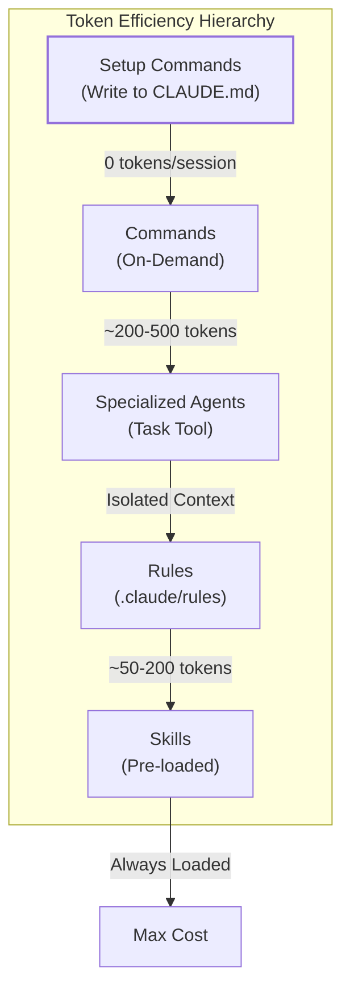
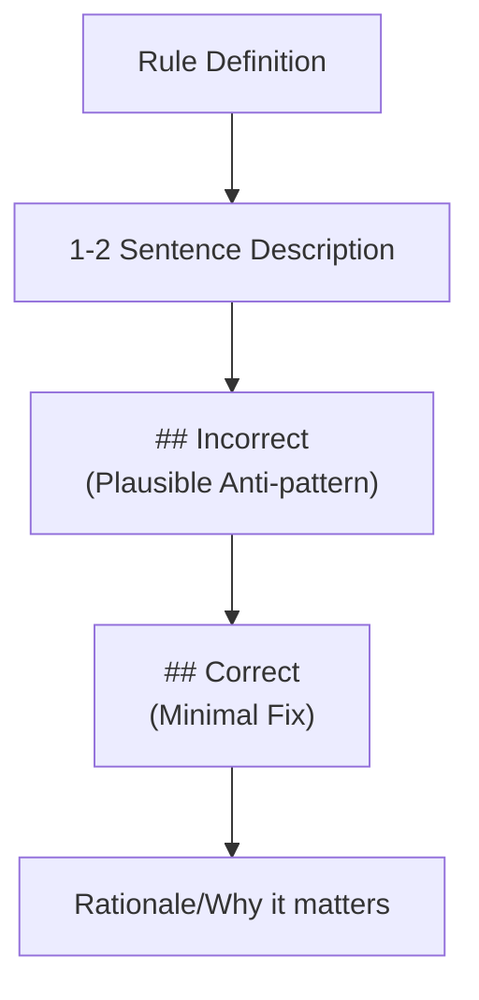
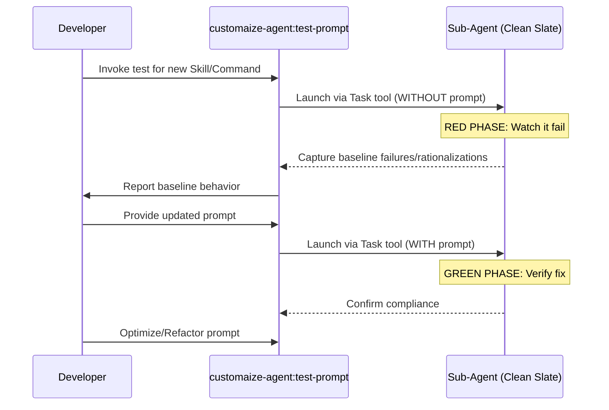

<!-- source: DeepWiki mcp.deepwiki.com · repo neolabhq/context-engineering-kit · page 6.2 Quality Standards & Best Practices · fetched 2026-10-27 -->

# Quality Standards & Best Practices

Relevant source files

The following files were used as context for generating this wiki page:

- [plugins/code-review/agents/contracts-reviewer.md](plugins/code-review/agents/contracts-reviewer.md)
- [plugins/code-review/skills/review-local-changes/SKILL.md](plugins/code-review/skills/review-local-changes/SKILL.md)
- [plugins/code-review/skills/review-pr/SKILL.md](plugins/code-review/skills/review-pr/SKILL.md)
- [plugins/customaize-agent/skills/apply-anthropic-skill-best-practices/SKILL.md](plugins/customaize-agent/skills/apply-anthropic-skill-best-practices/SKILL.md)
- [plugins/customaize-agent/skills/create-agent/SKILL.md](plugins/customaize-agent/skills/create-agent/SKILL.md)
- [plugins/customaize-agent/skills/create-command/SKILL.md](plugins/customaize-agent/skills/create-command/SKILL.md)
- [plugins/customaize-agent/skills/create-rule/SKILL.md](plugins/customaize-agent/skills/create-rule/SKILL.md)
- [plugins/customaize-agent/skills/create-skill/SKILL.md](plugins/customaize-agent/skills/create-skill/SKILL.md)
- [plugins/customaize-agent/skills/create-workflow-command/SKILL.md](plugins/customaize-agent/skills/create-workflow-command/SKILL.md)
- [plugins/customaize-agent/skills/prompt-engineering/SKILL.md](plugins/customaize-agent/skills/prompt-engineering/SKILL.md)
- [plugins/customaize-agent/skills/test-prompt/SKILL.md](plugins/customaize-agent/skills/test-prompt/SKILL.md)
- [plugins/customaize-agent/skills/test-skill/SKILL.md](plugins/customaize-agent/skills/test-skill/SKILL.md)
- [plugins/ddd/skills/setup-code-formating/SKILL.md](plugins/ddd/skills/setup-code-formating/SKILL.md)
- [plugins/sadd/agents/judge.md](plugins/sadd/agents/judge.md)
- [plugins/sadd/agents/meta-judge.md](plugins/sadd/agents/meta-judge.md)

This document defines the quality standards and best practices for developing plugins in the Context Engineering Kit. These standards ensure plugins maintain token efficiency, produce high-quality agent outputs, and integrate seamlessly with the existing plugin ecosystem.

---

## Core Design Principles

The Context Engineering Kit is built around three fundamental principles that guide all plugin development:

### 1. Token Efficiency Hierarchy
Token efficiency is the most critical technical constraint. Developers must choose the implementation strategy that minimizes persistent context bloat.

**Sources:** [plugins/customaize-agent/skills/create-workflow-command/SKILL.md:42-46](), [plugins/customaize-agent/skills/create-rule/SKILL.md:29-35]()

### 2. Context Isolation vs. Bloat
Workflow commands solve the **context bloat problem**. Instead of embedding detailed instructions in a single large command, developers should store them in separate task files.

*   **Orchestrator Command**: Lean (~50-100 tokens per step) used for dispatching.
*   **Task Files**: Detailed instructions (~500+ tokens) read by sub-agents on-demand via the `Read` tool.

**Sources:** [plugins/customaize-agent/skills/create-workflow-command/SKILL.md:19-34]()

---

## Implementation Patterns

### Contrastive Rule Pattern
When creating behavioral guardrails in `.claude/rules/`, developers MUST use the **Incorrect vs. Correct** pattern. This eliminates ambiguity by showing the agent the exact boundary of acceptable behavior.

**Sources:** [plugins/customaize-agent/skills/create-rule/SKILL.md:94-130]()

### Specialized Agent Orchestration
Complex tasks (like Code Reviews or SDD) should be decomposed into specialized agents. This prevents a single agent from being overwhelmed by conflicting instructions.

| Agent Role | Responsibility | Example Implementation |
| :--- | :--- | :--- |
| **Meta-Judge** | Architecting evaluation rubrics | [plugins/sadd/agents/meta-judge.md]() |
| **Judge** | Ruthless quality gatekeeping | [plugins/sadd/agents/judge.md]() |
| **Security Auditor** | Scanning for vulnerabilities | [plugins/code-review/skills/review-pr/SKILL.md:102]() |
| **Contracts Reviewer** | Analyzing API and Type design | [plugins/code-review/agents/contracts-reviewer.md]() |

**Sources:** [plugins/code-review/skills/review-pr/SKILL.md:96-120](), [plugins/sadd/agents/judge.md:10-35]()

---

## Quality Standards for Components

### 1. Skill Requirements
*   **Gerund Naming**: Use gerund form (e.g., "Processing PDFs", "Testing code"). [plugins/customaize-agent/skills/apply-anthropic-skill-best-practices/SKILL.md:44-52]()
*   **Third-Person Descriptions**: Metadata MUST be in the third person (e.g., "Processes Excel files" NOT "I can help..."). [plugins/customaize-agent/skills/apply-anthropic-skill-best-practices/SKILL.md:76-82]()
*   **TDD for Docs**: Apply the Red-Green-Refactor cycle to documentation. Watch an agent fail a task *without* the skill before writing it. [plugins/customaize-agent/skills/create-skill/SKILL.md:13-21]()

### 2. Command Requirements
*   **Frontmatter**: Every command MUST start with YAML frontmatter containing `description` and `argument-hint`. [plugins/customaize-agent/skills/create-command/SKILL.md:65-74]()
*   **Positional Arguments**: Use `$1`, `$2`, or `$ARGUMENTS` to make commands flexible. [plugins/customaize-agent/skills/create-command/SKILL.md:142-166]()
*   **Tool Restrictions**: Explicitly define `allowed-tools` to maintain the principle of least privilege. [plugins/customaize-agent/skills/create-command/SKILL.md:214-220]()

---

## Testing with Customaize-Agent

Developers should use the `customaize-agent` suite to verify plugin quality before submission.

### The Prompt Testing Workflow
To bridge the gap between "Natural Language Space" (instructions) and "Code Entity Space" (actual agent execution), use the following workflow:

**Sources:** [plugins/customaize-agent/skills/test-prompt/SKILL.md:53-62](), [plugins/customaize-agent/skills/test-prompt/SKILL.md:188-201]()

### Evaluation Accuracy
For high-stakes implementation (like the SADD workflow), the **Judge Agent** follows a strict evidence-based rubric:
1.  **Reasoning First**: The agent must produce reasoning before assigning a score. [plugins/sadd/agents/judge.md:16-17]()
2.  **Default to Low**: The default score is 2; higher scores require specific, cited evidence. [plugins/sadd/agents/judge.md:14-15]()
3.  **Self-Verification**: Judges must answer a self-verification table to check for hallucinated details or leniency bias. [plugins/sadd/agents/judge.md:155-158]()

**Sources:** [plugins/sadd/agents/judge.md:10-135]()

---

## Best Practices Checklist

| Category | Requirement | Source |
| :--- | :--- | :--- |
| **Prompting** | Use Few-Shot examples (2-5 pairs) for consistent formatting. | [plugins/customaize-agent/skills/prompt-engineering/SKILL.md:12-16]() |
| **Prompting** | Request Chain-of-Thought (CoT) for complex logic. | [plugins/customaize-agent/skills/prompt-engineering/SKILL.md:30-34]() |
| **Rules** | Keep rule files between 50-200 words. | [plugins/customaize-agent/skills/create-rule/SKILL.md:190]() |
| **Rules** | Use `paths` frontmatter to scope rules to specific file types. | [plugins/customaize-agent/skills/create-rule/SKILL.md:66-70]() |
| **Skills** | Keep `SKILL.md` body under 500 lines; use sub-files for complexity. | [plugins/customaize-agent/skills/apply-anthropic-skill-best-practices/SKILL.md:128-130]() |
| **Review** | Review agents MUST skip `spec/` and `reports/` folders by default. | [plugins/code-review/skills/review-pr/SKILL.md:17]() |

---

