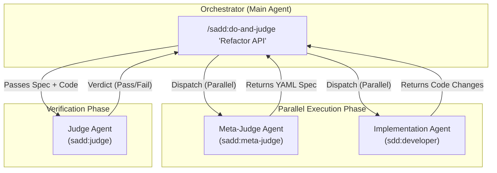
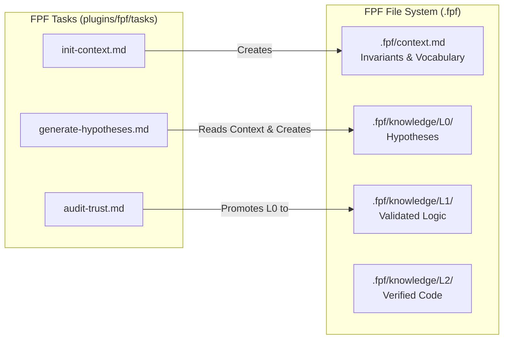

<!-- source: DeepWiki mcp.deepwiki.com · repo neolabhq/context-engineering-kit · page 7 Advanced Topics · fetched 2026-10-27 -->

# Advanced Topics

Relevant source files

The following files were used as context for generating this wiki page:

- [CLAUDE.md](CLAUDE.md)
- [docs/plugins/fpf/architecture.md](docs/plugins/fpf/architecture.md)
- [docs/plugins/fpf/evidence-freshness.md](docs/plugins/fpf/evidence-freshness.md)
- [justfile](justfile)
- [plugins/fpf/agents/fpf-agent.md](plugins/fpf/agents/fpf-agent.md)
- [plugins/fpf/tasks/audit-trust.md](plugins/fpf/tasks/audit-trust.md)
- [plugins/fpf/tasks/decide.md](plugins/fpf/tasks/decide.md)
- [plugins/fpf/tasks/generate-hypotheses.md](plugins/fpf/tasks/generate-hypotheses.md)
- [plugins/fpf/tasks/init-context.md](plugins/fpf/tasks/init-context.md)
- [plugins/sadd/skills/do-and-judge/SKILL.md](plugins/sadd/skills/do-and-judge/SKILL.md)
- [plugins/sadd/skills/do-competitively/SKILL.md](plugins/sadd/skills/do-competitively/SKILL.md)
- [plugins/sadd/skills/do-in-parallel/SKILL.md](plugins/sadd/skills/do-in-parallel/SKILL.md)
- [plugins/sadd/skills/do-in-steps/SKILL.md](plugins/sadd/skills/do-in-steps/SKILL.md)
- [plugins/sadd/skills/judge-with-debate/SKILL.md](plugins/sadd/skills/judge-with-debate/SKILL.md)
- [plugins/sadd/skills/judge/SKILL.md](plugins/sadd/skills/judge/SKILL.md)
- [plugins/sadd/skills/tree-of-thoughts/SKILL.md](plugins/sadd/skills/tree-of-thoughts/SKILL.md)

This page covers advanced usage patterns for maximizing the effectiveness of the Context Engineering Kit. These techniques are designed for technical users who want to leverage sophisticated agent orchestration, session automation, multi-plugin workflows, and rigorous reasoning frameworks.

For basic plugin usage, see [Plugin Reference](#3). For development workflow guides, see [Development Guides](#5). For creating custom plugins, see [Contributing](#6).

## Agent Orchestration Patterns

Agent orchestration involves defining specialized agents with precise contexts and permission boundaries to reduce hallucinations. The CEK implements several sophisticated orchestration patterns, primarily within the `sadd` (Subagent-Driven Development) plugin.

### Orchestrator vs. Implementation Roles
In advanced workflows, the primary agent acts strictly as an **Orchestrator**. It is prohibited from performing technical tasks (reading/writing files) directly, instead delegating to sub-agents to maintain a clean context window and high reasoning quality.

| Pattern | Logic | File Reference |
|---------|-------|----------------|
| **Do-and-Judge** | Single task implementation with parallel Meta-Judge criteria generation and final verification. | [plugins/sadd/skills/do-and-judge/SKILL.md:13-30]() |
| **Do-in-Steps** | Sequential decomposition of complex tasks with context passing between steps. | [plugins/sadd/skills/do-in-steps/SKILL.md:14-35]() |
| **Do-in-Parallel** | Concurrent execution of independent tasks (e.g., refactoring multiple files) with shared Meta-Judges. | [plugins/sadd/skills/do-in-parallel/SKILL.md:14-40]() |
| **Competitive** | Multi-agent generation (3 agents) followed by evidence-based synthesis of the best elements. | [plugins/sadd/skills/do-competitively/SKILL.md:27-52]() |

### The Meta-Judge -> LLM-as-a-Judge Pattern
A core advancement in CEK is the separation of **Criteria Generation** from **Evaluation**. 

1. **Meta-Judge**: Analyzes the task and produces a tailored YAML evaluation specification (rubrics, checklists, scoring criteria) [plugins/sadd/skills/judge/SKILL.md:55-90]().
2. **Judge**: An independent agent that applies the Meta-Judge's YAML specification mechanically to the implementation artifact [plugins/sadd/skills/judge/SKILL.md:94-144]().

**Figure: Meta-Judge Orchestration Flow**
Sources: [plugins/sadd/skills/do-and-judge/SKILL.md:87-91](), [plugins/sadd/skills/judge/SKILL.md:13-20]()

For details, see [Agent Orchestration Patterns](#7.1).

## Session Hooks & Automation

Session hooks enable automatic actions at key points during Claude Code sessions. This is configured in `.claude/settings.json` and is essential for tools like **Codemap** to provide persistent codebase visualization.

### Common Hook Points
*   **SessionStart**: Used to load codebase maps or dependency graphs via `codemap --format context .` [CLAUDE.md:93-112]().
*   **PreToolUse**: Validates context or enforces security constraints before a tool (like Bash) executes.
*   **PostToolUse**: Updates internal tracking or triggers automated linting after file modifications.
*   **PreCompact**: Saves critical session state before Claude performs context window compaction.

Sources: [CLAUDE.md:93-112](), [justfile:135-146]()

For details, see [Session Hooks & Automation](#7.2).

## Knowledge Accumulation Strategies

The Context Engineering Kit relies on a three-tier configuration system to manage how Claude learns about a project over time.

### The Configuration Hierarchy
1.  **User-Global (`~/.claude/CLAUDE.md`)**: Personal preferences and cross-project standards.
2.  **Project-Shared (`./CLAUDE.md`)**: Architecture decisions, tech stack standards, and team-wide patterns. This file is git-tracked [CLAUDE.md:1-31]().
3.  **Project-Personal (`./CLAUDE.local.md`)**: Local overrides and working notes (git-ignored).

### What to Memorize
The `reflexion` plugin provides `/reflexion:memorize` to capture insights. Effective strategies focus on:
*   **Architecture Invariants**: "Dependencies always point inward to the domain layer."
*   **Tech Stack Rules**: "Use strict TypeScript mode and avoid 'any'." [CLAUDE.md:44-52]()
*   **Recurring Bug Fixes**: Documenting root causes found via `kaizen:why` to prevent regressions.

Sources: [CLAUDE.md:44-52](), [CLAUDE.md:1-27]()

For details, see [Knowledge Accumulation Strategies](#7.3).

## First Principles Framework (FPF)

The **First Principles Framework (FPF)** is a rigorous reasoning specialist designed for high-stakes decision making and complex bug investigation. It operates as a state machine using the **ADI (Abduction-Deduction-Induction) cycle**.

### Core FPF Concepts
*   **Knowledge Assurance Levels**: Claims progress from **L0** (Observation/Hypothesis) to **L1** (Logical Consistency) to **L2** (Empirically Verified) [plugins/fpf/agents/fpf-agent.md:105-110]().
*   **Weakest Link Analysis (WLNK)**: The assurance level of a system is equal to the minimum assurance of its components [plugins/fpf/agents/fpf-agent.md:112-118]().
*   **Transformer Mandate**: Claude generates options with evidence; the human user makes the final decision. A system cannot transform its own core logic without external validation [plugins/fpf/agents/fpf-agent.md:121]().

### FPF Workflow Entity Space

**Figure: FPF Code Entity Mapping**
Sources: [plugins/fpf/tasks/init-context.md:120-163](), [plugins/fpf/tasks/generate-hypotheses.md:64-111](), [plugins/fpf/agents/fpf-agent.md:119]()

For details, see [First Principles Framework (FPF)](#7.4).

---

