# Page: Overview

# Overview

<details>
<summary>Relevant source files</summary>

The following files were used as context for generating this wiki page:

- [.bin/install-commands.sh](.bin/install-commands.sh)
- [.claude-plugin/marketplace.json](.claude-plugin/marketplace.json)
- [.claude/commands/bump-plugin.md](.claude/commands/bump-plugin.md)
- [README.md](README.md)
- [docs/README.md](docs/README.md)
- [docs/concepts.md](docs/concepts.md)
- [docs/getting-started.md](docs/getting-started.md)
- [docs/guides/pr-review.md](docs/guides/pr-review.md)
- [docs/resources/related-projects.md](docs/resources/related-projects.md)
- [plugins/customaize-agent/.claude-plugin/plugin.json](plugins/customaize-agent/.claude-plugin/plugin.json)
- [plugins/sadd/.claude-plugin/plugin.json](plugins/sadd/.claude-plugin/plugin.json)
- [plugins/sdd/.claude-plugin/plugin.json](plugins/sdd/.claude-plugin/plugin.json)

</details>


The Context Engineering Kit (CEK) is a curated plugin marketplace for Claude Code that provides advanced context engineering techniques and patterns. The kit consists of 13 officially maintained plugins organized in the `.claude-plugin/marketplace.json` registry [[.claude-plugin/marketplace.json:1-155]](), designed to improve AI agent output quality while maintaining a minimal token footprint. Each plugin implements scientifically-proven techniques for specific development workflows, code quality improvements, and external integrations [[README.md:19-31]]().

This page provides a high-level architectural overview of the plugin system, marketplace structure, and configuration management. For installation and initial setup instructions, see [Getting Started](#1.1). For detailed architectural principles, see [Architecture & Design Principles](#1.2). For comprehensive plugin documentation, see [Plugin Reference](#3).

**Sources:** [README.md:1-115](), [.claude-plugin/marketplace.json:1-155](), [docs/README.md:5-52]()

## System Architecture

The Context Engineering Kit operates through a multi-tier architecture: the marketplace registry manages plugin metadata, installed plugins load their components (commands, skills, agents) into Claude Code's context, and a hierarchical configuration system persists project knowledge across sessions.

### High-Level Component Structure

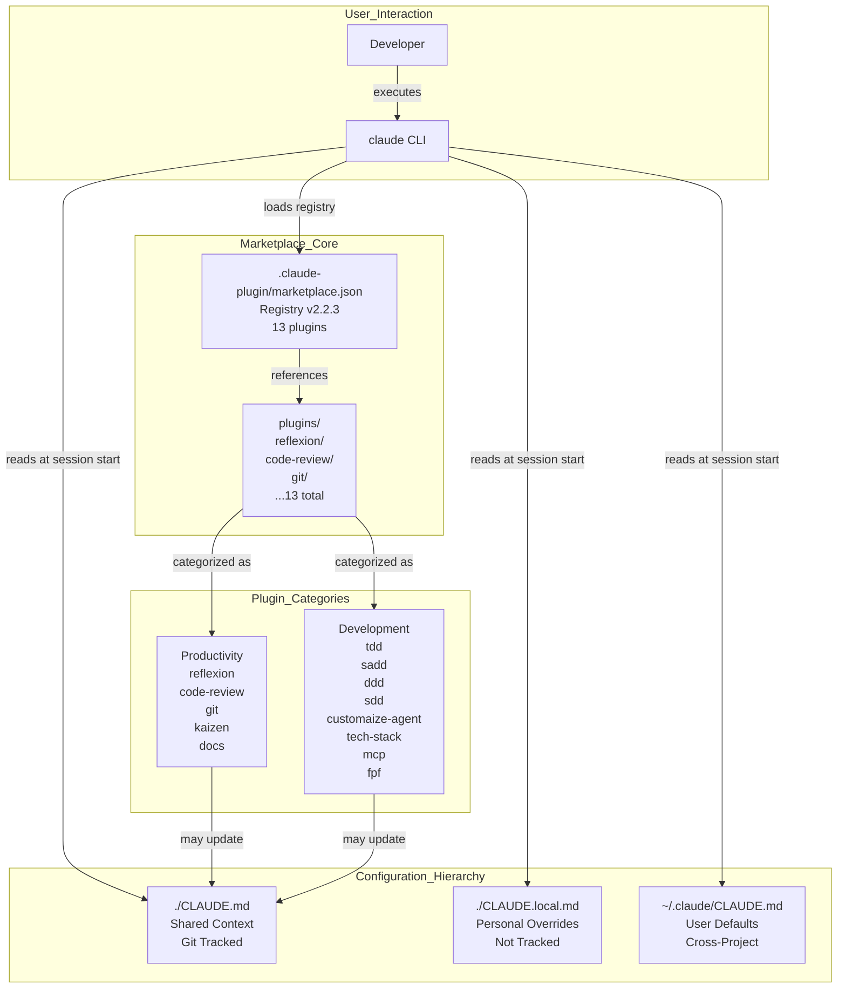

**Sources:** [README.md:40-61](), [.claude-plugin/marketplace.json:1-155](), [docs/concepts.md:1-107]()

### Marketplace Registry Structure

The marketplace is defined by `marketplace.json` which declares plugin metadata, versions, and source locations. Each plugin entry contains:

| Field | Description | Example |
|-------|-------------|---------|
| `name` | Unique plugin identifier | `"reflexion"` |
| `description` | Plugin purpose and techniques | `"Collection of commands that force LLM to reflect..."` |
| `version` | Semantic version | `"1.1.4"` |
| `source` | Path to plugin directory | `"./plugins/reflexion"` |
| `category` | `"productivity"` or `"development"` | `"productivity"` |
| `author` | Plugin maintainer information | `{"name": "...", "email": "..."}` |

**Sources:** [.claude-plugin/marketplace.json:10-154]()

### Plugin Installation and Loading

```mermaid
graph LR
    subgraph "Discovery"
        AddCmd["/plugin marketplace add<br/>NeoLabHQ/context-engineering-kit"]
        AddCmd -->|"downloads"| LocalCache["Local Plugin Cache<br/>marketplace.json"]
    end
    
    subgraph "Installation"
        InstallCmd["/plugin install<br/>reflexion@CEK"]
        InstallCmd -->|"loads from"| LocalCache
        InstallCmd -->|"activates"| PluginComponents["Plugin Components"]
    end
    
    subgraph "Component_Types"
        PluginComponents --> Commands["Commands<br/>/reflexion:reflect<br/>On-demand loading"]
        PluginComponents --> Skills["Skills<br/>TDD best practices<br/>Pre-loaded context"]
        PluginComponents --> Agents["Specialized Agents<br/>code-reviewer<br/>bug-hunter"]
    end
    
    subgraph "Execution"
        Commands -->|"user invokes"| Execution["Command Execution"]
        Skills -->|"informs"| Execution
        Agents -->|"spawned during"| Execution
        Execution -->|"may update"| CLAUDEMD["CLAUDE.md<br/>Knowledge Base"]
    end
```

**Sources:** [README.md:40-61](), [docs/getting-started.md:18-62](), [docs/concepts.md:12-115]()

## Plugin Categories

The marketplace organizes plugins into two categories based on their primary function in `marketplace.json` [[.claude-plugin/marketplace.json:10-154]]():

### Productivity Category (5 plugins)

| Plugin | Primary Function | Key Commands |
|--------|------------------|--------------|
| `reflexion` | Self-refinement and critique | `/reflexion:reflect`, `/reflexion:memorize` |
| `code-review` | Multi-agent code quality analysis | `/code-review:review-local-changes`, `/code-review:review-pr` |
| `git` | Git operations and PR management | `/git:commit`, `/git:create-pr`, `/git:analyze-issue` |
| `kaizen` | Root cause analysis | `/kaizen:why`, `/kaizen:analyse-problem` |
| `docs` | Documentation management | `/docs:update-docs` |

**Sources:** [.claude-plugin/marketplace.json:11-120](), [docs/README.md:33-43]()

### Development Category (8 plugins)

| Plugin | Primary Function | Key Commands |
|--------|------------------|--------------|
| `tdd` | Test-driven development | `/tdd:write-tests`, `/tdd:fix-tests` |
| `sadd` | Subagent orchestration | Skills for dispatching subagents with quality gates |
| `ddd` | Domain-driven design patterns | `/ddd:setup-code-formating` |
| `sdd` | Specification-driven workflow | `/sdd:00-setup` through `/sdd:05-document` |
| `customaize-agent` | Plugin development toolkit | `/customaize-agent:create-command`, `/customaize-agent:test-skill` |
| `tech-stack` | Language/framework best practices | `/tech-stack:add-*` commands |
| `mcp` | MCP server integration | `/mcp:setup-context7-mcp`, `/mcp:setup-serena-mcp` |
| `fpf` | Structured reasoning | `/fpf:propose-hypotheses`, `/fpf:status` |

**Sources:** [.claude-plugin/marketplace.json:44-153](), [docs/README.md:37-47]()

## Configuration Hierarchy

The Context Engineering Kit uses a three-tier `CLAUDE.md` configuration system to manage context at different scopes. This hierarchy allows teams to share project-level knowledge while enabling individual customization.

### Three Configuration Tiers

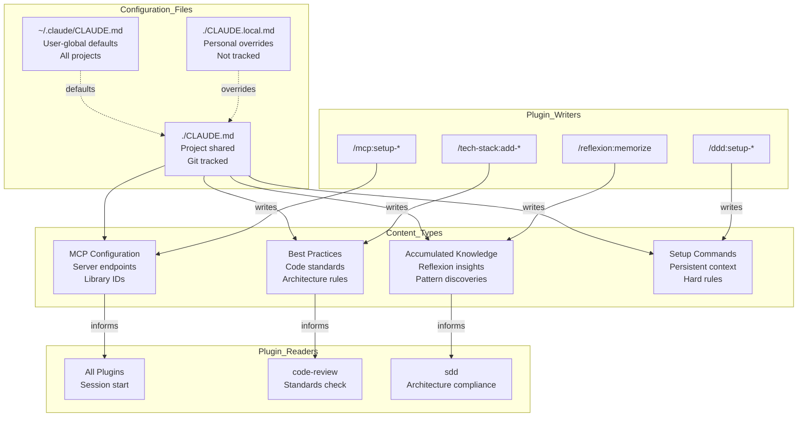

| Configuration Level | File Path | Git Tracked | Scope | Use Case |
|---------------------|-----------|-------------|-------|----------|
| Project Shared | `./CLAUDE.md` | Yes | Team-wide | Shared standards, MCP configs, architecture decisions |
| Project Personal | `./CLAUDE.local.md` | No | Individual | Personal preferences, local overrides, API keys |
| User Global | `~/.claude/CLAUDE.md` | No | Cross-project | Personal defaults, coding style, preferred tools |

**Sources:** [docs/getting-started.md:81-88](), [docs/concepts.md:5-11]()

## Token Efficiency Principles

The Context Engineering Kit is architected to minimize token usage while maximizing context quality through several design patterns:

### Commands vs Skills Trade-off

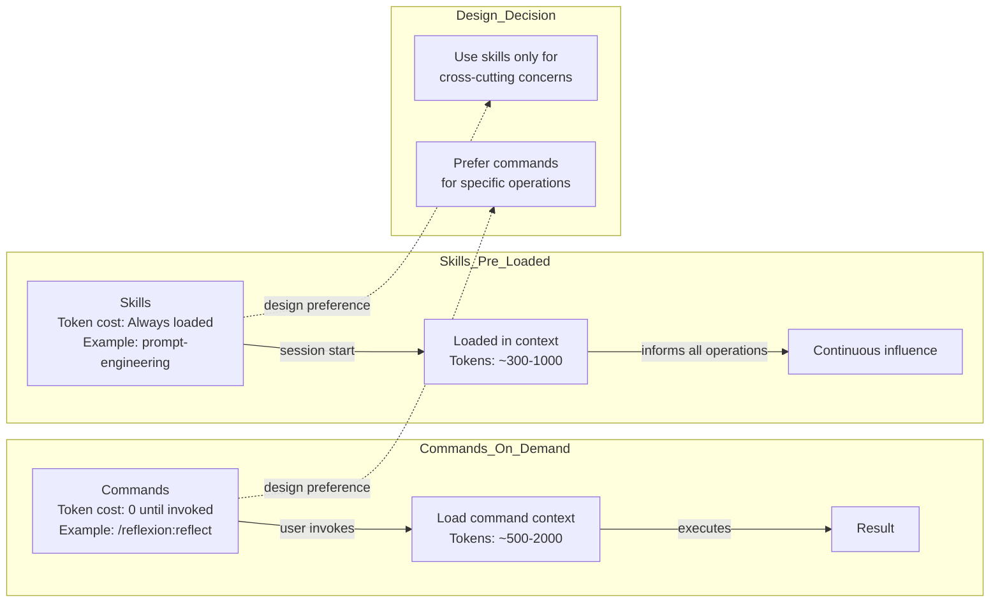

**Design Rationale:**
- **Commands** load context only when invoked, keeping baseline token count low [[docs/concepts.md:12-21]]().
- **Skills** are pre-loaded and influence all operations, reserved for frequently-used patterns [[docs/concepts.md:56-73]]().
- **Specialized Agents** spawn with focused context rather than loading all capabilities upfront [[docs/concepts.md:85-97]]().

**Sources:** [README.md:26](), [docs/concepts.md:74-83]()

## Knowledge Accumulation Loop

The Context Engineering Kit implements a feedback loop where plugins update `CLAUDE.md` files with learned patterns, creating continuously improving context over time.

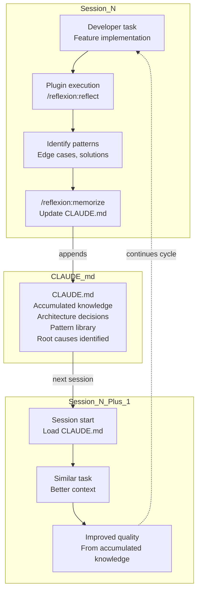

**Key Knowledge-Writing Plugins:**
- `/reflexion:memorize` - Captures insights from self-refinement cycles [[docs/getting-started.md:81-88]]().
- `/kaizen:*` - Documents root causes and improvement patterns [[.claude-plugin/marketplace.json:89-98]]().
- `/tech-stack:add-*` - Records language-specific best practices [[.claude-plugin/marketplace.json:122-131]]().
- `/mcp:setup-*` - Configures external tool integrations [[.claude-plugin/marketplace.json:133-142]]().
- `/ddd:setup-*` - Establishes architectural constraints [[.claude-plugin/marketplace.json:67-76]]().

**Sources:** [README.md:95-98](), [docs/getting-started.md:81-88]()

## External Integrations

The Context Engineering Kit integrates with external systems to enhance plugin capabilities beyond the base Claude Code functionality.

### GitHub and CI/CD Integration

The `git` plugin provides commands for GitHub operations [[.claude-plugin/marketplace.json:34-43]]():

| Command | Function | GitHub CLI Dependency |
|---------|----------|----------------------|
| `/git:commit` | Conventional commits with emoji | `git` |
| `/git:create-pr` | Create PRs with templates | `gh pr create` |
| `/git:analyze-issue` | Generate technical specs from issues | `gh issue view` |
| `/git:load-issues` | Batch load open issues as markdown | `gh issue list` |

**CI/CD Usage:** The `code-review` plugin can be automated via GitHub Actions for automated PR reviews [[docs/guides/pr-review.md:7-9]]().

**Sources:** [.bin/install-commands.sh:202-213](), [docs/guides/pr-review.md:1-24]()

### MCP (Model Context Protocol) Integration

The `mcp` plugin configures external context servers [[.claude-plugin/marketplace.json:133-142]]():

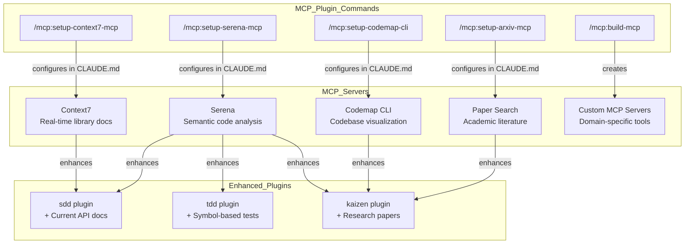

**Sources:** [.bin/install-commands.sh:209-209](), [.claude-plugin/marketplace.json:133-142]()

## Next Steps

To begin using the Context Engineering Kit:

1. **Installation:** Follow the [Getting Started](#1.1) guide to add the marketplace and install your first plugins.
2. **Architecture Understanding:** Review [Architecture & Design Principles](#1.2) for deeper understanding of plugin design patterns.
3. **Plugin Selection:** Browse the [Plugin Reference](#3) to identify plugins for your workflow.
4. **Workflow Integration:** Consult [Development Guides](#5) for complete workflow examples combining multiple plugins.

**Sources:** [docs/README.md:21-47]()

---

# Page: Getting Started

# Getting Started

<details>
<summary>Relevant source files</summary>

The following files were used as context for generating this wiki page:

- [.bin/install-commands.sh](.bin/install-commands.sh)
- [.devcontainer/Dockerfile](.devcontainer/Dockerfile)
- [.devcontainer/configure-claude.sh](.devcontainer/configure-claude.sh)
- [.devcontainer/devcontainer.json](.devcontainer/devcontainer.json)
- [.devcontainer/install-mcps.sh](.devcontainer/install-mcps.sh)
- [.devcontainer/statusline.sh](.devcontainer/statusline.sh)
- [CLAUDE.md](CLAUDE.md)
- [README.md](README.md)
- [docs/plugins/fpf/architecture.md](docs/plugins/fpf/architecture.md)
- [docs/plugins/fpf/evidence-freshness.md](docs/plugins/fpf/evidence-freshness.md)
- [justfile](justfile)

</details>


This page guides you through installing and configuring the Context Engineering Kit for Claude Code. You will learn how to add the marketplace, install your first plugin, and use the provided devcontainer sandbox environment for a pre-configured experience.

The Context Engineering Kit is a hand-crafted collection of advanced context engineering techniques focused on improving agent result quality and predictability with a minimal token footprint [README.md:17-21]().

## Prerequisites

Before beginning, you must have:

- **Claude Code CLI** - The official command-line interface from Anthropic [README.md:44-46]().
- **Git repository** - A project where you want to use context engineering techniques [README.md:49]().
- **Optional: Docker & Dev Containers extension** - If you wish to use the automated sandbox environment [justfile:82-87]().

Sources: [README.md:44-50](), [justfile:82-87]()

## Installation Workflow

The Context Engineering Kit follows a three-phase installation model that minimizes context pollution while maximizing flexibility.

### Installation Phases

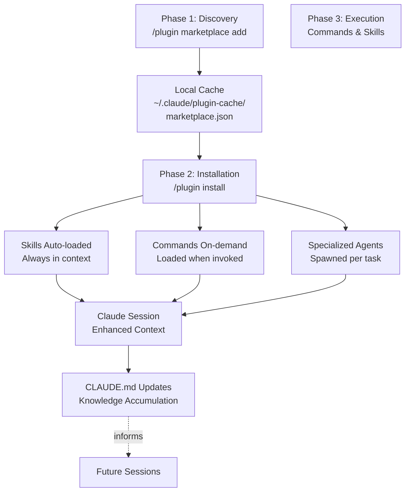

Sources: [README.md:42-61](), [CLAUDE.md:46-51]()

## Step 1: Add the Marketplace

Launch Claude Code and add the Context Engineering Kit marketplace:

```bash
/plugin marketplace add NeoLabHQ/context-engineering-kit
```

**What happens internally:**
This registers the marketplace metadata but does **not** load any agents or skills into your context yet [README.md:52]().

| Action | Location | Result |
|--------|----------|--------|
| Downloads metadata | `~/.claude/plugin-cache/` | Caches `marketplace.json` [CLAUDE.md:12-12]() |
| Registers plugins | Claude Code internal registry | Makes plugins like `sdd`, `reflexion`, and `git` discoverable [CLAUDE.md:31-31]() |
| Context impact | None | Zero tokens added to context |

Sources: [README.md:48-52](), [CLAUDE.md:11-12]()

## Step 2: Install Your First Plugin

We recommend starting with the `reflexion` plugin to enable self-refinement capabilities.

```bash
/plugin install reflexion@NeoLabHQ/context-engineering-kit
```

**What gets installed:**

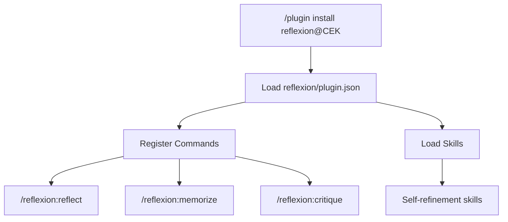

**Internal Structure:**
Each plugin is isolated in the `plugins/` directory, containing its own `plugin.json` manifest, `commands/` (invoked via `/`), and `skills/` (automatically loaded) [CLAUDE.md:13-19]().

Sources: [README.md:54-60](), [CLAUDE.md:13-19]()

## Step 3: Use the Plugin

Once installed, you can use commands to refine Claude's output.

1. Ask Claude to perform a task: `implement user authentication` [README.md:86-86]().
2. Invoke reflection: `/reflexion:reflect` [README.md:89-89]().
3. Save insights to project memory: `/reflexion:memorize` [README.md:97-97]().

### Natural Language Hooks
If you have `bun` installed, you can use the `reflect` keyword in your initial prompt to trigger the command automatically:
`claude "implement user authentication, then reflect"` [README.md:102-103]().

Sources: [README.md:83-106]()

## Using the Devcontainer Sandbox

For a fully pre-configured environment, the repository includes a `devcontainer` setup. This environment automatically installs Claude Code, essential tools like `jq` and `gh`, and pre-loads core plugins [/.devcontainer/Dockerfile:4-89]().

### Sandbox Setup

1. **Start the sandbox**: Run `just sandbox` from your terminal [justfile:82-96](). This builds the image and attaches an interactive shell.
2. **Automated Configuration**: The `.devcontainer/configure-claude.sh` script runs automatically to:
   - Set `bypassPermissions` in `~/.claude/settings.json` [/.devcontainer/configure-claude.sh:18-18]().
   - Install the `typescript-lsp` official plugin [/.devcontainer/configure-claude.sh:78-78]().
   - Install `sdd`, `sadd`, and `git` plugins from the Context Engineering Kit [/.devcontainer/configure-claude.sh:83-85]().
   - Configure a custom status line using `statusline.sh` [/.devcontainer/configure-claude.sh:32-35]().

### Sandbox Management Commands

| Command | Action |
|---------|--------|
| `just sandbox` | Starts and attaches to the devcontainer [justfile:82-96]() |
| `just attach-sandbox` | Attaches to an already running container [justfile:99-118]() |
| `just stop-sandbox` | Stops and removes the container [justfile:121-131]() |

Sources: [justfile:82-131](), [/.devcontainer/configure-claude.sh:1-89]()

## Code Entity Mapping

The following diagram maps the logical setup steps to the specific script entities and configuration files involved in the "Getting Started" process.

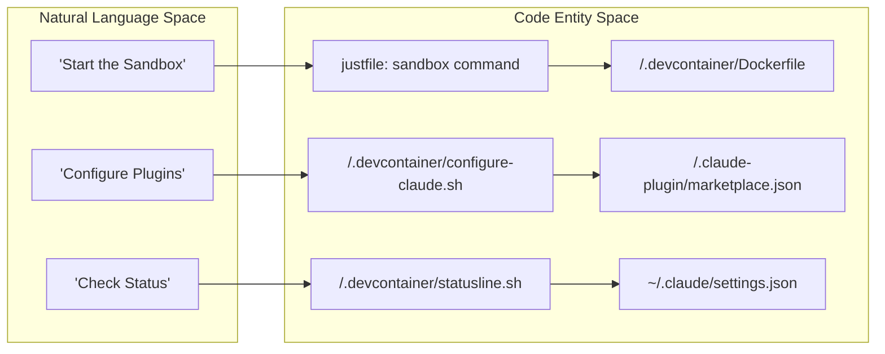

Sources: [justfile:82-96](), [/.devcontainer/configure-claude.sh:1-44](), [/.devcontainer/statusline.sh:1-35]()

## Understanding Configuration Levels

The kit utilizes a three-tier configuration system via `CLAUDE.md` to manage project context effectively [CLAUDE.md:50-50]().

| Level | File | Purpose |
|-------|------|---------|
| **Project-Shared** | `CLAUDE.md` | Team-wide standards, tech stack rules, and project structure [CLAUDE.md:1-27](). |
| **Project-Personal** | `CLAUDE.local.md` | User-specific overrides or private notes. |
| **User-Global** | `~/.claude/settings.json` | Global CLI behavior, hooks, and permissions [/.devcontainer/configure-claude.sh:15-42](). |

Sources: [CLAUDE.md:1-50](), [/.devcontainer/configure-claude.sh:15-42]()

---

# Page: Architecture & Design Principles

# Architecture & Design Principles

<details>
<summary>Relevant source files</summary>

The following files were used as context for generating this wiki page:

- [.claude-plugin/marketplace.json](.claude-plugin/marketplace.json)
- [.claude/commands/bump-plugin.md](.claude/commands/bump-plugin.md)
- [CLAUDE.md](CLAUDE.md)
- [docs/plugins/fpf/architecture.md](docs/plugins/fpf/architecture.md)
- [docs/plugins/fpf/evidence-freshness.md](docs/plugins/fpf/evidence-freshness.md)
- [justfile](justfile)
- [plugins/customaize-agent/.claude-plugin/plugin.json](plugins/customaize-agent/.claude-plugin/plugin.json)
- [plugins/sadd/.claude-plugin/plugin.json](plugins/sadd/.claude-plugin/plugin.json)
- [plugins/sdd/.claude-plugin/plugin.json](plugins/sdd/.claude-plugin/plugin.json)

</details>


This document explains the architectural design of the Context Engineering Kit and the core principles that guide plugin development. It covers the plugin system structure, token efficiency strategies, and the context management hierarchy.

## Core Architecture

### Plugin Registry System

The Context Engineering Kit uses a marketplace-based architecture where all plugins are registered in a central manifest file at [.claude-plugin/marketplace.json:1-155](). This file serves as the single source of truth for plugin discovery and metadata.

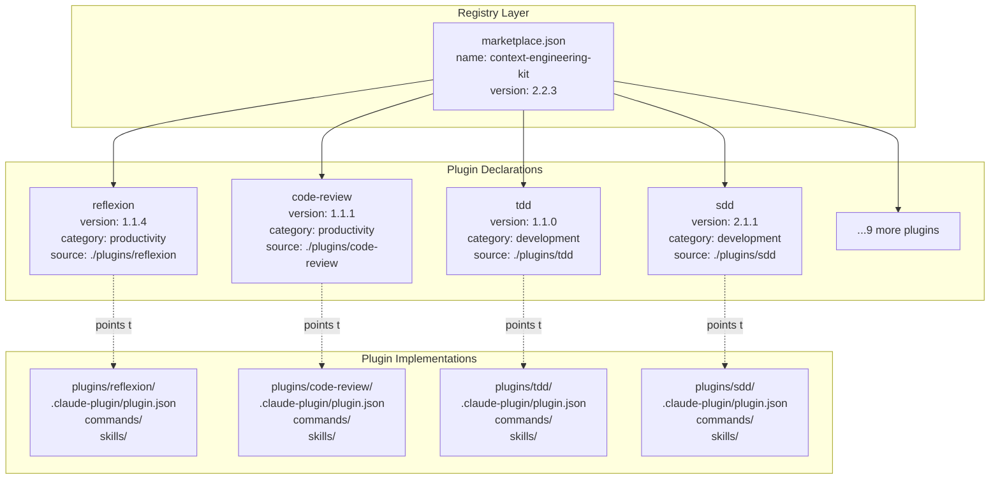

**Marketplace Structure**

The marketplace manifest defines:
- **Registry metadata**: Name, version, description, owner ([.claude-plugin/marketplace.json:2-9]())
- **Plugin entries**: Each plugin declaration includes name, description, version, author, source path, and category ([.claude-plugin/marketplace.json:11-153]())
- **Two categories**: `productivity` (reflexion, code-review, git, kaizen, docs) and `development` (tdd, sadd, ddd, sdd, customaize-agent, tech-stack, mcp, fpf) ([.claude-plugin/marketplace.json:20,31,42,53,64,75,86,97,108,119,130,141,152]())

**Sources**: [.claude-plugin/marketplace.json:1-155]()

### Plugin Structure

Each plugin follows a standardized directory structure that separates metadata, commands, and skills as defined in the project structure ([CLAUDE.md:10-27]()):

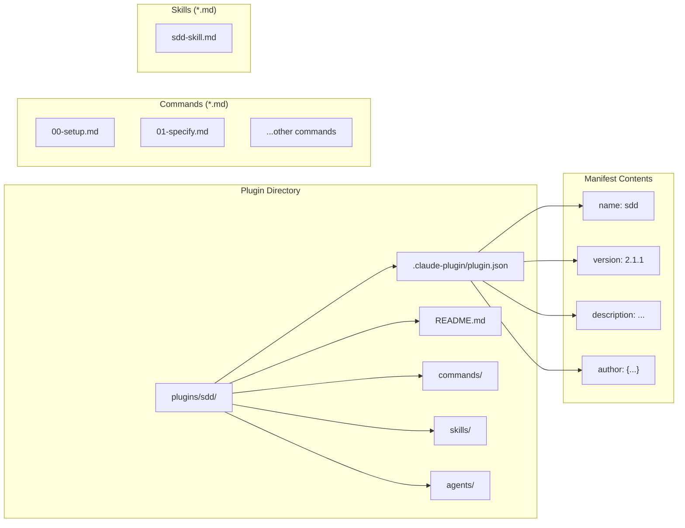

**Required Files**:
- `.claude-plugin/plugin.json`: Plugin manifest with metadata ([plugins/sdd/.claude-plugin/plugin.json:1-9]())
- `README.md`: Usage documentation and examples ([CLAUDE.md:17]())

**Optional Directories**:
- `commands/`: Markdown files defining slash commands that load on-demand ([CLAUDE.md:18]())
- `skills/`: Markdown files defining skills whose descriptions load automatically ([CLAUDE.md:19]())
- `agents/`: Markdown files defining specialized agent personas ([CLAUDE.md:89]())

**Sources**: [CLAUDE.md:10-27](), [plugins/sdd/.claude-plugin/plugin.json:1-9](), [CLAUDE.md:89]()

### Loading Mechanism

The system uses a selective loading strategy to minimize token usage, distinguishing between immediate skill availability and on-demand command execution ([CLAUDE.md:48]()).

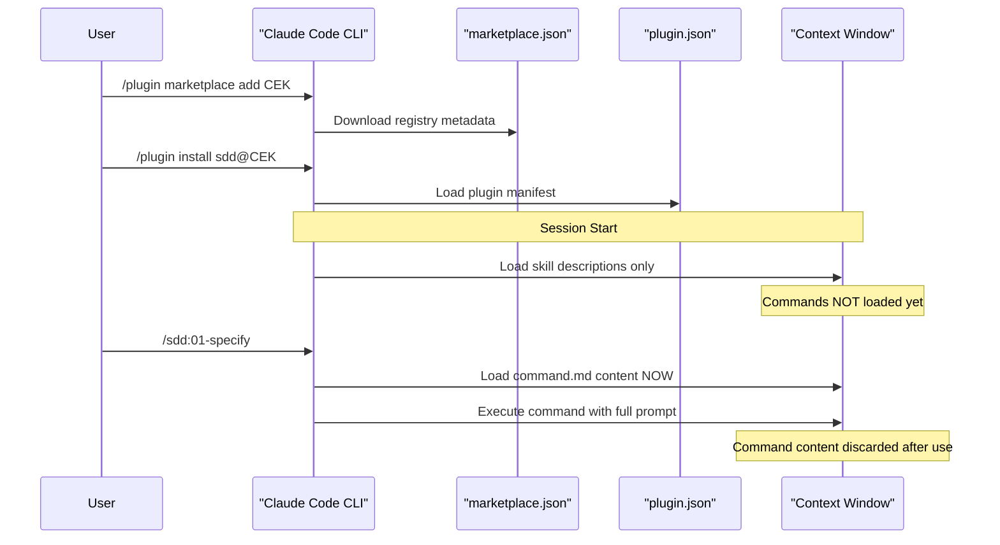

**Loading Strategy**:
1. **Plugin Installation**: Downloads plugin metadata from marketplace ([.claude-plugin/marketplace.json:1-155]())
2. **Session Start**: Loads only skill descriptions into context to save tokens ([CLAUDE.md:48]())
3. **Command Invocation**: Loads full command content on-demand ([CLAUDE.md:48]())
4. **Command Completion**: Command content is not persisted in the long-term context window.

**Sources**: [CLAUDE.md:48](), [.claude-plugin/marketplace.json:1-155]()

## Token Efficiency Principles

The architecture prioritizes a minimal token footprint through four core design patterns ([CLAUDE.md:46-51]()).

### Commands Over Skills

Commands load on-demand while skill descriptions load automatically, making commands the preferred choice for most functionality to preserve the context window ([CLAUDE.md:48]()).

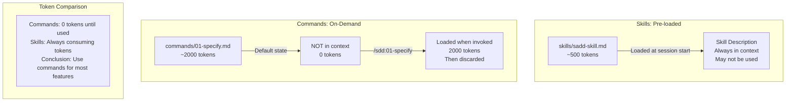

**Decision Matrix**:

| Use Case | Pattern | Rationale |
|----------|---------|-----------|
| User-invoked actions | Commands | Zero tokens until needed ([CLAUDE.md:48]()) |
| Agent-initiated workflows | Skills | Agent needs to know capability exists ([CLAUDE.md:48]()) |
| Configuration setup | Setup-commands | Persistent context in CLAUDE.md ([CLAUDE.md:50]()) |
| Complex reasoning | Specialized agents | Isolated context reduces hallucinations ([CLAUDE.md:49]()) |

**Sources**: [CLAUDE.md:46-51]()

### Specialized Agents Pattern

Instead of loading broad context as skills, the system uses specialized agents with focused context to reduce hallucinations ([CLAUDE.md:49]()).

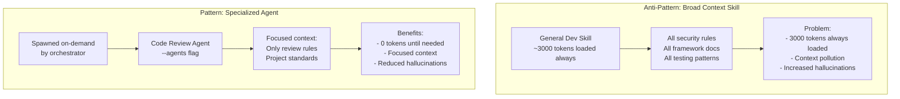

**Agent Architecture**:
- **Location**: Agents are defined in `.claude/agents/` or `plugins/<plugin>/agents/` ([CLAUDE.md:89]()).
- **Isolation**: Agents use focused context to ensure high-quality output without polluting the main session ([CLAUDE.md:49]()).
- **FPF Personas**: In the First Principles Framework (FPF), agents act as specific **Personas** (e.g., Abductor, Auditor) that run within the visible chat thread to maintain transparency ([docs/plugins/fpf/architecture.md:38-43]()).

**Sources**: [CLAUDE.md:49,89](), [docs/plugins/fpf/architecture.md:38-43]()

### Setup Commands for Persistent Context

Setup commands update the `CLAUDE.md` file to provide persistent project context without consuming skill slots ([CLAUDE.md:50]()).

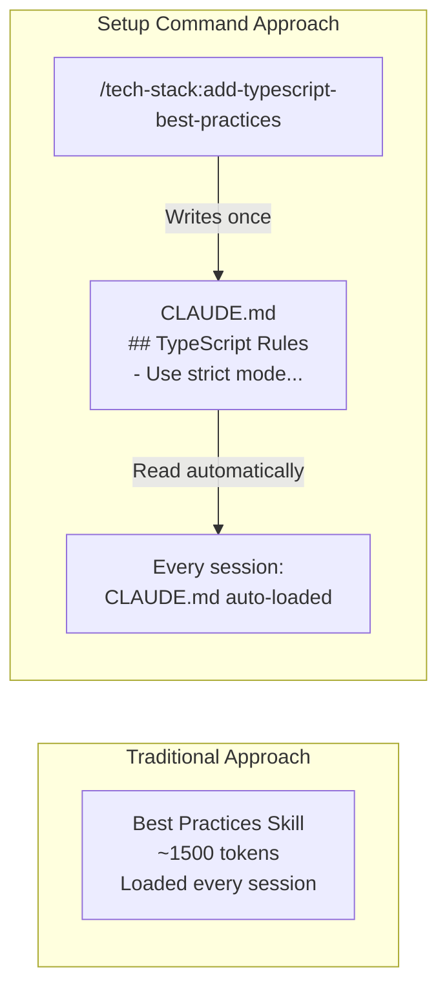

**Sources**: [CLAUDE.md:50](), [.claude-plugin/marketplace.json:122-131]()

## The Role of CLAUDE.md Files

`CLAUDE.md` serves as the primary mechanism for persistent context and project-specific configuration.

### Configuration Hierarchy
The system relies on a tiered configuration approach:
1. **Project Shared (`CLAUDE.md`)**: Team standards, architecture rules, and MCP setup ([CLAUDE.md:1-8]()).
2. **Project Personal (`CLAUDE.local.md`)**: Local overrides or personal preferences (not tracked in git).
3. **User Global (`~/.claude/CLAUDE.md`)**: Cross-project defaults.

### Knowledge Accumulation
Plugins like **Reflexion** and **Kaizen** use `CLAUDE.md` to store long-term learnings.
- **Reflexion**: Uses `/reflexion:memorize` to save insights from refinement loops ([.claude-plugin/marketplace.json:12-21]()).
- **DDD**: Updates `CLAUDE.md` with Clean Architecture and SOLID principles ([.claude-plugin/marketplace.json:67-76]()) to ensure future agents follow these patterns.

### MCP Configuration
The `mcp` plugin uses setup commands to explicitly define which MCP servers are required for a project within `CLAUDE.md` ([.claude-plugin/marketplace.json:133-142]()). For example, it might configure:
- **Context7**: For real-time documentation fetching ([CLAUDE.md:93-111]()).
- **Paper Search**: For academic research via Docker MCP ([CLAUDE.md:113-138]()).

**Sources**: [CLAUDE.md:1-8,93-138](), [.claude-plugin/marketplace.json:12-21,67-76,133-142]()

## FPF Architecture: Surface vs. Grounding

The **First Principles Framework (FPF)** plugin introduces a strict separation between the user experience and the data layer ([docs/plugins/fpf/architecture.md:3-6]()).

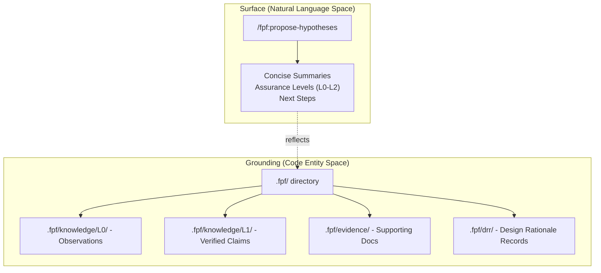

**Key FPF Principles**:
- **Knowledge Assurance Levels**: Claims move from L0 (Observation) to L2 (Verified) through validation steps ([docs/plugins/fpf/architecture.md:53-60]()).
- **WLNK (Weakest Link)**: The reliability of a claim is capped by its most fragile piece of evidence ([docs/plugins/fpf/architecture.md:62-67]()).
- **Evidence Freshness**: Evidence has a `valid_until` date; stale evidence triggers a decay warning ([docs/plugins/fpf/evidence-freshness.md:1-14]()).
- **Transformer Mandate**: AI generates options, but the Human decides on the final architectural path ([docs/plugins/fpf/architecture.md:44-51]()).

**Sources**: [docs/plugins/fpf/architecture.md:1-90](), [docs/plugins/fpf/evidence-freshness.md:1-20]()

---

# Page: Core Concepts

# Core Concepts

<details>
<summary>Relevant source files</summary>

The following files were used as context for generating this wiki page:

- [.bin/install-commands.sh](.bin/install-commands.sh)
- [.claude-plugin/marketplace.json](.claude-plugin/marketplace.json)
- [.claude/commands/bump-plugin.md](.claude/commands/bump-plugin.md)
- [README.md](README.md)
- [plugins/customaize-agent/.claude-plugin/plugin.json](plugins/customaize-agent/.claude-plugin/plugin.json)
- [plugins/sadd/.claude-plugin/plugin.json](plugins/sadd/.claude-plugin/plugin.json)
- [plugins/sdd/.claude-plugin/plugin.json](plugins/sdd/.claude-plugin/plugin.json)

</details>


This page covers the fundamental architectural concepts underlying the Context Engineering Kit: the plugin system, configuration hierarchy, token efficiency patterns, and knowledge accumulation mechanisms. For specific plugin implementations, see [Plugin Reference](#3). For practical usage workflows, see [Development Guides](#5).

---

## The Three-Tier Architecture

The Context Engineering Kit is built on three architectural layers: a centralized marketplace registry, a plugin ecosystem, and a multi-level configuration system. These layers interact to provide token-efficient, context-aware development tools.

### Marketplace Registry Structure

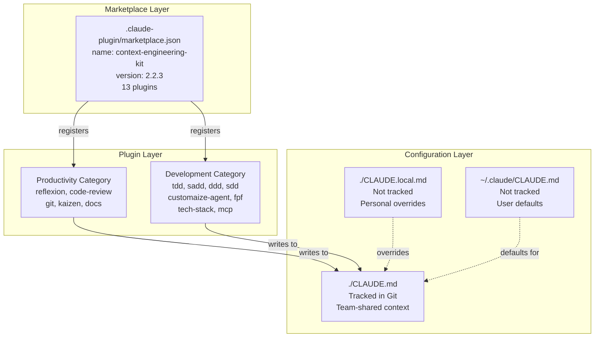

The marketplace manifest at [.claude-plugin/marketplace.json:1-155]() defines the complete plugin registry. Each plugin entry specifies `name`, `description`, `version`, `author`, `source` path, and `category` (either `"productivity"` or `"development"`).

**Sources:** [.claude-plugin/marketplace.json:1-155]()

---

## Plugin Manifest and Directory Structure

Each plugin follows a standardized directory layout that separates on-demand commands from pre-loaded skills:

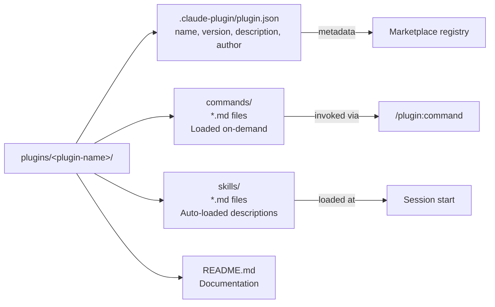

The plugin manifest at paths like [plugins/sdd/.claude-plugin/plugin.json:1-9]() contains metadata mirroring the marketplace entry. The `commands/` directory holds markdown files that define slash commands with full implementation details. The `skills/` directory holds markdown files with skill descriptions that are pre-loaded into the session context.

| Component | Load Timing | Token Impact | Use Case |
|-----------|-------------|--------------|----------|
| `plugin.json` | Installation | Minimal | Metadata only |
| `commands/*.md` | On invocation | Per-use | Complex operations |
| `skills/*.md` | Session start | Persistent | Knowledge/guidance |
| `README.md` | Never auto-loaded | None | Human documentation |

**Sources:** [plugins/sdd/.claude-plugin/plugin.json:1-9](), [plugins/sadd/.claude-plugin/plugin.json:1-9](), [plugins/customaize-agent/.claude-plugin/plugin.json:1-9]()

---

## Multi-Tier Configuration System

The Context Engineering Kit uses a three-tier configuration hierarchy where each level serves a distinct purpose in context management. For details, see [Configuration & Context Management](#2.2).

### Configuration Hierarchy Diagram

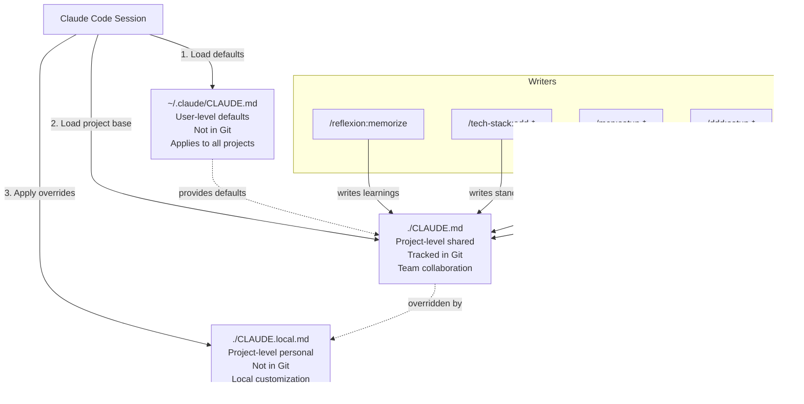

**Configuration Precedence:** `CLAUDE.local.md` > `./CLAUDE.md` > `~/.claude/CLAUDE.md`

### CLAUDE.md Content Categories

The configuration files contain structured sections that serve different purposes:

| Section Type | Example Content | Written By | Purpose |
|--------------|-----------------|------------|---------|
| Setup Commands | Hard rules, architecture decisions | `ddd`, `tech-stack` plugins | Persistent constraints |
| MCP Configuration | Server URLs, library IDs, usage guidelines | `mcp` plugin | External tool integration |
| Best Practices | Tech stack rules, DDD patterns, testing strategies | `tech-stack`, `ddd`, `tdd` plugins | Code quality standards |
| Accumulated Learnings | Reflexion insights, Kaizen root causes, pattern discoveries | `reflexion`, `kaizen` plugins | Knowledge accumulation |

**Sources:** [.claude-plugin/marketplace.json:67-142](), [README.md:37-38]()

---

## Commands, Skills, and Agents

The Kit distinguishes between on-demand commands, pre-loaded skills, and specialized agents to balance token efficiency and performance. For details, see [Commands, Skills, and Agents](#2.3).

### Token-Efficient Design Patterns

#### Pattern 1: Commands vs Skills

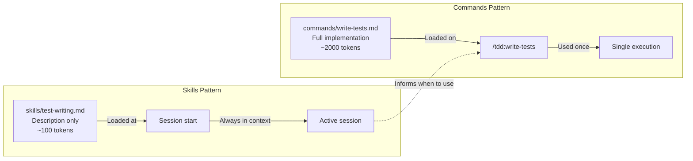

**Design Rule:** Skills provide lightweight descriptions that inform Claude when to use commands. Commands contain heavy implementation details loaded only when invoked. This is a core "Token-Efficient" feature [README.md:26]().

#### Pattern 2: Specialized Agents

```mermaid
graph TB
    BroadContext["Main Session<br/>Full codebase context<br/>High hallucination risk"]
    
    BroadContext -->|"Spawns"| Agent1["Security Agent<br/>Focused: auth, crypto"]
    
    BroadContext -->|"Spawns"| Agent2["Performance Agent<br/>Focused: algorithms"]
    
    BroadContext -->|"Spawns"| Agent3["Style Agent<br/>Focused: formatting"]
    
    Agent1 -->|"Returns"| Results1["Security report"]
    Agent2 -->|"Returns"| Results2["Performance report"]
    Agent3 -->|"Returns"| Results3["Style report"]
    
    Results1 --> Aggregate["Aggregated review"]
    Results2 --> Aggregate
    Results3 --> Aggregate
```

The `code-review` and `sdd` plugins demonstrate this pattern by dispatching specialized agents [README.md:28, 79](). This minimizes populating context with unnecessary information [README.md:26]().

**Sources:** [README.md:25-29](), [.claude-plugin/marketplace.json:23-32, 78-87]()

---

## Plugin System & Orchestration

Plugins are structured to be granular and independent, yet they can be combined into complex workflows. For details, see [Plugin System](#2.1).

### Plugin Interaction Network

```mermaid
graph TB
    subgraph "Core Quality Plugins"
        Reflexion["reflexion<br/>/reflexion:reflect<br/>/reflexion:critique<br/>/reflexion:memorize"]
        CodeReview["code-review<br/>/code-review:review-local-changes<br/>6 specialized agents"]
    end
    
    subgraph "Workflow Plugins"
        TDD["tdd<br/>/tdd:write-tests<br/>/tdd:fix-tests"]
        SDD["sdd<br/>6-phase workflow<br/>/sdd:00-setup to /sdd:05-document"]
        SADD["sadd<br/>Subagent orchestration<br/>Quality gates"]
    end
    
    subgraph "Integration Plugins"
        MCP["mcp<br/>/mcp:setup-context7-mcp<br/>/mcp:setup-serena-mcp"]
        Git["git<br/>/git:commit<br/>/git:create-pr"]
    end
    
    subgraph "Analysis Plugins"
        Kaizen["kaizen<br/>Five Whys, PDCA<br/>Root cause analysis"]
    end
    
    Reflexion -.->|"refines output of"| CodeReview
    Reflexion -.->|"validates output of"| TDD
    
    SADD -->|"orchestrates"| CodeReview
    SADD -->|"orchestrates"| TDD
    
    SDD -->|"uses patterns from"| DDD["ddd plugin"]
    
    CodeReview -->|"feeds findings to"| Kaizen
```

**Key Interaction Patterns:**

1. **Reflexion as Quality Multiplier:** The `reflexion` plugin refines outputs through feedback loops [README.md:89-98]().
2. **SADD as Orchestrator:** The `sadd` plugin dispatches fresh subagents for each task with quality gates [.claude-plugin/marketplace.json:56-65]().
3. **SDD Integration:** The `sdd` plugin incorporates high-level code quality guidelines from the `ddd` plugin [README.md:37]().

**Sources:** [README.md:36-39, 83-98](), [.claude-plugin/marketplace.json:10-154]()

---

## Knowledge Accumulation Model

The Kit implements a continuous learning system where insights from each session enhance future sessions via the `CLAUDE.md` hierarchy.

### Knowledge Accumulation Flow

```mermaid
sequenceDiagram
    participant Dev as "Developer"
    participant Plugin as "Plugin Command"
    participant CLAUDEMD as "./CLAUDE.md"
    participant NextSession as "Future Session"
    
    Dev->>Plugin: Execute command (e.g., /reflexion:memorize)
    Plugin->>Plugin: Extract resolution strategies
    Plugin->>CLAUDEMD: Write insights to project memory
    
    Note over CLAUDEMD: Knowledge persists in Git
    
    NextSession->>CLAUDEMD: Load at session start
    CLAUDEMD->>NextSession: Provide accumulated context
    NextSession->>Dev: Improved results based on history
```

### Accumulation Mechanisms

| Mechanism | Command | Content Type |
|-----------|---------|--------------|
| Reflexion Memorization | `/reflexion:memorize` | Insights and resolution strategies [README.md:97-98]() |
| Kaizen Analysis | `/kaizen:why` | Root cause tracing and problem analysis [.claude-plugin/marketplace.json:89-98]() |
| Tech Stack Setup | `/tech-stack:add-*` | Language/framework best practices [.claude-plugin/marketplace.json:122-131]() |
| DDD Setup | `/ddd:setup-*` | Clean Architecture and SOLID patterns [README.md:38]() |

**Sources:** [README.md:38, 97-98](), [.claude-plugin/marketplace.json:89-98, 122-131]()

---

## Summary of Core Principles

1. **Token Efficiency:** Prefer command-oriented skills over general information skills [README.md:26]().
2. **Granularity:** Install only what you need; plugins load specific agents without overlap [README.md:28]().
3. **Persistence:** Use `CLAUDE.md` to store persistent context and architectural rules [README.md:38]().
4. **Specialization:** Use subagents for complex tasks to maintain accuracy as context grows [README.md:118-144]().
5. **Standardization:** Follow open standards like [agentskills.io](https://agentskills.io) and Arc42 [README.md:30]().

**Sources:** [README.md:25-31, 118-144]()

---

# Page: Plugin System

# Plugin System

<details>
<summary>Relevant source files</summary>

The following files were used as context for generating this wiki page:

- [.claude-plugin/marketplace.json](.claude-plugin/marketplace.json)
- [.claude/commands/bump-plugin.md](.claude/commands/bump-plugin.md)
- [CLAUDE.md](CLAUDE.md)
- [docs/plugins/fpf/architecture.md](docs/plugins/fpf/architecture.md)
- [docs/plugins/fpf/evidence-freshness.md](docs/plugins/fpf/evidence-freshness.md)
- [justfile](justfile)
- [plugins/README.md](plugins/README.md)
- [plugins/customaize-agent/.claude-plugin/plugin.json](plugins/customaize-agent/.claude-plugin/plugin.json)
- [plugins/sadd/.claude-plugin/plugin.json](plugins/sadd/.claude-plugin/plugin.json)
- [plugins/sdd/.claude-plugin/plugin.json](plugins/sdd/.claude-plugin/plugin.json)

</details>


The plugin system is the core architecture of the Context Engineering Kit, providing a structured way to extend Claude Code's capabilities through a curated marketplace. This document explains the marketplace registry, plugin manifest format, directory structure, component types (commands, skills, agents), and the plugin lifecycle from discovery through execution.

## Marketplace Registry

The Context Engineering Kit uses a centralized registry file at [.claude-plugin/marketplace.json:1-155]() that serves as the single source of truth for all available plugins. This registry follows the Claude Code marketplace schema and contains metadata for 13 official plugins.

### Marketplace Structure

```mermaid
graph TB
    subgraph "Marketplace_Registry [marketplace.json]"
        Registry["marketplace.json<br/>Schema: anthropic.com/claude-code/marketplace.schema.json"]
        
        Metadata["Marketplace Metadata<br/>name: context-engineering-kit<br/>version: 2.2.3<br/>owner: NeoLabHQ"]
        
        PluginArray["plugins[] Array<br/>13 Plugin Entries"]
        
        Registry --> Metadata
        Registry --> PluginArray
    end
    
    subgraph "Plugin_Entry_Structure"
        PluginEntry["Plugin Entry Object"]
        
        Name["name: string<br/>Unique identifier"]
        Desc["description: string<br/>One-sentence purpose"]
        Version["version: string<br/>Semantic versioning"]
        Author["author: object<br/>name + email"]
        Source["source: string<br/>Relative path to plugin dir"]
        Category["category: string<br/>productivity | development"]
        
        PluginEntry --> Name
        PluginEntry --> Desc
        PluginEntry --> Version
        PluginEntry --> Author
        PluginEntry --> Source
        PluginEntry --> Category
    end
    
    PluginArray --> PluginEntry
```

**Sources:** [.claude-plugin/marketplace.json:1-155]()

### Plugin Categories

Plugins are organized into two categories that determine their primary use case:

| Category | Purpose | Plugin Count | Examples |
|----------|---------|--------------|----------|
| `productivity` | Code quality, review, analysis, and improvement | 5 | reflexion, code-review, git, kaizen, docs |
| `development` | Development workflows, methodologies, and configuration | 8 | tdd, sdd, sadd, ddd, mcp, tech-stack, customaize-agent, fpf |

**Sources:** [.claude-plugin/marketplace.json:10-154]()

### Marketplace Metadata Format

```json
{
  "$schema": "https://anthropic.com/claude-code/marketplace.schema.json",
  "name": "context-engineering-kit",
  "version": "2.2.3",
  "description": "Hand-crafted collection of advanced context engineering techniques...",
  "owner": {
    "name": "NeoLabHQ",
    "email": "vlad.goncharov@neolab.finance"
  },
  "plugins": [...]
}
```

**Sources:** [.claude-plugin/marketplace.json:1-10]()

## Plugin Directory Structure

Each plugin follows a standardized directory layout that separates metadata, commands, and skills into distinct locations.

```mermaid
graph TD
    subgraph "Plugin_Filesystem_Structure [plugins/]"
        PluginRoot["plugins/&lt;plugin-name&gt;/"]
        
        PluginJSON[".claude-plugin/plugin.json<br/>Required: Manifest"]
        README["README.md<br/>Required: Documentation"]
        CommandsDir["commands/<br/>Optional: *.md files"]
        SkillsDir["skills/<br/>Optional: *.md files"]
        AgentsDir["agents/<br/>Optional: Specialized Agents"]
        
        PluginRoot --> PluginJSON
        PluginRoot --> README
        PluginRoot --> CommandsDir
        PluginRoot --> SkillsDir
        PluginRoot --> AgentsDir
    end
    
    subgraph "Example_SDD_Plugin"
        SDDRoot["plugins/sdd/"]
        SDDManifest[".claude-plugin/plugin.json<br/>version: 2.1.1"]
        SDDReadme["README.md"]
        
        SDDRoot --> SDDManifest
        SDDRoot --> SDDReadme
    end
```

**Sources:** [CLAUDE.md:7-27](), [plugins/README.md:5-15](), [plugins/sdd/.claude-plugin/plugin.json:1-9]()

### Required Files

| File | Purpose | Format |
|------|---------|--------|
| `.claude-plugin/plugin.json` | Plugin manifest with metadata and component registry | JSON |
| `README.md` | User-facing documentation with installation and usage examples | Markdown |

### Optional Directories

| Directory | Contents | Loading Behavior |
|-----------|----------|------------------|
| `commands/` | `.md` files with command prompts | Loaded on-demand when invoked via `/plugin:command` |
| `skills/` | `.md` files with skill descriptions | Descriptions loaded at session start (auto-loaded) |
| `agents/` | `.md` files defining specialized agents | Spawned with isolated context via `--agents` |

**Sources:** [CLAUDE.md:13-19](), [plugins/README.md:10-15]()

## Plugin Manifest Format

The `plugin.json` file within each plugin directory defines the plugin's metadata.

### Manifest Schema

```mermaid
graph LR
    subgraph "Plugin_Manifest [plugin.json]"
        Manifest["plugin.json"]
        
        CoreMeta["Core Metadata<br/>name, version, description<br/>author"]
        
        TokenInfo["Token Usage Info<br/>(Optional)<br/>estimated: number<br/>description: string"]
        
        Manifest --> CoreMeta
        Manifest --> TokenInfo
    end
```

**Sources:** [plugins/README.md:17-32](), [plugins/sdd/.claude-plugin/plugin.json:1-9]()

### Example Manifest

The `sdd` plugin manifest demonstrates the standard format:

```json
{
  "name": "sdd",
  "version": "2.1.1",
  "description": "Specification Driven Development workflow commands and agents...",
  "author": {
    "name": "Vlad Goncharov",
    "email": "vlad.goncharov@neolab.finance"
  }
}
```

**Sources:** [plugins/sdd/.claude-plugin/plugin.json:1-9]()

## Plugin Components

Plugins consist of component types that Claude Code loads and executes differently.

### Commands

Commands are prompt files that load only when explicitly invoked by the user via slash command syntax (`/plugin-name:command-name`). This on-demand loading minimizes token usage.

**Directory:** `commands/` within plugin root  
**File Format:** Markdown (`.md`)  
**Invocation:** `/plugin-name:command-name [args]`  
**Token Cost:** Zero until invoked; full prompt loaded on execution.

**Sources:** [CLAUDE.md:48](), [plugins/README.md:13]()

### Skills

Skills are descriptions that Claude Code loads at every session start. They inform the orchestrator agent about available capabilities but do not contain full implementation logic.

**Directory:** `skills/` within plugin root  
**File Format:** Markdown (`.md`)  
**Loading:** Automatic at session start  
**Token Cost:** Always present in context.

**Sources:** [CLAUDE.md:48](), [plugins/README.md:14]()

### Specialized Agents

Plugins can spawn fresh subagents. These agents receive isolated context, reducing hallucination risk for the orchestrator agent.

**Definition Location:** `.claude/agents/<agent-name>.md` or `plugins/<plugin>/agents/<agent-name>.md`  
**Spawning:** Via plugin commands using subagent dispatch.  
**Context:** Fresh, isolated from main orchestrator context.

**Sources:** [CLAUDE.md:49-91]()

## Plugin Lifecycle and Management

The toolkit provides automated commands via `justfile` to manage the plugin lifecycle, specifically for versioning and documentation syncing.

### Version Management

Plugin versions are synchronized between their local manifests and the global marketplace registry using `just` commands.

```mermaid
sequenceDiagram
    participant Dev as "Developer"
    participant Just as "just set-version"
    participant PManifest as "plugins/&lt;name&gt;/.claude-plugin/plugin.json"
    participant MRegistry as ".claude-plugin/marketplace.json"
    
    Dev->>Just: just set-version reflexion 1.1.4
    Just->>PManifest: jq update .version
    Just->>MRegistry: jq update plugin entry .version
    Note over Just: Version consistency ensured
```

**Sources:** [justfile:37-53](), [CLAUDE.md:55-56]()

### Documentation Synchronization

Documentation is maintained in both the `docs/` directory for the GitBook and within the `plugins/` directory for local CLI access.

| Command | Direction | Source File | Destination File |
|---------|-----------|-------------|------------------|
| `just sync-docs-to-plugins` | Docs → Plugins | `docs/plugins/<plugin>/README.md` | `plugins/<plugin>/README.md` |
| `just sync-plugins-to-docs` | Plugins → Docs | `plugins/<plugin>/README.md` | `docs/plugins/<plugin>/README.md` |

**Sources:** [justfile:11-35](), [CLAUDE.md:38-39]()

## Design Principles

The plugin system embodies specific architectural principles that optimize for token efficiency and output quality.

1.  **Commands over skills**: Commands load on-demand; skill descriptions load into context by default. Prefer commands to keep the initial context window small. [CLAUDE.md:48]()
2.  **Specialized agents**: Use agents with focused context (e.g., in `sdd` or `code-review`) to reduce hallucinations. [CLAUDE.md:49]()
3.  **Setup-commands**: Use setup commands (like in `mcp` or `tech-stack`) to update `CLAUDE.md` for persistent project context rather than relying on large skill descriptions. [CLAUDE.md:50]()
4.  **Minimal tokens**: Prompts are kept concise because every token counts toward the context limit. [CLAUDE.md:51]()

**Sources:** [CLAUDE.md:46-52]()

---

# Page: Configuration & Context Management

# Configuration & Context Management

<details>
<summary>Relevant source files</summary>

The following files were used as context for generating this wiki page:

- [.bin/install-commands.sh](.bin/install-commands.sh)
- [CLAUDE.md](CLAUDE.md)
- [README.md](README.md)
- [docs/guides/file-structure-context.md](docs/guides/file-structure-context.md)
- [docs/plugins/fpf/architecture.md](docs/plugins/fpf/architecture.md)
- [docs/plugins/fpf/evidence-freshness.md](docs/plugins/fpf/evidence-freshness.md)
- [justfile](justfile)

</details>


This document details the three-tier configuration system used by the Context Engineering Kit to manage persistent context across Claude Code sessions. It covers the `CLAUDE.md` file hierarchy (project-shared, project-personal, user-global), content types stored in these files, how plugins interact with configuration, and session automation through `.claude/settings.json`.

For information about plugin installation and the marketplace registry, see [Plugin System (2.1)](). For details on how commands, skills, and agents use this configuration, see [Commands, Skills, and Agents (2.3)]().

## Three-Tier Configuration Hierarchy

The Context Engineering Kit uses a three-level configuration system to manage context that persists across sessions:

Title: Configuration Hierarchy
```mermaid
graph TD
    subgraph UserLevel["User-Global Level"]
        UserGlobal["~/.claude/CLAUDE.md"]
        UserGlobalDesc["• Applies to all projects<br/>• Personal defaults and preferences<br/>• Not tracked in version control"]
    end
    
    subgraph ProjectLevel["Project Level"]
        ProjectShared["./CLAUDE.md"]
        ProjectSharedDesc["• Shared with team via Git<br/>• Project-specific standards<br/>• Architecture decisions<br/>• MCP configurations"]
        
        ProjectPersonal["./CLAUDE.local.md"]
        ProjectPersonalDesc["• Personal overrides<br/>• Not tracked in Git<br/>• Project-specific but local-only"]
    end
    
    UserGlobal --> UserGlobalDesc
    ProjectShared --> ProjectSharedDesc
    ProjectPersonal --> ProjectPersonalDesc
    
    UserGlobal -.->|"provides defaults for"| ProjectShared
    ProjectPersonal -.->|"overrides"| ProjectShared
```

**Sources:** [CLAUDE.md:1-84](), [README.md:40-108]()

### Project-Shared Configuration (CLAUDE.md)

The project-shared `CLAUDE.md` file is located at the repository root and is tracked in version control. It contains team-wide context that all developers share.

| Property | Value |
|----------|-------|
| **File Path** | `./CLAUDE.md` |
| **Git Tracking** | ✓ Tracked (committed to repository) |
| **Scope** | All team members, all sessions |
| **Purpose** | Shared project context, standards, architecture decisions |
| **Loaded When** | Every Claude Code session in this project |

**Typical Contents:**
- Project structure and available plugins [CLAUDE.md:7-32]()
- Tech stack configurations and best practices [CLAUDE.md:44-51]()
- MCP server configurations (Context7 library IDs) [CLAUDE.md:93-111]()
- Accumulated learnings from Reflexion plugin [README.md:97-98]()
- Development rules and hard constraints [CLAUDE.md:44-59]()

**Sources:** [CLAUDE.md:1-163](), [README.md:40-108]()

### Project-Personal Configuration (CLAUDE.local.md)

The project-personal `CLAUDE.local.md` file is located at the repository root but excluded from version control. It allows individual developers to override project defaults without affecting the team.

| Property | Value |
|----------|-------|
| **File Path** | `./CLAUDE.local.md` |
| **Git Tracking** | ✗ Not tracked (in `.gitignore`) |
| **Scope** | Current developer, current project only |
| **Purpose** | Personal overrides and local-only configurations |
| **Loaded When** | Every Claude Code session in this project |
| **Precedence** | Overrides `./CLAUDE.md` |

**Sources:** [README.md:40-108](), [docs/guides/file-structure-context.md:78-80]()

### User-Global Configuration (~/.claude/CLAUDE.md)

The user-global `CLAUDE.md` file is located in the user's home directory at `~/.claude/CLAUDE.md`. It provides default configurations that apply to all projects.

| Property | Value |
|----------|-------|
| **File Path** | `~/.claude/CLAUDE.md` |
| **Git Tracking** | ✗ Not tracked (outside repositories) |
| **Scope** | Current developer, all projects |
| **Purpose** | Personal defaults across all projects |
| **Loaded When** | Every Claude Code session (unless overridden) |
| **Precedence** | Lowest (overridden by project files) |

**Sources:** [.bin/install-commands.sh:62-65]()

## Configuration File Locations and Loading Order

Claude Code loads configuration files in a specific order, with later files overriding earlier ones:

Title: Configuration Loading Order
```mermaid
graph LR
    Start["Session Start"] --> LoadGlobal["Load ~/.claude/CLAUDE.md"]
    LoadGlobal --> LoadProject["Load ./CLAUDE.md"]
    LoadProject --> LoadLocal["Load ./CLAUDE.local.md"]
    LoadLocal --> Merge["Merge Configurations"]
    Merge --> SessionContext["Session Context Ready"]
    
    LoadGlobal -.->|"defaults"| Merge
    LoadProject -.->|"overrides defaults"| Merge
    LoadLocal -.->|"overrides project"| Merge
```

**Sources:** [README.md:40-108](), [.bin/install-commands.sh:47-65]()

## Content Types in CLAUDE.md

Configuration files contain four primary content types, each serving a specific purpose:

Title: Content Types and Code Entities
```mermaid
graph TB
    CLAUDE["CLAUDE.md Configuration File"]
    
    CLAUDE --> MCPConfig["MCP Server Configuration"]
    CLAUDE --> BestPractices["Code Standards & Best Practices"]
    CLAUDE --> Learnings["Accumulated Knowledge & Learnings"]
    CLAUDE --> Setup["Setup Commands & Hard Rules"]
    
    MCPConfig --> MCPDetails["• Context7 library IDs<br/>• Serena usage guidelines<br/>• Paper Search sources"]
    
    BestPractices --> BPDetails["• Tech stack rules<br/>• DDD patterns<br/>• Testing strategies"]
    
    Learnings --> LearnDetails["• Reflexion insights<br/>• Kaizen root causes<br/>• Pattern discoveries"]
    
    Setup --> SetupDetails["• Persistent context<br/>• Hard constraints<br/>• Architecture decisions"]
```

**Sources:** [CLAUDE.md:44-111](), [README.md:118-161]()

### MCP Server Configuration

MCP (Model Context Protocol) server configurations specify which external tools and data sources are available to Claude.

**Example from CLAUDE.md:**

```markdown
## Use Context7 MCP for Loading Documentation

Context7 MCP is available to fetch up-to-date documentation with code examples.

**Recommended library IDs**:

- `/anthropics/claude-code` - Claude Code CLI tool documentation
- `/websites/platform_claude` - Claude Developer Platform comprehensive docs
```

**Written By:** `/mcp:setup-context7-mcp`, `/mcp:setup-serena-mcp`, `/mcp:setup-codemap-cli`, `/mcp:setup-arxiv-mcp` [CLAUDE.md:93-111](), [.bin/install-commands.sh:209]()

### Code Standards & Best Practices

Tech stack configurations and development standards that guide code generation and review.

**Example from CLAUDE.md:**

```markdown
## Key Development Rules

### Plugin Design Philosophy

1. **Commands over skills** - Commands load on-demand; skill descriptions load into context by default
2. **Specialized agents** - Use agents with focused context to reduce hallucinations
3. **Setup-commands** - Use setup commands to update CLAUDE.md for persistent project context
```

**Written By:** `/tech-stack:add-*`, `/ddd:setup-code-formating` [CLAUDE.md:44-51](), [.bin/install-commands.sh:204]()

### Accumulated Knowledge & Learnings

Insights and patterns discovered during development that should persist across sessions.

**Written By:** `/reflexion:memorize`, `/kaizen:analyse-problem` [README.md:97-98](), [.bin/install-commands.sh:208-210]()

## How Plugins Interact with Configuration

Plugins both write to and read from configuration files to create a continuously improving context system.

Title: Plugin Configuration Flow
```mermaid
graph TB
    subgraph Writers["Plugins that Write to CLAUDE.md"]
        Reflexion["reflexion<br/>/reflexion:memorize"]
        TechStack["tech-stack<br/>/tech-stack:add-*"]
        MCP["mcp<br/>/mcp:setup-*"]
        DDD["ddd<br/>/ddd:setup-*"]
        Kaizen["kaizen<br/>Analyse findings"]
    end
    
    subgraph CLAUDEFile["CLAUDE.md Content"]
        MCPConf["MCP Configuration"]
        Standards["Code Standards"]
        Learn["Learnings"]
        SetupCmd["Setup Commands"]
    end
    
    subgraph Readers["Plugins that Read from CLAUDE.md"]
        AllPlugins["All Plugins<br/>Session start"]
        CodeReview["code-review<br/>Check against standards"]
        SDD["sdd<br/>Follow architecture"]
        TDD["tdd<br/>Testing patterns"]
    end
    
    Reflexion -->|"writes"| Learn
    TechStack -->|"writes"| Standards
    MCP -->|"writes"| MCPConf
    DDD -->|"writes"| SetupCmd
    Kaizen -->|"writes"| Learn
    
    MCPConf -->|"informs"| AllPlugins
    Standards -->|"informs"| CodeReview
    Learn -->|"informs"| SDD
    SetupCmd -->|"informs"| SDD
```

**Sources:** [CLAUDE.md:44-59](), [README.md:89-108]()

### Plugins that Write to CLAUDE.md

The following table shows which plugins can modify configuration files:

| Plugin | Commands | Content Type |
|--------|----------|--------------|
| **reflexion** | `/reflexion:memorize` | Accumulated Learnings [README.md:97-98]() |
| **tech-stack** | `/tech-stack:add-*` | Code Standards [CLAUDE.md:31]() |
| **mcp** | `/mcp:setup-*` | MCP Configuration [CLAUDE.md:93-111]() |
| **ddd** | `/ddd:setup-code-formating` | Setup Commands [CLAUDE.md:50]() |
| **kaizen** | `/kaizen:analyse` | Accumulated Learnings [.bin/install-commands.sh:208]() |

**Sources:** [CLAUDE.md:29-59](), [.bin/install-commands.sh:201-215]()

## Session Hooks and Automation

Beyond `CLAUDE.md` files, the `.claude/settings.json` file provides session-level automation through hooks.

Title: Session Hook Execution Flow
```mermaid
graph TB
    SessionStart["SessionStart Hook"] --> StartActions["• Run codemap hook session-start<br/>• Show git diff summary<br/>• Display git status"]
    
    PreToolUse["PreToolUse Hook"] --> PreActions["• Show file context before edits<br/>• Matcher: Edit|Write"]
    
    PostToolUse["PostToolUse Hook"] --> PostActions["• Update change tracking<br/>• Refresh file relationships"]
    
    PreCompact["PreCompact Hook"] --> CompactActions["• Save hub state<br/>• codemap hook pre-compact"]
    
    SessionEnd["SessionEnd Hook"] --> EndActions["• codemap hook session-stop<br/>• Generate edit timeline"]
```

**Sources:** [docs/guides/file-structure-context.md:104-121](), [docs/guides/file-structure-context.md:172-180]()

### Hook Configuration File (.claude/settings.json)

| Property | Value |
|----------|-------|
| **File Path** | `./.claude/settings.json` |
| **Purpose** | Automate context injection via shell commands |

**Example Configuration:**

```json
{
  "hooks": {
    "SessionStart": [
      {
        "hooks": [
          {
            "type": "command",
            "command": "codemap hook session-start && echo 'git diff:' && git diff --stat && echo 'git status:' && git status"
          }
        ]
      }
    ]
  }
}
```

**Sources:** [docs/guides/file-structure-context.md:104-121]()

### Available Hook Types

| Hook | Trigger | Typical Command |
|------|---------|-----------------|
| `SessionStart` | Beginning of session | `codemap hook session-start` [docs/guides/file-structure-context.md:174]() |
| `PreToolUse` | Before Tool execution | `codemap hook pre-edit` [docs/guides/file-structure-context.md:175]() |
| `PostToolUse` | After Tool execution | `codemap hook post-edit` [docs/guides/file-structure-context.md:176]() |
| `UserPromptSubmit`| User submits message | `codemap hook prompt-submit` [docs/guides/file-structure-context.md:177]() |
| `PreCompact` | Before context compaction| `codemap hook pre-compact` [docs/guides/file-structure-context.md:178]() |
| `SessionEnd` | End of session | `codemap hook session-stop` [docs/guides/file-structure-context.md:179]() |

**Sources:** [docs/guides/file-structure-context.md:172-180]()

## Configuration Management Best Practices

### Token Efficiency Considerations

Configuration files are loaded into context at session start, consuming tokens.

| Guideline | Rationale |
|-----------|-----------|
| **Commands over skills** | Commands load on-demand; skills load by default [CLAUDE.md:48]() |
| **Specialized agents** | Focused context reduces hallucinations [CLAUDE.md:49]() |
| **Minimal tokens** | Every token counts; keep prompts concise [CLAUDE.md:51]() |

**Sources:** [CLAUDE.md:46-51]()

### Version Control Guidelines

**DO commit to Git:**
- `CLAUDE.md` (project-shared configuration)
- `.claude/settings.json` (team hooks)

**DO NOT commit to Git:**
- `CLAUDE.local.md` (personal overrides)
- `.codemap/` (local cache) [docs/guides/file-structure-context.md:79]()

**Sources:** [docs/guides/file-structure-context.md:78-80]()

---

# Page: Commands, Skills, and Agents

# Commands, Skills, and Agents

<details>
<summary>Relevant source files</summary>

The following files were used as context for generating this wiki page:

- [.claude-plugin/marketplace.json](.claude-plugin/marketplace.json)
- [.claude/commands/bump-plugin.md](.claude/commands/bump-plugin.md)
- [plugins/code-review/skills/review-local-changes/SKILL.md](plugins/code-review/skills/review-local-changes/SKILL.md)
- [plugins/code-review/skills/review-pr/SKILL.md](plugins/code-review/skills/review-pr/SKILL.md)
- [plugins/customaize-agent/.claude-plugin/plugin.json](plugins/customaize-agent/.claude-plugin/plugin.json)
- [plugins/customaize-agent/skills/agent-evaluation/SKILL.md](plugins/customaize-agent/skills/agent-evaluation/SKILL.md)
- [plugins/customaize-agent/skills/apply-anthropic-skill-best-practices/SKILL.md](plugins/customaize-agent/skills/apply-anthropic-skill-best-practices/SKILL.md)
- [plugins/customaize-agent/skills/context-engineering/SKILL.md](plugins/customaize-agent/skills/context-engineering/SKILL.md)
- [plugins/customaize-agent/skills/create-agent/SKILL.md](plugins/customaize-agent/skills/create-agent/SKILL.md)
- [plugins/customaize-agent/skills/create-command/SKILL.md](plugins/customaize-agent/skills/create-command/SKILL.md)
- [plugins/customaize-agent/skills/create-skill/SKILL.md](plugins/customaize-agent/skills/create-skill/SKILL.md)
- [plugins/customaize-agent/skills/create-workflow-command/SKILL.md](plugins/customaize-agent/skills/create-workflow-command/SKILL.md)
- [plugins/customaize-agent/skills/test-prompt/SKILL.md](plugins/customaize-agent/skills/test-prompt/SKILL.md)
- [plugins/customaize-agent/skills/test-skill/SKILL.md](plugins/customaize-agent/skills/test-skill/SKILL.md)
- [plugins/ddd/skills/setup-code-formating/SKILL.md](plugins/ddd/skills/setup-code-formating/SKILL.md)
- [plugins/sadd/.claude-plugin/plugin.json](plugins/sadd/.claude-plugin/plugin.json)
- [plugins/sadd/skills/multi-agent-patterns/SKILL.md](plugins/sadd/skills/multi-agent-patterns/SKILL.md)
- [plugins/sadd/skills/subagent-driven-development/SKILL.md](plugins/sadd/skills/subagent-driven-development/SKILL.md)
- [plugins/sdd/.claude-plugin/plugin.json](plugins/sdd/.claude-plugin/plugin.json)
- [plugins/tdd/skills/test-driven-development/SKILL.md](plugins/tdd/skills/test-driven-development/SKILL.md)

</details>


## Purpose and Scope

This page explains the three mechanisms for loading context into Claude Code: **commands**, **skills**, and **specialized agents**. Each mechanism has distinct token efficiency characteristics and use cases. Understanding when to use each type is critical for building plugins that enhance agent capabilities without causing context pollution or degrading performance.

The Context Engineering Kit focuses on minimal token footprints while maximizing result quality [ .claude-plugin/marketplace.json:1-5]().

---

## Overview: Three Context Loading Mechanisms

The Context Engineering Kit provides three ways to make functionality available to Claude Code, each with different token footprints and loading behaviors:

| Mechanism | Token Cost | When Loaded | Best For |
|-----------|-----------|-------------|----------|
| **Commands** | ~500-2000 tokens | On-demand when invoked | Complex operations, multi-step workflows |
| **Skills** | ~200-800 tokens | Every conversation start | Continuous guidance, persistent principles |
| **Agents** | Variable (fresh context) | Spawned for specific tasks | Specialized analysis, parallel work |

**Key Principle**: Commands over skills, specialized agents over commands. Use the most token-efficient approach that solves the problem.

Sources: [.claude-plugin/marketplace.json:1-155](), [plugins/customaize-agent/skills/context-engineering/SKILL.md:55-75]()

---

## Commands: On-Demand Context Loading

Commands load their full instructions only when explicitly invoked with the `/plugin:command-name` syntax. This makes them token-efficient for operations that are used occasionally rather than continuously.

### Command Structure

Commands are defined in the plugin manifest and stored as markdown files. When a user types a command, Claude Code loads the full contents of the associated `.md` file into context for that invocation only.

### Command Use Cases

Commands are ideal for:

1. **Multi-step workflows**: The SDD plugin uses commands for phases from setup to documentation [ .claude-plugin/marketplace.json:78-87]().
2. **Complex analysis**: The Kaizen plugin provides commands for "5 Whys" and "Cause and Effect Analysis" [ .claude-plugin/marketplace.json:89-98]().
3. **File operations**: The Git plugin introduces commands for commit and PR creation [ .claude-plugin/marketplace.json:34-43]().
4. **Configuration setup**: The Tech-Stack plugin uses commands to update `CLAUDE.md` with language-specific best practices [ .claude-plugin/marketplace.json:122-131]().

### Example: Code Review Command

The `code-review` plugin demonstrates command-based complexity. It uses a command to trigger a multi-agent review process [ plugins/code-review/skills/review-pr/SKILL.md:1-5]().

```mermaid
graph TB
    User["User invokes /code-review:review-pr"]
    LoadCmd["Load SKILL.md (~1500 tokens)"]
    Phase1["Phase 1: Preparation<br/>(Haiku Agents)"]
    Phase2["Phase 2: Searching for Issues<br/>(Sonnet/Opus Agents)"]
    
    subgraph "Specialized Review Agents"
        Security["security-auditor"]
        Bug["bug-hunter"]
        Quality["code-quality-reviewer"]
        Contract["contracts-reviewer"]
    end
    
    Phase3["Phase 3: Confidence & Impact Scoring<br/>(Haiku Agents)"]
    Output["Final Inline Comments"]
    
    User --> LoadCmd
    LoadCmd --> Phase1
    Phase1 --> Phase2
    Phase2 --> Security
    Phase2 --> Bug
    Phase2 --> Quality
    Phase2 --> Contract
    Security --> Phase3
    Bug --> Phase3
    Quality --> Phase3
    Contract --> Phase3
    Phase3 --> Output
```

**Token Economics**: The command itself consumes tokens only when invoked. By spawning specialized agents for the actual review, the orchestrator avoids context pollution from the massive amount of code being analyzed [ plugins/code-review/skills/review-pr/SKILL.md:98-128]().

Sources: [plugins/code-review/skills/review-pr/SKILL.md:64-150](), [.claude-plugin/marketplace.json:23-32]()

---

## Skills: Persistent Context

Skills are modular, self-contained packages that extend Claude's capabilities. In the Context Engineering Kit, skill metadata (name and description) is typically loaded to allow Claude to know when to "onboard" itself to a specific technique [ plugins/customaize-agent/skills/create-skill/SKILL.md:25-35]().

### Skill Principles

**Writing skills is Test-Driven Development (TDD) applied to process documentation** [ plugins/customaize-agent/skills/create-skill/SKILL.md:13-14]().
- **Test Case**: A pressure scenario with a subagent.
- **Production Code**: The `SKILL.md` document.
- **Red Phase**: The agent violates a rule without the skill.
- **Green Phase**: The agent complies with the skill present.

### Skill Use Cases

Skills are ideal for:

1. **Specialized Workflows**: Multi-step procedures for specific domains [ plugins/customaize-agent/skills/create-skill/SKILL.md:42]().
2. **Tool Integrations**: Instructions for working with specific file formats or APIs [ plugins/customaize-agent/skills/create-skill/SKILL.md:43]().
3. **Domain Expertise**: Company-specific knowledge or business logic [ plugins/customaize-agent/skills/create-skill/SKILL.md:44]().
4. **Continuous Principles**: The TDD plugin provides skills for testing using subagents [ .claude-plugin/marketplace.json:45-54]().

### Example: SADD Skill Orchestration

The `sadd` (Subagent-Driven Development) plugin uses a skill to define how to dispatch fresh subagents for tasks [ plugins/sadd/skills/subagent-driven-development/SKILL.md:1-10]().

```mermaid
graph LR
    subgraph "Auto-loaded Metadata"
        SkillMeta["sadd:subagent-driven-development<br/>'Use when executing implementation plans...'"]
    end
    
    subgraph "Activated Content (On-Demand)"
        Workflow["1. Load Plan<br/>2. Dispatch Subagent<br/>3. Review Work<br/>4. Apply Feedback"]
    end
    
    SkillMeta -- "Triggered by Context" --> Workflow
```

Sources: [plugins/sadd/skills/subagent-driven-development/SKILL.md:1-10](), [plugins/customaize-agent/skills/create-skill/SKILL.md:47-62]()

---

## Specialized Agents: Fresh Context for Complex Tasks

Specialized agents address the **Context Bottleneck** by partitioning work across multiple context windows [ plugins/sadd/skills/multi-agent-patterns/SKILL.md:18-23]().

### Why Specialized Agents?

1. **Context Isolation**: Each agent operates in a clean context focused on its subtask, preventing "lost-in-middle" effects and attention scarcity [ plugins/sadd/skills/multi-agent-patterns/SKILL.md:12-23]().
2. **Parallelization**: Tasks like searching multiple sources or reviewing different files can happen simultaneously [ plugins/sadd/skills/multi-agent-patterns/SKILL.md:24-29]().
3. **Specialization**: Different agents can have different system prompts and tool sets optimized for their domain (e.g., a security auditor vs. a test coverage reviewer) [ plugins/sadd/skills/multi-agent-patterns/SKILL.md:30-35]().

### Architectural Patterns

The Kit utilizes three dominant patterns [ plugins/sadd/skills/multi-agent-patterns/SKILL.md:38-103]():

| Pattern | Description | Use Case |
|---------|-------------|----------|
| **Supervisor/Orchestrator** | Central agent delegates to specialists and synthesizes results. | Complex tasks with clear decomposition (e.g., Code Review). |
| **Peer-to-Peer/Swarm** | Agents communicate directly and hand off control based on protocols. | Flexible exploration with emergent requirements. |
| **Hierarchical** | Layers of abstraction: Strategy -> Planning -> Execution. | Large-scale projects with organizational structures. |

### Example: SADD Sequential Execution

The `sadd` plugin implements a supervisor pattern where the main agent dispatches "implementation" and "code-reviewer" subagents sequentially [ plugins/sadd/skills/subagent-driven-development/SKILL.md:43-91]().

```mermaid
graph TB
    Orchestrator["Orchestrator Agent"]
    
    subgraph "Subagent Task 1"
        Imp1["Implementation Subagent<br/>(Fresh Context)"]
        Rev1["Code-Reviewer Subagent<br/>(Fresh Context)"]
    end
    
    subgraph "Subagent Task 2"
        Imp2["Implementation Subagent"]
        Rev2["Code-Reviewer Subagent"]
    end
    
    Orchestrator -->|"Dispatch"| Imp1
    Imp1 -->|"Report"| Orchestrator
    Orchestrator -->|"Dispatch"| Rev1
    Rev1 -->|"Feedback"| Orchestrator
    Orchestrator -->|"Next Task"| Imp2
```

Sources: [plugins/sadd/skills/multi-agent-patterns/SKILL.md:38-66](), [plugins/sadd/skills/subagent-driven-development/SKILL.md:43-91]()

---

## Token Efficiency Trade-offs

Research on agent performance shows that **Token Usage** explains 80% of performance variance [ plugins/customaize-agent/skills/agent-evaluation/SKILL.md:16-23](). However, simply increasing context size is not always the answer.

### The "95% Finding" for Performance

| Factor | Variance Explained | Strategy |
|--------|-------------------|----------|
| **Token usage** | 80% | More tokens usually equals better performance, but must be high-signal. |
| **Number of tool calls** | ~10% | Exploration helps; specialized agents can explore in parallel. |
| **Model choice** | ~5% | Better models (Sonnet/Opus) multiply efficiency. |

### Context Quality vs. Quantity

Context engineering is the discipline of curating the **smallest high-signal token set** [ plugins/customaize-agent/skills/context-engineering/SKILL.md:12-14]().
- **Progressive Disclosure**: Loading information (like full skill content) only when needed keeps the agent fast and responsive [ plugins/customaize-agent/skills/context-engineering/SKILL.md:55-59]().
- **Attention Budget**: Models have finite attention; every irrelevant token introduced depletes the budget for reasoning [ plugins/customaize-agent/skills/context-engineering/SKILL.md:47-51]().

Sources: [plugins/customaize-agent/skills/agent-evaluation/SKILL.md:16-30](), [plugins/customaize-agent/skills/context-engineering/SKILL.md:45-75]()

---

# Page: Plugin Reference

# Plugin Reference

<details>
<summary>Relevant source files</summary>

The following files were used as context for generating this wiki page:

- [.claude-plugin/marketplace.json](.claude-plugin/marketplace.json)
- [.claude/commands/bump-plugin.md](.claude/commands/bump-plugin.md)
- [docs/SUMMARY.md](docs/SUMMARY.md)
- [docs/plugins/README.md](docs/plugins/README.md)
- [docs/plugins/ddd/README.md](docs/plugins/ddd/README.md)
- [docs/plugins/ddd/rules.md](docs/plugins/ddd/rules.md)
- [docs/reference/skills.md](docs/reference/skills.md)
- [plugins/README.md](plugins/README.md)
- [plugins/customaize-agent/.claude-plugin/plugin.json](plugins/customaize-agent/.claude-plugin/plugin.json)
- [plugins/ddd/.claude-plugin/plugin.json](plugins/ddd/.claude-plugin/plugin.json)
- [plugins/ddd/README.md](plugins/ddd/README.md)
- [plugins/sadd/.claude-plugin/plugin.json](plugins/sadd/.claude-plugin/plugin.json)
- [plugins/sdd/.claude-plugin/plugin.json](plugins/sdd/.claude-plugin/plugin.json)

</details>


This page provides a comprehensive reference for all official plugins available in the Context Engineering Kit marketplace. It covers the plugin registry structure, categorization system, and provides a high-level overview of each plugin's purpose and capabilities.

For detailed documentation of specific plugins, see the category-specific pages:
- **Code Quality Plugins**: Focus on review and self-refinement. For details, see [Code Quality Plugins](#3.1).
- **Development Workflow Plugins**: Implement structured methodologies like TDD and SDD. For details, see [Development Workflow Plugins](#3.2).
- **Integration Plugins**: Connect with Git and Model Context Protocol (MCP). For details, see [Integration Plugins](#3.3).
- **Continuous Improvement Plugins**: Root cause analysis and documentation. For details, see [Continuous Improvement Plugins](#3.4).
- **Configuration Plugins**: Project standards and custom agent authoring. For details, see [Configuration Plugins](#3.5).

## Plugin Registry Architecture

The Context Engineering Kit maintains a centralized plugin registry in [.claude-plugin/marketplace.json:1-155](). This registry follows the official Claude Code marketplace schema and contains metadata for all available plugins.

### Registry to Code Entity Mapping
The following diagram bridges the high-level marketplace definitions to the actual file system entities within the repository.

Title: Marketplace Entity Mapping
```mermaid
graph TD
    subgraph "Marketplace Space (marketplace.json)"
        Registry[".claude-plugin/marketplace.json"]
        Entry["Plugin Entry"]
        EntryName["'name': 'sdd'"]
        EntrySource["'source': './plugins/sdd'"]
    end

    subgraph "Code Entity Space (File System)"
        PluginDir["plugins/sdd/"]
        Manifest["plugins/sdd/.claude-plugin/plugin.json"]
        CommandsDir["plugins/sdd/commands/"]
        SkillsDir["plugins/sdd/skills/"]
    end

    Registry -->|"contains"| Entry
    Entry --> EntryName
    Entry --> EntrySource
    EntrySource -->|"points to"| PluginDir
    PluginDir -->|"contains"| Manifest
    PluginDir -->|"contains"| CommandsDir
    PluginDir -->|"contains"| SkillsDir
```

**Registry Location and Plugin Directory Mapping**
The marketplace registry at [.claude-plugin/marketplace.json:10-154]() defines all available plugins. Each plugin's `source` field points to its implementation directory following the pattern `./plugins/{plugin-name}/`. Each plugin directory contains a `.claude-plugin/plugin.json` manifest file that mirrors the registry metadata, such as [plugins/sdd/.claude-plugin/plugin.json:1-9]().

Sources: [.claude-plugin/marketplace.json:1-155](), [plugins/sdd/.claude-plugin/plugin.json:1-9]()

## Plugin Categories

The Context Engineering Kit organizes plugins into two primary categories that determine their focus and typical usage patterns:

| Category | Focus | Token Philosophy | Primary Use Cases |
|----------|-------|------------------|-------------------|
| **productivity** | Immediate value delivery, analysis, and quality improvement | Skills and commands for on-demand analysis | Code review, documentation, continuous improvement, version control |
| **development** | Structured workflows and methodologies | Commands for guided processes, skills for persistent patterns | TDD, DDD, SADD, SDD, custom tooling, tech stack configuration |

Title: Plugin Category Distribution
```mermaid
graph TB
    subgraph "productivity category"
        Reflexion["reflexion"]
        CodeReview["code-review"]
        Git["git"]
        Kaizen["kaizen"]
        Docs["docs"]
    end
    
    subgraph "development category"
        TDD["tdd"]
        SADD["sadd"]
        DDD["ddd"]
        SDD["sdd"]
        CustomAgent["customaize-agent"]
        TechStack["tech-stack"]
        MCP["mcp"]
        FPF["fpf"]
    end
    
    Reflexion --- ProductivityLabel["Productivity Focus:<br/>Immediate Analysis"]
    TDD --- DevelopmentLabel["Development Focus:<br/>Structured Workflows"]
```

**Category Distribution and Component Usage**
The registry at [.claude-plugin/marketplace.json:10-154]() defines 13 plugins. The `category` field, such as in [.claude-plugin/marketplace.json:20]() (productivity) or [.claude-plugin/marketplace.json:53]() (development), determines how the plugin is classified within the marketplace.

Sources: [.claude-plugin/marketplace.json:10-154](), [docs/plugins/README.md:39-138]()

## Plugin Component Types

Each plugin can provide three types of components, each with different token efficiency characteristics and usage patterns:

- **Commands**: On-demand execution. Loaded only when invoked (e.g., `/tdd:write-tests`).
- **Skills**: Pre-loaded context. These load automatically and inform all agent decisions (e.g., `prompt-engineering` in [docs/reference/skills.md:43]()).
- **Agents**: Specialized expertise. Spawns focused sub-agents for specific tasks (e.g., `bug-hunter` in Code Review).

Sources: [docs/reference/skills.md:1-46](), [docs/plugins/README.md:7-23]()

## Summary of Official Plugins

### Code Quality Plugins
These plugins focus on verifying and refining existing code.
- **Reflexion**: Implements feedback loops for self-refinement [.claude-plugin/marketplace.json:12-21]().
- **Code Review**: Uses specialized agents for thorough codebase and PR analysis [.claude-plugin/marketplace.json:23-32]().
- For details, see [Code Quality Plugins](#3.1).

### Development Workflow Plugins
Structured methodologies to guide feature creation from start to finish.
- **TDD**: Test-Driven Development with Red-Green-Refactor cycles [.claude-plugin/marketplace.json:45-54]().
- **SDD**: Specification-Driven Development based on GitHub Spec Kit [.claude-plugin/marketplace.json:78-87]().
- **SADD**: Subagent-Driven Development for parallel task execution [.claude-plugin/marketplace.json:56-65]().
- **DDD**: Domain-Driven Development focusing on Clean Architecture and SOLID [.claude-plugin/marketplace.json:67-76]().
- **FPF**: First Principles Framework for structured reasoning via ADI cycles [.claude-plugin/marketplace.json:144-153]().
- For details, see [Development Workflow Plugins](#3.2).

### Integration Plugins
Connecting Claude Code to the broader engineering ecosystem.
- **Git**: Conventional commits and PR management [.claude-plugin/marketplace.json:34-43]().
- **MCP**: Model Context Protocol integration for external tools like Context7 and Serena [.claude-plugin/marketplace.json:133-142]().
- For details, see [Integration Plugins](#3.3).

### Continuous Improvement Plugins
Analysis tools for process and documentation.
- **Kaizen**: Lean-inspired root cause analysis (5 Whys, PDCA) [.claude-plugin/marketplace.json:89-98]().
- **Docs**: Automated documentation generation and refinement [.claude-plugin/marketplace.json:111-120]().
- For details, see [Continuous Improvement Plugins](#3.4).

### Configuration Plugins
Standardizing the development environment.
- **Tech Stack**: Language-specific best practices (e.g., TypeScript) [.claude-plugin/marketplace.json:122-131]().
- **Customaize Agent**: Tools for authoring your own commands and skills [.claude-plugin/marketplace.json:100-109]().
- For details, see [Configuration Plugins](#3.5).

Sources: [.claude-plugin/marketplace.json:1-155](), [docs/plugins/README.md:9-23]()

---

# Page: Code Quality Plugins

# Code Quality Plugins

<details>
<summary>Relevant source files</summary>

The following files were used as context for generating this wiki page:

- [docs/plugins/code-review/README.md](docs/plugins/code-review/README.md)
- [docs/plugins/code-review/review-local-changes.md](docs/plugins/code-review/review-local-changes.md)
- [docs/plugins/code-review/review-pr.md](docs/plugins/code-review/review-pr.md)
- [docs/plugins/code-review/usage-examples.md](docs/plugins/code-review/usage-examples.md)
- [docs/plugins/customaize-agent/agent-evaluation.md](docs/plugins/customaize-agent/agent-evaluation.md)
- [docs/plugins/customaize-agent/apply-anthropic-skill-best-practices.md](docs/plugins/customaize-agent/apply-anthropic-skill-best-practices.md)
- [docs/plugins/customaize-agent/context-engineering.md](docs/plugins/customaize-agent/context-engineering.md)
- [plugins/code-review/.claude-plugin/plugin.json](plugins/code-review/.claude-plugin/plugin.json)
- [plugins/reflexion/.claude-plugin/plugin.json](plugins/reflexion/.claude-plugin/plugin.json)
- [plugins/reflexion/hooks/README.md](plugins/reflexion/hooks/README.md)
- [plugins/reflexion/hooks/src/onStopHandler.test.ts](plugins/reflexion/hooks/src/onStopHandler.test.ts)
- [plugins/reflexion/hooks/src/onStopHandler.ts](plugins/reflexion/hooks/src/onStopHandler.ts)

</details>


## Purpose and Scope

Code Quality Plugins provide automated, multi-perspective code analysis through specialized AI agents that catch bugs, security vulnerabilities, and quality issues before code reaches production. This page covers the two core quality plugins: **Code Review** and **Reflexion**.

The **Code Review** plugin implements a six-agent parallel review system that examines code from different specialized perspectives (bugs, security, tests, quality, contracts, and historical context) [docs/plugins/code-review/README.md:12-14](). The **Reflexion** plugin enables self-refinement through iterative improvement, critique, and memory updates based on techniques like Self-Refine and Reflexion [plugins/reflexion/.claude-plugin/plugin.json:4-4]().

For detailed documentation, see [Code Review Plugin](#3.1.1) and [Reflexion Plugin](#3.1.2).

Sources: [docs/plugins/code-review/README.md:1-14](), [plugins/reflexion/.claude-plugin/plugin.json:1-9]()

---

## Plugin Comparison

The two plugins serve complementary roles in ensuring code quality:

| Aspect | Code Review Plugin | Reflexion Plugin |
|--------|-------------------|------------------|
| **Primary Purpose** | Multi-perspective bug/security detection [docs/plugins/code-review/README.md:7-10]() | Self-refinement and iterative improvement [plugins/reflexion/.claude-plugin/plugin.json:4-4]() |
| **Analysis Approach** | 6 Parallel specialized agents [docs/plugins/code-review/README.md:46-60]() | Feedback and refinement loops [plugins/reflexion/.claude-plugin/plugin.json:4-4]() |
| **Timing** | Before commits and PRs [docs/plugins/code-review/README.md:14-14]() | After completing work / on "reflect" trigger [plugins/reflexion/hooks/README.md:3-3]() |
| **Focus** | Finding specific issues (Bugs, Security, Coverage) [docs/plugins/code-review/README.md:68-135]() | Reflecting on previous response/output [plugins/reflexion/.claude-plugin/plugin.json:4-4]() |
| **Output** | Severity-categorized findings [docs/plugins/code-review/review-local-changes.md:55-55]() | Refined implementation + learned patterns [plugins/reflexion/hooks/README.md:3-3]() |
| **Memory Integration** | No direct persistence | Updates CLAUDE.md via `/reflexion:memorize` |

**Workflow Synergy**: Use Code Review to identify issues, Reflexion to improve solutions, and `/reflexion:memorize` to capture patterns for future prevention.

Sources: [docs/plugins/code-review/README.md:3-14](), [plugins/reflexion/.claude-plugin/plugin.json:1-9](), [plugins/reflexion/hooks/README.md:1-4]()

---

## Multi-Agent Architecture

The Code Review plugin utilizes a fan-out architecture to maximize specialized coverage.

### Code Review Agent Fan-out
```mermaid
graph TB
    subgraph CodeReview["Code Review Plugin Architecture"]
        CR_Input["/code-review:review-local-changes<br/>or<br/>/code-review:review-pr"]
        
        CR_Input --> CR_Parallel["Parallel Agent Spawning"]
        
        CR_Parallel --> Agent1["Bug Hunter<br/>null pointers, race conditions"]
        CR_Parallel --> Agent2["Security Auditor<br/>SQLi, XSS, secrets"]
        CR_Parallel --> Agent3["Test Coverage Reviewer<br/>gap analysis, edge cases"]
        CR_Parallel --> Agent4["Code Quality Reviewer<br/>complexity, smells"]
        CR_Parallel --> Agent5["Contracts Reviewer<br/>API breaking changes"]
        CR_Parallel --> Agent6["Historical Context Reviewer<br/>architectural drift"]
        
        Agent1 --> CR_Aggregate["Finding Aggregation"]
        Agent2 --> CR_Aggregate
        Agent3 --> CR_Aggregate
        Agent4 --> CR_Aggregate
        Agent5 --> CR_Aggregate
        Agent6 --> CR_Aggregate
        
        CR_Aggregate --> CR_Report["Structured Report<br/>Critical/High/Medium/Low"]
    end
```
Sources: [docs/plugins/code-review/README.md:46-60](), [docs/plugins/code-review/review-local-changes.md:37-55]()

### Reflexion Hook Architecture
The Reflexion plugin includes a session-aware hook system that intercepts Claude's stop signal to trigger refinement.

```mermaid
graph LR
    subgraph ReflexionHooks["Reflexion Hook Logic"]
        UPS["UserPromptSubmit Hook<br/>(onStopHandler.ts)"] --> Store["Session Store<br/>/tmp/claude-hooks-sessions/"]
        Store --> StopH["Stop Handler"]
        StopH --> Detect["isContainsWord('reflect')"]
        Detect -- "YES" --> Block["Block Stop & Trigger<br/>/reflexion:reflect"]
        Detect -- "NO" --> Allow["Allow Stop"]
    end
```
Sources: [plugins/reflexion/hooks/src/onStopHandler.ts:11-37](), [plugins/reflexion/hooks/README.md:9-27]()

---

## Command Reference

### Code Review Commands
| Command | Purpose |
|---------|---------|
| `/code-review:review-local-changes` | Reviews uncommitted changes (staged and unstaged) [docs/plugins/code-review/review-local-changes.md:32-35](). |
| `/code-review:review-pr` | Reviews a specific Pull Request, posting inline comments [docs/plugins/code-review/review-pr.md:1-6](). |

**Filtering**: Both commands support `--min-impact` (critical, high, medium, medium-low, low) to reduce noise [docs/plugins/code-review/review-local-changes.md:17-17]().

### Reflexion Commands
| Command | Purpose |
|---------|---------|
| `/reflexion:reflect` | Self-refinement of the previous output based on self-critique. |
| `/reflexion:critique` | Multi-judge comprehensive review of a solution. |
| `/reflexion:memorize` | Saves insights and patterns to `CLAUDE.md` to improve future performance. |

Sources: [docs/plugins/code-review/README.md:63-67](), [plugins/reflexion/.claude-plugin/plugin.json:4-4]()

---

## Review Agent Specialization

### Code Review Agents
Each agent focuses on a specific domain to ensure deep analysis:

*   **Bug Hunter**: Identifies logic errors, null pointers, and race conditions [docs/plugins/code-review/README.md:70-81]().
*   **Security Auditor**: Scans for OWASP vulnerabilities and exposed credentials [docs/plugins/code-review/README.md:82-93]().
*   **Test Coverage Reviewer**: Evaluates test quality and identifies missing edge cases [docs/plugins/code-review/README.md:94-103]().
*   **Code Quality Reviewer**: Assesses maintainability, complexity, and naming [docs/plugins/code-review/README.md:104-114]().
*   **Contracts Reviewer**: Checks for breaking API changes and type safety [docs/plugins/code-review/README.md:115-125]().
*   **Historical Context Reviewer**: Ensures consistency with existing codebase patterns [docs/plugins/code-review/README.md:126-135]().

Sources: [docs/plugins/code-review/README.md:68-135]()

---

## Integration Workflow

### Pre-Commit Quality Gate
1.  **Implement**: Use Claude to write code.
2.  **Reflect**: Include "reflect" in your prompt to trigger automatic refinement via `onStopHandler.ts` [plugins/reflexion/hooks/src/onStopHandler.ts:3-10]().
3.  **Review**: Run `/code-review:review-local-changes` to catch bugs [docs/plugins/code-review/review-local-changes.md:91-91]().
4.  **Fix**: Address findings categorized as `Critical` or `High` [docs/plugins/code-review/review-local-changes.md:92-92]().
5.  **Memorize**: Run `/reflexion:memorize` to save patterns to `CLAUDE.md`.
6.  **Commit**: Use `/git:commit` once the quality gate passes.

### CI/CD Integration
The Code Review plugin can be integrated into GitHub Actions using the `anthropics/claude-code-action`. This allows automated PR reviews where agents post inline comments directly on the diff [docs/plugins/code-review/README.md:143-198]().

Sources: [docs/plugins/code-review/README.md:143-198](), [docs/plugins/code-review/review-local-changes.md:89-95](), [plugins/reflexion/hooks/README.md:82-92]()

---

# Page: Code Review Plugin

# Code Review Plugin

<details>
<summary>Relevant source files</summary>

The following files were used as context for generating this wiki page:

- [.cursor/worktrees.json](.cursor/worktrees.json)
- [docs/plugins/code-review/README.md](docs/plugins/code-review/README.md)
- [docs/plugins/code-review/review-local-changes.md](docs/plugins/code-review/review-local-changes.md)
- [docs/plugins/code-review/review-pr.md](docs/plugins/code-review/review-pr.md)
- [docs/plugins/code-review/usage-examples.md](docs/plugins/code-review/usage-examples.md)
- [docs/plugins/customaize-agent/agent-evaluation.md](docs/plugins/customaize-agent/agent-evaluation.md)
- [docs/plugins/customaize-agent/apply-anthropic-skill-best-practices.md](docs/plugins/customaize-agent/apply-anthropic-skill-best-practices.md)
- [docs/plugins/customaize-agent/context-engineering.md](docs/plugins/customaize-agent/context-engineering.md)
- [plugins/code-review/.claude-plugin/plugin.json](plugins/code-review/.claude-plugin/plugin.json)
- [plugins/code-review/agents/bug-hunter.md](plugins/code-review/agents/bug-hunter.md)
- [plugins/code-review/agents/code-quality-reviewer.md](plugins/code-review/agents/code-quality-reviewer.md)
- [plugins/code-review/agents/historical-context-reviewer.md](plugins/code-review/agents/historical-context-reviewer.md)
- [plugins/code-review/agents/security-auditor.md](plugins/code-review/agents/security-auditor.md)
- [plugins/code-review/agents/test-coverage-reviewer.md](plugins/code-review/agents/test-coverage-reviewer.md)
- [plugins/code-review/skills/review-local-changes/SKILL.md](plugins/code-review/skills/review-local-changes/SKILL.md)
- [plugins/code-review/skills/review-pr/SKILL.md](plugins/code-review/skills/review-pr/SKILL.md)
- [plugins/customaize-agent/skills/apply-anthropic-skill-best-practices/SKILL.md](plugins/customaize-agent/skills/apply-anthropic-skill-best-practices/SKILL.md)
- [plugins/customaize-agent/skills/create-agent/SKILL.md](plugins/customaize-agent/skills/create-agent/SKILL.md)
- [plugins/customaize-agent/skills/create-command/SKILL.md](plugins/customaize-agent/skills/create-command/SKILL.md)
- [plugins/customaize-agent/skills/create-skill/SKILL.md](plugins/customaize-agent/skills/create-skill/SKILL.md)
- [plugins/customaize-agent/skills/create-workflow-command/SKILL.md](plugins/customaize-agent/skills/create-workflow-command/SKILL.md)
- [plugins/customaize-agent/skills/test-prompt/SKILL.md](plugins/customaize-agent/skills/test-prompt/SKILL.md)
- [plugins/customaize-agent/skills/test-skill/SKILL.md](plugins/customaize-agent/skills/test-skill/SKILL.md)
- [plugins/ddd/skills/setup-code-formating/SKILL.md](plugins/ddd/skills/setup-code-formating/SKILL.md)

</details>


## Purpose and Scope

The Code Review Plugin is a comprehensive multi-agent system designed to perform deep analysis of code changes. It utilizes six specialized agents to examine code from distinct perspectives, catching bugs, security vulnerabilities, and quality regressions before they reach production. The system supports reviewing uncommitted local changes, active GitHub Pull Requests, and automated CI/CD integration.

**Sources:** [plugins/code-review/README.md:1-14](), [docs/plugins/code-review/README.md:1-15]()

## Plugin Architecture

The plugin is structured as a set of high-level commands that orchestrate specialized sub-agents. It follows a parallel execution model to ensure comprehensive coverage without linear time penalties.

### Plugin Manifest
| Field | Value |
|-------|-------|
| Plugin Name | `code-review` |
| Version | `1.1.1` |
| Commands | `/code-review:review-local-changes`, `/code-review:review-pr` |
| Review Agents | 6 specialized perspectives |

**Sources:** [plugins/code-review/.claude-plugin/plugin.json:1-9](), [docs/plugins/code-review/README.md:63-68]()

### System Data Flow
The following diagram illustrates how the plugin bridges Natural Language requests to Code Entity analysis through its specialized agents.

```mermaid
graph TB
    subgraph "Natural Language Space (User Input)"
        UserRequest["/code-review:review-pr #123 --min-impact high"]
        ReviewAspects["'focus on security, performance'"]
    end

    subgraph "Code Entity Space (Orchestration & Analysis)"
        SkillPR["SKILL: review-pr"]
        SkillLocal["SKILL: review-local-changes"]
        
        subgraph "Phase 1: Context Extraction"
            GitDiff["git diff --stat"]
            ClaudeMD["CLAUDE.md / constitution.md"]
        end

        subgraph "Phase 2: Specialized Agent holons"
            BH["bug-hunter.md agent"]
            SA["security-auditor.md agent"]
            TC["test-coverage-reviewer.md agent"]
            CQ["code-quality-reviewer.md agent"]
            CR["contracts-reviewer.md agent"]
            HC["historical-context-reviewer.md agent"]
        end
        
        subgraph "Phase 3: Scoring & Reporting"
            Confidence["Confidence Score (0-100)"]
            Impact["Impact Score (0-100)"]
            Filter["Impact Level Mapping"]
        end
    end

    UserRequest --> SkillPR
    ReviewAspects --> SkillPR
    SkillPR --> GitDiff
    GitDiff --> BH & SA & TC & CQ & CR & HC
    ClaudeMD --> BH & SA & TC & CQ & CR & HC
    
    BH & SA & TC & CQ & CR & HC --> Confidence
    Confidence --> Impact
    Impact --> Filter
    Filter --> FinalReport["Structured Markdown/JSON or Inline Comments"]
```

**Sources:** [plugins/code-review/skills/review-pr/SKILL.md:64-128](), [plugins/code-review/skills/review-local-changes/SKILL.md:81-148]()

## Specialized Review Agents

The core of the system is the division of labor among six agents, each defined by specific instructions and focus areas.

| Agent Name | Primary Focus | Key Entities Analyzed |
|------------|---------------|-----------------------|
| **Bug Hunter** | Logic & Runtime | Race conditions, null pointers, edge cases, error paths. |
| **Security Auditor** | Vulnerabilities | SQLi, XSS, CSRF, secrets exposure, insecure crypto. |
| **Test Coverage** | Verification | Behavioral coverage, missing edge case tests, mock quality. |
| **Code Quality** | Maintainability | Complexity, naming, SOLID principles, code smells. |
| **Contracts** | Interfaces | API schemas, type safety, breaking changes, data models. |
| **Historical Context**| Evolution | Architectural drift, recurring bug patterns, `git blame`. |

**Sources:** [docs/plugins/code-review/README.md:70-135](), [plugins/code-review/agents/bug-hunter.md:8-17](), [plugins/code-review/agents/historical-context-reviewer.md:8-12]()

## Commands & Implementation Details

### /code-review:review-local-changes
This command targets uncommitted work in the current directory. It differentiates between staged and unstaged changes to provide context-aware feedback.

*   **Implementation**: Uses `git diff --stat` and `git diff --cached --stat` to determine scope [plugins/code-review/skills/review-local-changes/SKILL.md:89-96]().
*   **Output**: Can produce a Markdown report or a structured JSON object using the `--json` flag [plugins/code-review/skills/review-local-changes/SKILL.md:27-31]().
*   **Quality Gate**: Fails if any "Critical" or "High" issues are detected when outputting JSON [docs/plugins/code-review/review-local-changes.md:82-88]().

### /code-review:review-pr
Designed for PR workflows, this command emphasizes inline feedback to minimize noise.

*   **Implementation**: Launches parallel Haiku agents to summarize changes before Sonnet/Opus agents perform the deep review [plugins/code-review/skills/review-pr/SKILL.md:79-93]().
*   **Inline Logic**: It is strictly instructed to post inline comments and avoid overall summary reports to reduce developer friction [plugins/code-review/skills/review-pr/SKILL.md:19-20]().

**Sources:** [plugins/code-review/skills/review-local-changes/SKILL.md:1-112](), [plugins/code-review/skills/review-pr/SKILL.md:1-94]()

## Scoring & Filtering System

To ensure high-quality feedback, every issue undergoes a two-factor evaluation by a secondary Haiku agent.

### Impact Level Mapping
The system maps qualitative levels to quantitative scores to enable precise filtering via the `--min-impact` argument.

| Level | Score Range | Threshold |
|-------|-------------|-----------|
| `critical` | 81-100 | 81 |
| `high` | 61-80 | 61 |
| `medium` | 41-60 | 41 |
| `medium-low`| 21-40 | 21 |
| `low` | 0-20 | 0 |

**Sources:** [plugins/code-review/skills/review-pr/SKILL.md:34-62](), [docs/plugins/code-review/review-pr.md:23-31]()

### Progressive Confidence Thresholds
The system uses a "sliding scale" for confidence. Critical issues require less confidence to report (to avoid missing catastrophic bugs), while low-impact issues require near-certainty (to avoid nitpicking).

*   **Critical (81-100 impact)**: 50% confidence required.
*   **High (61-80 impact)**: 65% confidence required.
*   **Medium (41-60 impact)**: 75% confidence required.
*   **Low (0-20 impact)**: 95% confidence required.

**Sources:** [docs/plugins/code-review/review-pr.md:45-52](), [docs/plugins/code-review/review-local-changes.md:51-53]()

## CI/CD Integration

The plugin is optimized for use within GitHub Actions using the `anthropics/claude-code-action`.

### Integration Workflow

```mermaid
graph LR
    subgraph "GitHub Infrastructure"
        PR["Pull Request Event"]
        Action["claude-code-action"]
    end

    subgraph "Context Engineering Kit"
        CRPlugin["code-review plugin"]
        ReviewPR["/code-review:review-pr"]
    end

    subgraph "External Feedback"
        GH_API["gh pr comment / inline"]
    end

    PR --> Action
    Action --> CRPlugin
    CRPlugin --> ReviewPR
    ReviewPR --> GH_API
```

### Configuration Example
The following YAML snippet demonstrates how to configure the review in `.github/workflows/claude-code-review.yml`. It requires specific `claude_args` to allow the necessary tools for PR interaction.

```yaml
# Source: docs/plugins/code-review/README.md:143-198
steps:
  - name: Run Claude Code Review
    uses: anthropics/claude-code-action@v1
    with:
      claude_code_oauth_token: ${{ secrets.CLAUDE_CODE_OAUTH_TOKEN }}
      plugin_marketplaces: https://github.com/NeoLabHQ/context-engineering-kit.git
      plugins: "code-review@context-engineering-kit"
      prompt: '/code-review:review-pr ${{ github.repository }}/pull/${{ github.event.pull_request.number }}'
      claude_args: '--allowed-tools "Skill,Bash,Glob,Grep,Read,Task,mcp__github_inline_comment__create_inline_comment,Bash(gh pr comment:*),Bash(gh pr diff:*)"'
```

**Sources:** [docs/plugins/code-review/README.md:136-198](), [plugins/code-review/README.md:42-45]()

---

# Page: Reflexion Plugin

# Reflexion Plugin

<details>
<summary>Relevant source files</summary>

The following files were used as context for generating this wiki page:

- [.specs/anthropic-claude-code-action-prompt.md](.specs/anthropic-claude-code-action-prompt.md)
- [.specs/reports/do-competitively-analysis.md](.specs/reports/do-competitively-analysis.md)
- [.specs/research/research-resources.md](.specs/research/research-resources.md)
- [.specs/usefull-prompts.md](.specs/usefull-prompts.md)
- [CONTRIBUTING.md](CONTRIBUTING.md)
- [plugins/customaize-agent/skills/thought-based-reasoning/SKILL.md](plugins/customaize-agent/skills/thought-based-reasoning/SKILL.md)
- [plugins/reflexion/.claude-plugin/plugin.json](plugins/reflexion/.claude-plugin/plugin.json)
- [plugins/reflexion/hooks/.gitignore](plugins/reflexion/hooks/.gitignore)
- [plugins/reflexion/hooks/README.md](plugins/reflexion/hooks/README.md)
- [plugins/reflexion/hooks/bun.lockb](plugins/reflexion/hooks/bun.lockb)
- [plugins/reflexion/hooks/hooks.json](plugins/reflexion/hooks/hooks.json)
- [plugins/reflexion/hooks/package.json](plugins/reflexion/hooks/package.json)
- [plugins/reflexion/hooks/src/index.ts](plugins/reflexion/hooks/src/index.ts)
- [plugins/reflexion/hooks/src/lib.ts](plugins/reflexion/hooks/src/lib.ts)
- [plugins/reflexion/hooks/src/onStopHandler.test.ts](plugins/reflexion/hooks/src/onStopHandler.test.ts)
- [plugins/reflexion/hooks/src/onStopHandler.ts](plugins/reflexion/hooks/src/onStopHandler.ts)
- [plugins/reflexion/hooks/src/session.ts](plugins/reflexion/hooks/src/session.ts)

</details>


The Reflexion plugin provides self-refinement capabilities through structured feedback and refinement loops. Based on research papers such as *Self-Refine* and *Reflexion*, it improves LLM output by introducing iterative critique and memory integration. The plugin consists of three primary commands: `/reflexion:reflect`, `/reflexion:critique`, and `/reflexion:memorize`, along with an automated hook system for trigger-word-based reflection.

Sources: [plugins/reflexion/.claude-plugin/plugin.json:1-9](), [plugins/reflexion/hooks/README.md:1-5]()

## Purpose and Architecture

The Reflexion plugin implements a feedback loop where the model evaluates its own performance. This architecture moves beyond single-pass generation to an iterative "Generate-Critique-Refine" cycle.

### Feedback Loop Architecture

```mermaid
graph TD
    subgraph "Natural Language Space"
        UserPrompt["User: 'Fix the bug and reflect'"]
        ClaudeResponse["Claude's Initial Solution"]
        Reflection["Self-Reflection & Critique"]
        RefinedOutput["Final Refined Code/Response"]
    end

    subgraph "Code Entity Space"
        Hook["onStopHandler.ts"]
        SessionStore["session.ts"]
        ReflectCmd["/reflexion:reflect"]
        CritiqueCmd["/reflexion:critique"]
        MemorizeCmd["/reflexion:memorize"]
        ClaudeMD["CLAUDE.md"]
    end

    UserPrompt --> Hook
    Hook -->|Checks| SessionStore
    SessionStore -->|If 'reflect' found| ReflectCmd
    ClaudeResponse --> ReflectCmd
    ReflectCmd --> Reflection
    Reflection --> RefinedOutput
    RefinedOutput --> MemorizeCmd
    MemorizeCmd -->|Update Knowledge| ClaudeMD
```

**Diagram: Reflexion Feedback Loop Architecture**

The system bridges natural language triggers (the word "reflect") to code-level execution via `onStopHandler.ts` [plugins/reflexion/hooks/src/onStopHandler.ts:11-37](). It persists session state in `session.ts` [plugins/reflexion/hooks/src/session.ts:1-20]() to allow the `Stop` hook to access historical user prompts.

Sources: [plugins/reflexion/hooks/README.md:7-35](), [plugins/reflexion/hooks/src/onStopHandler.ts:11-37]()

## Automatic Reflection (Hooks)

The plugin includes a sophisticated hook system that automates reflection without requiring explicit slash commands.

### Trigger Logic

The `onStopHandler.ts` monitors the `Stop` event. If the user's last prompt contained the standalone word "reflect", the handler blocks the standard stop signal and forces the execution of `/reflexion:reflect`.

| Component | Logic | File Reference |
|-----------|-------|----------------|
| **Trigger Word** | Matches "reflect" as a standalone word (case-insensitive). | [plugins/reflexion/hooks/src/onStopHandler.ts:3-4]() |
| **Regex Protection** | Uses negative lookbehind `(?<![:/])` to avoid triggering on `/reflect` or `:reflect`. | [plugins/reflexion/hooks/src/onStopHandler.ts:44-50]() |
| **Cycle Prevention** | Filters session data for `UserPromptSubmit` and `Stop`. Blocks if two `Stop` events occur consecutively. | [plugins/reflexion/hooks/src/onStopHandler.ts:11-28]() |
| **Session Persistence** | Stores prompts in `/tmp/claude-hooks-sessions/<session_id>.json`. | [plugins/reflexion/hooks/README.md:59-61]() |

Sources: [plugins/reflexion/hooks/src/onStopHandler.ts:11-50](), [plugins/reflexion/hooks/README.md:46-57]()

### Hook Execution Flow

```mermaid
sequenceDiagram
    participant User
    participant Claude as Claude Code CLI
    participant Hook as onStopHandler.ts
    participant Store as session.ts (JSON Store)
    participant Plugin as /reflexion:reflect

    User->>Claude: "Update auth.ts then reflect"
    Claude->>Store: Record 'UserPromptSubmit'
    Claude->>Claude: Execute auth update
    Claude->>Hook: Trigger 'Stop' hook
    Hook->>Store: Retrieve session history
    Store-->>Hook: Return last prompt: "Update auth.ts then reflect"
    Hook->>Hook: isContainsWord("reflect") == true
    Hook->>Claude: Decision: "block", Reason: "Use /reflexion:reflect"
    Claude->>Plugin: Execute /reflexion:reflect
    Plugin-->>User: [Refined Output]
```

**Diagram: Hook-Based Reflection Flow**

Sources: [plugins/reflexion/hooks/README.md:9-27](), [plugins/reflexion/hooks/src/onStopHandler.ts:11-37]()

## Commands Reference

### /reflexion:reflect
This command forces the model to review its previous output. It typically performs "Complexity Triage," choosing between a Quick Path (simple verification), Standard Path (full reflection), or Deep Path (comprehensive analysis for critical systems).

- **Implementation Principle**: Based on the *Self-Refine* paper (Wei et al., 2022).
- **Behavior**: It evaluates completeness, quality, and correctness before implementing refinements.

Sources: [plugins/reflexion/README.md:45-112](), [plugins/customaize-agent/skills/thought-based-reasoning/SKILL.md:30-66]()

### /reflexion:critique
Implements a multi-agent debate pattern. It spawns specialized "Judge" agents (Requirements Validator, Solution Architect, Code Quality Reviewer) to evaluate work from different perspectives.

- **Consensus Mechanism**: Judges identify disagreements and debate until a consensus report is generated.
- **Scoring**: Provides a 1-10 score across multiple dimensions.

Sources: [plugins/reflexion/README.md:114-171](), [.specs/reports/do-competitively-analysis.md:140-214]()

### /reflexion:memorize
Extracts "lessons learned" from the current session and persists them into the project's `CLAUDE.md` file.

- **Curation Rules**: Filters for relevance, non-redundancy, and actionability to prevent "context collapse" (bloating the context with low-value information).
- **Target Sections**: Updates sections like "Code Quality Standards" or "Architecture Decisions".

Sources: [plugins/reflexion/README.md:173-242](), [CONTRIBUTING.md:10-14]()

## Scientific Foundation

The plugin implements several advanced prompting and reasoning techniques:

| Technique | Research Reference | Purpose |
|-----------|--------------------|---------|
| **Reflexion** | Shinn et al. (2023) | Iterative improvement through linguistic feedback. |
| **Self-Refine** | Madaan et al. (2023) | Improving outputs without external data or fine-tuning. |
| **Multi-Agent Debate** | Du et al. (2023) | Using multiple agents to reach higher accuracy through consensus. |
| **Agentic Context Engineering** | Neolab (2025) | Updating persistent context (CLAUDE.md) based on session reflections. |

Sources: [plugins/reflexion/README.md:243-261](), [plugins/customaize-agent/skills/thought-based-reasoning/SKILL.md:24-25]()

## Installation and Setup

The hooks require `bun` for execution as defined in `hooks.json`.

```bash
# Install hook dependencies
cd plugins/reflexion/hooks
bun install

# Start Claude with the plugin
claude --plugin-dir ./plugins/reflexion
```

The hook configuration in `hooks.json` registers the `Stop` and `UserPromptSubmit` events to the `src/index.ts` entry point.

Sources: [plugins/reflexion/hooks/README.md:63-79](), [plugins/reflexion/hooks/hooks.json:1-26]()

---

# Page: Development Workflow Plugins

# Development Workflow Plugins

<details>
<summary>Relevant source files</summary>

The following files were used as context for generating this wiki page:

- [plugins/sadd/skills/subagent-driven-development/SKILL.md](plugins/sadd/skills/subagent-driven-development/SKILL.md)
- [plugins/tdd/skills/test-driven-development/SKILL.md](plugins/tdd/skills/test-driven-development/SKILL.md)

</details>


Development Workflow Plugins implement structured software development methodologies that guide the complete lifecycle from requirements to implementation. These plugins provide systematic approaches to building features with quality gates, testing discipline, and architectural consistency.

This page provides an overview of the four core development workflow plugins: **Test-Driven Development (TDD)**, **Spec-Driven Development (SDD)**, **Subagent-Driven Development (SADD)**, and **Domain-Driven Development (DDD)**. For detailed documentation of individual plugins, see [TDD Plugin](#3.2.1), [SDD Plugin](#3.2.2), [SADD Plugin](#3.2.3), and [DDD Plugin](#3.2.4). For complete feature development workflows combining these plugins, see [Feature Development Workflow](#5.1) and [Spec-Driven Development Workflow](#5.2).

---

## Plugin Capabilities Overview

Each development workflow plugin serves a distinct role in the software development process:

| Plugin | Type | Primary Purpose | Key Mechanism |
|--------|------|-----------------|---------------|
| **TDD** | Commands + Skills | Test coverage and verification | `/tdd:write-tests`, `/tdd:fix-tests` with Red-Green-Refactor |
| **SDD** | Commands + Agents | Specification-driven feature development | 6-phase workflow from `/sdd:00-setup` to `/sdd:05-document` |
| **SADD** | Skills only | Quality gates through fresh subagents | Skill enables task dispatch with code review between tasks |
| **DDD** | Commands + Skills | Architecture and design standards | `/ddd:setup-code-formating` + `software-architecture` skill |

**Sources:** [plugins/tdd/plugin.json:2-14](), [plugins/sdd/plugin.json:2-19](), [plugins/sadd/plugin.json:2-9](), [plugins/ddd/plugin.json:2-9]()

---

## Methodology Characteristics

### Test-Driven Development (TDD)

TDD enforces **test-first discipline** where production code is only written after a failing test exists. The plugin implements the Red-Green-Refactor cycle with strict anti-pattern detection.

**Core Philosophy:** "No production code without a failing test first" [plugins/tdd/skills/test-driven-development/SKILL.md:36-37](). Tests prove correctness through the failing → passing transition.

**Key Components:**
- **Iron Law:** If you didn't watch the test fail, you don't know if it tests the right thing [plugins/tdd/skills/test-driven-development/SKILL.md:12-12]().
- **Red-Green-Refactor:** A 3-stage cycle (Write failing test → Minimal code to pass → Clean up) [plugins/tdd/skills/test-driven-development/SKILL.md:52-71]().

**When to Use:**
- New features, bug fixes, and refactoring [plugins/tdd/skills/test-driven-development/SKILL.md:18-23]().
- When behavior changes are required with high confidence.

**Sources:** [plugins/tdd/skills/test-driven-development/SKILL.md:1-205]()

---

### Spec-Driven Development (SDD)

SDD implements a **6-phase specification-driven workflow** based on GitHub Spec Kit. It uses specialized agents for effective context management.

**Core Philosophy:** Transform natural language into rigorous feature specifications, plans, and tasks before implementation.

**Phases:**
- `00-setup`: Project constitution (principles, constraints).
- `01-specify`: Natural language to feature specification.
- `02-plan`: Implementation planning.
- `03-tasks`: Detailed task breakdown.
- `04-implement`: Execution with TDD.
- `05-document`: Final documentation.

**Specialized Agents:**
- `code-architect`: System architecture design.
- `code-explorer`: Codebase navigation.
- `code-reviewer`: Quality review against specs.

**Sources:** [plugins/sdd/plugin.json:2-19]()

---

### Subagent-Driven Development (SADD)

SADD provides a **skill for orchestrating fresh subagents** with code review quality gates between tasks. This prevents "context pollution" by using a clean agent for every task [plugins/sadd/skills/subagent-driven-development/SKILL.md:15-15]().

**Core Principle:** Fresh subagent per task + review between tasks = high quality, fast iteration [plugins/sadd/skills/subagent-driven-development/SKILL.md:10-10]().

**Execution Types:**
- **Sequential:** For tightly coupled tasks that must be executed in order [plugins/sadd/skills/subagent-driven-development/SKILL.md:21-31]().
- **Parallel:** For independent tasks across different subsystems [plugins/sadd/skills/subagent-driven-development/SKILL.md:32-42]().

**Review Mechanism:**
After a subagent reports back, a `code-reviewer` subagent is dispatched to assess strengths and issues [plugins/sadd/skills/subagent-driven-development/SKILL.md:75-91]().

**Sources:** [plugins/sadd/skills/subagent-driven-development/SKILL.md:1-128]()

---

### Domain-Driven Development (DDD)

DDD focuses on **architecture and design pattern setup**. It configures `CLAUDE.md` with Clean Architecture and SOLID principles to ensure long-term maintainability.

**Core Philosophy:** Establish architectural boundaries and tactical patterns (Entities, Value Objects, Repositories) upfront.

**Key Skill:**
- `software-architecture`: Enforces Clean Architecture and SOLID principles during the implementation phase.

**Sources:** [plugins/ddd/plugin.json:2-9]()

---

## Plugin Interconnections

The following diagram illustrates how these methodologies bridge high-level requirements to specific code entities.

### From Spec to Code: Methodology Bridge
Title: "Natural Language to Code Entity Mapping"
```mermaid
graph TD
    subgraph "Natural Language Space"
        UserReq["User Requirement<br/>'Add OAuth Support'"]
        Spec["Feature Spec<br/>(SDD Phase 01)"]
    end

    subgraph "Methodology Orchestration"
        SADD_Skill["subagent-driven-development<br/>(SADD Skill)"]
        TDD_Cycle["Red-Green-Refactor<br/>(TDD Skill)"]
    end

    subgraph "Code Entity Space"
        AuthService["AuthService.ts<br/>(Class)"]
        AuthTest["AuthService.test.ts<br/>(Test Suite)"]
        TodoWrite["TodoWrite<br/>(Task Tracker)"]
    end

    UserReq --> Spec
    Spec --> SADD_Skill
    SADD_Skill -->|"dispatches task to"| TodoWrite
    TodoWrite -->|"triggers"| TDD_Cycle
    TDD_Cycle -->|"generates"| AuthTest
    AuthTest -->|"validates"| AuthService
```
**Sources:** [plugins/sadd/skills/subagent-driven-development/SKILL.md:45-50](), [plugins/tdd/skills/test-driven-development/SKILL.md:52-71]()

---

## Workflow Decision Matrix

Choose the appropriate plugin(s) based on your development scenario:

| Scenario | Recommended Plugins | Workflow |
|----------|-------------------|----------|
| **Simple feature, tests needed** | TDD | Use `test-driven-development` skill to watch tests fail first. |
| **Complex feature, unclear requirements** | SDD → TDD | Phase 01 (Specify) through Phase 04 (Implement with TDD). |
| **Large feature, multiple subtasks** | SADD + TDD | Dispatch subagents for each task defined in SDD Phase 03. |
| **New project setup** | DDD | Run `/ddd:setup-code-formating` to establish standards. |

**Sources:** [plugins/sadd/skills/subagent-driven-development/SKILL.md:27-42](), [plugins/tdd/skills/test-driven-development/SKILL.md:16-24]()

---

## Subagent Orchestration Detail

The SADD plugin implements a rigorous loop to ensure code quality through isolated execution environments.

### SADD Task Loop
Title: "Subagent Execution and Review Gate"
```mermaid
graph LR
    subgraph "SADD Skill Loop"
        LoadPlan["Load Plan<br/>(TodoWrite)"]
        Dispatch["Dispatch Subagent<br/>(Fresh Context)"]
        Review["Code Reviewer<br/>(Superpower)"]
        Gate{"Pass?"}
        Fix["Fix Subagent"]
    end

    subgraph "File System"
        PlanFile["plan.md"]
        SourceCode["src/*.ts"]
    end

    LoadPlan -->|"reads"| PlanFile
    LoadPlan --> Dispatch
    Dispatch -->|"modifies"| SourceCode
    SourceCode --> Review
    Review --> Gate
    Gate -->|No| Fix
    Fix -->|"updates"| SourceCode
    Gate -->|Yes| Next["Next Task"]
```
**Sources:** [plugins/sadd/skills/subagent-driven-development/SKILL.md:43-111]()

---

## Command and Skill Inventory

### Skills by Plugin

| Plugin | Skill Name | Purpose |
|--------|-----------|---------|
| **TDD** | `tdd:test-driven-development` | Enforces "No production code without a failing test" [plugins/tdd/skills/test-driven-development/SKILL.md:36-37](). |
| **SADD** | `sadd:subagent-driven-development` | Manages sequential or parallel task execution with review gates [plugins/sadd/skills/subagent-driven-development/SKILL.md:1-10](). |
| **DDD** | `ddd:software-architecture` | Guides implementation towards Clean Architecture and SOLID. |

**Sources:** [plugins/tdd/plugin.json:11-13](), [plugins/sadd/plugin.json:6-8](), [plugins/ddd/plugin.json:6-8]()

---

## Summary

Development workflow plugins provide systematic methodologies for software development:

- **TDD** enforces test-first discipline with the Red-Green-Refactor cycle.
- **SDD** provides a 6-phase specification-driven workflow with specialized agents.
- **SADD** orchestrates subagents with quality gates between tasks to prevent context pollution.
- **DDD** establishes architectural patterns and design standards in `CLAUDE.md`.

For details on specific plugins, navigate to their respective child pages:
- [TDD Plugin](#3.2.1)
- [SDD Plugin](#3.2.2)
- [SADD Plugin](#3.2.3)
- [DDD Plugin](#3.2.4)

**Sources:** [plugins/tdd/skills/test-driven-development/SKILL.md:1-50](), [plugins/sadd/skills/subagent-driven-development/SKILL.md:1-20]()

---

# Page: TDD Plugin

# TDD Plugin

<details>
<summary>Relevant source files</summary>

The following files were used as context for generating this wiki page:

- [plugins/docs/.claude-plugin/plugin.json](plugins/docs/.claude-plugin/plugin.json)
- [plugins/kaizen/.claude-plugin/plugin.json](plugins/kaizen/.claude-plugin/plugin.json)
- [plugins/tdd/.claude-plugin/plugin.json](plugins/tdd/.claude-plugin/plugin.json)

</details>


The TDD Plugin implements Test-Driven Development methodology for Claude Code, ensuring production code is validated by tests written first. This plugin provides commands for systematic test coverage generation (`/tdd:write-tests`) and test maintenance (`/tdd:fix-tests`), orchestrating specialized agents to handle complex multi-file changes. It enforces the Red-Green-Refactor cycle and detects common testing anti-patterns.

For spec-driven workflows that incorporate testing, see [3.2.2 SDD Plugin](). For quality gates that verify test coverage between tasks, see [3.2.3 SADD Plugin](). For continuous improvement of test suites, see [3.4.1 Kaizen Plugin]().

---

## Plugin Architecture

The TDD Plugin consists of two commands and one skill that work together to enforce test-first development practices.

### Code Entity Relationship Diagram

```mermaid
graph TB
    subgraph "tdd Plugin [.claude-plugin/]"
        Manifest["plugin.json"]
        
        subgraph "Commands [commands/]"
            WriteTests["write-tests.md<br/>/tdd:write-tests"]
            FixTests["fix-tests.md<br/>/tdd:fix-tests"]
        end
        
        subgraph "Skills [skills/]"
            TDDSkill["test-driven-development.md"]
        end
    end
    
    subgraph "Agent Orchestration (Internal)"
        CoverageReviewer["Coverage Reviewer Agent"]
        DeveloperAgent["Developer Agent"]
        VerificationAgent["Verification Agent"]
    end
    
    WriteTests -->|"uses --agents"| CoverageReviewer
    WriteTests -->|"uses --agents"| DeveloperAgent
    WriteTests -->|"uses --agents"| VerificationAgent
    
    FixTests -->|"uses --agents"| DeveloperAgent
    
    TDDSkill -. "informs methodology" .-> WriteTests
    TDDSkill -. "informs methodology" .-> FixTests
    TDDSkill -. "guides subagents" .-> DeveloperAgent
```

**Sources:** [plugins/tdd/.claude-plugin/plugin.json:1-9](), [plugins/tdd/README.md:1-20]()

---

## Command: /tdd:write-tests

The `write-tests` command systematically generates test coverage for local code changes. It analyzes uncommitted modifications (or the latest commit if the working directory is clean), determines complexity, and either writes tests directly or orchestrates specialized agents.

### Implementation Flow

```mermaid
flowchart TD
    Start["/tdd:write-tests"] --> Init["Preparation Phase<br/>Detect Test Runner"]
    
    Init --> GitDiff["Analyze Changes<br/>git diff / git status"]
    
    GitDiff --> Triage{"Complexity Triage"}
    
    Triage -->|"Simple (1 file)"| DirectWrite["Direct Write Path"]
    Triage -->|"Complex (2+ files)"| AgentOrch["Agent Orchestration Path"]
    
    subgraph "Orchestration [task --agents]"
        Review["Coverage Reviewer<br/>Identify gaps"] --> Develop["Developer Agent<br/>Write test code"]
        Develop --> Verify["Verification Agent<br/>Run tests & coverage"]
    end
    
    DirectWrite --> FinalRun["Final Test Suite Run"]
    Verify --> FinalRun
    
    FinalRun --> Done["Complete"]
```

**Sources:** [plugins/tdd/README.md:68-120]()

### Complexity Decision Logic

| Condition | Path | Agent Strategy |
|-----------|------|----------------|
| 1 simple file, straightforward logic | Simple | Direct test writing by main agent |
| 2+ files | Complex | Parallel coverage reviewer + developer agents per file |
| Complex logic in single file | Complex | Full orchestration: review → develop → verify |

**Sources:** [plugins/tdd/README.md:84-89]()

---

## Command: /tdd:fix-tests

The `fix-tests` command updates failing tests after business logic changes or refactoring. It distinguishes between outdated test expectations and actual bugs, fixing tests to match current behavior while preserving test intent.

### Failure Analysis Logic

```mermaid
flowchart TD
    Start["/tdd:fix-tests"] --> RunAll["Run full test suite"]
    RunAll --> Identify["Identify failing tests"]
    
    Identify --> Analysis["Analyze failure reason"]
    
    Analysis --> Cat{"Categorize"}
    
    Cat -->|"Outdated Expectation"| UpdateAssert["Update assertions"]
    Cat -->|"Broken Setup"| UpdateMocks["Update mocks/fixtures"]
    Cat -->|"Actual Bug"| FixLogic["Fix production code"]
    
    UpdateAssert --> Verify["Verify Fix"]
    UpdateMocks --> Verify
    FixLogic --> Verify
    
    Verify --> AllPass{"All Passing?"}
    AllPass -->|"No"| Analysis
    AllPass -->|"Yes"| End["Done"]
```

**Sources:** [plugins/tdd/README.md:138-189]()

---

## Skill: test-driven-development

The `test-driven-development` skill provides comprehensive methodology guidance and anti-pattern detection that informs both command execution and direct Claude Code interactions.

### The Red-Green-Refactor Cycle

The skill enforces the fundamental TDD cycle with verification at each step:

1.  **RED**: Write a minimal failing test. The skill mandates that the test must fail for the expected reason before any production code is written [plugins/tdd/README.md:205-220]().
2.  **GREEN**: Write the simplest code possible to make the test pass. This adheres to the YAGNI (You Ain't Gonna Need It) principle [plugins/tdd/README.md:222-240]().
3.  **REFACTOR**: Clean up the code while ensuring tests remain green. This includes removing duplication and improving naming [plugins/tdd/README.md:242-262]().

### Anti-Pattern Detection

The TDD skill includes detection for common testing mistakes:

| Anti-Pattern | Problem |
|--------------|---------|
| **Testing Mocks** | Verifies the mock implementation rather than the actual logic [plugins/tdd/README.md:265-266](). |
| **Test-Only Methods** | Adding public methods to production code solely for test access [plugins/tdd/README.md:267-268](). |
| **Incomplete Mocks** | Mocks that don't reflect the full behavior of the real dependency [plugins/tdd/README.md:271-272](). |
| **Post-hoc Testing** | Writing tests after the code, which fails to prove the test actually validates the logic [plugins/tdd/README.md:273-274](). |

**Sources:** [plugins/tdd/README.md:263-274]()

---

## Agent Orchestration Detail

When complexity is high, the TDD plugin spawns specialized subagents using the `task` tool with the `--agents` flag.

### Data Flow Between Agents

```mermaid
sequenceDiagram
    participant M as Main Agent (Orchestrator)
    participant R as Coverage Reviewer
    participant D as Developer Agent
    participant V as Verification Agent

    M->>R: Send file diffs + TDD Skill
    Note over R: Analyzes logic paths<br/>Identifies missing tests
    R-->>M: Test Specifications
    
    M->>D: Send Test Specs + TDD Skill
    Note over D: Implements Red-Green-Refactor
    D-->>M: New Test Files
    
    M->>V: Send New Tests + Runner Config
    Note over V: Executes tests<br/>Checks coverage %
    V-->>M: Verification Report (Pass/Fail)
    
    alt Failure/Gaps
        M->>D: Request Iteration
    else Success
        M->>User: Report Completion
    end
```

**Sources:** [plugins/tdd/README.md:82-93](), [plugins/tdd/README.md:148-166]()

---

## Integration with Documentation and Quality

The TDD plugin often works in tandem with the `docs` and `kaizen` plugins to maintain high project standards.

-   **Docs Integration**: When tests are written or fixed, the `docs` plugin can be used to update technical specifications or API documentation to reflect the validated behavior [plugins/docs/.claude-plugin/plugin.json:1-9]().
-   **Kaizen Integration**: If recurring test failures are identified, the `kaizen` plugin's "5 Whys" or "Fishbone Analysis" commands can be used to investigate root causes in the development process [plugins/kaizen/.claude-plugin/plugin.json:1-9]().

**Sources:** [plugins/docs/.claude-plugin/plugin.json:1-9](), [plugins/kaizen/.claude-plugin/plugin.json:1-9]()

---

# Page: SDD Plugin

# SDD Plugin

<details>
<summary>Relevant source files</summary>

The following files were used as context for generating this wiki page:

- [.gitignore](.gitignore)
- [.specs/tasks/roadmap.md](.specs/tasks/roadmap.md)
- [docs/guides/competitivy-generation.md](docs/guides/competitivy-generation.md)
- [docs/guides/spec-driven-development.md](docs/guides/spec-driven-development.md)
- [docs/plugins/sdd/README.md](docs/plugins/sdd/README.md)
- [docs/plugins/sdd/add-task.md](docs/plugins/sdd/add-task.md)
- [docs/plugins/sdd/customization.md](docs/plugins/sdd/customization.md)
- [docs/plugins/sdd/implement.md](docs/plugins/sdd/implement.md)
- [docs/plugins/sdd/plan.md](docs/plugins/sdd/plan.md)
- [docs/plugins/sdd/refine.md](docs/plugins/sdd/refine.md)
- [docs/plugins/sdd/usage-examples.md](docs/plugins/sdd/usage-examples.md)
- [plugins/sadd/skills/launch-sub-agent/SKILL.md](plugins/sadd/skills/launch-sub-agent/SKILL.md)
- [plugins/sdd/scripts/create-scratchpad.sh](plugins/sdd/scripts/create-scratchpad.sh)
- [plugins/sdd/skills/implement/SKILL.md](plugins/sdd/skills/implement/SKILL.md)
- [plugins/sdd/skills/plan/SKILL.md](plugins/sdd/skills/plan/SKILL.md)

</details>


The SDD (Spec-Driven Development) Plugin implements a high-reliability, multi-agent development workflow designed to transform natural language prompts into production-ready code. Based on the **arc42** standard and the **GitHub Spec Kit**, it functions as a "development compilation" process where task specifications are iteratively refined through quality gates before execution.

This plugin is specifically optimized for complex or large codebases where architecture consistency and impact analysis are critical. It uses a 6-phase planning process followed by a gated implementation phase, leveraging specialized agents for research, architecture, and verification.

Sources: [docs/plugins/sdd/README.md:1-15](), [docs/plugins/sdd/README.md:108-113]()

## Architecture & Data Flow

The SDD Plugin operates through a series of specialized agents that manage the lifecycle of a task across four distinct states: `draft`, `todo`, `in-progress`, and `done`.

### Task Lifecycle & Directory Structure

The plugin enforces a strict directory structure under `.specs/tasks/` to manage the state of development.

| Directory | State | Description |
|-----------|-------|-------------|
| `.specs/tasks/draft/` | Draft | Initial user intent captured by `/sdd:add-task`. |
| `.specs/tasks/todo/` | Planned | Refined specification with architecture and steps after `/sdd:plan`. |
| `.specs/tasks/in-progress/` | Active | Currently being executed by `/sdd:implement`. |
| `.specs/tasks/done/` | Completed | Implementation finished and verified. |
| `.specs/scratchpad/` | Context | Gitignored temporary files for agent reasoning. |

Sources: [docs/plugins/sdd/README.md:72-77](), [docs/plugins/sdd/add-task.md:69-76]()

### System Entity Map (Code Space to Workflow Space)

The following diagram maps codebase entities (scripts, skill files, and agents) to the logical phases of the SDD workflow.

```mermaid
graph TD
    subgraph Commands["CLI Entry Points"]
        AddTask["/sdd:add-task"]
        Plan["/sdd:plan"]
        Implement["/sdd:implement"]
    end

    subgraph Logic["Core Skill Logic"]
        PlanSkill["plugins/sdd/skills/plan/SKILL.md"]
        ImplSkill["plugins/sdd/skills/implement/SKILL.md"]
        ScratchScript["plugins/sdd/scripts/create-scratchpad.sh"]
    end

    subgraph Agents["Specialized Agents"]
        Researcher["researcher (sonnet)"]
        Explorer["code-explorer (sonnet)"]
        Analyst["business-analyst (opus)"]
        Architect["software-architect (opus)"]
        TechLead["tech-lead (opus)"]
        QA["qa-engineer (opus)"]
        Dev["developer (opus)"]
    end

    AddTask -->|".specs/tasks/draft/"| Plan
    Plan --> PlanSkill
    PlanSkill --> Researcher
    PlanSkill --> Explorer
    PlanSkill --> Analyst
    PlanSkill --> Architect
    PlanSkill --> TechLead
    PlanSkill --> QA
    
    Plan -->|".specs/tasks/todo/"| Implement
    Implement --> ImplSkill
    ImplSkill --> Dev
    ImplSkill --> ScratchScript
    
    Dev -->|".specs/tasks/done/"| Done[".git commit"]
```

Sources: [plugins/sdd/skills/plan/SKILL.md:1-23](), [plugins/sdd/skills/implement/SKILL.md:1-11](), [docs/plugins/sdd/README.md:96-106]()

## Phase 1: Planning Workflow (`/sdd:plan`)

The planning phase transforms a vague prompt into a technical specification. It uses a parallel analysis strategy followed by synthesis.

### Parallel Analysis & Synthesis

1.  **Phase 2a: Research** (`researcher`): Gathers documentation and creates reusable skills in `.claude/skills/`.
2.  **Phase 2b: Codebase Analysis** (`code-explorer`): Identifies affected files and integration points, producing `.specs/analysis/` reports.
3.  **Phase 2c: Business Analysis** (`business-analyst`): Refines acceptance criteria and user scenarios.
4.  **Phase 3: Architecture Synthesis** (`software-architect`): Combines analysis into a solution strategy.
5.  **Phase 4: Decomposition** (`tech-lead`): Breaks the design into implementation steps.
6.  **Phase 5: Parallelize** (`team-lead`): Reorganizes steps for execution efficiency.
7.  **Phase 6: Verifications** (`qa-engineer`): Defines **LLM-as-Judge** rubrics for each step.

Sources: [plugins/sdd/skills/plan/SKILL.md:54-64](), [docs/plugins/sdd/plan.md:112-138]()

### Planning Control Flow

```mermaid
sequenceDiagram
    participant User
    participant Orchestrator as /sdd:plan
    participant Analyst as business-analyst
    participant Arch as software-architect
    participant Judge as LLM-as-Judge

    User->>Orchestrator: Run /sdd:plan
    par Parallel Analysis
        Orchestrator->>Analyst: Define Requirements
    and
        Orchestrator->>Arch: Research & Impact Analysis
    end
    Orchestrator->>Arch: Synthesize Architecture
    Orchestrator->>Judge: Validate Architecture (Threshold 3.5)
    alt Pass
        Orchestrator->>User: Move task to todo/
    else Fail
        Orchestrator->>Arch: Retry (Max 3 iterations)
    end
```

Sources: [plugins/sdd/skills/plan/SKILL.md:44-52](), [docs/plugins/sdd/plan.md:42-108]()

## Phase 2: Implementation Workflow (`/sdd:implement`)

Implementation is an iterative process where each step is verified by a "Judge" agent before moving to the next.

### Implementation Patterns

The `sdd:implement` skill applies different verification levels based on step complexity:

*   **Simple Step**: No verification (e.g., creating directories).
*   **Critical Step**: Uses a **Panel of 2** evaluation agents. It calculates the median score; if it meets the `--target-quality` (default 4.0-4.5), the step is marked `[DONE]`.
*   **Multi-Item Step**: Launches parallel developer and judge agents for each item (e.g., implementing 5 different API endpoints).

Sources: [docs/plugins/sdd/implement.md:115-139](), [plugins/sdd/skills/implement/SKILL.md:33-34]()

### Refine Mode (`--refine`)

The `--refine` flag allows for incremental development. It uses `git diff` to detect manual changes made by the developer.
1.  **Change Detection**: Runs `git diff HEAD --name-only` to find modified project files.
2.  **Mapping**: Maps modified files to specific implementation steps in the task file.
3.  **Propagation**: Starts re-verification from the **earliest affected step**.

Sources: [plugins/sdd/skills/implement/SKILL.md:84-126](), [docs/plugins/sdd/usage-examples.md:116-137]()

## Configuration & Customization

The plugin allows balancing speed vs. quality through command-line arguments.

| Argument | Default | Description |
|----------|---------|-------------|
| `--target-quality` | 3.5 (Plan) / 4.0 (Impl) | Threshold (0-5.0) for Judge pass/fail. |
| `--max-iterations` | 3 | Maximum retry cycles per step before proceeding. |
| `--fast` | N/A | Alias for lower quality (3.0) and skipped analysis phases. |
| `--human-in-the-loop`| None | Pauses for user approval after specified phases. |

Sources: [plugins/sdd/skills/plan/SKILL.md:38-52](), [docs/plugins/sdd/customization.md:9-18]()

### Scratchpad Usage
Agents are instructed to use a dedicated scratchpad for "thinking" to avoid polluting the main context. The script `plugins/sdd/scripts/create-scratchpad.sh` generates a unique hex ID for each session (e.g., `.specs/scratchpad/a1b2c3d4.md`) and ensures it is added to `.gitignore`.

Sources: [plugins/sdd/scripts/create-scratchpad.sh:15-43](), [docs/plugins/sdd/add-task.md:76]()

---

# Page: SADD Plugin

# SADD Plugin

<details>
<summary>Relevant source files</summary>

The following files were used as context for generating this wiki page:

- [docs/guides/ci-integration.md](docs/guides/ci-integration.md)
- [docs/plugins/reflexion/README.md](docs/plugins/reflexion/README.md)
- [docs/plugins/sadd/README.md](docs/plugins/sadd/README.md)
- [docs/plugins/sadd/do-and-judge.md](docs/plugins/sadd/do-and-judge.md)
- [docs/plugins/sadd/do-competitively.md](docs/plugins/sadd/do-competitively.md)
- [docs/plugins/sadd/do-in-parallel.md](docs/plugins/sadd/do-in-parallel.md)
- [docs/plugins/sadd/do-in-steps.md](docs/plugins/sadd/do-in-steps.md)
- [docs/plugins/sadd/judge-with-debate.md](docs/plugins/sadd/judge-with-debate.md)
- [docs/plugins/sadd/judge.md](docs/plugins/sadd/judge.md)
- [docs/plugins/sadd/multi-agent-patterns.md](docs/plugins/sadd/multi-agent-patterns.md)
- [docs/plugins/sadd/subagent-driven-development.md](docs/plugins/sadd/subagent-driven-development.md)
- [docs/plugins/sadd/tree-of-thoughts.md](docs/plugins/sadd/tree-of-thoughts.md)
- [docs/resources/papers.md](docs/resources/papers.md)
- [plugins/code-review/README.md](plugins/code-review/README.md)
- [plugins/reflexion/README.md](plugins/reflexion/README.md)
- [plugins/sadd/README.md](plugins/sadd/README.md)
- [plugins/sadd/scripts/create-scratchpad.sh](plugins/sadd/scripts/create-scratchpad.sh)
- [plugins/sadd/skills/do-and-judge/SKILL.md](plugins/sadd/skills/do-and-judge/SKILL.md)
- [plugins/sadd/skills/do-competitively/SKILL.md](plugins/sadd/skills/do-competitively/SKILL.md)
- [plugins/sadd/skills/do-in-parallel/SKILL.md](plugins/sadd/skills/do-in-parallel/SKILL.md)
- [plugins/sadd/skills/do-in-steps/SKILL.md](plugins/sadd/skills/do-in-steps/SKILL.md)
- [plugins/sadd/skills/judge-with-debate/SKILL.md](plugins/sadd/skills/judge-with-debate/SKILL.md)
- [plugins/sadd/skills/judge/SKILL.md](plugins/sadd/skills/judge/SKILL.md)
- [plugins/sadd/skills/tree-of-thoughts/SKILL.md](plugins/sadd/skills/tree-of-thoughts/SKILL.md)
- [plugins/sdd/README.md](plugins/sdd/README.md)

</details>


The Subagent-Driven Development (SADD) Plugin is an execution framework that dispatches fresh subagents for each task with quality-controlled gates between iterations. It is designed to prevent "context pollution"—the accumulation of confusion, outdated assumptions, or implementation drift over long sessions—by ensuring each subagent starts with a clean context window [plugins/sadd/README.md:1-29]().

For other development workflow methodologies, see [TDD Plugin (3.2.1)](), [SDD Plugin (3.2.2)](), and [DDD Plugin (3.2.4)]().

## Overview

SADD implements the **Supervisor/Orchestrator pattern** [plugins/sadd/skills/do-in-steps/SKILL.md:14-14](). Instead of one agent performing all work, a main orchestrator decomposes a complex requirement into discrete tasks and dispatches specialized subagents.

**Core Capabilities:**
*   **Fresh Context per Task:** Each subagent starts clean without context pollution from previous tasks [plugins/sadd/README.md:7-7]().
*   **Quality Gates:** Integrated **LLM-as-a-Judge** and **Meta-Judge** verification catches issues before they compound [plugins/sadd/README.md:8-8]().
*   **Parallel Execution:** Independent tasks run concurrently to reduce total execution time [plugins/sadd/README.md:9-9]().
*   **Model Selection:** Intelligent selection of models (Opus, Sonnet, Haiku) based on task complexity [plugins/sadd/skills/do-and-judge/SKILL.md:77-84]().

**Sources:** [plugins/sadd/README.md:1-31](), [plugins/sadd/skills/do-in-steps/SKILL.md:14-24]()

## Architecture & Data Flow

### The Meta-Judge -> Judge Pattern
A critical innovation in SADD v2.2 is the separation of evaluation criteria generation from the evaluation itself.
1.  **Meta-Judge (`sadd:meta-judge`)**: Generates a tailored evaluation specification (YAML) including rubrics and checklists for a specific task [plugins/sadd/skills/do-and-judge/SKILL.md:93-115]().
2.  **Implementation Agent**: Executes the task in parallel with the Meta-Judge [plugins/sadd/skills/do-and-judge/SKILL.md:87-91]().
3.  **Judge (`sadd:judge`)**: Applies the Meta-Judge's specification to the implementation artifact to provide a verdict and score [plugins/sadd/skills/do-and-judge/SKILL.md:13-22]().

### SADD System Entity Mapping

```mermaid
graph TD
    subgraph "Natural Language Space"
        UserTask["User Requirement Prompt"]
        Verdict["Judge Verdict (Score 1-5)"]
    end

    subgraph "Code Entity Space (SADD Plugin)"
        Orchestrator["Orchestrator (Main Agent)"]
        MetaJudge["sadd:meta-judge Agent"]
        Judge["sadd:judge Agent"]
        Implementor["Implementation Subagent"]
        SpecYAML[".specs/reports/task-spec.yaml"]
    end

    UserTask --> Orchestrator
    Orchestrator -->|"dispatch"| MetaJudge
    Orchestrator -->|"dispatch"| Implementor
    MetaJudge -->|"outputs"| SpecYAML
    Implementor -->|"outputs code/docs"| Judge
    SpecYAML -->|"configures"| Judge
    Judge -->|"returns SCORE/ISSUES"| Orchestrator
    Orchestrator --> Verdict
```
**Sources:** [plugins/sadd/skills/do-and-judge/SKILL.md:13-30](), [plugins/sadd/README.md:46-51]()

## Key Commands & Skills

### `/do-and-judge`
Executes a single task with an automatic retry loop. It dispatches a meta-judge and implementor in parallel, then uses a judge to verify the result. It allows up to 2 retries if the score is below 4 [plugins/sadd/skills/do-and-judge/SKILL.md:1-30]().

### `/do-in-parallel`
Used for batch operations across multiple files or targets.
*   **Requirement Grouping**: Analyzes tasks to identify "repeatable" (same task, different files) or "shared" (interdependent) groups to reduce the number of meta-judges required [plugins/sadd/skills/do-in-parallel/SKILL.md:14-24]().
*   **Independence Validation**: Ensures targets do not share files or state before parallelizing [plugins/sadd/skills/do-in-parallel/SKILL.md:127-135]().

### `/do-in-steps`
Orchestrates complex, sequential tasks. It decomposes a feature into steps (e.g., Interface -> Implementation -> Consumer) and applies the Judge gate to each step before proceeding [plugins/sadd/skills/do-in-steps/SKILL.md:9-24]().

### Orchestration Workflow (Sequential)

```mermaid
sequenceDiagram
    participant O as Orchestrator
    participant MJ as sadd:meta-judge
    participant I as Implementor
    participant J as sadd:judge

    O->>O: Phase 1: Task Decomposition
    Note over O, MJ: Step 1
    O->>MJ: Task Tool: Generate Spec
    O->>I: Task Tool: Implement Step
    MJ-->>O: Spec YAML
    I-->>O: Implementation Artifact
    O->>J: Task Tool: Evaluate(Artifact, Spec)
    J-->>O: Verdict (Score >= 4)
    Note over O, MJ: Step 2...
```
**Sources:** [plugins/sadd/skills/do-in-steps/SKILL.md:26-35](), [plugins/sadd/skills/do-in-steps/SKILL.md:85-132]()

## Implementation Details

### Model Selection Logic
The orchestrator selects models based on task characteristics to optimize for cost and speed:
| Model | Use Case |
| :--- | :--- |
| **Opus** | Default for complex implementation, architecture, and business logic [plugins/sadd/skills/do-and-judge/SKILL.md:81-81](). |
| **Sonnet** | High volume, repetitive tasks with large context (e.g., bulk refactoring) [plugins/sadd/skills/do-and-judge/SKILL.md:82-82](). |
| **Haiku** | Trivial, mechanical operations (e.g., file moving, simple config edits) [plugins/sadd/skills/do-and-judge/SKILL.md:83-83](). |

### Quality Gate Thresholds
*   **Pass (Score 4-5)**: Task is complete and meets all criteria [docs/plugins/sadd/do-in-parallel.md:92-92]().
*   **Soft Pass (Score 3)**: Minor issues only; orchestrator may proceed or fix [docs/plugins/sadd/do-in-parallel.md:93-93]().
*   **Fail (Score <3)**: Automatic retry with judge feedback (Max 2-3 retries) [docs/plugins/sadd/do-in-parallel.md:94-94]().

**Sources:** [plugins/sadd/skills/do-and-judge/SKILL.md:77-85](), [docs/plugins/sadd/do-in-parallel.md:62-96]()

## Theoretical Foundation
The SADD plugin is built on advanced agentic research, including:
*   **LLM-as-a-Judge**: Using models to evaluate outputs [plugins/sadd/README.md:92-92]().
*   **LLM-as-a-Meta-Judge**: Evaluating the quality of the evaluation rubrics themselves [plugins/sadd/README.md:95-95]().
*   **Tree of Thoughts**: Systematic exploration of solution spaces [plugins/sadd/README.md:59-59]().
*   **Agentic Context Engineering**: Using memory updates after reflection to outperform standard baselines [plugins/sadd/README.md:105-105]().

**Sources:** [plugins/sadd/README.md:73-106](), [docs/resources/papers.md:57-92]()

---

# Page: DDD Plugin

# DDD Plugin

<details>
<summary>Relevant source files</summary>

The following files were used as context for generating this wiki page:

- [docs/SUMMARY.md](docs/SUMMARY.md)
- [docs/plugins/README.md](docs/plugins/README.md)
- [docs/plugins/ddd/README.md](docs/plugins/ddd/README.md)
- [docs/plugins/ddd/rules.md](docs/plugins/ddd/rules.md)
- [docs/reference/skills.md](docs/reference/skills.md)
- [plugins/ddd/.claude-plugin/plugin.json](plugins/ddd/.claude-plugin/plugin.json)
- [plugins/ddd/README.md](plugins/ddd/README.md)
- [plugins/ddd/rules/call-site-honesty.md](plugins/ddd/rules/call-site-honesty.md)
- [plugins/ddd/rules/clean-architecture-ddd.md](plugins/ddd/rules/clean-architecture-ddd.md)
- [plugins/ddd/rules/command-query-separation.md](plugins/ddd/rules/command-query-separation.md)
- [plugins/ddd/rules/domain-specific-naming.md](plugins/ddd/rules/domain-specific-naming.md)
- [plugins/ddd/rules/early-return-pattern.md](plugins/ddd/rules/early-return-pattern.md)
- [plugins/ddd/rules/error-handling.md](plugins/ddd/rules/error-handling.md)
- [plugins/ddd/rules/explicit-control-flow.md](plugins/ddd/rules/explicit-control-flow.md)
- [plugins/sadd/skills/subagent-driven-development/SKILL.md](plugins/sadd/skills/subagent-driven-development/SKILL.md)
- [plugins/tdd/skills/test-driven-development/SKILL.md](plugins/tdd/skills/test-driven-development/SKILL.md)

</details>


The DDD (Domain-Driven Development) Plugin is a code quality framework that embeds **Clean Architecture**, **SOLID principles**, and **Domain-Driven Design** patterns into the development workflow. It operates through persistent rules and contextual commands that update the project's `CLAUDE.md` configuration to ensure that AI-assisted code generation adheres to high-quality architectural standards.

[plugins/ddd/README.md:1-11]()

## Overview

The DDD plugin addresses the core challenge of software development: **managing complexity**. It establishes clear boundaries between business logic and infrastructure, promotes domain-specific naming, and follows proven design patterns. These principles are based on foundational works such as Eric Evans' "Domain-Driven Design" and Robert C. Martin's "Clean Architecture".

The plugin functions by providing:
- **Persistent Rules**: 14 composable rules that activate automatically when writing or reviewing code.
- **Contextual Commands**: Tools to establish code formatting and architectural standards in the project context.
- **Architectural Guardrails**: Correct and incorrect code examples within rules to guide the model toward maintainable patterns.

[plugins/ddd/README.md:12-19](), [docs/plugins/ddd/README.md:12-19]()

## System Architecture & Data Flow

The DDD plugin acts as a configuration engine for the `CLAUDE.md` file, which serves as the primary context source for Claude Code.

### Logic Flow: Natural Language to Code Entity

The following diagram illustrates how architectural concepts expressed in natural language are mapped to specific code entities and rules within the DDD plugin.

```mermaid
graph TD
    subgraph "Natural Language Concepts"
        NL_Clean["'Keep logic separate from DB'"]
        NL_CQS["'Don't change state in a getter'"]
        NL_SOLID["'Single Responsibility'"]
        NL_Naming["'Use business terms'"]
    end

    subgraph "DDD Plugin Entities (Code Space)"
        Rule_CA["Clean Architecture & DDD<br/>(clean-architecture-ddd.md)"]
        Rule_CQS["Command-Query Separation<br/>(command-query-separation.md)"]
        Rule_Limits["Function & File Size Limits<br/>(rules.md)"]
        Rule_Naming["Domain-Specific Naming<br/>(domain-specific-naming.md)"]
        Cmd_Format["/ddd:setup-code-formating"]
    end

    subgraph "Project Context (Persistence)"
        ClaudeMD["CLAUDE.md"]
    end

    NL_Clean --> Rule_CA
    NL_CQS --> Rule_CQS
    NL_SOLID --> Rule_Limits
    NL_Naming --> Rule_Naming

    Rule_CA --> Cmd_Format
    Rule_CQS --> Cmd_Format
    Rule_Limits --> Cmd_Format
    Rule_Naming --> Cmd_Format

    Cmd_Format -->|Updates| ClaudeMD
```

**Sources:** [plugins/ddd/README.md:42-51](), [docs/plugins/ddd/rules.md:9-24](), [plugins/ddd/.claude-plugin/plugin.json:1-9]()

## Installation

Install the DDD plugin from the marketplace:

```bash
/plugin install ddd@NeoLabHQ/context-engineering-kit
```

**Sources:** [docs/plugins/README.md:29-35]()

## Commands

### /ddd:setup-code-formating

This command establishes consistent code formatting rules and style guidelines by updating the project's `CLAUDE.md` file. It enforces standards for naming, file organization, and architectural boundaries.

[plugins/ddd/README.md:36-40](), [docs/plugins/ddd/README.md:43-46]()

## Rules Reference

The plugin includes 14 rules organized into four categories. These rules target specific file patterns (usually `src/**/*`) and provide impact levels to prioritize architectural integrity.

| Category | Rules | Impact |
| :--- | :--- | :--- |
| **Architecture** | Clean Architecture & DDD, Separation of Concerns, Functional Core / Imperative Shell | HIGH |
| **Function Design** | Command-Query Separation, Principle of Least Astonishment, Call-Site Honesty | HIGH/MED |
| **Explicitness** | Explicit Control Flow, Explicit Data Flow, Explicit Side Effects | HIGH |
| **Code Quality** | Error Handling, Domain-Specific Naming, Library-First Approach, Early Return Pattern, Function & File Size Limits | HIGH/MED |

[docs/plugins/ddd/rules.md:9-24](), [plugins/ddd/README.md:46-51]()

### Key Implementation Patterns

#### Command-Query Separation (CQS)
Functions must either return a value (query) or cause a side effect (command), never both. This prevents hidden mutations that are invisible at the call site.
[plugins/ddd/rules/command-query-separation.md:8-10]()

#### Explicit Control Flow
Policy-mechanism separation: A "mechanism" is a pure function returning a result; a "policy" is the caller's decision (throw, log, branch). Control flow decisions must be visible at the call site.
[plugins/ddd/rules/explicit-control-flow.md:8-12]()

#### Typed Error Handling
Never silently swallow exceptions. Every catch block must use typed error handling and log the error with context before rethrowing.
[plugins/ddd/rules/error-handling.md:8-10]()

## Integration with Development Workflow

The DDD plugin provides the architectural foundation for other workflow plugins like **TDD** (Test-Driven Development) and **SADD** (Subagent-Driven Development).

```mermaid
sequenceDiagram
    participant User
    participant DDD as DDD Plugin (/ddd:setup-code-formating)
    participant ClaudeMD as CLAUDE.md
    participant SADD as SADD Plugin (/sadd:launch-sub-agent)

    User->>DDD: Run setup command
    DDD->>ClaudeMD: Write Architecture & SOLID Rules
    User->>SADD: Request new feature implementation
    SADD->>ClaudeMD: Read architectural constraints
    Note over SADD: Subagent implements feature<br/>following Clean Architecture<br/>and SOLID rules
    SADD->>User: Feature implemented with high quality
```

**Sources:** [docs/plugins/README.md:87-101](), [docs/reference/skills.md:13-24](), [plugins/sadd/skills/subagent-driven-development/SKILL.md:1-11]()

## Foundational Concepts

The plugin applies concepts from core software engineering literature:

| Concept | Source | Application |
| :--- | :--- | :--- |
| **Ubiquitous Language** | Eric Evans (DDD) | Domain-specific naming conventions in `domain-specific-naming.md` |
| **Dependency Inversion** | Robert C. Martin (SOLID) | Layer separation rules in `clean-architecture-ddd.md` |
| **Functional Core** | Gary Bernhardt | Pure logic in `functional-core-imperative-shell.md` |
| **Single Responsibility** | Robert C. Martin (SOLID) | Function (<80 lines) and File (<200 lines) size limits |

[plugins/ddd/README.md:65-83](), [docs/plugins/ddd/rules.md:24]()

---

# Page: Integration Plugins

# Integration Plugins

<details>
<summary>Relevant source files</summary>

The following files were used as context for generating this wiki page:

- [docs/guides/README.md](docs/guides/README.md)
- [docs/plugins/git/README.md](docs/plugins/git/README.md)
- [docs/plugins/mcp/README.md](docs/plugins/mcp/README.md)
- [plugins/docs/README.md](plugins/docs/README.md)
- [plugins/git/.claude-plugin/plugin.json](plugins/git/.claude-plugin/plugin.json)
- [plugins/git/README.md](plugins/git/README.md)
- [plugins/kaizen/README.md](plugins/kaizen/README.md)
- [plugins/mcp/.claude-plugin/plugin.json](plugins/mcp/.claude-plugin/plugin.json)
- [plugins/mcp/README.md](plugins/mcp/README.md)
- [plugins/tdd/README.md](plugins/tdd/README.md)
- [plugins/tech-stack/README.md](plugins/tech-stack/README.md)

</details>


**Purpose and Scope**: This page documents plugins that integrate Claude Code with external systems and services. Integration plugins extend Claude's capabilities by connecting to Git/GitHub for version control operations and Model Context Protocol (MCP) servers for accessing external tools, databases, and APIs.

For detailed documentation on specific integration plugins, see:
- [Git Plugin](#3.3.1) — Git operations: `/git:commit` with conventional commits, `/git:create-pr`, `/git:analyze-issue`, `/git:load-issues`, worktree management.
- [MCP Plugin Overview](#3.3.2) — Introduction to Model Context Protocol integration: what MCP servers are, the 5 setup commands, and custom server development.

## Overview of Integration Plugins

Integration plugins focus on bridging Claude Code with external systems rather than just implementing internal development methodologies. They act as connectors that enable Claude to:

- Perform operations in external systems (commits, PR creation, API calls).
- Access external data sources (documentation, code analysis, academic papers).
- Leverage specialized external tools (semantic code search, codebase visualization).
- Maintain context across different development environments.

The Context Engineering Kit includes two primary integration plugins:

| Plugin | External System | Primary Purpose | Key Dependencies |
|--------|----------------|-----------------|------------------|
| **Git** | Git, GitHub | Version control operations, PR management, issue analysis | `git`, `gh` (GitHub CLI) |
| **MCP** | MCP Servers | Connect to external tools via Model Context Protocol | MCP servers (Context7, Serena, etc.) |

### Common Characteristics

**External Dependencies**: Unlike self-contained plugins, integration plugins often require external tools to be installed and configured [plugins/git/README.md:14-17]().

**Configuration Management**: Both plugins update configuration at three levels: **Project-shared** (`./CLAUDE.md`), **Project-personal** (`./CLAUDE.local.md`), and **User-global** (`~/.claude/CLAUDE.md`) [docs/plugins/mcp/README.md:21-27]().

Sources: [docs/plugins/mcp/README.md:1-27](), [plugins/git/README.md:1-17]()

## Git Plugin: Version Control Integration

The Git plugin provides standardized Git operations with GitHub integration, automating common version control workflows and enforcing commit message conventions [plugins/git/README.md:12-14]().

### Core Commands

The plugin exposes several primary commands for workflow automation [plugins/git/README.md:43-53]():

| Command | Purpose |
|---------|---------|
| `/git:commit` | Create well-formatted commits with conventional commit messages and emoji. |
| `/git:create-pr` | Create pull requests using GitHub CLI with proper templates and formatting. |
| `/git:analyze-issue` | Analyze a GitHub issue and create a detailed technical specification. |
| `/git:load-issues` | Load all open issues from GitHub and save them as markdown files. |
| `/git:create-worktree` | Create and setup git worktrees for parallel development. |

### GitHub Workflow Integration

```mermaid
graph TB
    subgraph "Claude Code Session"
        Analyze["/git:analyze-issue"]
        Commit["/git:commit"]
        PR["/git:create-pr"]
        Worktree["/git:create-worktree"]
    end
    
    subgraph "GitHub CLI (gh)"
        IssueAPI["gh issue view"]
        PRAPI["gh pr create"]
        ListAPI["gh issue list"]
    end
    
    subgraph "Local Git"
        GitCommit["git commit"]
        GitWT["git worktree add"]
    end
    
    Analyze --> IssueAPI
    Commit --> GitCommit
    PR --> PRAPI
    Worktree --> GitWT
```
**Git Plugin System Integration**

The diagram shows how Git plugin commands bridge Claude Code to the `gh` CLI and local `git` binary to perform version control operations.

Sources: [plugins/git/README.md:1-58](), [plugins/git/.claude-plugin/plugin.json:1-9]()

## MCP Plugin: Protocol-Based Tool Integration

The MCP (Model Context Protocol) plugin enables integration with external services through a standardized protocol, providing access to documentation, code analysis, and visualization [docs/plugins/mcp/README.md:9-11]().

### Five Setup Commands

The MCP plugin provides setup commands for well-known MCP servers [docs/plugins/mcp/README.md:13-19]():

1.  **Context7 MCP Setup** (`/mcp:setup-context7-mcp`): Access up-to-date documentation for any library or framework [docs/plugins/mcp/README.md:51-51]().
2.  **Serena MCP Setup** (`/mcp:setup-serena-mcp`): Enable semantic code analysis and symbol-based operations [docs/plugins/mcp/README.md:52-52]().
3.  **Codemap CLI Setup** (`/mcp:setup-codemap-cli`): Enable codebase visualization and navigation [docs/plugins/mcp/README.md:53-53]().
4.  **arXiv/Paper Search MCP Setup** (`/mcp:setup-arxiv-mcp`): Search and download academic papers [docs/plugins/mcp/README.md:54-54]().
5.  **Build MCP** (`/mcp:build-mcp`): Create custom MCP servers for any service or API [docs/plugins/mcp/README.md:55-55]().

### MCP Integration Architecture

```mermaid
graph TB
    subgraph "Claude Code Context"
        Claude["Claude LLM"]
        Config["CLAUDE.md Configuration"]
    end
    
    subgraph "MCP Servers"
        Context7["Context7 MCP<br/>(Documentation)"]
        Serena["Serena MCP<br/>(Semantic Analysis)"]
        Arxiv["Paper Search MCP<br/>(Academic)"]
        Custom["Custom MCP Server"]
    end
    
    subgraph "External Resources"
        Docs["Library Docs"]
        Symbols["Code Symbols"]
        Papers["Research Papers"]
        APIs["External APIs"]
    end
    
    Claude --> Config
    Config -.-> Context7
    Config -.-> Serena
    
    Claude --> Context7
    Claude --> Serena
    Claude --> Arxiv
    Claude --> Custom
    
    Context7 --> Docs
    Serena --> Symbols
    Arxiv --> Papers
    Custom --> APIs
```
**MCP Protocol Integration Flow**

The diagram illustrates how Claude uses configuration in `CLAUDE.md` to connect to various MCP servers, which in turn provide access to external documentation, symbols, and research data.

Sources: [docs/plugins/mcp/README.md:1-56](), [plugins/mcp/README.md:1-56]()

## Configuration and Best Practices

### Multi-Level Configuration
Integration plugins prioritize project-specific rules in `CLAUDE.md` while allowing personal overrides in `CLAUDE.local.md` [docs/plugins/mcp/README.md:21-27](). This ensures that team members share the same tool configurations (like library IDs for Context7) while keeping personal API keys or local paths private.

### Workflow Synergy
Integration plugins are often used as the "entry" and "exit" points for other development workflows:
- **Entry**: `/git:analyze-issue` provides the context for [SDD Plugin](#3.2.2).
- **Context Enhancement**: `/mcp:setup-context7-mcp` provides real-time library data for [TDD Plugin](#3.2.1) or implementation.
- **Exit**: `/git:commit` and `/git:create-pr` conclude the [Feature Development Workflow](#5.1).

For details on specific integrations, see the child pages:
- [Git Plugin](#3.3.1)
- [MCP Plugin Overview](#3.3.2)

Sources: [docs/guides/README.md:1-34](), [docs/plugins/mcp/README.md:21-27]()

---

# Page: Git Plugin

# Git Plugin

<details>
<summary>Relevant source files</summary>

The following files were used as context for generating this wiki page:

- [docs/plugins/git/README.md](docs/plugins/git/README.md)
- [plugins/docs/README.md](plugins/docs/README.md)
- [plugins/git/.claude-plugin/plugin.json](plugins/git/.claude-plugin/plugin.json)
- [plugins/git/README.md](plugins/git/README.md)
- [plugins/git/skills/notes/SKILL.md](plugins/git/skills/notes/SKILL.md)
- [plugins/git/skills/worktrees/SKILL.md](plugins/git/skills/worktrees/SKILL.md)
- [plugins/kaizen/README.md](plugins/kaizen/README.md)
- [plugins/tdd/README.md](plugins/tdd/README.md)
- [plugins/tech-stack/README.md](plugins/tech-stack/README.md)

</details>


## Purpose and Scope

The Git Plugin provides commands for standardized Git operations including conventional commits with emoji, pull request creation, GitHub issue management, and advanced worktree operations. It automates Git workflows to ensure consistent commit history, proper PR formatting, and efficient issue-to-code transformation while supporting parallel development through worktree management.

This page documents the Git plugin's commands, skills, and integration patterns.

**Sources:** [plugins/git/README.md:1-16](), [plugins/git/.claude-plugin/plugin.json:1-9]()

## Overview

The Git Plugin standardizes Git operations across teams by:

- **Enforcing conventional commits** - All commits follow the [Conventional Commits](https://www.conventionalcommits.org) specification with emoji prefixes. [plugins/git/README.md:7-7]()
- **Automating PR creation** - Uses GitHub CLI to create pull requests with templates and proper formatting. [plugins/git/README.md:8-8]()
- **Transforming issues to specs** - Converts GitHub issues into technical specifications for implementation. [plugins/git/README.md:9-9]()
- **Parallel Development** - Manages git worktrees to allow working on multiple branches simultaneously without stashing. [plugins/git/README.md:50-52]()
- **Metadata Management** - Utilizes git notes to attach non-invasive metadata to commits. [plugins/git/README.md:57-57]()

The plugin requires **GitHub CLI (`gh`)** for full functionality including PR creation, issue loading, and reviewer assignment. [plugins/git/README.md:16-16]()

## Architecture

### Command and Data Flow

```mermaid
flowchart TD
    User["User"]
    
    subgraph "Git Plugin Commands [/git:]"
        Commit["commit"]
        CreatePR["create-pr"]
        AnalyzeIssue["analyze-issue"]
        LoadIssues["load-issues"]
        Worktree["create-worktree"]
        MergeWT["merge-worktree"]
    end
    
    subgraph "Core Git Entities"
        Repo[".git Repository"]
        Worktrees[".git/worktrees/"]
        Notes["refs/notes/commits"]
        Index["Staging Area"]
    end
    
    subgraph "External Integration"
        GH_CLI["gh CLI"]
        GitHub["GitHub API"]
    end
    
    User --> Commit
    User --> CreatePR
    User --> Worktree
    
    Commit --> Index
    Commit --> Repo
    
    CreatePR --> GH_CLI
    AnalyzeIssue --> GH_CLI
    LoadIssues --> GH_CLI
    GH_CLI --> GitHub
    
    Worktree --> Worktrees
    MergeWT --> Repo
```

**Sources:** [plugins/git/README.md:44-52](), [plugins/git/skills/worktrees/SKILL.md:22-22](), [plugins/git/skills/notes/SKILL.md:18-18]()

### Natural Language to Git Entity Mapping

This diagram illustrates how user intent (Natural Language) maps to specific Git commands and underlying filesystem entities managed by the plugin.

```mermaid
flowchart LR
    subgraph "Natural Language Intent"
        NL_Commit["'Commit my changes'"]
        NL_PR["'Create a pull request'"]
        NL_WT["'Switch to hotfix without stashing'"]
        NL_Note["'Add review metadata'"]
    end

    subgraph "Plugin Command Entity"
        C_Commit["/git:commit"]
        C_PR["/git:create-pr"]
        C_WT["/git:create-worktree"]
        C_Note["Skill: git:notes"]
    end

    subgraph "Code/System Entity"
        E_Msg["Conventional Message"]
        E_GH["gh pr create"]
        E_Path[".git/worktrees/"]
        E_Ref["refs/notes/"]
    end

    NL_Commit --> C_Commit --> E_Msg
    NL_PR --> C_PR --> E_GH
    NL_WT --> C_WT --> E_Path
    NL_Note --> C_Note --> E_Ref
```

**Sources:** [plugins/git/README.md:44-57](), [plugins/git/skills/worktrees/SKILL.md:10-22](), [plugins/git/skills/notes/SKILL.md:10-21]()

## Commands

### /git:commit
Creates well-formatted commits following the Conventional Commits specification with appropriate emoji prefixes. It analyzes staged changes via `git status` and `git diff --cached` to suggest types and descriptions. [plugins/git/README.md:45-45]()

### /git:create-pr
Creates GitHub pull requests using `gh pr create`. It automates branch detection, searches for templates in `.github/`, and generates summaries from commit logs. [plugins/git/README.md:46-46]()

### /git:analyze-issue
Fetches a GitHub issue using `gh issue view` and generates a detailed technical specification, including requirements extraction and task breakdown. [plugins/git/README.md:47-47]()

### /git:load-issues
Loads all open issues from GitHub and saves them as markdown files for local analysis. [plugins/git/README.md:48-48]()

### /git:create-worktree
Creates and sets up git worktrees for parallel development. This allows checking out multiple branches in separate directories simultaneously. [plugins/git/README.md:50-50](), [plugins/git/skills/worktrees/SKILL.md:10-12]()

### /git:merge-worktree
Merges changes from a worktree into the current branch. Supports selective file checkout, cherry-picking, and interactive patch selection. [plugins/git/README.md:52-52]()

## Skills

### git:worktrees
Provides the logic and patterns for managing multiple working directories sharing the same repository. [plugins/git/skills/worktrees/SKILL.md:2-4]()

**Key Concepts:**
- **Main worktree:** The original repository directory. [plugins/git/skills/worktrees/SKILL.md:18-18]()
- **Linked worktree:** Additional directories created via `git worktree add`. [plugins/git/skills/worktrees/SKILL.md:19-19]()
- **Branch lock:** Prevents a branch from being checked out in more than one worktree at a time. [plugins/git/skills/worktrees/SKILL.md:21-21]()

**Sources:** [plugins/git/skills/worktrees/SKILL.md:16-22]()

### git:notes
Enables attaching metadata (review status, test results) to commits without modifying the commit SHA or history. [plugins/git/skills/notes/SKILL.md:2-4](), [plugins/git/skills/notes/SKILL.md:10-12]()

**Common Operations:**
- `git notes add -m "message" <sha>`: Attach a note. [plugins/git/skills/notes/SKILL.md:27-27]()
- `git notes --ref=<name>`: Use custom namespaces for different types of metadata (e.g., `reviews`, `testing`). [plugins/git/skills/notes/SKILL.md:32-32]()

**Sources:** [plugins/git/skills/notes/SKILL.md:16-35]()

## Conventional Commit Mapping

| Emoji | Type | Description |
| :--- | :--- | :--- |
| ✨ | `feat` | New feature |
| 🐛 | `fix` | Bug fix |
| 📝 | `docs` | Documentation |
| ♻️ | `refactor` | Code restructuring |
| ✅ | `test` | Adding/fixing tests |
| 🔧 | `chore` | Maintenance/Config |

**Sources:** [plugins/git/README.md:45-45](), [plugins/git/README.md:14-14]()

## Workflow Example: Parallel Development

```mermaid
sequenceDiagram
    participant User
    participant GitPlugin as /git:create-worktree
    participant FS as Filesystem
    
    User->>GitPlugin: Create worktree for "hotfix-123"
    GitPlugin->>FS: git worktree add ../hotfix-123 hotfix-123
    GitPlugin->>FS: cd ../hotfix-123 && npm install
    User->>FS: Apply fix
    User->>GitPlugin: /git:commit
    User->>GitPlugin: /git:create-pr
    User->>FS: cd ../main-project
    User->>GitPlugin: /git:merge-worktree ../hotfix-123
```

**Sources:** [plugins/git/skills/worktrees/SKILL.md:142-160](), [plugins/git/README.md:50-52]()

---

# Page: MCP Plugin Overview

# MCP Plugin Overview

<details>
<summary>Relevant source files</summary>

The following files were used as context for generating this wiki page:

- [docs/guides/README.md](docs/guides/README.md)
- [docs/plugins/mcp/README.md](docs/plugins/mcp/README.md)
- [docs/plugins/mcp/recommended-mcp.md](docs/plugins/mcp/recommended-mcp.md)
- [docs/plugins/mcp/usage-examples.md](docs/plugins/mcp/usage-examples.md)
- [plugins/mcp/.claude-plugin/plugin.json](plugins/mcp/.claude-plugin/plugin.json)
- [plugins/mcp/README.md](plugins/mcp/README.md)

</details>


The MCP Plugin provides commands for integrating Model Context Protocol (MCP) servers into your AI-powered development workflow. This plugin enables Claude to access external data sources, tools, and specialized capabilities through a standardized protocol interface [plugins/mcp/README.md:1-11]().

This page covers the plugin's architecture, the five core commands, and integration patterns. For detailed setup procedures for each MCP server, see section 4 (MCP Integration Deep Dive). For workflow guides combining MCP with other plugins, see section 5 (Development Guides).

## What is Model Context Protocol?

Model Context Protocol (MCP) is an open protocol that enables AI assistants to interact with external services, databases, and tools through a standardized interface [docs/plugins/mcp/README.md:9-11](). MCP servers expose three types of capabilities:

| Capability Type | Purpose | Example |
|----------------|---------|---------|
| **Resources** | External data sources Claude can read | Library documentation, API schemas, database contents |
| **Tools** | Actions Claude can execute | Search operations, code transformations, API calls |
| **Prompts** | Reusable prompt templates | Query patterns with dynamic inputs |

MCP servers run as separate processes that communicate with Claude through the MCP protocol, providing access to capabilities without loading them into Claude's context window until needed [docs/plugins/mcp/recommended-mcp.md:5-13]().

**Sources:** [plugins/mcp/README.md:9-11](), [docs/plugins/mcp/recommended-mcp.md:5-13]()

## Plugin Architecture

The MCP Plugin serves as an integration hub, connecting Claude Code to external MCP servers through five setup commands and one development command. Each command handles the complete integration workflow: installation verification, configuration, connection testing, and `CLAUDE.md` documentation updates [plugins/mcp/README.md:13-27]().

### System to Code Entity Mapping: MCP Plugin Flow

This diagram maps the high-level integration concepts to the specific commands defined in the plugin manifest [plugins/mcp/.claude-plugin/plugin.json:1-9]().

```mermaid
graph TB
    subgraph "MCP Plugin Commands"
        SetupContext7["/mcp:setup-context7-mcp"]
        SetupSerena["/mcp:setup-serena-mcp"]
        SetupCodemap["/mcp:setup-codemap-cli"]
        SetupArxiv["/mcp:setup-arxiv-mcp"]
        BuildMCP["/mcp:build-mcp"]
    end
    
    subgraph "External Entities & Servers"
        Context7["Context7 Server<br/>(Documentation)"]
        Serena["Serena Server<br/>(Semantic Analysis)"]
        Codemap["Codemap CLI<br/>(Visualization)"]
        PaperSearch["Paper Search Server<br/>(Academic)"]
        CustomServer["Custom MCP Server<br/>(User-built)"]
    end
    
    subgraph "Codebase Configuration Entities"
        ProjectShared["./CLAUDE.md"]
        ProjectLocal["./CLAUDE.local.md"]
        UserGlobal["~/.claude/CLAUDE.md"]
    end
    
    SetupContext7 --> Context7
    SetupSerena --> Serena
    SetupCodemap --> Codemap
    SetupArxiv --> PaperSearch
    BuildMCP --> CustomServer
    
    SetupContext7 -.updates.-> ProjectShared
    SetupSerena -.updates.-> ProjectLocal
    SetupCodemap -.updates.-> UserGlobal
```

**Sources:** [plugins/mcp/README.md:13-27](), [docs/plugins/mcp/README.md:13-27](), [plugins/mcp/.claude-plugin/plugin.json:1-9]()

## Three-Tier Configuration System

Each MCP setup command supports configuration at three levels, allowing different scopes of configuration sharing [plugins/mcp/README.md:21-27]():

| Level | File Path | Git Tracked | Use Case |
|-------|-----------|-------------|----------|
| **Project Shared** | `./CLAUDE.md` | Yes | Team-wide MCP server configuration and documentation requirements |
| **Project Personal** | `./CLAUDE.local.md` | No | Local project-specific configuration not tracked in git |
| **User Global** | `~/.claude/CLAUDE.md` | No | Global configuration applying to all projects for the current user |

The command guides the user through the setup process and updates the appropriate file to ensure consistent usage across sessions [docs/plugins/mcp/README.md:21-27]().

**Sources:** [plugins/mcp/README.md:21-27](), [docs/plugins/mcp/README.md:21-27]()

## Core Commands Overview

### /mcp:setup-context7-mcp: Documentation Access
Sets up the Context7 MCP server to provide real-time access to library and framework documentation. This eliminates hallucinations caused by outdated training data [docs/plugins/mcp/README.md:51]().

*   **Auto-detection**: Scans `package.json` or `requirements.txt` to identify project technologies [docs/plugins/mcp/usage-examples.md:59-67]().
*   **Validation**: Searches Context7 for valid library IDs (e.g., `nextjs`, `prisma`, `zod`) [docs/plugins/mcp/usage-examples.md:24-28]().
*   **Output**: Updates `CLAUDE.md` with recommended library IDs for Claude to use [docs/plugins/mcp/usage-examples.md:29-42]().

### /mcp:setup-serena-mcp: Semantic Code Analysis
Configures the Serena MCP server for semantic code retrieval and symbol-based editing [docs/plugins/mcp/README.md:52]().

*   **Tools**: Exposes `find_symbol`, `list_symbols`, and `read_file` [docs/plugins/mcp/usage-examples.md:191-195]().
*   **Prerequisites**: Verifies `uv` is installed and indexes the project (e.g., "Indexed 1,247 files") [docs/plugins/mcp/usage-examples.md:171-189]().

### /mcp:setup-codemap-cli: Codebase Visualization
Installs and configures the Codemap CLI for intelligent codebase navigation [docs/plugins/mcp/README.md:53]().

*   **Features**: Tree views, dependency analysis (`codemap --deps .`), and change tracking vs. main branches [docs/plugins/mcp/usage-examples.md:131-142]().
*   **Automation**: Updates `.gitignore` to exclude the `.codemap/` directory and configures session hooks [docs/plugins/mcp/usage-examples.md:98-125]().

### /mcp:setup-arxiv-mcp: Academic Paper Search
Sets up the Paper Search MCP server via Docker MCP [docs/plugins/mcp/README.md:54](). It provides access to 8+ academic sources including arXiv, PubMed, and Semantic Scholar [docs/plugins/mcp/usage-examples.md:280-357]().

### /mcp:build-mcp: Custom Server Development
A comprehensive guide for creating high-quality MCP servers [docs/plugins/mcp/README.md:55](). It covers a four-phase process:
1.  **Research & Planning**: Agent-centric design and framework selection (FastMCP/MCP SDK).
2.  **Implementation**: Core infrastructure and tool annotations.
3.  **Review & Refine**: Quality checklists and testing.
4.  **Evaluations**: Content exploration and QA generation.

**Sources:** [docs/plugins/mcp/README.md:50-56](), [docs/plugins/mcp/usage-examples.md:7-438]()

## Data Flow: MCP Integration Pattern

This diagram illustrates how MCP tools bridge the gap between Natural Language requests and Code Entity operations.

```mermaid
sequenceDiagram
    participant User as "User (NL Space)"
    participant Claude as "Claude Code (LLM)"
    participant MCP as "MCP Server (Code Entity Space)"
    participant FS as "File System / API"

    User->>Claude: "Find all usages of validateUser"
    Note over Claude: Consults CLAUDE.md for<br/>Serena MCP instructions
    Claude->>MCP: call find_symbol("validateUser")
    MCP->>FS: Semantic search in index
    FS-->>MCP: [file:line, symbol_type, context]
    MCP-->>Claude: JSON Tool Result
    Claude-->>User: "Found validateUser defined in auth.ts..."
```

**Sources:** [docs/plugins/mcp/usage-examples.md:199-208](), [docs/plugins/mcp/recommended-mcp.md:7-12]()

## Integration with Other Plugins

MCP servers provide the "contextual fuel" for other specialized agents in the kit:

| Plugin | MCP Enhancement |
|--------|-----------------|
| **SDD** ([3.2.2]()) | Uses **Context7** during `/sdd:01-research` to fetch latest API specs [docs/guides/README.md:12](). |
| **Kaizen** ([3.4.1]()) | Uses **Codemap** to visualize dependency flow during root cause analysis [docs/guides/README.md:12](). |
| **TDD** ([3.2.1]()) | Uses **Serena** to find relevant test targets for existing symbols [docs/guides/README.md:12](). |

**Sources:** [docs/guides/README.md:10-34](), [docs/plugins/mcp/usage-examples.md:211-255]()

---

# Page: Continuous Improvement Plugins

# Continuous Improvement Plugins

<details>
<summary>Relevant source files</summary>

The following files were used as context for generating this wiki page:

- [docs/plugins/docs/README.md](docs/plugins/docs/README.md)
- [docs/plugins/git/README.md](docs/plugins/git/README.md)
- [docs/plugins/kaizen/README.md](docs/plugins/kaizen/README.md)
- [docs/plugins/tdd/README.md](docs/plugins/tdd/README.md)
- [docs/plugins/tech-stack/README.md](docs/plugins/tech-stack/README.md)
- [plugins/docs/.claude-plugin/plugin.json](plugins/docs/.claude-plugin/plugin.json)
- [plugins/docs/README.md](plugins/docs/README.md)
- [plugins/git/.claude-plugin/plugin.json](plugins/git/.claude-plugin/plugin.json)
- [plugins/git/README.md](plugins/git/README.md)
- [plugins/kaizen/.claude-plugin/plugin.json](plugins/kaizen/.claude-plugin/plugin.json)
- [plugins/kaizen/README.md](plugins/kaizen/README.md)
- [plugins/tdd/.claude-plugin/plugin.json](plugins/tdd/.claude-plugin/plugin.json)
- [plugins/tdd/README.md](plugins/tdd/README.md)
- [plugins/tech-stack/README.md](plugins/tech-stack/README.md)

</details>


The Continuous Improvement Plugins category encompasses two complementary plugins that enable systematic analysis, learning, and documentation throughout the development lifecycle: **Kaizen** and **Docs**. Together, they implement a feedback loop where problems are analyzed, root causes are identified, improvements are documented, and learnings are preserved for future sessions.

This page provides an overview of both plugins, their relationship, and how they work together to create a continuously improving development environment. For detailed command references and usage:
- See [Kaizen Plugin](#3.4.1) for root cause analysis and problem-solving techniques.
- See [Docs Plugin](#3.4.2) for documentation management and living documentation practices.

## Plugin Overview

### Kaizen: Problem Analysis and Root Cause Investigation

The Kaizen plugin implements proven manufacturing problem-solving methodologies from the **Toyota Production System (TPS)** and **Lean manufacturing** adapted for software development [plugins/kaizen/README.md:12-16](). It focuses on finding root causes rather than treating symptoms to prevent entire classes of problems [plugins/kaizen/README.md:17-19]().

**Core Capabilities:**
- **Root Cause Analysis**: Using Five Whys (`/kaizen:why`) and Fishbone diagrams (`/kaizen:cause-and-effect`) [plugins/kaizen/README.md:40-42]().
- **Bug Tracing**: Systematically tracing bugs through the call stack (`/kaizen:root-cause-tracing`) [plugins/kaizen/README.md:41]().
- **Process Optimization**: Smart analysis of Gemba Walk, Value Stream Mapping, or Muda (Waste) analysis (`/kaizen:analyse`) [plugins/kaizen/README.md:44]().
- **Structured Documentation**: Comprehensive A3 problem documentation (`/kaizen:analyse-problem`) [plugins/kaizen/README.md:43]().
- **Iterative Improvement**: Applying the PDCA (Plan-Do-Check-Act) cycle [plugins/kaizen/README.md:45]().

**Skills:**
- `kaizen`: An automatically applied skill guiding a continuous improvement mindset, including Poka-Yoke (error proofing) and Just-In-Time (JIT) principles [plugins/kaizen/README.md:49-60]().

Sources: [plugins/kaizen/README.md:1-88](), [plugins/kaizen/.claude-plugin/plugin.json:1-10]()

### Docs: Living Documentation Management

The Docs plugin maintains accurate, useful documentation throughout the development lifecycle, ensuring docs stay synchronized with implementation changes [plugins/docs/README.md:1-10](). It is grounded in classic writing principles from *The Elements of Style* by William Strunk Jr. [plugins/docs/README.md:63-70]().

**Core Capabilities:**
- **Living Documentation**: Documentation that evolves alongside the codebase [plugins/docs/README.md:14]().
- **Smart Prioritization**: Focuses on high-impact documentation that helps users accomplish real tasks [plugins/docs/README.md:15]().
- **Concise Writing**: Applies principles like active voice, omitting needless words, and using positive form (`/docs:write-concisely`) [plugins/docs/README.md:58-81]().
- **Documentation Audit**: Assesses existing docs for freshness and accuracy [plugins/docs/README.md:25]().

**Key Commands:**
- `/docs:update-docs`: Analyzes the project and identifies documentation needs to create or update content [plugins/docs/README.md:51-55]().
- `/docs:write-concisely`: Refines documentation for clarity and strength [plugins/docs/README.md:58-61]().

Sources: [plugins/docs/README.md:1-83](), [plugins/docs/.claude-plugin/plugin.json:1-10]()

## Architecture and Integration

### Plugin Structure

The following diagram maps the high-level plugin commands to their respective manifests and internal structures.

**Plugin Entity Mapping**
```mermaid
graph TB
    subgraph "Kaizen Plugin [plugins/kaizen/]"
        KaizenManifest["plugin.json"]
        KaizenWhy["/kaizen:why<br/>(Five Whys)"]
        KaizenTrace["/kaizen:root-cause-tracing<br/>(Call Stack)"]
        KaizenFish["/kaizen:cause-and-effect<br/>(Fishbone)"]
        KaizenA3["/kaizen:analyse-problem<br/>(A3 Report)"]
        KaizenPDCA["/kaizen:plan-do-check-act<br/>(PDCA Cycle)"]
        KaizenSkill["kaizen skill<br/>(Poka-Yoke/JIT)"]
        
        KaizenManifest --> KaizenWhy
        KaizenManifest --> KaizenTrace
        KaizenManifest --> KaizenFish
        KaizenManifest --> KaizenA3
        KaizenManifest --> KaizenPDCA
        KaizenManifest --> KaizenSkill
    end
    
    subgraph "Docs Plugin [plugins/docs/]"
        DocsManifest["plugin.json"]
        DocsUpdate["/docs:update-docs<br/>(Sync Docs)"]
        DocsStyle["/docs:write-concisely<br/>(Elements of Style)"]
        
        DocsManifest --> DocsUpdate
        DocsManifest --> DocsStyle
    end
```
Sources: [plugins/kaizen/README.md:38-50](), [plugins/docs/README.md:49-61]()

### Continuous Improvement Feedback Loop

This diagram bridges the "Natural Language Space" of problem-solving to the "Code Entity Space" of plugin commands.

**Improvement Lifecycle Integration**
```mermaid
graph LR
    subgraph "Analysis (Natural Language Space)"
        Problem["'API returns 500 error'"]
        RootCause["'Identify fundamental issue'"]
    end

    subgraph "Execution (Code Entity Space)"
        WhyCmd["/kaizen:why"]
        TraceCmd["/kaizen:root-cause-tracing"]
        UpdateCmd["/docs:update-docs"]
        Reflexion["/reflexion:memorize"]
    end

    Problem --> WhyCmd
    WhyCmd --> RootCause
    RootCause --> TraceCmd
    TraceCmd --> UpdateCmd
    UpdateCmd --> Reflexion
```
Sources: [plugins/kaizen/README.md:20-35](), [plugins/docs/README.md:30-45]()

## Plugin Comparison

| Aspect | Kaizen Plugin | Docs Plugin |
|--------|---------------|-------------|
| **Primary Focus** | Root cause investigation and process waste elimination [plugins/kaizen/README.md:7-10]() | Documentation accuracy and "Living Docs" [plugins/docs/README.md:7-10]() |
| **Methodology** | Lean, Toyota Production System, Six Sigma [plugins/kaizen/README.md:65-88]() | *The Elements of Style* (Strunk & White) [plugins/docs/README.md:68-81]() |
| **Key Output** | A3 Reports, Fishbone Diagrams, PDCA cycles [plugins/kaizen/README.md:40-45]() | Updated READMEs, API docs, concise technical prose [plugins/docs/README.md:51-61]() |
| **Automation** | `kaizen` skill applies principles automatically [plugins/kaizen/README.md:49-51]() | Command-driven updates and refinement [plugins/docs/README.md:49-61]() |

Sources: [plugins/kaizen/README.md:1-88](), [plugins/docs/README.md:1-83]()

## Common Workflows

### Bug Investigation and Knowledge Preservation
When a bug is found, the `kaizen` plugin identifies why it happened, and the `docs` plugin ensures the solution is documented to prevent future occurrences.

1. **Investigate**: Use `/kaizen:why` to find the root cause [plugins/kaizen/README.md:27]().
2. **Trace**: Use `/kaizen:root-cause-tracing` to find the exact line in the call stack [plugins/kaizen/README.md:41]().
3. **Document**: After fixing, use `/docs:update-docs` to update the relevant module documentation [plugins/docs/README.md:38]().

### Feature Implementation and Tech Stack Alignment
When adding new features, use the `tech-stack` plugin (see [Tech Stack Plugin](#3.5.1)) for initial standards and `docs` to finalize the work.

1. **Setup**: `/tech-stack:add-typescript-best-practices` to update `CLAUDE.md` [plugins/tech-stack/README.md:23]().
2. **Implement**: Claude follows `CLAUDE.md` standards [plugins/tech-stack/README.md:34]().
3. **Finalize**: `/docs:update-docs` to sync the new implementation with project documentation [plugins/docs/README.md:38]().

Sources: [plugins/kaizen/README.md:20-45](), [plugins/docs/README.md:30-55](), [plugins/tech-stack/README.md:1-45]()

---

# Page: Kaizen Plugin

# Kaizen Plugin

<details>
<summary>Relevant source files</summary>

The following files were used as context for generating this wiki page:

- [docs/plugins/docs/README.md](docs/plugins/docs/README.md)
- [docs/plugins/git/README.md](docs/plugins/git/README.md)
- [docs/plugins/kaizen/README.md](docs/plugins/kaizen/README.md)
- [docs/plugins/tdd/README.md](docs/plugins/tdd/README.md)
- [docs/plugins/tech-stack/README.md](docs/plugins/tech-stack/README.md)
- [plugins/docs/README.md](plugins/docs/README.md)
- [plugins/git/.claude-plugin/plugin.json](plugins/git/.claude-plugin/plugin.json)
- [plugins/git/README.md](plugins/git/README.md)
- [plugins/kaizen/README.md](plugins/kaizen/README.md)
- [plugins/kaizen/skills/kaizen/SKILL.md](plugins/kaizen/skills/kaizen/SKILL.md)
- [plugins/tdd/README.md](plugins/tdd/README.md)
- [plugins/tech-stack/README.md](plugins/tech-stack/README.md)

</details>


The Kaizen Plugin is a continuous improvement toolkit inspired by the Toyota Production System (TPS) and Lean manufacturing principles, adapted specifically for software development. It provides a structured framework for systematic problem analysis, root cause investigation, and iterative improvement cycles, moving beyond surface-level fixes to address fundamental systemic issues.

[plugins/kaizen/README.md:1-19]()

## Architecture & Data Flow

The Kaizen plugin is implemented as a set of specialized commands and a persistent skill. Unlike the Code Review plugin, it does not utilize a multi-agent orchestration layer; instead, it provides structured prompts and methodologies that guide the primary AI agent through rigorous analytical frameworks.

### Code Entity Space to System Mapping

The following diagram maps the logical Kaizen concepts to the specific code entities within the plugin structure.

**Diagram: Kaizen System to Code Entity Mapping**
```mermaid
graph TD
    subgraph "Natural Language Space (Methodologies)"
        5W["Five Whys"]
        ISH["Fishbone Analysis"]
        A3["A3 Problem Solving"]
        PDCA["PDCA Cycle"]
        WASTE["Muda (Waste) Analysis"]
    end

    subgraph "Code Entity Space (plugins/kaizen)"
        C_WHY["/kaizen:why"]
        C_CE["/kaizen:cause-and-effect"]
        C_A3["/kaizen:analyse-problem"]
        C_PDCA["/kaizen:plan-do-check-act"]
        C_AN["/kaizen:analyse"]
        S_KAI["skill: kaizen"]
    end

    5W --> C_WHY
    ISH --> C_CE
    A3 --> C_A3
    PDCA --> C_PDCA
    WASTE --> C_AN
    
    C_AN -- "selects" --> C_WHY
    C_AN -- "selects" --> C_CE
    
    S_KAI -- "influences" --> C_WHY
    S_KAI -- "influences" --> C_PDCA
```
Sources: [plugins/kaizen/README.md:38-50](), [plugins/kaizen/skills/kaizen/SKILL.md:1-10]()

## Core Implementation Components

### 1. The Kaizen Skill (`kaizen:kaizen`)
The `kaizen` skill is a persistent context provider that guides the AI's mindset during code implementation, refactoring, and architectural design. It enforces four pillars of improvement.

**The Four Pillars of Kaizen Skill**:
*   **Continuous Improvement**: Prioritizes small, frequent improvements that compound over time [plugins/kaizen/skills/kaizen/SKILL.md:29-31]().
*   **Poka-Yoke (Error Proofing)**: Focuses on designing systems that prevent errors at compile-time (e.g., using exhaustive type unions instead of strings) [plugins/kaizen/skills/kaizen/SKILL.md:133-144]().
*   **Standardized Work**: Encourages following established patterns and documenting what works [plugins/kaizen/README.md:58-58]().
*   **Just-In-Time (JIT)**: Building only what is needed now to avoid over-engineering and premature optimization [plugins/kaizen/README.md:59-59]().

Sources: [plugins/kaizen/skills/kaizen/SKILL.md:1-10](), [plugins/kaizen/README.md:52-60]()

### 2. Analysis Commands

The plugin provides specialized commands for different depths of problem-solving.

| Command | Methodology | Primary Function |
| :--- | :--- | :--- |
| `/kaizen:why` | Five Whys | Drills from surface symptoms to fundamental root causes by repeatedly asking "why" [plugins/kaizen/README.md:40-40](). |
| `/kaizen:cause-and-effect` | Fishbone (Ishikawa) | Explores problem causes across six categories: People, Process, Tech, Environment, Methods, Materials [plugins/kaizen/README.md:42-42](). |
| `/kaizen:analyse-problem` | A3 Analysis | Creates a comprehensive one-page document covering Background, Current Condition, Goals, and Implementation Plan [plugins/kaizen/README.md:43-43](). |
| `/kaizen:root-cause-tracing` | Stack Tracing | Systematically traces bugs backward through the call stack to find where invalid data originates [plugins/kaizen/README.md:41-41](). |
| `/kaizen:plan-do-check-act` | PDCA Cycle | A four-phase iterative cycle for systematic experimentation and improvement [plugins/kaizen/README.md:45-45](). |

Sources: [plugins/kaizen/README.md:38-45]()

## Smart Analysis Selection (`/kaizen:analyse`)

The `/kaizen:analyse` command acts as a router. It intelligently selects the most appropriate Kaizen technique based on the target provided by the user.

**Diagram: /kaizen:analyse Logic Flow**
```mermaid
flowchart TD
    START["/kaizen:analyse [target]"] --> TYPE{"Target Type?"}
    
    TYPE -- "Unfamiliar Code" --> GEMBA["Gemba Walk<br/>(Go and See reality)"]
    TYPE -- "Workflow/Pipeline" --> VSM["Value Stream Mapping<br/>(Identify bottlenecks)"]
    TYPE -- "Efficiency/Quality" --> MUDA["Muda Analysis<br/>(Identify 7 types of waste)"]
    
    GEMBA --> OUT["Actionable Improvement Plan"]
    VSM --> OUT
    MUDA --> OUT
```

**Muda (Waste) Analysis Categories**:
The plugin identifies seven types of waste in software development:
1.  **Overproduction**: Features no one uses.
2.  **Waiting**: Blocked by builds or reviews.
3.  **Transportation**: Unnecessary data transformations.
4.  **Over-processing**: Redundant validations.
5.  **Inventory**: Unmerged branches or half-finished features.
6.  **Motion**: Context switching.
7.  **Defects**: Production bugs and technical debt.

Sources: [plugins/kaizen/README.md:44-44](), [plugins/kaizen/README.md:75-80]()

## Implementation Example: Continuous Improvement

The `kaizen` skill enforces an iterative approach to code quality. It discourages "doing everything at once" and instead promotes a three-pass iteration strategy.

**Code Evolution Pattern (Kaizen Skill)**:
1.  **Iteration 1: Make it work** - Simplest viable change [plugins/kaizen/skills/kaizen/SKILL.md:58-65]().
2.  **Iteration 2: Make it clear** - Refactor for readability [plugins/kaizen/skills/kaizen/SKILL.md:67-72]().
3.  **Iteration 3: Make it robust** - Add validation and error handling [plugins/kaizen/skills/kaizen/SKILL.md:74-84]().

Sources: [plugins/kaizen/skills/kaizen/SKILL.md:49-88]()

## Integration with Context Management

The Kaizen plugin often works in conjunction with the `git` and `docs` plugins to ensure that improvements are documented and committed according to standards.

*   **Git Integration**: Improvements identified via PDCA cycles are committed using `/git:commit` to maintain a clean, conventional history [plugins/git/README.md:45-45]().
*   **Docs Integration**: Process changes resulting from A3 analysis are formalized using `/docs:update-docs` to keep living documentation accurate [plugins/docs/README.md:51-53]().

Sources: [plugins/git/README.md:12-14](), [plugins/docs/README.md:19-21]()

---

# Page: Docs Plugin

# Docs Plugin

<details>
<summary>Relevant source files</summary>

The following files were used as context for generating this wiki page:

- [.claude-plugin/marketplace.json](.claude-plugin/marketplace.json)
- [.claude/commands/bump-plugin.md](.claude/commands/bump-plugin.md)
- [plugins/customaize-agent/.claude-plugin/plugin.json](plugins/customaize-agent/.claude-plugin/plugin.json)
- [plugins/docs/.claude-plugin/plugin.json](plugins/docs/.claude-plugin/plugin.json)
- [plugins/kaizen/.claude-plugin/plugin.json](plugins/kaizen/.claude-plugin/plugin.json)
- [plugins/sadd/.claude-plugin/plugin.json](plugins/sadd/.claude-plugin/plugin.json)
- [plugins/sdd/.claude-plugin/plugin.json](plugins/sdd/.claude-plugin/plugin.json)
- [plugins/tdd/.claude-plugin/plugin.json](plugins/tdd/.claude-plugin/plugin.json)

</details>


This page documents the Docs Plugin, which provides commands for analyzing codebases and maintaining technical documentation throughout the development lifecycle. The plugin enforces a documentation philosophy that prioritizes user tasks over comprehensive coverage and maintains "living documentation" that evolves with the codebase.

For continuous improvement analysis techniques, see [Kaizen Plugin](#3.4.1). For documentation of code standards and best practices setup, see [Tech Stack Plugin](#3.5.1).

**Sources:** [plugins/docs/.claude-plugin/plugin.json:1-10](), [.claude-plugin/marketplace.json:111-120]()

---

## Overview

The Docs plugin implements a structured approach to documentation management based on the principle that documentation must justify its existence. Rather than pursuing comprehensive documentation coverage, the plugin identifies high-impact documentation needs through user journey mapping and gap analysis.

The plugin provides:

- **Codebase analysis** - Discovers existing documentation, project structure, and frameworks in use.
- **User journey mapping** - Identifies critical documentation paths (onboarding, API usage, troubleshooting).
- **Gap analysis** - Evaluates documentation health and identifies high-impact missing content.
- **Strategic updates** - Prioritizes documentation improvements by user impact.
- **Quality validation** - Tests code examples and verifies links before publishing.

### Documentation Philosophy

The plugin enforces these principles:

1. **Living documentation** - Documentation evolves with code changes.
2. **Task-oriented** - Documentation serves real user needs, not just structural completeness.
3. **Automation-first** - Leverage generated docs (OpenAPI, JSDoc, GraphQL) where appropriate.
4. **Debt prevention** - Actively identifies and removes outdated or duplicate documentation.

**Sources:** [.claude-plugin/marketplace.json:111-120](), [plugins/docs/.claude-plugin/plugin.json:4-4]()

---

## Plugin Architecture

The following diagram bridges the Natural Language documentation requirements to the Code Entity space by mapping the workflow to specific plugin manifests and command structures.

### Documentation Lifecycle Flow
"Title: Documentation Management Data Flow"
```mermaid
graph TB
    subgraph "Input Sources"
        LocalChanges["git status<br/>Uncommitted changes"]
        Commits["git log<br/>Recent commits"]
        ProjectFiles["Project Structure<br/>src/, docs/, README.md"]
    end
    
    subgraph "Docs Plugin Core [plugins/docs]"
        UpdateDocsCmd["/docs:update-docs<br/>Main command entry"]
        PluginManifest["plugin.json<br/>name: docs, v1.2.0"]
        
        subgraph "Analysis Phase"
            CodebaseAnalysis["Codebase Analysis<br/>Inventory docs & frameworks"]
            JourneyMapping["User Journey Mapping<br/>Identify critical paths"]
            GapAnalysis["Gap Analysis<br/>Evaluate doc health"]
        end
        
        subgraph "Update Phase"
            Prioritization["Prioritization<br/>Impact x Feasibility"]
            ContentGeneration["Content Generation<br/>READMEs, API docs, guides"]
            Validation["Validation<br/>Test examples, verify links"]
        end
    end
    
    subgraph "Output Artifacts"
        RootREADME["./README.md<br/>Quick start, overview"]
        ModuleREADMEs["Module READMEs<br/>src/*/README.md"]
        APISpecs["OpenAPI Specs<br/>REST endpoints"]
        Guides["docs/ directory<br/>Getting started, how-tos"]
    end
    
    LocalChanges --> UpdateDocsCmd
    Commits --> UpdateDocsCmd
    ProjectFiles --> CodebaseAnalysis
    
    UpdateDocsCmd --> PluginManifest
    PluginManifest --> CodebaseAnalysis
    CodebaseAnalysis --> JourneyMapping
    JourneyMapping --> GapAnalysis
    GapAnalysis --> Prioritization
    Prioritization --> ContentGeneration
    ContentGeneration --> Validation
    
    Validation --> RootREADME
    Validation --> ModuleREADMEs
    Validation --> APISpecs
    Validation --> Guides
```

**Sources:** [.claude-plugin/marketplace.json:111-120](), [plugins/docs/.claude-plugin/plugin.json:1-10]()

---

## Command Reference

### /docs:update-docs

Comprehensive documentation update command that analyzes the project, identifies documentation needs, and creates or updates documentation following best practices.

**Syntax:**
```bash
/docs:update-docs ["target directory or documentation type"]
```

**Arguments:**

| Argument | Type | Description | Example |
|----------|------|-------------|---------|
| target | string (optional) | Directory path, doc type, or empty for full analysis | `src/auth/`, `api`, `readme`, `jsdoc` |

**Command Behavior:**

"Title: Command Execution Path"
```mermaid
graph LR
    Invoke["/docs:update-docs"]
    
    subgraph "Input Processing"
        ParseTarget["Parse target argument"]
        DetectScope["Determine scope:<br/>directory, doc type, or full"]
    end
    
    subgraph "Execution Path"
        FullAnalysis["Full Project Analysis<br/>All docs + structure"]
        TargetedAnalysis["Targeted Analysis<br/>Specific module/type"]
    end
    
    Invoke --> ParseTarget
    ParseTarget --> DetectScope
    DetectScope -->|"No argument"| FullAnalysis
    DetectScope -->|"src/auth/"| TargetedAnalysis
    DetectScope -->|"api" or "readme"| TargetedAnalysis
```

**Sources:** [.claude-plugin/marketplace.json:111-120](), [plugins/docs/.claude-plugin/plugin.json:4-4]()

---

## Documentation Update Workflow

The `/docs:update-docs` command follows a five-phase workflow:

### Phase 1: Codebase Analysis

Discovers project structure and existing documentation, identifying framework-specific patterns (e.g., detecting TypeScript or Node.js environments).

### Phase 2: User Journey Mapping

Identifies critical documentation paths users follow:
- **Developer onboarding**: Setup instructions, first run guide.
- **API consumption**: Endpoint docs, request/response examples.
- **Feature usage**: Configuration guide, usage examples.
- **Troubleshooting**: Common errors, solutions, FAQ.

### Phase 3: Gap Analysis

Evaluates documentation health and identifies high-impact gaps using a priority score:
`Priority Score = (User Impact × Frequency) / Effort to Fix`

### Phase 4: Strategic Updates

Implements prioritized documentation improvements across Root READMEs, Module READMEs, and API specifications.

### Phase 5: Validation

Ensures documentation quality before finalizing. This includes checking code examples, verifying links, and ensuring the target audience is correctly identified.

---

## Versioning and Maintenance

The Docs plugin, like all plugins in the kit, follows a structured versioning process managed via the `bump-plugin` command.

"Title: Plugin Versioning Workflow"
```mermaid
graph TD
    Developer["Developer Change"]
    GitDiff["git diff --name-only<br/>plugins/docs/"]
    BumpCmd["/bump-plugin patch|minor|major"]
    
    subgraph "Version Update Logic [.claude/commands/bump-plugin.md]"
        ReadLocal["Read plugins/docs/.claude-plugin/plugin.json"]
        CalcVersion["Calculate New Version"]
        SetVersion["just set-version docs <new-version>"]
        SetMarket["just set-marketplace-version <new-version>"]
    end
    
    Developer --> GitDiff
    GitDiff --> BumpCmd
    BumpCmd --> ReadLocal
    ReadLocal --> CalcVersion
    CalcVersion --> SetVersion
    SetVersion --> SetMarket
```

**Sources:** [.claude/commands/bump-plugin.md:1-40](), [plugins/docs/.claude-plugin/plugin.json:3-3](), [.claude-plugin/marketplace.json:113-113]()

---

## Integration with Other Plugins

The Docs plugin is part of a larger ecosystem of productivity and development tools.

| Plugin | Category | Interaction with Docs |
|--------|----------|-----------------------|
| `sdd` | Development | Calls docs update in phase `/sdd:05-document`. |
| `sadd` | Development | Ensures documentation is updated between subagent tasks. |
| `customaize-agent` | Development | Refines documentation prompts using Anthropic Best Practices. |
| `kaizen` | Productivity | Provides root cause analysis that should be documented in FAQs. |

**Sources:** [.claude-plugin/marketplace.json:56-110](), [plugins/sdd/.claude-plugin/plugin.json:1-9](), [plugins/sadd/.claude-plugin/plugin.json:1-9]()

---

## Command Reference Summary

| Command | Purpose | Output |
|---------|---------|--------|
| `/docs:update-docs` | Full project documentation update | Updated README, API docs, guides |
| `/docs:update-docs api` | Update API documentation only | OpenAPI specs, endpoint examples |
| `/docs:update-docs readme` | Update README files only | Project and module READMEs |
| `/docs:update-docs jsdoc` | Update code comments only | JSDoc/TSDoc annotations |

**Installation:**
```bash
/plugin install docs
```

**Sources:** [.claude-plugin/marketplace.json:111-120](), [plugins/docs/.claude-plugin/plugin.json:1-9]()

---

# Page: Configuration Plugins

# Configuration Plugins

<details>
<summary>Relevant source files</summary>

The following files were used as context for generating this wiki page:

- [docs/plugins/customaize-agent/README.md](docs/plugins/customaize-agent/README.md)
- [plugins/customaize-agent/README.md](plugins/customaize-agent/README.md)
- [plugins/tech-stack/.claude-plugin/plugin.json](plugins/tech-stack/.claude-plugin/plugin.json)

</details>


Configuration plugins establish project-level standards and enable custom plugin development. Unlike productivity plugins that perform development tasks, configuration plugins **modify project configuration files** (like `CLAUDE.md` or `.claude/settings.json`) to set persistent context that affects all future Claude Code sessions.

This page documents the **Tech Stack** and **Customaize Agent** plugins.

---

## Overview

Configuration plugins serve two distinct purposes in the Context Engineering Kit:

1.  **Tech Stack Plugin**: Injects language/framework-specific best practices into `CLAUDE.md` to guide Claude's code generation and analysis.
2.  **Customaize Agent Plugin**: Provides a framework for creating, testing, and optimizing project-specific commands, skills, and hooks using Anthropic best practices. [plugins/customaize-agent/README.md:1-10]()

Both plugins modify the persistent context that Claude Code loads at the start of every session, making their effects project-wide and durable.

| Aspect | Configuration Plugins | Other Plugin Types (e.g., Code Review) |
| :--- | :--- | :--- |
| **Primary Action** | Write to `CLAUDE.md` / Configs | Execute commands / Analyze code |
| **Effect Duration** | Permanent (until manually removed) | Session-scoped or Task-scoped |
| **Usage Frequency** | Once during project setup/update | Repeatedly during development |
| **Target Files** | `CLAUDE.md`, `.claude/settings.json` | Source code, Tests, PRs |

Sources: [plugins/tech-stack/.claude-plugin/plugin.json:1-9](), [plugins/customaize-agent/README.md:18-22]()

---

## Configuration Architecture

The following diagram illustrates how Configuration Plugins bridge the gap between high-level project requirements and the specific code entities that govern Claude's behavior.

### From Standards to Code Entities

```mermaid
graph TB
    subgraph "Natural Language Space (Requirements)"
        TS_Req["'Use TypeScript Best Practices'"]
        CA_Req["'Automate My Workflow'"]
    end

    subgraph "Configuration Plugins (Orchestrators)"
        TS_Plugin["tech-stack plugin"]
        CA_Plugin["customaize-agent plugin"]
    end

    subgraph "Code Entity Space (Implementation)"
        CLAUDE_MD["./CLAUDE.md<br/>(Project Context)"]
        CLAUDE_JSON[".claude/settings.json<br/>(Hooks & Tools)"]
        
        subgraph "Customaize Commands"
            CMD_Create["/customaize-agent:create-command"]
            CMD_Skill["/customaize-agent:create-skill"]
            CMD_Hook["/customaize-agent:create-hook"]
        end
    end

    TS_Req --> TS_Plugin
    CA_Req --> CA_Plugin

    TS_Plugin -- "writes to" --> CLAUDE_MD
    
    CA_Plugin --> CMD_Create
    CA_Plugin --> CMD_Skill
    CA_Plugin --> CMD_Hook

    CMD_Create -- "defines" --> CLAUDE_MD
    CMD_Skill -- "defines" --> CLAUDE_MD
    CMD_Hook -- "configures" --> CLAUDE_JSON
```

**Sources:** [plugins/tech-stack/.claude-plugin/plugin.json:1-4](), [plugins/customaize-agent/README.md:48-57]()

---

## Tech Stack Plugin

The Tech Stack plugin provides commands for the initial setup or update of the `CLAUDE.md` file with industry-standard best practices for specific languages or frameworks. [plugins/tech-stack/.claude-plugin/plugin.json:1-4]()

### Purpose and Scope
By running tech-stack commands, developers ensure that Claude Code understands the specific constraints of their environment (e.g., TypeScript strict mode, React hooks patterns, or specific library preferences). This reduces the need for repetitive prompting during feature development.

For detailed command references and supported stacks, see **[Tech Stack Plugin (#3.5.1)]**.

---

## Customaize Agent Plugin

The Customaize Agent plugin is a comprehensive framework for extending Claude Code's capabilities. It applies **Test-Driven Development (TDD)** principles to prompt engineering. [plugins/customaize-agent/README.md:1-10]()

### Core Capabilities
- **Extension Creation**: Interactive assistants for building commands, skills, and hooks with proper structure. [plugins/customaize-agent/README.md:7-7]()
- **Prompt TDD**: A RED-GREEN-REFACTOR cycle for prompts where you write test scenarios, watch agents fail, and iterate until the prompt is bulletproof. [plugins/customaize-agent/README.md:20-22]()
- **Anthropic Best Practices**: Built-in adherence to official guidelines for skill authoring and discoverability. [plugins/customaize-agent/README.md:9-9]()
- **Persuasion Optimization**: Incorporates research-backed persuasion principles to increase agent compliance rates. [plugins/customaize-agent/README.md:22-22]()

### Extension Lifecycle Management

```mermaid
sequenceDiagram
    participant Dev as Developer
    participant CA as customaize-agent
    participant Sub as Subagent (Tester)
    participant FS as Filesystem (CLAUDE.md)

    Dev->>CA: /customaize-agent:create-command
    CA->>FS: Write initial command definition
    Dev->>CA: /customaize-agent:test-prompt
    CA->>Sub: Dispatch with test scenario
    Sub-->>CA: Report failure (RED)
    Dev->>CA: Refine prompt instructions
    CA->>Sub: Dispatch again
    Sub-->>CA: Report success (GREEN)
    CA->>FS: Finalize optimized command
```

**Sources:** [plugins/customaize-agent/README.md:20-22](), [plugins/customaize-agent/README.md:50-57]()

### Key Commands
- `/customaize-agent:create-command`: Create new interactive commands. [plugins/customaize-agent/README.md:51-51]()
- `/customaize-agent:create-workflow-command`: Orchestrate multi-step workflows using sub-agents to solve **context bloat**. [plugins/customaize-agent/README.md:52-52]()
- `/customaize-agent:test-skill`: Verify skills resist rationalization and follow discipline-enforcing rules. [plugins/customaize-agent/README.md:56-56]()
- `/customaize-agent:apply-anthropic-skill-best-practices`: Optimize existing skills for better performance. [plugins/customaize-agent/README.md:57-57]()

For details on creating custom extensions and prompt engineering techniques, see **[Customaize Agent Plugin (#3.5.2)]**.

---

## Summary of Configuration Impacts

| Plugin | Primary Target | Key Benefit |
| :--- | :--- | :--- |
| **Tech Stack** | `CLAUDE.md` | Consistent code quality across the team by codifying language standards. |
| **Customaize Agent** | `CLAUDE.md` & `.claude/` | Custom workflow automation and verified prompt reliability via TDD. |

**Sources:** [plugins/tech-stack/.claude-plugin/plugin.json:4-4](), [plugins/customaize-agent/README.md:14-17]()

---

# Page: Tech Stack Plugin

# Tech Stack Plugin

<details>
<summary>Relevant source files</summary>

The following files were used as context for generating this wiki page:

- [docs/plugins/docs/README.md](docs/plugins/docs/README.md)
- [docs/plugins/kaizen/README.md](docs/plugins/kaizen/README.md)
- [docs/plugins/tdd/README.md](docs/plugins/tdd/README.md)
- [docs/plugins/tech-stack/README.md](docs/plugins/tech-stack/README.md)
- [plugins/tech-stack/.claude-plugin/plugin.json](plugins/tech-stack/.claude-plugin/plugin.json)

</details>


## Purpose and Scope

The Tech Stack Plugin provides commands for configuring language and framework-specific coding standards in your project's `CLAUDE.md` file. This plugin establishes persistent best practices that Claude follows in every conversation, ensuring consistent code quality across all AI-assisted development [docs/plugins/tech-stack/README.md:1-15]().

This page documents the Tech Stack Plugin's architecture, command reference, and implementation details. It focuses on how curated, production-tested guidelines are injected into the project context to bridge the gap between a raw project and one with well-defined development standards [docs/plugins/tech-stack/README.md:12-14]().

---

## Overview

The Tech Stack Plugin addresses the challenge of inconsistent code generation by providing standardized guidelines that are loaded during every Claude Code session [docs/plugins/tech-stack/README.md:7-8](). By placing coding standards in `CLAUDE.md`, the plugin ensures that rules are persistent, project-specific, and synchronized across a team via version control [docs/plugins/tech-stack/README.md:34-39]().

### Core Components
- **Plugin Manifest**: Defined in `plugins/tech-stack/.claude-plugin/plugin.json` [plugins/tech-stack/.claude-plugin/plugin.json:1-9]().
- **Standardized Guidelines**: Pre-defined best practices for specific stacks (e.g., TypeScript) [docs/plugins/tech-stack/README.md:7]().
- **Context Injection**: Automated updates to `CLAUDE.md` [docs/plugins/tech-stack/README.md:8]().

Sources: [docs/plugins/tech-stack/README.md:1-40](), [plugins/tech-stack/.claude-plugin/plugin.json:1-9]()

---

## Architecture & Data Flow

The plugin operates by modifying the project's persistent context. When a user executes a tech-stack command, the plugin identifies the `CLAUDE.md` file and appends or updates specific best-practice sections.

### Natural Language to Code Entity Mapping
This diagram illustrates how user-facing commands and documentation concepts map to specific code entities and file structures.

```mermaid
graph TD
    subgraph "Natural Language Space"
        UserCmd["/tech-stack:add-typescript-best-practices"]
        DocGoal["'Standardized Guidelines'"]
        DocGoal2["'Initial context building'"]
    end

    subgraph "Code Entity Space"
        PluginManifest["plugins/tech-stack/.claude-plugin/plugin.json"]
        ClaudeMD["./CLAUDE.md"]
        TypeScriptRules["TypeScript Best Practices Content"]
    end

    UserCmd -->|"Triggers implementation defined via"| PluginManifest
    DocGoal -->|"Represented as"| TypeScriptRules
    DocGoal2 -->|"Persisted in"| ClaudeMD
    TypeScriptRules -->|"Injected into"| ClaudeMD
```
Sources: [docs/plugins/tech-stack/README.md:1-15](), [plugins/tech-stack/.claude-plugin/plugin.json:1-9]()

### Configuration Lifecycle
The Tech Stack Plugin interacts with the project-level `CLAUDE.md`, which is the primary source of truth for Claude's behavior in a specific repository.

```mermaid
sequenceDiagram
    participant User
    participant Plugin as "tech-stack Plugin"
    participant FS as "File System (CLAUDE.md)"
    participant Claude as "Claude Code Engine"

    User->>Plugin: /tech-stack:add-typescript-best-practices
    Plugin->>FS: Read existing CLAUDE.md
    Plugin->>Plugin: Merge TypeScript best practices
    Plugin->>FS: Write updated CLAUDE.md
    Note over FS, Claude: Next session starts
    Claude->>FS: Load CLAUDE.md context
    Claude->>User: "I will now follow TypeScript best practices"
```
Sources: [docs/plugins/tech-stack/README.md:32-40](), [docs/plugins/tech-stack/README.md:43]()

---

## Command Reference

### /tech-stack:add-typescript-best-practices

This command sets up TypeScript best practices and code style rules in the `CLAUDE.md` file. It provides Claude with explicit guidelines for generating consistent, type-safe code [docs/plugins/tech-stack/README.md:43]().

**Key Guidelines Injected:**
| Category | Description |
| :--- | :--- |
| **Code Style** | Principles like explicit types, `const` by default, and naming conventions. |
| **Type System** | Rules for `interface` vs `type`, enum usage, and generic constraints. |
| **Library-First** | Recommendations for modern utilities (e.g., `zod`, `date-fns`) over legacy ones. |
| **Quality Patterns** | Patterns for async/await, error handling, and destructuring. |

Sources: [docs/plugins/tech-stack/README.md:43](), [docs/plugins/tech-stack/README.md:12-14]()

---

## Integration with the Plugin Ecosystem

The Tech Stack Plugin serves as the "foundation" layer. It is often used in conjunction with other plugins to create a robust development environment.

### Synergy with Other Plugins
- **TDD Plugin**: While Tech Stack defines *how* to write TypeScript, the TDD plugin (via `/tdd:write-tests`) defines the *workflow* for verifying that code [docs/plugins/tdd/README.md:54-55]().
- **Kaizen Plugin**: Tech Stack provides the "Standardized Work" pillar of Kaizen, making good practices easy to follow [docs/plugins/kaizen/README.md:58]().
- **Docs Plugin**: Once the tech stack is established, the Docs plugin ensures the resulting implementation is documented accurately [docs/plugins/docs/README.md:51-53]().

```mermaid
graph LR
    subgraph "Context Engineering Layer"
        TS["Tech Stack Plugin<br/>(Coding Standards)"]
        DDD["DDD Plugin<br/>(Architecture Standards)"]
    end

    subgraph "Workflow Layer"
        TDD["TDD Plugin<br/>(Testing)"]
        Review["Code Review Plugin<br/>(Validation)"]
    end

    subgraph "Persistent Storage"
        CMD["CLAUDE.md"]
    end

    TS -->|"Defines Rules"| CMD
    DDD -->|"Defines Architecture"| CMD
    CMD -->|"Informs"| TDD
    CMD -->|"Reference for"| Review
```
Sources: [docs/plugins/tech-stack/README.md:7-8](), [docs/plugins/tdd/README.md:3-10](), [docs/plugins/kaizen/README.md:58]()

---

## Usage Examples

### Initializing a Project
To set up a new project with TypeScript best practices:
1. Install the plugin: `/plugin install tech-stack@NeoLabHQ/context-engineering-kit` [docs/plugins/tech-stack/README.md:20]().
2. Run the setup: `/tech-stack:add-typescript-best-practices` [docs/plugins/tech-stack/README.md:23]().
3. Verify the context: `cat CLAUDE.md` [docs/plugins/tech-stack/README.md:26]().

### Continuous Improvement
By integrating with the Kaizen mindset, the Tech Stack plugin supports "Standardized Work"—one of the four pillars of Kaizen—ensuring that the AI doesn't just write code, but writes code that follows the team's established patterns [docs/plugins/kaizen/README.md:58]().

Sources: [docs/plugins/tech-stack/README.md:18-27](), [docs/plugins/kaizen/README.md:52-60]()

---

# Page: Customaize Agent Plugin

# Customaize Agent Plugin

<details>
<summary>Relevant source files</summary>

The following files were used as context for generating this wiki page:

- [.specs/research/claude-agent-resources.md](.specs/research/claude-agent-resources.md)
- [docs/plugins/customaize-agent/README.md](docs/plugins/customaize-agent/README.md)
- [plugins/code-review/skills/review-local-changes/SKILL.md](plugins/code-review/skills/review-local-changes/SKILL.md)
- [plugins/code-review/skills/review-pr/SKILL.md](plugins/code-review/skills/review-pr/SKILL.md)
- [plugins/customaize-agent/README.md](plugins/customaize-agent/README.md)
- [plugins/customaize-agent/skills/apply-anthropic-skill-best-practices/SKILL.md](plugins/customaize-agent/skills/apply-anthropic-skill-best-practices/SKILL.md)
- [plugins/customaize-agent/skills/create-agent/SKILL.md](plugins/customaize-agent/skills/create-agent/SKILL.md)
- [plugins/customaize-agent/skills/create-command/SKILL.md](plugins/customaize-agent/skills/create-command/SKILL.md)
- [plugins/customaize-agent/skills/create-hook/SKILL.md](plugins/customaize-agent/skills/create-hook/SKILL.md)
- [plugins/customaize-agent/skills/create-skill/SKILL.md](plugins/customaize-agent/skills/create-skill/SKILL.md)
- [plugins/customaize-agent/skills/create-workflow-command/SKILL.md](plugins/customaize-agent/skills/create-workflow-command/SKILL.md)
- [plugins/customaize-agent/skills/test-prompt/SKILL.md](plugins/customaize-agent/skills/test-prompt/SKILL.md)
- [plugins/customaize-agent/skills/test-skill/SKILL.md](plugins/customaize-agent/skills/test-skill/SKILL.md)
- [plugins/ddd/skills/setup-code-formating/SKILL.md](plugins/ddd/skills/setup-code-formating/SKILL.md)
- [plugins/docs/skills/write-concisely/SKILL.md](plugins/docs/skills/write-concisely/SKILL.md)
- [plugins/kaizen/skills/kaizen/SKILL.md](plugins/kaizen/skills/kaizen/SKILL.md)
- [plugins/sdd/skills/brainstorm/SKILL.md](plugins/sdd/skills/brainstorm/SKILL.md)

</details>


The Customaize Agent Plugin is a meta-level framework for creating, testing, and optimizing Claude Code extensions, including commands, skills, and hooks. It implements prompt engineering best practices from Anthropic and research-backed persuasion principles to ensure that custom agents are effective, discoverable, and token-efficient [docs/plugins/customaize-agent/README.md:1-10]().

## Overview

The plugin provides a complete toolkit for extending Claude Code's capabilities by applying Test-Driven Development (TDD) principles to prompt engineering. Users write test scenarios first, observe agent failures, and then create prompts that address those failures in a "RED-GREEN-REFACTOR" cycle [docs/plugins/customaize-agent/README.md:18-22]().

### Core Capabilities
*   **Extension Creation**: Interactive assistants for building commands, skills, and hooks [docs/plugins/customaize-agent/README.md:7]().
*   **Prompt TDD**: Isolated subagent testing to verify prompts before deployment [docs/plugins/customaize-agent/README.md:8]().
*   **Optimization**: Application of Claude Search Optimization (CSO) and persuasion techniques that have been shown to significantly increase agent compliance rates [docs/plugins/customaize-agent/README.md:16-22]().

### Extension Types
| Type | Purpose | Implementation |
| :--- | :--- | :--- |
| **Command** | On-demand actions | Markdown files in `commands/` [plugins/customaize-agent/skills/create-command/SKILL.md:130-138](). |
| **Skill** | Persistent procedural knowledge | `SKILL.md` with YAML frontmatter [plugins/customaize-agent/skills/create-skill/SKILL.md:115-130](). |
| **Hook** | Automated workflow triggers | Scripts in `.claude/hooks/` or `~/.claude/hooks/` [plugins/customaize-agent/skills/create-hook/SKILL.md:102-108](). |
| **Agent** | Specialized sub-task executors | Markdown with `model`, `tools`, and `triggering` metadata [.specs/research/claude-agent-resources.md:17-55](). |

**Sources:** [docs/plugins/customaize-agent/README.md:1-22](), [plugins/customaize-agent/skills/create-skill/SKILL.md:115-130](), [plugins/customaize-agent/skills/create-hook/SKILL.md:102-108](), [plugins/customaize-agent/skills/create-command/SKILL.md:130-138]().

## Command Reference

### /customaize-agent:create-command
This command acts as an interactive assistant for creating new slash commands. It guides the user through understanding the command's purpose, determining its category (Planning, Implementation, Analysis, Workflow, or Utility), and generating the file with required YAML frontmatter [plugins/customaize-agent/skills/create-command/SKILL.md:7-61]().

**Key Features**:
*   **Namespacing**: Uses subdirectories to group related commands (e.g., `.claude/commands/frontend/component.md`) [plugins/customaize-agent/skills/create-command/SKILL.md:130-138]().
*   **Argument Handling**: Supports `$ARGUMENTS` for all input or `$1`, `$2` for positional parameters [plugins/customaize-agent/skills/create-command/SKILL.md:140-166]().
*   **Bash Execution**: Allows executing shell commands via the `!` prefix to provide dynamic context [plugins/customaize-agent/skills/create-command/SKILL.md:168-187]().

### /customaize-agent:create-workflow-command
Designed to solve the "context bloat problem," this command creates orchestrator commands that dispatch sub-agents for multi-step tasks. Instead of one massive prompt, instructions are split into separate task files in the `tasks/` directory [plugins/customaize-agent/skills/create-workflow-command/SKILL.md:19-34]().

**Workflow Architecture**:
```mermaid
graph TD
    Orchestrator["Orchestrator Command<br/>plugins/plugin/commands/wf.md"]
    Task1["Task File 1<br/>tasks/step-1.md"]
    Task2["Task File 2<br/>tasks/step-2.md"]
    SubAgent1["Sub-Agent 1"]
    SubAgent2["Sub-Agent 2"]

    Orchestrator -- "Dispatches (Task Tool)" --> SubAgent1
    SubAgent1 -- "Reads" --> Task1
    SubAgent1 -- "Returns Result" --> Orchestrator
    Orchestrator -- "Dispatches (Task Tool)" --> SubAgent2
    SubAgent2 -- "Reads" --> Task2
    SubAgent2 -- "Returns Result" --> Orchestrator
```
**Sources:** [plugins/customaize-agent/skills/create-workflow-command/SKILL.md:19-47]().

### /customaize-agent:create-skill
Treats skill creation as TDD for process documentation. It guides the user to write a "pressure scenario" (test case), watch the agent fail (RED), write the skill (GREEN), and then refine to close loopholes (REFACTOR) [plugins/customaize-agent/skills/create-skill/SKILL.md:13-21]().

**Skill Anatomy**:
*   **YAML Frontmatter**: Must include `name` and `description` (max 1024 chars) [plugins/customaize-agent/skills/create-skill/SKILL.md:132-142]().
*   **Triggering Conditions**: Descriptions must start with "Use when..." to define when Claude should load the skill [plugins/customaize-agent/skills/create-skill/SKILL.md:143-152]().
*   **Bundled Resources**: Can include `scripts/`, `references/`, and `assets/` [plugins/customaize-agent/skills/create-skill/SKILL.md:126-130]().

### /customaize-agent:create-hook
Analyzes project tooling (TypeScript, Prettier, ESLint, etc.) to suggest and configure Git hooks. It handles the creation of the script and updates `settings.json` [plugins/customaize-agent/skills/create-hook/SKILL.md:7-17]().

**Trigger Timings**:
*   `PreToolUse`: Runs before operations (can block via exit code 2) [plugins/customaize-agent/skills/create-hook/SKILL.md:69-74]().
*   `PostToolUse`: Runs after operations (provides feedback/fixes) [plugins/customaize-agent/skills/create-hook/SKILL.md:69-74]().

**Sources:** [plugins/customaize-agent/skills/create-skill/SKILL.md:13-152](), [plugins/customaize-agent/skills/create-hook/SKILL.md:7-108]().

## Prompt Engineering & Testing

### RED-GREEN-REFACTOR for Prompts
The plugin enforces a rigorous testing cycle for all extension types to ensure they are "bulletproof against rationalization" [plugins/customaize-agent/skills/create-skill/SKILL.md:3]().

| Phase | Action | Goal |
| :--- | :--- | :--- |
| **RED** | Run baseline scenario without the prompt | Document exact rationalizations or failures the agent makes [plugins/customaize-agent/skills/create-skill/SKILL.md:53-57](). |
| **GREEN** | Add the prompt/skill and re-run scenario | Verify the agent now complies with the new instructions [plugins/customaize-agent/skills/create-skill/SKILL.md:54-59](). |
| **REFACTOR** | Find new edge cases or loopholes | Optimize for token efficiency while maintaining compliance [plugins/customaize-agent/skills/create-skill/SKILL.md:55-60](). |

### Agent Triggering Metadata
For specialized agents, the `description` field is critical. It must include `<example>` blocks that demonstrate both proactive and reactive triggering scenarios [.specs/research/claude-agent-resources.md:75-90]().

**Data Flow for Agent Triggering**:
```mermaid
sequenceDiagram
    participant User as "User Input"
    participant Claude as "Claude (Main Agent)"
    participant Registry as "Agent Manifests (.md)"
    participant SubAgent as "Specialized Agent"

    User->>Claude: "Review these changes"
    Claude->>Registry: Match "description" & <example> blocks
    Registry-->>Claude: Match found: "code-reviewer"
    Claude->>User: "I'll use the code-reviewer agent..."
    Claude->>SubAgent: Dispatch with system prompt
```
**Sources:** [.specs/research/claude-agent-resources.md:75-155](), [plugins/customaize-agent/skills/create-skill/SKILL.md:47-62]().

## Skills Reference

### customaize-agent:prompt-engineering
Provides advanced techniques including Anthropic's official guidelines and persuasion principles. It is used when writing or optimizing any instructional content [docs/plugins/customaize-agent/README.md:61]().

### customaize-agent:context-engineering
Focuses on the mechanics of context in agent systems. It is essential for managing "context bloat" in complex multi-agent workflows [docs/plugins/customaize-agent/README.md:62]().

### customaize-agent:agent-evaluation
Used to measure agent improvement quality and validate context engineering choices during the testing phase [docs/plugins/customaize-agent/README.md:63]().

**Sources:** [docs/plugins/customaize-agent/README.md:61-64]().

---

# Page: MCP Integration Deep Dive

# MCP Integration Deep Dive

<details>
<summary>Relevant source files</summary>

The following files were used as context for generating this wiki page:

- [docs/guides/README.md](docs/guides/README.md)
- [docs/plugins/mcp/README.md](docs/plugins/mcp/README.md)
- [docs/plugins/mcp/recommended-mcp.md](docs/plugins/mcp/recommended-mcp.md)
- [docs/plugins/mcp/usage-examples.md](docs/plugins/mcp/usage-examples.md)
- [plugins/mcp/.claude-plugin/plugin.json](plugins/mcp/.claude-plugin/plugin.json)
- [plugins/mcp/README.md](plugins/mcp/README.md)

</details>


## Purpose and Scope

This document provides comprehensive technical documentation for Model Context Protocol (MCP) integration within the Context Engineering Kit. It covers the architecture of the MCP plugin, the five setup commands, configuration management, and integration patterns with other CEK plugins.

For basic MCP plugin usage and command reference, see [MCP Plugin Overview](#3.3.2). For practical workflow examples combining MCP with other plugins, see [Development Guides](#5).

**Sources:** [plugins/mcp/README.md:1-10](), [docs/plugins/mcp/README.md:1-10]()

---

## MCP Protocol Overview

Model Context Protocol is a standardized interface that enables LLMs to interact with external services, databases, and tools. MCP servers expose three types of capabilities to Claude:

| Capability | Purpose | Example Use Cases |
|------------|---------|-------------------|
| **Resources** | External data Claude can read | Documentation files, API responses, database records |
| **Tools** | Actions Claude can execute | Search operations, data transformations, API calls |
| **Prompts** | Reusable templates with dynamic inputs | Formatted queries, structured analysis requests |

MCP eliminates the need to load all external context upfront. Instead, Claude requests specific information on-demand, reducing token consumption while expanding available knowledge.

**Sources:** [docs/plugins/mcp/recommended-mcp.md:6-13]()

---

## MCP Plugin Architecture

```mermaid
graph TB
    subgraph "Command Layer"
        SetupContext7["/mcp:setup-context7-mcp"]
        SetupSerena["/mcp:setup-serena-mcp"]
        SetupCodemap["/mcp:setup-codemap-cli"]
        SetupArxiv["/mcp:setup-arxiv-mcp"]
        BuildMCP["/mcp:build-mcp"]
    end
    
    subgraph "MCP Servers"
        Context7["Context7 MCP<br/>fetch_docs tool"]
        Serena["Serena MCP<br/>find_symbol, list_symbols"]
        Codemap["Codemap CLI<br/>Shell commands"]
        PaperSearch["Paper Search MCP<br/>search_arxiv, download_arxiv"]
        CustomMCP["Custom MCP Servers<br/>User-defined tools"]
    end
    
    subgraph "Configuration Files"
        CLAUDEmd["./CLAUDE.md<br/>Project shared"]
        CLAUDElocal["./CLAUDE.local.md<br/>Project personal"]
        CLAUDEglobal["~/.claude/CLAUDE.md<br/>User global"]
    end
    
    subgraph "Enhanced Plugins"
        SDD["SDD Plugin<br/>+ Current API docs<br/>+ Symbol navigation"]
        TDD["TDD Plugin<br/>+ Symbol-based tests"]
        Kaizen["Kaizen Plugin<br/>+ Research papers<br/>+ Code visualization"]
        Docs["Docs Plugin<br/>+ Framework docs"]
    end
    
    SetupContext7 -->|configures| Context7
    SetupSerena -->|configures| Serena
    SetupCodemap -->|installs| Codemap
    SetupArxiv -->|configures| PaperSearch
    BuildMCP -->|creates| CustomMCP
    
    Context7 -.updates.-> CLAUDEmd
    Serena -.updates.-> CLAUDEmd
    Codemap -.updates.-> CLAUDEmd
    PaperSearch -.updates.-> CLAUDEmd
    
    CLAUDEmd -->|informs| SDD
    CLAUDEmd -->|informs| TDD
    CLAUDEmd -->|informs| Kaizen
    CLAUDEmd -->|informs| Docs
    
    Context7 -.enhances.-> SDD
    Context7 -.enhances.-> Docs
    Serena -.enhances.-> SDD
    Serena -.enhances.-> TDD
    Codemap -.enhances.-> Kaizen
    PaperSearch -.enhances.-> Kaizen
```

**MCP Plugin Architecture Diagram** - The MCP plugin provides five setup commands that configure external MCP servers. Each command updates configuration files (CLAUDE.md) with usage instructions. MCP servers then enhance other CEK plugins by providing specialized capabilities.

**Sources:** [plugins/mcp/README.md:13-20](), [docs/plugins/mcp/README.md:13-20]()

---

## Three-Tier Configuration System

The MCP plugin uses Claude's hierarchical configuration system to manage MCP server settings at three levels:

### Configuration Hierarchy

```mermaid
graph LR
    UserGlobal["~/.claude/CLAUDE.md<br/>User Global"]
    ProjectShared["./CLAUDE.md<br/>Project Shared<br/>(Git tracked)"]
    ProjectPersonal["./CLAUDE.local.md<br/>Project Personal<br/>(Git ignored)"]
    
    UserGlobal -->|defaults for| ProjectShared
    ProjectShared -->|overridden by| ProjectPersonal
    
    ProjectShared -->|shared with| Team["Team Members"]
    ProjectPersonal -->|private to| Developer["Individual Developer"]
```

**Configuration Hierarchy Diagram** - User-global settings provide defaults, project-shared settings establish team standards, and project-personal settings allow individual customization.

| Configuration Level | File Path | Git Tracked | Use Case |
|---------------------|-----------|-------------|----------|
| User Global | `~/.claude/CLAUDE.md` | No | Personal defaults across all projects |
| Project Shared | `./CLAUDE.md` | Yes | Team-wide MCP server configuration |
| Project Personal | `./CLAUDE.local.md` | No | Individual overrides, API keys |

### Configuration Selection Process

Each setup command prompts for configuration level:

```
Where should this configuration be saved?
1. Project level (shared) - ./CLAUDE.md (tracked in git)
2. Project level (personal) - ./CLAUDE.local.md (not tracked)
3. User level (global) - ~/.claude/CLAUDE.md (applies to all projects)
```

**Sources:** [plugins/mcp/README.md:21-27](), [docs/plugins/mcp/README.md:21-27]()

---

## Setup Commands Reference

### Command Mapping to MCP Servers

| Command | MCP Server | Primary Capability | Configuration Output |
|---------|------------|-------------------|---------------------|
| `/mcp:setup-context7-mcp` | Context7 | Documentation fetching | Library IDs in CLAUDE.md |
| `/mcp:setup-serena-mcp` | Serena | Semantic code analysis | Usage guidelines in CLAUDE.md |
| `/mcp:setup-codemap-cli` | Codemap | Codebase visualization | Session hooks in `.claude/settings.json` |
| `/mcp:setup-arxiv-mcp` | Paper Search | Academic paper search | Docker MCP configuration |
| `/mcp:build-mcp` | Custom | User-defined tools | Four-phase development guide |

### Setup Command Workflow

```mermaid
sequenceDiagram
    participant User
    participant SetupCommand as "Setup Command"
    participant MCPServer as "MCP Server"
    participant CLAUDEmd as "CLAUDE.md"
    
    User->>SetupCommand: Execute /mcp:setup-*
    SetupCommand->>MCPServer: Check availability
    
    alt MCP Server Not Available
        SetupCommand->>User: Provide installation instructions
        User->>MCPServer: Install/Configure
    end
    
    SetupCommand->>MCPServer: Load documentation
    SetupCommand->>MCPServer: Test connection
    SetupCommand->>User: Prompt for config level
    User->>SetupCommand: Select level (shared/personal/global)
    SetupCommand->>CLAUDEmd: Write configuration
    SetupCommand->>User: Confirm setup complete
```

**Setup Command Workflow Diagram** - Standard flow for all MCP setup commands: availability check, installation guidance, connection testing, configuration level selection, and CLAUDE.md update.

**Sources:** [plugins/mcp/README.md:80-88](), [docs/plugins/mcp/README.md:80-88]()

---

## Context7 MCP Integration

Context7 provides real-time access to library and framework documentation, eliminating hallucinations from outdated training data. For details, see [Context7 MCP Setup](#4.2).

### Technology Detection Flow

```mermaid
graph TD
    Start["User: /mcp:setup-context7-mcp<br/>with optional tech list"]
    
    HasArgs{Arguments<br/>provided?}
    Start --> HasArgs
    
    HasArgs -->|Yes| ParseArgs["Parse technology names<br/>from user input"]
    HasArgs -->|No| ScanProject["Scan project files:<br/>package.json<br/>requirements.txt<br/>go.mod"]
    
    ParseArgs --> QueryContext7["Query Context7:<br/>search_docs for each tech"]
    ScanProject --> QueryContext7
    
    QueryContext7 --> BuildLibList["Build library ID list:<br/>react -> react<br/>@tanstack/query -> tanstack-query"]
    
    BuildLibList --> UpdateCLAUDE["Write to CLAUDE.md:<br/>### Use Context7 MCP<br/>Library IDs list<br/>Usage instructions"]
    
    UpdateCLAUDE --> Complete["Setup complete"]
```

**Context7 Setup Flow Diagram** - The command either parses provided technology names or auto-detects from project files, queries Context7 for documentation IDs, and updates CLAUDE.md with the configuration.

**Sources:** [docs/plugins/mcp/usage-examples.md:50-80](), [docs/plugins/mcp/README.md:51]()

---

## Serena MCP Integration

Serena provides semantic understanding of codebases through symbol-based operations, enabling precise code navigation and refactoring. For details, see [Serena MCP Setup](#4.3).

### Serena Tool Mapping

| Serena Tool | Purpose | Use Case |
|-------------|---------|----------|
| `find_symbol` | Locate functions, classes, types by name | Finding function definitions across large codebases |
| `list_symbols` | List available symbols in file/module | Exploring module structure before editing |
| `read_file` | Read file contents with semantic context | Understanding code in context of symbols |

### Serena Setup Prerequisites

```mermaid
graph TD
    Start["User: /mcp:setup-serena-mcp"]
    
    CheckSerena["Check Serena tools:<br/>find_symbol<br/>list_symbols"]
    Start --> CheckSerena
    
    Available{Tools<br/>available?}
    CheckSerena --> Available
    
    Available -->|Yes| IndexProject["Index project:<br/>Parse source files<br/>Build symbol database"]
    Available -->|No| CheckUV["Check prerequisite:<br/>uv package manager"]
    
    CheckUV --> DetectClient["Detect MCP client:<br/>Claude Code<br/>Claude Desktop<br/>Cursor"]
    
    DetectClient --> GuideInstall["Provide client-specific<br/>installation instructions"]
    
    GuideInstall --> WaitRestart["Wait for user to:<br/>1. Configure MCP<br/>2. Restart client"]
    
    WaitRestart --> IndexProject
    
    IndexProject --> TestTools["Test connection:<br/>find_symbol test<br/>list_symbols test"]
    
    TestTools --> UpdateCLAUDE["Write to CLAUDE.md:<br/>### Use Serena MCP<br/>Usage guidelines<br/>Symbol-based patterns"]
```

**Serena Setup Flow Diagram** - Complex setup process involving prerequisite checks, client-specific configuration, project indexing, and connection testing.

**Sources:** [docs/plugins/mcp/usage-examples.md:146-208](), [docs/plugins/mcp/README.md:52]()

---

## Codemap CLI Integration

Codemap provides intelligent codebase visualization through tree views, dependency analysis, and change tracking. Unlike other MCP servers, Codemap is a CLI tool that integrates via session hooks. For details, see [Codemap CLI Setup](#4.4).

### Codemap Integration Architecture

```mermaid
graph TB
    subgraph "Setup Phase"
        SetupCmd["/mcp:setup-codemap-cli"]
        CheckInstall["Check: codemap --version"]
        InstallGuide["Provide OS-specific install:<br/>brew install codemap (macOS)<br/>scoop install codemap (Windows)"]
        SetupCmd --> CheckInstall
        CheckInstall -->|Not installed| InstallGuide
    end
    
    subgraph "Configuration Phase"
        WriteCLAUDE["Update CLAUDE.md:<br/>Usage instructions<br/>Common commands"]
        WriteHooks["Update .claude/settings.json:<br/>SessionStart hook<br/>PreToolUse hook"]
        WriteGitignore["Update .gitignore:<br/>.codemap/"]
        
        InstallGuide --> WriteCLAUDE
        CheckInstall -->|Installed| WriteCLAUDE
        WriteCLAUDE --> WriteHooks
        WriteHooks --> WriteGitignore
    end
    
    subgraph "Runtime Phase"
        SessionStart["SessionStart hook:<br/>codemap --diff --ref master"]
        PreToolUse["PreToolUse hook:<br/>codemap . (on file edits)"]
        
        WriteHooks -.triggers.-> SessionStart
        WriteHooks -.triggers.-> PreToolUse
    end
```

**Codemap Integration Architecture Diagram** - Codemap setup installs the CLI, configures session hooks in `.claude/settings.json`, and updates CLAUDE.md with usage patterns.

**Sources:** [docs/plugins/mcp/usage-examples.md:82-143](), [docs/plugins/mcp/README.md:53]()

---

## Paper Search MCP Integration

Paper Search MCP provides access to academic literature across multiple sources via Docker MCP. For details, see [Paper Search MCP Setup](#4.5).

### Paper Search Architecture

```mermaid
graph TB
    SetupCmd["/mcp:setup-arxiv-mcp"]
    
    CheckDocker["Check Docker MCP:<br/>mcp-find paper-search"]
    SetupCmd --> CheckDocker
    
    Available{Docker MCP<br/>available?}
    CheckDocker --> Available
    
    Available -->|No| InstallDocker["Guide Docker Desktop<br/>+ Docker MCP Toolkit install"]
    Available -->|Yes| AddServer["Add server:<br/>mcp-add paper-search<br/>activate: true"]
    
    InstallDocker --> AddServer
    
    AddServer --> TestSearch["Test connection:<br/>search_arxiv test query"]
    
    TestSearch --> UpdateCLAUDE["Write to CLAUDE.md:<br/>Available search tools<br/>Usage examples"]
    
    subgraph "Available Tools"
        SearchTools["search_arxiv<br/>search_pubmed<br/>search_semantic<br/>search_biorxiv<br/>search_medrxiv<br/>search_iacr<br/>search_crossref<br/>search_google_scholar"]
        DownloadTools["download_arxiv<br/>read_arxiv_paper<br/>download_biorxiv<br/>read_biorxiv_paper<br/>download_semantic<br/>read_semantic_paper"]
    end
    
    UpdateCLAUDE --> SearchTools
    UpdateCLAUDE --> DownloadTools
```

**Paper Search MCP Architecture Diagram** - Docker MCP-based setup that provides comprehensive academic paper search and download capabilities across 8 sources.

**Sources:** [docs/plugins/mcp/README.md:54](), [docs/plugins/mcp/recommended-mcp.md:28]()

---

## Building Custom MCP Servers

The `/mcp:build-mcp` command guides users through a four-phase process for creating production-ready MCP servers. For details, see [Building Custom MCP Servers](#4.6).

### Four-Phase Development Process

```mermaid
graph TD
    Start["/mcp:build-mcp"]
    
    subgraph "Phase 1: Research & Planning"
        Principles["Agent-Centric Design:<br/>- Workflow tools not API wrappers<br/>- Optimize for limited context<br/>- Actionable error messages<br/>- Natural task subdivisions"]
        LoadSpec["Load MCP spec from<br/>modelcontextprotocol.io"]
        Framework["Select framework:<br/>FastMCP (Python)<br/>MCP SDK (TypeScript)"]
        APIResearch["Exhaustive API research:<br/>Study target API docs"]
        Plan["Implementation plan:<br/>Tool selection<br/>Shared utilities<br/>Schema design<br/>Error handling"]
        
        Start --> Principles
        Principles --> LoadSpec
        LoadSpec --> Framework
        Framework --> APIResearch
        APIResearch --> Plan
    end
    
    subgraph "Phase 2: Implementation"
        Structure["Project structure:<br/>Language-specific best practices"]
        Infrastructure["Core infrastructure:<br/>API helpers<br/>Error handling<br/>Formatting utilities"]
        Tools["Implement tools:<br/>Systematic implementation<br/>Proper annotations"]
        
        Plan --> Structure
        Structure --> Infrastructure
        Infrastructure --> Tools
    end
    
    subgraph "Phase 3: Review & Refine"
        CodeReview["Code quality review:<br/>DRY principle<br/>Composability<br/>Consistency"]
        Testing["Testing:<br/>Syntax verification<br/>Import checks<br/>Use evaluation harness"]
        Checklist["Language-specific<br/>quality checklist"]
        
        Tools --> CodeReview
        CodeReview --> Testing
        Testing --> Checklist
    end
    
    subgraph "Phase 4: Create Evaluations"
        Inspect["Tool inspection:<br/>Understand capabilities"]
        Explore["Content exploration:<br/>Read-only operations"]
        Questions["Generate 10 complex<br/>evaluation questions"]
        Verify["Verify answers:<br/>Correctness & stability"]
        
        Checklist --> Inspect
        Inspect --> Explore
        Explore --> Questions
        Questions --> Verify
    end
```

**Custom MCP Server Development Process Diagram** - Four phases ensure high-quality MCP servers: research and planning, implementation, review and refinement, and evaluation creation.

**Sources:** [docs/plugins/mcp/README.md:55](), [docs/plugins/mcp/usage-examples.md:327-503]()

---

## MCP Enhancement Patterns

MCP servers enhance other CEK plugins by providing external capabilities. This section maps enhancement patterns across the plugin ecosystem.

### Integration Flow Example: SDD + Context7 + Serena

```mermaid
sequenceDiagram
    participant User
    participant SDD as "SDD Plugin"
    participant Context7 as "Context7 MCP"
    participant Serena as "Serena MCP"
    participant CLAUDEmd as "CLAUDE.md"
    
    User->>SDD: /sdd:01-research
    SDD->>CLAUDEmd: Read Context7 config:<br/>Library IDs list
    SDD->>Context7: fetch_docs(react, typescript)
    Context7-->>SDD: Current API documentation
    SDD->>User: Research with real-time docs
    
    User->>SDD: /sdd:04-implement
    SDD->>CLAUDEmd: Read Serena config:<br/>Usage guidelines
    SDD->>Serena: find_symbol(UserService)
    Serena-->>SDD: Symbol location + definition
    SDD->>Serena: list_symbols(user-service.ts)
    Serena-->>SDD: Available methods + types
    SDD->>User: Implementation with semantic understanding
```

**SDD Enhanced by MCP Servers** - Spec-Driven Development workflow benefits from Context7 during research (current docs) and Serena during implementation (semantic code navigation).

**Sources:** [docs/plugins/mcp/usage-examples.md:211-254](), [docs/plugins/mcp/recommended-mcp.md:15-22]()

---

# Page: MCP Architecture

# MCP Architecture

<details>
<summary>Relevant source files</summary>

The following files were used as context for generating this wiki page:

- [CLAUDE.md](CLAUDE.md)
- [docs/guides/README.md](docs/guides/README.md)
- [docs/plugins/fpf/architecture.md](docs/plugins/fpf/architecture.md)
- [docs/plugins/fpf/evidence-freshness.md](docs/plugins/fpf/evidence-freshness.md)
- [docs/plugins/mcp/README.md](docs/plugins/mcp/README.md)
- [justfile](justfile)
- [plugins/mcp/.claude-plugin/plugin.json](plugins/mcp/.claude-plugin/plugin.json)
- [plugins/mcp/README.md](plugins/mcp/README.md)

</details>


This page explains the Model Context Protocol (MCP) architecture, how MCP servers expose capabilities through Resources, Tools, and Prompts, and the three-tier configuration system used to manage MCP integrations across projects and users.

For setup commands and usage examples of specific MCP servers, see [MCP Plugin Overview](#3.3.2). For detailed setup guides, see pages [Context7 MCP Setup](#4.2) through [Building Custom MCP Servers](#4.6).

## MCP Protocol Fundamentals

Model Context Protocol (MCP) is an open protocol that enables AI assistants to interact with external services, databases, and tools through a standardized interface. MCP servers expose three types of capabilities:

**Resources** - External data that can be read (documentation, files, database records). Resources are passive data sources that the LLM can query.

**Tools** - Executable actions that perform operations (search, create, update, delete). Tools are active functions the LLM can invoke with arguments.

**Prompts** - Reusable prompt templates with dynamic inputs that can be composed into conversations.

The protocol establishes a client-server architecture where Claude Code acts as the MCP client, and external services run as MCP servers. Communication occurs through JSON-RPC 2.0 messages over standard transport mechanisms (stdio, HTTP).

Sources: [docs/plugins/mcp/README.md:9-12](), [CLAUDE.md:113-138]()

### Protocol Communication Flow

```mermaid
sequenceDiagram
    participant Claude as "Claude Code<br/>(MCP Client)"
    participant Protocol as "MCP Protocol Layer<br/>(JSON-RPC 2.0)"
    participant Server as "MCP Server<br/>(e.g., Context7)"
    
    Claude->>Protocol: "List available tools"
    Protocol->>Server: "tools/list"
    Server-->>Protocol: "query-docs, search_arxiv"
    Protocol-->>Claude: "Tool definitions"
    
    Claude->>Protocol: "Execute: query-docs('react hooks')"
    Protocol->>Server: "tools/call: query-docs"
    Server->>Server: "Query documentation DB"
    Server-->>Protocol: "Documentation results"
    Protocol-->>Claude: "Tool response"
    
    Note over Claude,Server: Resources follow similar pattern<br/>with resources/list and resources/read
```

**Protocol Communication Flow**

Sources: [CLAUDE.md:109-111](), [docs/plugins/mcp/README.md:11-12]()

## MCP Server Capability Model

MCP servers organize their functionality into three distinct capability types, each with specific lifecycle and access patterns.

| Capability | Purpose | Access Pattern | Examples in CEK |
|------------|---------|----------------|-----------------|
| **Resources** | Read-only data sources | Query by URI or filter | Context7 documentation snippets, Serena symbol index |
| **Tools** | Executable operations | Invoke with arguments | `mcp__context7__query-docs`, `find_symbol`, `search_arxiv` |
| **Prompts** | Template compositions | Select and parameterize | Custom MCP server workflows via `/mcp:build-mcp` |

### Resource Architecture

Resources provide passive data access through a URI-based system. MCP clients query available resources, then read specific resources by URI.

```mermaid
graph TB
    Client["Claude Code"]
    Server["MCP Server"]
    
    subgraph "Resource Lifecycle"
        List["resources/list<br/>Returns: URI, name, description"]
        Read["resources/read<br/>Input: URI<br/>Returns: Content"]
    end
    
    subgraph "Resource Examples"
        Context7Res["context7://docs/claude-code<br/>Claude Code documentation"]
        SerenaRes["serena://symbols/project<br/>Symbol index"]
    end
    
    Client -->|"1. Query available resources"| List
    List -->|"2. Returns resource catalog"| Client
    Client -->|"3. Read specific resource"| Read
    Read -->|"4. Returns content"| Client
    
    List -.references.-> Context7Res
    List -.references.-> SerenaRes
    Read -.fetches.-> Context7Res
    Read -.fetches.-> SerenaRes
```

**MCP Resource Lifecycle and URI-Based Access**

Sources: [CLAUDE.md:93-106](), [docs/plugins/mcp/README.md:11-12]()

### Tool Architecture

Tools represent executable operations that the LLM can invoke with structured arguments. Each tool defines its input schema and return format.

```mermaid
graph LR
    subgraph "Context7 MCP Server"
        QueryDocs["mcp__context7__query-docs<br/>Input: libraryId, query<br/>Output: doc snippets"]
    end
    
    subgraph "Serena MCP Server"
        FindSymbol["find_symbol<br/>Input: symbol_name<br/>Output: locations"]
        ListSymbols["list_symbols<br/>Input: file_path<br/>Output: symbol list"]
    end
    
    subgraph "Paper Search MCP Server"
        SearchArxiv["search_arxiv<br/>Input: query, max_results<br/>Output: paper metadata"]
        ReadArxiv["read_arxiv_paper<br/>Input: paper_id<br/>Output: paper content"]
        DownloadArxiv["download_arxiv<br/>Input: paper_id<br/>Output: PDF path"]
    end
    
    Client["Claude Code"] -->|"Invokes via mcp-exec"| QueryDocs
    Client -->|"Invokes via mcp-exec"| FindSymbol
    Client -->|"Invokes via mcp-exec"| SearchArxiv
```

**MCP Tool Architecture with Real Tool Names**

Sources: [CLAUDE.md:109-111](), [CLAUDE.md:119-132](), [CLAUDE.md:135-135]()

## Three-Tier Configuration System

MCP server configurations are stored in `CLAUDE.md` files at three hierarchical levels, enabling flexible configuration sharing and personal overrides.

```mermaid
graph TB
    subgraph "User Global"
        UserGlobal["~/.claude/CLAUDE.md<br/>User-level defaults<br/>NOT in git"]
    end
    
    subgraph "Project Personal"
        ProjectLocal["./CLAUDE.local.md<br/>Personal overrides<br/>NOT in git"]
    end
    
    subgraph "Project Shared"
        ProjectShared["./CLAUDE.md<br/>Team configuration<br/>TRACKED in git"]
    end
    
    subgraph "Configuration Content"
        Context7Config["### Use Context7 MCP<br/>Recommended library IDs:<br/>- /anthropics/claude-code<br/>- /websites/platform_claude"]
        SerenaConfig["### Use Serena MCP<br/>- Use find_symbol<br/>- Enable semantic analysis"]
        PaperConfig["### Use Paper Search MCP<br/>Available tools:<br/>- search_arxiv<br/>- download_arxiv"]
    end
    
    UserGlobal -.provides defaults to.-> ProjectShared
    ProjectShared -.overridden by.-> ProjectLocal
    
    ProjectShared --> Context7Config
    ProjectShared --> SerenaConfig
    ProjectShared --> PaperConfig
```

**Three-Tier MCP Configuration Hierarchy**

### Configuration File Locations

| Level | Path | Version Control | Scope | Priority |
|-------|------|-----------------|-------|----------|
| User Global | `~/.claude/CLAUDE.md` | Not tracked | All projects for user | Lowest |
| Project Shared | `./CLAUDE.md` | Tracked in git | All team members | Medium |
| Project Personal | `./CLAUDE.local.md` | Not tracked | Individual developer | Highest |

Sources: [docs/plugins/mcp/README.md:21-27](), [CLAUDE.md:1-50]()

### Configuration Loading Sequence

When Claude Code starts a session, it loads configurations in the following order:

1. **User Global Configuration** - Loads `~/.claude/CLAUDE.md` to establish user-wide defaults.
2. **Project Shared Configuration** - Loads `./CLAUDE.md` to apply team standards and project-specific library IDs.
3. **Project Personal Configuration** - Loads `./CLAUDE.local.md` to apply individual overrides or sensitive credentials.

Settings at higher priority levels override those at lower levels. This enables teams to share MCP server configurations while allowing individual developers to customize for their local environment.

Sources: [docs/plugins/mcp/README.md:21-27]()

### Configuration Content Structure

Each `CLAUDE.md` file contains MCP configuration sections following a standard format to guide the LLM:

```markdown
### Use Context7 MCP for Loading Documentation

Context7 MCP is available to fetch up-to-date documentation with code examples.

**Recommended library IDs**:

- `/anthropics/claude-code` - Claude Code CLI tool documentation
- `/websites/platform_claude` - Claude Developer Platform comprehensive docs
```

The MCP plugin's setup commands (e.g., `/mcp:setup-context7-mcp`) automatically generate and maintain these sections to ensure consistent usage across the team.

Sources: [CLAUDE.md:93-106](), [docs/plugins/mcp/README.md:27-28]()

## MCP Integration with Claude Code

Claude Code integrates with MCP servers through a client connection layer that manages server lifecycle and tool invocation via `mcp-exec`.

```mermaid
graph TB
    subgraph "Claude Code Process"
        Session["Claude Code Session"]
        MCPClient["MCP Client Layer"]
        ToolInvocation["mcp-exec Handler"]
    end
    
    subgraph "MCP Server Processes"
        Context7Process["Context7 Server<br/>(Node.js process)"]
        SerenaProcess["Serena Server<br/>(Python/uv process)"]
        CodemapProcess["Codemap CLI<br/>(Native binary)"]
        DockerMCP["Docker MCP<br/>(Paper Search container)"]
    end
    
    subgraph "Configuration Sources"
        ClaudeMD["./CLAUDE.md"]
        ClaudeLocal["./CLAUDE.local.md"]
        Settings[".claude/settings.json"]
    end
    
    Session -->|"Loads at startup"| ClaudeMD
    Session -->|"Loads at startup"| ClaudeLocal
    Session -->|"Configures hooks"| Settings
    
    Session -->|"Initializes"| MCPClient
    MCPClient -->|"Spawns via stdio"| Context7Process
    MCPClient -->|"Spawns via stdio"| SerenaProcess
    MCPClient -->|"Invokes via shell"| CodemapProcess
    MCPClient -->|"Connects via HTTP"| DockerMCP
    
    Session -->|"Requests tool execution"| ToolInvocation
    ToolInvocation -->|"Routes to appropriate server"| MCPClient
```

**MCP Integration Architecture in Claude Code**

Sources: [CLAUDE.md:135-135](), [docs/plugins/mcp/README.md:9-19]()

### Server Connection Methods

MCP servers connect to Claude Code through different transport mechanisms based on their implementation:

| Server | Connection Method | Primary Command | Process Management |
|--------|-------------------|-----------------|-------------------|
| Context7 | stdio (Node.js) | `mcp__context7__query-docs` | Spawned by Claude Code |
| Serena | stdio (Python) | `find_symbol` | Spawned via `uv run` |
| Codemap | Shell execution | `codemap .` | Invoked per-command/hook |
| Paper Search | Docker MCP HTTP | `mcp-exec` | Managed via Docker |

Sources: [CLAUDE.md:110-111](), [CLAUDE.md:135-135](), [docs/plugins/mcp/README.md:51-55]()

### Tool Invocation Flow

```mermaid
sequenceDiagram
    participant User as "Developer"
    participant Claude as "Claude Code LLM"
    participant MCPClient as "MCP Client"
    participant Context7 as "Context7 Server"
    
    User->>Claude: "How do I configure hooks in Claude Code?"
    Claude->>Claude: "Analyzes intent"
    Claude->>MCPClient: "mcp-exec: query-docs"
    Note over Claude,MCPClient: Args: {libraryId: '/anthropics/claude-code', query: 'hooks'}
    
    MCPClient->>Context7: "JSON-RPC: query-docs"
    Context7->>Context7: "Queries documentation index"
    Context7-->>MCPClient: "Returns 1954 snippets"
    MCPClient-->>Claude: "Formatted documentation"
    
    Claude->>Claude: "Synthesizes response"
    Claude->>User: "To configure hooks, update .claude/settings.json..."
```

**MCP Tool Invocation Sequence**

Sources: [CLAUDE.md:109-111](), [docs/plugins/mcp/README.md:11-12]()

## MCP Servers in Context Engineering Kit

The MCP plugin provides five setup commands for configuring well-known MCP servers. Each command guides through installation, configuration, and `CLAUDE.md` updates.

### Command-to-Server Mapping

```mermaid
graph TB
    subgraph "MCP Plugin Commands"
        SetupContext7["/mcp:setup-context7-mcp"]
        SetupSerena["/mcp:setup-serena-mcp"]
        SetupCodemap["/mcp:setup-codemap-cli"]
        SetupPaper["/mcp:setup-arxiv-mcp"]
        BuildMCP["/mcp:build-mcp"]
    end
    
    subgraph "MCP Server Capabilities"
        Context7Tools["Context7 Tools:<br/>- query-docs"]
        SerenaTools["Serena Tools:<br/>- find_symbol<br/>- list_symbols"]
        CodemapTools["Codemap Commands:<br/>- codemap .<br/>- codemap --deps"]
        PaperTools["Paper Search Tools:<br/>- search_arxiv<br/>- read_arxiv_paper"]
        CustomTools["Custom Server:<br/>User-defined tools"]
    end
    
    subgraph "Configuration Output"
        ClaudeMDSection["./CLAUDE.md<br/>MCP configuration sections"]
        SettingsJSON[".claude/settings.json<br/>Session hooks"]
    end
    
    SetupContext7 -->|"Configures"| Context7Tools
    SetupSerena -->|"Configures"| SerenaTools
    SetupCodemap -->|"Configures"| CodemapTools
    SetupPaper -->|"Configures"| PaperTools
    BuildMCP -->|"Creates"| CustomTools
    
    Context7Tools -->|"Writes config"| ClaudeMDSection
    SerenaTools -->|"Writes config"| ClaudeMDSection
    CodemapTools -->|"Writes config"| ClaudeMDSection
    PaperTools -->|"Writes config"| ClaudeMDSection
```

**MCP Plugin Commands and Server Configuration**

Sources: [docs/plugins/mcp/README.md:13-19](), [docs/plugins/mcp/README.md:49-56]()

### Context7 MCP Server Architecture

Context7 provides real-time access to library and framework documentation, eliminating hallucinations from outdated training data.

**Server Type**: Documentation retrieval  
**Transport**: stdio (Node.js)  
**Setup Command**: `/mcp:setup-context7-mcp`

**Key Tool**:
- `mcp__context7__query-docs(libraryId, query)` - Fetches documentation snippets for a specific library.

**Recommended library IDs**:
- `/anthropics/claude-code` (1954 snippets)
- `/websites/platform_claude` (5916 snippets)

Sources: [CLAUDE.md:93-111](), [docs/plugins/mcp/README.md:51-51]()

### Serena MCP Server Architecture

Serena enables semantic code analysis and symbol-based operations through vector embeddings and language server protocol integration.

**Server Type**: Semantic code analysis  
**Transport**: stdio (Python via uv)  
**Setup Command**: `/mcp:setup-serena-mcp`

**Key Tools**:
- `find_symbol(symbol_name)` - Locates functions, classes, or types by name.
- `list_symbols(file_path)` - Lists all symbols within a specific file.

Sources: [docs/plugins/mcp/README.md:52-52](), [CLAUDE.md:110-111]() (Reference to Serena-style symbol tools)

### Codemap CLI Architecture

Codemap provides codebase visualization, change tracking, and dependency analysis through CLI commands and session hooks.

**Server Type**: CLI tool with Claude Code integration  
**Transport**: Shell execution  
**Setup Command**: `/mcp:setup-codemap-cli`

**Key Features**:
- Intelligent codebase visualization (tree views).
- Dependency analysis and change tracking.
- Session hooks integration for automated visualization.

Sources: [docs/plugins/mcp/README.md:53-53](), [CLAUDE.md:135-138]() (Reference to CLI-style tools)

### Paper Search MCP Server Architecture

Paper Search provides academic literature access through multiple sources via Docker MCP integration.

**Server Type**: Academic paper search and retrieval  
**Transport**: Docker MCP (HTTP)  
**Setup Command**: `/mcp:setup-arxiv-mcp`

**Available Tools** (8 search sources):
- `search_arxiv`, `search_pubmed`, `search_semantic`, `search_google_scholar`.
- `read_arxiv_paper`, `download_arxiv`.

Sources: [CLAUDE.md:113-138](), [docs/plugins/mcp/README.md:54-54]()

### Custom MCP Server Development

The `/mcp:build-mcp` command guides through creating production-ready MCP servers for custom integrations.

**Development Process**: Four phases
1. **Agent-centric design** - Defining the tools and resources needed for the LLM.
2. **FastMCP/MCP SDK** - Utilizing the official SDKs for Python or TypeScript.
3. **Evaluation creation** - Building test suites to verify tool performance.
4. **CLAUDE.md Integration** - Documenting the new server for the agent.

Sources: [docs/plugins/mcp/README.md:55-55](), [CLAUDE.md:46-51]() (Plugin Design Philosophy)

---

# Page: Context7 MCP Setup

# Context7 MCP Setup

<details>
<summary>Relevant source files</summary>

The following files were used as context for generating this wiki page:

- [.devcontainer/Dockerfile](.devcontainer/Dockerfile)
- [.devcontainer/configure-claude.sh](.devcontainer/configure-claude.sh)
- [.devcontainer/devcontainer.json](.devcontainer/devcontainer.json)
- [.devcontainer/install-mcps.sh](.devcontainer/install-mcps.sh)
- [.devcontainer/statusline.sh](.devcontainer/statusline.sh)
- [docs/guides/README.md](docs/guides/README.md)
- [docs/plugins/mcp/README.md](docs/plugins/mcp/README.md)
- [plugins/mcp/.claude-plugin/plugin.json](plugins/mcp/.claude-plugin/plugin.json)
- [plugins/mcp/README.md](plugins/mcp/README.md)

</details>


## Purpose and Scope

This page documents the setup and configuration of the Context7 MCP server for accessing real-time library documentation within the Context Engineering Kit. Context7 eliminates documentation hallucinations by providing access to current API references and code examples instead of relying on potentially outdated LLM training data.

The setup is facilitated by the `/mcp:setup-context7-mcp` command, which handles technology detection, library ID configuration, and integration with the three-tier `CLAUDE.md` configuration system.

---

## What is Context7?

Context7 is an MCP server that fetches up-to-date documentation with code examples for any library or framework. Instead of the LLM relying on its training data (which may be outdated or incomplete), Context7 queries real documentation sources in real-time during conversations.

**Key Benefits:**
- Access to latest API references and code examples.
- Elimination of hallucinations about deprecated methods or incorrect signatures.
- Version-specific documentation for exact dependency versions.
- Reduced back-and-forth when outdated patterns are suggested.

**Sources:** [docs/plugins/mcp/README.md:15-16](), [plugins/mcp/README.md:15-16](), [docs/plugins/mcp/README.md:51-51]()

---

## Prerequisites and Installation

Before using the setup command, the Context7 MCP server must be added to your Claude environment. In the sandbox environment, this is automated via the `install-mcps.sh` script.

### Automated Installation (Sandbox)
The devcontainer environment automatically adds the Context7 server using the following command:
```bash
claude mcp add --scope user --transport http context7 https://mcp.context7.com/mcp --header "CONTEXT7_API_KEY: ${CONTEXT7_API_KEY:-}"
```
**Sources:** [.devcontainer/install-mcps.sh:4-5]()

### Environment Variables
For the server to function correctly, a `CONTEXT7_API_KEY` should be provided. In the devcontainer, this is passed from the local environment to the remote container.
**Sources:** [.devcontainer/devcontainer.json:58-58]()

---

## Setup Command Overview

The `/mcp:setup-context7-mcp` command configures Context7 for your project by detecting technologies, searching for available documentation, and updating the appropriate `CLAUDE.md` configuration file.

**Command Syntax:**
```bash
/mcp:setup-context7-mcp [technologies]
```

**Arguments:**
- `[technologies]` (optional): Comma-separated list of languages and frameworks (e.g., `react, typescript, prisma`).
- If omitted, the command analyzes project structure to auto-detect relevant technologies.

**Sources:** [docs/plugins/mcp/README.md:38-38](), [plugins/mcp/README.md:38-38](), [docs/plugins/mcp/README.md:51-51]()

---

## Configuration Levels

The MCP plugin supports a three-tier configuration hierarchy. When running the setup command, you are prompted to choose where to store the documentation requirements.

### Configuration Hierarchy Diagram

```mermaid
graph TD
    "User"["User invokes /mcp:setup-context7-mcp"]
    "ChoicePrompt"["Command prompts for configuration level"]
    
    "ProjectShared"["1. Project level (shared via git)<br/>File: ./CLAUDE.md<br/>Tracked in version control"]
    "ProjectPersonal"["2. Project level (personal)<br/>File: ./CLAUDE.local.md<br/>Not tracked in git"]
    "UserGlobal"["3. User level (global)<br/>File: ~/.claude/CLAUDE.md<br/>Applies to all projects"]
    
    "SharedTeam"["Shared with team members"]
    "LocalOnly"["Local preferences only"]
    "AllProjects"["Applied across all user projects"]
    
    "User" --> "ChoicePrompt"
    "ChoicePrompt" --> "ProjectShared"
    "ChoicePrompt" --> "ProjectPersonal"
    "ChoicePrompt" --> "UserGlobal"
    
    "ProjectShared" --> "SharedTeam"
    "ProjectPersonal" --> "LocalOnly"
    "UserGlobal" --> "AllProjects"
```
**Sources:** [docs/plugins/mcp/README.md:21-27](), [plugins/mcp/README.md:21-27]()

| Configuration Level | File Path | Git Tracked | Scope |
|---------------------|-----------|-------------|-------|
| Project (shared) | `./CLAUDE.md` | Yes | Team-wide documentation standards |
| Project (personal) | `./CLAUDE.local.md` | No | Individual developer overrides |
| User (global) | `~/.claude/CLAUDE.md` | No | Default preferences for all projects |

---

## Setup Process Workflow

The setup command executes a multi-phase workflow to configure Context7 for your project.

### Complete Setup Flow Diagram

```mermaid
sequenceDiagram
    participant "User"
    participant "Cmd" as "/mcp:setup-context7-mcp"
    participant "C7" as "Context7 MCP Server"
    participant "FS" as "Project File System"
    participant "CM" as "CLAUDE.md File"
    
    "User"->>"Cmd": "Execute with optional technologies"
    
    "Cmd"->>"User": "Prompt for configuration level"
    "User"->>"Cmd": "Choose level"
    
    "Cmd"->>"C7": "Check availability"
    
    alt "No technologies provided"
        "Cmd"->>"FS": "Scan project structure (package.json, etc.)"
        "FS"-->>"Cmd": "Detected tech list"
    end
    
    "Cmd"->>"C7": "Search for documentation IDs"
    "C7"-->>"Cmd": "Return available Library IDs"
    
    "Cmd"->>"CM": "Update with recommended library IDs"
    
    "Cmd"->>"User": "Setup complete"
```
**Sources:** [docs/plugins/mcp/README.md:21-28](), [plugins/mcp/README.md:21-28](), [docs/plugins/mcp/README.md:51-51]()

### Technology Detection Strategy
When no arguments are passed, the system scans the codebase for signature files to identify the tech stack.

| Source File | Detected Technology Examples |
|-------------|------------------------------|
| `package.json` | `react`, `typescript`, `nextjs`, `prisma` |
| `Cargo.toml` | `rust` |
| `requirements.txt` | `python`, `django`, `flask` |
| `Gemfile` | `ruby`, `rails` |

**Sources:** [docs/plugins/mcp/README.md:38-38](), [plugins/mcp/README.md:38-38]()

---

## Resulting Configuration

After successful setup, the chosen configuration file is updated with instructions for the LLM to use the Context7 tools.

### Example CLAUDE.md Entry
The command injects instructions similar to:
```markdown
### Use Context7 MCP for Loading Documentation

Context7 MCP is available to fetch up-to-date documentation with code examples.

**Recommended library IDs**:
- `react`
- `typescript`
- `prisma`
```
**Sources:** [docs/plugins/mcp/README.md:51-51](), [plugins/mcp/README.md:51-51]()

---

## Best Practices

1. **Run After Dependency Updates**: Re-run `/mcp:setup-context7-mcp` whenever you add a major new library to the project to ensure the LLM has access to its documentation.
2. **Use Shared Config for Teams**: Prefer the **Project level (shared)** option to ensure all team members (and their AI assistants) are using the same documentation context.
3. **Sandbox Integration**: In the provided devcontainer, Context7 is pre-configured at the user level, but project-specific library IDs should still be set up using the command.

**Sources:** [docs/plugins/mcp/README.md:21-27](), [.devcontainer/install-mcps.sh:4-5]()

---

# Page: Serena MCP Setup

# Serena MCP Setup

<details>
<summary>Relevant source files</summary>

The following files were used as context for generating this wiki page:

- [docs/guides/README.md](docs/guides/README.md)
- [docs/plugins/mcp/README.md](docs/plugins/mcp/README.md)
- [plugins/mcp/.claude-plugin/plugin.json](plugins/mcp/.claude-plugin/plugin.json)
- [plugins/mcp/README.md](plugins/mcp/README.md)

</details>


This page documents the setup and configuration of the Serena MCP server for semantic code analysis and symbol-based operations within the Context Engineering Kit. Serena provides intelligent code navigation through semantic understanding rather than text-based search, enabling precise code manipulation in large codebases.

## Overview

Serena is an MCP server that provides a semantic layer over codebases. Unlike traditional text-based tools like `grep`, Serena understands code structures—functions, classes, types, and their relationships. This allows AI assistants to perform operations based on language semantics.

### Core Capabilities
- **Symbol Discovery**: Locate functions, classes, and types by name across the entire project.
- **Structural Navigation**: Explore available symbols within specific files or modules.
- **Semantic Editing**: Make precise code changes while maintaining reference integrity.
- **Contextual Guidelines**: Project-specific usage guidelines via `initial_instructions`.

Sources: [docs/plugins/mcp/README.md:16-17](), [plugins/mcp/README.md:16-17](), [docs/plugins/mcp/README.md:52-53]()

---

## Setup Command

The setup process is initiated through the `/mcp:setup-serena-mcp` command. This command is designed to guide the user through environment verification, client configuration, and `CLAUDE.md` integration.

```bash
/mcp:setup-serena-mcp
```

### Data Flow and Implementation
The command follows a structured workflow to ensure the MCP server is correctly registered and indexed for the current project.

#### Serena Setup Logic Flow
"Natural Language Space" (User Intent) to "Code Entity Space" (Implementation)

```mermaid
graph TD
    UserIntent["User runs /mcp:setup-serena-mcp"] --> CommandEntry["mcp:setup-serena-mcp (Command)"]
    
    subgraph "Environment Validation"
        CommandEntry --> CheckUV["Verify 'uv' installation"]
        CheckUV --> LoadDocs["Fetch Serena Docs from GitHub"]
    end
    
    subgraph "Configuration Management"
        LoadDocs --> SelectScope["Choose Configuration Scope"]
        SelectScope --> Shared["Project Shared (CLAUDE.md)"]
        SelectScope --> Personal["Project Personal (CLAUDE.local.md)"]
        SelectScope --> Global["User Global (~/.claude/CLAUDE.md)"]
    end
    
    subgraph "Tool Integration"
        Shared & Personal & Global --> ToolTest["Test 'find_symbol' / 'list_symbols'"]
        ToolTest -->|"Missing"| SetupGuide["Provide Client-Specific Setup Instructions"]
        ToolTest -->|"Found"| UpdateContext["Update CLAUDE.md with Serena Guidelines"]
    end

    UpdateContext --> Final["Ready for Semantic Analysis"]
```

Sources: [docs/plugins/mcp/README.md:40-42](), [plugins/mcp/README.md:40-42](), [docs/plugins/mcp/README.md:21-27]()

---

## Configuration Hierarchy

The setup command supports a three-tier configuration system to manage how the AI uses Serena.

| Tier | File Path | Scope | Use Case |
| :--- | :--- | :--- | :--- |
| **Project (Shared)** | `./CLAUDE.md` | Team/Repo | Standardized semantic search patterns for all contributors. |
| **Project (Personal)** | `./CLAUDE.local.md` | Local/Project | Personal indexing preferences or local-only paths. |
| **User (Global)** | `~/.claude/CLAUDE.md` | All Projects | Global fallback for Serena tools across different codebases. |

Sources: [docs/plugins/mcp/README.md:21-27](), [plugins/mcp/README.md:21-27]()

---

## Semantic Toolset

Once configured, Serena exposes specific tools that bridge the gap between file-system strings and semantic entities.

### Key Tools and Functions

| Code Entity (Tool Name) | Description | Primary Use Case |
| :--- | :--- | :--- |
| `find_symbol` | Locates specific code entities (classes, methods, interfaces). | Jumping to a definition without knowing the file path. |
| `list_symbols` | Lists all semantic entities within a scope. | Understanding the public API of a module or file. |
| `initial_instructions` | Provides project-specific guidance for the AI. | Learning how the specific project prefers to use Serena. |

### Semantic Mapping Diagram
This diagram shows how Serena maps natural language queries to specific code entities within the project structure.

```mermaid
graph LR
    subgraph "Natural Language Space"
        Query["'Find the user authentication logic'"]
    end

    subgraph "Serena MCP Server"
        ToolCall["tool: find_symbol(query='AuthService')"]
        Search["Semantic Index Lookup"]
    end

    subgraph "Code Entity Space"
        File["src/services/auth.service.ts"]
        Class["class AuthService"]
        Method["async login()"]
    end

    Query --> ToolCall
    ToolCall --> Search
    Search --> File
    File --> Class
    Class --> Method
```

Sources: [docs/plugins/mcp/README.md:52-53](), [plugins/mcp/README.md:52-53]()

---

## Client-Specific Setup

The `/mcp:setup-serena-mcp` command detects the environment and provides tailored instructions for various MCP clients:

1.  **Claude Code**: Direct integration via command line.
2.  **Claude Desktop**: Configuration via `claude_desktop_config.json`.
3.  **Cursor**: Integration via the Cursor MCP settings pane.
4.  **VSCode**: Configuration via the MCP extension settings.

The setup ensures that `uv` (the Python package installer/runner) is used to execute Serena, providing a lightweight, isolated environment for the server.

Sources: [docs/plugins/mcp/README.md:11-19](), [plugins/mcp/README.md:11-19]()

---

## Best Practices for Serena Integration

To maximize the effectiveness of semantic analysis, the following patterns are recommended:

1.  **Prefer Symbols Over Grep**: Always use `find_symbol` before falling back to `grep` or `ls`. It provides better context regarding the type and role of the code entity.
2.  **Indexing**: Ensure the project is indexed by running the initialization commands provided during setup.
3.  **Contextual Updates**: The setup command automatically appends usage requirements to `CLAUDE.md`. Do not remove these, as they instruct the LLM on when and how to invoke Serena tools effectively.

Sources: [docs/plugins/mcp/README.md:27](), [plugins/mcp/README.md:27]()

---

# Page: Codemap CLI Setup

# Codemap CLI Setup

<details>
<summary>Relevant source files</summary>

The following files were used as context for generating this wiki page:

- [docs/guides/README.md](docs/guides/README.md)
- [docs/plugins/mcp/README.md](docs/plugins/mcp/README.md)
- [plugins/mcp/.claude-plugin/plugin.json](plugins/mcp/.claude-plugin/plugin.json)
- [plugins/mcp/README.md](plugins/mcp/README.md)
- [plugins/mcp/skills/setup-codemap-cli/SKILL.md](plugins/mcp/skills/setup-codemap-cli/SKILL.md)

</details>


This document covers the installation and configuration of Codemap CLI for codebase visualization and navigation within Claude Code sessions. Codemap provides tree views, dependency analysis, change tracking, and automatic context injection through session hooks.

**Scope**: This page focuses specifically on Codemap CLI setup via the `/mcp:setup-codemap-cli` command. For general MCP architecture concepts, see [4.1](). For other MCP server setups, see Context7 ([4.2]()), Serena ([4.3]()), or Paper Search ([4.5]()).

**Note**: Codemap is a CLI tool, not an MCP server. It integrates with Claude Code through the MCP plugin's setup command and session hooks configured in `.claude/settings.json`.

Sources: [docs/plugins/mcp/README.md:17-17](), [plugins/mcp/README.md:17-17](), [plugins/mcp/skills/setup-codemap-cli/SKILL.md:144-161]()

## What is Codemap CLI

Codemap CLI is a command-line tool that provides intelligent codebase visualization and navigation capabilities. Unlike MCP servers that expose tools through the Model Context Protocol, Codemap operates as a standard CLI tool that integrates with Claude Code through session hooks.

**Key Capabilities**:

| Feature | Description | Command Example |
|---------|-------------|-----------------|
| Tree Visualization | Generate project structure with file sizes and types | `codemap .` |
| Change Tracking | Compare current state against branch reference | `codemap --diff --ref master` |
| Dependency Analysis | Analyze import relationships and module dependencies | `codemap --deps .` |
| Hub Detection | Identify files with high import/export centrality | `codemap hook session-start` |
| Importer Tracking | Find all files that import a specific module | `codemap --importers <file>` |
| City Skyline | Visual representation of codebase size/structure | `codemap --skyline .` |

Sources: [plugins/mcp/skills/setup-codemap-cli/SKILL.md:84-105](), [plugins/mcp/skills/setup-codemap-cli/SKILL.md:164-171]()

## Installation Process

### Setup Command Flow

The setup process is orchestrated by the `mcp:setup-codemap-cli` skill, which handles environment detection and configuration.

Title: Codemap Setup Sequence
```mermaid
sequenceDiagram
    participant User
    participant MCP_Command as "mcp:setup-codemap-cli"
    participant OS_Detection as "OS Detection"
    participant Package_Manager as "Package Manager (brew/scoop)"
    participant Verification as "codemap -help"
    participant CLAUDE_MD as "CLAUDE.md / CLAUDE.local.md"
    participant Settings_JSON as ".claude/settings.json"
    participant Gitignore as ".gitignore"

    User->>MCP_Command: "/mcp:setup-codemap-cli"
    MCP_Command->>Verification: "Check if installed [plugins/mcp/skills/setup-codemap-cli/SKILL.md:38-38]"
    
    alt Not Installed
        Verification-->>MCP_Command: "Not found"
        MCP_Command->>OS_Detection: "Detect OS"
        MCP_Command->>Package_Manager: "Install via brew/scoop [plugins/mcp/skills/setup-codemap-cli/SKILL.md:50-61]"
        Package_Manager-->>MCP_Command: "Installation complete"
    end
    
    MCP_Command->>Verification: "codemap ."
    Verification-->>MCP_Command: "Success [plugins/mcp/skills/setup-codemap-cli/SKILL.md:68-68]"
    
    MCP_Command->>CLAUDE_MD: "Update instructions [plugins/mcp/skills/setup-codemap-cli/SKILL.md:73-120]"
    MCP_Command->>Settings_JSON: "Configure hooks [plugins/mcp/skills/setup-codemap-cli/SKILL.md:144-154]"
    MCP_Command->>Gitignore: "Add .codemap/ [plugins/mcp/skills/setup-codemap-cli/SKILL.md:129-133]"
    
    MCP_Command-->>User: "Setup complete"
```

**OS-Specific Installation Commands**:
- **macOS/Linux (Homebrew)**: `brew tap JordanCoin/tap && brew install codemap` [plugins/mcp/skills/setup-codemap-cli/SKILL.md:50-54]()
- **Windows (Scoop)**: `scoop bucket add codemap https://github.com/JordanCoin/scoop-codemap && scoop install codemap` [plugins/mcp/skills/setup-codemap-cli/SKILL.md:56-61]()

Sources: [plugins/mcp/skills/setup-codemap-cli/SKILL.md:36-71]()

## Configuration System

### Multi-Level Configuration

The setup command allows users to choose the storage level for both instructions and hooks.

| Level | CLAUDE.md Path | Hook Settings Path | Purpose |
|-------|----------------|--------------------|---------|
| **Project (shared)** | `./CLAUDE.md` | `./.claude/settings.json` | Team-wide standards |
| **Project (personal)** | `./CLAUDE.local.md` | `./.claude/settings.local.json` | Local overrides (gitignored) |
| **User (global)** | `~/.claude/CLAUDE.md` | `~/.claude/settings.json` | Cross-project defaults |

Sources: [plugins/mcp/skills/setup-codemap-cli/SKILL.md:15-34]()

### CLAUDE.md Content

Once installed, the selected `CLAUDE.md` file is updated with a section titled "Use Codemap CLI for Codebase Navigation". This section mandates the use of `codemap --diff --ref master` for researching branch changes.

Sources: [plugins/mcp/skills/setup-codemap-cli/SKILL.md:73-81]()

### Session Hooks Configuration

The primary integration mechanism is through `.claude/settings.json` hooks. The default configuration enables the `SessionStart` hook to provide immediate context.

**Basic Hook Implementation**:
```json
{
    "hooks": {
        "session-start": "codemap hook session-start && echo 'git diff:' && git diff --stat && echo 'git status:' && git status"
    }
}
```

If the default branch is `master`, the command is adjusted to `codemap hook session-start --ref=master`.

Sources: [plugins/mcp/skills/setup-codemap-cli/SKILL.md:148-158]()

## Codemap Command Reference

### Command Types and Logic

Title: Codemap CLI Functional Mapping
```mermaid
graph TB
    subgraph "Code Entity Space (CLI Commands)"
        cmd_base["codemap ."]
        cmd_diff["codemap --diff"]
        cmd_deps["codemap --deps"]
        cmd_imp["codemap --importers [file]"]
        cmd_hook_start["codemap hook session-start"]
        cmd_hook_pre["codemap hook pre-edit"]
    end
    
    subgraph "Natural Language Space (Contextual Needs)"
        need_structure["Understand project hierarchy"]
        need_changes["Identify what I've modified"]
        need_deps["Analyze architectural coupling"]
        need_impact["Assess blast radius of changes"]
        need_init["Auto-load context on start"]
    end
    
    cmd_base --> need_structure
    cmd_diff --> need_changes
    cmd_deps --> need_deps
    cmd_imp --> need_impact
    cmd_hook_start --> need_init
    cmd_hook_pre --> need_impact

    style cmd_base stroke-dasharray: 5 5
    style cmd_diff stroke-dasharray: 5 5
```

Sources: [plugins/mcp/skills/setup-codemap-cli/SKILL.md:84-105](), [plugins/mcp/skills/setup-codemap-cli/SKILL.md:164-171]()

### Core Command Options

| Flag | Description |
|------|-------------|
| `--depth, -d <n>` | Limit tree depth (0 = unlimited) |
| `--only <exts>` | Only show files with these extensions |
| `--exclude <patterns>` | Exclude files matching patterns |
| `--diff` | Show files changed vs main branch |
| `--ref <branch>` | Branch to compare against (with --diff) |
| `--deps` | Dependency flow mode |
| `--importers <file>` | Check who imports a file |
| `--skyline` | City skyline visualization |

Sources: [plugins/mcp/skills/setup-codemap-cli/SKILL.md:95-105]()

## Advanced Hook Integration

Claude Code supports granular hooks that trigger during different lifecycle events. The `mcp:setup-codemap-cli` skill provides a template for full automation.

| Hook | Trigger Event | Codemap Command | Context Provided |
|------|---------------|-----------------|------------------|
| `SessionStart` | Session initialization | `codemap hook session-start` | Full tree, hubs, branch diff |
| `PreToolUse` | Before `Edit` or `Write` | `codemap hook pre-edit` | Importers of target file + hubs |
| `PostToolUse` | After `Edit` or `Write` | `codemap hook post-edit` | Impact analysis of the change |
| `UserPromptSubmit`| User sends prompt | `codemap hook prompt-submit` | Hub context for mentioned files |
| `PreCompact` | Context compaction | `codemap hook pre-compact` | Persists hub state to `.codemap/hubs.txt` |
| `SessionEnd` | Session termination | `codemap hook session-stop` | Edit timeline and line count stats |

Sources: [plugins/mcp/skills/setup-codemap-cli/SKILL.md:164-171](), [plugins/mcp/skills/setup-codemap-cli/SKILL.md:176-242]()

### Complete Configuration Example

```json
{
  "hooks": {
    "SessionStart": [{ "hooks": [{ "type": "command", "command": "codemap hook session-start" }] }],
    "PreToolUse": [{ "matcher": "Edit|Write", "hooks": [{ "type": "command", "command": "codemap hook pre-edit" }] }],
    "PostToolUse": [{ "matcher": "Edit|Write", "hooks": [{ "type": "command", "command": "codemap hook post-edit" }] }],
    "SessionEnd": [{ "hooks": [{ "type": "command", "command": "codemap hook session-stop" }] }]
  }
}
```

Sources: [plugins/mcp/skills/setup-codemap-cli/SKILL.md:176-242]()

---

# Page: Paper Search MCP Setup

# Paper Search MCP Setup

<details>
<summary>Relevant source files</summary>

The following files were used as context for generating this wiki page:

- [.devcontainer/Dockerfile](.devcontainer/Dockerfile)
- [.devcontainer/configure-claude.sh](.devcontainer/configure-claude.sh)
- [.devcontainer/devcontainer.json](.devcontainer/devcontainer.json)
- [.devcontainer/install-mcps.sh](.devcontainer/install-mcps.sh)
- [.devcontainer/statusline.sh](.devcontainer/statusline.sh)
- [docs/guides/README.md](docs/guides/README.md)
- [docs/plugins/mcp/README.md](docs/plugins/mcp/README.md)
- [plugins/mcp/.claude-plugin/plugin.json](plugins/mcp/.claude-plugin/plugin.json)
- [plugins/mcp/README.md](plugins/mcp/README.md)

</details>


This document describes the configuration and usage of the Paper Search MCP server within the Context Engineering Kit. This integration provides academic literature search and retrieval capabilities across eight major academic sources using the Model Context Protocol (MCP).

## Purpose and Scope

The Paper Search MCP is a Docker-based server that enables searching and downloading academic papers from sources including arXiv, PubMed, bioRxiv, medRxiv, Semantic Scholar, Google Scholar, IACR, and CrossRef. The setup is managed via the `/mcp:setup-arxiv-mcp` command, which:
- Configures Docker MCP integration.
- Updates the appropriate `CLAUDE.md` file (Project, Personal, or Global).
- Provides tools for searching, downloading, and reading paper content directly within the AI development workflow.

Sources: [docs/plugins/mcp/README.md:18-19](), [plugins/mcp/README.md:18-19](), [plugins/mcp/README.md:54-55]()

---

## Architecture and Data Flow

The Paper Search integration relies on the Docker MCP infrastructure. Unlike standard MCP servers that run as local Node.js or Python processes, this server is pulled from the Docker MCP catalog and runs within a containerized environment managed by Docker Desktop.

### System Component Mapping

The following diagram maps the high-level research intent to the specific code entities and tools used in the implementation.

**Research Intent to Code Entity Mapping**
```mermaid
graph TD
    subgraph "Natural Language Space (User Intent)"
        Intent["'Find papers on Transformers'"]
        ReadIntent["'Read paper 1706.03762'"]
    end

    subgraph "Code Entity Space (MCP Plugin)"
        SetupCmd["/mcp:setup-arxiv-mcp"]
        PluginJson["plugins/mcp/.claude-plugin/plugin.json"]
        
        subgraph "Docker MCP Layer"
            DockerCatalog["mcp/docker-mcp-catalog/paper-search"]
            McpAdd["claude mcp add"]
        end

        subgraph "Tool Entities (Exposed to LLM)"
            SearchTool["search_arxiv"]
            DownloadTool["download_arxiv"]
            ReadTool["read_arxiv_paper"]
        end
    end

    Intent --> SetupCmd
    SetupCmd --> McpAdd
    McpAdd --> DockerCatalog
    DockerCatalog --> SearchTool
    ReadIntent --> ReadTool
    DownloadTool --> ReadTool
```
Sources: [plugins/mcp/.claude-plugin/plugin.json:1-4](), [.devcontainer/install-mcps.sh:7-10](), [plugins/mcp/README.md:54-55]()

---

## Setup Process

### Automated Container Setup
In the sandbox environment, MCP servers can be pre-configured during container creation. The `install-mcps.sh` script demonstrates how the Docker MCP catalog is utilized to pull and connect the paper-search server to the Claude Code client.

```bash
# Example from .devcontainer/install-mcps.sh
docker mcp catalog pull mcp/docker-mcp-catalog
docker mcp profile create --name dev-tools --server catalog://mcp/docker-mcp-catalog/paper-search --connect claude-code
```
Sources: [.devcontainer/install-mcps.sh:7-10](), [.devcontainer/devcontainer.json:61-64]()

### Manual Setup Command
Users can trigger the setup manually using the plugin command:
```bash
/mcp:setup-arxiv-mcp [optional: topics]
```
This command guides the user through selecting a configuration tier:
1.  **Project-shared**: Updates `./CLAUDE.md` (tracked in Git).
2.  **Project-personal**: Updates `./CLAUDE.local.md` (ignored by Git).
3.  **User-global**: Updates `~/.claude/CLAUDE.md` (all projects).

Sources: [docs/plugins/mcp/README.md:21-27](), [plugins/mcp/README.md:21-27]()

---

## Academic Sources and Tools

The Paper Search MCP exposes a comprehensive suite of tools for the research lifecycle.

### Search Tools
| Tool Name | Source | Focus Area |
| :--- | :--- | :--- |
| `search_arxiv` | arXiv | Physics, Math, Computer Science |
| `search_pubmed` | PubMed | Biomedical and Life Sciences |
| `search_biorxiv` | bioRxiv | Biological Sciences Preprints |
| `search_medrxiv` | medRxiv | Health Sciences Preprints |
| `search_semantic` | Semantic Scholar | AI-powered cross-disciplinary search |
| `search_google_scholar` | Google Scholar | Broad academic coverage |
| `search_iacr` | IACR | Cryptology Research |
| `search_crossref` | CrossRef | DOI and Metadata search |

Sources: [docs/plugins/mcp/README.md:54-55](), [plugins/mcp/README.md:54-55]()

### Content Retrieval Workflow
The data flow for retrieving and processing paper content involves local storage synchronization.

**Paper Retrieval Data Flow**
```mermaid
sequenceDiagram
    participant LLM as Claude Code
    participant MCP as paper-search (Docker)
    participant FS as Local Filesystem (./downloads)

    LLM->>MCP: download_arxiv(id="1706.03762")
    MCP->>MCP: Fetch PDF from Source
    MCP->>FS: Save to ./downloads/1706.03762.pdf
    FS-->>MCP: Confirm Save
    MCP-->>LLM: Download Successful

    LLM->>MCP: read_arxiv_paper(id="1706.03762")
    MCP->>FS: Access ./downloads/1706.03762.pdf
    FS-->>MCP: PDF Stream
    MCP->>MCP: Extract Text Content
    MCP-->>LLM: Paper Text (Context)
```
Sources: [docs/plugins/mcp/README.md:54-55](), [plugins/mcp/README.md:54-55]()

---

## Configuration Management

The setup command ensures that the LLM is aware of these tools by appending instructions to the `CLAUDE.md` hierarchy. This follows the standard three-tier configuration pattern used across the Context Engineering Kit.

### Environment Configuration
The devcontainer environment sets `DOCKER_MCP_IN_CONTAINER=1` to ensure the Docker-outside-of-Docker (DinD) feature correctly routes MCP requests from the workspace to the host's Docker daemon.

Sources: [.devcontainer/Dockerfile:118](), [.devcontainer/devcontainer.json:12-18]()

### Tiered Persistence
| Tier | File | Usage |
| :--- | :--- | :--- |
| **Global** | `~/.claude/CLAUDE.md` | Persistent academic search for the developer. |
| **Shared** | `./CLAUDE.md` | Research requirements for a specific team project. |
| **Local** | `./CLAUDE.local.md` | Private research for a specific project. |

Sources: [docs/plugins/mcp/README.md:21-27](), [plugins/mcp/README.md:21-27]()

---

# Page: Building Custom MCP Servers

# Building Custom MCP Servers

<details>
<summary>Relevant source files</summary>

The following files were used as context for generating this wiki page:

- [docs/guides/README.md](docs/guides/README.md)
- [docs/plugins/mcp/README.md](docs/plugins/mcp/README.md)
- [plugins/mcp/.claude-plugin/plugin.json](plugins/mcp/.claude-plugin/plugin.json)
- [plugins/mcp/README.md](plugins/mcp/README.md)

</details>


This page documents the development process for creating custom Model Context Protocol (MCP) servers that enable LLMs to interact with external services through well-designed tools. This guide covers the four-phase workflow implemented by the `/mcp:build-mcp` command, design principles for agent-centric tools, and evaluation harness creation.

For setup instructions for existing MCP servers like Context7 and Serena, see [4.2 Context7 MCP Setup]() and [4.3 Serena MCP Setup](). For overall MCP integration concepts, see [4.1 MCP Architecture]().

## Purpose and Use Cases

Custom MCP servers extend LLM capabilities to interact with services and data sources not covered by existing MCP servers. Build a custom MCP server when you need the LLM to:

- Interact with internal company APIs or proprietary services.
- Access databases or data warehouses with domain-specific schemas.
- Integrate with third-party services (CRMs, project management tools).
- Perform specialized operations unique to your domain or workflow.

The `/mcp:build-mcp` command provides structured guidance through server development, from initial design through evaluation creation [docs/plugins/mcp/README.md:19-19](), [plugins/mcp/README.md:19-19]().

Sources: [docs/plugins/mcp/README.md:11-19](), [plugins/mcp/README.md:11-19]()

## Development Workflow Overview

The MCP server development process follows four sequential phases, each building on the previous phase's outputs.

### The Four-Phase Process

```mermaid
graph TD
    Start["/mcp:build-mcp"] --> Phase1["Phase 1: Research & Planning"]
    
    Phase1 --> DesignPrinciples["Agent-Centric Design Principles"]
    Phase1 --> ProtocolStudy["MCP Specification Study"]
    Phase1 --> Framework["Select FastMCP or MCP SDK"]
    Phase1 --> Planning["Implementation Plan (Tools/Schema)"]
    
    Planning --> Phase2["Phase 2: Implementation"]
    
    Phase2 --> Structure["Project Structure Setup"]
    Phase2 --> Infrastructure["Core Infrastructure (API Helpers)"]
    Phase2 --> ToolImpl["Systematic Tool Implementation"]
    Phase2 --> Annotations["Tool Annotations (readOnly/destructive)"]
    
    Annotations --> Phase3["Phase 3: Review & Refine"]
    
    Phase3 --> CodeReview["DRY & Composability Review"]
    Phase3 --> Testing["Syntax & Import Verification"]
    Phase3 --> Checklist["Language-Specific Quality Checklist"]
    
    Checklist --> Phase4["Phase 4: Create Evaluations"]
    
    Phase4 --> Inspect["Inspect Tool Capabilities"]
    Phase4 --> Questions["Generate 10+ Eval Questions"]
    Phase4 --> Verify["Verify Stability & Correctness"]
    
    Verify --> Complete["Production-Ready MCP Server"]
```

**Four-Phase MCP Server Development Process**

Sources: [docs/plugins/mcp/README.md:55-55](), [plugins/mcp/README.md:55-55]()

## Phase 1: Deep Research and Planning

Phase 1 establishes the foundation for a well-designed MCP server by studying agent-centric design principles and selecting appropriate frameworks.

### Agent-Centric Design Principles

Tools must be optimized for LLM consumption rather than just wrapping an API:

| Principle | Description |
|-----------|-------------|
| **Workflow Tools** | Design tools around complete user tasks rather than 1:1 API endpoint mapping. |
| **Context Efficiency** | Provide concise default responses with optional detailed output to save tokens. |
| **Actionable Errors** | Return errors that explicitly tell the LLM what to try next or which parameters to fix. |
| **Natural Subdivisions** | Break complex operations into logical, sequential steps that mirror human workflows. |

### Framework Selection

The command supports two primary implementation paths [docs/plugins/mcp/README.md:19-19]():

1.  **Python with FastMCP**: Recommended for rapid development using decorators and Pydantic models for automatic schema validation.
2.  **TypeScript with MCP SDK**: Recommended for projects requiring strict type safety and Node.js ecosystem integration.

Sources: [docs/plugins/mcp/README.md:9-19](), [plugins/mcp/README.md:9-19]()

## Phase 2: Implementation

Phase 2 focuses on systematic construction of the MCP server, moving from shared infrastructure to individual tool logic.

### Bridging Code Entities to Tool Design

The following diagram maps internal code concepts to the external tool interface exposed to the LLM.

```mermaid
classDiagram
    class MCPServer {
        +name: string
        +version: string
        +registerTool(tool)
    }
    class ToolDefinition {
        +name: string
        +description: string
        +inputSchema: JSONSchema
        +handler: Function
    }
    class APIClient {
        +authenticate()
        +request(method, path)
    }
    class Formatter {
        +toConcise(data)
        +toDetailed(data)
        +formatError(error)
    }

    MCPServer *-- ToolDefinition : "exposes"
    ToolDefinition ..> APIClient : "calls"
    ToolDefinition ..> Formatter : "uses for response"
```

**Code Entity Mapping for MCP Tools**

### Tool Implementation Best Practices

*   **Input Schemas**: Use descriptive field names and include `examples` in the schema so the LLM understands expected formats.
*   **Annotations**: Explicitly mark tools as `readOnly` or `destructive` to help the LLM manage safety and permissions.
*   **Shared Utilities**: Implement a centralized `APIClient` and `Formatter` to ensure consistent behavior across all tools.

Sources: [docs/plugins/mcp/README.md:55-55](), [plugins/mcp/README.md:55-55]()

## Phase 3: Review and Refine

Phase 3 ensures the server is robust and composable.

*   **DRY Review**: Ensure authentication and common error handling are not duplicated across tools.
*   **Composability**: Verify that the output of a "search" tool provides the exact ID required by a "get_details" tool.
*   **Actionable Error Messages**: Test failure states to ensure the LLM receives guidance (e.g., "Customer not found. Try searching by email instead of ID.").

Sources: [docs/plugins/mcp/README.md:11-19]()

## Phase 4: Create Evaluations

Phase 4 creates a verification harness to ensure the server works correctly in real-world agentic workflows.

### Evaluation Workflow

```mermaid
graph LR
    subgraph "Natural Language Space"
        UserIntent["'Find recent orders for John Doe'"]
    end

    subgraph "Code Entity Space"
        EvalHarness["eval_harness.py / test-suite.ts"]
        ToolCall["search_customers()"]
        ToolCall2["list_orders()"]
    end

    UserIntent --> EvalHarness
    EvalHarness --> ToolCall
    ToolCall --> ToolCall2
    ToolCall2 --> EvalHarness
    EvalHarness -- "Verify" --> CorrectAnswer["Total: $150.00"]
```

**Bridging User Intent to Code Execution via Evaluations**

### Evaluation Requirements
1.  **Tool Inspection**: Verify the LLM can see all registered tools and their descriptions.
2.  **10+ Complex Questions**: Create a suite of questions that require multi-step tool usage (e.g., "Find the customer, then find their last order, then return the shipping status").
3.  **Stability Check**: Run the evaluations multiple times to ensure non-deterministic LLM behavior doesn't break the integration.

Sources: [docs/plugins/mcp/README.md:19-19](), [plugins/mcp/README.md:19-19]()

## Configuration and Deployment

Once built, the custom server must be registered in the project configuration. The `/mcp:build-mcp` command assists in updating the relevant `CLAUDE.md` files [docs/plugins/mcp/README.md:21-27]().

| Level | File Path | Scope |
|-------|-----------|-------|
| **Project (Shared)** | `./CLAUDE.md` | Shared with the team via Git [docs/plugins/mcp/README.md:23-23]() |
| **Project (Personal)** | `./CLAUDE.local.md` | Local overrides, not tracked in Git [docs/plugins/mcp/README.md:24-24]() |
| **User (Global)** | `~/.claude/CLAUDE.md` | Applies to all projects for this user [docs/plugins/mcp/README.md:25-25]() |

Sources: [docs/plugins/mcp/README.md:21-27](), [plugins/mcp/README.md:21-27]()

---

# Page: Development Guides

# Development Guides

<details>
<summary>Relevant source files</summary>

The following files were used as context for generating this wiki page:

- [docs/guides/brainstorming-to-implementation.md](docs/guides/brainstorming-to-implementation.md)
- [docs/guides/bug-investigation.md](docs/guides/bug-investigation.md)
- [docs/guides/code-quality-improvement.md](docs/guides/code-quality-improvement.md)
- [docs/guides/decision-making.md](docs/guides/decision-making.md)
- [docs/guides/feature-development.md](docs/guides/feature-development.md)
- [docs/guides/project-setup.md](docs/guides/project-setup.md)
- [docs/plugins/reflexion/usage-examples.md](docs/plugins/reflexion/usage-examples.md)

</details>


This document provides an overview of practical workflows that combine multiple plugins from the Context Engineering Kit to accomplish complete development tasks. Each workflow is designed to leverage specific plugin combinations for maximum effectiveness by bridging natural language requirements with precise code entities.

These guides demonstrate end-to-end processes from initial task conception through completion and knowledge capture. For information about individual plugin capabilities, see [Plugin Reference](#3). For understanding the underlying architecture of how plugins work together, see [Core Concepts](#2).

## Overview

Development guides are organized into seven major workflow categories, each addressing a specific phase or type of development work:

| Workflow | Primary Focus | Key Plugins Used |
|----------|--------------|------------------|
| [Feature Development Workflow](#5.1) | Standard features with quality gates | `reflexion`, `code-review`, `git`, `tdd` |
| [Spec-Driven Development Workflow](#5.2) | Complex features requiring planning | `sdd`, `mcp`, `tdd`, `docs` |
| [Bug Investigation & Root Cause Analysis](#5.3) | Root cause analysis and systematic fixes | `kaizen`, `reflexion`, `git` |
| [PR Review Workflow](#5.4) | Comprehensive pull request analysis | `code-review`, `git` |
| [CI/CD Integration](#5.5) | Automated quality checks | `code-review` (GitHub Actions) |
| [Code Quality Improvement](#5.6) | Systematic refactoring and optimization | `kaizen`, `reflexion`, `code-review` |
| [Project Setup & Context Enhancement](#5.7) | Initial configuration and context | `tech-stack`, `mcp`, `ddd`, `docs` |

**Sources:** [docs/guides/feature-development.md:14-19](), [docs/guides/bug-investigation.md:14-19](), [docs/guides/project-setup.md:12-17]()

## Workflow Architecture

### Plugin Command Flow in Development Workflows

The following diagram maps specific development scenarios to the actual plugin commands executed during each workflow phase:

```mermaid
graph TB
    subgraph StandardFeature["Standard Feature Development"]
        SF_Start["User: Implement feature X"]
        SF_Impl["Claude: Implementation"]
        SF_Test["/tdd:write-tests"]
        SF_Review["/code-review:review-local-changes"]
        SF_Reflect["/reflexion:reflect"]
        SF_Memorize["/reflexion:memorize"]
        SF_Commit["/git:commit"]
    end
    
    subgraph ComplexFeature["Complex Feature with SDD"]
        CF_Start["User: /sdd:brainstorm"]
        CF_Setup["/sdd:add-task"]
        CF_Plan["/sdd:plan"]
        CF_Impl["/sdd:implement"]
        CF_PR["/git:create-pr"]
    end
    
    subgraph BugFix["Bug Investigation"]
        BF_Start["/git:analyze-issue"]
        BF_Trace["/kaizen:root-cause-tracing"]
        BF_Five["/kaizen:why"]
        BF_Fix["Claude: Implement fix"]
        BF_Review["/code-review:review-local-changes"]
        BF_Memorize["/reflexion:memorize"]
        BF_Commit["/git:commit"]
    end
    
    SF_Start --> SF_Impl --> SF_Test --> SF_Review --> SF_Reflect --> SF_Memorize --> SF_Commit
    CF_Start --> CF_Setup --> CF_Plan --> CF_Impl --> CF_PR
    BF_Start --> BF_Trace --> BF_Five --> BF_Fix --> BF_Review --> BF_Memorize --> BF_Commit
```

**Sources:** [docs/guides/feature-development.md:25-65](), [docs/guides/brainstorming-to-implementation.md:25-58](), [docs/guides/bug-investigation.md:25-72]()

### Mapping Natural Language to Code Entity Space

This diagram illustrates how high-level development intent is translated into specific code-level entities and plugin operations.

```mermaid
graph LR
    subgraph NL_Space["Natural Language Space (Intent)"]
        Requirement["'Add email validation'"]
        BugReport["'Rate limit is broken'"]
        Improvement["'Optimize checkout'"]
    end

    subgraph Plugin_Bridge["Plugin Orchestration"]
        SDD_B["/sdd:brainstorm"]
        K_Trace["/kaizen:root-cause-tracing"]
        K_Analyze["/kaizen:analyse"]
    end

    subgraph Code_Entity_Space["Code Entity Space (Implementation)"]
        SpecFile[".specs/tasks/todo/*.md"]
        LogicFile["src/validators/email.ts"]
        TestFile["tests/unit/email.test.ts"]
        MemoryFile["CLAUDE.md"]
        AuditFile[".fpf/knowledge/L2/"]
    end

    Requirement --> SDD_B
    BugReport --> K_Trace
    Improvement --> K_Analyze

    SDD_B --> SpecFile
    K_Trace --> LogicFile
    K_Analyze --> LogicFile

    LogicFile --> TestFile
    TestFile --> MemoryFile
    AuditFile -.-> MemoryFile
```

**Sources:** [docs/guides/brainstorming-to-implementation.md:141-157](), [docs/guides/bug-investigation.md:86-93](), [docs/guides/decision-making.md:183-193]()

## Workflow Categories

### 5.1 Feature Development Workflow
A lightweight workflow for standard features. It uses `claude "implement X, then reflect"` for immediate self-correction, followed by `/tdd:write-tests` and `/code-review:review-local-changes` to ensure quality before a conventional `/git:commit`.
For details, see [Feature Development Workflow](#5.1).
**Sources:** [docs/guides/feature-development.md:1-135]()

### 5.2 Spec-Driven Development (SDD) Workflow
Designed for complex features. It begins with `/sdd:brainstorm` to refine requirements through Q&A. It progresses through `/sdd:add-task` (creating draft specs in `.specs/tasks/draft/`) and `/sdd:plan` before `/sdd:implement` executes the changes using specialized subagents.
For details, see [Spec-Driven Development Workflow](#5.2).
**Sources:** [docs/guides/brainstorming-to-implementation.md:1-179]()

### 5.3 Bug Investigation & Root Cause Analysis
A systematic approach using the Kaizen plugin. It involves `/git:analyze-issue` to load context, `/kaizen:root-cause-tracing` to follow the call stack, and `/kaizen:why` (Five Whys) to identify systemic failures. The fix is verified with `/reflexion:reflect` and documented via `/reflexion:memorize`.
For details, see [Bug Investigation & Root Cause Analysis](#5.3).
**Sources:** [docs/guides/bug-investigation.md:1-151]()

### 5.4 PR Review Workflow
A comprehensive process for reviewing code. It utilizes `/code-review:review-pr` for remote pull requests and `/code-review:review-local-changes` for iterative local fixes. The review is performed by 6 specialized agents (Bug Hunter, Security Auditor, etc.) to ensure multi-perspective coverage.
For details, see [PR Review Workflow](#5.4).
**Sources:** [docs/guides/code-quality-improvement.md:121-130](), [docs/plugins/reflexion/usage-examples.md:207-211]()

### 5.5 CI/CD Integration
Automates the code review process by integrating `anthropics/claude-code-action` into GitHub Actions. This allows for automated "sticky" comments on PRs from the 6-agent review system, ensuring every change meets project standards before human review.
For details, see [CI/CD Integration](#5.5).

### 5.6 Code Quality Improvement
Focuses on technical debt and optimization. It employs `/kaizen:analyse` (Gemba Walk/Muda Analysis) to find waste and `/kaizen:plan-do-check-act` (PDCA) to run measurable improvement experiments. Results are captured in `CLAUDE.md` using `/reflexion:memorize`.
For details, see [Code Quality Improvement](#5.6).
**Sources:** [docs/guides/code-quality-improvement.md:1-150]()

### 5.7 Project Setup & Context Enhancement
The foundation for new projects. It uses `/tech-stack:add-typescript-best-practices` (or equivalent) to populate `CLAUDE.md`, `/ddd:setup-code-formating` for architecture standards, and `/mcp:setup-codemap-cli` to enable session hooks that keep the AI's view of the codebase synchronized.
For details, see [Project Setup & Context Enhancement](#5.7).
**Sources:** [docs/guides/project-setup.md:1-116]()

## Decision Making & Reasoning

For architectural decisions with long-term impact, the **First Principles Framework (FPF)** is integrated into these workflows.

```mermaid
graph TD
    subgraph FPF_Process["FPF Decision Logic"]
        H0["/fpf:propose-hypotheses<br/>(L0 Conjecture)"]
        H1["Verify Logic<br/>(L1 Substantiated)"]
        H2["Validate Evidence<br/>(L2 Corroborated)"]
        Trust["Audit Trust<br/>(WLNK Principle)"]
        DRR["Decision Readiness Report"]
    end

    subgraph Storage["Entity Storage"]
        L0_Dir[".fpf/knowledge/L0/"]
        L1_Dir[".fpf/knowledge/L1/"]
        L2_Dir[".fpf/knowledge/L2/"]
        Dec_Dir[".fpf/decisions/"]
    end

    H0 --> L0_Dir
    L0_Dir --> H1
    H1 --> L1_Dir
    L1_Dir --> H2
    H2 --> L2_Dir
    L2_Dir --> Trust
    Trust --> DRR
    DRR --> Dec_Dir
```

**Sources:** [docs/guides/decision-making.md:28-75](), [docs/guides/decision-making.md:183-193]()

## Summary of Configuration Artifacts

Workflows are supported by the following core configuration files:

| File Path | Purpose | Primary Plugin |
|-----------|---------|----------------|
| `CLAUDE.md` | Project-wide AI instructions and memorized patterns | `reflexion`, `tech-stack` |
| `.specs/tasks/` | Task definitions and implementation plans | `sdd` |
| `.fpf/` | Architectural hypotheses and audit trails | `fpf` |
| `.claude/settings.json` | Automation hooks (Pre/PostToolUse) | `mcp` (codemap) |

**Sources:** [docs/guides/project-setup.md:109-116](), [docs/guides/brainstorming-to-implementation.md:141-157](), [docs/guides/decision-making.md:85-91]()

---

# Page: Feature Development Workflow

# Feature Development Workflow

<details>
<summary>Relevant source files</summary>

The following files were used as context for generating this wiki page:

- [.gitignore](.gitignore)
- [.specs/tasks/roadmap.md](.specs/tasks/roadmap.md)
- [docs/guides/bug-investigation.md](docs/guides/bug-investigation.md)
- [docs/guides/code-quality-improvement.md](docs/guides/code-quality-improvement.md)
- [docs/guides/feature-development.md](docs/guides/feature-development.md)
- [docs/plugins/reflexion/usage-examples.md](docs/plugins/reflexion/usage-examples.md)
- [plugins/sadd/skills/launch-sub-agent/SKILL.md](plugins/sadd/skills/launch-sub-agent/SKILL.md)
- [plugins/sdd/scripts/create-scratchpad.sh](plugins/sdd/scripts/create-scratchpad.sh)
- [plugins/sdd/skills/implement/SKILL.md](plugins/sdd/skills/implement/SKILL.md)
- [plugins/sdd/skills/plan/SKILL.md](plugins/sdd/skills/plan/SKILL.md)

</details>


This guide covers the complete workflow for developing standard features using Context Engineering Kit plugins. This workflow is appropriate for straightforward features where requirements are clear and complexity is manageable.

**For more complex features requiring detailed planning and specifications**, see [Spec-Driven Development Workflow](#5.2). For investigating and fixing bugs, see [Bug Investigation & Root Cause Analysis](#5.3).

## Purpose and Scope

The Feature Development Workflow provides a quality-gated approach to building features through six stages:

1.  **Specification** - Define what to build.
2.  **Implementation** - Write the code with optional sub-agent orchestration.
3.  **Testing** - Add test coverage via TDD.
4.  **Review** - Multi-agent quality analysis.
5.  **Reflection** - Self-refinement and knowledge capture.
6.  **Commit** - Version control with conventional standards.

This workflow balances velocity with quality by using specialized agents and reflection loops to catch issues early while maintaining development speed.

Sources: [docs/guides/feature-development.md:1-21](), [docs/guides/bug-investigation.md:5-5]()

## Workflow Architecture

The workflow transitions from high-level natural language requirements to specific code entities and validated artifacts.

### Process Flow Diagram
```mermaid
graph TB
    subgraph "1. Specification"
        Issue["GitHub Issue<br/>/git:analyze-issue"]
        Spec["Technical Specification<br/>.specs/tasks/todo/"]
    end
    
    subgraph "2. Implementation"
        Implement["/sdd:implement<br/>--human-in-the-loop"]
        SubAgent["sadd:launch-sub-agent<br/>Zero-shot CoT + Critique"]
        LocalImpl["Project Files Modified<br/>src/**"]
    end
    
    subgraph "3. Testing"
        Tests["/tdd:write-tests<br/>Red-Green-Refactor"]
        TestFiles["Test Files Created<br/>**/*.test.*"]
    end
    
    subgraph "4. Review & Reflection"
        Review["/code-review:review-local-changes"]
        Reflect["/reflexion:reflect<br/>Automatic via 'reflect' keyword"]
        Critique["/reflexion:critique<br/>Multi-judge debate"]
    end
    
    subgraph "5. Knowledge Persistence"
        Memorize["/reflexion:memorize"]
        ClaudeMD["CLAUDE.md Updated<br/>Project Memory"]
    end
    
    subgraph "6. Version Control"
        Commit["/git:commit<br/>Conventional + Emoji"]
        PR["/git:create-pr"]
    end
    
    Issue --> Spec
    Spec --> Implement
    Implement --> SubAgent
    SubAgent --> LocalImpl
    LocalImpl --> Tests
    Tests --> TestFiles
    TestFiles --> Review
    Review --> Reflect
    Reflect --> Critique
    Critique --> Memorize
    Memorize --> ClaudeMD
    ClaudeMD --> Commit
    Commit --> PR
```
Sources: [docs/guides/feature-development.md:25-65](), [plugins/sdd/skills/implement/SKILL.md:1-35](), [plugins/sadd/skills/launch-sub-agent/SKILL.md:1-11]()

### Code Entity Mapping
This diagram bridges Natural Language concepts to the specific code identifiers and file structures used in the kit.

```mermaid
graph LR
    subgraph "Natural Language Space"
        Req["'Implement User Auth'"]
        Crit["'Security Review'"]
        Memo["'Save this pattern'"]
    end

    subgraph "Code Entity Space"
        subgraph "Skills & Scripts"
            Launch["sadd:launch-sub-agent"]
            Scratch["create-scratchpad.sh"]
            SddImpl["sdd:implement"]
        end
        
        subgraph "Filesystem"
            TaskFile[".specs/tasks/todo/*.md"]
            ScratchFile[".specs/scratchpad/*.md"]
            ProjectMem["CLAUDE.md"]
        end
    end

    Req --> SddImpl
    SddImpl --> Launch
    Launch --> Scratch
    Scratch --> ScratchFile
    SddImpl --> TaskFile
    Crit --> SddImpl
    Memo --> ProjectMem
```
Sources: [plugins/sdd/scripts/create-scratchpad.sh:1-44](), [plugins/sdd/skills/implement/SKILL.md:21-35](), [plugins/sadd/skills/launch-sub-agent/SKILL.md:1-11]()

## Implementation Phase Detail

Standard implementation can be enhanced using the `sdd:implement` skill or the `sadd:launch-sub-agent` for isolated tasks.

### Using sdd:implement
This command executes implementation steps with automated quality verification.

*   **Refine Mode (`--refine`)**: Detects changes in project files via `git diff HEAD --name-only` and maps them to implementation steps to determine what needs re-verification [plugins/sdd/skills/implement/SKILL.md:84-112]().
*   **Human-in-the-loop (`--human-in-the-loop`)**: Pauses for manual verification after specific steps [plugins/sdd/skills/implement/SKILL.md:32-32]().
*   **Quality Gates**: Uses `LLM-as-Judge` to verify artifacts against a `--target-quality` threshold (default 4.0) [plugins/sdd/skills/implement/SKILL.md:33-33]().

### Using Sub-Agents
For focused sub-tasks, `sadd:launch-sub-agent` provides context isolation.

1.  **Model Selection**: Automatically selects between `opus` (complex reasoning), `sonnet` (long output), or `haiku` (simple tasks) [plugins/sadd/skills/launch-sub-agent/SKILL.md:57-68]().
2.  **Specialized Agent Matching**: Incorporates prompts for roles like `sdd:developer` or `sdd:software-architect` [plugins/sadd/skills/launch-sub-agent/SKILL.md:91-97]().
3.  **Mandatory Loops**: Every sub-agent is dispatched with a **Zero-shot Chain-of-Thought** prefix and a **Self-Critique** suffix [plugins/sadd/skills/launch-sub-agent/SKILL.md:115-173]().

Sources: [plugins/sdd/skills/implement/SKILL.md:1-148](), [plugins/sadd/skills/launch-sub-agent/SKILL.md:1-173]()

## Review and Reflection Phase

The kit emphasizes iterative refinement before code is committed.

### Automated Reflection
Users can trigger automatic reflection by appending "reflect" to their natural language prompts [docs/plugins/reflexion/usage-examples.md:7-13]().
*   **Action**: Claude implements the feature, then automatically runs `/reflexion:reflect` to review and fix issues [docs/plugins/reflexion/usage-examples.md:15-19]().

### Knowledge Persistence
The `/reflexion:memorize` command captures patterns discovered during development and appends them to `CLAUDE.md` [docs/guides/feature-development.md:110-124]().
*   **Purpose**: Builds "institutional knowledge" to prevent recurring bugs [docs/guides/bug-investigation.md:132-140]().
*   **Structure**: Insights are categorized into sections like "Development Guidelines" or "Architecture Decisions" [docs/plugins/reflexion/usage-examples.md:135-148]().

Sources: [docs/plugins/reflexion/usage-examples.md:1-150](), [docs/guides/feature-development.md:110-124]()

## Workflow Integration Table

| Phase | Primary Command | Code Entity / Script | Key Output |
| :--- | :--- | :--- | :--- |
| **Plan** | `/sdd:plan` | `plugins/sdd/skills/plan` | `.specs/tasks/todo/*.md` |
| **Think** | N/A | `plugins/sdd/scripts/create-scratchpad.sh` | `.specs/scratchpad/[hex].md` |
| **Implement** | `/sdd:implement` | `plugins/sdd/skills/implement` | Feature Code + `[DONE]` markers |
| **Verify** | `/code-review:review-local-changes` | `plugins/code-review` | Severity-ranked findings |
| **Refine** | `/reflexion:reflect` | `plugins/reflexion` | Self-corrected implementation |
| **Persist** | `/reflexion:memorize` | `plugins/reflexion` | `CLAUDE.md` updates |

Sources: [plugins/sdd/skills/plan/SKILL.md:1-25](), [plugins/sdd/scripts/create-scratchpad.sh:33-44](), [plugins/sdd/skills/implement/SKILL.md:72-78](), [docs/guides/feature-development.md:100-116]()

## Best Practices

1.  **Scratchpad Usage**: Use `create-scratchpad.sh` to generate a random 8-character hex ID file for structured thinking. Access these only via Read/Write tools, never via shell commands like `cat` or `echo` [plugins/sdd/scripts/create-scratchpad.sh:33-44]().
2.  **Refine Mode**: Use `--refine` in both planning and implementation to incrementally update work based on git diffs without re-running the entire workflow [plugins/sdd/skills/plan/SKILL.md:111-127](), [plugins/sdd/skills/implement/SKILL.md:84-112]().
3.  **Quality Thresholds**: For critical components, set `--target-quality 4.5` to enforce stricter LLM-as-Judge validation [plugins/sdd/skills/implement/SKILL.md:33-54]().

Sources: [plugins/sdd/scripts/create-scratchpad.sh:1-44](), [plugins/sdd/skills/plan/SKILL.md:111-127](), [plugins/sdd/skills/implement/SKILL.md:33-54]()

---

# Page: Spec-Driven Development Workflow

# Spec-Driven Development Workflow

<details>
<summary>Relevant source files</summary>

The following files were used as context for generating this wiki page:

- [.gitignore](.gitignore)
- [.specs/tasks/roadmap.md](.specs/tasks/roadmap.md)
- [docs/guides/brainstorming-to-implementation.md](docs/guides/brainstorming-to-implementation.md)
- [docs/guides/competitivy-generation.md](docs/guides/competitivy-generation.md)
- [docs/guides/decision-making.md](docs/guides/decision-making.md)
- [docs/guides/project-setup.md](docs/guides/project-setup.md)
- [docs/guides/spec-driven-development.md](docs/guides/spec-driven-development.md)
- [docs/plugins/sdd/README.md](docs/plugins/sdd/README.md)
- [docs/plugins/sdd/add-task.md](docs/plugins/sdd/add-task.md)
- [docs/plugins/sdd/customization.md](docs/plugins/sdd/customization.md)
- [docs/plugins/sdd/implement.md](docs/plugins/sdd/implement.md)
- [docs/plugins/sdd/plan.md](docs/plugins/sdd/plan.md)
- [docs/plugins/sdd/refine.md](docs/plugins/sdd/refine.md)
- [docs/plugins/sdd/usage-examples.md](docs/plugins/sdd/usage-examples.md)
- [plugins/sadd/skills/launch-sub-agent/SKILL.md](plugins/sadd/skills/launch-sub-agent/SKILL.md)
- [plugins/sdd/scripts/create-scratchpad.sh](plugins/sdd/scripts/create-scratchpad.sh)
- [plugins/sdd/skills/implement/SKILL.md](plugins/sdd/skills/implement/SKILL.md)
- [plugins/sdd/skills/plan/SKILL.md](plugins/sdd/skills/plan/SKILL.md)

</details>


## Purpose and Scope

This guide documents the complete workflow for developing complex features using the Spec-Driven Development (SDD) plugin. SDD implements a structured methodology that transforms natural language prompts into production-ready implementations through multi-agent orchestration, architectural synthesis, and quality-gated execution [docs/plugins/sdd/README.md:1-5]().

**When to use this workflow:**
- Complex features requiring significant architectural changes [docs/guides/spec-driven-development.md:7-10]().
- Large codebases where impact analysis is critical [docs/plugins/sdd/README.md:14-14]().
- Scenarios where reliability and "compilation-like" reproducibility are required [docs/plugins/sdd/README.md:9-10]().

For simpler features, see the standard feature development workflow. For brainstorming vague ideas before specification, see the [Brainstorming to Implementation](#brainstorming-to-implementation) section.

## Core Workflow Overview

The SDD workflow follows a rigorous task lifecycle: `draft` → `todo` → `in-progress` → `done` [docs/plugins/sdd/README.md:72-77]().

### Task Lifecycle and Commands

```mermaid
graph LR
    subgraph "Commands"
        Add["/sdd:add-task"]
        Plan["/sdd:plan"]
        Impl["/sdd:implement"]
    end

    subgraph "Task States"
        Draft[".specs/tasks/draft/"]
        Todo[".specs/tasks/todo/"]
        InProgress[".specs/tasks/in-progress/"]
        Done[".specs/tasks/done/"]
    end

    Add --> Draft
    Draft -- "/sdd:plan" --> Todo
    Todo -- "/sdd:implement" --> InProgress
    InProgress -- "Success" --> Done

    style Draft stroke-dasharray: 5 5
    style Todo stroke-dasharray: 5 5
```
Sources: [docs/plugins/sdd/README.md:53-77](), [docs/plugins/sdd/add-task.md:66-76]()

### Agent Orchestration Architecture

The SDD plugin uses a "Model-as-Judge" pattern where an orchestrator (typically `sonnet`) launches specialized agents (often `opus`) to perform work, followed by validation agents to verify quality [docs/guides/spec-driven-development.md:21-24]().

```mermaid
graph TD
    subgraph "Natural Language Space"
        UserPrompt["User Prompt / Feature Request"]
    end

    subgraph "Planning Phase (Code Entity Space)"
        Researcher["researcher (agent)<br/>plugins/sdd/skills/plan"]
        Explorer["code-explorer (agent)<br/>plugins/sdd/skills/plan"]
        Analyst["business-analyst (agent)<br/>plugins/sdd/skills/plan"]
        Architect["software-architect (agent)"]
        Judge["LLM-as-Judge (Validation)"]
    end

    subgraph "Implementation Phase"
        Dev["developer (agent)<br/>plugins/sdd/skills/implement"]
        QA["qa-engineer (agent)"]
        Writer["tech-writer (agent)"]
    end

    UserPrompt --> Analyst
    Analyst & Researcher & Explorer --> Architect
    Architect --> Judge
    Judge -- "Pass" --> Dev
    Dev --> QA
    QA --> Writer
```
Sources: [docs/plugins/sdd/README.md:94-107](), [plugins/sdd/skills/plan/SKILL.md:56-64](), [docs/guides/spec-driven-development.md:50-116]()

## Phase 1: Setup and Task Creation (`/sdd:add-task`)

The process begins by capturing user intent into a structured markdown file with metadata [docs/plugins/sdd/add-task.md:1-6]().

**Key Functions:**
- **Classification:** Automatically detects task type (`feature`, `bug`, `refactor`, etc.) [docs/plugins/sdd/add-task.md:81-91]().
- **Dependency Tracking:** Links the new task to existing task files using the `depends_on` frontmatter [docs/plugins/sdd/add-task.md:106-110]().
- **Directory Management:** Ensures the `.specs/tasks/` hierarchy exists [docs/plugins/sdd/add-task.md:66-76]().

**Command:**
```bash
/sdd:add-task "Implement JWT authentication middleware"
```
Sources: [docs/plugins/sdd/add-task.md:8-10](), [docs/plugins/sdd/README.md:33-34]()

## Phase 2: Refinement and Planning (`/sdd:plan`)

This phase transforms a draft into a complete specification through parallel analysis and synthesis [plugins/sdd/skills/plan/SKILL.md:15-22]().

### Planning Stages
1.  **Parallel Analysis (Phase 2a-c):**
    *   `researcher`: Gathers library docs and best practices [plugins/sdd/skills/plan/SKILL.md:58]().
    *   `code-explorer`: Identifies affected files and integration points [plugins/sdd/skills/plan/SKILL.md:59]().
    *   `business-analyst`: Refines acceptance criteria [plugins/sdd/skills/plan/SKILL.md:60]().
2.  **Architecture Synthesis (Phase 3):** `software-architect` combines analysis into a solution strategy [plugins/sdd/skills/plan/SKILL.md:61]().
3.  **Decomposition (Phase 4):** `tech-lead` breaks the design into implementation steps with risks [plugins/sdd/skills/plan/SKILL.md:62]().
4.  **Parallelization (Phase 5):** `team-lead` reorganizes steps for parallel execution [plugins/sdd/skills/plan/SKILL.md:63]().
5.  **Verifications (Phase 6):** `qa-engineer` adds LLM-as-Judge rubrics for each step [plugins/sdd/skills/plan/SKILL.md:64]().

### Refine Mode (`--refine`)
If the user manually edits the task file (e.g., changing the architecture), running `/sdd:plan --refine` triggers a top-to-bottom propagation. The agent detects the earliest modified section via `git diff` and re-runs only the affected subsequent stages [plugins/sdd/skills/plan/SKILL.md:111-137]().

Sources: [plugins/sdd/skills/plan/SKILL.md:1-152](), [docs/plugins/sdd/plan.md:1-138]()

## Phase 3: Implementation (`/sdd:implement`)

Implementation is an iterative process where steps are executed by a `developer` agent and verified by `judge` agents [plugins/sdd/skills/implement/SKILL.md:7-11]().

### Implementation Logic
For each step defined in the task file:
1.  **Execution:** The `developer` agent implements the code [docs/plugins/sdd/implement.md:119]().
2.  **Verification Levels:**
    *   **None:** For simple operations like directory creation [docs/plugins/sdd/implement.md:115-120]().
    *   **Single Judge:** One evaluation agent (Target Quality ~4.0) [docs/plugins/sdd/implement.md:164]().
    *   **Panel of 2:** Parallel evaluation for critical artifacts (Target Quality ~4.5) [docs/plugins/sdd/implement.md:122-129]().
3.  **Fix Loop:** If a judge fails, the `developer` agent receives feedback and retries (default max 3 iterations) [plugins/sdd/skills/implement/SKILL.md:34](), [docs/plugins/sdd/implement.md:18]().

### Project Refine Mode
Running `/sdd:implement --refine` maps manual changes in the **codebase** back to implementation steps. It identifies the earliest affected step and re-verifies all subsequent steps to ensure manual fixes didn't break planned logic [plugins/sdd/skills/implement/SKILL.md:84-133]().

Sources: [plugins/sdd/skills/implement/SKILL.md:1-148](), [docs/plugins/sdd/implement.md:1-157]()

## Data Flow and Artifacts

The SDD workflow generates several hidden and visible artifacts to maintain state and provide reasoning trails.

| Artifact Path | Purpose | Persistence |
| :--- | :--- | :--- |
| `.specs/tasks/` | Main task specifications (Draft/Todo/Done) | Permanent |
| `.specs/analysis/` | Detailed codebase and research reports | Permanent |
| `.specs/scratchpad/` | Temporary files for agent "chain-of-thought" | Gitignored [plugins/sdd/scripts/create-scratchpad.sh:15-28]() |
| `.claude/skills/` | Task-specific skills generated during research | Permanent [docs/plugins/sdd/README.md:58-59]() |

### Scratchpad Integration
Agents use a specialized script `plugins/sdd/scripts/create-scratchpad.sh` to generate random hex-ID markdown files in `.specs/scratchpad/` [plugins/sdd/scripts/create-scratchpad.sh:1-44](). These are used for structured thinking and are excluded from version control to prevent repository bloat [.gitignore:145-147]().

Sources: [plugins/sdd/scripts/create-scratchpad.sh:1-44](), [docs/plugins/sdd/README.md:57-61](), [.gitignore:145-147]()

## Advanced Workflow: Brainstorming to Implementation

For vague requirements, the workflow begins with collaborative dialogue before entering the SDD pipeline [docs/guides/brainstorming-to-implementation.md:1-5]().

1.  **`/sdd:brainstorm`**: A Q&A session where the LLM asks clarifying questions one at a time to refine the goal [docs/guides/brainstorming-to-implementation.md:60-75]().
2.  **Approach Exploration**: The LLM proposes 2-3 options with trade-offs (e.g., Elasticsearch vs PostgreSQL Search) [docs/guides/brainstorming-to-implementation.md:76-96]().
3.  **Design Presentation**: Validated designs are saved to `docs/plans/` before being converted to SDD tasks [docs/guides/brainstorming-to-implementation.md:126-140]().

Sources: [docs/guides/brainstorming-to-implementation.md:1-180]()

## Customization and Quality Gates

The SDD plugin allows balancing speed vs. quality through command flags:

-   **`--target-quality`**: Sets the threshold (0.0-5.0) for judge pass/fail decisions. Default is 3.5 for planning and 4.0 for implementation [plugins/sdd/skills/plan/SKILL.md:44](), [plugins/sdd/skills/implement/SKILL.md:33]().
-   **`--max-iterations`**: Limits the fix-verify cycles. Default is 3 [plugins/sdd/skills/plan/SKILL.md:45](), [plugins/sdd/skills/implement/SKILL.md:34]().
-   **`--fast`**: A preset for rapid development (`--target-quality 3.0 --max-iterations 1`) [plugins/sdd/skills/plan/SKILL.md:48]().
-   **`--human-in-the-loop`**: Pauses the process after specific phases or steps for manual review [plugins/sdd/skills/plan/SKILL.md:50](), [plugins/sdd/skills/implement/SKILL.md:32]().

Sources: [docs/plugins/sdd/customization.md:1-24](), [plugins/sdd/skills/plan/SKILL.md:38-53]()

---

# Page: Bug Investigation & Root Cause Analysis

# Bug Investigation & Root Cause Analysis

<details>
<summary>Relevant source files</summary>

The following files were used as context for generating this wiki page:

- [docs/guides/bug-investigation.md](docs/guides/bug-investigation.md)
- [docs/guides/code-quality-improvement.md](docs/guides/code-quality-improvement.md)
- [docs/guides/feature-development.md](docs/guides/feature-development.md)
- [docs/plugins/reflexion/usage-examples.md](docs/plugins/reflexion/usage-examples.md)
- [plugins/kaizen/skills/kaizen/SKILL.md](plugins/kaizen/skills/kaizen/SKILL.md)

</details>


Systematic bug fixing with root cause analysis using Kaizen methodology to eliminate problems at their source. Instead of fixing symptoms, this workflow helps identify and address fundamental causes, preventing entire classes of issues from recurring.

**Scope**: This page covers bug investigation, root cause identification, and systematic fixes. For proactive quality improvements and technical debt reduction, see [Code Quality Improvement](./code-quality-improvement.md). For simple, obvious bugs (typos, single-line fixes), use the [Feature Development](./feature-development.md) workflow.

Sources: [docs/guides/bug-investigation.md:1-5](), [plugins/kaizen/skills/kaizen/SKILL.md:6-14]()

## Purpose and Philosophy

Traditional bug fixing addresses visible symptoms without understanding why problems occur. Kaizen methodology, derived from continuous improvement principles, provides systematic techniques to trace bugs to their root causes. The core principle is that many small improvements beat one big change, and quality is achieved through incremental progress and prevention.

The workflow integrates multiple plugins:
- **Kaizen Plugin**: Root cause analysis and problem documentation via `/kaizen:why`, `/kaizen:root-cause-tracing`, and `/kaizen:cause-and-effect`.
- **Git Plugin**: Issue analysis via `/git:analyze-issue` and conventional commits via `/git:commit`.
- **Code Review Plugin**: Multi-agent verification via `/code-review:review-local-changes`.
- **Reflexion Plugin**: Learning from bugs via `/reflexion:memorize` and `/reflexion:reflect`.

Sources: [plugins/kaizen/skills/kaizen/SKILL.md:27-55](), [docs/guides/bug-investigation.md:14-19](), [docs/guides/bug-investigation.md:74-83]()

## Investigation Workflow Overview

```mermaid
graph TD
    subgraph "Phase 1: Context & Trace"
        A["/git:analyze-issue"] --> B["/kaizen:root-cause-tracing"]
    end

    subgraph "Phase 2: Deep Analysis"
        B --> C{"Select Method"}
        C --> D["/kaizen:why (Five Whys)"]
        C --> E["/kaizen:cause-and-effect (Fishbone)"]
        C --> F["/kaizen:analyse-problem (A3)"]
    end

    subgraph "Phase 3: Fix & Verify"
        D & E & F --> G["Implement Fix + reflect"]
        G --> H["/code-review:review-local-changes"]
    end

    subgraph "Phase 4: Closure"
        H --> I["/reflexion:memorize"]
        I --> J["/git:commit"]
    end

    style A fill:none
    style J fill:none
```

**Workflow Steps**:
1.  **Load Issue Context**: Use `/git:analyze-issue` to extract symptoms and reproduction steps from GitHub [docs/guides/bug-investigation.md:74-83]().
2.  **Trace Root Cause**: Use `/kaizen:root-cause-tracing` to follow the call stack backward from symptom to origin [docs/guides/bug-investigation.md:84-93]().
3.  **Deep Analysis**: Use `/kaizen:why` to find systemic reasons (missing tests, architectural gaps) [docs/guides/bug-investigation.md:94-103]().
4.  **Implement Fix**: Address the root cause. Adding `reflect` to the prompt triggers automatic verification [docs/guides/bug-investigation.md:104-121]().
5.  **Review**: Run `/code-review:review-local-changes` to catch new edge cases or regression gaps [docs/guides/bug-investigation.md:122-131]().
6.  **Preserve Learnings**: Use `/reflexion:memorize` to update `CLAUDE.md` with the bug pattern [docs/guides/bug-investigation.md:132-141]().
7.  **Commit**: Finalize with `/git:commit` to link the fix to the issue [docs/guides/bug-investigation.md:142-151]().

Sources: [docs/guides/bug-investigation.md:21-72](), [docs/guides/bug-investigation.md:74-151]()

## Method Selection Criteria

| Bug Characteristic | Recommended Method | Command |
| :--- | :--- | :--- |
| **Unclear Origin** | Root Cause Tracing | `/kaizen:root-cause-tracing` |
| **Systemic/Recurring** | Five Whys | `/kaizen:why` |
| **Multi-factor/Complex** | Fishbone Analysis | `/kaizen:cause-and-effect` |
| **Major Incident** | A3 Problem Summary | `/kaizen:analyse-problem` |
| **Hypothesis Testing** | PDCA Cycle | `/kaizen:plan-do-check-act` |

Sources: [docs/guides/bug-investigation.md:152-180]()

## Implementation: Poka-Yoke (Error Proofing)

When implementing fixes, the Kaizen philosophy emphasizes **Poka-Yoke**: designing systems that prevent errors at compile/design time rather than runtime.

### Type System Error Proofing
Instead of checking values at runtime, use the type system to make invalid states unrepresentable.

```typescript
// From plugins/kaizen/skills/kaizen/SKILL.md:171-182
// Good: Only valid states possible
type OrderStatus = 'pending' | 'processing' | 'shipped' | 'delivered';

// Better: States with associated data
type Order =
  | { status: 'pending'; createdAt: Date }
  | { status: 'processing'; startedAt: Date; estimatedCompletion: Date }
  | { status: 'shipped'; trackingNumber: string; shippedAt: Date }
  | { status: 'delivered'; deliveredAt: Date; signature: string };

// Now impossible to have 'shipped' without a trackingNumber
```

### Validation at Boundaries
Use branded types to validate data once at the system boundary (e.g., API request) so internal functions can trust the data without re-validation.

```typescript
// From plugins/kaizen/skills/kaizen/SKILL.md:234-245
type PositiveNumber = number & { readonly __brand: 'PositiveNumber' };

const validatePositive = (n: number): PositiveNumber => {
  if (n <= 0) throw new Error('Must be positive');
  return n as PositiveNumber;
};

const processPayment = (amount: PositiveNumber) => {
  // amount is guaranteed positive by the type system
  const fee = amount * 0.03;
};
```

Sources: [plugins/kaizen/skills/kaizen/SKILL.md:133-160](), [plugins/kaizen/skills/kaizen/SKILL.md:170-207](), [plugins/kaizen/skills/kaizen/SKILL.md:211-252]()

## Learning and Memory (Reflexion)

A critical step in bug investigation is the "Act" phase of PDCA: standardizing the fix and memorizing the pattern to prevent recurrence.

### The Memorization Loop
1.  **Identify Pattern**: During reflection or critique, identify why the bug was non-obvious.
2.  **Command**: Run `/reflexion:memorize "Root cause patterns for [Issue]"` [docs/guides/bug-investigation.md:132-141]().
3.  **Persistence**: The agent updates `CLAUDE.md` with specific development guidelines [docs/plugins/reflexion/usage-examples.md:135-148]().

### Example: API Optimization Memory
If a bug investigation revealed that synchronous third-party calls were causing timeouts, the following would be added to `CLAUDE.md`:

```markdown
## Development Guidelines
### API Integration Patterns
- For third-party API calls (Stripe, etc.) taking >500ms:
  - Move to background job queue
  - Return immediate response with job ID
```

Sources: [docs/plugins/reflexion/usage-examples.md:104-148](), [docs/guides/bug-investigation.md:132-141]()

## Summary of Analysis Commands

| Command | Technical Purpose |
| :--- | :--- |
| `/kaizen:why` | Drill from symptoms to fundamental causes through iterative questioning [docs/guides/bug-investigation.md:94-103](). |
| `/kaizen:root-cause-tracing` | Systematically trace backward through the call stack to identify the origin of invalid data [docs/guides/bug-investigation.md:84-93](). |
| `/kaizen:cause-and-effect` | Fishbone analysis exploring causes across People, Process, Technology, Environment, Methods, and Materials [docs/guides/bug-investigation.md:156-162](). |
| `/kaizen:plan-do-check-act` | Structured improvement plan with measurable success criteria for testing hypotheses [docs/guides/bug-investigation.md:172-179](). |
| `/kaizen:analyse-problem` | A3 analysis for a one-page problem summary with root cause and action plan [docs/guides/bug-investigation.md:164-170](). |

Sources: [docs/guides/bug-investigation.md:84-180](), [plugins/kaizen/skills/kaizen/SKILL.md:1-25]()

---

# Page: PR Review Workflow

# PR Review Workflow

<details>
<summary>Relevant source files</summary>

The following files were used as context for generating this wiki page:

- [.cursor/worktrees.json](.cursor/worktrees.json)
- [docs/plugins/code-review/README.md](docs/plugins/code-review/README.md)
- [docs/plugins/code-review/review-local-changes.md](docs/plugins/code-review/review-local-changes.md)
- [docs/plugins/code-review/review-pr.md](docs/plugins/code-review/review-pr.md)
- [docs/plugins/code-review/usage-examples.md](docs/plugins/code-review/usage-examples.md)
- [docs/plugins/customaize-agent/agent-evaluation.md](docs/plugins/customaize-agent/agent-evaluation.md)
- [docs/plugins/customaize-agent/apply-anthropic-skill-best-practices.md](docs/plugins/customaize-agent/apply-anthropic-skill-best-practices.md)
- [docs/plugins/customaize-agent/context-engineering.md](docs/plugins/customaize-agent/context-engineering.md)
- [plugins/code-review/.claude-plugin/plugin.json](plugins/code-review/.claude-plugin/plugin.json)
- [plugins/code-review/agents/bug-hunter.md](plugins/code-review/agents/bug-hunter.md)

</details>


This document describes the comprehensive pull request review workflow using the Code Review plugin's multi-agent system. The workflow involves three phases: preparation, issue detection, and confidence scoring, followed by iterative fixing and re-review cycles.

**Related workflows**: For automated PR reviews in CI/CD pipelines, see [CI/CD Integration](#5.5). For pre-commit local review, use `/code-review:review-local-changes` as described in [Feature Development Workflow](#5.1). For systematic quality improvement after review findings, see [Code Quality Improvement](#5.6).

## Overview

The PR review workflow executes comprehensive code analysis by spawning up to six specialized agents that examine pull request changes from different perspectives. The `/code-review:review-pr` command orchestrates this multi-agent system, applies confidence and impact scoring to filter findings, and posts structured review comments directly to GitHub.

**Key capabilities**:
- **Multi-perspective analysis**: Six specialized agents (Bug Hunter, Security Auditor, etc.) examine code from different angles [docs/plugins/code-review/README.md:7-14]().
- **Progressive threshold filtering**: Issues are filtered based on a combination of confidence and impact scores [docs/plugins/code-review/review-pr.md:45-52]().
- **Line-specific inline comments**: High-confidence, high-value comments are posted directly on PR lines to minimize noise [docs/plugins/code-review/review-pr.md:3-6]().
- **Integration**: Works with GitHub via the Model Context Protocol (MCP) or standard CLI tools [docs/plugins/code-review/README.md:197-198]().

**Command syntax**:
```bash
/code-review:review-pr [review-aspects] [--min-impact critical|high|medium|medium-low|low]
```

Sources: [docs/plugins/code-review/README.md:1-14](), [docs/plugins/code-review/review-pr.md:1-10]()

## Three-Phase Review Architecture

The review process executes three sequential phases that progressively refine findings from initial detection through confidence scoring to final posting.

### Phase 1: Preparation & Context Loading

Before analysis begins, the system gathers the necessary context to understand the scope of the changes.

```mermaid
graph TD
    Start["Start: /code-review:review-pr invoked"]
    LoadContext["PR Context Loading<br/>(Changed files, Commits,<br/>PR Description)"]
    BaseContext["Base Branch Context<br/>(Project Standards)"]
    LaunchAgents["Initialize Specialized Agents"]
    
    Start --> LoadContext
    LoadContext --> BaseContext
    BaseContext --> LaunchAgents
```

**Preparation phase steps**:
1. **PR Context Loading**: Fetches PR details including changed files, commit messages, and the PR description [docs/plugins/code-review/review-pr.md:35-38]().
2. **Base Branch Context**: Analyzes the base branch to understand the architectural patterns and existing standards [docs/plugins/code-review/review-pr.md:39-39]().
3. **Change Detection**: Identifies staged and unstaged modifications if reviewing local changes [docs/plugins/code-review/review-local-changes.md:32-35]().

Sources: [docs/plugins/code-review/review-pr.md:33-40](), [docs/plugins/code-review/review-local-changes.md:30-36]()

### Phase 2: Parallel Agent Analysis

The system spawns six specialized agents simultaneously to analyze the diff from their unique focus areas.

```mermaid
graph TB
    Start["Phase 1 Complete"]
    
    subgraph "Specialized Review Agents"
        BugHunter["Bug Hunter<br/>(bug-hunter.md)"]
        SecurityAuditor["Security Auditor<br/>(Security risks)"]
        TestCoverage["Test Coverage Reviewer<br/>(Coverage gaps)"]
        CodeQuality["Code Quality Reviewer<br/>(Maintainability)"]
        Contracts["Contracts Reviewer<br/>(API/Type safety)"]
        Historical["Historical Context Reviewer<br/>(Patterns)"]
    end
    
    Launch["Launch Agents in Parallel"]
    Aggregate["Aggregate Raw Findings"]
    
    Start --> Launch
    Launch --> BugHunter
    Launch --> SecurityAuditor
    Launch --> CodeQuality
    Launch --> TestCoverage
    Launch --> Contracts
    Launch --> Historical
    
    BugHunter --> Aggregate
    SecurityAuditor --> Aggregate
    CodeQuality --> Aggregate
    TestCoverage --> Aggregate
    Contracts --> Aggregate
    Historical --> Aggregate
```

**Agent Specializations**:
- **Bug Hunter**: Uses systematic root cause analysis to find logic errors, race conditions, and unhandled cases [plugins/code-review/agents/bug-hunter.md:7-17]().
- **Security Auditor**: Scans for SQL injection, XSS, CSRF, and insecure cryptography [docs/plugins/code-review/README.md:82-92]().
- **Test Coverage Reviewer**: Evaluates missing edge case tests and integration needs [docs/plugins/code-review/README.md:94-102]().
- **Code Quality Reviewer**: Assesses complexity, naming conventions, and code smells [docs/plugins/code-review/README.md:104-114]().
- **Contracts Reviewer**: Reviews API endpoint definitions, breaking changes, and type safety [docs/plugins/code-review/README.md:116-125]().
- **Historical Context Reviewer**: Analyzes consistency with existing patterns and architectural drift [docs/plugins/code-review/README.md:126-135]().

Sources: [docs/plugins/code-review/README.md:68-135](), [plugins/code-review/agents/bug-hunter.md:1-17](), [docs/plugins/code-review/review-local-changes.md:37-44]()

### Phase 3: Confidence & Impact Scoring

Raw findings are filtered to ensure only high-value, high-confidence issues are reported to the developer.

**Scoring Dimensions**:
- **Confidence (0-100)**: Probability that the finding is a real issue rather than a false positive [docs/plugins/code-review/review-pr.md:46-46]().
- **Impact (0-100)**: Severity of the consequence if the issue remains unfixed [docs/plugins/code-review/review-pr.md:47-47]().

**Progressive Threshold Filtering**:
The system requires higher confidence for lower-impact issues to maintain a high signal-to-noise ratio.

| Impact Level | Score Range | Min Confidence Required |
|--------------|-------------|-------------------------|
| **Critical** | 81-100 | 50% |
| **High** | 61-80 | 65% |
| **Medium** | 41-60 | 75% |
| **Medium-Low** | 21-40 | 85% |
| **Low** | 0-20 | 95% |

Sources: [docs/plugins/code-review/review-pr.md:23-31](), [docs/plugins/code-review/review-pr.md:45-54](), [docs/plugins/code-review/review-local-changes.md:51-53]()

## Output Formats

The review results are presented differently depending on whether the review is for local changes or a remote Pull Request.

### Local Review (`review-local-changes`)
Produces a structured report organized by severity, including an executive summary and specific action items [docs/plugins/code-review/README.md:202-227](). If the `--json` flag is used, it outputs a machine-readable object containing a `quality_gate` status ("PASS" or "FAIL") [docs/plugins/code-review/review-local-changes.md:82-88]().

### PR Review (`review-pr`)
Posts inline comments directly to GitHub using the following format:
```markdown
🔴/🟠/🟡 [Severity]: [Description]

[Evidence: Observation and consequence]
[Suggested Fix]
```
No overall summary report is posted to the PR to minimize noise; only specific line-level issues are highlighted [docs/plugins/code-review/review-pr.md:3-6]().

Sources: [docs/plugins/code-review/README.md:202-238](), [docs/plugins/code-review/review-local-changes.md:80-88]()

## Iterative Fix Workflow

The review process is designed to be iterative, allowing developers to fix issues locally before pushing to the remote repository.

```mermaid
sequenceDiagram
    participant Dev as Developer
    participant CEK as CEK Code Review
    participant Git as Git/GitHub
    
    Dev->>CEK: /code-review:review-local-changes
    CEK-->>Dev: Report (Critical/High issues)
    
    loop Fixing Cycle
        Dev->>Dev: Implement fixes
        Dev->>CEK: /code-review:review-local-changes
        CEK-->>Dev: Updated Report
    end
    
    Dev->>Git: git commit & push
    Dev->>CEK: /code-review:review-pr #123
    CEK->>Git: Post inline comments
```

**Best Practices**:
1. **Review before committing**: Always run `/code-review:review-local-changes` before `git commit` [docs/plugins/code-review/review-local-changes.md:91-91]().
2. **Prioritize Severity**: Address Critical and High findings immediately [docs/plugins/code-review/review-local-changes.md:92-92]().
3. **Verify with Reflexion**: After fixing, use `/reflexion:memorize` to save successful patterns to `CLAUDE.md` for future sessions [docs/plugins/code-review/review-local-changes.md:94-94]().

Sources: [docs/plugins/code-review/review-local-changes.md:89-95](), [docs/plugins/code-review/usage-examples.md:7-41]()

## CI/CD Integration

The workflow can be automated using the `anthropics/claude-code-action`. This allows the multi-agent review to run automatically on PR events (opened, synchronized, etc.) [docs/plugins/code-review/README.md:143-154]().

**Required Tools for CI Review**:
To function correctly in a CI environment, the action must be granted specific tool permissions, including `mcp__github_inline_comment__create_inline_comment` and various `gh pr` commands [docs/plugins/code-review/README.md:197-198]().

Sources: [docs/plugins/code-review/README.md:136-198]()

---

# Page: CI/CD Integration

# CI/CD Integration

<details>
<summary>Relevant source files</summary>

The following files were used as context for generating this wiki page:

- [.cursor/worktrees.json](.cursor/worktrees.json)
- [docs/guides/ci-integration.md](docs/guides/ci-integration.md)
- [docs/plugins/reflexion/README.md](docs/plugins/reflexion/README.md)
- [docs/plugins/sadd/README.md](docs/plugins/sadd/README.md)
- [docs/resources/papers.md](docs/resources/papers.md)
- [plugins/code-review/README.md](plugins/code-review/README.md)
- [plugins/code-review/agents/bug-hunter.md](plugins/code-review/agents/bug-hunter.md)
- [plugins/reflexion/README.md](plugins/reflexion/README.md)
- [plugins/sadd/README.md](plugins/sadd/README.md)
- [plugins/sadd/scripts/create-scratchpad.sh](plugins/sadd/scripts/create-scratchpad.sh)
- [plugins/sdd/README.md](plugins/sdd/README.md)

</details>


This page documents the integration of Context Engineering Kit plugins with GitHub Actions for automated code review. It covers the setup, configuration, and operation of the `anthropics/claude-code-action@v1` GitHub Action that executes the Code Review plugin on pull requests.

For manual PR review workflows, see [PR Review Workflow](5.4). For general code quality improvement workflows, see [Code Quality Improvement](5.6).

---

## Overview

The CI/CD integration automatically runs multi-agent code reviews on pull requests using GitHub Actions. The integration uses the official `anthropics/claude-code-action@v1` action to execute Context Engineering Kit plugins in a CI environment, posting review findings as PR comments.

**Key capabilities:**
- Automated execution of `/code-review:review-pr` on PR events [plugins/code-review/README.md:25-27]()
- Six specialized agents analyze code in parallel: Bug Hunter, Security Auditor, Test Coverage, Code Quality, Contracts, and Historical Context [plugins/code-review/README.md:35-49]()
- Sticky comment updates (no duplicate comments on new commits) [docs/guides/ci-integration.md:97-98]()
- Progress tracking with visual indicators [docs/guides/ci-integration.md:70-71]()
- Configurable tool permissions for security [docs/guides/ci-integration.md:78-79]()

Sources: [docs/guides/ci-integration.md:1-98](), [plugins/code-review/README.md:31-49](), [plugins/code-review/README.md:125-187]()

---

## Architecture

### GitHub Action Flow

```mermaid
sequenceDiagram
    participant PR as "Pull Request Event"
    participant GHA as "GitHub Actions Runner"
    participant Action as "anthropics/claude-code-action@v1"
    participant CLI as "Claude Code CLI"
    participant Marketplace as "CEK Marketplace"
    participant Agents as "Review Agents"
    participant GitHub as "GitHub PR API"

    PR->>GHA: "on: pull_request (opened, synchronize)"
    GHA->>Action: "Start Job (ubuntu-latest)"
    Action->>Action: "actions/checkout@v4"
    Action->>Marketplace: "Download plugins (plugin_marketplaces)"
    Action->>CLI: "Initialize with --allowed-tools"
    
    Action->>CLI: "Run Prompt: /code-review:review-pr"
    CLI->>CLI: "Load review-pr.md command"
    
    CLI->>Agents: "Dispatch 6 parallel tasks"
    par "Parallel Analysis"
        Agents->>Agents: "bug-hunter"
        Agents->>Agents: "security-auditor"
        Agents->>Agents: "test-coverage-reviewer"
        Agents->>Agents: "code-quality-reviewer"
        Agents->>Agents: "contracts-reviewer"
        Agents->>Agents: "historical-context-reviewer"
    end
    
    Agents-->>CLI: "Return findings"
    CLI->>GitHub: "mcp__github_inline_comment__create_inline_comment"
    CLI->>GitHub: "Update Sticky Comment (track_progress)"
    GitHub-->>PR: "Display Review Comments"
```

**Sources:** [docs/guides/ci-integration.md:87-98](), [plugins/code-review/README.md:35-49](), [plugins/code-review/README.md:172-187]()

---

### Code Entity Space Mapping

This diagram maps the CI/CD system components to specific files and tool identifiers used in the codebase.

```mermaid
graph TB
    subgraph "Natural Language Space (Intent)"
        ReviewIntent["Automated PR Review"]
        SecurityIntent["Security Auditing"]
        BugIntent["Bug Hunting"]
    end

    subgraph "Code Entity Space (Implementation)"
        WorkflowFile[".github/workflows/claude-code-review.yml"]
        ReviewCmd["/code-review:review-pr"]
        
        subgraph "Review Agents"
            BugHunter["bug-hunter.md"]
            SecAuditor["security-auditor.md"]
        end

        subgraph "Allowed Tools (claude_args)"
            BashTool["Bash(gh pr diff:*)"]
            MCPTool["mcp__github_inline_comment__create_inline_comment"]
            SkillTool["Skill"]
            TaskTool["Task"]
        end
    end

    ReviewIntent --> WorkflowFile
    WorkflowFile --> ReviewCmd
    ReviewCmd --> TaskTool
    TaskTool --> BugHunter
    TaskTool --> SecAuditor
    BugHunter --> BashTool
    ReviewCmd --> MCPTool
    ReviewCmd --> SkillTool
```

**Sources:** [docs/guides/ci-integration.md:26-80](), [plugins/code-review/README.md:134-187](), [plugins/code-review/agents/bug-hunter.md:1-4]()

---

## Setup Process

### Step 1: Configure Secrets

Run the following command in Claude Code to set up the required GitHub App and secrets:

```bash
/install-github-app
```

This creates the `CLAUDE_CODE_OAUTH_TOKEN` secret in your repository settings and adds the `claude-code-review.yml` workflow file.

**Sources:** [docs/guides/ci-integration.md:14-23](), [plugins/code-review/README.md:131-132]()

---

### Step 2: Workflow Configuration

The primary configuration resides in `.github/workflows/claude-code-review.yml`. 

| Parameter | Configuration Value | Purpose |
|-----------|---------------------|---------|
| `on` | `pull_request` (opened, synchronize, ready_for_review, reopened) | Defines when the review triggers [docs/guides/ci-integration.md:31-37]() |
| `permissions` | `contents: read`, `pull-requests: read`, `issues: write` | Required for reading code and posting comments [docs/guides/ci-integration.md:52-57]() |
| `plugin_marketplaces` | `https://github.com/NeoLabHQ/context-engineering-kit.git` | Points to the CEK registry [docs/guides/ci-integration.md:73]() |
| `plugins` | `code-review@context-engineering-kit`, `git@...`, `sadd@...` | List of plugins to load into the CI session [docs/guides/ci-integration.md:74]() |
| `prompt` | `/code-review:review-pr ${{ github.repository }}/pull/${{ github.event.pull_request.number }}` | The specific command sent to Claude [docs/guides/ci-integration.md:76]() |

**Sources:** [docs/guides/ci-integration.md:28-80](), [plugins/code-review/README.md:134-187]()

---

## Tool Permission Model

The CI/CD integration uses a restricted tool permission model via the `claude_args` parameter to ensure security while maintaining functionality.

```yaml
claude_args: '--allowed-tools "Skill,Bash,Glob,Grep,Read,Task,mcp__github_inline_comment__create_inline_comment,Bash(gh issue view:*),Bash(gh search:*),Bash(gh issue list:*),Bash(gh pr comment:*),Bash(gh pr edit:*),Bash(gh pr diff:*),Bash(gh pr view:*),Bash(gh pr list:*),Bash(gh api:*)"'
```

### Essential Tools for Review

| Tool Group | Specific Tool / Pattern | Role in CI Review |
|------------|-------------------------|-------------------|
| **Core** | `Skill`, `Task` | Loading plugin skills and spawning parallel review agents [docs/guides/ci-integration.md:79]() |
| **Analysis** | `Read`, `Glob`, `Grep` | Reading source files and searching for patterns [docs/guides/ci-integration.md:79]() |
| **GitHub CLI** | `Bash(gh pr diff:*)` | Fetching the PR diff for analysis [docs/guides/ci-integration.md:79]() |
| **GitHub CLI** | `Bash(gh pr view:*)` | Reading PR metadata and descriptions [docs/guides/ci-integration.md:79]() |
| **Comments** | `mcp__github_inline_comment__*` | Posting line-specific suggestions on the PR [docs/guides/ci-integration.md:79]() |
| **Reporting** | `Bash(gh pr comment:*)` | Posting the final aggregated report [docs/guides/ci-integration.md:79]() |

**Sources:** [docs/guides/ci-integration.md:78-79](), [plugins/code-review/README.md:185-186]()

---

## Agent Specialization

When `/code-review:review-pr` is executed in CI, it orchestrates six agents. Each agent follows a specific protocol defined in its manifest.

| Agent | Focus Area | Example Detection |
|-------|------------|-------------------|
| **Bug Hunter** | Logic & Edge Cases | Race conditions, null pointers, unhandled errors [plugins/code-review/README.md:59-70]() |
| **Security Auditor** | Vulnerabilities | SQL injection, XSS, exposed secrets [plugins/code-review/README.md:71-81]() |
| **Test Coverage** | Verification | Missing edge case tests, coverage gaps [plugins/code-review/README.md:83-92]() |
| **Code Quality** | Maintainability | Complexity, naming, code smells [plugins/code-review/README.md:93-102]() |
| **Contracts** | Interfaces | API breaking changes, type safety [plugins/code-review/README.md:104-114]() |
| **Historical Context** | Consistency | Architectural drift, pattern consistency [plugins/code-review/README.md:115-124]() |

### Implementation Detail: Bug Hunter Agent
The `bug-hunter` agent uses a 5-phase process: Deep Scan, Root Cause Tracing, Multi-Dimensional Analysis (Fishbone), Five Whys, and Prioritization [plugins/code-review/agents/bug-hunter.md:24-152](). It specifically looks for "High-Risk Patterns" like fallback logic hiding errors or async operations without proper error handling [plugins/code-review/agents/bug-hunter.md:38-48]().

**Sources:** [plugins/code-review/README.md:57-124](), [plugins/code-review/agents/bug-hunter.md:24-152]()

---

## Output Formats

### PR Inline Comments
For PR reviews, findings are posted directly on the relevant lines using a structured format:
- **Severity Indicator**: 🔴 (Critical), 🟠 (High), 🟡 (Medium) [plugins/code-review/README.md:223]()
- **Evidence**: Observation and consequence if unfixed [plugins/code-review/README.md:225]()
- **Suggestion**: Code block containing the proposed fix [plugins/code-review/README.md:227-229]()

### Sticky Comments
The action uses `use_sticky_comment: true` to maintain a single "tracking" comment that updates as the review progresses [docs/guides/ci-integration.md:71](). This prevents comment spam in the PR timeline [docs/guides/ci-integration.md:97-98]().

**Sources:** [plugins/code-review/README.md:218-230](), [docs/guides/ci-integration.md:96-98]()

---

# Page: Code Quality Improvement

# Code Quality Improvement

<details>
<summary>Relevant source files</summary>

The following files were used as context for generating this wiki page:

- [.specs/anthropic-claude-code-action-prompt.md](.specs/anthropic-claude-code-action-prompt.md)
- [.specs/reports/do-competitively-analysis.md](.specs/reports/do-competitively-analysis.md)
- [.specs/research/research-resources.md](.specs/research/research-resources.md)
- [.specs/usefull-prompts.md](.specs/usefull-prompts.md)
- [docs/guides/bug-investigation.md](docs/guides/bug-investigation.md)
- [docs/guides/code-quality-improvement.md](docs/guides/code-quality-improvement.md)
- [docs/guides/feature-development.md](docs/guides/feature-development.md)
- [docs/plugins/reflexion/usage-examples.md](docs/plugins/reflexion/usage-examples.md)
- [plugins/customaize-agent/skills/thought-based-reasoning/SKILL.md](plugins/customaize-agent/skills/thought-based-reasoning/SKILL.md)

</details>


This guide documents systematic approaches to improving code quality using the Kaizen methodology combined with Reflexion self-refinement. It focuses on identifying waste, performing root cause analysis, implementing measured improvements through PDCA (Plan-Do-Check-Act) cycles, and accumulating knowledge in `CLAUDE.md` for continuous improvement.

**Purpose**: Proactive quality improvement work including performance optimization, technical debt reduction, and architecture refinement.
**Key Plugins**: Kaizen plugin for systematic analysis, Reflexion plugin for self-refinement and knowledge accumulation, Code Review plugin for multi-agent validation.

## Overview

Code quality improvement in the Context Engineering Kit is treated as a continuous loop of analysis and refinement. Unlike standard feature development, it focuses on the "meta" aspects of the codebase—eliminating inefficiencies (Muda) and ensuring that the AI's internal reasoning aligns with the project's actual implementation (Gemba).

| Aspect | Feature Development | Bug Fixing | Quality Improvement |
|--------|-------------------|------------|-------------------|
| **Trigger** | Requirements or issue | Visible failure | Proactive analysis |
| **Goal** | Add capability | Restore function | Eliminate waste, improve maintainability |
| **Success Metric** | Feature works | Bug fixed | Measurable improvement in metrics |
| **Methodology** | SDD / TDD | Five Whys / Root Cause | Kaizen / PDCA / Reflexion |

Sources: [docs/guides/code-quality-improvement.md:1-20](), [docs/guides/bug-investigation.md:1-20]()

## Quality Improvement Architecture

The system bridges Natural Language requirements to Code Entity space through a structured command flow that utilizes specialized agents and skills.

```mermaid
graph TB
    subgraph "Natural Language Space (Intent)"
        UserIntent["User Goal: 'Optimize Checkout'"]
        PDCA_Plan["PDCA Plan: Hypothesis & Success Criteria"]
    end

    subgraph "Context Engineering Kit (Orchestration)"
        KaizenPlugin["Kaizen Plugin<br/>(plugins/kaizen)"]
        ReflexionPlugin["Reflexion Plugin<br/>(plugins/reflexion)"]
        ReviewPlugin["Code Review Plugin<br/>(plugins/code-review)"]
    end

    subgraph "Code Entity Space (Implementation)"
        KaizenSkill["kaizen:skill<br/>(plugins/kaizen/skills/kaizen.md)"]
        ReflectCmd["/reflexion:reflect<br/>(plugins/reflexion/commands/reflect.md)"]
        CritiqueCmd["/reflexion:critique<br/>(plugins/reflexion/commands/critique.md)"]
        MemorizeCmd["/reflexion:memorize<br/>(plugins/reflexion/commands/memorize.md)"]
        ClaudeMD["CLAUDE.md<br/>(Project Memory)"]
    end

    UserIntent --> KaizenPlugin
    KaizenPlugin -->|"/kaizen:analyse"| KaizenSkill
    KaizenSkill --> PDCA_Plan
    PDCA_Plan --> ReflexionPlugin
    ReflexionPlugin --> ReflectCmd
    ReflectCmd --> ReviewPlugin
    ReviewPlugin -->|"/code-review:review-local-changes"| CritiqueCmd
    CritiqueCmd --> MemorizeCmd
    MemorizeCmd --> ClaudeMD
```

**Diagram: Mapping Quality Intent to Code Entities**

Sources: [docs/guides/code-quality-improvement.md:24-73](), [plugins/customaize-agent/skills/thought-based-reasoning/SKILL.md:15-25]()

## Identifying Quality Issues (Kaizen)

The Kaizen methodology focuses on "Small Change for Better." It starts with identifying "Muda" (Waste) or performing a "Gemba Walk" (observing the actual place of work/code).

### 1. Analysis Methods
The `/kaizen:analyse` command intelligently selects the best analysis method for the target area:
- **Muda Analysis**: Identifies 7 types of waste (Overproduction, Waiting, Transportation, Over-processing, Inventory, Motion, Defects).
- **Gemba Walk**: Compares documentation (what should be) against actual code (what is).
- **Value Stream Mapping**: Analyzes the flow of data or processes to find bottlenecks.

### 2. Root Cause Analysis
Before fixing, the system must understand *why* a quality issue exists:
- **Five Whys (`/kaizen:why`)**: Drills from symptoms to fundamental causes through iterative questioning. [docs/guides/bug-investigation.md:94-102]()
- **Root Cause Tracing**: Systematically traces bugs backward through the call stack to identify where invalid data originates. [docs/guides/bug-investigation.md:84-92]()
- **Fishbone Analysis (`/kaizen:cause-and-effect`)**: Explores causes across six categories (People, Process, Technology, Environment, Methods, Materials). [docs/guides/code-quality-improvement.md:156-162]()

Sources: [docs/guides/code-quality-improvement.md:75-84](), [docs/guides/bug-investigation.md:84-102]()

## The Improvement Loop (PDCA & Reflexion)

The core of the quality workflow is the **Plan-Do-Check-Act (PDCA)** cycle, reinforced by the **Reflexion** pattern.

### PDCA Cycle Implementation
1. **Plan**: Define the problem, baseline metrics, and hypothesis using `/kaizen:plan-do-check-act`. [docs/guides/code-quality-improvement.md:95-109]()
2. **Do**: Implement the changes incrementally.
3. **Check**: Verify results against success criteria using `/reflexion:reflect` or `/code-review:review-local-changes`. [docs/guides/code-quality-improvement.md:121-130]()
4. **Act**: Standardize the fix and memorize the pattern.

### Reflexion Pattern
Reflexion provides iterative self-improvement by allowing the agent to critique its own work before finalization.

```mermaid
sequenceDiagram
    participant User
    participant Agent as Claude Agent
    participant Reflect as /reflexion:reflect
    participant Critique as /reflexion:critique
    participant Memory as /reflexion:memorize

    User->>Agent: Implement optimization
    Agent->>Reflect: Self-Correction (Internal Loop)
    Note over Reflect: Triage: Quick/Standard/Deep Path
    Reflect-->>Agent: Suggested Improvements
    Agent->>Critique: Multi-Perspective Review
    Note right of Critique: Judges: Validator, Architect, Reviewer
    Critique-->>Agent: Judge Scores & Critical Issues
    Agent->>User: Final Optimized Code
    User->>Memory: Persist Pattern to CLAUDE.md
```

**Diagram: Reflexion & Critique Interaction**

Sources: [docs/plugins/reflexion/usage-examples.md:64-103](), [plugins/customaize-agent/skills/thought-based-reasoning/SKILL.md:175-208]()

## Pattern Memorization

The final step in quality improvement is ensuring the lesson is never forgotten. The `/reflexion:memorize` command captures insights and adds them to the project's `CLAUDE.md` file.

### What to Memorize:
- **Bug Patterns**: e.g., "Race conditions in Redis operations." [docs/guides/bug-investigation.md:132-141]()
- **Performance Patterns**: e.g., "Move third-party API calls to background jobs." [docs/plugins/reflexion/usage-examples.md:135-149]()
- **Architecture Decisions**: Validated designs for caching, auth, or data flow. [docs/plugins/reflexion/usage-examples.md:151-171]()

### Data Flow for Memory:
1. **Extraction**: `Reflexion` identifies a successful pattern or a "learned the hard way" anti-pattern.
2. **Formatting**: The insight is formatted as a concise rule or guideline.
3. **Persistence**: The command updates `CLAUDE.md` under sections like `## Development Guidelines` or `## Architecture Decisions`.

Sources: [docs/guides/code-quality-improvement.md:131-140](), [docs/plugins/reflexion/usage-examples.md:135-149]()

## Practical Example: Performance Optimization

A typical quality improvement session for a slow API endpoint:

1. **Analyze**: `> /kaizen:analyse "Target checkout flow for performance"` [docs/guides/code-quality-improvement.md:79-81]()
2. **Root Cause**: `> /kaizen:why "Why is the checkout slow?"` [docs/guides/code-quality-improvement.md:165-168]()
3. **Plan**: `> /kaizen:plan-do-check-act "Reduce response time by 50%"` [docs/guides/code-quality-improvement.md:99-101]()
4. **Implement**: `> claude "Apply optimizations, then reflect"` [docs/guides/code-quality-improvement.md:115-117]()
5. **Critique**: `> /reflexion:critique` (Ensures optimization didn't break security). [docs/guides/code-quality-improvement.md:89-91]()
6. **Memorize**: `> /reflexion:memorize "Performance optimization for checkout"` [docs/guides/code-quality-improvement.md:136-137]()

Sources: [docs/guides/code-quality-improvement.md:75-150](), [docs/plugins/reflexion/usage-examples.md:104-133]()

---

# Page: Project Setup & Context Enhancement

# Project Setup & Context Enhancement

<details>
<summary>Relevant source files</summary>

The following files were used as context for generating this wiki page:

- [.devcontainer/Dockerfile](.devcontainer/Dockerfile)
- [.devcontainer/configure-claude.sh](.devcontainer/configure-claude.sh)
- [.devcontainer/devcontainer.json](.devcontainer/devcontainer.json)
- [.devcontainer/install-mcps.sh](.devcontainer/install-mcps.sh)
- [.devcontainer/statusline.sh](.devcontainer/statusline.sh)
- [CLAUDE.md](CLAUDE.md)
- [docs/guides/brainstorming-to-implementation.md](docs/guides/brainstorming-to-implementation.md)
- [docs/guides/decision-making.md](docs/guides/decision-making.md)
- [docs/guides/project-setup.md](docs/guides/project-setup.md)
- [docs/plugins/fpf/architecture.md](docs/plugins/fpf/architecture.md)
- [docs/plugins/fpf/evidence-freshness.md](docs/plugins/fpf/evidence-freshness.md)
- [justfile](justfile)

</details>


This guide covers initializing new projects with comprehensive context engineering infrastructure. It walks through configuring `CLAUDE.md` files, setting up MCP servers, enabling session hooks, and establishing best practices that persist across development sessions.

**Scope**: Initial project setup using the Context Engineering Kit. For ongoing feature development workflows, see [Feature Development Workflow](#5.1) and [Spec-Driven Development Workflow](#5.2).

Sources: [CLAUDE.md:1-84](), [docs/guides/project-setup.md:1-18]()

---

## Prerequisites

Before setting up a new project, ensure:

- Claude Code CLI is installed and functional.
- Context Engineering Kit marketplace is added: `claude plugin marketplace add NeoLabHQ/context-engineering-kit` [CLAUDE.md:82-82]().
- Required plugins are installed (minimum: `mcp`, `tech-stack`, `sdd`, `git`) [CLAUDE.md:83-85]().
- Project repository is initialized with Git.

Sources: [.devcontainer/configure-claude.sh:77-86](), [CLAUDE.md:82-86]()

---

## Project Initialization Workflow

The following diagram shows the complete setup sequence for a new project:

**Diagram: Complete Project Setup Flow**

```mermaid
graph TB
    Start["Start: New Project"]
    
    subgraph "Phase 0: Initialization"
        Init["claude /init<br/>Create initial CLAUDE.md"]
    end

    subgraph "Phase 1: Tech Stack & Architecture"
        TechStack["/tech-stack:add-*-best-practices<br/>Language rules"]
        DDD["/ddd:setup-code-formating<br/>Architecture patterns"]
    end
    
    subgraph "Phase 2: MCP Integration"
        Context7["/mcp:setup-context7-mcp<br/>Real-time docs"]
        Serena["/mcp:setup-serena-mcp<br/>Semantic code nav"]
        Codemap["/mcp:setup-codemap-cli<br/>Codebase visualization"]
    end
    
    subgraph "Phase 3: Automation & Hooks"
        SessionHooks["Configure .claude/settings.json<br/>SessionStart hooks"]
        GitIgnore["Update .gitignore<br/>Exclude .claude/, .codemap/"]
    end
    
    subgraph "Phase 4: Documentation"
        Docs["/docs:update-docs<br/>Generate initial docs/"]
    end
    
    Validate["Validation:<br/>Restart Claude Code<br/>Check context loads"]
    
    Start --> Init
    Init --> TechStack
    TechStack --> DDD
    DDD --> Context7
    Context7 --> Serena
    Serena --> Codemap
    Codemap --> SessionHooks
    SessionHooks --> GitIgnore
    GitIgnore --> Docs
    Docs --> Validate
```

Sources: [docs/guides/project-setup.md:19-108](), [CLAUDE.md:43-56]()

---

## Step 0: Initialize Claude Code

Use the `/init` command to create the initial `CLAUDE.md` file. This file serves as the primary project-wide context for the AI assistant [docs/guides/project-setup.md:51-57]().

**Recommended CLAUDE.md Structure**

A standard `CLAUDE.md` should include the following sections:
- **Project Structure**: A tree view of the repository [CLAUDE.md:7-27]().
- **Available Plugins**: List of installed Context Engineering Kit plugins [CLAUDE.md:29-31]().
- **Development Commands**: Project-specific `bash` commands for building/testing [CLAUDE.md:33-42]().
- **Key Development Rules**: Coding standards and plugin design philosophy [CLAUDE.md:44-52]().

Sources: [CLAUDE.md:1-56](), [docs/guides/project-setup.md:51-60]()

---

## Step 1: Configure Tech Stack Best Practices

Use the `tech-stack` plugin to establish language and framework standards. These rules ensure consistent code style across all AI-assisted development [docs/guides/project-setup.md:61-70]().

**Available Tech Stack Commands**

| Command | Purpose | CLAUDE.md Updates |
|---------|---------|-------------------|
| `/tech-stack:add-typescript-best-practices` | TypeScript coding standards | Type safety rules, naming conventions |
| `/tech-stack:add-python-best-practices` | Python style guidelines | PEP 8 compliance, type hints |

**What Gets Added to CLAUDE.md**
These commands append detailed sections containing language-specific coding standards, framework best practices, and common anti-patterns to avoid [docs/guides/project-setup.md:69-70]().

Sources: [docs/guides/project-setup.md:61-70](), [CLAUDE.md:31-31]()

---

## Step 2: Set Up Architecture Patterns

Use the `ddd` plugin to establish architectural guidelines and formatting rules. This ensures the codebase follows Clean Architecture and SOLID principles [docs/guides/project-setup.md:71-80]().

**Command**: `/ddd:setup-code-formating` [docs/guides/project-setup.md:73-73]().

The architecture guidelines inform the `sdd` plugin's implementation phase and the `code-review` plugin's evaluation [docs/guides/project-setup.md:79-80]().

Sources: [docs/guides/project-setup.md:71-80](), [CLAUDE.md:31-31]()

---

## Step 3: Configure MCP Servers

Integrate external tools using the Model Context Protocol (MCP) to enhance AI capabilities [docs/guides/project-setup.md:81-98]().

**Diagram: MCP Integration Data Flow**

```mermaid
graph LR
    subgraph "User Environment"
        ClaudeCode["Claude Code CLI"]
    end
    
    subgraph "MCP Servers"
        C7Server["Context7 MCP<br/>(mcp.context7.com)"]
        SerenaServer["Serena MCP<br/>(Semantic Analysis)"]
        CodemapServer["Codemap CLI<br/>(Go Binary)"]
    end
    
    subgraph "Context Sources"
        LibDocs["External Library Docs<br/>(Anthropics/Claude-Code)"]
        SymbolMap["Project Symbol Map<br/>(find_symbol, list_symbols)"]
        TreeViz["Codebase Visualization<br/>(Hub Files, Dependencies)"]
    end
    
    ClaudeCode -- "mcp__context7__query-docs" --> C7Server
    C7Server --> LibDocs
    
    ClaudeCode -- "mcp-exec" --> SerenaServer
    SerenaServer --> SymbolMap
    
    ClaudeCode -- "codemap hook" --> CodemapServer
    CodemapServer --> TreeViz
```

Sources: [CLAUDE.md:93-112](), [.devcontainer/install-mcps.sh:4-5](), [.devcontainer/Dockerfile:76-79]()

### Context7 MCP: Real-time Library Documentation
**Purpose**: Fetches up-to-date documentation with code examples to eliminate hallucinations [CLAUDE.md:93-95]().
**Command**: `/mcp:setup-context7-mcp` [docs/guides/project-setup.md:88-88]().
**Recommended Library IDs**:
- `/anthropics/claude-code` [CLAUDE.md:99-99]()
- `/websites/platform_claude` [CLAUDE.md:100-100]()
- `/websites/platform_claude_en_agent-sdk` [CLAUDE.md:103-103]()

### Serena MCP: Semantic Code Analysis
**Purpose**: Enables precise code navigation and symbol-based searching [docs/guides/project-setup.md:91-95]().
**Command**: `/mcp:setup-serena-mcp` [docs/guides/project-setup.md:94-94]().
**Tools**: `find_symbol`, `list_symbols` [docs/guides/project-setup.md:94-94]().

### Codemap CLI: Codebase Visualization
**Purpose**: Provides automatic project structure context at session start [.devcontainer/Dockerfile:76-79]().
**Command**: `/mcp:setup-codemap-cli` [docs/guides/project-setup.md:83-83]().
**Implementation**: Installs the `codemap` Go binary and configures session hooks [.devcontainer/Dockerfile:76-79]().

Sources: [CLAUDE.md:93-112](), [docs/guides/project-setup.md:81-98](), [.devcontainer/Dockerfile:76-79]()

---

## Step 4: Enable Session Hooks

Configure automatic context injection in `~/.claude/settings.json` to provide the AI with project state at every session start [.devcontainer/configure-claude.sh:13-31]().

**Essential Hook Configuration**
```json
{
  "hooks": {
    "SessionStart": [
      {
        "hooks": [
          {
            "type": "command",
            "command": "echo 'git diff:' && git diff --stat && echo 'git status:' && git status"
          }
        ]
      }
    ]
  }
}
```
Sources: [.devcontainer/configure-claude.sh:13-31]()

---

## Step 5: Document Project Setup

Use the `docs` plugin to generate initial project documentation based on the established setup [docs/guides/project-setup.md:99-108]().

**Command**: `/docs:update-docs` [docs/guides/project-setup.md:101-101]().

This command analyzes the project and creates/updates technical documentation in the `docs/` directory [docs/guides/project-setup.md:106-107]().

Sources: [docs/guides/project-setup.md:99-108](), [CLAUDE.md:31-31]()

---

## Sandbox Environment (Optional)

For a pre-configured development environment, use the provided DevContainer. It includes all necessary tools like `just`, `gh`, `go`, and `codemap` [.devcontainer/Dockerfile:1-121]().

**Sandbox Management Commands**:
- `just sandbox`: Start devcontainer and open an interactive shell [justfile:82-96]().
- `just attach-sandbox`: Attach to a running devcontainer [justfile:99-118]().
- `just stop-sandbox`: Stop and remove the devcontainer [justfile:121-131]().

Sources: [justfile:82-131](), [.devcontainer/Dockerfile:1-121]()

---

## Summary: Final State

After completing this workflow, the project will contain:
- **`CLAUDE.md`**: AI assistant configuration with coding standards and architecture rules [docs/guides/project-setup.md:113-113]().
- **`docs/`**: Initial project documentation [docs/guides/project-setup.md:114-114]().
- **MCP Integrations**: Configured servers for real-time documentation and semantic search [docs/guides/project-setup.md:115-115]().
- **`.claude/settings.json`**: Session hooks for automatic git status and diff reporting [.devcontainer/configure-claude.sh:13-31]().

Sources: [docs/guides/project-setup.md:109-116](), [.devcontainer/configure-claude.sh:13-31]()

---

# Page: Contributing

# Contributing

<details>
<summary>Relevant source files</summary>

The following files were used as context for generating this wiki page:

- [.claude-plugin/marketplace.json](.claude-plugin/marketplace.json)
- [.claude/commands/bump-plugin.md](.claude/commands/bump-plugin.md)
- [CONTRIBUTING.md](CONTRIBUTING.md)
- [plugins/customaize-agent/.claude-plugin/plugin.json](plugins/customaize-agent/.claude-plugin/plugin.json)
- [plugins/reflexion/hooks/.gitignore](plugins/reflexion/hooks/.gitignore)
- [plugins/reflexion/hooks/bun.lockb](plugins/reflexion/hooks/bun.lockb)
- [plugins/reflexion/hooks/hooks.json](plugins/reflexion/hooks/hooks.json)
- [plugins/reflexion/hooks/package.json](plugins/reflexion/hooks/package.json)
- [plugins/reflexion/hooks/src/index.ts](plugins/reflexion/hooks/src/index.ts)
- [plugins/reflexion/hooks/src/lib.ts](plugins/reflexion/hooks/src/lib.ts)
- [plugins/reflexion/hooks/src/session.ts](plugins/reflexion/hooks/src/session.ts)
- [plugins/sadd/.claude-plugin/plugin.json](plugins/sadd/.claude-plugin/plugin.json)
- [plugins/sdd/.claude-plugin/plugin.json](plugins/sdd/.claude-plugin/plugin.json)

</details>


This document provides an overview of how to contribute plugins to the Context Engineering Kit marketplace. It covers the philosophy, development workflow, and submission process for creating high-quality plugins that enhance Claude Code with advanced context engineering techniques.

For detailed information on specific aspects of contribution:
- Plugin structure, manifests, and testing: see [Plugin Development Guide](#6.1)
- Token efficiency and quality guidelines: see [Quality Standards & Best Practices](#6.2)
- Fork/branch workflow and PR requirements: see [Submission Process](#6.3)

---

## Core Philosophy

The Context Engineering Kit prioritizes **quality over quantity**. Each plugin must meaningfully improve agent output through efficient context engineering patterns. The marketplace follows three fundamental principles:

| Principle | Description | Implementation |
|-----------|-------------|----------------|
| **Minimal Token Footprint** | Every token loaded into context must provide value | Commands load on-demand; skills pre-load descriptions; setup commands write to `CLAUDE.md` |
| **Predictable Context Loading** | Agents should reliably access needed information | Prefer commands and specialized agents over skills that may not be loaded |
| **Quality Gates** | Better to do one thing well than many things poorly | Thorough testing required; `customaize-agent` plugin available for validation |

**Token Efficiency Hierarchy:**

```mermaid
graph LR
    Setup["Setup Commands<br/>(Write to CLAUDE.md)"]
    Agent["Specialized Agents<br/>(Broad context)"]
    Command["Commands<br/>(On-demand)"]
    Skill["Skills<br/>(Pre-loaded)"]
    
    Setup -->|"Most efficient for persistent context"| Agent
    Agent -->|"More predictable than skills"| Command
    Command -->|"More predictable than skills"| Skill
    
    Setup -.->|"Loaded every session"| Context["Context Window"]
    Agent -.->|"Loaded when spawned"| Context
    Command -.->|"Loaded when invoked"| Context
    Skill -.->|"Always loaded"| Context
```

Sources: [CONTRIBUTING.md:6-13]()

---

## Plugin Development Workflow

The complete plugin development process follows this sequence:

```mermaid
sequenceDiagram
    participant Dev as "Developer"
    participant Local as "Local Repository"
    participant CustomAgent as "customaize-agent Plugin"
    participant Marketplace as "marketplace.json"
    participant PR as "Pull Request"
    participant Review as "Maintainer Review"
    
    Dev->>Local: "Fork repository"
    Dev->>Local: "git checkout -b plugin/name"
    
    Dev->>Local: "Create plugin structure"
    Note over Local: plugins/name/.claude-plugin/plugin.json<br/>plugins/name/README.md<br/>plugins/name/commands/<br/>plugins/name/skills/
    
    Dev->>CustomAgent: "/customaize-agent:test-skill"
    CustomAgent-->>Dev: "Validation results"
    
    Dev->>CustomAgent: "/customaize-agent:create-command"
    CustomAgent-->>Dev: "Generate command structure"
    
    Dev->>Local: "Test plugin with Claude Code"
    
    Dev->>Marketplace: "Add plugin entry"
    Note over Marketplace: .claude-plugin/marketplace.json<br/>plugins array
    
    Dev->>PR: "Submit pull request"
    
    Review->>PR: "Check structure"
    Review->>PR: "Validate plugin.json"
    Review->>PR: "Test functionality"
    Review->>PR: "Verify token efficiency"
    
    alt "Approved"
        Review->>Marketplace: "Merge to main"
    else "Changes needed"
        Review->>Dev: "Request modifications"
        Dev->>PR: "Update based on feedback"
    end
```

Sources: [CONTRIBUTING.md:85-106]()

---

## Plugin Architecture & Registry Structure

Plugins integrate with the marketplace through a structured registry and manifest system. The central registry is located at [.claude-plugin/marketplace.json:1-155]().

```mermaid
graph TB
    subgraph "Registry: .claude-plugin/marketplace.json"
        MarketplaceJSON["marketplace.json<br/>version: 2.2.3<br/>owner: NeoLabHQ"]
        PluginsArray["plugins array<br/>(13 entries)"]
    end
    
    subgraph "Plugin Entry Structure"
        PluginEntry["Plugin Entry Object"]
        Name["name: 'plugin-name'"]
        Desc["description: '...'"]
        Version["version: '1.0.0'"]
        Author["author: { name, email }"]
        Source["source: './plugins/name'"]
        Category["category: 'productivity'|'development'"]
    end
    
    subgraph "Plugin Directory: plugins/name/"
        PluginDir["Plugin Directory"]
        PluginJSON[".claude-plugin/plugin.json<br/>(manifest)"]
        README["README.md<br/>(documentation)"]
        Commands["commands/<br/>(optional)"]
        Skills["skills/<br/>(optional)"]
    end
    
    subgraph "Plugin Manifest: plugin.json"
        Manifest["Plugin Manifest"]
        MetaName["name"]
        MetaVersion["version"]
        MetaDesc["description"]
        MetaAuthor["author"]
        TokensInfo["tokens: { estimated, description }"]
        CommandsList["commands: [ { name, description, path } ]"]
        SkillsList["skills: [ { name, description, path } ]"]
    end
    
    MarketplaceJSON --> PluginsArray
    PluginsArray --> PluginEntry
    PluginEntry --> Name
    PluginEntry --> Desc
    PluginEntry --> Version
    PluginEntry --> Author
    PluginEntry --> Source
    PluginEntry --> Category
    
    Source -->|"references"| PluginDir
    PluginDir --> PluginJSON
    PluginDir --> README
    PluginDir --> Commands
    PluginDir --> Skills
    
    PluginJSON -->|"contains"| Manifest
    Manifest --> MetaName
    Manifest --> MetaVersion
    Manifest --> MetaDesc
    Manifest --> MetaAuthor
    Manifest --> TokensInfo
    Manifest --> CommandsList
    Manifest --> SkillsList
```

**Marketplace Entry Example:**

The `sdd` plugin entry in `marketplace.json`:

```json
{
  "name": "sdd",
  "description": "Specification Driven Development workflow commands and agents, based on Github Spec Kit and OpenSpec. Uses specialized agents for effective context management and quality review.",
  "version": "2.1.1",
  "author": {
    "name": "Vlad Goncharov",
    "email": "vlad.goncharov@neolab.finance"
  },
  "source": "./plugins/sdd",
  "category": "development"
}
```

**Plugin Manifest Example:**

The corresponding manifest in [plugins/sdd/.claude-plugin/plugin.json:1-9]():

```json
{
  "name": "sdd",
  "version": "2.1.1",
  "description": "Specification Driven Development workflow commands and agents, based on Github Spec Kit and OpenSpec. Uses specialized agents for effective context management and quality review.",
  "author": {
    "name": "Vlad Goncharov",
    "email": "vlad.goncharov@neolab.finance"
  }
}
```

Sources: [.claude-plugin/marketplace.json:78-87](), [plugins/sdd/.claude-plugin/plugin.json:1-9](), [CONTRIBUTING.md:20-65]()

---

## Required Plugin Components

Every plugin submission must include these components:

```mermaid
graph TB
    subgraph "Mandatory Files"
        PluginJSON["plugin.json<br/>✓ Valid JSON schema<br/>✓ All required fields"]
        README["README.md<br/>✓ Purpose & problem solved<br/>✓ Installation instructions<br/>✓ Usage examples<br/>✓ How it works"]
    end
    
    subgraph "Optional But Recommended"
        Commands["commands/<br/>Slash commands<br/>(.md files)"]
        Skills["skills/<br/>Skill definitions<br/>(.md files)"]
        Hooks["hooks/<br/>Session automation<br/>(hooks.json)"]
    end
    
    subgraph "Quality Requirements"
        TokenEff["Token Efficiency<br/>MUST minimize footprint"]
        Testing["Testing<br/>MUST test with Claude Code<br/>SHOULD use customaize-agent"]
        Specificity["Specificity<br/>MUST be concise<br/>SHOULD use MUST/SHOULD tags<br/>SHOULD include examples"]
        Focus["Focus<br/>MUST do one thing well"]
    end
    
    PluginJSON -->|"defines"| Commands
    PluginJSON -->|"defines"| Skills
    
    README -->|"documents"| Commands
    README -->|"documents"| Skills
    
    Commands -.->|"evaluated for"| TokenEff
    Skills -.->|"evaluated for"| TokenEff
    
    Commands -.->|"validated with"| Testing
    Skills -.->|"validated with"| Testing
    
    README -.->|"demonstrates"| Specificity
    Commands -.->|"demonstrates"| Specificity
    Skills -.->|"demonstrates"| Specificity
    
    PluginJSON -.->|"demonstrates"| Focus
```

**Plugin Directory Structure:**

```
your-plugin/
├── .claude-plugin/
│   └── plugin.json       # REQUIRED: Manifest with metadata, commands, skills
├── README.md            # REQUIRED: Complete documentation
├── commands/            # OPTIONAL: On-demand slash commands
│   └── command.md
├── skills/              # OPTIONAL: Pre-loaded skill definitions
│   └── skill.md
└── hooks/               # OPTIONAL: Automation hooks (e.g. Stop, UserPromptSubmit)
    └── hooks.json
```

Sources: [CONTRIBUTING.md:19-84](), [plugins/reflexion/hooks/hooks.json:1-26]()

---

## Plugin Categories & Token Budget

Plugins are categorized based on their primary function:

| Category | Purpose | Examples |
|----------|---------|----------|
| `productivity` | Enhance development workflow efficiency | `reflexion`, `code-review`, `git`, `kaizen`, `docs` |
| `development` | Implement structured methodologies | `tdd`, `sadd`, `ddd`, `sdd`, `customaize-agent`, `tech-stack`, `mcp`, `fpf` |

**Token Estimation Requirements:**

The `plugin.json` manifest should include estimated token usage to help users manage their context window.

```json
{
  "tokens": {
    "estimated": 500,
    "description": "Explain token usage and what affects it"
  }
}
```

Sources: [.claude-plugin/marketplace.json:11-153](), [CONTRIBUTING.md:46-49]()

---

## Versioning and Maintenance

The repository uses automated tools for version management. Contributors should be aware of the `bump-plugin` command defined in [.claude/commands/bump-plugin.md:1-40](), which synchronizes plugin versions with the marketplace version.

### Versioning Logic:
- `patch`: 1.0.0 → 1.0.1 (bug fixes)
- `minor`: 1.0.0 → 1.1.0 (new features)
- `major`: 1.0.0 → 2.0.0 (breaking changes)

Sources: [.claude/commands/bump-plugin.md:18-30]()

---

## Submission Checklist & Pull Request Flow

```mermaid
graph TD
    Fork["Fork Repository<br/>github.com/NeoLabHQ/context-engineering-kit"]
    Branch["Create Branch<br/>git checkout -b plugin/name"]
    Develop["Develop Plugin<br/>Create all required files"]
    LocalTest["Local Testing<br/>Install and test with Claude Code"]
    CustomTest["Validate with customaize-agent<br/>/customaize-agent:test-skill"]
    UpdateCatalog["Update Catalog<br/>.claude-plugin/marketplace.json"]
    
    subgraph "PR Requirements"
        PRCreate["Create Pull Request"]
        CheckStructure["✓ Directory structure correct"]
        CheckManifest["✓ plugin.json valid"]
        CheckDocs["✓ README.md complete"]
        CheckTested["✓ Tested with Claude Code"]
        CheckCatalog["✓ Added to marketplace.json"]
    end
    
    Review["Maintainer Review"]
    
    Decision{"Approved?"}
    Merge["Merge to Main<br/>Plugin available in marketplace"]
    Revise["Request Changes<br/>Update based on feedback"]
    
    Fork --> Branch
    Branch --> Develop
    Develop --> LocalTest
    LocalTest --> CustomTest
    CustomTest --> UpdateCatalog
    UpdateCatalog --> PRCreate
    
    PRCreate --> CheckStructure
    CheckStructure --> CheckManifest
    CheckManifest --> CheckDocs
    CheckDocs --> CheckTested
    CheckTested --> CheckCatalog
    
    CheckCatalog --> Review
    Review --> Decision
    Decision -->|"Yes"| Merge
    Decision -->|"No"| Revise
    Revise --> Develop
```

**Pull Request Template:**

Your PR must include confirmation of:

- [ ] Plugin follows directory structure
- [ ] `plugin.json` is valid and complete
- [ ] `README.md` includes all required sections
- [ ] Tested with Claude Code
- [ ] Added to `.claude-plugin/marketplace.json` catalog

Sources: [CONTRIBUTING.md:85-106]()

---

## Testing with customaize-agent Plugin

The `customaize-agent` plugin provides tools for validating plugin quality and applying Anthropic best practices.

```mermaid
graph LR
    subgraph "customaize-agent Commands"
        CreateCmd["/customaize-agent:create-command<br/>Generate command structure"]
        TestSkill["/customaize-agent:test-skill<br/>Validate skill definitions"]
        ApplyBP["/customaize-agent:apply-anthropic-best-practices<br/>Apply quality standards"]
    end
    
    subgraph "Plugin Under Development"
        Commands["commands/<br/>command.md files"]
        Skills["skills/<br/>skill.md files"]
    end
    
    subgraph "Validation Results"
        TokenCheck["Token Efficiency Check"]
        FormatCheck["Format Validation"]
        BestPractices["Best Practices Compliance"]
    end
    
    CreateCmd -->|"generates"| Commands
    TestSkill -->|"validates"| Skills
    ApplyBP -->|"enhances"| Commands
    ApplyBP -->|"enhances"| Skills
    
    Commands -->|"results"| TokenCheck
    Skills -->|"results"| FormatCheck
    Commands -->|"results"| BestPractices
    Skills -->|"results"| BestPractices
```

Sources: [.claude-plugin/marketplace.json:100-109](), [CONTRIBUTING.md:79]()

---

## Documentation Requirements

Every plugin's `README.md` must include:

1. **Clear Purpose**: What problem does the plugin solve?
2. **Installation**: Copy-paste ready instructions, including setup commands.
3. **Usage Examples**: Real use cases showing command invocations.
4. **How It Works**: High-level overview of the logic and context management.

Sources: [CONTRIBUTING.md:67-74]()

---

For detailed implementation guidance, token optimization strategies, and the complete submission workflow, see the subsections:
- [Plugin Development Guide](#6.1)
- [Quality Standards & Best Practices](#6.2)
- [Submission Process](#6.3)

Questions? Open an issue with the `question` label or start a discussion in the repository.

Sources: [CONTRIBUTING.md:104-106]()

---

# Page: Plugin Development Guide

# Plugin Development Guide

<details>
<summary>Relevant source files</summary>

The following files were used as context for generating this wiki page:

- [.claude-plugin/marketplace.json](.claude-plugin/marketplace.json)
- [.claude/commands/bump-plugin.md](.claude/commands/bump-plugin.md)
- [CLAUDE.md](CLAUDE.md)
- [CONTRIBUTING.md](CONTRIBUTING.md)
- [docs/plugins/fpf/architecture.md](docs/plugins/fpf/architecture.md)
- [docs/plugins/fpf/evidence-freshness.md](docs/plugins/fpf/evidence-freshness.md)
- [justfile](justfile)
- [plugins/customaize-agent/.claude-plugin/plugin.json](plugins/customaize-agent/.claude-plugin/plugin.json)
- [plugins/reflexion/hooks/.gitignore](plugins/reflexion/hooks/.gitignore)
- [plugins/reflexion/hooks/bun.lockb](plugins/reflexion/hooks/bun.lockb)
- [plugins/reflexion/hooks/hooks.json](plugins/reflexion/hooks/hooks.json)
- [plugins/reflexion/hooks/package.json](plugins/reflexion/hooks/package.json)
- [plugins/reflexion/hooks/src/index.ts](plugins/reflexion/hooks/src/index.ts)
- [plugins/reflexion/hooks/src/lib.ts](plugins/reflexion/hooks/src/lib.ts)
- [plugins/reflexion/hooks/src/session.ts](plugins/reflexion/hooks/src/session.ts)
- [plugins/sadd/.claude-plugin/plugin.json](plugins/sadd/.claude-plugin/plugin.json)
- [plugins/sdd/.claude-plugin/plugin.json](plugins/sdd/.claude-plugin/plugin.json)

</details>


This document provides comprehensive guidance for creating new plugins for the Context Engineering Kit marketplace. It covers the required directory structure, plugin manifest configuration, architectural patterns for commands and skills, and testing requirements.

For information about plugin quality standards and Anthropic best practices, see [Quality Standards & Best Practices](#6.2). For the submission process to get your plugin into the marketplace, see [Submission Process](#6.3).

---

## Plugin Architecture Overview

The Context Engineering Kit plugin system is designed around **token efficiency** and **predictable loading behavior**. Plugins can contain four types of components, each with different loading characteristics:

| Component Type | Loading Behavior | Token Cost | Use Case |
|---------------|------------------|------------|----------|
| **Setup Commands** | On-demand execution, writes to `CLAUDE.md` | Minimal (loaded once, persists in CLAUDE.md) | Project-specific configuration that should be loaded every session |
| **Commands** | On-demand loading via slash commands | None until invoked | Complex operations, multi-step workflows |
| **Skills** | Loaded automatically at session start | Always present in context | Core capabilities that need to be always available |
| **Agents** | Spawned by commands with specific context | Isolated context window | Specialized review or implementation tasks |
| **Hooks** | Triggered by system events (e.g., `Stop`, `UserPromptSubmit`) | Execution-time cost | Automation, state management, or post-processing |

**Sources:** [CONTRIBUTING.md:10-13](), [README.md:17-19](), [plugins/reflexion/hooks/hooks.json:1-26]()

### Context & Token Flow

The following diagram bridges the natural language concept of "Context" to the code entities that manage it.

**Diagram: Context Loading Architecture**
```mermaid
graph TB
    subgraph "Plugin Components (Code Space)"
        SetupCmd["Setup Commands<br/>(plugins/*/commands/setup-*.md)"]
        Commands["Slash Commands<br/>(plugins/*/commands/*.md)"]
        Skills["Skills<br/>(plugins/*/skills/*.md)"]
        Agents["Specialized Agents<br/>(plugins/*/agents/*.md)"]
        Hooks["Hooks<br/>(plugins/*/hooks/hooks.json)"]
    end
    
    subgraph "Context Management (Data Flow)"
        CLAUDEMD["CLAUDE.md<br/>Persistent Context"]
        OnDemand["On-Demand Context<br/>Loaded via Slash Command"]
        SessionStart["Session Start Context<br/>Skill Descriptions"]
        Isolated["Isolated Context<br/>Agent Instructions"]
        SystemEvents["System Events<br/>Stop / UserPromptSubmit"]
    end
    
    subgraph "Token Footprint (Optimization)"
        Zero["0 tokens<br/>(Passive)"]
        Minimal["Minimal tokens<br/>(One-time write)"]
        Always["Constant tokens<br/>(Always loaded)"]
        Scoped["Scoped tokens<br/>(Task-specific)"]
    end
    
    SetupCmd -->|"writes to"| CLAUDEMD
    SetupCmd -->|"efficiency"| Minimal
    
    Commands -->|"loads to"| OnDemand
    Commands -->|"efficiency"| Zero
    
    Skills -->|"loads to"| SessionStart
    Skills -->|"efficiency"| Always
    
    Agents -->|"loads to"| Isolated
    Agents -->|"efficiency"| Scoped

    Hooks -->|"triggered by"| SystemEvents
    
    CLAUDEMD -.->|"read by Claude"| SessionStart
```
**Sources:** [CONTRIBUTING.md:10-13](), [README.md:17-18](), [CLAUDE.md:11-19](), [plugins/reflexion/hooks/hooks.json:1-26]()

---

## Plugin Directory Structure

Every plugin must follow this standardized structure to be recognized by the marketplace and `just` management scripts.

**Diagram: Plugin File System Structure**
```mermaid
graph TD
    Root["plugins/[plugin-name]/"]
    
    PluginMeta[".claude-plugin/"]
    PluginJSON["plugin.json<br/>(REQUIRED)"]
    
    README["README.md<br/>(REQUIRED)"]
    
    CommandsDir["commands/<br/>(OPTIONAL)"]
    Command1["*.md"]
    
    SkillsDir["skills/<br/>(OPTIONAL)"]
    Skill1["*.md"]
    
    AgentsDir["agents/<br/>(OPTIONAL)"]
    Agent1["*.md"]

    HooksDir["hooks/<br/>(OPTIONAL)"]
    HooksJSON["hooks.json"]
    HooksSrc["src/index.ts"]
    
    Root --> PluginMeta
    PluginMeta --> PluginJSON
    Root --> README
    Root --> CommandsDir
    Root --> SkillsDir
    Root --> AgentsDir
    Root --> HooksDir
    
    CommandsDir --> Command1
    SkillsDir --> Skill1
    AgentsDir --> Agent1
    HooksDir --> HooksJSON
    HooksDir --> HooksSrc
```
**Sources:** [CLAUDE.md:9-27](), [CONTRIBUTING.md:22-33](), [plugins/reflexion/hooks/hooks.json:1-26]()

### Key Files
1.  **`.claude-plugin/plugin.json`**: The manifest containing metadata used by the marketplace [plugins/sdd/.claude-plugin/plugin.json:1-9]().
2.  **`README.md`**: Must be kept in sync with `docs/plugins/[name]/README.md` using `just sync-plugins-to-docs` [CLAUDE.md:38-39]().
3.  **`commands/*.md`**: Markdown files where the frontmatter defines the slash command properties [CONTRIBUTING.md:29-30]().
4.  **`hooks/hooks.json`**: Defines event matchers and the shell commands (often using `bun`) to execute [plugins/reflexion/hooks/hooks.json:1-26]().

---

## Plugin Manifest (plugin.json)

The `plugin.json` file defines the plugin's identity. Note that while individual `plugin.json` files are simple, the central `marketplace.json` contains the full registry.

### Local Manifest Example
From [plugins/customaize-agent/.claude-plugin/plugin.json:1-9]():
```json
{
  "name": "customaize-agent",
  "version": "1.4.0",
  "description": "Commands and skills for writing and refining commands, hooks, skills for Claude Code...",
  "author": {
    "name": "Vlad Goncharov",
    "email": "vlad.goncharov@neolab.finance"
  }
}
```

### Marketplace Registration
New plugins must be added to the `plugins` array in `.claude-plugin/marketplace.json`. Each entry includes a `source` path and a `category` (`productivity` or `development`) [.claude-plugin/marketplace.json:10-21]().

---

## Commands vs. Skills

Choosing between a command and a skill is a critical context engineering decision.

### Commands: On-Demand Context
Commands (e.g., `/reflexion:reflect`) load their prompt into the context only when the user types the slash command. 
- **Pros**: Zero idle token cost.
- **Cons**: Requires manual user trigger.
- **Use for**: Heavy reasoning tasks, one-off analyses, or multi-step workflows like `sdd` [README.md:296-347]().

### Skills: Always-Loaded Context
Skills are loaded into the system prompt at the start of every session.
- **Pros**: Claude "knows" it can do this without being told.
- **Cons**: Constant token drain.
- **Use for**: Fundamental behavioral changes, like the `sadd` subagent-driven development pattern [README.md:264-276]().

**Sources:** [CONTRIBUTING.md:10-13](), [CLAUDE.md:48-51]()

---

## Hooks: Event-Driven Automation

Hooks allow plugins to react to session events. The `reflexion` plugin uses hooks to trigger logic on `Stop` and `UserPromptSubmit` [.claude-plugin/marketplace.json:12-21](), [plugins/reflexion/hooks/hooks.json:1-26]().

### Example Hook Configuration
The `hooks.json` file maps events to shell commands. It often uses `bun` to execute TypeScript logic:
```json
{
    "hooks": {
        "Stop": [
            {
                "matcher": "",
                "hooks": [
                    {
                        "type": "command",
                        "command": "command -v bun >/dev/null 2>&1 && bun ${CLAUDE_PLUGIN_ROOT}/hooks/src/index.ts Stop || true"
                    }
                ]
            }
        ]
    }
}
```
**Sources:** [plugins/reflexion/hooks/hooks.json:1-26]()

---

## Testing Requirements

Plugins must be tested before submission. The `customaize-agent` plugin provides specialized tools for this.

### Testing Commands
- **`/customaize-agent:test-prompt`**: Used to verify the behavior of new commands or agents [CLAUDE.md:58]().
- **`/customaize-agent:test-skill`**: Specifically designed to validate that a skill's instructions are correctly interpreted by the model [CLAUDE.md:58]().

### Sandbox Environment
Developers should use the provided devcontainer to test plugins in a clean environment.
- `just sandbox`: Starts and enters the devcontainer [justfile:82-96]().
- `just claude "prompt"`: Runs Claude with a specific prompt to test plugin output [justfile:136-146]().

**Sources:** [justfile:77-131](), [CLAUDE.md:58]()

---

## Versioning & Syncing

The kit uses `just` commands to maintain consistency across the marketplace.

1.  **Version Bumping**: Use `just set-version <name> <x.y.z>` to update both the plugin's local `plugin.json` and the global `marketplace.json` [justfile:38-52]().
2.  **Doc Syncing**: READMEs exist in both `plugins/` and `docs/`. Use `just sync-plugins-to-docs` to propagate changes from the code to the documentation [justfile:24-35]().
3.  **Marketplace Bump**: Use `just set-marketplace-version <x.y.z>` to update the root manifest version [justfile:55-64]().

**Sources:** [CLAUDE.md:33-42](), [justfile:1-75]()

---

# Page: Quality Standards & Best Practices

# Quality Standards & Best Practices

<details>
<summary>Relevant source files</summary>

The following files were used as context for generating this wiki page:

- [plugins/code-review/agents/contracts-reviewer.md](plugins/code-review/agents/contracts-reviewer.md)
- [plugins/code-review/skills/review-local-changes/SKILL.md](plugins/code-review/skills/review-local-changes/SKILL.md)
- [plugins/code-review/skills/review-pr/SKILL.md](plugins/code-review/skills/review-pr/SKILL.md)
- [plugins/customaize-agent/skills/apply-anthropic-skill-best-practices/SKILL.md](plugins/customaize-agent/skills/apply-anthropic-skill-best-practices/SKILL.md)
- [plugins/customaize-agent/skills/create-agent/SKILL.md](plugins/customaize-agent/skills/create-agent/SKILL.md)
- [plugins/customaize-agent/skills/create-command/SKILL.md](plugins/customaize-agent/skills/create-command/SKILL.md)
- [plugins/customaize-agent/skills/create-rule/SKILL.md](plugins/customaize-agent/skills/create-rule/SKILL.md)
- [plugins/customaize-agent/skills/create-skill/SKILL.md](plugins/customaize-agent/skills/create-skill/SKILL.md)
- [plugins/customaize-agent/skills/create-workflow-command/SKILL.md](plugins/customaize-agent/skills/create-workflow-command/SKILL.md)
- [plugins/customaize-agent/skills/prompt-engineering/SKILL.md](plugins/customaize-agent/skills/prompt-engineering/SKILL.md)
- [plugins/customaize-agent/skills/test-prompt/SKILL.md](plugins/customaize-agent/skills/test-prompt/SKILL.md)
- [plugins/customaize-agent/skills/test-skill/SKILL.md](plugins/customaize-agent/skills/test-skill/SKILL.md)
- [plugins/ddd/skills/setup-code-formating/SKILL.md](plugins/ddd/skills/setup-code-formating/SKILL.md)
- [plugins/sadd/agents/judge.md](plugins/sadd/agents/judge.md)
- [plugins/sadd/agents/meta-judge.md](plugins/sadd/agents/meta-judge.md)

</details>


This document defines the quality standards and best practices for developing plugins in the Context Engineering Kit. These standards ensure plugins maintain token efficiency, produce high-quality agent outputs, and integrate seamlessly with the existing plugin ecosystem.

---

## Core Design Principles

The Context Engineering Kit is built around three fundamental principles that guide all plugin development:

### 1. Token Efficiency Hierarchy
Token efficiency is the most critical technical constraint. Developers must choose the implementation strategy that minimizes persistent context bloat.

```mermaid
graph TB
    subgraph "Token Efficiency Hierarchy"
        Setup["Setup Commands<br/>(Write to CLAUDE.md)"]
        Commands["Commands<br/>(On-Demand)"]
        Agents["Specialized Agents<br/>(Task Tool)"]
        Rules["Rules<br/>(.claude/rules)"]
        Skills["Skills<br/>(Pre-loaded)"]
    end
    
    Setup -->|"0 tokens/session"| Commands
    Commands -->|"~200-500 tokens"| Agents
    Agents -->|"Isolated Context"| Rules
    Rules -->|"~50-200 tokens"| Skills
    Skills -->|"Always Loaded"| End["Max Cost"]

    classDef efficient stroke-width:2px;
    class Setup efficient;
```
**Sources:** [plugins/customaize-agent/skills/create-workflow-command/SKILL.md:42-46](), [plugins/customaize-agent/skills/create-rule/SKILL.md:29-35]()

### 2. Context Isolation vs. Bloat
Workflow commands solve the **context bloat problem**. Instead of embedding detailed instructions in a single large command, developers should store them in separate task files.

*   **Orchestrator Command**: Lean (~50-100 tokens per step) used for dispatching.
*   **Task Files**: Detailed instructions (~500+ tokens) read by sub-agents on-demand via the `Read` tool.

**Sources:** [plugins/customaize-agent/skills/create-workflow-command/SKILL.md:19-34]()

---

## Implementation Patterns

### Contrastive Rule Pattern
When creating behavioral guardrails in `.claude/rules/`, developers MUST use the **Incorrect vs. Correct** pattern. This eliminates ambiguity by showing the agent the exact boundary of acceptable behavior.

```mermaid
graph TD
    Rule["Rule Definition"] --> Desc["1-2 Sentence Description"]
    Desc --> Incorrect["## Incorrect<br/>(Plausible Anti-pattern)"]
    Incorrect --> Correct["## Correct<br/>(Minimal Fix)"]
    Correct --> Why["Rationale/Why it matters"]
```
**Sources:** [plugins/customaize-agent/skills/create-rule/SKILL.md:94-130]()

### Specialized Agent Orchestration
Complex tasks (like Code Reviews or SDD) should be decomposed into specialized agents. This prevents a single agent from being overwhelmed by conflicting instructions.

| Agent Role | Responsibility | Example Implementation |
| :--- | :--- | :--- |
| **Meta-Judge** | Architecting evaluation rubrics | [plugins/sadd/agents/meta-judge.md]() |
| **Judge** | Ruthless quality gatekeeping | [plugins/sadd/agents/judge.md]() |
| **Security Auditor** | Scanning for vulnerabilities | [plugins/code-review/skills/review-pr/SKILL.md:102]() |
| **Contracts Reviewer** | Analyzing API and Type design | [plugins/code-review/agents/contracts-reviewer.md]() |

**Sources:** [plugins/code-review/skills/review-pr/SKILL.md:96-120](), [plugins/sadd/agents/judge.md:10-35]()

---

## Quality Standards for Components

### 1. Skill Requirements
*   **Gerund Naming**: Use gerund form (e.g., "Processing PDFs", "Testing code"). [plugins/customaize-agent/skills/apply-anthropic-skill-best-practices/SKILL.md:44-52]()
*   **Third-Person Descriptions**: Metadata MUST be in the third person (e.g., "Processes Excel files" NOT "I can help..."). [plugins/customaize-agent/skills/apply-anthropic-skill-best-practices/SKILL.md:76-82]()
*   **TDD for Docs**: Apply the Red-Green-Refactor cycle to documentation. Watch an agent fail a task *without* the skill before writing it. [plugins/customaize-agent/skills/create-skill/SKILL.md:13-21]()

### 2. Command Requirements
*   **Frontmatter**: Every command MUST start with YAML frontmatter containing `description` and `argument-hint`. [plugins/customaize-agent/skills/create-command/SKILL.md:65-74]()
*   **Positional Arguments**: Use `$1`, `$2`, or `$ARGUMENTS` to make commands flexible. [plugins/customaize-agent/skills/create-command/SKILL.md:142-166]()
*   **Tool Restrictions**: Explicitly define `allowed-tools` to maintain the principle of least privilege. [plugins/customaize-agent/skills/create-command/SKILL.md:214-220]()

---

## Testing with Customaize-Agent

Developers should use the `customaize-agent` suite to verify plugin quality before submission.

### The Prompt Testing Workflow
To bridge the gap between "Natural Language Space" (instructions) and "Code Entity Space" (actual agent execution), use the following workflow:

```mermaid
sequenceDiagram
    participant Dev as Developer
    participant CA as customaize-agent:test-prompt
    participant Sub as Sub-Agent (Clean Slate)
    
    Dev->>CA: Invoke test for new Skill/Command
    CA->>Sub: Launch via Task tool (WITHOUT prompt)
    Note over Sub: RED PHASE: Watch it fail
    Sub-->>CA: Capture baseline failures/rationalizations
    CA->>Dev: Report baseline behavior
    Dev->>CA: Provide updated prompt
    CA->>Sub: Launch via Task tool (WITH prompt)
    Note over Sub: GREEN PHASE: Verify fix
    Sub-->>CA: Confirm compliance
    Dev->>CA: Optimize/Refactor prompt
```
**Sources:** [plugins/customaize-agent/skills/test-prompt/SKILL.md:53-62](), [plugins/customaize-agent/skills/test-prompt/SKILL.md:188-201]()

### Evaluation Accuracy
For high-stakes implementation (like the SADD workflow), the **Judge Agent** follows a strict evidence-based rubric:
1.  **Reasoning First**: The agent must produce reasoning before assigning a score. [plugins/sadd/agents/judge.md:16-17]()
2.  **Default to Low**: The default score is 2; higher scores require specific, cited evidence. [plugins/sadd/agents/judge.md:14-15]()
3.  **Self-Verification**: Judges must answer a self-verification table to check for hallucinated details or leniency bias. [plugins/sadd/agents/judge.md:155-158]()

**Sources:** [plugins/sadd/agents/judge.md:10-135]()

---

## Best Practices Checklist

| Category | Requirement | Source |
| :--- | :--- | :--- |
| **Prompting** | Use Few-Shot examples (2-5 pairs) for consistent formatting. | [plugins/customaize-agent/skills/prompt-engineering/SKILL.md:12-16]() |
| **Prompting** | Request Chain-of-Thought (CoT) for complex logic. | [plugins/customaize-agent/skills/prompt-engineering/SKILL.md:30-34]() |
| **Rules** | Keep rule files between 50-200 words. | [plugins/customaize-agent/skills/create-rule/SKILL.md:190]() |
| **Rules** | Use `paths` frontmatter to scope rules to specific file types. | [plugins/customaize-agent/skills/create-rule/SKILL.md:66-70]() |
| **Skills** | Keep `SKILL.md` body under 500 lines; use sub-files for complexity. | [plugins/customaize-agent/skills/apply-anthropic-skill-best-practices/SKILL.md:128-130]() |
| **Review** | Review agents MUST skip `spec/` and `reports/` folders by default. | [plugins/code-review/skills/review-pr/SKILL.md:17]() |

---

# Page: Submission Process

# Submission Process

<details>
<summary>Relevant source files</summary>

The following files were used as context for generating this wiki page:

- [.claude-plugin/marketplace.json](.claude-plugin/marketplace.json)
- [.claude/commands/bump-plugin.md](.claude/commands/bump-plugin.md)
- [CONTRIBUTING.md](CONTRIBUTING.md)
- [plugins/customaize-agent/.claude-plugin/plugin.json](plugins/customaize-agent/.claude-plugin/plugin.json)
- [plugins/reflexion/hooks/.gitignore](plugins/reflexion/hooks/.gitignore)
- [plugins/reflexion/hooks/bun.lockb](plugins/reflexion/hooks/bun.lockb)
- [plugins/reflexion/hooks/hooks.json](plugins/reflexion/hooks/hooks.json)
- [plugins/reflexion/hooks/package.json](plugins/reflexion/hooks/package.json)
- [plugins/reflexion/hooks/src/index.ts](plugins/reflexion/hooks/src/index.ts)
- [plugins/reflexion/hooks/src/lib.ts](plugins/reflexion/hooks/src/lib.ts)
- [plugins/reflexion/hooks/src/session.ts](plugins/reflexion/hooks/src/session.ts)
- [plugins/sadd/.claude-plugin/plugin.json](plugins/sadd/.claude-plugin/plugin.json)
- [plugins/sdd/.claude-plugin/plugin.json](plugins/sdd/.claude-plugin/plugin.json)

</details>


## Purpose and Scope

This document describes the process for submitting new plugins to the Context Engineering Kit marketplace. It covers the fork/branch workflow, required manifest updates, version management, and the technical requirements for Pull Requests (PRs). For guidance on creating the plugin itself, see [6.1 Plugin Development Guide](). For quality requirements your plugin must meet, see [6.2 Quality Standards & Best Practices]().

## Workflow Overview

The submission process follows a standard fork-and-pull-request model with specific requirements for marketplace integration.

### Submission Workflow Sequence

```mermaid
sequenceDiagram
    participant Contributor
    participant Fork as "Forked Repository"
    participant Plugin as "plugins/your-plugin/"
    participant Registry as ".claude-plugin/marketplace.json"
    participant PR as "Pull Request"
    participant Maintainer
    participant Upstream as "NeoLabHQ/context-engineering-kit"
    
    Contributor->>Upstream: "Fork repository"
    Contributor->>Fork: "git checkout -b plugin/your-plugin-name"
    
    Contributor->>Plugin: "Create plugin directory structure"
    Contributor->>Plugin: "Add plugin.json, README.md"
    Contributor->>Plugin: "Add commands/ and/or skills/"
    
    Contributor->>Plugin: "Test with Claude Code"
    Note over Contributor,Plugin: "Use --plugin-dir flag<br/>for local testing"
    
    Contributor->>Registry: "Update marketplace.json<br/>Add plugin entry"
    
    Contributor->>Fork: "git commit -m 'Add [plugin-name] plugin'"
    Contributor->>Fork: "git push origin plugin/your-plugin-name"
    
    Contributor->>PR: "Create Pull Request"
    Contributor->>PR: "Fill PR checklist"
    
    Maintainer->>PR: "Review plugin quality"
    Maintainer->>PR: "Verify marketplace.json format"
    Maintainer->>PR: "Test plugin functionality"
    
    alt "Changes requested"
        Maintainer->>PR: "Request modifications"
        Contributor->>Fork: "Make updates"
        Contributor->>PR: "Push changes"
    else "Approved"
        Maintainer->>Upstream: "Merge PR"
        Upstream->>Upstream: "Plugin available in marketplace"
    end
```

Sources: [CONTRIBUTING.md:85-106](), [CONTRIBUTING.md:110-111]()

## Pre-Submission Checklist

Before starting the submission process, verify your plugin meets all requirements:

| Requirement | Description | Reference |
|------------|-------------|-----------|
| **Directory Structure** | Plugin follows `plugins/<plugin-name>/` structure with all required files | [CONTRIBUTING.md:22-33]() |
| **plugin.json** | Valid JSON manifest with name, version, description, author, license, tokens, commands, skills | [CONTRIBUTING.md:36-64]() |
| **README.md** | Includes purpose, installation, usage examples, and how it works | [CONTRIBUTING.md:68-74]() |
| **Token Efficiency** | Commands preferred over skills; specialized agents used appropriately | [CONTRIBUTING.md:7-14]() |
| **Testing** | Thoroughly tested with Claude Code and `customaize-agent` plugin | [CONTRIBUTING.md:79](), [CONTRIBUTING.md:110-111]() |
| **Documentation Quality** | Concise prompts, specific instructions, clear examples, MUST/SHOULD tags | [CONTRIBUTING.md:77-83]() |

Sources: [CONTRIBUTING.md:85-103]()

## Fork and Branch Creation

### Step 1: Fork the Repository

Fork the repository at `https://github.com/NeoLabHQ/context-engineering-kit` to your GitHub account.

### Step 2: Clone and Create Branch

```bash
git clone https://github.com/YOUR_USERNAME/context-engineering-kit.git
cd context-engineering-kit
git checkout -b plugin/your-plugin-name
```

The branch naming convention is `plugin/<plugin-name>` as specified in [CONTRIBUTING.md:88]().

Sources: [CONTRIBUTING.md:87-88]()

## Adding Plugin Files

### Plugin Directory Structure

```mermaid
graph TB
    Repo["context-engineering-kit/"]
    
    subgraph "Plugin Location"
        PluginsDir["plugins/"]
        YourPlugin["plugins/your-plugin-name/"]
    end
    
    subgraph "Required Files"
        Manifest["plugin.json<br/>Plugin manifest with metadata"]
        Readme["README.md<br/>Usage documentation"]
    end
    
    subgraph "Optional Directories"
        Commands["commands/<br/>Slash command definitions"]
        CommandFile["commands/command-name.md"]
        Skills["skills/<br/>Skill definitions"]
        SkillFile["skills/skill-name.md"]
        Hooks["hooks/<br/>Session and tool hooks"]
        HooksJSON["hooks/hooks.json"]
    end
    
    Repo --> PluginsDir
    PluginsDir --> YourPlugin
    
    YourPlugin --> Manifest
    YourPlugin --> Readme
    YourPlugin --> Commands
    YourPlugin --> Skills
    YourPlugin --> Hooks
    
    Commands --> CommandFile
    Skills --> SkillFile
    Hooks --> HooksJSON
```

Sources: [CONTRIBUTING.md:22-33](), [plugins/reflexion/hooks/hooks.json:1-26]()

### Creating plugin.json

The `plugin.json` manifest must contain all required fields as defined in [CONTRIBUTING.md:36-64](). Note that the schema for individual plugins is slightly different from the root marketplace registry.

**Key fields in `plugins/<name>/.claude-plugin/plugin.json`:**
- `name`: Must match directory name and be kebab-case.
- `version`: Semantic versioning (major.minor.patch).
- `description`: Clear, concise one-sentence description.
- `author`: Name and email for contact.

Example from SADD plugin: [plugins/sadd/.claude-plugin/plugin.json:1-9]()

Sources: [CONTRIBUTING.md:36-64](), [plugins/sadd/.claude-plugin/plugin.json:1-9]()

## Updating Marketplace Registry

The critical step that makes your plugin discoverable is adding it to `.claude-plugin/marketplace.json`.

### Marketplace Registry Structure

The root `marketplace.json` serves as the central index for the entire kit.

```mermaid
graph LR
    subgraph "Repository Root"
        ClaudePlugin[".claude-plugin/"]
        Market["marketplace.json<br/>Central registry"]
    end
    
    subgraph "Marketplace Entry"
        Entry["Plugin Entry Object"]
        Name["name: 'your-plugin-name'"]
        Version["version: '1.0.0'"]
        Desc["description: '...'"]
        Source["source: './plugins/your-plugin-name'"]
        Category["category: 'productivity' or 'development'"]
    end
    
    subgraph "Code Entity Space"
        PluginJSON["plugins/your-plugin-name/.claude-plugin/plugin.json"]
    end
    
    ClaudePlugin --> Market
    Market --> Entry
    Entry --> Name
    Entry --> Version
    Entry --> Desc
    Entry --> Source
    Entry --> Category
    
    Source -.references.-> PluginJSON
```

Sources: [.claude-plugin/marketplace.json:1-155]()

### Adding Your Entry

Edit `.claude-plugin/marketplace.json` and add your plugin to the `plugins` array. The marketplace currently categorizes plugins into two types:

| Category | Purpose | Example Plugins |
|----------|---------|-----------------|
| `productivity` | Plugins focused on efficiency, review, and documentation | `reflexion`, `code-review`, `git`, `kaizen`, `docs` |
| `development` | Plugins implementing methodologies or setup workflows | `tdd`, `sadd`, `ddd`, `sdd`, `customaize-agent`, `tech-stack`, `mcp`, `fpf` |

**Entry requirements:**
- `name` must exactly match the directory name.
- `version` must match the version in the plugin's internal `plugin.json`.
- `source` must be the relative path from the root (e.g., `./plugins/your-plugin`).

Sources: [.claude-plugin/marketplace.json:10-154]()

## Version Management

The repository uses a `bump-plugin` command to synchronize versioning across individual plugins and the main marketplace registry.

### Automatic Version Bumping

When submitting changes to an existing plugin, use the `.claude/commands/bump-plugin.md` tool:

1. The tool detects changed plugins via `git diff`.
2. It calculates new versions based on the argument provided (`major`, `minor`, or `patch`).
3. It updates `plugins/<name>/.claude-plugin/plugin.json` using the `just set-version` task.
4. It updates the root `.claude-plugin/marketplace.json` version using `just set-marketplace-version`.

Sources: [.claude/commands/bump-plugin.md:1-40]()

## Pull Request Submission

### Pull Request Checklist

The PR must include completion of the checklist from [CONTRIBUTING.md:97-102]():

```markdown
- [ ] Plugin follows directory structure
- [ ] `plugin.json` is valid and complete
- [ ] `README.md` includes all required sections
- [ ] Tested with Claude Code
- [ ] Added to `.claude-plugin/marketplace.json` catalog
```

### Review Process

Maintainers evaluate submissions based on the core philosophy of **Quality over Quantity** and **Minimal Token Footprint**.

| Philosophy | Technical Implementation |
|------------|--------------------------|
| **Quality** | Does the prompt meaningfully improve agent output? |
| **Efficiency** | Are commands used instead of skills where possible? |
| **Orchestration** | Are specialized agents used to manage context? |
| **Setup** | Are setup-commands used for persistent CLAUDE.md updates? |

Sources: [CONTRIBUTING.md:6-14]()

## Local Testing Before Submission

To verify your plugin works correctly before submitting the PR, use the `--plugin-dir` flag with Claude Code. This allows you to load your local development directory as a plugin without it being in the marketplace registry.

```bash
claude --plugin-dir ./plugins/your-new-plugin
```

Sources: [CONTRIBUTING.md:110-111]()

---

# Page: Advanced Topics

# Advanced Topics

<details>
<summary>Relevant source files</summary>

The following files were used as context for generating this wiki page:

- [CLAUDE.md](CLAUDE.md)
- [docs/plugins/fpf/architecture.md](docs/plugins/fpf/architecture.md)
- [docs/plugins/fpf/evidence-freshness.md](docs/plugins/fpf/evidence-freshness.md)
- [justfile](justfile)
- [plugins/fpf/agents/fpf-agent.md](plugins/fpf/agents/fpf-agent.md)
- [plugins/fpf/tasks/audit-trust.md](plugins/fpf/tasks/audit-trust.md)
- [plugins/fpf/tasks/decide.md](plugins/fpf/tasks/decide.md)
- [plugins/fpf/tasks/generate-hypotheses.md](plugins/fpf/tasks/generate-hypotheses.md)
- [plugins/fpf/tasks/init-context.md](plugins/fpf/tasks/init-context.md)
- [plugins/sadd/skills/do-and-judge/SKILL.md](plugins/sadd/skills/do-and-judge/SKILL.md)
- [plugins/sadd/skills/do-competitively/SKILL.md](plugins/sadd/skills/do-competitively/SKILL.md)
- [plugins/sadd/skills/do-in-parallel/SKILL.md](plugins/sadd/skills/do-in-parallel/SKILL.md)
- [plugins/sadd/skills/do-in-steps/SKILL.md](plugins/sadd/skills/do-in-steps/SKILL.md)
- [plugins/sadd/skills/judge-with-debate/SKILL.md](plugins/sadd/skills/judge-with-debate/SKILL.md)
- [plugins/sadd/skills/judge/SKILL.md](plugins/sadd/skills/judge/SKILL.md)
- [plugins/sadd/skills/tree-of-thoughts/SKILL.md](plugins/sadd/skills/tree-of-thoughts/SKILL.md)

</details>


This page covers advanced usage patterns for maximizing the effectiveness of the Context Engineering Kit. These techniques are designed for technical users who want to leverage sophisticated agent orchestration, session automation, multi-plugin workflows, and rigorous reasoning frameworks.

For basic plugin usage, see [Plugin Reference](#3). For development workflow guides, see [Development Guides](#5). For creating custom plugins, see [Contributing](#6).

## Agent Orchestration Patterns

Agent orchestration involves defining specialized agents with precise contexts and permission boundaries to reduce hallucinations. The CEK implements several sophisticated orchestration patterns, primarily within the `sadd` (Subagent-Driven Development) plugin.

### Orchestrator vs. Implementation Roles
In advanced workflows, the primary agent acts strictly as an **Orchestrator**. It is prohibited from performing technical tasks (reading/writing files) directly, instead delegating to sub-agents to maintain a clean context window and high reasoning quality.

| Pattern | Logic | File Reference |
|---------|-------|----------------|
| **Do-and-Judge** | Single task implementation with parallel Meta-Judge criteria generation and final verification. | [plugins/sadd/skills/do-and-judge/SKILL.md:13-30]() |
| **Do-in-Steps** | Sequential decomposition of complex tasks with context passing between steps. | [plugins/sadd/skills/do-in-steps/SKILL.md:14-35]() |
| **Do-in-Parallel** | Concurrent execution of independent tasks (e.g., refactoring multiple files) with shared Meta-Judges. | [plugins/sadd/skills/do-in-parallel/SKILL.md:14-40]() |
| **Competitive** | Multi-agent generation (3 agents) followed by evidence-based synthesis of the best elements. | [plugins/sadd/skills/do-competitively/SKILL.md:27-52]() |

### The Meta-Judge -> LLM-as-a-Judge Pattern
A core advancement in CEK is the separation of **Criteria Generation** from **Evaluation**. 

1. **Meta-Judge**: Analyzes the task and produces a tailored YAML evaluation specification (rubrics, checklists, scoring criteria) [plugins/sadd/skills/judge/SKILL.md:55-90]().
2. **Judge**: An independent agent that applies the Meta-Judge's YAML specification mechanically to the implementation artifact [plugins/sadd/skills/judge/SKILL.md:94-144]().

```mermaid
graph TD
    subgraph "Orchestrator (Main Agent)"
        Task["/sadd:do-and-judge 'Refactor API'"]
    end

    subgraph "Parallel Execution Phase"
        MJ["Meta-Judge Agent<br/>(sadd:meta-judge)"]
        Imp["Implementation Agent<br/>(sdd:developer)"]
    end

    subgraph "Verification Phase"
        Judge["Judge Agent<br/>(sadd:judge)"]
    end

    Task -->|"Dispatch (Parallel)"| MJ
    Task -->|"Dispatch (Parallel)"| Imp
    MJ -->|"Returns YAML Spec"| Task
    Imp -->|"Returns Code Changes"| Task
    Task -->|"Passes Spec + Code"| Judge
    Judge -->|"Verdict (Pass/Fail)"| Task
```
**Figure: Meta-Judge Orchestration Flow**
Sources: [plugins/sadd/skills/do-and-judge/SKILL.md:87-91](), [plugins/sadd/skills/judge/SKILL.md:13-20]()

For details, see [Agent Orchestration Patterns](#7.1).

## Session Hooks & Automation

Session hooks enable automatic actions at key points during Claude Code sessions. This is configured in `.claude/settings.json` and is essential for tools like **Codemap** to provide persistent codebase visualization.

### Common Hook Points
*   **SessionStart**: Used to load codebase maps or dependency graphs via `codemap --format context .` [CLAUDE.md:93-112]().
*   **PreToolUse**: Validates context or enforces security constraints before a tool (like Bash) executes.
*   **PostToolUse**: Updates internal tracking or triggers automated linting after file modifications.
*   **PreCompact**: Saves critical session state before Claude performs context window compaction.

Sources: [CLAUDE.md:93-112](), [justfile:135-146]()

For details, see [Session Hooks & Automation](#7.2).

## Knowledge Accumulation Strategies

The Context Engineering Kit relies on a three-tier configuration system to manage how Claude learns about a project over time.

### The Configuration Hierarchy
1.  **User-Global (`~/.claude/CLAUDE.md`)**: Personal preferences and cross-project standards.
2.  **Project-Shared (`./CLAUDE.md`)**: Architecture decisions, tech stack standards, and team-wide patterns. This file is git-tracked [CLAUDE.md:1-31]().
3.  **Project-Personal (`./CLAUDE.local.md`)**: Local overrides and working notes (git-ignored).

### What to Memorize
The `reflexion` plugin provides `/reflexion:memorize` to capture insights. Effective strategies focus on:
*   **Architecture Invariants**: "Dependencies always point inward to the domain layer."
*   **Tech Stack Rules**: "Use strict TypeScript mode and avoid 'any'." [CLAUDE.md:44-52]()
*   **Recurring Bug Fixes**: Documenting root causes found via `kaizen:why` to prevent regressions.

Sources: [CLAUDE.md:44-52](), [CLAUDE.md:1-27]()

For details, see [Knowledge Accumulation Strategies](#7.3).

## First Principles Framework (FPF)

The **First Principles Framework (FPF)** is a rigorous reasoning specialist designed for high-stakes decision making and complex bug investigation. It operates as a state machine using the **ADI (Abduction-Deduction-Induction) cycle**.

### Core FPF Concepts
*   **Knowledge Assurance Levels**: Claims progress from **L0** (Observation/Hypothesis) to **L1** (Logical Consistency) to **L2** (Empirically Verified) [plugins/fpf/agents/fpf-agent.md:105-110]().
*   **Weakest Link Analysis (WLNK)**: The assurance level of a system is equal to the minimum assurance of its components [plugins/fpf/agents/fpf-agent.md:112-118]().
*   **Transformer Mandate**: Claude generates options with evidence; the human user makes the final decision. A system cannot transform its own core logic without external validation [plugins/fpf/agents/fpf-agent.md:121]().

### FPF Workflow Entity Space
```mermaid
graph LR
    subgraph "FPF File System (.fpf)"
        Context[".fpf/context.md<br/>Invariants & Vocabulary"]
        L0[".fpf/knowledge/L0/<br/>Hypotheses"]
        L1[".fpf/knowledge/L1/<br/>Validated Logic"]
        L2[".fpf/knowledge/L2/<br/>Verified Code"]
    end

    subgraph "FPF Tasks (plugins/fpf/tasks)"
        Init["init-context.md"]
        Gen["generate-hypotheses.md"]
        Audit["audit-trust.md"]
    end

    Init -->|"Creates"| Context
    Gen -->|"Reads Context & Creates"| L0
    Audit -->|"Promotes L0 to"| L1
```
**Figure: FPF Code Entity Mapping**
Sources: [plugins/fpf/tasks/init-context.md:120-163](), [plugins/fpf/tasks/generate-hypotheses.md:64-111](), [plugins/fpf/agents/fpf-agent.md:119]()

For details, see [First Principles Framework (FPF)](#7.4).

---

# Page: Agent Orchestration Patterns

# Agent Orchestration Patterns

<details>
<summary>Relevant source files</summary>

The following files were used as context for generating this wiki page:

- [docs/plugins/sadd/do-and-judge.md](docs/plugins/sadd/do-and-judge.md)
- [docs/plugins/sadd/do-competitively.md](docs/plugins/sadd/do-competitively.md)
- [docs/plugins/sadd/do-in-parallel.md](docs/plugins/sadd/do-in-parallel.md)
- [docs/plugins/sadd/do-in-steps.md](docs/plugins/sadd/do-in-steps.md)
- [docs/plugins/sadd/judge-with-debate.md](docs/plugins/sadd/judge-with-debate.md)
- [docs/plugins/sadd/judge.md](docs/plugins/sadd/judge.md)
- [docs/plugins/sadd/multi-agent-patterns.md](docs/plugins/sadd/multi-agent-patterns.md)
- [docs/plugins/sadd/subagent-driven-development.md](docs/plugins/sadd/subagent-driven-development.md)
- [docs/plugins/sadd/tree-of-thoughts.md](docs/plugins/sadd/tree-of-thoughts.md)
- [plugins/customaize-agent/skills/create-rule/SKILL.md](plugins/customaize-agent/skills/create-rule/SKILL.md)
- [plugins/sadd/agents/judge.md](plugins/sadd/agents/judge.md)
- [plugins/sadd/agents/meta-judge.md](plugins/sadd/agents/meta-judge.md)
- [plugins/sadd/skills/do-and-judge/SKILL.md](plugins/sadd/skills/do-and-judge/SKILL.md)
- [plugins/sadd/skills/do-competitively/SKILL.md](plugins/sadd/skills/do-competitively/SKILL.md)
- [plugins/sadd/skills/do-in-parallel/SKILL.md](plugins/sadd/skills/do-in-parallel/SKILL.md)
- [plugins/sadd/skills/do-in-steps/SKILL.md](plugins/sadd/skills/do-in-steps/SKILL.md)
- [plugins/sadd/skills/judge-with-debate/SKILL.md](plugins/sadd/skills/judge-with-debate/SKILL.md)
- [plugins/sadd/skills/judge/SKILL.md](plugins/sadd/skills/judge/SKILL.md)
- [plugins/sadd/skills/tree-of-thoughts/SKILL.md](plugins/sadd/skills/tree-of-thoughts/SKILL.md)

</details>


This document covers advanced techniques for orchestrating multiple Claude agents to solve complex tasks efficiently. Agent orchestration involves spawning specialized agents with focused contexts, tools, and responsibilities, enabling parallel execution, quality gates, and token-efficient workflows.

For basic plugin usage and commands, see [Plugin Reference](#3). For session-level automation, see [Session Hooks & Automation](#7.2). For knowledge management strategies, see [Knowledge Accumulation Strategies](#7.3).

## Understanding Agents in Claude Code

### What is an Agent?

An agent is a fresh Claude instance with:
- **Specific context**: Focused instructions and knowledge for a particular task.
- **Limited tools**: Only the tools needed for its responsibility.
- **Defined scope**: Clear boundaries for what it should and shouldn't do.
- **Optional model override**: Can use different models (e.g., `sonnet` vs `opus`).

Agents differ from the main Claude session in that they start with clean context, preventing pollution from unrelated conversation history.

### Agent Definition Structure

Agents are defined using the `--agents` flag with JSON configuration:

```bash
claude --agents '{
  "agent-name": {
    "description": "When to use this agent",
    "prompt": "System instructions for the agent",
    "tools": ["Read", "Grep", "Glob", "Bash"],
    "model": "sonnet"
  }
}'
```

### Permission Modes

Permission modes control agent autonomy:

| Mode | Behavior | Use Case |
|------|----------|----------|
| `ask` | Prompt before each tool use | Interactive review, learning |
| `plan` | Show execution plan, confirm before running | Balanced safety/automation |
| `auto` | Execute without confirmation | CI/CD, trusted workflows |

Set via `--permission-mode <mode>` flag or `--dangerously-skip-permissions` for full automation.

**Sources**: [plugins/sadd/skills/do-and-judge/SKILL.md:85](), [plugins/sadd/agents/judge.md:4-6](), [plugins/sadd/agents/meta-judge.md:4-6]()

## Pattern 1: Meta-Judge → LLM-as-a-Judge

The core orchestration pattern used across the Context Engineering Kit is the **Meta-Judge → Judge** pipeline. This pattern separates the creation of evaluation criteria from the act of evaluation to eliminate surface-level bias and "length bias" in LLM assessments [plugins/sadd/skills/judge/SKILL.md:14-20]().

```mermaid
graph TD
    subgraph "Natural Language Space"
        UserTask["User Task Description"]
    end

    subgraph "Code Entity Space (Orchestration)"
        Orchestrator["Orchestrator Skill<br/>(e.g. sadd:do-and-judge)"]
        MetaJudge["sadd:meta-judge Agent"]
        Implementer["Implementation Agent<br/>(e.g. sdd:developer)"]
        Judge["sadd:judge Agent"]
        
        Orchestrator -- "dispatches" --> MetaJudge
        Orchestrator -- "dispatches" --> Implementer
        MetaJudge -- "returns YAML spec" --> Orchestrator
        Implementer -- "writes artifact" --> Orchestrator
        Orchestrator -- "provides spec + artifact" --> Judge
        Judge -- "returns SCORE/VERDICT" --> Orchestrator
    end

    UserTask --> Orchestrator
```
**Diagram: Meta-Judge to Judge Data Flow**

### Implementation Detail
1.  **Meta-Judge (`sadd:meta-judge`)**: Analyzes the user prompt and context to generate a structured YAML specification containing `rubric_dimensions` and a `checklist` [plugins/sadd/agents/meta-judge.md:39-68]().
2.  **Implementation**: A subagent (often `opus` for logic or `sonnet` for volume) executes the task [plugins/sadd/skills/do-and-judge/SKILL.md:77-85]().
3.  **Judge (`sadd:judge`)**: A "ruthless quality gatekeeper" that applies the YAML spec mechanically to the implementation artifact [plugins/sadd/agents/judge.md:18-30]().

**Sources**: [plugins/sadd/skills/do-and-judge/SKILL.md:13-30](), [plugins/sadd/agents/meta-judge.md:9-18](), [plugins/sadd/agents/judge.md:8-17]()

## Pattern 2: Parallel Dispatch (Supervisor Pattern)

The `sadd:do-in-parallel` skill implements a supervisor pattern that executes tasks across multiple independent targets simultaneously. This is highly efficient for batch operations like refactoring multiple files or generating documentation for several modules [plugins/sadd/skills/do-in-parallel/SKILL.md:14-31]().

```mermaid
graph TB
    subgraph "Supervisor Logic"
        Input["/do-in-parallel --files 'a.ts,b.ts'"]
        Analysis["Requirement Grouping Analysis"]
    end

    subgraph "Parallel Execution"
        MJ["Meta-Judge<br/>(One per group)"]
        ImpA["Implementor A<br/>(Target: a.ts)"]
        ImpB["Implementor B<br/>(Target: b.ts)"]
        JudgeA["Judge A<br/>(using MJ Spec)"]
        JudgeB["Judge B<br/>(using MJ Spec)"]
    end

    Input --> Analysis
    Analysis --> MJ
    MJ --> ImpA
    MJ --> ImpB
    ImpA --> JudgeA
    ImpB --> JudgeB
    JudgeA --> Summary["Aggregated Report"]
    JudgeB --> Summary
```
**Diagram: Parallel Orchestration with Requirement Grouping**

### Requirement Grouping
To save tokens and time, the orchestrator identifies if tasks are:
-   **Repeatable**: Same task across different files (shares one Meta-Judge spec) [plugins/sadd/skills/do-in-parallel/SKILL.md:14-22]().
-   **Shared**: Interdependent tasks (uses one combined judge) [plugins/sadd/skills/do-in-parallel/SKILL.md:14-22]().
-   **Independent**: Distinct tasks (separate meta-judges and judges) [plugins/sadd/skills/do-in-parallel/SKILL.md:120-125]().

**Sources**: [plugins/sadd/skills/do-in-parallel/SKILL.md:7-40](), [docs/plugins/sadd/do-in-parallel.md:16-58]()

## Pattern 3: Sequential Step Decomposition

For complex tasks that cannot be parallelized due to dependencies, the `sadd:do-in-steps` skill decomposes the work into a linear pipeline [plugins/sadd/skills/do-in-steps/SKILL.md:9-11]().

### Workflow Steps:
1.  **Decomposition**: Analyzes the task to identify natural boundaries (e.g., Interface change → Implementation → Consumer update) [plugins/sadd/skills/do-in-steps/SKILL.md:98-120]().
2.  **Context Passing**: Summaries of relevant outputs from Step N are passed as input to Step N+1 [plugins/sadd/skills/do-in-steps/SKILL.md:14-22]().
3.  **Step-Level Quality Gates**: Each individual step must pass a Judge verification (Score ≥ 4) before the orchestrator proceeds to the next step [plugins/sadd/skills/do-in-steps/SKILL.md:26-34]().

**Sources**: [plugins/sadd/skills/do-in-steps/SKILL.md:9-35](), [plugins/sadd/skills/do-in-steps/SKILL.md:140-146]()

## Pattern 4: Competitive Multi-Agent Synthesis (GCS)

The Generate-Critique-Synthesize (GCS) pattern is used for high-stakes tasks where quality is paramount. It involves launching three independent generators to solve the same problem, then synthesizing the best elements [plugins/sadd/skills/do-competitively/SKILL.md:9-23]().

### Adaptive Strategy Selection
Based on judge scores, the orchestrator selects a finalization path:
-   **SELECT_AND_POLISH**: Used when there is a clear winner (Score > 4.5) [plugins/sadd/skills/do-competitively/SKILL.md:43-47]().
-   **FULL_SYNTHESIS**: Used when different solutions have complementary strengths [plugins/sadd/skills/do-competitively/SKILL.md:43-47]().
-   **REDESIGN**: Triggered if all candidates fail to meet the quality threshold [plugins/sadd/skills/do-competitively/SKILL.md:43-47]().

**Sources**: [plugins/sadd/skills/do-competitively/SKILL.md:29-52](), [docs/plugins/sadd/do-competitively.md:16-39]()

## Pattern 5: Multi-Agent Debate

For high-complexity reasoning, the `sadd:judge-with-debate` pattern uses three judges that challenge each other's assessments [plugins/sadd/skills/judge-with-debate/SKILL.md:9-14]().

1.  **Independent Analysis**: Judges perform initial reviews in isolation to avoid groupthink [plugins/sadd/skills/judge-with-debate/SKILL.md:115-130]().
2.  **Debate Rounds**: Judges read each other's reports and argue for/against specific ratings based on evidence [plugins/sadd/skills/judge-with-debate/SKILL.md:180-200]().
3.  **Consensus**: The process iterates until judges converge on a unified score or reach the maximum number of rounds [plugins/sadd/skills/judge-with-debate/SKILL.md:43-54]().

**Sources**: [plugins/sadd/skills/judge-with-debate/SKILL.md:27-54](), [plugins/sadd/skills/judge-with-debate/SKILL.md:180-202]()

## Pattern 6: Tree of Thoughts (ToT)

The `sadd:tree-of-thoughts` pattern explores multiple solution paths before committing to implementation [plugins/sadd/skills/tree-of-thoughts/SKILL.md:9-14]().

1.  **Exploration**: 3 agents propose 6 distinct high-level approaches with probability estimates [plugins/sadd/skills/tree-of-thoughts/SKILL.md:89-101]().
2.  **Pruning**: Judges vote on the most promising approaches using a "Pruning Meta-Judge" specification [plugins/sadd/skills/tree-of-thoughts/SKILL.md:34-42]().
3.  **Expansion**: The top 3 approaches are developed into full solutions for final evaluation [plugins/sadd/skills/tree-of-thoughts/SKILL.md:44-47]().

**Sources**: [plugins/sadd/skills/tree-of-thoughts/SKILL.md:28-65](), [plugins/sadd/skills/tree-of-thoughts/SKILL.md:141-156]()

## Knowledge Accumulation via Rules

Orchestration patterns generate feedback loops that result in permanent project knowledge. When a Judge identifies a repetitive issue, the `customaize-agent:create-rule` skill is used to create a behavioral guardrail in `.claude/rules/` [plugins/customaize-agent/skills/create-rule/SKILL.md:2-4]().

### Contrastive Pattern
Rules must use the **Incorrect vs. Correct** pattern to eliminate ambiguity [plugins/customaize-agent/skills/create-rule/SKILL.md:12-13]().

```markdown
## Incorrect
// Anti-pattern code example

## Correct
// Recommended code example
```

**Sources**: [plugins/customaize-agent/skills/create-rule/SKILL.md:94-130](), [plugins/customaize-agent/skills/create-rule/SKILL.md:132-139]()

## Summary Table: Orchestration Patterns

| Pattern | Skill / Agent | Primary Benefit | Model Selection |
| :--- | :--- | :--- | :--- |
| **Meta-Judge/Judge** | `sadd:judge` | Eliminates evaluation bias | Opus (Judge) |
| **Parallel Supervisor** | `sadd:do-in-parallel` | Speed (Concurrent execution) | Haiku/Sonnet (Simple) |
| **Sequential Steps** | `sadd:do-in-steps` | Context management | Opus (Complex) |
| **Competitive GCS** | `sadd:do-competitively` | Superior quality (Best of 3) | Opus (All) |
| **ToT** | `sadd:tree-of-thoughts` | Broad solution exploration | Sonnet (Exploration) |

**Sources**: [plugins/sadd/skills/do-and-judge/SKILL.md:77-85](), [plugins/sadd/skills/do-in-parallel/SKILL.md:32-36](), [docs/plugins/sadd/do-competitively.md:54-62]()

---

# Page: Session Hooks & Automation

# Session Hooks & Automation

<details>
<summary>Relevant source files</summary>

The following files were used as context for generating this wiki page:

- [.devcontainer/Dockerfile](.devcontainer/Dockerfile)
- [.devcontainer/configure-claude.sh](.devcontainer/configure-claude.sh)
- [.devcontainer/devcontainer.json](.devcontainer/devcontainer.json)
- [.devcontainer/install-mcps.sh](.devcontainer/install-mcps.sh)
- [.devcontainer/statusline.sh](.devcontainer/statusline.sh)
- [CLAUDE.md](CLAUDE.md)
- [docs/guides/README.md](docs/guides/README.md)
- [docs/plugins/fpf/architecture.md](docs/plugins/fpf/architecture.md)
- [docs/plugins/fpf/evidence-freshness.md](docs/plugins/fpf/evidence-freshness.md)
- [docs/plugins/mcp/README.md](docs/plugins/mcp/README.md)
- [justfile](justfile)
- [plugins/mcp/.claude-plugin/plugin.json](plugins/mcp/.claude-plugin/plugin.json)
- [plugins/mcp/README.md](plugins/mcp/README.md)

</details>


Session hooks provide automated context injection and monitoring capabilities in Claude Code through the `.claude/settings.json` configuration file. This system allows developers to execute shell commands at specific lifecycle points of an AI interaction session, ensuring the agent always has access to the most relevant codebase state, dependency graphs, and change impacts.

## Purpose and Scope

Session hooks enable automatic execution of commands at specific points during a Claude Code session. Primary use cases include:

- **Automatic context injection**: Providing codebase structure, changes, and state at session start.
- **Pre/post-tool monitoring**: Tracking file edits, imports, and dependencies before and after modifications.
- **State preservation**: Saving context before memory compaction.
- **Session analytics**: Generating edit timelines and statistics on session end.

The Context Engineering Kit leverages these hooks primarily for **Codemap CLI** integration, which visualizes codebase architecture for the agent [docs/plugins/mcp/README.md:17-19]().

## Hook System Architecture

The following diagram illustrates the lifecycle of a Claude Code session and where specific hooks trigger.

### Session Lifecycle & Hook Trigger Points
```mermaid
flowchart TD
    Start["Claude Code Session Start"]
    SessionStart["SessionStart Hooks"]
    UserPrompt["User Submits Prompt"]
    PromptSubmit["UserPromptSubmit Hooks"]
    PreTool["PreToolUse Hooks"]
    ToolExec["Tool Execution\n(Read/Edit/Write/etc)"]
    PostTool["PostToolUse Hooks"]
    PreCompact["PreCompact Hooks"]
    Compact["Memory Compaction"]
    SessionEnd["SessionEnd Hooks"]
    End["Session Ends"]
    
    Start --> SessionStart
    SessionStart --> UserPrompt
    UserPrompt --> PromptSubmit
    PromptSubmit --> PreTool
    PreTool --> ToolExec
    ToolExec --> PostTool
    PostTool --> UserPrompt
    UserPrompt --> PreCompact
    PreCompact --> Compact
    Compact --> UserPrompt
    UserPrompt --> SessionEnd
    SessionEnd --> End
    
    SessionStart -.provides.-> Context["Project Tree\nHub Files\nBranch Diff"]
    PreTool -.provides.-> FileContext["Import Analysis\nDependency Graph"]
    PostTool -.provides.-> Impact["Change Impact\nAffected Files"]
    PreCompact -.saves.-> State["Hub State\nSession Context"]
    SessionEnd -.generates.-> Summary["Edit Timeline\nStats Report"]
```
**Sources:** [.devcontainer/configure-claude.sh:20-31](), [docs/plugins/mcp/README.md:53-55]()

## Configuration File Location

Hook configurations are stored in `.claude/settings.json`. In the Context Engineering Kit's devcontainer environment, a default configuration is initialized with `bypassPermissions` and a basic `SessionStart` hook [.devcontainer/configure-claude.sh:15-31]().

**File structure:**
```json
{
  "hooks": {
    "SessionStart": [...],
    "PreToolUse": [...],
    "PostToolUse": [...],
    "UserPromptSubmit": [...],
    "PreCompact": [...],
    "SessionEnd": [...]
  }
}
```

**Sources:** [.devcontainer/configure-claude.sh:15-31]()

## Available Hook Types

| Hook Type | Trigger Point | Typical Use Case |
|-----------|---------------|------------------|
| **SessionStart** | Session initialization | Inject project structure, branch diff, working state |
| **UserPromptSubmit** | User submits each prompt | Contextual file analysis, progress tracking |
| **PreToolUse** | Before tool execution | Pre-edit dependency analysis, import tracking |
| **PostToolUse** | After tool execution | Post-edit impact analysis, change verification |
| **PreCompact** | Before memory compaction | Save state for post-compact recovery |
| **SessionEnd** | Session termination | Generate edit summary, statistics |

**Sources:** [.devcontainer/configure-claude.sh:20-31](), [.devcontainer/configure-claude.sh:46-54]()

## Hook Definition Syntax

### Basic Hook Structure
Each hook type contains an array of hook definitions. Each definition includes a `type` (usually `"command"`) and the shell `command` to execute.

```json
{
  "hooks": {
    "SessionStart": [
      {
        "hooks": [
          {
            "type": "command",
            "command": "echo 'git diff:' && git diff --stat && echo 'git status:' && git status"
          }
        ]
      }
    ]
  }
}
```
**Sources:** [.devcontainer/configure-claude.sh:21-30]()

### Conditional Hook Execution with Matchers
Hooks like `PreToolUse` and `PostToolUse` can use matchers to trigger only for specific tools (e.g., only when the agent attempts to `Edit` or `Write` a file).

## Codemap CLI Integration

Codemap is a core component of the Context Engineering Kit used for intelligent codebase visualization [docs/plugins/mcp/README.md:53-55](). It is installed during the devcontainer build process [.devcontainer/Dockerfile:76-79]().

### Codemap Hook Data Flow
```mermaid
graph TB
    subgraph "Hook Configuration (.claude/settings.json)"
        SessionStartHook["SessionStart Hook"]
        PreEditHook["PreToolUse Hook\n(matcher: Edit|Write)"]
        PostEditHook["PostToolUse Hook\n(matcher: Edit|Write)"]
        PreCompactHook["PreCompact Hook"]
        SessionEndHook["SessionEnd Hook"]
    end
    
    subgraph "Codemap CLI (Go Binary)"
        CodemapBin["/usr/local/bin/codemap"]
        CodemapSessionStart["codemap hook session-start"]
        CodemapPreEdit["codemap hook pre-edit"]
        CodemapPostEdit["codemap hook post-edit"]
        CodemapPreCompact["codemap hook pre-compact"]
        CodemapSessionStop["codemap hook session-stop"]
    end
    
    subgraph "Context Output to Claude"
        ProjectTree["Project Tree & Symbols"]
        HubFiles["High-Dependency 'Hub' Files"]
        ImportAnalysis["Import/Importer Analysis"]
        ChangeImpact["Change Impact Assessment"]
        SavedState["Saved State (.codemap/hubs.txt)"]
    end
    
    SessionStartHook --> CodemapSessionStart
    PreEditHook --> CodemapPreEdit
    PostEditHook --> CodemapPostEdit
    PreCompactHook --> CodemapPreCompact
    SessionEndHook --> CodemapSessionStop
    
    CodemapBin --- CodemapSessionStart
    
    CodemapSessionStart --> ProjectTree
    CodemapSessionStart --> HubFiles
    CodemapPreEdit --> ImportAnalysis
    CodemapPostEdit --> ChangeImpact
    CodemapPreCompact --> SavedState
```
**Sources:** [.devcontainer/Dockerfile:76-79](), [docs/plugins/mcp/README.md:53-55]()

### Codemap Hook Commands Reference

| Command | Output | Use Case |
|---------|--------|----------|
| `codemap hook session-start` | Project tree, hub files, branch diff | Session initialization |
| `codemap hook pre-edit` | Importers/Dependencies of target file | Pre-edit impact analysis |
| `codemap hook post-edit` | Updated dependency graph | Post-edit verification |
| `codemap hook pre-compact` | Saves state to `.codemap/hubs.txt` | State preservation |
| `codemap hook session-stop` | Edit timeline and statistics | Session summary |

**Sources:** [docs/plugins/mcp/README.md:53-55](), [.devcontainer/Dockerfile:76-79]()

## Automation Setup

### MCP Plugin Automation
The Context Engineering Kit provides a specialized command to automate this setup:
`/mcp:setup-codemap-cli` [docs/plugins/mcp/README.md:53-55]().

This command:
1. Verifies the `codemap` binary is available.
2. Configures the `.claude/settings.json` with appropriate hooks.
3. Updates `CLAUDE.md` to inform the agent about available visualization tools.

### Devcontainer Initialization
The kit's sandbox environment automatically configures several automation features:
- **Status Line**: A custom bash script `~/.claude/statusline.sh` is configured to show model, style, token usage, and git branch in the CLI [.devcontainer/configure-claude.sh:32-35]().
- **Bypass Permissions**: Sets `defaultMode` to `bypassPermissions` for a smoother automated experience in the sandbox [.devcontainer/configure-claude.sh:18]().
- **Auto-Compaction**: Explicitly disables `autoCompactEnabled` in `~/.claude.json` to allow manual control via hooks [.devcontainer/configure-claude.sh:46-54]().

## Best Practices

1. **Commands over Skills**: Use hooks to run commands that inject context on-demand rather than loading massive skill descriptions into every prompt [CLAUDE.md:48]().
2. **Minimal Tokens**: Ensure hook outputs are concise. Every token consumed by a hook reduces the available context window for reasoning [CLAUDE.md:51]().
3. **Setup Commands**: Use `/mcp:setup-*` commands to update `CLAUDE.md`. This ensures the project context is persistent and shared with the team [CLAUDE.md:50]().
4. **Bypass Mode in Sandbox**: For CI/CD or sandbox environments, use `bypassPermissions` to prevent interactive prompts from blocking automated hooks [.devcontainer/configure-claude.sh:18]().

**Sources:** [CLAUDE.md:46-51](), [.devcontainer/configure-claude.sh:13-44]()

---

# Page: Knowledge Accumulation Strategies

# Knowledge Accumulation Strategies

<details>
<summary>Relevant source files</summary>

The following files were used as context for generating this wiki page:

- [.specs/anthropic-claude-code-action-prompt.md](.specs/anthropic-claude-code-action-prompt.md)
- [.specs/reports/do-competitively-analysis.md](.specs/reports/do-competitively-analysis.md)
- [.specs/research/research-resources.md](.specs/research/research-resources.md)
- [.specs/usefull-prompts.md](.specs/usefull-prompts.md)
- [CLAUDE.md](CLAUDE.md)
- [docs/plugins/fpf/architecture.md](docs/plugins/fpf/architecture.md)
- [docs/plugins/fpf/evidence-freshness.md](docs/plugins/fpf/evidence-freshness.md)
- [justfile](justfile)
- [plugins/customaize-agent/skills/thought-based-reasoning/SKILL.md](plugins/customaize-agent/skills/thought-based-reasoning/SKILL.md)

</details>


This document explains strategies for maximizing the effectiveness of accumulated knowledge in `CLAUDE.md` files within the Context Engineering Kit. It covers what knowledge to preserve, how to structure it, curation principles, and the distinction between team-shared versus personal configurations.

For information about the three-tier configuration system itself, see [Configuration & Context Management](#2.2). For automatic knowledge updates via Reflexion, see [Reflexion Plugin](#3.1.2).

**Sources:** [CLAUDE.md:1-84](), [plugins/reflexion/README.md:1-262](), [plugins/kaizen/README.md:1-576](), [justfile:1-180]()

---

## Configuration Hierarchy

The Context Engineering Kit uses a three-tier configuration system, each serving different purposes for knowledge accumulation. This hierarchy ensures that global preferences don't clutter project-specific rules, and team standards remain consistent across environments.

### Data Flow: Configuration Resolution
The following diagram shows how the system resolves configurations from the most general to the most specific, ultimately forming the `Claude Code Session` context.

```mermaid
graph TB
    subgraph "Configuration Tiers"
        UserGlobal["~/.claude/CLAUDE.md<br/>User-Global Configuration"]
        ProjectShared["./CLAUDE.md<br/>Project-Shared Configuration"]
        ProjectPersonal["./CLAUDE.local.md<br/>Project-Personal Configuration"]
    end
    
    subgraph "Precedence"
        UserGlobal -->|"Default for all projects"| ProjectShared
        ProjectShared -->|"Team consensus"| ProjectPersonal
        ProjectPersonal -->|"Final override"| Session["Claude Code Session"]
    end
    
    subgraph "Version Control"
        ProjectShared -->|"Tracked in Git"| Repo["Repository"]
        ProjectPersonal -.->|"In .gitignore"| Local["Local Only"]
        UserGlobal -.->|"In home directory"| Home["~/.claude/"]
    end
    
    style ProjectShared fill:none
    style ProjectPersonal fill:none
    style UserGlobal fill:none
```

**Configuration Tier Purposes:**

| Tier | File Path | Git Tracked | Purpose | Use For |
|------|-----------|-------------|---------|---------|
| **User-Global** | `~/.claude/CLAUDE.md` | No | Personal defaults across all projects | Your coding style, preferred libraries, global preferences |
| **Project-Shared** | `./CLAUDE.md` | Yes | Team-wide project context | Architecture decisions, coding standards, domain knowledge, MCP configurations |
| **Project-Personal** | `./CLAUDE.local.md` | No | Individual overrides for this project | Local API keys, personal workflow preferences, WIP notes |

**Sources:** [CLAUDE.md:1-84](), [plugins/customaize-agent/commands/create-agent.md:1-91]()

---

## Types of Accumulated Knowledge

`CLAUDE.md` files contain four primary categories of knowledge. The kit provides specific commands to populate these sections programmatically.

### Knowledge Category Mapping
This diagram bridges the **Natural Language Space** (User Requirements) to the **Code Entity Space** (Plugin Commands and CLAUDE.md sections).

```mermaid
graph TD
    subgraph "User Needs (Natural Language)"
        Need_MCP["Integrate external tools"]
        Need_Std["Enforce code quality"]
        Need_Learn["Prevent bug recurrence"]
        Need_Arch["Define system structure"]
    end

    subgraph "Plugin Commands (Code Entity Space)"
        CMD_MCP["/mcp:setup-context7-mcp"]
        CMD_Tech["/tech-stack:add-typescript-best-practices"]
        CMD_Reflect["/reflexion:memorize"]
        CMD_DDD["/ddd:setup-clean-architecture"]
    end

    subgraph "CLAUDE.md Target Sections"
        SEC_MCP["## MCP Server Configurations"]
        SEC_Std["## Code Standards"]
        SEC_Learn["## Accumulated Learnings"]
        SEC_Arch["## Architecture Decisions"]
    end

    Need_MCP --> CMD_MCP
    Need_Std --> CMD_Tech
    Need_Learn --> CMD_Reflect
    Need_Arch --> CMD_DDD

    CMD_MCP --> SEC_MCP
    CMD_Tech --> SEC_Std
    CMD_Reflect --> SEC_Learn
    CMD_DDD --> SEC_Arch
```

### 1. MCP Server Configurations
External tool integrations that provide documentation access, semantic code analysis, and other capabilities. These are usually added via `setup-commands` [CLAUDE.md:50]().

**Written by:** `/mcp:setup-context7-mcp`, `/mcp:setup-serena-mcp`, `/mcp:setup-codemap-cli`, `/mcp:setup-arxiv-mcp`.

**Sources:** [CLAUDE.md:93-138](), [plugins/mcp/README.md]()

### 2. Code Standards & Best Practices
Language-specific and framework-specific guidelines. The `tech-stack` plugin provides commands like `/tech-stack:add-typescript-best-practices` to populate these [plugins/tech-stack/README.md]().

### 3. Accumulated Learnings
Insights from reflections and root cause analyses. The `reflexion` plugin uses the `/reflexion:memorize` command to persist these [plugins/reflexion/README.md:172-242]().

### 4. Setup Commands & Hard Rules
Persistent project context and architectural constraints. The `ddd` plugin writes Clean Architecture rules to `CLAUDE.md` [plugins/ddd/README.md]().

---

## Rigorous Knowledge: The First Principles Framework (FPF)

For high-stakes architectural decisions, the kit includes the `fpf` (First Principles Framework) plugin. This moves beyond simple "memorization" to "knowledge assurance" [docs/plugins/fpf/architecture.md:3-32]().

### FPF Knowledge Assurance Levels
Knowledge in FPF is not binary; it has levels of verification:

| Level | Name | Meaning | Promotion Path |
|-------|------|---------|----------------|
| **L0** | Observation | Unverified hypothesis or note | → `/fpf:propose-hypotheses verify` |
| **L1** | Substantiated | Passed logical consistency check | → `/fpf:propose-hypotheses validate` |
| **L2** | Verified | Empirically tested and confirmed | Terminal |
| **Invalid**| Disproved | Failed verification (kept for learning)| Terminal |

**Sources:** [docs/plugins/fpf/architecture.md:53-60]()

### Evidence Freshness (Decay)
Accumulated knowledge can become stale. FPF tracks "Evidence Freshness" [docs/plugins/fpf/evidence-freshness.md:1-13]().
- **WLNK (Weakest Link Principle):** A claim's assurance is capped by its most fragile dependency [docs/plugins/fpf/architecture.md:62-67]().
- **Decay Command:** `/fpf:decay` identifies stale evidence that requires refreshing, deprecation, or waiving [docs/plugins/fpf/evidence-freshness.md:23-46]().

---

## Curation Principles

Effective curation prevents "Context Collapse"—where `CLAUDE.md` becomes so large that important information is lost in noise.

### Memory Curation Rules
When using `/reflexion:memorize`, the following filters are applied:
1. **Relevance**: Does this apply to future work?
2. **Non-Redundancy**: Is this already documented?
3. **Actionability**: Can someone act on this?
4. **Evidence-Based**: Is it backed by concrete examples?

**Sources:** [plugins/reflexion/README.md:188-214]()

### Maintenance Schedule
- **Weekly:** Review new learnings; consolidate duplicates.
- **Monthly:** Archive resolved issues to `ARCHIVE.md`.
- **Quarterly:** Prune obsolete technology references.

---

## Implementation Flow: From Thought to Memory

This diagram shows the technical data flow from an AI's internal reasoning to persistent storage in `CLAUDE.md`.

```mermaid
sequenceDiagram
    participant U as User
    participant A as Claude Agent
    participant P as Reflexion Plugin
    participant FS as File System (CLAUDE.md)

    U->>A: "We found a bug in the auth flow."
    A->>A: Analyze root cause (Thought-Based Reasoning)
    A->>P: /reflexion:reflect
    P->>P: Generate Critique & Synthesis
    P->>A: Show Reflection Result
    A->>P: /reflexion:memorize
    P->>P: Apply Curation Rules (Relevance, Actionability)
    P->>FS: Append to "## Accumulated Learnings"
    Note over FS: Knowledge is now persistent for next session
```

**Sources:** [plugins/reflexion/README.md:1-262](), [plugins/customaize-agent/skills/thought-based-reasoning/SKILL.md:1-25](), [CLAUDE.md:44-51]()

### Key Development Rules for Knowledge
- **Setup-commands**: Always use setup commands to update `CLAUDE.md` for persistent context [CLAUDE.md:50]().
- **Minimal tokens**: Keep prompts and stored knowledge concise to save context window space [CLAUDE.md:51]().
- **Documentation Checklist**: When adding new skills, update `docs/reference/skills.md` and the plugin's `README.md` [CLAUDE.md:62-72]().

**Sources:** [CLAUDE.md:44-72](), [justfile:11-35]()

---

# Page: First Principles Framework (FPF)

# First Principles Framework (FPF)

<details>
<summary>Relevant source files</summary>

The following files were used as context for generating this wiki page:

- [CLAUDE.md](CLAUDE.md)
- [docs/plugins/fpf/README.md](docs/plugins/fpf/README.md)
- [docs/plugins/fpf/architecture.md](docs/plugins/fpf/architecture.md)
- [docs/plugins/fpf/evidence-freshness.md](docs/plugins/fpf/evidence-freshness.md)
- [docs/reference/commands.md](docs/reference/commands.md)
- [justfile](justfile)
- [plugins/fpf/.claude-plugin/plugin.json](plugins/fpf/.claude-plugin/plugin.json)
- [plugins/fpf/README.md](plugins/fpf/README.md)
- [plugins/fpf/agents/fpf-agent.md](plugins/fpf/agents/fpf-agent.md)
- [plugins/fpf/tasks/audit-trust.md](plugins/fpf/tasks/audit-trust.md)
- [plugins/fpf/tasks/decide.md](plugins/fpf/tasks/decide.md)
- [plugins/fpf/tasks/generate-hypotheses.md](plugins/fpf/tasks/generate-hypotheses.md)
- [plugins/fpf/tasks/init-context.md](plugins/fpf/tasks/init-context.md)

</details>


The First Principles Framework (FPF) plugin implements a rigorous, structured reasoning methodology for AI decision-making. Based on the work of Anatoly Levenchuk and the `quint-code` implementation, it transforms the "black box" of LLM outputs into a transparent, evidence-based audit trail [plugins/fpf/README.md:21-35]().

## Overview and Purpose

The FPF plugin is designed to prevent premature conclusions and anchoring bias by enforcing the systematic evaluation of competing alternatives [plugins/fpf/README.md:13-17](). It operates on the **Transformer Mandate**: the AI generates options and gathers evidence, but the human developer makes the final decision [plugins/fpf/agents/fpf-agent.md:121-121]().

### Core Objectives
*   **Transparent Reasoning**: All decisions are documented with full audit trails [plugins/fpf/README.md:7-7]().
*   **Hypothesis-Driven**: Generates 3-5 diverse competing hypotheses before evaluation [plugins/fpf/tasks/generate-hypotheses.md:11-11]().
*   **Evidence-Based**: Uses computed reliability scores ($R_{eff}$) rather than subjective estimates [plugins/fpf/README.md:9-9]().
*   **Knowledge Accumulation**: Decisions are stored as reusable project knowledge in the `.fpf/` directory [plugins/fpf/agents/fpf-agent.md:119-119]().

## The ADI Cycle

The framework follows a three-stage inference cycle known as **ADI**: Abduction, Deduction, and Induction [plugins/fpf/README.md:23-29]().

| Phase | Mode | Goal | Code Entity |
| :--- | :--- | :--- | :--- |
| **Abduction** | Creative | Generate plausible hypotheses ($L0$) | `generate-hypotheses.md` |
| **Deduction** | Logical | Verify constraints and logic ($L1$) | `fpf-agent.md` |
| **Induction** | Empirical | Gather evidence and test ($L2$) | `audit-trust.md` |

### ADI Cycle Data Flow
This diagram illustrates how the `fpf-agent` orchestrates the transition from natural language problems to structured code entities.

**Diagram: FPF State Machine Flow**
```mermaid
graph TD
    User["User Problem Statement"] -- "/fpf:propose-hypotheses" --> Init["init-context.md"]
    Init -- "Create .fpf/context.md" --> Context[".fpf/context.md"]
    
    Context -- "Abductive Reasoning" --> GenH["generate-hypotheses.md"]
    GenH -- "Write L0 Files" --> L0Dir[".fpf/knowledge/L0/*.md"]
    
    L0Dir -- "Logical Verification" --> Ded["Deduction Phase"]
    Ded -- "Promote to L1" --> L1Dir[".fpf/knowledge/L1/*.md"]
    
    L1Dir -- "Empirical Validation" --> Ind["Induction Phase"]
    Ind -- "Create Evidence" --> EvDir[".fpf/evidence/*.md"]
    Ind -- "Promote to L2" --> L2Dir[".fpf/knowledge/L2/*.md"]
    
    L2Dir -- "Trust Calculus" --> Audit["audit-trust.md"]
    Audit -- "Compute R_eff" --> Report[".fpf/evidence/audit-*.md"]
    
    Report -- "Final Selection" --> Decide["decide.md"]
    Decide -- "Write DRR" --> DRR[".fpf/decisions/DRR-*.md"]
```
Sources: [plugins/fpf/README.md:52-107](), [plugins/fpf/tasks/init-context.md:11-16](), [plugins/fpf/tasks/generate-hypotheses.md:65-67]()

## Knowledge Assurance Levels

FPF categorizes knowledge into distinct layers based on the level of verification achieved [docs/plugins/fpf/architecture.md:53-60]().

*   **L0 (Observation)**: Unverified conjecture or initial hypothesis [plugins/fpf/agents/fpf-agent.md:107-107]().
*   **L1 (Substantiated)**: Claims that have passed logical consistency checks and project constraints [plugins/fpf/agents/fpf-agent.md:108-108]().
*   **L2 (Verified)**: Claims corroborated by empirical evidence, such as test results or research [plugins/fpf/agents/fpf-agent.md:109-109]().
*   **Invalid**: Disproved claims, retained in `.fpf/knowledge/invalid/` for organizational learning [docs/plugins/fpf/architecture.md:27-27]().

## Trust Calculus ($R_{eff}$)

The plugin calculates the **Effective Reliability ($R_{eff}$)** of a hypothesis using a rigorous mathematical approach rather than estimation [plugins/fpf/tasks/audit-trust.md:63-71]().

### 1. Weakest Link (WLNK) Principle
The reliability of a system is defined by its least reliable component.
$$R_{eff} = \min(evidence\_score_1, evidence\_score_2, ..., evidence\_score_n)$$
Average scores are strictly forbidden to prevent "trust inflation" [docs/plugins/fpf/architecture.md:62-67]().

### 2. Congruence Level (CL)
Penalties are applied based on how closely the evidence matches the current project context [plugins/fpf/tasks/audit-trust.md:40-49]():
*   **CL3 (1.00)**: Internal test in this project.
*   **CL2 (0.90)**: Similar system or related project.
*   **CL1 (0.70)**: External documentation or general benchmarks.

### 3. Freshness Decay
Evidence reliability degrades over time [plugins/fpf/tasks/audit-trust.md:50-61]():
*   **Fresh (<30 days)**: 0% decay.
*   **Aging (30-90 days)**: 5% decay.
*   **Stale (90-180 days)**: 15% decay.
*   **Expired (>180 days)**: 30% decay.

Sources: [plugins/fpf/tasks/audit-trust.md:40-71](), [docs/plugins/fpf/architecture.md:68-82]()

## Implementation Details

### The FPF Agent
The `fpf-agent` is a specialized `sonnet[1m]` agent designed for high-context reasoning [plugins/fpf/agents/fpf-agent.md:1-6](). It operates as a state machine executor, transitioning through the ADI phases by invoking specific task files [plugins/fpf/agents/fpf-agent.md:10-11]().

### File-Based Holon Architecture
FPF stores state in a structured directory to ensure the audit trail is git-trackable and persistent [docs/plugins/fpf/architecture.md:17-32]().

**Diagram: Code Entity Space (Holon Structure)**
```mermaid
classDiagram
    class BoundedContext {
        +File: .fpf/context.md
        +Anomaly: string
        +Invariants: list
        +Vocabulary: map
    }
    class Hypothesis {
        +File: .fpf/knowledge/L0-L2/*.md
        +Layer: L0 | L1 | L2
        +R_eff: float
        +depends_on: list
    }
    class Evidence {
        +File: .fpf/evidence/*.md
        +CL: int
        +timestamp: ISO8601
    }
    class AuditReport {
        +File: .fpf/evidence/audit-*.md
        +weakest_link: string
        +confidence_interval: pair
    }
    class DecisionRecord {
        +File: .fpf/decisions/DRR-*.md
        +recommended: hypothesis_id
        +status: pending_approval
    }

    BoundedContext --> Hypothesis : frames
    Hypothesis --> Evidence : backed_by
    Evidence --> AuditReport : analyzed_in
    AuditReport --> DecisionRecord : informs
```
Sources: [plugins/fpf/tasks/init-context.md:120-163](), [plugins/fpf/tasks/generate-hypotheses.md:65-111](), [plugins/fpf/tasks/audit-trust.md:105-159](), [plugins/fpf/tasks/decide.md:84-169]()

### Key Functions and Commands
*   `/fpf:propose-hypotheses [problem]`: Triggers the full ADI cycle, initializing the `.fpf/` structure and launching subagents [plugins/fpf/README.md:111-124]().
*   `init-context.md`: Establishes the **Bounded Context**, defining vocabulary and invariants [plugins/fpf/tasks/init-context.md:11-15]().
*   `generate-hypotheses.md`: Generates 3-5 hypotheses across a spectrum (Conservative, Moderate, Radical) [plugins/fpf/tasks/generate-hypotheses.md:46-58]().
*   `audit-trust.md`: Executes the **Trust Calculus** to compute $R_{eff}$ and identify the weakest link [plugins/fpf/tasks/audit-trust.md:14-22]().
*   `decide.md`: Generates the **Decision Readiness Report (DRR)** for human approval [plugins/fpf/tasks/decide.md:16-21]().

Sources: [plugins/fpf/README.md:111-124](), [plugins/fpf/.claude-plugin/plugin.json:1-4]()

---

# Page: Glossary

# Glossary

<details>
<summary>Relevant source files</summary>

The following files were used as context for generating this wiki page:

- [.bin/install-commands.sh](.bin/install-commands.sh)
- [.claude-plugin/marketplace.json](.claude-plugin/marketplace.json)
- [.claude/commands/bump-plugin.md](.claude/commands/bump-plugin.md)
- [.gitignore](.gitignore)
- [.specs/tasks/roadmap.md](.specs/tasks/roadmap.md)
- [CLAUDE.md](CLAUDE.md)
- [README.md](README.md)
- [docs/guides/ci-integration.md](docs/guides/ci-integration.md)
- [docs/plugins/fpf/architecture.md](docs/plugins/fpf/architecture.md)
- [docs/plugins/fpf/evidence-freshness.md](docs/plugins/fpf/evidence-freshness.md)
- [docs/plugins/reflexion/README.md](docs/plugins/reflexion/README.md)
- [docs/plugins/sadd/README.md](docs/plugins/sadd/README.md)
- [docs/resources/papers.md](docs/resources/papers.md)
- [justfile](justfile)
- [plugins/code-review/README.md](plugins/code-review/README.md)
- [plugins/customaize-agent/.claude-plugin/plugin.json](plugins/customaize-agent/.claude-plugin/plugin.json)
- [plugins/customaize-agent/skills/create-rule/SKILL.md](plugins/customaize-agent/skills/create-rule/SKILL.md)
- [plugins/reflexion/README.md](plugins/reflexion/README.md)
- [plugins/sadd/.claude-plugin/plugin.json](plugins/sadd/.claude-plugin/plugin.json)
- [plugins/sadd/README.md](plugins/sadd/README.md)
- [plugins/sadd/agents/judge.md](plugins/sadd/agents/judge.md)
- [plugins/sadd/agents/meta-judge.md](plugins/sadd/agents/meta-judge.md)
- [plugins/sadd/scripts/create-scratchpad.sh](plugins/sadd/scripts/create-scratchpad.sh)
- [plugins/sadd/skills/launch-sub-agent/SKILL.md](plugins/sadd/skills/launch-sub-agent/SKILL.md)
- [plugins/sdd/.claude-plugin/plugin.json](plugins/sdd/.claude-plugin/plugin.json)
- [plugins/sdd/README.md](plugins/sdd/README.md)
- [plugins/sdd/scripts/create-scratchpad.sh](plugins/sdd/scripts/create-scratchpad.sh)
- [plugins/sdd/skills/implement/SKILL.md](plugins/sdd/skills/implement/SKILL.md)
- [plugins/sdd/skills/plan/SKILL.md](plugins/sdd/skills/plan/SKILL.md)

</details>


This page provides definitions for codebase-specific terms, jargon, and domain concepts used throughout the **Context Engineering Kit (CEK)**. It serves as a technical reference for onboarding engineers to understand the implementation details and data flow of the kit's plugin architecture.

## Core Definitions

### Plugin
A modular unit of functionality that extends Claude Code. Unlike monolithic configurations, plugins are granular, allowing users to install only the specific agents, commands, and skills they need `[README.md:27-28]()`.
*   **Implementation:** Defined by a `plugin.json` manifest within `plugins/<name>/.claude-plugin/` `[CLAUDE.md:15-16]()`.
*   **Registry:** Managed globally in `.claude-plugin/marketplace.json` `[CLAUDE.md:11-12]()`.

### Command
A slash command (e.g., `/reflexion:reflect`) that is loaded **on-demand**. Commands are preferred over skills for complex tasks to minimize the default token footprint `[CLAUDE.md:48-49]()`.
*   **File Location:** `plugins/<plugin-name>/commands/*.md` `[CLAUDE.md:18-18]()`.

### Skill
A set of instructions or capabilities that are **pre-loaded** into the agent's context by default. They follow the [agentskills.io](https://agentskills.io) specification `[README.md:30-30]()`.
*   **File Location:** `plugins/<plugin-name>/skills/*.md` `[CLAUDE.md:19-19]()`.

### Specialized Agent
A focused LLM configuration with a restricted system prompt and specific tools, designed to perform a narrow task (e.g., `sadd:judge`). This reduces hallucinations by limiting context to only what is necessary for that role `[CLAUDE.md:49-49]()`.
*   **File Location:** `.claude/agents/<name>.md` or `plugins/<plugin>/agents/<name>.md` `[CLAUDE.md:89-89]()`.

---

## Technical Concepts & Jargon

### Context Pollution
The degradation of LLM performance and reasoning accuracy caused by an excessively long session history, outdated assumptions, or redundant information in the prompt `[plugins/sadd/README.md:29-29]()`. The SADD plugin mitigates this by dispatching "fresh" subagents for every task `[plugins/sadd/README.md:7-7]()`.

### Quality Gate
A verification checkpoint between development phases where a **Judge Agent** evaluates the output against a specification. If the output fails the rubric, the workflow triggers a retry loop `[plugins/sadd/README.md:8-8]()`, `[plugins/sdd/skills/implement/SKILL.md:9-9]()`.

### LLM-as-a-Judge
A pattern where one LLM (the Judge) evaluates the output of another LLM (the Implementation Agent) using a structured rubric `[plugins/sadd/README.md:48-48]()`.
*   **Meta-Judge:** An agent that generates the evaluation criteria (YAML) for a specific task `[plugins/sadd/agents/meta-judge.md]()`.
*   **Judge:** An agent that applies the YAML rubric to the implementation artifact `[plugins/sadd/agents/judge.md:10-10]()`.

### Scratchpad
A temporary markdown file created in `.specs/scratchpad/` used by agents to perform "Chain-of-Thought" reasoning, gather evidence, and draft reports before finalizing them `[plugins/sadd/agents/judge.md:72-75]()`.
*   **Script:** `plugins/sadd/scripts/create-scratchpad.sh` `[plugins/sadd/agents/judge.md:72-72]()`.

---

## System Architecture Diagrams

### From Natural Language to Code Entities
The following diagram maps high-level system concepts to their specific code representations and file structures.

**Entity Mapping Diagram**
```mermaid
graph TD
    subgraph "Natural Language Space"
        A["'Install a Plugin'"]
        B["'Run a Command'"]
        C["'Agent Skill'"]
        D["'Specialized Role'"]
    end

    subgraph "Code Entity Space"
        A --> E[".claude-plugin/marketplace.json"]
        E --> F["plugins/<name>/README.md"]
        
        B --> G["plugins/<name>/commands/*.md"]
        G --> H["Slash Command Registry"]
        
        C --> I["plugins/<name>/skills/*/SKILL.md"]
        I --> J["agentskills.io Spec"]
        
        D --> K["plugins/<name>/agents/*.md"]
        K --> L["System Prompt / Frontmatter"]
    end
```
**Sources:** `[CLAUDE.md:7-27]()`, `[README.md:42-60]()`, `[plugins/sdd/skills/plan/SKILL.md:1-5]()`.

---

### SADD/SDD Workflow Data Flow
This diagram illustrates how data flows between different specialized agents and files during a Specification-Driven Development (SDD) or Subagent-Driven Development (SADD) cycle.

**Execution & Quality Gate Flow**
```mermaid
sequenceDiagram
    participant U as User
    participant O as Orchestrator (/sdd:plan)
    participant MJ as sadd:meta-judge
    participant IA as Implementation Agent
    participant J as sadd:judge
    participant S as .specs/scratchpad/

    U->>O: /sdd:plan <task-file>
    O->>MJ: Generate Rubric
    MJ-->>O: YAML Specification
    O->>IA: Execute Task
    IA->>S: Write Reasoning/Drafts
    IA-->>O: Implementation Artifacts
    O->>J: Evaluate Artifacts + YAML
    J->>S: Evidence Gathering
    J-->>O: Pass/Fail + Score
    alt is Fail
        O->>IA: Retry with Feedback
    else is Pass
        O->>U: Final Result
    end
```
**Sources:** `[plugins/sadd/README.md:48-50]()`, `[plugins/sadd/agents/judge.md:72-130]()`, `[plugins/sdd/skills/implement/SKILL.md:128-132]()`.

---

## Abbreviations Table

| Abbreviation | Full Term | Context / Definition |
| :--- | :--- | :--- |
| **SADD** | Subagent-Driven Development | Framework for dispatching fresh agents per task `[plugins/sadd/README.md:1-3]()`. |
| **SDD** | Spec-Driven Development | Workflow based on GitHub Spec Kit and OpenSpec `[README.md:79-80]()`. |
| **MCP** | Model Context Protocol | Open standard for connecting AI models to data sources `[README.md:133-134]()`. |
| **FPF** | First Principles Framework | Structured reasoning using ADI (Abduction-Deduction-Induction) cycles `[README.md:144-146]()`. |
| **ADI** | Abduction-Deduction-Induction | The logical cycle used within the FPF plugin `[README.md:145-145]()`. |
| **DDD** | Domain-Driven Development | Plugin focused on Clean Architecture and SOLID principles `[README.md:67-69]()`. |

**Sources:** `[.claude-plugin/marketplace.json:1-155]()`, `[README.md:1-160]()`.