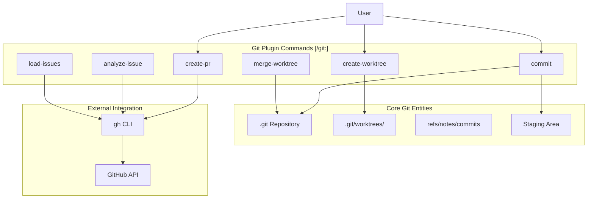
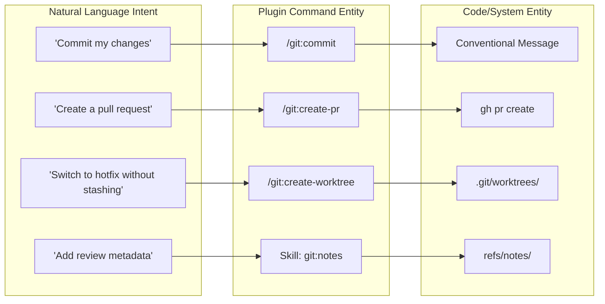
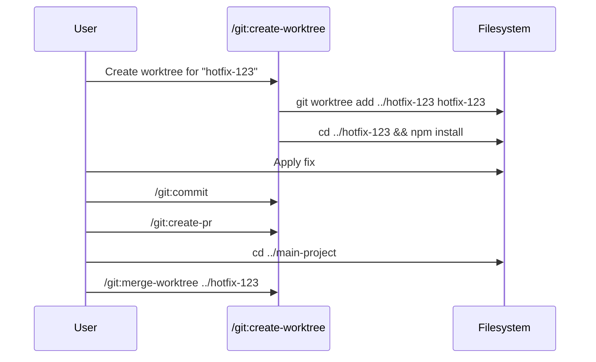

<!-- source: DeepWiki mcp.deepwiki.com · repo neolabhq/context-engineering-kit · extra page Git Plugin · fetched 2026-10-27 -->

# Git Plugin

Relevant source files

The following files were used as context for generating this wiki page:

- [docs/plugins/git/README.md](docs/plugins/git/README.md)
- [plugins/docs/README.md](plugins/docs/README.md)
- [plugins/git/.claude-plugin/plugin.json](plugins/git/.claude-plugin/plugin.json)
- [plugins/git/README.md](plugins/git/README.md)
- [plugins/git/skills/notes/SKILL.md](plugins/git/skills/notes/SKILL.md)
- [plugins/git/skills/worktrees/SKILL.md](plugins/git/skills/worktrees/SKILL.md)
- [plugins/kaizen/README.md](plugins/kaizen/README.md)
- [plugins/tdd/README.md](plugins/tdd/README.md)
- [plugins/tech-stack/README.md](plugins/tech-stack/README.md)

## Purpose and Scope

The Git Plugin provides commands for standardized Git operations including conventional commits with emoji, pull request creation, GitHub issue management, and advanced worktree operations. It automates Git workflows to ensure consistent commit history, proper PR formatting, and efficient issue-to-code transformation while supporting parallel development through worktree management.

This page documents the Git plugin's commands, skills, and integration patterns.

**Sources:** [plugins/git/README.md:1-16](), [plugins/git/.claude-plugin/plugin.json:1-9]()

## Overview

The Git Plugin standardizes Git operations across teams by:

- **Enforcing conventional commits** - All commits follow the [Conventional Commits](https://www.conventionalcommits.org) specification with emoji prefixes. [plugins/git/README.md:7-7]()
- **Automating PR creation** - Uses GitHub CLI to create pull requests with templates and proper formatting. [plugins/git/README.md:8-8]()
- **Transforming issues to specs** - Converts GitHub issues into technical specifications for implementation. [plugins/git/README.md:9-9]()
- **Parallel Development** - Manages git worktrees to allow working on multiple branches simultaneously without stashing. [plugins/git/README.md:50-52]()
- **Metadata Management** - Utilizes git notes to attach non-invasive metadata to commits. [plugins/git/README.md:57-57]()

The plugin requires **GitHub CLI (`gh`)** for full functionality including PR creation, issue loading, and reviewer assignment. [plugins/git/README.md:16-16]()

## Architecture

### Command and Data Flow

**Sources:** [plugins/git/README.md:44-52](), [plugins/git/skills/worktrees/SKILL.md:22-22](), [plugins/git/skills/notes/SKILL.md:18-18]()

### Natural Language to Git Entity Mapping

This diagram illustrates how user intent (Natural Language) maps to specific Git commands and underlying filesystem entities managed by the plugin.

**Sources:** [plugins/git/README.md:44-57](), [plugins/git/skills/worktrees/SKILL.md:10-22](), [plugins/git/skills/notes/SKILL.md:10-21]()

## Commands

### /git:commit
Creates well-formatted commits following the Conventional Commits specification with appropriate emoji prefixes. It analyzes staged changes via `git status` and `git diff --cached` to suggest types and descriptions. [plugins/git/README.md:45-45]()

### /git:create-pr
Creates GitHub pull requests using `gh pr create`. It automates branch detection, searches for templates in `.github/`, and generates summaries from commit logs. [plugins/git/README.md:46-46]()

### /git:analyze-issue
Fetches a GitHub issue using `gh issue view` and generates a detailed technical specification, including requirements extraction and task breakdown. [plugins/git/README.md:47-47]()

### /git:load-issues
Loads all open issues from GitHub and saves them as markdown files for local analysis. [plugins/git/README.md:48-48]()

### /git:create-worktree
Creates and sets up git worktrees for parallel development. This allows checking out multiple branches in separate directories simultaneously. [plugins/git/README.md:50-50](), [plugins/git/skills/worktrees/SKILL.md:10-12]()

### /git:merge-worktree
Merges changes from a worktree into the current branch. Supports selective file checkout, cherry-picking, and interactive patch selection. [plugins/git/README.md:52-52]()

## Skills

### git:worktrees
Provides the logic and patterns for managing multiple working directories sharing the same repository. [plugins/git/skills/worktrees/SKILL.md:2-4]()

**Key Concepts:**
- **Main worktree:** The original repository directory. [plugins/git/skills/worktrees/SKILL.md:18-18]()
- **Linked worktree:** Additional directories created via `git worktree add`. [plugins/git/skills/worktrees/SKILL.md:19-19]()
- **Branch lock:** Prevents a branch from being checked out in more than one worktree at a time. [plugins/git/skills/worktrees/SKILL.md:21-21]()

**Sources:** [plugins/git/skills/worktrees/SKILL.md:16-22]()

### git:notes
Enables attaching metadata (review status, test results) to commits without modifying the commit SHA or history. [plugins/git/skills/notes/SKILL.md:2-4](), [plugins/git/skills/notes/SKILL.md:10-12]()

**Common Operations:**
- `git notes add -m "message" <sha>`: Attach a note. [plugins/git/skills/notes/SKILL.md:27-27]()
- `git notes --ref=<name>`: Use custom namespaces for different types of metadata (e.g., `reviews`, `testing`). [plugins/git/skills/notes/SKILL.md:32-32]()

**Sources:** [plugins/git/skills/notes/SKILL.md:16-35]()

## Conventional Commit Mapping

| Emoji | Type | Description |
| :--- | :--- | :--- |
| ✨ | `feat` | New feature |
| 🐛 | `fix` | Bug fix |
| 📝 | `docs` | Documentation |
| ♻️ | `refactor` | Code restructuring |
| ✅ | `test` | Adding/fixing tests |
| 🔧 | `chore` | Maintenance/Config |

**Sources:** [plugins/git/README.md:45-45](), [plugins/git/README.md:14-14]()

## Workflow Example: Parallel Development

**Sources:** [plugins/git/skills/worktrees/SKILL.md:142-160](), [plugins/git/README.md:50-52]()

---

