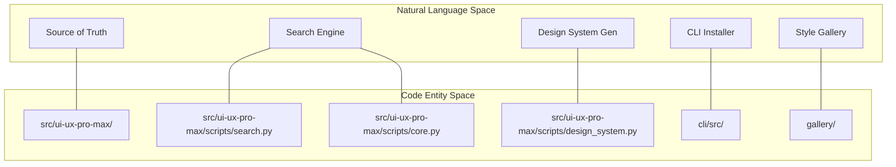
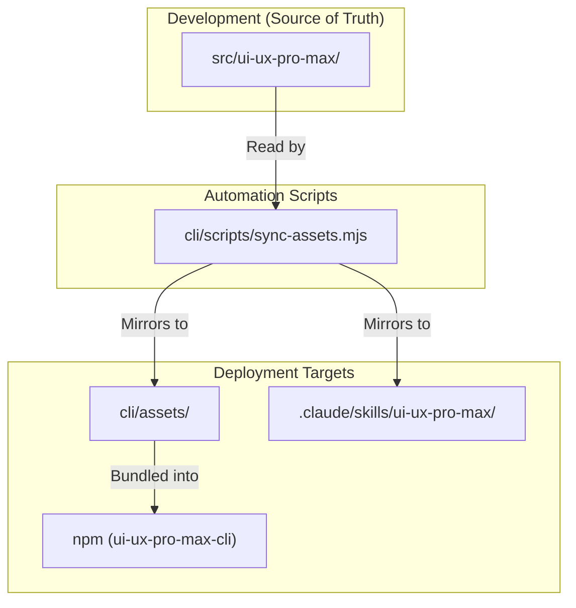

<!-- source: DeepWiki mcp.deepwiki.com · repo nextlevelbuilder/ui-ux-pro-max-skill · page 9 Development Guide · fetched 2026-10-27 -->

# Development Guide

Relevant source files

The following files were used as context for generating this wiki page:

- [.github/workflows/release.yml](.github/workflows/release.yml)
- [.github/workflows/smoke-stacks.yml](.github/workflows/smoke-stacks.yml)
- [.releaserc.json](.releaserc.json)
- [CLAUDE.md](CLAUDE.md)
- [CONTRIBUTING.md](CONTRIBUTING.md)
- [cli/assets/data/app-interface.csv](cli/assets/data/app-interface.csv)
- [cli/assets/data/stacks/astro.csv](cli/assets/data/stacks/astro.csv)
- [cli/assets/templates/base/skill-content.md](cli/assets/templates/base/skill-content.md)
- [cli/scripts/build.mjs](cli/scripts/build.mjs)
- [scripts/sync-release-version.mjs](scripts/sync-release-version.mjs)
- [src/ui-ux-pro-max/templates/base/skill-content.md](src/ui-ux-pro-max/templates/base/skill-content.md)

This document provides guidance for contributors who want to modify, test, and extend the UI/UX Pro Max system. It covers the development environment setup, codebase structure, file synchronization requirements, and key development workflows.

For specific tasks, see:
- [Source of Truth and Sync Rules](#9.1) — Explain the `src/ui-ux-pro-max/` source of truth and the manual sync requirements for CLI assets.
- [Adding New Platforms](#9.2) — Provide step-by-step instructions for adding support for new AI platforms via template JSON files.
- [Testing and Contributing](#9.3) — Document the Git workflow, local testing, validation scripts, and build/publish procedures.

## Prerequisites and Tools

The UI/UX Pro Max system requires the following development tools:

| Tool | Version | Purpose |
|------|---------|---------|
| Python | 3.x | Search engine and data processing (Standard library only) |
| Node.js | 22+ | CLI tool runtime and script execution |
| Bun | Latest | Primary build tool for the CLI and gallery |
| Git | Any | Version control |

The CLI uses Bun as its primary build tool, as seen in the build script [cli/scripts/build.mjs:15-18](). Python scripts are designed to run without external dependencies [CLAUDE.md:107-107]().

Sources: [CLAUDE.md:105-109](), [cli/scripts/build.mjs:1-29](), [CONTRIBUTING.md:21-29]()

## Repository Structure

The repository uses a **Source of Truth** pattern. All canonical data and logic reside in `src/ui-ux-pro-max/`.

### Codebase Entity Mapping

The following diagram bridges natural language concepts to specific code entities and file paths.

Sources: [CLAUDE.md:41-69](), [CONTRIBUTING.md:46-59]()

### Directory Layout

| Directory | Purpose | Type |
|-----------|---------|------|
| `src/ui-ux-pro-max/` | Single source of truth for all skill content | Source |
| `src/ui-ux-pro-max/data/` | CSV databases (Styles, Palettes, Stacks, etc.) | Data |
| `src/ui-ux-pro-max/scripts/` | Python logic (`search.py`, `core.py`, `design_system.py`) | Logic |
| `src/ui-ux-pro-max/templates/` | Templates for generating platform-specific skill files | Templates |
| `cli/` | Source and assets for `ui-ux-pro-max-cli` npm package | Tooling |
| `gallery/` | Next.js web application for visual style browsing | Sub-skill |
| `.claude/skills/` | Mirror of source used for local Claude Code development | Test Env |

Sources: [CLAUDE.md:41-69](), [CONTRIBUTING.md:46-59]()

## File Synchronization Rules

The system relies on a strict synchronization hierarchy. Because symlinks can break on certain operating systems, the repo uses real file mirrors kept in sync by automation. For details, see [Source of Truth and Sync Rules](#9.1).

### Sync Architecture Diagram

### Key Sync Rules
1. **Source of Truth**: Always edit data (`.csv`) and logic (`.py`) in `src/ui-ux-pro-max/` [CLAUDE.md:75-76]().
2. **Sync Command**: Run `npm run sync:assets` within the `cli/` directory to propagate changes to the CLI assets and local test folders [CLAUDE.md:95-97]().
3. **Verification**: The CI workflow `Check asset sync` enforces that `cli/assets/` matches `src/` before any merge [CLAUDE.md:80-80]().

Sources: [CLAUDE.md:73-104](), [CONTRIBUTING.md:100-103]()

## Development Workflows

### Adding New Platforms
The system is designed to be extensible. Adding a new AI assistant involves creating a JSON configuration in `src/ui-ux-pro-max/templates/platforms/`. These configs define how the skill is installed (e.g., `Skill` vs `Workflow` mode).

For a step-by-step walkthrough, see [Adding New Platforms](#9.2).

### CLI and Data Testing
We use a combination of Python validation scripts and Playwright E2E tests to ensure system integrity.

- **Data Validation**: `npm --prefix cli run verify:data` runs aggregate offline data gates [release.yml:57-58]().
- **E2E Testing**: `npx playwright test` within the `cli/` directory runs regression tests for the installer [release.yml:64-66]().
- **Relevance Testing**: `evaluate-relevance.py` is used to verify search engine accuracy [smoke-stacks.yml:11-11]().

### Git and Release Workflow
We follow [Conventional Commits](https://www.conventionalcommits.org) and a feature-branch workflow [CONTRIBUTING.md:120-134]().

1. **Branching**: Never push directly to `main`. Use `feat/` or `fix/` branches [CLAUDE.md:113-115]().
2. **Releases**: Managed by `semantic-release` [release.yml:78-90]().
3. **Version Sync**: The `scripts/sync-release-version.mjs` script ensures the version is consistent across `package.json`, `skill.json`, and marketplace manifests [sync-release-version.mjs:1-78]().

For details on PR requirements, see [Testing and Contributing](#9.3).

Sources: [CLAUDE.md:111-118](), [CONTRIBUTING.md:94-118](), [release.yml:1-91](), [sync-release-version.mjs:49-77]()

---

