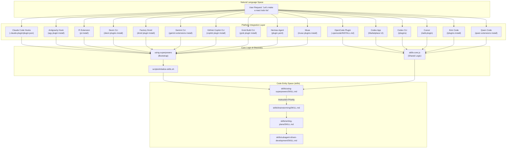
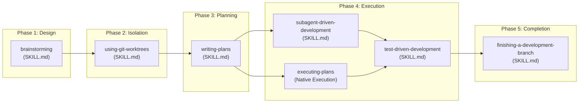

<!-- source: DeepWiki mcp.deepwiki.com · repo obra/superpowers · page 1 Overview · fetched 2026-10-27 -->

# Overview

Relevant source files

The following files were used as context for generating this wiki page:

- [.claude-plugin/plugin.json](.claude-plugin/plugin.json)
- [README.md](README.md)
- [RELEASE-NOTES.md](RELEASE-NOTES.md)
- [skills/brainstorming/visual-companion.md](skills/brainstorming/visual-companion.md)

Superpowers is a complete software development methodology for coding agents, built on a foundation of composable skills and a mandatory instruction protocol [README.md:3-4](). It acts as a multi-platform plugin that provides structured development workflows and AI skills across **Claude Code**, **Antigravity**, **Codex App**, **Codex CLI**, **Cursor**, **Devin CLI**, **Factory Droid**, **Gemini CLI**, **GitHub Copilot CLI**, **Grok Build CLI**, **Kimi Code**, **OpenCode**, **Pi**, **Qwen Code**, **Hermes Agent**, and **Muse** [README.md:10-25]().

The system is currently at version `6.4.2` [.claude-plugin/plugin.json:4-4]() and is maintained at [https://github.com/obra/superpowers](https://github.com/obra/superpowers) [.claude-plugin/plugin.json:9-10]().

Sources: [README.md:1-25](), [.claude-plugin/plugin.json:1-20](), [RELEASE-NOTES.md:3-4]()

---

## Core Purpose and Philosophy

The fundamental goal of Superpowers is to transform AI coding agents from reactive code-writers into systematic engineers. It prevents agents from jumping directly into code by enforcing a "step back" approach to tease out specifications and sign off on designs before implementation begins [README.md:35-37]().

### The 1% Rule and Meta-Skill
The system is anchored by the `using-superpowers` meta-skill [README.md:247-247](). It enforces a strict protocol where the agent checks for relevant skills before any task; these are treated as mandatory workflows, not suggestions. The instruction priority hierarchy ensures that skill-based instructions override base model behaviors and even user instructions if they conflict with the methodology's safety or quality standards [README.md:247-247]().

### Key Principles
| Principle | Implementation in Code |
| :--- | :--- |
| **Test-Driven Development** | Enforced via `test-driven-development` skill RED-GREEN-REFACTOR cycle [README.md:39-40](). The project's entire test suite defines "green" [RELEASE-NOTES.md:52-53](). |
| **Systematic over Ad-hoc** | Replaces intuition with 4-phase processes in `systematic-debugging` [README.md:58-58](). |
| **Complexity Reduction** | Emphasizes YAGNI (You Aren't Gonna Need It) and DRY (Don't Repeat Yourself) [README.md:39-40](). |
| **Isolation & Safety** | Mandatory use of git worktrees for workspace isolation and clean baselines [README.md:58-58](). |
| **Plan-focused Implementation** | `writing-plans` records decisions, not code, focusing on signatures, test assertions, and spec values [RELEASE-NOTES.md:9-11](). |

Sources: [README.md:35-43](), [README.md:247-247](), [RELEASE-NOTES.md:9-11](), [RELEASE-NOTES.md:52-53]()

---

## Multi-Platform Architecture

Superpowers uses a single source of truth (the `skills/` directory) but integrates uniquely with various AI environments through platform-specific hooks and configuration files.

### Platform Integration Mapping

| Platform | Integration Mechanism | Key Configuration File / Command |
| :--- | :--- | :--- |
| **Claude Code** | Native marketplace/hooks | `.claude-plugin/plugin.json` [.claude-plugin/plugin.json:1-20]() |
| **Antigravity** | Session-start hook | `agy plugin install https://github.com/obra/superpowers` [README.md:89-90]() |
| **Codex App** | Official plugin marketplace | `+` next to Superpowers in Plugins sidebar [README.md:99-101]() |
| **Codex CLI** | Official plugin marketplace | `/plugins` then `superpowers` [README.md:109-116]() |
| **Cursor** | Marketplace/hooks | `/add-plugin superpowers` [README.md:126-126]() |
| **Devin CLI** | Native plugin loader | `devin plugins install obra/superpowers` [README.md:135-135]() |
| **Factory Droid** | Marketplace registration | `droid plugin marketplace add https://github.com/obra/superpowers` [README.md:149-149]() |
| **Gemini CLI** | Extension system | `gemini extensions install https://github.com/obra/superpowers` [README.md:162-162]() |
| **GitHub Copilot CLI** | Marketplace registration | `copilot plugin marketplace add obra/superpowers-marketplace` [README.md:178-178]() |
| **Grok Build CLI** | Official plugin marketplace | `grok plugin install superpowers@xai-official` [README.md:193-194]() |
| **Kimi Code** | Plugin marketplace | `/plugins install https://github.com/obra/superpowers` [README.md:218-218]() |
| **OpenCode** | JS plugin / prompt transform | `https://raw.githubusercontent.com/obra/superpowers/refs/heads/main/.opencode/INSTALL.md` [README.md:231-231]() |
| **Pi** | Session-start extension | `pi install` [README.md:238-238]() |
| **Qwen Code** | Extension system | `qwen extensions install obra/superpowers` [RELEASE-NOTES.md:64-64]() |
| **Hermes Agent** | Native loader/bootstrap | `git clone` registration [README.md:25-25]() (implied by general agent support) |
| **Muse** | Native plugin manifest | `muse plugins install ./` [RELEASE-NOTES.md:63-63]() |

### Data Flow: Natural Language to Code Entity
The following diagram illustrates how a user's natural language request is routed through the platform-specific "Shim" into the core logic and finally to the specific skill files.

**Request Routing and Skill Discovery:**

Sources: [README.md:10-237](), [.claude-plugin/plugin.json:1-20](), [RELEASE-NOTES.md:61-64]()

---

## Technical Implementation Details

### Subagent Workspace Management
Workspace management is now **plan-scoped**. Instead of a generic `.superpowers/sdd/` directory, the system resolves a per-plan directory: `.superpowers/sdd/<plan-basename>/` [RELEASE-NOTES.md:56-57](). This prevents follow-up plans from reading previous ledgers as their own progress and reduces tool calls for cross-plan forensics [RELEASE-NOTES.md:56-57]().

### Subagent-Driven Development (SDD) v6.4 Evolution
- **Plan-scoped Workspaces**: Plans with the same basename no longer share a workspace; each plan gets its own directory to prevent collisions [RELEASE-NOTES.md:56-57]().
- **Review Package Validation**: `review-package` rejects empty or non-descendant `BASE..HEAD` ranges to prevent "clean" reviews of nothing [RELEASE-NOTES.md:58-58]().
- **Claude Code Controller Nesting**: On Claude Code, the controller can run one layer down as a nested subagent on a mid-tier model, reducing cost and wall clock time [RELEASE-NOTES.md:59-59]().

### Native Execution (`executing-plans`)
The `executing-plans` skill has been rebuilt as a "Native (inline) execution" mode. It now runs the entire plan under the same workspace, ledger, and stopping rules as SDD, then dispatches a single whole-branch review. This is the cheapest way to run a plan and is suitable for mid-tier session models [RELEASE-NOTES.md:31-34](). It no longer stops every few tasks for checks, instead providing one review at the end [RELEASE-NOTES.md:30-30]().

### Visual Brainstorming Companion
The `brainstorming` skill can leverage a browser-based visual companion for showing mockups, diagrams, and options [skills/brainstorming/visual-companion.md:1-2](). This server watches a directory for HTML files and serves the newest one, recording user selections to an `events` file [skills/brainstorming/visual-companion.md:28-29](). It supports various platforms with specific startup commands for backgrounding or foregrounding the server [skills/brainstorming/visual-companion.md:60-91](). The URL includes a session key for security [skills/brainstorming/visual-companion.md:47-53]().

Sources: [RELEASE-NOTES.md:30-34](), [RELEASE-NOTES.md:56-59](), [skills/brainstorming/visual-companion.md:1-119]()

---

## Structured Workflow Pipeline

Superpowers enforces a linear pipeline from idea to merged code.

**Workflow Entity Diagram:**

### Key Workflow Steps
1. **brainstorming**: Finds out the user's intent before proposing features, reflecting it back for correction, and tying approval to design and planning stages [RELEASE-NOTES.md:43-44](). It can use a visual companion for visual content [skills/brainstorming/visual-companion.md:1-2]().
2. **writing-plans**: Produces leaner plans that record decisions (signatures, test assertions, spec values) rather than full code [RELEASE-NOTES.md:5-5](). Plans now include a "Review Focus" section for inputs or failure modes implied by the spec but not covered by tests [RELEASE-NOTES.md:39-39](). The user reviews the saved plan before anything runs [RELEASE-NOTES.md:37-37]().
3. **subagent-driven-development**: Dispatches subagents to work through tasks autonomously, inspecting and reviewing work against the plan and spec [README.md:41-41]().
4. **executing-plans**: Offers a "Native (inline) execution" mode as a cheaper alternative to SDD, running the whole plan and then providing one final review [RELEASE-NOTES.md:31-34]().
5. **diagnosing-superpowers**: A new skill to figure out what went wrong in a session, reading transcripts and reporting findings with `path:line` evidence [RELEASE-NOTES.md:27-27]().
6. **Code Review**: Reviewers judge behavior not explicitly mentioned in the spec by what a reasonable user would expect [RELEASE-NOTES.md:47-47](). The `BASE_SHA` for multi-commit reviews now uses `git merge-base origin/main HEAD` for accuracy [RELEASE-NOTES.md:48-48]().

Sources: [README.md:35-43](), [RELEASE-NOTES.md:5-5](), [RELEASE-NOTES.md:27-27](), [RELEASE-NOTES.md:31-34](), [RELEASE-NOTES.md:37-39](), [RELEASE-NOTES.md:43-44](), [RELEASE-NOTES.md:47-48](), [skills/brainstorming/visual-companion.md:1-2]()

---

