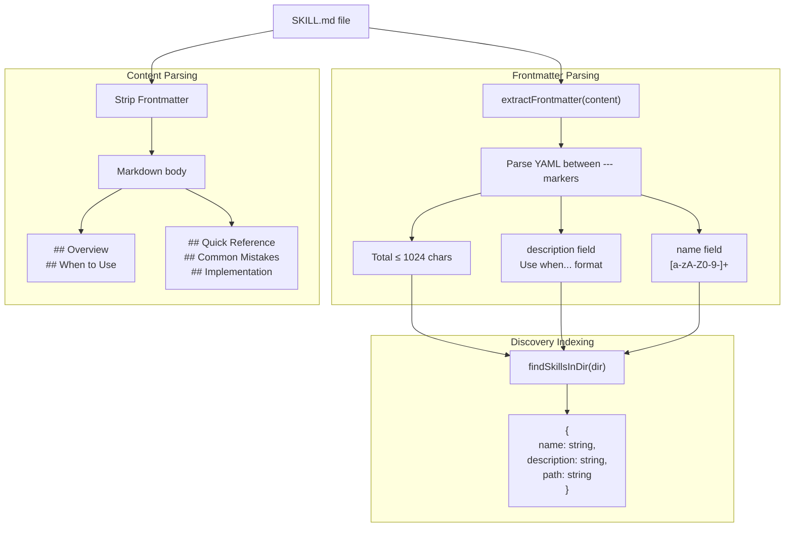
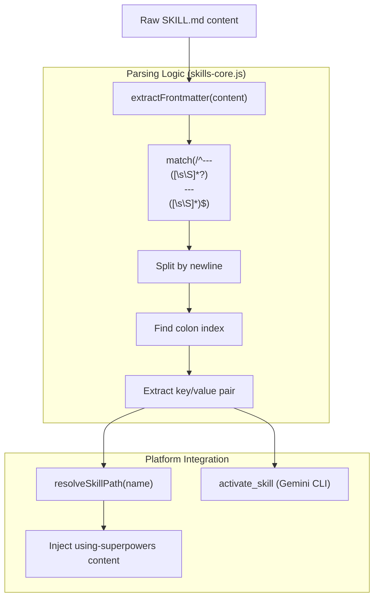
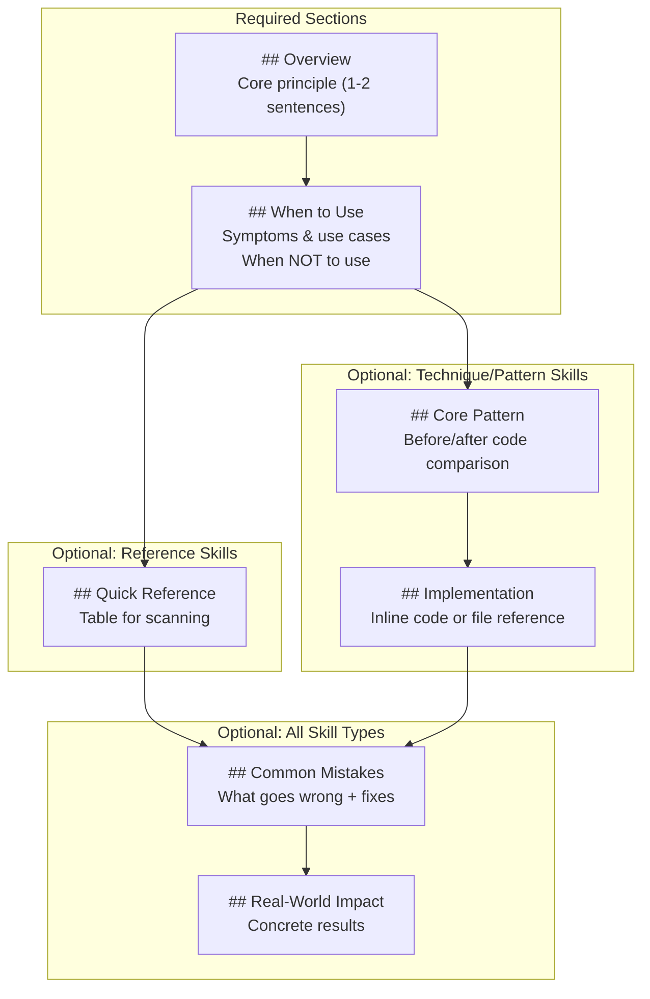

<!-- source: DeepWiki mcp.deepwiki.com · repo obra/superpowers · page 8.2 SKILL.md Format and Structure · fetched 2026-10-27 -->

# SKILL.md Format and Structure

<details>
<summary>Relevant source files</summary>

The following files were used as context for generating this wiki page:

- [docs/superpowers/specs/2026-06-10-positive-instruction-redesign-design.md](docs/superpowers/specs/2026-06-10-positive-instruction-redesign-design.md)
- [skills/executing-plans/SKILL.md](skills/executing-plans/SKILL.md)
- [skills/using-superpowers/references/gemini-tools.md](skills/using-superpowers/references/gemini-tools.md)
- [skills/writing-skills/SKILL.md](skills/writing-skills/SKILL.md)
- [skills/writing-skills/anthropic-best-practices.md](skills/writing-skills/anthropic-best-practices.md)

</details>


## Purpose and Scope

This document specifies the technical format and structure requirements for `SKILL.md` files in the Superpowers skills repository. It defines the YAML frontmatter schema, required document sections, and file organization patterns.

For the test-driven development process of creating skills, see [8.1 Test-Driven Development for Skills](). For optimization techniques to improve skill discoverability, see [8.4 Skill Discovery Optimization (CSO)](). For the complete creation workflow and deployment checklist, see [8.5 Skill Creation Checklist]().

## File Format Overview

Every skill consists of a `SKILL.md` file with mandatory YAML frontmatter followed by markdown content. The file structure follows a strict schema to enable platform parsing and skill discovery mechanisms.

### SKILL.md Components and Parsing Pipeline

**Diagram: "SKILL.md structure and parsing logic"**



Sources: [skills/writing-skills/SKILL.md:93-137](), [skills/writing-skills/SKILL.md:72-80]()

## YAML Frontmatter Specification

The frontmatter contains exactly two required fields: `name` and `description` [skills/writing-skills/SKILL.md:96-96](). The total frontmatter block must not exceed 1024 characters [skills/writing-skills/SKILL.md:97-97]().

### Field Requirements

| Field | Type | Constraints | Purpose |
|-------|------|------------|---------|
| `name` | string | Letters, numbers, hyphens only. No parentheses or special characters [skills/writing-skills/SKILL.md:98-98](). | Unique skill identifier used for skill resolution. Recommended gerund form (e.g., `writing-skills`) [skills/writing-skills/anthropic-best-practices.md:157-164](). |
| `description` | string | Third-person. Starts with "Use when...". Max 500 characters recommended [skills/writing-skills/SKILL.md:99-103](). | Triggers skill discovery via semantic search. Must focus on triggering conditions [skills/writing-skills/SKILL.md:150-152](). |

### Frontmatter Validation and Injection Flow

**Diagram: "Validation logic for Skill Discovery in Code Entity Space"**



Sources: [skills/writing-skills/SKILL.md:95-103](), [skills/writing-skills/anthropic-best-practices.md:147-153](), [skills/using-superpowers/references/gemini-tools.md:17-17]()

### Valid Frontmatter Examples

```yaml
# ✅ Valid: Standard format
---
name: condition-based-waiting
description: Use when tests have race conditions, timing dependencies, or pass/fail inconsistently
---

# ✅ Valid: Technology-specific
---
name: react-router-auth
description: Use when using React Router and handling authentication redirects
---

# ❌ Invalid: Contains parentheses in name
---
name: async-helpers-(node-20)
description: Use when working with async code
---

# ❌ Invalid: First person in description
---
name: debugging-tools
description: I can help you debug issues using systematic approaches
---

# ❌ Invalid: Summarizes workflow instead of triggers
---
name: subagent-driven-dev
description: Use when executing plans - dispatches subagent per task with code review between tasks
---
```

Sources: [skills/writing-skills/SKILL.md:95-103](), [skills/writing-skills/SKILL.md:160-172](), [skills/writing-skills/anthropic-best-practices.md:189-195]()

## Description Field: Triggering Conditions Only

The `description` field must describe **when** to invoke the skill, not **what** the skill does or **how** it works [skills/writing-skills/SKILL.md:150-152](). This constraint prevents agents from following description summaries as "shortcuts" instead of reading the full skill content.

### Why Workflow Summaries Break Discovery

Testing revealed that when descriptions summarize workflow steps, agents treat the description as a complete instruction set and skip reading the skill body [skills/writing-skills/SKILL.md:154-159](). For example, a description saying "code review between tasks" caused an agent to perform only **one** review, even though the skill's flowchart showed a two-stage review process (spec compliance then code quality) [skills/writing-skills/SKILL.md:154-156]().

Sources: [skills/writing-skills/SKILL.md:140-181]()

## Required Document Sections

Every skill must include specific sections in a defined order to maintain consistency across the library.

### Mandatory Section Structure

**Diagram: "Standard SKILL.md section hierarchy"**



Sources: [skills/writing-skills/SKILL.md:105-137]()

### Section Content Guidelines

**"## Overview"**
- Define the core principle in 1-2 sentences [skills/writing-skills/SKILL.md:114-114]().
- Example: "Writing skills IS Test-Driven Development applied to process documentation" [skills/writing-skills/SKILL.md:10-10]().
- Skills must announce their usage at the start of the session [skills/executing-plans/SKILL.md:12-12]().

**"## When to Use"**
- Bullet list of specific **SYMPTOMS** and use cases [skills/writing-skills/SKILL.md:119-119]().
- Include a "When NOT to use" list to prevent misapplication [skills/writing-skills/SKILL.md:120-120]().
- Use an inline flowchart if the decision to use the skill is non-obvious [skills/writing-skills/SKILL.md:117-117]().

**"## Quick Reference"**
- Use tables or bullets for scanning common operations [skills/writing-skills/SKILL.md:125-126]().

**"## Implementation"**
- Use inline code for simple patterns (< 50 lines) [skills/writing-skills/SKILL.md:129-129]().
- Link to separate files for heavy reference (100+ lines) or reusable tools [skills/writing-skills/SKILL.md:130-130]().

**"## Common Mistakes"**
- Document what goes wrong and provide specific fixes [skills/writing-skills/SKILL.md:132-133]().

Sources: [skills/writing-skills/SKILL.md:105-137](), [skills/writing-skills/SKILL.md:84-91](), [skills/executing-plans/SKILL.md:12-12]()

## Rationalization Tables and Progressive Disclosure

Rationalization tables are a specific type of content used within skills to guide agent decision-making. They are designed to be read at decision time, not composition time, and are effective for "recognition" tasks [docs/superpowers/specs/2026-06-10-positive-instruction-redesign-design.md:25-26](). This aligns with the principle of progressive disclosure, where detailed guidance is provided only when relevant.

**Example Rationalization Table (from `writing-skills/SKILL.md`)**

| TDD Concept | Skill Creation |
|-------------|----------------|
| **Test case** | Pressure scenario with subagent |
| **Production code** | Skill document (SKILL.md) |
| **Test fails (RED)** | Agent violates rule without skill (baseline) |
| **Test passes (GREEN)** | Agent complies with skill present |
| **Refactor** | Close loopholes while maintaining compliance |
| **Write test first** | Run baseline scenario BEFORE writing skill |
| **Watch it fail** | Document exact rationalizations agent uses |
| **Minimal code** | Write skill addressing those specific violations |
| **Watch it pass** | Verify agent now complies |
| **Refactor cycle** | Find new rationalizations → plug → re-verify |

This table maps abstract TDD concepts to concrete actions in skill creation, providing a clear reference for agents.

Sources: [skills/writing-skills/SKILL.md:32-44](), [docs/superpowers/specs/2026-06-10-positive-instruction-redesign-design.md:25-26]()

## File Organization Patterns

Skills follow a flat namespace structure within the `skills/` directory [skills/writing-skills/SKILL.md:82-82]().

### Directory Layout

```
skills/
  skill-name/
    SKILL.md              # Main reference (required)
    supporting-file.*     # Only if needed
```

**Separate files are used for:**
1. **Heavy reference** (100+ lines): API docs, comprehensive syntax [skills/writing-skills/SKILL.md:85-85]().
2. **Reusable tools**: Scripts, utilities, templates [skills/writing-skills/SKILL.md:86-86]().

**Keep inline:**
- Principles and concepts [skills/writing-skills/SKILL.md:89-89]().
- Code patterns under 50 lines [skills/writing-skills/SKILL.md:90-90]().

Sources: [skills/writing-skills/SKILL.md:72-92]()

## Token Efficiency Considerations

Skills must minimize token consumption as they load into the conversation context window [skills/writing-skills/anthropic-best-practices.md:11-13]().

### Token Reduction Techniques

1.  **Concise is key:** Challenge every sentence. "Does the agent really need this explanation?" [skills/writing-skills/anthropic-best-practices.md:22-26]().
2.  **Assume Intelligence:** Assume agents are already smart. Only add context they don't already have [skills/writing-skills/anthropic-best-practices.md:22-29]().
3.  **Avoid Verbosity:** Provide direct instructions or code examples rather than lengthy background narratives [skills/writing-skills/anthropic-best-practices.md:30-58]().
4.  **Set Appropriate Degrees of Freedom:** Match the level of specificity to the task's fragility. Use exact scripts for fragile operations (low freedom) and heuristics for context-dependent tasks (high freedom) [skills/writing-skills/anthropic-best-practices.md:59-131]().

Sources: [skills/writing-skills/anthropic-best-practices.md:11-131](), [skills/writing-skills/SKILL.md:84-91]()

---

