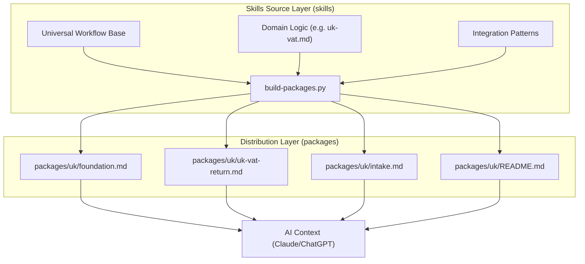
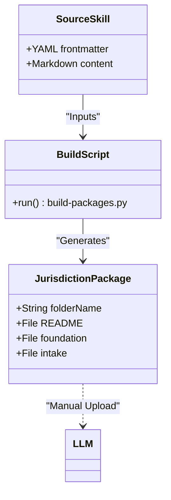

<!-- source: DeepWiki mcp.deepwiki.com · repo openaccountants/openaccountants · page 2.2 Packages Distribution Layer · fetched 2026-10-27 -->

# Packages Distribution Layer

Relevant source files

The following files were used as context for generating this wiki page:

- [CHANGELOG.md](CHANGELOG.md)
- [README.md](README.md)
- [START-HERE.md](START-HERE.md)
- [docs/INTELLIGENCE-ROADMAP.md](docs/INTELLIGENCE-ROADMAP.md)
- [docs/PROMOTION-PLAYBOOK.md](docs/PROMOTION-PLAYBOOK.md)
- [docs/QUALITY-TIERS.md](docs/QUALITY-TIERS.md)
- [docs/USER-JOURNEY-ANALYSIS.md](docs/USER-JOURNEY-ANALYSIS.md)
- [docs/growth-drafts.md](docs/growth-drafts.md)
- [llms.txt](llms.txt)
- [packages/australia/README.md](packages/australia/README.md)
- [packages/brazil/README.md](packages/brazil/README.md)
- [packages/canada/README.md](packages/canada/README.md)
- [packages/germany/README.md](packages/germany/README.md)
- [packages/india/README.md](packages/india/README.md)
- [packages/indonesia/README.md](packages/indonesia/README.md)
- [packages/malta/README.md](packages/malta/README.md)
- [packages/nepal/README.md](packages/nepal/README.md)
- [packages/portugal/README.md](packages/portugal/README.md)
- [packages/saudi-arabia/README.md](packages/saudi-arabia/README.md)
- [packages/south-africa/README.md](packages/south-africa/README.md)
- [packages/uk/README.md](packages/uk/README.md)
- [workflows/README.md](workflows/README.md)

The `packages/` directory serves as the distribution-ready output of the OpenAccountants build pipeline. While the `skills/` directory contains the modular source code, the `packages/` directory contains flattened, jurisdiction-specific bundles designed for direct consumption by AI agents and end-users [README.md:81-94]().

## Purpose and Distribution Logic

The distribution layer is designed to solve the "context fragmentation" problem. In the source layer, a tax rule might depend on a global workflow base, a domain-specific pattern, and a platform integration. The distribution layer compiles these dependencies into a single, cohesive folder per jurisdiction [README.md:143-154]().

### Key Characteristics
*   **Flattened Structure:** Every file required for a jurisdiction to function (e.g., Brazil or UK) is co-located in its respective folder [packages/brazil/README.md:13-33]().
*   **User-Facing:** This is the primary entry point for users who do not use the MCP server but instead upload files manually to LLMs like Claude or ChatGPT [START-HERE.md:88-92]().
*   **Immutable Output:** Files in `packages/` are generated. Any manual edits will be overwritten the next time `scripts/build-packages.py` is executed [README.md:98-99]().

### Sources:
* [README.md:81-94]()
* [README.md:143-154]()
* [packages/brazil/README.md:13-33]()
* [START-HERE.md:88-92]()

## Anatomy of a Jurisdiction Bundle

Each folder within `packages/` (e.g., `packages/uk/` or `packages/malta/`) follows a standardized composition to ensure the AI agent receives a complete operational context [README.md:143-154]().

| File | Role | Technical Content |
| :--- | :--- | :--- |
| `foundation.md` | **System Prompt** | Sets conservative defaults, output specifications, and the three-state classification contract [README.md:147](). |
| `intake.md` | **Orchestrator** | Contains the "Step 0" onboarding questions and refusal logic [README.md:148](). |
| `[domain]-tax.md` | **Domain Skill** | Specific logic for Income Tax, VAT, Payroll, etc., derived from the `skills/` directory [README.md:149-151](). |
| `README.md` | **User Guide** | Jurisdiction-specific instructions, verifier attribution, and local tax authority references [packages/uk/README.md:1-48](). |
| `*-workflow-base.md`| **Logic Shared** | Injected workflow bases (e.g., `payroll-workflow-base.md`) that define the state machine for that domain [packages/india/README.md:31-36](). |

### Data Flow: From Source to Package
The following diagram illustrates how the `build-packages.py` script assembles these bundles.

**Title: Build Pipeline Data Flow**

### Sources:
* [README.md:143-154]()
* [packages/uk/README.md:1-48]()
* [packages/india/README.md:31-36]()

## Skills vs. Packages: The "No-Edit" Rule

A critical distinction exists between the `skills/` directory and the `packages/` directory.

1.  **Skills (`skills/`):** The "Source Code." This is where developers and accountants fix bugs, update tax rates, or add new jurisdictions.
2.  **Packages (`packages/`):** The "Compiled Binaries." These are generated by `scripts/build-packages.py`.

**Why `packages/` should never be edited directly:**
*   **Sync Integrity:** Edits in `packages/` do not propagate back to the source.
*   **Build Overwrite:** The build pipeline clears and regenerates these folders to ensure they match the `manifest.json` and source files [README.md:98-99]().
*   **Verification Alignment:** Tier 1 (Accountant-verified) status is tracked at the source level. Manual edits to packages break the provenance chain required for the MCP server [llms.txt:13-18]().

### Sources:
* [README.md:98-99]()
* [llms.txt:13-18]()
* [packages/south-africa/README.md:55-69]()

## Jurisdiction Types and Structure

The distribution layer handles different types of jurisdictions with varying file counts depending on their coverage tier.

### 1. Accountant-Verified Bundles
Bundles like `packages/malta/` or `packages/brazil/` include a `README.md` that explicitly names the verifier (e.g., Michael Cutajar or Ariane Marrocos) and includes a "Verified rates & thresholds" block [packages/malta/README.md:6-11](), [packages/brazil/README.md:6-11]().

### 2. Multi-Level Bundles (US and Canada)
For jurisdictions with federal and sub-national tax layers, the package includes both:
*   **US:** `packages/us-ca/` contains Federal Schedule C logic plus California-specific adjustments [README.md:88-89]().
*   **Canada:** `packages/ca-on/` bundles Federal T1/T2125 with Ontario provincial rules [README.md:91-93]().

### 3. Vertical and Integration Injection
When a package is built for a specific user scenario, it may include files from `_verticals/` (e.g., `freelance-developer.md`) or `_integrations/` (e.g., `stripe.md`) to provide the AI with industry-specific classification logic [START-HERE.md:21-40]().

**Title: Package Entity Mapping**

### Sources:
* [packages/malta/README.md:6-11]()
* [packages/brazil/README.md:6-11]()
* [README.md:88-93]()
* [START-HERE.md:21-40]()

---

