# Page: Overview

# Overview

<details>
<summary>Relevant source files</summary>

The following files were used as context for generating this wiki page:

- [LICENSE](LICENSE)
- [README.md](README.md)
- [SECURITY.md](SECURITY.md)
- [assets/diagram.png](assets/diagram.png)
- [assets/logo.png](assets/logo.png)
- [assets/swarm_diagram.png](assets/swarm_diagram.png)

</details>


The OpenAI Swarm framework is an experimental, educational tool designed to make agent **coordination** and **execution** lightweight, highly controllable, and easily testable. It focuses on exploring patterns for managing multiple independent capabilities and instructions that are difficult to encode into a single prompt.

## Purpose and Scope

This document introduces the Swarm repository, its core primitives, and high-level architecture. It serves as the entry point for understanding how Swarm orchestrates multi-agent systems using the Chat Completions API.

- For details on the core implementation, see **Core Implementation** (Page 2).
- For information about the tool system, see **Tool System** (Page 3).
- For the airline and triage examples, see **Examples** (Page 4).
- For testing infrastructure, see **Testing** (Page 5).

## Core Primitives

Swarm is built on two primary abstractions: `Agent`s and **handoffs**.

1.  **Agents**: An `Agent` encompasses `instructions` and `tools` [README.md:76-77]().
2.  **Handoffs**: An agent can choose to hand off a conversation to another agent by returning that agent from a function call [README.md:31-39]().

Unlike the Assistants API, Swarm is **stateless** between calls; it does not store threads or messages on the server [README.md:81-87]().

Sources: [README.md:72-87](), [swarm/types.py:17-25]()

## High-Level Architecture

### System Components

The architecture bridges "Natural Language Space" (instructions) and "Code Entity Space" (Python functions) through the `Swarm` client.

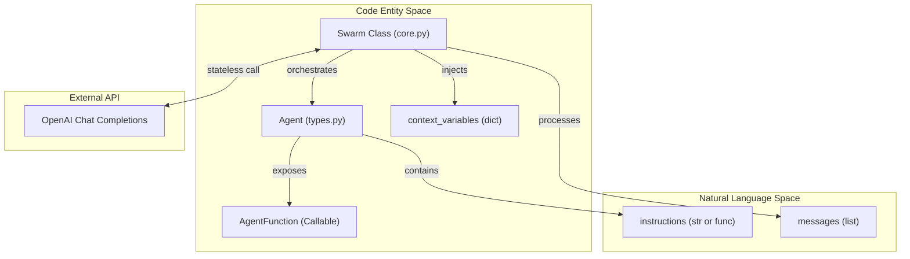

Sources: [swarm/core.py:26-38](), [swarm/types.py:17-25](), [README.md:104-112]()

### The Run Loop

The core of Swarm is the `Swarm.run()` method [swarm/core.py:139](). It implements a loop that continues until the agent has no more tools to call or reaches a turn limit.

| Step | Action | Code Reference |
| :--- | :--- | :--- |
| 1 | Get completion from OpenAI | `get_chat_completion` [swarm/core.py:165]() |
| 2 | Handle tool calls | `handle_tool_calls` [swarm/core.py:192]() |
| 3 | Execute Python functions | `function(*args)` [swarm/core.py:257]() |
| 4 | Process Handoffs | `isinstance(result.value, Agent)` [swarm/core.py:276]() |
| 5 | Update State | Update `context_variables` [swarm/core.py:284]() |

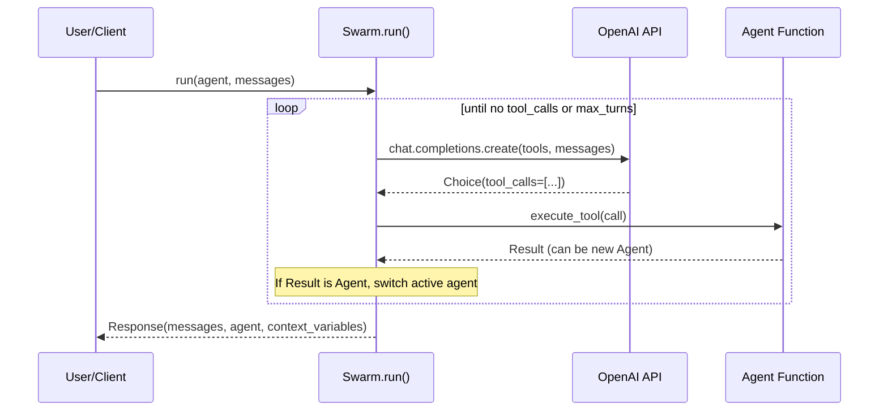

Sources: [swarm/core.py:139-229](), [README.md:118-125]()

## Key Concepts

### Agents and Instructions
An `Agent` [swarm/types.py:17-25]() can have instructions as a static string or a callable that returns a string. This allows instructions to be dynamic based on `context_variables` [swarm/core.py:159-161]().

### Context Variables
The `context_variables` dictionary [swarm/core.py:36]() is passed to functions that require it (detected via signature inspection in `util.function_to_json`) and can be updated by functions returning a `Result` object [swarm/types.py:11-15]().

### Tool Execution
Swarm automatically converts Python functions into JSON schemas using `function_to_json` [swarm/util.py:31-87](). It handles:
- Docstring extraction for parameter descriptions [swarm/util.py:61-75]().
- Type hint mapping (e.g., `str` to `"string"`) [swarm/util.py:14-23]().
- Execution of functions and returning the result back to the LLM [swarm/core.py:250-264]().

## Data Flow: Code to API

This diagram illustrates how internal code entities are mapped to the OpenAI API protocol.

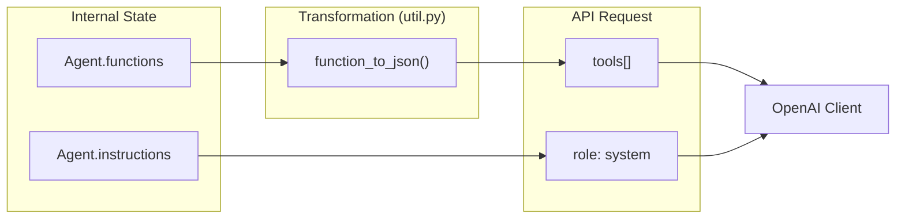

Sources: [swarm/core.py:165-190](), [swarm/util.py:31-87]()

## Implementation Variations
While the core library resides in `swarm/`, the repository includes extensive examples in `examples/` that demonstrate different orchestration patterns:
- **Triage**: Routing users to specialized agents [examples/triage_agent/]() [README.md:94]().
- **Airline**: Complex multi-turn handoffs for flight changes and baggage [examples/airline/]() [README.md:96]().
- **Streaming**: Real-time response handling using `Swarm.run(..., stream=True)` [swarm/core.py:101-137]().

Sources: [README.md:89-99](), [swarm/core.py:101-137]()

---

# Page: Core Implementation

# Core Implementation

<details>
<summary>Relevant source files</summary>

The following files were used as context for generating this wiki page:

- [.gitignore](.gitignore)
- [.pre-commit-config.yaml](.pre-commit-config.yaml)
- [README.md](README.md)

</details>


This document describes the core implementation of the OpenAI Swarm framework, which serves as the foundation for orchestrating AI agents and executing tasks. The core implementation provides essential components for managing agent interactions with the OpenAI API, handling tool calls, and maintaining shared context between agents.

## Architecture Overview

The core implementation consists of a small set of tightly integrated components that work together to provide a flexible framework for agent-based interactions.

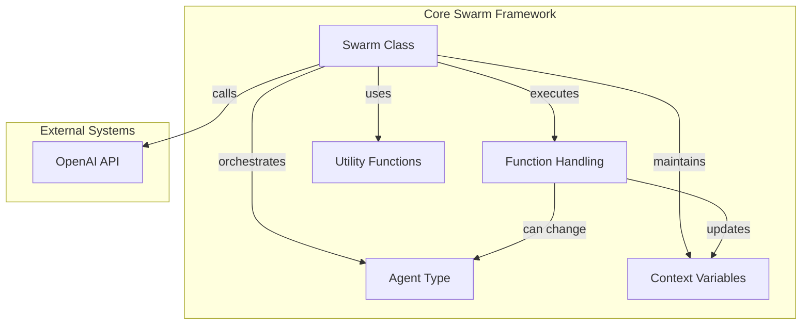

Sources: [swarm/core.py:26-292](), [swarm/util.py:1-87]()

## Components

The Swarm implementation is divided into several specialized modules. For detailed technical specifications, please refer to the child pages linked below.

### Swarm Class (core.py)
The `Swarm` class is the primary entry point. It instantiates an `OpenAI` client and manages the `run` loop, which handles the iterative process of getting completions, executing tools, and switching agents. 
- For details, see [Swarm Class (core.py)](#2.1).

Sources: [swarm/core.py:26-30](), [swarm/core.py:139-292]()

### Types and Data Models
Swarm uses Pydantic models to ensure type safety and consistent data structures. The primary models include `Agent`, `Response`, and `Result`.
- For details, see [Types and Data Models](#2.2).

Sources: [swarm/types.py:1-49]()

### Utility Functions
The `util.py` module contains internal helpers for transforming Python code into API-compatible formats, such as converting function signatures into JSON schemas and merging streaming chunks.
- For details, see [Utility Functions](#2.3).

Sources: [swarm/util.py:1-87]()

### REPL and Demo Loop
To facilitate testing and rapid prototyping, Swarm includes a REPL (Read-Eval-Print Loop) in `swarm/repl`. This allows developers to interact with agents in a terminal environment.
- For details, see [REPL and Demo Loop](#2.4).

Sources: [swarm/repl/repl.py:1-105]()

## Execution Flow

The core execution flow is implemented in the `run` method (and its streaming counterpart `run_and_stream`). This flow orchestrates the interaction between agents, the OpenAI API, and function calls.

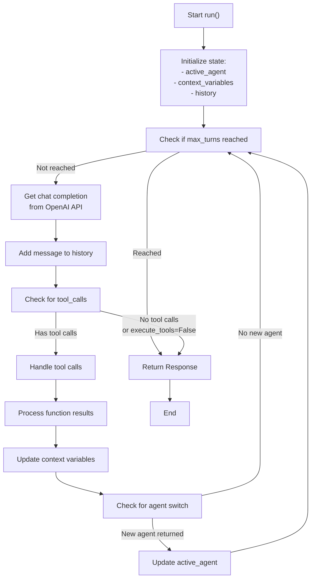

Sources: [swarm/core.py:231-292](), [swarm/core.py:139-229]()

## Bridge: Natural Language to Code Entities

The following diagrams map conceptual multi-agent behaviors to specific entities in the codebase.

### Agent Definition Bridge
This diagram shows how natural language instructions and capabilities are mapped to the `Agent` class properties.

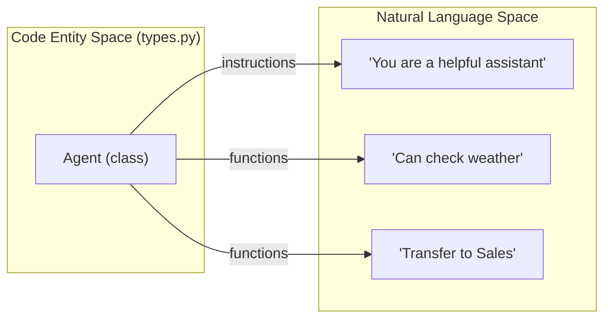

Sources: [swarm/types.py:13-21]()

### Tool Execution Bridge
This diagram shows how a model's intent to use a tool is translated into a Python function call within `core.py`.

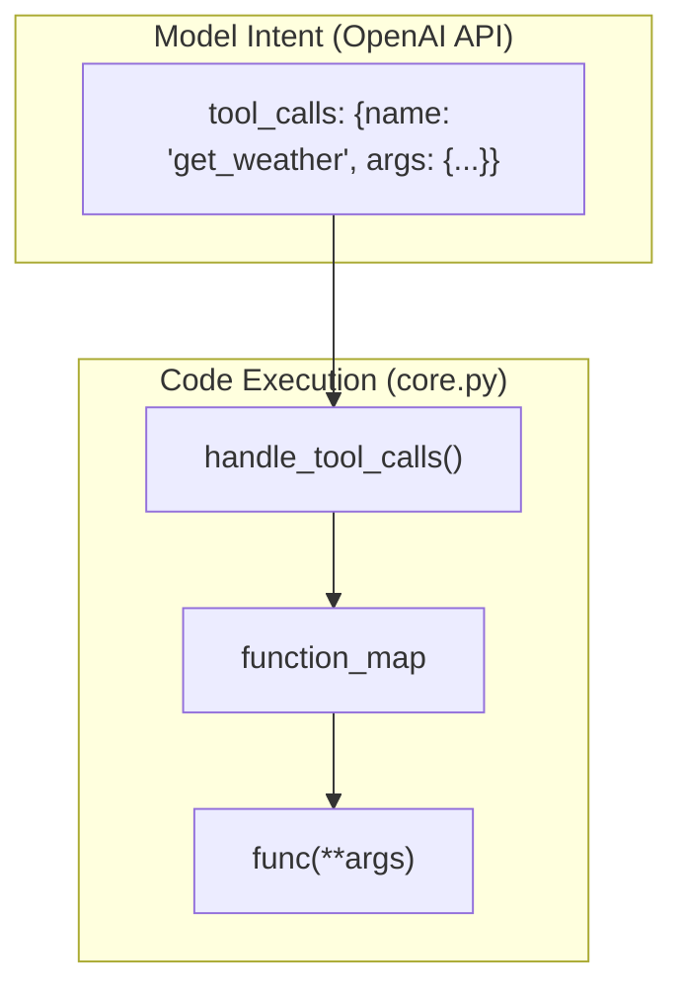

Sources: [swarm/core.py:89-137]()

## Integration with OpenAI API

The core implementation is tightly integrated with the OpenAI API, using its chat completions and function calling capabilities:

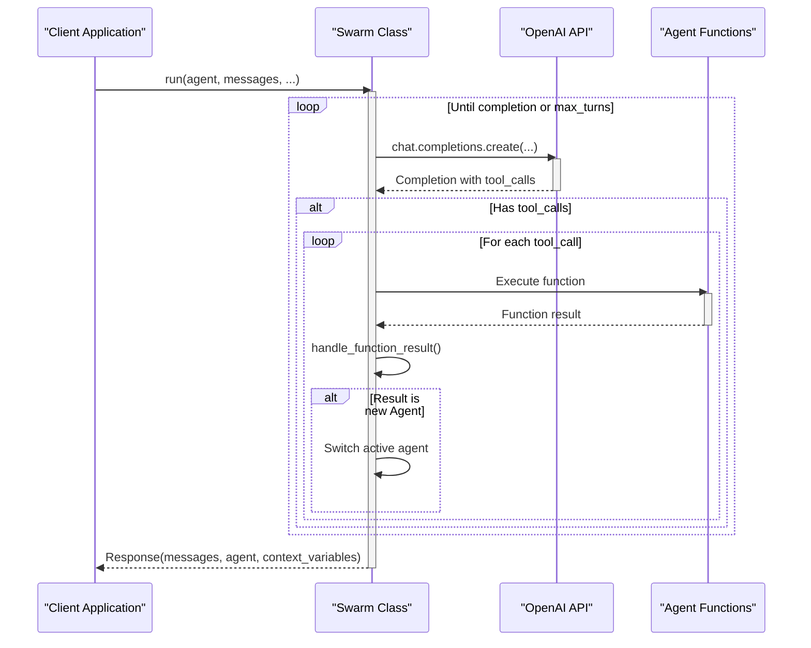

Sources: [swarm/core.py:32-69](), [swarm/core.py:231-292]()

---

# Page: Swarm Class (core.py)

# Swarm Class (core.py)

<details>
<summary>Relevant source files</summary>

The following files were used as context for generating this wiki page:

- [README.md](README.md)

</details>


## Purpose and Overview

The `Swarm` class serves as the central orchestrator for the OpenAI Swarm framework, providing the core functionality for managing AI agent interactions. This class handles the lifecycle of agent conversations, including chat completions, tool calls, and function execution. It forms the backbone of the framework, enabling multi-turn conversations with AI agents that can execute functions and maintain contextual information.

Sources: [swarm/core.py:26-292]()

## Class Structure and Initialization

The `Swarm` class has a simple initialization that accepts an optional OpenAI client:

```python
def __init__(self, client=None):
    if not client:
        client = OpenAI()
    self.client = client
```

This allows users to either provide their own configured OpenAI client or have the class create a default one.

Sources: [swarm/core.py:26-30]()

## Core Components and Relationships

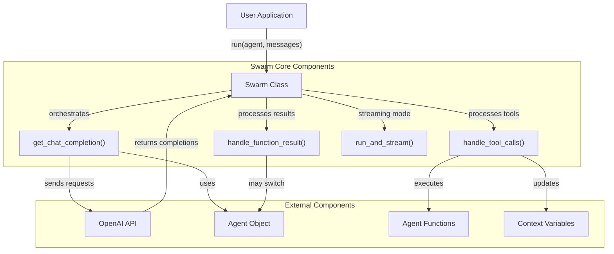

Diagram: Swarm Class Core Components and Relationships

Sources: [swarm/core.py:32-69](), [swarm/core.py:71-87](), [swarm/core.py:89-137](), [swarm/core.py:139-230](), [swarm/core.py:231-292]()

## Execution Flow

The core loop of Swarm is implemented in the `run` method. It continues to iterate until the model stops requesting tool calls or the `max_turns` limit is reached.

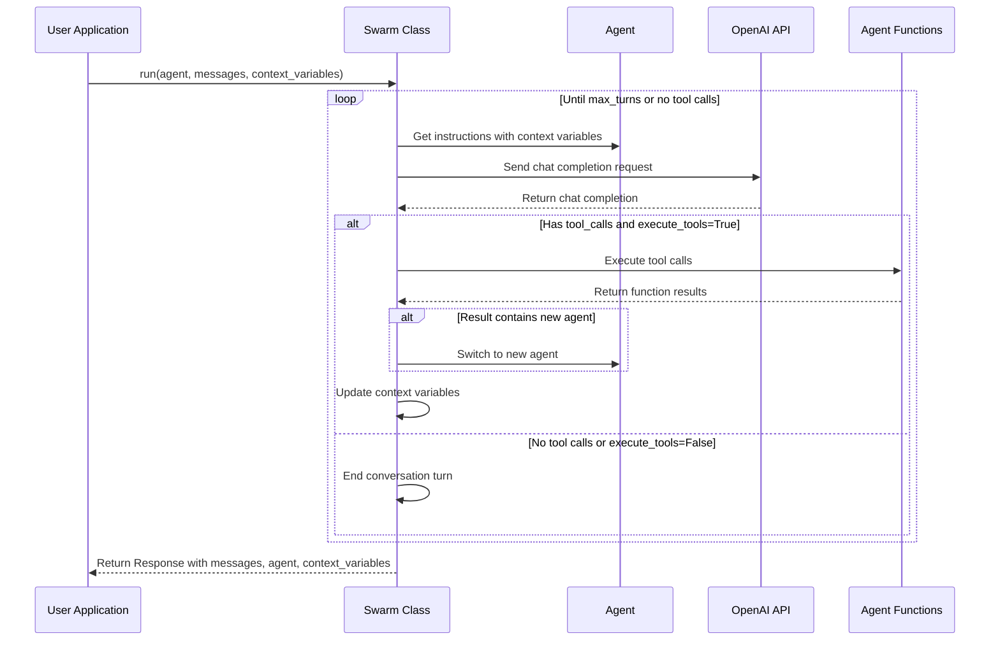

Diagram: Swarm Class Execution Flow

Sources: [swarm/core.py:139-230](), [swarm/core.py:231-292]()

## Key Methods

### get_chat_completion

This method prepares and sends a chat completion request to the OpenAI API. It handles the transformation of `Agent` attributes into OpenAI API parameters.

1.  **Instructions**: Processes the agent's instructions (can be a string or a callable that takes `context_variables`) [swarm/core.py:36-40]().
2.  **Message Assembly**: Builds the messages array, prepending the system instruction [swarm/core.py:42-45]().
3.  **Tool Conversion**: Converts Python functions in `agent.functions` into JSON schemas using `function_to_json` [swarm/core.py:47-51]().
4.  **API Call**: Sends the request to the OpenAI client with specified model and streaming settings [swarm/core.py:58-69]().

Sources: [swarm/core.py:32-69]()

### handle_tool_calls

This method processes the `tool_calls` list returned by the OpenAI API.

1.  **Function Mapping**: Maps function names to the actual callables stored in the `Agent` [swarm/core.py:94-96]().
2.  **Argument Parsing**: Parses the JSON arguments provided by the model [swarm/core.py:104-105]().
3.  **Context Injection**: If a function signature includes `context_variables`, Swarm injects the current context [swarm/core.py:108-110]().
4.  **Execution**: Calls the function and processes the output via `handle_function_result` [swarm/core.py:113-116]().

Sources: [swarm/core.py:89-137]()

### handle_function_result

This method standardizes the output of an agent's function.

-   If the result is an `Agent`, it signals a handoff [swarm/core.py:76-80]().
-   If the result is a `Result` object (defined in `types.py`), it extracts updated `context_variables` and the new `agent` if present [swarm/core.py:73-75]().
-   Otherwise, it coerces the result to a string [swarm/core.py:82-84]().

Sources: [swarm/core.py:71-87]()

### run and run_and_stream

These are the primary entry points for interacting with Swarm.

-   `run`: Executes the loop synchronously and returns a `Response` object containing the final state [swarm/core.py:231-292]().
-   `run_and_stream`: Yields partial response chunks (as dictionaries) for real-time UI updates. It uses a internal `Response` accumulator to track state during the stream [swarm/core.py:139-230]().

Sources: [swarm/core.py:139-292]()

## Data Flow

The following diagram maps how high-level concepts (like "handoffs") relate to specific code entities within `core.py`.

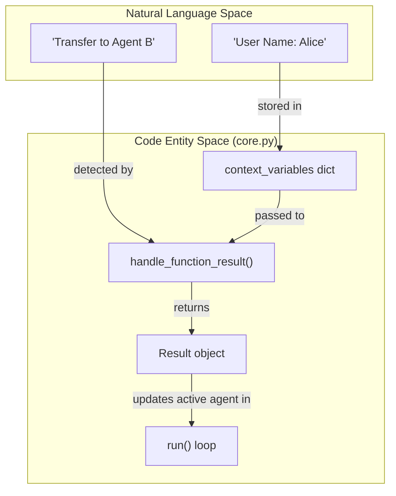

Diagram: Mapping Natural Language Concepts to Code Entities

Sources: [swarm/core.py:71-87](), [swarm/core.py:231-292](), [swarm/types.py:12-23]()

## Context Variables

Context variables serve as a shared state mechanism. They:
1.  Allow passing data between different components and function calls.
2.  Are automatically passed to functions that declare the parameter `context_variables` [swarm/core.py:108-110]().
3.  Are updated by function results if a `Result` object is returned [swarm/core.py:120-121]().

The `Swarm` class manages context variables by creating a shallow copy at the start of a run to prevent unintended side effects on the original dictionary [swarm/core.py:245]().

Sources: [swarm/core.py:36-56](), [swarm/core.py:119-121](), [swarm/core.py:133-134]()

## Agent Switching (Handoffs)

Handoffs occur when a function returns another `Agent` instance.

1.  An agent function returns an `Agent` object.
2.  `handle_function_result` wraps this in a `Result` [swarm/core.py:76-80]().
3.  The `run` loop detects the new agent and updates its local `active_agent` variable [swarm/core.py:285-286]().
4.  The next iteration of the loop uses the new agent's instructions and tools [swarm/core.py:250-252]().

Sources: [swarm/core.py:76-80](), [swarm/core.py:134-135](), [swarm/core.py:220-221](), [swarm/core.py:285-286]()

## Summary

The `Swarm` class in `core.py` provides the fundamental orchestration mechanism. It is stateless by design, requiring the caller to pass the conversation history and context variables back into each `run()` call, similar to the OpenAI Chat Completions API.

Key features include:
-   **Orchestration**: Managing the multi-turn loop between the model and tool execution.
-   **Flexibility**: Supporting both synchronous and streaming modes.
-   **Handoffs**: Native support for switching agents via function return values.
-   **Context Management**: Seamless injection of state into agent functions.

Sources: [swarm/core.py:26-292]()

---

# Page: Types and Data Models

# Types and Data Models

<details>
<summary>Relevant source files</summary>

The following files were used as context for generating this wiki page:

- [README.md](README.md)

</details>


This section provides a technical deep dive into the Pydantic data models defined in `swarm/types.py`. These models serve as the backbone for the Swarm framework, ensuring type safety and structured data flow between the `Swarm` orchestrator, `Agent` instances, and Python functions.

## Core Data Architecture

Swarm utilizes Pydantic for its core primitives. This allows for seamless serialization, validation, and clear definitions of the state passed between the client and the LLM.

### Agent
The `Agent` class is the primary unit of abstraction. It encapsulates the instructions, model configuration, and the tools (functions) available to the LLM at any given turn.

| Field | Type | Default | Description |
| :--- | :--- | :--- | :--- |
| `name` | `str` | `"Agent"` | The name of the agent. |
| `model` | `str` | `"gpt-4o"` | The OpenAI model ID to be used. |
| `instructions` | `Union[str, Callable]` | `"You are a helpful agent."` | System prompt. Can be a string or a callable that returns a string (receiving `context_variables`). |
| `functions` | `List[AgentFunction]` | `[]` | A list of Python functions the agent can invoke. |
| `tool_choice` | `str` | `None` | Restricts the model to specific tool usage (e.g., "required"). |
| `parallel_tool_calls` | `bool` | `True` | Whether to allow multiple tool calls in a single turn. |

**Sources:** [swarm/types.py:24-32](), [swarm/core.py:100-104]()

### Response
The `Response` object is the final output of a `client.run()` call. It captures the state of the conversation after all turns (including tool executions and handoffs) have been completed.

| Field | Type | Description |
| :--- | :--- | :--- |
| `messages` | `List` | The complete list of messages generated during the run. |
| `agent` | `Agent` | The last `Agent` that was active (useful for tracking handoffs). |
| `context_variables` | `dict` | The final state of context variables after all function modifications. |

**Sources:** [swarm/types.py:46-50](), [swarm/core.py:133-138]()

### Result
The `Result` class is a specialized return type for `AgentFunction`s. While a function can return a simple string or an `Agent` (for handoffs), returning a `Result` allows the function to update `context_variables` and return a value simultaneously.

| Field | Type | Default | Description |
| :--- | :--- | :--- | :--- |
| `value` | `str` | `""` | The string representation of the tool output to be sent back to the LLM. |
| `agent` | `Agent` | `None` | If provided, triggers a handoff to this new agent. |
| `context_variables` | `dict` | `{}` | New or updated variables to be merged into the global state. |

**Sources:** [swarm/types.py:35-39](), [swarm/core.py:255-265]()

---

## Data Flow and Transitions

The following diagram illustrates how these types interact during a `Swarm.run` execution. It maps the transition from the high-level request to the internal code entities.

### Code Entity Flow: Request to Response
"Code Entity Space" describes how the `Swarm` class processes `Agent` and `AgentFunction` definitions into OpenAI-compatible schemas.

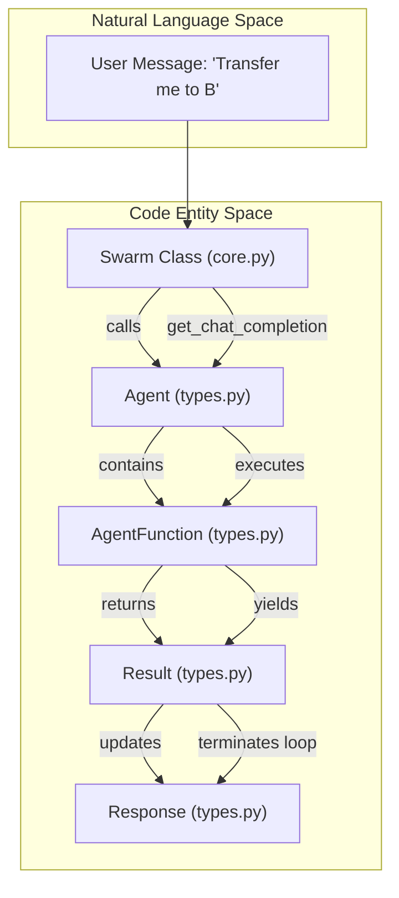
**Sources:** [swarm/core.py:82-138](), [swarm/types.py:24-50]()

---

## Tool Execution and Handoff Logic

When an `Agent` invokes a function, the `Swarm` orchestrator processes the return value to determine the next state. This is handled primarily within `handle_tool_calls`.

### Tool Return Handling Logic
The system supports polymorphic return types for functions defined in `Agent.functions`:

1.  **String**: Treated as the tool's output.
2.  **Agent**: Treated as a handoff; the `active_agent` is updated.
3.  **Result**: A composite object updating the value, the agent, and the context variables.

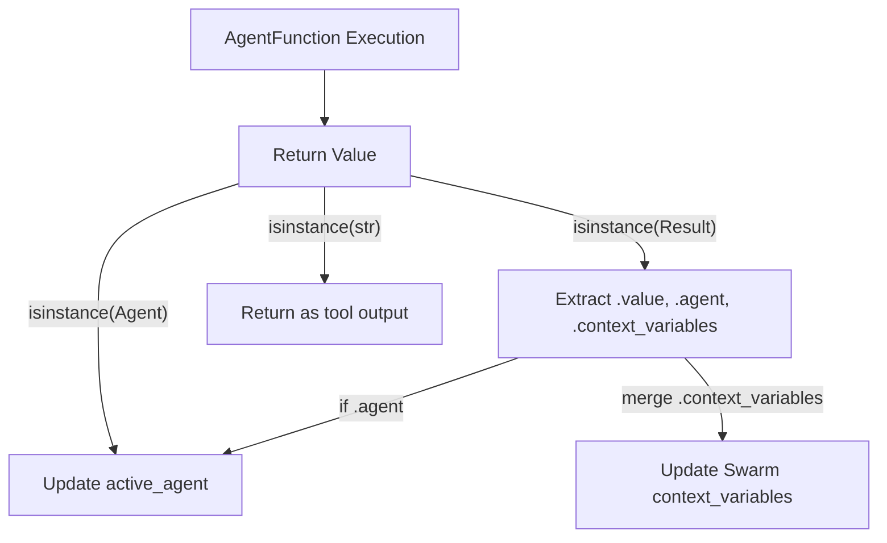
**Sources:** [swarm/core.py:250-275](), [swarm/types.py:35-43]()

---

## Detailed Field Definitions

### AgentFunction
This is a type alias for a standard Python `Callable`. However, Swarm expects these functions to follow specific patterns:
- They can optionally accept `context_variables` if it is defined in their signature.
- They should return a `str`, `Agent`, or `Result`.

**Sources:** [swarm/types.py:11-12](), [swarm/util.py:10-30]()

### Summary Table: Type Flow

| Step | Component | Entity Used | File Reference |
| :--- | :--- | :--- | :--- |
| 1 | Initialization | `Agent` | [swarm/types.py:24]() |
| 2 | Execution Loop | `Swarm.run()` | [swarm/core.py:82]() |
| 3 | Tool Call | `AgentFunction` | [swarm/core.py:250]() |
| 4 | State Update | `Result` | [swarm/types.py:35]() |
| 5 | Completion | `Response` | [swarm/types.py:46]() |

**Sources:** [swarm/core.py:82-138](), [swarm/types.py:11-50]()

---

# Page: Utility Functions

# Utility Functions

<details>
<summary>Relevant source files</summary>

The following files were used as context for generating this wiki page:

- [README.md](README.md)

</details>


This document details the utility functions provided by the Swarm framework in the `util.py` module. These functions serve as foundational helpers for various operations within the Swarm system, including function schema conversion, response merging, and debug logging. These utilities are primarily used by the core Swarm implementation to facilitate interaction with the OpenAI API and manage response data.

Sources: [swarm/util.py:1-88]()

## Overview

The Swarm utility module provides four key functions:

- `function_to_json()`: Converts Python functions into JSON schema format for use with OpenAI function calling [swarm/util.py:31-31]().
- `merge_fields()`: Recursively merges fields between two dictionary objects [swarm/util.py:13-13]().
- `merge_chunk()`: Merges streaming chunks of API responses into a final response object [swarm/util.py:22-22]().
- `debug_print()`: Provides formatted debug output with timestamps [swarm/util.py:5-5]().

These utilities abstract away common operations needed when working with the OpenAI API and processing its responses.

Sources: [swarm/util.py:5-87]()

## Function Conversion

The `function_to_json()` function is a critical utility that bridges Python function definitions and the OpenAI API's function calling format.

### Natural Language to Code Entity Space: Function Conversion
This diagram maps how natural language components of a Python function (docstrings, parameter names) are transformed into structured `tool` definitions.

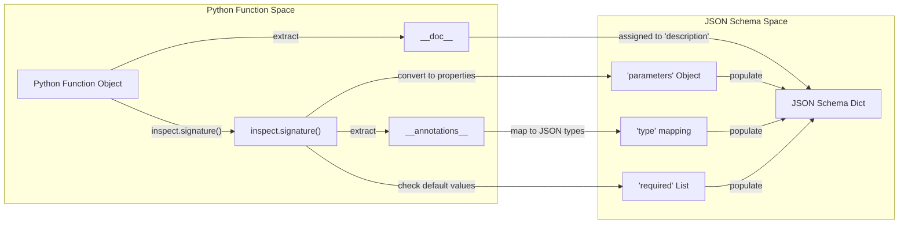
Sources: [swarm/util.py:31-87]()

### Function to JSON Conversion

The `function_to_json()` function performs the following operations:

1. Extracts the function signature using Python's `inspect` module [swarm/util.py:40-40]().
2. Maps Python type annotations to JSON schema types (e.g., `str` to `"string"`, `int` to `"integer"`) [swarm/util.py:52-60]().
3. Identifies required parameters by checking for the absence of default values [swarm/util.py:46-47]().
4. Extracts the function's docstring to serve as the tool description [swarm/util.py:42-42]().

This conversion enables the Swarm system to use Python functions as tools that can be called by AI models via the OpenAI API. It specifically filters out `context_variables` from the schema, as these are injected internally by the `Swarm` client and should not be generated by the model [swarm/util.py:44-45]().

| Python Type | JSON Schema Type |
|-------------|------------------|
| `str`       | "string"         |
| `int`       | "integer"        |
| `float`     | "number"         |
| `bool`      | "boolean"        |
| `list`      | "array"          |
| `dict`      | "object"         |
| `Any` / Default | "string"     |

Sources: [swarm/util.py:31-87]()

## Response Merging

The Swarm framework includes utilities for handling streaming responses from the OpenAI API, which arrive in chunks (`ChatCompletionChunk`) that need to be merged into a single coherent state.

### Code Entity Space: Streaming Data Flow
This diagram shows how `merge_chunk` and `merge_fields` interact with OpenAI response objects.

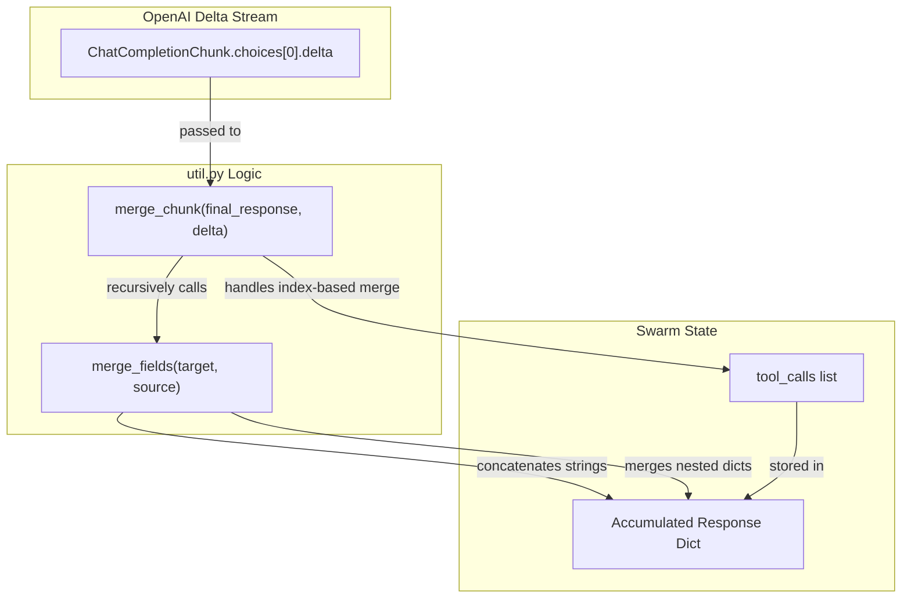
Sources: [swarm/util.py:13-29]()

### Merge Functions

Two functions work together to handle response merging:

1. `merge_fields(target, source)`: A recursive helper function. If both values are dictionaries, it iterates through the source and calls itself. If both are strings, it concatenates the source onto the target [swarm/util.py:13-20]().
2. `merge_chunk(final_response, delta)`: The main entry point for stream processing. It converts the delta to a dictionary and removes the `role` (as it is redundant in chunks) [swarm/util.py:23-25](). It handles the special complexity of `tool_calls`, which arrive as a list of deltas with indices; it ensures the correct tool call is updated based on its index [swarm/util.py:27-29]().

Sources: [swarm/util.py:13-29]()

## Debug Printing

The `debug_print()` function provides a simple way to output debug information with timestamps, primarily used within the `Swarm.run` loop.

### Debug Print Function

The `debug_print()` function:

1. Checks the `debug` boolean flag; if `False`, it returns immediately [swarm/util.py:6-6]().
2. Generates a timestamp using `datetime.now().strftime("%Y-%m-%d %H:%M:%S")` [swarm/util.py:7-7]().
3. Prints the message to the console, prepending the timestamp and using a specific color code (`\033[97m`) for visual distinction [swarm/util.py:9-10]().

Sources: [swarm/util.py:5-10]()

## Integration with Core Swarm

The utility functions are integrated into the `Swarm` class in `core.py`:

- **Function Discovery**: When an `Agent` is initialized, its `functions` are converted using `function_to_json` to populate the `tools` parameter for the OpenAI request.
- **Streaming**: If `stream=True` is passed to `client.run()`, the loop uses `merge_chunk` to assemble the full message before returning the final `Response`.
- **Logging**: `debug_print` is called at the start of every turn and when tools are executed to provide visibility into the orchestration process.

Sources: [swarm/util.py:1-88]()

---

# Page: REPL and Demo Loop

# REPL and Demo Loop

<details>
<summary>Relevant source files</summary>

The following files were used as context for generating this wiki page:

- [README.md](README.md)

</details>


The `swarm/repl` module provides a suite of utility functions designed for interactive Command Line Interface (CLI) testing of Swarm agents. It facilitates a complete execution loop, allowing developers to simulate multi-turn conversations with agents, handle streaming responses, and visualize message exchanges with clean, color-coded formatting.

### Overview of the Demo Loop

The primary entry point for interactive testing is the `run_demo_loop` function. It abstracts the complexity of maintaining conversation state, handling user input, and processing agent responses (both synchronous and streaming).

#### Key Components and Data Flow

The REPL operates by wrapping the `Swarm.run()` method in a continuous `while` loop. It maintains a local list of messages and a dictionary of context variables, which are updated after every turn and passed back into the next iteration.

**Interactive Loop Logic:**
1.  **User Input:** The loop prompts the user for input using `input()`.
2.  **Message Update:** The user's input is appended to the message history as a `user` role message.
3.  **Swarm Execution:** `client.run()` is called with the current agent, message history, and context variables.
4.  **Response Processing:**
    *   If `stream=True`, it calls `process_and_print_streaming_response`.
    *   If `stream=False`, it prints messages via `pretty_print_messages`.
5.  **State Persistence:** The `Response` object returned by Swarm updates the local `messages` and `agent` variables for the next turn.

#### Natural Language to Code Entity Mapping

The following diagram illustrates how natural language concepts in a CLI session map to specific code entities within the `swarm/repl` module.

**REPL Concept Mapping**
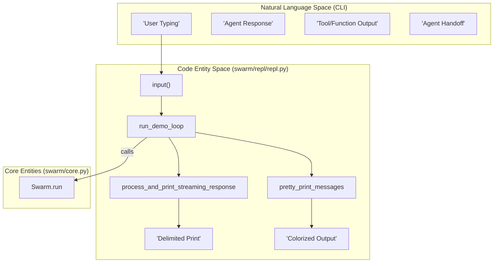
Sources: [swarm/repl/repl.py:1-100](), [README.md:114-143]()

---

### Key Functions

#### run_demo_loop
Defined in `swarm/repl/repl.py`, this function orchestrates the interactive session.

| Parameter | Type | Description |
| :--- | :--- | :--- |
| `starting_agent` | `Agent` | The initial agent the REPL session begins with. |
| `context_variables` | `dict` | Optional initial context variables. |
| `stream` | `bool` | Whether to use streaming mode for responses. Defaults to `False`. |
| `debug` | `bool` | If `True`, enables verbose logging from the Swarm client. |

[swarm/repl/repl.py:61-97]()

#### pretty_print_messages
This utility iterates through a list of message dictionaries and prints them to the console. It applies specific formatting based on the message `role`:
*   **Sender Identification:** If the message contains a `sender` field (common in Swarm responses), it is displayed; otherwise, the `role` is shown.
*   **Content Display:** Prints the `content` of the message.
*   **Tool Calls:** If the message includes `tool_calls`, it iterates through them and prints the function name and arguments.

[swarm/repl/repl.py:18-38]()

#### process_and_print_streaming_response
Used when `stream=True` is passed to the demo loop. It consumes the generator returned by `client.run()` and prints chunks in real-time.
*   **Content Chunks:** Prints `content` as it arrives without newlines to simulate a typing effect.
*   **Tool/Handoff Detection:** Monitors for `tool_calls`, `sender` changes, and `delim` markers to format the output correctly.
*   **Result Aggregation:** It returns a final `Response` object built from the accumulated stream chunks, ensuring the REPL state remains consistent with non-streaming runs.

[swarm/repl/repl.py:41-58]()

---

### Implementation Detail: The Run Loop

The diagram below shows the internal logic of `run_demo_loop` and its interaction with the `Swarm` client.

**REPL Execution Flow**
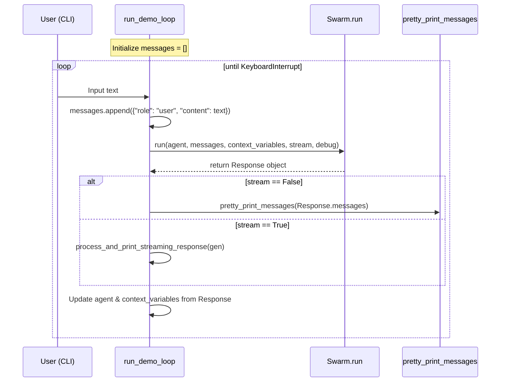
Sources: [swarm/repl/repl.py:61-97](), [swarm/core.py:82-120]()

### Usage Example

The REPL is typically used in example scripts to provide an immediate way to interact with defined agents.

```python
from swarm import Swarm
from swarm.repl import run_demo_loop
from my_agents import triage_agent

client = Swarm()
run_demo_loop(triage_agent, stream=True)
```

In this scenario, `run_demo_loop` handles the instantiation of the `user` role and the subsequent management of the `Response` object fields: `messages`, `agent`, and `context_variables`.

Sources: [swarm/repl/repl.py:1-97](), [README.md:139-143]()

---

# Page: Tool System

# Tool System

<details>
<summary>Relevant source files</summary>

The following files were used as context for generating this wiki page:

- [README.md](README.md)

</details>


## Purpose and Scope

The Tool System is the mechanism by which Swarm converts standard Python functions into structured JSON schemas compatible with the OpenAI Chat Completions API. This allows AI agents to "call" Python code by generating arguments that match a function's signature. The system handles type mapping, docstring extraction for parameter descriptions, and the injection of dynamic `context_variables`.

## Core Logic: `function_to_json`

The heart of the Tool System is the `function_to_json` utility. This function inspects a Python function's signature and docstring to generate a tool definition.

### Transformation Process

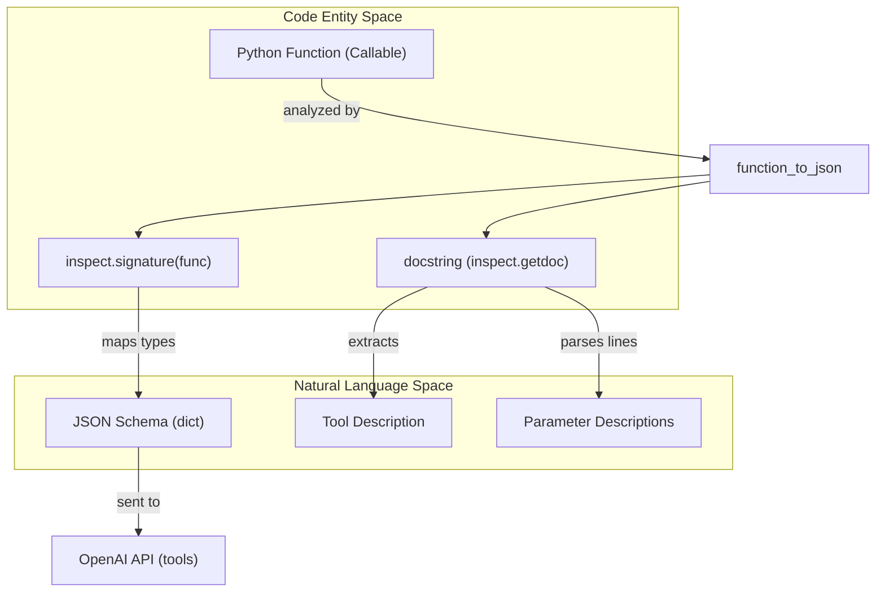
Sources: [swarm/util.py:10-58]()

### Type Mapping
The system maps Python type hints to JSON schema types. If a type hint is missing, it defaults to `string`.

| Python Type | JSON Schema Type |
| :--- | :--- |
| `str` | `string` |
| `int` | `integer` |
| `float` | `number` |
| `bool` | `boolean` |
| `list` | `array` |
| `dict` | `object` |
| `Any` | `string` (fallback) |

Sources: [swarm/util.py:27-37]()

## Context Variables Injection

Swarm supports a special parameter called `context_variables`. If a tool function includes this parameter in its signature, the `Swarm.run` loop will automatically inject the current state of `context_variables` into the function call without the model needing to provide it.

### Data Flow for Tool Execution

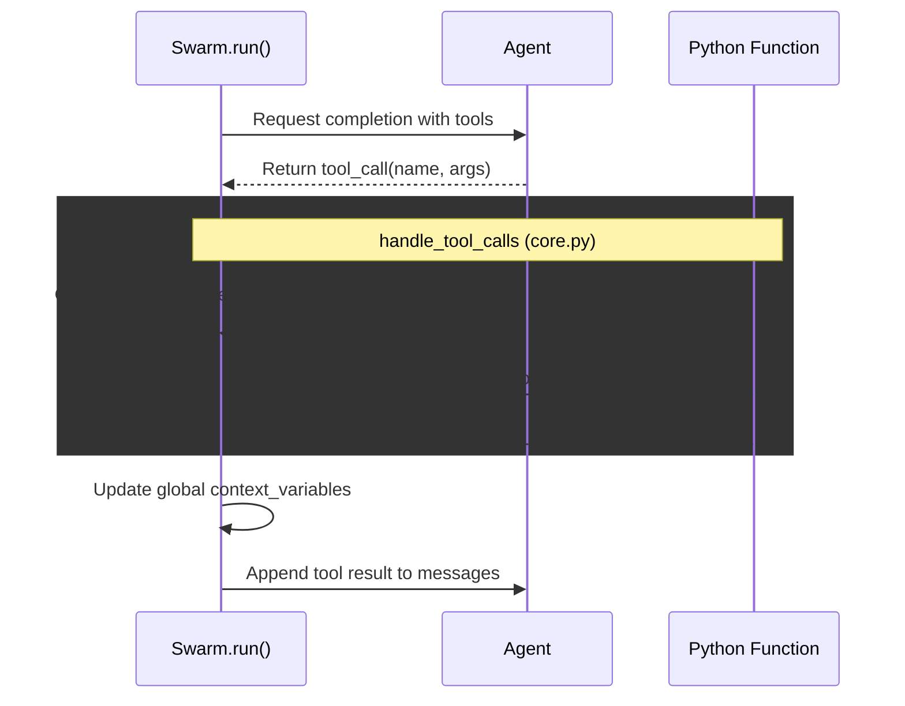
Sources: [swarm/core.py:183-205](), [swarm/core.py:255-275]()

## Key Implementation Details

### Docstring Extraction
The tool's description is pulled from the function's docstring using `inspect.getdoc(func)`. The system expects the first part of the docstring to be the general description, while specific parameter descriptions are often parsed from the subsequent lines.
Sources: [swarm/util.py:22-25]()

### The `Result` Object
Tools can return a simple string, but for complex interactions, they should return a `Result` object. This allows a tool to:
1. Return a value to the model.
2. Update `context_variables` for future turns.
3. Trigger an agent handoff by returning a new `Agent` instance.

Sources: [swarm/types.py:44-49]()

### Handling Handoffs
When a tool returns an `Agent` object (either directly or wrapped in a `Result`), the `Swarm` controller detects this change and switches the "active" agent for the next turn in the loop.

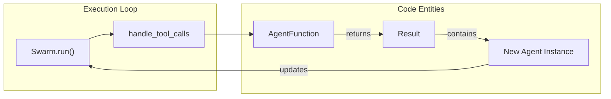
Sources: [swarm/core.py:266-271](), [swarm/types.py:44-49]()

## Pydantic Schema (Customer Service Example)

In the `customer_service_streaming` example, the tool system is further formalized using Pydantic models to define a strict schema for tool definitions.

| Class | Purpose |
| :--- | :--- |
| `Parameter` | Defines a single input field (type, description, enum). |
| `FunctionParameters` | A collection of `Parameter` objects in a JSON-compliant object. |
| `FunctionTool` | Combines a name, description, and parameters. |
| `Tool` | The top-level wrapper sent to the API (type="function"). |

Sources: [examples/customer_service_streaming/src/swarm/tool.py:5-26]()

## Summary Table of Tool Attributes

| Feature | Source in Code | Description |
| :--- | :--- | :--- |
| **Name** | `func.__name__` | The identifier the model uses to call the tool. |
| **Description** | `inspect.getdoc(func)` | Instructions to the model on when to use this tool. |
| **Arguments** | `inspect.signature(func)` | The schema generated from type hints. |
| **Context** | `context_variables` | Injected if present in the function signature. |
| **Handoff** | `return Agent(...)` | Changes the conversation's active agent. |

Sources: [swarm/util.py:10-58](), [swarm/core.py:255-275]()

---

# Page: Examples

# Examples

<details>
<summary>Relevant source files</summary>

The following files were used as context for generating this wiki page:

- [examples/__init__.py](examples/__init__.py)
- [examples/airline/README.md](examples/airline/README.md)
- [examples/basic/README.md](examples/basic/README.md)

</details>


The Swarm repository provides a diverse set of example applications designed to demonstrate the framework's multi-agent orchestration capabilities. These examples range from "bare minimum" scripts for beginners to complex, production-oriented systems featuring evaluation frameworks, database integrations, and streaming interfaces.

## High-Level Architecture of Examples

Most examples in this repository follow a common pattern: defining specialized `Agent` objects that use function-based handoffs to navigate a conversation graph.

### Mapping Natural Language to Code Entities

The following diagram illustrates how user requests are mapped to specific code entities across the example suite.

**Request Routing Diagram**
```mermaid
graph TD
    User["User Input"] --> Triage["Triage Agent (triage_agent.py / airline/configs/agents.py)"]
    
    subgraph "Logic Layer"
        Triage -->|transfer_to_sales| Sales["Sales Agent"]
        Triage -->|transfer_to_refunds| Refunds["Refunds Agent"]
        Triage -->|transfer_to_lost_baggage| Baggage["Lost Baggage Agent"]
    end

    subgraph "Data & Tool Layer"
        Sales -->|query_sql| DB[("SQLite (personal_shopper/storage.py)")]
        Baggage -->|initiate_baggage_search| Search["Search Logic"]
        Refunds -->|process_refund| Tool["Python Function (AgentFunction)"]
    end
```
Sources: [examples/airline/README.md:8-12](), [examples/basic/README.md:9-11]()

---

## Basic Examples
The `examples/basic/` directory contains the fundamental building blocks of Swarm. These scripts are designed to be read in sequence to understand core mechanics like handoffs, context variables, and function calling.

*   **`bare_minimum.py`**: The simplest possible implementation of a `Swarm` client and an `Agent` [examples/basic/README.md:12-15]().
*   **`agent_handoff.py`**: Demonstrates the pattern of an `Agent` returning another `Agent` to transfer control [examples/basic/README.md:7-10]().
*   **`context_variables.py`**: Shows how to pass state (like a user's name) into agent instructions and functions [examples/basic/README.md:17-20]().
*   **`function_calling.py`**: Illustrates how agents interact with external Python functions to retrieve data [examples/basic/README.md:22-25]().

For details, see [Basic Examples](#4.1).

---

## Airline Customer Service
The Airline example is a comprehensive multi-agent system that simulates a complex service desk. It features a hierarchical agent structure where a `Triage Agent` routes users to specialized agents for flight modifications, cancellations, or lost baggage [examples/airline/README.md:1-13]().

This example is notable for including:
*   **Evaluation Framework**: A system to run deterministic tests against agent handoffs using `function_evals.py` [examples/airline/README.md:27-55]().
*   **Policy Management**: Use of structured instructions to guide agent behavior.

For details, see [Airline Customer Service Example](#4.2).

---

## Customer Service Streaming
This example focuses on real-time interactions and more advanced system integration. It introduces the concept of "Engines" (such as `AssistantsEngine` and `LocalEngine`) to handle the execution of tasks.

Key components include:
*   **Knowledge Base**: Integration of `query_docs` tools to answer user questions from articles.
*   **Task System**: A structured way to deploy and manage specific agent responsibilities.

For details, see [Customer Service Streaming Example](#4.3).

---

## Other Specialized Examples
The repository includes several other examples targeting specific technical integrations or use cases:

| Example | Key Feature | Description |
| :--- | :--- | :--- |
| **Triage Agent** | Routing Logic | A focused look at sales vs. refund routing with associated evals. |
| **Weather Agent** | Tool Use | A clean demonstration of function calling for external API simulation. |
| **Personal Shopper** | Persistence | Uses a SQLite backend (`storage.py`) to manage a shopping cart. |
| **Support Bot** | RAG | Integrates with Qdrant vector database for retrieval-augmented generation. |

For details, see [Other Examples](#4.4).

### Entity Relationship: Examples to Core Components

The following diagram shows how different examples utilize the core `swarm` package components.

**Component Usage Diagram**
```mermaid
graph LR
    subgraph "Core Framework"
        S["Swarm Class (core.py)"]
        A["Agent Class (types.py)"]
        R["run_demo_loop (repl/repl.py)"]
    end

    subgraph "Examples"
        Basic["Basic Scripts"] --> S
        Basic --> A
        
        Airline["Airline Demo"] --> S
        Airline --> A
        Airline --> R
        
        Shopper["Personal Shopper"] --> S
        Shopper -->|"uses SQLite"| DB[("storage.py")]
    end
```
Sources: [examples/airline/README.md:4-5](), [examples/basic/README.md:3-5]()

---

# Page: Basic Examples

# Basic Examples

<details>
<summary>Relevant source files</summary>

The following files were used as context for generating this wiki page:

- [examples/basic/README.md](examples/basic/README.md)
- [examples/basic/agent_handoff.py](examples/basic/agent_handoff.py)
- [examples/basic/bare_minimum.py](examples/basic/bare_minimum.py)
- [examples/basic/context_variables.py](examples/basic/context_variables.py)
- [examples/basic/function_calling.py](examples/basic/function_calling.py)
- [examples/basic/simple_loop_no_helpers.py](examples/basic/simple_loop_no_helpers.py)

</details>


The `examples/basic/` directory contains foundational scripts designed to demonstrate the core capabilities of the Swarm framework. These examples focus on the simplest usage patterns, typically involving a single input message and a corresponding output, to illustrate how to initialize agents, handle handoffs, utilize context, and call functions.

Sources: [examples/basic/README.md:1-5]()

## Bare Minimum Implementation

The most basic instantiation of Swarm involves creating a `Swarm` client and an `Agent` with simple instructions. The `Swarm.run()` method serves as the entry point for the conversation.

### Data Flow: Bare Minimum
1. A `Swarm` client is instantiated.
2. An `Agent` is defined with a `name` and `instructions`.
3. A list of `messages` is passed to `client.run()`.
4. The client returns a `Response` object containing the result.

| Entity | Role | File Reference |
| :--- | :--- | :--- |
| `Swarm` | The orchestration client. | [examples/basic/bare_minimum.py:3-3]() |
| `Agent` | Defines the LLM's persona and instructions. | [examples/basic/bare_minimum.py:5-8]() |
| `client.run` | Executes the turn loop. | [examples/basic/bare_minimum.py:11-11]() |

Sources: [examples/basic/bare_minimum.py:1-13]()

## Agent Handoffs

Handoffs are achieved by defining a function that returns another `Agent` instance. When the LLM calls this function, the Swarm execution loop switches the active agent for subsequent turns.

### Logic Flow: Language Handoff
In `agent_handoff.py`, an `english_agent` is equipped with a tool to transfer to a `spanish_agent`.

Title: Agent Handoff Logic
```mermaid
graph TD
    User["User Message: 'Hola'"] --> EnglishAgent["Agent: English Agent"]
    EnglishAgent -- "Triggers Tool" --> TransferFunc["transfer_to_spanish_agent()"]
    TransferFunc -- "Returns" --> SpanishAgent["Agent: Spanish Agent"]
    SpanishAgent -- "Generates Response" --> Output["Spanish Response"]
```

Sources: [examples/basic/agent_handoff.py:5-24]()

## Context Variables

Context variables allow the injection of external state into agent instructions and tool execution. Instructions can be defined as a callable that accepts `context_variables`, allowing for dynamic prompt generation.

### Key Implementation Details
- **Dynamic Instructions**: The `instructions` parameter of an `Agent` can be a function that retrieves values from the `context_variables` dictionary.
- **Tool Access**: Functions provided to an agent can optionally accept a `context_variables` parameter to access stateful data (e.g., `user_id`).

Title: Context Variable Injection
```mermaid
graph LR
    subgraph "Code Entity Space"
        CV["context_variables (dict)"]
        INST["instructions(context_variables)"]
        TOOL["print_account_details(context_variables)"]
    end

    subgraph "Natural Language Space"
        PROMPT["'Greet the user by name (James)'"]
    end

    CV -- "Injected into" --> INST
    CV -- "Injected into" --> TOOL
    INST -- "Produces" --> PROMPT
```

Sources: [examples/basic/context_variables.py:6-30]()

## Function Calling

Agents can be assigned a list of Python functions. Swarm automatically converts these functions into JSON schemas for the LLM. When the LLM generates a tool call, Swarm executes the Python function and returns the result to the LLM to finalize the response.

### Example: Weather Tool
In `function_calling.py`, the `get_weather` function is passed directly to the `Agent.functions` list.

| Component | Implementation |
| :--- | :--- |
| **Function** | `get_weather(location)` |
| **Registration** | `Agent(functions=[get_weather])` |
| **Trigger** | User asks "What's the weather in NYC?" |

Sources: [examples/basic/function_calling.py:6-18]()

## Interactive Loop (No Helpers)

The `simple_loop_no_helpers.py` script demonstrates how to maintain a persistent conversation state manually without using the high-level `repl` utilities. It highlights the importance of updating the `messages` history and the current `agent` from the `Response` object returned by `client.run()`.

### Manual Loop Logic
1. **Input**: Capture user input via `input("> ")`.
2. **Append**: Add the user message to the local `messages` list.
3. **Run**: Call `client.run()` with the current `agent` and `messages`.
4. **Update**: 
   - Update `messages` with `response.messages` (which includes the assistant's response and tool outputs).
   - Update `agent` with `response.agent` (to handle potential handoffs).

Sources: [examples/basic/simple_loop_no_helpers.py:18-27]()

---

# Page: Airline Customer Service Example

# Airline Customer Service Example

<details>
<summary>Relevant source files</summary>

The following files were used as context for generating this wiki page:

- [examples/airline/README.md](examples/airline/README.md)
- [examples/airline/__init__.py](examples/airline/__init__.py)
- [examples/airline/configs/__init__.py](examples/airline/configs/__init__.py)
- [examples/airline/configs/agents.py](examples/airline/configs/agents.py)
- [examples/airline/configs/tools.py](examples/airline/configs/tools.py)
- [examples/airline/data/routines/baggage/policies.py](examples/airline/data/routines/baggage/policies.py)
- [examples/airline/data/routines/flight_modification/policies.py](examples/airline/data/routines/flight_modification/policies.py)
- [examples/airline/data/routines/prompts.py](examples/airline/data/routines/prompts.py)
- [examples/airline/evals/eval_cases/flight_modification_cases.json](examples/airline/evals/eval_cases/flight_modification_cases.json)
- [examples/airline/evals/eval_cases/triage_cases.json](examples/airline/evals/eval_cases/triage_cases.json)
- [examples/airline/evals/eval_results/flight_modification_evals.json](examples/airline/evals/eval_results/flight_modification_evals.json)
- [examples/airline/evals/eval_results/triage_evals.json](examples/airline/evals/eval_results/triage_evals.json)
- [examples/airline/evals/eval_utils.py](examples/airline/evals/eval_utils.py)
- [examples/airline/evals/function_evals.py](examples/airline/evals/function_evals.py)
- [examples/airline/main.py](examples/airline/main.py)

</details>


The Airline Customer Service example is a comprehensive multi-agent system built on the Swarm framework. It demonstrates how to orchestrate multiple specialized agents to handle complex customer support workflows, including flight modifications, cancellations, and baggage claims `[examples/airline/README.md:1-4]()`.

## Agent Architecture and Hierarchy

The system uses a hierarchical structure where a primary agent triages requests and delegates them to specialized sub-agents. This modular approach allows for strict policy enforcement and clean separation of concerns `[examples/airline/README.md:6-12]()`.

### Agent Roles
- **Triage Agent**: The entry point for all customer interactions. It analyzes the user's intent and transfers the conversation to either the Flight Modification or Lost Baggage branches `[examples/airline/configs/agents.py:43-47]()`.
- **Flight Modification Agent**: Acts as a sub-triage layer. It clarifies whether the user wants to change or cancel a flight before handing off to the final specialized agent `[examples/airline/configs/agents.py:49-57]()`.
- **Flight Cancel Agent**: Executes the `FLIGHT_CANCELLATION_POLICY`, handling refunds and flight credits `[examples/airline/configs/agents.py:59-69]()`.
- **Flight Change Agent**: Executes the `FLIGHT_CHANGE_POLICY`, verifying eligibility and processing date/time changes `[examples/airline/configs/agents.py:71-81]()`.
- **Lost Baggage Agent**: Executes the `LOST_BAGGAGE_POLICY` to search for and arrange delivery of missing items `[examples/airline/configs/agents.py:83-92]()`.

### Agent Relationship Diagram
This diagram shows the relationship between agent entities and the handoff functions defined in `agents.py`.

```mermaid
graph TD
    User(["User"]) --> TriageAgent["triage_agent (Agent)"]
    
    subgraph Triage_Layer ["Triage & Routing"]
        TriageAgent -- "transfer_to_flight_modification()" --> FlightModAgent["flight_modification (Agent)"]
        TriageAgent -- "transfer_to_lost_baggage()" --> LostBaggageAgent["lost_baggage (Agent)"]
    end

    subgraph Flight_Modification_Layer ["Flight Modification Sub-Tree"]
        FlightModAgent -- "transfer_to_flight_cancel()" --> FlightCancelAgent["flight_cancel (Agent)"]
        FlightModAgent -- "transfer_to_flight_change()" --> FlightChangeAgent["flight_change (Agent)"]
    end

    subgraph Specialized_Agents ["Action Execution"]
        FlightCancelAgent
        FlightChangeAgent
        LostBaggageAgent["lost_baggage (Agent)"]
    end

    Specialized_Agents -- "transfer_to_triage()" --> TriageAgent
```
**Sources:** `[examples/airline/configs/agents.py:9-30]()`, `[examples/airline/configs/agents.py:43-92]()`.

---

## Policies and Instructions

Agents are governed by structured prompts and policies. Each specialized agent combines a `STARTER_PROMPT` with a specific policy string to ensure consistent behavior `[examples/airline/configs/agents.py:61,73,85]()`.

### Policy Implementation
Policies are defined as multi-step procedures that agents must follow strictly. For example, the `LOST_BAGGAGE_POLICY` requires calling `initiate_baggage_search` before proceeding to delivery or escalation `[examples/airline/data/routines/baggage/policies.py:21-30]()`.

| Agent | Policy Variable | Key Steps |
| :--- | :--- | :--- |
| **Flight Cancel** | `FLIGHT_CANCELLATION_POLICY` | Confirm flight -> Check refund/credit preference -> `initiate_refund` or `initiate_flight_credits` `[examples/airline/data/routines/flight_modification/policies.py:20-31]()` |
| **Flight Change** | `FLIGHT_CHANGE_POLICY` | `valid_to_change_flight` -> Suggest alternative -> Check availability -> `change_flight` `[examples/airline/data/routines/flight_modification/policies.py:33-45]()` |
| **Lost Baggage** | `LOST_BAGGAGE_POLICY` | `initiate_baggage_search` -> Arrange delivery or `escalate_to_agent` `[examples/airline/data/routines/baggage/policies.py:21-30]()` |

**Sources:** `[examples/airline/data/routines/baggage/policies.py:1-30]()`, `[examples/airline/data/routines/flight_modification/policies.py:1-45]()`.

---

## Tools and Implementation

Tools are standard Python functions that return strings or new `Agent` objects for handoffs. These functions are mapped to agents in `configs/agents.py`.

### Action Tools
The following tools simulate backend operations:
- `initiate_refund()`: Returns a status string indicating refund initiation `[examples/airline/configs/tools.py:13-15]()`.
- `change_flight()`: Confirms successful flight modification `[examples/airline/configs/tools.py:9-10]()`.
- `initiate_baggage_search()`: Simulates finding baggage `[examples/airline/configs/tools.py:27-29]()`.
- `case_resolved()`: Terminates the policy flow `[examples/airline/configs/tools.py:23-24]()`.

### Data Flow Diagram
This diagram bridges the Natural Language policies to the Python functions (Tools) that execute them.

```mermaid
flowchart LR
    subgraph Natural_Language_Policy ["Policy Requirements"]
        P1["'Confirm refund or credits'"]
        P2["'Call baggage search'"]
        P3["'Verify flight change'"]
    end

    subgraph Code_Entity_Space ["tools.py / agents.py"]
        F1["initiate_refund()"]
        F2["initiate_flight_credits()"]
        F3["initiate_baggage_search()"]
        F4["valid_to_change_flight()"]
    end

    P1 -.-> F1
    P1 -.-> F2
    P2 -.-> F3
    P3 -.-> F4

    F1 --> R1["'Refund initiated'"]
    F3 --> R2["'Baggage was found!'"]
```
**Sources:** `[examples/airline/configs/tools.py:1-29]()`, `[examples/airline/data/routines/flight_modification/policies.py:20-45]()`.

---

## Evaluation Framework

The example includes an evaluation system to verify that agents call the correct tools based on user input.

### Evaluation Cases
Evals are stored as JSON files in `eval/eval_cases/`. Each case contains a conversation history and an `expected_function` `[examples/airline/README.md:27-36]()`.
- **Triage Evals**: Test if the `triage_agent` correctly routes to modification or baggage branches `[examples/airline/evals/eval_cases/triage_cases.json:1-26]()`.
- **Modification Evals**: Test if the `flight_modification` agent correctly identifies "change" vs "cancel" intents `[examples/airline/evals/eval_cases/flight_modification_cases.json:1-20]()`.

### Running Evaluations
The `function_evals.py` script executes these cases multiple times (defined by `n`) and outputs results to `evals/eval_results/` `[examples/airline/README.md:47-55]()`.

**Sources:** `[examples/airline/README.md:22-55]()`, `[examples/airline/evals/eval_cases/triage_cases.json:1-26]()`, `[examples/airline/evals/eval_results/triage_evals.json:1-106]()`.

---

# Page: Customer Service Streaming Example

# Customer Service Streaming Example

<details>
<summary>Relevant source files</summary>

The following files were used as context for generating this wiki page:

- [examples/customer_service_streaming/configs/__init__.py](examples/customer_service_streaming/configs/__init__.py)
- [examples/customer_service_streaming/configs/assistants/user_interface/assistant.json](examples/customer_service_streaming/configs/assistants/user_interface/assistant.json)
- [examples/customer_service_streaming/configs/general.py](examples/customer_service_streaming/configs/general.py)
- [examples/customer_service_streaming/configs/prompts.py](examples/customer_service_streaming/configs/prompts.py)
- [examples/customer_service_streaming/configs/swarm_tasks.json](examples/customer_service_streaming/configs/swarm_tasks.json)
- [examples/customer_service_streaming/configs/tools/query_docs/handler.py](examples/customer_service_streaming/configs/tools/query_docs/handler.py)
- [examples/customer_service_streaming/configs/tools/query_docs/tool.json](examples/customer_service_streaming/configs/tools/query_docs/tool.json)
- [examples/customer_service_streaming/configs/tools/send_email/handler.py](examples/customer_service_streaming/configs/tools/send_email/handler.py)
- [examples/customer_service_streaming/configs/tools/send_email/tool.json](examples/customer_service_streaming/configs/tools/send_email/tool.json)
- [examples/customer_service_streaming/configs/tools/submit_ticket/handler.py](examples/customer_service_streaming/configs/tools/submit_ticket/handler.py)
- [examples/customer_service_streaming/configs/tools/submit_ticket/tool.json](examples/customer_service_streaming/configs/tools/submit_ticket/tool.json)
- [examples/customer_service_streaming/data/article_6233728.json](examples/customer_service_streaming/data/article_6233728.json)

</details>


## Purpose and Scope

This document provides an overview of the Customer Service Streaming Example implementation within the OpenAI Swarm repository. This example demonstrates a sophisticated multi-agent orchestration system capable of handling customer service requests through different execution engines. It features a streaming architecture, a knowledge base integration via Qdrant, and specialized tool configurations for real-world support scenarios like ticket submission and email dispatch.

For detailed documentation on the orchestration logic, see [Customer Service Swarm Class](#4.3.1). For details on the execution backends, see [Engines](#4.3.2).

## Architecture Overview

The Customer Service Streaming Example bridges natural language tasks with code-defined tools and engines. It uses a `user_interface` assistant as the primary entry point for user interactions.

### System Mapping: Natural Language to Code Entities

The following diagram maps high-level system concepts to their specific code implementations and configuration files.

```mermaid
flowchart LR
    subgraph "Natural Language Space"
        UserQuery["User Query"]
        KB_Article["Knowledge Base Article"]
        SupportTask["Support Task"]
    end

    subgraph "Code Entity Space"
        UI_Assistant["assistant.json"]
        QueryDocs["query_docs/handler.py"]
        SwarmTasks["swarm_tasks.json"]
        LocalEngine["LocalEngine"]
        AssistantsEngine["AssistantsEngine"]
    end

    UserQuery --> UI_Assistant
    KB_Article --> QueryDocs
    SupportTask --> SwarmTasks
    UI_Assistant -.->|"selects engine"| LocalEngine
    UI_Assistant -.->|"selects engine"| AssistantsEngine
```

Sources: [examples/customer_service_streaming/configs/assistants/user_interface/assistant.json:1-11](), [examples/customer_service_streaming/configs/swarm_tasks.json:1-14](), [examples/customer_service_streaming/configs/tools/query_docs/handler.py:36-57]()

## Key Components

### Swarm and Engine Selection
The `Swarm` class manages the lifecycle of tasks. The system is configurable to run using either a `LocalEngine` (for local execution logic) or an `AssistantsEngine` (leveraging OpenAI's Assistants API). This is controlled via the `engine_name` setting in the general configuration.

| Configuration Key | Description | File Reference |
|:---|:---|:---|
| `engine_name` | Switches between 'assistants' or 'local' | [examples/customer_service_streaming/configs/general.py:18]() |
| `max_iterations` | Limits the planning loop for tasks | [examples/customer_service_streaming/configs/general.py:20]() |
| `tasks_path` | Path to the JSON file containing task definitions | [examples/customer_service_streaming/configs/general.py:15]() |

### Task and Prompt System
Tasks are defined in `swarm_tasks.json`. Each task can specify whether it requires iteration (refined planning) or evaluation (verification of completion).

```mermaid
flowchart TD
    Task[Task Definition] -->|iterate=true| PlanningLoop["Iterative Planning (LOCAL_PLANNER_PROMPT)"]
    Task -->|evaluate=true| EvalLoop["Task Evaluation (EVALUATE_TASK_PROMPT)"]
    PlanningLoop --> Execution["Tool Execution"]
    Execution --> EvalLoop
```

Sources: [examples/customer_service_streaming/configs/prompts.py:19-30](), [examples/customer_service_streaming/configs/prompts.py:7-13](), [examples/customer_service_streaming/configs/swarm_tasks.json:1-14]()

### Tool Configurations
The example includes three primary tools that the `user_interface` assistant can invoke:

1.  **query_docs**: Interfaces with a Qdrant vector database to search the `help_center` collection for relevant articles. [examples/customer_service_streaming/configs/tools/query_docs/handler.py:36-57]()
2.  **send_email**: A tool for dispatching messages to a specific email address. [examples/customer_service_streaming/configs/tools/send_email/handler.py:1-3]()
3.  **submit_ticket**: Creates a help center ticket based on a technical description. [examples/customer_service_streaming/configs/tools/submit_ticket/handler.py:1-2]()

### Knowledge Base Integration
The `query_docs` tool retrieves information from a knowledge base. The example includes raw JSON data representing help articles, such as the "Answers Transition Guide".

```mermaid
sequenceDiagram
    participant UI as User Interface Assistant
    participant QD as query_docs (handler.py)
    participant Qdrant as Qdrant DB
    participant OA as OpenAI Embeddings

    UI->>QD: query_docs("OpenAI account tokens")
    QD->>OA: Create embedding (text-embedding-3-large)
    OA-->>QD: Vector
    QD->>Qdrant: search(collection="help_center")
    Qdrant-->>QD: Top K Articles
    QD-->>UI: Article Title & Content
```

Sources: [examples/customer_service_streaming/configs/tools/query_docs/handler.py:18-33](), [examples/customer_service_streaming/data/article_6233728.json:1]()

## Detailed Sub-Pages

For more granular technical details, please refer to the following child pages:

- **[Customer Service Swarm Class](#4.3.1)**: Covers the `Swarm` class implementation, task management, and the deployment lifecycle.
- **[Engines](#4.3.2)**: Covers the implementation of `AssistantsEngine` and `LocalEngine`, including the differences in how they handle tool calls and state.

---

# Page: Customer Service Swarm Class

# Customer Service Swarm Class

<details>
<summary>Relevant source files</summary>

The following files were used as context for generating this wiki page:

- [examples/customer_service_streaming/configs/general.py](examples/customer_service_streaming/configs/general.py)
- [examples/customer_service_streaming/configs/swarm_tasks.json](examples/customer_service_streaming/configs/swarm_tasks.json)

</details>


## Purpose and Scope

This document provides a detailed explanation of the `Swarm` class within the customer service streaming example. The `Swarm` class serves as the main control unit for orchestrating tasks, selecting the execution engine, and managing the deployment lifecycle of the multi-agent system. It bridges the high-level task definitions (found in `swarm_tasks.json`) with the underlying engine implementations.

## Overview

The Customer Service Swarm class facilitates task management, engine selection, and deployment. It acts as a bridge between the client application and the underlying engine implementations (`AssistantsEngine` or `LocalEngine`), managing the flow of tasks and their execution.

```mermaid
graph TD
    subgraph "Customer Service Swarm [swarm.py]"
        id1["Swarm Class"]
        id2["Task List"]
        id3["Engine Selection Logic"]
        id4["load_tasks()"]
    end
    
    subgraph "Engines [engines.py]"
        id5["AssistantsEngine"]
        id6["LocalEngine"]
    end
    
    subgraph "Configuration [general.py / swarm_tasks.json]"
        id7["Task Definition"]
        id8["engine_name"]
    end
    
    id1 -->|"manages"| id2
    id1 -->|"executes"| id3
    id4 -->|"reads"| id7
    id3 -->|"instantiates"| id5
    id3 -->|"instantiates"| id6
    id8 -->|"configures"| id3
```

**Class Structure and Relationships**

Sources: [examples/customer_service_streaming/src/swarm/swarm.py:11-17](), [examples/customer_service_streaming/configs/general.py:15-18]()

## Class Definition and Initialization

The `Swarm` class is the central orchestrator defined in the example's source directory.

```mermaid
classDiagram
    class Swarm {
        +List tasks
        +String engine_name
        +Engine engine
        +Boolean persist
        +__init__(engine_name, tasks, persist)
        +deploy(test_mode, test_file_paths)
        +load_tasks()
        +add_task(task)
    }
    
    class Task {
        +String description
        +Boolean iterate
        +Boolean evaluate
        +String assistant
    }
    
    Swarm "1" --> "*" Task : contains
```

**Swarm Class Structure**

Sources: [examples/customer_service_streaming/src/swarm/swarm.py:11-46]()

### Initialization

The `Swarm` class is initialized with parameters that define its behavior and the tasks it must process.

- `engine_name`: A string determining the backend (e.g., `'assistants'` or `'local'`).
- `tasks`: A list of `Task` objects.
- `persist`: A boolean flag determining if state should be persisted (relevant for the `LocalEngine`).

```python
def __init__(self, engine_name, tasks=[], persist=False):
    self.tasks = tasks
    self.engine_name = engine_name
    self.engine = None
    self.persist = persist
```

Sources: [examples/customer_service_streaming/src/swarm/swarm.py:12-16]()

## Core Functionality

### Task Deployment Lifecycle

The `deploy` method initiates the execution loop. It handles the instantiation of the chosen engine and delegates the task processing to that engine.

```mermaid
flowchart TD
    id1["Swarm.deploy()"] --> id2["Initialize OpenAI Client"]
    id2 --> id3{"Check self.engine_name"}
    
    id3 -->|"assistants"| id4["Instantiate AssistantsEngine"]
    id4 --> id5["Call engine.deploy()"]
    
    id3 -->|"local"| id6["Instantiate LocalEngine"]
    id6 --> id5
    
    id5 --> id7["Engine processes Task list"]
```

**Deploy Method Workflow**

The `deploy` method performs the following steps:
1. **Client Setup**: Initializes the `OpenAI` client [examples/customer_service_streaming/src/swarm/swarm.py:22]().
2. **Engine Selection**: Based on `self.engine_name`, it chooses between `AssistantsEngine` or `LocalEngine` [examples/customer_service_streaming/src/swarm/swarm.py:24-32]().
3. **Engine Execution**: Triggers the `deploy` method of the instantiated engine, passing along `test_mode` and `test_file_paths` [examples/customer_service_streaming/src/swarm/swarm.py:27]().

Sources: [examples/customer_service_streaming/src/swarm/swarm.py:18-32]()

### Task Management and Loading

The class manages a collection of `Task` objects. These can be added manually or loaded from a configuration file.

#### Loading from JSON
The `load_tasks` method reads from the path defined in `configs/general.py` (defaulting to `configs/swarm_tasks.json`).

```python
def load_tasks(self):
    self.tasks = []
    with open(tasks_path, 'r') as f:
        tasks_json = json.load(f)
        for task_json in tasks_json:
            task = Task(description=task_json['description'],
                        iterate=task_json.get('iterate', False),
                        evaluate=task_json.get('evaluate', False),
                        assistant=task_json.get('assistant', 'user_interface'))
            self.tasks.append(task)
```

The method maps JSON fields to the `Task` object, providing defaults for `iterate` (False), `evaluate` (False), and the starting `assistant` ('user_interface').

Sources: [examples/customer_service_streaming/src/swarm/swarm.py:34-43](), [examples/customer_service_streaming/configs/general.py:15]()

#### Task Schema
The tasks in `swarm_tasks.json` define the workload. For example:
- A simple query: `{"description": "What is the square root of 16?"}` [examples/customer_service_streaming/configs/swarm_tasks.json:2-4]().
- A task requiring evaluation: `{"description": "Is phone verification required...", "evaluate": true}` [examples/customer_service_streaming/configs/swarm_tasks.json:5-8]().
- A task requiring iteration (multi-step tool use): `{"description": "How many free tokens...", "iterate": true}` [examples/customer_service_streaming/configs/swarm_tasks.json:9-13]().

Sources: [examples/customer_service_streaming/configs/swarm_tasks.json:1-14]()

## Engine Instantiation Logic

The `Swarm` class uses conditional logic to swap between local and cloud-based execution.

| Engine Name | Implementation Class | Description |
| :--- | :--- | :--- |
| `assistants` | `AssistantsEngine` | Uses OpenAI's Assistants API for state and tool management. |
| `local` | `LocalEngine` | Uses the core Swarm `run` loop for local orchestration. |

When using the `local` engine, the `persist` flag from the `Swarm` constructor is passed to the engine, allowing the system to maintain or discard session state between tasks.

Sources: [examples/customer_service_streaming/src/swarm/swarm.py:24-32](), [examples/customer_service_streaming/configs/general.py:18-22]()

## System Constants and Configuration

The `Swarm` class relies on global configurations defined in `configs/general.py`.

- **Colors**: Uses the `Colors` class for formatted console output during the deployment process [examples/customer_service_streaming/configs/general.py:1-11]().
- **Paths**: `tasks_path` points the `load_tasks` method to the correct JSON definition [examples/customer_service_streaming/configs/general.py:15]().
- **Engine Selection**: The default `engine_name` is typically set to `'local'` in the config [examples/customer_service_streaming/configs/general.py:18]().

Sources: [examples/customer_service_streaming/configs/general.py:1-23]()

---

# Page: Engines

# Engines

<details>
<summary>Relevant source files</summary>

The following files were used as context for generating this wiki page:

- [examples/customer_service_streaming/configs/assistants/user_interface/assistant.json](examples/customer_service_streaming/configs/assistants/user_interface/assistant.json)
- [examples/customer_service_streaming/configs/general.py](examples/customer_service_streaming/configs/general.py)

</details>


## Purpose and Scope

This document covers the Engine system used in the Customer Service Example implementation of the OpenAI Swarm framework. Engines are execution environments that process tasks within the Swarm system, offering different strategies for interacting with the OpenAI API. This page specifically documents the two engine implementations: `AssistantsEngine` and `LocalEngine`, and how they're selected and used by the `Swarm` class.

For information about the overall Customer Service Example implementation, see [Customer Service Streaming Example](#4.3). For details on the Swarm class that manages these engines, see [Customer Service Swarm Class](#4.3.1).

## Engine System Overview

The Engine system in the Customer Service Example provides a pluggable architecture that allows different task execution strategies. The `Swarm` class selects an engine based on configuration and uses it to deploy and execute a series of tasks.

### Engine Architecture

```mermaid
flowchart TB
    subgraph "EngineSystem"
        SwarmNode["Swarm Class"]
        SwarmNode -->|"selects and initializes"| EngineInterface["Engine Interface"]
        
        EngineInterface -->|"implemented by"| AssistantsEngine["AssistantsEngine"]
        EngineInterface -->|"implemented by"| LocalEngine["LocalEngine"]
        
        AssistantsEngine -->|"processes"| Tasks["swarm_tasks.json"]
        LocalEngine -->|"processes"| Tasks
    end
    
    subgraph "ExternalSystems"
        AssistantsEngine -->|"uses"| OpenAI["OpenAI Assistants API"]
        LocalEngine -->|"uses"| ChatCompletions["OpenAI Chat Completions API"]
    end
    
    Client["main.py"] -->|"creates"| SwarmNode
    SwarmNode -->|"contains"| Tasks
```

Sources: [examples/customer_service_streaming/src/swarm/swarm.py:11-16](), [examples/customer_service_streaming/src/swarm/swarm.py:18-32](), [examples/customer_service_streaming/configs/general.py:15-18]()

### Engine Selection Flow

```mermaid
sequenceDiagram
    participant Client as "main.py"
    participant Swarm as "Swarm Class"
    participant AssistantsEngine as "AssistantsEngine"
    participant LocalEngine as "LocalEngine"
    participant OpenAI as "OpenAI API"
    
    Client->>Swarm: deploy(test_mode, test_file_paths)
    Swarm->>Swarm: create OpenAI client
    
    alt engine_name == "assistants"
        Swarm->>AssistantsEngine: create(client, tasks)
        Swarm->>AssistantsEngine: deploy(client, test_mode, test_file_paths)
        AssistantsEngine->>OpenAI: API calls (Assistants API)
    else engine_name == "local"
        Swarm->>LocalEngine: create(client, tasks, persist)
        Swarm->>LocalEngine: deploy(client, test_mode, test_file_paths)
        LocalEngine->>OpenAI: API calls (Chat Completions)
    end
    
    AssistantsEngine-->>Swarm: results
    LocalEngine-->>Swarm: results
    Swarm-->>Client: results
```

Sources: [examples/customer_service_streaming/src/swarm/swarm.py:18-32](), [examples/customer_service_streaming/configs/general.py:18-22]()

## Engine Types

The Customer Service Example implements two types of engines, each providing a different approach to task execution.

### AssistantsEngine

The `AssistantsEngine` executes tasks using the OpenAI Assistants API. This engine leverages the Assistants API's capabilities for managing assistants, threads, and runs. It is typically configured via JSON definitions like `assistant.json`.

**Key Characteristics:**
- Uses the OpenAI Assistants API for task execution [examples/customer_service_streaming/src/swarm/swarm.py:24-27]()
- Takes an OpenAI client and a list of tasks during initialization [examples/customer_service_streaming/src/swarm/swarm.py:26-26]()
- Implements a `deploy()` method for executing tasks [examples/customer_service_streaming/src/swarm/swarm.py:27-27]()
- Integrates with configurations such as `gpt-4-0125-preview` [examples/customer_service_streaming/configs/assistants/user_interface/assistant.json:3-3]()

**Initialization and Usage:**
```python
# In Swarm.deploy()
self.engine = AssistantsEngine(client, self.tasks)
self.engine.deploy(client, test_mode, test_file_paths)
```

Sources: [examples/customer_service_streaming/src/swarm/swarm.py:24-27](), [examples/customer_service_streaming/configs/assistants/user_interface/assistant.json:1-11]()

### LocalEngine

The `LocalEngine` provides an alternative execution strategy that uses direct calls to the OpenAI Chat Completions API. It includes a persistence option that controls state management between task executions.

**Key Characteristics:**
- Takes an OpenAI client, a list of tasks, and a `persist` flag during initialization [examples/customer_service_streaming/src/swarm/swarm.py:31-31]()
- Implements a `deploy()` method with the same interface as `AssistantsEngine` [examples/customer_service_streaming/src/swarm/swarm.py:32-32]()
- Supports a `persist` flag that controls whether conversation context is maintained between tasks [examples/customer_service_streaming/configs/general.py:22-22]()
- Default engine choice in `general.py` is often set to `'local'` [examples/customer_service_streaming/configs/general.py:18-18]()

**Initialization and Usage:**
```python
# In Swarm.deploy()
self.engine = LocalEngine(client, self.tasks, persist=self.persist)
self.engine.deploy(client, test_mode, test_file_paths)
```

Sources: [examples/customer_service_streaming/src/swarm/swarm.py:29-32](), [examples/customer_service_streaming/configs/general.py:18-22]()

## Engine Selection and Initialization

The `Swarm` class is responsible for selecting, initializing, and using the appropriate engine based on the provided configuration.

### Engine Selection Table

| engine_name | Engine Class | Additional Parameters | Use Case |
|-------------|--------------|------------------------|----------|
| `"assistants"` | `AssistantsEngine` | None | When using OpenAI Assistants API features |
| `"local"` | `LocalEngine` | `persist` (boolean) | When direct API calls are preferred, with optional state persistence |

Sources: [examples/customer_service_streaming/src/swarm/swarm.py:11-16](), [examples/customer_service_streaming/configs/general.py:18-22]()

### Initialization Code

When creating a `Swarm` instance, the engine type is specified using the `engine_name` parameter, which defaults to the value in `configs/general.py`:

```python
# Create a Swarm with AssistantsEngine
swarm = Swarm(engine_name="assistants", tasks=tasks_list)

# Create a Swarm with LocalEngine and persistence enabled
swarm = Swarm(engine_name="local", tasks=tasks_list, persist=True)
```

Sources: [examples/customer_service_streaming/src/swarm/swarm.py:11-16](), [examples/customer_service_streaming/configs/general.py:18-22]()

### Deployment Process

The Swarm's `deploy()` method initializes the appropriate engine based on the `engine_name` and delegates task execution to that engine:

```python
def deploy(self, test_mode=False, test_file_paths=None):
    client = OpenAI()
    if self.engine_name == 'assistants':
        print(f"{Colors.GREY}Selected engine: Assistants{Colors.ENDC}")
        self.engine = AssistantsEngine(client, self.tasks)
        self.engine.deploy(client, test_mode, test_file_paths)
    elif self.engine_name == 'local':
        print(f"{Colors.GREY}Selected engine: Local{Colors.ENDC}")
        self.engine = LocalEngine(client, self.tasks, persist=self.persist)
        self.engine.deploy(client, test_mode, test_file_paths)
```

Sources: [examples/customer_service_streaming/src/swarm/swarm.py:18-32](), [examples/customer_service_streaming/configs/general.py:1-11]()

## Engine Interface

Both engine types implement a common interface to allow the `Swarm` class to work with them interchangeably.

### Implementation Diagram

```mermaid
classDiagram
    class EngineInterface {
        <<interface>>
        +deploy(client, test_mode, test_file_paths)
    }
    
    class AssistantsEngine {
        -tasks: List[Task]
        +AssistantsEngine(client, tasks)
        +deploy(client, test_mode, test_file_paths)
    }
    
    class LocalEngine {
        -tasks: List[Task]
        -persist: bool
        +LocalEngine(client, tasks, persist)
        +deploy(client, test_mode, test_file_paths)
    }
    
    EngineInterface <|.. AssistantsEngine
    EngineInterface <|.. LocalEngine
```

Sources: [examples/customer_service_streaming/src/swarm/swarm.py:24-27](), [examples/customer_service_streaming/src/swarm/swarm.py:29-32]()

## Summary

The Engine system in the Customer Service Example provides a flexible architecture for task execution, allowing different strategies through the `AssistantsEngine` and `LocalEngine` implementations. The `Swarm` class acts as the control point for selecting and deploying the appropriate engine based on configuration defined in `configs/general.py`.

This pluggable engine architecture enables:
1. Multiple interaction patterns with the OpenAI API (Assistants API vs. direct Chat Completions).
2. Optional state persistence between task executions via the `persist` flag.
3. Consistent interface for task deployment regardless of the underlying implementation.
4. Separation of task definition (`swarm_tasks.json`) from execution logic.

Sources: [examples/customer_service_streaming/src/swarm/swarm.py:11-32](), [examples/customer_service_streaming/configs/general.py:15-22]()

---

# Page: Other Examples

# Other Examples

<details>
<summary>Relevant source files</summary>

The following files were used as context for generating this wiki page:

- [examples/__init__.py](examples/__init__.py)
- [examples/customer_service/logs/session_20240422-134602.json](examples/customer_service/logs/session_20240422-134602.json)
- [examples/customer_service_lite/logs/session_20240425-175026.json](examples/customer_service_lite/logs/session_20240425-175026.json)

</details>


This page documents the specialized example applications within the Swarm repository. These examples demonstrate advanced integration patterns, including database persistence, vector search, and evaluation frameworks for multi-agent routing.

## Triage Agent

The `triage_agent` example demonstrates a foundational pattern for customer service: a central router that directs user intent to specialized agents. It also includes a basic evaluation script to verify routing logic.

### Implementation Detail
The system consists of three agents: `triage_agent`, `sales_agent`, and `refunds_agent`. The `triage_agent` acts as the entry point, using functions to hand off control based on user requests.

*   **`triage_agent`**: Its instructions direct it to determine if a user wants to make a purchase or request a refund [examples/triage_agent/configs/agents.py:10-14]().
*   **Handoff Functions**: The `transfer_to_sales` and `transfer_to_refunds` functions return the respective `Agent` objects, triggering the Swarm handoff mechanism [examples/triage_agent/configs/agents.py:17-25]().

### Evaluation Logic
The `evals.py` script runs a series of test cases against the `triage_agent` to ensure it routes correctly. It compares the `name` of the active agent in the final `Response` against an expected value.

**Triage Routing Flow**

```mermaid
graph TD
    User["User Input"] --> TriageAgent["triage_agent (Agent)"]
    TriageAgent -->|calls| transfer_to_sales["transfer_to_sales()"]
    TriageAgent -->|calls| transfer_to_refunds["transfer_to_refunds()"]
    transfer_to_sales --> SalesAgent["sales_agent (Agent)"]
    transfer_to_refunds --> RefundsAgent["refunds_agent (Agent)"]
```

**Sources:**
* [examples/triage_agent/configs/agents.py:1-35]()
* [examples/triage_agent/evals.py:1-30]()
* [examples/triage_agent/run.py:1-10]()

---

## Weather Agent

The `weather_agent` is a concise demonstration of function calling where the agent must determine the correct arguments for a tool based on natural language input.

### Key Components
*   **`get_weather(location, time="now")`**: A mock function that returns a JSON string containing weather data. It serves as the tool available to the agent [examples/weather_agent/run.py:7-10]().
*   **Agent Configuration**: The agent is initialized with instructions to be a helpful agent and is provided the `get_weather` function in its `functions` list [examples/weather_agent/run.py:13-17]().

**Sources:**
* [examples/weather_agent/run.py:1-25]()

---

## Personal Shopper

The `personal_shopper` example demonstrates how to integrate Swarm with a relational database (`SQLite`) to maintain state across agent interactions and handle complex tasks like order lookups and cancellations.

### Database Integration
The example uses a SQLite database (`shopping.db`) with two primary tables: `users` and `purchases`.
*   **`setup_database()`**: Initializes the schema and populates mock data [examples/personal_shopper/main.py:15-45]().
*   **Context Variables**: The system uses `user_id` in `context_variables` to scope database queries to the current user [examples/personal_shopper/main.py:100-105]().

### Agent Hierarchy
1.  **`triage_agent`**: Identifies the user and routes to specialized agents.
2.  **`refund_agent`**: Handles order returns using `get_last_order` and `refund_item` [examples/personal_shopper/main.py:75-85]().
3.  **`sales_inventory_agent`**: Handles product discovery and stock checks.

**Code Entity Interaction Diagram**

```mermaid
graph TD
    subgraph "Natural Language Space"
        UserMsg["'I want to return my last order'"]
    end

    subgraph "Code Entity Space"
        S["Swarm (core.py)"]
        RA["refund_agent (Agent)"]
        DB[("shopping.db (SQLite)")]
        GLO["get_last_order(user_id)"]
        RI["refund_item(user_id, item_id)"]
    end

    UserMsg --> S
    S --> RA
    RA -->|calls| GLO
    GLO -->|SELECT| DB
    RA -->|calls| RI
    RI -->|UPDATE| DB
```

**Sources:**
* [examples/personal_shopper/main.py:1-110]()

---

## Support Bot

The `support_bot` example showcases the integration of a Vector Database (**Qdrant**) to provide agents with Retrieval-Augmented Generation (RAG) capabilities.

### Implementation Components
*   **Vector Storage**: Uses `QdrantClient` to store and query document embeddings [examples/support_bot/main.py:20-30]().
*   **`query_knowledge_base`**: A tool provided to the `support_agent` that performs a similarity search in Qdrant and returns relevant snippets [examples/support_bot/main.py:40-55]().
*   **Handoff to Human**: Includes a `transfer_to_human` function that signals the end of automated support if the agent cannot resolve the issue [examples/support_bot/main.py:60-65]().

**Data Flow: Support Query**

```mermaid
sequenceDiagram
    participant U as User
    participant S as Swarm
    participant A as support_agent
    participant Q as Qdrant DB

    U->>S: "How do I reset my password?"
    S->>A: Process Request
    A->>Q: query_knowledge_base("password reset")
    Q-->>A: Document Snippets
    A->>S: Formulate Answer
    S->>U: "To reset your password, go to..."
```

**Sources:**
* [examples/support_bot/main.py:1-80]()

---

# Page: Testing

# Testing

<details>
<summary>Relevant source files</summary>

The following files were used as context for generating this wiki page:

- [README.md](README.md)

</details>


Testing in Swarm is designed to ensure the reliability of multi-agent orchestrations, tool execution, and the internal run loop without necessitating live API calls to OpenAI. The framework utilizes `pytest` for its test suite and provides a specialized mock client to simulate LLM responses deterministically.

## Infrastructure Overview

The testing infrastructure is split between standard unit tests that validate the logic of the framework and a mock infrastructure that simulates the OpenAI Chat Completions API.

### Natural Language to Code Mapping: Testing Space
The following diagram illustrates how the testing infrastructure maps high-level testing concepts to specific code entities within the `tests/` directory.

**Testing Entity Map**
```mermaid
graph TD
    subgraph "Natural Language Space"
        A["Test Orchestration"]
        B["Deterministic Simulation"]
        C["Logic Validation"]
    end

    subgraph "Code Entity Space"
        A1["pytest"]
        B1["MockOpenAIClient"]
        B2["set_sequential_responses"]
        C1["test_core.py"]
        C2["test_util.py"]
    end

    A --> A1
    B --> B1
    B --> B2
    C --> C1
    C --> C2

    B1 -. "implements" .-> C1
    B2 -. "controls" .-> B1
```
Sources: [tests/test_core.py:1-10](), [tests/mock_client.py:1-10]()

## Unit Tests

The core unit tests are located in `tests/test_core.py` and `tests/test_util.py`. These tests verify the behavior of the `Swarm` class and its interaction with `Agent` objects.

Key areas covered include:
*   **The Run Loop**: Validating that `Swarm.run()` correctly iterates through turns, handles tool calls, and terminates as expected [tests/test_core.py:13-35]().
*   **Tool Execution**: Ensuring that Python functions provided to an `Agent` are correctly executed and their results are appended to the message history [tests/test_core.py:38-60]().
*   **Agent Handoffs**: Verifying that when a tool returns an `Agent` instance, the `Swarm` loop correctly switches the active agent for the next turn [tests/test_core.py:63-85]().
*   **Utility Functions**: Testing the `function_to_json` utility in `util.py` to ensure Python type hints and docstrings are correctly converted into JSON Schema for the OpenAI API [tests/test_util.py:1-25]().

For details, see [Unit Tests](#5.1).

Sources: [tests/test_core.py:1-100](), [tests/test_util.py:1-30]()

## Mock Client

To facilitate fast and cost-effective testing, Swarm includes a `MockOpenAIClient`. This client intercepts calls that would normally go to the OpenAI API and returns pre-configured responses.

**Mocking Architecture**
```mermaid
sequenceDiagram
    participant T as "test_core.py"
    participant S as "Swarm (core.py)"
    participant M as "MockOpenAIClient"

    T->>M: set_sequential_responses([resp1, resp2])
    T->>S: run(agent, messages)
    S->>M: chat.completions.create(...)
    M-->>S: return resp1
    Note over S: Process Tool/Handoff
    S->>M: chat.completions.create(...)
    M-->>S: return resp2
    S-->>T: return Final Response
```
Sources: [tests/mock_client.py:1-50](), [swarm/core.py:82-100]()

The mock infrastructure allows developers to:
*   **Simulate Multi-turn Conversations**: By using `set_sequential_responses`, tests can define exactly what the LLM "says" in each turn of a complex interaction [tests/mock_client.py:45-55]().
*   **Test Edge Cases**: Simulate API errors or unexpected tool call formats to ensure the framework handles them gracefully.
*   **Validate State**: Assert that the `context_variables` and `messages` returned in the final `Response` object match the expected state after a series of mocked turns [tests/test_core.py:110-130]().

For details, see [Mock Client](#5.2).

Sources: [tests/mock_client.py:1-62](), [tests/test_core.py:105-140]()

---

# Page: Unit Tests

# Unit Tests

<details>
<summary>Relevant source files</summary>

The following files were used as context for generating this wiki page:

- [README.md](README.md)

</details>


The Swarm repository utilizes a suite of unit tests to validate the core orchestration logic, tool execution mechanics, and utility functions. These tests ensure that the "run loop" correctly handles multi-turn interactions, agent handoffs, and schema generation for the OpenAI Chat Completions API.

The test suite is primarily divided into two files:
- `tests/test_core.py`: Validates the `Swarm` client logic, including function execution, recursion limits, and state management.
- `tests/test_util.py`: Validates helper functions, specifically the conversion of Python functions into JSON schemas.

## Core Logic Testing (test_core.py)

The `tests/test_core.py` file contains comprehensive test cases for the `Swarm.run` loop. It relies on a `MockOpenAIClient` to simulate LLM responses without making actual network requests.

### Key Test Scenarios

| Test Case | Description |
| :--- | :--- |
| `test_run_calls_tool` | Verifies that when an LLM response contains a `tool_calls` payload, `Swarm` executes the corresponding Python function and appends the result to the message history. |
| `test_run_handoff` | Validates the "handoff" pattern where a tool returns an `Agent` instance, causing the `Swarm` loop to switch the active agent for the next turn. |
| `test_run_max_turns` | Ensures the `max_turns` parameter successfully terminates the loop to prevent infinite recursion between agents or tools. |
| `test_run_execute_tools_false` | Verifies that setting `execute_tools=False` interrupts the loop immediately after a tool is requested but before it is executed. |

### Data Flow: Tool Execution and Handoff

The following diagram illustrates how `test_core.py` validates the transition from a tool call to an agent handoff within the `Swarm.run` loop.

**Swarm Handoff Validation Flow**
```mermaid
sequenceDiagram
    participant T as test_core.py
    participant S as Swarm.run
    participant M as MockOpenAIClient
    participant A as Agent

    T->>S: calls run(agent_a, messages)
    S->>M: chat.completions.create()
    M-->>S: returns tool_call: "transfer_to_agent_b"
    
    rect rgb(240, 240, 240)
    Note over S: handle_tool_calls() [core.py]
    S->>A: executes transfer_to_agent_b()
    A-->>S: returns Agent(name="Agent B")
    end

    S->>S: Switch active agent to Agent B
    S->>M: chat.completions.create(agent=Agent B)
    M-->>S: returns "Hello from B"
    S-->>T: returns Response(agent=agent_b)
```
**Sources:** [swarm/core.py:92-135](), [tests/test_core.py:43-67]()

## Utility Testing (test_util.py)

The `tests/test_util.py` file focuses on the `function_to_json` utility. This utility is critical because it bridges the gap between Python's type system and the JSON schema format required by the OpenAI API for tool definitions.

### Schema Generation Mapping

The tests verify that `function_to_json` correctly extracts metadata from Python functions:
- **Function Name:** Mapped to the `name` field.
- **Docstrings:** Mapped to the `description` field.
- **Type Hints:** Mapped to the `properties` types (e.g., `str` to `string`, `int` to `integer`).
- **Default Values:** Determines if a field is added to the `required` list.

**Code-to-Schema Association**
```mermaid
graph LR
    subgraph "Python Space (util.py)"
        func["function_to_json(func)"]
        doc["Docstring"]
        args["Type Hints (int, str, etc)"]
        def["Default Values"]
    end

    subgraph "JSON Schema Space"
        name["'name'"]
        desc["'description'"]
        props["'properties'"]
        req["'required'"]
    end

    func --> name
    doc --> desc
    args --> props
    def --> req
```
**Sources:** [swarm/util.py:11-58](), [tests/test_util.py:5-30]()

## Implementation Details

### Test Execution Loop
The tests in `test_core.py` verify the logic found in `Swarm.run`. This function maintains a `curr_agent` and a `active_messages` list. The tests specifically check that `active_messages` grows correctly as tool outputs are appended.

```python
# Example of handoff logic tested in test_core.py
def test_run_handoff():
    client = Swarm()
    agent_a = Agent(name="Agent A", functions=[transfer_to_b])
    agent_b = Agent(name="Agent B")
    
    # Logic verified: The Swarm loop should detect the Agent return 
    # and update the internal state for the next turn.
    response = client.run(agent=agent_a, messages=[{"role": "user", "content": "Transfer me"}])
    assert response.agent == agent_b
```
**Sources:** [tests/test_core.py:43-67](), [swarm/core.py:121-125]()

### Handling Context Variables
Tests also cover how `context_variables` are passed into functions. If a function signature includes `context_variables`, the `Swarm` loop is expected to inject the current state into the function call.

| Function | File | Role |
| :--- | :--- | :--- |
| `test_run_with_context_variables` | `tests/test_core.py` | Validates that tools can access and modify global context. |
| `test_function_to_json_with_no_docstring` | `tests/test_util.py` | Ensures the utility doesn't crash when docstrings are missing. |
| `test_run_recursion_limit` | `tests/test_core.py` | Validates the safety mechanism against infinite loops. |

**Sources:** [tests/test_core.py:88-112](), [tests/test_util.py:31-40](), [swarm/core.py:145-155]()

---

# Page: Mock Client

# Mock Client

<details>
<summary>Relevant source files</summary>

The following files were used as context for generating this wiki page:

- [README.md](README.md)

</details>


The Mock Client is a testing utility designed to facilitate deterministic, offline testing of the Swarm framework. It provides a way to simulate OpenAI API responses without making actual network requests, allowing for repeatable test cases and verification of the Swarm orchestration logic, tool execution, and agent handoffs.

## Overview

The testing infrastructure relies on `MockOpenAIClient` to intercept calls typically directed to the `openai.OpenAI` client. By using predefined response patterns, developers can verify how the `Swarm` class handles various scenarios, such as multiple tool calls, nested handoffs, and context variable updates.

### Key Components

| Component | Description |
| :--- | :--- |
| `MockOpenAIClient` | A mock class that mimics the interface of the OpenAI Python client, specifically the `chat.completions.create` method. |
| `create_mock_response` | A helper function to generate structured mock objects that follow the OpenAI API response format (Choice, Message, ToolCall). |
| `set_sequential_responses` | A utility to queue a series of responses, allowing the mock client to return different results for consecutive calls in a single `run()` loop. |

Sources: [tests/mock_client.py:1-73]()

## Implementation Details

### MockOpenAIClient Class
The `MockOpenAIClient` acts as a drop-in replacement for the standard client. It maintains an internal queue of responses that are returned sequentially when `chat.completions.create` is invoked.

```mermaid
graph TD
    subgraph "Natural Language & Logic Space"
        UserIntent["User Request"]
        Logic["Swarm Run Loop"]
    end

    subgraph "Code Entity Space"
        Swarm["Swarm Class (core.py)"]
        MockClient["MockOpenAIClient (tests/mock_client.py)"]
        RespQueue["self.responses (list)"]
        CreateMethod["chat.completions.create()"]
    end

    UserIntent --> Swarm
    Swarm -- "Calls" --> CreateMethod
    CreateMethod -- "Pops from" --> RespQueue
    RespQueue -- "Returns Mock Response" --> Swarm
    Swarm --> Logic
```
Sources: [tests/mock_client.py:53-73](), [swarm/core.py:82-110]()

### Response Generation
The `create_mock_response` function constructs a complex nested object structure that satisfies the attribute access patterns used by the Swarm `run` loop (e.g., `response.choices[0].message`).

```mermaid
graph LR
    subgraph "Response Construction"
        A["create_mock_response"] --> B["Mock Choice"]
        B --> C["Mock Message"]
        C --> D["content"]
        C --> E["tool_calls"]
        E --> F["Mock Function"]
    end

    subgraph "Swarm Usage"
        G["swarm/core.py"] -- "Accesses" --> D
        G -- "Iterates" --> E
    end
```
Sources: [tests/mock_client.py:1-40](), [swarm/core.py:112-135]()

## Key Functions

### `create_mock_response`
Constructs a mock object with the following structure:
- **Content**: The string message from the agent.
- **Tool Calls**: A list of mock tool call objects, each containing a function name and JSON-encoded arguments.
- **Role**: Defaults to "assistant".

[tests/mock_client.py:1-40]()

### `set_sequential_responses`
This function is used to prepare the `MockOpenAIClient` for complex interactions. In Swarm, a single `client.run()` call might trigger multiple API turns (e.g., Turn 1: Tool Call, Turn 2: Result Summary). This utility allows the test to pre-load the exact sequence of responses expected.

[tests/mock_client.py:43-50]()

## Usage in Testing

The mock client is used extensively in `tests/test_core.py` to validate the `Swarm` orchestrator. By injecting a `MockOpenAIClient` into the `Swarm` constructor, tests can assert that the framework correctly interprets tool calls and performs agent transitions.

### Data Flow Example: Tool Execution
1.  **Setup**: A test creates a `MockOpenAIClient` and uses `set_sequential_responses` to provide a tool call response followed by a final content response.
2.  **Execution**: `Swarm.run()` is called.
3.  **Turn 1**: `Swarm` calls `chat.completions.create()`. The mock returns a `tool_call` for a function (e.g., `get_weather`).
4.  **Action**: `Swarm` executes the local Python function and appends the result to the message history.
5.  **Turn 2**: `Swarm` calls `chat.completions.create()` again. The mock returns the final conversational content.
6.  **Assertion**: The test verifies the final response contains the expected messages and that the tool was called with the correct parameters.

Sources: [tests/test_core.py:10-45](), [swarm/core.py:112-150]()

---

# Page: Developer Guide

# Developer Guide

<details>
<summary>Relevant source files</summary>

The following files were used as context for generating this wiki page:

- [.gitignore](.gitignore)
- [.pre-commit-config.yaml](.pre-commit-config.yaml)
- [README.md](README.md)

</details>


## Purpose and Scope

The Developer Guide provides a high-level technical roadmap for building and extending applications using the Swarm framework. Swarm is designed to make agent **coordination** and **execution** lightweight and highly controllable [README.md:74-76](). This page serves as a parent directory for detailed implementation guides on agents, tools, and application architecture.

## Core Development Workflow

The development process in Swarm revolves around defining `Agent` objects and the functions (tools) they can invoke. The `Swarm` client orchestrates the interaction loop, handling function execution and state management [README.md:114-125]().

```mermaid
flowchart TD
    subgraph "Code Entity Space"
        S["Swarm (core.py)"]
        A["Agent (types.py)"]
        F["Python Function (user_code.py)"]
        C["context_variables (dict)"]
    end

    subgraph "Natural Language Space"
        I["Instructions (System Prompt)"]
        U["User Input (Messages)"]
    end

    U -->|input| S
    S -->|orchestrates| A
    A -->|uses| I
    A -->|calls| F
    F -->|modifies| C
    C -->|injected into| F
    C -->|templated into| I
```
Sources: [swarm/core.py:26-30](), [swarm/types.py:11-21](), [README.md:118-125]()

## Creating Custom Agents

Agents are the primary unit of abstraction in Swarm. An `Agent` encapsulates a set of instructions and a list of functions it can call [swarm/types.py:11-21]().

- **Instructions**: Can be a static string or a callable that returns a string based on `context_variables` [swarm/core.py:41-47]().
- **Handoffs**: Agents hand off conversations by returning another `Agent` object from a function call [README.md:31-39]().
- **Model Selection**: You can specify different OpenAI models per agent or override them at runtime [swarm/core.py:134-134]().

For detailed instructions on configuration and handoff patterns, see **[Creating Custom Agents](#6.1)**.

Sources: [swarm/types.py:11-21](), [swarm/core.py:41-47](), [README.md:76-78]()

## Creating Custom Tools

In Swarm, "tools" are simply Python functions. The framework automatically converts these functions into JSON schemas for the Chat Completions API [swarm/util.py:50-56]().

- **Context Injection**: If a function defines a `context_variables` parameter, Swarm injects the current session state into it [swarm/core.py:71-74]().
- **Result Type**: Functions can return a simple string or a `Result` object to update `context_variables` or trigger an agent switch [swarm/types.py:24-28]().
- **Type Annotations**: Swarm uses Python type hints and docstrings to generate the tool definitions sent to the model [swarm/util.py:50-100]().

For details on implementing robust tools and handling complex returns, see **[Creating Custom Tools](#6.2)**.

Sources: [swarm/util.py:50-56](), [swarm/core.py:71-87](), [swarm/types.py:24-28]()

## Building Custom Applications

Building a full application involves managing the `Swarm` run loop and persisting state between calls, as Swarm itself is stateless [README.md:81-82]().

```mermaid
sequenceDiagram
    participant App as "Custom Application"
    participant S as "Swarm.run()"
    participant A as "Agent"
    participant T as "Tool (Python Function)"

    App->>S: agent, messages, context_vars
    loop Until No More Tool Calls
        S->>A: Get Completion
        A-->>S: Tool Call Request
        S->>T: Execute Function
        T-->>S: Return Result/New Agent
    end
    S-->>App: Response Object (Messages, Context, Last Agent)
```
Sources: [swarm/core.py:118-125](), [README.md:139-141]()

Key considerations for applications:
- **State Management**: You must store the `messages` and `context_variables` returned in the `Response` object to continue a conversation [swarm/types.py:31-35]().
- **Streaming**: Applications can consume partial updates using the `stream=True` flag in `client.run()` [swarm/core.py:139-145]().
- **Integration**: Swarm can be integrated into CLI REPLs, web backends, or automated evaluation pipelines [swarm/repl/repl.py:1-10]().

For architectural patterns and lessons from the provided examples, see **[Building Custom Applications](#6.3)**.

Sources: [swarm/core.py:139-145](), [swarm/types.py:31-35](), [README.md:139-141]()

---

# Page: Creating Custom Agents

# Creating Custom Agents

<details>
<summary>Relevant source files</summary>

The following files were used as context for generating this wiki page:

- [README.md](README.md)
- [examples/basic/agent_handoff.py](examples/basic/agent_handoff.py)
- [examples/basic/bare_minimum.py](examples/basic/bare_minimum.py)

</details>


This page provides a technical guide for creating and configuring custom agents using the Swarm framework. Agents are the primary abstractions that encapsulate instructions, tools, and model configurations to handle specific tasks.

## Overview

In Swarm, an `Agent` is a stateless configuration object that describes how a language model should behave and what tools it has access to. The core orchestration is handled by the `Swarm` class, which manages the lifecycle of a conversation, including function execution and agent handoffs.

```mermaid
graph TD
    subgraph "Code Entity: Agent (types.py)"
        A["Agent Object"] --> I["instructions: str | Callable"]
        A --> F["functions: List[Callable]"]
        A --> M["model: str"]
    end

    subgraph "Code Entity: Swarm (core.py)"
        S["Swarm.run()"] --> L["Run Loop"]
        L --> GET["get_chat_completion()"]
        L --> EXE["handle_tool_calls()"]
    end

    U["User Input"] --> S
    S --> A
    A --> LM["OpenAI API"]
    LM -- "Tool Call" --> EXE
    EXE -- "Return Agent" --> L
    L -- "Switch Agent" --> A2["New Agent"]
```

Sources: [swarm/types.py:11-21](), [swarm/core.py:116-125]()

## Defining an Agent

The `Agent` class is defined as a Pydantic model, ensuring type safety and easy configuration.

| Field | Type | Default | Description |
| :--- | :--- | :--- | :--- |
| `name` | `str` | `"Agent"` | The identifier for the agent used in logs and handoffs. |
| `model` | `str` | `"gpt-4o"` | The specific OpenAI model to use for this agent. |
| `instructions` | `str` or `Callable` | `"You are a helpful agent."` | The system prompt or a function that returns one. |
| `functions` | `List[Callable]` | `[]` | Python functions the agent can invoke as tools. |
| `tool_choice` | `str` | `None` | Overrides the default tool selection behavior. |
| `parallel_tool_calls` | `bool` | `True` | Whether to allow multiple tool calls in one turn. |

Sources: [swarm/types.py:11-21]()

### Model Selection
Agents default to `gpt-4o`. You can override this per-agent or globally during `Swarm.run()` using the `model_override` parameter [swarm/core.py:134-134]().

## Instructions and Dynamic Context

Instructions can be static strings or dynamic callables. If a callable is provided, it is executed at the start of `Swarm.run()` and passed the current `context_variables`.

```mermaid
sequenceDiagram
    participant S as Swarm.run()
    participant A as Agent.instructions (Callable)
    participant CV as context_variables

    S->>A: Invoke instructions(context_variables)
    A-->>S: Return dynamic prompt string
    S->>S: Prepend prompt as 'system' message
```

Sources: [swarm/core.py:192-197]()

## Tool Assignment and Handoff Patterns

Tools are assigned to an agent via the `functions` list. Swarm automatically converts these Python functions into JSON schemas using `function_to_json` [swarm/util.py:11-58]().

### Handoffs (Agent Switching)
A handoff occurs when an agent's tool returns another `Agent` object. This is the primary mechanism for multi-agent orchestration.

```python
def transfer_to_spanish_agent():
    """Transfer spanish speaking users immediately."""
    return spanish_agent # Returns an Agent instance

english_agent = Agent(
    name="English Agent",
    instructions="You only speak English.",
    functions=[transfer_to_spanish_agent]
)
```

**Data Flow during Handoff:**
1. The model generates a `tool_call` for `transfer_to_spanish_agent`.
2. `Swarm.handle_tool_calls` executes the function [swarm/core.py:94-114]().
3. The function returns an `Agent` object.
4. `Swarm.run` detects the new agent and updates the active agent for the next turn [swarm/core.py:279-282]().

Sources: [examples/basic/agent_handoff.py:16-21](), [swarm/core.py:279-286]()

## Implementation Detail: The Run Loop

The lifecycle of a custom agent within a `Swarm.run()` call follows a strict loop.

```mermaid
flowchart TD
    Start["Swarm.run(agent, messages)"] --> Init["Set active_agent = agent"]
    Init --> Loop{"While turn < max_turns"}
    
    Loop --> Completion["get_chat_completion(active_agent, history)"]
    Completion --> Process["handle_tool_calls(tool_calls, active_agent)"]
    
    Process --> Result{"Result contains Agent?"}
    Result -- "Yes" --> Switch["active_agent = new_agent"]
    Result -- "No" --> Continue["Append tool results to history"]
    
    Switch --> Loop
    Continue --> CheckCalls{"Any new tool calls?"}
    CheckCalls -- "Yes" --> Loop
    CheckCalls -- "No" --> End["Return Response object"]
```

### Response Object
After the loop terminates, Swarm returns a `Response` object containing:
- `messages`: The full conversation history, including tool outputs.
- `agent`: The last active agent (useful if a handoff occurred).
- `context_variables`: The final state of any modified context.

Sources: [swarm/core.py:231-292](), [swarm/types.py:24-28]()

## Best Practices

1.  **Docstrings as Metadata**: Always include docstrings in your handoff functions. Swarm uses the docstring to populate the tool's description in the JSON schema [swarm/util.py:35-37]().
2.  **Statelessness**: Remember that `Agent` objects are stateless. Any persistent state should be stored in `context_variables` and passed through the `run()` method [README.md:81-81]().
3.  **Encapsulation**: Create specialized agents for specific domains (e.g., `triage_agent`, `billing_agent`) rather than one large agent with many tools [README.md:85-86]().

Sources: [swarm/util.py:35-37](), [README.md:81-87]()

---

# Page: Creating Custom Tools

# Creating Custom Tools

<details>
<summary>Relevant source files</summary>

The following files were used as context for generating this wiki page:

- [README.md](README.md)
- [examples/basic/context_variables.py](examples/basic/context_variables.py)
- [examples/basic/function_calling.py](examples/basic/function_calling.py)

</details>


This document explains how to create and implement custom tools—represented as Python functions—that can be used by agents within the Swarm framework. Swarm automatically converts Python functions into JSON schemas for the Chat Completions API, handles execution, and manages state through context variables and custom return types.

## Overview of Tool Execution

In Swarm, a "tool" is simply a Python function. When an `Agent` is initialized with a list of `functions`, Swarm processes these functions to generate the necessary tool schemas.

```mermaid
sequenceDiagram
    participant U as User/Swarm
    participant A as Agent
    participant UTL as util.py (function_to_json)
    participant C as core.py (handle_tool_calls)
    participant F as Custom Python Function

    U->>UTL: Pass functions list
    UTL-->>A: Generated JSON Schemas
    A->>C: LLM requests tool call
    C->>F: Execute function (with args)
    alt Result Type
        F-->>C: Return Result(value, agent, context_variables)
    else Simple Type
        F-->>C: Return str/dict/int
    end
    C-->>U: Updated Response
```
Sources: [swarm/core.py:273-285](), [swarm/util.py:10-44](), [swarm/types.py:46-54]()

## Defining Custom Functions

To create a tool, define a standard Python function. Swarm uses the function's signature and docstring to inform the LLM how to use it.

### Basic Function
A simple function requires type hints for its arguments and a docstring describing its purpose.

```python
def get_weather(location: str) -> str:
    """Retrieves the current weather for a given location."""
    return "{'temp': 67, 'unit': 'F'}"
```
Sources: [examples/basic/function_calling.py:6-7](), [swarm/util.py:25-35]()

### Context Variables Injection
If a function parameter is named `context_variables`, Swarm will automatically inject the current `context_variables` dictionary into the function call. This parameter is not exposed to the LLM in the JSON schema.

```python
def print_account_details(context_variables: dict):
    user_id = context_variables.get("user_id", None)
    name = context_variables.get("name", None)
    print(f"Account Details: {name} {user_id}")
    return "Success"
```
Sources: [examples/basic/context_variables.py:11-15](), [swarm/util.py:29-30]()

## The Result Return Type

While functions can return simple types (strings, dicts), returning a `Result` object allows the function to update the conversation state or trigger an agent handoff explicitly.

### Result Fields
| Field | Type | Description |
| :--- | :--- | :--- |
| `value` | `str` | The actual result content to be returned to the LLM. |
| `agent` | `Agent` | (Optional) An agent to hand off the conversation to. |
| `context_variables` | `dict` | (Optional) Updated context variables to merge into the state. |

Sources: [swarm/types.py:46-54]()

### Implementation Example
```python
from swarm.types import Result

def change_order_status(order_id: str, status: str):
    # Perform logic...
    return Result(
        value=f"Order {order_id} updated to {status}.",
        context_variables={"last_updated_order": order_id}
    )
```
Sources: [swarm/types.py:46-54](), [swarm/core.py:246-260]()

## Technical Implementation Details

### Schema Generation (`function_to_json`)
The `function_to_json` utility in `util.py` performs the following mapping:
1.  **Name**: Uses `func.__name__`.
2.  **Description**: Extracts the docstring.
3.  **Parameters**: 
    *   Inspects `func.__annotations__` for types.
    *   Maps Python types to JSON types (e.g., `str` -> `string`, `int` -> `integer`).
    *   Identifies required vs. optional parameters based on default values.
    *   **Excludes** `context_variables` from the schema.

Sources: [swarm/util.py:10-44]()

### Execution Logic (`handle_tool_calls`)
When the LLM requests a tool call, `Swarm.handle_tool_calls` performs these steps:
1.  Locates the function in the `Agent`'s `functions` list.
2.  Parses the JSON arguments provided by the LLM.
3.  If the function expects `context_variables`, it adds them to the arguments.
4.  Calls the function.
5.  Processes the return value:
    *   If a `Result` is returned, it extracts `value`, `agent`, and `context_variables`.
    *   If an `Agent` is returned, it sets the next agent.
    *   Otherwise, it converts the return value to a string.

Sources: [swarm/core.py:221-267]()

## Bridge: Natural Language to Code Entity Space

The following diagram maps the conceptual "Natural Language" requirements to the specific code entities in the Swarm framework.

```mermaid
flowchart TD
    subgraph "Natural Language Space"
        NL_Desc["'I need to check the weather'"]
        NL_Arg["'Location: New York'"]
        NL_State["'Remember the user's name'"]
    end

    subgraph "Code Entity Space (swarm)"
        Docstring["Function Docstring"]
        TypeHint["Python Type Hints"]
        CtxVar["context_variables: dict"]
        AgntFunc["AgentFunction (TypeAlias)"]
        UtilJson["util.function_to_json"]
    end

    NL_Desc -->|Informs| Docstring
    NL_Arg -->|Validated by| TypeHint
    NL_State -->|Stored in| CtxVar
    
    Docstring -->|Processed by| UtilJson
    TypeHint -->|Processed by| UtilJson
    AgntFunc -->|Includes| Docstring
    AgntFunc -->|Includes| TypeHint
```
Sources: [swarm/util.py:10-44](), [swarm/types.py:65-65](), [swarm/core.py:132-133]()

## Advanced Patterns

### Agent Handoffs
A function can return another `Agent` object to transfer the conversation. This is the primary mechanism for multi-agent coordination.

```python
def transfer_to_billing():
    """Transfer the user to the billing department."""
    return billing_agent
```
Sources: [README.md:31-32](), [swarm/core.py:252-254]()

### Tool Schema Mapping
The mapping between Python types and JSON Schema types is handled internally to ensure compatibility with the OpenAI API.

| Python Type | JSON Schema Type |
| :--- | :--- |
| `str` | `string` |
| `int` | `integer` |
| `float` | `number` |
| `bool` | `boolean` |
| `list` | `array` |
| `dict` | `object` |

Sources: [swarm/util.py:11-23]()

## Summary Table

| Feature | Implementation | Source |
| :--- | :--- | :--- |
| **Tool Definition** | Python Function | [swarm/types.py:65-65]() |
| **Documentation** | Function Docstring | [swarm/util.py:25-26]() |
| **Argument Types** | Python Type Hints | [swarm/util.py:11-23]() |
| **State Access** | `context_variables` param | [swarm/core.py:236-238]() |
| **Complex Returns** | `Result` object | [swarm/types.py:46-54]() |
| **Handoffs** | Return `Agent` object | [swarm/core.py:252-254]() |

---

# Page: Building Custom Applications

# Building Custom Applications

<details>
<summary>Relevant source files</summary>

The following files were used as context for generating this wiki page:

- [README.md](README.md)
- [examples/airline/README.md](examples/airline/README.md)
- [examples/basic/simple_loop_no_helpers.py](examples/basic/simple_loop_no_helpers.py)

</details>


## Purpose and Scope

This document provides a technical guide for developers building custom applications using the Swarm framework. It draws on patterns from the core implementation and various examples like the airline, customer service, and triage bots. Swarm is designed to be lightweight and stateless, focusing on the coordination of `Agent` entities through handoffs and tool execution [README.md:72-81]().

## Swarm Application Architecture

A Swarm application typically consists of a client-side loop that manages state (messages and context variables) while delegating logic to a network of Agents.

### Natural Language to Code Entity Mapping
The following diagram bridges the gap between high-level application concepts and the specific classes/functions in the Swarm codebase.

```mermaid
flowchart LR
    subgraph "Natural Language Space"
        UserIntent["'I want to change my flight'"]
        Handoff["'Transfer to a specialist'"]
        State["Conversation Context"]
    end

    subgraph "Code Entity Space"
        AgentEntity["Agent(name, instructions, functions)"]
        RunMethod["Swarm.run()"]
        ResultType["Result(value, agent)"]
        ResponseObject["Response(messages, agent, context_variables)"]
    end

    UserIntent --> AgentEntity
    AgentEntity --> RunMethod
    Handoff --> ResultType
    ResultType --> RunMethod
    RunMethod --> ResponseObject
    ResponseObject --> State
```
Sources: [swarm/core.py:26-31](), [swarm/types.py:12-45](), [swarm/types.py:75-81]()

## Core Implementation Patterns

### 1. The Execution Loop
The most fundamental pattern is the `while True` loop, which maintains the conversation state. Because Swarm is stateless [README.md:81](), the application developer is responsible for passing the updated `messages` and `context_variables` back into subsequent `run()` calls.

```mermaid
sequenceDiagram
    participant App as "Custom Application"
    participant S as "Swarm.run()"
    participant A as "Current Agent"
    participant T as "Tool/Function"

    loop Interaction
        App->>S: agent, messages, context_variables
        S->>A: Get Completion
        A-->>S: Tool Call (e.g., transfer_to_agent_b)
        S->>T: Execute Function
        T-->>S: Return new Agent or Result
        S->>S: Switch Agent (if applicable)
        S-->>App: Response(messages, agent, context_variables)
    end
```
Sources: [swarm/core.py:118-158](), [examples/basic/simple_loop_no_helpers.py:18-28]()

### 2. Multi-Agent Triage and Handoffs
Applications often start with a "Triage Agent" that determines the user's intent and routes them to a specialized sub-agent. This is achieved by defining functions that return another `Agent` instance.

| Component | File Reference | Role |
| :--- | :--- | :--- |
| **Triage Agent** | [examples/airline/configs/agents.py:20-25]() | Routes to Flight or Baggage agents. |
| **Handoff Function** | [examples/airline/configs/agents.py:58-60]() | `transfer_to_flight_modification()` returns the specialized agent. |
| **Specialized Agent** | [examples/airline/configs/agents.py:34-40]() | Contains domain-specific tools (e.g., `cancel_flight`). |

Sources: [examples/airline/README.md:1-13](), [examples/airline/configs/agents.py:1-60]()

## Implementation Approaches

### 1. Direct Core Integration
This is the most flexible approach, where you use the `Swarm` class directly from `swarm/core.py`.

- **Initialization**: Instantiate `Swarm()` which sets up the internal OpenAI client [swarm/core.py:26-31]().
- **Turn Management**: Use `max_turns` to prevent infinite loops between agents [swarm/core.py:133]().
- **Control**: Set `execute_tools=False` if you want to inspect tool calls before they run [swarm/core.py:135]().

Sources: [swarm/core.py:104-137]()

### 2. Task-Based and Streaming Architectures
For more complex applications, such as the `customer_service_streaming` example, the architecture introduces "Engines" and "Tasks".

```mermaid
flowchart TD
    subgraph "Task Orchestration"
        Task["Task(id, instructions)"]
        SwarmTask["Customer Service Swarm Class"]
    end

    subgraph "Engines"
        AE["AssistantsEngine"]
        LE["LocalEngine"]
    end

    subgraph "Core Execution"
        SC["swarm/core.py"]
    end

    SwarmTask -->|"deploys"| AE
    SwarmTask -->|"deploys"| LE
    LE -->|"wraps"| SC
```
Sources: [examples/customer_service_streaming/src/swarm/swarm.py:11-46](), [examples/customer_service_streaming/src/swarm/engines.py:1-20]()

## Best Practices for Custom Applications

1. **Context Variable Injection**: Use `context_variables` to pass session-specific data (like `user_id` or `account_type`) to tools without hardcoding them into the agent's instructions [README.md:132](), [examples/basic/context_variables.py:1-20]().
2. **Result Object Usage**: When a tool needs to update the conversation state (e.g., changing `context_variables`) or trigger a handoff simultaneously, return a `Result` object instead of a raw string [swarm/types.py:75-81]().
3. **Interactive Testing**: Utilize the `run_demo_loop` utility from `swarm/repl` during development to quickly test agent handoffs in a CLI environment [swarm/repl/repl.py:1-40]().
4. **Evaluations**: Build an evaluation suite early. The airline example uses a `function_evals.py` script to verify that the Triage Agent routes users to the correct sub-agent based on specific input strings [examples/airline/evals/function_evals.py:1-20]().

## Case Study: Airline Multi-Agent System
The airline example [examples/airline/main.py]() demonstrates a complex hierarchy:
1. **Triage Agent**: The entry point.
2. **Flight Modification Agent**: A mid-level router that can further hand off to "Flight Change" or "Flight Cancel" agents.
3. **Policies**: Instructions are often loaded from external text files (e.g., `policies/withdrawal_policy.txt`) to keep the Python code clean [examples/airline/configs/agents.py:10-15]().

Sources: [examples/airline/README.md:1-13](), [examples/airline/configs/agents.py:1-60]()

---

# Page: Glossary

# Glossary

<details>
<summary>Relevant source files</summary>

The following files were used as context for generating this wiki page:

- [README.md](README.md)
- [examples/airline/README.md](examples/airline/README.md)
- [examples/airline/configs/agents.py](examples/airline/configs/agents.py)
- [examples/airline/configs/tools.py](examples/airline/configs/tools.py)
- [examples/basic/README.md](examples/basic/README.md)

</details>


This glossary defines codebase-specific terms, jargon, and domain concepts used throughout the Swarm framework. Swarm is an experimental framework designed to make agent coordination and execution lightweight and highly controllable through two primary primitives: **Agents** and **Handoffs** [README.md:72-78]().

## Core Concepts

### Agent
The fundamental unit of state and logic in Swarm. An `Agent` encapsulates instructions, a model preference, and a list of available tools (functions) [swarm/types.py:24-34](). Unlike the OpenAI Assistants API, Swarm agents are stateless and powered by the Chat Completions API [README.md:80-82]().
*   **Implementation**: Defined as a Pydantic model in `Agent` [swarm/types.py:24-34]().

### Handoff
The process of transferring a conversation from one `Agent` to another. This is achieved by a function returning another `Agent` object [README.md:31-32](). When the `Swarm` run loop detects an `Agent` instance in a function's return value, it updates the "active" agent for the subsequent turn [swarm/core.py:228-232]().
*   **Example**: `transfer_to_agent_b` returns `agent_b` [README.md:31-32]().

### Context Variables
A dictionary of arbitrary data passed through the `run` loop. These variables are accessible to both `Agent` instructions (if provided as a callable) and the functions called by the agent [README.md:128-133]().
*   **Implementation**: Passed as `context_variables` in `Swarm.run` [swarm/core.py:89]().

### Turn
A single iteration of the Swarm run loop. A turn begins with a request to the LLM and ends after either a text response is generated or all tool calls for that iteration have been executed [README.md:118-125](). `client.run` can encompass multiple turns if tools are called [swarm/core.py:112-114]().

---

## Technical Terms & Jargon

| Term | Definition | Code Pointer |
| :--- | :--- | :--- |
| **Tool Call** | An LLM-generated request to execute a specific Python function. | [swarm/core.py:175-180]() |
| **Function Schema** | The JSON representation of a Python function's signature, used by the OpenAI API to understand how to call it. | [swarm/util.py:10-15]() |
| **Result** | An encapsulation of a function's return value, potentially including updated `context_variables` or a new `Agent`. | [swarm/types.py:11-15]() |
| **Run Loop** | The internal `while` loop in `Swarm.run` that continues until `max_turns` is reached or no more tool calls are pending. | [swarm/core.py:112-114]() |
| **Model Override** | A temporary string that forces all agents in a specific `run` call to use a specific model regardless of their individual config. | [swarm/core.py:91]() |

---

## Data Flow: Natural Language to Code Entity

The following diagram illustrates how a user's natural language request transitions through code entities to trigger specific logic or handoffs.

**Natural Language Processing Flow**
```mermaid
graph TD
    User["User: 'I want to talk to Agent B'"] --> SwarmRun["Swarm.run() [swarm/core.py:82]"]
    SwarmRun --> GetChat["get_chat_completion() [swarm/core.py:145]"]
    GetChat --> ToolCall["ChatCompletionMessageToolCall [swarm/types.py]"]
    ToolCall --> FuncExec["handle_function_result() [swarm/core.py:218]"]
    
    subgraph "Function Logic"
        FuncExec --> PythonFunc["transfer_to_agent_b() [README.md:31]"]
        PythonFunc --> ReturnAgent["Return Agent Instance"]
    end
    
    ReturnAgent --> SwitchAgent["Update active_agent [swarm/core.py:231]"]
    SwitchAgent --> NextTurn["Next Loop Iteration [swarm/core.py:112]"]
```
Sources: [swarm/core.py:82-231](), [swarm/types.py:11-34](), [README.md:31-52]()

---

## Architecture: Component Interaction

This diagram shows the relationship between the `Swarm` orchestrator, the `Agent` configuration, and the utility layer that prepares data for the OpenAI API.

**System Architecture**
```mermaid
graph LR
    subgraph "Core Orchestration"
        S["Swarm Class [swarm/core.py]"]
        R["Response Object [swarm/types.py]"]
    end

    subgraph "Configuration Space"
        A["Agent [swarm/types.py]"]
        F["AgentFunction [swarm/types.py]"]
    end

    subgraph "Utility Layer"
        U["function_to_json [swarm/util.py]"]
        D["debug_print [swarm/util.py]"]
    end

    A -- "contains" --> F
    F -- "transformed by" --> U
    S -- "reads" --> A
    S -- "uses" --> D
    S -- "returns" --> R
```
Sources: [swarm/core.py:20-50](), [swarm/types.py:11-50](), [swarm/util.py:10-60]()

---

## Example-Specific Terminology

### Triage Agent
A specific pattern where an initial agent's sole responsibility is to identify user intent and perform a **handoff** to a specialized sub-agent [examples/airline/configs/agents.py:43-47]().

### Routine
A set of instructions and tools that define a specific business process (e.g., "Baggage Search" or "Flight Cancellation"). In the airline example, these are often represented as policies appended to an agent's instructions [examples/airline/configs/agents.py:59-69]().

### REPL (Read-Eval-Print Loop)
A helper utility provided in `swarm/repl/repl.py` to facilitate interactive testing of agents in the command line [swarm/repl/repl.py:1-60]().

Sources: [examples/airline/configs/agents.py:1-93](), [swarm/repl/repl.py:1-60]()