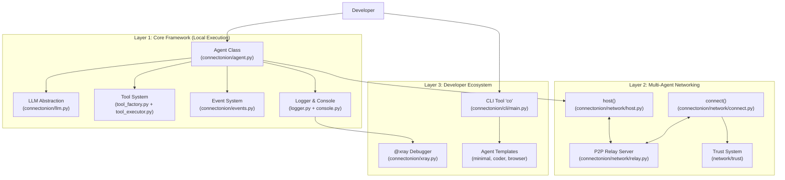
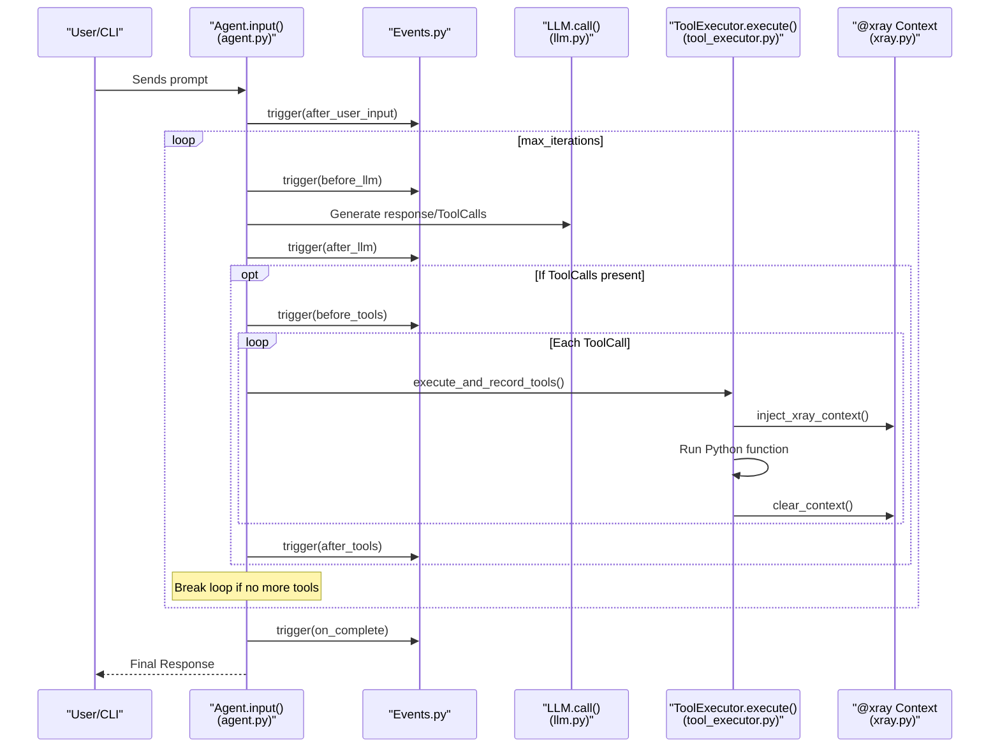

<!-- source: DeepWiki mcp.deepwiki.com · repo openonion/connectonion · page 1 Overview · fetched 2026-10-27 -->

# Overview

Relevant source files

The following files were used as context for generating this wiki page:

- [.gitignore](.gitignore)
- [CLAUDE.md](CLAUDE.md)
- [README.md](README.md)
- [VERSIONING.md](VERSIONING.md)
- [connectonion/__init__.py](connectonion/__init__.py)
- [connectonion/cli/co_ai/agent.py](connectonion/cli/co_ai/agent.py)
- [connectonion/cli/main.py](connectonion/cli/main.py)
- [docs/README.md](docs/README.md)
- [docs/quickstart.md](docs/quickstart.md)
- [docs/templates/README.md](docs/templates/README.md)
- [docs/templates/meta-agent.md](docs/templates/meta-agent.md)
- [docs/templates/minimal.md](docs/templates/minimal.md)
- [docs/templates/playwright.md](docs/templates/playwright.md)
- [docs/templates/web-research.md](docs/templates/web-research.md)
- [examples/browser-agent/CLAUDE.md](examples/browser-agent/CLAUDE.md)
- [examples/browser-agent/web_automation.py](examples/browser-agent/web_automation.py)
- [pyproject.toml](pyproject.toml)

## Purpose and Scope

ConnectOnion is a simple yet powerful Python framework for creating AI agents with built-in behavior tracking, interactive debugging, and multi-agent collaboration capabilities. It is designed to bridge the gap between simple LLM scripts and production-ready agentic systems by providing the "infrastructure around the LLM" — including tool execution, event hooks, and a distributed networking layer. [README.md:14-15](), [CLAUDE.md:7-9]()

The framework handles the complexities of tool schema generation, conversation state management, and activity logging, allowing developers to focus on writing prompts and Python functions. [README.md:73-74]()

## Philosophy

ConnectOnion follows a single guiding principle: **"Keep simple things simple, make complicated things possible"**. [README.md:22-25]()

*   **Simple:** Create and run an agent in two lines of code. [README.md:29-34]()
*   **Complicated:** Support for multi-agent trust verification, context window management (`auto_compact`), autonomous sub-agent spawning, and P2P relay networking. [README.md:153-165](), [connectonion/network/trust/]()

## High-Level Architecture

ConnectOnion is structured into three distinct layers that manage the agent lifecycle from local execution to distributed networking.

### System Architecture Diagram

**Sources:** [CLAUDE.md:9-22](), [connectonion/__init__.py:33-64](), [connectonion/cli/main.py:1-9]()

---

## Core Components

### 1. The Agent Orchestrator
The `Agent` class is the central entity. It manages the `current_session` (messages and traces), interacts with the `LLM` provider, and triggers lifecycle events. [CLAUDE.md:13](), [connectonion/agent.py:29]()

### 2. Multi-Provider LLM Abstraction
ConnectOnion uses a factory pattern (`create_llm`) to support OpenAI, Anthropic, Gemini, and its own managed keys (`co/` prefix). All provider outputs are normalized into a unified `ToolCall` and message format. [CLAUDE.md:44-49](), [connectonion/llm.py:11]()

### 3. Automatic Tool System
The framework converts standard Python functions into AI-ready tools using `create_tool_from_function`. It inspects type hints for parameter schemas and docstrings for tool descriptions. [CLAUDE.md:24-28](), [connectonion/tool_factory.py]()

### 4. Event & Plugin System
There are 12 lifecycle hooks (e.g., `before_llm`, `after_tools`) that allow injecting logic. Plugins are simply collections of these handlers. [connectonion/events.py:11](), [connectonion/__init__.py:122-134]()

---

## Data Flow: Agent Execution Loop

This diagram maps the natural language "Reasoning Loop" to specific code entities and files.

### Code Entity Execution Flow

**Sources:** [CLAUDE.md:30-42](), [connectonion/agent.py:29](), [connectonion/tool_executor.py:24](), [connectonion/xray.py:32]()

---

## Key Features

### Observability & "X-Ray" Debugging
Every tool execution is wrapped in an `xray` context. By decorating functions with `@xray`, developers can see a full trace of agent activity and even trigger interactive breakpoints via `agent.auto_debug()`. [CLAUDE.md:65-70](), [connectonion/xray.py:32]()

### Distributed Multi-Agent Networking
Agents can be hosted as services using `host(agent)`. This starts a Uvicorn-powered ASGI server and optionally announces the agent to a P2P relay for discovery. Other agents can then use `connect(address)` to interact with them as `RemoteAgent` proxies. [README.md:65-70](), [connectonion/network/host.py](), [connectonion/network/connect.py]()

### Built-in Tool Ecosystem
ConnectOnion ships with production-ready tools that include:
*   **FileTools:** Safe file operations with tracking. [connectonion/useful_tools/]()
*   **BrowserAutomation:** Natural language browser control via Playwright. [examples/browser-agent/web_automation.py]()
*   **Communication:** Gmail and Outlook integrations. [connectonion/__init__.py:80-83]()
*   **System:** Shell execution (with `bash` and approval plugins). [connectonion/cli/co_ai/agent.py:13]()

### "co ai" Coding Assistant
The framework includes a built-in coding assistant (`co ai`) that is itself built using ConnectOnion. It demonstrates advanced features like context window management (`auto_compact`), autonomous work modes (`ulw`), and sub-agent delegation. [connectonion/cli/co_ai/agent.py:58-108](), [README.md:75-82]()

---

## Project Structure Reference

| Directory / File | Responsibility |
| :--- | :--- |
| `connectonion/agent.py` | Core Agent class and execution loop logic. |
| `connectonion/llm.py` | Multi-provider abstraction (OpenAI, Anthropic, Gemini). |
| `connectonion/tool_executor.py` | Logic for running tools and recording traces. |
| `connectonion/network/` | Distributed agent primitives (host, connect, relay). |
| `connectonion/cli/` | Command-line interface implementation. |
| `connectonion/useful_tools/` | Pre-built tools for browser, email, and files. |
| `connectonion/useful_plugins/` | Reusable behavior like `re_act`, `auto_compact`, and `tool_approval`. |

**Sources:** [CLAUDE.md:144-165](), [connectonion/__init__.py:33-64]()

---

