# Page: Overview

# Overview

<details>
<summary>Relevant source files</summary>

The following files were used as context for generating this wiki page:

- [.github/workflows/coverage.yaml](.github/workflows/coverage.yaml)
- [.github/workflows/python-compatibility.yaml](.github/workflows/python-compatibility.yaml)
- [.github/workflows/tests.yaml](.github/workflows/tests.yaml)
- [CHANGELOG.md](CHANGELOG.md)
- [README.md](README.md)
- [changelog/6208.added.md](changelog/6208.added.md)
- [env.example](env.example)
- [evals/release/manifest.yaml](evals/release/manifest.yaml)
- [examples/voice/voice-rime-v1.py](examples/voice/voice-rime-v1.py)
- [pyproject.toml](pyproject.toml)
- [src/pipecat/frames/frames.py](src/pipecat/frames/frames.py)
- [src/pipecat/pipeline/task.py](src/pipecat/pipeline/task.py)
- [src/pipecat/processors/aggregators/llm_response.py](src/pipecat/processors/aggregators/llm_response.py)
- [src/pipecat/processors/frame_processor.py](src/pipecat/processors/frame_processor.py)
- [src/pipecat/services/rime/tts_v1.py](src/pipecat/services/rime/tts_v1.py)
- [src/pipecat/transports/base_input.py](src/pipecat/transports/base_input.py)
- [src/pipecat/transports/base_output.py](src/pipecat/transports/base_output.py)
- [src/pipecat/transports/base_transport.py](src/pipecat/transports/base_transport.py)
- [tests/test_rime_v1_tts.py](tests/test_rime_v1_tts.py)
- [uv.lock](uv.lock)

</details>


## Purpose and Scope

This page introduces the Pipecat AI framework, covering its core purpose, architectural philosophy, and key capabilities for building real-time conversational AI agents [README.md:7-10](). It provides a conceptual map of the framework's major components and their relationships, including multi-agent coordination over `WorkerBus`, bundled `Pipecat Flows`, and real-time capabilities [README.md:9-10](), [README.md:41-42](), [CHANGELOG.md:10-145]().

For installation and extras configuration, see Getting Started. For frame-based execution mechanics, see Core Architecture. For AI integrations, see AI Service Integrations. For transports, see Transport Layer.

Sources: [README.md:1-42](), [pyproject.toml:5-13](), [CHANGELOG.md:10-145]()

## What is Pipecat?

Pipecat is an open-source Python framework designed for building real-time voice and multimodal conversational AI agents [README.md:7-10](). It orchestrates interactions between audio/video processing, AI services (LLMs, STT, S2S, TTS), transports, and conversation state management through a composable pipeline architecture [README.md:23-30]().

The framework enables developers to:
- **Build Voice Assistants** – Facilitate natural, low-latency streaming conversations [README.md:15-15]().
- **Create Multi-Agent Systems** – Deploy specialist agents that hand off tasks, fan out in parallel, or coordinate as sidecars over a shared `WorkerBus` [README.md:9-10](), [CHANGELOG.md:14-22]().
- **Manage Structured Conversations** – Utilize `Pipecat Flows` bundled directly in `pipecat-ai` [README.md:41-42]().
- **Deploy Across Diverse Transports** – Interface via WebRTC, WebSockets, telephony, and Media over QUIC (`MOQTransport`) [README.md:27-29](), [pyproject.toml:125-125]().
- **Swap Providers Seamlessly** – Change AI service providers without modifying core application logic through the pluggable `AIService` architecture [README.md:25-25]().

**Core Design Principle**: Pipecat treats all data and control events as typed `Frame` objects flowing through a pipeline of `FrameProcessor` nodes. Every `PipelineWorker` operates as a peer on a shared `WorkerBus` [src/pipecat/processors/frame_processor.py:7-12](), [CHANGELOG.md:14-22]().

Sources: [README.md:7-60](), [pyproject.toml:6-8](), [src/pipecat/processors/frame_processor.py:7-12](), [CHANGELOG.md:10-141]()

## Architecture Philosophy

### Frame-Based Processing Pipeline

Pipecat's runtime architecture is built upon three core abstractions:

| Concept | Description | Primary Classes |
|---------|-------------|-----------------|
| **Frame** | Immutable data packets flowing through the pipeline. | `Frame`, `SystemFrame`, `DataFrame`, `ControlFrame` [src/pipecat/frames/frames.py:73-155]() |
| **FrameProcessor** | Composable nodes that process incoming frames asynchronously. | `FrameProcessor`, `FrameProcessorQueue` [src/pipecat/processors/frame_processor.py:74-184]() |
| **PipelineWorker** | Execution lifecycle manager and bus peer (formerly `PipelineTask`). | `PipelineWorker`, `PipelineParams` [src/pipecat/pipeline/task.py:15-28]() |

All media chunks, text tokens, LLM contexts, tool calls, and control signals are subclasses of `Frame` [src/pipecat/frames/frames.py:73-155]().

Title: "Frame Hierarchy and Code Entities"
```mermaid
graph "LR" {
    "NL_Base"["Base Frame"] --> "Entity_Frame"["Frame\nsrc/pipecat/frames/frames.py:74"]
    "Entity_Frame" --> "Entity_Sys"["SystemFrame\nsrc/pipecat/frames/frames.py:122"]
    "Entity_Frame" --> "Entity_Data"["DataFrame\nsrc/pipecat/frames/frames.py:133"]
    "Entity_Frame" --> "Entity_Ctrl"["ControlFrame\nsrc/pipecat/frames/frames.py:145"]
    "Entity_Sys" --> "Entity_Start"["StartFrame\nsrc/pipecat/processors/frame_processor.py:39"]
    "Entity_Sys" --> "Entity_Inter"["InterruptionFrame\nsrc/pipecat/processors/frame_processor.py:38"]
    "Entity_Data" --> "Entity_Audio"["OutputAudioRawFrame\nsrc/pipecat/transports/base_output.py:38"]
    "Entity_Data" --> "Entity_Text"["TextFrame\nsrc/pipecat/processors/aggregators/llm_response.py:15"]
    "Entity_Ctrl" --> "Entity_Config"["FilterControlFrame\nsrc/pipecat/transports/base_output.py:34"]
}
```
Sources: [src/pipecat/frames/frames.py:74-155](), [src/pipecat/processors/frame_processor.py:38-41](), [src/pipecat/processors/aggregators/llm_response.py:15-15](), [src/pipecat/transports/base_output.py:34-38]()

**Frame Priority & Flow Control**: Critical signals (`SystemFrame` instances like `InterruptionFrame` or `StartFrame`) bypass standard data queues via `FrameProcessorQueue`, a specialized `asyncio.PriorityQueue` that processes start frames first, then system frames, followed by data and control frames [src/pipecat/processors/frame_processor.py:131-172]().

Sources: [src/pipecat/frames/frames.py:74-155](), [src/pipecat/processors/frame_processor.py:131-184](), [src/pipecat/pipeline/task.py:15-28]()

### Multi-Worker Framework and Shared Bus

The `pipecat.workers` and `pipecat.pipeline.worker` modules enable distributed multi-agent systems. A `PipelineWorker` acts as a peer on a shared `WorkerBus` [CHANGELOG.md:14-22]().

- **`WorkerBus`**: A pub/sub messaging layer (`AsyncQueueBus`, `RedisBus`, or `PgmqBus`) facilitating inter-worker communication.
- **`UIWorker`**: Drives real-time web client interfaces using the RTVI protocol.
- **State & Resource Sharing**: `PipelineWorker` manages `app_resources` passed to downstream processors and tool execution handlers [src/pipecat/processors/frame_processor.py:74-114]().
- **Strategy Callbacks**: Turn strategies utilize explicit lifecycle callbacks like `handle_user_turn_started` and `handle_user_turn_stopped` [CHANGELOG.md:14-22]().

Sources: [src/pipecat/pipeline/task.py:15-28](), [src/pipecat/processors/frame_processor.py:74-114](), [CHANGELOG.md:14-145]()

### Processor Linking and Frame Flow

Title: "Pipeline Execution Model and Component Relationships"
```mermaid
graph "TD" {
    "Worker"["PipelineWorker\nsrc/pipecat/pipeline/task.py:20"]
    "Processor"["FrameProcessor\nsrc/pipecat/processors/frame_processor.py:74"]
    "Queue"["FrameProcessorQueue\nsrc/pipecat/processors/frame_processor.py:131"]
    "InputT"["BaseInputTransport\nsrc/pipecat/transports/base_input.py:38"]
    "OutputT"["BaseOutputTransport\nsrc/pipecat/transports/base_output.py:66"]
    
    "Worker" -->|"runs"| "Processor"
    "Processor" -->|"enqueues via"| "Queue"
    "InputT" -->|"pushes downstream"| "Processor"
    "Processor" -->|"pushes downstream"| "OutputT"
}
```
Sources: [src/pipecat/processors/frame_processor.py:74-184](), [src/pipecat/pipeline/task.py:15-28](), [src/pipecat/transports/base_input.py:38-45](), [src/pipecat/transports/base_output.py:66-72]()

Each `FrameProcessor` operates asynchronously, accepting frames via `process_frame()` and pushing results downstream or upstream using `push_frame()` [src/pipecat/processors/frame_processor.py:74-184]().

Sources: [src/pipecat/processors/frame_processor.py:74-184](), [src/pipecat/pipeline/task.py:15-28](), [src/pipecat/transports/base_input.py:38-45](), [src/pipecat/transports/base_output.py:66-72]()

## Key Capabilities

### AI Service Integrations & Pluggable Architecture

Pipecat integrates over 60 AI providers through unified service base classes [README.md:89-137]().

| Service Category | Base Class | Notable Integrations |
|------------------|------------|----------------------|
| LLMs | `LLMService` | OpenAI, Anthropic, Google, AWS Bedrock, Groq, Mistral [pyproject.toml:70-155]() |
| Text-to-Speech | `TTSService` | Cartesia, ElevenLabs, Deepgram, Smallest [pyproject.toml:78-146]() |
| Speech-to-Text | `STTService` | Deepgram, Whisper, AssemblyAI, Speechmatics [pyproject.toml:71-153]() |
| Speech-to-Speech | Realtime Services | OpenAI Realtime, Google Gemini Live, AWS Nova Sonic [pyproject.toml:74-154]() |

**Plugin Ecosystem**: Dependencies are organized via `pyproject.toml` extras, enabling modular installations per service provider [pyproject.toml:68-155](). Environment variables, as shown in `env.example`, are used to configure API keys and other service-specific settings [env.example:1-247]().

Sources: [README.md:89-137](), [pyproject.toml:68-155](), [env.example:1-247]()

### Transport Layer Abstraction & Real-Time Transports

Transports inherit from `BaseTransport`, splitting into `BaseInputTransport` and `BaseOutputTransport` to handle bidirectional media streams [src/pipecat/transports/base_input.py:38-45](), [src/pipecat/transports/base_output.py:66-72]().

- **`MOQTransport`**: Media over QUIC provides low-latency streaming and transport control [pyproject.toml:125-125](). It supports client-mode reconnect with backoff and sends `session-ending` markers [CHANGELOG.md:47-58]().
- **`DailyTransport`**: Integrates Daily.co WebRTC sessions and media streaming [pyproject.toml:83-83]().
- **Media Senders**: `BaseOutputTransport` manages distinct `MediaSender` instances per destination track, handling audio chunking and media streaming [src/pipecat/transports/base_output.py:97-195]().

Sources: [src/pipecat/transports/base_input.py:38-76](), [src/pipecat/transports/base_output.py:66-195](), [pyproject.toml:83-125](), [CHANGELOG.md:47-58]()

### Real-Time Conversational Features & Turn Management

- **Audio Token Tracking**: Tracks `input_audio_tokens` and `output_audio_tokens` for multimodal and realtime LLM calls [CHANGELOG.md:71-91]().
- **Turn Strategies**: Specialized turn detectors and aggregators manage user interruptions, VAD states, and conversational transitions [src/pipecat/transports/base_input.py:39-44]().
- **Interruptible Frames**: The `interruptible` field on `Frame` objects (default `True`) allows fine-grained control over whether a frame can be dropped during an interruption, with `UninterruptibleFrame` subclasses defaulting to `False` [src/pipecat/frames/frames.py:104-116](), [CHANGELOG.md:67-72]().

Sources: [src/pipecat/transports/base_input.py:38-44](), [CHANGELOG.md:67-91](), [src/pipecat/frames/frames.py:104-116]()

---

# Page: Getting Started

# Getting Started

<details>
<summary>Relevant source files</summary>

The following files were used as context for generating this wiki page:

- [.github/workflows/coverage.yaml](.github/workflows/coverage.yaml)
- [.github/workflows/python-compatibility.yaml](.github/workflows/python-compatibility.yaml)
- [.github/workflows/tests.yaml](.github/workflows/tests.yaml)
- [README.md](README.md)
- [changelog/6208.added.md](changelog/6208.added.md)
- [env.example](env.example)
- [evals/release/manifest.yaml](evals/release/manifest.yaml)
- [evals/release/scenarios/scripted/generate_image.yaml](evals/release/scenarios/scripted/generate_image.yaml)
- [examples/README.md](examples/README.md)
- [examples/flows/README.md](examples/flows/README.md)
- [examples/flows/yaml/insurance_quote/bot.py](examples/flows/yaml/insurance_quote/bot.py)
- [examples/flows/yaml/insurance_quote/flow.yaml](examples/flows/yaml/insurance_quote/flow.yaml)
- [examples/flows/yaml/insurance_quote/handlers.py](examples/flows/yaml/insurance_quote/handlers.py)
- [examples/image-generation/image-generation-fal.py](examples/image-generation/image-generation-fal.py)
- [examples/image-generation/image-generation-google.py](examples/image-generation/image-generation-google.py)
- [examples/image-generation/image-generation-openai.py](examples/image-generation/image-generation-openai.py)
- [examples/voice/voice-rime-v1.py](examples/voice/voice-rime-v1.py)
- [pyproject.toml](pyproject.toml)
- [src/pipecat/services/rime/tts_v1.py](src/pipecat/services/rime/tts_v1.py)
- [tests/test_rime_v1_tts.py](tests/test_rime_v1_tts.py)
- [uv.lock](uv.lock)

</details>


This page guides you through installing Pipecat, configuring your environment variables, understanding the quickstart bot pattern, and exploring the available examples.

As a parent page, this section provides a high-level overview. For deep technical details regarding dependency extras, `uv.lock` dependency resolution, optional-dependency import error patterns, or complete directory mappings, refer to the child pages:
- [Installation and Extras](#2.1)
- [Examples Directory Guide](#2.2)

---

## Installation & Optional Dependencies

Pipecat is engineered with a lightweight core and a modular extras system to manage AI service SDKs and transport requirements [pyproject.toml:22-52, 68-172](). The package requires Python 3.11 or later [pyproject.toml:12]() and is distributed on PyPI under the name `pipecat-ai` [pyproject.toml:6]().

Core dependencies include foundational libraries for asynchronous networking, audio processing, and OpenAI client utilities [pyproject.toml:22-52](). Optional features—such as Daily WebRTC (`daily`), LiveKit (`livekit`), Media over QUIC (`moq`), and the Pipecat CLI (`cli`)—are enabled via `pyproject.toml` extras [pyproject.toml:68-172]().

For a comprehensive review of `pyproject.toml` extras, dependency resolution via `uv.lock`, and import error handling for missing optional packages, see [Installation and Extras](#2.1).

Sources: [pyproject.toml:6-172]()

---

## Environment Variable Configuration

Pipecat does not bundle proprietary API keys; instead, every service dynamically reads from standard environment variables defined during runtime initialization [env.example:1-280](). To configure your local development environment, copy `env.example` to `.env` and populate the required provider credentials [examples/README.md:13-18]().

Common configuration variables include service authentication keys (`OPENAI_API_KEY`, `DAILY_API_KEY`, `DEEPGRAM_API_KEY`, `CARTESIA_API_KEY`, `ANTHROPIC_API_KEY`, `GOOGLE_API_KEY`) as well as security and network controls like `PIPECAT_WEBSOCKET_AUTH` and `PIPECAT_ALLOWED_ORIGINS` [env.example:1-280]().

Sources: [env.example:1-280](), [examples/README.md:13-18]()

---

## Quickstart & Bot Entry Point Anatomy

A Pipecat application executes through an asynchronous `bot(runner_args)` entry point that wires a transport provider, AI services (STT, LLM, TTS), a conversational `Pipeline`, and executes them via `PipelineWorker` and `WorkerRunner`.

Title: "Quickstart Pipeline Architecture"
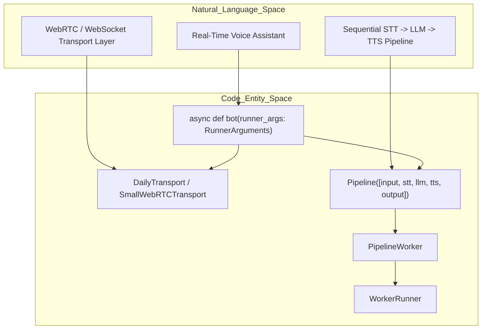

Sources: [README.md:7-29]()

---

## Examples Directory Guide

The repository includes a robust `examples/` directory structured by functional capabilities, ranging from progressive getting-started scripts to complex real-time speech-to-speech services, structured conversational flows, multi-worker agent topologies, and vision integrations [README.md:80-86](), [examples/README.md:58-147]().

For a complete map of the `examples/` tree and instructions on running bots with local audio, Daily, or Twilio transports, see [Examples Directory Guide](#2.2).

Sources: [README.md:80-86](), [examples/README.md:58-147]()

---

## The Pipecat CLI

The Pipecat CLI ships with `pipecat-ai` (activated via the `cli` extra) and provides built-in utilities for project initialization, scaffolding runnable bots, and running automated behavioral evaluation harnesses [pyproject.toml:61-66, 168-175](), [README.md:48-51]().

Title: "Pipecat CLI Toolset Architecture"
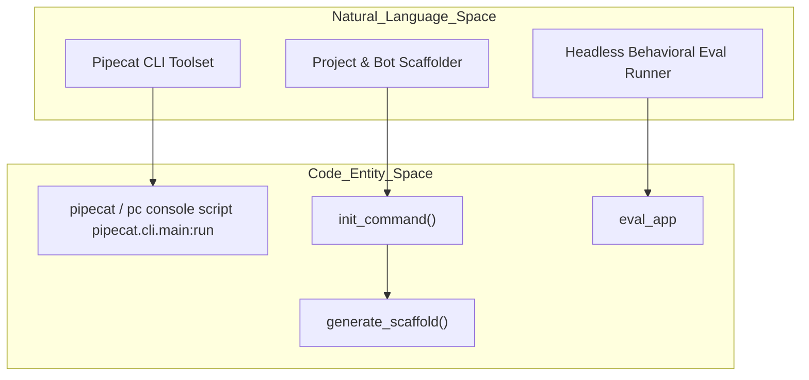

Sources: [pyproject.toml:61-66, 168-175](), [README.md:48-51]()

---

# Page: Installation and Extras

# Installation and Extras

<details>
<summary>Relevant source files</summary>

The following files were used as context for generating this wiki page:

- [.github/workflows/coverage.yaml](.github/workflows/coverage.yaml)
- [.github/workflows/python-compatibility.yaml](.github/workflows/python-compatibility.yaml)
- [.github/workflows/tests.yaml](.github/workflows/tests.yaml)
- [README.md](README.md)
- [changelog/6208.added.md](changelog/6208.added.md)
- [env.example](env.example)
- [evals/release/manifest.yaml](evals/release/manifest.yaml)
- [examples/voice/voice-rime-v1.py](examples/voice/voice-rime-v1.py)
- [pyproject.toml](pyproject.toml)
- [src/pipecat/services/rime/tts_v1.py](src/pipecat/services/rime/tts_v1.py)
- [tests/test_rime_v1_tts.py](tests/test_rime_v1_tts.py)
- [uv.lock](uv.lock)

</details>


## Purpose and Scope
This section details the installation architecture of the Pipecat framework (`pipecat-ai`), focusing on dependency management via `pyproject.toml` [pyproject.toml:1-165](), deterministic resolution through `uv.lock` [uv.lock:1-10](), environment variable configuration using `env.example` [env.example:1-280](), and optional-dependency import error patterns used by services like `RimeV1TTSService` [src/pipecat/services/rime/tts_v1.py:29-35]().

Sources: [pyproject.toml:1-165](), [uv.lock:1-10](), [env.example:1-280](), [src/pipecat/services/rime/tts_v1.py:29-35]()

---

## 1. Pyproject.toml Extras Architecture

The Pipecat codebase uses a lean core dependency model defined in `pyproject.toml` [pyproject.toml:5-51](), keeping the base installation lightweight. All AI service integrations, hardware-accelerated filters, advanced transports, and developer tools are mapped to granular optional dependencies (`[project.optional-dependencies]`) [pyproject.toml:67-165]().

### Core Dependencies vs. Optional Extras

| Category | Target / Component | Configuration Key / Reference |
| :--- | :--- | :--- |
| **Core Runtime** | `aiofiles`, `aiohttp`, `loguru`, `pydantic`, `openai`, `websockets`, `numpy`, `resampy`, `soxr` | `[project] dependencies` [pyproject.toml:22-52]() |
| **Transport Extras** | WebRTC (`aiortc`), Daily (`daily-python`), LiveKit (`livekit`), WebSocket (`fastapi`), Media over QUIC (`moq`) | `[project.optional-dependencies]` [pyproject.toml:83,114,115,125,141,162]() |
| **AI Service Extras** | Anthropic, Deepgram, Google GenAI, Groq, Mistral, ElevenLabs, Rime, etc. | `[project.optional-dependencies]` [pyproject.toml:69,70,84,95,103,121,140]() |
| **Development & CLI** | Code scaffolding (`typer`, `rich`, `jinja2`), testing tools (`pytest`, `coverage`), linting (`ruff`) | `[project.optional-dependencies] cli`, `[dependency-groups] dev` [pyproject.toml:168-192]() |

Title: Natural Language to Code Entity Mapping for Installation Extras
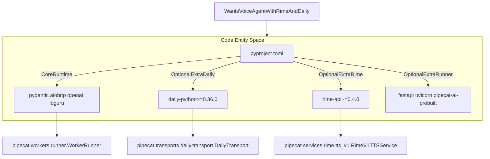
Sources: [pyproject.toml:5-165](), [uv.lock:1-10]()

---

## 2. Deterministic Resolution with `uv.lock`

Pipecat uses `uv` for ultra-fast dependency resolution and locking. The `uv.lock` [uv.lock:1-10]() file anchors exact package versions, platform-specific wheels, and environment markers.

### Resolution Mechanics & Constraints
*   **Python Version Support**: Requires Python `>=3.11` [pyproject.toml:12] [uv.lock:3](). Special handling exists for Python 3.13 (`audioop-lts`) [pyproject.toml:25]() and Python 3.14 (`pydantic>=2.13`) [pyproject.toml:36]().
*   **Conflict Isolation**: `uv` handles complex dependency graphs where specific service connectors (e.g., `vonage-video-connector` pinning older Pydantic versions) would otherwise conflict with modern AI SDKs (like `google-genai`) through explicit markers and separation rules [pyproject.toml:93-100,159]().

Sources: [pyproject.toml:1-198](), [uv.lock:1-10]()

---

## 3. Environment Configuration (`env.example`)

Runtime configuration for API keys, service endpoints, and runner parameters is governed by environment variables mirrored in `env.example` [env.example:1-280]() and loaded via `python-dotenv` [pyproject.toml:37]().

### Key Environment Parameters

The `env.example` file provides a comprehensive list of environment variables required for various services, transports, and runner options, such as HMAC authentication (`PIPECAT_WEBSOCKET_AUTH`), origin restriction (`PIPECAT_ALLOWED_ORIGINS`), and ICE servers (`PIPECAT_ICE_SERVERS`) [env.example:263-280]().

Title: Natural Language to Code Entity Mapping for Environment Variables
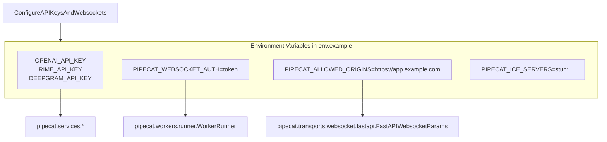
Sources: [env.example:1-280](), [pyproject.toml:37]()

---

## 4. Optional-Dependency Import Error Patterns

Because Pipecat's architecture allows modular installation of services and transports, missing optional packages do not crash package initialization. Instead, Pipecat utilizes graceful degradation, lazy loading, and dedicated import error patterns.

### Try-Except Import Handling Pattern
When optional service clients or dependencies are required at runtime, modules use defensive `try...except ModuleNotFoundError` blocks to log precise remediation hints (such as the exact `uv add` or `pip install` command needed) before raising an `ImportError` [src/pipecat/services/rime/tts_v1.py:29-35]().

Title: Import Error Handling and Graceful Degradation Flow
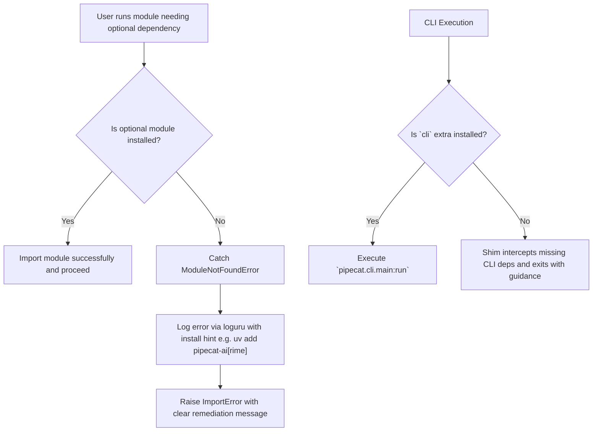
Sources: [pyproject.toml:61-66](), [src/pipecat/services/rime/tts_v1.py:29-35]()

---

# Page: Examples Directory Guide

# Examples Directory Guide

<details>
<summary>Relevant source files</summary>

The following files were used as context for generating this wiki page:

- [evals/release/scenarios/scripted/generate_image.yaml](evals/release/scenarios/scripted/generate_image.yaml)
- [examples/README.md](examples/README.md)
- [examples/flows/README.md](examples/flows/README.md)
- [examples/flows/yaml/insurance_quote/bot.py](examples/flows/yaml/insurance_quote/bot.py)
- [examples/flows/yaml/insurance_quote/flow.yaml](examples/flows/yaml/insurance_quote/flow.yaml)
- [examples/flows/yaml/insurance_quote/handlers.py](examples/flows/yaml/insurance_quote/handlers.py)
- [examples/image-generation/image-generation-fal.py](examples/image-generation/image-generation-fal.py)
- [examples/image-generation/image-generation-google.py](examples/image-generation/image-generation-google.py)
- [examples/image-generation/image-generation-openai.py](examples/image-generation/image-generation-openai.py)
- [examples/realtime/realtime-aws-nova-sonic.py](examples/realtime/realtime-aws-nova-sonic.py)
- [examples/realtime/realtime-azure.py](examples/realtime/realtime-azure.py)
- [examples/realtime/realtime-gemini-live-async-tool.py](examples/realtime/realtime-gemini-live-async-tool.py)
- [examples/realtime/realtime-gemini-live-graceful-end.py](examples/realtime/realtime-gemini-live-graceful-end.py)
- [examples/realtime/realtime-gemini-live-locally-driven-turns.py](examples/realtime/realtime-gemini-live-locally-driven-turns.py)
- [examples/realtime/realtime-gemini-live-vertex.py](examples/realtime/realtime-gemini-live-vertex.py)
- [examples/realtime/realtime-gemini-live.py](examples/realtime/realtime-gemini-live.py)
- [examples/realtime/realtime-grok-locally-driven-turns.py](examples/realtime/realtime-grok-locally-driven-turns.py)
- [examples/realtime/realtime-inworld-locally-driven-turns.py](examples/realtime/realtime-inworld-locally-driven-turns.py)
- [examples/realtime/realtime-inworld.py](examples/realtime/realtime-inworld.py)
- [examples/realtime/realtime-openai-locally-driven-turns.py](examples/realtime/realtime-openai-locally-driven-turns.py)
- [examples/realtime/realtime-openai-text.py](examples/realtime/realtime-openai-text.py)
- [examples/realtime/realtime-openai.py](examples/realtime/realtime-openai.py)
- [examples/realtime/realtime-ultravox-async-tool.py](examples/realtime/realtime-ultravox-async-tool.py)
- [examples/realtime/realtime-ultravox-text.py](examples/realtime/realtime-ultravox-text.py)
- [examples/realtime/realtime-ultravox.py](examples/realtime/realtime-ultravox.py)
- [examples/transcription/transcription-assemblyai.py](examples/transcription/transcription-assemblyai.py)
- [examples/transcription/transcription-meta.py](examples/transcription/transcription-meta.py)
- [examples/update-settings/stt/stt-assemblyai.py](examples/update-settings/stt/stt-assemblyai.py)
- [examples/update-settings/stt/stt-deepgram-flux.py](examples/update-settings/stt/stt-deepgram-flux.py)
- [examples/update-settings/stt/stt-speechmatics.py](examples/update-settings/stt/stt-speechmatics.py)
- [examples/update-settings/tts/tts-deepgram-flux.py](examples/update-settings/tts/tts-deepgram-flux.py)
- [examples/voice/voice-assemblyai-turn-detection.py](examples/voice/voice-assemblyai-turn-detection.py)
- [examples/voice/voice-assemblyai.py](examples/voice/voice-assemblyai.py)
- [examples/voice/voice-cartesia-turns.py](examples/voice/voice-cartesia-turns.py)
- [examples/voice/voice-cartesia.py](examples/voice/voice-cartesia.py)
- [examples/voice/voice-deepgram-flux-sagemaker.py](examples/voice/voice-deepgram-flux-sagemaker.py)
- [examples/voice/voice-deepgram-flux.py](examples/voice/voice-deepgram-flux.py)
- [examples/voice/voice-gladia-vad.py](examples/voice/voice-gladia-vad.py)
- [examples/voice/voice-meta.py](examples/voice/voice-meta.py)
- [examples/voice/voice-speechmatics-vad.py](examples/voice/voice-speechmatics-vad.py)

</details>


## Purpose and Scope

This page serves as a technical map and execution guide for the `examples/` directory within the Pipecat repository [`examples/README.md:1-3`](). It provides a comprehensive breakdown of the directory tree—covering getting-started guides, cascaded voice pipelines, realtime bidirectional WebSocket services, runtime settings updates, multi-worker architectures, tool use and function calling, conversation flows, and turn management—while detailing the underlying architecture, data flow, key classes (`PipelineWorker`, `WorkerRunner`, `LLMContextAggregatorPair`, `FlowManager`), and execution patterns.

Sources: [`examples/README.md:1-3`](), [`examples/README.md:58-147`]()

---

## 1. Environment Setup and Execution Mechanics

Before running any example in the Pipecat codebase, the local development environment must be configured with appropriate dependencies and API keys [`examples/README.md:5-18`](). Pipecat uses `uv` for fast dependency resolution and execution.

1. Copy the environment template from the repository root [`examples/README.md:13-18`]():
   ```bash
   cp env.example .env
   # Populate .env with valid API keys (OPENAI_API_KEY, CARTESIA_API_KEY, DAILY_API_KEY, etc.)
   ```
2. Execute any example using `uv run` [`examples/README.md:20-24`]():
   ```bash
   uv run python examples/getting-started/01-say-one-thing.py
   ```
3. Open the web interface at `http://localhost:7860/client/` and click "Connect" [`examples/README.md:26-27`]().

### Transport Switching
Most examples utilize a dynamic transport factory (`create_transport`) supporting multiple deployment targets via command-line flags [`examples/README.md:28-38`](). The `transport_params` dictionary in each example defines the available transport configurations [`examples/realtime/realtime-aws-nova-sonic.py:60-77`]().
* **Local WebRTC / Evaluation**: Default or `-t webrtc` / `-t eval` [`examples/realtime/realtime-aws-nova-sonic.py:61-77`]().
* **Daily.co WebRTC**: Requires `DAILY_API_KEY` and `DAILY_ROOM_URL` (or auto-created rooms) [`examples/README.md:32-38`]():
  ```bash
  uv run python examples/realtime/realtime-openai.py -t daily
  ```
* **Twilio Telephony**: Requires `ngrok` tunneling for webhook routing [`examples/README.md:40-56`]():
  ```bash
  ngrok http 7860
  uv run python examples/realtime/realtime-openai.py -t twilio -x NGROK_HOST_NAME
  ```

Sources: [`examples/README.md:1-58`](), [`examples/realtime/realtime-aws-nova-sonic.py:60-77`]()

---

## 2. Directory Tree Map and Architectural Breakdown

The `examples/` directory is organized by architectural complexity, service integrations, and specialized capabilities [`examples/README.md:58-147`]().

```
examples/
├── getting-started/        # Progressive introduction: minimal TTS to voice agent
├── voice/                  # Cascaded STT + LLM + TTS voice pipelines
├── realtime/               # WebSocket streaming multimodal live APIs
├── update-settings/        # Runtime configuration modifications (stt, tts, llm)
├── multi-worker/           # Multi-agent and pub/sub worker framework examples
├── flows/                  # Pipecat Flows state machines and node navigation
├── function-calling/       # Tool use and function execution across LLM providers
├── transcription/          # Dedicated Speech-to-Text logging and analysis
├── vision/                 # Multimodal image description and video frames
├── turn-management/        # Custom VAD, user turn stop strategies, and interruptions
├── observability/          # Logging, metrics collection, and OpenTelemetry
└── transports/             # Specialized transport integrations (Daily, LiveKit, MOQ)
```

Sources: [`examples/README.md:58-147`]()

### 2.1 Getting Started and Voice Agents (`getting-started/`, `voice/`)
Implements traditional cascaded architectures where audio input flows through an STT service (`DeepgramSTTService`, `CartesiaSTTService`), gets aggregated by `LLMContextAggregatorPair`, evaluated by an LLM (`OpenAILLMService`), synthesized by a TTS service (`CartesiaTTSService`), and rendered by a transport output [`examples/voice/voice-cartesia.py:89-95`]().

Sources: [`examples/README.md:60-71`](), [`examples/voice/voice-cartesia.py:89-95`]()

### 2.2 Realtime Multimodal APIs (`realtime/`)
Demonstrates bidirectional WebSocket-based streaming services where audio/text flows directly into a unified realtime service that handles STT, LLM reasoning, and TTS internally.

*   **OpenAI Realtime API** [`examples/realtime/realtime-openai.py`]() — Utilizes `OpenAIRealtimeLLMService` with `SessionProperties` and `SemanticTurnDetection` [`examples/realtime/realtime-openai.py:113-146`](). A locally-driven turn variant [`examples/realtime/realtime-openai-locally-driven-turns.py`]() disables server-side VAD and wires `SileroVADAnalyzer` into the user aggregator [`examples/realtime/realtime-openai-locally-driven-turns.py:148-175`]().
*   **Google Gemini Live** [`examples/realtime/realtime-gemini-live.py`]() — Configures `GeminiLiveLLMService` with `ToolsSchema` and function handlers [`examples/realtime/realtime-gemini-live.py:89-134`]().
*   **AWS Nova Sonic** [`examples/realtime/realtime-aws-nova-sonic.py`]() — Implements `AWSNovaSonicLLMService` with built-in `SessionContinuationParams` for handling long-duration sessions past session limits [`examples/realtime/realtime-aws-nova-sonic.py:95-123`]().
*   **Ultravox & Inworld Realtime** [`examples/realtime/realtime-ultravox.py`]() & [`examples/realtime/realtime-inworld.py`]() — Real-time voice agents utilizing specialized realtime routers and server-side semantic VAD [`examples/realtime/realtime-ultravox.py:168-172`]().

Sources: [`examples/README.md:84-87`](), [`examples/realtime/realtime-openai.py:113-146`](), [`examples/realtime/realtime-gemini-live.py:89-134`](), [`examples/realtime/realtime-aws-nova-sonic.py:95-123`](), [`examples/realtime/realtime-ultravox.py:168-172`](), [`examples/realtime/realtime-openai-locally-driven-turns.py:148-175`]()

### 2.3 Function Calling and Tool Use (`function-calling/`)
Showcases tool registration, direct function execution, asynchronous background tasks, and streaming intermediate results across providers:
*   `examples/function-calling/function-calling-openai-async.py` — OpenAI async tool execution with `@tool_options(cancel_on_interruption=False, timeout_secs=30)` and event handlers for `on_function_calls_started` [`examples/README.md:72-74`]().
*   `examples/function-calling/function-calling-google-async.py` — Google Gemini async tool handling with `UserImageRequestFrame` pushing upstream [`examples/README.md:72-74`]().
*   `examples/function-calling/function-calling-anthropic-async.py` — Anthropic Claude tool execution [`examples/README.md:72-74`]().
*   `examples/function-calling/function-calling-openai-responses-async.py` — OpenAI Responses API (`OpenAIResponsesLLMService`) with reasoning configuration [`examples/README.md:72-74`]().

Sources: [`examples/README.md:72-74`]()

### 2.4 Runtime Settings Updates (`update-settings/`)
Organized by service type (`stt/`, `tts/`, `llm/`), these examples showcase how to modify service parameters mid-stream without dropping the active transport connection [`examples/README.md:96-103`](). For instance, STT updates queue frames containing parameter deltas dynamically at runtime.

Sources: [`examples/README.md:96-103`](), [`examples/README.md:100-102`]()

### 2.5 Multi-Worker Framework (`multi-worker/`)
Exemplifies the Pipecat multi-agent framework (`pipecat.workers`), featuring `PipelineWorker` instances acting as bus peers over a `WorkerBus`, distributed message passing, and job fan-out via `job_group` [`examples/README.md:140-142`]().

Sources: [`examples/README.md:140-142`]()

### 2.6 Conversation Flows (`examples/flows/`)
Maps structured conversation graphs using `Pipecat Flows`. Flows can be defined as YAML data (`flow.yaml`) joined with Python handler functions (`handlers.py`) or purely in Python [`examples/flows/README.md:1-16`]().
*   **YAML Flows**: `yaml/hello_world/`, `yaml/food_ordering/`, `yaml/insurance_quote/` (where state is read using Jinja-like syntax such as `{{ quote.monthly_premium }}`) [`examples/flows/README.md:40-48`]().
*   **Python Flows**: `python/hello_world.py`, `python/food_ordering.py`, `python/warm_transfer.py`, `python/llm_switching.py` [`examples/flows/README.md:49-57`]().

Sources: [`examples/flows/README.md:1-57`](), [`examples/README.md:65-67`]()

### 2.7 Turn Management (`turn-management/`)
This directory contains examples demonstrating various strategies for detecting and managing user turns, including:
*   **Local Smart Turn V3**: Uses an ONNX model for local end-of-turn detection without network connectivity. The `LocalSmartTurnAnalyzerV3` class loads a bundled ONNX model (`smart-turn-v3.2-cpu.onnx`) and processes audio by resampling to 16kHz and computing Whisper-style log-mel features for inference [`src/pipecat/audio/turn/smart_turn/local_smart_turn_v3.py:28-166`](). This analyzer can be integrated into `LLMUserAggregatorParams` to drive local turn detection.
*   **VAD Integration**: Examples show how to integrate Voice Activity Detection (VAD) analyzers like `SileroVADAnalyzer` into the `LLMUserAggregator` to control when a user's turn starts and stops [`examples/realtime/realtime-openai-locally-driven-turns.py:170-175`]().

Sources: [`examples/README.md:104-106`](), [`src/pipecat/audio/turn/smart_turn/local_smart_turn_v3.py:28-166`](), [`examples/realtime/realtime-openai-locally-driven-turns.py:170-175`]()

---

## 3. Execution Data Flow and Architecture Diagrams

To bridge natural language concepts to concrete code entities, the following diagrams illustrate how frames traverse pipelines in typical Pipecat voice and realtime examples.

### Voice Pipeline Data Flow (Cascaded STT/LLM/TTS)
The following diagram maps the execution path of asynchronous function-calling pipelines, showing how user audio frames flow from the transport input through STT, context aggregation, LLM inference, TTS synthesis, and transport output.

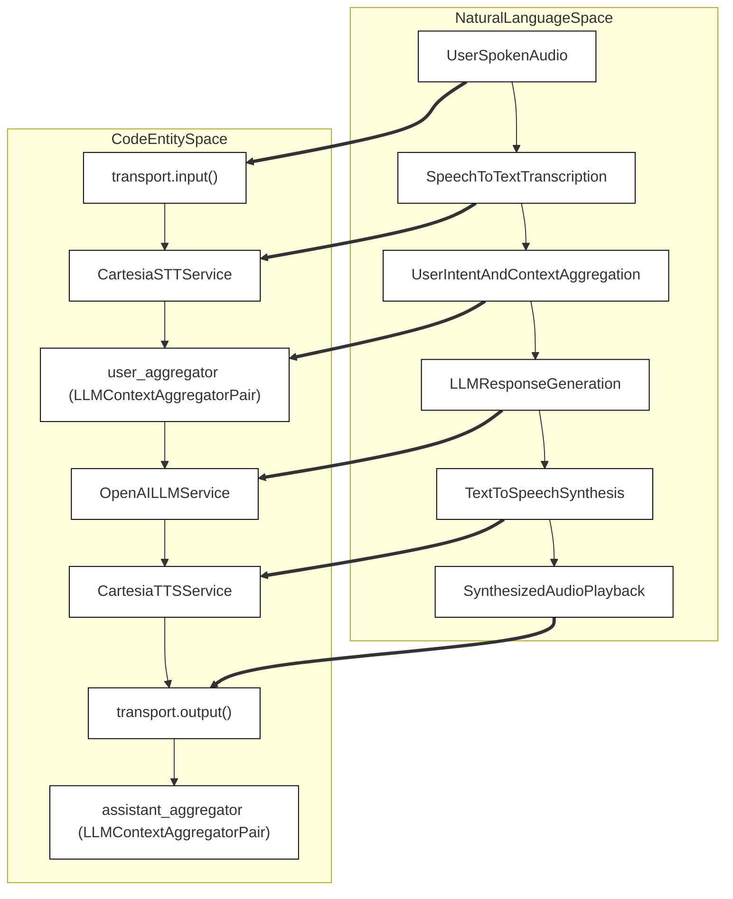
Sources: [`examples/voice/voice-cartesia.py:89-95`](), [`examples/README.md:68-71`]()

### Realtime WebSocket Streaming Data Flow
The following diagram maps `realtime-openai.py`, illustrating how bidirectional WebSockets bypass individual cascaded STT/TTS workers by funneling audio through a single `OpenAIRealtimeLLMService` instance managed by `PipelineWorker` and `WorkerRunner`.

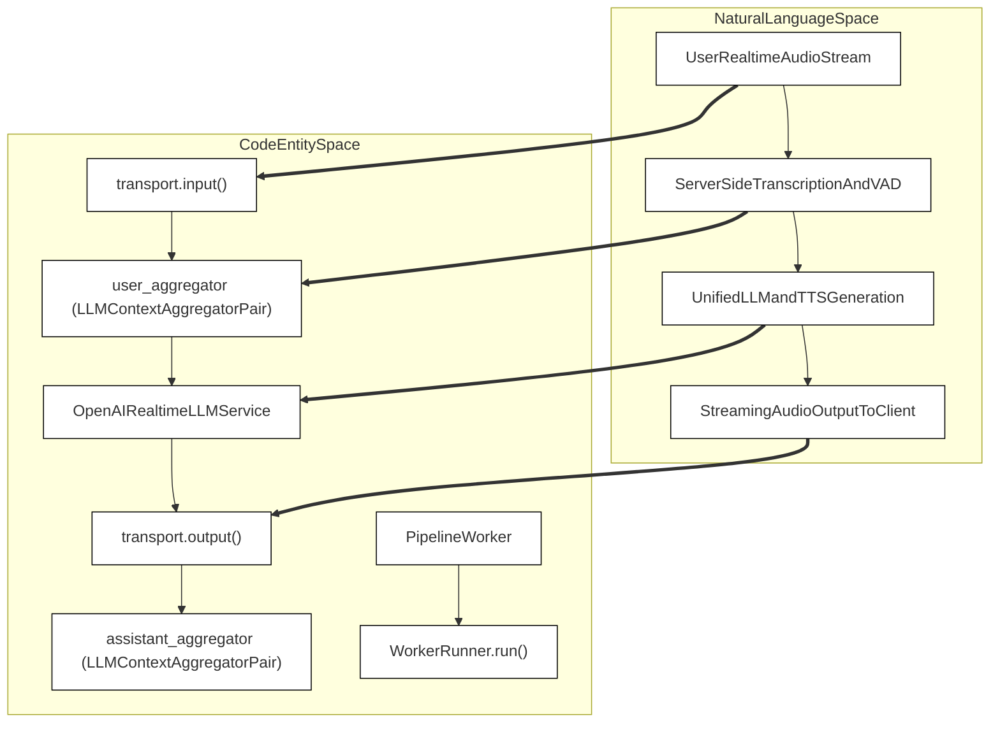
Sources: [`examples/realtime/realtime-openai.py:163-182`](), [`examples/README.md:84-87`]()

---

## 4. Summary of Example Categories and Execution Matrix

| Directory Path | Primary Focus | Key Classes / Frameworks | Execution Command Example |
| :--- | :--- | :--- | :--- |
| `examples/getting-started/` | Basic pipeline setup & TTS | `Pipeline`, `PipelineWorker`, `TTSService` | `uv run python examples/getting-started/01-say-one-thing.py` |
| `examples/voice/` | Cascaded Voice Agents | `CartesiaSTTService`, `OpenAILLMService`, `CartesiaTTSService` | `uv run python examples/voice/voice-cartesia.py` |
| `examples/realtime/` | Bidirectional Streaming | `OpenAIRealtimeLLMService`, `GeminiLiveLLMService` | `uv run python examples/realtime/realtime-openai.py` |
| `examples/function-calling/`| Tool Use & Async Exec | `FunctionCallParams`, `OpenAILLMService`, `@tool_options` | `uv run python examples/function-calling/function-calling-openai-async.py` |
| `examples/update-settings/`| Runtime Configuration | `STTUpdateSettingsFrame`, `TTSUpdateSettingsFrame` | `uv run python examples/update-settings/stt/stt-deepgram-flux.py` |
| `examples/multi-worker/` | Multi-Agent Framework | `PipelineWorker`, `WorkerBus`, `WorkerRunner` | `uv run python examples/multi-worker/basic-worker.py` |
| `examples/flows/` | Structured State Machines | `FlowManager`, `NodeConfig`, `FlowArgs` | `uv run python examples/flows/yaml/insurance_quote/bot.py` |
| `examples/turn-management/` | Turn Detection & Interruption | `LocalSmartTurnAnalyzerV3`, `SileroVADAnalyzer` | (Integrated into real-time or voice examples) |

Sources: [`examples/README.md:58-143`](), [`examples/realtime/realtime-openai.py:163-171`](), [`src/pipecat/audio/turn/smart_turn/local_smart_turn_v3.py:28-166`]()

---

# Page: Core Architecture

# Core Architecture

<details>
<summary>Relevant source files</summary>

The following files were used as context for generating this wiki page:

- [CHANGELOG.md](CHANGELOG.md)
- [src/pipecat/frames/frames.py](src/pipecat/frames/frames.py)
- [src/pipecat/pipeline/task.py](src/pipecat/pipeline/task.py)
- [src/pipecat/processors/aggregators/llm_response.py](src/pipecat/processors/aggregators/llm_response.py)
- [src/pipecat/processors/frame_processor.py](src/pipecat/processors/frame_processor.py)
- [src/pipecat/transports/base_input.py](src/pipecat/transports/base_input.py)
- [src/pipecat/transports/base_output.py](src/pipecat/transports/base_output.py)
- [src/pipecat/transports/base_transport.py](src/pipecat/transports/base_transport.py)

</details>


This page provides an architectural overview of Pipecat's fundamental frame-based pipeline processing model, component interactions, and execution subsystems. It serves as a parent guide to detailed subsystem documentation.

**Related pages**: For AI service integrations, see page 4. For transport implementations, see page 5. For audio/video processing, see page 6.

## Architectural Principles

Pipecat's architecture is built on these core principles:

- **Frame-based processing**: All data flows as discrete `Frame` objects with type-based priority. `SystemFrame` instances (e.g., `StartFrame`, `InterruptionFrame`, `CancelFrame`) are processed immediately with higher priority, while `DataFrame` and `ControlFrame` instances follow normal ordering [src/pipecat/processors/frame_processor.py:141-172]().
- **Asynchronous pipeline composition**: Each `FrameProcessor` runs in its own asyncio task with dual internal queues, enabling concurrent processing while maintaining ordering guarantees [src/pipecat/processors/frame_processor.py:132-184]().
- **Multi-Worker Coordination**: Pipecat pipelines support multi-agent and multi-worker execution via the `PipelineWorker` (formerly `PipelineTask`) acting as a peer on a shared `WorkerBus` [src/pipecat/pipeline/task.py:15-21]().
- **Protocol-agnostic transport**: The `BaseTransport`, `BaseInputTransport`, and `BaseOutputTransport` classes abstract communication protocols (WebRTC, WebSocket, telephony), allowing the same pipeline code to run across different transports [src/pipecat/transports/base_transport.py:96-137]().
- **Universal context management**: The `LLMContext` system provides provider-agnostic conversation storage with translation via the `BaseLLMAdapter` pattern [src/pipecat/frames/frames.py:30-51]().

Sources: [src/pipecat/frames/frames.py:30-139](), [src/pipecat/processors/frame_processor.py:132-184](), [src/pipecat/transports/base_transport.py:96-137](), [src/pipecat/pipeline/task.py:15-21]()

---

## Subsystem Overview and Child Pages

Pipecat's core architecture is organized into eleven core subsystems. Each subsystem is documented in detail on its respective child page:

### 3.1. Frame System and Processing
Frames are the fundamental unit of communication across Pipecat pipelines [src/pipecat/frames/frames.py:7-12](). The hierarchy splits into `SystemFrame` (immediate high-priority signals), `DataFrame` (sequential content like audio, video, text), and `ControlFrame` (configuration and execution signals) [src/pipecat/frames/frames.py:104-138](). Priorities and flow control are handled via `FrameProcessorQueue` [src/pipecat/processors/frame_processor.py:132-184]().

FrameClassHierarchyAndCodeEntities
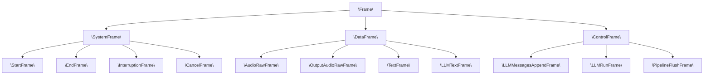

Sources: [src/pipecat/frames/frames.py:64-139](), [src/pipecat/processors/frame_processor.py:132-184]()

For details, see [Frame System and Processing](#3.1).

---

### 3.2. Pipeline Architecture
Pipelines link `FrameProcessor` instances into linear or branching structures. The architecture supports standard sequential `Pipeline`, `ParallelPipeline` for concurrent evaluation branches, and `SyncParallelPipeline` for holding output until all concurrent branches converge [src/pipecat/processors/frame_processor.py:132-184]().

Sources: [src/pipecat/processors/frame_processor.py:132-184]()

For details, see [Pipeline Architecture](#3.2).

---

### 3.3. Frame Processors
The `FrameProcessor` base class implements the core lifecycle (`setup()`, `start()`, `process_frame()`, `push_frame()`, `cleanup()`) [src/pipecat/processors/frame_processor.py:132-184](). Processors function as filters, text processors, aggregators, or producer/consumer nodes within the pipeline.

Sources: [src/pipecat/processors/frame_processor.py:132-184]()

For details, see [Frame Processors](#3.3).

---

### 3.4. Pipeline Task and Execution
The execution runtime centers around `PipelineWorker` (formerly `PipelineTask`) [src/pipecat/pipeline/task.py:15-21](). It manages event handlers, frame queuing, `WorkerRunner`, service switchers (`ServiceSwitcher`/`LLMSwitcher`), app resources, and event loop sharing via `BaseTaskManager`.

PipelineExecutionAndWorkerBusEntityMapping
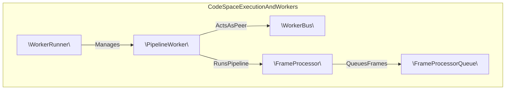

Sources: [src/pipecat/pipeline/task.py:15-21](), [src/pipecat/processors/frame_processor.py:132-184]()

For details, see [Pipeline Task and Execution](#3.4).

---

### 3.5. Transport I/O Architecture
Transports abstract communication protocols into `BaseTransport` [src/pipecat/transports/base_transport.py:96-137](), `BaseInputTransport` [src/pipecat/transports/base_input.py:38-44](), and `BaseOutputTransport` abstractions [src/pipecat/transports/base_output.py:66-72](). They integrate Voice Activity Detection (VAD) and manage media senders for audio and video streaming.

Sources: [src/pipecat/transports/base_transport.py:96-137](), [src/pipecat/transports/base_output.py:66-72](), [src/pipecat/transports/base_input.py:38-44]()

For details, see [Transport I/O Architecture](#3.5).

---

### 3.6. Context System
The universal `LLMContext` system manages conversation history. The `BaseLLMAdapter` pattern translates universal structures into provider-specific schemas while preserving `custom_tools` [src/pipecat/frames/frames.py:30-51]().

Sources: [src/pipecat/frames/frames.py:30-51]()

For details, see [Context System](#3.6).

---

### 3.7. Context Aggregators
Context aggregators (`LLMUserAggregator` and `LLMAssistantAggregator`) coordinate incoming transcriptions and model outputs into structured conversation turns, supporting gated context patterns and real-time service modes. The `LLMFullResponseAggregator` collects LLM text frames between start and end frames [src/pipecat/processors/aggregators/llm_response.py:20-38]().

Sources: [src/pipecat/processors/aggregators/llm_response.py:20-38]()

For details, see [Context Aggregators](#3.7).

---

### 3.8. Turn Detection and User Idle
Turn detection utilizes `UserTurnController`, specialized turn start/stop strategies, idle detection, user mute strategies, and Smart Turn analyzers within the `turns/` module [src/pipecat/frames/frames.py:30-51]().

Sources: [src/pipecat/frames/frames.py:30-51]()

For details, see [Turn Detection and User Idle](#3.8).

---

### 3.9. Interruption Handling
Interruptions are broadcast via `InterruptionFrame` objects. Frames feature an `interruptible` boolean field (default `True`, or `False` for subclasses like `UninterruptibleFrame`) which dictates whether an interruption cancels or drops them [CHANGELOG.md:67-73](), [src/pipecat/frames/frames.py:81-107]().

Sources: [CHANGELOG.md:67-73](), [src/pipecat/frames/frames.py:81-107]()

For details, see [Interruption Handling](#3.9).

---

### 3.10. Observer System and Monitoring
The observer pattern provides decoupled monitoring via `TaskObserver`, `WorkerObserver`, `TurnTrackingObserver`, `UserBotLatencyObserver`, and `StartupTimingObserver`, alongside structured logging and metrics collection [src/pipecat/processors/frame_processor.py:46-46]().

Sources: [src/pipecat/processors/frame_processor.py:46-46]()

For details, see [Observer System and Monitoring](#3.10).

---

### 3.11. RTVI Protocol
The Real-Time Voice Intelligence (RTVI) protocol integration standardizes client-server interactions via `RTVIProcessor`, `RTVIObserver`, custom serializers, and client transports. Evaluation components like `JudgeVerdict` and `LLMClassifier` integrate for real-time feedback [CHANGELOG.md:75-131]().

Sources: [CHANGELOG.md:75-131]()

For details, see [RTVI Protocol](#3.11).

---

# Page: Frame System and Processing

# Frame System and Processing

<details>
<summary>Relevant source files</summary>

The following files were used as context for generating this wiki page:

- [CHANGELOG.md](CHANGELOG.md)
- [changelog/6081.fixed.md](changelog/6081.fixed.md)
- [src/pipecat/audio/filters/__init__.py](src/pipecat/audio/filters/__init__.py)
- [src/pipecat/audio/filters/base_audio_filter.py](src/pipecat/audio/filters/base_audio_filter.py)
- [src/pipecat/frames/frames.py](src/pipecat/frames/frames.py)
- [src/pipecat/pipeline/task.py](src/pipecat/pipeline/task.py)
- [src/pipecat/processors/aggregators/dtmf_aggregator.py](src/pipecat/processors/aggregators/dtmf_aggregator.py)
- [src/pipecat/processors/aggregators/llm_response.py](src/pipecat/processors/aggregators/llm_response.py)
- [src/pipecat/processors/frame_processor.py](src/pipecat/processors/frame_processor.py)
- [src/pipecat/transports/base_input.py](src/pipecat/transports/base_input.py)
- [src/pipecat/transports/base_output.py](src/pipecat/transports/base_output.py)
- [src/pipecat/transports/base_transport.py](src/pipecat/transports/base_transport.py)
- [src/pipecat/utils/frame_queue.py](src/pipecat/utils/frame_queue.py)
- [tests/test_base_output_transport.py](tests/test_base_output_transport.py)
- [tests/test_dtmf_aggregator.py](tests/test_dtmf_aggregator.py)
- [tests/test_frame_processor.py](tests/test_frame_processor.py)
- [tests/test_frame_queue.py](tests/test_frame_queue.py)

</details>


This document describes the frame-based data model and processing architecture that powers Pipecat's real-time pipeline system. It covers the frame type hierarchy, frame metadata, directional flow, and the priority queue mechanism that enables ordered processing, pipeline draining, and interruption handling.

---

## Purpose and Scope

Frames are the fundamental unit of data flow in Pipecat. Every piece of information—audio samples, video frames, text tokens, system commands, control signals—flows through the pipeline as a frame object. This document explains:

- The frame class hierarchy and type system (`SystemFrame`, `DataFrame`, `ControlFrame`) defined in `src/pipecat/frames/frames.py`.
- Built-in frame metadata and tracking capabilities (`id`, `name`, `pts`, `metadata`, `interruptible`).
- How frames flow in upstream and downstream directions via `FrameDirection` (`src/pipecat/processors/frame_processor.py`).
- The priority queue system (`FrameProcessorQueue`) that separates system frames from data frames.
- Frame processing lifecycle and event handling.
- Interruption handling mechanics and interruptible flags.

Sources: [src/pipecat/frames/frames.py:7-20](), [src/pipecat/processors/frame_processor.py:7-12]()

---

## Frame Type Hierarchy

Pipecat defines a class hierarchy that categorizes frames by processing priority and semantics. All frames inherit from the base `Frame` class [src/pipecat/frames/frames.py:74-120]().

### Hierarchy Diagram

**Diagram: Pipecat Frame Class Hierarchy (Code Entity Space)**
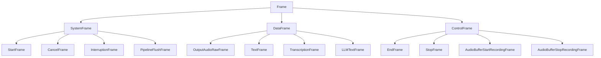
Sources: [src/pipecat/frames/frames.py:74-156](), [src/pipecat/processors/frame_processor.py:30-42]()

### Frame Category Semantics

| Category | Priority | Queueing Behavior | Use Case | Default Interruptible |
|----------|----------|-------------------|----------|----------------------|
| `SystemFrame` | High | Processed immediately, bypasses data queue | Lifecycle, speech boundaries, interruptions, flushes [src/pipecat/frames/frames.py:122-130]() | Varies (often `False` for critical control/end) |
| `DataFrame` | Normal | Queued and processed in order | Audio, video, text, transcriptions [src/pipecat/frames/frames.py:132-141]() | `True` |
| `ControlFrame` | Normal | Queued and processed in order | Settings, tool configuration, termination, buffer control [src/pipecat/frames/frames.py:144-156]() | `True` |

Sources: [src/pipecat/frames/frames.py:122-156](), [src/pipecat/processors/frame_processor.py:131-184]()

### Interruptible Field and Deprecated Mixin

The `UninterruptibleFrame` mixin is deprecated since 1.11.0 in favor of the `interruptible` field defined directly on the base `Frame` class [src/pipecat/frames/frames.py:163-181](). 

**Diagram: Interruptible Frame Configuration**
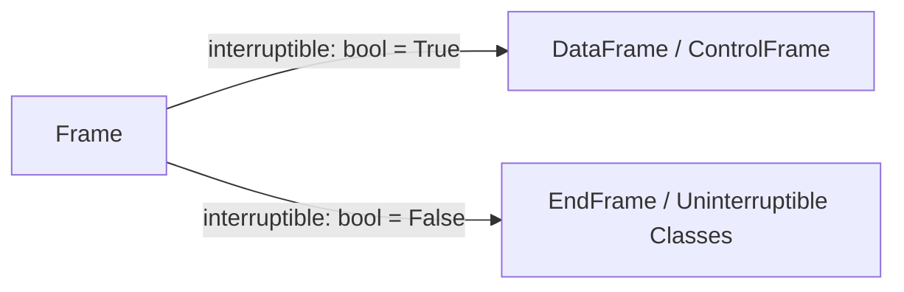
Frames with `interruptible: bool = field(default=False, init=False)` (such as `EndFrame`) remain in internal queues during interruptions and are never cancelled. This ensures critical frames are always delivered to completion [src/pipecat/frames/frames.py:97-105](), [src/pipecat/processors/frame_processor.py:30-42](), [CHANGELOG.md:67-73](). The `interruptible` field can also be set on an individual frame instance before pushing it to override the default behavior for that specific frame [CHANGELOG.md:67-73]().

Sources: [src/pipecat/frames/frames.py:97-181](), [src/pipecat/processors/frame_processor.py:30-42](), [CHANGELOG.md:67-73]()

---

## Frame Base Properties

Every frame instance automatically receives metadata fields that enable tracking, correlation, and debugging across the pipeline [src/pipecat/frames/frames.py:74-120]().

| Property | Type | Description |
|----------|------|-------------|
| `id` | `int` | Unique identifier for the frame instance [src/pipecat/frames/frames.py:97]() |
| `name` | `str` | Human-readable name combining class name and instance count [src/pipecat/frames/frames.py:98]() |
| `pts` | `Optional[int]` | Presentation timestamp in nanoseconds [src/pipecat/frames/frames.py:99]() |
| `metadata` | `Dict[str, Any]` | Dictionary for arbitrary frame metadata [src/pipecat/frames/frames.py:101]() |
| `transport_source` | `Optional[str]` | Name of the transport source that created this frame [src/pipecat/frames/frames.py:102]() |
| `transport_destination` | `Optional[str]` | Target destination for this frame [src/pipecat/frames/frames.py:103]() |
| `interruptible` | `bool` | Whether an interruption may drop this frame from a processor's queue or cancel its processing. Defaults to `True` unless overridden [src/pipecat/frames/frames.py:104]() |

Sources: [src/pipecat/frames/frames.py:74-120](), [src/pipecat/transports/base_output.py:27-53]()

---

## Frame Direction and Flow

Frames flow through the pipeline in two directions: **downstream** (input → output) and **upstream** (output → input). This bidirectional flow enables feedback, state coordination, and metrics reporting.

### FrameDirection Enum

Frame direction is represented by the `FrameDirection` enum [src/pipecat/processors/frame_processor.py:58-68]():
- `DOWNSTREAM`: Frames flowing from input to output [src/pipecat/processors/frame_processor.py:66]()
- `UPSTREAM`: Frames flowing back from output to input [src/pipecat/processors/frame_processor.py:67]()

### Directional Flow Diagram

**Diagram: Bidirectional Frame Flow in Pipeline (Code Entity Space)**
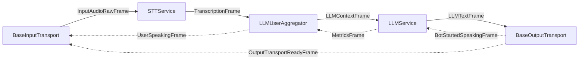
Sources: [src/pipecat/processors/frame_processor.py:58-68](), [src/pipecat/transports/base_input.py:38-44](), [src/pipecat/transports/base_output.py:66-72]()

---

## Frame Processing Architecture

Each `FrameProcessor` maintains an internal priority queue system that separates high-priority system frames from standard data/control frames [src/pipecat/processors/frame_processor.py:131-184]().

### Priority Queue Implementation

The `FrameProcessorQueue` extends `asyncio.PriorityQueue` to implement a multi-tier priority system [src/pipecat/processors/frame_processor.py:131-184]():
1. **START_PRIORITY (1)**: Reserved for `StartFrame` [src/pipecat/processors/frame_processor.py:140]()
2. **SYSTEM_PRIORITY (10)**: Reserved for `SystemFrame` instances [src/pipecat/processors/frame_processor.py:141]()
3. **DEFAULT_PRIORITY (20)**: Used for `DataFrame` and `ControlFrame` instances [src/pipecat/processors/frame_processor.py:142]()

**Diagram: FrameProcessorQueue Priority Mechanics (Code Entity Space)**
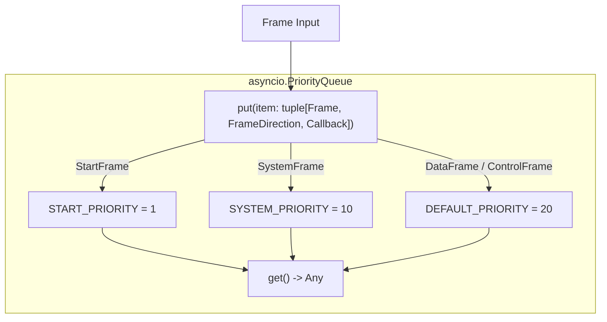
Sources: [src/pipecat/processors/frame_processor.py:131-184]()

---

## Frame Processing Lifecycle and Events

Frames pass through a structured lifecycle within each processor, with hooks for observation and error handling [src/pipecat/processors/frame_processor.py:1-188]().

### Event Handlers
`FrameProcessor` supports registering event handlers for granular monitoring:
- `on_before_process_frame`: Triggered before a frame is processed.
- `on_after_process_frame`: Triggered after a frame is processed.
- `on_before_push_frame`: Triggered before a frame is pushed downstream or upstream.
- `on_after_push_frame`: Triggered after a frame is pushed.
- `on_error`: Triggered when an exception occurs during execution.

Sources: [src/pipecat/processors/frame_processor.py:1-50]()

---

## Common Frame Types

### Media and Audio Frames
| Frame Type | Category | Purpose |
|------------|----------|---------|
| `InputAudioRawFrame` | Data | Raw audio input from transport [src/pipecat/transports/base_input.py:22]() |
| `OutputAudioRawFrame` | Data | Raw audio output to transport [src/pipecat/transports/base_output.py:38]() |
| `TTSAudioRawFrame` | Data | Audio generated by TTS services [src/pipecat/transports/base_output.py:49]() |
| `InputImageRawFrame` | Data | Raw video/image input [src/pipecat/transports/base_input.py:23]() |

Sources: [src/pipecat/transports/base_input.py:17-29](), [src/pipecat/transports/base_output.py:27-53]()

### LLM and Control Frames
| Frame Type | Category | Purpose |
|------------|----------|---------|
| `LLMTextFrame` | Data | Text token generated by LLM [src/pipecat/processors/aggregators/llm_response.py:14]() |
| `TextFrame` | Data | General purpose text container [src/pipecat/processors/aggregators/llm_response.py:15]() |
| `LLMFullResponseStartFrame` | System | Marks start of LLM response stream [src/pipecat/processors/aggregators/llm_response.py:13]() |
| `LLMFullResponseEndFrame` | System | Marks end of LLM response stream [src/pipecat/processors/aggregators/llm_response.py:12]() |

Sources: [src/pipecat/processors/aggregators/llm_response.py:9-16]()

---

## Interruption and Flow Control

Interruptions are handled via `Interruption` and `InterruptionFrame` signals [src/pipecat/processors/frame_processor.py:38](). When a user starts speaking, an interruption is broadcast through the pipeline, causing processors to clear interruptible queued items while preserving frames with `interruptible=False` [src/pipecat/transports/base_output.py:36]().

**Diagram: Interruption Handling Sequence**
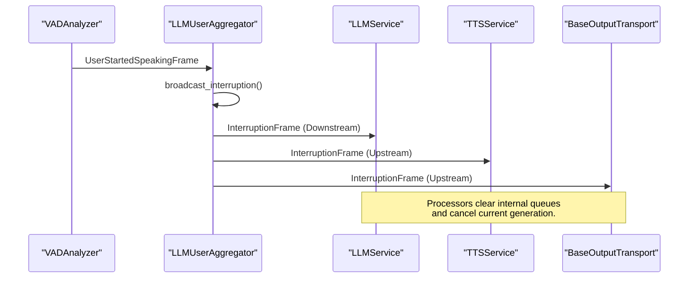
Sources: [src/pipecat/processors/aggregators/llm_response.py:62-65](), [src/pipecat/transports/base_output.py:36](), [src/pipecat/processors/frame_processor.py:38]()

---

# Page: Pipeline Architecture

# Pipeline Architecture

<details>
<summary>Relevant source files</summary>

The following files were used as context for generating this wiki page:

- [changelog/6086.fixed.4.md](changelog/6086.fixed.4.md)
- [examples/transcription/transcription-xai.py](examples/transcription/transcription-xai.py)
- [src/pipecat/observers/__init__.py](src/pipecat/observers/__init__.py)
- [src/pipecat/observers/base_observer.py](src/pipecat/observers/base_observer.py)
- [src/pipecat/observers/startup_timing_observer.py](src/pipecat/observers/startup_timing_observer.py)
- [src/pipecat/pipeline/base_pipeline.py](src/pipecat/pipeline/base_pipeline.py)
- [src/pipecat/pipeline/parallel_pipeline.py](src/pipecat/pipeline/parallel_pipeline.py)
- [src/pipecat/pipeline/pipeline.py](src/pipecat/pipeline/pipeline.py)
- [src/pipecat/pipeline/sync_parallel_pipeline.py](src/pipecat/pipeline/sync_parallel_pipeline.py)
- [src/pipecat/pipeline/worker_observer.py](src/pipecat/pipeline/worker_observer.py)
- [src/pipecat/services/xai/stt.py](src/pipecat/services/xai/stt.py)
- [src/pipecat/tests/utils.py](src/pipecat/tests/utils.py)
- [tests/test_aggregators.py](tests/test_aggregators.py)
- [tests/test_app_resources.py](tests/test_app_resources.py)
- [tests/test_daily_transport_service.py](tests/test_daily_transport_service.py)
- [tests/test_filters.py](tests/test_filters.py)
- [tests/test_llm_service.py](tests/test_llm_service.py)
- [tests/test_pipeline.py](tests/test_pipeline.py)
- [tests/test_startup_timing_observer.py](tests/test_startup_timing_observer.py)
- [tests/test_worker_observer.py](tests/test_worker_observer.py)
- [tests/test_xai_stt.py](tests/test_xai_stt.py)

</details>


## Purpose and Scope

This document explains Pipecat's pipeline architecture, detailing pipeline construction, `FrameProcessor` linking mechanics, parallel pipelines, synchronous parallel pipelines, and how frames flow through the system.

For information about frame processors themselves, see [Frame Processors](3.3). For pipeline execution and lifecycle management, see [Pipeline Task and Execution](3.4). For the frame types that flow through pipelines, see [Frame System and Processing](3.1).

---

## Overview

Pipelines are the fundamental organizational unit in Pipecat. They connect `FrameProcessor` instances in various topologies to create processing flows. All pipeline types inherit from `BasePipeline` [src/pipecat/pipeline/base_pipeline.py:19-25](), which itself extends `FrameProcessor` [src/pipecat/processors/frame_processor.py:1-50]().

### Pipeline Types

| Class | Module | Purpose |
|-------|--------|---------|
| `Pipeline` | `pipecat.pipeline.pipeline` | Sequential linear chain of processors [src/pipecat/pipeline/pipeline.py:91-122]() |
| `ParallelPipeline` | `pipecat.pipeline.parallel_pipeline` | Concurrent branches with deduplication and lifecycle sync [src/pipecat/pipeline/parallel_pipeline.py:24-76]() |
| `SyncParallelPipeline` | `pipecat.pipeline.sync_parallel_pipeline` | Synchronized parallel branches that hold output until all branches finish [src/pipecat/pipeline/sync_parallel_pipeline.py:128-178]() |

Sources:
- [src/pipecat/pipeline/base_pipeline.py:19-25]()
- [src/pipecat/pipeline/pipeline.py:91-122]()
- [src/pipecat/pipeline/parallel_pipeline.py:24-76]()
- [src/pipecat/pipeline/sync_parallel_pipeline.py:128-178]()
- [src/pipecat/processors/frame_processor.py:1-50]()

---

## Basic Pipeline Structure and Linking

### Pipeline Construction and Processor Linking

The `Pipeline` class connects a sequence of `FrameProcessor` instances into a linear processing chain [src/pipecat/pipeline/pipeline.py:91-122](). During initialization, `Pipeline` automatically wraps the processor list with a `PipelineSource` at the entry point and a `PipelineSink` at the exit point if custom ones are not provided [src/pipecat/pipeline/pipeline.py:113-119](). 

The internal linking mechanism establishes bidirectional references (`_prev` and `_next`) between adjacent processors, enabling traversal in both downstream and upstream directions [src/pipecat/processors/frame_processor.py:51-100]().

Title: "Pipeline Construction and Linking Flow"
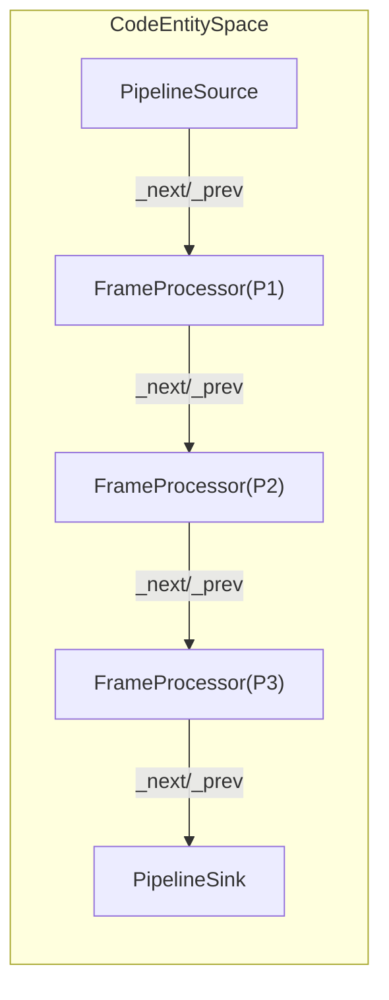

Sources:
- [src/pipecat/pipeline/pipeline.py:91-122]()
- [src/pipecat/processors/frame_processor.py:51-100]()

---

## PipelineSource and PipelineSink

### PipelineSource

`PipelineSource` acts as the entry point for a pipeline. It forwards downstream frames to the next processor and upstream frames to a provided upstream handler function [src/pipecat/pipeline/pipeline.py:21-53]().

### PipelineSink

`PipelineSink` serves as the endpoint for a pipeline. It forwards downstream frames to a downstream handler function and upstream frames back through the pipeline [src/pipecat/pipeline/pipeline.py:55-89]().

Sources:
- [src/pipecat/pipeline/pipeline.py:21-89]()

---

## Frame Flow Direction

Frames in Pipecat flow in two directions through pipelines, defined by the `FrameDirection` enum [src/pipecat/processors/frame_processor.py:1-30]():

- `DOWNSTREAM`: Frames flowing from input to output (e.g., `InputAudioRawFrame` -> `STTService` -> `LLMService`).
- `UPSTREAM`: Frames flowing back from output to input (e.g., `InterruptionFrame` or `MetricsFrame`).

Title: "Natural Language Space to Code Entity Space Frame Flow"
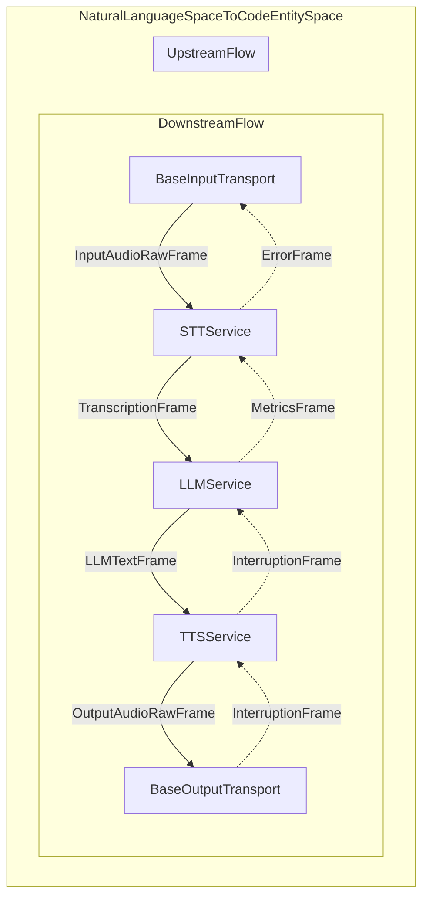

Each processor's `process_frame()` method receives both the frame and the direction, allowing it to handle frames differently based on their flow direction [src/pipecat/processors/frame_processor.py:31-70]().

Sources:
- [src/pipecat/processors/frame_processor.py:1-70]()

---

## ParallelPipeline

`ParallelPipeline` processes frames through multiple sub-pipelines concurrently. It coordinates frame flow and ensures proper synchronization of lifecycle events like `EndFrame` [src/pipecat/pipeline/parallel_pipeline.py:24-76]().

Title: "ParallelPipeline Execution Architecture"
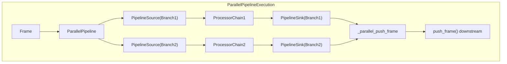

### Key Features

**Frame Deduplication:** The pipeline tracks frame IDs using a `_seen_ids` set in `_parallel_push_frame` to ensure each unique frame is only pushed downstream once [src/pipecat/pipeline/parallel_pipeline.py:166-175]().

**Lifecycle Synchronization:** For `StartFrame`, `EndFrame`, and `CancelFrame`, the pipeline synchronizes across all branches. It pauses processing using `pause_processing_frames()` and waits for all branches to reach the sink before continuing [src/pipecat/pipeline/parallel_pipeline.py:156-161]().

Sources:
- [src/pipecat/pipeline/parallel_pipeline.py:24-175]()

---

## SyncParallelPipeline

`SyncParallelPipeline` fans each input frame to parallel pipelines and holds the output until every pipeline finishes processing that specific frame [src/pipecat/pipeline/sync_parallel_pipeline.py:128-148]().

Title: "SyncParallelPipeline Execution Architecture"
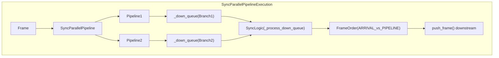

### Synchronization Mechanism

**SyncFrame Sentinel:** After sending a real frame into a parallel pipeline, a `SyncFrame` [src/pipecat/pipeline/sync_parallel_pipeline.py:51-60]() is sent behind it. When the `SyncFrame` emerges from the pipeline's output, the system knows all output for the preceding input has been produced [src/pipecat/pipeline/sync_parallel_pipeline.py:128-148]().

**Frame Ordering:**
- `FrameOrder.ARRIVAL`: Frames are pushed in the order they arrive from any pipeline [src/pipecat/pipeline/sync_parallel_pipeline.py:32-48]().
- `FrameOrder.PIPELINE`: Frames are pushed in pipeline definition order — all frames from the first pipeline, then the second, and so on [src/pipecat/pipeline/sync_parallel_pipeline.py:32-48]().

Sources:
- [src/pipecat/pipeline/sync_parallel_pipeline.py:32-148]()

---

## Pipeline Integration

### PipelineWorker Integration

Pipelines are executed by wrapping them in a `PipelineWorker` [src/pipecat/observers/startup_timing_observer.py:34-34](). The worker manages the lifecycle of the pipeline, handling frame queuing and execution parameters. The `BaseTaskManager` supports a shared event loop and execution context [src/pipecat/observers/startup_timing_observer.py:54-54]().

### Nesting Pipelines

Pipelines can be nested within other pipelines since `Pipeline` extends `BasePipeline` [src/pipecat/pipeline/base_pipeline.py:19-25](). This allows for modular construction of complex agents.

Sources:
- [src/pipecat/pipeline/base_pipeline.py:19-25]()
- [src/pipecat/observers/startup_timing_observer.py:34-54]()

---

## Setup and Cleanup

### Setup Phase

Pipelines propagate `FrameProcessorSetup` [src/pipecat/processors/frame_processor.py:1-50]() to all contained processors concurrently via `_setup_processors()` [src/pipecat/pipeline/base_pipeline.py:26-61](). This ensures all sub-processors are initialized before frame processing begins [src/pipecat/pipeline/pipeline.py:169-176](). A processor that fails during setup will report an error and be marked as permanently failed [src/pipecat/pipeline/base_pipeline.py:26-51]().

### Cleanup Phase

Cleanup propagates through the pipeline hierarchy concurrently using `_cleanup_processors()` [src/pipecat/pipeline/base_pipeline.py:63-81](), ensuring that all processors release resources correctly [src/pipecat/pipeline/pipeline.py:178-182](). For parallel pipelines, cleanup is called on all branches [src/pipecat/pipeline/parallel_pipeline.py:128-132]().

Sources:
- [src/pipecat/pipeline/base_pipeline.py:26-81]()
- [src/pipecat/pipeline/pipeline.py:169-182]()
- [src/pipecat/pipeline/parallel_pipeline.py:128-132]()
- [src/pipecat/processors/frame_processor.py:1-50]()

---

# Page: Frame Processors

# Frame Processors

<details>
<summary>Relevant source files</summary>

The following files were used as context for generating this wiki page:

- [changelog/6081.fixed.md](changelog/6081.fixed.md)
- [scripts/fix-ruff-and-typecheck.sh](scripts/fix-ruff-and-typecheck.sh)
- [src/pipecat/adapters/schemas/direct_function.py](src/pipecat/adapters/schemas/direct_function.py)
- [src/pipecat/adapters/schemas/function_schema.py](src/pipecat/adapters/schemas/function_schema.py)
- [src/pipecat/adapters/schemas/tools_schema.py](src/pipecat/adapters/schemas/tools_schema.py)
- [src/pipecat/audio/filters/__init__.py](src/pipecat/audio/filters/__init__.py)
- [src/pipecat/audio/filters/base_audio_filter.py](src/pipecat/audio/filters/base_audio_filter.py)
- [src/pipecat/pipeline/llm_switcher.py](src/pipecat/pipeline/llm_switcher.py)
- [src/pipecat/pipeline/service_switcher.py](src/pipecat/pipeline/service_switcher.py)
- [src/pipecat/processors/aggregators/dtmf_aggregator.py](src/pipecat/processors/aggregators/dtmf_aggregator.py)
- [src/pipecat/processors/filters/frame_filter.py](src/pipecat/processors/filters/frame_filter.py)
- [src/pipecat/processors/filters/function_filter.py](src/pipecat/processors/filters/function_filter.py)
- [src/pipecat/processors/filters/null_filter.py](src/pipecat/processors/filters/null_filter.py)
- [src/pipecat/processors/filters/wake_check_filter.py](src/pipecat/processors/filters/wake_check_filter.py)
- [src/pipecat/utils/frame_queue.py](src/pipecat/utils/frame_queue.py)
- [src/pipecat/workers/llm/tool_decorator.py](src/pipecat/workers/llm/tool_decorator.py)
- [tests/test_auto_register_tools.py](tests/test_auto_register_tools.py)
- [tests/test_base_output_transport.py](tests/test_base_output_transport.py)
- [tests/test_dtmf_aggregator.py](tests/test_dtmf_aggregator.py)
- [tests/test_frame_processor.py](tests/test_frame_processor.py)
- [tests/test_frame_queue.py](tests/test_frame_queue.py)
- [tests/test_function_calling_adapters.py](tests/test_function_calling_adapters.py)
- [tests/test_llm_switcher.py](tests/test_llm_switcher.py)
- [tests/test_processor_usable.py](tests/test_processor_usable.py)
- [tests/test_service_switcher.py](tests/test_service_switcher.py)
- [tests/test_websocket_service_usable.py](tests/test_websocket_service_usable.py)

</details>


Frame processors are the fundamental building blocks of Pipecat pipelines. Every component that processes frames—whether it is a transport, an AI service, an aggregator, or custom business logic—inherits from the `FrameProcessor` base class [src/pipecat/processors/frame_processor.py:175-175](). This page details the `FrameProcessor` base class, lifecycle mechanics, `process_frame` and `push_frame` operations, and common processor patterns such as filters, aggregators, producer/consumers, and text processors.

For information about frame types and their hierarchy, see **3.1 Frame System and Processing**. For details on how processors are orchestrated within pipelines, see **3.2 Pipeline Architecture**.

---

## The FrameProcessor Base Class

The `FrameProcessor` class provides the foundation for all frame processing in Pipecat. It handles frame queuing, priority management, lifecycle coordination, and bidirectional frame flow [src/pipecat/processors/frame_processor.py:132-184]().

**Key characteristics:**
- **Ordered processing**: Each processor processes frames in the order they arrive [src/pipecat/processors/frame_processor.py:178-180]().
- **Priority handling**: `SystemFrame` objects are prioritized over `DataFrame` or `ControlFrame` objects using a specialized `FrameProcessorQueue` [src/pipecat/processors/frame_processor.py:132-144]().
- **Separate tasks**: Each processor runs frame processing in dedicated asyncio tasks (`__input_frame_task` and `__process_frame_task`) [src/pipecat/processors/frame_processor.py:255-278]().
- **Bidirectional flow**: Frames can flow `DOWNSTREAM` (input to output) and `UPSTREAM` (acknowledgments/errors) [src/pipecat/processors/frame_processor.py:60-70]().
- **Interruption control**: Every frame includes an `interruptible` boolean flag (default `True`, or `False` for uninterruptible frame subclasses) that determines whether an interruption drops or cancels the frame [src/pipecat/frames/frames.py:74-116]().

Sources: [src/pipecat/processors/frame_processor.py:57-278](), [src/pipecat/frames/frames.py:74-116]()

---

## Frame Processing Architecture

The following diagram bridges the conceptual pipeline architecture to the concrete code entities within `FrameProcessor`.

### Processor Internal Data Flow
Title: "FrameProcessor Internal Pipeline Mechanics"
```mermaid
graph TB
    subgraph "NaturalLanguageSpace"
        A["IncomingFrame"] --> B["QueueFrame"]
        B --> C["PriorityFilter"]
        C --> D["ProcessData"]
        D --> E["PushDownstreamUpstream"]
    end

    subgraph "CodeEntitySpace"
        QueueFrame["queue_frame(frame, direction)<br/>[src/pipecat/processors/frame_processor.py:747-747]"]
        InputQueue["__input_queue<br/>(FrameProcessorQueue)<br/>[src/pipecat/processors/frame_processor.py:178-178]"]
        InputTask["__input_frame_task<br/>[src/pipecat/processors/frame_processor.py:255-255]"]
        ProcessQueue["__process_queue<br/>(asyncio.Queue)<br/>[src/pipecat/processors/frame_processor.py:180-180]"]
        ProcessTask["__process_frame_task<br/>[src/pipecat/processors/frame_processor.py:278-278]"]
        ProcessFrame["process_frame(frame, direction)<br/>[src/pipecat/processors/frame_processor.py:669-669]"]
        PushFrame["push_frame(frame, direction)<br/>[src/pipecat/processors/frame_processor.py:800-800]"]
        
        QueueFrame --> InputQueue
        InputQueue --> InputTask
        
        InputTask -->|"isinstance(SystemFrame)"| ProcessFrame
        InputTask -->|"isinstance(DataFrame/ControlFrame)"| ProcessQueue
        
        ProcessQueue --> ProcessTask
        ProcessTask --> ProcessFrame
        
        ProcessFrame --> PushFrame
    end

    Prev["_prev: FrameProcessor"] -->|"queue_frame()"| QueueFrame
    PushFrame -->|"_next.queue_frame()"| Next["_next: FrameProcessor"]
```
Sources: [src/pipecat/processors/frame_processor.py:132-184](), [src/pipecat/processors/frame_processor.py:255-278](), [src/pipecat/processors/frame_processor.py:669-745]()

---

## Frame Processor Queue: Priority Handling

Pipecat uses a specialized `FrameProcessorQueue` (inheriting from `asyncio.PriorityQueue`) to ensure that system-level events (like interruptions or cancellations) bypass standard data processing queues [src/pipecat/processors/frame_processor.py:132-144]().

| Priority Level | Frame Types | Logic |
|:--- |:--- |:--- |
| `START_PRIORITY` (1) | `StartFrame` | Outranks every other frame type [src/pipecat/processors/frame_processor.py:141-164](). |
| `SYSTEM_PRIORITY` (10) | `SystemFrame` | Processed immediately by `__input_frame_task` [src/pipecat/processors/frame_processor.py:142-165](). |
| `DEFAULT_PRIORITY` (20) | `DataFrame`, `ControlFrame` | Queued in `__process_queue` and handled by `__process_frame_task` [src/pipecat/processors/frame_processor.py:143-168](). |

Sources: [src/pipecat/processors/frame_processor.py:132-184](), [src/pipecat/frames/frames.py:105-138]()

---

## The process_frame Implementation and push_frame Mechanics

Every frame processor must implement `process_frame()`. This is the primary entry point for logic.

**Signature:** `async def process_frame(self, frame: Frame, direction: FrameDirection)` [src/pipecat/processors/frame_processor.py:669-669]()

### Implementation Pattern
1. **Call Super**: Always invoke `await super().process_frame(frame, direction)` to handle internal state (like `StartFrame` tracking) [src/pipecat/processors/frame_processor.py:671-671]().
2. **Type Switch**: Use `isinstance()` to filter for relevant frames.
3. **Push**: Explicitly call `push_frame()` to move the frame (or a new one) to the next processor [src/pipecat/processors/frame_processor.py:747-747]().

### Bidirectional Flow and Pushing
Processors are linked in a doubly-linked list structure using `_prev` and `_next` pointers [src/pipecat/processors/frame_processor.py:212-213]().

### Bidirectional Frame Routing
Title: "Bidirectional Frame Routing and Direction Mechanics"
```mermaid
graph LR
    subgraph "NaturalLanguageSpace"
        Route["RouteFramesAcrossProcessorLinksBasedOnPipelineDirection"]
    end

    subgraph "CodeEntitySpace"
        ProcessorA["ProcessorA<br/>(_prev=None)<br/>[src/pipecat/processors/frame_processor.py:212-212]"]
        ProcessorB["ProcessorB<br/>[src/pipecat/processors/frame_processor.py:212-212]"]
        ProcessorC["ProcessorC<br/>(_next=None)<br/>[src/pipecat/processors/frame_processor.py:213-213]"]

        ProcessorA --"push_frame(f, DOWNSTREAM)"--> ProcessorB
        ProcessorB --"push_frame(f, DOWNSTREAM)"--> ProcessorC
        
        ProcessorC -."push_frame(f, UPSTREAM)".-> ProcessorB
        ProcessorB -."push_frame(f, UPSTREAM)".-> ProcessorA

        subgraph "Logic: push_frame()"
            DirectionCheck{"direction"}
            DirectionCheck --"DOWNSTREAM"--> NextQ["self._next.queue_frame()"]
            DirectionCheck --"UPSTREAM"--> PrevQ["self._prev.queue_frame()"]
        end
    end
```
Sources: [src/pipecat/processors/frame_processor.py:212-213](), [src/pipecat/processors/frame_processor.py:669-854]()

---

## Common Processor Patterns

### 1. Filters
Filters selectively drop frames or modify their content.
- **IdentityFilter**: A basic filter that passes frames through unchanged, useful for testing or as a placeholder [src/pipecat/processors/filters/identity_filter.py:14-14]().
- **FunctionFilter**: Filters frames using a custom async function [src/pipecat/processors/filters/function_filter.py:21-27]().
- **FrameFilter**: Filters frames based on their type.
- **WakeCheckFilter**: Used for wake-phrase detection, filtering speech until a wake word is identified.

### 2. Aggregators
Aggregators collect multiple small frames into a single larger frame or manage conversation state.
- **LLMFullResponseAggregator**: Collects `LLMTextFrame` tokens received between `LLMFullResponseStartFrame` and `LLMFullResponseEndFrame` to fire an `on_completion` event [src/pipecat/processors/aggregators/llm_response.py:20-38]().
- **LLMUserAggregator**: Manages user turns, handling VAD, transcriptions, and updating the `LLMContext`.
- **LLMAssistantAggregator**: Manages assistant turns, aggregating bot output into the context.
- **DTMFAggregator**: Aggregates keypad inputs (`InputDTMFFrame`) into structured `TranscriptionFrame` objects based on idle timeouts or termination digits [src/pipecat/processors/aggregators/dtmf_aggregator.py:29-40]().

### 3. Producer and Consumer Processors
- **ProducerProcessor**: Acts as an entry point for generating frames from an external source or loop into the pipeline [src/pipecat/processors/producer_processor.py:14-14]().
- **ConsumerProcessor**: Acts as a sink or terminal processor that consumes and handles frames without pushing them further downstream [src/pipecat/processors/consumer_processor.py:14-14]().

### 4. Text Processors and Aggregators
Text processors manipulate or accumulate text chunks. Components such as text aggregators combine streaming token frames into larger sentences or structured segments, emitting frames like `AggregatedTextProgressFrame` to monitor incremental progress before final synthesis.
- **SimpleTextAggregator**: Accumulates text until sentence boundaries are detected, using `match_endofsentence` for robust sentence splitting [src/pipecat/utils/text/simple_text_aggregator.py:39-39]().
- **PatternPairAggregator**: Identifies and processes content between pattern pairs (e.g., XML tags) in streaming text, allowing for actions like `REMOVE`, `KEEP`, or `AGGREGATE` [src/pipecat/utils/text/pattern_pair_aggregator.py:95-95]().
- **SkipTagsAggregator**: A specialized aggregator that removes content within specified tags, useful for filtering out metadata or instructions from text streams [src/pipecat/utils/text/skip_tags_aggregator.py:14-14]().

### 5. Transports and Services
Transports are specialized frame processors that handle external I/O. AI services often wrap external APIs and act as processors within the pipeline.
- **BaseInputTransport**: Handles audio/video input, VAD, and pushing frames downstream [src/pipecat/transports/base_input.py:38-44]().
- **BaseOutputTransport**: Handles audio/video output, buffering, and mixing [src/pipecat/transports/base_output.py:66-72]().
- **TavusVideoService**: A service that proxies audio to Tavus and receives audio and video in return, acting as a sink transport layer [src/pipecat/services/tavus/video.py:50-50]().
- **HeyGenVideoService**: Integrates HeyGen's interactive avatar capabilities, managing bidirectional audio/video streaming and avatar animations [src/pipecat/services/heygen/video.py:62-62]().
- **ServiceSwitcher / LLMSwitcher**: Route frames between multiple child services at runtime [src/pipecat/pipeline/service_switcher.py:31-47](), [src/pipecat/pipeline/llm_switcher.py:24-30]().

Sources: [src/pipecat/processors/aggregators/llm_response.py:20-38](), [src/pipecat/transports/base_input.py:38-44](), [src/pipecat/transports/base_output.py:66-72](), [src/pipecat/processors/filters/identity_filter.py:14-14](), [src/pipecat/processors/filters/function_filter.py:21-27](), [src/pipecat/processors/producer_processor.py:14-14](), [src/pipecat/processors/consumer_processor.py:14-14](), [src/pipecat/processors/aggregators/dtmf_aggregator.py:29-40](), [src/pipecat/utils/text/simple_text_aggregator.py:39-39](), [src/pipecat/utils/text/pattern_pair_aggregator.py:95-95](), [src/pipecat/utils/text/skip_tags_aggregator.py:14-14](), [src/pipecat/services/tavus/video.py:50-50](), [src/pipecat/services/heygen/video.py:62-62](), [src/pipecat/pipeline/service_switcher.py:31-47](), [src/pipecat/pipeline/llm_switcher.py:24-30]()

---

## Lifecycle: Setup, Execution, and Cleanup

Processors follow a strict lifecycle managed by the `PipelineWorker` [src/pipecat/pipeline/task.py:9-12]().

| Phase | Method | Description |
|:--- |:--- |:--- |
| **Setup** | `setup(setup_params)` | Initializes the `clock`, `task_manager`, and starts internal processing tasks [src/pipecat/processors/frame_processor.py:594-616](). |
| **Execution** | `process_frame()` | Active loop handling incoming frames [src/pipecat/processors/frame_processor.py:255-278](). |
| **Cleanup** | `cleanup()` | Cancels all tasks created via `create_task()` and cleans up resources [src/pipecat/processors/frame_processor.py:628-647](). |

**Direct Mode**: Setting `enable_direct_mode=True` bypasses the priority queues and processing tasks, executing `process_frame()` immediately upon `queue_frame()` for simple processors where queuing overhead is undesirable [src/pipecat/processors/frame_processor.py:198-198]().

**App Resources**: Processors can access shared application state (like database handles) via `self.pipeline_worker.app_resources` [src/pipecat/processors/frame_processor.py:85-88](). Note that `tool_resources` is deprecated as of version 1.2.0 in favor of `app_resources` [src/pipecat/processors/frame_processor.py:121-128]().

Sources: [src/pipecat/processors/frame_processor.py:594-667](), [src/pipecat/pipeline/task.py:1-29](), [src/pipecat/processors/frame_processor.py:72-130]()

---

# Page: Pipeline Task and Execution

# Pipeline Task and Execution

<details>
<summary>Relevant source files</summary>

The following files were used as context for generating this wiki page:

- [examples/multi-worker/code-assistant/code-assistant.py](examples/multi-worker/code-assistant/code-assistant.py)
- [examples/multi-worker/distributed-handoff/pgmq-handoff/llm.py](examples/multi-worker/distributed-handoff/pgmq-handoff/llm.py)
- [examples/multi-worker/distributed-handoff/pgmq-handoff/main.py](examples/multi-worker/distributed-handoff/pgmq-handoff/main.py)
- [examples/multi-worker/distributed-handoff/redis-handoff/llm.py](examples/multi-worker/distributed-handoff/redis-handoff/llm.py)
- [examples/multi-worker/distributed-handoff/redis-handoff/main.py](examples/multi-worker/distributed-handoff/redis-handoff/main.py)
- [examples/multi-worker/local-handoff/local-handoff-two-agents-tts.py](examples/multi-worker/local-handoff/local-handoff-two-agents-tts.py)
- [examples/multi-worker/local-handoff/local-handoff-two-agents.py](examples/multi-worker/local-handoff/local-handoff-two-agents.py)
- [examples/multi-worker/parallel-debate/parallel-debate.py](examples/multi-worker/parallel-debate/parallel-debate.py)
- [examples/multi-worker/remote-proxy-assistant/assistant.py](examples/multi-worker/remote-proxy-assistant/assistant.py)
- [examples/multi-worker/remote-proxy-assistant/main.py](examples/multi-worker/remote-proxy-assistant/main.py)
- [examples/multi-worker/sensor-controller/sensor-controller.py](examples/multi-worker/sensor-controller/sensor-controller.py)
- [src/pipecat/bus/bridge_processor.py](src/pipecat/bus/bridge_processor.py)
- [src/pipecat/bus/bus.py](src/pipecat/bus/bus.py)
- [src/pipecat/bus/queue.py](src/pipecat/bus/queue.py)
- [src/pipecat/bus/subscriber.py](src/pipecat/bus/subscriber.py)
- [src/pipecat/pipeline/runner.py](src/pipecat/pipeline/runner.py)
- [src/pipecat/pipeline/worker.py](src/pipecat/pipeline/worker.py)
- [src/pipecat/pipeline/worker_ready_decorator.py](src/pipecat/pipeline/worker_ready_decorator.py)
- [src/pipecat/utils/asyncio/task_manager.py](src/pipecat/utils/asyncio/task_manager.py)
- [src/pipecat/utils/base_object.py](src/pipecat/utils/base_object.py)
- [src/pipecat/utils/startup.py](src/pipecat/utils/startup.py)
- [src/pipecat/workers/base_worker.py](src/pipecat/workers/base_worker.py)
- [src/pipecat/workers/proxy/__init__.py](src/pipecat/workers/proxy/__init__.py)
- [src/pipecat/workers/proxy/websocket/__init__.py](src/pipecat/workers/proxy/websocket/__init__.py)
- [src/pipecat/workers/runner.py](src/pipecat/workers/runner.py)
- [tests/test_base_worker.py](tests/test_base_worker.py)
- [tests/test_bus.py](tests/test_bus.py)
- [tests/test_deepgram_stt.py](tests/test_deepgram_stt.py)
- [tests/test_job_group.py](tests/test_job_group.py)
- [tests/test_llm_worker.py](tests/test_llm_worker.py)
- [tests/test_messages.py](tests/test_messages.py)
- [tests/test_pgmq_backends.py](tests/test_pgmq_backends.py)
- [tests/test_pgmq_bus.py](tests/test_pgmq_bus.py)
- [tests/test_redis_bus.py](tests/test_redis_bus.py)
- [tests/test_runner.py](tests/test_runner.py)
- [tests/test_serializers.py](tests/test_serializers.py)
- [tests/test_task_manager.py](tests/test_task_manager.py)
- [tests/test_utils_startup.py](tests/test_utils_startup.py)
- [tests/test_websocket_proxy.py](tests/test_websocket_proxy.py)

</details>


This page covers how a pipeline is wrapped, started, and managed at runtime. As of recent versions, Pipecat has renamed core execution entities to support a multi-agent framework: `PipelineTask` is now **`PipelineWorker`**, and `PipelineRunner` is now **`WorkerRunner`** [src/pipecat/pipeline/worker.py:7-12](), [src/pipecat/workers/runner.py:7-14](). These components handle frame injection, lifecycle management, idle timeout handling, and the `app_resources` pattern for sharing state. It also covers runtime service swapping using `ServiceSwitcher` and `LLMSwitcher`, as well as shared task management through `TaskManager`.

For details about `Pipeline` and `ParallelPipeline` construction, see [Pipeline Architecture (3.2)](). For the `FrameProcessor` base class, see [Frame Processors (3.3)](). For the multi-agent capabilities, see [Multi-Worker Framework (8.3)]().

---

## Overview

`PipelineWorker` (formerly `PipelineTask`) is the execution engine for a Pipecat pipeline [src/pipecat/pipeline/worker.py:7-12](). It turns a pipeline into a peer on a shared bus, allowing it to pass typed messages and coordinate with other workers. `WorkerRunner` (formerly `PipelineRunner`) is a thin wrapper that manages OS signal handling and runs one or more workers to completion [src/pipecat/workers/runner.py:7-14]().

### Execution Architecture

Title: "Runtime Execution and Runner Mapping"
```mermaid
graph LR
    subgraph "Natural Language Space"
        A["Pipeline Task Runner"] --> B["Pipeline Execution Worker"]
        B --> C["User Defined Pipeline"]
    end
    subgraph "Code Entity Space"
        R["WorkerRunner\nsrc/pipecat/workers/runner.py"] -->|"add_workers()"| W["PipelineWorker\nsrc/pipecat/pipeline/worker.py"]
        W -->|"wraps"| P["BasePipeline\nsrc/pipecat/pipeline/base_pipeline.py"]
    end
```
Sources: [src/pipecat/pipeline/worker.py:172-187](), [src/pipecat/workers/runner.py:7-14]()

---

## PipelineWorker and Frame Queuing

`PipelineWorker` is defined in `src/pipecat/pipeline/worker.py` [src/pipecat/pipeline/worker.py:7-12](). It orchestrates the flow of frames and manages the lifecycle of all processors in the chain [src/pipecat/pipeline/worker.py:7-11]().

### Internal Pipeline Structure

`PipelineWorker` wraps the user's pipeline between a `PipelineSource` and a `PipelineSink` [src/pipecat/pipeline/pipeline.py:141-185]().

Title: "PipelineWorker Internal Layout"
```mermaid
graph LR
    Queue["_push_queue(asyncio.Queue)"] --> SRC["PipelineSource\nsrc/pipecat/pipeline/pipeline.py"]
    SRC --> RTVI["RTVIProcessor"]
    RTVI --> UP["UserPipeline(BasePipeline)"]
    UP --> SNK["PipelineSink\nsrc/pipecat/pipeline/pipeline.py"]
    SNK --> EH["EventHandlers"]
```

- **`PipelineSource`**: Feeds frames from the worker's internal queue into the start of the processor chain [src/pipecat/pipeline/pipeline.py:141-155]().
- **`PipelineSink`**: Sits at the end of the chain to observe frames that have completed processing and triggers worker-level event handlers [src/pipecat/pipeline/pipeline.py:158-185]().
- **Frame Queuing**: Frames are inserted into the pipeline through `queue_frame()` or `queue_frames()` [src/pipecat/pipeline/worker.py:345-353]().

Sources: [src/pipecat/pipeline/worker.py:172-268](), [src/pipecat/pipeline/pipeline.py:141-185]()

---

## Shared Application Resources (app_resources)

The `app_resources` pattern allows sharing application state (like database handles, API clients, or feature flags) across tool handlers and custom processors.

### Accessing Resources

1. **In Tool Handlers**: When an LLM triggers a tool, the handler receives `FunctionCallParams`. The resources are available via `params.app_resources` [src/pipecat/services/llm_service.py:111-156]().
2. **In Frame Processors**: During the `setup()` phase, the `FrameProcessorSetup` object contains a reference to the `pipeline_worker`. Processors access resources via `setup.pipeline_worker.app_resources` [src/pipecat/processors/frame_processor.py:72-86]().

> [!IMPORTANT]
> `tool_resources` was renamed to `app_resources` in 1.2.0. The old name is deprecated and will emit a `DeprecationWarning` if accessed [src/pipecat/processors/frame_processor.py:104-115]().

Sources: [src/pipecat/processors/frame_processor.py:72-115](), [src/pipecat/services/llm_service.py:111-156]()

---

## WorkerRunner, TaskManager, and Event Loop Integration

`WorkerRunner` manages the execution environment, including OS signal handling for graceful shutdowns [src/pipecat/workers/runner.py:83-107]().

- **Signal Handling**: It handles `SIGINT` and `SIGTERM` to cancel running workers safely [src/pipecat/workers/runner.py:164-168]().
- **Bus and Registry**: It hosts the `WorkerBus` and `WorkerRegistry` for the session [src/pipecat/workers/runner.py:145-146]().

### TaskManager Shared Event Loop

Title: "TaskManager and Runner Execution Context"
```mermaid
graph TD
    subgraph "Execution Context"
        Loop["asyncio.AbstractEventLoop"] --> TM["TaskManager\nsrc/pipecat/utils/asyncio/task_manager.py"]
    end
    subgraph "Orchestration"
        TM --> WR["WorkerRunner\nsrc/pipecat/workers/runner.py"]
        WR --> CD["check_dangling_tasks"]
    end
```

- **TaskManager**: Manages the underlying event loop (`_loop`) and task creation/cancellation lifecycle [src/pipecat/utils/asyncio/task_manager.py:127-142]().
- **`check_dangling_tasks`**: A configuration option on `WorkerRunner` and `BaseWorker`. If the worker owns its task manager, it reports its own dangling tasks; otherwise, the runner reports them [src/pipecat/workers/runner.py:117-147]().

Sources: [src/pipecat/workers/runner.py:83-147](), [src/pipecat/workers/base_worker.py:164-186](), [src/pipecat/utils/asyncio/task_manager.py:127-165]()

---

## Service Switching (ServiceSwitcher and LLMSwitcher)

Pipecat allows swapping AI services (like changing LLM providers) at runtime without restarting the pipeline.

### ServiceSwitcher and LLMSwitcher

`ServiceSwitcher` acts as a container for multiple service branches, where only one branch is active at a time [src/pipecat/pipeline/service_switcher.py:31-47]().

Title: "ServiceSwitcher Strategy Resolution"
```mermaid
graph TD
    Switcher["ServiceSwitcher\nsrc/pipecat/pipeline/service_switcher.py"] --> Strat["ServiceSwitcherStrategy"]
    Strat --> Manual["ServiceSwitcherStrategyManual"]
    Strat --> Failover["ServiceSwitcherStrategyFailover"]
    Manual -->|"ManuallySwitchServiceFrame"| Action["SwitchActiveService"]
    Failover -->|"ErrorFrame(Non-fatal)"| Action
```

- **`ServiceSwitcherStrategyManual`**: Switches only when a `ManuallySwitchServiceFrame` is received [src/pipecat/pipeline/service_switcher.py:148-177]().
- **`ServiceSwitcherStrategyFailover`**: Automatically moves to the next service if the current one emits an error that makes it unusable (`is_usable=False`) [src/pipecat/pipeline/service_switcher.py:180-208]().
- **`LLMSwitcher`**: A specialized version for `LLMService` [src/pipecat/pipeline/llm_switcher.py:24-30](). It ensures that context tool handlers are synced across all member LLMs when an `LLMContextFrame` is processed [src/pipecat/pipeline/llm_switcher.py:46-64]().

Sources: [src/pipecat/pipeline/service_switcher.py:31-208](), [src/pipecat/pipeline/llm_switcher.py:24-73]()

---

## Pipeline Lifecycle and Event Handlers

The execution lifecycle is managed through frames reaching the `PipelineSink` at the end of the processor chain [src/pipecat/pipeline/pipeline.py:158-185](). Event management leverages `BaseObject` and its `EventHandler` constructs [src/pipecat/utils/base_object.py:30-76]().

| Event | Trigger | Description |
|---|---|---|
| `on_pipeline_started` | `StartFrame` | Fires when the pipeline is initialized and ready. |
| `on_pipeline_finished` | Terminal Frame | Fires on `EndFrame`, `StopFrame`, or `CancelFrame`. |
| `on_pipeline_error` | `ErrorFrame` | Fires when an unhandled error occurs in the pipeline. |
| `on_idle_timeout` | `IdleFrameObserver` | Fires when no speech/activity is detected for the timeout period. |
| `on_heartbeat_timeout`| Monitor Timeout | Fires if heartbeats are missing. |

### Terminal Frames
- **`EndFrame`**: Normal termination; processors should flush and close [src/pipecat/frames/frames.py:50-50]().
- **`CancelFrame`**: Immediate abort; processors should stop immediately [src/pipecat/frames/frames.py:48-48]().
- **`StopFrame`**: Soft stop; used for pausing or temporary suspension [src/pipecat/frames/frames.py:61-61]().
- **`PipelineFlushFrame`**: Used for pipeline draining, typically after an interruption to ensure clear state [src/pipecat/frames/frames.py:59-59]().

Sources: [src/pipecat/pipeline/worker.py:172-190](), [src/pipecat/frames/frames.py:48-62](), [src/pipecat/utils/base_object.py:30-81]()

---

## Heartbeats and Idle Detection

### Heartbeats
If `enable_heartbeats` is set in `PipelineParams`, the worker injects a `HeartbeatFrame` every second [src/pipecat/pipeline/worker.py:96-98](). The worker monitors these frames at the sink; if they are delayed, it logs a warning and fires `on_heartbeat_timeout`.

### Idle Detection
The `IdleFrameObserver` watches for activity frames (like `StartFrame` or specified timeout frames) [src/pipecat/pipeline/worker.py:116-143](). If none are seen within the `idle_timeout_secs` window, it triggers the `on_idle_timeout` event.

Sources: [src/pipecat/pipeline/worker.py:96-151](), [src/pipecat/pipeline/worker.py:165-186]()

---

# Page: Transport I/O Architecture

# Transport I/O Architecture

<details>
<summary>Relevant source files</summary>

The following files were used as context for generating this wiki page:

- [CHANGELOG.md](CHANGELOG.md)
- [changelog/5571.fixed.md](changelog/5571.fixed.md)
- [changelog/6027.fixed.5.md](changelog/6027.fixed.5.md)
- [changelog/6055.fixed.4.md](changelog/6055.fixed.4.md)
- [changelog/6056.deprecated.4.md](changelog/6056.deprecated.4.md)
- [src/pipecat/frames/frames.py](src/pipecat/frames/frames.py)
- [src/pipecat/pipeline/task.py](src/pipecat/pipeline/task.py)
- [src/pipecat/processors/aggregators/llm_response.py](src/pipecat/processors/aggregators/llm_response.py)
- [src/pipecat/processors/frame_processor.py](src/pipecat/processors/frame_processor.py)
- [src/pipecat/services/google/gemini_live/file_api.py](src/pipecat/services/google/gemini_live/file_api.py)
- [src/pipecat/transports/base_input.py](src/pipecat/transports/base_input.py)
- [src/pipecat/transports/base_output.py](src/pipecat/transports/base_output.py)
- [src/pipecat/transports/base_transport.py](src/pipecat/transports/base_transport.py)
- [src/pipecat/transports/daily/transport.py](src/pipecat/transports/daily/transport.py)
- [src/pipecat/transports/livekit/transport.py](src/pipecat/transports/livekit/transport.py)
- [src/pipecat/transports/smallwebrtc/connection.py](src/pipecat/transports/smallwebrtc/connection.py)
- [src/pipecat/transports/smallwebrtc/transport.py](src/pipecat/transports/smallwebrtc/transport.py)
- [src/pipecat/transports/video_in_sampler.py](src/pipecat/transports/video_in_sampler.py)
- [tests/test_daily_transport.py](tests/test_daily_transport.py)
- [tests/test_livekit_transport.py](tests/test_livekit_transport.py)
- [tests/test_smallwebrtc_transport.py](tests/test_smallwebrtc_transport.py)
- [tests/test_video_in_sources.py](tests/test_video_in_sources.py)

</details>


The Transport I/O Architecture defines the abstraction layer that bridges external media streams (audio, video, and control messages) with Pipecat's internal frame-based pipeline system `[src/pipecat/transports/base_transport.py:150-150]`. Transports handle bidirectional media flow: converting incoming streams into frames for pipeline processing via `BaseInputTransport` `[src/pipecat/transports/base_input.py:38-44]` and converting outgoing frames into media streams for external destinations via `BaseOutputTransport` `[src/pipecat/transports/base_output.py:66-72]`.

Sources: `[src/pipecat/transports/base_transport.py:150-150]`, `[src/pipecat/transports/base_input.py:38-44]`, `[src/pipecat/transports/base_output.py:66-72]`

## Transport Abstraction Layer

The transport abstraction consists of base classes defining the interface all transport implementations must follow `[src/pipecat/transports/base_transport.py:150-150]`, `[src/pipecat/transports/base_input.py:38-44]`, `[src/pipecat/transports/base_output.py:66-72]`:

- `BaseTransport` — Abstract base providing core transport infrastructure `[src/pipecat/transports/base_transport.py:150-150]`.
- `BaseInputTransport` — Frame processor subclass handling incoming media streams and pushing frames downstream `[src/pipecat/transports/base_input.py:38-44]`.
- `BaseOutputTransport` — Frame processor subclass handling outgoing frames and writing media to external destinations `[src/pipecat/transports/base_output.py:66-72]`.
- `TransportParams` — Pydantic model configuring transport behavior across audio and video channels `[src/pipecat/transports/base_transport.py:56-149]`.

### Diagram: Natural Language Space to Code Entity Space - Transport Abstraction

```mermaid
graph TB
    subgraph "NaturalLanguageSpace"
        ExternalInput["Incoming WebRTC/WebSocket Media Stream"]
        ExternalOutput["Outgoing Speaker/Display Device"]
    end

    subgraph "CodeEntitySpace"
        BaseTransport["BaseTransport"]
        BaseInputTransport["BaseInputTransport"]
        BaseOutputTransport["BaseOutputTransport"]
        TransportParams["TransportParams"]
        FrameProcessor["FrameProcessor"]
    end

    ExternalInput -->|"Raw Bytes"| BaseInputTransport
    BaseTransport -.->|"configures via"| TransportParams
    BaseTransport -->|"input()"| BaseInputTransport
    BaseTransport -->|"output()"| BaseOutputTransport
    BaseInputTransport -->|"extends"| FrameProcessor
    BaseOutputTransport -->|"extends"| FrameProcessor
    BaseOutputTransport -->|"Rendered Frames"| ExternalOutput
```

Sources: `[src/pipecat/transports/base_transport.py:56-150]`, `[src/pipecat/transports/base_input.py:38-44]`, `[src/pipecat/transports/base_output.py:66-72]`

## BaseTransport and TransportParams

`BaseTransport` serves as the abstract interface for transport implementations, offering access to input and output frame processors `[src/pipecat/transports/base_transport.py:150-150]`.

`TransportParams` is a Pydantic model configuring transport behavior across audio and video channels `[src/pipecat/transports/base_transport.py:56-149]`.

- **Audio Input**: `audio_in_enabled`, `audio_in_sample_rate`, `audio_in_channels`, `audio_in_filter`, `audio_in_passthrough`, `audio_in_stream_on_start` `[src/pipecat/transports/base_transport.py:125-130]`.
- **Audio Output**: `audio_out_enabled`, `audio_out_sample_rate`, `audio_out_channels`, `audio_out_mixer`, `audio_out_destinations`, `audio_out_10ms_chunks`, `audio_out_auto_silence` `[src/pipecat/transports/base_transport.py:113-124]`.
- **Video**: `video_in_enabled`, `video_out_enabled`, `video_out_width`, `video_out_height`, `video_out_framerate` `[src/pipecat/transports/base_transport.py:131-141]`.

Sources: `[src/pipecat/transports/base_transport.py:56-149]`

## Input Transport Architecture and VAD Integration

`BaseInputTransport` handles the conversion of incoming media streams into pipeline frames `[src/pipecat/transports/base_input.py:38-44]`.

### Diagram: Natural Language Space to Code Entity Space - Input Processing and VAD

```mermaid
graph LR
    subgraph "NaturalLanguageSpace"
        Microphone["Microphone Device Stream"]
        Camera["Camera Device Stream"]
    end

    subgraph "CodeEntitySpace"
        BaseInputTransport["BaseInputTransport"]
        AudioTask["_audio_task"]
        AudioFilter["audio_in_filter"]
        InputAudioRawFrame["InputAudioRawFrame"]
        InputImageRawFrame["InputImageRawFrame"]
    end

    Microphone -->|"Raw PCM Bytes"| AudioTask
    AudioTask -->|"Optional Filtering"| AudioFilter
    AudioFilter -->|"Frame Conversion"| InputAudioRawFrame
    Camera -->|"Video Bytes"| BaseInputTransport
    BaseInputTransport -->|"Frame Conversion"| InputImageRawFrame
```

Sources: `[src/pipecat/transports/base_input.py:38-79]`

The input transport runs an asynchronous task (`_audio_task`) that pulls raw audio from buffers, optionally applies an input audio filter (`audio_in_filter`), and wraps chunks into `InputAudioRawFrame` instances `[src/pipecat/transports/base_input.py:69-73]`. Transports integrate with Voice Activity Detection (VAD) analyzers to detect user speech states and emit user speaking frames accordingly `[src/pipecat/transports/base_input.py:38-44]`.

Sources: `[src/pipecat/transports/base_input.py:38-73]`

## Output Transport Architecture and Media Sender Mechanics

`BaseOutputTransport` converts outgoing pipeline frames into media streams using a `MediaSender` design per output destination `[src/pipecat/transports/base_output.py:66-97]`.

### Diagram: Output Pipeline and MediaSender Architecture

```mermaid
graph TB
    subgraph "PipelineSpace"
        OutputAudioRawFrame["OutputAudioRawFrame"]
        TTSAudioRawFrame["TTSAudioRawFrame"]
        OutputImageRawFrame["OutputImageRawFrame"]
    end

    subgraph "BaseOutputTransport"
        ProcessFrame["process_frame()"]
        MediaSenderMap["_media_senders"]

        subgraph "MediaSender"
            AudioQueue["_audio_queue"]
            AudioTask["_audio_task_handler()"]
            Mixer["_mixer"]
            WriteAudio["write_audio_frame()"]
            WriteVideo["write_video_frame()"]
        end
    end

    subgraph "HardwareNetwork"
        Speaker["Speaker Output"]
        Display["Display Output"]
    end

    OutputAudioRawFrame --> ProcessFrame
    TTSAudioRawFrame --> ProcessFrame
    OutputImageRawFrame --> ProcessFrame

    ProcessFrame -->|"Route Destination"| MediaSenderMap
    MediaSenderMap --> MediaSender

    MediaSender --> AudioQueue
    AudioQueue --> AudioTask
    AudioTask --> Mixer
    Mixer --> WriteAudio
    WriteAudio --> Speaker

    MediaSender --> WriteVideo
    WriteVideo --> Display
```

Sources: `[src/pipecat/transports/base_output.py:66-159]`

### Media Sender Mechanics

Each output destination is managed by a `BaseOutputTransport.MediaSender` instance `[src/pipecat/transports/base_output.py:91-97]`. Audio frames (`OutputAudioRawFrame`, `TTSAudioRawFrame`) are chunked according to `audio_out_10ms_chunks` to maintain responsiveness during interruptions `[src/pipecat/transports/base_output.py:144-149]`. Pipecat ensures that final audio fragments queued right before stream termination or turn switches are fully flushed to the transport layer before cleanup `[src/pipecat/transports/base_output.py:155-162]`.

Sources: `[src/pipecat/transports/base_output.py:91-162]`

---

# Page: Context System

# Context System

<details>
<summary>Relevant source files</summary>

The following files were used as context for generating this wiki page:

- [src/pipecat/adapters/base_llm_adapter.py](src/pipecat/adapters/base_llm_adapter.py)
- [src/pipecat/adapters/services/anthropic_adapter.py](src/pipecat/adapters/services/anthropic_adapter.py)
- [src/pipecat/adapters/services/aws_nova_sonic_adapter.py](src/pipecat/adapters/services/aws_nova_sonic_adapter.py)
- [src/pipecat/adapters/services/bedrock_adapter.py](src/pipecat/adapters/services/bedrock_adapter.py)
- [src/pipecat/adapters/services/gemini_adapter.py](src/pipecat/adapters/services/gemini_adapter.py)
- [src/pipecat/adapters/services/grok_realtime_adapter.py](src/pipecat/adapters/services/grok_realtime_adapter.py)
- [src/pipecat/adapters/services/inworld_realtime_adapter.py](src/pipecat/adapters/services/inworld_realtime_adapter.py)
- [src/pipecat/adapters/services/open_ai_adapter.py](src/pipecat/adapters/services/open_ai_adapter.py)
- [src/pipecat/adapters/services/open_ai_realtime_adapter.py](src/pipecat/adapters/services/open_ai_realtime_adapter.py)
- [src/pipecat/adapters/services/open_ai_responses_adapter.py](src/pipecat/adapters/services/open_ai_responses_adapter.py)
- [src/pipecat/adapters/services/perplexity_adapter.py](src/pipecat/adapters/services/perplexity_adapter.py)
- [src/pipecat/processors/aggregators/llm_context.py](src/pipecat/processors/aggregators/llm_context.py)
- [tests/test_get_llm_invocation_params.py](tests/test_get_llm_invocation_params.py)

</details>


The purpose of this document is to define the universal `LLMContext` system in Pipecat, document the `BaseLLMAdapter` pattern for provider translation, detail the migration from legacy provider-specific contexts, and explain how custom tools and schema preservation are handled across disparate LLM backends.

Sources: [src/pipecat/processors/aggregators/llm_context.py:7-15]()

---

## Overview

`LLMContext` is the central data structure for managing conversational state across Pipecat pipelines [src/pipecat/processors/aggregators/llm_context.py:114-121](). It maintains:

- **Messages**: Conversation history as a list of `LLMContextMessage` objects, supporting both universal standard messages and provider-specific overrides [src/pipecat/processors/aggregators/llm_context.py:75-88]().
- **Tools**: Available function and tool definitions stored as a `ToolsSchema` or normalized lists of `FunctionSchema` and `DirectFunction` objects [src/pipecat/processors/aggregators/llm_context.py:122-144]().
- **Tool Choice**: Strategy for tool selection (`auto`, `none`, `required`, or explicit selection) [src/pipecat/processors/aggregators/llm_context.py:122-144]().

**Key Design Principle**: Whenever an LLM service needs to access context, it performs a just-in-time translation from this universal format into whatever provider-specific invocation payload is required, using a service-specific subclass of `BaseLLMAdapter` [src/pipecat/processors/aggregators/llm_context.py:7-15](), [src/pipecat/adapters/base_llm_adapter.py:60-76]().

Sources: [src/pipecat/processors/aggregators/llm_context.py:7-15](), [src/pipecat/processors/aggregators/llm_context.py:114-144](), [src/pipecat/adapters/base_llm_adapter.py:60-76]()

---

## LLMContext Architecture

The following diagram illustrates the relationship between universal context entities in code and the provider adapters, bridging conceptual entities with concrete Python class names in the codebase.

Title: "LLMContext and BaseLLMAdapter Translation Flow"
```mermaid
graph TB
    subgraph "Natural_Language_Space_Universal_Context"
        LLMContext["LLMContext"]
        LLMStandardMessage["LLMStandardMessage"]
        LLMSpecificMessage["LLMSpecificMessage"]
        ToolsSchema["ToolsSchema"]
        
        LLMContext --> LLMStandardMessage
        LLMContext --> LLMSpecificMessage
        LLMContext --> ToolsSchema
    end
    
    subgraph "Code_Entity_Space_Provider_Adapters"
        BaseLLMAdapter["BaseLLMAdapter"]
        OpenAILLMAdapter["OpenAILLMAdapter"]
        AnthropicLLMAdapter["AnthropicLLMAdapter"]
        GeminiLLMAdapter["GeminiLLMAdapter"]
        AWSBedrockLLMAdapter["AWSBedrockLLMAdapter"]
        OpenAIResponsesLLMAdapter["OpenAIResponsesLLMAdapter"]
        OpenAIRealtimeLLMAdapter["OpenAIRealtimeLLMAdapter"]
        GrokRealtimeLLMAdapter["GrokRealtimeLLMAdapter"]
        AWSNovaSonicLLMAdapter["AWSNovaSonicLLMAdapter"]
        
        BaseLLMAdapter --- OpenAILLMAdapter
        BaseLLMAdapter --- AnthropicLLMAdapter
        BaseLLMAdapter --- GeminiLLMAdapter
        BaseLLMAdapter --- AWSBedrockLLMAdapter
        BaseLLMAdapter --- OpenAIResponsesLLMAdapter
        BaseLLMAdapter --- OpenAIRealtimeLLMAdapter
        BaseLLMAdapter --- GrokRealtimeLLMAdapter
        BaseLLMAdapter --- AWSNovaSonicLLMAdapter
    end
    
    subgraph "Code_Entity_Space_Invocation_Parameters"
        OAI_Params["OpenAILLMInvocationParams"]
        Ant_Params["AnthropicLLMInvocationParams"]
        Gem_Params["GeminiLLMInvocationParams"]
        Bed_Params["AWSBedrockLLMInvocationParams"]
        Resp_Params["OpenAIResponsesLLMInvocationParams"]
        RT_Params["OpenAIRealtimeLLMInvocationParams"]
        Grok_Params["GrokRealtimeLLMInvocationParams"]
        Nova_Params["AWSNovaSonicLLMInvocationParams"]
    end
    
    LLMContext --> BaseLLMAdapter
    OpenAILLMAdapter --> OAI_Params
    AnthropicLLMAdapter --> Ant_Params
    GeminiLLMAdapter --> Gem_Params
    AWSBedrockLLMAdapter --> Bed_Params
    OpenAIResponsesLLMAdapter --> Resp_Params
    OpenAIRealtimeLLMAdapter --> RT_Params
    GrokRealtimeLLMAdapter --> Grok_Params
    AWSNovaSonicLLMAdapter --> Nova_Params
```
Sources: [src/pipecat/processors/aggregators/llm_context.py:62-72](), [src/pipecat/adapters/base_llm_adapter.py:37-60](), [src/pipecat/adapters/services/open_ai_adapter.py:121-127](), [src/pipecat/adapters/services/anthropic_adapter.py:59-65](), [src/pipecat/adapters/services/gemini_adapter.py:35-41](), [src/pipecat/adapters/services/bedrock_adapter.py:96-103](), [src/pipecat/adapters/services/open_ai_responses_adapter.py:25-33](), [src/pipecat/adapters/services/aws_nova_sonic_adapter.py:52-61](), [src/pipecat/adapters/services/open_ai_realtime_adapter.py:23-32](), [src/pipecat/adapters/services/grok_realtime_adapter.py:27-39]()

---

## Message Management

### Message Types
The context supports two types of messages within its internal message collection:
1. **`LLMStandardMessage`**: A message parameter type conforming to the OpenAI ChatCompletion standard [src/pipecat/processors/aggregators/llm_context.py:62-72]().
2. **`LLMSpecificMessage`**: A container dataclass (`LLMSpecificMessage`) holding provider-specific message objects, keyed by string identifiers such as `"openai"`, `"google"`, `"anthropic"`, or `"gemini-live"` [src/pipecat/processors/aggregators/llm_context.py:75-87](), [src/pipecat/adapters/services/gemini_adapter.py:59-62]() (for Gemini), [src/pipecat/adapters/services/anthropic_adapter.py:74-77]() (for Anthropic), [src/pipecat/adapters/services/open_ai_adapter.py:140-143]() (for OpenAI), [src/pipecat/adapters/services/bedrock_adapter.py:112-115]() (for AWS Bedrock), [src/pipecat/adapters/services/open_ai_responses_adapter.py:45-48]() (for OpenAI Responses), [src/pipecat/adapters/services/open_ai_realtime_adapter.py:41-44]() (for OpenAI Realtime), [src/pipecat/adapters/services/grok_realtime_adapter.py:48-51]() (for Grok Realtime), and [src/pipecat/adapters/services/aws_nova_sonic_adapter.py:70-73]() (for AWS Nova Sonic).

### Core Operations
| Method | Description | Source |
|--------|-------------|--------|
| `add_message(message)` | Appends a message to the internal history list. | [src/pipecat/processors/aggregators/llm_context.py:114-144]() |
| `get_messages(llm_id)` | Returns messages, filtering out `LLMSpecificMessage` instances that do not match the target `llm_id`. | [src/pipecat/processors/aggregators/llm_context.py:114-144]() |
| `create_image_message()` | Utility method to generate a message containing an image. | [src/pipecat/processors/aggregators/llm_context.py:171-183]() |

Sources: [src/pipecat/processors/aggregators/llm_context.py:75-87](), [src/pipecat/processors/aggregators/llm_context.py:171-183](), [src/pipecat/adapters/services/gemini_adapter.py:59-62](), [src/pipecat/adapters/services/anthropic_adapter.py:74-77](), [src/pipecat/adapters/services/open_ai_adapter.py:140-143](), [src/pipecat/adapters/services/bedrock_adapter.py:112-115](), [src/pipecat/adapters/services/open_ai_responses_adapter.py:45-48](), [src/pipecat/adapters/services/open_ai_realtime_adapter.py:41-44](), [src/pipecat/adapters/services/grok_realtime_adapter.py:48-51](), [src/pipecat/adapters/services/aws_nova_sonic_adapter.py:70-73]()

---

## The Adapter Pattern (`BaseLLMAdapter`) and `LLMContextConversionError`

The `BaseLLMAdapter` class acts as the abstract bridge between the universal `LLMContext` and target provider APIs [src/pipecat/adapters/base_llm_adapter.py:60-76](). Subclasses can also enforce stricter backend constraints, such as `PerplexityLLMAdapter` which extends `OpenAILLMAdapter` to handle strict role-alternation and message formatting rules [src/pipecat/adapters/services/perplexity_adapter.py:39-50](). Furthermore, `BaseLLMAdapter` validates asynchronous definitions for `get_llm_invocation_params` through `__init_subclass__` [src/pipecat/adapters/base_llm_adapter.py:85-96]().

### Key Adapter Methods
- `get_llm_invocation_params(context, **kwargs)`: Extracts provider-specific parameter dictionaries (messages, tools, instructions) from the context [src/pipecat/adapters/base_llm_adapter.py:122-139]().
- `to_provider_tools_format(tools_schema)`: Transforms a `ToolsSchema` into the target provider's tool syntax [src/pipecat/adapters/base_llm_adapter.py:141-151]().
- `builtin_tools`: Mutable dictionary mapping tool names to `FunctionSchema` instances injected transparently on inference requests [src/pipecat/adapters/base_llm_adapter.py:98-110]().

### Error Handling via `LLMContextConversionError`
When mapping context messages fails (for example, due to malformed structures or unsupported content types), adapters raise `LLMContextConversionError`, which wraps the underlying exception as `__cause__` [src/pipecat/adapters/base_llm_adapter.py:40-58](). The corresponding LLM service catches this exception and propagates an `ErrorFrame` upstream [src/pipecat/adapters/base_llm_adapter.py:40-58]().

| Provider | Adapter Class | Conversion Error Behavior |
|----------|---------------|---------------------------|
| **Anthropic** | `AnthropicLLMAdapter` | Raises `LLMContextConversionError` on mapping failures [src/pipecat/adapters/base_llm_adapter.py:40-58]() |
| **Gemini** | `GeminiLLMAdapter` | Raises `LLMContextConversionError` on mapping failures [src/pipecat/adapters/base_llm_adapter.py:40-58]() |
| **AWS Bedrock** | `AWSBedrockLLMAdapter` | Raises `LLMContextConversionError` on mapping failures [src/pipecat/adapters/services/bedrock_adapter.py:18-20]() |

Sources: [src/pipecat/adapters/base_llm_adapter.py:40-76](), [src/pipecat/adapters/base_llm_adapter.py:85-96](), [src/pipecat/adapters/services/bedrock_adapter.py:18-20](), [src/pipecat/adapters/services/perplexity_adapter.py:39-50]()

---

## Safe Context Editing and Data Flow

Coordination between services and the context system relies on standard frames and explicit invocation parameter generation.

Title: "Context Resolution Sequence"
```mermaid
sequenceDiagram
    participant App as "ApplicationCode"
    participant Context as "LLMContext"
    participant Service as "LLMService"
    participant Adapter as "BaseLLMAdapter"

    App->>Context: "add_message(message)"
    App->>Service: "process_frame(LLMContextFrame)"
    Service->>Adapter: "get_llm_invocation_params(context)"
    Adapter->>Adapter: "get_messages(context)"
    Adapter->>Adapter: "to_provider_tools_format(tools_schema)"
    Adapter-->>Service: "return TLLMInvocationParams"
    Service->>Service: "call_provider_api(params)"
```
Sources: [src/pipecat/adapters/base_llm_adapter.py:122-139](), [src/pipecat/adapters/base_llm_adapter.py:141-151]()

---

## Tool Integration and Serialization (`custom_tools` Preservation)

Tools are defined via `ToolsSchema` and managed within the context system. Provider adapters implement specific conversions for standard tools while preserving provider-specific custom tools (such as Gemini's schema subsets or OpenAI custom function bindings) [src/pipecat/adapters/services/gemini_adapter.py:102-111](), [src/pipecat/adapters/services/open_ai_responses_adapter.py:119-144](). This ensures specialized provider extensions remain intact during serialization across network boundaries and multi-worker topologies.

Sources: [src/pipecat/adapters/services/gemini_adapter.py:102-111](), [src/pipecat/adapters/services/open_ai_responses_adapter.py:119-144]()

---

## Migration from Provider-Specific Contexts

Pipecat has fully transitioned from legacy provider-specific context classes to the universal `LLMContext`.

### Migration Mapping
| Deprecated Class | Universal Replacement |
|------------------|-----------------------|
| `OpenAILLMContext` | `LLMContext` |
| `GoogleLLMContext` | `LLMContext` |
| `AnthropicLLMContext` | `LLMContext` |
| `AWSBedrockLLMContext` | `LLMContext` |

**Legacy Support**: `LLMContext` supports embedded `LLMSpecificMessage` objects to accommodate custom payloads when direct provider interoperability is required [src/pipecat/processors/aggregators/llm_context.py:75-87](), [src/pipecat/adapters/base_llm_adapter.py:60-76]().

Sources: [src/pipecat/processors/aggregators/llm_context.py:7-15](), [src/pipecat/processors/aggregators/llm_context.py:75-87](), [src/pipecat/adapters/base_llm_adapter.py:60-76]()

---

# Page: Context Aggregators

# Context Aggregators

<details>
<summary>Relevant source files</summary>

The following files were used as context for generating this wiki page:

- [src/pipecat/processors/aggregators/llm_response_universal.py](src/pipecat/processors/aggregators/llm_response_universal.py)
- [src/pipecat/turns/user_stop/__init__.py](src/pipecat/turns/user_stop/__init__.py)
- [src/pipecat/turns/user_stop/external_user_turn_completion_stop_strategy.py](src/pipecat/turns/user_stop/external_user_turn_completion_stop_strategy.py)
- [src/pipecat/turns/user_stop/llm_turn_completion_user_turn_stop_strategy.py](src/pipecat/turns/user_stop/llm_turn_completion_user_turn_stop_strategy.py)
- [src/pipecat/turns/user_turn_completion_mixin.py](src/pipecat/turns/user_turn_completion_mixin.py)
- [tests/test_context_aggregators_universal.py](tests/test_context_aggregators_universal.py)
- [tests/test_langchain.py](tests/test_langchain.py)
- [tests/test_rtvi_observer_config.py](tests/test_rtvi_observer_config.py)
- [tests/test_user_turn_completion_mixin.py](tests/test_user_turn_completion_mixin.py)

</details>


Context aggregators manage user and assistant turns in conversational AI pipelines by collecting and aggregating frames during each turn and maintaining conversation state in an `LLMContext` [src/pipecat/processors/aggregators/llm_response_universal.py:7-12](). They bridge speech-to-text services, LLM processing, and text-to-speech components by coordinating the flow of conversation data between these components.

For information about underlying context storage, see [Context System](3.6). For turn detection and user idle handling, see [Turn Detection and User Idle](3.8).

Sources: [src/pipecat/processors/aggregators/llm_response_universal.py:7-12]()

## Architecture Overview

Context aggregators sit at critical junctions in the processing pipeline, intercepting and accumulating frames flowing between different service types. The `LLMUserAggregator` processes user input from STT services, while the `LLMAssistantAggregator` processes assistant output from LLM services [src/pipecat/processors/aggregators/llm_response_universal.py:9-12]().

### Natural Language to Code Entity Mapping: Turn Management

```mermaid
graph TD
    subgraph "Natural_Language_Space"
        UserSpeech["User Speech Input"] --> STT["Speech-to-Text Processing"]
        STT --> UserTurn["User Turn Detection"]
        UserTurn --> LLMProc["LLM Processing"]
        LLMProc --> AssistTurn["Assistant Turn Processing"]
    end

    subgraph "Code_Entity_Space"
        InputAudio["InputAudioRawFrame"] --> STTSvc["STTService"]
        STTSvc -->|"TranscriptionFrame"| UserAggr["LLMUserAggregator"]
        UserAggr -->|"LLMContextFrame"| LLMSvc["LLMService"]
        LLMSvc -->|"LLMTextFrame"| AssistAggr["LLMAssistantAggregator"]
    end

    UserSpeech -.-> InputAudio
    STT -.-> STTSvc
    UserTurn -.-> UserAggr
    LLMProc -.-> LLMSvc
    AssistTurn -.-> AssistAggr
```

### Pipeline Flow Diagram

```mermaid
graph TB
    subgraph "PipelineFlow"
        Input["BaseInputTransport"]
        VAD["VADController"]
        STTSvc["STTService"]
        UserAggr["LLMUserAggregator"]
        LLMSvc["LLMService"]
        AssistAggr["LLMAssistantAggregator"]
        TTSSvc["TTSService"]
        Output["BaseOutputTransport"]
    end
    
    Input -->|"InputAudioRawFrame"| VAD
    VAD -->|"VADUserStartedSpeakingFrame"| STTSvc
    STTSvc -->|"TranscriptionFrame"| UserAggr
    UserAggr -->|"LLMContextFrame"| LLMSvc
    LLMSvc -->|"LLMTextFrame"| AssistAggr
    AssistAggr -->|"TextFrame"| TTSSvc
    TTSSvc -->|"TTSAudioRawFrame"| Output
```

Sources: [src/pipecat/processors/aggregators/llm_response_universal.py:7-12](), [src/pipecat/processors/aggregators/llm_response_universal.py:117-164]()

## LLMContextAggregator Base Class

`LLMContextAggregator` is the abstract base class for both user and assistant aggregators. It provides common functionality for interacting with an `LLMContext` and managing text aggregation buffers [src/pipecat/processors/aggregators/llm_response_universal.py:240-252]().

**Key Responsibilities:**
- Maintains a reference to a shared `LLMContext` [src/pipecat/processors/aggregators/llm_response_universal.py:250-252]().
- Provides context frame creation via `_get_context_frame()` [src/pipecat/processors/aggregators/llm_response_universal.py:330-334]().
- Manages an aggregation buffer for text parts using `TextPartForConcatenation` [src/pipecat/processors/aggregators/llm_response_universal.py:256-258]().
- Provides message manipulation methods like `add_messages()` and `set_messages()` [src/pipecat/processors/aggregators/llm_response_universal.py:288-301]().
- Defines the abstract `push_aggregation()` method implemented by subclasses [src/pipecat/processors/aggregators/llm_response_universal.py:354-355]().

```mermaid
classDiagram
    class LLMContextAggregator {
        -_context: LLMContext
        -_role: str
        -_aggregation: List~TextPartForConcatenation~
        +context: LLMContext
        +messages: List~LLMContextMessage~
        +role: str
        +add_messages(messages)
        +set_messages(messages)
        +set_tools(tools)
        +set_tool_choice(tool_choice)
        +push_context_frame(direction)
        +aggregation_string() str
        +push_aggregation()* str
        +reset()*
    }
    
    class LLMUserAggregator {
        -_user_turn_controller: UserTurnController
        -_user_idle_controller: UserIdleController
        -_user_turn_stop_timeout: float
        +on_user_turn_started
        +on_user_turn_stopped
        +on_user_turn_message_added
        +on_user_turn_idle
        +on_user_mute_started
        +on_user_mute_stopped
        +process_frame(frame, direction)
    }
    
    class LLMAssistantAggregator {
        -_context_summarizer: LLMContextSummarizer
        -_function_calls_in_progress: Dict
        -_aggregating_function_call: bool
        +on_assistant_turn_started
        +on_assistant_turn_stopped
        +on_assistant_thought
        +process_frame(frame, direction)
    }
    
    LLMContextAggregator <|-- LLMUserAggregator
    LLMContextAggregator <|-- LLMAssistantAggregator
```

Sources: [src/pipecat/processors/aggregators/llm_response_universal.py:240-358]()

## LLMUserAggregator

`LLMUserAggregator` collects user transcriptions during active user turns, managing the boundary between when a user starts and stops speaking [src/pipecat/processors/aggregators/llm_response_universal.py:360-400](). It uses turn strategies to determine turn boundaries and supports various user interaction patterns.

### Core Functionality and Turn Flow

The user aggregator operates within turn boundaries governed by `UserTurnController`:
1. **Turn Start Detection**: User turn start strategies (e.g., `VADUserTurnStartStrategy`, `TranscriptionUserTurnStartStrategy`) or proposed turn frames signal when aggregation begins [src/pipecat/turns/user_start/base_user_turn_start_strategy.py:39-51]().
2. **Transcription Aggregation**: Collects `TranscriptionFrame` objects during the active turn [src/pipecat/processors/aggregators/llm_response_universal.py:844-847]().
3. **Turn Stop Detection**: User turn stop strategies (e.g., `SpeechTimeoutUserTurnStopStrategy`) signal when aggregation completes [src/pipecat/turns/user_stop/base_user_turn_stop_strategy.py:43-66]().
4. **Context Update**: Adds the aggregated user message to `LLMContext` and pushes an `LLMContextFrame` downstream [src/pipecat/processors/aggregators/llm_response_universal.py:647-654]().
5. **Event Emission**: Emits the `on_user_turn_message_added` event when a complete user message is added to the context [src/pipecat/processors/aggregators/llm_response_universal.py:656-662]().

```mermaid
stateDiagram-v2
    [*] --> Idle
    Idle --> Aggregating: "UserTurnStartStrategy_triggers"
    Aggregating --> Aggregating: "TranscriptionFrame_appended"
    Aggregating --> ProcessingStop: "UserTurnStopStrategy_triggers"
    ProcessingStop --> Idle: "Finalize_Aggregation"
```

### Turn Controller Integration (Mapping Natural Language to Code)

```mermaid
graph TD
    subgraph "Natural_Language_Space"
        UserSpeech["User Speech Activity"] --> TurnBoundary["Turn Boundary Decisions"]
        TurnBoundary --> InferenceTrig["Inference Triggering"]
    end

    subgraph "Code_Entity_Space"
        VAD["VADUserStartedSpeakingFrame"] --> Controller["UserTurnController"]
        Controller --> Strat["UserTurnStrategies"]
        Strat --> StartStrat["BaseUserTurnStartStrategy"]
        Strat --> StopStrat["BaseUserTurnStopStrategy"]
        StopStrat --> Trig["on_user_turn_inference_triggered"]
    end

    UserSpeech -.-> VAD
    TurnBoundary -.-> Controller
    InferenceTrig -.-> Trig
```

Sources: [src/pipecat/processors/aggregators/llm_response_universal.py:360-664](), [src/pipecat/turns/user_turn_strategies.py:55-79](), [src/pipecat/turns/user_turn_controller.py:36-84]()

### Frame Processing Table

| Frame Type | Purpose | Processing Action |
|------------|---------|-------------------|
| `TranscriptionFrame` | User speech text | Aggregated during active turn [src/pipecat/processors/aggregators/llm_response_universal.py:844-847](). |
| `InterimTranscriptionFrame` | Partial transcription | Consumed, not aggregated [src/pipecat/processors/aggregators/llm_response_universal.py:849-851](). |
| `TranslationFrame` | Translated speech | Consumed, not aggregated [src/pipecat/processors/aggregators/llm_response_universal.py:853-855](). |
| `VADUserStartedSpeakingFrame` | VAD start signal | Forwarded to turn controller [src/pipecat/processors/aggregators/llm_response_universal.py:783-785](). |
| `VADUserStoppedSpeakingFrame` | VAD stop signal | Forwarded to turn controller [src/pipecat/processors/aggregators/llm_response_universal.py:787-789](). |
| `ProposedUserStartedSpeakingFrame` | Service turn start proposal | Resolved via `ExternalUserTurnStrategies` [src/pipecat/turns/user_turn_strategies.py:106-111](). |
| `ProposedUserStoppedSpeakingFrame` | Service turn stop proposal | Resolved via `ExternalUserTurnStrategies` [src/pipecat/turns/user_turn_strategies.py:106-111](). |
| `LLMMessagesAppendFrame` | Add messages | Updates context, optionally triggers LLM run [src/pipecat/processors/aggregators/llm_response_universal.py:760-765](). |
| `LLMMessagesTransformFrame` | Transform context | Facilitates programmatic editing of context [src/pipecat/processors/aggregators/llm_response_universal.py:772-776](). |
| `LLMRunFrame` | Trigger LLM | Pushes `LLMContextFrame` downstream [src/pipecat/processors/aggregators/llm_response_universal.py:778-781](). |
| `LLMSetToolsFrame` | Update tools | Updates context tools; if `add_tool_change_messages` is True, appends a developer message describing changes [src/pipecat/processors/aggregators/llm_response_universal.py:791-795](). |
| `ServiceMetadataFrame` | Service configuration | Configures `realtime_service_mode` [src/pipecat/processors/aggregators/llm_response_universal.py:833-835](). |
| `STTMetadataFrame` | STT Latency | Updates TTFS P99 for turn detection strategies [src/pipecat/processors/aggregators/llm_response_universal.py:837-839](). |

Sources: [src/pipecat/processors/aggregators/llm_response_universal.py:760-855]()

## Gated Context Patterns and Turn Completion

When `FilterIncompleteUserTurnStrategies` is active, the aggregator gates user turn finalization on the LLM's turn completion marker (COMPLETE `●`, INCOMPLETE SHORT `◐`, INCOMPLETE LONG `○`) [src/pipecat/turns/user_turn_strategies.py:115-166](), suppressing incomplete responses and triggering timeouts for re-prompting via `LLMTurnCompletionUserTurnStopStrategy` [src/pipecat/turns/user_stop/llm_turn_completion_user_turn_stop_strategy.py:18-46](). The `LLMTurnCompletionUserTurnStopStrategy` configures the LLM to enable `filter_incomplete_user_turns` and seeds the `UserTurnCompletionConfig` on `StartFrame` [src/pipecat/turns/user_stop/llm_turn_completion_user_turn_stop_strategy.py:73-85](). This ensures that all LLMs, even those behind an `LLMSwitcher`, are configured for the marker-based completion protocol [src/pipecat/turns/user_stop/llm_turn_completion_user_turn_stop_strategy.py:30-36]().

The `EagerUserTurnStopStrategy` [src/pipecat/turns/user_stop/eager_user_turn_stop_strategy.py:23-51]() allows the system to speculatively generate a response based on an `EagerTranscriptionFrame` [src/pipecat/turns/user_stop/eager_user_turn_stop_strategy.py:96-97](). If the committed transcription matches the eager one according to an `EagerMatchPolicy`, the speculative response is kept [src/pipecat/turns/user_stop/eager_user_turn_stop_strategy.py:120-129](). Otherwise, an `EagerEndOfTurnCancelFrame` is emitted, and a new inference is triggered [src/pipecat/turns/user_stop/eager_user_turn_stop_strategy.py:136-141]().

Sources: [src/pipecat/turns/user_turn_strategies.py:115-166](), [src/pipecat/turns/user_stop/llm_turn_completion_user_turn_stop_strategy.py:18-46](), [src/pipecat/turns/user_stop/llm_turn_completion_user_turn_stop_strategy.py:73-85](), [src/pipecat/turns/user_stop/llm_turn_completion_user_turn_stop_strategy.py:30-36](), [src/pipecat/turns/user_stop/eager_user_turn_stop_strategy.py:23-141]()

## LLMAssistantAggregator

`LLMAssistantAggregator` collects assistant responses from LLM services, managing function calls, model thoughts, and text output. It updates the `LLMContext` with assistant messages and manages context summarization [src/pipecat/processors/aggregators/llm_response_universal.py:898-950]().

### Core Functionality

1. **Turn Start**: `LLMFullResponseStartFrame` signals that assistant aggregation has begun [src/pipecat/processors/aggregators/llm_response_universal.py:1005-1008]().
2. **Content Collection**: Accumulates incoming `LLMTextFrame` tokens [src/pipecat/processors/aggregators/llm_response_universal.py:1026-1029]().
3. **Turn End**: `LLMFullResponseEndFrame` finalizes aggregation [src/pipecat/processors/aggregators/llm_response_universal.py:1010-1013]().
4. **Context Update**: Adds the completed assistant message to `LLMContext` [src/pipecat/processors/aggregators/llm_response_universal.py:1215-1225]().

```mermaid
stateDiagram-v2
    [*] --> Idle
    Idle --> Aggregating: "LLMFullResponseStartFrame"
    Aggregating --> Aggregating: "LLMTextFrame_appended"
    Aggregating --> FunctionCall: "FunctionCallsStartedFrame"
    FunctionCall --> Aggregating: "FunctionCallResultFrame"
    Aggregating --> Thought: "LLMThoughtStartFrame"
    Thought --> Aggregating: "LLMThoughtEndFrame"
    Aggregating --> FinalizingTurn: "LLMFullResponseEndFrame"
    FinalizingTurn --> Idle: "Update_Context"
```

### Function Calls and Thoughts
- **Function Calls**: Tracked via `FunctionCallsStartedFrame`, `FunctionCallInProgressFrame`, and `FunctionCallResultFrame` using `tool_call_id` in `_function_calls_in_progress` [src/pipecat/processors/aggregators/llm_response_universal.py:1091-1158]().
- **Thoughts**: Internal reasoning tokens are captured via `LLMThoughtStartFrame`, `LLMThoughtTextFrame`, and `LLMThoughtEndFrame`, triggering the `on_assistant_thought` event [src/pipecat/processors/aggregators/llm_response_universal.py:1160-1198]().

Sources: [src/pipecat/processors/aggregators/llm_response_universal.py:898-1236]()

## Universal Aggregator Pair and Realtime Service Mode

`LLMContextAggregatorPair` is a convenience class that instantiates and links an `LLMUserAggregator` and an `LLMAssistantAggregator` sharing the same `LLMContext` [src/pipecat/processors/aggregators/llm_response_universal.py:1238-1245]().

### Realtime Service Mode
Setting `realtime_service_mode=True` configures the aggregator pair for speech-to-speech services (e.g., OpenAI Realtime, Gemini Live):
1. **Decoupled Context Writes**: Assistant response start triggers user message context writes [src/pipecat/processors/aggregators/llm_response_universal.py:1005-1008]().
2. **Strategy Swapping**: Automatically replaces default turn strategies with `ExternalUserTurnStartStrategy` and `ExternalUserTurnStopStrategy` if the service emits its own turn frames [src/pipecat/processors/aggregators/llm_response_universal.py:1268-1275]().
3. **on_user_turn_message_added Event**: Serves as the canonical event to subscribe to finalized user text, as raw content fields may be handled differently in realtime streams [src/pipecat/processors/aggregators/llm_response_universal.py:62-63]().

### Tool Change Messages
When `add_tool_change_messages=True`, the aggregator computes the difference between advertised tools on each `LLMSetToolsFrame` and appends a `developer` role message to the context describing additions and removals [src/pipecat/processors/aggregators/llm_response_universal.py:121-132]().

Sources: [src/pipecat/processors/aggregators/llm_response_universal.py:121-132](), [src/pipecat/processors/aggregators/llm_response_universal.py:1238-1275]()

## Configuration Parameters

### LLMUserAggregatorParams

| Parameter | Type | Default | Description |
|-----------|------|---------|-------------|
| `add_tool_change_messages` | `bool` | `False` | When True, on each `LLMSetToolsFrame` the aggregator computes the diff against the currently advertised tools and appends a developer-role message to the context describing additions/removals. Helps the LLM stay coherent across mid-conversation tool changes. [src/pipecat/processors/aggregators/llm_response_universal.py:128-139]() |
| `audio_idle_timeout` | `float` | `1.0` | Timeout in seconds to force speech stop when no audio frames are received while in SPEAKING state (e.g. user mutes mic mid-speech). Set to 0 to disable. [src/pipecat/processors/aggregators/llm_response_universal.py:140-142]() |
| `user_turn_strategies` | `UserTurnStrategies` | `None` | User turn start and stop strategies. [src/pipecat/processors/aggregators/llm_response_universal.py:143]() |
| `user_mute_strategies` | `List[BaseUserMuteStrategy]` | `[]` | List of user mute strategies. [src/pipecat/processors/aggregators/llm_response_universal.py:144]() |
| `user_turn_stop_timeout` | `float` | `5.0` | Time in seconds to wait before considering the user's turn finished. [src/pipecat/processors/aggregators/llm_response_universal.py:145-146]() |
| `user_idle_timeout` | `float` | `0` | Timeout in seconds for detecting user idle state. The aggregator will emit an `on_user_turn_idle` event when the user has been idle (not speaking) for this duration. Set to 0 to disable idle detection. [src/pipecat/processors/aggregators/llm_response_universal.py:147-150]() |
| `vad_analyzer` | `VADAnalyzer` | `None` | Voice Activity Detection analyzer instance. [src/pipecat/processors/aggregators/llm_response_universal.py:151]() |
| `empty_user_turn` | `EmptyUserTurnConfig` | `None` | How to respond to a user turn that ends with no transcript. [src/pipecat/processors/aggregators/llm_response_universal.py:153-156]() |
| `filter_incomplete_user_turns` | `bool` | `False` | **Deprecated.** When enabled, the LLM outputs a turn-completion marker at the start of each response. Use `user_turn_strategies=FilterIncompleteUserTurnStrategies()` instead. Will be removed in 2.0.0. [src/pipecat/processors/aggregators/llm_response_universal.py:157-164]() |
| `user_turn_completion_config` | `UserTurnCompletionConfig` | `None` | Configuration for turn completion behavior including custom instructions, timeouts, and prompts. Only used when `filter_incomplete_user_turns` is True (deprecated path). [src/pipecat/processors/aggregators/llm_response_universal.py:165-171]() |

### LLMAssistantAggregatorParams

| Parameter | Type | Default | Description |
|-----------|------|---------|-------------|
| `enable_auto_context_summarization` | `bool` | `False` | Enable automatic context summarization. [src/pipecat/processors/aggregators/llm_response_universal.py:203]() |
| `auto_context_summarization_config` | `LLMAutoContextSummarizationConfig` | `None` | Summarization configuration. [src/pipecat/processors/aggregators/llm_response_universal.py:204]() |

Sources: [src/pipecat/processors/aggregators/llm_response_universal.py:123-204]()

---

# Page: Turn Detection and User Idle

# Turn Detection and User Idle

<details>
<summary>Relevant source files</summary>

The following files were used as context for generating this wiki page:

- [evals/release/scenarios/scripted/filter_incomplete_turns.yaml](evals/release/scenarios/scripted/filter_incomplete_turns.yaml)
- [examples/features/features-voicemail-detection.py](examples/features/features-voicemail-detection.py)
- [examples/turn-management/turn-management-custom-external-turn-strategy.py](examples/turn-management/turn-management-custom-external-turn-strategy.py)
- [examples/turn-management/turn-management-detect-user-idle.py](examples/turn-management/turn-management-detect-user-idle.py)
- [examples/turn-management/turn-management-filter-incomplete-turns-function-calling.py](examples/turn-management/turn-management-filter-incomplete-turns-function-calling.py)
- [examples/turn-management/turn-management-filter-incomplete-turns-user-idle.py](examples/turn-management/turn-management-filter-incomplete-turns-user-idle.py)
- [examples/turn-management/turn-management-filter-incomplete-turns.py](examples/turn-management/turn-management-filter-incomplete-turns.py)
- [examples/turn-management/turn-management-interruption-config.py](examples/turn-management/turn-management-interruption-config.py)
- [examples/turn-management/turn-management-smart-turn-local-coreml.py](examples/turn-management/turn-management-smart-turn-local-coreml.py)
- [examples/turn-management/turn-management-smart-turn-local.py](examples/turn-management/turn-management-smart-turn-local.py)
- [examples/turn-management/turn-management-turn-tracking-observer.py](examples/turn-management/turn-management-turn-tracking-observer.py)
- [examples/turn-management/turn-management-user-assistant-turns.py](examples/turn-management/turn-management-user-assistant-turns.py)
- [examples/turn-management/turn-management-user-mute-strategy.py](examples/turn-management/turn-management-user-mute-strategy.py)
- [src/pipecat/audio/filters/koala_filter.py](src/pipecat/audio/filters/koala_filter.py)
- [src/pipecat/audio/turn/base_turn_analyzer.py](src/pipecat/audio/turn/base_turn_analyzer.py)
- [src/pipecat/audio/turn/smart_turn/__init__.py](src/pipecat/audio/turn/smart_turn/__init__.py)
- [src/pipecat/audio/turn/smart_turn/base_smart_turn.py](src/pipecat/audio/turn/smart_turn/base_smart_turn.py)
- [src/pipecat/audio/turn/smart_turn/http_smart_turn.py](src/pipecat/audio/turn/smart_turn/http_smart_turn.py)
- [src/pipecat/audio/turn/smart_turn/local_coreml_smart_turn.py](src/pipecat/audio/turn/smart_turn/local_coreml_smart_turn.py)
- [src/pipecat/audio/turn/smart_turn/local_smart_turn_v2.py](src/pipecat/audio/turn/smart_turn/local_smart_turn_v2.py)
- [src/pipecat/audio/vad/vad_analyzer.py](src/pipecat/audio/vad/vad_analyzer.py)
- [src/pipecat/audio/volume.py](src/pipecat/audio/volume.py)
- [src/pipecat/turns/user_idle_controller.py](src/pipecat/turns/user_idle_controller.py)
- [src/pipecat/turns/user_start/base_user_turn_start_strategy.py](src/pipecat/turns/user_start/base_user_turn_start_strategy.py)
- [src/pipecat/turns/user_start/external_user_turn_start_strategy.py](src/pipecat/turns/user_start/external_user_turn_start_strategy.py)
- [src/pipecat/turns/user_start/min_words_user_turn_start_strategy.py](src/pipecat/turns/user_start/min_words_user_turn_start_strategy.py)
- [src/pipecat/turns/user_start/wake_phrase_user_turn_start_strategy.py](src/pipecat/turns/user_start/wake_phrase_user_turn_start_strategy.py)
- [src/pipecat/turns/user_stop/base_user_turn_stop_strategy.py](src/pipecat/turns/user_stop/base_user_turn_stop_strategy.py)
- [src/pipecat/turns/user_stop/deferred_user_turn_stop_strategy.py](src/pipecat/turns/user_stop/deferred_user_turn_stop_strategy.py)
- [src/pipecat/turns/user_stop/external_user_turn_stop_strategy.py](src/pipecat/turns/user_stop/external_user_turn_stop_strategy.py)
- [src/pipecat/turns/user_stop/speech_timeout_user_turn_stop_strategy.py](src/pipecat/turns/user_stop/speech_timeout_user_turn_stop_strategy.py)
- [src/pipecat/turns/user_stop/turn_analyzer_user_turn_stop_strategy.py](src/pipecat/turns/user_stop/turn_analyzer_user_turn_stop_strategy.py)
- [src/pipecat/turns/user_turn_controller.py](src/pipecat/turns/user_turn_controller.py)
- [src/pipecat/turns/user_turn_processor.py](src/pipecat/turns/user_turn_processor.py)
- [src/pipecat/turns/user_turn_strategies.py](src/pipecat/turns/user_turn_strategies.py)
- [tests/test_audio_volume.py](tests/test_audio_volume.py)
- [tests/test_empty_user_turn.py](tests/test_empty_user_turn.py)
- [tests/test_turn_start_vad_state.py](tests/test_turn_start_vad_state.py)
- [tests/test_user_idle_controller.py](tests/test_user_idle_controller.py)
- [tests/test_user_turn_controller.py](tests/test_user_turn_controller.py)
- [tests/test_user_turn_start_strategy.py](tests/test_user_turn_start_strategy.py)
- [tests/test_user_turn_stop_strategy.py](tests/test_user_turn_stop_strategy.py)

</details>


This page details the turn detection and user idle systems in Pipecat (`src/pipecat/turns/` and `src/pipecat/audio/turn/`), which manage when a user's speaking turn begins and ends, handle voice activity detection, implement muting strategies during bot responses, and detect user inactivity.

**Scope**: This page focuses on the mechanisms for detecting user speech boundaries and idle states. For related subsystems, see:
- How turns are processed into LLM context: [Context Aggregators](3.7)
- How user speech interrupts bot output: [Interruption Handling](3.9)
- The underlying VAD analyzers (Silero, AIC, etc.): [Voice Activity Detection](6.1)

---

## Turn Detection Architecture

The turn detection system operates through a hierarchy of components that transform raw audio signals into semantic user turn events. The architecture separates concerns into distinct layers: VAD analysis, turn start/stop strategy execution, idle tracking, and pipeline event routing via `UserTurnProcessor` and `UserTurnController`.

Title: "Turn_Detection_Code_Architecture"
```mermaid
graph TB
    subgraph "NaturalLanguageSpace: Audio Ingestion"
        Audio["RawAudioStream"] --> VAD["VADAnalyzer<br/>(src/pipecat/audio/vad/vad_analyzer.py)"]
    end

    subgraph "CodeEntitySpace: Turn Processing & Control"
        VAD --> UTP["UserTurnProcessor<br/>(src/pipecat/turns/user_turn_processor.py)"]
        UTP --> UTC["UserTurnController<br/>(src/pipecat/turns/user_turn_controller.py)"]
        UTC --> StartS["BaseUserTurnStartStrategy<br/>(src/pipecat/turns/user_start/base_user_turn_start_strategy.py)"]
        UTC --> StopS["BaseUserTurnStopStrategy<br/>(src/pipecat/turns/user_stop/base_user_turn_stop_strategy.py)"]
        StopS --> STS["SpeechTimeoutUserTurnStopStrategy<br/>(src/pipecat/turns/user_stop/speech_timeout_user_turn_stop_strategy.py)"]
        StopS --> TAS["TurnAnalyzerUserTurnStopStrategy<br/>(src/pipecat/turns/user_stop/turn_analyzer_user_turn_stop_strategy.py)"]
    end

    subgraph "CodeEntitySpace: Idle Management"
        UTC --> UIC["UserIdleController<br/>(src/pipecat/turns/user_idle_controller.py)"]
    end
```

Sources: [src/pipecat/turns/user_turn_controller.py:36-113](), [src/pipecat/turns/user_idle_controller.py:26-53](), [src/pipecat/turns/user_turn_processor.py:35-110](), [src/pipecat/audio/vad/vad_analyzer.py:63-140]()

---

## Voice Activity Detection (VAD) and Turn Start Strategies

The `VADAnalyzer` abstract base class [src/pipecat/audio/vad/vad_analyzer.py:63-140]() defines the interface for voice activity detection. It produces state transitions (`QUIET`, `STARTING`, `SPEAKING`, `STOPPING`) that are converted into frames by the VAD controller [src/pipecat/audio/vad/vad_analyzer.py:31-45]().

Turn start strategies determine when a user's speaking turn officially begins:
- `VADUserTurnStartStrategy`: Triggers immediately on `VADUserStartedSpeakingFrame`.
- `MinWordsUserTurnStartStrategy`: Triggers only after a minimum number of words are transcribed [src/pipecat/turns/user_start/min_words_user_turn_start_strategy.py:1-39]().
- `TranscriptionUserTurnStartStrategy`: Triggers on the first `TranscriptionFrame`.
- `ExternalUserTurnStartStrategy`: Used when an external service manages turn boundaries via `UserStartedSpeakingFrame` [src/pipecat/turns/user_start/external_user_turn_start_strategy.py:1-40]().
- `WakePhraseUserTurnStartStrategy`: Triggers when a specific wake phrase is detected [src/pipecat/turns/user_start/wake_phrase_user_turn_start_strategy.py:1-39]().

Sources: [src/pipecat/audio/vad/vad_analyzer.py:31-140](), [src/pipecat/turns/user_start/external_user_turn_start_strategy.py:1-40](), [src/pipecat/turns/user_start/min_words_user_turn_start_strategy.py:1-39](), [src/pipecat/turns/user_start/wake_phrase_user_turn_start_strategy.py:1-39]()

---

## Turn Stop Strategies and Lifecycle

Turn stop strategies decide when the user has finished speaking. Pipecat distinguishes between triggering inference and finalizing a turn. Many strategies support the `wait_for_transcript` keyword argument to decouple local detection from STT arrival [src/pipecat/turns/user_stop/speech_timeout_user_turn_stop_strategy.py:50-73]().

**Lifecycle Callbacks**: Strategies implement `handle_user_turn_started()` and `handle_user_turn_stopped()` lifecycle callbacks [src/pipecat/turns/user_stop/turn_analyzer_user_turn_stop_strategy.py:100-116](). These allow strategies to precisely clear per-turn bookkeeping while preserving live physical state (such as VAD status) across turn boundaries.

| Strategy Class | Description |
| :--- | :--- |
| `SpeechTimeoutUserTurnStopStrategy` | Uses dual timers: a policy floor (`user_speech_timeout`) and a safety net (`stt_timeout`). Short-circuited by `TranscriptionFrame.finalized=True` [src/pipecat/turns/user_stop/speech_timeout_user_turn_stop_strategy.py:27-48](). |
| `TurnAnalyzerUserTurnStopStrategy` | Uses ML models (e.g., `LocalSmartTurnAnalyzerV3`) to predict turn completion [src/pipecat/turns/user_stop/turn_analyzer_user_turn_stop_strategy.py:34-48](). `handle_user_turn_stopped` clears buffered speech to prevent phantom turns from stale silence timers [src/pipecat/turns/user_stop/turn_analyzer_user_turn_stop_strategy.py:104-116](). |
| `ExternalUserTurnStopStrategy` | End-of-turn counterpart to external start strategies, handling `ProposedUserStoppedSpeakingFrame` [src/pipecat/turns/user_stop/external_user_turn_stop_strategy.py:27-51](). |
| `ExternalUserTurnCompletionStopStrategy` | A specialized external stop strategy that listens for `UserTurnInferenceCompletedFrame` [tests/test_user_turn_controller.py:63-65](). Used when an LLM explicitly signals turn completion. |
| `DeferredUserTurnStopStrategy` | Defers the decision to another strategy for complex conditional logic [src/pipecat/turns/user_stop/deferred_user_turn_stop_strategy.py:1-39](). |

Sources: [src/pipecat/turns/user_stop/speech_timeout_user_turn_stop_strategy.py:27-48](), [src/pipecat/turns/user_stop/turn_analyzer_user_turn_stop_strategy.py:34-116](), [src/pipecat/turns/user_stop/external_user_turn_stop_strategy.py:27-51](), [tests/test_user_turn_controller.py:63-65](), [src/pipecat/turns/user_stop/deferred_user_turn_stop_strategy.py:1-39]()

---

## Smart Turn Analyzers

Smart turn analyzers use machine learning models to determine if a user is finished speaking, moving beyond simple silence detection.

Title: "Smart_Turn_Code_Flow"
```mermaid
graph TD
    subgraph "NaturalLanguageSpace: Audio Stream"
        Audio["InputAudioRawFrame"] --> BST["BaseSmartTurn<br/>(src/pipecat/audio/turn/smart_turn/base_smart_turn.py)"]
    end

    subgraph "CodeEntitySpace: Inference Pipeline"
        BST --> LST["LocalSmartTurnAnalyzerV3<br/>(src/pipecat/audio/turn/smart_turn/local_smart_turn_v3.py)"]
        LST --> WF["compute_whisper_log_mel_features<br/>(src/pipecat/audio/turn/smart_turn/_whisper_features.py)"]
        WF --> ORT["onnxruntime.InferenceSession<br/>(smart-turn-v3.2-cpu.onnx)"]
    end

    subgraph "CodeEntitySpace: Decision & Strategy"
        ORT --> EOT["EndOfTurnState<br/>(src/pipecat/audio/turn/base_turn_analyzer.py)"]
        EOT --> TASS["TurnAnalyzerUserTurnStopStrategy<br/>(src/pipecat/turns/user_stop/turn_analyzer_user_turn_stop_strategy.py)"]
    end
```

The `LocalSmartTurnAnalyzerV3` implementation uses an ONNX model for local end-of-turn detection. It resamples audio to 16 kHz, truncates or pads it to 8 seconds, and computes Whisper-style log-mel features before running inference with `onnxruntime` [src/pipecat/audio/turn/smart_turn/local_smart_turn_v3.py:1-170](). Audio logging can be enabled via environment configuration, writing WAV files to the designated logging directory [src/pipecat/audio/turn/smart_turn/local_smart_turn_v3.py:47](), [src/pipecat/audio/turn/smart_turn/local_smart_turn_v3.py:97-98]().

Sources: [src/pipecat/audio/turn/smart_turn/base_smart_turn.py:52-168](), [src/pipecat/audio/turn/smart_turn/local_smart_turn_v3.py:28-170](), [src/pipecat/turns/user_stop/turn_analyzer_user_turn_stop_strategy.py:34-48]()

---

## User Idle Detection

The `UserIdleController` (`src/pipecat/turns/user_idle_controller.py`) monitors user activity. If the user hasn't spoken for the `user_idle_timeout` duration after `BotStoppedSpeakingFrame`, it emits an `on_user_turn_idle` event [src/pipecat/turns/user_idle_controller.py:26-53]().

- **Suppression**: The timer is suppressed while a user turn is in progress to avoid false triggers during interruptions [src/pipecat/turns/user_idle_controller.py:35-37]().
- **Dynamic Updates**: A `UserIdleTimeoutUpdateFrame` applies immediately, restarting running timers or arming them dynamically [src/pipecat/turns/user_idle_controller.py:39-41]().

Sources: [src/pipecat/turns/user_idle_controller.py:26-53]()

---

## User Mute Strategies

Mute strategies suppress user input during specific pipeline states, such as when the bot is delivering a critical first response or executing a tool:
- `AlwaysUserMuteStrategy`
- `FirstSpeechUserMuteStrategy`
- `FunctionCallUserMuteStrategy`
- `MuteUntilFirstBotCompleteUserMuteStrategy`

Sources: [src/pipecat/turns/user_mute/base_user_mute_strategy.py:1-40]()

---

# Page: Interruption Handling

# Interruption Handling

<details>
<summary>Relevant source files</summary>

The following files were used as context for generating this wiki page:

- [CHANGELOG.md](CHANGELOG.md)
- [changelog/5534.added.md](changelog/5534.added.md)
- [changelog/5534.fixed.md](changelog/5534.fixed.md)
- [src/pipecat/frames/frames.py](src/pipecat/frames/frames.py)
- [src/pipecat/pipeline/task.py](src/pipecat/pipeline/task.py)
- [src/pipecat/processors/aggregators/llm_response.py](src/pipecat/processors/aggregators/llm_response.py)
- [src/pipecat/processors/frame_processor.py](src/pipecat/processors/frame_processor.py)
- [src/pipecat/services/deepgram/flux/tts.py](src/pipecat/services/deepgram/flux/tts.py)
- [src/pipecat/transports/base_input.py](src/pipecat/transports/base_input.py)
- [src/pipecat/transports/base_output.py](src/pipecat/transports/base_output.py)
- [src/pipecat/transports/base_transport.py](src/pipecat/transports/base_transport.py)
- [tests/test_deepgram_flux_sagemaker_tts.py](tests/test_deepgram_flux_sagemaker_tts.py)
- [tests/test_deepgram_flux_tts.py](tests/test_deepgram_flux_tts.py)
- [tests/test_fish_tts.py](tests/test_fish_tts.py)
- [tests/test_tts_interruptible_service.py](tests/test_tts_interruptible_service.py)
- [tests/test_tts_zero_audio_contexts.py](tests/test_tts_zero_audio_contexts.py)

</details>


## Purpose and Scope

This document specifies how the Pipecat framework handles conversational interruptions—specifically when user input (such as speech detected by Voice Activity Detection) must cancel ongoing bot output, text generation, or media rendering. Pipecat implements a robust architecture utilizing `InterruptionFrame` broadcasting, queue prioritization via `FrameProcessorQueue`, configurable frame protection (`interruptible` field), and specialized handling across transport layers, aggregators, and AI services.

Sources: [src/pipecat/frames/frames.py:73-116](), [src/pipecat/processors/frame_processor.py:131-183]()

---

## Core Interruption Concepts

### InterruptionFrame and Frame Categorization

Interruption handling relies on the core frame type hierarchy defined in `pipecat.frames.frames`. 

- **`Frame`**: Base class containing the `interruptible` attribute (`bool`), which determines whether an interruption drops the frame or cancels its processing [src/pipecat/frames/frames.py:73-116]().
- **`SystemFrame`**: High-priority frames such as `InterruptionFrame` that bypass normal data flow and are processed immediately by frame processors [src/pipecat/frames/frames.py:122-129]().
- **`DataFrame` & `ControlFrame`**: Standard data and control structures that are subject to cancellation during an active interruption [src/pipecat/frames/frames.py:133-155]().

Title: Interruption Concept Architecture Mapping
```mermaid
graph TB
    subgraph "NaturalLanguageSpace"
        UserSpeaksOverBot["UserSpeaksOverBot"]
    end

    subgraph "CodeEntitySpace"
        Frame["Frame"]
        SystemFrame["SystemFrame"]
        InterruptionFrame["InterruptionFrame"]
        DataFrame["DataFrame"]
        ControlFrame["ControlFrame"]
    end

    UserSpeaksOverBot --> InterruptionFrame
    Frame --> SystemFrame
    Frame --> DataFrame
    Frame --> ControlFrame
    SystemFrame --> InterruptionFrame
```
Sources: [src/pipecat/frames/frames.py:73-155]()

### The `interruptible` Field and `UninterruptibleFrame` Deprecation

Every `Frame` instance initializes `interruptible = True` by default [src/pipecat/frames/frames.py:104-104](). 
- Developers can explicitly set `interruptible = False` on a specific frame instance before pushing it to protect it from being dropped or cancelled during an interruption [CHANGELOG.md:67-74]().
- The legacy `UninterruptibleFrame` mixin is deprecated as of version 1.11.0 in favor of setting `interruptible: bool = field(default=False, init=False)` directly on frame subclasses, and will be removed in version 2.0.0 [src/pipecat/frames/frames.py:163-181](), [CHANGELOG.md:67-74]().

Sources: [src/pipecat/frames/frames.py:104-181](), [CHANGELOG.md:67-74]()

### Frame Priority System

When frames arrive at a processor, `FrameProcessorQueue` sorts them into priority tiers to ensure control and system signals bypass regular payloads [src/pipecat/processors/frame_processor.py:131-172]().

| Frame Type | Priority Constant | Value | Description |
|------------|-------------------|-------|-------------|
| `StartFrame` | `START_PRIORITY` | `1` | Outranks all other frames [src/pipecat/processors/frame_processor.py:140-163]() |
| `SystemFrame` (`InterruptionFrame`) | `SYSTEM_PRIORITY` | `10` | Outranks data and control frames, processed immediately [src/pipecat/processors/frame_processor.py:141-165]() |
| `DataFrame` / `ControlFrame` | `DEFAULT_PRIORITY` | `20` | Standard flow frames [src/pipecat/processors/frame_processor.py:142-168]() |

Sources: [src/pipecat/processors/frame_processor.py:131-172]()

---

## Interruption Propagation and Broadcasting

When an interruption condition is met (e.g., `VADAnalyzer` detects user speech), an `InterruptionFrame` is broadcast bidirectionally across the pipeline graph to notify input transports, LLM services, and output transports.

Title: Interruption Broadcasting Data Flow
```mermaid
graph TB
    subgraph "NaturalLanguageSpace"
        UserInterruption["UserInterruptionDetected"]
    end

    subgraph "CodeEntitySpace"
        VADAnalyzer["VADAnalyzer"]
        LLMUserAggregator["LLMUserAggregator"]
        FrameProcessor["FrameProcessor"]
        InterruptionFrame["InterruptionFrame"]
        BaseInputTransport["BaseInputTransport"]
        LLMService["LLMService"]
        BaseOutputTransport["BaseOutputTransport"]
    end

    UserInterruption --> VADAnalyzer
    VADAnalyzer --> LLMUserAggregator
    LLMUserAggregator --> FrameProcessor
    FrameProcessor --> InterruptionFrame
    InterruptionFrame --> BaseInputTransport
    InterruptionFrame --> LLMService
    LLMService --> BaseOutputTransport
```
Sources: [src/pipecat/processors/frame_processor.py:38-42](), [src/pipecat/processors/aggregators/llm_response.py:62-65]()

---

## Frame Processing and Queue Behavior

Upon receiving an `InterruptionFrame`, a `FrameProcessor` executes interruption logic:
1. **Task Cancellation**: Any ongoing processing task tied to cancellable frames is terminated.
2. **Queue Draining**: Internal queues drop items where `interruptible=True`, while preserving frames marked `interruptible=False` [src/pipecat/frames/frames.py:104-116]().
3. **State Reset**: Processors reset internal state flags to prepare for the user's new conversational turn [src/pipecat/processors/aggregators/llm_response.py:62-65]().

Sources: [src/pipecat/processors/frame_processor.py:131-183](), [src/pipecat/processors/aggregators/llm_response.py:62-65]()

---

## Service-Specific Interruption Handling

### LLM and Aggregators
- **`LLMFullResponseAggregator`**: Intercepts `InterruptionFrame`, invokes its completion event handler with `completed=False`, resets its `_aggregation` string, and clears its `_started` flag [src/pipecat/processors/aggregators/llm_response.py:62-65]().

Sources: [src/pipecat/processors/aggregators/llm_response.py:20-86]()

### TTS Services and Transports (`BaseOutputTransport`)
- **`BaseOutputTransport`**: Manages output rendering through `MediaSender` instances [src/pipecat/transports/base_output.py:92-97](). When interrupted, it clears active audio buffers and halts active transmission tasks via `cancel()` [src/pipecat/transports/base_output.py:183-191]().
- **`InterruptibleTTSService`**: Tracks speaking states via `_bot_speaking` and `_tts_started` flags to determine whether websocket connections should be reset or reconnected upon interruption [tests/test_tts_interruptible_service.py:7-27]().

Sources: [src/pipecat/transports/base_output.py:92-191](), [tests/test_tts_interruptible_service.py:7-27]()

### STT Services (`BaseInputTransport`)
- **`BaseInputTransport`**: Handles incoming audio streams, tracks `_user_speaking` state, and propagates control signals when user actions override bot output [src/pipecat/transports/base_input.py:38-79]().

Sources: [src/pipecat/transports/base_input.py:38-79]()

---

## Related Frame Types

| Frame Class | Category | Role in Interruption |
|-------------|----------|----------------------|
| `InterruptionFrame` | `System` | Triggers framework-wide cancellation and buffer flushing [src/pipecat/frames/frames.py:38-42]() |
| `CancelFrame` | `System` | Forces immediate task termination, bypassing normal ordering [src/pipecat/frames/frames.py:31-31]() |
| `EndFrame` | `Control` | Gracefully shuts down the pipeline after flushing queued frames [src/pipecat/transports/base_output.py:33-33]() |

Sources: [src/pipecat/frames/frames.py:31-42](), [src/pipecat/transports/base_output.py:33-33]()

---

# Page: Observer System and Monitoring

# Observer System and Monitoring

<details>
<summary>Relevant source files</summary>

The following files were used as context for generating this wiki page:

- [changelog/6086.fixed.4.md](changelog/6086.fixed.4.md)
- [src/pipecat/metrics/metrics.py](src/pipecat/metrics/metrics.py)
- [src/pipecat/observers/__init__.py](src/pipecat/observers/__init__.py)
- [src/pipecat/observers/base_observer.py](src/pipecat/observers/base_observer.py)
- [src/pipecat/observers/loggers/debug_log_observer.py](src/pipecat/observers/loggers/debug_log_observer.py)
- [src/pipecat/observers/loggers/metrics_log_observer.py](src/pipecat/observers/loggers/metrics_log_observer.py)
- [src/pipecat/observers/startup_timing_observer.py](src/pipecat/observers/startup_timing_observer.py)
- [src/pipecat/observers/turn_tracking_observer.py](src/pipecat/observers/turn_tracking_observer.py)
- [src/pipecat/observers/user_bot_latency_observer.py](src/pipecat/observers/user_bot_latency_observer.py)
- [src/pipecat/pipeline/base_pipeline.py](src/pipecat/pipeline/base_pipeline.py)
- [src/pipecat/pipeline/parallel_pipeline.py](src/pipecat/pipeline/parallel_pipeline.py)
- [src/pipecat/pipeline/pipeline.py](src/pipecat/pipeline/pipeline.py)
- [src/pipecat/pipeline/sync_parallel_pipeline.py](src/pipecat/pipeline/sync_parallel_pipeline.py)
- [src/pipecat/pipeline/worker_observer.py](src/pipecat/pipeline/worker_observer.py)
- [src/pipecat/processors/metrics/frame_processor_metrics.py](src/pipecat/processors/metrics/frame_processor_metrics.py)
- [src/pipecat/processors/metrics/sentry.py](src/pipecat/processors/metrics/sentry.py)
- [src/pipecat/utils/tracing/service_attributes.py](src/pipecat/utils/tracing/service_attributes.py)
- [src/pipecat/utils/tracing/service_decorators.py](src/pipecat/utils/tracing/service_decorators.py)
- [src/pipecat/utils/tracing/tracing_context.py](src/pipecat/utils/tracing/tracing_context.py)
- [src/pipecat/utils/tracing/turn_trace_observer.py](src/pipecat/utils/tracing/turn_trace_observer.py)
- [tests/test_llm_token_usage_totals.py](tests/test_llm_token_usage_totals.py)
- [tests/test_rtvi_observer_metrics.py](tests/test_rtvi_observer_metrics.py)
- [tests/test_startup_timing_observer.py](tests/test_startup_timing_observer.py)
- [tests/test_ttfa_metrics.py](tests/test_ttfa_metrics.py)
- [tests/test_turn_tracking_observer.py](tests/test_turn_tracking_observer.py)
- [tests/test_user_bot_latency_observer.py](tests/test_user_bot_latency_observer.py)
- [tests/test_worker_observer.py](tests/test_worker_observer.py)

</details>


## Purpose and Scope

The observer system in Pipecat provides a non-intrusive monitoring architecture designed to track frame flow, collect operational and performance metrics, measure latencies, and trace pipeline execution. Observers view frames and lifecycle events as they move through processors without requiring modifications to core processor logic [src/pipecat/observers/base_observer.py:70-127]().

This page covers:
- The base observer pattern and non-blocking asynchronous dispatch via `WorkerObserver` [src/pipecat/observers/base_observer.py:114-172](), [src/pipecat/pipeline/worker_observer.py:56-71]().
- Lifecycle observers such as `StartupTimingObserver` [src/pipecat/observers/startup_timing_observer.py:170-185]() and `WorkerObserver` [src/pipecat/pipeline/worker_observer.py:56-71]().
- Conversation and performance tracking via `TurnTrackingObserver` [src/pipecat/observers/turn_tracking_observer.py:30-50]() and `UserBotLatencyObserver` [src/pipecat/observers/user_bot_latency_observer.py:7-14]().
- Metrics collection and formatting using log observers and performance integrations like `SentryMetrics` [src/pipecat/observers/base_observer.py:7-12](), [src/pipecat/processors/metrics/sentry.py:25-31]().

Sources: [src/pipecat/observers/base_observer.py:7-12](), [src/pipecat/observers/base_observer.py:70-172](), [src/pipecat/observers/startup_timing_observer.py:170-185](), [src/pipecat/observers/turn_tracking_observer.py:30-50](), [src/pipecat/observers/user_bot_latency_observer.py:7-14](), [src/pipecat/processors/metrics/sentry.py:25-31](), [src/pipecat/pipeline/worker_observer.py:56-71]()

## Observer Pattern Architecture

Pipecat implements an observer pattern where concrete observers inherit from `BaseObserver` [src/pipecat/observers/base_observer.py:114-127]() and register for pipeline hooks. To prevent observer execution overhead from blocking real-time audio and video frame routing, `WorkerObserver` acts as a proxy [src/pipecat/pipeline/worker_observer.py:56-71](). It receives frame events and distributes them to managed user observers using isolated asynchronous queues and task workers [src/pipecat/pipeline/worker_observer.py:56-71]().

### Natural Language to Code Entity Mapping: Monitoring Infrastructure

The following diagram maps high-level monitoring concepts to the specific classes and data structures implemented across the Pipecat codebase.

Title: Monitoring Infrastructure Mapping
```mermaid
graph TB
    subgraph "Natural-Language-Space"
        Direction["Frame Direction"]
        Metric["Performance Metric"]
        Event["Pipeline Event"]
        Startup["Startup Timing"]
        Tracing["Distributed Tracing"]
        RTVI["RTVI Monitoring"]
    end

    subgraph "Code-Entity-Space"
        direction_code["FrameDirection"]
        metric_code["MetricsFrame"]
        ttfb_code["TTFBMetricsData"]
        ttfa_code["TTFAMetricsData"]
        event_code["FramePushed"]
        processed_code["FrameProcessed"]
        startup_code["StartupTimingObserver"]
        timing_code["ProcessorStartupTiming"]
        trace_code["TurnTraceObserver"]
        rtvi_obs["GoogleRTVIObserver"]
    end

    Direction --- direction_code
    Metric --- metric_code
    Metric --- ttfb_code
    Metric --- ttfa_code
    Event --- event_code
    Event --- processed_code
    Startup --- startup_code
    Startup --- timing_code
    Tracing --- trace_code
    RTVI --- rtvi_obs

    direction_code -.-> [src/pipecat/processors/frame_processor.py:36-36]()
    metric_code -.-> [src/pipecat/frames/frames.py:9-9]()
    ttfb_code -.-> [src/pipecat/metrics/metrics.py:16-16]()
    event_code -.-> [src/pipecat/observers/base_observer.py:47-47]()
    processed_code -.-> [src/pipecat/observers/base_observer.py:25-25]()
    startup_code -.-> [src/pipecat/observers/startup_timing_observer.py:170-185]()
    timing_code -.-> [src/pipecat/observers/startup_timing_observer.py:78-100]()
    trace_code -.-> [src/pipecat/utils/tracing/turn_trace_observer.py:36-36]()
    rtvi_obs -.-> [src/pipecat/services/google/rtvi.py:51-56]()
```
Sources: [src/pipecat/observers/base_observer.py:25-47](), [src/pipecat/observers/startup_timing_observer.py:78-185](), [src/pipecat/utils/tracing/turn_trace_observer.py:36-36](), [src/pipecat/services/google/rtvi.py:51-56]()

### Data Flow: Frame Event to Observers

Title: Observer Event Flow
```mermaid
sequenceDiagram
    participant FP as "FrameProcessor"
    participant OBS as "WorkerObserver"
    participant USER_OBS as "BaseObserver Implementation"

    FP->>OBS: "on_push_frame(FramePushed)"
    OBS->>OBS: "Check first_push via weakref dictionary"
    OBS->>USER_OBS: "Put frame event into asyncio.Queue"
    Note over USER_OBS: "Asynchronous background processing worker"
    USER_OBS->>USER_OBS: "Invoke event handler callbacks"
```
Sources: [src/pipecat/observers/base_observer.py:79-109](), [src/pipecat/pipeline/worker_observer.py:93-187]()

Sources: [src/pipecat/observers/base_observer.py:79-185](), [src/pipecat/pipeline/worker_observer.py:56-187]()

## Core Observer Classes

### BaseObserver
`BaseObserver` is the abstract foundation class for all pipeline frame observers [src/pipecat/observers/base_observer.py:114-127](). It exposes key asynchronous hook methods:
- `on_push_frame(data: FramePushed)`: Called when a frame is transferred between processors [src/pipecat/observers/base_observer.py:157-172]().
- `on_process_frame(data: FrameProcessed)`: Called when a frame enters a processor's execution block [src/pipecat/observers/base_observer.py:145-155]().
- `on_processor_setup(data: ProcessorSetUp)`: Called when a processor completes its initialization [src/pipecat/observers/base_observer.py:174-185]().

Sources: [src/pipecat/observers/base_observer.py:114-185]()

### TaskObserver and WorkerObserver
`WorkerObserver` acts as a multi-observer proxy manager [src/pipecat/pipeline/worker_observer.py:56-71](). It maintains a weak reference dictionary of frames in flight (`_frames_pushed`) to distinguish between initial frame creation (`first_push = True`) and downstream hops [src/pipecat/pipeline/worker_observer.py:93-94](), [src/pipecat/pipeline/worker_observer.py:178-182](). It instantiates dedicated `asyncio.Queue` buffers and background tasks for each registered user observer to ensure pipelined frame processing remains non-blocking [src/pipecat/pipeline/worker_observer.py:33-48](), [src/pipecat/pipeline/worker_observer.py:64-67]().

Sources: [src/pipecat/pipeline/worker_observer.py:33-71](), [src/pipecat/pipeline/worker_observer.py:93-187]()

### TurnTrackingObserver
`TurnTrackingObserver` tracks conversation flow state by analyzing user and bot speech frames [src/pipecat/observers/turn_tracking_observer.py:30-50]().
- Initiates turn counting upon receiving `StartFrame` [src/pipecat/observers/turn_tracking_observer.py:90-93]().
- Triggers turn start on `UserStartedSpeakingFrame` [src/pipecat/observers/turn_tracking_observer.py:94-95]() and manages timeouts via `turn_end_timeout_secs` after `BotStoppedSpeakingFrame` [src/pipecat/observers/turn_tracking_observer.py:61-62](), [src/pipecat/observers/turn_tracking_observer.py:157-163]().
- Detects interruptions when a user starts speaking while the bot is active, setting the `was_interrupted` flag on `on_turn_ended` [src/pipecat/observers/turn_tracking_observer.py:130-137]().

Sources: [src/pipecat/observers/turn_tracking_observer.py:30-63](), [src/pipecat/observers/turn_tracking_observer.py:90-163]()

### UserBotLatencyObserver
`UserBotLatencyObserver` calculates response latency spanning from `VADUserStoppedSpeakingFrame` to `BotStartedSpeakingFrame` [src/pipecat/observers/user_bot_latency_observer.py:7-14](). When enabled via metrics configurations, it aggregates a comprehensive breakdown containing TTFB measurements across STT, LLM, and TTS processors, text aggregation durations, and function call execution latencies [src/pipecat/observers/user_bot_latency_observer.py:48-91](). It explicitly resets metric accumulators upon encountering an `InterruptionFrame` to prevent stale metrics from leaking across turns [src/pipecat/observers/user_bot_latency_observer.py:28-38]().

| Metric Class | Purpose |
| :--- | :--- |
| `TTFBBreakdownMetrics` | TTFB measurement with timestamp for timeline placement [src/pipecat/observers/user_bot_latency_observer.py:48-61](). |
| `TextAggregationBreakdownMetrics` | Text aggregation duration for sentence-based synthesis [src/pipecat/observers/user_bot_latency_observer.py:64-75](). |
| `FunctionCallMetrics` | Latency for a single function call execution [src/pipecat/observers/user_bot_latency_observer.py:78-89](). |

Sources: [src/pipecat/observers/user_bot_latency_observer.py:7-91]()

### StartupTimingObserver
`StartupTimingObserver` monitors processor initialization efficiency [src/pipecat/observers/startup_timing_observer.py:170-185](). It records concurrent setup durations (`setup()`) via `ProcessorSetUp` events [src/pipecat/observers/base_observer.py:75-92](), [src/pipecat/pipeline/base_pipeline.py:26-61]() and sequential start latencies by tracking `StartFrame` processing traversal times [src/pipecat/observers/startup_timing_observer.py:9-13](). It compiles this data into a `StartupTimingReport` alongside transport connection milestones (`BotConnectedFrame` and `ClientConnectedFrame`) through `TransportTimingReport` [src/pipecat/observers/startup_timing_observer.py:124-168]().

Sources: [src/pipecat/observers/base_observer.py:75-92](), [src/pipecat/observers/startup_timing_observer.py:7-18](), [src/pipecat/observers/startup_timing_observer.py:124-185](), [src/pipecat/pipeline/base_pipeline.py:26-61]()

### TurnTraceObserver and Sentry Integration
- `TurnTraceObserver`: Coordinates with `TurnTrackingObserver` and `UserBotLatencyObserver` to emit OpenTelemetry spans for conversational turns [src/pipecat/utils/tracing/turn_trace_observer.py:36-44](). It structures tracing spans hierarchically, attaching latency breakdowns as telemetry attributes for analysis in APM platforms [src/pipecat/utils/tracing/turn_trace_observer.py:92-106]().
- `SentryMetrics`: Extends `FrameProcessorMetrics` to package TTFB and processing latency measurements directly into Sentry transactions for performance monitoring [src/pipecat/processors/metrics/sentry.py:25-31]().

Sources: [src/pipecat/processors/metrics/sentry.py:25-57](), [src/pipecat/utils/tracing/turn_trace_observer.py:36-44](), [src/pipecat/utils/tracing/turn_trace_observer.py:92-106]()

## Metrics Collection via Log Observers

Pipecat provides pre-built log observers that format and route pipeline frames directly to logging frameworks:
- **LLMLogObserver**: Logs LLM generation events, tool calls, and text outputs.
- **TranscriptionLogObserver**: Captures and logs real-time interim and final transcription frames.
- **MetricsLogObserver**: Unpacks `MetricsFrame` objects to log performance metrics including TTFB, TTFA, and token usage.
- **DebugLogObserver**: Provides generalized frame interception with filtering rules for debugging specific service channels.

Sources: [src/pipecat/observers/base_observer.py:7-12]()

### Natural Language to Code Entity Mapping: Tracing Context

Title: Tracing Context and Data Flow
```mermaid
graph LR
    subgraph "Tracing-Concepts"
        Context["Tracing Context"]
        TurnSpan["Turn Span"]
        LatencyAttr["Latency Attribute"]
    end

    subgraph "Code-Entities"
        ctx_class["TracingContext"]
        trace_obs["TurnTraceObserver"]
        latency_handler["_handle_latency_measured"]
        start_conv["start_conversation_tracing"]
    end

    Context --- ctx_class
    TurnSpan --- trace_obs
    LatencyAttr --- latency_handler
    Context --- start_conv

    ctx_class -.-> [src/pipecat/utils/tracing/tracing_context.py:18-18]()
    trace_obs -.-> [src/pipecat/utils/tracing/turn_trace_observer.py:36-36]()
    latency_handler -.-> [src/pipecat/utils/tracing/turn_trace_observer.py:92-92]()
    start_conv -.-> [src/pipecat/utils/tracing/turn_trace_observer.py:120-120]()
```
Sources: [src/pipecat/utils/tracing/turn_trace_observer.py:36-44](), [src/pipecat/utils/tracing/turn_trace_observer.py:92-106](), [src/pipecat/utils/tracing/turn_trace_observer.py:120-152]()

---

# Page: RTVI Protocol

# RTVI Protocol

<details>
<summary>Relevant source files</summary>

The following files were used as context for generating this wiki page:

- [changelog/3415.changed.md](changelog/3415.changed.md)
- [changelog/6072.fixed.2.md](changelog/6072.fixed.2.md)
- [changelog/6093.added.2.md](changelog/6093.added.2.md)
- [changelog/6093.added.3.md](changelog/6093.added.3.md)
- [changelog/6093.added.5.md](changelog/6093.added.5.md)
- [changelog/6093.added.md](changelog/6093.added.md)
- [src/pipecat/processors/frameworks/rtvi/__init__.py](src/pipecat/processors/frameworks/rtvi/__init__.py)
- [src/pipecat/processors/frameworks/rtvi/frames.py](src/pipecat/processors/frameworks/rtvi/frames.py)
- [src/pipecat/processors/frameworks/rtvi/models.py](src/pipecat/processors/frameworks/rtvi/models.py)
- [src/pipecat/processors/frameworks/rtvi/observer.py](src/pipecat/processors/frameworks/rtvi/observer.py)
- [src/pipecat/processors/frameworks/rtvi/processor.py](src/pipecat/processors/frameworks/rtvi/processor.py)
- [src/pipecat/utils/security/ssrf.py](src/pipecat/utils/security/ssrf.py)
- [tests/test_rtvi_observer_pushes.py](tests/test_rtvi_observer_pushes.py)
- [tests/test_rtvi_observer_raw_text.py](tests/test_rtvi_observer_raw_text.py)
- [tests/test_rtvi_processor.py](tests/test_rtvi_processor.py)
- [tests/test_rtvi_ui.py](tests/test_rtvi_ui.py)
- [tests/test_ssrf.py](tests/test_ssrf.py)

</details>


## Purpose and Scope

The RTVI (Real-Time Voice Interface) Protocol is a standardized messaging protocol for bidirectional communication between clients and AI voice agents. It defines message formats, event types, and lifecycle management for real-time voice interactions. This page covers the protocol structure, message types, event system, and integration with Pipecat pipelines via `RTVIProcessor` [src/pipecat/processors/frameworks/rtvi/processor.py:53-59](), `RTVIObserver` [src/pipecat/processors/frameworks/rtvi/observer.py:7-11](), and client-side serializers and transports.

RTVI 2.0.0 introduced state synchronization, detailed bot-output progress tracking, raw VAD event exposure, and frame-based audio streaming. In subsequent releases, the protocol was bumped to **2.2.0**, introducing breaking changes in 2.1.0 (such as updating the `dtmf` client message to use a `buttons` list) and adding support for the `send-file` client message (`UserFileRawFrame`), raw text streams (`stt-raw-text`, `llm-raw-text`, `tts-raw-text`), the `user-input` message type, and bot backchannel reporting [src/pipecat/processors/frameworks/rtvi/models.py:32-47](), [changelog/6093.added.3.md:1](), [changelog/6093.added.5.md:1]().

For information about pipeline architecture and frame processing, see [Core Architecture](). For transport-level communication details, see [Transport Layer]().

Sources: [src/pipecat/processors/frameworks/rtvi/processor.py:53-59](), [src/pipecat/processors/frameworks/rtvi/observer.py:7-11](), [src/pipecat/processors/frameworks/rtvi/models.py:32-47](), [changelog/6093.added.3.md:1](), [changelog/6093.added.5.md:1]()

## Protocol Overview

RTVI Protocol provides a structured communication layer between voice AI applications and their clients. All RTVI messages use the label `"rtvi-ai"` for identification and include message types, IDs, and optional data payloads [src/pipecat/processors/frameworks/rtvi/models.py:40-64](). The protocol supports features like client-server handshaking, configuration management, action execution, and real-time event routing.

### RTVI in the Pipeline Architecture

The RTVI system sits between the transport layer and the core processing logic, acting as a bidirectional bridge for control and observation, linking transport classes like `DailyTransport` and client transports with `RTVIProcessor` and `RTVIObserver`.

Title: "RTVI Pipeline Integration Architecture"
```mermaid
graph TD
    subgraph ClientLayer["Client Layer"]
        WebClient["WebClient"]
        TestClient["RTVIClientTransport"]
    end

    subgraph TransportLayer["Transport Layer"]
        Daily["DailyTransport"]
        WS["WebsocketClientTransport"]
    end

    subgraph PipelineWorker["Pipeline Worker"]
        Processor["RTVIProcessor"]
        Observer["RTVIObserver"]
        Serializer["RTVIClientSerializer"]
    end

    subgraph AIServices["AI Services"]
        STTService["STTService"]
        LLMService["LLMService"]
        TTSService["TTSService"]

        STTService --> LLMService
        LLMService --> TTSService
    end

    WebClient --> Daily
    TestClient --> WS

    Daily --> Processor
    WS --> Serializer
    Serializer --> Processor

    Processor --> STTService
    Observer -. "observes" .-> STTService
    Observer -. "observes" .-> LLMService
    Observer -. "observes" .-> TTSService

    Observer --> Daily
    Observer --> WS
```

Sources: [src/pipecat/processors/frameworks/rtvi/processor.py:53-82](), [src/pipecat/processors/frameworks/rtvi/observer.py:7-11]()

## Core Components

### RTVIProcessor

`RTVIProcessor` is a `FrameProcessor` that handles incoming RTVI messages from clients and processes them within the pipeline [src/pipecat/processors/frameworks/rtvi/processor.py:53-59](). It manages client-server handshaking, configuration management, action execution, and message routing.

**Key Responsibilities:**
- **Handshake & Versioning**: Validates client version and echoes compatibility responses [src/pipecat/processors/frameworks/rtvi/processor.py:109-114](), [tests/test_rtvi_processor.py:34-85]().
- **UI Agent Protocol**: Handles inbound `ui-event`, `ui-snapshot`, and `ui-cancel-job-group` messages [src/pipecat/processors/frameworks/rtvi/processor.py:103-106](), [src/pipecat/processors/frameworks/rtvi/frames.py:133-186]().
- **Frame-Based Audio**: Pushes `InputAudioRawFrame` and `InputTransportStartAudioStreamingFrame` downstream based on client readiness [src/pipecat/processors/frameworks/rtvi/processor.py:61-82]().
- **File Ingestion**: Processes incoming `send-file` messages into `UserFileRawFrame` instances [src/pipecat/processors/frameworks/rtvi/models.py:32-38](), [src/pipecat/processors/frameworks/rtvi/processor.py:35-36]().

Sources: [src/pipecat/processors/frameworks/rtvi/processor.py:53-184](), [src/pipecat/processors/frameworks/rtvi/models.py:32-47](), [src/pipecat/processors/frameworks/rtvi/frames.py:133-186](), [tests/test_rtvi_processor.py:34-85]()

### RTVIObserver and RTVIObserverParams

`RTVIObserver` translates internal Pipecat frames into standardized RTVI event messages [src/pipecat/processors/frameworks/rtvi/observer.py:7-11]().

**Observed Frame Types and Mappings:**
- `TranscriptionFrame` / `InterimTranscriptionFrame` → `user-input` (`input_type: "transcription"`) and `user-transcription` [src/pipecat/processors/frameworks/rtvi/observer.py:27-63](), [tests/test_rtvi_observer_pushes.py:115-148]()
- `UserBackchannelFrame` → `user-input` (`input_type: "backchannel"`) [src/pipecat/processors/frameworks/rtvi/observer.py:57-57](), [tests/test_rtvi_observer_pushes.py:103-114]()
- `RTVISendTextFrame` → `user-input` (`input_type: "chat"`) [src/pipecat/processors/frameworks/rtvi/observer.py:78-78](), [tests/test_rtvi_observer_pushes.py:155-164]()
- `LLMFullResponseStartFrame` / `LLMFullResponseEndFrame` → `bot-llm-started/stopped` [src/pipecat/processors/frameworks/rtvi/observer.py:46-47]()
- `TTSStartedFrame` / `TTSStoppedFrame` → `bot-tts-started/stopped` [src/pipecat/processors/frameworks/rtvi/observer.py:54-55]()
- `InterruptionFrame` → `bot-interrupted` [src/pipecat/processors/frameworks/rtvi/observer.py:44-44]()
- `LLMMarkerResponseFrame` → `bot-llm-marker` (if `bot_llm_marker_enabled` is `True`) [src/pipecat/processors/frameworks/rtvi/observer.py:48-48]()
- `FunctionCallsStartedFrame`, `FunctionCallInProgressFrame`, `FunctionCallResultFrame`, `FunctionCallCancelFrame` → `llm-function-call-started`, `llm-function-call-in-progress`, `llm-function-call-stopped` (with configurable `function_call_report_level`) [src/pipecat/processors/frameworks/rtvi/observer.py:33-41]()
- `VADUserStartedSpeakingFrame`, `VADUserStoppedSpeakingFrame` → `vad-user-started-speaking`, `vad-user-stopped-speaking` (if `vad_user_speaking_enabled` is `True`) [src/pipecat/processors/frameworks/rtvi/observer.py:62-63]()

`RTVIObserverParams` [src/pipecat/processors/frameworks/rtvi/observer.py:115-164]() allows for fine-grained control over which RTVI messages are emitted.

| Parameter | Type | Default | Description |
|-----------|------|---------|-------------|
| `bot_output_enabled` | `bool` | `True` | Indicates if bot output messages should be sent [src/pipecat/processors/frameworks/rtvi/observer.py:119-119]() |
| `bot_llm_enabled` | `bool` | `True` | Indicates if the bot's LLM messages should be sent [src/pipecat/processors/frameworks/rtvi/observer.py:120-123]() |
| `bot_llm_marker_enabled` | `bool` | `False` | Indicates if the bot's LLM marker reports should be sent [src/pipecat/processors/frameworks/rtvi/observer.py:124-128]() |
| `bot_tts_enabled` | `bool` | `True` | Indicates if the bot's TTS messages should be sent [src/pipecat/processors/frameworks/rtvi/observer.py:129-132]() |
| `bot_speaking_enabled` | `bool` | `True` | Indicates if the bot's started/stopped speaking messages should be sent [src/pipecat/processors/frameworks/rtvi/observer.py:133-133]() |
| `bot_audio_level_enabled` | `bool` | `True` | Indicates if bot's audio level messages should be sent [src/pipecat/processors/frameworks/rtvi/observer.py:134-134]() |
| `user_llm_enabled` | `bool` | `True` | Indicates if the user's LLM input messages should be sent [src/pipecat/processors/frameworks/rtvi/observer.py:135-135]() |
| `user_speaking_enabled` | `bool` | `True` | Indicates if the user's started/stopped speaking messages should be sent [src/pipecat/processors/frameworks/rtvi/observer.py:136-136]() |
| `vad_user_speaking_enabled` | `bool` | `False` | Indicates if raw VAD user started/stopped speaking messages should be sent [src/pipecat/processors/frameworks/rtvi/observer.py:137-140]() |
| `user_transcription_enabled` | `bool` | `True` | Indicates if user's transcription messages should be sent [src/pipecat/processors/frameworks/rtvi/observer.py:141-146]() |
| `user_input_enabled` | `bool` | `True` | Indicates if the user's input messages should be sent [src/pipecat/processors/frameworks/rtvi/observer.py:148-150]() |
| `user_audio_level_enabled` | `bool` | `True` | Indicates if user's audio level messages should be sent [src/pipecat/processors/frameworks/rtvi/observer.py:151-151]() |
| `metrics_enabled` | `bool` | `True` | Indicates if metrics messages should be sent [src/pipecat/processors/frameworks/rtvi/observer.py:152-152]() |
| `system_logs_enabled` | `bool` | `True` | Indicates if system logs should be sent [src/pipecat/processors/frameworks/rtvi/observer.py:153-153]() |
| `stt_raw_text_enabled` | `bool` | `False` | Indicates if STT raw text messages should be sent (protocol 2.2.0+) [src/pipecat/processors/frameworks/rtvi/observer.py:154-156]() |
| `llm_raw_text_enabled` | `bool` | `False` | Indicates if LLM raw text messages should be sent (protocol 2.2.0+) [src/pipecat/processors/frameworks/rtvi/observer.py:157-159]() |
| `tts_raw_text_enabled` | `bool` | `False` | Indicates if TTS raw text messages should be sent (protocol 2.2.0+) [src/pipecat/processors/frameworks/rtvi/observer.py:160-163]() |
| `ignored_sources` | `list[FrameProcessor]` | `[]` | List of frame processors whose frames should be silently ignored [src/pipecat/processors/frameworks/rtvi/observer.py:164-165]() |
| `function_call_report_level` | `dict[str, RTVIFunctionCallReportLevel]` | `{"*": RTVIFunctionCallReportLevel.NONE}` | Controls what information is exposed in function call events [src/pipecat/processors/frameworks/rtvi/observer.py:94-111]() |

The `RTVIObserver` can be dynamically reconfigured at runtime by pushing an `RTVIConfigureObserverFrame` [src/pipecat/processors/frameworks/rtvi/frames.py:70-96]().

Sources: [src/pipecat/processors/frameworks/rtvi/observer.py:7-164](), [src/pipecat/processors/frameworks/rtvi/frames.py:70-96](), [tests/test_rtvi_observer_pushes.py:103-164]()

### Serializers and Client Transports

Pipecat provides client-side support for RTVI through serialization classes.

- **RTVIClientSerializer**: Implements `FrameSerializer` to deserialize incoming RTVI server messages into pipeline frames (e.g., `LLMTextFrame`, `TranscriptionFrame`) and serialize outgoing client frames (`OutputAudioRawFrame`, custom transport messages).
- **Client Transports**: Transports such as WebSocket or WebRTC connectors automatically perform the `client-ready` and `bot-ready` handshake sequence upon connection.

Sources: [src/pipecat/processors/frameworks/rtvi/processor.py:53-143]()

## Protocol Versioning and Upgrades

### Protocol Version 2.2.0 Features
- **File Ingestion (`send-file`)**: Protocol version `2.2.0` introduces the `send-file` client message, allowing clients to transmit inline base64 bytes or URLs which are mapped directly to `UserFileRawFrame` instances within the pipeline [src/pipecat/processors/frameworks/rtvi/models.py:32-47](), [changelog/3415.changed.md:1]().
- **Raw Text Streams**: Supports sending `stt-raw-text`, `llm-raw-text`, and `tts-raw-text` messages for real-time transcription and streaming inspection when enabled in `RTVIObserverParams` [tests/test_rtvi_observer_raw_text.py:29-40]().
- **User Input & Bot Backchannels**: Introduces `user-input` messages (`transcription`, `chat`, `backchannel`) and reports bot backchannels as `bot-output` and `bot-tts-text` [changelog/6093.added.3.md:1](), [changelog/6093.added.5.md:1]().

Sources: [src/pipecat/processors/frameworks/rtvi/models.py:32-47](), [tests/test_rtvi_observer_raw_text.py:29-40](), [changelog/6093.added.3.md:1](), [changelog/6093.added.5.md:1]()

## UI Agent Protocol

The UI Agent Protocol provides standardized frames for client-side UI interaction.

| Frame Type | Direction | Purpose |
|------------|-----------|---------|
| `RTVIUICommandFrame` | Outbound | Sends UI commands via `UICommandMessage` [src/pipecat/processors/frameworks/rtvi/frames.py:130-154]() |
| `RTVIUIJobGroupFrame` | Outbound | Sends job-group lifecycle updates via `UIJobGroupMessage` [src/pipecat/processors/frameworks/rtvi/frames.py:156-179]() |
| `RTVIUIEventFrame` | Inbound | Represents a UI event from the client via `UIEventMessage` [src/pipecat/processors/frameworks/rtvi/frames.py:182-187]() |
| `RTVIUISnapshotFrame` | Inbound | Carries serialized accessibility trees via `UISnapshotMessage` [src/pipecat/processors/frameworks/rtvi/frames.py:186-186]() |
| `RTVIUICancelJobGroupFrame` | Inbound | Request to cancel a job group [src/pipecat/processors/frameworks/rtvi/frames.py:41-41]() |

Sources: [src/pipecat/processors/frameworks/rtvi/frames.py:41-187](), [tests/test_rtvi_ui.py:50-195]()

## Lifecycle Management

### Client Ready Flow

Title: "RTVI Client Ready State Machine"
```mermaid
stateDiagram-v2
    [*] --> Connected: Transport Established
    Connected --> ClientReady: Client sends "client-ready"
    ClientReady --> BotReady: Server calls set_bot_ready()
    BotReady --> Active: Server sends "bot-ready"
    Active --> [*]: Disconnect

    note right of ClientReady
        RTVIProcessor validates
        version 1.x or 2.x
    end note

    note right of BotReady
        RTVIProcessor sends
        negotiated PROTOCOL_VERSION
    end note
```

Sources: [src/pipecat/processors/frameworks/rtvi/processor.py:128-143](), [tests/test_rtvi_processor.py:34-85]()

### Bot Interruption

`RTVIProcessor.interrupt_bot()` broadcasts an interruption frame upstream [src/pipecat/processors/frameworks/rtvi/processor.py:144-147](). This triggers a `bot-interrupted` RTVI message via `RTVIObserver` [src/pipecat/processors/frameworks/rtvi/observer.py:7-11]().

Sources: [src/pipecat/processors/frameworks/rtvi/processor.py:144-147](), [src/pipecat/processors/frameworks/rtvi/observer.py:7-11]()

## Message Structure and Code-Entity Data Flow

RTVI messages include a `label` (`"rtvi-ai"`), a `type`, and optional `id` and `data` fields [src/pipecat/processors/frameworks/rtvi/models.py:53-64]().

Title: "RTVI Message Data Flow and Processing Sequence"
```mermaid
sequenceDiagram
    participant WebClient as "WebClient"
    participant RTVIClientSerializer as "RTVIClientSerializer"
    participant RTVIProcessor as "RTVIProcessor"
    participant PipelineWorker as "PipelineWorker"
    participant RTVIObserver as "RTVIObserver"

    WebClient->>RTVIClientSerializer: "RTVI JSON Message"
    RTVIClientSerializer->>RTVIProcessor: "InputTransportMessageFrame"
    RTVIProcessor->>RTVIProcessor: "handle_message()"

    alt DTMF Message
        RTVIProcessor->>PipelineWorker: "InputDTMFFrame"
    else UI Message
        RTVIProcessor->>PipelineWorker: "RTVIUIEventFrame"
    end

    PipelineWorker->>RTVIObserver: "MetricsFrame"
    RTVIObserver->>RTVIClientSerializer: "OutputTransportMessageUrgentFrame"
    RTVIClientSerializer->>WebClient: "JSON RTVI Message"
```

Sources: [src/pipecat/processors/frameworks/rtvi/processor.py:172-184](), [src/pipecat/processors/frameworks/rtvi/observer.py:7-11](), [src/pipecat/processors/frameworks/rtvi/models.py:53-64]()

---

# Page: AI Service Integrations

# AI Service Integrations

<details>
<summary>Relevant source files</summary>

The following files were used as context for generating this wiki page:

- [AGENTS.md](AGENTS.md)
- [CONTRIBUTING.md](CONTRIBUTING.md)
- [src/pipecat/evals/conversation.py](src/pipecat/evals/conversation.py)
- [src/pipecat/evals/conversation_observer.py](src/pipecat/evals/conversation_observer.py)
- [src/pipecat/services/anthropic/llm.py](src/pipecat/services/anthropic/llm.py)
- [src/pipecat/services/aws/llm.py](src/pipecat/services/aws/llm.py)
- [src/pipecat/services/google/llm.py](src/pipecat/services/google/llm.py)
- [src/pipecat/services/grok/realtime/events.py](src/pipecat/services/grok/realtime/events.py)
- [src/pipecat/services/grok/realtime/llm.py](src/pipecat/services/grok/realtime/llm.py)
- [src/pipecat/services/llm_service.py](src/pipecat/services/llm_service.py)
- [src/pipecat/services/openai/base_llm.py](src/pipecat/services/openai/base_llm.py)
- [src/pipecat/services/openai/realtime/events.py](src/pipecat/services/openai/realtime/events.py)
- [src/pipecat/services/openai/responses/llm.py](src/pipecat/services/openai/responses/llm.py)
- [src/pipecat/services/settings.py](src/pipecat/services/settings.py)
- [src/pipecat/transports/daily/utils.py](src/pipecat/transports/daily/utils.py)
- [tests/test_anthropic_thinking_defaults.py](tests/test_anthropic_thinking_defaults.py)
- [tests/test_evals_conversation.py](tests/test_evals_conversation.py)
- [tests/test_evals_conversation_observer.py](tests/test_evals_conversation_observer.py)
- [tests/test_openai_responses_http.py](tests/test_openai_responses_http.py)
- [tests/test_openai_responses_websocket.py](tests/test_openai_responses_websocket.py)
- [tests/test_run_inference.py](tests/test_run_inference.py)
- [tests/test_settings.py](tests/test_settings.py)

</details>


This page provides an architectural overview of Pipecat's AI service integration layer: the common base classes, the settings system for runtime updates, and the landscape of 60+ supported service integrations. It serves as a high-level map to the subsystems described in the child pages.

For context on where services sit in a running pipeline, see [Core Architecture](#3). For transport services (WebRTC, telephony, MoQ), see [Transport Layer](#5).

Detailed coverage by category:
- [Service Architecture and Adapters](#4.1) — Explain `AIService` base class, Settings system, `BaseLLMAdapter` pattern, runtime configuration via update frames, settings delta pattern, `WebsocketService` reconnection, `ServiceMetadataFrame`, and OTel GenAI convention updates.
- [Large Language Models](#4.2) — Document `LLMService` base class, function calling, standard LLM integrations (OpenAI, Anthropic, Google, AWS Bedrock, Groq, Mistral, Cerebras, SambaNova, Ollama, DeepSeek, Baseten, Crusoe, etc.), and the OpenAI Responses API with reasoning support.
- [Text-to-Speech Services](#4.3) — Cover `TTSService` base class, text aggregation modes, WebSocket vs HTTP services, word timestamp support, and TTS provider implementations.
- [Speech-to-Text Services](#4.4) — Document `STTService` base class, audio processing, TTFB/TTFS metrics, keepalive mechanisms, VAD force turn endpoint, and STT provider implementations including Deepgram Flux and SageMaker variants.
- [Speech-to-Speech Services](#4.5) — Overview of real-time speech-to-speech services using WebSocket-based bidirectional streaming. Links to child pages for each major provider. Covers `realtime_service_mode`, `RealtimeServiceMetadataFrame`, and audio token usage.
- [Vision and Image Services](#4.6) — Document vision model integrations (Moondream, Google Image, OpenAI Image, FAL, Azure Image), image processing, and multimodal context handling.

---

## Module Organization

All service base classes live under `src/pipecat/services/`. Provider implementations are organized under `src/pipecat/services/<provider>/`. Adapters (format converters between universal context and provider APIs) live under `src/pipecat/adapters/`.

| Module | Base Class | Role |
|--------|-----------|------|
| `pipecat.services.ai_service` | `AIService` | Root base; lifecycle + settings management |
| `pipecat.services.llm_service` | `LLMService` | LLM text inference + function calling [src/pipecat/services/llm_service.py:65-65]() |
| `pipecat.services.websocket_service` | `WebsocketService` | Base for WebSocket services with reconnection [src/pipecat/services/llm_service.py:67-67]() |
| `pipecat.services.settings` | `ServiceSettings` | Typed configuration store and delta updates [src/pipecat/services/settings.py:68-68]() |

Sources: [src/pipecat/services/llm_service.py:65-65](), [src/pipecat/services/llm_service.py:67-67](), [src/pipecat/services/settings.py:68-68]()

---

## Service Type Hierarchy

`AIService` extends `FrameProcessor` and provides a shared lifecycle and runtime-updatable settings via `_update_settings()` [src/pipecat/services/llm_service.py:65-65](). Every service instance manages its state through a `ServiceSettings` object [src/pipecat/services/settings.py:68-75]().

The settings infrastructure uses a **Store mode** (full current state) and **Delta mode** (sparse updates carried by frames) pattern [src/pipecat/services/settings.py:13-23](). `ServiceSettings` fields default to `NOT_GIVEN` to facilitate sparse updates [src/pipecat/services/settings.py:53-57](). When a service starts, `validate_complete()` is called to ensure the Store mode object has no `NOT_GIVEN` values [src/pipecat/services/settings.py:32-32]().

For details on the adapter pattern and runtime configuration, see [Service Architecture and Adapters](#4.1).

**Diagram: Service Architecture and Natural Language to Code Entity Space**

```mermaid
flowchart TD
    subgraph "NaturalLanguageSpace" ["Natural Language Concept Space"]
        NL_SVC[""AI Service Lifecycle & Runtime Settings""]
        NL_SOCK[""WebSocket Reconnection & Resilience""]
        NL_SET[""Typed Configuration & Delta Updates""]
    end

    subgraph "CodeEntitySpace" ["Code Entity Space"]
        CE_AI[""AIService (src/pipecat/services/ai_service.py)""]
        CE_WS[""WebsocketService (src/pipecat/services/websocket_service.py)""]
        CE_SET[""ServiceSettings (src/pipecat/services/settings.py)""]
    end

    NL_SVC --> CE_AI
    NL_SOCK --> CE_WS
    NL_SET --> CE_SET
```

Sources: [src/pipecat/services/llm_service.py:65-65](), [src/pipecat/services/settings.py:68-75](), [src/pipecat/services/settings.py:13-23](), [src/pipecat/services/settings.py:53-57](), [src/pipecat/services/settings.py:32-32]()

---

## The Adapter System

Each LLM provider uses a different API format. Pipecat uses a per-provider adapter to perform just-in-time translation from a universal `LLMContext` into provider-specific invocation parameters [src/pipecat/services/llm_service.py:30-32]().

The `BaseLLMAdapter` handles:
- Extracting provider-specific parameters.
- Converting standardized tool schemas (`ToolsSchema`).
- Resolving conflicts between `system_instruction` settings and context messages.

Specific adapters like `GeminiLLMAdapter` [src/pipecat/services/google/llm.py:27-27](), `AWSBedrockLLMAdapter`, `AnthropicLLMAdapter`, and `OpenAILLMAdapter` apply provider-specific constraints, such as role conversion (e.g., converting "developer" to "user" for services lacking `supports_developer_role` [src/pipecat/services/openai/base_llm.py:87-94]()).

**Diagram: LLM Service Ecosystem (Natural Language to Code Entity Space)**

```mermaid
flowchart TD
    subgraph "NaturalLanguageSpace" ["Natural Language Concept Space"]
        NL_LLM[""Large Language Model Integration""]
        NL_ADAPT[""Universal Context to Provider Translation""]
    end

    subgraph "CodeEntitySpace" ["Code Entity Space"]
        CE_LLM[""LLMService (src/pipecat/services/llm_service.py)""]
        CE_ADAPT[""BaseLLMAdapter (src/pipecat/adapters/base_llm_adapter.py)""]
        CE_OPENAI[""BaseOpenAILLMService (src/pipecat/services/openai/base_llm.py)""]
        CE_GOOGLE[""GoogleLLMService (src/pipecat/services/google/llm.py)""]
    end

    NL_LLM --> CE_LLM
    NL_LLM --> CE_OPENAI
    NL_LLM --> CE_GOOGLE
    NL_ADAPT --> CE_ADAPT
```

Sources: [src/pipecat/services/llm_service.py:30-32](), [src/pipecat/services/google/llm.py:27-27](), [src/pipecat/services/openai/base_llm.py:87-94]()

---

## WebSocket Service and Reconnection

Many AI services (STT, TTS, and Speech-to-Speech) communicate over WebSockets. Pipecat provides a `WebsocketService` base class that implements robust reconnection logic [src/pipecat/services/llm_service.py:67-67]().

- **Automatic Reconnection**: Uses exponential backoff [src/pipecat/services/llm_service.py:67-67]().
- **Send Retry**: `send_with_retry()` attempts to re-establish a connection if a send fails [src/pipecat/services/llm_service.py:67-67]().
- **Quick Failure Detection**: Detects rapid failure cycles to avoid infinite loops [src/pipecat/services/llm_service.py:67-67]().
- **Non-Fatal Errors**: Reconnection failures emit non-fatal `ErrorFrame` objects, allowing the pipeline to potentially recover or switch services [src/pipecat/services/llm_service.py:67-67]().

Sources: [src/pipecat/services/llm_service.py:67-67]()

---

## Supported Provider Landscape

### Large Language Models
Pipecat supports 30+ LLM providers. For complete details, see [Large Language Models](#4.2).
- **OpenAI**: Standard Chat Completions via `BaseOpenAILLMService` [src/pipecat/services/openai/base_llm.py:89-96]() and reasoning support via `OpenAIResponsesLLMService`.
- **Google Gemini**: Support for Gemini models via `GoogleLLMService` [src/pipecat/services/google/llm.py:161-166]().
- **Anthropic**: Claude models supporting extended thinking and prompt caching via `AnthropicLLMService`.
- **AWS Bedrock**: Amazon Nova and Anthropic Claude models via `AWSBedrockLLMService` [src/pipecat/services/aws/llm.py:87-93]().
- **xAI Grok**: Realtime LLM service.

### Speech and Vision
- **Text-to-Speech**: Managed via `TTSService` implementations supporting WebSocket and HTTP endpoints (ElevenLabs, Cartesia, Azure, Sarvam, Rime, Inworld). For details, see [Text-to-Speech Services](#4.3).
- **Speech-to-Text**: Managed via `STTService` implementations providing audio transcription and metrics (Deepgram, Azure, OpenAI Whisper, Google STT). For details, see [Speech-to-Text Services](#4.4).
- **Speech-to-Speech**: Real-time bidirectional WebSocket streaming via providers like OpenAI Realtime, Gemini Live, AWS Nova Sonic, and Ultravox. For details, see [Speech-to-Speech Services](#4.5).
- **Vision and Image**: Multimodal context handling across model integrations (Moondream, Google Image, OpenAI Image, FAL, Azure Image). For details, see [Vision and Image Services](#4.6).

Sources: [src/pipecat/services/openai/base_llm.py:89-96](), [src/pipecat/services/google/llm.py:161-166](), [src/pipecat/services/aws/llm.py:87-93]()

---

# Page: Service Architecture and Adapters

# Service Architecture and Adapters

<details>
<summary>Relevant source files</summary>

The following files were used as context for generating this wiki page:

- [AGENTS.md](AGENTS.md)
- [CONTRIBUTING.md](CONTRIBUTING.md)
- [changelog/6101.fixed.md](changelog/6101.fixed.md)
- [src/pipecat/adapters/base_llm_adapter.py](src/pipecat/adapters/base_llm_adapter.py)
- [src/pipecat/adapters/services/anthropic_adapter.py](src/pipecat/adapters/services/anthropic_adapter.py)
- [src/pipecat/adapters/services/aws_nova_sonic_adapter.py](src/pipecat/adapters/services/aws_nova_sonic_adapter.py)
- [src/pipecat/adapters/services/bedrock_adapter.py](src/pipecat/adapters/services/bedrock_adapter.py)
- [src/pipecat/adapters/services/gemini_adapter.py](src/pipecat/adapters/services/gemini_adapter.py)
- [src/pipecat/adapters/services/grok_realtime_adapter.py](src/pipecat/adapters/services/grok_realtime_adapter.py)
- [src/pipecat/adapters/services/inworld_realtime_adapter.py](src/pipecat/adapters/services/inworld_realtime_adapter.py)
- [src/pipecat/adapters/services/open_ai_adapter.py](src/pipecat/adapters/services/open_ai_adapter.py)
- [src/pipecat/adapters/services/open_ai_realtime_adapter.py](src/pipecat/adapters/services/open_ai_realtime_adapter.py)
- [src/pipecat/adapters/services/open_ai_responses_adapter.py](src/pipecat/adapters/services/open_ai_responses_adapter.py)
- [src/pipecat/adapters/services/perplexity_adapter.py](src/pipecat/adapters/services/perplexity_adapter.py)
- [src/pipecat/classifiers/base_classifier.py](src/pipecat/classifiers/base_classifier.py)
- [src/pipecat/classifiers/jev/classifier.py](src/pipecat/classifiers/jev/classifier.py)
- [src/pipecat/classifiers/jev/client.py](src/pipecat/classifiers/jev/client.py)
- [src/pipecat/classifiers/llm/classifier.py](src/pipecat/classifiers/llm/classifier.py)
- [src/pipecat/classifiers/typesafe/jev/classifier.py](src/pipecat/classifiers/typesafe/jev/classifier.py)
- [src/pipecat/classifiers/typesafe/jev/client.py](src/pipecat/classifiers/typesafe/jev/client.py)
- [src/pipecat/evals/conversation.py](src/pipecat/evals/conversation.py)
- [src/pipecat/evals/conversation_observer.py](src/pipecat/evals/conversation_observer.py)
- [src/pipecat/extensions/voicemail/voicemail_detector.py](src/pipecat/extensions/voicemail/voicemail_detector.py)
- [src/pipecat/processors/aggregators/llm_context.py](src/pipecat/processors/aggregators/llm_context.py)
- [src/pipecat/services/ai_service.py](src/pipecat/services/ai_service.py)
- [src/pipecat/services/grok/realtime/events.py](src/pipecat/services/grok/realtime/events.py)
- [src/pipecat/services/grok/realtime/llm.py](src/pipecat/services/grok/realtime/llm.py)
- [src/pipecat/services/openai/realtime/events.py](src/pipecat/services/openai/realtime/events.py)
- [src/pipecat/services/settings.py](src/pipecat/services/settings.py)
- [src/pipecat/services/websocket_service.py](src/pipecat/services/websocket_service.py)
- [src/pipecat/transports/daily/utils.py](src/pipecat/transports/daily/utils.py)
- [src/pipecat/utils/image.py](src/pipecat/utils/image.py)
- [tests/test_anthropic_thinking_defaults.py](tests/test_anthropic_thinking_defaults.py)
- [tests/test_base_classifier.py](tests/test_base_classifier.py)
- [tests/test_classifiers_jev.py](tests/test_classifiers_jev.py)
- [tests/test_evals_conversation.py](tests/test_evals_conversation.py)
- [tests/test_evals_conversation_observer.py](tests/test_evals_conversation_observer.py)
- [tests/test_get_llm_invocation_params.py](tests/test_get_llm_invocation_params.py)
- [tests/test_llm_classifier.py](tests/test_llm_classifier.py)
- [tests/test_llm_context.py](tests/test_llm_context.py)
- [tests/test_settings.py](tests/test_settings.py)
- [tests/test_voicemail_detector.py](tests/test_voicemail_detector.py)
- [tests/test_websocket_service.py](tests/test_websocket_service.py)

</details>


## Purpose and Scope

This document explains the adapter pattern, settings system, update frames, and base service architecture that enable Pipecat to support over 60 AI service providers through a unified interface. The architecture consists of a multi-layer design:
1. **Universal Context Layer**: A provider-agnostic representation of conversations (`LLMContext`).
2. **Adapter Layer**: Provider-specific translators (`BaseLLMAdapter`) that convert universal context into native API formats.
3. **Settings Layer**: A sparse delta system (`ServiceSettings`) for runtime configuration updates via update frames.
4. **WebSocket Infrastructure**: Resilient connection management via `WebsocketService`, `QuickFailureTracker`, and `_BoundedCloseConnection`.

Sources: [src/pipecat/processors/aggregators/llm_context.py:7-15](), [src/pipecat/adapters/base_llm_adapter.py:60-76](), [src/pipecat/services/settings.py:7-35](), [src/pipecat/services/websocket_service.py:84-138]()

---

## Base Service Architecture

All AI services in Pipecat inherit from `AIService`, which extends `FrameProcessor`.

Title: Service Class Hierarchy
```mermaid
classDiagram
    class FrameProcessor ["FrameProcessor"] {
        +process_frame(frame, direction)
        +push_frame(frame, direction)
    }
    
    class AIService ["AIService"] {
        -_settings: ServiceSettings
        +service_metadata_frame()
        +broadcast_service_metadata()
        #_update_settings(delta)
    }
    
    class LLMService ["LLMService"] {
        +adapter_class: Type[BaseLLMAdapter]
        -_adapter: BaseLLMAdapter
        +run_inference(context)
    }
    
    class STTService ["STTService"] {
        +run_stt(audio)
        +process_assistant_turn(context)
    }
    
    class TTSService ["TTSService"] {
        +run_tts(text)
    }
    
    FrameProcessor <|-- AIService
    AIService <|-- LLMService
    AIService <|-- STTService
    AIService <|-- TTSService
```
Sources: [src/pipecat/services/ai_service.py:1-50](), [src/pipecat/services/settings.py:141-168]()

The `AIService` base class provides model name management, metrics support, and the foundation for the settings system. AI services can override `service_metadata_frame()` to broadcast a `ServiceMetadataFrame` at start, enabling auto-configuration of downstream processors like turn strategies. `STTService` includes the `process_assistant_turn()` hook to allow providers to carry over context between turns for improved accuracy.

Sources: [src/pipecat/services/ai_service.py:1-50](), [src/pipecat/services/settings.py:141-168]()

---

## Settings System and Deltas

Pipecat uses a settings infrastructure to manage service configurations that can change while a pipeline is running (e.g., changing a model, voice, or language).

### Store vs. Delta Modes
The `ServiceSettings` class (and its subclasses like `LLMSettings`, `TTSSettings`, `STTSettings`) operates in two distinct modes:

1. **Store mode** (`self._settings`): Holds the full current state. Every field must have a real value; the `NOT_GIVEN` sentinel is never valid here [src/pipecat/services/settings.py:11-17](). `validate_complete()` is called in `AIService.start()` to enforce this.
2. **Delta mode**: A sparse update object carried by an `*UpdateSettingsFrame`. Only the fields the caller wants to change are set; all others remain `NOT_GIVEN`. `apply_update()` merges a delta into a store, skipping any `NOT_GIVEN` fields [src/pipecat/services/settings.py:19-22]().

### The NOT_GIVEN Sentinel
To distinguish between a field set to `None` and a field that was simply omitted from an update, Pipecat uses a `NOT_GIVEN` singleton [src/pipecat/services/settings.py:53-58]().

Title: Settings Delta Application
```mermaid
graph LR
    UpdateFrame["LLMUpdateSettingsFrame"] --> Apply["apply_update()"]
    CurrentStore["Service._settings"] --> Apply
    Apply --> NewStore["Updated Store"]
    
    subgraph DeltaFields ["Delta Fields"]
        F1["model: 'gpt-4o'"]
        F2["temperature: NOT_GIVEN"]
    end
    
    subgraph StoreResult ["Store Result"]
        R1["model: 'gpt-4o'"]
        R2["temperature: 0.7"]
    end
```
Sources: [src/pipecat/services/settings.py:7-35]()

**Key Helpers:**
* `is_given(value)`: Returns `True` if a value is anything other than `NOT_GIVEN` [src/pipecat/utils/types.py:45-45]().
* `apply_update(delta)`: Merges a delta into a store and returns a dictionary of changed fields [src/pipecat/services/settings.py:141-168]().

Sources: [src/pipecat/services/settings.py:7-172](), [src/pipecat/utils/types.py:45-45]()

---

## Universal LLM Context and Adapters (Bridge: Natural Language Space to Code Entity Space)

The service integration layer uses just-in-time translation. Conversations are stored in a universal format and converted to provider-specific formats only when an API call is made [src/pipecat/processors/aggregators/llm_context.py:7-15]().

Title: ContextToProviderTranslationFlow
```mermaid
graph TB
    subgraph NaturalLanguageSpace ["NaturalLanguageSpace"]
        LLMContext["LLMContext messages: List[LLMContextMessage] tools: ToolsSchema"]
        LLMStandardMessage["LLMStandardMessage ChatCompletionMessageParam"]
        LLMSpecificMessage["LLMSpecificMessage llm: str, message: Any"]
    end
    
    subgraph CodeEntitySpaceAdapters ["CodeEntitySpaceAdapters"]
        BaseLLMAdapter["BaseLLMAdapter get_llm_invocation_params()"]
        OpenAILLMAdapter["OpenAILLMAdapter"]
        GeminiLLMAdapter["GeminiLLMAdapter"]
        AnthropicLLMAdapter["AnthropicLLMAdapter"]
    end
    
    subgraph CodeEntitySpaceServices ["CodeEntitySpaceServices"]
        LLMService["LLMService"]
        OpenAILLMService["OpenAILLMService"]
        GoogleLLMService["GoogleLLMService"]
    end
    
    LLMContext --> LLMService
    LLMService --> BaseLLMAdapter
    BaseLLMAdapter --> OpenAILLMAdapter
    BaseLLMAdapter --> GeminiLLMAdapter
    BaseLLMAdapter --> AnthropicLLMAdapter
    
    OpenAILLMAdapter -.->|"Returns OpenAILLMInvocationParams"| OpenAILLMService
    GeminiLLMAdapter -.->|"Returns GeminiLLMInvocationParams"| GoogleLLMService
```
Sources: [src/pipecat/processors/aggregators/llm_context.py:7-15](), [src/pipecat/adapters/base_llm_adapter.py:60-76]()

### LLMContext
The `LLMContext` class manages message history, tool definitions, and multimedia content [src/pipecat/processors/aggregators/llm_context.py:113-119](). It supports `LLMStandardMessage` (OpenAI-compatible) and `LLMSpecificMessage` (containers for provider-specific extensions) [src/pipecat/processors/aggregators/llm_context.py:74-86]().

Sources: [src/pipecat/processors/aggregators/llm_context.py:7-119]()

---

## BaseLLMAdapter Pattern and Provider Translation

Adapters isolate the differences between provider APIs. Each LLM service class defines an `adapter_class` that it uses to prepare API calls.

### BaseLLMAdapter Interface
All adapters must implement:
* `get_llm_invocation_params()`: Converts `LLMContext` to the provider's specific `TypedDict` of parameters [src/pipecat/adapters/base_llm_adapter.py:123-139]().
* `to_provider_tools_format()`: Translates the universal `ToolsSchema` to the provider's function-calling syntax [src/pipecat/adapters/base_llm_adapter.py:141-151]().
* `get_messages_for_logging()`: Sanitizes messages (e.g., truncating image data or thought signatures) for safe debug output [src/pipecat/adapters/base_llm_adapter.py:153-164]().

Adapters also handle `builtin_tools`, which are automatically merged into every inference request [src/pipecat/adapters/base_llm_adapter.py:99-110]().

**Context Conversion Safety**: `AnthropicLLMAdapter`, `AWSBedrockLLMAdapter`, and `GeminiLLMAdapter` use `LLMContextConversionError` to wrap failures during message conversion, ensuring the underlying cause is preserved and surfaced [src/pipecat/adapters/base_llm_adapter.py:40-49](), [src/pipecat/adapters/services/anthropic_adapter.py:22-30](), [src/pipecat/adapters/services/gemini_adapter.py:17-25]().

Sources: [src/pipecat/adapters/base_llm_adapter.py:40-184](), [src/pipecat/adapters/services/anthropic_adapter.py:22-30](), [src/pipecat/adapters/services/gemini_adapter.py:17-25]()

### Comparison of Adapter Transformations

| Provider | System Message Handling | Role Mapping | Special Logic |
| :--- | :--- | :--- | :--- |
| **OpenAI** | Inline as `role: "system"` | Pass-through | `convert_developer_to_user` option [src/pipecat/adapters/services/open_ai_adapter.py:158-161](). |
| **Gemini** | `system_instruction` param | `system` -> `user` | Strips `additionalProperties` from JSON schemas [src/pipecat/adapters/services/gemini_adapter.py:113-163](). |
| **Anthropic** | `system` parameter | `system`/`developer` -> `user` | Merges consecutive messages with same role [src/pipecat/adapters/services/anthropic_adapter.py:106-132](). |
| **OpenAI Responses** | Developer role / instructions | `system` -> `developer` | Flattened tool schemas and reasoning support [src/pipecat/adapters/services/open_ai_responses_adapter.py:50-117](). |
| **AWS Bedrock** | `system` parameter (list of dicts) | `system`/`developer` -> `user` | Merges consecutive messages with same role [src/pipecat/adapters/services/bedrock_adapter.py:117-161](). |

Sources: [src/pipecat/adapters/services/open_ai_adapter.py:145-186](), [src/pipecat/adapters/services/gemini_adapter.py:64-100](), [src/pipecat/adapters/services/anthropic_adapter.py:79-132](), [src/pipecat/adapters/services/open_ai_responses_adapter.py:50-117](), [src/pipecat/adapters/services/bedrock_adapter.py:117-161]()

---

## Tools Schema and Custom Tools (Bridge: Natural Language Space to Code Entity Space)

Pipecat uses `ToolsSchema` to manage both standardized function calling and provider-specific custom tools.

Title: ToolsSchemaMapping
```mermaid
graph TD
    subgraph NaturalLanguageSpace ["NaturalLanguageSpace"]
        TS["ToolsSchema standard_tools: List[FunctionSchema] custom_tools: Dict"]
    end
    
    subgraph CodeEntitySpaceAdapters ["CodeEntitySpaceAdapters"]
        GeminiAdapter["GeminiLLMAdapter to_provider_tools_format()"]
        OpenAIAdapter["OpenAILLMAdapter to_provider_tools_format()"]
    end
    
    subgraph CodeEntitySpaceAPI ["CodeEntitySpaceAPI"]
        GeminiAPI["Gemini function_declarations"]
        OpenAIAPI["OpenAI tool parameters"]
    end
    
    TS --> GeminiAdapter
    TS --> OpenAIAdapter
    GeminiAdapter --> GeminiAPI
    OpenAIAdapter --> OpenAIAPI
```
Sources: [src/pipecat/adapters/services/gemini_adapter.py:102-163](), [src/pipecat/adapters/services/open_ai_responses_adapter.py:119-144]()

The `ToolsSchema` preserves `custom_tools` across serialization boundaries. Specific adapters like `GeminiLLMAdapter` recursively sanitize schemas to match provider constraints (such as removing `additionalProperties` or union types) [src/pipecat/adapters/services/gemini_adapter.py:113-163]().

Sources: [src/pipecat/adapters/services/gemini_adapter.py:113-163]()

---

## Runtime Configuration via Update Frames

Services accept runtime configuration modifications via update frames (e.g., `LLMUpdateSettingsFragment`, `TTSUpdateSettingsFrame`, `STTUpdateSettingsFrame`). When an update frame flows downstream into an `AIService`, the service intercepts it and invokes its internal update handler.

1. **Frame Flow**: The control frame traverses the pipeline until it reaches the target `AIService`.
2. **Delta Parsing**: The service extracts the sparse delta settings payload.
3. **Store Application**: `ServiceSettings.apply_update()` merges the delta into the active store and returns changed fields.
4. **Adapter/Service Update**: The service reconfigures its underlying client parameters (such as switching models or voices) dynamically without restarting the pipeline worker.

Sources: [src/pipecat/services/settings.py:19-22](), [src/pipecat/services/ai_service.py:1-50]()

---

## WebsocketService and Reconnection

Services that communicate over WebSockets inherit from `WebsocketService` for robust connection management [src/pipecat/services/websocket_service.py:84-98]().

### Reconnection Behavior
The `WebsocketService` implements automatic reconnection with exponential backoff and rapid failure detection via `QuickFailureTracker`, tracking connection lifespans to identify authentication or policy rejections immediately [src/pipecat/services/websocket_service.py:100-138](). The `_BoundedCloseConnection` subclass times out closing handshakes to avoid stalling pipeline tear-down [src/pipecat/services/websocket_service.py:53-83]().

Sources: [src/pipecat/services/websocket_service.py:53-138]()

---

# Page: Large Language Models

# Large Language Models

<details>
<summary>Relevant source files</summary>

The following files were used as context for generating this wiki page:

- [changelog/5939.fixed.2.md](changelog/5939.fixed.2.md)
- [changelog/5939.fixed.md](changelog/5939.fixed.md)
- [examples/function-calling/function-calling-google-vertex.py](examples/function-calling/function-calling-google-vertex.py)
- [examples/function-calling/function-calling-inception.py](examples/function-calling/function-calling-inception.py)
- [examples/thinking/thinking-anthropic.py](examples/thinking/thinking-anthropic.py)
- [examples/thinking/thinking-functions-anthropic.py](examples/thinking/thinking-functions-anthropic.py)
- [examples/thinking/thinking-functions-google-vertex.py](examples/thinking/thinking-functions-google-vertex.py)
- [examples/thinking/thinking-functions-google.py](examples/thinking/thinking-functions-google.py)
- [examples/thinking/thinking-functions-openai-responses.py](examples/thinking/thinking-functions-openai-responses.py)
- [examples/thinking/thinking-google-vertex.py](examples/thinking/thinking-google-vertex.py)
- [examples/thinking/thinking-google.py](examples/thinking/thinking-google.py)
- [examples/thinking/thinking-openai-responses-http.py](examples/thinking/thinking-openai-responses-http.py)
- [examples/thinking/thinking-openai-responses.py](examples/thinking/thinking-openai-responses.py)
- [examples/update-settings/llm/llm-google-vertex.py](examples/update-settings/llm/llm-google-vertex.py)
- [examples/voice/voice-openai-http.py](examples/voice/voice-openai-http.py)
- [src/pipecat/services/anthropic/llm.py](src/pipecat/services/anthropic/llm.py)
- [src/pipecat/services/aws/llm.py](src/pipecat/services/aws/llm.py)
- [src/pipecat/services/azure/llm.py](src/pipecat/services/azure/llm.py)
- [src/pipecat/services/baseten/llm.py](src/pipecat/services/baseten/llm.py)
- [src/pipecat/services/cerebras/llm.py](src/pipecat/services/cerebras/llm.py)
- [src/pipecat/services/deepseek/llm.py](src/pipecat/services/deepseek/llm.py)
- [src/pipecat/services/fireworks/llm.py](src/pipecat/services/fireworks/llm.py)
- [src/pipecat/services/google/llm.py](src/pipecat/services/google/llm.py)
- [src/pipecat/services/google/vertex/__init__.py](src/pipecat/services/google/vertex/__init__.py)
- [src/pipecat/services/google/vertex/llm.py](src/pipecat/services/google/vertex/llm.py)
- [src/pipecat/services/grok/llm.py](src/pipecat/services/grok/llm.py)
- [src/pipecat/services/groq/llm.py](src/pipecat/services/groq/llm.py)
- [src/pipecat/services/groq/stt.py](src/pipecat/services/groq/stt.py)
- [src/pipecat/services/inception/__init__.py](src/pipecat/services/inception/__init__.py)
- [src/pipecat/services/inception/llm.py](src/pipecat/services/inception/llm.py)
- [src/pipecat/services/llm_service.py](src/pipecat/services/llm_service.py)
- [src/pipecat/services/mistral/llm.py](src/pipecat/services/mistral/llm.py)
- [src/pipecat/services/novita/__init__.py](src/pipecat/services/novita/__init__.py)
- [src/pipecat/services/novita/llm.py](src/pipecat/services/novita/llm.py)
- [src/pipecat/services/nvidia/llm.py](src/pipecat/services/nvidia/llm.py)
- [src/pipecat/services/ollama/llm.py](src/pipecat/services/ollama/llm.py)
- [src/pipecat/services/openai/base_llm.py](src/pipecat/services/openai/base_llm.py)
- [src/pipecat/services/openai/llm.py](src/pipecat/services/openai/llm.py)
- [src/pipecat/services/openai/responses/llm.py](src/pipecat/services/openai/responses/llm.py)
- [src/pipecat/services/openrouter/llm.py](src/pipecat/services/openrouter/llm.py)
- [src/pipecat/services/perplexity/llm.py](src/pipecat/services/perplexity/llm.py)
- [src/pipecat/services/qwen/llm.py](src/pipecat/services/qwen/llm.py)
- [src/pipecat/services/sambanova/llm.py](src/pipecat/services/sambanova/llm.py)
- [src/pipecat/services/sarvam/__init__.py](src/pipecat/services/sarvam/__init__.py)
- [src/pipecat/services/sarvam/llm.py](src/pipecat/services/sarvam/llm.py)
- [src/pipecat/services/together/llm.py](src/pipecat/services/together/llm.py)
- [src/pipecat/services/whisper/utils.py](src/pipecat/services/whisper/utils.py)
- [src/pipecat/services/xai/llm.py](src/pipecat/services/xai/llm.py)
- [tests/test_google_safety_settings.py](tests/test_google_safety_settings.py)
- [tests/test_google_thinking_defaults.py](tests/test_google_thinking_defaults.py)
- [tests/test_google_token_usage.py](tests/test_google_token_usage.py)
- [tests/test_llm_reasoning_token_usage.py](tests/test_llm_reasoning_token_usage.py)
- [tests/test_llm_ttfb_normalization.py](tests/test_llm_ttfb_normalization.py)
- [tests/test_novita_llm.py](tests/test_novita_llm.py)
- [tests/test_openai_compatible_api_key.py](tests/test_openai_compatible_api_key.py)
- [tests/test_openai_compatible_extra_body.py](tests/test_openai_compatible_extra_body.py)
- [tests/test_openai_compatible_token_usage.py](tests/test_openai_compatible_token_usage.py)
- [tests/test_openai_llm_timeout.py](tests/test_openai_llm_timeout.py)
- [tests/test_openai_responses_http.py](tests/test_openai_responses_http.py)
- [tests/test_openai_responses_websocket.py](tests/test_openai_responses_websocket.py)
- [tests/test_run_inference.py](tests/test_run_inference.py)
- [tests/test_sambanova_llm.py](tests/test_sambanova_llm.py)
- [tests/test_sarvam_llm.py](tests/test_sarvam_llm.py)
- [tests/test_ttfat_metrics.py](tests/test_ttfat_metrics.py)

</details>


This document covers the LLM service architecture in Pipecat, including the base `LLMService` class, provider integrations, configuration patterns, context management, function calling, the adapter system, and the OpenAI Responses API with reasoning support.

For speech-to-speech services that combine STT, LLM, and TTS in a single service, see [Speech-to-Speech Services](#4.5). For context aggregation patterns and message management, see [Context Aggregators](#3.7).

Sources: [src/pipecat/services/llm_service.py:1-185](), [src/pipecat/adapters/base_llm_adapter.py:1-123]()

## LLMService Architecture

The `LLMService` base class provides a unified interface for all LLM providers in Pipecat. It handles function calling registration and execution, context processing, response streaming, and out-of-band inference with support for both parallel and sequential function execution modes.

### Class Hierarchy

Title: "LLM Service Class Hierarchy"
```mermaid
graph TB
    AIService["AIService"]
    LLMService["LLMService"]
    WebsocketService["WebsocketService"]
    BaseOpenAILLMService["BaseOpenAILLMService"]
    OpenAILLMService["OpenAILLMService"]
    AnthropicLLMService["AnthropicLLMService"]
    GoogleLLMService["GoogleLLMService"]
    AWSBedrockLLMService["AWSBedrockLLMService"]
    OpenAIResponsesLLMService["OpenAIResponsesLLMService"]
    OpenAIResponsesHttpLLMService["OpenAIResponsesHttpLLMService"]
    CerebrasLLMService["CerebrasLLMService"]
    BasetenLLMService["BasetenLLMService"]
    SambaNovaLLMService["SambaNovaLLMService"]
    DeepSeekLLMService["DeepSeekLLMService"]
    FireworksLLMService["FireworksLLMService"]
    GroqLLMService["GroqLLMService"]
    MistralLLMService["MistralLLMService"]
    NvidiaLLMService["NvidiaLLMService"]
    OllamaLLMService["OllamaLLMService"]
    OpenRouterLLMService["OpenRouterLLMService"]
    PerplexityLLMService["PerplexityLLMService"]
    QwenLLMService["QwenLLMService"]
    SarvamLLMService["SarvamLLMService"]
    TogetherLLMService["TogetherLLMService"]
    XaiLLMService["XaiLLMService"]
    NovitaLLMService["NovitaLLMService"]
    GoogleVertexLLMService["GoogleVertexLLMService"]
    GrokLLMService["GrokLLMService"]
    InceptionLLMService["InceptionLLMService"]
    
    AIService --> LLMService
    LLMService --> BaseOpenAILLMService
    LLMService --> AnthropicLLMService
    LLMService --> GoogleLLMService
    LLMService --> AWSBedrockLLMService
    
    WebsocketService --> OpenAIResponsesLLMService
    LLMService --> OpenAIResponsesHttpLLMService
    
    BaseOpenAILLMService --> OpenAILLMService
    OpenAILLMService --> CerebrasLLMService
    OpenAILLMService --> BasetenLLMService
    OpenAILLMService --> SambaNovaLLMService
    OpenAILLMService --> DeepSeekLLMService
    OpenAILLMService --> FireworksLLMService
    OpenAILLMService --> GroqLLMService
    OpenAILLMService --> MistralLLMService
    OpenAILLMService --> NvidiaLLMService
    OpenAILLMService --> OllamaLLMService
    OpenAILLMService --> OpenRouterLLMService
    OpenAILLMService --> PerplexityLLMService
    OpenAILLMService --> QwenLLMService
    OpenAILLMService --> SarvamLLMService
    OpenAILLMService --> TogetherLLMService
    OpenAILLMService --> XaiLLMService
    OpenAILLMService --> NovitaLLMService
    OpenAILLMService --> InceptionLLMService
    GoogleLLMService --> GoogleVertexLLMService
    XaiLLMService --> GrokLLMService
```
Sources: [src/pipecat/services/llm_service.py:65-80](), [src/pipecat/services/openai/base_llm.py:83-84](), [src/pipecat/services/anthropic/llm.py:41-43](), [src/pipecat/services/google/llm.py:161-166](), [src/pipecat/services/aws/llm.py:87-93](), [src/pipecat/services/openai/responses/llm.py:59-64](), [src/pipecat/services/sambanova/llm.py:31-36](), [src/pipecat/services/deepseek/llm.py:55-60](), [src/pipecat/services/mistral/llm.py:28-33](), [src/pipecat/services/cerebras/llm.py:24-29](), [src/pipecat/services/baseten/llm.py:24-29](), [src/pipecat/services/fireworks/llm.py:24-29](), [src/pipecat/services/groq/llm.py:24-29](), [src/pipecat/services/nvidia/llm.py:24-29](), [src/pipecat/services/ollama/llm.py:24-29](), [src/pipecat/services/openrouter/llm.py:105-117](), [src/pipecat/services/perplexity/llm.py:24-29](), [src/pipecat/services/qwen/llm.py:24-29](), [src/pipecat/services/sarvam/llm.py:39-44](), [src/pipecat/services/together/llm.py:24-29](), [src/pipecat/services/xai/llm.py:24-29](), [src/pipecat/services/novita/llm.py:24-29](), [src/pipecat/services/google/vertex/llm.py:24-29](), [src/pipecat/services/grok/llm.py:21](), [src/pipecat/services/inception/llm.py:24-29]()

**LLMService Core Responsibilities**

The `LLMService` class provides:

- **Function Registry**: Stores function handlers in `_functions` mapping function names to `FunctionCallRegistryItem` objects [src/pipecat/services/llm_service.py:174-185]().
- **Execution Modes**: Supports parallel or sequential function execution parameters via `FunctionCallParams` [src/pipecat/services/llm_service.py:125-166]().
- **Turn Completion**: Mixin support for filtering incomplete user turns via `UserTurnCompletionLLMServiceMixin` [src/pipecat/services/llm_service.py:69-69]().
- **Adapter Pattern**: Each service references an `adapter_class` for payload and message translation [src/pipecat/services/llm_service.py:30-31]().
- **Context Summarization**: Automatic context compression when token limits are reached using `LLMContextSummarizationUtil` [src/pipecat/utils/context/llm_context_summarization.py:76-79]().

Sources: [src/pipecat/services/llm_service.py:30-185](), [src/pipecat/utils/context/llm_context_summarization.py:76-79]()

---

### Adapter System

The adapter pattern enables universal `LLMContext` structures to work across different LLM providers by translating standard message formats into provider-specific schemas.

Title: "LLM Adapter System Architecture"
```mermaid
graph TB
    LLMContext["LLMContext"]
    LLMContextMessage["LLMContextMessage"]
    BaseLLMAdapter["BaseLLMAdapter"]
    OpenAILLMAdapter["OpenAILLMAdapter"]
    AnthropicLLMAdapter["AnthropicLLMAdapter"]
    GeminiLLMAdapter["GeminiLLMAdapter"]
    AWSBedrockLLMAdapter["AWSBedrockLLMAdapter"]
    OpenAIResponsesLLMAdapter["OpenAIResponsesLLMAdapter"]
    MistralLLMAdapter["MistralLLMAdapter"]
    DeepSeekLLMAdapter["DeepSeekLLMAdapter"]
    
    LLMContext --> LLMContextMessage
    
    LLMContext -->|"passed to"| BaseLLMAdapter
    BaseLLMAdapter --> OpenAILLMAdapter
    BaseLLMAdapter --> AnthropicLLMAdapter
    BaseLLMAdapter --> GeminiLLMAdapter
    BaseLLMAdapter --> AWSBedrockLLMAdapter
    BaseLLMAdapter --> OpenAIResponsesLLMAdapter
    BaseLLMAdapter --> MistralLLMAdapter
    BaseLLMAdapter --> DeepSeekLLMAdapter
```
Sources: [src/pipecat/adapters/base_llm_adapter.py:1-123](), [src/pipecat/adapters/services/gemini_adapter.py:27-28](), [src/pipecat/adapters/services/anthropic_adapter.py:23-26](), [src/pipecat/adapters/services/bedrock_adapter.py:24-27](), [src/pipecat/adapters/services/open_ai_responses_adapter.py:42-45]()

**Adapter Methods**

Adapters implement methods to bridge formats:
- `get_llm_invocation_params()`: Converts `LLMContext` to provider-specific parameters.
- `to_provider_tools_format()`: Converts tool schemas to provider-specific formats.
- `LLMContextConversionError`: Raised when message transformation fails, preventing silent failures [src/pipecat/adapters/base_llm_adapter.py:26-27]().

Sources: [src/pipecat/adapters/base_llm_adapter.py:1-123](), [src/pipecat/adapters/services/gemini_adapter.py:27-28]()

---

### Bridging Natural Language Space to Code Entity Space: Context Processing Flow

Title: "Natural Language Space to Code Entity Space - LLM Inference"
```mermaid
graph TD
    UserUtterance["User Voice Turn & Text (Natural Language Space)"]
    LLMContextFrame["LLMContextFrame"]
    LLMContext["LLMContext"]
    GeminiLLMAdapter["GeminiLLMAdapter.get_llm_invocation_params()"]
    OpenAILLMAdapter["OpenAILLMAdapter.get_llm_invocation_params()"]
    AnthropicLLMAdapter["AnthropicLLMAdapter.get_llm_invocation_params()"]
    GoogleGenAIClient["google.genai.Client.models.generate_content_stream()"]
    AsyncOpenAIClient["AsyncOpenAI.chat.completions.create()"]
    AsyncAnthropicClient["AsyncAnthropic.messages.create()"]

    UserUtterance -->|"Aggregated by LLMUserAggregator"| LLMContextFrame
    LLMContextFrame -->|"Consumed by LLMService"| LLMContext
    LLMContext --> GeminiLLMAdapter
    LLMContext --> OpenAILLMAdapter
    LLMContext --> AnthropicLLMAdapter
    GeminiLLMAdapter --> GoogleGenAIClient
    OpenAILLMAdapter --> AsyncOpenAIClient
    AnthropicLLMAdapter --> AsyncAnthropicClient
```
Sources: [src/pipecat/services/google/llm.py:161-166](), [src/pipecat/services/openai/base_llm.py:89-96](), [src/pipecat/adapters/base_llm_adapter.py:1-123]()

---

## Standard LLM Integrations

Pipecat provides built-in integrations for over 60 AI providers.

### OpenAI and Compatible Services

`BaseOpenAILLMService` provides the foundation for OpenAI-compatible services [src/pipecat/services/openai/base_llm.py:89-96]().

- **Developer Role**: Supports the "developer" role natively, but can convert to "user" for compatible providers (e.g., Cerebras, SambaNova, DeepSeek, OpenRouter, Sarvam) via `supports_developer_role = False` [src/pipecat/services/openai/base_llm.py:101-108](), [src/pipecat/services/sambanova/llm.py:38-40](), [src/pipecat/services/openrouter/llm.py:112-114](), [src/pipecat/services/sarvam/llm.py:46-49]().
- **Settings**: Supports `max_completion_tokens`, `temperature`, `top_p`, etc., using OpenAI's `NOT_GIVEN` sentinels [src/pipecat/services/openai/base_llm.py:56-80]().
- **Compatible Providers**:
  - `SambaNovaLLMService`: OpenAI-compatible integration for SambaNova AI [src/pipecat/services/sambanova/llm.py:31-36]().
  - `DeepSeekLLMService`: OpenAI-compatible integration for DeepSeek API, with specific `thinking` configuration [src/pipecat/services/deepseek/llm.py:55-60]().
  - `MistralLLMService`: Mistral integration with message-based function call filtering [src/pipecat/services/mistral/llm.py:28-33]().
  - `CerebrasLLMService`: High-throughput integration via Cerebras API [src/pipecat/services/cerebras/llm.py:24-29]().
  - `OpenRouterLLMService`: Integrates with OpenRouter, supporting provider preferences and routing [src/pipecat/services/openrouter/llm.py:105-117]().
  - `SarvamLLMService`: Integrates with Sarvam, supporting wiki grounding and reasoning effort [src/pipecat/services/sarvam/llm.py:39-44]().
  - `GroqLLMService`: Integrates with Groq, optimized for fast inference [src/pipecat/services/groq/llm.py:24-29]().
  - `PerplexityLLMService`: Integrates with Perplexity, supporting specific models and settings [src/pipecat/services/perplexity/llm.py:24-29]().
  - `TogetherLLMService`: Integrates with Together.ai, supporting various models [src/pipecat/services/together/llm.py:24-29]().
  - `FireworksLLMService`: Integrates with Fireworks.ai [src/pipecat/services/fireworks/llm.py:24-29]().
  - `NvidiaLLMService`: Integrates with NVIDIA AI Foundation Models [src/pipecat/services/nvidia/llm.py:24-29]().
  - `OllamaLLMService`: Integrates with Ollama for local models [src/pipecat/services/ollama/llm.py:24-29]().
  - `QwenLLMService`: Integrates with Qwen models [src/pipecat/services/qwen/llm.py:24-29]().
  - `XaiLLMService`: Integrates with xAI models, including `GrokLLMService` [src/pipecat/services/xai/llm.py:24-29](), [src/pipecat/services/grok/llm.py:21]().
  - `NovitaLLMService`: Integrates with Novita.ai [src/pipecat/services/novita/llm.py:24-29]().
  - `InceptionLLMService`: Integrates with Inception models [src/pipecat/services/inception/llm.py:24-29]().

Sources: [src/pipecat/services/openai/base_llm.py:56-108](), [src/pipecat/services/sambanova/llm.py:31-53](), [src/pipecat/services/mistral/llm.py:28-52](), [src/pipecat/services/cerebras/llm.py:24-42](), [src/pipecat/services/openrouter/llm.py:105-117](), [src/pipecat/services/sarvam/llm.py:39-44](), [src/pipecat/services/groq/llm.py:24-29](), [src/pipecat/services/perplexity/llm.py:24-29](), [src/pipecat/services/together/llm.py:24-29](), [src/pipecat/services/fireworks/llm.py:24-29](), [src/pipecat/services/nvidia/llm.py:24-29](), [src/pipecat/services/ollama/llm.py:24-29](), [src/pipecat/services/qwen/llm.py:24-29](), [src/pipecat/services/xai/llm.py:24-29](), [src/pipecat/services/grok/llm.py:21](), [src/pipecat/services/novita/llm.py:24-29](), [src/pipecat/services/inception/llm.py:24-29]()

---

### Anthropic Claude

`AnthropicLLMService` supports Claude models [src/pipecat/services/anthropic/llm.py:41-43]().

- **Extended Thinking**: Configurable via `AnthropicThinkingConfig`. Emits `LLMThought*` frames during generation [src/pipecat/services/anthropic/llm.py:132-162]().
- **Prompt Caching**: Enabled with `enable_prompt_caching` in settings [src/pipecat/services/anthropic/llm.py:142-167]().

Sources: [src/pipecat/services/anthropic/llm.py:132-167](), [src/pipecat/adapters/services/anthropic_adapter.py:23-26]()

---

### Google Gemini

`GoogleLLMService` supports Gemini models [src/pipecat/services/google/llm.py:161-166]().

- **Thinking Config**: Supports `thinking_budget` (Gemini 2.5) and `thinking_level` (Gemini 3) via `GoogleThinkingConfig` [src/pipecat/services/google/llm.py:128-160]().
- **Safety Settings**: Configurable safety thresholds via `GoogleLLMSettings` [src/pipecat/services/google/llm.py:123-140]().
- **Vertex AI**: `GoogleVertexLLMService` extends `GoogleLLMService` for Google Cloud Vertex AI integration [src/pipecat/services/google/vertex/llm.py:24-29]().

Sources: [src/pipecat/services/google/llm.py:123-166](), [src/pipecat/adapters/services/gemini_adapter.py:27-28](), [src/pipecat/services/google/vertex/llm.py:24-29]()

---

### AWS Bedrock

`AWSBedrockLLMService` provides access to Bedrock models [src/pipecat/services/aws/llm.py:87-93]().

- **aiobotocore**: Uses `aiobotocore` for async operations [src/pipecat/services/aws/llm.py:48-50]().
- **Nova Support**: Supports Amazon Nova and Anthropic Claude models with vision and function calling [src/pipecat/services/aws/llm.py:87-93]().
- **Prompt Caching**: Supports `enable_prompt_caching` to reduce TTFT [src/pipecat/services/aws/llm.py:60-85]().

Sources: [src/pipecat/services/aws/llm.py:48-93](), [src/pipecat/adapters/services/bedrock_adapter.py:24-27]()

---

## OpenAI Responses API with Reasoning Support

Pipecat supports the OpenAI Responses API via `OpenAIResponsesLLMService` (WebSocket) and `OpenAIResponsesHttpLLMService` (HTTP) [src/pipecat/services/openai/responses/llm.py:7-7]().

### Reasoning Configuration

- **Config**: Configurable via `settings.reasoning = OpenAIResponsesReasoningConfig(effort=..., summary=...)` [src/pipecat/services/openai/responses/llm.py:106-144]().
- **Models**: Supported by reasoning-capable models such as the `gpt-5.x` and `o-series` [src/pipecat/services/openai/responses/llm.py:106-114]().
- **Persistence**: Encrypted reasoning is automatically captured and returned on subsequent turns.

Sources: [src/pipecat/services/openai/responses/llm.py:106-168](), [src/pipecat/adapters/services/open_ai_responses_adapter.py:42-45]()

---

## Function Calling and Tool Use

### Function Registration & Execution Flow

Tools are defined via schema adapters and executed through `LLMService.run_function_calls()` [src/pipecat/services/llm_service.py:125-166]().

Title: "Natural Language Space to Code Entity Space - Tool Execution"
```mermaid
graph TD
    LLMToolCall["LLM Tool Call Output (Natural Language / JSON Space)"]
    FunctionCallFromLLM["FunctionCallFromLLM Frame"]
    RunFunctionCalls["LLMService.run_function_calls()"]
    RegistryLookup["_functions[function_name] Lookup"]
    PythonHandler["Python Function Handler Execution"]
    ToolResultFrame["FunctionCallResultFrame pushed back to LLMContext"]

    LLMToolCall -->|"Parsed by adapter"| FunctionCallFromLLM
    FunctionCallFromLLM --> RunFunctionCalls
    RunFunctionCalls --> RegistryLookup
    RegistryLookup --> PythonHandler
    PythonHandler --> ToolResultFrame
```
Sources: [src/pipecat/services/llm_service.py:125-185]()

---

# Page: Text-to-Speech Services

# Text-to-Speech Services

<details>
<summary>Relevant source files</summary>

The following files were used as context for generating this wiki page:

- [changelog/6118.fixed.6.md](changelog/6118.fixed.6.md)
- [docs/architecture/word-tracking-deck.html](docs/architecture/word-tracking-deck.html)
- [docs/architecture/word-trecking/README.md](docs/architecture/word-trecking/README.md)
- [docs/architecture/word-trecking/aggregated-frame-sequencer.md](docs/architecture/word-trecking/aggregated-frame-sequencer.md)
- [docs/architecture/word-trecking/improvements.md](docs/architecture/word-trecking/improvements.md)
- [docs/architecture/word-trecking/rtvi-integration.md](docs/architecture/word-trecking/rtvi-integration.md)
- [docs/architecture/word-trecking/text-segment-map.md](docs/architecture/word-trecking/text-segment-map.md)
- [docs/architecture/word-trecking/word-completion-tracker.md](docs/architecture/word-trecking/word-completion-tracker.md)
- [src/pipecat/processors/aggregators/llm_text_processor.py](src/pipecat/processors/aggregators/llm_text_processor.py)
- [src/pipecat/services/asyncai/tts.py](src/pipecat/services/asyncai/tts.py)
- [src/pipecat/services/aws/__init__.py](src/pipecat/services/aws/__init__.py)
- [src/pipecat/services/aws/agent_core.py](src/pipecat/services/aws/agent_core.py)
- [src/pipecat/services/aws/nova_sonic/__init__.py](src/pipecat/services/aws/nova_sonic/__init__.py)
- [src/pipecat/services/aws/nova_sonic/ready.wav](src/pipecat/services/aws/nova_sonic/ready.wav)
- [src/pipecat/services/aws/nova_sonic/session_continuation.py](src/pipecat/services/aws/nova_sonic/session_continuation.py)
- [src/pipecat/services/aws/sagemaker/__init__.py](src/pipecat/services/aws/sagemaker/__init__.py)
- [src/pipecat/services/aws/tts.py](src/pipecat/services/aws/tts.py)
- [src/pipecat/services/aws/utils.py](src/pipecat/services/aws/utils.py)
- [src/pipecat/services/azure/tts.py](src/pipecat/services/azure/tts.py)
- [src/pipecat/services/camb/tts.py](src/pipecat/services/camb/tts.py)
- [src/pipecat/services/cartesia/tts.py](src/pipecat/services/cartesia/tts.py)
- [src/pipecat/services/elevenlabs/tts.py](src/pipecat/services/elevenlabs/tts.py)
- [src/pipecat/services/fish/tts.py](src/pipecat/services/fish/tts.py)
- [src/pipecat/services/google/tts.py](src/pipecat/services/google/tts.py)
- [src/pipecat/services/gradium/tts.py](src/pipecat/services/gradium/tts.py)
- [src/pipecat/services/groq/tts.py](src/pipecat/services/groq/tts.py)
- [src/pipecat/services/hume/tts.py](src/pipecat/services/hume/tts.py)
- [src/pipecat/services/inworld/tts.py](src/pipecat/services/inworld/tts.py)
- [src/pipecat/services/kokoro/tts.py](src/pipecat/services/kokoro/tts.py)
- [src/pipecat/services/minimax/tts.py](src/pipecat/services/minimax/tts.py)
- [src/pipecat/services/neuphonic/tts.py](src/pipecat/services/neuphonic/tts.py)
- [src/pipecat/services/nvidia/stt.py](src/pipecat/services/nvidia/stt.py)
- [src/pipecat/services/nvidia/tts.py](src/pipecat/services/nvidia/tts.py)
- [src/pipecat/services/openai/tts.py](src/pipecat/services/openai/tts.py)
- [src/pipecat/services/piper/tts.py](src/pipecat/services/piper/tts.py)
- [src/pipecat/services/resembleai/tts.py](src/pipecat/services/resembleai/tts.py)
- [src/pipecat/services/rime/tts.py](src/pipecat/services/rime/tts.py)
- [src/pipecat/services/speechmatics/tts.py](src/pipecat/services/speechmatics/tts.py)
- [src/pipecat/services/tts_service.py](src/pipecat/services/tts_service.py)
- [src/pipecat/services/xtts/tts.py](src/pipecat/services/xtts/tts.py)
- [src/pipecat/utils/context/aggregated_frame_sequencer.py](src/pipecat/utils/context/aggregated_frame_sequencer.py)
- [src/pipecat/utils/context/audio_context_manager.py](src/pipecat/utils/context/audio_context_manager.py)
- [src/pipecat/utils/context/text_segment_map.py](src/pipecat/utils/context/text_segment_map.py)
- [src/pipecat/utils/context/word_completion_tracker.py](src/pipecat/utils/context/word_completion_tracker.py)
- [src/pipecat/utils/context/word_timestamp_tracker.py](src/pipecat/utils/context/word_timestamp_tracker.py)
- [src/pipecat/utils/text/alnum_utils.py](src/pipecat/utils/text/alnum_utils.py)
- [src/pipecat/utils/text/markup_utils.py](src/pipecat/utils/text/markup_utils.py)
- [src/pipecat/utils/text/transforms/units.py](src/pipecat/utils/text/transforms/units.py)
- [tests/test_aggregated_frame_sequencer.py](tests/test_aggregated_frame_sequencer.py)
- [tests/test_audio_context_manager.py](tests/test_audio_context_manager.py)
- [tests/test_aws_credentials.py](tests/test_aws_credentials.py)
- [tests/test_azure_tts.py](tests/test_azure_tts.py)
- [tests/test_gemini_tts.py](tests/test_gemini_tts.py)
- [tests/test_markup_utils.py](tests/test_markup_utils.py)
- [tests/test_piper_tts.py](tests/test_piper_tts.py)
- [tests/test_sentence_tokenizer_language.py](tests/test_sentence_tokenizer_language.py)
- [tests/test_text_segment_map.py](tests/test_text_segment_map.py)
- [tests/test_tts_frame_ordering.py](tests/test_tts_frame_ordering.py)
- [tests/test_voice_formatting.py](tests/test_voice_formatting.py)
- [tests/test_word_completion_tracker.py](tests/test_word_completion_tracker.py)
- [tests/test_word_timestamp_tracker.py](tests/test_word_timestamp_tracker.py)

</details>


## Purpose and Scope

This document covers Pipecat's text-to-speech (TTS) service architecture and implementations. TTS services convert text into synthesized speech audio, outputting audio frames that flow through the pipeline to transport layers. This page focuses on the service layer architecture, base classes, text aggregation modes, WebSocket vs HTTP transport patterns, word timestamp support, and provider implementations.

For information about speech-to-text (transcription), see [Speech-to-Text Services](4.4). For speech-to-speech services that bypass the traditional STT→LLM→TTS pipeline, see [Speech-to-Speech Services](4.5).

Sources: `[src/pipecat/services/tts_service.py:7-12]()`

---

## Base Service Architecture

Pipecat provides a hierarchy of base TTS service classes that abstract common functionality and define contracts for provider implementations.

### Class Hierarchy

Diagram: TTS Service Class Hierarchy (Code Entity Space)
```mermaid
graph TB
    AIService["AIService<br/>(ai_service.py)"]
    TTSService["TTSService<br/>(src/pipecat/services/tts_service.py)"]
    WebsocketService["WebsocketService<br/>(src/pipecat/services/websocket_service.py)"]
    
    ElevenLabsTTS["ElevenLabsTTSService<br/>(src/pipecat/services/elevenlabs/tts.py)"]
    CartesiaTTS["CartesiaTTSService<br/>(src/pipecat/services/cartesia/tts.py)"]
    RimeTTS["RimeTTSService<br/>(src/pipecat/services/rime/tts.py)"]
    InworldTTS["InworldTTSService<br/>(src/pipecat/services/inworld/tts.py)"]
    AzureTTS["AzureTTSService<br/>(src/pipecat/services/azure/tts.py)"]
    GeminiTTS["GeminiTTSService<br/>(src/pipecat/services/google/tts.py)"]
    SarvamTTS["SarvamTTSService<br/>(src/pipecat/services/sarvam/tts.py)"]
    AsyncAITTS["AsyncAITTSService<br/>(src/pipecat/services/asyncai/tts.py)"]
    BlandTTS["BlandTTSService<br/>(src/pipecat/services/bland/tts.py)"]

    AIService --> TTSService
    TTSService --> NvidiaTTS["NvidiaTTSService"]
    TTSService --> GeminiTTS
    TTSService --> SarvamTTS
    TTSService --> AzureTTS
    TTSService --> WebsocketService
    
    WebsocketService --> ElevenLabsTTS
    WebsocketService --> CartesiaTTS
    WebsocketService --> RimeTTS
    WebsocketService --> InworldTTS
    WebsocketService --> AsyncAITTS
    WebsocketService --> BlandTTS
```
Sources: `[src/pipecat/services/tts_service.py:116-116]`, `[src/pipecat/services/elevenlabs/tts.py:69-70]`, `[src/pipecat/services/rime/tts.py:126-126]`, `[src/pipecat/services/inworld/tts.py:141-143]`, `[src/pipecat/services/azure/tts.py:116-116]`, `[src/pipecat/services/sarvam/tts.py:59-60]`, `[src/pipecat/services/tts_service.py:52-52]()`

### TTSService Base Class

`TTSService` is the abstract base for all TTS implementations (`[src/pipecat/services/tts_service.py:116-146]()`), providing:

- **Initialization Parameters**: Configured via `__init__` with options like `text_aggregation_mode`, `sample_rate`, `push_text_frames`, `push_stop_frames`, `push_start_frame`, and `pause_frame_processing` (`[src/pipecat/services/tts_service.py:150-185]()`).
- **Text Aggregation**: Controls how incoming text is buffered before synthesis via `TextAggregationMode` (`SENTENCE` or `TOKEN`) (`[src/pipecat/services/tts_service.py:72-87]()`).
- **Context Management**: Uses `TTSContext` dataclasses to track whether output should be appended to context, push assistant aggregations, or remain interruptible (`[src/pipecat/services/tts_service.py:89-106]()`).
- **Frame Management**: Orchestrates `StartFrame`, `EndFrame`, and `InterruptionFrame` logic during processing (`[src/pipecat/frames/frames.py:27-48]()`).
- **Audio Streaming**: Generates `TTSAudioRawFrame` for downstream consumption (`[src/pipecat/frames/frames.py:42-42]()`).

Sources: `[src/pipecat/services/tts_service.py:72-185]`, `[src/pipecat/frames/frames.py:27-48]()`

---

## Text Aggregation Modes and Word Timestamps

### Text Aggregation Modes

Incoming text from LLMs arrives in token chunks or fragments via `TextFrame` or `LLMFullResponse` structures. `TTSService` uses `TextAggregationMode` to determine when text is sent to synthesis:

- `TextAggregationMode.SENTENCE`: Buffers text until sentence boundaries are detected. This produces more natural speech inflection but adds latency (~200-300ms per sentence) (`[src/pipecat/services/tts_service.py:76-77]()`).
- `TextAggregationMode.TOKEN`: Streams text tokens directly to the TTS engine as they arrive. This minimizes latency but can affect voice quality depending on provider capabilities (`[src/pipecat/services/tts_service.py:78-79]()`).

Sources: `[src/pipecat/services/tts_service.py:72-87]()`

### Word Timestamps and Context Tracking

Subclasses maintain tracking mechanisms using `WordTimestampTracker` (`[src/pipecat/utils/context/word_timestamp_tracker.py:16-64]()`) and `TextSegmentMap` (`[src/pipecat/utils/context/text_segment_map.py:148-175]()`) to align synthesized audio with text transcription frames (`TTSTextFrame` and aggregated progress). Word-level timestamps enable accurate synchronization between speech playback and UI highlighting or transcript logging across three versions of text: `tts_text`, `user_facing_text`, and `llm_text`.

Diagram: TTS Data Flow and Aggregation Processing
```mermaid
graph TD
    IncomingText["TextFrame / LLM Response"] --> Aggregator["TextAggregationMode<br/>SENTENCE / TOKEN"]
    Aggregator --> Transforms["Text Transforms & Filters<br/>BaseTextFilter"]
    Transforms --> Synthesis["Provider Method<br/>run_tts()"]
    Synthesis --> AudioOutput["TTSAudioRawFrame &<br/>TTSTextFrame Output"]
```
Sources: `[src/pipecat/services/tts_service.py:72-87]`, `[src/pipecat/utils/context/word_timestamp_tracker.py:16-64]`, `[src/pipecat/utils/context/text_segment_map.py:148-175]()`

---

## WebSocket vs HTTP Services

Pipecat supports both WebSocket-based bidirectional streaming TTS services and HTTP request-response TTS services.

### WebSocket Services
- **Class**: Inherit from `WebsocketService` or stream-oriented service bases (`[src/pipecat/services/tts_service.py:52-52]()`).
- **Behavior**: Maintains a persistent WebSocket connection, streaming text chunks upstream and receiving binary audio chunks and word timestamps asynchronously.
- **Interruption Handling**: Can cancel ongoing audio generation immediately by sending a clear or reset frame over the websocket without tearing down the underlying socket connection (e.g., `CartesiaTTSService`, `BlandTTSService`) (`[src/pipecat/services/bland/tts.py:7-123]()`).

### HTTP Services
- **Class**: Inherit directly from `TTSService` (e.g., `InworldHttpTTSService`, `ElevenLabsHttpTTSService`) (`[src/pipecat/services/inworld/tts.py:141-146]()`).
- **Behavior**: Issues HTTP POST requests for synthesized text segments, yielding audio frames synchronously or asynchronously within `run_tts()` (`[tests/test_tts_frame_ordering.py:104-132]()`).
- **Lifecycle**: Simpler connection management per request, but higher per-request connection overhead unless persistent connection sessions (`aiohttp.ClientSession`) are reused.

Sources: `[src/pipecat/services/inworld/tts.py:141-146]`, `[tests/test_tts_frame_ordering.py:104-132]`, `[src/pipecat/services/bland/tts.py:7-123]()`

---

## Text Processing and Transforms

Pipecat includes text transform utilities under `pipecat.utils.text.transforms` and helper functions to normalize text before synthesis.

| Transform Function / Module | Purpose |
|---|---|
| `PronunciationTransform` / `pronunciation_transform` | Handles phonetic pronunciation customizations (`[src/pipecat/services/tts_service.py:64-67]()`) |
| `normalize_ipa` | Normalizes International Phonetic Alphabet strings (`[src/pipecat/services/elevenlabs/tts.py:58-58]()`) |
| `merge_punct_tokens` | Merges punctuation tokens for word timestamp calculations (`[src/pipecat/services/tts_service.py:68-68]()`) |
| `format_elevenlabs_pronunciation` | Renders pronunciations as ElevenLabs SSML `<phoneme>` tags (`[src/pipecat/services/elevenlabs/tts.py:118-141]()`) |
| `format_cartesia_pronunciation` | Renders pronunciations as Cartesia inline phoneme blocks (`[src/pipecat/services/cartesia/tts.py:140-159]()`) |

Sources: `[src/pipecat/services/tts_service.py:64-68]`, `[src/pipecat/services/elevenlabs/tts.py:58-141]`, `[src/pipecat/services/cartesia/tts.py:140-159]()`

---

## Provider Implementations

### ElevenLabsTTSService & ElevenLabsHttpTTSService
- **Models**: Supports streaming and HTTP synthesis with advanced voice settings (`stability`, `similarity_boost`, `style`, `speed`) (`[src/pipecat/services/elevenlabs/tts.py:89-111]`, `[src/pipecat/services/elevenlabs/tts.py:170-186]()`).
- **Settings**: Defined via `ElevenLabsTTSSettings` (`[src/pipecat/services/elevenlabs/tts.py:170-186]()`).

### RimeTTSService
- **Type**: WebSocket-based TTS service using Rime's websocket JSON API (`WebsocketTTSService`) (`[src/pipecat/services/rime/tts.py:126-132]()`).
- **Settings**: Configured using `RimeTTSSettings` including segment mode and speed parameters (`[src/pipecat/services/rime/tts.py:72-103]()`).

### InworldHttpTTSService & InworldTTSService
- **Type**: HTTP and WebSocket-based TTS services supporting streaming and non-streaming modes with precise voice cloning (`[src/pipecat/services/inworld/tts.py:7-14]`, `[src/pipecat/services/inworld/tts.py:141-146]()`).
- **Settings**: Configured via `InworldTTSSettings` supporting speaking rate, temperature, and delivery modes (`[src/pipecat/services/inworld/tts.py:107-126]()`).

### CartesiaTTSService
- **Type**: WebSocket and HTTP-based TTS services utilizing Cartesia Sonic models (`[src/pipecat/services/cartesia/tts.py:7-21]()`).
- **Configuration**: Uses `GenerationConfig` for volume, speed, and emotion guidance across over 60 supported emotions (`[src/pipecat/services/cartesia/tts.py:58-77]`, `[src/pipecat/services/cartesia/tts.py:162-208]()`).

### AzureTTSService
- **Type**: SDK-based TTS service using Azure Cognitive Services Speech SDK (`[src/pipecat/services/azure/tts.py:7-43]()`).
- **Settings**: Configured via `AzureTTSSettings` supporting pitch, rate, role, style, style degree, and voice parameters (`[src/pipecat/services/azure/tts.py:72-114]()`).

### Google GeminiTTSService
- **Type**: TTS integration utilizing Google GenAI SDK and cloud speech synthesis APIs for natural voice control (`[src/pipecat/services/google/tts.py:7-15]`, `[src/pipecat/services/google/tts.py:48-55]()`).

### SarvamTTSService
- **Type**: HTTP-based TTS service supporting Sarvam AI's `bulbul:v3` and `bulbul:v4-flash` model variants for Indian and international language voice synthesis (`[src/pipecat/services/sarvam/tts.py:7-35]`, `[src/pipecat/services/sarvam/tts.py:66-96]()`).

### AsyncAITTSService
- **Type**: WebSocket-based streaming TTS service using Async AI's API (`[src/pipecat/services/asyncai/tts.py:7-12]()`).

### BlandTTSService
- **Type**: Realtime WebSocket TTS service using Bland AI's `/v2/tts/ws` endpoint, supporting `TextAggregationMode.TOKEN` and cancellation handling (`[src/pipecat/services/bland/tts.py:7-123]()`).

Sources: `[src/pipecat/services/elevenlabs/tts.py:89-186]`, `[src/pipecat/services/rime/tts.py:72-132]`, `[src/pipecat/services/inworld/tts.py:7-14]`, `[src/pipecat/services/inworld/tts.py:107-146]`, `[src/pipecat/services/cartesia/tts.py:7-208]`, `[src/pipecat/services/azure/tts.py:7-114]`, `[src/pipecat/services/google/tts.py:7-55]`, `[src/pipecat/services/sarvam/tts.py:7-96]`, `[src/pipecat/services/asyncai/tts.py:7-12]`, `[src/pipecat/services/bland/tts.py:7-123]()`

---

# Page: Speech-to-Text Services

# Speech-to-Text Services

<details>
<summary>Relevant source files</summary>

The following files were used as context for generating this wiki page:

- [changelog/6010.deprecated.md](changelog/6010.deprecated.md)
- [changelog/6010.fixed.md](changelog/6010.fixed.md)
- [changelog/6013.added.md](changelog/6013.added.md)
- [changelog/6031.fixed.md](changelog/6031.fixed.md)
- [changelog/6090.changed.2.md](changelog/6090.changed.2.md)
- [examples/transcription/transcription-sarvam-realtime.py](examples/transcription/transcription-sarvam-realtime.py)
- [examples/voice/voice-gradium-turns.py](examples/voice/voice-gradium-turns.py)
- [examples/voice/voice-sarvam-realtime-turn-detection.py](examples/voice/voice-sarvam-realtime-turn-detection.py)
- [examples/voice/voice-sarvam-realtime.py](examples/voice/voice-sarvam-realtime.py)
- [examples/voice/voice-sarvam-vad-http.py](examples/voice/voice-sarvam-vad-http.py)
- [examples/voice/voice-sarvam.py](examples/voice/voice-sarvam.py)
- [examples/voice/voice-smallest.py](examples/voice/voice-smallest.py)
- [src/pipecat/services/assemblyai/models.py](src/pipecat/services/assemblyai/models.py)
- [src/pipecat/services/assemblyai/stt.py](src/pipecat/services/assemblyai/stt.py)
- [src/pipecat/services/aws/sagemaker/bidi_client.py](src/pipecat/services/aws/sagemaker/bidi_client.py)
- [src/pipecat/services/aws/stt.py](src/pipecat/services/aws/stt.py)
- [src/pipecat/services/azure/stt.py](src/pipecat/services/azure/stt.py)
- [src/pipecat/services/cartesia/stt.py](src/pipecat/services/cartesia/stt.py)
- [src/pipecat/services/cartesia/turns/stt.py](src/pipecat/services/cartesia/turns/stt.py)
- [src/pipecat/services/deepgram/flux/sagemaker/stt.py](src/pipecat/services/deepgram/flux/sagemaker/stt.py)
- [src/pipecat/services/deepgram/flux/sagemaker/tts.py](src/pipecat/services/deepgram/flux/sagemaker/tts.py)
- [src/pipecat/services/deepgram/flux/stt.py](src/pipecat/services/deepgram/flux/stt.py)
- [src/pipecat/services/deepgram/flux/stt_base.py](src/pipecat/services/deepgram/flux/stt_base.py)
- [src/pipecat/services/deepgram/flux/tts_base.py](src/pipecat/services/deepgram/flux/tts_base.py)
- [src/pipecat/services/deepgram/sagemaker/stt.py](src/pipecat/services/deepgram/sagemaker/stt.py)
- [src/pipecat/services/deepgram/sagemaker/tts.py](src/pipecat/services/deepgram/sagemaker/tts.py)
- [src/pipecat/services/deepgram/stt.py](src/pipecat/services/deepgram/stt.py)
- [src/pipecat/services/deepgram/tts.py](src/pipecat/services/deepgram/tts.py)
- [src/pipecat/services/elevenlabs/stt.py](src/pipecat/services/elevenlabs/stt.py)
- [src/pipecat/services/fal/stt.py](src/pipecat/services/fal/stt.py)
- [src/pipecat/services/gladia/__init__.py](src/pipecat/services/gladia/__init__.py)
- [src/pipecat/services/gladia/config.py](src/pipecat/services/gladia/config.py)
- [src/pipecat/services/gladia/stt.py](src/pipecat/services/gladia/stt.py)
- [src/pipecat/services/google/stt.py](src/pipecat/services/google/stt.py)
- [src/pipecat/services/gradium/stt.py](src/pipecat/services/gradium/stt.py)
- [src/pipecat/services/meta/__init__.py](src/pipecat/services/meta/__init__.py)
- [src/pipecat/services/meta/stt.py](src/pipecat/services/meta/stt.py)
- [src/pipecat/services/moonshine/stt.py](src/pipecat/services/moonshine/stt.py)
- [src/pipecat/services/nvidia/sagemaker/__init__.py](src/pipecat/services/nvidia/sagemaker/__init__.py)
- [src/pipecat/services/nvidia/sagemaker/stt.py](src/pipecat/services/nvidia/sagemaker/stt.py)
- [src/pipecat/services/nvidia/sagemaker/tts.py](src/pipecat/services/nvidia/sagemaker/tts.py)
- [src/pipecat/services/openai/stt.py](src/pipecat/services/openai/stt.py)
- [src/pipecat/services/sarvam/stt.py](src/pipecat/services/sarvam/stt.py)
- [src/pipecat/services/sarvam/tts.py](src/pipecat/services/sarvam/tts.py)
- [src/pipecat/services/smallest/stt.py](src/pipecat/services/smallest/stt.py)
- [src/pipecat/services/smallest/tts.py](src/pipecat/services/smallest/tts.py)
- [src/pipecat/services/soniox/stt.py](src/pipecat/services/soniox/stt.py)
- [src/pipecat/services/speechmatics/stt.py](src/pipecat/services/speechmatics/stt.py)
- [src/pipecat/services/stt_latency.py](src/pipecat/services/stt_latency.py)
- [src/pipecat/services/stt_service.py](src/pipecat/services/stt_service.py)
- [src/pipecat/services/whisper/base_stt.py](src/pipecat/services/whisper/base_stt.py)
- [src/pipecat/services/whisper/stt.py](src/pipecat/services/whisper/stt.py)
- [src/pipecat/turns/eager_end_of_turn_mixin.py](src/pipecat/turns/eager_end_of_turn_mixin.py)
- [tests/test_assemblyai_stt.py](tests/test_assemblyai_stt.py)
- [tests/test_assemblyai_sync_stt.py](tests/test_assemblyai_sync_stt.py)
- [tests/test_cartesia_stt.py](tests/test_cartesia_stt.py)
- [tests/test_cartesia_turns_stt.py](tests/test_cartesia_turns_stt.py)
- [tests/test_deepgram_flux_stt.py](tests/test_deepgram_flux_stt.py)
- [tests/test_deepgram_sagemaker_stt.py](tests/test_deepgram_sagemaker_stt.py)
- [tests/test_eager_end_of_turn_mixin.py](tests/test_eager_end_of_turn_mixin.py)
- [tests/test_eager_user_turn_strategies.py](tests/test_eager_user_turn_strategies.py)
- [tests/test_google_stt.py](tests/test_google_stt.py)
- [tests/test_gradium_stt.py](tests/test_gradium_stt.py)
- [tests/test_kokoro_tts_language.py](tests/test_kokoro_tts_language.py)
- [tests/test_meta_stt.py](tests/test_meta_stt.py)
- [tests/test_moonshine_stt.py](tests/test_moonshine_stt.py)
- [tests/test_nvidia_sagemaker_tts.py](tests/test_nvidia_sagemaker_tts.py)
- [tests/test_openai_stt.py](tests/test_openai_stt.py)
- [tests/test_sagemaker_bidi_client.py](tests/test_sagemaker_bidi_client.py)
- [tests/test_sarvam_stt.py](tests/test_sarvam_stt.py)
- [tests/test_segmented_stt.py](tests/test_segmented_stt.py)
- [tests/test_smallest_stt.py](tests/test_smallest_stt.py)
- [tests/test_smallest_tts.py](tests/test_smallest_tts.py)
- [tests/test_soniox_stt.py](tests/test_soniox_stt.py)
- [tests/test_speculation_gate.py](tests/test_speculation_gate.py)
- [tests/test_speechmatics_stt.py](tests/test_speechmatics_stt.py)
- [tests/test_stt_send_retry_first_connect.py](tests/test_stt_send_retry_first_connect.py)
- [tests/test_stt_usage_metrics.py](tests/test_stt_usage_metrics.py)
- [tests/test_websocket_stt_reconnect.py](tests/test_websocket_stt_reconnect.py)
- [tests/test_whisper_stt_language.py](tests/test_whisper_stt_language.py)

</details>


Speech-to-Text (STT) services convert audio input into text transcriptions in real-time. This document details the base STT service architecture, audio processing pipelines, TTFB/TTFS metrics collection, connection keepalive mechanisms, VAD force turn endpoints, and provider implementations including Deepgram Flux and SageMaker variants.

## 1. STT Service Base Classes and Architecture

Pipecat provides a structured class hierarchy for implementing STT services, separating WebSocket streaming, segmented processing, and specialized cloud integrations.

Title: "STT Service Code Entity Hierarchy"
```mermaid
graph TB
    subgraph BaseClasses["src/pipecat/services/stt_service.py"]
        AIService["AIService"]
        STTService["STTService"]
        WebsocketSTTService["WebsocketSTTService"]
        SegmentedSTTService["SegmentedSTTService"]
    end
    
    subgraph WebSocketProviders["WebSocket Providers"]
        Deepgram["DeepgramSTTService<br/>(deepgram/stt.py)"]
        DeepgramFlux["DeepgramFluxSTTService<br/>(deepgram/flux/stt.py)"]
        DeepgramSage["DeepgramSageMakerSTTService<br/>(deepgram/sagemaker/stt.py)"]
        FluxSage["DeepgramFluxSageMakerSTTService<br/>(deepgram/flux/sagemaker/stt.py)"]
        AssemblyAI["AssemblyAISTTService<br/>(assemblyai/stt.py)"]
        AWSTranscribe["AWSTranscribeSTTService<br/>(aws/stt.py)"]
        Cartesia["CartesiaSTTService<br/>(cartesia/stt.py)"]
        Gladia["GladiaSTTService<br/>(gladia/stt.py)"]
        Soniox["SonioxSTTService<br/>(soniox/stt.py)"]
        Speechmatics["SpeechmaticsSTTService<br/>(speechmatics/stt.py)"]
        Sarvam["SarvamSTTService<br/>(sarvam/stt.py)"]
        SarvamRealtime["SarvamRealtimeSTTService<br/>(sarvam/stt.py)"]
    end
    
    subgraph SegmentedProviders["Segmented Providers"]
        ElevenLabs["ElevenLabsSTTService<br/>(elevenlabs/stt.py)"]
        OpenAI["OpenAISTTService<br/>(openai/stt.py)"]
        Moonshine["MoonshineSTTService<br/>(moonshine/stt.py)"]
    end
    
    AIService --> STTService
    STTService --> WebsocketSTTService
    STTService --> SegmentedSTTService
    
    WebsocketSTTService --> Deepgram
    WebsocketSTTService --> DeepgramFlux
    WebsocketSTTService --> DeepgramSage
    WebsocketSTTService --> FluxSage
    WebsocketSTTService --> AssemblyAI
    WebsocketSTTService --> AWSTranscribe
    WebsocketSTTService --> Cartesia
    WebsocketSTTService --> Gladia
    WebsocketSTTService --> Soniox
    WebsocketSTTService --> Speechmatics
    WebsocketSTTService --> Sarvam
    WebsocketSTTService --> SarvamRealtime
    
    SegmentedSTTService --> ElevenLabs
    SegmentedSTTService --> OpenAI
    SegmentedSTTService --> Moonshine
```

Sources: `[src/pipecat/services/stt_service.py:51-195]`, `[src/pipecat/services/deepgram/stt.py:35-36]`, `[src/pipecat/services/assemblyai/stt.py:183-183]`

The `STTService` class (`[src/pipecat/services/stt_service.py:51-195]`) serves as the foundation, providing settings management via `STTSettings` and `STTUpdateSettingsFrame` (`[src/pipecat/services/stt_service.py:30-30]`), muting support (`[src/pipecat/services/stt_service.py:29-29]`), and assistant turn hooks (`[src/pipecat/services/stt_service.py:26-26]`). `WebsocketSTTService` manages continuous streaming over WebSockets, while `SegmentedSTTService` handles discrete audio buffers bounded by VAD events.

Sources: `[src/pipecat/services/stt_service.py:51-195]`, `[src/pipecat/services/deepgram/stt.py:35-36]`, `[src/pipecat/services/assemblyai/stt.py:183-183]`

## 2. Audio Processing and Frame Flow

Audio flows into the STT service as raw PCM data (`AudioRawFrame`), gets evaluated against mute state and VAD markers, and exits as interim or final transcription frames.

Title: "Audio Processing Code Entity Flow"
```mermaid
graph LR
    subgraph InputFrames["Input Frames"]
        Audio["AudioRawFrame"]
        VADStart["VADUserStartedSpeakingFrame"]
        VADStop["VADUserStoppedSpeakingFrame"]
    end
    
    subgraph STTServiceModule["STTService Implementation"]
        MuteCheck["STTService.process_frame()"]
        Metrics["STTService.start_ttfb_metrics()"]
        RunSTT["STTService.run_stt()"]
        Finalize["STTService.request_finalize()"]
    end
    
    subgraph OutputFrames["Output Frames"]
        Interim["InterimTranscriptionFrame"]
        Final["TranscriptionFrame"]
        Metadata["STTMetadataFrame"]
    end
    
    Audio --> MuteCheck
    VADStart --> Metrics
    VADStop --> Finalize
    
    MuteCheck -->|"Not Muted"| RunSTT
    RunSTT --> Interim
    RunSTT --> Final
    Final --> Metadata
```

Sources: `[src/pipecat/services/stt_service.py:153-203]`, `[src/pipecat/frames/frames.py:451-501]`

When audio frames arrive, `STTService.process_frame()` checks whether transcription is muted. Upon receiving VAD start events, TTFB metrics tracking is initiated (`[src/pipecat/services/stt_service.py:153-203]`). VAD stop triggers finalization of the active speech segment.

Sources: `[src/pipecat/services/stt_service.py:153-203]`, `[src/pipecat/frames/frames.py:451-501]`

## 3. Metrics, Keepalive, and Turn Management

### TTFB and TTFS Metrics
Pipecat tracks Time to First Byte (TTFB) latency from the moment a user stops speaking to when the first transcript token or interim result returns (`[src/pipecat/services/stt_service.py:113-118]`). Additionally, P99 latency benchmarks (`[src/pipecat/services/stt_latency.py:35-35]`) are maintained across providers. `DeepgramSTTService` correctly captures TTFB even when final responses contain empty transcripts (`[src/pipecat/services/deepgram/stt.py:35-36]`). Daily transports broadcast `STTMetadataFrame` with TTFS metrics when transcription is enabled.

Sources: `[src/pipecat/services/stt_service.py:113-122]`, `[src/pipecat/services/deepgram/stt.py:35-36]`, `[src/pipecat/services/stt_latency.py:35-35]`

### Keepalive Mechanisms
WebSocket-based STT services like `WebsocketSTTService` implement keepalive loops that send silent audio chunks or heartbeat frames (e.g., every 100ms) during periods of user silence to prevent server-side connection dropouts (`[src/pipecat/services/stt_service.py:48-48]`, `[src/pipecat/services/stt_service.py:243-283]`). For example, `CartesiaSTTService` explicitly mentions that Cartesia disconnects after 3 minutes of inactivity, and silence-based keepalive is enabled by default to prevent this (`[src/pipecat/services/cartesia/stt.py:193-195]`). `SonioxSTTService` uses `KEEPALIVE_MESSAGE` (`[src/pipecat/services/soniox/stt.py:44-44]`) for this purpose.

Sources: `[src/pipecat/services/stt_service.py:48-48]`, `[src/pipecat/services/stt_service.py:243-283]`, `[src/pipecat/services/cartesia/stt.py:193-195]`, `[src/pipecat/services/soniox/stt.py:44-44]`

### VAD Force Turn Endpoint and External Strategies
Services supporting server-side endpointing emit metadata recommending `ExternalUserTurnStrategies` (`[src/pipecat/services/stt_service.py:197-203]`). This allows the pipeline to bypass local VAD silence thresholds in favor of provider-native turn detection and forced turn conclusions. For instance, `SpeechmaticsSTTService` allows configuring `TurnDetectionMode` as `VAD` or `EXTERNAL` (`[src/pipecat/services/speechmatics/stt.py:156-171]`), where `EXTERNAL` means turn boundaries are controlled by the caller.

Sources: `[src/pipecat/services/stt_service.py:197-203]`, `[src/pipecat/services/speechmatics/stt.py:156-171]`

## 4. STT Provider Implementations

### Deepgram and Deepgram Flux
`DeepgramSTTService` (`[src/pipecat/services/deepgram/stt.py:35-36]`) and `DeepgramFluxSTTService` (`[src/pipecat/services/deepgram/flux/stt.py:39-68]`) provide low-latency streaming. Flux introduces `EagerEndOfTurn` events (`on_eager_end_of_turn`), predicting turn completion before complete silence occurs (`[src/pipecat/services/deepgram/flux/stt.py:55-60]`). `DeepgramFluxSTTService` also supports multilingual use with `flux-general-multi` model and `language_hints` (`[src/pipecat/services/deepgram/flux/stt.py:50-54]`).

Sources: `[src/pipecat/services/deepgram/stt.py:35-36]`, `[src/pipecat/services/deepgram/flux/stt.py:39-68]`, `[src/pipecat/services/deepgram/flux/stt.py:50-54]`

### SageMaker Variants
Pipecat includes SageMaker-hosted variants such as `DeepgramSageMakerSTTService` and `DeepgramFluxSageMakerSTTService`, wrapping Deepgram models deployed on AWS SageMaker endpoints using bidirectional streaming clients. `AWSTranscribeSTTService` (`[src/pipecat/services/aws/stt.py:66-72]`) also integrates with AWS Transcribe for real-time transcription.

Sources: `[src/pipecat/services/aws/stt.py:66-72]`

### Other Provider Implementations
- **AssemblyAI**: `AssemblyAISTTService` supports Universal-3 Pro features, continuous partials, and `agent_context` carryover (`[src/pipecat/services/assemblyai/stt.py:183-183]`). It also handles language mapping from AssemblyAI codes to Pipecat `Language` enum (`[src/pipecat/services/assemblyai/stt.py:101-120]`).
- **Sarvam AI**: `SarvamSTTService` and `SarvamRealtimeSTTService` handle Indian language speech recognition with high VAD sensitivity options (`[src/pipecat/services/sarvam/stt.py:131-190]`). They also provide language mapping for Indian languages (`[src/pipecat/services/sarvam/stt.py:66-125]`).
- **Speechmatics**: `SpeechmaticsSTTService` handles turn detection modes (`TurnDetectionMode.VAD` vs `TurnDetectionMode.EXTERNAL`) and robust error filtering (`[src/pipecat/services/speechmatics/stt.py:156-171]`). It also includes logic for resolving models and handling deprecated parameters (`[src/pipecat/services/speechmatics/stt.py:129-154]`).
- **Soniox**: `SonioxSTTService` provides advanced endpoint sensitivity and interruption controls (`[src/pipecat/services/soniox/stt.py:84-122]`). It supports structured context for transcription steering (`[src/pipecat/services/soniox/stt.py:67-81]`) and language hints (`[src/pipecat/services/soniox/stt.py:201-206]`).
- **Azure**: `AzureSTTService` integrates with the Azure Speech SDK, supporting customizable profanity filters.
- **Cartesia**: `CartesiaSTTService` integrates with Cartesia Live transcription API, supporting keyterms to bias transcription (`[src/pipecat/services/cartesia/stt.py:84-97]`). It also includes logic to prepare and truncate keyterms to fit API limits (`[src/pipecat/services/cartesia/stt.py:48-81]`).
- **Gladia**: `GladiaSTTService` connects to Gladia's WebSocket API, supporting multiple languages, custom vocabulary, and various audio processing options (`[src/pipecat/services/gladia/stt.py:202-205]`). It provides a comprehensive language mapping (`[src/pipecat/services/gladia/stt.py:55-169]`).
- **ElevenLabs**: `ElevenLabsSTTService` uses segmented audio processing, supporting `tag_audio_events` and `keyterms` (`[src/pipecat/services/elevenlabs/stt.py:174-185]`). It also maps Pipecat `Language` enum to ElevenLabs language codes (`[src/pipecat/services/elevenlabs/stt.py:46-163]`).
- **Moonshine**: `MoonshineSTTService` provides local ONNX-based ASR requiring no external API keys.

Sources: `[src/pipecat/services/assemblyai/stt.py:183-183]`, `[src/pipecat/services/assemblyai/stt.py:101-120]`, `[src/pipecat/services/sarvam/stt.py:131-190]`, `[src/pipecat/services/sarvam/stt.py:66-125]`, `[src/pipecat/services/speechmatics/stt.py:156-171]`, `[src/pipecat/services/speechmatics/stt.py:129-154]`, `[src/pipecat/services/soniox/stt.py:84-122]`, `[src/pipecat/services/soniox/stt.py:67-81]`, `[src/pipecat/services/soniox/stt.py:201-206]`, `[src/pipecat/services/cartesia/stt.py:84-97]`, `[src/pipecat/services/cartesia/stt.py:48-81]`, `[src/pipecat/services/gladia/stt.py:202-205]`, `[src/pipecat/services/gladia/stt.py:55-169]`, `[src/pipecat/services/elevenlabs/stt.py:174-185]`, `[src/pipecat/services/elevenlabs/stt.py:46-163]`

## 5. Server-Side Turn Detection and Context Carryover

To improve transcription accuracy across turns, Pipecat synchronizes assistant context with the STT provider.

Title: "Context Carryover Code Entity Flow"
```mermaid
graph TB
    subgraph LLMLayer["LLM Layer"]
        AssistantAgg["LLMAssistantAggregator"]
        TurnFrame["LLMContextAssistantTurnFrame"]
    end
    
    subgraph STTServiceModule["STT Service"]
        ProcessHook["STTService.process_assistant_turn()"]
        UpdateContext["Provider Context Buffer (e.g. agent_context)"]
    end
    
    AssistantAgg --> TurnFrame
    TurnFrame --> ProcessHook
    ProcessHook --> UpdateContext
```

Sources: `[src/pipecat/services/stt_service.py:26-26]`, `[src/pipecat/services/stt_service.py:187-195]`, `[src/pipecat/services/assemblyai/stt.py:59-62]`

1. `LLMAssistantAggregator` emits an `LLMContextAssistantTurnFrame` when a bot response concludes (`[src/pipecat/services/stt_service.py:26-26]`).
2. `STTService.process_assistant_turn()` intercepts this frame (`[src/pipecat/services/stt_service.py:187-195]`).
3. Providers like AssemblyAI append the utterance to their rolling `agent_context` character budget to prime the model for the user's reply (`[src/pipecat/services/assemblyai/stt.py:59-62]`).

Sources: `[src/pipecat/services/stt_service.py:26-26]`, `[src/pipecat/services/stt_service.py:187-195]`, `[src/pipecat/services/assemblyai/stt.py:59-62]`

---

# Page: Speech-to-Speech Services

# Speech-to-Speech Services

<details>
<summary>Relevant source files</summary>

The following files were used as context for generating this wiki page:

- [src/pipecat/services/aws/nova_sonic/llm.py](src/pipecat/services/aws/nova_sonic/llm.py)
- [src/pipecat/services/google/gemini_live/llm.py](src/pipecat/services/google/gemini_live/llm.py)
- [src/pipecat/services/inworld/realtime/events.py](src/pipecat/services/inworld/realtime/events.py)
- [src/pipecat/services/inworld/realtime/llm.py](src/pipecat/services/inworld/realtime/llm.py)
- [src/pipecat/services/openai/realtime/llm.py](src/pipecat/services/openai/realtime/llm.py)
- [src/pipecat/services/ultravox/llm.py](src/pipecat/services/ultravox/llm.py)
- [src/pipecat/services/xai/realtime/llm.py](src/pipecat/services/xai/realtime/llm.py)
- [tests/test_inworld_realtime_context.py](tests/test_inworld_realtime_context.py)

</details>


This page provides an overview of real-time speech-to-speech (S2S) services within the Pipecat AI framework, which utilize WebSocket-based bidirectional streaming to process audio input directly and generate native audio output. By bypassing traditional multi-step pipelines ($\text{STT} \to \text{LLM} \to \text{TTS}$), S2S services drastically reduce conversational latency and support advanced real-time capabilities like native turn detection, interruption handling, and affective dialog.

As a parent page, this document outlines the overarching architecture, shared components, and framework integrations. For granular provider implementation details, configuration properties, and usage examples, refer to the child pages:
- [OpenAI Realtime API](#4.5.1) — Covers session properties, truncation on interruption, legacy shims, Azure Realtime, and audio token usage.
- [Google Gemini Live](#4.5.2) — Covers `GeminiLiveLLMService` [src/pipecat/services/google/gemini_live/llm.py:1-25](), Vertex variants, namespace migration, affective dialog, and context window compression.
- [AWS Nova Sonic](#4.5.3) — Covers bidirectional streaming capabilities, endpointing sensitivity, context management, session continuation, and credential resolution [src/pipecat/services/aws/nova_sonic/llm.py:7-12]().
- [xAI Grok Realtime, Ultravox, and Inworld Realtime](#4.5.4) — Covers `GrokRealtimeLLMService` [src/pipecat/services/xai/realtime/llm.py:7-11](), `UltravoxRealtimeLLMService` [src/pipecat/services/ultravox/llm.py:7-12](), `InworldRealtimeLLMService` [src/pipecat/services/inworld/realtime/llm.py:7-11](), adapters, and built-in tools.

Sources: [src/pipecat/services/google/gemini_live/llm.py:1-25](), [src/pipecat/services/aws/nova_sonic/llm.py:7-12](), [src/pipecat/services/xai/realtime/llm.py:7-11](), [src/pipecat/services/ultravox/llm.py:7-12](), [src/pipecat/services/inworld/realtime/llm.py:7-11]()

---

## Architecture Overview

Speech-to-speech integrations consolidate speech recognition, language reasoning, and speech synthesis into a single continuous WebSocket session. 

### Traditional vs. Speech-to-Speech Pipeline

The following diagram bridges the conceptual "Natural Language Space" with the Pipecat "Code Entity Space" by comparing a standard modular pipeline against a unified S2S service processor.

Title: S2S vs Modular Pipeline Frame Flow
```mermaid
graph TB
    subgraph "ModularPipeline[CodeEntities]"
        AudioIn1["InputAudioRawFrame"] --> STT["STTService(DeepgramSTTService)"]
        STT --> Trans1["TranscriptionFrame"]
        Trans1 --> LLM["LLMService(AnthropicLLMService)"]
        LLM --> Text1["LLMTextFrame"]
        Text1 --> TTS["TTSService(ElevenLabsTTSService)"]
        TTS --> AudioOut1["TTSAudioRawFrame"]
    end
    
    subgraph "SpeechToSpeechService[CodeEntities]"
        AudioIn2["InputAudioRawFrame"]
        S2S["OpenAIRealtimeLLMService<br/>OR<br/>GeminiLiveLLMService<br/>OR<br/>AWSNovaSonicLLMService<br/>OR<br/>InworldRealtimeLLMService<br/>OR<br/>GrokRealtimeLLMService<br/>OR<br/>UltravoxRealtimeLLMService"]
        Trans2["TranscriptionFrame"]
        Text2["LLMTextFrame"]
        AudioOut2["TTSAudioRawFrame"]
        
        AudioIn2 --> S2S
        S2S --> Trans2
        S2S --> Text2
        S2S --> AudioOut2
    end
```
Sources: [src/pipecat/services/google/gemini_live/llm.py:33-63](), [src/pipecat/services/aws/nova_sonic/llm.py:33-56](), [src/pipecat/services/openai/realtime/llm.py:27-56](), [src/pipecat/services/ultravox/llm.py:32-54](), [src/pipecat/services/xai/realtime/llm.py:29-57](), [src/pipecat/services/inworld/realtime/llm.py:29-56]()

---

## Core Components and Configuration

All S2S services in Pipecat inherit from `LLMService` and implement bidirectional streaming. They make use of specialized settings classes and adapters to manage bidirectional configuration mapping.

| Component | Purpose | Base Class / Entity |
|-----------|---------|------------|
| **Service Class** | Main service implementation | `LLMService` [src/pipecat/services/openai/realtime/llm.py:66-66]() |
| **Settings** | Runtime-updatable configuration | `LLMSettings` [src/pipecat/services/openai/realtime/llm.py:107-107]() |
| **Adapter** | Provider-specific message translation | `GeminiLiveLLMAdapter` [src/pipecat/services/google/gemini_live/llm.py:32-32]() / `OpenAIRealtimeLLMAdapter` [src/pipecat/services/openai/realtime/llm.py:24-26]() / `AWSNovaSonicLLMAdapter` [src/pipecat/services/aws/nova_sonic/llm.py:32-32]() / `GrokRealtimeLLMAdapter` [src/pipecat/services/xai/realtime/llm.py:27-27]() / `InworldRealtimeLLMAdapter` [src/pipecat/services/inworld/realtime/llm.py:28-28]() |
| **Context** | Conversation state management | `LLMContext` [src/pipecat/services/inworld/realtime/events.py:22-22]() |

### Service Entity Relationship

The following diagram maps out the relationship between service classes, settings configurations, and session management helpers, bridging system concepts to concrete classes.

Title: S2S Service and Configuration Entities
```mermaid
graph TB
    subgraph "ServiceImplementationSpace"
        LLMS["LLMService"] --> GLS["GeminiLiveLLMService"]
        LLMS --> ANS["AWSNovaSonicLLMService"]
        LLMS --> ORS["OpenAIRealtimeLLMService"]
        LLMS --> UXS["UltravoxRealtimeLLMService"]
        LLMS --> GRS["GrokRealtimeLLMService"]
        LLMS --> IRS["InworldRealtimeLLMService"]
        
        GLS -.-> GLSett["GeminiLiveLLMService.Settings"]
        ANS -.-> ANSett["AWSNovaSonicLLMService.Settings"]
        ORS -.-> ORSett["OpenAIRealtimeLLMSettings"]
        UXS -.-> UXSett["UltravoxRealtimeLLMSettings"]
        GRS -.-> GRSett["GrokRealtimeLLMSettings"]
        IRS -.-> IRSett["InworldRealtimeLLMSettings"]
        
        ORSett --> OSP["pipecat.services.openai.realtime.events.SessionProperties"]
        GRSett --> GSP["pipecat.services.xai.realtime.events.SessionProperties"]
        IRSett --> ISP["pipecat.services.inworld.realtime.events.SessionProperties"]
        ANS --> SCH["SessionContinuationHelper"]
    end
```
Sources: [src/pipecat/services/google/gemini_live/llm.py:1-50](), [src/pipecat/services/aws/nova_sonic/llm.py:65-68](), [src/pipecat/services/openai/realtime/llm.py:106-118](), [src/pipecat/services/ultravox/llm.py:88-96](), [src/pipecat/services/xai/realtime/llm.py:92-104](), [src/pipecat/services/inworld/realtime/llm.py:88-100]()

---

## Key Framework Features

### `realtime_service_mode` and Metadata Frames
S2S services configure pipeline aggregators by emitting metadata frames such as `LLMServiceMetadataFrame`. When operating in realtime mode, context aggregators recognize that turn detection and audio handling are managed natively by the remote WebSocket endpoint, eliminating the need for local VAD analyzers unless specific hybrid turn strategies are requested.

Sources: [src/pipecat/services/openai/realtime/llm.py:43-43]()

### Audio Token Usage Tracking
Pipecat tracks fine-grained token consumption across S2S services via `LLMTokenUsage`. This captures input audio tokens, output audio tokens, and caching telemetry reported by providers such as OpenAI [src/pipecat/services/openai/realtime/llm.py:58-58]() and Google Gemini [src/pipecat/services/google/gemini_live/llm.py:64-64]().

Sources: [src/pipecat/services/openai/realtime/llm.py:58-58](), [src/pipecat/services/google/gemini_live/llm.py:64-64]()

### Tool Result Serialization and Async Tools
To ensure compatibility with provider WebSocket APIs, Pipecat standardizes tool result serialization across OpenAI, Inworld, and xAI Grok realtime services, preventing double-JSON-encoding bugs [src/pipecat/services/openai/realtime/llm.py:7-7]() [src/pipecat/services/inworld/realtime/llm.py:7-11]() [src/pipecat/services/xai/realtime/llm.py:7-11](). Furthermore, long-running tools can leverage the async-tool message protocol defined in `pipecat.processors.aggregators.async_tool_messages` to keep conversations active while background tasks execute [src/pipecat/services/google/gemini_live/llm.py:65-65]().

Sources: [src/pipecat/services/openai/realtime/llm.py:7-7](), [src/pipecat/services/inworld/realtime/llm.py:7-11](), [src/pipecat/services/xai/realtime/llm.py:7-11](), [src/pipecat/services/google/gemini_live/llm.py:65-65]()

---

## Namespace Migrations and Child Pages

Legacy module paths are maintained as deprecated shims pointing to the standardized modular structure:
- `pipecat.services.openai_realtime_beta` $\to$ `pipecat.services.openai.realtime`
- `pipecat.services.gemini_multimodal_live` $\to$ `pipecat.services.google.gemini_live`
- `pipecat.services.aws_nova_sonic` $\to$ `pipecat.services.aws.nova_sonic`
- `pipecat.services.grok.realtime` $\to$ `pipecat.services.xai.realtime` [src/pipecat/services/xai/realtime/llm.py:7-11]()

For comprehensive implementation guides, configuration properties, and code examples, please examine the individual child pages:
1. [OpenAI Realtime API](#4.5.1)
2. [Google Gemini Live](#4.5.2)
3. [AWS Nova Sonic](#4.5.3)
4. [xAI Grok Realtime, Ultravox, and Inworld Realtime](#4.5.4)

Sources: [src/pipecat/services/xai/realtime/llm.py:7-11]()

---

# Page: OpenAI Realtime API

# OpenAI Realtime API

<details>
<summary>Relevant source files</summary>

The following files were used as context for generating this wiki page:

- [examples/persistent-context/persistent-context-openai-live-responses-delegation.py](examples/persistent-context/persistent-context-openai-live-responses-delegation.py)
- [examples/realtime/realtime-azure-voice-live.py](examples/realtime/realtime-azure-voice-live.py)
- [examples/realtime/realtime-openai-live-client-delegation-speaking-policy.py](examples/realtime/realtime-openai-live-client-delegation-speaking-policy.py)
- [examples/realtime/realtime-openai-live-client-delegation.py](examples/realtime/realtime-openai-live-client-delegation.py)
- [examples/realtime/realtime-openai-live-responses-delegation.py](examples/realtime/realtime-openai-live-responses-delegation.py)
- [scripts/provider-watch/assets/speech-16k.wav](scripts/provider-watch/assets/speech-16k.wav)
- [scripts/provider-watch/inventory.py](scripts/provider-watch/inventory.py)
- [src/pipecat/adapters/services/azure_voice_live_adapter.py](src/pipecat/adapters/services/azure_voice_live_adapter.py)
- [src/pipecat/adapters/services/open_ai_live_adapter.py](src/pipecat/adapters/services/open_ai_live_adapter.py)
- [src/pipecat/services/aws/nova_sonic/llm.py](src/pipecat/services/aws/nova_sonic/llm.py)
- [src/pipecat/services/azure/voice_live/__init__.py](src/pipecat/services/azure/voice_live/__init__.py)
- [src/pipecat/services/azure/voice_live/events.py](src/pipecat/services/azure/voice_live/events.py)
- [src/pipecat/services/azure/voice_live/llm.py](src/pipecat/services/azure/voice_live/llm.py)
- [src/pipecat/services/google/gemini_live/llm.py](src/pipecat/services/google/gemini_live/llm.py)
- [src/pipecat/services/inworld/realtime/events.py](src/pipecat/services/inworld/realtime/events.py)
- [src/pipecat/services/inworld/realtime/llm.py](src/pipecat/services/inworld/realtime/llm.py)
- [src/pipecat/services/openai/live/__init__.py](src/pipecat/services/openai/live/__init__.py)
- [src/pipecat/services/openai/live/events.py](src/pipecat/services/openai/live/events.py)
- [src/pipecat/services/openai/live/llm.py](src/pipecat/services/openai/live/llm.py)
- [src/pipecat/services/openai/realtime/llm.py](src/pipecat/services/openai/realtime/llm.py)
- [src/pipecat/services/ultravox/llm.py](src/pipecat/services/ultravox/llm.py)
- [src/pipecat/services/xai/realtime/llm.py](src/pipecat/services/xai/realtime/llm.py)
- [src/pipecat/workers/llm/__init__.py](src/pipecat/workers/llm/__init__.py)
- [src/pipecat/workers/llm/backend_llm_worker.py](src/pipecat/workers/llm/backend_llm_worker.py)
- [tests/test_azure_voice_live_adapter.py](tests/test_azure_voice_live_adapter.py)
- [tests/test_azure_voice_live_events.py](tests/test_azure_voice_live_events.py)
- [tests/test_azure_voice_live_frames.py](tests/test_azure_voice_live_frames.py)
- [tests/test_azure_voice_live_service.py](tests/test_azure_voice_live_service.py)
- [tests/test_azure_voice_live_text_turns.py](tests/test_azure_voice_live_text_turns.py)
- [tests/test_backend_llm_worker.py](tests/test_backend_llm_worker.py)
- [tests/test_inworld_realtime_context.py](tests/test_inworld_realtime_context.py)
- [tests/test_openai_live_service.py](tests/test_openai_live_service.py)
- [tests/test_realtime_service_tool_sync.py](tests/test_realtime_service_tool_sync.py)
- [tests/test_realtime_tool_result_encoding.py](tests/test_realtime_tool_result_encoding.py)

</details>


This document details the OpenAI Realtime API integration in Pipecat, which provides native speech-to-speech capabilities through WebSocket-based real-time communication. The OpenAI Realtime API bypasses traditional STT→LLM→TTS pipelines by handling audio input and output directly, offering lower latency for voice-first applications. This page also covers **OpenAI Live** (`OpenAILiveLLMService`) and **backend LLM worker delegation** (`BackendLLMWorker`).

**Scope**: This page documents `OpenAIRealtimeLLMService` (current stable implementation), WebSocket communication patterns, session configuration, function calling, context management, token usage tracking, truncation on interruption, Azure Realtime, legacy shims, OpenAI Live, and backend LLM worker delegation.

---

## Service Architecture

The OpenAI Realtime API integration is primarily located in the `openai/realtime` namespace. It leverages a specialized adapter (`OpenAIRealtimeLLMAdapter`) to translate Pipecat's universal context into the specific WebSocket event format required by OpenAI.

| Implementation | Module Path | Status | API Version |
|---------------|-------------|---------|-------------|
| `OpenAIRealtimeLLMService` | `src/pipecat/services/openai/realtime/llm.py` | **Current** | Stable (gpt-4o-realtime / gpt-realtime-2) |
| `AzureVoiceLiveLLMService` | `src/pipecat/services/azure/voice_live/llm.py` | Current | Azure-specific authentication |
| `OpenAILiveLLMService` | `src/pipecat/services/openai/live/llm.py` | Current | Full-duplex WebSocket (`gpt-live-1`) |
| `OpenAIRealtimeBetaLLMService` | `pipecat.services.openai_realtime_beta.openai` | **Deprecated** | Beta (2024 versions) |

### Service Class Hierarchy and Core Components

The following diagram bridges the natural language concepts of speech-to-speech streaming agents to the exact code entities (`OpenAIRealtimeLLMService`, `OpenAIRealtimeLLMSettings`, `SessionProperties`, and `OpenAIRealtimeLLMAdapter`) defined in the codebase.

Title: Realtime Service Component Mapping
```mermaid
graph TB
    subgraph "NaturalLanguageSpace"
        S2SAgent["RealtimeSpeechAgent"]
        SessionConfig["SessionPropertiesConfig"]
    end

    subgraph "CodeEntitySpace"
        LLMService["LLMService<br/>src/pipecat/services/llm_service.py"]
        OpenAIRealtimeLLMService["OpenAIRealtimeLLMService<br/>src/pipecat/services/openai/realtime/llm.py"]
        Settings["OpenAIRealtimeLLMSettings<br/>src/pipecat/services/openai/realtime/llm.py"]
        SessionProperties["SessionProperties<br/>src/pipecat/services/openai/realtime/events.py"]
        Adapter["OpenAIRealtimeLLMAdapter<br/>src/pipecat/adapters/services/open_ai_realtime_adapter.py"]
    end
    
    S2SAgent --> OpenAIRealtimeLLMService
    SessionConfig --> SessionProperties
    LLMService --> OpenAIRealtimeLLMService
    OpenAIRealtimeLLMService --> Settings
    Settings --> SessionProperties
    OpenAIRealtimeLLMService --> Adapter
    
    style OpenAIRealtimeLLMService stroke-width:3px
```
Sources: [src/pipecat/services/openai/realtime/llm.py:100-112](), [src/pipecat/services/llm_service.py]()

### Core Functionality

The service extends `LLMService` [src/pipecat/services/llm_service.py]() and implements:

- **Bidirectional WebSocket Streaming**: Persistent connection managed via connection routines [src/pipecat/services/openai/realtime/llm.py:462-478]().
- **Direct Audio Processing**: Input via `InputAudioRawFrame` [src/pipecat/frames/frames.py:41](), output via `TTSAudioRawFrame` [src/pipecat/frames/frames.py:57]() (typically 24kHz PCM [src/pipecat/services/openai/_constants.py:10]()).
- **Real-time Transcription**: Emits `TranscriptionFrame` [src/pipecat/frames/frames.py:56]() and `InterimTranscriptionFrame` [src/pipecat/frames/frames.py:37]().
- **Function Calling**: Integration with the LLM service function registry, converting `ToolsSchema` into the Realtime tool format [src/pipecat/adapters/schemas/tools_schema.py]().
- **Context Management**: Uses the universal `LLMContext` [src/pipecat/processors/aggregators/llm_context.py]().

Sources: [src/pipecat/services/openai/realtime/llm.py:462-478](), [src/pipecat/services/openai/_constants.py:10](), [src/pipecat/frames/frames.py:33-63](), [src/pipecat/processors/aggregators/llm_context.py](), [src/pipecat/adapters/schemas/tools_schema.py]()

---

## WebSocket Communication Architecture

The OpenAI Realtime API uses persistent WebSocket connections for bidirectional streaming. Unlike HTTP-based LLM services, this enables continuous audio streaming without request/response overhead.

### Connection Lifecycle & Data Flow

The following sequence diagram bridges natural language client-server interactions to the underlying pipeline methods and asynchronous WebSocket routines.

Title: OpenAI Realtime WebSocket Lifecycle
```mermaid
sequenceDiagram
    participant Pipeline as "PipelineBus"
    participant Service as "OpenAIRealtimeLLMService"
    participant WSClient as "websockets.asyncio.client"
    participant RealtimeAPI as "OpenAIRealtimeAPI"
    
    Pipeline->>Service: "StartFrame"
    Service->>Service: "start(frame)"
    Service->>Service: "_connect()"
    Service->>WSClient: "websocket_connect(uri, headers)"
    WSClient->>RealtimeAPI: "Establish WebSocket"
    RealtimeAPI-->>WSClient: "Connection established"
    WSClient-->>Service: "_websocket assigned"
    Service->>Service: "create_task(_receive_messages)"
    
    RealtimeAPI->>Service: "session.created event"
    Service->>Service: "_handle_evt_session_created()"
    Service->>RealtimeAPI: "send_client_event(SessionUpdateEvent)"
    RealtimeAPI->>Service: "session.updated event"
    
    Note over Service,RealtimeAPI: "Session ready"
    
    Pipeline->>Service: "InputAudioRawFrame"
    Service->>Service: "process_frame()"
    Service->>Service: "_send_user_audio"
    Service->>RealtimeAPI: "input_audio_buffer.append"
    
    RealtimeAPI->>Service: "response.audio.delta"
    Service->>Service: "_handle_evt_audio_delta()"
    Service->>Pipeline: "TTSAudioRawFrame"
    
    RealtimeAPI->>Service: "response.done"
    Service->>Service: "_handle_evt_response_done()"
    Service->>Pipeline: "LLMFullResponseEndFrame"
    
    Pipeline->>Service: "EndFrame"
    Service->>Service: "stop(frame)"
    Service->>Service: "_disconnect()"
```
Sources: [src/pipecat/services/openai/realtime/llm.py:447-495](), [src/pipecat/services/openai/realtime/llm.py:603-639](), [src/pipecat/services/openai/realtime/llm.py:684-700]()

### Connection Details

1. **Connection Initialization** [src/pipecat/services/openai/realtime/llm.py:462-478]()
    * Constructs WebSocket URI: `f"{base_url}?model={settings.model}"`
    * Sets authentication headers: `Authorization: Bearer {api_key}`, `OpenAI-Beta: realtime=v1`
    * Establishes persistent connection via `websockets.asyncio.client.connect` [src/pipecat/services/openai/realtime/llm.py:21]()
    * Creates `_receive_task` via `create_task(self._receive_messages())` [src/pipecat/services/openai/realtime/llm.py:476]()

2. **Session Configuration** [src/pipecat/services/openai/realtime/llm.py:603-614]()
    * Server sends `session.created` event immediately after connection.
    * Service calls `_handle_evt_session_created()` which sends `session.update` event.
    * `SessionUpdateEvent` contains `_settings.session_properties`.
    * `_handle_evt_session_updated()` sets `_api_session_ready = True`.

3. **Disconnection** [src/pipecat/services/openai/realtime/llm.py:481-495]()
    * Triggered by `EndFrame` (via `stop()`) or `CancelFrame` (via `cancel()`).
    * Sets `_disconnecting = True` flag.
    * Closes WebSocket via `await self._websocket.close()`.

Sources: [src/pipecat/services/openai/realtime/llm.py:21](), [src/pipecat/services/openai/realtime/llm.py:462-495](), [src/pipecat/services/openai/realtime/llm.py:603-614]()

---

## Session Configuration & Properties

Session properties control the behavior of the OpenAI Realtime API session. Configuration is provided through `SessionProperties` and managed via `OpenAIRealtimeLLMSettings` [src/pipecat/services/openai/realtime/llm.py:107-120]().

### Bidirectional Synchronization

`OpenAIRealtimeLLMSettings` provides bidirectional synchronization between top-level attributes (`model`, `system_instruction`) and `session_properties` through `_sync_top_level_to_sp` [src/pipecat/services/openai/realtime/llm.py:123-133]() and `apply_update` [src/pipecat/services/openai/realtime/llm.py:136-168]().

Sources: [src/pipecat/services/openai/realtime/llm.py:107-168]()

---

## Interruption Handling & Truncation

When an interruption is detected (e.g., via `input_audio_buffer.speech_started`), the service performs truncation to keep the server's conversation history in sync with what the user actually heard.

The `_truncate_current_audio_response` method calculates the duration of audio actually sent to the user based on the `CurrentAudioResponse` state [src/pipecat/services/openai/realtime/llm.py:88-104]() and sends a truncation event back to OpenAI. Additionally, audio pre-roll constants such as `AUTOSIZED_USER_AUDIO_PREROLL_MARGIN_SECS = 0.3` and `DEFAULT_USER_AUDIO_PREROLL_SECS = 0.5` absorb timing slop [src/pipecat/services/openai/realtime/llm.py:77-84]().

Sources: [src/pipecat/services/openai/realtime/llm.py:77-104](), [src/pipecat/services/openai/realtime/llm.py:617-639]()

---

## Azure Realtime (`AzureVoiceLiveLLMService`)

Azure provides a managed Realtime endpoint via `AzureVoiceLiveLLMService` (`src/pipecat/services/azure/voice_live/llm.py`), using `AzureVoiceLiveLLMSettings` [src/pipecat/services/azure/voice_live/llm.py:109-122](), `DEFAULT_MODEL = "gpt-4o-mini"` [src/pipecat/services/azure/voice_live/llm.py:70-71](), and `DEFAULT_API_VERSION = "2026-07-15"` [src/pipecat/services/azure/voice_live/llm.py:73-74]().

Sources: [src/pipecat/services/azure/voice_live/llm.py:70-122]()

---

## OpenAI Live & Delegation Strategies (`OpenAILiveLLMService`)

Pipecat provides `OpenAILiveLLMService` (`src/pipecat/services/openai/live/llm.py`) for full-duplex speech-to-speech over WebSocket using models like `gpt-live-1` [src/pipecat/services/openai/live/llm.py:75](). Configured via `OpenAILiveLLMSettings` [src/pipecat/services/openai/live/llm.py:97-113](), it supports two primary delegation patterns:

1. **Responses Delegation (`ResponsesDelegation`)** [src/pipecat/services/openai/live/llm.py:153-178](): OpenAI hosts the backend model that the live model delegates to, executing tools using handlers registered in the pipeline's `LLMContext`.
2. **Client Delegation (`ClientDelegation`)** [src/pipecat/services/openai/live/llm.py:181-186](): A Pipecat worker acts as the backend the live model delegates to, leveraging `BackendLLMWorker` [src/pipecat/workers/llm/backend_llm_worker.py]() running under a `WorkerRunner`.

Sources: [src/pipecat/services/openai/live/llm.py:75-186]()

---

## Backend LLM Worker Delegation (`BackendLLMWorker`)

The `BackendLLMWorker` (`src/pipecat/workers/llm/backend_llm_worker.py`) handles two-tier voice agent workflows. A frontend holds the conversation and hands off requests needing specialized tools or reasoning.

- **Jobs & Sessions**: Uses `ATTACH_JOB_NAME` [src/pipecat/workers/llm/backend_llm_worker.py:91]() and `MESSAGE_JOB_NAME` [src/pipecat/workers/llm/backend_llm_worker.py:94]() to coordinate with `_BackendSession`.
- **Spoken Mark**: Uses `SPOKEN_MARK = ">>"` [src/pipecat/workers/llm/backend_llm_worker.py:119]() to mark text that should be spoken to the user versus kept as internal notes.
- **Pairing Instruction**: `BACKEND_PAIRING_INSTRUCTION` [src/pipecat/workers/llm/backend_llm_worker.py:129-150]() configures the assistant persona and streaming output rules.

### Backend LLM Worker Data Flow

Title: Backend LLM Worker Delegation Flow
```mermaid
sequenceDiagram
    participant LiveService as "OpenAILiveLLMService"
    participant Requester as "BaseWorker"
    participant WorkerBus as "WorkerBus"
    participant BackendWorker as "BackendLLMWorker"
    
    LiveService->>Requester: "Trigger delegation job"
    Requester->>WorkerBus: "BusJobRequestMessage (run)"
    WorkerBus->>BackendWorker: "Execute delegated LLM task"
    BackendWorker->>BackendWorker: "_render_transcript_request()"
    BackendWorker->>BackendWorker: "Run multi-step tool loop"
    BackendWorker-->>WorkerBus: "Stream BackendOutput updates"
    WorkerBus-->>Requester: "Job completion result"
    Requester-->>LiveService: "Delegation response text"
```
Sources: [src/pipecat/services/openai/live/llm.py:75](), [src/pipecat/services/openai/live/llm.py:147-186](), [src/pipecat/workers/llm/backend_llm_worker.py:15-150]()

---

## Legacy Shims & Migration

- **`openai_realtime_beta`**: Deprecated namespace for early beta versions.
- **`grok/realtime`**: Deprecated in favor of `xai/realtime` [src/pipecat/services/grok/realtime/llm.py:9-21]().

Sources: [src/pipecat/services/grok/realtime/llm.py:9-21]()

---

# Page: Google Gemini Live

# Google Gemini Live

<details>
<summary>Relevant source files</summary>

The following files were used as context for generating this wiki page:

- [examples/function-calling/function-calling-google-vertex.py](examples/function-calling/function-calling-google-vertex.py)
- [examples/thinking/thinking-anthropic.py](examples/thinking/thinking-anthropic.py)
- [examples/thinking/thinking-functions-anthropic.py](examples/thinking/thinking-functions-anthropic.py)
- [examples/thinking/thinking-functions-google-vertex.py](examples/thinking/thinking-functions-google-vertex.py)
- [examples/thinking/thinking-functions-google.py](examples/thinking/thinking-functions-google.py)
- [examples/thinking/thinking-functions-openai-responses.py](examples/thinking/thinking-functions-openai-responses.py)
- [examples/thinking/thinking-google-vertex.py](examples/thinking/thinking-google-vertex.py)
- [examples/thinking/thinking-google.py](examples/thinking/thinking-google.py)
- [examples/thinking/thinking-openai-responses-http.py](examples/thinking/thinking-openai-responses-http.py)
- [examples/thinking/thinking-openai-responses.py](examples/thinking/thinking-openai-responses.py)
- [examples/update-settings/llm/llm-google-vertex.py](examples/update-settings/llm/llm-google-vertex.py)
- [src/pipecat/services/aws/nova_sonic/llm.py](src/pipecat/services/aws/nova_sonic/llm.py)
- [src/pipecat/services/google/gemini_live/llm.py](src/pipecat/services/google/gemini_live/llm.py)
- [src/pipecat/services/google/vertex/__init__.py](src/pipecat/services/google/vertex/__init__.py)
- [src/pipecat/services/google/vertex/llm.py](src/pipecat/services/google/vertex/llm.py)
- [src/pipecat/services/inworld/realtime/events.py](src/pipecat/services/inworld/realtime/events.py)
- [src/pipecat/services/inworld/realtime/llm.py](src/pipecat/services/inworld/realtime/llm.py)
- [src/pipecat/services/openai/realtime/llm.py](src/pipecat/services/openai/realtime/llm.py)
- [src/pipecat/services/ultravox/llm.py](src/pipecat/services/ultravox/llm.py)
- [src/pipecat/services/xai/realtime/llm.py](src/pipecat/services/xai/realtime/llm.py)
- [tests/test_google_safety_settings.py](tests/test_google_safety_settings.py)
- [tests/test_google_thinking_defaults.py](tests/test_google_thinking_defaults.py)
- [tests/test_inworld_realtime_context.py](tests/test_inworld_realtime_context.py)

</details>


This page documents the Google Gemini Live speech-to-speech service integration in Pipecat. Gemini Live provides real-time conversational AI with integrated speech-to-speech capabilities using Google's Live API [src/pipecat/services/google/gemini_live/llm.py:7-12]().

## Overview

`GeminiLiveLLMService` is a speech-to-speech service that combines STT, LLM, and TTS into a unified bidirectional streaming interface [src/pipecat/services/google/gemini_live/llm.py:7-12]().

**Key Characteristics:**
- **Single-service S2S**: Audio input flows directly to the service; audio output streams back without intermediate TTS processors [src/pipecat/services/google/gemini_live/llm.py:9-11]().
- **Native Audio Processing**: The model processes audio internally rather than performing explicit separate transcription steps [src/pipecat/services/google/gemini_live/llm.py:9-11]().
- **WebSocket-Based**: Utilizes a persistent WebSocket connection via the `google.genai` SDK (`AsyncSession`) [src/pipecat/services/google/gemini_live/llm.py:79-108]().
- **Universal Context**: Integrates with Pipecat's universal `LLMContext` system for message history and tool definitions [src/pipecat/services/google/gemini_live/llm.py:64-65]().

Sources: [src/pipecat/services/google/gemini_live/llm.py:7-108]()

## Namespace Migration and Deprecation

The service was previously named `GeminiMultimodalLiveLLMService` and located in legacy packages. It has been migrated to `pipecat.services.google.gemini_live` [src/pipecat/services/google/gemini_live/llm.py:7-12]().

| Old Type (Deprecated) | New Type |
| :--- | :--- |
| `GeminiMultimodalLiveLLMService` | `GeminiLiveLLMService` [src/pipecat/services/google/gemini_live/llm.py:236]() |
| `GeminiMultimodalLiveContext` | Universal `LLMContext` [src/pipecat/services/google/gemini_live/llm.py:64-65]() |
| `GeminiMultimodalModalities` | `GeminiModalities` [src/pipecat/services/google/gemini_live/llm.py:215]() |

Sources: [src/pipecat/services/google/gemini_live/llm.py:215-225](), [src/pipecat/services/google/gemini_live/llm.py:236-250]()

## Service Architecture

The following diagram bridges natural language space to code entity space, mapping Pipecat pipeline data flows to the internal `GeminiLiveLLMService` implementation and the Google GenAI SDK entities.

Title: "Gemini Live Data Flow and Entity Mapping"
```mermaid
graph TB
    subgraph "Natural Language & Pipeline Space"
        InputAudio[""InputAudioRawFrame""]
        InputImage[""InputImageRawFrame""]
        InputText[""InputTextRawFrame""]
        OutputAudio[""TTSAudioRawFrame""]
        OutputText[""LLMTextFrame""]
        UpdateSettings[""LLMUpdateSettingsFrame""]
    end
    
    subgraph "Code Entity Space: GeminiLiveLLMService"
        ProcessFrame[""process_frame()""]
        ContextMgr[""_context: LLMContext""]
        Session[""_session: AsyncSession""]
        ReceiveTask[""_receive_task()""]
        
        subgraph "Audio Pipeline Subsystem"
            SendAudio[""_send_audio()""]
            AudioQueue[""_pending_audio_chunks""]
            SendTask[""_audio_send_task()""]
        end
        
        subgraph "Configuration & Logic"
            Settings[""GeminiLiveLLMService.Settings""]
            Connect[""_connect()""]
            HandleContext[""_handle_context()""]
            RunFunctions[""run_function_calls()""]
        end
    end
    
    subgraph "Google GenAI SDK Space"
        GenAIClient[""google.genai.Client""]
        LiveSession[""google.genai.live.AsyncSession""]
        LiveConnectConfig[""google.genai.types.LiveConnectConfig""]
        ServerMessage[""google.genai.types.LiveServerMessage""]
    end
    
    InputAudio --> ProcessFrame
    InputImage --> ProcessFrame
    InputText --> ProcessFrame
    UpdateSettings --> ProcessFrame
    
    ProcessFrame -->|"_send_audio()"| AudioQueue
    AudioQueue --> SendTask
    SendTask -->|"realtime_input"| LiveSession
    
    ProcessFrame -->|"_handle_context()"| ContextMgr
    ContextMgr -->|"LiveConnectConfig"| Connect
    Connect -->|"client.live.connect()"| GenAIClient
    GenAIClient --> LiveSession
    
    LiveSession -->|"stream"| ReceiveTask
    ReceiveTask -->|"parse"| ServerMessage
    
    ServerMessage -->|"server_content.model_turn (audio)"| OutputAudio
    ServerMessage -->|"server_content.model_turn (text)"| OutputText
    ServerMessage -->|"tool_call"| RunFunctions
```

Sources: [src/pipecat/services/google/gemini_live/llm.py:79-108](), [src/pipecat/services/google/gemini_live/llm.py:236-260]()

## Key Implementation Details

### Audio and Video Handling
- **Audio Queueing**: Audio frames are buffered in `_pending_audio_chunks` and dispatched via a dedicated `_audio_send_task` [src/pipecat/services/google/gemini_live/llm.py:79-120]().
- **Image Input**: `InputImageRawFrame` instances are encoded and transmitted via `realtime_input` messages [src/pipecat/services/google/gemini_live/llm.py:40]().
- **User Audio Preroll**: To mitigate speech-onset clipping when server-side VAD is disabled, the service replays an audio pre-roll buffer governed by `user_audio_preroll_secs`, falling back to `DEFAULT_USER_AUDIO_PREROLL_SECS` (0.5s) or `AUTOSIZED_USER_AUDIO_PREROLL_MARGIN_SECS` (0.1s) [src/pipecat/services/google/gemini_live/llm.py:83-152]().

Sources: [src/pipecat/services/google/gemini_live/llm.py:40](), [src/pipecat/services/google/gemini_live/llm.py:79-152]()

### Token Usage and Metrics
- **Modality Breakdown**: Token counts are extracted from `usage_metadata`, tracking input audio tokens, output audio tokens, and cache hits [src/pipecat/services/google/gemini_live/llm.py:123-141]().
- **Reasoning Tokens**: Reasoning token counts map to OpenTelemetry attributes (`gen_ai.usage.reasoning.output_tokens`) [src/pipecat/services/google/gemini_live/llm.py:50-52]().

Sources: [src/pipecat/services/google/gemini_live/llm.py:50-52](), [src/pipecat/services/google/gemini_live/llm.py:123-141]()

### Context Window Compression
The service integrates `ContextWindowCompressionConfig` with a `SlidingWindow` strategy to automatically prune historical context upon reaching token thresholds [src/pipecat/services/google/gemini_live/llm.py:90-91](), [src/pipecat/services/google/gemini_live/llm.py:109-110]().

Sources: [src/pipecat/services/google/gemini_live/llm.py:90-91](), [src/pipecat/services/google/gemini_live/llm.py:109-110]()

### Affective Dialog and Thinking Mode
- **Affective Dialog**: Enabled via `enable_affective_dialog` in settings to produce expressive voice outputs [src/pipecat/services/google/gemini_live/llm.py:158]().
- **Thinking Config**: Supports `ThinkingConfig` to capture reasoning streams, emitting `LLMThoughtStartFrame`, `LLMThoughtTextFrame`, and `LLMThoughtEndFrame` [src/pipecat/services/google/gemini_live/llm.py:49-52](), [src/pipecat/services/google/gemini_live/llm.py:112]().

Sources: [src/pipecat/services/google/gemini_live/llm.py:49-52](), [src/pipecat/services/google/gemini_live/llm.py:112](), [src/pipecat/services/google/gemini_live/llm.py:158]()

### Files API
The `GeminiFileAPI` utility handles uploading and managing external files (images, audio) referenced as multimodal inputs in Gemini sessions [src/pipecat/services/google/gemini_live/llm.py:83]().

Sources: [src/pipecat/services/google/gemini_live/llm.py:83]()

### Function Call Execution Flow

Title: "Gemini Live Function Calling Sequence"
```mermaid
sequenceDiagram
    participant LLM as ""GeminiLiveLLMService""
    participant SDK as ""google.genai.live.AsyncSession""
    participant Tool as ""Registered Function""
    
    SDK->>LLM: ""LiveServerMessage (tool_call)""
    LLM->>LLM: ""_handle_tool_call()""
    LLM->>Tool: ""execute(arguments)""
    Tool-->>LLM: ""result_callback(data)""
    Note over LLM, SDK: ""Grouped function_responses""
    LLM->>SDK: ""realtime_input (tool_response)""
```

Sources: [src/pipecat/services/google/gemini_live/llm.py:79-113]()

## Vertex AI Integration

`GoogleVertexLLMService` and associated Vertex variants provide enterprise integration via Google Cloud Vertex AI, authenticating through GCP credentials (`credentials` or `credentials_path`) using `project_id` and `location` [src/pipecat/services/google/vertex/llm.py:49-79]().

Sources: [src/pipecat/services/google/vertex/llm.py:49-134]()

## VAD and Sensitivity
Internal VAD configuration is supported via `StartSensitivity` and `EndSensitivity` inside `SpeechConfig` [src/pipecat/services/google/gemini_live/llm.py:81-115]().

Sources: [src/pipecat/services/google/gemini_live/llm.py:81-115]()

---

# Page: AWS Nova Sonic

# AWS Nova Sonic

<details>
<summary>Relevant source files</summary>

The following files were used as context for generating this wiki page:

- [src/pipecat/services/aws/__init__.py](src/pipecat/services/aws/__init__.py)
- [src/pipecat/services/aws/agent_core.py](src/pipecat/services/aws/agent_core.py)
- [src/pipecat/services/aws/nova_sonic/__init__.py](src/pipecat/services/aws/nova_sonic/__init__.py)
- [src/pipecat/services/aws/nova_sonic/llm.py](src/pipecat/services/aws/nova_sonic/llm.py)
- [src/pipecat/services/aws/nova_sonic/ready.wav](src/pipecat/services/aws/nova_sonic/ready.wav)
- [src/pipecat/services/aws/nova_sonic/session_continuation.py](src/pipecat/services/aws/nova_sonic/session_continuation.py)
- [src/pipecat/services/aws/sagemaker/__init__.py](src/pipecat/services/aws/sagemaker/__init__.py)
- [src/pipecat/services/aws/tts.py](src/pipecat/services/aws/tts.py)
- [src/pipecat/services/aws/utils.py](src/pipecat/services/aws/utils.py)
- [src/pipecat/services/google/gemini_live/llm.py](src/pipecat/services/google/gemini_live/llm.py)
- [src/pipecat/services/google/tts.py](src/pipecat/services/google/tts.py)
- [src/pipecat/services/inworld/realtime/events.py](src/pipecat/services/inworld/realtime/events.py)
- [src/pipecat/services/inworld/realtime/llm.py](src/pipecat/services/inworld/realtime/llm.py)
- [src/pipecat/services/nvidia/stt.py](src/pipecat/services/nvidia/stt.py)
- [src/pipecat/services/nvidia/tts.py](src/pipecat/services/nvidia/tts.py)
- [src/pipecat/services/openai/realtime/llm.py](src/pipecat/services/openai/realtime/llm.py)
- [src/pipecat/services/openai/tts.py](src/pipecat/services/openai/tts.py)
- [src/pipecat/services/speechmatics/tts.py](src/pipecat/services/speechmatics/tts.py)
- [src/pipecat/services/ultravox/llm.py](src/pipecat/services/ultravox/llm.py)
- [src/pipecat/services/xai/realtime/llm.py](src/pipecat/services/xai/realtime/llm.py)
- [tests/test_aws_credentials.py](tests/test_aws_credentials.py)
- [tests/test_gemini_tts.py](tests/test_gemini_tts.py)
- [tests/test_inworld_realtime_context.py](tests/test_inworld_realtime_context.py)

</details>


## Purpose and Scope

This document covers AWS Nova Sonic integration in Pipecat, detailing speech-to-speech capabilities, endpointing sensitivity, context management, session continuation, AWS credential resolution, and asynchronous client streaming via AWS Bedrock. AWS Nova Sonic is implemented via `AWSNovaSonicLLMService` [src/pipecat/services/aws/nova_sonic/llm.py:7-11](), providing bidirectional audio streaming, text generation, and function calling capabilities.

Sources: [src/pipecat/services/aws/nova_sonic/llm.py:7-11]()

## Overview

AWS Nova Sonic operates as a speech-to-speech LLM service that accepts PCM audio input and yields PCM audio output directly [src/pipecat/services/aws/nova_sonic/llm.py:7-11](). By utilizing AWS Bedrock's bidirectional streaming API (`DuplexEventStream`), it bypasses the need for separate STT and TTS services in the pipeline.

### Key Capabilities

- **Native Audio Processing**: Streams raw audio frames directly between the user and Bedrock [src/pipecat/services/aws/nova_sonic/llm.py:7-11]().
- **Duplex Event Stream**: Relies on `DuplexEventStream` for real-time bi-directional messaging [src/pipecat/services/aws/nova_sonic/llm.py:91-91]().
- **Function Calling**: Supports tool use and execution within the bidirectional audio stream [src/pipecat/services/aws/nova_sonic/llm.py:29-32]().
- **Text Generation Stages**: Employs `TextStage` (`FINAL` and `SPECULATIVE`) to distinguish between what has been spoken versus what is planned [src/pipecat/services/aws/nova_sonic/llm.py:119-128]().
- **Endpointing Sensitivity**: Configurable via `endpointing_sensitivity` ("LOW", "MEDIUM", or "HIGH") to control user turn termination speed [src/pipecat/services/aws/nova_sonic/llm.py:181-186]().
- **Session Continuation**: Managed via `SessionContinuationHelper` to handle background session rotation and exceed standard AWS session limits [src/pipecat/services/aws/nova_sonic/llm.py:65-68]().

Sources: [src/pipecat/services/aws/nova_sonic/llm.py:7-11](), [src/pipecat/services/aws/nova_sonic/llm.py:29-32](), [src/pipecat/services/aws/nova_sonic/llm.py:65-68](), [src/pipecat/services/aws/nova_sonic/llm.py:91-91](), [src/pipecat/services/aws/nova_sonic/llm.py:119-128](), [src/pipecat/services/aws/nova_sonic/llm.py:181-186]()

## Service Architecture and Data Flow

The `AWSNovaSonicLLMService` class translates pipeline frames into Bedrock-compatible payloads using `AWSNovaSonicLLMAdapter` [src/pipecat/services/aws/nova_sonic/llm.py:32]() and manages the underlying `BedrockRuntimeClient` [src/pipecat/services/aws/nova_sonic/llm.py:76-79]().

```mermaid
graph TB
    subgraph PipelineInput["Pipeline Input"]
        AudioIn["InputAudioRawFrame"]
        ContextF["LLMContextFrame"]
        InterruptF["InterruptionFrame"]
    end
    
    subgraph AWSNovaSonicService["AWS Nova Sonic Service"]
        Service["AWSNovaSonicLLMService"]
        Adapter["AWSNovaSonicLLMAdapter"]
        BedrockClient["BedrockRuntimeClient"]
        EventStream["DuplexEventStream"]
        Continuation["SessionContinuationHelper"]
    end
    
    subgraph PipelineOutput["Pipeline Output"]
        AudioOut["TTSAudioRawFrame"]
        TextOut["LLMTextFrame"]
        TranscriptOut["TranscriptionFrame"]
    end
    
    AudioIn --> Service
    ContextF --> Service
    InterruptF --> Service
    
    Service --> Adapter
    Service --> BedrockClient
    BedrockClient --> EventStream
    Service --> Continuation
    
    EventStream --> AudioOut
    EventStream --> TextOut
    EventStream --> TranscriptOut
```

**Diagram: AWS Nova Sonic Service Architecture**

Sources: [src/pipecat/services/aws/nova_sonic/llm.py:32](), [src/pipecat/services/aws/nova_sonic/llm.py:76-91]()

## Bridging Natural Language Space to Code Entities

To map conversational concepts to concrete codebase components, the following diagram illustrates how user utterances and turn management interface with specific service and adapter classes.

```mermaid
graph LR
    subgraph NaturalLanguageSpace["Natural Language Space"]
        UserTurn["User Turn Detection"]
        SpeechGen["Speech-to-Speech Generation"]
        ToolExec["Tool Execution"]
    end
    
    subgraph CodeEntitySpace["Code Entity Space"]
        Service["AWSNovaSonicLLMService"]
        Adapter["AWSNovaSonicLLMAdapter"]
        SessionHelper["SessionContinuationHelper"]
        Client["BedrockRuntimeClient"]
    end
    
    UserTurn -->|"configured by endpointing_sensitivity"| Service
    SpeechGen -->|"managed by DuplexEventStream"| Client
    ToolExec -->|"parsed via ToolsSchema"| Adapter
    Service -->|"rotated via"| SessionHelper
```

**Diagram: Natural Language Space to Code Entity Mapping**

Sources: [src/pipecat/services/aws/nova_sonic/llm.py:29-32](), [src/pipecat/services/aws/nova_sonic/llm.py:65-68](), [src/pipecat/services/aws/nova_sonic/llm.py:76-91](), [src/pipecat/services/aws/nova_sonic/llm.py:181-186]()

## AWS Credential Resolution

Pipecat resolves AWS credentials using explicit constructor parameters, environment variables (`AWS_ACCESS_KEY_ID`, `AWS_SECRET_ACCESS_KEY`, `AWS_SESSION_TOKEN`, `AWS_REGION`), or fallback credential resolvers provided by the underlying SDK components (`StaticCredentialsResolver`) [src/pipecat/services/aws/nova_sonic/llm.py:90-90]().

Sources: [src/pipecat/services/aws/nova_sonic/llm.py:90-90]()

## Context Management and Session Continuation

### Context Handling
AWS Nova Sonic integrates with Pipecat's universal `LLMContext` system [src/pipecat/services/aws/nova_sonic/llm.py:60-60](). The `AWSNovaSonicLLMAdapter` [src/pipecat/services/aws/nova_sonic/llm.py:32]() maps context structures into the event payloads expected by the Bedrock streaming endpoint.

### Session Continuation
Because long-running conversational sessions may approach provider limits, `SessionContinuationHelper` handles background session rotation and state preservation without interrupting the active audio stream [src/pipecat/services/aws/nova_sonic/llm.py:65-68](). This helper ensures that the conversation can continue seamlessly even when the underlying AWS session needs to be refreshed or re-established.

Sources: [src/pipecat/services/aws/nova_sonic/llm.py:32](), [src/pipecat/services/aws/nova_sonic/llm.py:60-68]()

## Endpointing Sensitivity and Text Stages

### Endpointing Sensitivity
The `endpointing_sensitivity` parameter determines how quickly Nova Sonic infers that a user has stopped speaking [src/pipecat/services/aws/nova_sonic/llm.py:181-186]():
-   **`LOW`**: Slower response triggers, allowing longer pauses.
-   **`MEDIUM`**: Default moderation.
-   **`HIGH`**: Highly sensitive detection that reacts rapidly to pauses.

This setting is crucial for tailoring the conversational flow to different user interaction styles and application requirements.

### Text Generation Stages
Responses use the `TextStage` enum to handle real-time modifications [src/pipecat/services/aws/nova_sonic/llm.py:119-128]():
-   **`FINAL`**: Verified text output that has been committed to the conversation history [src/pipecat/services/aws/nova_sonic/llm.py:127-127]().
-   **`SPECULATIVE`**: Preliminary text generation that may be revised or canceled if an interruption occurs [src/pipecat/services/aws/nova_sonic/llm.py:128-128]().

This distinction allows the system to provide immediate, albeit potentially provisional, responses while maintaining the flexibility to adapt to new user input or model revisions.

Sources: [src/pipecat/services/aws/nova_sonic/llm.py:119-128](), [src/pipecat/services/aws/nova_sonic/llm.py:181-186]()

---

# Page: xAI Grok Realtime, Ultravox, and Inworld Realtime

# xAI Grok Realtime, Ultravox, and Inworld Realtime

<details>
<summary>Relevant source files</summary>

The following files were used as context for generating this wiki page:

- [examples/voice/voice-xai-http.py](examples/voice/voice-xai-http.py)
- [examples/voice/voice-xai.py](examples/voice/voice-xai.py)
- [pyrightconfig.json](pyrightconfig.json)
- [src/pipecat/services/aws/nova_sonic/llm.py](src/pipecat/services/aws/nova_sonic/llm.py)
- [src/pipecat/services/google/gemini_live/llm.py](src/pipecat/services/google/gemini_live/llm.py)
- [src/pipecat/services/heygen/client.py](src/pipecat/services/heygen/client.py)
- [src/pipecat/services/heygen/video.py](src/pipecat/services/heygen/video.py)
- [src/pipecat/services/inworld/realtime/events.py](src/pipecat/services/inworld/realtime/events.py)
- [src/pipecat/services/inworld/realtime/llm.py](src/pipecat/services/inworld/realtime/llm.py)
- [src/pipecat/services/openai/realtime/llm.py](src/pipecat/services/openai/realtime/llm.py)
- [src/pipecat/services/tavus/video.py](src/pipecat/services/tavus/video.py)
- [src/pipecat/services/ultravox/llm.py](src/pipecat/services/ultravox/llm.py)
- [src/pipecat/services/xai/__init__.py](src/pipecat/services/xai/__init__.py)
- [src/pipecat/services/xai/realtime/events.py](src/pipecat/services/xai/realtime/events.py)
- [src/pipecat/services/xai/realtime/llm.py](src/pipecat/services/xai/realtime/llm.py)
- [src/pipecat/services/xai/tts.py](src/pipecat/services/xai/tts.py)
- [src/pipecat/transports/heygen/transport.py](src/pipecat/transports/heygen/transport.py)
- [tests/test_inworld_realtime_context.py](tests/test_inworld_realtime_context.py)
- [tests/test_xai_realtime_voices.py](tests/test_xai_realtime_voices.py)
- [tests/test_xai_tts.py](tests/test_xai_tts.py)

</details>


This page documents the integration of xAI Grok Realtime, Ultravox, and Inworld Realtime within the Pipecat framework. These services provide low-latency, real-time speech-to-speech capabilities using WebSocket-based bidirectional streaming, bypassing traditional discrete STT/LLM/TTS pipeline delays.

---

## xAI Grok Realtime

The xAI Grok Realtime service provides a high-performance voice agent API. It supports built-in tools for web and social media searching, custom function calling, and server-side Voice Activity Detection (VAD).

### Namespace and Adapter

The `grok/realtime` namespace was deprecated and migrated to `xai/realtime` [src/pipecat/services/xai/realtime/llm.py:9-11](). Users should utilize `GrokRealtimeLLMService` from the `pipecat.services.xai.realtime.llm` module [src/pipecat/services/xai/realtime/llm.py:186-187]().

The service utilizes the `GrokRealtimeLLMAdapter` [src/pipecat/adapters/services/grok_realtime_adapter.py:41-46]() to handle conversion between Pipecat's universal `LLMContext` and the specific event schemas required by xAI.

### Implementation Details

`GrokRealtimeLLMService` [src/pipecat/services/xai/realtime/llm.py:186-187]() manages a persistent WebSocket connection for bidirectional audio and text. It uses typed settings (`GrokRealtimeLLMSettings`) [src/pipecat/services/xai/realtime/llm.py:93-104]() to maintain synchronization between high-level instructions and session-level properties.

#### Key Classes and Functions
- **`GrokRealtimeLLMService`**: The primary entry point for Grok's real-time capabilities [src/pipecat/services/xai/realtime/llm.py:186-187]().
- **`GrokRealtimeLLMAdapter`**: Handles internal `Frame` object translation into xAI-specific event schemas [src/pipecat/adapters/services/grok_realtime_adapter.py:41-46]().
- **`SessionProperties`**: Configuration model for the real-time session, including voice selection and tool toggles [src/pipecat/services/xai/realtime/events.py:1-50]().
- **`GrokRealtimeLLMSettings`**: Typed settings syncing `system_instruction` with session-level instructions [src/pipecat/services/xai/realtime/llm.py:93-104]().

### Built-in Tools

Grok Realtime features specialized built-in tools configured via `ToolsSchema`:
- **`web_search`**: Enables real-time web searches.
- **`x_search`**: Enables searching across X (formerly Twitter) for social data.

### Tool Result Serialization
Tool call results are serialized exactly once into the `conversation.item.create` or `response.create` event payload, preventing double-JSON encoding issues.

### Locally Driven Turns

While Grok supports server-side VAD, it can operate in a locally-driven turn mode by disabling server-side `turn_detection` and using local analyzers like `SileroVADAnalyzer`.

**Diagram: Grok Realtime Audio Pipeline (Natural Language to Code Entity Space)**
```mermaid
graph TD
    subgraph "NaturalLanguageSpace"
        UserSpeech["UserSpeech"]
    end

    subgraph "CodeEntitySpace"
        BaseInputTransport["BaseInputTransport"]
        GrokRealtimeLLMService["GrokRealtimeLLMService"]
        GrokRealtimeLLMAdapter["GrokRealtimeLLMAdapter"]
        LLMContext["LLMContext"]
        websocket_connect["websocket_connect"]
        BaseOutputTransport["BaseOutputTransport"]
    end

    UserSpeech --> BaseInputTransport
    BaseInputTransport -- "InputAudioRawFrame" --> GrokRealtimeLLMService
    GrokRealtimeLLMService -- "update_context" --> LLMContext
    LLMContext -- "get_llm_invocation_params" --> GrokRealtimeLLMAdapter
    GrokRealtimeLLMAdapter -- "session.update" --> websocket_connect
    websocket_connect -- "audio:delta" --> GrokRealtimeLLMService
    GrokRealtimeLLMService -- "TTSAudioRawFrame" --> BaseOutputTransport
```
Sources: [src/pipecat/services/xai/realtime/llm.py:186-187](), [src/pipecat/processors/aggregators/llm_context.py:64-64](), [src/pipecat/adapters/services/grok_realtime_adapter.py:41-46]()

---

## Ultravox Realtime

Ultravox is an audio-native model integration supporting streaming voice-to-voice interactions without discrete STT/TTS pipeline stages.

### Integration Patterns

Ultravox supports initialization via `UltravoxRealtimeLLMService`. It processes audio features directly for reasoning and speech generation [src/pipecat/services/ultravox/llm.py:7-12]().

### Async Tool Result Handling

Ultravox freezes conversations between `client_tool_invocation` and `client_tool_result`. For functions registered with `cancel_on_interruption=False`, Pipecat ships a placeholder result (`_ASYNC_TOOL_STARTED_RESULT`) immediately to unfreeze the conversation [src/pipecat/services/ultravox/llm.py:69-73](). The real result is injected later using `_ASYNC_TOOL_FINAL_RESULT_TEMPLATE` [src/pipecat/services/ultravox/llm.py:78-78]().

### Service Teardown

WebSocket closing logic ensures that network resources and background tasks are cleanly released when the pipeline terminates.

**Diagram: Ultravox Entity Relationship**
```mermaid
graph LR
    subgraph "PipecatPipeline"
        PipelineWorker["PipelineWorker"]
        UltravoxRealtimeLLMService["UltravoxRealtimeLLMService"]
    end

    subgraph "Configuration"
        UltravoxRealtimeLLMSettings["UltravoxRealtimeLLMSettings"]
        OneShotInputParams["OneShotInputParams"]
    end

    subgraph "ExternalAPI"
        websocket_client["websocket_client"]
    end

    PipelineWorker --> UltravoxRealtimeLLMService
    UltravoxRealtimeLLMService --> UltravoxRealtimeLLMSettings
    UltravoxRealtimeLLMService --> OneShotInputParams
    UltravoxRealtimeLLMService -- "BinaryWebSocket" --> websocket_client
```
Sources: [src/pipecat/services/ultravox/llm.py:87-96](), [src/pipecat/services/ultravox/llm.py:131-163](), [src/pipecat/services/ultravox/llm.py:25-27]()

---

## Inworld Realtime

Inworld Realtime provides a WebSocket-based real-time service designed for low-latency bidirectional communication with semantic VAD support [src/pipecat/services/inworld/realtime/llm.py:7-11]().

### Core Components
- **`InworldRealtimeLLMService`**: Manages WebSocket connections and coordinates frame processing [src/pipecat/services/inworld/realtime/llm.py:187-187]().
- **`InworldRealtimeLLMAdapter`**: Converts Pipecat universal context and tools into Inworld-specific event schemas [src/pipecat/adapters/services/inworld_realtime_adapter.py:28-28]().
- **`InworldRealtimeLLMSettings`**: Typed settings syncing `model`, `system_instruction`, and `temperature` with session properties [src/pipecat/services/inworld/realtime/llm.py:88-100]().

### Tool Result Serialization
Tool call results are transmitted directly without double-JSON encoding, ensuring payload integrity across all realtime providers.

### Locally Driven Turns

Inworld supports a locally-driven turn mode by disabling server-side turn detection and integrating with local VAD analyzers such as `SileroVADAnalyzer`.

**Diagram: Inworld Realtime Architecture (Natural Language to Code Entity Space)**
```mermaid
graph TD
    subgraph "NaturalLanguageSpace"
        UserAudio["UserAudio"]
    end

    subgraph "CodeEntitySpace"
        InputAudioRawFrame["InputAudioRawFrame"]
        InworldRealtimeLLMService["InworldRealtimeLLMService"]
        InworldRealtimeLLMAdapter["InworldRealtimeLLMAdapter"]
        ToolsSchema["ToolsSchema"]
        websocket_connect["websocket_connect"]
        TTSAudioRawFrame["TTSAudioRawFrame"]
    end

    UserAudio --> InputAudioRawFrame
    InputAudioRawFrame --> InworldRealtimeLLMService
    InworldRealtimeLLMService -- "get_llm_invocation_params" --> InworldRealtimeLLMAdapter
    InworldRealtimeLLMAdapter -- "to_provider_tools_format" --> ToolsSchema
    InworldRealtimeLLMService -- "audio:append" --> websocket_connect
    websocket_connect -- "audio:delta" --> InworldRealtimeLLMService
    InworldRealtimeLLMService --> TTSAudioRawFrame
```
Sources: [src/pipecat/services/inworld/realtime/llm.py:187-187](), [src/pipecat/adapters/services/inworld_realtime_adapter.py:28-28](), [src/pipecat/services/inworld/realtime/llm.py:24-25]()

---

## Comparison of Real-Time Capabilities

| Feature | xAI Grok Realtime | Ultravox | Inworld Realtime |
| :--- | :--- | :--- | :--- |
| **Namespace** | `pipecat.services.xai.realtime` | `pipecat.services.ultravox` | `pipecat.services.inworld.realtime` |
| **VAD** | Server-side built-in | Server-side built-in | Semantic VAD (Server-side) |
| **Search Tools** | `web_search` & `x_search` | Custom Tools via Schema | Custom Tools via Schema |
| **Primary Class** | `GrokRealtimeLLMService` | `UltravoxRealtimeLLMService` | `InworldRealtimeLLMService` |
| **Adapter** | `GrokRealtimeLLMAdapter` | Internal implementation | `InworldRealtimeLLMAdapter` |
| **Audio Modality** | Native streaming | Audio-native model | Cascade (STT/LLM/TTS) |

Sources: [src/pipecat/services/xai/realtime/llm.py:186-187](), [src/pipecat/services/ultravox/llm.py:168-168](), [src/pipecat/services/inworld/realtime/llm.py:187-187]()

---

# Page: Vision and Image Services

# Vision and Image Services

<details>
<summary>Relevant source files</summary>

The following files were used as context for generating this wiki page:

- [src/pipecat/services/azure/image.py](src/pipecat/services/azure/image.py)
- [src/pipecat/services/fal/image.py](src/pipecat/services/fal/image.py)
- [src/pipecat/services/google/image.py](src/pipecat/services/google/image.py)
- [src/pipecat/services/image_service.py](src/pipecat/services/image_service.py)
- [src/pipecat/services/moondream/vision.py](src/pipecat/services/moondream/vision.py)
- [src/pipecat/services/openai/image.py](src/pipecat/services/openai/image.py)
- [src/pipecat/services/vision_service.py](src/pipecat/services/vision_service.py)
- [tests/test_google_image_gen.py](tests/test_google_image_gen.py)
- [tests/test_openai_image_gen.py](tests/test_openai_image_gen.py)

</details>


This page documents Pipecat's vision and image processing capabilities, covering specialized vision model integrations (`MoondreamService`, `GoogleImageGenService`, `OpenAIImageGenService`, `FalImageGenService`, `AzureImageGenServiceREST`), image frame types, and multimodal context handling.

Sources: [src/pipecat/frames/frames.py:232-344](), [src/pipecat/services/vision_service.py:23-29](), [src/pipecat/services/image_service.py:22-28](), [src/pipecat/services/moondream/vision.py:7-11]()

---

## Overview

Pipecat provides comprehensive support for vision and image processing through:

- **Image Frame Types**: Structured frame classes (`InputImageRawFrame`, `UserImageRawFrame`, `OutputImageRawFrame`, `URLImageRawFrame`) for different image sources and destinations [src/pipecat/frames/frames.py:232-344]().
- **Vision-Capable LLMs**: Multimodal language models that can analyze images, including Google Gemini, AWS Bedrock (Nova/Claude), and Anthropic Claude.
- **Specialized Vision Services**: Local vision-language models like `MoondreamService` for image analysis and description [src/pipecat/services/moondream/vision.py:134-140]().
- **Image Generation Services**: Specialized services for text-to-image generation using `GoogleImageGenService` [src/pipecat/services/google/image.py:70-76](), `OpenAIImageGenService` [src/pipecat/services/openai/image.py:86-91](), `FalImageGenService` [src/pipecat/services/fal/image.py:79-84](), and `AzureImageGenServiceREST` [src/pipecat/services/azure/image.py:39-45]().
- **Image Processing Base Classes**: Foundational abstractions for analyzing visual content (`VisionService`) [src/pipecat/services/vision_service.py:23-29]() and generating images (`ImageGenService`) [src/pipecat/services/image_service.py:22-28]().

Vision capabilities enable conversational AI agents to analyze user-provided images in real-time and generate images as responses to user prompts.

Sources: [src/pipecat/frames/frames.py:232-344](), [src/pipecat/services/vision_service.py:23-29](), [src/pipecat/services/image_service.py:22-28](), [src/pipecat/services/moondream/vision.py:134-140](), [src/pipecat/services/google/image.py:70-76]()

---

## Image Frame Type Hierarchy

Pipecat uses a specific hierarchy of frames to distinguish between raw video input, user-uploaded images, and bot-generated visual content.

### Code Entity Association: Image Frames
The following diagram bridges natural language visual concepts to their specific `Frame` class implementations in the codebase.

```mermaid
graph TB
    subgraph "NaturalLanguageSpace"
        NL_RawVideo["RawVideoImageInput"]
        NL_UserImage["UserAnalysisImage"]
        NL_BotImage["AssistantVisualOutput"]
        NL_UrlImage["GeneratedUrlImage"]
    end

    subgraph "CodeEntitySpace"
        InputImageRawFrame["InputImageRawFrame"]
        UserImageRawFrame["UserImageRawFrame"]
        OutputImageRawFrame["OutputImageRawFrame"]
        URLImageRawFrame["URLImageRawFrame"]
    end

    NL_RawVideo --> InputImageRawFrame
    NL_UserImage --> UserImageRawFrame
    NL_BotImage --> OutputImageRawFrame
    NL_UrlImage --> URLImageRawFrame

    click InputImageRawFrame "[src/pipecat/frames/frames.py:248-261]()"
    click UserImageRawFrame "[src/pipecat/frames/frames.py:264-277]()"
    click OutputImageRawFrame "[src/pipecat/frames/frames.py:280-297]()"
    click URLImageRawFrame "[src/pipecat/frames/frames.py:310-325]()"
```

Sources: [src/pipecat/frames/frames.py:232-344]()

### Key Image Frame Types

| Frame Type | Purpose | Key Attributes |
|------------|---------|----------------|
| `InputImageRawFrame` | Raw video/image data from transport input. | `image`, `size`, `format` [src/pipecat/frames/frames.py:248-261]() |
| `UserImageRawFrame` | Image content intended for analysis. | `image`, `text` (prompt/question) [src/pipecat/frames/frames.py:264-277]() |
| `OutputImageRawFrame` | Generic image output to be rendered by transport. | `image`, `size`, `format` [src/pipecat/frames/frames.py:280-297]() |
| `URLImageRawFrame` | Image generated by a service, often containing a remote URL or base64 data. | `url`, `image` (bytes) [src/pipecat/frames/frames.py:310-325]() |
| `AssistantImageRawFrame` | Specifically marks an image as part of the bot's turn. | `image`, `size` [src/pipecat/frames/frames.py:299-308]() |

Sources: [src/pipecat/frames/frames.py:232-344]()

---

## Vision Analysis Services

Vision services process images (typically `UserImageRawFrame`) to generate textual descriptions or answer questions about visual content.

### Moondream (Local Vision)

`MoondreamService` provides local image analysis using the Moondream vision-language model. It supports hardware acceleration (CUDA, MPS, XPU) via `torch` [src/pipecat/services/moondream/vision.py:43-66]().

- **Implementation**: It overrides `run_vision()` to perform inference using `AutoModelForCausalLM` [src/pipecat/services/moondream/vision.py:134-140]().
- **Data Flow**: It receives a `UserImageRawFrame`, processes visual encoding, and queries the local model.
- **Output**: Yields frames containing analysis results [src/pipecat/services/vision_service.py:48-61]().

### Vision Service Base Class

All vision analysis services inherit from `VisionService`, which simplifies the `process_frame` logic by automatically handling `UserImageRawFrame` and metrics [src/pipecat/services/vision_service.py:23-29]().

```python
async def process_frame(self, frame: Frame, direction: FrameDirection):
    await super().process_frame(frame, direction)

    if isinstance(frame, UserImageRawFrame) and frame.text:
        await self.start_processing_metrics()
        await self.process_generator(self.run_vision(frame))
        await self.stop_processing_metrics()
    else:
        await self.push_frame(frame, direction)
```

Sources: [src/pipecat/services/vision_service.py:23-82](), [src/pipecat/services/moondream/vision.py:43-140]()

---

## Image Generation Services

Image generation services take text prompts and produce `URLImageRawFrame` objects containing inline bytes or remote URLs.

### Supported Providers

| Service | Model Default | Key Features |
|---------|---------------|--------------|
| `GoogleImageGenService` | `gemini-3.1-flash-image` | Supports `number_of_images` and `aspect_ratio`. `negative_prompt` is deprecated and ignored [src/pipecat/services/google/image.py:43-68](). |
| `OpenAIImageGenService` | `gpt-image-2.5-flare` | Configurable `image_size` and `quality`. Handles both hosted URLs and base64-encoded inline responses [src/pipecat/services/openai/image.py:70-84](), [src/pipecat/services/openai/image.py:152-191](). |
| `FalImageGenService` | `fal-ai/fast-sdxl` | Supports `seed`, `num_inference_steps`, and `expand_prompt` [src/pipecat/services/fal/image.py:33-77](). |
| `AzureImageGenServiceREST` | User-defined | REST-based polling for asynchronous generation [src/pipecat/services/azure/image.py:39-48](). |
| `ImageGenService` (Base) | N/A | Processes `TextFrame` and calls `run_image_gen()` [src/pipecat/services/image_service.py:22-28](). |

Sources: [src/pipecat/services/google/image.py:43-68](), [src/pipecat/services/openai/image.py:70-191](), [src/pipecat/services/fal/image.py:33-77](), [src/pipecat/services/azure/image.py:39-48](), [src/pipecat/services/image_service.py:22-28]()

### Code Entity Association: Text-to-Image Pipeline
The following diagram bridges high-level text generation concepts to actual execution functions and classes within `GoogleImageGenService`.

```mermaid
sequenceDiagram
    participant NL_Prompt as "UserTextPrompt"
    participant GoogleImageGenService as "GoogleImageGenService"
    participant genai_client as "genaiClient"
    participant URLImageRawFrame as "URLImageRawFrame"

    NL_Prompt->>GoogleImageGenService: "TextFrame"
    Note over GoogleImageGenService: "run_image_gen(prompt)" [src/pipecat/services/google/image.py:171]()
    GoogleImageGenService->>GoogleImageGenService: "start_ttfb_metrics()"
    GoogleImageGenService->>genai_client: "generate_content()"
    genai_client-->>GoogleImageGenService: "Generated Images Response"
    GoogleImageGenService->>GoogleImageGenService: "stop_processing_metrics()"
    GoogleImageGenService->>URLImageRawFrame: "Construct Frame"
    URLImageRawFrame-->>GoogleImageGenService: "Yield Frame"
```

Sources: [src/pipecat/services/google/image.py:171-193](), [src/pipecat/services/image_service.py:22-81](), [src/pipecat/services/openai/image.py:152-191]()

---

## Implementation Details: Service Settings

Modern Pipecat services use a unified `Settings` pattern for configuration, allowing for runtime updates and clear parameter definitions.

### Code Entity Association: Service Settings
The following diagram maps vision and image services to their respective configuration settings classes in the codebase.

```mermaid
graph LR
    subgraph "VisionServices"
        MoondreamService["MoondreamService"] --> MoondreamSettings["MoondreamSettings"]
    end

    subgraph "ImageGenerationServices"
        GoogleImageGenService["GoogleImageGenService"] --> GoogleImageGenSettings["GoogleImageGenSettings"]
        OpenAIImageGenService["OpenAIImageGenService"] --> OpenAIImageGenSettings["OpenAIImageGenSettings"]
        FalImageGenService["FalImageGenService"] --> FalImageGenSettings["FalImageGenSettings"]
        AzureImageGenServiceREST["AzureImageGenServiceREST"] --> AzureImageGenSettings["AzureImageGenSettings"]
    end

    click MoondreamSettings "[src/pipecat/services/moondream/vision.py:125-131]()"
    click GoogleImageGenSettings "[src/pipecat/services/google/image.py:43-68]()"
    click OpenAIImageGenSettings "[src/pipecat/services/openai/image.py:70-84]()"
    click FalImageGenSettings "[src/pipecat/services/fal/image.py:33-77]()"
    click AzureImageGenSettings "[src/pipecat/services/azure/image.py:27-37]()"
```

Sources: [src/pipecat/services/moondream/vision.py:125-131](), [src/pipecat/services/google/image.py:43-68](), [src/pipecat/services/openai/image.py:70-84](), [src/pipecat/services/fal/image.py:33-77](), [src/pipecat/services/azure/image.py:27-37]()

| Service | Settings Class | Key Parameters |
|---------|----------------|----------------|
| Moondream | `MoondreamSettings` | `model` [src/pipecat/services/moondream/vision.py:125-131]() |
| Google Image | `GoogleImageGenSettings` | `model`, `number_of_images`, `aspect_ratio`, `image_size`, `negative_prompt` [src/pipecat/services/google/image.py:43-68]() |
| OpenAI Image | `OpenAIImageGenSettings` | `model`, `image_size`, `quality` [src/pipecat/services/openai/image.py:70-84]() |
| FAL Image | `FalImageGenSettings` | `seed`, `num_inference_steps`, `image_size`, `expand_prompt`, `negative_prompt`, `guidance_scale` [src/pipecat/services/fal/image.py:33-77]() |
| Azure Image | `AzureImageGenSettings` | `model`, `image_size` [src/pipecat/services/azure/image.py:27-37]() |

Services initialize these settings in their `__init__` methods, ensuring that explicitly provided `Settings` objects take precedence over deprecated parameters.

Sources: [src/pipecat/services/moondream/vision.py:125-181](), [src/pipecat/services/google/image.py:43-139](), [src/pipecat/services/openai/image.py:70-148](), [src/pipecat/services/fal/image.py:33-148](), [src/pipecat/services/azure/image.py:27-101]()

---

# Page: Transport Layer

# Transport Layer

<details>
<summary>Relevant source files</summary>

The following files were used as context for generating this wiki page:

- [changelog/5571.fixed.md](changelog/5571.fixed.md)
- [changelog/6027.fixed.5.md](changelog/6027.fixed.5.md)
- [changelog/6055.fixed.4.md](changelog/6055.fixed.4.md)
- [changelog/6056.deprecated.4.md](changelog/6056.deprecated.4.md)
- [src/pipecat/services/google/gemini_live/file_api.py](src/pipecat/services/google/gemini_live/file_api.py)
- [src/pipecat/transports/daily/transport.py](src/pipecat/transports/daily/transport.py)
- [src/pipecat/transports/livekit/transport.py](src/pipecat/transports/livekit/transport.py)
- [src/pipecat/transports/smallwebrtc/connection.py](src/pipecat/transports/smallwebrtc/connection.py)
- [src/pipecat/transports/smallwebrtc/transport.py](src/pipecat/transports/smallwebrtc/transport.py)
- [src/pipecat/transports/video_in_sampler.py](src/pipecat/transports/video_in_sampler.py)
- [tests/test_daily_transport.py](tests/test_daily_transport.py)
- [tests/test_livekit_transport.py](tests/test_livekit_transport.py)
- [tests/test_smallwebrtc_transport.py](tests/test_smallwebrtc_transport.py)
- [tests/test_video_in_sources.py](tests/test_video_in_sources.py)

</details>


## Purpose and Scope

This page provides a high-level overview of the Pipecat transport layer, which acts as the outermost shell bridging the frame-based pipeline architecture to real-time communication systems (WebRTC, WebSockets, telephony, and local hardware). For low-level details about transport input/output splitting, see [Transport I/O Architecture](#3.5). 

For comprehensive implementation details, configuration options, and advanced features, refer to the child pages:
- **Daily Transport**: See [Daily Transport](#5.1).
- **LiveKit Transport**: See [LiveKit Transport](#5.2).
- **WebSocket Transports**: See [WebSocket Transports](#5.3).
- **Telephony and Serializers**: See [Telephony and Serializers](#5.4).
- **Local, Test, and MOQ Transports**: See [Local, Test, and MOQ Transports](#5.5).

Sources: [src/pipecat/transports/base_transport.py:7-12]()

---

## Architecture and Abstraction

A transport in Pipecat divides external communication into input and output processors that inherit from `FrameProcessor` [src/pipecat/processors/frame_processor.py:175-193](). 

- **`BaseTransport`**: The parent configuration and factory class defining `input()` and `output()` methods [src/pipecat/transports/base_transport.py:92-134]().
- **`BaseInputTransport`**: Captures raw audio, video, and data messages from the peer and emits `InputAudioRawFrame`, `UserAudioRawFrame`, `InputImageRawFrame`, and `InputTransportMessageFrame` objects [src/pipecat/transports/base_input.py:36-42]().
- **`BaseOutputTransport`**: Consumes `OutputAudioRawFrame`, `TTSAudioRawFrame`, `OutputImageRawFrame`, and message frames from the pipeline, writing them out to the external peer [src/pipecat/transports/base_output.py:60-66]().

### Transport Class Hierarchy
```mermaid
classDiagram
    class BaseTransport {
        +input() FrameProcessor
        +output() FrameProcessor
    }
    class BaseInputTransport {
        +push_audio_frame(frame InputAudioRawFrame)
        +push_video_frame(frame InputImageRawFrame)
    }
    class BaseOutputTransport {
        +register_video_destination(destination str)
        +register_audio_destination(destination str)
    }
    class TransportParams {
        +audio_in_enabled bool
        +audio_out_enabled bool
        +video_in_enabled bool
        +video_out_enabled bool
    }

    BaseTransport <|-- DailyTransport
    BaseTransport <|-- LiveKitTransport
    BaseTransport <|-- SmallWebRTCTransport
    BaseTransport <|-- FastAPIWebsocketTransport
    BaseTransport <|-- MOQTransport
    BaseTransport --> BaseInputTransport : "input()"
    BaseTransport --> BaseOutputTransport : "output()"
    TransportParams -- BaseInputTransport
    TransportParams -- BaseOutputTransport
```
Sources: [src/pipecat/transports/base_transport.py:25-134](), [src/pipecat/transports/base_input.py:36-180](), [src/pipecat/transports/base_output.py:60-197]()

---

## Pipeline Integration

Transports are inserted directly into the `Pipeline` list, serving as the boundary between the internal `PipelineWorker` execution loop and external network sockets or media tracks [src/pipecat/transports/base_transport.py:117-133]().

### Transport Pipeline Execution Flow
```mermaid
flowchart LR
    subgraph External_Network ["External Network"]
        EXT["CallClient / RTCConnection / WebSocket"]
    end
    subgraph Pipecat_Pipeline ["Pipecat Pipeline"]
        IT["BaseInputTransport\n(DailyTransport.input)"]
        PROC["FrameProcessors\n(STT -> LLM -> TTS)"]
        OT["BaseOutputTransport\n(DailyTransport.output)"]
    end
    EXT -- "Raw Audio/Video/Data" --> IT
    IT -- "InputAudioRawFrame" --> PROC
    PROC -- "OutputAudioRawFrame" --> OT
    OT -- "Encoded Media Stream" --> EXT
```
Sources: [src/pipecat/transports/base_transport.py:117-133](), [src/pipecat/transports/daily/transport.py:56-56]()

---

## Natural Language to Code Entity Mapping

To bridge natural language concepts to concrete code implementations within Pipecat, the following architecture map links communication platforms and protocols to their corresponding Python classes:

### Transport Protocol Entity Map
```mermaid
graph TD
    DailyRoom["Daily.co WebRTC Room"] --> DailyClass["DailyTransport\n(src/pipecat/transports/daily/transport.py)"]
    LiveKitRoom["LiveKit WebRTC Room"] --> LiveKitClass["LiveKitTransport\n(src/pipecat/transports/livekit/transport.py)"]
    BrowserWebRTC["Browser WebRTC aiortc"] --> WebRTCClass["SmallWebRTCTransport\n(src/pipecat/transports/smallwebrtc/transport.py)"]
    FastAPIClient["FastAPI WebSocket Client"] --> WSClass["FastAPIWebSocketTransport\n(src/pipecat/transports/network/fastapi_websocket.py)"]
    TelephonyProvider["Twilio / Vonage SIP"] --> TelephonyClass["TwilioTransport / VonageTransport\n(src/pipecat/transports/network/twilio.py)"]
```
Sources: [src/pipecat/transports/daily/transport.py:56](), [src/pipecat/transports/livekit/transport.py:45](), [src/pipecat/transports/smallwebrtc/transport.py:44]()

---

## Available Transports and Child Pages

Pipecat supports a wide variety of transport protocols. Below is an overview mapped to their respective child pages:

1. **Daily Transport**: Integrates Daily.co WebRTC rooms, streaming, recording, dial-in/out, SIP transfer frames, and STT metadata broadcasting. For details, see [Daily Transport](#5.1).
2. **LiveKit Transport**: Provides WebRTC integration for LiveKit rooms, participant tracks, audio mixing, and room event hooks. For details, see [LiveKit Transport](#5.2).
3. **WebSocket Transports**: Covers FastAPI-based WebSockets, client WebSockets, SmallWebRTC via `aiortc`, and WhatsApp transport integration. For details, see [WebSocket Transports](#5.3).
4. **Telephony and Serializers**: Details integrations for Twilio, Vonage, Telnyx, Plivo, and audio payload serializers. For details, see [Telephony and Serializers](#5.4).
5. **Local, Test, and MOQ Transports**: Covers local audio/Tk hardware transports, GStreamer file sources, and Media over QUIC (`MOQTransport`). For details, see [Local, Test, and MOQ Transports](#5.5).

Sources: [src/pipecat/transports/daily/transport.py:56](), [src/pipecat/transports/livekit/transport.py:45](), [src/pipecat/transports/smallwebrtc/transport.py:44]()

---

# Page: Daily Transport

# Daily Transport

<details>
<summary>Relevant source files</summary>

The following files were used as context for generating this wiki page:

- [changelog/5571.fixed.md](changelog/5571.fixed.md)
- [changelog/6027.fixed.5.md](changelog/6027.fixed.5.md)
- [changelog/6055.fixed.4.md](changelog/6055.fixed.4.md)
- [changelog/6056.deprecated.4.md](changelog/6056.deprecated.4.md)
- [src/pipecat/runner/daily.py](src/pipecat/runner/daily.py)
- [src/pipecat/services/google/gemini_live/file_api.py](src/pipecat/services/google/gemini_live/file_api.py)
- [src/pipecat/transports/daily/transport.py](src/pipecat/transports/daily/transport.py)
- [src/pipecat/transports/livekit/transport.py](src/pipecat/transports/livekit/transport.py)
- [src/pipecat/transports/smallwebrtc/connection.py](src/pipecat/transports/smallwebrtc/connection.py)
- [src/pipecat/transports/smallwebrtc/request_handler.py](src/pipecat/transports/smallwebrtc/request_handler.py)
- [src/pipecat/transports/smallwebrtc/transport.py](src/pipecat/transports/smallwebrtc/transport.py)
- [src/pipecat/transports/video_in_sampler.py](src/pipecat/transports/video_in_sampler.py)
- [src/pipecat/transports/whatsapp/__init__.py](src/pipecat/transports/whatsapp/__init__.py)
- [src/pipecat/transports/whatsapp/api.py](src/pipecat/transports/whatsapp/api.py)
- [src/pipecat/transports/whatsapp/client.py](src/pipecat/transports/whatsapp/client.py)
- [tests/test_daily_transport.py](tests/test_daily_transport.py)
- [tests/test_livekit_transport.py](tests/test_livekit_transport.py)
- [tests/test_smallwebrtc_transport.py](tests/test_smallwebrtc_transport.py)
- [tests/test_video_in_sources.py](tests/test_video_in_sources.py)

</details>


## Purpose and Scope

This page documents `DailyTransport`, Pipecat's official integration for Daily.co WebRTC infrastructure. It covers audio/video streaming, call recording, transcription, dial-in and dial-out telephony, DTMF signaling, SIP call control (`DailySIPTransferFrame`, `DailySIPReferFrame`), `DailyRESTHelper`, `WebRTCVADAnalyzer`, `STTMetadataFrame` broadcasting, and the companion `TavusTransport` avatar integration.

For abstract transport base classes, see [Core Architecture: Transport I/O Architecture](3.5)(). For other transport protocols, see [Transport Layer](5)().

Sources: [src/pipecat/transports/daily/transport.py:7-12](), [src/pipecat/runner/daily.py:7-12]()

---

## Installation

The Daily transport requires the `daily` extras package for Python:

```bash
pip install pipecat-ai[daily]
```

The underlying module implementation is located at `src/pipecat/transports/daily/transport.py`.

Sources: [src/pipecat/transports/daily/transport.py:61-79]()

---

## Architecture

The Daily transport implements the split input/output transport model, bridging Pipecat's frame pipeline with Daily's underlying WebRTC SDK (`daily-python`).

### Diagram: Daily Transport Code Architecture and Class Hierarchy
```mermaid
classDiagram
    class BaseTransport {
        +input() BaseInputTransport
        +output() BaseOutputTransport
    }
    class DailyTransport {
        +input() DailyInputTransport
        +output() DailyOutputTransport
    }
    class DailyInputTransport {
        +start(frame)
        +push_audio_frame(frame)
        +push_video_frame(frame)
    }
    class DailyOutputTransport {
        +write_audio_frame(frame)
        +write_video_frame(frame)
        +write_transport_frame(frame)
    }
    class DailyTransportClient {
        +join(url, token)
        +leave()
        +CallClient _client
        +send_dtmf()
    }
    class CallClient {
        <<daily SDK>>
    }
    BaseTransport <|-- DailyTransport
    DailyTransport --> DailyInputTransport
    DailyTransport --> DailyOutputTransport
    DailyInputTransport --> DailyTransportClient
    DailyOutputTransport --> DailyTransportClient
    DailyTransportClient --> CallClient
```
Sources: [src/pipecat/transports/daily/transport.py:55-58](), [src/pipecat/transports/daily/transport.py:62-74]()

### Diagram: Daily Transport Frame Flow and Event Mapping
```mermaid
flowchart LR
    subgraph DailyRoom_WebRTC ["Daily Room (WebRTC)"]
        P["Remote Participant"]
    end
    subgraph DailyTransportClient_Entity ["DailyTransportClient"]
        CB["EventHandler callbacks"]
    end
    subgraph DailyInputTransport_Entity ["DailyInputTransport"]
        AI["push_audio_frame()"]
        VI["push_video_frame()"]
        MSG["InputTransportMessageFrame"]
        TX["TranscriptionFrame"]
        STTM["STTMetadataFrame"]
    end
    subgraph Pipeline_Space ["Pipeline"]
        PROC["Processors (STT, LLM, TTS...)"]
    end
    subgraph DailyOutputTransport_Entity ["DailyOutputTransport"]
        AO["write_audio_frame()"]
        VO["write_video_frame()"]
        SMSG["send_message()"]
        DTMF["DailyOutputDTMFFrame"]
    end
    P -- "audio track" --> CB
    P -- "video track" --> CB
    P -- "app_message" --> CB
    P -- "transcription_message" --> CB
    CB --> AI
    CB --> VI
    CB --> MSG
    CB --> TX
    CB -- "Deepgram TTFS P99" --> STTM
    AI --> PROC
    VI --> PROC
    MSG --> PROC
    TX --> PROC
    STTM --> PROC
    PROC --> AO
    PROC --> VO
    PROC --> SMSG
    PROC --> DTMF
    AO -- "CustomAudioTrack" --> P
    VO -- "VirtualCameraDevice" --> P
    SMSG -- "sendAppMessage" --> P
    DTMF -- "send_dtmf()" --> P
```
Sources: [src/pipecat/transports/daily/transport.py:47-51](), [src/pipecat/transports/daily/transport.py:62-74]()

---

## DailyTransport

`DailyTransport` serves as the top-level container initialized with a room URL, meeting token, bot identifier, and `DailyParams`.

Internally, it coordinates a shared `DailyTransportClient` instance across separate input and output transport handlers.

### STT Latency Metadata
When `transcription_enabled=True` and using Deepgram services, the transport automatically broadcasts an `STTMetadataFrame` containing `DEEPGRAM_TTFS_P99` latency metrics upon successful transcription initialization.

Sources: [src/pipecat/transports/daily/transport.py:53-55]()

---

## DailyParams

`DailyParams` extends `TransportParams` with configuration options specific to Daily.co rooms.

| Parameter Category | Key Options |
|---|---|
| Audio Input | `audio_in_enabled`, `audio_in_sample_rate`, `audio_in_filter` |
| Audio Output | `audio_out_enabled`, `audio_out_sample_rate`, `audio_out_destinations` (includes `"screenAudio"`) |
| Video Input | `video_in_enabled` |
| Video Output | `video_out_enabled`, `video_out_width`, `video_out_height`, `video_out_destinations`, `camera_out_send_settings` |
| Daily Infrastructure | `transcription`, `recording`, `dialin_settings`, `dialout_settings` |

Sources: [src/pipecat/transports/daily/transport.py:269-400]()

---

## DailyCallbacks

`DailyCallbacks` is a Pydantic `BaseModel` that defines async event handlers for Daily call lifecycle events.

| Callback Field | Trigger Condition |
|---|---|
| `on_joined` | Bot successfully connects to the Daily room |
| `on_left` | Bot disconnects from the room |
| `on_participant_joined` | A remote participant joins the session |
| `on_participant_left` | A remote participant departs |
| `on_app_message` | Data channel message received |
| `on_transcription_message` | Server-side transcription result arrived |
| `on_dialin_ready` | SIP dial-in call established |
| `on_dialout_answered` | Outbound SIP call answered |

Sources: [src/pipecat/transports/daily/transport.py:402-480]()

---

## DailyTransportClient

`DailyTransportClient` encapsulates the `daily.CallClient` SDK:
- Manages virtual speaker (`VirtualSpeakerDevice`) and camera (`VirtualCameraDevice`) instances.
- Manages custom audio and video sources (`CustomAudioSource`, `CustomVideoSource`).
- Implements `EventHandler` to marshal Daily SDK callbacks onto the asyncio event loop using `asyncio.run_coroutine_threadsafe`.
- Exposes `send_dtmf()` for telephony and IVR interactions.

Sources: [src/pipecat/transports/daily/transport.py:62-74]()

---

## WebRTCVADAnalyzer

`WebRTCVADAnalyzer` wraps Daily's native WebRTC Voice Activity Detection engine.

```python
from pipecat.transports.daily.transport import WebRTCVADAnalyzer
from pipecat.audio.vad.vad_analyzer import VADParams

analyzer = WebRTCVADAnalyzer(
    sample_rate=16000,
    params=VADParams(stop_secs=0.2)
)
```

It enforces strict 10 ms audio chunk requirements (`num_frames_required()`) and returns confidence scores (`0.0` to `1.0`) via native analysis calls with a 2-second reset period (`VAD_RESET_PERIOD_MS`).

Sources: [src/pipecat/transports/daily/transport.py:80-81](), [src/pipecat/transports/daily/transport.py:203-225]()

---

## Daily-Specific Frame Types

### Diagram: Daily Frame Type Hierarchy
```mermaid
classDiagram
    class DataFrame {
        <<pipecat core>>
    }
    class OutputTransportMessageFrame {
        +message: Any
    }
    class OutputDTMFFrame {
        +buttons: list[str]
    }
    class DailyOutputTransportMessageFrame {
        +participant_id: Optional[str]
    }
    class DailyOutputDTMFFrame {
        +session_id: str
        +digit_duration_ms: int
        +method: str
    }
    class DailySIPTransferFrame {
        +settings: Mapping[str, Any]
    }
    class DailySIPReferFrame {
        +settings: Mapping[str, Any]
    }
    class DailyUpdateRemoteParticipantsFrame {
        +remote_participants: Mapping[str, Any]
    }
    OutputTransportMessageFrame <|-- DailyOutputTransportMessageFrame
    OutputDTMFFrame <|-- DailyOutputDTMFFrame
    DataFrame <|-- DailySIPTransferFrame
    DataFrame <|-- DailySIPReferFrame
    DataFrame <|-- DailyUpdateRemoteParticipantsFrame
```
Sources: [src/pipecat/transports/daily/transport.py:31-51](), [src/pipecat/transports/daily/transport.py:84-160]()

### DTMF Frames
- `DailyOutputDTMFFrame`: Downstream frame queued after current audio playback finishes. Forwards `session_id`, `digit_duration_ms`, and `method` to Daily's `send_dtmf`.
- `DailyOutputDTMFUrgentFrame`: Downstream frame sent immediately, bypassing the audio queue.

### Message Frames
- `DailyOutputTransportMessageFrame`: Sends data channel messages; `participant_id=None` broadcasts to all peers.
- `DailyOutputTransportMessageUrgentFrame`: Sends data messages immediately without queueing.
- `DailyInputTransportMessageFrame`: Upstream frame carrying incoming app messages and sender `participant_id`.

Sources: [src/pipecat/transports/daily/transport.py:31-116](), [src/pipecat/transports/daily/transport.py:163-200]()

---

## SIP Call Control

- `DailySIPTransferFrame` & `DailySIPReferFrame`: Queued through the output transport's audio queue, ensuring that transfer/refer operations execute only after the bot finishes its active audio utterance.
- `DailyUpdateRemoteParticipantsFrame`: Dynamically updates remote participant permissions or metadata during a call.

Sources: [src/pipecat/transports/daily/transport.py:117-160]()

---

## Daily REST Utilities

The `pipecat.runner.daily` module and `DailyRESTHelper` provide high-level abstractions for room creation, meeting token generation, and SIP configuration.

| Helper Class | Purpose |
|---|---|
| `DailyRESTHelper` | Low-level HTTP client for Daily REST API endpoints |
| `DailyRoomParams` / `DailyRoomProperties` | Room creation configuration and capability flags |
| `DailyMeetingTokenProperties` | Token generation parameters (owner flags, expiration) |

Sources: [src/pipecat/runner/daily.py:7-12](), [src/pipecat/runner/daily.py:45-52](), [src/pipecat/runner/daily.py:77-146]()

---

## TavusTransport Integration

`TavusTransport` integrates Pipecat bots with conversational avatar platforms using Tavus APIs (`TavusApi`) combined with `DailyTransportClient` for WebRTC transport.

### Diagram: Tavus Transport Code Mapping
```mermaid
classDiagram
    class BaseTransport {
        <<pipecat core>>
    }
    class TavusTransport {
        +input() TavusInputTransport
        +output() TavusOutputTransport
        -TavusApi _api
    }
    class TavusApi {
        +BASE_URL = "https://tavusapi.com/v2"
        +create_conversation()
        +end_conversation()
    }
    class DailyTransportClient {
        <<from pipecat.transports.daily.transport>>
    }
    BaseTransport <|-- TavusTransport
    TavusTransport --> TavusApi
    TavusTransport --> DailyTransportClient
```
Sources: [src/pipecat/transports/daily/transport.py:62-74]()

- `create_conversation()` initializes avatar sessions.
- `TavusParams` supports `audio_out_faster_than_realtime` to optimize avatar rendering buffers by pushing TTS audio app messages faster than real-time playback.

Sources: [src/pipecat/runner/daily.py:7-12]()

---

## Module Reference

| Symbol | Module Path |
|---|---|
| `DailyTransport` | `pipecat.transports.daily.transport` |
| `DailyTransportClient` | `pipecat.transports.daily.transport` |
| `DailyParams` | `pipecat.transports.daily.transport` |
| `WebRTCVADAnalyzer` | `pipecat.transports.daily.transport` |
| `DailyRESTHelper` | `pipecat.transports.daily.utils` |

Sources: [src/pipecat/transports/daily/transport.py:7-12](), [src/pipecat/runner/daily.py:7-12]()

---

# Page: LiveKit Transport

# LiveKit Transport

<details>
<summary>Relevant source files</summary>

The following files were used as context for generating this wiki page:

- [changelog/3415.added.md](changelog/3415.added.md)
- [changelog/5571.fixed.md](changelog/5571.fixed.md)
- [changelog/6027.fixed.5.md](changelog/6027.fixed.5.md)
- [changelog/6055.fixed.4.md](changelog/6055.fixed.4.md)
- [changelog/6056.deprecated.4.md](changelog/6056.deprecated.4.md)
- [examples/transports/transports-moq.py](examples/transports/transports-moq.py)
- [src/pipecat/runner/livekit.py](src/pipecat/runner/livekit.py)
- [src/pipecat/runner/moq.py](src/pipecat/runner/moq.py)
- [src/pipecat/runner/run.py](src/pipecat/runner/run.py)
- [src/pipecat/runner/types.py](src/pipecat/runner/types.py)
- [src/pipecat/runner/utils.py](src/pipecat/runner/utils.py)
- [src/pipecat/services/google/gemini_live/file_api.py](src/pipecat/services/google/gemini_live/file_api.py)
- [src/pipecat/transports/daily/transport.py](src/pipecat/transports/daily/transport.py)
- [src/pipecat/transports/livekit/transport.py](src/pipecat/transports/livekit/transport.py)
- [src/pipecat/transports/moq/__init__.py](src/pipecat/transports/moq/__init__.py)
- [src/pipecat/transports/moq/transport.py](src/pipecat/transports/moq/transport.py)
- [src/pipecat/transports/smallwebrtc/connection.py](src/pipecat/transports/smallwebrtc/connection.py)
- [src/pipecat/transports/smallwebrtc/transport.py](src/pipecat/transports/smallwebrtc/transport.py)
- [src/pipecat/transports/video_in_sampler.py](src/pipecat/transports/video_in_sampler.py)
- [src/pipecat/utils/file_storage.py](src/pipecat/utils/file_storage.py)
- [tests/test_daily_transport.py](tests/test_daily_transport.py)
- [tests/test_livekit_transport.py](tests/test_livekit_transport.py)
- [tests/test_moq_transport.py](tests/test_moq_transport.py)
- [tests/test_runner_run.py](tests/test_runner_run.py)
- [tests/test_smallwebrtc_transport.py](tests/test_smallwebrtc_transport.py)
- [tests/test_video_in_sources.py](tests/test_video_in_sources.py)

</details>


This page covers the LiveKit transport integration for Pipecat: its configuration, class hierarchy, frame types, audio/video I/O, data channel messaging, DTMF support, participant event handling (including active speaker changes), and the LiveKit runner helper. For the abstract transport base classes that LiveKit builds on, see [Transport I/O Architecture](3.5) `[src/pipecat/transports/base_transport.py:50-150]()`. For the Daily WebRTC transport, see [Daily Transport](5.1) `[src/pipecat/transports/daily/transport.py:7-12]()`. For WebSocket-based transports, see [WebSocket Transports](5.3) `[src/pipecat/transports/smallwebrtc/transport.py:7-12]()`.

---

## Overview

The LiveKit transport connects a Pipecat pipeline to a LiveKit room, enabling real-time audio and video streaming with connected participants. It is implemented in `src/pipecat/transports/livekit/transport.py` and installed via the `livekit` extra `[src/pipecat/transports/livekit/transport.py:7-12]`, `[src/pipecat/transports/livekit/transport.py:57-64]()`.

The transport uses LiveKit's Python SDK (`livekit-rtc`) internally and requires a LiveKit server URL and a room access token `[src/pipecat/transports/livekit/transport.py:57-64]()`.

Sources: `[src/pipecat/transports/livekit/transport.py:7-12]()`, `[src/pipecat/transports/livekit/transport.py:57-64]()`

---

## Class Hierarchy

The LiveKit transport follows the standard Pipecat transport pattern, separating input, output, and the underlying SDK client.

### Class Hierarchy and Architecture Mapping

```mermaid
graph TD
    subgraph "NaturalLanguageSpace"
        BaseTransportLayer["Base Transport Abstraction"] --> InputTransport["Input Transport"]
        BaseTransportLayer --> OutputTransport["Output Transport"]
        ClientLayer["WebRTC Room Client"] --> EventHandling["Event Handling & Streams"]
    end

    subgraph "CodeEntitySpace"
        BaseTransport["BaseTransport"] --> LiveKitTransport["LiveKitTransport"]
        BaseInputTransport["BaseInputTransport"] --> LiveKitInputTransport["LiveKitInputTransport"]
        BaseOutputTransport["BaseOutputTransport"] --> LiveKitOutputTransport["LiveKitOutputTransport"]
        LiveKitTransport --> LiveKitTransportClient["LiveKitTransportClient"]
    end

    BaseTransportLayer --- BaseTransport
    InputTransport --- BaseInputTransport
    OutputTransport --- BaseOutputTransport
    ClientLayer --- LiveKitTransportClient
```

Sources: `[src/pipecat/transports/livekit/transport.py:441-456]()`, `[src/pipecat/transports/livekit/transport.py:504-515]()`, `[src/pipecat/transports/base_transport.py:50-150]`, `[src/pipecat/transports/base_input.py:1-56]`, `[src/pipecat/transports/base_output.py:1-57]()`

---

## Configuration: `LiveKitParams`

`LiveKitParams` extends `TransportParams` with defaults appropriate for LiveKit `[src/pipecat/transports/livekit/transport.py:140-180]`, `[src/pipecat/transports/base_transport.py:56-149]()`.

| Field | Default | Description |
|---|---|---|
| `audio_out_enabled` | `False` | Enable sending audio to participants `[src/pipecat/transports/base_transport.py:113-113]()`. |
| `audio_in_enabled` | `False` | Enable receiving audio from participants `[src/pipecat/transports/base_transport.py:125-125]()`. |
| `video_out_enabled` | `False` | Enable sending video frames `[src/pipecat/transports/base_transport.py:133-133]()`. |
| `video_in_enabled` | `False` | Enable receiving video frames `[src/pipecat/transports/base_transport.py:131-131]()`. |
| `audio_in_user_tracks` | `True` | Receive each participant's audio as its own stream of `UserAudioRawFrame`s tagged with their identity `[src/pipecat/transports/livekit/transport.py:163-168]()`. |
| `audio_out_queue_size_ms` | `1000` | Buffer size of the outgoing audio source, in milliseconds `[src/pipecat/transports/livekit/transport.py:169-170]()`. |
| `video_out_max_bitrate` | `None` | Maximum bitrate of the published video track, in bits per second `[src/pipecat/transports/livekit/transport.py:171-174]()`. |

Note: Video stream processing only starts if `video_in_enabled` is `True` to prevent memory leaks from undrained queues `[tests/test_livekit_transport.py:47-55]()`.

Sources: `[src/pipecat/transports/livekit/transport.py:140-180]()`, `[src/pipecat/transports/base_transport.py:56-149]()`, `[tests/test_livekit_transport.py:47-55]()`

---

## Callbacks: `LiveKitCallbacks`

`LiveKitCallbacks` is a Pydantic `BaseModel` containing async callable fields for room and participant lifecycle events `[src/pipecat/transports/livekit/transport.py:181-187]()`.

| Callback | Signature | Triggered when |
|---|---|---|
| `on_connected` | `async ()` | Bot successfully joins the LiveKit room `[src/pipecat/transports/livekit/transport.py:185-185]()`. |
| `on_disconnected` | `async ()` | Bot leaves the room `[src/pipecat/transports/livekit/transport.py:186-186]()`. |
| `on_before_disconnect` | `async ()` | Called before the bot disconnects from the room `[tests/test_livekit_transport.py:63-63]()`. |
| `on_participant_connected` | `async (participant_id)` | A remote participant joins `[src/pipecat/transports/livekit/transport.py:187-187]()`. |
| `on_participant_disconnected` | `async (participant_id)` | A remote participant leaves `[src/pipecat/transports/livekit/transport.py:188-188]()`. |
| `on_audio_track_subscribed` | `async (participant_id)` | Audio track from participant is available `[src/pipecat/transports/livekit/transport.py:189-189]()`. |
| `on_audio_track_unsubscribed` | `async (participant_id)` | Audio track from participant is removed `[src/pipecat/transports/livekit/transport.py:190-190]()`. |
| `on_video_track_subscribed` | `async (participant_id)` | Video track from participant is available `[src/pipecat/transports/livekit/transport.py:191-191]()`. |
| `on_video_track_unsubscribed` | `async (participant_id)` | Video track from participant is removed `[src/pipecat/transports/livekit/transport.py:192-192]()`. |
| `on_data_received` | `async (data, participant_id)` | Data channel message received `[src/pipecat/transports/livekit/transport.py:193-193]()`. |
| `on_first_participant_joined` | `async (participant_id)` | The first participant joins the room `[src/pipecat/transports/livekit/transport.py:194-194]()`. |
| `on_dtmf_event` | `async (event)` | A SIP DTMF tone is received `[src/pipecat/transports/livekit/transport.py:195-195]()`. |
| `on_active_speaker_changed` | `async (speaker_info)` | Called when the room's loudest speaker changes `[src/pipecat/transports/livekit/transport.py:196-196]()`. |

Sources: `[src/pipecat/transports/livekit/transport.py:181-197]()`, `[tests/test_livekit_transport.py:63-75]()`

---

## `LiveKitTransport` and `LiveKitTransportClient`

`LiveKitTransport` is the top-level class. It instantiates and owns `LiveKitTransportClient`, `LiveKitInputTransport`, and `LiveKitOutputTransport` `[src/pipecat/transports/livekit/transport.py:441-515]`.

`LiveKitTransportClient` manages the underlying `livekit.rtc.Room` connection. It handles low-level API interactions including room management, audio streaming, and data messaging `[src/pipecat/transports/livekit/transport.py:221-440]()`.

**Key Functions:**
- `connect()`: Joins the room and sets up event listeners. Uses `tenacity` for retries via `@retry` `[src/pipecat/transports/livekit/transport.py:255-274]()`.
- `send_data()`: Sends bytes to specific participants or broadcasts to all via `room.local_participant.publish_data` `[src/pipecat/transports/livekit/transport.py:348-360]()`.
- Resource cleanup: The client maintains registries for `_audio_streams` and `_video_streams` to track native streams and their associated producer tasks, properly disposing of them via `aclose()` and task cancellation upon unsubscription `[tests/test_livekit_transport.py:144-161]()`.

Sources: `[src/pipecat/transports/livekit/transport.py:221-515]()`, `[tests/test_livekit_transport.py:144-161]()`

---

## Audio and Video I/O

### Media Data Flow

```mermaid
sequenceDiagram
    participant livekit_rtc as "livekit.rtc"
    participant Client as "LiveKitTransportClient"
    participant Input as "LiveKitInputTransport"
    participant Pipeline as "Pipeline"
    participant Output as "LiveKitOutputTransport"

    livekit_rtc->>Client: "rtc.AudioFrame (Subscribed Track)"
    Client->>Input: "UserAudioRawFrame"
    Input->>Pipeline: "InputAudioRawFrame"
    Pipeline->>Output: "OutputAudioRawFrame"
    Output->>Client: "write_audio_frame()"
    Client->>livekit_rtc: "rtc.AudioSource.capture_frame()"
```

Sources: `[src/pipecat/transports/livekit/transport.py:24-50]()`, `[src/pipecat/transports/livekit/transport.py:348-360]()`, `[src/pipecat/transports/livekit/transport.py:575-585]()`

**Input Audio:**
Incoming audio from subscribed tracks is processed by `LiveKitTransportClient` and pushed to the input transport as `UserAudioRawFrame` or `InputAudioRawFrame` depending on mixing settings `[src/pipecat/transports/livekit/transport.py:163-168]()`, `[src/pipecat/transports/livekit/transport.py:575-585]()`. If a resampler is required, `create_stream_resampler` is used `[src/pipecat/transports/livekit/transport.py:25-26]()`.

**Output Audio:**
`LiveKitOutputTransport.write_audio_frame()` sends audio to the client, which uses an `rtc.AudioSource` to capture frames for the room's published track `[src/pipecat/transports/livekit/transport.py:575-585]()`.

Sources: `[src/pipecat/transports/livekit/transport.py:24-26]()`, `[src/pipecat/transports/livekit/transport.py:163-168]`, `[src/pipecat/transports/livekit/transport.py:575-585]()`

---

## Data Channel Messaging

Data messages are sent and received through LiveKit's built-in data channel `[src/pipecat/transports/livekit/transport.py:348-395]()`.

### Sending Messages
Use `LiveKitOutputTransportMessageFrame` or `LiveKitOutputTransportMessageUrgentFrame`. These frames allow targeting specific participants via `participant_id` `[src/pipecat/transports/livekit/transport.py:119-138]()`.

| Frame Class | Behavior |
|---|---|
| `LiveKitOutputTransportMessageFrame` | Queued with media frames `[src/pipecat/transports/livekit/transport.py:119-127]()`. |
| `LiveKitOutputTransportMessageUrgentFrame` | Sent immediately, bypassing the media queue `[src/pipecat/transports/livekit/transport.py:130-138]()`. |

Sources: `[src/pipecat/transports/livekit/transport.py:119-138]()`

### Receiving Messages
When data is received, the client triggers the `on_data_received` callback and pushes an `InputTransportMessageFrame` into the pipeline `[src/pipecat/transports/livekit/transport.py:108-116]`, `[src/pipecat/transports/livekit/transport.py:390-395]()`.

Sources: `[src/pipecat/transports/livekit/transport.py:108-116]`, `[src/pipecat/transports/livekit/transport.py:390-395]()`

---

## DTMF Support

LiveKit transport supports sending DTMF tones via RFC 4733 event codes `[src/pipecat/transports/livekit/transport.py:67-80]()`. `DTMF_CODE_MAP` translates keypad characters into their respective integer codes `[src/pipecat/transports/livekit/transport.py:67-80]()`.

| Key | Code |
|---|---|
| `0-9` | `0-9` `[src/pipecat/transports/livekit/transport.py:68-77]()` |
| `*` | `10` `[src/pipecat/transports/livekit/transport.py:78-78]()` |
| `#` | `11` `[src/pipecat/transports/livekit/transport.py:79-79]()` |

The transport handles `OutputDTMFFrame` (queued) and `OutputDTMFUrgentFrame` (immediate).

Sources: `[src/pipecat/transports/livekit/transport.py:67-80]()`

---

## LiveKit Runner Helper

Pipecat provides a development runner that supports LiveKit through `LiveKitRunnerArguments`, integrating with the worker runner infrastructure `[src/pipecat/runner/run.py:133-141]()`.

### Runner Architecture Mapping

```mermaid
graph TD
    subgraph "NaturalLanguageSpace"
        RunnerArgs["Runner Arguments"] --> BotFunc["Bot Function Setup"]
        BotFunc --> TransportSetup["Transport Initialization"]
    end

    subgraph "CodeEntitySpace"
        LiveKitRunnerArguments["LiveKitRunnerArguments"] --> LiveKitTransport["LiveKitTransport"]
        WorkerRunner["WorkerRunner.run()"] --> LiveKitRunnerArguments
    end

    RunnerArgs --- LiveKitRunnerArguments
    BotFunc --- WorkerRunner
    TransportSetup --- LiveKitTransport
```

Sources: `[src/pipecat/runner/run.py:133-141]()`, `[src/pipecat/runner/livekit.py:1-50]()`

---

# Page: WebSocket Transports

# WebSocket Transports

<details>
<summary>Relevant source files</summary>

The following files were used as context for generating this wiki page:

- [src/pipecat/runner/daily.py](src/pipecat/runner/daily.py)
- [src/pipecat/transports/smallwebrtc/request_handler.py](src/pipecat/transports/smallwebrtc/request_handler.py)
- [src/pipecat/transports/tavus/transport.py](src/pipecat/transports/tavus/transport.py)
- [src/pipecat/transports/websocket/client.py](src/pipecat/transports/websocket/client.py)
- [src/pipecat/transports/websocket/fastapi.py](src/pipecat/transports/websocket/fastapi.py)
- [src/pipecat/transports/websocket/server.py](src/pipecat/transports/websocket/server.py)
- [src/pipecat/transports/whatsapp/__init__.py](src/pipecat/transports/whatsapp/__init__.py)
- [src/pipecat/transports/whatsapp/api.py](src/pipecat/transports/whatsapp/api.py)
- [src/pipecat/transports/whatsapp/client.py](src/pipecat/transports/whatsapp/client.py)
- [tests/test_fastapi_websocket.py](tests/test_fastapi_websocket.py)
- [tests/test_tavus_transport.py](tests/test_tavus_transport.py)
- [tests/test_websocket_client_transport.py](tests/test_websocket_client_transport.py)
- [tests/test_websocket_server_transport.py](tests/test_websocket_server_transport.py)

</details>


This page covers Pipecat's WebSocket-based and lightweight WebRTC transport implementations. It details three pure WebSocket transports (`FastAPIWebsocketTransport`, `WebsocketClientTransport`, and the deprecated `SingleClientWebsocketServerTransport`), the `SmallWebRTCTransport` (which implements WebRTC signaling and media streaming using the `aiortc` library), and the `WhatsAppTransport`.

These transports form the foundation for browser-to-bot connections, telephony provider integration, and embedded device communication. For telephony serializers operating over WebSockets, see [5.4](). For Daily and LiveKit WebRTC transports, see [5.1]() and [5.2](). For the underlying transport class abstractions (`BaseTransport`, `BaseInputTransport`, `BaseOutputTransport`), see [3.5]().

---

## Transport Architecture and Hierarchy

The following diagram illustrates the relationship between the base transport abstractions and the concrete WebSocket/WebRTC transport classes implemented across the codebase, linking architecture to specific code entities.

**Title: WebSocket Transport Class Hierarchy**

```mermaid
classDiagram
    class BaseTransport {
        <<abstract>>
        +input() BaseInputTransport
        +output() BaseOutputTransport
    }
    class BaseInputTransport {
        <<abstract>>
    }
    class BaseOutputTransport {
        <<abstract>>
    }

    BaseTransport <|-- FastAPIWebsocketTransport : "fastapi.py"
    BaseTransport <|-- SingleClientWebsocketServerTransport : "server.py"
    BaseTransport <|-- WebsocketClientTransport : "client.py"
    BaseTransport <|-- SmallWebRTCTransport : "transport.py"
    BaseTransport <|-- WhatsAppTransport : "client.py"

    BaseInputTransport <|-- FastAPIWebsocketInputTransport
    BaseOutputTransport <|-- FastAPIWebsocketOutputTransport
    FastAPIWebsocketTransport --> FastAPIWebsocketInputTransport : "fastapi.py"
    FastAPIWebsocketTransport --> FastAPIWebsocketOutputTransport : "fastapi.py"

    BaseInputTransport <|-- SingleClientWebsocketServerInputTransport
    BaseOutputTransport <|-- SingleClientWebsocketServerOutputTransport
    SingleClientWebsocketServerTransport --> SingleClientWebsocketServerInputTransport : "server.py"
    SingleClientWebsocketServerTransport --> SingleClientWebsocketServerOutputTransport : "server.py"

    BaseInputTransport <|-- WebsocketClientInputTransport
    BaseOutputTransport <|-- WebsocketClientOutputTransport
    WebsocketClientTransport --> WebsocketClientInputTransport : "client.py"
    WebsocketClientTransport --> WebsocketClientOutputTransport : "client.py"

    BaseInputTransport <|-- SmallWebRTCInputTransport
    BaseOutputTransport <|-- SmallWebRTCOutputTransport
    SmallWebRTCTransport --> SmallWebRTCInputTransport : "transport.py"
    SmallWebRTCTransport --> SmallWebRTCOutputTransport : "transport.py"
    SmallWebRTCTransport --> SmallWebRTCConnection : "connection.py"
```

Sources: [src/pipecat/transports/websocket/fastapi.py:38-40](), [src/pipecat/transports/websocket/server.py:42-44](), [src/pipecat/transports/websocket/client.py:38-40](), [src/pipecat/transports/smallwebrtc/transport.py:208-300](), [src/pipecat/transports/base_transport.py:1-50]()

---

| Transport Class | Module | Primary Use Case |
|---|---|---|
| `FastAPIWebsocketTransport` | `pipecat.transports.websocket.fastapi` | FastAPI route accepts a `WebSocket` instance and passes it to the transport [src/pipecat/transports/websocket/fastapi.py:7-12]() |
| `SingleClientWebsocketServerTransport` | `pipecat.transports.websocket.server` | Standalone asyncio WebSocket server (Deprecated in favor of FastAPI) [src/pipecat/transports/websocket/server.py:7-12](), [src/pipecat/transports/websocket/server.py:45]() |
| `WebsocketClientTransport` | `pipecat.transports.websocket.client` | Pipecat initiates an outbound client connection to a remote WebSocket URL [src/pipecat/transports/websocket/client.py:7-12]() |
| `SmallWebRTCTransport` | `pipecat.transports.smallwebrtc.transport` | Browser-to-bot WebRTC using `aiortc` and custom HTTP signaling [src/pipecat/transports/smallwebrtc/transport.py:7-12]() |
| `WhatsAppTransport` | `pipecat.transports.whatsapp.client` | Integration with Meta's WhatsApp Business Cloud API [src/pipecat/transports/whatsapp/client.py:7-12]() |

Sources: [src/pipecat/transports/websocket/fastapi.py:7-12](), [src/pipecat/transports/websocket/server.py:7-12](), [src/pipecat/transports/websocket/client.py:7-12](), [src/pipecat/transports/smallwebrtc/transport.py:7-12](), [src/pipecat/transports/whatsapp/client.py:7-12]()

---

## FastAPI WebSocket Transport

`FastAPIWebsocketTransport` is the recommended transport when hosting conversational agents inside an ASGI application using FastAPI [src/pipecat/transports/websocket/fastapi.py:7-12](). It accepts an active `WebSocket` instance and wraps it with input and output frame processors [src/pipecat/transports/websocket/fastapi.py:38-40]().

### Configuration and Message Iteration

- **`FastAPIWebsocketParams`** [src/pipecat/transports/websocket/fastapi.py:59-90]() — configuration parameters extending `TransportParams`:
  - `add_wav_header`: Whether to prepend WAV headers to outgoing raw PCM audio frames [src/pipecat/transports/websocket/fastapi.py:83]().
  - `serializer`: Optional `FrameSerializer` for encoding and decoding structured frames [src/pipecat/transports/websocket/fastapi.py:84]().
  - `session_timeout`: Optional timeout in seconds after which idle sessions are terminated [src/pipecat/transports/websocket/fastapi.py:85]().
  - `fixed_audio_packet_size`: Optional fixed-size packetization for raw PCM audio payloads, useful when remote WebSocket endpoints require strict framing [src/pipecat/transports/websocket/fastapi.py:86]().
  - `allowed_origins`: List of allowed origins for Cross-Site WebSocket Hijacking (CSWSH) protection. Defaults to `PIPECAT_ALLOWED_ORIGINS` environment variable [src/pipecat/transports/websocket/fastapi.py:87]().
  - `ws_close_timeout`: Maximum time in seconds to wait for the WebSocket close handshake during shutdown [src/pipecat/transports/websocket/fastapi.py:88-89]().

- **`_WebSocketMessageIterator`** [src/pipecat/transports/websocket/fastapi.py:105-124]() — asynchronous iterator that processes raw ASGI WebSocket messages, yielding either binary `bytes` or text `str` frames [src/pipecat/transports/websocket/fastapi.py:114-122]().

**Title: FastAPI WebSocket Data Flow Mapping**

```mermaid
graph TD
    FastAPIEndpoint["FastAPI Route Handler"] -->|"WebSocket Connection"| FastAPIWebsocketClient["FastAPIWebsocketClient\n(fastapi.py)"]
    FastAPIWebsocketClient -->|"Receive Messages"| WebSocketMessageIterator["_WebSocketMessageIterator\n(fastapi.py)"]
    WebSocketMessageIterator -->|"Yield Binary or Text Data"| FastAPIWebsocketInputTransport["FastAPIWebsocketInputTransport\n(fastapi.py)"]
    FastAPIWebsocketInputTransport -->|"Push DataFrame"| PipelineWorker["PipelineWorker\n(pipeline/worker.py)"]
```

Sources: [src/pipecat/transports/websocket/fastapi.py:59-124]()

---

## WebSocket Server Transport (Deprecated)

`SingleClientWebsocketServerTransport` spawns its own standalone WebSocket listener using the `websockets` library [src/pipecat/transports/websocket/server.py:19-22](). **Note:** This transport is deprecated in favor of `FastAPIWebsocketTransport` [src/pipecat/transports/websocket/server.py:45]().

### Reference Counting and Drain Mechanics
In `SingleClientWebsocketServerInputTransport`, the underlying server connection is reference-counted between the input and output transports via `_server_refs` [src/pipecat/transports/websocket/server.py:131-141](). The connection is drained and closed only after both input and output transports have released their holds [src/pipecat/transports/websocket/server.py:171-191](). This ensures trailing audio (such as a goodbye message spoken by TTS via Flows' `end_conversation` action) finishes transmitting before teardown [src/pipecat/transports/websocket/server.py:136-140]().

Sources: [src/pipecat/transports/websocket/server.py:44-66](), [src/pipecat/transports/websocket/server.py:131-191]()

---

## WebSocket Client Transport

`WebsocketClientTransport` establishes an outbound WebSocket client connection from Pipecat to an external WebSocket server [src/pipecat/transports/websocket/client.py:7-12](). 

### Session Management
- **`WebsocketClientSession`** [src/pipecat/transports/websocket/client.py:81-200]() handles the connection lifecycle using `websockets.asyncio.client.connect` [src/pipecat/transports/websocket/client.py:21](), asynchronous message sending, and task management [src/pipecat/transports/websocket/client.py:108-170]().
- **`WebsocketClientParams`** [src/pipecat/transports/websocket/client.py:45-56]() configures WAV header injection, custom request headers, and serializers [src/pipecat/transports/websocket/client.py:53-55]().

Sources: [src/pipecat/transports/websocket/client.py:45-120](), [src/pipecat/transports/websocket/client.py:127-186]()

---

## SmallWebRTC Transport

The SmallWebRTC implementation provides a lightweight WebRTC server-side stack using `aiortc` [src/pipecat/transports/smallwebrtc/transport.py:7-12]().

**Title: SmallWebRTC Data and Control Flow**

```mermaid
graph TD
    ClientBrowser["ClientBrowser\n(RTCPeerConnection)"]
    RequestHandler["SmallWebRTCRequestHandler\n(request_handler.py)"]
    Connection["SmallWebRTCConnection\n(connection.py)"]
    Transport["SmallWebRTCTransport\n(transport.py)"]
    AudioTrack["RawAudioTrack\n(AudioStreamTrack)"]
    VideoTrack["RawVideoTrack\n(VideoStreamTrack)"]

    ClientBrowser -->|"SDP Offer / ICE Candidates"| RequestHandler
    RequestHandler -->|"Manages"| Connection
    Connection -->|"SDP Answer"| ClientBrowser
    RequestHandler -->|"Triggers Callback"| Transport
    Transport --> AudioTrack
    Transport --> VideoTrack
```

Sources: [src/pipecat/transports/smallwebrtc/transport.py:7-12](), [src/pipecat/transports/smallwebrtc/connection.py:7-12](), [src/pipecat/transports/smallwebrtc/request_handler.py:7-12]()

### Key Classes & Sinks
- **`SmallWebRTCConnection`** manages `RTCPeerConnection` instances, data channels, and SCTP packet size clamping to prevent MTU overflow on restrictive networks [src/pipecat/transports/smallwebrtc/connection.py:28-68]().
- **`SmallWebRTCRequestHandler`** [src/pipecat/transports/smallwebrtc/request_handler.py:86-118]() processes HTTP signaling requests and supports both `SINGLE` and `MULTIPLE` connection modes [src/pipecat/transports/smallwebrtc/request_handler.py:79-85]().

Sources: [src/pipecat/transports/smallwebrtc/connection.py:28-68](), [src/pipecat/transports/smallwebrtc/request_handler.py:79-118]()

---

## WhatsApp Transport

`WhatsAppClient` integrates Pipecat with Meta's WhatsApp Cloud API for handling voice calls over WebRTC [src/pipecat/transports/whatsapp/client.py:35-46]().

### Integration Workflow

**Title: WhatsApp Webhook and Call Management Architecture**

```mermaid
graph TD
    MetaWebhook["MetaWhatsAppCloudAPI\n(Webhook POST)"]
    WhatsAppClient["WhatsAppClient\n(whatsapp/client.py)"]
    WhatsAppApi["WhatsAppApi\n(whatsapp/api.py)"]
    SmallWebRTCConn["SmallWebRTCConnection\n(connection.py)"]

    MetaWebhook -->|"Webhook payload + signature"| WhatsAppClient
    WhatsAppClient -->|"Validate HMAC SHA256"| WhatsAppClient
    WhatsAppClient -->|"Connect or Terminate"| WhatsAppApi
    WhatsAppClient -->|"Manage media session"| SmallWebRTCConn
```

Sources: [src/pipecat/transports/whatsapp/client.py:35-176](), [src/pipecat/transports/whatsapp/api.py:1-40]()

### Security and Verification
- **Webhook Verification:** `handle_verify_webhook_request()` validates subscription challenges (`hub.mode`, `hub.challenge`, `hub.verify_token`) [src/pipecat/transports/whatsapp/client.py:129-157]().
- **Signature Validation:** Incoming webhook bodies are verified using HMAC-SHA256 signatures validated against `X-Hub-Signature-256` headers and the configured WhatsApp App Secret [src/pipecat/transports/whatsapp/client.py:159-176]().

Sources: [src/pipecat/transports/whatsapp/client.py:129-176]()

---

## Origin Restriction and Security

To protect against Cross-Site WebSocket Hijacking (CSWSH), WebSocket transports (`FastAPIWebsocketTransport` and `SingleClientWebsocketServerTransport`) evaluate incoming `Origin` headers against `allowed_origins` [src/pipecat/transports/websocket/fastapi.py:87](), [src/pipecat/transports/websocket/server.py:65](). When configured, connection requests with missing or unlisted origin headers are rejected [src/pipecat/transports/websocket/fastapi.py:41](), [src/pipecat/transports/websocket/server.py:46]().

Sources: [src/pipecat/transports/websocket/fastapi.py:41](), [src/pipecat/transports/websocket/server.py:46]()

---

# Page: Telephony and Serializers

# Telephony and Serializers

<details>
<summary>Relevant source files</summary>

The following files were used as context for generating this wiki page:

- [LICENSE](LICENSE)
- [examples/video-avatar/video-avatar-heygen-transport.py](examples/video-avatar/video-avatar-heygen-transport.py)
- [examples/video-avatar/video-avatar-heygen-video-service.py](examples/video-avatar/video-avatar-heygen-video-service.py)
- [examples/video-avatar/video-avatar-lemonslice-transport.py](examples/video-avatar/video-avatar-lemonslice-transport.py)
- [examples/video-avatar/video-avatar-simli-video-service.py](examples/video-avatar/video-avatar-simli-video-service.py)
- [examples/video-avatar/video-avatar-tavus-transport.py](examples/video-avatar/video-avatar-tavus-transport.py)
- [examples/video-avatar/video-avatar-tavus-video-service.py](examples/video-avatar/video-avatar-tavus-video-service.py)
- [src/pipecat/audio/dtmf/utils.py](src/pipecat/audio/dtmf/utils.py)
- [src/pipecat/audio/filters/rnnoise_filter.py](src/pipecat/audio/filters/rnnoise_filter.py)
- [src/pipecat/audio/utils.py](src/pipecat/audio/utils.py)
- [src/pipecat/frames/frames.proto](src/pipecat/frames/frames.proto)
- [src/pipecat/frames/protobufs/frames_pb2.py](src/pipecat/frames/protobufs/frames_pb2.py)
- [src/pipecat/processors/frameworks/strands_agents.py](src/pipecat/processors/frameworks/strands_agents.py)
- [src/pipecat/serializers/base_serializer.py](src/pipecat/serializers/base_serializer.py)
- [src/pipecat/serializers/exotel.py](src/pipecat/serializers/exotel.py)
- [src/pipecat/serializers/genesys.py](src/pipecat/serializers/genesys.py)
- [src/pipecat/serializers/plivo.py](src/pipecat/serializers/plivo.py)
- [src/pipecat/serializers/protobuf.py](src/pipecat/serializers/protobuf.py)
- [src/pipecat/serializers/telnyx.py](src/pipecat/serializers/telnyx.py)
- [src/pipecat/serializers/twilio.py](src/pipecat/serializers/twilio.py)
- [src/pipecat/serializers/vonage.py](src/pipecat/serializers/vonage.py)
- [src/pipecat/transports/lemonslice/api.py](src/pipecat/transports/lemonslice/api.py)
- [src/pipecat/transports/lemonslice/transport.py](src/pipecat/transports/lemonslice/transport.py)
- [src/pipecat/transports/vonage/client.py](src/pipecat/transports/vonage/client.py)
- [src/pipecat/transports/vonage/video_connector.py](src/pipecat/transports/vonage/video_connector.py)
- [tests/test_audio_utils.py](tests/test_audio_utils.py)
- [tests/test_dtmf_utils.py](tests/test_dtmf_utils.py)
- [tests/test_processor_unusable_policy.py](tests/test_processor_unusable_policy.py)
- [tests/test_protobuf_serializer.py](tests/test_protobuf_serializer.py)
- [tests/test_rnnoise_cancellation.py](tests/test_rnnoise_cancellation.py)
- [tests/test_rnnoise_filter.py](tests/test_rnnoise_filter.py)
- [tests/test_rnnoise_resampling.py](tests/test_rnnoise_resampling.py)
- [tests/test_soxr_resamplers.py](tests/test_soxr_resamplers.py)
- [tests/test_vonage_video_connector.py](tests/test_vonage_video_connector.py)
- [tests/test_websocket_transport.py](tests/test_websocket_transport.py)

</details>


This page documents telephony integrations (Twilio, Vonage, Telnyx, Exotel, Plivo, Genesys), audio serializers, DTMF frames, LemonSlice transport, `VonageVideoConnectorTransport`, and resampler options within the Pipecat AI framework. It covers protocol-specific messaging, audio resampling, DTMF handling, and lifecycle management for voice-over-IP (VoIP) and real-time sessions.

---

## FrameSerializer Base Class

`FrameSerializer` [src/pipecat/serializers/base_serializer.py:23-29]() is the abstract base class for all serializers. It bridges the Pipecat frame system and external wire protocols.

| Method | Direction | Description |
|---|---|---|
| `serialize(frame)` | Pipeline → Wire | Converts a `Frame` to `str`, `bytes`, or `None` [src/pipecat/serializers/base_serializer.py:84-95]() |
| `deserialize(data)` | Wire → Pipeline | Converts raw WebSocket data to a `Frame` or `None` [src/pipecat/serializers/base_serializer.py:97-108]() |
| `setup(setup)` | Lifecycle | Called on pipeline start to configure sample rates [src/pipecat/serializers/base_serializer.py:76-82]() |

### Configuration Parameters
The `InputParams` configuration [src/pipecat/serializers/base_serializer.py:31-45]() includes:
- `ignore_rtvi_messages: bool = True` — Prevents RTVI protocol control messages from being sent to telephony media streams [src/pipecat/serializers/base_serializer.py:35-36]().
- `resampler_clear_after_secs: float | None = 0.2` — Configures the stream resampler history clearing to avoid audio artifacts after periods of silence. Set to `None` for providers with irregular gaps (e.g., Genesys) [src/pipecat/serializers/base_serializer.py:37-40]().

**Serializer Class Hierarchy (Natural Language to Code Entity Mapping):**

```mermaid
classDiagram
    class FrameSerializer {
        +InputParams params
        +serialize(frame) str|bytes|None
        +deserialize(data) Frame|None
        +setup(setup)
    }
    class TwilioFrameSerializer {
        +InputParams params
    }
    class TelnyxFrameSerializer {
        +InputParams params
    }
    class PlivoFrameSerializer {
        +InputParams params
    }
    class ExotelFrameSerializer {
        +InputParams params
    }
    class GenesysAudioHookSerializer {
        +InputParams params
        +input_variables dict
        +output_variables dict
    }
    class ProtobufFrameSerializer {
        +serialize(frame) bytes
        +deserialize(data) Frame
    }
    FrameSerializer <|-- TwilioFrameSerializer
    FrameSerializer <|-- TelnyxFrameSerializer
    FrameSerializer <|-- PlivoFrameSerializer
    FrameSerializer <|-- ExotelFrameSerializer
    FrameSerializer <|-- GenesysAudioHookSerializer
    FrameSerializer <|-- ProtobufFrameSerializer
```
Sources: [src/pipecat/serializers/base_serializer.py:23-45](), [src/pipecat/serializers/twilio.py:57-93](), [src/pipecat/serializers/telnyx.py:39-86](), [src/pipecat/serializers/exotel.py:29-54](), [src/pipecat/serializers/genesys.py:81-128](), [src/pipecat/serializers/protobuf.py:40-46]()

---

## Telephony Serializers

Telephony providers typically stream audio over WebSockets using provider-specific JSON envelopes for control and base64-encoded audio for media.

### Provider Comparison

| Serializer | Audio Codec | Rate | DTMF | Auto Hang-Up | Interruption Event |
|---|---|---|---|---|---|
| `TwilioFrameSerializer` [src/pipecat/serializers/twilio.py:57-67]() | PCMU (μ-law) | 8kHz | ✓ | ✓ (REST) | `{"event":"clear"}` |
| `TelnyxFrameSerializer` [src/pipecat/serializers/telnyx.py:39-49]() | PCMU/PCMA | 8kHz | ✓ | ✓ (REST) | `{"event":"clear"}` |
| `PlivoFrameSerializer` [src/pipecat/serializers/plivo.py:32-42]() | PCMU (μ-law) | 8kHz | ✓ | ✓ (REST) | `{"event":"clearAudio"}` |
| `ExotelFrameSerializer` [src/pipecat/serializers/exotel.py:29-38]() | PCM (raw) | 8kHz | ✓ | ✗ | `{"event":"clear"}` |
| `GenesysAudioHookSerializer` [src/pipecat/serializers/genesys.py:81-93]()| PCMU (binary) | 8kHz | ✓ | ✓ (Handshake)| Barge-in event |

### Validation and Auto Hang-up
If `auto_hang_up` is enabled, the serializers validate credentials during `__init__`:
- **Twilio**: Requires `call_sid`, `account_sid`, and `auth_token` [src/pipecat/serializers/twilio.py:114-128](). The `base_url` parameter allows targeting Twilio-compatible backends or self-hosted servers via `_build_call_resource_url()` [src/pipecat/serializers/twilio.py:32-54](), [src/pipecat/serializers/twilio.py:91]().
- **Telnyx**: Requires `call_control_id` and `api_key` [src/pipecat/serializers/telnyx.py:91-102]().
- **Plivo**: Requires `call_id`, `auth_id`, and `auth_token` [src/pipecat/serializers/plivo.py:79-92]().

When the pipeline pushes an `EndFrame` or `CancelFrame`, the serializer triggers a REST API call to terminate the telephony session [src/pipecat/serializers/twilio.py:178-185](), [src/pipecat/serializers/telnyx.py:144-151](), [src/pipecat/serializers/plivo.py:130-137]().

Sources: [src/pipecat/serializers/twilio.py:32-175](), [src/pipecat/serializers/telnyx.py:39-151](), [src/pipecat/serializers/plivo.py:32-137](), [src/pipecat/serializers/exotel.py:29-122]()

---

## Genesys AudioHook Serializer

The `GenesysAudioHookSerializer` [src/pipecat/serializers/genesys.py:81-93]() implements the AudioHook protocol (v2) for Genesys Cloud.

**Key Features:**
*   **Handshake**: Automatically handles `open` → `opened` and `close` → `closed` message cycles [src/pipecat/serializers/genesys.py:49-64](), [src/pipecat/serializers/genesys.py:88]().
*   **Variables**: Captures `input_variables` from Architect flows and allows setting `output_variables` for post-call processing [src/pipecat/serializers/genesys.py:121](), [src/pipecat/serializers/genesys.py:196-197]().
*   **Audio Channels**: Configurable via `AudioHookChannel` to process `EXTERNAL` (customer), `INTERNAL` (agent), or `BOTH` [src/pipecat/serializers/genesys.py:66-72]().
*   **Barge-in**: Maps `InterruptionFrame` to AudioHook barge-in events [src/pipecat/serializers/genesys.py:92]().

**Genesys Handshake Flow:**

```mermaid
sequenceDiagram
    participant GenesysCloud as "Genesys Cloud"
    participant GenesysAudioHookSerializer as "GenesysAudioHookSerializer"
    participant Pipeline as "Pipeline Task"

    GenesysCloud->>GenesysAudioHookSerializer: "JSON open inputVariables"
    GenesysAudioHookSerializer->>GenesysCloud: "JSON opened"
    GenesysCloud->>GenesysAudioHookSerializer: "Binary PCMU"
    GenesysAudioHookSerializer->>Pipeline: "InputAudioRawFrame"
    Pipeline->>GenesysAudioHookSerializer: "InterruptionFrame"
    GenesysAudioHookSerializer->>GenesysCloud: "JSON event bargein:true"
    Pipeline->>GenesysAudioHookSerializer: "EndFrame"
    GenesysAudioHookSerializer->>GenesysCloud: "JSON disconnect outputVariables"
```
Sources: [src/pipecat/serializers/genesys.py:49-64](), [src/pipecat/serializers/genesys.py:81-128](), [src/pipecat/serializers/genesys.py:196-197]()

---

## Vonage Video Connector

The `VonageVideoConnectorTransport` [src/pipecat/transports/vonage/video_connector.py:49-55]() supports real-time WebRTC sessions via the Vonage Video Connector SDK.

**Capabilities:**
*   **Individual Audio Streams**: Supports individual audio stream subscription via `_audio_in_per_subscriber_cb` [src/pipecat/transports/vonage/client.py:170-174](), [src/pipecat/transports/vonage/video_connector.py:151-161]().
*   **Captions Support**: Supports receiving transcription frames directly from the Vonage session via `captions_in_enabled` [src/pipecat/transports/vonage/client.py:98-127](), [src/pipecat/transports/vonage/video_connector.py:141-151]().
*   **Video Integration**: Handles `UserImageRawFrame` for incoming video and `OutputImageRawFrame` for publishing bot video [src/pipecat/transports/vonage/client.py:175](), [src/pipecat/transports/vonage/video_connector.py:162-165]().
*   **Buffer Management**: Configurable `clear_buffers_on_interruption` [src/pipecat/transports/vonage/client.py:98-127]().

**Vonage Video Entity Mapping (Code Entity Space):**

```mermaid
graph TD
    subgraph "Code Entities"
        T["VonageVideoConnectorTransport"]
        C["VonageClient"]
        L["VonageClientListener"]
        P["VonageVideoConnectorTransportParams"]
    end

    subgraph "Vonage SDK Entities"
        Session["Session"]
        Stream["Stream"]
        Subscriber["Subscriber"]
        Publisher["Publisher"]
    end

    T --> C
    C -- "add_listener" --> L
    L -- "on_audio_in" --> Session
    L -- "on_audio_in_per_subscriber" --> Subscriber
    L -- "on_video_in" --> Subscriber
    C -- "connect" --> Session
    C -- "publish" --> Publisher
```
Sources: [src/pipecat/transports/vonage/client.py:85-113](), [src/pipecat/transports/vonage/video_connector.py:49-55](), [src/pipecat/transports/vonage/client.py:145-177]()

---

## ProtobufFrameSerializer

The `ProtobufFrameSerializer` [src/pipecat/serializers/protobuf.py:40-46]() provides binary serialization for high-performance WebSocket communication.

**Logic:**
1.  **Serialization**: Maps frames to fields in `frames_pb2.Frame` [src/pipecat/serializers/protobuf.py:97-110]().
2.  **RTVI Handling**: Sets `ignore_rtvi_messages = False` by default to allow control messages over WebSockets [src/pipecat/serializers/protobuf.py:77]().
3.  **Transport Messages**: Wraps `OutputTransportMessageFrame` into a `MessageFrame` data class for binary transmission [src/pipecat/serializers/protobuf.py:30-38](), [src/pipecat/serializers/protobuf.py:89-95]().

Sources: [src/pipecat/serializers/protobuf.py:30-65](), [src/pipecat/serializers/protobuf.py:77-110]()

---

## LemonSlice Transport

The `LemonSliceTransportClient` [src/pipecat/transports/lemonslice/transport.py:124-133]() integrates Pipecat with LemonSlice avatars for real-time voice conversations with synchronized avatars.

**Implementation:**
*   **API Interaction**: Uses `LemonSliceApi` to create a session and obtain a room URL [src/pipecat/transports/lemonslice/api.py:19](), [src/pipecat/transports/lemonslice/transport.py:141-158]().
*   **Daily Integration**: Internally manages a `DailyTransportClient` to join the room where the avatar is hosted [src/pipecat/transports/lemonslice/transport.py:41-45](), [src/pipecat/transports/lemonslice/transport.py:165]().
*   **Synchronized Speaking**: Forwards speaking state via `BotStartedSpeakingFrame` and `BotStoppedSpeakingFrame` to sync avatar lip movements [src/pipecat/transports/lemonslice/transport.py:23-35]().

Sources: [src/pipecat/transports/lemonslice/transport.py:23-45](), [src/pipecat/transports/lemonslice/transport.py:123-177]()

---

## Audio Resampling and DTMF

### Resampling Options
Telephony providers usually require **8000 Hz** mono audio. Serializers use `create_stream_resampler()` [src/pipecat/audio/utils.py:42-51]() to bridge the pipeline's internal rate to the provider's rate [src/pipecat/serializers/twilio.py:150-155](). 

The `SOXRStreamAudioResampler` uses `clear_after_secs` (default `0.2`) to control state clearing after inactivity [src/pipecat/serializers/base_serializer.py:37-44](), [src/pipecat/serializers/genesys.py:177](). This is exposed via `resampler_clear_after_secs` in the `InputParams` of all telephony serializers [src/pipecat/serializers/base_serializer.py:37-44]().

### DTMF Handling
`InputDTMFFrame` [src/pipecat/frames/frames.py:23]() is deserialized from provider-specific messages:
- **Twilio**: Extracts digit from DTMF events via `InputDTMFFrame` and `KeypadEntry` [src/pipecat/audio/dtmf/types.py](), [src/pipecat/serializers/twilio.py:23]().
- **Exotel**: Extracts digit from `dtmf` payload [src/pipecat/serializers/exotel.py:161-169]().
- **Telnyx**: Handles DTMF via event deserialization [src/pipecat/serializers/telnyx.py:30]().
- **Plivo**: Handles DTMF via event deserialization [src/pipecat/serializers/plivo.py:23]().
- **Genesys**: Supported via the `EVENT` message type in the AudioHook protocol [src/pipecat/serializers/genesys.py:61]().

The `DTMFAggregator` processor aggregates `InputDTMFFrame` instances into a sequence. It flushes the aggregated digits as a `TranscriptionFrame` when a timeout occurs, a termination digit (default `#`) is received, or an `EndFrame`/`CancelFrame` is processed. This allows DTMF input to be processed by LLM context aggregators.

**DTMF Aggregation Flow:**
```mermaid
sequenceDiagram
    participant Transport as "Telephony Transport"
    participant Serializer as "FrameSerializer"
    participant DTMFAggregator as "DTMFAggregator"
    participant Pipeline as "Pipeline"

    Transport->>Serializer: "Raw DTMF data"
    Serializer->>DTMFAggregator: "InputDTMFFrame ONE"
    DTMFAggregator->>Pipeline: "InputDTMFFrame ONE"
    Serializer->>DTMFAggregator: "InputDTMFFrame TWO"
    DTMFAggregator->>Pipeline: "InputDTMFFrame TWO"
    Note over DTMFAggregator: "Aggregates 12"
    Transport->>Serializer: "Raw DTMF data POUND"
    Serializer->>DTMFAggregator: "InputDTMFFrame POUND"
    DTMFAggregator->>Pipeline: "TranscriptionFeedback DTMF: 12#"
```
Sources: [src/pipecat/serializers/twilio.py:15-23](), [src/pipecat/serializers/telnyx.py:30](), [src/pipecat/serializers/exotel.py:161-169](), [src/pipecat/serializers/genesys.py:61](), [src/pipecat/audio/utils.py:42-51](), [src/pipecat/serializers/base_serializer.py:37-44]()

---

# Page: Local, Test, and MOQ Transports

# Local, Test, and MOQ Transports

<details>
<summary>Relevant source files</summary>

The following files were used as context for generating this wiki page:

- [changelog/3415.added.md](changelog/3415.added.md)
- [examples/transports/transports-moq.py](examples/transports/transports-moq.py)
- [pyrightconfig.json](pyrightconfig.json)
- [src/pipecat/runner/livekit.py](src/pipecat/runner/livekit.py)
- [src/pipecat/runner/moq.py](src/pipecat/runner/moq.py)
- [src/pipecat/runner/run.py](src/pipecat/runner/run.py)
- [src/pipecat/runner/types.py](src/pipecat/runner/types.py)
- [src/pipecat/runner/utils.py](src/pipecat/runner/utils.py)
- [src/pipecat/services/heygen/client.py](src/pipecat/services/heygen/client.py)
- [src/pipecat/services/heygen/video.py](src/pipecat/services/heygen/video.py)
- [src/pipecat/services/tavus/video.py](src/pipecat/services/tavus/video.py)
- [src/pipecat/services/xai/realtime/events.py](src/pipecat/services/xai/realtime/events.py)
- [src/pipecat/transports/heygen/transport.py](src/pipecat/transports/heygen/transport.py)
- [src/pipecat/transports/local/audio.py](src/pipecat/transports/local/audio.py)
- [src/pipecat/transports/local/tk.py](src/pipecat/transports/local/tk.py)
- [src/pipecat/transports/moq/__init__.py](src/pipecat/transports/moq/__init__.py)
- [src/pipecat/transports/moq/transport.py](src/pipecat/transports/moq/transport.py)
- [src/pipecat/utils/file_storage.py](src/pipecat/utils/file_storage.py)
- [tests/test_moq_transport.py](tests/test_moq_transport.py)
- [tests/test_runner_run.py](tests/test_runner_run.py)
- [tests/test_xai_realtime_voices.py](tests/test_xai_realtime_voices.py)

</details>


This page covers transport implementations used for **local development, automated testing, and low-latency media streaming via QUIC**. It details the `LocalAudioTransport`, `TkLocalTransport`, GStreamer pipeline source, specialized avatar transports (Tavus/HeyGen), and the `MOQTransport` architecture.

For production WebRTC and telephony transports, see [Daily Transport](5.1), [LiveKit Transport](5.2), [WebSocket Transports](5.3), and [Telephony and Serializers](5.4).

---

## Media over QUIC (MOQ) Transport

The `MOQTransport` provides a bidirectional, low-latency transport over QUIC using the `moq-rs` Python bindings `[src/pipecat/transports/moq/transport.py:7-16]()`. It allows Pipecat bots to act as their own MoQ servers (`serve=True`), removing the requirement for an external relay during local development `[src/pipecat/runner/run.py:92-93]`.

### Key Architecture & Implementation Details
- **Bidirectional RTVI:** RTVI JSON messages ride on a compressed, ordered JSON stream track, ensuring lossless delivery of protocol events like `client-ready` and tool results `[src/pipecat/transports/moq/transport.py:11-16]()`.
- **Audio Pacing & Downmixing:** Audio is transmitted as a single Opus track, with resampling handled from pipeline rates to browser WebCodecs requirements. Helper functions like `_downmix_s16_to_mono` handle stereo-delivered-as-mono normalization `[src/pipecat/transports/moq/transport.py:11-16]()`, `[tests/test_moq_transport.py:11-46]()`.
- **Serve Mode:** Setting `serve=True` (or via CLI flags) binds a UDP socket via `moq.Server` to accept direct browser connections.
- **Client Mode:** The bot dials a relay at `relay_url` while the browser dials independently, supporting NAT traversal `[tests/test_moq_transport.py:23-26]()`.
- **Error Handling:** Connection hangups are classified using `_is_normal_close` and `_is_peer_gone` to prevent false error traces `[src/pipecat/transports/moq/transport.py:81-126]()`.

**Diagram: MOQ Transport Entity Mapping**

```mermaid
flowchart TB
    subgraph PipecatPipeline ["Pipecat Pipeline"]
        MOQI["MOQInputTransport"]
        MOQO["MOQOutputTransport"]
    end

    subgraph MOQTransportLayer ["MOQ Transport Layer"]
        MC["MOQTransportClient"]
        MS["moq.Server / moq.Session"]
    end

    subgraph WireProtocol ["Wire Protocol (QUIC)"]
        AT["AudioTrack (Opus)"]
        TT["TranscriptTrack (JSON Stream)"]
    end

    MOQI -->|"subscribes to peer audio/transcript"| MC
    MOQO -->|"publishes bot audio/transcript"| MC
    MC -->|"manages moq session"| MS
    MS -->|"sends/receives audio"| AT
    MS -->|"sends/receives RTVI JSON"| TT
```
Sources: `[src/pipecat/transports/moq/transport.py:7-45]()`, `[tests/test_moq_transport.py:11-46]()`

---

## Local Audio Transport

This transport connects the pipeline directly to system hardware (microphones and speakers) using PyAudio `[src/pipecat/transports/local/audio.py:7-11]()`.

- **Input (`LocalAudioInputTransport`):** Captures audio via a PyAudio stream callback (`_audio_in_callback`) and pushes `InputAudioRawFrame` objects into the pipeline `[src/pipecat/transports/local/audio.py:46-51]()`, `[src/pipecat/transports/local/audio.py:108-118]()`.
- **Output (`LocalAudioOutputTransport`):** Writes `OutputAudioRawFrame` data using a `ThreadPoolExecutor` (`_executor`) to prevent blocking the asyncio event loop `[src/pipecat/transports/local/audio.py:121-126]()`, `[src/pipecat/transports/local/audio.py:140-146]()`, `[src/pipecat/transports/local/audio.py:186-199]()`.

**Diagram: Local Audio Hardware Interaction**

```mermaid
flowchart LR
    HW_MIC["HardwareMicrophone"]
    PA_IN["pyaudio.PyAudio.open(input=True)"]
    LIT["LocalAudioInputTransport"]
    PIPE["Pipeline"]
    LOT["LocalAudioOutputTransport"]
    PA_OUT["pyaudio.PyAudio.open(output=True)"]
    HW_SPK["HardwareSpeakers"]

    HW_MIC -->|"captures audio"| PA_IN
    PA_IN -->|"_audio_in_callback"| LIT
    LIT -->|"pushes InputAudioRawFrame"| PIPE
    PIPE -->|"processes frames"| LOT
    LOT -->|"writes audio via ThreadPoolExecutor"| PA_OUT
    PA_OUT -->|"plays audio"| HW_SPK
```
Sources: `[src/pipecat/transports/local/audio.py:78-118]()`, `[src/pipecat/transports/local/audio.py:155-199]()`

---

## Tkinter Local Transport

The Tkinter transport extends local audio capabilities with a desktop graphical window for video display `[src/pipecat/transports/local/tk.py:7-11]()`.

- **Video Rendering (`TkOutputTransport`):** Uses a `tk.Label` and `tk.PhotoImage` to render `OutputImageRawFrame` data `[src/pipecat/transports/local/tk.py:133-138]()`, `[src/pipecat/transports/local/tk.py:155-165]()`.
- **Audio I/O:** Uses `TkInputTransport` and `TkOutputTransport` mirroring PyAudio device binding `[src/pipecat/transports/local/tk.py:60-65]()`, `[src/pipecat/transports/local/tk.py:133-138]()`.

**Diagram: Tkinter Transport Data Flow**

```mermaid
graph TD
    subgraph PipecatPipeline ["Pipecat Pipeline"]
        A["InputAudioRawFrame"] --> B["PipelineProcessing"]
        C["OutputAudioRawFrame"] --> D["TkOutputTransport"]
        E["OutputImageRawFrame"] --> D
    end

    subgraph TkinterApplication ["Tkinter Application"]
        D -->|"writes audio"| F["PyAudioOutputStream"]
        D -->|"renders image"| G["tk.Label"]
        H["PyAudioInputStream"] -->|"_audio_in_callback"| A
    end

    I["Microphone"] --> H
    F --> J["Speakers"]
    G --> K["TkinterWindow"]
```
Sources: `[src/pipecat/transports/local/tk.py:120-130]()`, `[src/pipecat/transports/local/tk.py:155-165]()`, `[src/pipecat/transports/local/tk.py:174-180]()`

---

## GStreamer Pipeline Source

The `GStreamerPipelineSource` functions as a media input source by wrapping a GStreamer pipeline string for file-based or streaming inputs.

- **Implementation:** Leverages `decodebin` for container-agnostic decoding.
- **Synchronization:** Uses `clock_sync` to align processing with the GStreamer clock, essential for file or RTSP inputs.
- **Frame Output:** Yields `InputAudioRawFrame` and `InputImageRawFrame` directly into the processor chain.

Sources: `[src/pipecat/runner/run.py:1-20]()`

---

## Avatar Transports

Specialized transports and services for real-time video avatar generation.

### Tavus Integration
The `TavusVideoService` proxies media streams to the Tavus streaming API via `TavusTransportClient` `[src/pipecat/services/tavus/video.py:50-55]()`, `[src/pipecat/services/tavus/video.py:116-128]()`.

- **Bot Audio:** Delivered through the `conversation.echo` API to drive avatar lip-syncing `[src/pipecat/services/tavus/video.py:82-84]()`.
- **Persona:** Default `persona_id` is `pipecat0`, signaling Tavus to use the Pipecat bot's voice replica `[src/pipecat/services/tavus/video.py:71-84]()`.
- **Frame Handling:** Captures participant video and audio via `_on_participant_video_frame` and `_on_participant_audio_data`, emitting `OutputImageRawFrame` and `SpeechOutputAudioRawFrame` `[src/pipecat/services/tavus/video.py:167-191]()`.

Sources: `[src/pipecat/services/tavus/video.py:50-128]()`, `[src/pipecat/services/tavus/video.py:167-191]()`

### HeyGen Integration
The HeyGen integration uses `HeyGenClient` to manage WebSocket control channels and LiveKit media streams `[src/pipecat/services/heygen/client.py:75-88]()`.

- **Service Modes:** Supports `INTERACTIVE_AVATAR` and `LIVE_AVATAR` configurations with distinct API structures `[src/pipecat/services/heygen/client.py:54-59]()`, `[src/pipecat/services/heygen/client.py:136-144]()`.
- **Media Handling:** Manages `AudioRawFrame` and `ImageRawFrame` routing for bidirectional avatar sessions `[src/pipecat/services/heygen/client.py:27-29]()`.

Sources: `[src/pipecat/services/heygen/client.py:27-88]()`, `[src/pipecat/services/heygen/client.py:136-144]()`

---

## Comparison Summary

| Transport | Extra Requirement | Media Protocol | Primary Use Case |
| :--- | :--- | :--- | :--- |
| **MOQ** | `pipecat-ai[moq]` | QUIC (WebTransport) | Low-latency browser streaming |
| **Local Audio** | `pipecat-ai[local]` | PortAudio / PCM | CLI development / testing |
| **TkLocal** | `pipecat-ai[local]` | PortAudio + Tkinter | Local desktop demos with video |
| **GStreamer** | System GStreamer | GStreamer Pipeline | File or RTSP stream input |
| **Tavus** | `pipecat-ai[daily]` | Daily / REST API | High-fidelity video avatars |
| **HeyGen** | `pipecat-ai[heygen]` | WebSocket / LiveKit | Real-time interactive avatars |

Sources: `[src/pipecat/runner/run.py:161-181]()`, `[src/pipecat/transports/local/audio.py:24-31]()`, `[src/pipecat/services/heygen/client.py:47-49]()`

---

# Page: Audio and Video Processing

# Audio and Video Processing

<details>
<summary>Relevant source files</summary>

The following files were used as context for generating this wiki page:

- [src/pipecat/audio/filters/koala_filter.py](src/pipecat/audio/filters/koala_filter.py)
- [src/pipecat/audio/turn/base_turn_analyzer.py](src/pipecat/audio/turn/base_turn_analyzer.py)
- [src/pipecat/audio/turn/smart_turn/__init__.py](src/pipecat/audio/turn/smart_turn/__init__.py)
- [src/pipecat/audio/turn/smart_turn/base_smart_turn.py](src/pipecat/audio/turn/smart_turn/base_smart_turn.py)
- [src/pipecat/audio/turn/smart_turn/http_smart_turn.py](src/pipecat/audio/turn/smart_turn/http_smart_turn.py)
- [src/pipecat/audio/turn/smart_turn/local_coreml_smart_turn.py](src/pipecat/audio/turn/smart_turn/local_coreml_smart_turn.py)
- [src/pipecat/audio/turn/smart_turn/local_smart_turn_v2.py](src/pipecat/audio/turn/smart_turn/local_smart_turn_v2.py)
- [src/pipecat/audio/vad/vad_analyzer.py](src/pipecat/audio/vad/vad_analyzer.py)
- [src/pipecat/audio/volume.py](src/pipecat/audio/volume.py)
- [tests/test_audio_volume.py](tests/test_audio_volume.py)

</details>


This page provides an overview of Pipecat's audio and video processing infrastructure, covering frame type abstractions, Voice Activity Detection (VAD), audio filtering, video handling, and supporting media utilities. This subsystem sits between transport implementations [see Transport Layer (#5)] and higher-level AI service processors [see AI Service Integrations (#4)].

Sources: [src/pipecat/frames/frames.py:157-190](), [src/pipecat/audio/vad/vad_analyzer.py:9-12]()

---

## Overview

Pipecat processes audio and video data through a frame-based pipeline architecture. Media flows across components as typed data frames, allowing modules to transform, analyze, or route streams efficiently. The pipeline supports bidirectional audio streaming, real-time video processing, noise suppression, sample rate conversion via SOXR, and trailing audio flushing in output transports to prevent end-of-turn clipping.

Title: "Media Stream Routing"
```mermaid
graph TD
    subgraph "Natural Language Space"
        RawAudio["User Microphone Stream"]
        RawVideo["Camera Frame Stream"]
    end

    subgraph "Code Entity Space"
        ARF["AudioRawFrame"]
        IRF["ImageRawFrame"]
        PT["PipelineWorker"]
    end

    RawAudio -->|"wraps into"| ARF
    RawVideo -->|"wraps into"| IRF
    ARF --> PT
    IRF --> PT
```

Sources: [src/pipecat/frames/frames.py:157-190](), [src/pipecat/audio/utils.py:7-12]()

---

## Audio and Video Frame Types

Raw media streams are encapsulated into structured frame mixins that propagate through the pipeline. The `AudioRawFrame` mixin [src/pipecat/frames/frames.py:157-174]() carries raw PCM audio bytes, sample rates, and channel counts. The `ImageRawFrame` mixin [src/pipecat/frames/frames.py:177-190]() handles raw image buffers, sizes, and color formats.

Sources: [src/pipecat/frames/frames.py:157-190]()

---

## Voice Activity Detection (6.1)

Voice Activity Detection (VAD) identifies user speech activity to manage conversational turns. Pipecat uses `VADAnalyzer` implementations alongside a `VADController` to manage transitions across `VADState` values (`QUIET`, `STARTING`, `SPEAKING`, `STOPPING`) [src/pipecat/audio/vad/vad_analyzer.py:31-45](). Analyzers process incoming raw audio chunks asynchronously to generate confidence scores.

For detailed documentation on VAD implementations (Silero, AIC, Krisp VIVA VAD), state machines, and parameter configurations, see [Voice Activity Detection](#6.1).

Title: "VAD Processing Architecture"
```mermaid
graph TD
    subgraph "Natural Language Space"
        VoiceDetector["Voice Activity Analyzer"]
        StateCoordinator["Turn State Machine"]
    end

    subgraph "Code Entity Space"
        VA["VADAnalyzer"]
        Silero["SileroVADAnalyzer"]
        VC["VADController"]
        State["VADState"]
    end

    VoiceDetector -->|"implemented by"| VA
    VA -->|"subclassed by"| Silero
    StateCoordinator -->|"managed via"| VC
    VC -->|"emits"| State
```

Sources: [src/pipecat/audio/vad/vad_analyzer.py:31-192]()

---

## Audio Filters and Enhancement (6.2)

Audio filters process input streams to eliminate noise, echo, and artifacts before feeding them to speech-to-text engines. Pipecat supports multiple filter SDKs including RNNoise, Noisereduce, Koala [src/pipecat/audio/filters/koala_filter.py:29-110](), Krisp, and AI-Coustics filters.

For detailed coverage of `BaseAudioFilter`, filter implementations, mixers, resamplers, and audio recording buffers (`AudioBufferProcessor`), see [Audio Filters and Enhancement](#6.2).

Sources: [src/pipecat/audio/filters/koala_filter.py:29-110]()

---

## Video Processing (6.3)

Video processing manages visual frames for multimodal LLMs, avatar rendering, and video streaming. Pipecat integrates with services like Tavus, HeyGen, and Simli to synchronize synthetic face streams with generated speech output.

For detailed documentation on video frame processing, service integrations, and GStreamer file sources, see [Video Processing](#6.3).

Sources: [src/pipecat/frames/frames.py:177-190]()

---

## Audio Utilities

Pipecat provides auxiliary functions and classes for signal manipulation, resampling, mixing, and volume tracking [src/pipecat/audio/utils.py:7-12]().

| Function / Class | Description |
|------------------|-------------|
| `create_file_resampler` | Creates a `SOXRAudioResampler` for batch audio file processing [src/pipecat/audio/utils.py:30-39]() |
| `create_stream_resampler` | Creates a `SOXRStreamAudioResampler` for real-time sample rate conversion [src/pipecat/audio/utils.py:41-51]() |
| `mix_audio` | Mixes two 16-bit PCM audio streams [src/pipecat/audio/utils.py:54-83]() |
| `interleave_stereo_audio` | Combines two mono channels into a stereo stream [src/pipecat/audio/utils.py:85-108]() |
| `pcm_to_wav` | Wraps raw PCM audio in a WAV container [src/pipecat/audio/utils.py:111-145]() |
| `AudioVolumeTracker` | Tracks audio loudness over a rolling window using ITU-R BS.1770 [src/pipecat/audio/volume.py:19-79]() |

Sources: [src/pipecat/audio/utils.py:7-194](), [src/pipecat/audio/volume.py:19-79]()

---

# Page: Voice Activity Detection

# Voice Activity Detection

<details>
<summary>Relevant source files</summary>

The following files were used as context for generating this wiki page:

- [.gitignore](.gitignore)
- [src/pipecat/audio/turn/smart_turn/_whisper_features.py](src/pipecat/audio/turn/smart_turn/_whisper_features.py)
- [src/pipecat/audio/turn/smart_turn/local_smart_turn_v3.py](src/pipecat/audio/turn/smart_turn/local_smart_turn_v3.py)
- [src/pipecat/audio/vad/data/silero_vad.onnx](src/pipecat/audio/vad/data/silero_vad.onnx)
- [src/pipecat/audio/vad/silero.py](src/pipecat/audio/vad/silero.py)
- [src/pipecat/audio/vad/vad_controller.py](src/pipecat/audio/vad/vad_controller.py)
- [src/pipecat/processors/aggregators/llm_context_summarizer.py](src/pipecat/processors/aggregators/llm_context_summarizer.py)
- [src/pipecat/processors/audio/vad_processor.py](src/pipecat/processors/audio/vad_processor.py)
- [src/pipecat/utils/context/llm_context_summarization.py](src/pipecat/utils/context/llm_context_summarization.py)
- [src/pipecat/utils/env.py](src/pipecat/utils/env.py)
- [tests/assets/continuous_speech_16k.wav](tests/assets/continuous_speech_16k.wav)
- [tests/test_context_summarization.py](tests/test_context_summarization.py)
- [tests/test_llm_context_summarizer.py](tests/test_llm_context_summarizer.py)
- [tests/test_local_smart_turn_v3_features.py](tests/test_local_smart_turn_v3_features.py)
- [tests/test_local_smart_turn_v3_resample.py](tests/test_local_smart_turn_v3_resample.py)
- [tests/test_silero_vad.py](tests/test_silero_vad.py)
- [tests/test_vad_controller.py](tests/test_vad_controller.py)
- [tests/test_vad_processor.py](tests/test_vad_processor.py)
- [tests/test_wake_phrase_user_turn_start_strategy.py](tests/test_wake_phrase_user_turn_start_strategy.py)

</details>


This page documents Voice Activity Detection (VAD) concepts in Pipecat, detailing the `VADAnalyzer` interface, concrete implementations such as Silero, AIC, and Krisp VIVA VAD, the `VADController` and `VADProcessor` state machines, and integration with input transports and user turn aggregators.

Related pages:
- For **turn detection strategies** that build on VAD events, see [Turn Detection and User Idle](3.8)()
- For **interruption handling** triggered by VAD, see [Interruption Handling](3.9)()
- For **noise filtering** (AIC Filter, Krisp VIVA) which can also supply an audio enhancement signal, see [Audio Filters and Enhancement](6.2)()
- For **transport-level VAD configuration**, see [Daily Transport](5.1)()

---

## Overview

Voice Activity Detection (VAD) determines when a user begins and stops speaking by analyzing incoming audio frames. In Pipecat, VAD is implemented through a decoupled multi-layer architecture:

1.  **Analyzers (`VADAnalyzer`)**: Concrete backends (e.g., `SileroVADAnalyzer`, `AICQuailVADAnalyzer`, `KrispVivaVadAnalyzer`) that calculate voice confidence scores from raw audio buffers [src/pipecat/audio/vad/vad_analyzer.py:63-69]().
2.  **Controller (`VADController`)**: Manages the `VADState` machine (`QUIET`, `STARTING`, `SPEAKING`, `STOPPING`) and handles audio idle timeouts [src/pipecat/audio/vad/vad_controller.py:30-67]().
3.  **Processor (`VADProcessor`)**: A `FrameProcessor` wrapper that intercepts raw audio frames and pushes VAD events (`VADUserStartedSpeakingFrame`, `VADUserStoppedSpeakingFrame`) into the pipeline [src/pipecat/processors/audio/vad_processor.py:29-42]().

Sources: [src/pipecat/audio/vad/vad_analyzer.py:63-69](), [src/pipecat/audio/vad/vad_controller.py:30-67](), [src/pipecat/processors/audio/vad_processor.py:29-42]()

---

## VAD State Machine

The `VADAnalyzer` and `VADController` maintain an internal state machine to filter out momentary noise or brief pauses, ensuring stable "Started" and "Stopped" events are emitted.

**Diagram: VAD State Transitions in VADAnalyzer**

```mermaid
stateDiagram-v2
    [*] --> QUIET
    
    QUIET --> STARTING : "confidence >= threshold && volume >= min_volume"
    STARTING --> SPEAKING : "duration >= start_secs"
    STARTING --> QUIET : "confidence < threshold"
    
    SPEAKING --> STOPPING : "confidence < threshold"
    STOPPING --> QUIET : "duration >= stop_secs"
    STOPPING --> SPEAKING : "confidence >= threshold"
    
    SPEAKING --> QUIET : "audio_idle_timeout (no audio received)"
    
    SPEAKING --> SPEAKING : "on_speech_activity (periodic)"
```

**VAD States (`VADState`):**
- `QUIET`: No voice activity detected [src/pipecat/audio/vad/vad_analyzer.py:41-41]().
- `STARTING`: Transitioning from quiet; speech detected but not yet confirmed by `start_secs` [src/pipecat/audio/vad/vad_analyzer.py:42-42]().
- `SPEAKING`: Active voice confirmed [src/pipecat/audio/vad/vad_analyzer.py:43-43]().
- `STOPPING`: Silence detected; waiting for `stop_secs` to confirm speech has ended [src/pipecat/audio/vad/vad_analyzer.py:44-44]().

**Audio Idle Detection:**
The `VADController` includes an `audio_idle_timeout` (default 1.0s) to prevent the state machine from getting stuck in `SPEAKING` if the audio stream stops abruptly (e.g., user mutes microphone) [src/pipecat/audio/vad/vad_controller.py:69-86](). When this timeout is reached, the controller forces a transition to `QUIET` and triggers `on_speech_stopped` via the `_audio_idle_handler` [src/pipecat/audio/vad/vad_controller.py:144-146]().

Sources: [src/pipecat/audio/vad/vad_analyzer.py:31-45](), [src/pipecat/audio/vad/vad_controller.py:69-86](), [src/pipecat/audio/vad/vad_controller.py:144-146]()

---

## VADAnalyzer Interface

All VAD backends implement the `VADAnalyzer` abstract base class. Analyzers process audio buffers asynchronously using a dedicated execution utility and return a confidence score between 0.0 and 1.0 [src/pipecat/audio/vad/vad_analyzer.py:63-93]().

**Diagram: VAD Code Entity Mapping**

```mermaid
flowchart LR
    subgraph "Analyzer_Implementation_Space"
        Silero["SileroVADAnalyzer"]
        AICQ["AICQuailVADAnalyzer"]
        Krisp["KrispVivaVadAnalyzer"]
    end

    subgraph "Core_Logic_Space"
        Base["VADAnalyzer"]
        Params["VADParams"]
        Ctrl["VADController"]
    end

    Base --> Params
    Silero -- "inherits" --> Base
    AICQ -- "inherits" --> Base
    Krisp -- "inherits" --> Base
    Ctrl -- "wraps" --> Base
```

### Key Method Contracts

| Method | Return Type | Description |
|---|---|---|
| `num_frames_required()` | `int` | Samples needed per call to `voice_confidence()` [src/pipecat/audio/vad/vad_analyzer.py:121-128](). |
| `voice_confidence(buffer)` | `float` | Analyzes audio buffer and returns score in `[0.0, 1.0]` [src/pipecat/audio/vad/vad_analyzer.py:130-140](). |
| `set_params(params)` | `None` | Updates `VADParams` (confidence, start/stop secs, min_volume) [src/pipecat/audio/vad/vad_analyzer.py:151-161](). |
| `cleanup()` | `None` | Releases execution resources [src/pipecat/audio/vad/vad_analyzer.py:243-255](). |

Sources: [src/pipecat/audio/vad/vad_analyzer.py:63-255]()

---

## Supported VAD Analyzers

### AIC Quail VAD (`AICQuailVADAnalyzer`)
The recommended standalone VAD implementation for ai-coustics users. It uses the standalone Quail VAD 2.0 model from the `aic-sdk` and works independently of filters.

> [!IMPORTANT]
> Older AIC VAD implementations are deprecated in favor of `AICQuailVADAnalyzer`. Additionally, the environment variable `AIC_LICENSE_KEY` has been standardized to `AIC_SDK_LICENSE`.

Sources: [src/pipecat/audio/vad/vad_analyzer.py:63-140]()

### Krisp VIVA VAD (`KrispVivaVadAnalyzer`)
Uses the Krisp VIVA SDK for high-accuracy noise-robust voice activity detection [src/pipecat/audio/vad/krisp_viva_vad.py:7-35]().
-   **Sample Rates**: Supports 8kHz, 16kHz, 32kHz, 44.1kHz, and 48kHz [src/pipecat/audio/vad/krisp_viva_vad.py:7-12]().
-   **Initialization**: Requires a `.kef` model file path, typically resolved via `KRISP_VIVA_VAD_MODEL_PATH` [src/pipecat/audio/vad/krisp_viva_vad.py:39-74]().
-   **Resource Management**: Uses `KrispVivaSDKManager` for singleton reference counting across components [src/pipecat/audio/krisp_instance.py:98-107]().

Sources: [src/pipecat/audio/vad/krisp_viva_vad.py:7-152](), [src/pipecat/audio/krisp_instance.py:98-187]()

### Silero VAD (`SileroVADAnalyzer`)
The default VAD implementation in Pipecat, utilizing the Silero VAD ONNX model [src/pipecat/audio/vad/silero.py:7-12]().
-   **Sample Rates**: Supports 8kHz and 16kHz audio streams [src/pipecat/audio/vad/silero.py:7-12]().
-   **Tensor Handling**: Internally expands NumPy array dimensions if `ndim == 1` to match ONNX runtime expectations [src/pipecat/audio/vad/silero.py:79-84]().

Sources: [src/pipecat/audio/vad/silero.py:7-144](), [src/pipecat/audio/vad/silero.py:146-181]()

---

## VADController and Processor

The `VADController` wraps a `VADAnalyzer` instance to manage state transitions and emit asynchronous events [src/pipecat/audio/vad/vad_controller.py:30-67]().

**VADController Events:**
-   `on_speech_started`: Fired when `VADState` transitions to `SPEAKING` [src/pipecat/audio/vad/vad_controller.py:105-105]().
-   `on_speech_stopped`: Fired when `VADState` transitions to `QUIET` [src/pipecat/audio/vad/vad_controller.py:106-106]().
-   `on_speech_activity`: Fired periodically (default every 0.2s) during active speech [src/pipecat/audio/vad/vad_controller.py:107-107]().

**VADProcessor Integration:**
The `VADProcessor` (`FrameProcessor`) listens to these controller events and pushes corresponding pipeline frames downstream [src/pipecat/processors/audio/vad_processor.py:29-42]():
-   `VADUserStartedSpeakingFrame` [src/pipecat/processors/audio/vad_processor.py:71-77]()
-   `VADUserStoppedSpeakingFrame` [src/pipecat/processors/audio/vad_processor.py:79-85]()
-   `UserSpeakingFrame` [src/pipecat/processors/audio/vad_processor.py:87-89]()

**Cleanup:**
`VADController.cleanup()` cancels idle timers and releases analyzer resources [src/pipecat/audio/vad/vad_controller.py:158-169](), while `VADAnalyzer.cleanup()` terminates its internal execution resources [src/pipecat/audio/vad/vad_analyzer.py:243-255]().

Sources: [src/pipecat/audio/vad/vad_controller.py:30-169](), [src/pipecat/processors/audio/vad_processor.py:29-134](), [src/pipecat/audio/vad/vad_analyzer.py:243-255]()

---

## Integration with Transports and Aggregators

VAD is typically positioned in the input pipeline immediately following audio reception to drive conversation turns and user interruption handling.

**Diagram: VAD Data Flow Architecture**

```mermaid
flowchart TD
subgraph "Input Pipeline"
    Transport["BaseInputTransport"]
    VADProc["VADProcessor"]
    Agg["LLMUserAggregator"]
end

Transport -- "InputAudioRawFrame" --> VADProc
VADProc -- "VADUserStartedSpeakingFrame" --> Agg
VADProc -- "InputAudioRawFrame" --> Agg

VADProc -- "process_frame()" --> VADCtrl["VADController"]
VADCtrl -- "analyze_audio()" --> VADAnalyzer["VADAnalyzer"]
```

**Implementation Details:**
When `VADProcessor` receives an `InputAudioRawFrame`, it immediately pushes the frame downstream to preserve audio streaming continuity, while asynchronously running VAD evaluation via the analyzer [src/pipecat/processors/audio/vad_processor.py:114-134](), [src/pipecat/audio/vad/vad_analyzer.py:90-93]().

Sources: [src/pipecat/processors/audio/vad_processor.py:114-134](), [src/pipecat/audio/vad/vad_controller.py:121-135](), [src/pipecat/audio/vad/vad_analyzer.py:90-93]()

---

# Page: Audio Filters and Enhancement

# Audio Filters and Enhancement

<details>
<summary>Relevant source files</summary>

The following files were used as context for generating this wiki page:

- [examples/audio/audio-bot-background-sound.py](examples/audio/audio-bot-background-sound.py)
- [examples/audio/audio-recording.py](examples/audio/audio-recording.py)
- [examples/audio/audio-sound-effects.py](examples/audio/audio-sound-effects.py)
- [examples/voice/voice-aicoustics-vad-only.py](examples/voice/voice-aicoustics-vad-only.py)
- [examples/voice/voice-aicoustics.py](examples/voice/voice-aicoustics.py)
- [examples/voice/voice-krisp-viva.py](examples/voice/voice-krisp-viva.py)
- [scripts/krisp/test_krisp_viva_filter_audiofile.py](scripts/krisp/test_krisp_viva_filter_audiofile.py)
- [scripts/krisp/test_krisp_viva_turn_audiofile.py](scripts/krisp/test_krisp_viva_turn_audiofile.py)
- [src/pipecat/audio/filters/aic_filter.py](src/pipecat/audio/filters/aic_filter.py)
- [src/pipecat/audio/filters/krisp_viva_filter.py](src/pipecat/audio/filters/krisp_viva_filter.py)
- [src/pipecat/audio/krisp_instance.py](src/pipecat/audio/krisp_instance.py)
- [src/pipecat/audio/turn/krisp_viva_turn.py](src/pipecat/audio/turn/krisp_viva_turn.py)
- [src/pipecat/audio/vad/aic_quail_vad.py](src/pipecat/audio/vad/aic_quail_vad.py)
- [src/pipecat/audio/vad/krisp_viva_vad.py](src/pipecat/audio/vad/krisp_viva_vad.py)
- [src/pipecat/processors/audio/audio_buffer_processor.py](src/pipecat/processors/audio/audio_buffer_processor.py)
- [src/pipecat/turns/user_start/__init__.py](src/pipecat/turns/user_start/__init__.py)
- [src/pipecat/turns/user_start/krisp_viva_ip_user_turn_start_strategy.py](src/pipecat/turns/user_start/krisp_viva_ip_user_turn_start_strategy.py)
- [tests/aic_mocks.py](tests/aic_mocks.py)
- [tests/conftest.py](tests/conftest.py)
- [tests/test_aic_filter.py](tests/test_aic_filter.py)
- [tests/test_aic_quail_vad.py](tests/test_aic_quail_vad.py)
- [tests/test_audio_buffer_processor.py](tests/test_audio_buffer_processor.py)
- [tests/test_base_smart_turn_buffer.py](tests/test_base_smart_turn_buffer.py)
- [tests/test_krisp_ip_user_turn_start_strategy.py](tests/test_krisp_ip_user_turn_start_strategy.py)
- [tests/test_krisp_sdk_manager.py](tests/test_krisp_sdk_manager.py)
- [tests/test_krisp_viva_filter.py](tests/test_krisp_viva_filter.py)
- [tests/test_krisp_viva_vad.py](tests/test_krisp_viva_vad.py)

</details>


This page covers the audio filter interface, the ai-coustics (`AIC`), Krisp, RNNoise, and other noise enhancement integrations, the `AudioBufferProcessor` for recording and mixing pipeline audio, and the low-level audio utility functions used throughout Pipecat. For Voice Activity Detection analyzers (including how filters plug into the VAD pipeline), see [Voice Activity Detection](6.1). For transport-level audio capture and delivery, see [Transport I/O Architecture](3.5).

---

## Overview

Pipecat's audio processing stack handles real-time enhancement, buffering, and synchronization across several specialized modules:

| Concern | Primary Classes / Functions | Location |
|---|---|---|
| Real-time noise reduction / enhancement | `BaseAudioFilter`, `AICFilter`, `KrispVivaFilter`, `RNNoiseFilter`, `NoisereduceFilter`, `KoalaFilter` | [src/pipecat/audio/filters/base_audio_filter.py:12-32](), [src/pipecat/audio/filters/aic_filter.py:210-230](), [src/pipecat/audio/filters/krisp_viva_filter.py:37-352](), [src/pipecat/audio/filters/rnnoise_filter.py:28-35]() |
| Standalone High-Performance VAD | `AICQuailVADAnalyzer` | [src/pipecat/audio/vad/aic_quail_vad.py:51-90]() |
| Filter enable/disable signalling | `FilterControlFrame`, `FilterEnableFrame` | [src/pipecat/frames/frames.py:35-36]() |
| Recording, mixing, and buffer management | `AudioBufferProcessor`, `TurnAudioData` | [src/pipecat/processors/audio/audio_buffer_processor.py:44-98]() |
| Codec conversion, resampling, volume | `mix_audio`, `ulaw_to_pcm`, `calculate_audio_volume`, `detect_speech_onset` | [src/pipecat/audio/utils.py:7-12]() |

Audio filters are attached to a transport's input side and operate before frames reach any STT or pipeline processor. `AudioBufferProcessor` lives inside the pipeline itself and works with both input and output frames [examples/voice/voice-aicoustics.py:113-128]().

Sources:
[src/pipecat/audio/filters/base_audio_filter.py:12-32]()
[src/pipecat/audio/filters/aic_filter.py:210-230]()
[src/pipecat/audio/filters/krisp_viva_filter.py:37-352]()
[src/pipecat/audio/filters/rnnoise_filter.py:28-35]()
[src/pipecat/audio/vad/aic_quail_vad.py:51-90]()
[src/pipecat/frames/frames.py:35-36]()
[src/pipecat/processors/audio/audio_buffer_processor.py:44-98]()
[src/pipecat/audio/utils.py:7-12]()
[examples/voice/voice-aicoustics.py:113-128]()

---

## Filter Interface

Title: Audio Filter Class Hierarchy (Natural Language to Code Entity Space)
```mermaid
classDiagram
    direction TB
    class BaseAudioFilter["BaseAudioFilter (pipecat.audio.filters.base_audio_filter)"] {
        +"start(sample_rate: int)"
        +"stop()"
        +"process_frame(frame: FilterControlFrame)"
        +"filter(audio: bytes) bytes"
    }
    class AICFilter["AICFilter (pipecat.audio.filters.aic_filter.AICFilter)"] {
        -_processor: ProcessorAsync
        +"filter(audio) bytes"
    }
    class KrispVivaFilter["KrispVivaFilter (pipecat.audio.filters.krisp_viva_filter.KrispVivaFilter)"] {
        -_session: krisp_audio.NcInt16
        +"filter(audio) bytes"
    }
    class RNNoiseFilter["RNNoiseFilter (pipecat.audio.filters.rnnoise_filter.RNNoiseFilter)"] {
        -_rnnoise: RNNoise
        +"filter(audio) bytes"
    }
    BaseAudioFilter <|-- AICFilter
    BaseAudioFilter <|-- KrispVivaFilter
    BaseAudioFilter <|-- RNNoiseFilter
```

`BaseAudioFilter` defines lifecycle methods that every filter must implement. Transports call `start` when the session begins, `stop` when it ends, `process_frame` to handle `FilterControlFrame` signals, and `filter` for each incoming audio chunk [src/pipecat/audio/filters/base_audio_filter.py:12-32]().

Sources:
[src/pipecat/audio/filters/base_audio_filter.py:12-32]()

---

## AICFilter

`AICFilter` ([src/pipecat/audio/filters/aic_filter.py:210-474]()) wraps the [ai-coustics](https://ai-coustics.io) `aic-sdk` to perform real-time speech enhancement. It mirrors the structure of other filters and integrates with Pipecat's input transport pipeline [src/pipecat/audio/filters/aic_filter.py:7-11]().

### Authentication and Environment
The AIC SDK requires an API key for authentication. Pipecat uses the `AIC_SDK_LICENSE` environment variable [examples/voice/voice-aicoustics.py:42-48]().

### Key constructor parameters

| Parameter | Type | Purpose |
|---|---|---|
| `license_key` | `str` | Required. ai-coustics SDK authentication [src/pipecat/audio/filters/aic_filter.py:210-230](). |
| `model_id` | `str` | Model identifier downloaded from the CDN [src/pipecat/audio/filters/aic_filter.py:109-110](). |
| `model_path` | `Path` | Path to a local `.aicmodel` file. Takes precedence over `model_id` [src/pipecat/audio/filters/aic_filter.py:137](). |
| `model_download_dir` | `Path` | Download directory. Defaults to `~/.cache/pipecat/aic-models` [src/pipecat/audio/vad/aic_quail_vad.py:158-160](). |

Either `model_id` or `model_path` must be supplied; providing neither raises `ValueError` [src/pipecat/audio/aic_filter.py:92-93]().

Sources:
[src/pipecat/audio/filters/aic_filter.py:210-474]()
[src/pipecat/audio/filters/aic_filter.py:7-11]()
[examples/voice/voice-aicoustics.py:42-48]()
[src/pipecat/audio/filters/aic_filter.py:109-110]()
[src/pipecat/audio/filters/aic_filter.py:137]()
[src/pipecat/audio/vad/aic_quail_vad.py:158-160]()
[src/pipecat/audio/filters/aic_filter.py:92-93]()

---

## AICModelManager

`AICModelManager` ([src/pipecat/audio/filters/aic_filter.py:43-182]()) is a thread-safe singleton that caches `Model` instances keyed by file path or `(model_id, download_dir)`. Multiple `AICFilter` instances sharing the same model share one Model; the manager acquires on first use and releases when the last reference is dropped [src/pipecat/audio/filters/aic_filter.py:43-55]().

Title: AICModelManager Acquisition and Release Flow
```mermaid
sequenceDiagram
    participant F as "AICFilter (pipecat.audio.filters.aic_filter)"
    participant M as "AICModelManager (pipecat.audio.filters.aic_filter)"
    participant SDK as "aic_sdk.Model"

    F->>M: "acquire(model_id=..., model_download_dir=...)"
    alt "cached"
        M-->>F: "(model, cache_key) ref_count++"
    else "not cached, not loading"
        M->>SDK: "Model.download_async() + Model.from_file()"
        SDK-->>M: "Model instance"
        M-->>F: "(model, cache_key) ref_count=1"
    else "concurrent load"
        M->>M: "await existing load_task"
        M-->>F: "(model, cache_key) ref_count++"
    end

    Note over F: "filter runs..."

    F->>M: "release(cache_key)"
    alt "ref_count > 1"
        M->>M: "ref_count--"
    else "ref_count == 1"
        M->>M: "evict from _cache"
    end
```

Sources:
[src/pipecat/audio/filters/aic_filter.py:43-182]()

---

## KrispVivaFilter

`KrispVivaFilter` ([src/pipecat/audio/filters/krisp_viva_filter.py:37-352]()) provides real-time noise reduction using the Krisp VIVA SDK. It requires a valid Krisp model file (`.kef` extension) and can optionally support TTS detection to delay noise cancellation until bot speech playback has stopped [src/pipecat/audio/filters/krisp_viva_filter.py:37-47]().

### Configuration

| Parameter | Type | Default | Purpose |
|---|---|---|---|
| `model_path` | `str \| None` | `None` | Path to the Krisp NC model file. Uses `KRISP_VIVA_FILTER_MODEL_PATH` environment variable if `None` [src/pipecat/audio/filters/krisp_viva_filter.py:86-100](). |
| `frame_duration` | `int` | `10` | Frame duration in milliseconds [src/pipecat/audio/filters/krisp_viva_filter.py:62](). |
| `noise_suppression_level` | `float` | `100.0` | Noise suppression level [src/pipecat/audio/filters/krisp_viva_filter.py:63](). |
| `api_key` | `str` | `""` | Krisp SDK API key. Falls back to `KRISP_VIVA_API_KEY` environment variable [src/pipecat/audio/filters/krisp_viva_filter.py:64-66](). |
| `tts_model_path` | `str \| None` | `None` | Path to the Krisp TTS detection model file. Uses `KRISP_VIVA_TTS_MODEL_PATH` environment variable if `None` [src/pipecat/audio/filters/krisp_viva_filter.py:67-70](). |
| `tts_threshold` | `float` | `0.5` | Probability threshold for TTS detection [src/pipecat/audio/filters/krisp_viva_filter.py:71](). |
| `tts_detection_timeout` | `float` | `3.0` | Seconds to wait for TTS before starting NC [src/pipecat/audio/filters/krisp_viva_filter.py:72](). |

### Krisp SDK Instance Management

The `KrispVivaFilter` uses `KrispVivaSDKManager` ([src/pipecat/audio/krisp_instance.py:100-170]()) to manage the Krisp SDK instance. This manager ensures that the SDK is initialized and released properly. The `_create_session` method ([src/pipecat/audio/filters/krisp_viva_filter.py:143-166]()) initializes the Krisp NC session with the specified sample rate and frame duration.

### TTS Detection

When `tts_model_path` is provided, the filter can detect TTS in the audio stream to delay noise cancellation until bot speech has finished [src/pipecat/audio/filters/krisp_viva_filter.py:111-120]().

Sources:
[src/pipecat/audio/filters/krisp_viva_filter.py:37-352]()
[src/pipecat/audio/filters/krisp_viva_filter.py:86-100]()
[src/pipecat/audio/filters/krisp_viva_filter.py:62-72]()
[src/pipecat/audio/krisp_instance.py:100-170]()
[src/pipecat/audio/filters/krisp_viva_filter.py:143-166]()
[src/pipecat/audio/filters/krisp_viva_filter.py:111-120]()

---

## RNNoiseFilter

`RNNoiseFilter` ([src/pipecat/audio/filters/rnnoise_filter.py:28-158]()) provides noise suppression using the RNNoise library by converting audio to float32, processing it through `RNNoise`, and converting it back to int16 [tests/test_rnnoise_filter.py:26-64]().

Sources:
[src/pipecat/audio/filters/rnnoise_filter.py:28-158]()
[tests/test_rnnoise_filter.py:26-64]()

---

## AudioBufferProcessor

`AudioBufferProcessor` ([src/pipecat/processors/audio/audio_buffer_processor.py:62-98]()) manages audio buffering and synchronization, providing merged and track-specific audio access through event handlers [src/pipecat/processors/audio/audio_buffer_processor.py:69-81]().

### Configuration

| Parameter | Type | Default | Purpose |
|---|---|---|---|
| `sample_rate` | `int \| None` | `None` | Desired output sample rate. If `None`, uses source rate [src/pipecat/processors/audio/audio_buffer_processor.py:103](). |
| `num_channels` | `int` | `1` | `1` = mono mix, `2` = stereo (user left, bot right) [src/pipecat/processors/audio/audio_buffer_processor.py:104](). |
| `buffer_size` | `int` | `0` | Size of buffer before triggering events. `0` for no buffering [src/pipecat/processors/audio/audio_buffer_processor.py:105](). |
| `enable_turn_audio` | `bool` | `False` | Whether turn audio event handlers should be triggered [src/pipecat/processors/audio/audio_buffer_processor.py:106](). |
| `auto_start_recording` | `bool` | `False` | Whether to start recording automatically when the pipeline starts [src/pipecat/processors/audio/audio_buffer_processor.py:107-109](). |

### Events

- `on_audio_data`: Triggered when `buffer_size` is reached, providing merged audio [src/pipecat/processors/audio/audio_buffer_processor.py:152]().
- `on_track_audio_data`: Triggered when `buffer_size` is reached, providing separate tracks [src/pipecat/processors/audio/audio_buffer_processor.py:153]().
- `on_user_turn_audio`: Triggered when a turn ends, providing `TurnAudioData` [src/pipecat/processors/audio/audio_buffer_processor.py:73-76]().
- `on_bot_turn_audio`: Triggered when a turn ends, providing `TurnAudioData` [src/pipecat/processors/audio/audio_buffer_processor.py:73-76]().
- `on_recording_started`: Triggered when recording starts [src/pipecat/processors/audio/audio_buffer_processor.py:158]().
- `on_recording_stopped`: Triggered after recording stops [src/pipecat/processors/audio/audio_buffer_processor.py:159]().

Title: AudioBufferProcessor Recording and Event Flow (Natural Language to Code Entity Space)
```mermaid
sequenceDiagram
    participant App as "Application Frame"
    participant ABP as "AudioBufferProcessor (pipecat.processors.audio.audio_buffer_processor.AudioBufferProcessor)"
    participant Events as "Event Handlers"

    App->>ABP: "AudioBufferStartRecordingFrame / start_recording()"
    ABP->>Events: "on_recording_started"
    loop "pipeline running"
        ABP->>ABP: "buffer InputAudioRawFrame"
        ABP->>ABP: "buffer OutputAudioRawFrame"
        alt "buffer_size reached"
            ABP->>Events: "on_audio_data(merged_audio, ...)"
        end
    end
    App->>ABP: "AudioBufferStopRecordingFrame / stop_recording()"
    ABP->>Events: "on_recording_stopped"
```

Sources:
[src/pipecat/processors/audio/audio_buffer_processor.py:62-98]()
[src/pipecat/processors/audio/audio_buffer_processor.py:103-109]()
[src/pipecat/processors/audio/audio_buffer_processor.py:152-159]()

---

## Audio Utility Functions

| Function | Signature | Notes |
|---|---|---|
| `create_stream_resampler` | `(**kwargs) → SOXRStreamAudioResampler` | Creates a streaming resampler supporting history clearance after inactivity [src/pipecat/audio/utils.py:40-51](). |
| `create_file_resampler` | `(**kwargs) → SOXRAudioResampler` | Creates a resampler for batch file processing [src/pipecat/audio/utils.py:28-39](). |
| `mix_audio` | `(audio1, audio2) → bytes` | Mixes two audio streams by adding samples with clipping [src/pipecat/audio/utils.py:54-82](). |
| `interleave_stereo_audio` | `(left, right) → bytes` | Combines mono channels into stereo [src/pipecat/audio/utils.py:85-108](). |
| `pcm_to_wav` | `(pcm, sample_rate, num_channels) → bytes` | Wraps raw PCM data into a WAV container [src/pipecat/audio/utils.py:111-145](). |
| `calculate_audio_volume` | `(audio, sample_rate) → float` | Computes ITU-R BS.1770 loudness (0 to 1) [src/pipecat/audio/utils.py:163-188](). |

Sources:
[src/pipecat/audio/utils.py:28-51]()
[src/pipecat/audio/utils.py:54-82]()
[src/pipecat/audio/utils.py:85-108]()
[src/pipecat/audio/utils.py:111-145]()
[src/pipecat/audio/utils.py:163-188]()

---

# Page: Video Processing

# Video Processing

<details>
<summary>Relevant source files</summary>

The following files were used as context for generating this wiki page:

- [examples/video-avatar/video-avatar-heygen-transport.py](examples/video-avatar/video-avatar-heygen-transport.py)
- [examples/video-avatar/video-avatar-heygen-video-service.py](examples/video-avatar/video-avatar-heygen-video-service.py)
- [examples/video-avatar/video-avatar-lemonslice-transport.py](examples/video-avatar/video-avatar-lemonslice-transport.py)
- [examples/video-avatar/video-avatar-simli-video-service.py](examples/video-avatar/video-avatar-simli-video-service.py)
- [examples/video-avatar/video-avatar-tavus-transport.py](examples/video-avatar/video-avatar-tavus-transport.py)
- [examples/video-avatar/video-avatar-tavus-video-service.py](examples/video-avatar/video-avatar-tavus-video-service.py)
- [pyrightconfig.json](pyrightconfig.json)
- [src/pipecat/services/heygen/client.py](src/pipecat/services/heygen/client.py)
- [src/pipecat/services/heygen/video.py](src/pipecat/services/heygen/video.py)
- [src/pipecat/services/simli/video.py](src/pipecat/services/simli/video.py)
- [src/pipecat/services/tavus/video.py](src/pipecat/services/tavus/video.py)
- [src/pipecat/services/xai/realtime/events.py](src/pipecat/services/xai/realtime/events.py)
- [src/pipecat/transports/heygen/transport.py](src/pipecat/transports/heygen/transport.py)
- [src/pipecat/transports/lemonslice/api.py](src/pipecat/transports/lemonslice/api.py)
- [src/pipecat/transports/lemonslice/transport.py](src/pipecat/transports/lemonslice/transport.py)
- [tests/test_xai_realtime_voices.py](tests/test_xai_realtime_voices.py)

</details>


## Purpose and Scope

This document describes Pipecat's video processing subsystem, covering video frame structures, transport integration, format conversions, real-time avatar generation services (**Tavus**, **HeyGen**, and **Simli**), multimodal video ingestion (such as camera and screen share streams), and GStreamer pipeline integration for file-based media sources. Video processing enables both user video ingestion and multimodal/avatar output generation within Pipecat pipelines.

Sources:
- [src/pipecat/services/tavus/video.py:7-11]()
- [src/pipecat/services/heygen/video.py:7-12]()
- [src/pipecat/services/simli/video.py:7-7]()

---

## Video Frame Hierarchy

Pipecat uses a structured hierarchy of frame classes to represent visual data flowing through the pipeline. All video frames extend from `ImageRawFrame` [src/pipecat/frames/frames.py:28-29](), which is a subtype of `DataFrame`.

Title: "Video Frame Type Hierarchy to Code Entities"
```mermaid
graph TB
    Frame["Frame"] --> DataFrame["DataFrame"]
    DataFrame --> ImageRawFrame["ImageRawFrame"]
    
    subgraph "Input Video Classes"
        ImageRawFrame --> InputImageRawFrame["InputImageRawFrame"]
        InputImageRawFrame --> UserImageRawFrame["UserImageRawFrame"]
    end
    
    subgraph "Output Video Classes"
        ImageRawFrame --> OutputImageRawFrame["OutputImageRawFrame"]
        OutputImageRawFrame --> URLImageRawFrame["URLImageRawFrame"]
    end
    
    subgraph "Control Frames"
        DataFrame --> UserImageRequestFrame["UserImageRequestFrame"]
        DataFrame --> SpriteFrame["SpriteFrame"]
    end
```
Sources:
- [src/pipecat/frames/frames.py:17-36]()

**Key Frame Types and Classes:**

| Frame Class | Purpose | Key Attributes |
|-------------|---------|----------------|
| `UserImageRawFrame` | User video feed ingestion | `user_id`, `transport_source` |
| `OutputImageRawFrame` | Rendered video output frames | `image`, `size`, `format`, `transport_destination` |
| `URLImageRawFrame` | References a remote image via URL | `url` |
| `UserImageRequestFrame` | Requests video capture triggering | `user_id`, `framerate`, `video_source` |
| `SpriteFrame` | Animated multi-image sequence | List of images with timing metadata |

Sources:
- [src/pipecat/frames/frames.py:17-36]()

---

## Avatar Video Services

Pipecat integrates with real-time conversational avatar services that consume audio frames and emit synchronized video and audio streams. These services act as specialized `AIService` implementations [src/pipecat/services/tavus/video.py:50-50](), [src/pipecat/services/heygen/video.py:62-62](), [src/pipecat/services/simli/video.py:49-55]().

Title: "Avatar Service Code Bridge Architecture"
```mermaid
graph TB
    subgraph "pipecat.services"
        TVS["TavusVideoService\nsrc/pipecat/services/tavus/video.py"]
        HVS["HeyGenVideoService\nsrc/pipecat/services/heygen/video.py"]
        SVS["SimliVideoService\nsrc/pipecat/services/simli/video.py"]
    end

    subgraph "Underlying Client Classes"
        TTC["TavusTransportClient\nsrc/pipecat/transports/tavus/transport.py"]
        HGC["HeyGenClient\nsrc/pipecat/services/heygen/client.py"]
        SLC["SimliClient\nsimli.SimliClient"]
    end

    TVS --> TTC
    HVS --> HGC
    SVS --> SLC

    subgraph "Media Flow"
        TTS["TTSAudioRawFrame"] --> TVS
        TTS --> HVS
        TTS --> SVS
        TVS --> OIRF["OutputImageRawFrame"]
        HVS --> OIRF
        SVS --> OIRF
    end
```
Sources:
- [src/pipecat/services/tavus/video.py:50-191]()
- [src/pipecat/services/heygen/video.py:62-184]()
- [src/pipecat/services/simli/video.py:33-170]()
- [src/pipecat/services/heygen/client.py:54-175]()

### Tavus Integration

`TavusVideoService` [src/pipecat/services/tavus/video.py:50-64]() manages avatar video generation by acting as a sink transport proxy:
* **Dual Room Topology**: Facilitates a bridge between a "Tavus room" (containing the Tavus Avatar and the bot) and a "User room" (containing the bot and the human user) [src/pipecat/services/tavus/video.py:57-61]().
* **Persona Configuration**: The `persona_id` parameter defaults to `"pipecat0"`, which instructs Tavus to use the Pipecat bot's native TTS voice and expect audio payloads over the `conversation.echo` app message API [src/pipecat/services/tavus/video.py:71-84]().
* **Video Capture**: Incoming participant video frames from `TavusTransportClient` are wrapped into `OutputImageRawFrame` and pushed into the pipeline [src/pipecat/services/tavus/video.py:166-178]().

Sources:
- [src/pipecat/services/tavus/video.py:50-191]()

### HeyGen Integration

`HeyGenVideoService` [src/pipecat/services/heygen/video.py:62-82]() integrates HeyGen's interactive avatar platform supporting both `INTERACTIVE_AVATAR` and `LIVE_AVATAR` service types [src/pipecat/services/heygen/client.py:54-59]().
* **Client Synchronization**: `HeyGenClient` coordinates a dual-connection architecture consisting of a WebSocket for avatar control/audio streaming and a LiveKit room for receiving avatar video and audio [src/pipecat/services/heygen/client.py:82-88]().
* **Audio Throttling**: Employs chunk-based pacing (e.g., 400ms first chunk size, 1000ms subsequent chunks) to emulate standard audio hardware packet timing [src/pipecat/services/heygen/video.py:137-141]().

Sources:
- [src/pipecat/services/heygen/video.py:62-184]()
- [src/pipecat/services/heygen/client.py:54-175]()

### Simli Integration

`SimliVideoService` [src/pipecat/services/simli/video.py:49-55]() provides real-time lip-sync video generation using `SimliClient` [src/pipecat/services/simli/video.py:156-161]().
* **Audio Resampling**: Configures an internal `AudioResampler` (`_simli_resampler`) from the `av` library to transform incoming audio into mono 16kHz PCM streams [src/pipecat/services/simli/video.py:33-34,165]().
* **Trinity Mode**: Supports low-latency Trinity avatars via the `is_trinity_avatar` initialization flag [src/pipecat/services/simli/video.py:169-170]().

Sources:
- [src/pipecat/services/simli/video.py:33-170]()

---

## Multimodal Capabilities and Video Ingestion

Pipecat supports multimodal interactions where video feeds (such as user camera inputs or screen shares) can be dynamically requested and fed into LLM contexts.

* **On-Request Video Capture**: Transports can be configured with `VideoInSourceParams(on_request_only=True)` so that video frames are not continuously streamed unless explicitly requested [src/pipecat/transports/base_transport.py:27-38]().
* **Triggering Requests**: Function tools or event handlers can push a `UserImageRequestFrame` upstream to the transport, specifying the `user_id` and video source properties [src/pipecat/frames/frames.py:50-50]().
* **Context Integration**: The transport responds with a `UserImageRawFrame` (`UserImageRawFrame`), which is handled by context aggregators and appended to the universal LLM context for vision-enabled models [src/pipecat/frames/frames.py:49-49]().

Sources:
- [src/pipecat/transports/base_transport.py:27-54]()
- [src/pipecat/frames/frames.py:49-51]()

---

## GStreamer Integration for File-Based Media

The GStreamer integration in Pipecat uses pipelines as custom media sources to feed video and audio into Pipecat pipelines.

* **Lifecycle Management**: Initializes a `Gst.Pipeline` parser on `StartFrame`, setting pipeline state to `PLAYING`. Teardown and cancellation transition the pipeline to `NULL`.
* **Pad Decoding**: Connects a `decodebin` element with a `pad-added` callback to dynamically route audio and video pads to format filters and appsinks.
* **Output Configuration**: Controlled via transport and source parameter objects defining resolution, sample rate, channels, and clock synchronization.

Sources:
- [pyrightconfig.json:1-11]()

---

## Frame Distribution and Idle Monitoring Patterns

Complex video and multimodal pipelines frequently rely on utility processors to duplicate, filter, or monitor stream activity.

* **Producer Processors**: Filter input frames based on asynchronous conditions and fan them out to multiple consumer queues.
* **Consumer Processors**: Subscribe to producers, consume queued frames, optionally transform them via asynchronous transformers, and inject them into pipeline streams.
* **Task Management**: Automatically initialize background consumer task handlers upon receiving `StartFrame` and clean them up on `EndFrame` or `CancelFrame`.

Sources:
- [pyrightconfig.json:1-11]()

---

# Page: Development Tools

# Development Tools

<details>
<summary>Relevant source files</summary>

The following files were used as context for generating this wiki page:

- [changelog/3415.added.md](changelog/3415.added.md)
- [examples/transports/transports-moq.py](examples/transports/transports-moq.py)
- [src/pipecat/runner/livekit.py](src/pipecat/runner/livekit.py)
- [src/pipecat/runner/moq.py](src/pipecat/runner/moq.py)
- [src/pipecat/runner/run.py](src/pipecat/runner/run.py)
- [src/pipecat/runner/types.py](src/pipecat/runner/types.py)
- [src/pipecat/runner/utils.py](src/pipecat/runner/utils.py)
- [src/pipecat/transports/moq/__init__.py](src/pipecat/transports/moq/__init__.py)
- [src/pipecat/transports/moq/transport.py](src/pipecat/transports/moq/transport.py)
- [src/pipecat/utils/file_storage.py](src/pipecat/utils/file_storage.py)
- [tests/test_moq_transport.py](tests/test_moq_transport.py)
- [tests/test_runner_run.py](tests/test_runner_run.py)

</details>


This page provides an overview of development tools, execution runners, testing frameworks, client SDKs, and repository automation utilities available in the Pipecat framework [src/pipecat/runner/run.py:7-93](). These components streamline the local development lifecycle, facilitate automated behavioral evaluation, support project scaffolding via the CLI [src/pipecat/cli/main.py:7-17](), and manage continuous integration and documentation.

As a parent page, this section offers a high-level summary of each ecosystem domain. For deep technical details, refer to the child pages:
- [Pipeline Runner and Development Patterns](#7.1) — Detailed coverage of `WorkerRunner`, FastAPI server setup, runner arguments, transport helpers, MoQ configuration, and pluggable file storage.
- [Testing and Evaluation Framework](#7.2) — Detailed coverage of `EvalRunner`, behavioral test scenarios, dual-pipeline topology, and CLI evaluation commands.
- [Client SDKs and Tools](#7.3) — Detailed coverage of the Pipecat CLI (`pipecat init`), project generators, service registry, agent templates, and debugging tools.
- [Repository Automation, Docs Build, and Contribution Workflow](#7.4) — Detailed coverage of CI workflows, automation scripts, Sphinx documentation builds, and contribution guidelines.

---

## 7.1. Pipeline Runner and Development Patterns

The Pipecat development runner (`src/pipecat/runner/run.py:7-93]`) provides a FastAPI-based server environment that executes Pipecat bots while managing WebRTC connections, Daily rooms, LiveKit sessions, Media over QUIC (MoQ) streams, and telephony webhook/WebSocket infrastructure [src/pipecat/runner/run.py:10-25](). Bots implement an `async def bot(runner_args: RunnerArguments)` entry point function [src/pipecat/runner/run.py:18-20]() which the server discovers and executes upon connection.

The runner passes transport-specific parameters through subclasses of `RunnerArguments` [src/pipecat/runner/types.py:137-173]() and handles session-scoped file storage via the `FileStorage` abstract base class and `LocalFileStorage` implementation [src/pipecat/utils/file_storage.py:35-146]().

### Runner Arguments Type Hierarchy

```mermaid
classDiagram
    class "RunnerArguments" {
        +bool handle_sigint
        +bool handle_sigterm
        +float pipeline_idle_timeout_secs
        +Any body
        +CallData call_data
        +str session_id
        +argparse.Namespace cli_args
        +FileStorage file_storage
    }
    class "DailyRunnerArguments" {
        +str room_url
        +str token
    }
    class "MOQRunnerArguments" {
        +str host
        +int port
        +str path
        +str namespace
        +str bot_id
        +str client_id
        +bool serve
        +str bind
        +str tls_cert
        +str tls_key
        +str tls_generate
        +str tls_host
        +bool tls_insecure
        +str connect
        +str cert_fingerprint
    }
    class "WebSocketRunnerArguments" {
        +WebSocket websocket
    }
    class "SmallWebRTCRunnerArguments" {
        +Any webrtc_connection
    }
    class "LiveKitRunnerArguments" {
        +str url
        +str room_name
        +str token
    }
    class "EvalRunnerArguments" {
        +Any config
    }
    class "VonageRunnerArguments" {
        +str ncco_url
        +str event_url
    }
    "RunnerArguments" <|-- "DailyRunnerArguments"
    "RunnerArguments" <|-- "MOQRunnerArguments"
    "RunnerArguments" <|-- "WebSocketRunnerArguments"
    "RunnerArguments" <|-- "SmallWebRTCRunnerArguments"
    "RunnerArguments" <|-- "LiveKitRunnerArguments"
    "RunnerArguments" <|-- "EvalRunnerArguments"
    "RunnerArguments" <|-- "VonageRunnerArguments"
```
Title: Runner Arguments Type Hierarchy
Sources: `[src/pipecat/runner/run.py:18-40]()`, `[src/pipecat/runner/types.py:137-173]()`

### Natural Language to Code Entity Mapping: Runner and Transport Configuration

```mermaid
graph TD
    subgraph "NaturalLanguageSpace"
        NL_Runner[""Development Server and FastAPI App""]
        NL_Args[""Runner Arguments and Session Configuration""]
        NL_MoQ[""Media over QUIC Transport""]
    end

    subgraph "CodeEntitySpace"
        CE_RunnerApp[""FastAPI app in src/pipecat/runner/run.py""]
        CE_RunnerArgs[""RunnerArguments in src/pipecat/runner/types.py:143""]
        CE_WorkerRunner[""WorkerRunner in pipecat.workers.runner""]
        CE_MoQTransport[""MOQTransport in src/pipecat/transports/moq/transport.py""]
        CE_MoQRunnerArgs[""MOQRunnerArguments in src/pipecat/runner/types.py""]
        CE_MoQValidateArgs[""_validate_moq_args() in src/pipecat/runner/moq.py:57""]
    end

    NL_Runner --> CE_RunnerApp
    NL_Runner --> CE_WorkerRunner
    NL_Args --> CE_RunnerArgs
    NL_MoQ --> CE_MoQTransport
    NL_MoQ --> CE_MoQRunnerArgs
    NL_MoQ --> CE_MoQValidateArgs
```
Title: Runner and Transport Configuration Mapping
Sources: `[src/pipecat/runner/run.py:7-93]()`, `[src/pipecat/runner/types.py:143-173]()`, `[src/pipecat/runner/moq.py:57-168]()`

For comprehensive details on FastAPI app wiring, endpoint configuration, security features, and file storage resolvers, see [Pipeline Runner and Development Patterns](#7.1).

Sources: `[src/pipecat/runner/run.py:7-93]()`, `[src/pipecat/runner/types.py:137-173]()`, `[src/pipecat/runner/moq.py:57-168]()`

---

## 7.2. Testing and Evaluation Framework

Pipecat includes a behavioral evaluation subsystem located under `pipecat.evals` designed for headless testing of conversational agents [src/pipecat/runner/types.py:299-302](). It simulates client sessions using the RTVI protocol, validating outputs against predefined scenarios and latency budgets.

### Natural Language to Code Entity Mapping: Evaluation Framework

```mermaid
graph TD
    subgraph "NaturalLanguageSpace"
        NL_EvalSystem[""Evaluation System""]
        NL_EvalRunner[""Eval Runner Configuration""]
        NL_CLIEval[""CLI Evaluation Command""]
    end

    subgraph "CodeEntitySpace"
        CE_EvalRunnerArgs[""EvalRunnerArguments in src/pipecat/runner/types.py""]
        CE_EvalApp[""eval_app in src/pipecat/cli/main.py:76""]
    end

    NL_EvalSystem --> CE_EvalRunnerArgs
    NL_CLIEval --> CE_EvalApp
```
Title: Evaluation System Code Mapping
Sources: `[src/pipecat/runner/types.py:299-302]()`, `[src/pipecat/cli/main.py:76-76]()`

For deep dives into dual-pipeline topologies, scenario definitions, test runner execution, and CI/CD integration, see [Testing and Evaluation Framework](#7.2).

Sources: `[src/pipecat/runner/types.py:299-302]()`, `[src/pipecat/cli/main.py:76-76]()`

---

## 7.3. Client SDKs and Tools

The Pipecat ecosystem provides command-line tools and client SDKs to simplify bot initialization and structure project layouts:
- **Pipecat CLI (`pipecat`)**: Centered around `pipecat init`, it scaffolds runnable applications, configures service registries, and initializes test evaluation suites when the `--eval` flag is passed [src/pipecat/cli/main.py:7-17](), `[src/pipecat/cli/commands/init.py:7-35]()`, `[src/pipecat/cli/agent_templates/AGENTS.md:36-37]()`.
- **Coding Agent Integration**: Scaffolds guidelines such as `AGENTS.md` and `GETTING_STARTED.md` to assist AI coding agents in writing correct Pipecat code [src/pipecat/cli/commands/init.py:7-35]()].

### Natural Language to Code Entity Mapping: File Storage and Upload Subsystem

```mermaid
graph TD
    subgraph "NaturalLanguageSpace"
        NL_Storage[""Pluggable File Storage Backend""]
        NL_LocalStore[""Local Disk Storage Implementation""]
    end

    subgraph "CodeEntitySpace"
        CE_FileStorage[""FileStorage in src/pipecat/utils/file_storage.py:35""]
        CE_LocalFileStorage[""LocalFileStorage in src/pipecat/utils/file_storage.py:85""]
    end

    NL_Storage --> CE_FileStorage
    NL_LocalStore --> CE_LocalFileStorage
```
Title: File Storage and Upload Subsystem Mapping
Sources: `[src/pipecat/utils/file_storage.py:35-146]()`

For details on client SDKs, debugging tools, and project generator options, see [Client SDKs and Tools](#7.3).

Sources: `[src/pipecat/cli/main.py:7-17]()`, `[src/pipecat/cli/commands/init.py:7-35]()`, `[src/pipecat/cli/agent_templates/AGENTS.md:36-37]()`, `[src/pipecat/utils/file_storage.py:35-146]()`

---

## 7.4. Repository Automation, Docs Build, and Contribution Workflow

Maintaining the Pipecat repository involves automated scripts, documentation builds, and standardized contribution workflows:
- **Automation Scripts**: Utility scripts under `scripts/` handle provider tracking, deprecation scanning, and changelog generation.
- **Documentation**: Built using Sphinx (`docs/api`) alongside architectural documentation notes (`docs/architecture`).
- **Contribution Workflow**: Governed by `CONTRIBUTING.md` and a changelog fragment workflow.

For complete coverage of CI workflows, repository scripts, and contribution guidelines, see [Repository Automation, Docs Build, and Contribution Workflow](#7.4).

Sources: `[src/pipecat/runner/run.py:7-93]()`

---

# Page: Pipeline Runner and Development Patterns

# Pipeline Runner and Development Patterns

<details>
<summary>Relevant source files</summary>

The following files were used as context for generating this wiki page:

- [changelog/3415.added.md](changelog/3415.added.md)
- [examples/multi-worker/code-assistant/code-assistant.py](examples/multi-worker/code-assistant/code-assistant.py)
- [examples/multi-worker/distributed-handoff/pgmq-handoff/llm.py](examples/multi-worker/distributed-handoff/pgmq-handoff/llm.py)
- [examples/multi-worker/distributed-handoff/pgmq-handoff/main.py](examples/multi-worker/distributed-handoff/pgmq-handoff/main.py)
- [examples/multi-worker/distributed-handoff/redis-handoff/llm.py](examples/multi-worker/distributed-handoff/redis-handoff/llm.py)
- [examples/multi-worker/distributed-handoff/redis-handoff/main.py](examples/multi-worker/distributed-handoff/redis-handoff/main.py)
- [examples/multi-worker/local-handoff/local-handoff-two-agents-tts.py](examples/multi-worker/local-handoff/local-handoff-two-agents-tts.py)
- [examples/multi-worker/local-handoff/local-handoff-two-agents.py](examples/multi-worker/local-handoff/local-handoff-two-agents.py)
- [examples/multi-worker/parallel-debate/parallel-debate.py](examples/multi-worker/parallel-debate/parallel-debate.py)
- [examples/multi-worker/remote-proxy-assistant/assistant.py](examples/multi-worker/remote-proxy-assistant/assistant.py)
- [examples/multi-worker/remote-proxy-assistant/main.py](examples/multi-worker/remote-proxy-assistant/main.py)
- [examples/multi-worker/sensor-controller/sensor-controller.py](examples/multi-worker/sensor-controller/sensor-controller.py)
- [examples/transports/transports-moq.py](examples/transports/transports-moq.py)
- [src/pipecat/pipeline/runner.py](src/pipecat/pipeline/runner.py)
- [src/pipecat/pipeline/worker_ready_decorator.py](src/pipecat/pipeline/worker_ready_decorator.py)
- [src/pipecat/runner/daily.py](src/pipecat/runner/daily.py)
- [src/pipecat/runner/livekit.py](src/pipecat/runner/livekit.py)
- [src/pipecat/runner/moq.py](src/pipecat/runner/moq.py)
- [src/pipecat/runner/run.py](src/pipecat/runner/run.py)
- [src/pipecat/runner/types.py](src/pipecat/runner/types.py)
- [src/pipecat/runner/utils.py](src/pipecat/runner/utils.py)
- [src/pipecat/transports/moq/__init__.py](src/pipecat/transports/moq/__init__.py)
- [src/pipecat/transports/moq/transport.py](src/pipecat/transports/moq/transport.py)
- [src/pipecat/transports/smallwebrtc/request_handler.py](src/pipecat/transports/smallwebrtc/request_handler.py)
- [src/pipecat/transports/whatsapp/__init__.py](src/pipecat/transports/whatsapp/__init__.py)
- [src/pipecat/transports/whatsapp/api.py](src/pipecat/transports/whatsapp/api.py)
- [src/pipecat/transports/whatsapp/client.py](src/pipecat/transports/whatsapp/client.py)
- [src/pipecat/utils/file_storage.py](src/pipecat/utils/file_storage.py)
- [src/pipecat/workers/proxy/__init__.py](src/pipecat/workers/proxy/__init__.py)
- [src/pipecat/workers/proxy/websocket/__init__.py](src/pipecat/workers/proxy/websocket/__init__.py)
- [tests/test_llm_worker.py](tests/test_llm_worker.py)
- [tests/test_moq_transport.py](tests/test_moq_transport.py)
- [tests/test_runner_run.py](tests/test_runner_run.py)

</details>


## Purpose and Scope

This document explains the `WorkerRunner` class (formerly `PipelineRunner`), the development runner infrastructure, and common development patterns in Pipecat [src/pipecat/runner/run.py:7-12](). It covers how to execute workers and pipelines using `WorkerRunner`, the use of `RunnerArguments` (including `session_id`, `body`, `call_data`, and `file_storage`) for transport-agnostic bot implementation, and helper utilities for Daily and LiveKit [src/pipecat/runner/run.py:9-12](), [src/pipecat/runner/types.py:142-168](). It also details the module-level FastAPI app export, endpoints (`/start`, `/status`, upload routes), HMAC token authentication, origin restriction, MoQ CLI flags, the startup banner, and file upload handling via `FileStorage`, `LocalFileStorage`, and `FileResolver` [src/pipecat/runner/run.py:143-197]().

As of version 1.3.0, `PipelineRunner` has been deprecated in favor of `WorkerRunner` to reflect the framework's expansion into multi-worker architectures [src/pipecat/pipeline/runner.py:23-37]().

Sources: [src/pipecat/runner/run.py:7-12](), [src/pipecat/runner/types.py:142-168](), [src/pipecat/pipeline/runner.py:23-37]()

---

## Pipeline Runner and Development Infrastructure

The Pipecat development runner provides supporting infrastructure to execute bots locally [src/pipecat/runner/run.py:7-12](). It handles creating Daily rooms, managing WebRTC connections, setting up telephony webhook/WebSocket infrastructure, and serving file uploads [src/pipecat/runner/run.py:9-12]().

### Multi-Transport Development Server
The runner supports multiple transports simultaneously from a single server [src/pipecat/runner/run.py:22-25](). Clients select a transport via the `transport` field in the `/start` request body (default: `"webrtc"`) [src/pipecat/runner/run.py:22-24]().

*   **Module-Level FastAPI App**: The runner exposes a module-level FastAPI application instance that dynamically registers transport and file management routes based on available optional dependencies [src/pipecat/runner/run.py:146-168]().
*   **Unified Start**: The `/start` endpoint handles requests for Daily, WebRTC, Telephony, and MoQ [src/pipecat/runner/run.py:62-79]().
*   **Status Endpoint**: A `GET /status` endpoint reports enabled transports based on available local dependencies [src/pipecat/runner/run.py:144-155]().
*   **File Upload Routes**: File upload endpoints permit uploading and resolving files via `FileStorage` backends [src/pipecat/runner/run.py:143-197]().
*   **Development Banner**: The runner prints a startup banner flagging the server as development-only [src/pipecat/runner/run.py:7-99]().

Sources: [src/pipecat/runner/run.py:7-155](), [src/pipecat/runner/run.py:193-197]()

### Media over QUIC (MoQ) CLI Flags and Architecture
The runner provides MoQ transport support [src/pipecat/runner/run.py:7-12]() via the `moq` module [src/pipecat/runner/moq.py:7-11](). The bot can run in "serve mode" where it acts as its own MoQ server, removing the need for an external relay during local development [src/pipecat/transports/moq/transport.py:40-57]().

*   **MoQ CLI Flags**: The runner supports `--moq-serve`, `--moq-connect`, `--moq-bind` (default `[::]:4080`), and TLS flags `--moq-tls-generate`, `--moq-tls-cert`, and `--moq-tls-key` [src/pipecat/runner/moq.py:19-103]().
*   **Self-Signed Certs**: The runner automatically generates a self-signed certificate for `localhost` if no TLS configuration is provided in serve mode [src/pipecat/runner/moq.py:88-102]().
*   **Dependency**: Requires `pipecat-ai[moq]` [src/pipecat/transports/moq/transport.py:52-58]().

Sources: [src/pipecat/runner/moq.py:19-103](), [src/pipecat/transports/moq/transport.py:52-58]()

### Security, HMAC Token Authentication, and Origin Restriction
The runner implements strict security controls for WebSocket and HTTP connections:
*   **HMAC Token Authentication**: WebSocket connections can be protected using token verification [src/pipecat/runner/run.py:191-192](). A per-process secret is used to generate and verify connection tokens (`_generate_ws_token`, `_verify_and_consume_ws_token`) [tests/test_runner_run.py:25-39]().
*   **Origin Restriction**: The `PIPECAT_ALLOWED_ORIGINS` environment variable restricts connections via the `is_origin_allowed` utility to mitigate Cross-Site WebSocket Hijacking (CSWSH) [src/pipecat/runner/run.py:143-145]().

Sources: [src/pipecat/runner/run.py:143-145](), [src/pipecat/runner/run.py:191-192](), [tests/test_runner_run.py:25-39]()

### Runner Architecture and Code Entities

```mermaid
graph TD
    "WebBrowserOrClient" -->|"HTTP request"| App["FastAPI"]
    "TelephonyProvider" -->|"WebSocket connection"| App
    App -->|"routes to"| UnifiedStart["_setup_unified_start_route"]
    UnifiedStart -->|"instantiates"| RA["RunnerArguments"]
    RA -->|"passed to bot()"| WR["WorkerRunner"]
    WR -->|"manages"| PW["PipelineWorker"]
    App -->|"initializes"| FS["FileStorage / LocalFileStorage"]
    FS -->|"injected into"| FR["FileResolver"]
    App -->|"validates via"| Allowed["is_origin_allowed"]
```
**Diagram: Runner Architecture and Code Entities**

Sources: [src/pipecat/runner/run.py:22-25](), [src/pipecat/runner/run.py:143-195](), [src/pipecat/runner/types.py:142-168](), [src/pipecat/utils/file_storage.py](), [src/pipecat/utils/file_resolver.py]()

### RunnerArguments and Session Tracing
Bots implement an `async def bot(runner_args: RunnerArguments)` entry point [src/pipecat/runner/run.py:28-29](). `RunnerArguments` exposes `session_id`, `body`, `call_data`, and `file_storage` for injection into pipeline processors [src/pipecat/runner/types.py:142-168]().

| Argument Class | Transport | Key Parameters |
| :--- | :--- | :--- |
| `DailyRunnerArguments` | Daily | `room_url`, `token` [src/pipecat/runner/types.py:176-180]() |
| `MOQRunnerArguments` | MoQ | `host`, `port`, `path`, `serve`, `cert_hash` [src/pipecat/runner/types.py:245-257]() |
| `WebSocketRunnerArguments` | Telephony/WS | `websocket`, `transport_type`, `call_data` [src/pipecat/runner/types.py:202-215]() |
| `SmallWebRTCRunnerArguments` | WebRTC | `webrtc_connection` [src/pipecat/runner/types.py:218-225]() |
| `LiveKitRunnerArguments` | LiveKit | `room_name`, `url`, `token` [src/pipecat/runner/types.py:229-241]() |

Sources: [src/pipecat/runner/types.py:139-257](), [src/pipecat/runner/run.py:133-141]()

---

## File Uploads, FileStorage, and FileResolver

The runner infrastructure includes built-in support for handling file uploads via FastAPI endpoints, backed by abstract file storage implementations [src/pipecat/runner/run.py:143-197]().

*   **`FileStorage` / `LocalFileStorage`**: Abstract interface and local filesystem implementation for storing uploaded artifacts [src/pipecat/runner/run.py:144](). The runner initializes `RUNNER_FILE_STORAGE` based on the `--uploads-folder` CLI argument [src/pipecat/runner/run.py:196-197]().
*   **`FileResolver`**: Connected to LLM services (`file_resolver=FileResolver(file_storage=runner_args.file_storage)`) [src/pipecat/runner/types.py:165-167](), allowing agents to resolve and attach files or images provided during conversational interactions.

Sources: [src/pipecat/runner/run.py:144](), [src/pipecat/runner/run.py:196-197](), [src/pipecat/runner/types.py:142-168](), [src/pipecat/utils/file_storage.py](), [src/pipecat/utils/file_resolver.py]()

---

## Transport Helpers and Utilities

### Daily Room Configuration
The `pipecat.runner.daily` module provides a `configure()` helper [src/pipecat/runner/daily.py:77-92](). Rooms created via the runner expire after 4 hours by default (`PIPECAT_ROOM_EXP_HOURS = 4.0`) [src/pipecat/runner/run.py:183-184](). `DailyRESTHelper` handles underlying REST API interactions for room and token lifecycle management [src/pipecat/runner/daily.py:48-52]().

Sources: [src/pipecat/runner/daily.py:48-92](), [src/pipecat/runner/run.py:183-184]()

### LiveKit Runner Helper
The `pipecat.runner.livekit` module provides a `configure()` helper for LiveKit transport, minting room tokens and managing participant connection parameters.

Sources: [src/pipecat/runner/livekit.py:77-92]()

### Telephony Detection
The runner includes `parse_telephony_websocket()` to auto-detect telephony providers from handshake frames, returning a normalized `CallData` model [src/pipecat/runner/utils.py:113-175](). `CallData` provides typed property access while retaining dictionary compatibility [src/pipecat/runner/types.py:64-84]().

Sources: [src/pipecat/runner/types.py:64-84](), [src/pipecat/runner/utils.py:113-175]()

---

## Foundational Development Patterns

### The WorkerRunner Lifecycle
`WorkerRunner` orchestrates the execution of `PipelineWorker` instances [src/pipecat/runner/run.py:28-36](). The development runner uses `WorkerRunner` to manage signals (`SIGINT`, `SIGTERM`) and coordinate worker lifecycles [src/pipecat/runner/types.py:161-162]().

```mermaid
graph TD
    "UserPressesCtrlC" -->|"triggers OS signal"| Runner["WorkerRunner"]
    Runner -->|"signals cancellation"| Worker["PipelineWorker"]
    Worker -->|"stops execution"| Pipeline["Pipeline"]
    Worker -->|"cleans up task loop"| TaskMgr["BaseTaskManager"]
```
**Diagram: WorkerRunner Lifecycle and Signal Handling**

Sources: [src/pipecat/runner/run.py:28-36](), [src/pipecat/runner/types.py:161-162](), [src/pipecat/pipeline/runner.py:18-37]()

---

## Development Workflow Summary

1.  **Project Initialization**: Initialize project structures using standard tooling.
2.  **Transport Selection**: Define `async def bot(runner_args)`. Use `isinstance(runner_args, ...)` for type-safe transport branching [src/pipecat/runner/run.py:44-55]().
3.  **Pipeline Assembly**: Construct the frame processing flow using `Pipeline` [src/pipecat/pipeline/pipeline.py]().
4.  **Worker Construction**: Wrap the pipeline inside a `PipelineWorker` [src/pipecat/pipeline/worker.py]().
5.  **Execution**: Launch via `python bot.py` and interact using supported web or telephony interfaces [src/pipecat/runner/run.py:81-98]().

Sources: [src/pipecat/runner/run.py:22-98](), [src/pipecat/runner/run.py:133-195]()

---

# Page: Testing and Evaluation Framework

# Testing and Evaluation Framework

<details>
<summary>Relevant source files</summary>

The following files were used as context for generating this wiki page:

- [changelog/6088.added.md](changelog/6088.added.md)
- [changelog/6183.added.3.md](changelog/6183.added.3.md)
- [evals/llm-with-backend/README.md](evals/llm-with-backend/README.md)
- [evals/llm-with-backend/scenarios/turns/accepted_offer.yaml](evals/llm-with-backend/scenarios/turns/accepted_offer.yaml)
- [evals/llm-with-backend/scenarios/turns/aside_while_waiting.yaml](evals/llm-with-backend/scenarios/turns/aside_while_waiting.yaml)
- [evals/llm-with-backend/scenarios/turns/cancel_and_replace.yaml](evals/llm-with-backend/scenarios/turns/cancel_and_replace.yaml)
- [evals/llm-with-backend/scenarios/turns/cancel_delegation.yaml](evals/llm-with-backend/scenarios/turns/cancel_delegation.yaml)
- [evals/llm-with-backend/scenarios/turns/concurrent_delegations.yaml](evals/llm-with-backend/scenarios/turns/concurrent_delegations.yaml)
- [evals/llm-with-backend/scenarios/turns/delegate_ack.yaml](evals/llm-with-backend/scenarios/turns/delegate_ack.yaml)
- [evals/llm-with-backend/scenarios/turns/delegate_with_aside.yaml](evals/llm-with-backend/scenarios/turns/delegate_with_aside.yaml)
- [evals/llm-with-backend/scenarios/turns/implicit_cancel.yaml](evals/llm-with-backend/scenarios/turns/implicit_cancel.yaml)
- [evals/llm-with-backend/scenarios/turns/partial_cancel.yaml](evals/llm-with-backend/scenarios/turns/partial_cancel.yaml)
- [evals/llm-with-backend/scenarios/turns/progress_inquiry.yaml](evals/llm-with-backend/scenarios/turns/progress_inquiry.yaml)
- [evals/release/README.md](evals/release/README.md)
- [examples/transcription/transcription-xai.py](examples/transcription/transcription-xai.py)
- [src/pipecat/cli/commands/eval.py](src/pipecat/cli/commands/eval.py)
- [src/pipecat/evals/base_driver.py](src/pipecat/evals/base_driver.py)
- [src/pipecat/evals/client.py](src/pipecat/evals/client.py)
- [src/pipecat/evals/client_transport.py](src/pipecat/evals/client_transport.py)
- [src/pipecat/evals/events.py](src/pipecat/evals/events.py)
- [src/pipecat/evals/fastapi_transport.py](src/pipecat/evals/fastapi_transport.py)
- [src/pipecat/evals/harness.py](src/pipecat/evals/harness.py)
- [src/pipecat/evals/judge.py](src/pipecat/evals/judge.py)
- [src/pipecat/evals/matcher.py](src/pipecat/evals/matcher.py)
- [src/pipecat/evals/results.py](src/pipecat/evals/results.py)
- [src/pipecat/evals/scenario.py](src/pipecat/evals/scenario.py)
- [src/pipecat/evals/script.py](src/pipecat/evals/script.py)
- [src/pipecat/evals/script_driver.py](src/pipecat/evals/script_driver.py)
- [src/pipecat/evals/serializer.py](src/pipecat/evals/serializer.py)
- [src/pipecat/evals/services.py](src/pipecat/evals/services.py)
- [src/pipecat/evals/simulation.py](src/pipecat/evals/simulation.py)
- [src/pipecat/evals/simulation_driver.py](src/pipecat/evals/simulation_driver.py)
- [src/pipecat/evals/simulation_judge.py](src/pipecat/evals/simulation_judge.py)
- [src/pipecat/evals/suite.py](src/pipecat/evals/suite.py)
- [src/pipecat/evals/transport.py](src/pipecat/evals/transport.py)
- [src/pipecat/evals/tts.py](src/pipecat/evals/tts.py)
- [src/pipecat/services/xai/stt.py](src/pipecat/services/xai/stt.py)
- [src/pipecat/tests/utils.py](src/pipecat/tests/utils.py)
- [tests/cli/test_eval_display.py](tests/cli/test_eval_display.py)
- [tests/cli/test_eval_judge.py](tests/cli/test_eval_judge.py)
- [tests/test_aggregators.py](tests/test_aggregators.py)
- [tests/test_app_resources.py](tests/test_app_resources.py)
- [tests/test_daily_transport_service.py](tests/test_daily_transport_service.py)
- [tests/test_evals_client_transport.py](tests/test_evals_client_transport.py)
- [tests/test_evals_judge.py](tests/test_evals_judge.py)
- [tests/test_evals_scenario.py](tests/test_evals_scenario.py)
- [tests/test_evals_serializer.py](tests/test_evals_serializer.py)
- [tests/test_evals_services.py](tests/test_evals_services.py)
- [tests/test_evals_session.py](tests/test_evals_session.py)
- [tests/test_evals_simulation.py](tests/test_evals_simulation.py)
- [tests/test_evals_simulation_judge.py](tests/test_evals_simulation_judge.py)
- [tests/test_evals_suite.py](tests/test_evals_suite.py)
- [tests/test_evals_transport.py](tests/test_evals_transport.py)
- [tests/test_filters.py](tests/test_filters.py)
- [tests/test_llm_service.py](tests/test_llm_service.py)
- [tests/test_pipeline.py](tests/test_pipeline.py)
- [tests/test_runner_utils.py](tests/test_runner_utils.py)
- [tests/test_xai_stt.py](tests/test_xai_stt.py)

</details>


## Purpose and Scope

This document details Pipecat's automated testing and evaluation framework for voice and multimodal conversational bots [src/pipecat/evals/client.py:7-16](). The framework provides automated end-to-end testing via an evaluation harness (`pipecat.evals`) that interacts with a bot under test over the Real-Time Voice Interface (RTVI) protocol [src/pipecat/evals/client.py:7-16](). It covers session orchestration (`EvalSession`), multi-bot suite execution (`EvalSuite`, `EvalManifest`), scenario definitions (`EvalScenario`, `EvalScriptScenario`, `EvalSimulationScenario`), serialization mechanics (`RTVIEvalSerializer`), the `pipecat eval` CLI, release evaluation workflows, and unit test infrastructure [src/pipecat/cli/commands/eval.py:7-12](), [src/pipecat/evals/scenario.py:7-27](), [src/pipecat/evals/suite.py:7-13]().

Sources: [src/pipecat/cli/commands/eval.py:7-12](), [src/pipecat/evals/client.py:7-16](), [src/pipecat/evals/scenario.py:7-27](), [src/pipecat/evals/suite.py:7-13]()

---

## Evaluation Architecture and Dual-Pipeline Topology

The testing framework employs a behavioral evaluation model where an evaluation harness (`pipecat.evals`) connects to a running bot via a WebSocket transport (`-t eval`). The harness acts as an RTVI client (`EvalClient`), driving conversations using text, synthesized voice (via local TTS engines like Kokoro), or recordings, and evaluating responses using heuristic matchers or judge LLMs [src/pipecat/evals/client.py:7-16](), [src/pipecat/evals/judge.py:7-23](), [src/pipecat/evals/services.py:7-16]().

### System Topology

```mermaid
graph TB
    subgraph Eval_Harness_[pipecat.evals]
        EvalSession["EvalSession"]
        EvalClient["EvalClient"]
        EvalEventStream["EvalEventStream"]
        ExpectationMatcher["ExpectationMatcher"]
        EvalJudge["EvalJudge"]
    end

    subgraph Bot_Under_Test_[Subprocess]
        Transport["WebsocketServerTransport"]
        RTVIProcessor["RTVIProcessor"]
        Pipeline["Pipeline"]
    end

    subgraph Local_Models_and_Services
        KokoroTTS["Kokoro TTS<br/>(User Speech)"]
        MoonshineSTT["Moonshine STT<br/>(Bot Transcription)"]
        JudgeLLM["Judge LLM<br/>(Ollama/OpenAI)"]
    end

    EvalSession --> EvalClient
    EvalClient -- "RTVI WebSocket" --> Transport
    Transport --> RTVIProcessor
    RTVIProcessor --> Pipeline
    EvalClient --> EvalEventStream
    EvalEventStream --> ExpectationMatcher
    ExpectationMatcher --> EvalJudge
    EvalJudge --> JudgeLLM
    EvalClient --> KokoroTTS
    EvalClient --> MoonshineSTT
```

**Key Architectural Features:**
- **Scenario-Driven Evaluation**: Test definitions specify turns, expected events, payload contents, and timing constraints [src/pipecat/evals/scenario.py:7-27]().
- **Dual Evaluation Modes**: Supports *scripted* scenarios (`EvalScriptScenario`, user turns and expected responses predefined) and *simulated* scenarios (`EvalSimulationScenario`, an LLM persona dynamically carries on a conversation against a goal) [src/pipecat/evals/scenario.py:12-20](), [src/pipecat/evals/scenario.py:190-194]().
- **RTVI Serialization**: Internal pipeline frames are serialized into standardized RTVI messages across the WebSocket transport layer [src/pipecat/evals/serializer.py:1-43]().
- **Offline / Local Execution**: Leverages local inference engines (Kokoro TTS, Moonshine or Whisper STT, and Ollama for judge evaluations) to execute continuous integration testing without external cloud billing overhead [src/pipecat/evals/services.py:7-16]().

Sources: [src/pipecat/evals/client.py:7-16](), [src/pipecat/evals/judge.py:7-23](), [src/pipecat/evals/scenario.py:7-27](), [src/pipecat/evals/scenario.py:190-194](), [src/pipecat/evals/serializer.py:1-43](), [src/pipecat/evals/services.py:7-16]()

---

## Natural Language Space to Code Entity Space

The evaluation framework bridges abstract natural language criteria and audio telemetry into concrete execution objects and code assertions.

### Mapping Natural Language to Code Entities

```mermaid
graph LR
    subgraph Natural_Language_Space
        NLText["User text: 'What is the capital of Germany?'"]
        NLCriterion["Judge criterion: 'Mentions Berlin'"]
        AudioData["Raw PCM Audio Stream"]
    end

    subgraph Code_Entity_Space
        EvalScriptTurn["EvalScriptTurn"]
        EvalExpectation["EvalExpectation"]
        ExpectationMatcher["ExpectationMatcher.match()"]
        EvalJudge["EvalJudge"]
        EvalEventStream["EvalEventStream"]
        TranscriptionFrame["TranscriptionFrame"]
        LLMTextFrame["LLMTextFrame"]
    end

    NLText --> EvalScriptTurn
    EvalScriptTurn -- "user: 'What is the capital of Germany?'" --> EvalEventStream
    AudioData --> EvalEventStream
    EvalEventStream -- "TranscriptionFrame" --> ExpectationMatcher
    EvalEventStream -- "LLMTextFrame" --> ExpectationMatcher
    NLCriterion --> EvalExpectation
    EvalExpectation --> EvalJudge
    EvalJudge --> ExpectationMatcher
```

Sources: [src/pipecat/evals/events.py:1-20](), [src/pipecat/evals/judge.py:7-141](), [src/pipecat/evals/scenario.py:34-71](), [src/pipecat/evals/script.py:123-127](), [src/pipecat/frames/frames.py:65-65](), [src/pipecat/frames/frames.py:73-73]()

---

## Core Evaluation Components and Data Structures

The framework is organized around several primary modules within `pipecat.evals`:

| Component Module | Key Class / Function | Role & Implementation Details |
|------------------|----------------------|--------------------------------|
| `pipecat.evals.session` | `EvalSession`, `EvalSessionParams` | Manages connection establishment, timeouts, and orchestration for single-scenario runs [src/pipecat/evals/session.py:29-29](). |
| `pipecat.evals.scenario` | `EvalScenarioFile`, `EvalKind` | Parses YAML scenario definitions via `_ScenarioLoader` and distinguishes scripted (`EvalKind.SCRIPT`) vs. simulated (`EvalKind.SIMULATION`) runs [src/pipecat/evals/scenario.py:164-194](), [src/pipecat/evals/scenario.py:200-203](). |
| `pipecat.evals.suite` | `EvalSuite`, `EvalManifest` | Manages multi-bot concurrency, dynamic port allocation, and artifact collection for suites [src/pipecat/evals/suite.py:7-60](). |
| `pipecat.evals.client` | `EvalClient`, `_BotFrameSink` | Implements the RTVI client pipeline, handles frame isolation, and routes user inputs [src/pipecat/evals/client.py:7-16](), [src/pipecat/evals/client.py:98-110](). |
| `pipecat.evals.serializer` | `EvalClientSerializer` | Intercepts control frames, config updates, and context resets during eval runs [src/pipecat/evals/serializer.py:1-50](). |

### Scenario Definition Structure

Scenarios are defined in YAML files. The parser uses `_ScenarioLoader` to ensure plain decimal integers retain their numeric type (preventing octal/hex reinterpretation of DTMF sequences) while allowing `!include` tags for shared configurations [src/pipecat/evals/scenario.py:23-26](), [src/pipecat/evals/scenario.py:164-186]().

```yaml
name: capital_question
turns:
  - user: "What is the capital of Germany?"
    expect:
      - event: user_transcription
        text_contains: "Germany"
      - event: llm_response
        eval: "mentions Berlin"
        within_ms: 5000
  - expect:
      - event: llm_response
        absent: true
        within_ms: 3000
```

Sources: [src/pipecat/evals/client.py:7-117](), [src/pipecat/evals/scenario.py:23-26](), [src/pipecat/evals/scenario.py:164-194](), [src/pipecat/evals/serializer.py:1-50](), [src/pipecat/evals/session.py:29-29](), [src/pipecat/evals/suite.py:7-60]()

---

## Pipecat Eval CLI

The framework exposes testing utilities via the `pipecat eval` Typer command line interface [src/pipecat/cli/commands/eval.py:7-12](). It automatically loads environment variables from the nearest `.env` file via `load_dotenv` during its callback [src/pipecat/cli/commands/eval.py:104-117]().

### CLI Execution Flow

```mermaid
graph TD
    CLI["pipecat eval"] --> Run["pipecat eval run"]
    CLI --> Suite["pipecat eval suite"]
    Run --> SingleScenario["Executes single scenario file against target URL"]
    Suite --> ManifestParse["Parses EvalManifest YAML"]
    ManifestParse --> SubprocessSpawn["Spawns bot subprocesses across assigned ports"]
    SubprocessSpawn --> ConcurrentExecution["Executes test queue with configured concurrency"]
```

### Common CLI Commands

- **Run a single scenario**:
  ```sh
  pipecat eval run scenarios/scripted/capital_question.yaml --url ws://localhost:7900
  ```
- **Run an entire evaluation suite**:
  ```sh
  pipecat eval suite manifest.yaml --concurrency 4 --debug
  ```

Sources: [src/pipecat/cli/commands/eval.py:7-12](), [src/pipecat/cli/commands/eval.py:94-117](), [src/pipecat/evals/suite.py:7-60]()

---

## Release Evaluation Suites and Turn-Completion Scenarios

Before generating a release, maintainers execute validation suites against core examples using `EvalManifest` definitions [src/pipecat/evals/suite.py:7-14](). The suite runner allocates ports starting at `DEFAULT_BASE_PORT = 7900`, enforces retry and stop timeouts (`BOT_CONNECT_TIMEOUT_S = 60.0`, `BOT_STOP_TIMEOUT_S = 10.0`), and executes tasks up to the configured concurrency limit [src/pipecat/evals/suite.py:129-142]().

Turn-completion scenario suites specifically validate that conversational bots correctly detect end-of-turn conditions and do not prematurely truncate user input. The suite runner captures pipeline logs per run using `capture_pipeline_logs()` [src/pipecat/evals/suite.py:56-56](), [src/pipecat/evals/suite.py:153-165]().

```python
@contextlib.contextmanager
def capture_pipeline_logs(
    logs_dir: Path, prefix: str, *, name: str, enabled: bool
) -> Iterator[None]:
    """Capture the harness's logs for one run into a single ``<prefix>.debug.log``."""
    # ... implementation details ...
```

Sources: [src/pipecat/evals/suite.py:7-14](), [src/pipecat/evals/suite.py:56-56](), [src/pipecat/evals/suite.py:129-165]()

---

## CI/CD Workflows and Unit Test Infrastructure

Unit tests and integration checks execute automatically on GitHub Actions [.github/workflows/tests.yaml:1-23](). The test workflow sets up Python 3.12, synchronizes dependencies with service extras via `uv`, and executes the `pytest` test suite:

```yaml
jobs:
  test:
    name: "Unit Tests"
    runs-on: ubuntu-latest
    timeout-minutes: 30
    steps:
      - name: Checkout repo
        uses: actions/checkout@v4
      - name: Install uv
        uses: astral-sh/setup-uv@v3
        with:
          version: "latest"
      - name: Set up Python
        run: uv python install 3.12
      - name: Install dependencies
        run: |
          uv sync --group dev \
            --extra anthropic \
            --extra aws \
            --extra aws-nova-sonic \
            --extra azure \
            --extra cli \
            --extra daily \
            --extra deepgram \
            --extra google \
            --extra langchain \
            --extra livekit \
            --extra mcp \
            --extra moq \
            --extra pgmq \
            --extra piper \
            --extra redis \
            --extra runner \
            --extra sagemaker \
            --extra sarvam \
            --extra speechmatics \
            --extra tracing \
            --extra websocket
      - name: Test with pytest
        run: |
          uv run pytest
```

Sources: [.github/workflows/tests.yaml:1-60](), [src/pipecat/evals/suite.py:129-130]()

---

# Page: Client SDKs and Tools

# Client SDKs and Tools

<details>
<summary>Relevant source files</summary>

The following files were used as context for generating this wiki page:

- [src/pipecat/cli/agent_templates/AGENTS.md](src/pipecat/cli/agent_templates/AGENTS.md)
- [src/pipecat/cli/agent_templates/GETTING_STARTED.md](src/pipecat/cli/agent_templates/GETTING_STARTED.md)
- [src/pipecat/cli/commands/init.py](src/pipecat/cli/commands/init.py)
- [src/pipecat/cli/config_validator.py](src/pipecat/cli/config_validator.py)
- [src/pipecat/cli/generators/project.py](src/pipecat/cli/generators/project.py)
- [src/pipecat/cli/hub_status.py](src/pipecat/cli/hub_status.py)
- [src/pipecat/cli/main.py](src/pipecat/cli/main.py)
- [src/pipecat/cli/prompts/questions.py](src/pipecat/cli/prompts/questions.py)
- [src/pipecat/cli/registry/__init__.py](src/pipecat/cli/registry/__init__.py)
- [src/pipecat/cli/registry/_configs.py](src/pipecat/cli/registry/_configs.py)
- [src/pipecat/cli/registry/_imports.py](src/pipecat/cli/registry/_imports.py)
- [src/pipecat/cli/registry/service_loader.py](src/pipecat/cli/registry/service_loader.py)
- [src/pipecat/cli/registry/service_metadata.py](src/pipecat/cli/registry/service_metadata.py)
- [src/pipecat/cli/templates/README.md.jinja2](src/pipecat/cli/templates/README.md.jinja2)
- [src/pipecat/cli/templates/server/env.example.jinja2](src/pipecat/cli/templates/server/env.example.jinja2)
- [src/pipecat/cli/templates/server/evals/starter_audio.yaml.jinja2](src/pipecat/cli/templates/server/evals/starter_audio.yaml.jinja2)
- [src/pipecat/cli/templates/server/evals/starter_text.yaml.jinja2](src/pipecat/cli/templates/server/evals/starter_text.yaml.jinja2)
- [tests/cli/test_cli_extensions.py](tests/cli/test_cli_extensions.py)
- [tests/cli/test_hub_status.py](tests/cli/test_hub_status.py)
- [tests/cli/test_init_agent_ready.py](tests/cli/test_init_agent_ready.py)
- [tests/cli/test_init_context_hub.py](tests/cli/test_init_context_hub.py)
- [tests/cli/test_project_generation.py](tests/cli/test_project_generation.py)

</details>


This page covers Pipecat's client-side SDK ecosystem, the Pipecat command-line interface (`pipecat` or `pc`), project generation and service registry architecture, debugging tools like `WhiskerObserver`, agent coding guidelines, and example application patterns.

---

## 1. Client SDKs and RTVI Protocol

Pipecat client SDKs implement the **RTVI (Real-Time Voice Interface)** protocol, providing a standardized mechanism for client front-end components (`RTVIClient`) to manage session lifecycle, handle WebRTC audio/video streams, and exchange control messages with a Pipecat backend worker [src/pipecat/cli/registry/service_metadata.py:91-118]().

### Supported Platforms

Official client SDKs bridge web, mobile, desktop, and embedded hardware platforms to Pipecat agents:

| SDK | Platform | Key Features |
|-----|----------|--------------|
| **JavaScript** | Web | Core WebRTC state management, peer connection control, and RTVI event handlers. |
| **React** | Web | Higher-order React hooks and UI components for web applications. |
| **React Native** | Mobile | Native-bridged mobile components for iOS and Android. |
| **Swift** | iOS/macOS | Native WebRTC and protocol implementation for Apple ecosystems. |
| **Kotlin** | Android | Native Android client library. |
| **C++** | Cross-platform | High-performance native bindings. |
| **ESP32** | IoT/Hardware | Lightweight embedded client for edge voice devices. |

### Client-Bot Data Flow

The `RTVIProcessor` receives client control messages (text inputs, audio signals, function call parameters, and DTMF button events), while the `RTVIObserver` serializes pipeline events into outgoing client messages such as transcription markers and speaking state changes [src/pipecat/cli/registry/service_metadata.py:91-118](), [src/pipecat/cli/registry/service_loader.py:197-210]().

**RTVI Protocol Data Flow**
```mermaid
graph TD
    subgraph "Frontend_Client_SDK"
        RTVI_Client["RTVIClient"]
        WebRTC_C["WebRTC_PeerConnection"]
        UI_Events["UIEventHandler"]
    end

    subgraph "Pipecat_Bot_Backend"
        RTVI_Proc["RTVIProcessor"]
        RTVI_Obs["RTVIObserver"]
        Transport["BaseTransport"]
        Pipeline["Pipeline"]
    end

    RTVI_Client <-->|"RTVI_Control_JSON"| RTVI_Proc
    WebRTC_C <-->|"Audio_Video_Tracks"| Transport
    Pipeline <-->|"RTVIUICommandFrame"| RTVI_Proc
    Pipeline <-->|"RTVIUITaskFrame"| RTVI_Proc
    Pipeline -.->|"on_push_frame()"| RTVI_Obs
    RTVI_Obs -->|"Events_Metrics"| RTVI_Client
    UI_Events -->|"ui-command"| RTVI_Client
    RTVI_Client -->|"dtmf_buttons_list"| RTVI_Proc
```

Sources: `src/pipecat/cli/registry/service_metadata.py:91-118](), [src/pipecat/cli/registry/service_loader.py:197-210`()

---

## 2. Pipecat CLI Architecture

The Pipecat CLI (`pipecat` or `pc`) is implemented using Typer and exposes commands for project initialization (`init_command`), scaffolding, and evaluation runners [src/pipecat/cli/main.py:7-12](), [src/pipecat/cli/commands/init.py:7-35](). Its dependencies are isolated behind the `cli` optional extra to keep core runtime installations lightweight [src/pipecat/cli/main.py:14-17](), [pyproject.toml:166-173]().

### Console Scripts and Graceful Degradation

The package defines two console script entry points (`pipecat` and `pc`) targeting `pipecat.cli.main:run` [pyproject.toml:65-66](). If the user attempts to run CLI commands without installing the `cli` extra dependencies, the module intercepts execution and displays an installation hint via `_INSTALL_HINT` rather than raising an unhandled `ImportError` [src/pipecat/cli/main.py:22-30]().

### Sub-CLI Extension Discovery and Plugin Isolation

The CLI builds its command tree lazily via `_build_app()` [src/pipecat/cli/main.py:69-83](). First-party commands include `init` (`init_command`) and the `eval` sub-typer group (`eval_app`) [src/pipecat/cli/main.py:76-118](). Additional extensions (such as `pipecat cloud`) are discovered dynamically at runtime through `importlib.metadata.entry_points(group="pipecat_cli.extensions")` [src/pipecat/cli/main.py:119-138](). Each plugin is loaded in isolation so that a third-party dependency failure does not break core CLI commands [src/pipecat/cli/main.py:124-144]().

**CLI Application and Extension Architecture**
```mermaid
graph TD
    subgraph "CLI_Entrypoint_Space"
        ConsoleScript["pipecat / pc console script"] --> MainRun["pipecat.cli.main:run()"]
        MainRun --> BuildApp["pipecat.cli.main:_build_app()"]
    end

    subgraph "Command_Tree_Entity_Space"
        BuildApp --> InitCmd["init_command() in pipecat.cli.commands.init"]
        BuildApp --> EvalApp["eval_app in pipecat.cli.commands.eval"]
        BuildApp --> ExtDiscover["importlib_metadata.entry_points(group='pipecat_cli.extensions')"]
    end

    subgraph "Extension_Plugin_Space"
        ExtDiscover --> CloudExt["pipecatcloud plugin (pipecat_cli.extensions)"]
    end
```

Sources: `src/pipecat/cli/main.py:7-144](), [src/pipecat/cli/commands/init.py:7-35](), [pyproject.toml:65-66`()

---

## 3. Service Registry, Loader, and Code Generators

Pipecat maintains a centralized service metadata repository in `pipecat.cli.registry.service_metadata` to drive configuration generation, dependency checks, and import resolution [src/pipecat/cli/registry/service_metadata.py:7-24]().

### Service Definition Structure

The `ServiceDefinition` dataclass defines identifiers, package extras, default class names, environment variable bindings, and settings parameters [src/pipecat/cli/registry/service_metadata.py:39-76]().

```python
@dataclass
class ServiceDefinition:
    value: str
    label: str
    package: str
    class_name: list[str] | None = None
    env_prefix: str | None = None
    include_params: list[str] | None = None
    settings_params: list[str] | None = None
    manual_config: bool = False
    recommended: bool = False
    additional_imports: list[str] | None = None
    param_defaults: dict[str, str] | None = None
```
*(Cited from [src/pipecat/cli/registry/service_metadata.py:39-76]())*

### Auto-Generated Configurations

Files such as `_configs.py` and `_imports.py` are auto-generated from service definitions via `scripts/cli/update_registry.py` [src/pipecat/cli/registry/service_metadata.py:11-15](), [src/pipecat/cli/registry/_configs.py:1-10](), [src/pipecat/cli/registry/_imports.py:1-10](). The `ServiceRegistry` and `ServiceLoader` query these artifacts to construct instantiated service objects or resolve import statements during project generation [src/pipecat/cli/registry/service_metadata.py:127-137](), [src/pipecat/cli/registry/service_loader.py:42-104](), [src/pipecat/cli/generators/project.py:25-35]().

**Service Registry and Configuration Flow**
```mermaid
graph TD
    subgraph "Code_Entity_Registry_Space"
        ServiceMeta["ServiceDefinition in pipecat.cli.registry.service_metadata"]
        UpdateScript["scripts/cli/update_registry.py"]
        ServiceReg["ServiceRegistry in pipecat.cli.registry.service_metadata"]
        ServiceLoad["ServiceLoader in pipecat.cli.registry.service_loader"]
        ProjGen["ProjectGenerator in pipecat.cli.generators.project"]
    end

    ServiceMeta --> UpdateScript
    UpdateScript --> AutoConfigs["_configs.py and _imports.py"]
    AutoConfigs --> ServiceReg
    ServiceReg --> ServiceLoad
    ServiceLoad --> ProjGen
```

Sources: `src/pipecat/cli/registry/service_metadata.py:7-137](), [src/pipecat/cli/registry/_configs.py:1-12](), [src/pipecat/cli/registry/_imports.py:1-12](), [src/pipecat/cli/generators/project.py:25-35`()

---

## 4. Development Tools, Whisker Debugger, and Evaluation Framework

### Whisker Debugger
`Whisker` is a real-time visual inspection tool for Pipecat pipelines. The `WhiskerObserver` can be injected into pipeline tasks during project generation to stream metrics, frame latencies, and processor events to the Whisker debugging interface [src/pipecat/cli/registry/service_metadata.py:117]().

### Evaluation Framework and Testing
The evaluation subsystem (`pipecat.evals`) provides automated regression testing and behavior validation [tests/cli/test_project_generation.py:121-207]():
*   **Eval CLI**: Commands like `pipecat eval suite <manifest>` run scripted scenarios or persona simulations against bots [src/pipecat/cli/main.py:117]().
*   **Eval-Ready Scaffolding**: Passing `--eval` to `pipecat init` inserts an `eval` transport parameter block into `transport_params` and populates starter YAML test suites under `server/evals/` [src/pipecat/cli/commands/init.py:43-44](), [src/pipecat/cli/registry/service_metadata.py:123]().
*   **Ruff Formatting & Linting**: Generated source files are automatically formatted and verified using the bundled `ruff` binary [pyproject.toml:171]() and linted against Pyflakes error rules [tests/cli/test_project_generation.py:100-117]().

Sources: `src/pipecat/cli/registry/service_metadata.py:117-123](), [tests/cli/test_project_generation.py:100-117](), [pyproject.toml:171`()

---

## 5. Agent Templates and Example Applications

Generated projects follow standardized architectural patterns depending on the selected pipeline mode and transport [src/pipecat/cli/agent_templates/AGENTS.md:1-46]().

### Agent Coding Guides (`AGENTS.md`)
When initializing a project, `pipecat init` generates `AGENTS.md` (instructions for AI coding assistants), `CLAUDE.md` (pointer for Claude Code), and `GETTING_STARTED.md` (developer onboarding instructions) [src/pipecat/cli/commands/init.py:7-19](). These files establish strict non-negotiable rules for AI agents: scaffolding first rather than writing boilerplate, verifying APIs against live sources or the Context Hub, and executing headless evaluations before deployment [src/pipecat/cli/agent_templates/AGENTS.md:10-16]().

### Context Hub Integration
The **Pipecat Context Hub** maintains a local vector index of Pipecat source code, examples, and documentation [src/pipecat/cli/agent_templates/GETTING_STARTED.md:7-12](). Developers or agents populate or refresh the index via `pipecat context-hub refresh` to prevent out-of-date API generations [src/pipecat/cli/agent_templates/GETTING_STARTED.md:18-24]().

### Pipeline Execution Modes
*   **Cascade Mode**: A conventional modular pipeline structure (`STT → LLM → TTS`). Independent service instances process streaming audio and text frames sequentially [src/pipecat/cli/agent_templates/AGENTS.md:46-46]().
*   **Realtime Mode**: Speech-to-speech bidirectional streaming architectures (e.g., OpenAI Realtime API, Gemini Live) operating with `realtime_service_mode=True` [src/pipecat/cli/agent_templates/AGENTS.md:46-46]().

Sources: `src/pipecat/cli/commands/init.py:7-19](), [src/pipecat/cli/agent_templates/AGENTS.md:10-46](), [src/pipecat/cli/agent_templates/GETTING_STARTED.md:7-24`()

---

# Page: Repository Automation, Docs Build, and Contribution Workflow

# Repository Automation, Docs Build, and Contribution Workflow

<details>
<summary>Relevant source files</summary>

The following files were used as context for generating this wiki page:

- [.claude-plugin/marketplace.json](.claude-plugin/marketplace.json)
- [.claude/agents/provider-watch-researcher.md](.claude/agents/provider-watch-researcher.md)
- [.claude/skills/changelog/SKILL.md](.claude/skills/changelog/SKILL.md)
- [.claude/skills/cleanup/SKILL.md](.claude/skills/cleanup/SKILL.md)
- [.claude/skills/code-review/SKILL.md](.claude/skills/code-review/SKILL.md)
- [.claude/skills/docstring/SKILL.md](.claude/skills/docstring/SKILL.md)
- [.claude/skills/pr-description/SKILL.md](.claude/skills/pr-description/SKILL.md)
- [.claude/skills/pr-submit/SKILL.md](.claude/skills/pr-submit/SKILL.md)
- [.claude/skills/prose-review/SKILL.md](.claude/skills/prose-review/SKILL.md)
- [.claude/skills/provider-research-digest/SKILL.md](.claude/skills/provider-research-digest/SKILL.md)
- [.claude/skills/provider-research/REPORT_TEMPLATE.md](.claude/skills/provider-research/REPORT_TEMPLATE.md)
- [.claude/skills/provider-research/RESEARCH_GUIDE.md](.claude/skills/provider-research/RESEARCH_GUIDE.md)
- [.claude/skills/provider-research/SKILL.md](.claude/skills/provider-research/SKILL.md)
- [.claude/skills/provider-research/agents/openai.yaml](.claude/skills/provider-research/agents/openai.yaml)
- [.claude/skills/update-docs/PROFILE_CONTRACT.md](.claude/skills/update-docs/PROFILE_CONTRACT.md)
- [.claude/skills/update-docs/REVIEW.md](.claude/skills/update-docs/REVIEW.md)
- [.claude/skills/update-docs/SKILL.md](.claude/skills/update-docs/SKILL.md)
- [.claude/skills/update-docs/SOURCE_DOC_MAPPING.md](.claude/skills/update-docs/SOURCE_DOC_MAPPING.md)
- [.codex/agents/provider-watch-researcher.toml](.codex/agents/provider-watch-researcher.toml)
- [.github/workflows/build.yaml](.github/workflows/build.yaml)
- [.github/workflows/format.yaml](.github/workflows/format.yaml)
- [.github/workflows/generate-changelog.yml](.github/workflows/generate-changelog.yml)
- [.github/workflows/provider-watch.yml](.github/workflows/provider-watch.yml)
- [.github/workflows/publish.yaml](.github/workflows/publish.yaml)
- [.github/workflows/publish_test.yaml](.github/workflows/publish_test.yaml)
- [.github/workflows/update-docs.yml](.github/workflows/update-docs.yml)
- [.pre-commit-config.yaml](.pre-commit-config.yaml)
- [.readthedocs.yaml](.readthedocs.yaml)
- [CLAUDE.md](CLAUDE.md)
- [COMMUNITY_INTEGRATIONS.md](COMMUNITY_INTEGRATIONS.md)
- [docs/api/README.md](docs/api/README.md)
- [docs/api/build-docs.sh](docs/api/build-docs.sh)
- [docs/api/conf.py](docs/api/conf.py)
- [docs/api/index.rst](docs/api/index.rst)
- [docs/api/install-deps.sh](docs/api/install-deps.sh)
- [scripts/deprecations/deprecations.json](scripts/deprecations/deprecations.json)
- [scripts/deprecations/generate.py](scripts/deprecations/generate.py)
- [scripts/deprecations/generate_removals.py](scripts/deprecations/generate_removals.py)
- [scripts/deprecations/removals.json](scripts/deprecations/removals.json)
- [scripts/deprecations/scan.py](scripts/deprecations/scan.py)
- [scripts/provider-watch/digest.py](scripts/provider-watch/digest.py)
- [scripts/provider-watch/probe.py](scripts/provider-watch/probe.py)
- [scripts/provider-watch/publish.py](scripts/provider-watch/publish.py)
- [scripts/release-changelog.py](scripts/release-changelog.py)
- [src/pipecat/evals/_session_subprocess.py](src/pipecat/evals/_session_subprocess.py)
- [src/pipecat/evals/script_session.py](src/pipecat/evals/script_session.py)
- [src/pipecat/evals/session.py](src/pipecat/evals/session.py)
- [src/pipecat/evals/simulation_session.py](src/pipecat/evals/simulation_session.py)
- [src/pipecat/services/camb/__init__.py](src/pipecat/services/camb/__init__.py)
- [src/pipecat/utils/deprecation.py](src/pipecat/utils/deprecation.py)
- [tests/test_deprecation_markers.py](tests/test_deprecation_markers.py)
- [tests/test_provider_watch_scripts.py](tests/test_provider_watch_scripts.py)
- [tests/test_text_type_deprecations.py](tests/test_text_type_deprecations.py)

</details>


## Purpose and Scope
This page details the repository automation, documentation generation, and contribution processes within the Pipecat AI codebase. It covers GitHub Actions workflows for testing, code coverage, publishing, and provider research automation, utility scripts in `scripts/`, AI agent skills in `.claude/`, Sphinx API documentation builds in `docs/api/` and architecture notes, dependency management via `uv`, community contribution guidelines, and the `towncrier` changelog fragment workflow.

---

## GitHub Workflows (`.github/workflows/`)

The `.github/workflows/` directory houses workflow definitions that automate integration testing, code coverage checks, package publishing, and maintenance tasks.

### Tests and Coverage

Unit testing and code coverage execution are governed by `.github/workflows/tests.yaml` and `.github/workflows/coverage.yaml`.

```mermaid
graph TD
    subgraph "NaturalLanguageSpace"
        NS1["ExecuteUnitTestsAndCoverage"]
    end
    subgraph "CodeEntitySpace"
        CE1["tests.yaml"]
        CE2["coverage.yaml"]
        CE3["uv.lock"]
        CE4["pytest"]
    end
    NS1 --> CE1
    NS1 --> CE2
    CE1 --> CE3
    CE1 --> CE4
```
**Figure 1: Natural Language to Code Entity Space for Unit Testing Automation**

```mermaid
graph TD
    A["Push or Pull Request Event"] --> B["tests.yaml Workflow"];
    B --> C["Action: actions/checkout@v4"];
    C --> D["Action: astral-sh/setup-uv@v3"];
    D --> E["Python Environment Setup (uv python install 3.12)"];
    E --> F["Dependency Sync (uv sync --group dev --extra anthropic ...)"];
    F --> G["Test Execution (uv run pytest)"];
```
**Figure 2: Unit Tests Execution Flow**

The unit tests workflow installs development dependencies alongside specific extras (such as `anthropic`, `aws`, `cli`, `daily`, `deepgram`, `google`, `langchain`, `livekit`, `pgmq`, `piper`, `redis`, `runner`, `sagemaker`, `sarvam`, `tracing`, and `websocket`) and executes tests using `pytest` [.github/workflows/tests.yaml:33-60]().

Code coverage is handled by `.github/workflows/coverage.yaml`, which invokes `uv run coverage run` and `uv run coverage xml` to generate coverage metrics and upload reports to Codecov via `codecov/codecov-action@v5` [.github/workflows/coverage.yaml:55-63]().

Sources:
- [.github/workflows/tests.yaml:1-60]()
- [.github/workflows/coverage.yaml:1-63]()

### Publishing and Release Workflows

Package distribution and GitHub releases are managed via `.github/workflows/publish.yaml` and `.github/workflows/publish_test.yaml`.

```mermaid
graph TD
    A["workflow_dispatch (gitref input)"] --> B["Build Job (uv build)"];
    B --> C["Upload Wheels Artifact"];
    C --> D["Publish to PyPI Job (pypa/gh-action-pypi-publish)"];
    C --> E["Publish to Test PyPI Job"];
    D --> F["GitHub Release Job (scripts/release-changelog.py)"];
    F --> G["Create/Edit GitHub Release Notes"];
```
**Figure 3: Release and Publishing Pipeline**

The `publish.yaml` workflow triggers on manual dispatch (`workflow_dispatch`), building wheels via `uv build`, publishing to PyPI and TestPyPI, and executing `scripts/release-changelog.py` to compile release notes from `CHANGELOG.md` for the GitHub Release [.github/workflows/publish.yaml:1-117]().

Sources:
- [.github/workflows/publish.yaml:1-117]()
- [.github/workflows/publish_test.yaml:1-51]()

### Provider Watch Automation

The `.github/workflows/provider-watch.yml` workflow runs bi-weekly on Mondays or via manual dispatch to monitor and research AI service provider updates [.github/workflows/provider-watch.yml:14-30]().

```mermaid
graph TD
    subgraph "NaturalLanguageSpace"
        NS1["BiWeeklyProviderResearch"]
    end
    subgraph "CodeEntitySpace"
        CE1[".github/workflows/provider-watch.yml"]
        CE2["scripts/provider-watch/plan.py"]
        CE3["scripts/provider-watch/publish.py"]
        CE4["scripts/provider-watch/inventory.py"]
    end
    NS1 --> CE1
    CE1 --> CE2
    CE1 --> CE3
    CE2 --> CE4
```
**Figure 4: Natural Language to Code Entity Space for Provider Watch**

```mermaid
graph TD
    A["Scheduled Cron or Manual Dispatch"] --> B["plan Job (scripts/provider-watch/plan.py)"];
    B --> C["Slice Units into Matrix Groups"];
    C --> D["research Job Matrix (PW_GROUP_SIZE=8)"];
    D --> E["Generate GitHub App Token"];
    E --> F["Checkout pipecat & provider-watch-reports"];
    F --> G["Export Provider Credentials from Secrets"];
    G --> H["Run Provider Research Skill"];
    H --> I["publish.py (Push branches, open PRs, rename changelog fragments)"];
    I --> J["Digest Generation & Issue Update"];
```
**Figure 5: Provider Watch Automation Workflow**

The `plan` job uses `scripts/provider-watch/plan.py` to group service units, which are then processed concurrently by matrix jobs [tests/test_provider_watch_scripts.py:127-131](). The `scripts/provider-watch/publish.py` script manages branch pushes, draft pull requests, changelog fragment renaming, and issue updates [.github/workflows/provider-watch.yml:8-11]().

Sources:
- [.github/workflows/provider-watch.yml:1-364]()
- [scripts/provider-watch/publish.py:1-192]()
- [tests/test_provider_watch_scripts.py:127-164]()

### Documentation Update Workflow

The `.github/workflows/update-docs.yml` workflow automates documentation updates in the `pipecat-ai/docs` repository when changes are merged into `main` in the `pipecat-ai/pipecat` repository, or when manually triggered [.github/workflows/update-docs.yml:1-20]().

```mermaid
graph TD
    A["Pull Request Merged (main) or workflow_dispatch"] --> B["update-docs Job"];
    B --> C["Generate GitHub App Token (DOCS_BOT_APP_ID)"];
    C --> D["Checkout pipecat & docs repositories"];
    D --> E["Resolve PR Number"];
    E --> F["Determine Assignee (org member check)"];
    F --> G["Run anthropics/claude-code-action@v1"];
    G --> H["Claude Skill: update-docs (SKILL.md)"];
    H --> I["Read SOURCE_DOC_MAPPING.md profile"];
    I --> J["Detect changed source files (git diff main..HEAD)"];
    J --> K["Map source files to doc pages"];
    K --> L["Analyze source-doc pairs"];
    L --> M["Make targeted edits in _docs/"];
    M --> N["Commit and Push changes to docs/pr-<PR_NUMBER> branch"];
    N --> O["Create/Update Pull Request in pipecat-ai/docs"];
```
**Figure 6: Automated Documentation Update Workflow**

This workflow uses a GitHub App token to interact with both repositories [.github/workflows/update-docs.yml:35-45](). It checks out both `pipecat` and `docs` repositories, resolves the PR number, and determines an assignee if the PR author is a `pipecat-ai` organization member [.github/workflows/update-docs.yml:65-98](). The core logic is executed by the `anthropics/claude-code-action@v1` action, which invokes the `update-docs` skill. This skill analyzes the diff, maps source files to documentation pages using the `SOURCE_DOC_MAPPING.md` profile, makes targeted edits, and then commits, pushes, and creates/updates a pull request in the `pipecat-ai/docs` repository [.github/workflows/update-docs.yml:99-177]().

Sources:
- [.github/workflows/update-docs.yml:1-177]()
- [.claude/skills/update-docs/SKILL.md:1-153]()

---

## Scripts Directory (`scripts/`)

Utility scripts support repository maintenance, code analysis, and release management.

### Provider Watch Utilities (`scripts/provider-watch/`)

*   **`inventory.py`**: Scans the codebase to discover provider service classes, default models, environment variables, and documentation URLs [tests/test_provider_watch_scripts.py:34-106]().
*   **`plan.py`**: Partitions scanned service units into groups for matrix execution in GitHub Actions [tests/test_provider_watch_scripts.py:127-131]().
*   **`digest.py`**: Parses YAML frontmatter from report files to render Markdown digests [scripts/provider-watch/digest.py:8-40]().
*   **`publish.py`**: Handles publishing provider reports, pushing branches, creating draft pull requests, renaming towncrier changelog fragments, and updating digest issues [scripts/provider-watch/publish.py:8-38]().
*   **`probe.py`**: Validates provider credentials before probe execution [tests/test_provider_watch_scripts.py:11-12]().

### Deprecations and Release Scripts

*   **`scripts/deprecations/generate.py`**: Regenerates the `deprecations.json` registry from `.. deprecated::` directives and `@deprecated` decorators in the source code. This script is run as a pre-commit hook to ensure the registry is up-to-date [.pre-commit-config.yaml:46-51]().
*   **`scripts/deprecations/scan.py`**: Scans the codebase for deprecation markers and generates `deprecations.json`.
*   **`scripts/deprecations/generate_removals.py`**: Generates a list of planned removals based on deprecation data.
*   **`scripts/release-changelog.py`**: Extracts changelog sections for specific git tags during release generation [.github/workflows/publish.yaml:102-106]().

### CLI Utilities (`scripts/cli/`)

*   **`scripts/cli/imports/update_imports.py`**: Regenerates the CLI's service registry imports (`_imports.py`) based on service module changes. This is an AST-based process and does not require full service SDKs. It's configured as a pre-commit hook [.pre-commit-config.yaml:28-33]().
*   **`scripts/cli/check_registry.py`**: Checks the completeness of the CLI service registry. This is also a pre-commit hook [.pre-commit-config.yaml:34-39]().

Sources:
- [tests/test_provider_watch_scripts.py:1-178]()
- [scripts/provider-watch/publish.py:1-192]()
- [.github/workflows/publish.yaml:102-106]()
- [.pre-commit-config.yaml:28-51]()
- [scripts/deprecations/deprecations.json:1-159]()

---

## AI Agent Skills and Configurations (`.claude/`)

The repository integrates AI agent workflows and skills within the `.claude/` directory.

*   **`update-docs` Skill**: Located in `.claude/skills/update-docs/SKILL.md`, this skill maps code changes to documentation pages using `SOURCE_DOC_MAPPING.md` [.claude/skills/update-docs/SKILL.md:8-17](). It defines the process for detecting changed source files, mapping them to documentation pages, analyzing source-doc pairs, and making targeted edits.
*   **`provider-watch-researcher` Agent**: Defined in `.claude/agents/provider-watch-researcher.md`, this agent executes provider research sweeps. It leverages the `provider-research` skill to generate reports.
*   **`provider-research` Skill**: This skill, located at `.claude/skills/provider-research/SKILL.md`, is responsible for researching provider services. It uses a `RESEARCH_GUIDE.md` and `REPORT_TEMPLATE.md` to structure its output.
*   **`provider-research-digest` Skill**: This skill, located at `.claude/skills/provider-research-digest/SKILL.md`, renders a digest from the provider-watch reports.
*   **`changelog` Skill**: Located at `.claude/skills/changelog/SKILL.md`, this skill assists with changelog entries.
*   **`pr-description` Skill**: Located at `.claude/skills/pr-description/SKILL.md`, this skill helps generate pull request descriptions.
*   **`pr-submit` Skill**: Located at `.claude/skills/pr-submit/SKILL.md`, this skill assists with submitting pull requests.
*   **`docstring` Skill**: Located at `.claude/skills/docstring/SKILL.md`, this skill helps with generating docstrings.
*   **`code-review` Skill**: Located at `.claude/skills/code-review/SKILL.md`, this skill performs code reviews.
*   **`prose-review` Skill**: Located at `.claude/skills/prose-review/SKILL.md`, this skill performs prose reviews.
*   **`cleanup` Skill**: Located at `.claude/skills/cleanup/SKILL.md`, this skill assists with code cleanup tasks.

Sources:
- [.claude/skills/update-docs/SKILL.md:1-341]()
- [.claude/agents/provider-watch-researcher.md]()
- [.claude/skills/provider-research/SKILL.md]()
- [.claude/skills/provider-research-digest/SKILL.md]()
- [.claude/skills/changelog/SKILL.md]()
- [.claude/skills/pr-description/SKILL.md]()
- [.claude/skills/pr-submit/SKILL.md]()
- [.claude/skills/docstring/SKILL.md]()
- [.claude/skills/code-review/SKILL.md]()
- [.claude/skills/prose-review/SKILL.md]()
- [.claude/skills/cleanup/SKILL.md]()

---

## Documentation Build and Sphinx Configuration (`docs/api/`)

API documentation is generated using Sphinx via `docs/api/conf.py`.

```mermaid
graph TD
    A["docs/api/conf.py"] --> B["Pydantic v2 Compatibility Patch (_pydantic_gs.DICT_TYPES)"];
    A --> C["Autodoc Mock Imports (autodoc_mock_imports)"];
    A --> D["Builtin Resolution (resolve_builtins_against_python)"];
    A --> E["Field Stub Suppression (skip_documented_field)"];
```
**Figure 7: Sphinx Documentation Configuration Mechanics**

Key features in `docs/api/conf.py`:
*   **Pydantic v2 Compatibility Patch**: Patches `_pydantic_gs.DICT_TYPES` to support `Union`-wrapped dictionary types (`Optional[Dict[str, Any]]`) during Sphinx model inspection [docs/api/conf.py:9-28]().
*   **Mock Imports**: `autodoc_mock_imports` mocks optional dependencies (e.g., `krisp_audio`, `fastapi`, `deepgram`, `torch`, `transformers`) to prevent import errors during documentation builds [docs/api/conf.py:76-137]().
*   **Builtin Resolution**: `resolve_builtins_against_python` ensures Python builtins resolve against the Python intersphinx inventory [docs/api/conf.py:156-161]().
*   **Field Stub Skipping**: `skip_documented_field` suppresses redundant field stubs when docstrings already document class attributes [docs/api/conf.py:191-193]().
*   **ReadTheDocs Configuration**: The `.readthedocs.yaml` file configures the Read the Docs build environment, specifying the OS, Python version, apt packages, and post-install steps using `uv` to install dependencies and build the Sphinx documentation [.readthedocs.yaml:1-15]().

Sources:
- [docs/api/conf.py:1-193]()
- [.readthedocs.yaml:1-15]()

---

## Contribution Workflow and Dependency Management (`CONTRIBUTING.md`)

Contributions to Pipecat follow a structured pull request and changelog workflow.

### Bug Reports and Minimal Reproductions
Bug reports must include a minimal runnable reproduction (e.g., a single-file bot or test using `run_test()` from `pipecat.tests.utils`) [CONTRIBUTING.md:39-41](). Unverified AI-generated reports are subject to closure [CONTRIBUTING.md:54-61]().

### Dependency Management with `uv`
Dependency management relies on `uv` and `uv.lock`. Adding or updating packages requires updating `pyproject.toml`, running `uv lock`, and syncing local environments via `uv sync` [CONTRIBUTING.md:165-178]().

### Community Integrations
The `COMMUNITY_INTEGRATIONS.md` guide outlines the process for developers to create and maintain their own service integrations. It specifies repository requirements (source code, foundational example, `README.md`, `LICENSE`, code documentation, changelog) and the submission process for listing integrations on the official Pipecat documentation site [COMMUNITY_INTEGRATIONS.md:1-79]().

Sources:
- [CONTRIBUTING.md:1-179]()
- [COMMUNITY_INTEGRATIONS.md:1-140]()

---

## Changelog Fragment Workflow (`changelog/`)

Pipecat uses `towncrier` with changelog fragments located in `changelog/` to prevent merge conflicts [CONTRIBUTING.md:68-70]().

*   **File Naming Pattern**: `<PR_number>.<type>.md` (e.g., `1234.added.md`, `5678.fixed.md`) [CONTRIBUTING.md:77-79]().
*   **Fragment Types**: `added`, `changed`, `deprecated`, `removed`, `fixed`, `performance`, `security`, and `other` [CONTRIBUTING.md:82-90]().
*   **Multiple Changes**: Separate fragment files are used for different types of changes, or numbered files for multiple changes of the same type (e.g., `1234.changed.md`, `1234.changed.2.md`) [CONTRIBUTING.md:120-132](). Related changes can use nested bullets in a single fragment [CONTRIBUTING.md:134-140]().
*   **Draft Preview**: Contributors can preview rendered changelog outputs using `towncrier build --draft --version Unreleased` [CONTRIBUTING.md:147-150]().
*   **Skipping Entries**: Changelog entries can be skipped for documentation-only changes, internal refactoring, test-only changes, or CI/build configuration changes [CONTRIBUTING.md:155-162]().

Sources:
- [CONTRIBUTING.md:68-164]()

---

# Page: Advanced Topics

# Advanced Topics

<details>
<summary>Relevant source files</summary>

The following files were used as context for generating this wiki page:

- [src/pipecat/bus/bridge_processor.py](src/pipecat/bus/bridge_processor.py)
- [src/pipecat/bus/bus.py](src/pipecat/bus/bus.py)
- [src/pipecat/bus/queue.py](src/pipecat/bus/queue.py)
- [src/pipecat/bus/subscriber.py](src/pipecat/bus/subscriber.py)
- [src/pipecat/pipeline/worker.py](src/pipecat/pipeline/worker.py)
- [src/pipecat/utils/startup.py](src/pipecat/utils/startup.py)
- [src/pipecat/workers/base_worker.py](src/pipecat/workers/base_worker.py)
- [src/pipecat/workers/runner.py](src/pipecat/workers/runner.py)
- [tests/test_base_worker.py](tests/test_base_worker.py)
- [tests/test_bus.py](tests/test_bus.py)
- [tests/test_job_group.py](tests/test_job_group.py)
- [tests/test_messages.py](tests/test_messages.py)
- [tests/test_pgmq_backends.py](tests/test_pgmq_backends.py)
- [tests/test_pgmq_bus.py](tests/test_pgmq_bus.py)
- [tests/test_redis_bus.py](tests/test_redis_bus.py)
- [tests/test_runner.py](tests/test_runner.py)
- [tests/test_serializers.py](tests/test_serializers.py)
- [tests/test_utils_startup.py](tests/test_utils_startup.py)
- [tests/test_websocket_proxy.py](tests/test_websocket_proxy.py)

</details>


This section covers advanced patterns, optimizations, and specialized features for building production-grade conversational AI applications with Pipecat [src/pipecat/pipeline/worker.py:7-12](). These topics build upon the core architecture and basic service integrations [src/pipecat/processors/frame_processor.py:7-12]().

**Prerequisites:** Understanding of Core Architecture, AI Service Integrations, and Transport Layer is recommended before exploring these advanced topics [src/pipecat/processors/frame_processor.py:7-12]().

Sources: [src/pipecat/pipeline/worker.py:7-12](), [src/pipecat/processors/frame_processor.py:7-12]()

---

## What Makes These Topics "Advanced"

Advanced features in Pipecat enable sophisticated behaviors beyond basic LLM chat, such as precise queue control, typed evaluation via classifiers [src/pipecat/frames/frames.py:42-46](), and distributed multi-worker agent topologies managed by `WorkerRunner` and `WorkerBus` [src/pipecat/workers/base_worker.py:7-12](), [src/pipecat/workers/runner.py:7-13]().

| Capability | Purpose | Complexity | Subsection |
|------------|---------|------------|------------|
| **Function Calling** | Enable LLM to invoke Python functions with structured arguments | Moderate | [Function Calling and Tool Use](#8.1) |
| **Natural Conversations** | Handle interruptions, turn-taking, and turn-completion detection | High | [Building Natural Conversations](#8.2) |
| **Multi-Worker Framework** | Orchestrate multiple agents and UI workers over a shared bus | High | [Multi-Worker Framework](#8.3) |
| **Conversation Flows** | Define state-machine based dialogue structures with `FlowManager` | Moderate | [Conversation Flows](#8.7) |
| **Custom Processors** | Extend the framework with custom frame processing logic and classifiers | High | [Custom Processors and Extensions](#8.4) |
| **Performance Optimization** | Reduce latency, track metrics (TTFA/TTFB), and optimize resource usage | Moderate | [Observability, Metrics, and Tracing](#8.5) |
| **Persistent Memory** | Maintain conversation state across sessions with services like Mem0 | Moderate | [Memory and Persistent Context](#8.6) |
| **API Migration** | Upgrade from deprecated APIs to current patterns | Low | [Migration Guides and Deprecated APIs](#8.8) |

Sources: [src/pipecat/workers/base_worker.py:7-12](), [src/pipecat/workers/runner.py:7-13]()

---

## Advanced Systems Integration with Code Entities

The following diagram bridges the gap between high-level advanced concepts and the specific code entities that implement them, focusing on the multi-agent framework, universal aggregation, and conversation flow systems.

**Advanced Systems to Code Entity Mapping**

```mermaid
graph TB
    subgraph "NaturalLanguageSpace"
        TurnDetection["TurnDetectionAndIdle"]
        ToolUse["ToolUseAndFunctionCalling"]
        ContextMgmt["ContextManagement"]
        FlowLogic["DialogueStateFlows"]
        MultiAgentCoord["MultiAgentCoordination"]
    end

    subgraph "CodeEntitySpace"
        LLMService["LLMService"]
        PipelineWorker["PipelineWorker"]
        LLMWorker["LLMWorker"]
        BaseWorker["BaseWorker"]
        WorkerRunner["WorkerRunner"]
        WorkerBus["WorkerBus"]
    end

    TurnDetection -.-> LLMService
    ToolUse -.-> LLMWorker
    MultiAgentCoord -.-> PipelineWorker
    MultiAgentCoord -.-> LLMWorker
    MultiAgentCoord -.-> BaseWorker
    
    LLMWorker --> PipelineWorker
    PipelineWorker --> BaseWorker
    WorkerRunner --> WorkerBus
```

Sources: [src/pipecat/pipeline/worker.py:7-12](), [src/pipecat/workers/base_worker.py:119-126]()

---

## Multi-Worker Communication Architecture

The multi-worker framework coordinates agents and runners over a shared bus infrastructure [src/pipecat/pipeline/worker.py:7-12](), [src/pipecat/bus/bus.py:7-11](). The following diagram illustrates how classes map between execution abstractions and message buses.

**Worker Architecture to Code Entities**

```mermaid
graph LR
    subgraph "NaturalLanguageSpace"
        DistributedJobs["DistributedJobExecution"]
        PeerCoordination["PeerWorkerDiscovery"]
        WebSocketProxy["WebSocketProxyStreaming"]
    end

    subgraph "CodeEntitySpace"
        WorkerRunner["WorkerRunner"]
        PipelineWorker["PipelineWorker"]
        BaseWorker["BaseWorker"]
        WorkerBus["WorkerBus"]
        AsyncQueueBus["AsyncQueueBus"]
        PgmqBus["PgmqBus"]
    end

    DistributedJobs -.-> WorkerRunner
    DistributedJobs -.-> WorkerBus
    PeerCoordination -.-> BaseWorker
    WebSocketProxy -.-> WorkerBus
    
    WorkerRunner --> WorkerBus
    PipelineWorker --> BaseWorker
    WorkerBus --> AsyncQueueBus
    WorkerBus --> PgmqBus
```

Sources: [src/pipecat/workers/runner.py:7-13](), [src/pipecat/bus/bus.py:7-11](), [src/pipecat/bus/bridge_processor.py:7-17]()

---

## Overview of Subsections

### 8.1 Function Calling and Tool Use
Deep dive into LLM function calling including auto-registration of direct functions and schema-based tools. This involves direct function wrappers for automatic schema generation from Python functions, function schemas for explicit tool definitions, and tool schemas for managing collections of tools via `ToolsSchema` and `LLMWorker` components. It covers parameter handling, parallel/sequential execution, async function calls, streaming intermediate results, and tool integration across workers. For details, see [Function Calling and Tool Use](#8.1).

Sources: [src/pipecat/pipeline/worker.py:7-12]()

### 8.2 Building Natural Conversations
Techniques for fluid interactions: turn completion detection and user turn mixing using specialized service mixins. This includes strategies for filtering incomplete turns, managing conversational flow patterns, and configuring turn strategies via `UserTurnStrategies`. For details, see [Building Natural Conversations](#8.2).

Sources: [src/pipecat/pipeline/worker.py:7-12]()

### 8.3 Multi-Worker Framework
Enables multi-agent coordination where workers operate as peers managed by a runner over a shared bus [src/pipecat/workers/base_worker.py:7-12](), [src/pipecat/bus/bus.py:7-11](). This framework supports `PipelineWorker`, `WorkerBus`, `WorkerRunner`, and `BaseWorker` subclasses for distributed topologies, job group fan-out, and WebSocket proxies [src/pipecat/pipeline/worker.py:7-12](), [src/pipecat/workers/runner.py:7-13](). For details, see [Multi-Worker Framework](#8.3).

Sources: [src/pipecat/workers/base_worker.py:7-12](), [src/pipecat/workers/runner.py:7-13](), [src/pipecat/bus/bus.py:7-11]()

### 8.4 Custom Processors and Extensions
Guide for creating custom `FrameProcessor` subclasses and pipeline extensions utilizing application resources and pipeline setup configs [src/pipecat/processors/frame_processor.py:38-42](). This includes specialized processors like classifiers, IVR navigators, voicemail detection, and text aggregators. For details, see [Custom Processors and Extensions](#8.4).

Sources: [src/pipecat/processors/frame_processor.py:38-42]()

### 8.5 Observability, Metrics, and Tracing
Monitoring pipeline health using OpenTelemetry tracing, turn tracking observers, and OpenTelemetry GenAI semantic conventions. This section covers metrics collection, trace observers, and latency tracking. For details, see [Observability, Metrics, and Tracing](#8.5).

Sources: [src/pipecat/pipeline/worker.py:68-71]()

### 8.6 Memory and Persistent Context
Long-term state management using context structures and automatic context summarization via summarizer components. This also covers persistent storage patterns and multi-turn history management. For details, see [Memory and Persistent Context](#8.6).

Sources: [src/pipecat/pipeline/worker.py:7-12]()

### 8.7 Conversation Flows
The Pipecat Flows framework for robust state-machine based dialogue structures (`FlowManager`). This enables defining complex conversational logic, state transitions, actions, and YAML flow configurations across different providers. For details, see [Conversation Flows](#8.7).

Sources: [src/pipecat/pipeline/worker.py:7-12]()

### 8.8 Migration Guides and Deprecated APIs
Upgrade paths for evolving APIs, including namespace migrations and transition paths from older task structures (`PipelineTask`) to the current worker framework (`PipelineWorker`, `WorkerRunner`) [src/pipecat/pipeline/worker.py:7-12](), [src/pipecat/workers/runner.py:7-13](). This section also covers deprecation scanning tooling and legacy setup hooks (`setup_pipeline_task`) [src/pipecat/utils/startup.py:7-18](). For details, see [Migration Guides and Deprecated APIs](#8.8).

Sources: [src/pipecat/pipeline/worker.py:7-12](), [src/pipecat/workers/runner.py:7-13](), [src/pipecat/utils/startup.py:7-18]()

---

# Page: Function Calling and Tool Use

# Function Calling and Tool Use

<details>
<summary>Relevant source files</summary>

The following files were used as context for generating this wiki page:

- [changelog/5689.fixed.md](changelog/5689.fixed.md)
- [examples/function-calling/function-calling-anthropic-async-stream.py](examples/function-calling/function-calling-anthropic-async-stream.py)
- [examples/function-calling/function-calling-anthropic-async.py](examples/function-calling/function-calling-anthropic-async.py)
- [examples/function-calling/function-calling-google-async-stream.py](examples/function-calling/function-calling-google-async-stream.py)
- [examples/function-calling/function-calling-google-async.py](examples/function-calling/function-calling-google-async.py)
- [examples/function-calling/function-calling-openai-async-stream.py](examples/function-calling/function-calling-openai-async-stream.py)
- [examples/function-calling/function-calling-openai-async.py](examples/function-calling/function-calling-openai-async.py)
- [examples/function-calling/function-calling-openai-responses-async-stream.py](examples/function-calling/function-calling-openai-responses-async-stream.py)
- [examples/function-calling/function-calling-openai-responses-async.py](examples/function-calling/function-calling-openai-responses-async.py)
- [examples/mcp/mcp-multiple-mcp.py](examples/mcp/mcp-multiple-mcp.py)
- [examples/mcp/mcp-stdio.py](examples/mcp/mcp-stdio.py)
- [examples/mcp/mcp-streamable-http-gemini-live.py](examples/mcp/mcp-streamable-http-gemini-live.py)
- [examples/mcp/mcp-streamable-http.py](examples/mcp/mcp-streamable-http.py)
- [scripts/fix-ruff-and-typecheck.sh](scripts/fix-ruff-and-typecheck.sh)
- [src/pipecat/adapters/schemas/direct_function.py](src/pipecat/adapters/schemas/direct_function.py)
- [src/pipecat/adapters/schemas/function_schema.py](src/pipecat/adapters/schemas/function_schema.py)
- [src/pipecat/adapters/schemas/tools_schema.py](src/pipecat/adapters/schemas/tools_schema.py)
- [src/pipecat/audio/dtmf/utils.py](src/pipecat/audio/dtmf/utils.py)
- [src/pipecat/audio/filters/rnnoise_filter.py](src/pipecat/audio/filters/rnnoise_filter.py)
- [src/pipecat/pipeline/llm_switcher.py](src/pipecat/pipeline/llm_switcher.py)
- [src/pipecat/pipeline/service_switcher.py](src/pipecat/pipeline/service_switcher.py)
- [src/pipecat/processors/aggregators/async_tool_messages.py](src/pipecat/processors/aggregators/async_tool_messages.py)
- [src/pipecat/processors/filters/frame_filter.py](src/pipecat/processors/filters/frame_filter.py)
- [src/pipecat/processors/filters/function_filter.py](src/pipecat/processors/filters/function_filter.py)
- [src/pipecat/processors/filters/null_filter.py](src/pipecat/processors/filters/null_filter.py)
- [src/pipecat/processors/filters/wake_check_filter.py](src/pipecat/processors/filters/wake_check_filter.py)
- [src/pipecat/processors/frameworks/strands_agents.py](src/pipecat/processors/frameworks/strands_agents.py)
- [src/pipecat/services/mcp_service.py](src/pipecat/services/mcp_service.py)
- [src/pipecat/workers/llm/tool_decorator.py](src/pipecat/workers/llm/tool_decorator.py)
- [tests/test_async_tool_messages.py](tests/test_async_tool_messages.py)
- [tests/test_auto_register_tools.py](tests/test_auto_register_tools.py)
- [tests/test_dtmf_utils.py](tests/test_dtmf_utils.py)
- [tests/test_function_calling_adapters.py](tests/test_function_calling_adapters.py)
- [tests/test_llm_switcher.py](tests/test_llm_switcher.py)
- [tests/test_mcp_service.py](tests/test_mcp_service.py)
- [tests/test_processor_usable.py](tests/test_processor_usable.py)
- [tests/test_rnnoise_cancellation.py](tests/test_rnnoise_cancellation.py)
- [tests/test_rnnoise_filter.py](tests/test_rnnoise_filter.py)
- [tests/test_rnnoise_resampling.py](tests/test_rnnoise_resampling.py)
- [tests/test_service_switcher.py](tests/test_service_switcher.py)
- [tests/test_soxr_resamplers.py](tests/test_soxr_resamplers.py)
- [tests/test_websocket_service_usable.py](tests/test_websocket_service_usable.py)

</details>


This page documents function calling and tool use in Pipecat's LLM services. Function calling enables LLMs to invoke application-defined functions during conversation, allowing real-time agents to execute business logic, query external databases, interact with APIs, or leverage agent frameworks.

For details on core LLM services, see `[src/pipecat/services/llm_service.py](). For context management, see `[src/pipecat/processors/aggregators/llm_context.py]()`.

## Overview

Pipecat provides a unified, asynchronous function-calling architecture across all supported LLM providers. The framework manages:
- **Declarative and Direct Registration**: Converting Python async functions and schemas into provider-native tool definitions `[src/pipecat/adapters/schemas/direct_function.py:53-120]()`.
- **Execution Control**: Running tools in parallel or sequentially.
- **Timeout Management**: Global and per-function timeout enforcement via `timeout_secs`.
- **Result Handling**: Automatic context updates and LLM continuation via `FunctionCallResultFrame`.
- **Interruption Support**: Cancelling in-flight function calls on user interruptions when `cancel_on_interruption=True` `[src/pipecat/services/llm_service.py:113]()`.
- **Async Streaming and Tool Protocols**: Supporting intermediate updates for long-running tools via `result_callback` and `async_tool_messages` `[src/pipecat/processors/aggregators/async_tool_messages.py:9-30]()`.
- **External Framework Integrations**: Native support for Model Context Protocol (MCP), LangChain, and Strands Agents `[src/pipecat/services/mcp_service.py:150-178]()`, `[src/pipecat/processors/frameworks/strands_agents.py:27-85]().
- **App Resources**: Sharing state (e.g., database handles, API clients) across tool handlers via `app_resources`.

### Natural Language Space to Code Entity Space

The following diagram bridges natural language inputs received from the transport layer to the internal code entities executing the tool call.

**Diagram: Request to Code Entity Flow**
```mermaid
graph TD
    User["User: 'What's the weather?'"] -- "Audio/Text" --> Transport["BaseTransport"]
    Transport -- "Frames" --> Aggregator["LLMUserAggregator"]
    Aggregator -- "LLMContextFrame" --> LLM["LLMService"]
    
    subgraph "CodeEntitySpaceLLMService"
        LLM -- "run_function_calls" --> Registry["self._functions"]
        Registry -- "lookup handler" --> Item["FunctionCallRegistryItem"]
        Item -- "wrap in" --> RunnerItem["FunctionCallRunnerItem"]
        RunnerItem -- "_run_function_call" --> Handler["UserAsyncCallable"]
    end
    
    Handler -- "result_callback" --> ResultFrame["FunctionCallResultFrame"]
    ResultFrame -- "update" --> Context["LLMContext.add_message"]
```
Sources: `[src/pipecat/services/llm_service.py:116-158]()`, `[src/pipecat/processors/aggregators/llm_context.py:60-63]()`

---

## Function Registration and Auto-Registration

Tools passed via `LLMContext` or updated mid-session via `LLMSetToolsFrame` are automatically registered by the LLM service if they include handlers or are direct functions `[src/pipecat/pipeline/llm_switcher.py:62-74]()`.

### LLMContext Auto-Registration
When initializing an `LLMContext`, developers can supply a list of `FunctionSchema` objects or direct function callables. The LLM service automatically synchronizes these handlers across services and switchers `[src/pipecat/pipeline/llm_switcher.py:62-74]()`:

```python
from pipecat.processors.aggregators.llm_context import LLMContext
from pipecat.adapters.schemas.function_schema import FunctionSchema
from pipecat.services.llm_service import FunctionCallParams

async def my_handler(params: FunctionCallParams):
    await params.result_callback({"status": "ok"})

schema = FunctionSchema(
    name="get_status",
    description="Get status",
    properties={},
    required=[],
    handler=my_handler
)

context = LLMContext(tools=[schema])
```

### Direct Function Registration
The `DirectFunction` pattern allows developers to use standard Python async functions as tools without manually defining JSON schemas `[src/pipecat/adapters/schemas/direct_function.py:37-50]()`. `BaseDirectFunctionWrapper` inspects the function signature and docstring to extract metadata `[src/pipecat/adapters/schemas/direct_function.py:53-120]()`:
- **Introspection**: Automatically converts Python type hints into JSON Schema property definitions `[src/pipecat/adapters/schemas/direct_function.py:122-137]()`.
- **Validation**: Verifies that the function is an `async def` and that its first parameter is named `params` (`FunctionCallParams`) `[src/pipecat/adapters/schemas/direct_function.py:85-108]()`.

Sources: `[src/pipecat/adapters/schemas/direct_function.py:37-120]()`, `[src/pipecat/pipeline/llm_switcher.py:62-74]()`

---

## Tool Options and Decorators

The `@tool_options` decorator configures tool execution behavior directly on handler functions `[src/pipecat/adapters/schemas/direct_function.py:270-285]()`.

| Option | Description | Default |
|--------|-------------|---------|
| `cancel_on_interruption` | If `True`, cancels the tool task when the user interrupts the bot `[src/pipecat/services/llm_service.py:113]()`. | `True` |
| `timeout_secs` | Maximum execution time allowed for the tool before timeout handling. | `None` |
| `cancellable_by_llm` | If `True`, the LLM may cancel this call while it runs via a generated `cancel_<name>` tool `[src/pipecat/pipeline/llm_switcher.py:129]()`. | `False` |

```python
from pipecat.adapters.schemas.direct_function import tool_options
from pipecat.services.llm_service import FunctionCallParams
import asyncio

@tool_options(cancel_on_interruption=False, timeout_secs=30)
async def long_running_tool(params: FunctionCallParams, query: str):
    """Perform a long operation that shouldn't be interrupted."""
    await asyncio.sleep(15)
    await params.result_callback({"status": "done"})
```
Sources: `[src/pipecat/services/llm_service.py:113-116]()`, `[src/pipecat/adapters/schemas/direct_function.py:270-285]()`

---

## Execution Flow, Modes, and Async Streaming

`LLMService` orchestrates function execution based on whether parallel execution is enabled and how tools report results.

**Diagram: Execution Orchestration and Streaming**
```mermaid
graph TD
    subgraph "LLMServiceExecutionLogic"
        Start["run_function_calls"] --> CheckParallel{"self._run_in_parallel"}
        
        CheckParallel -- "True" --> Parallel["_run_parallel_function_calls"]
        CheckParallel -- "False" --> Sequential["_run_sequential_function_calls"]
        
        Parallel --> Handler["_run_function_call"]
        Sequential --> Handler
    end
    
    subgraph "ResultPropagation"
        Handler --> Callback["FunctionCallParams.result_callback"]
        Callback -- "is_final=False" --> Intermediate["AsyncToolMessagePayload: intermediate"]
        Callback -- "is_final=True" --> Final["FunctionCallResultFrame"]
        Final --> Push["self.push_frame"]
    end
```

### Execution Modes and Protocols
- **Parallel vs. Sequential**: Parallel execution utilizes `asyncio.gather()` to concurrently invoke multiple tool calls requested by the model. Sequential execution runs them one after another.
- **Async Streaming / Intermediate Results**: For long-running asynchronous tasks configured with `cancel_on_interruption=False`, tools can report incremental progress using `result_callback(..., FunctionCallResultProperties(is_final=False))` `[src/pipecat/processors/aggregators/async_tool_messages.py:9-30]()`.
- **Async Tool Message Protocol**: The `async_tool_messages` module manages structured context payloads (`started`, `intermediate`, `final`) to ensure intermediate results and task cancellations are correctly communicated to the LLM without corrupting conversation history `[src/pipecat/processors/aggregators/async_tool_messages.py:31-120]()`.

Sources: `[src/pipecat/services/llm_service.py:33-56]()`, `[src/pipecat/processors/aggregators/async_tool_messages.py:9-120]()`

---

## Model Context Protocol (MCP) Integration

Pipecat supports integrating external tools hosted on Model Context Protocol (MCP) servers through `MCPClient` `[src/pipecat/services/mcp_service.py:7-39]()`. It handles stdio, Server-Sent Events (SSE), and streamable HTTP transports `[src/pipecat/services/mcp_service.py:41-118]()`.

**Diagram: MCP Client Data Flow**
```mermaid
graph TD
    MCPClient["MCPClient"] -- "Connects via transport" --> MCPServer["ExternalMCPServer"]
    MCPServer -- "Returns tool definitions" --> MCPClient
    MCPClient -- "Extracts schemas" --> ToolsSchema["ToolsSchema"]
    ToolsSchema -- "Injected into" --> LLMContext["LLMContext"]
    LLMContext -- "Synced to" --> LLMService["LLMService"]
    LLMService -- "Triggers call" --> ToolWrapper["_ToolWrapperWithCleanup"]
    ToolWrapper -- "Invokes call_tool" --> MCPClientSession["ClientSession.call_tool"]
    MCPClientSession -- "RPC Request" --> MCPServer
    MCPServer -- "RPC Response" --> MCPClientSession
    MCPClientSession -- "Results via" --> ResultCallback["result_callback"]
```
Sources: `[src/pipecat/services/mcp_service.py:38-178]()`, `[src/pipecat/adapters/schemas/tools_schema.py]()`

---

## LangChain and Strands Agents Frameworks

Pipecat integrates with external agent frameworks to support advanced agent reasoning graphs and stateful orchestration.

### Strands Agents Processor
`StrandsAgentsProcessor` integrates Strands Agents and multi-agent graphs into Pipecat's frame pipeline `[src/pipecat/processors/frameworks/strands_agents.py:27-35]()`. It processes incoming `LLMContextFrame` objects, extracts user messages, and executes either single-agent streaming (`stream_async`) or multi-agent graph invocations (`invoke_async`), emitting the results as `LLMTextFrame` objects `[src/pipecat/processors/frameworks/strands_agents.py:64-153]()`.

**Diagram: Strands Agents Integration**
```mermaid
graph TD
    ContextFrame["LLMContextFrame"] -- "Extracts user message" --> StrandsProcessor["StrandsAgentsProcessor"]
    StrandsProcessor -- "Invokes agent/graph" --> Ainvoke["_ainvoke"]
    
    subgraph "AgentExecutionSpace"
        Ainvoke -- "Graph execution" --> GraphInvoke["graph.invoke_async"]
        GraphInvoke -- "GraphResult" --> NodeResult["node_result.get_agent_results"]
        NodeResult -- "Extracts text blocks" --> TextFrame1["LLMTextFrame"]
        
        Ainvoke -- "Single agent streaming" --> AgentStream["agent.stream_async"]
        AgentStream -- "Streams event data" --> TextFrame2["LLMTextFrame"]
    end
    
    TextFrame1 -- "Pushed upstream/downstream" --> Pipeline["Pipeline"]
    TextFrame2 -- "Pushed upstream/downstream" --> Pipeline
```
Sources: `[src/pipecat/processors/frameworks/strands_agents.py:27-153]()`

---

## App Resources Pattern

Application-level resources (such as database connections, authenticated HTTP clients, or shared state caches) can be attached to the `PipelineWorker` via `app_resources`. These resources are automatically made available inside every tool invocation via `params.app_resources`.

Sources: `[src/pipecat/services/llm_service.py:116-157]()`

---

# Page: Building Natural Conversations

# Building Natural Conversations

<details>
<summary>Relevant source files</summary>

The following files were used as context for generating this wiki page:

- [evals/release/scenarios/scripted/filter_incomplete_turns.yaml](evals/release/scenarios/scripted/filter_incomplete_turns.yaml)
- [examples/features/features-voicemail-detection.py](examples/features/features-voicemail-detection.py)
- [examples/turn-management/turn-management-detect-user-idle.py](examples/turn-management/turn-management-detect-user-idle.py)
- [examples/turn-management/turn-management-filter-incomplete-turns-function-calling.py](examples/turn-management/turn-management-filter-incomplete-turns-function-calling.py)
- [examples/turn-management/turn-management-filter-incomplete-turns-user-idle.py](examples/turn-management/turn-management-filter-incomplete-turns-user-idle.py)
- [examples/turn-management/turn-management-filter-incomplete-turns.py](examples/turn-management/turn-management-filter-incomplete-turns.py)
- [examples/turn-management/turn-management-interruption-config.py](examples/turn-management/turn-management-interruption-config.py)
- [examples/turn-management/turn-management-smart-turn-local-coreml.py](examples/turn-management/turn-management-smart-turn-local-coreml.py)
- [examples/turn-management/turn-management-smart-turn-local.py](examples/turn-management/turn-management-smart-turn-local.py)
- [examples/turn-management/turn-management-turn-tracking-observer.py](examples/turn-management/turn-management-turn-tracking-observer.py)
- [examples/turn-management/turn-management-user-assistant-turns.py](examples/turn-management/turn-management-user-assistant-turns.py)
- [examples/turn-management/turn-management-user-mute-strategy.py](examples/turn-management/turn-management-user-mute-strategy.py)
- [src/pipecat/processors/aggregators/llm_response_universal.py](src/pipecat/processors/aggregators/llm_response_universal.py)
- [src/pipecat/services/cartesia/turns/stt.py](src/pipecat/services/cartesia/turns/stt.py)
- [src/pipecat/services/deepgram/flux/sagemaker/stt.py](src/pipecat/services/deepgram/flux/sagemaker/stt.py)
- [src/pipecat/services/deepgram/flux/stt.py](src/pipecat/services/deepgram/flux/stt.py)
- [src/pipecat/services/deepgram/flux/stt_base.py](src/pipecat/services/deepgram/flux/stt_base.py)
- [src/pipecat/services/deepgram/flux/tts_base.py](src/pipecat/services/deepgram/flux/tts_base.py)
- [src/pipecat/services/deepgram/sagemaker/stt.py](src/pipecat/services/deepgram/sagemaker/stt.py)
- [src/pipecat/services/deepgram/sagemaker/tts.py](src/pipecat/services/deepgram/sagemaker/tts.py)
- [src/pipecat/services/deepgram/stt.py](src/pipecat/services/deepgram/stt.py)
- [src/pipecat/services/deepgram/tts.py](src/pipecat/services/deepgram/tts.py)
- [src/pipecat/services/speechmatics/stt.py](src/pipecat/services/speechmatics/stt.py)
- [src/pipecat/turns/eager_end_of_turn_mixin.py](src/pipecat/turns/eager_end_of_turn_mixin.py)
- [src/pipecat/turns/user_stop/__init__.py](src/pipecat/turns/user_stop/__init__.py)
- [src/pipecat/turns/user_stop/external_user_turn_completion_stop_strategy.py](src/pipecat/turns/user_stop/external_user_turn_completion_stop_strategy.py)
- [src/pipecat/turns/user_stop/llm_turn_completion_user_turn_stop_strategy.py](src/pipecat/turns/user_stop/llm_turn_completion_user_turn_stop_strategy.py)
- [src/pipecat/turns/user_turn_completion_mixin.py](src/pipecat/turns/user_turn_completion_mixin.py)
- [src/pipecat/turns/user_turn_strategies.py](src/pipecat/turns/user_turn_strategies.py)
- [tests/test_cartesia_stt.py](tests/test_cartesia_stt.py)
- [tests/test_cartesia_turns_stt.py](tests/test_cartesia_turns_stt.py)
- [tests/test_context_aggregators_universal.py](tests/test_context_aggregators_universal.py)
- [tests/test_deepgram_flux_stt.py](tests/test_deepgram_flux_stt.py)
- [tests/test_deepgram_sagemaker_stt.py](tests/test_deepgram_sagemaker_stt.py)
- [tests/test_eager_end_of_turn_mixin.py](tests/test_eager_end_of_turn_mixin.py)
- [tests/test_eager_user_turn_strategies.py](tests/test_eager_user_turn_strategies.py)
- [tests/test_langchain.py](tests/test_langchain.py)
- [tests/test_rtvi_observer_config.py](tests/test_rtvi_observer_config.py)
- [tests/test_speculation_gate.py](tests/test_speculation_gate.py)
- [tests/test_speechmatics_stt.py](tests/test_speechmatics_stt.py)
- [tests/test_stt_send_retry_first_connect.py](tests/test_stt_send_retry_first_connect.py)
- [tests/test_user_turn_completion_mixin.py](tests/test_user_turn_completion_mixin.py)

</details>


## Purpose and Scope

This document covers advanced conversational patterns and turn management in Pipecat, focusing on creating natural, responsive voice interactions. Topics include:

- **Turn management architecture** for controlling conversation flow boundaries and strategy lifecycle callbacks.
- **Turn detection and analysis** using VAD, transcriptions, and ML-based smart turn models.
- **Incomplete turn filtering** to detect when users are cut off mid-thought using LLM markers (`●`/`○`/`◐`).
- **`UserTurnCompletionLLMServiceMixin`** implementation details for LLM service integration.
- **Turn completion strategies** including `LLMTurnCompletionUserTurnStopStrategy`, `DeferredUserTurnStopStrategy`, and `ExternalUserTurnCompletionStopStrategy`.
- **Conversational flow patterns** leveraging integrated aggregators and event handlers.

For basic context management and message aggregation, see [3.7 Context Aggregators](). For interruption handling, see [3.9 Interruption Handling](). For function calling patterns, see [8.1 Function Calling and Tool Use]().

Sources: [src/pipecat/turns/user_turn_controller.py:32-49](), [src/pipecat/turns/user_turn_completion_mixin.py:7-13]()

---

## Turn Management Architecture & Strategy Lifecycle Callbacks

Pipecat structures conversations into discrete **turns**: alternating periods when the user speaks and when the assistant responds. Turn management is handled by the `UserTurnController`, which coordinates pluggable strategies to detect turn boundaries [src/pipecat/turns/user_turn_controller.py:32-49]().

### Strategy Lifecycle Callbacks

Turn start and stop strategies implement lifecycle hooks (`handle_user_turn_started()`, `handle_user_turn_stopped()`) to maintain robust state across utterance boundaries. For instance, strategies like `SpeechTimeoutUserTurnStopStrategy` preserve physical VAD state rather than erroneously ending a user turn mid-utterance.

### Core Components

The following diagram bridges the natural language concept of a "conversation turn" to the specific code entities in Pipecat.

**Natural Conversation to Code Entity Mapping**

```mermaid
graph TB
    subgraph "Natural_Conversation_Space"
        UserStart["User starts speaking"]
        UserStop["User finishes thought"]
        Incomplete["User cut off mid-sentence"]
        InferenceTrigger["Ready to start LLM"]
    end

    subgraph "Code_Entity_Space"
        UserAgg["LLMUserAggregator"]
        UserTurnCtrl["UserTurnController"]
        StartStrats["VADUserTurnStartStrategy"]
        StopStrats["SpeechTimeoutUserTurnStopStrategy"]
        Deferred["DeferredUserTurnStopStrategy"]
        CompletionStrat["LLMTurnCompletionUserTurnStopStrategy"]
        TurnMixin["UserTurnCompletionLLMServiceMixin"]
    end

    UserStart -.-> StartStrats
    UserStop -.-> CompletionStrat
    InferenceTrigger -.-> Deferred
    Incomplete -.-> TurnMixin

    UserAgg -->|manages| UserTurnCtrl
    UserTurnCtrl -->|executes| StartStrats
    UserTurnCtrl -->|executes| StopStrats
    UserTurnCtrl -->|emits| InferenceEvent["on_user_turn_inference_triggered"]
    UserTurnCtrl -->|emits| StopEvent["on_user_turn_stopped"]
```
Sources: [src/pipecat/turns/user_turn_controller.py:32-49](), [src/pipecat/turns/user_turn_strategies.py:55-79](), [src/pipecat/turns/user_turn_strategies.py:11-23](), [src/pipecat/turns/user_turn_completion_mixin.py:7-13]()

---

## Turn Detection and Analysis

Detecting the end of a user turn is critical for low-latency conversations. Pipecat supports several stop strategies:

### Smart Turn Analysis
The `TurnAnalyzerUserTurnStopStrategy` uses ML models (such as `LocalSmartTurnAnalyzerV3`) to analyze audio, VAD state, and transcripts to predict turn completion.

- **`BaseTurnAnalyzer`**: A base class for ML-based analyzers that predicts when the user has finished their turn [src/pipecat/audio/turn/base_turn_analyzer.py:39-44]().
- **`EndOfTurnState`**: An enumeration with `COMPLETE` and `INCOMPLETE` states returned by analyzers [src/pipecat/audio/turn/base_turn_analyzer.py:21-31]().
- **`BaseSmartTurn`**: Provides common functionality for smart turn detection including audio buffering, speech tracking, and ML model integration [src/pipecat/audio/turn/smart_turn/base_smart_turn.py:52-58]().

**State Management**: The `TurnAnalyzerUserTurnStopStrategy` handles stale speech state by dropping the analyzer's buffered speech state in `handle_user_turn_stopped` so a stale silence timer cannot trigger a phantom end-of-turn after an externally-ended turn.

### Timeout Strategies
The `SpeechTimeoutUserTurnStopStrategy` uses two independent timers after VAD stops:
1. **`user_speech_timeout`**: A policy floor for how long to wait for the user to resume.
2. **`wait_for_transcript`**: A kwarg to ensure a transcription is processed before completion. When `False`, turn-end signals immediately once the analyzer reports `COMPLETE`, moving transcripts off the latency-critical path.

Sources: [src/pipecat/turns/user_stop/speech_timeout_user_turn_stop_strategy.py:27-111](), [src/pipecat/turns/user_stop/turn_analyzer_user_turn_stop_strategy.py:34-115](), [src/pipecat/audio/turn/base_turn_analyzer.py:21-31](), [src/pipecat/audio/turn/smart_turn/base_smart_turn.py:52-58]()

---

## Incomplete Turn Filtering and `UserTurnCompletionLLMServiceMixin`

Incomplete turn filtering uses the LLM to detect when a user was **cut off mid-thought** and suppresses the bot's response if the input was incomplete or required a pause.

### Turn Completion Markers

When using `FilterIncompleteUserTurnStrategies` [src/pipecat/turns/user_turn_strategies.py:104-105](), the LLM is instructed via system prompt instructions [src/pipecat/turns/user_turn_completion_mixin.py:134-144]() to prefix every response with a marker:

| Marker | Name | Meaning | Action |
| :--- | :--- | :--- | :--- |
| `●` (`USER_TURN_COMPLETE_MARKER`) | **COMPLETE** | User finished a complete thought. | Bot responds normally; fires `UserTurnInferenceCompletedFrame`. [src/pipecat/turns/user_turn_completion_mixin.py:43-43]() |
| `◐` (`USER_TURN_INCOMPLETE_SHORT_MARKER`) | **INCOMPLETE SHORT** | User was cut off mid-word/sentence. | Suppress response; wait for short timeout (~5s). [src/pipecat/turns/user_turn_completion_mixin.py:44-44]() |
| `○` (`USER_TURN_INCOMPLETE_LONG_MARKER`) | **INCOMPLETE LONG** | User needs time to think (e.g., "Hmm..."). | Suppress response; wait for long timeout (~10s). [src/pipecat/turns/user_turn_completion_mixin.py:45-45]() |

### Implementation: UserTurnCompletionLLMServiceMixin

The `UserTurnCompletionLLMServiceMixin` class [src/pipecat/turns/user_turn_completion_mixin.py:34-35]() provides the logic to process these markers. It buffers incoming model tokens until a valid marker is identified [src/pipecat/turns/user_turn_completion_mixin.py:326-340]().

**Marker Processing Logic and State Space Mapping**

```mermaid
graph TD
    subgraph "Natural_Language_Space"
        CompleteThought["Complete thought"]
        CutOffThought["Cut off mid-sentence"]
        ThinkingPause["Thinking pause"]
    end

    subgraph "Code_Entity_Space"
        PushTurnText["UserTurnCompletionLLMServiceMixin._push_turn_text"]
        CheckMarker["TurnMarker evaluation"]
        CompleteMarker["TurnMarker.COMPLETE"]
        IncompleteMarker["TurnMarker.INCOMPLETE"]
        LLMTextFrame["LLMTextFrame (Spoken)"]
        MarkerFrame["LLMMarkerFrame (Suppressed)"]
    end

    CompleteThought -.-> PushTurnText
    CutOffThought -.-> PushTurnText
    ThinkingPause -.-> PushTurnText

    PushTurnText --> CheckMarker
    CheckMarker -->|● detected| CompleteMarker
    CheckMarker -->|◐/○ detected| IncompleteMarker
    CompleteMarker --> LLMTextFrame
    IncompleteMarker --> MarkerFrame
```
Sources: [src/pipecat/turns/user_turn_completion_mixin.py:38-45](), [src/pipecat/turns/user_turn_completion_mixin.py:34-35](), [src/pipecat/turns/user_turn_completion_mixin.py:326-434](), [tests/test_user_turn_completion_mixin.py:43-120]()

If a timeout expires, the mixin pushes an `LLMMessagesAppendFrame` with a re-prompt and triggers a new `LLMRunFrame` [src/pipecat/turns/user_turn_completion_mixin.py:406-434]().

Sources: [src/pipecat/turns/user_turn_completion_mixin.py:34-144](), [tests/test_user_turn_completion_mixin.py:43-164]()

---

## Turn Completion Strategies

Pipecat uses a strategy-based API for turn completion. 

### Key Classes and Wrappers

- **`FilterIncompleteUserTurnStrategies`**: A convenience wrapper that takes detector strategies (like VAD), wraps them in `deferred()`, and appends the `LLMTurnCompletionUserTurnStopStrategy` [src/pipecat/turns/user_turn_strategies.py:104-155]().
- **`deferred(strategy)`**: A wrapper function that creates a `DeferredUserTurnStopStrategy`. It allows a strategy to fire the `on_user_turn_inference_triggered` event (to start the LLM) but suppresses the `on_user_turn_stopped` event.
- **`LLMTurnCompletionUserTurnStopStrategy`**: Extends `ExternalUserTurnCompletionStopStrategy`. It pushes an `LLMUpdateSettingsFrame` on start to enable filtering and configure the completion mixin.
- **`ExternalUserTurnCompletionStopStrategy`**: A base class that finalizes a turn whenever a `UserTurnInferenceCompletedFrame` is received.

### Events

- **`on_user_turn_inference_triggered`**: Fired when a detector suggests the user has finished. This triggers the LLM to start generating a response and marker [src/pipecat/turns/user_turn_controller.py:41-44]().
- **`on_user_turn_stopped`**: Fired only when the turn is semantically final (e.g., the LLM confirmed with `●` or a timeout occurred) [src/pipecat/turns/user_turn_controller.py:45-45]().

Sources: [src/pipecat/turns/user_turn_strategies.py:104-155](), [src/pipecat/turns/user_stop/llm_turn_completion_user_turn_stop_strategy.py:18-43](), [src/pipecat/turns/user_turn_controller.py:32-75]()

---

## User Idle Detection

The `UserIdleController` monitors user activity and triggers an event when the user has been quiet for a specific duration after the bot finishes speaking [src/pipecat/turns/user_idle_controller.py:25-48]().

- **`on_user_turn_idle`**: Emitted when the idle timeout expires [src/pipecat/turns/user_idle_controller.py:40-40]().
- **Timer Management**: The timer starts on `BotStoppedSpeakingFrame` and is cancelled by `UserStartedSpeakingFrame` or `BotStartedSpeakingFrame` [src/pipecat/turns/user_idle_controller.py:88-109]().
- **Guards**: The timer is suppressed while a user turn is in progress or while function calls are pending to avoid false triggers [src/pipecat/turns/user_idle_controller.py:103-103]().

Sources: [src/pipecat/turns/user_idle_controller.py:25-117]()

---

## Conversational Flow Patterns & Examples

Pipecat provides built-in patterns for managing conversation state across components using context aggregators and turn strategies.

### Example Configuration

```python
from pipecat.turns.user_turn_strategies import FilterIncompleteUserTurnStrategies
from pipecat.turns.user_turn_completion_mixin import UserTurnCompletionConfig

user_turn_strategies = FilterIncompleteUserTurnStrategies(
    config=UserTurnCompletionConfig(
        incomplete_short_timeout=5.0,
        incomplete_long_timeout=10.0
    )
)
```

Sources: [src/pipecat/turns/user_turn_strategies.py:133-144](), [src/pipecat/turns/user_turn_completion_mixin.py:176-193]()

---

# Page: Multi-Worker Framework

# Multi-Worker Framework

<details>
<summary>Relevant source files</summary>

The following files were used as context for generating this wiki page:

- [src/pipecat/bus/__init__.py](src/pipecat/bus/__init__.py)
- [src/pipecat/bus/bridge_processor.py](src/pipecat/bus/bridge_processor.py)
- [src/pipecat/bus/bus.py](src/pipecat/bus/bus.py)
- [src/pipecat/bus/local/async_queue.py](src/pipecat/bus/local/async_queue.py)
- [src/pipecat/bus/messages.py](src/pipecat/bus/messages.py)
- [src/pipecat/bus/network/__init__.py](src/pipecat/bus/network/__init__.py)
- [src/pipecat/bus/network/pgmq.py](src/pipecat/bus/network/pgmq.py)
- [src/pipecat/bus/network/pgmq_backends.py](src/pipecat/bus/network/pgmq_backends.py)
- [src/pipecat/bus/network/redis.py](src/pipecat/bus/network/redis.py)
- [src/pipecat/bus/queue.py](src/pipecat/bus/queue.py)
- [src/pipecat/bus/subscriber.py](src/pipecat/bus/subscriber.py)
- [src/pipecat/pipeline/worker.py](src/pipecat/pipeline/worker.py)
- [src/pipecat/utils/startup.py](src/pipecat/utils/startup.py)
- [src/pipecat/workers/base_worker.py](src/pipecat/workers/base_worker.py)
- [src/pipecat/workers/runner.py](src/pipecat/workers/runner.py)
- [tests/test_base_worker.py](tests/test_base_worker.py)
- [tests/test_bus.py](tests/test_bus.py)
- [tests/test_job_group.py](tests/test_job_group.py)
- [tests/test_messages.py](tests/test_messages.py)
- [tests/test_pgmq_backends.py](tests/test_pgmq_backends.py)
- [tests/test_pgmq_bus.py](tests/test_pgmq_bus.py)
- [tests/test_redis_bus.py](tests/test_redis_bus.py)
- [tests/test_runner.py](tests/test_runner.py)
- [tests/test_serializers.py](tests/test_serializers.py)
- [tests/test_utils_startup.py](tests/test_utils_startup.py)
- [tests/test_websocket_proxy.py](tests/test_websocket_proxy.py)

</details>


Introduced to evolve Pipecat's execution model into a distributed actor system, the **Multi-Worker Framework** (`pipecat.workers`) treats every agent, processing pipeline, tool, or UI component as an independent `BaseWorker` communicating over a shared `WorkerBus` [src/pipecat/workers/base_worker.py:119-120](). This enables complex multi-agent orchestration patterns—such as task handoffs, parallel consensus debates, background sidecar services, and distributed micro-agents—while preserving a unified asynchronous lifecycle.

This is a parent page. For detailed deep-dives, see the child pages:
- [Worker Architecture and Bus](#8.3.1) — Deep dive into the WorkerBus pub/sub system, BusMessage types, BusSubscriber, local AsyncQueueBus, distributed RedisBus and PgmqBus, BridgeProcessor, and WorkerRegistry for peer discovery.
- [Worker Types and Patterns](#8.3.2) — Document BaseWorker, PipelineWorker, LLMWorker, LLMContextWorker, UIWorker, WebSocket proxy server/client, job context and lifecycle, llm_with_backend, and multi-worker examples including openclaw.

---

## High-Level Architecture

The multi-worker framework transitions Pipecat from a single, monolithic pipeline to a peer-to-peer actor topology. A `WorkerRunner` hosts and orchestrates `BaseWorker` instances, managing their attachment to a shared `WorkerBus` [src/pipecat/workers/runner.py:84-89](). Every `PipelineWorker` acts as an equal peer on this bus, capable of exchanging frames, lifecycle commands, and structured job payloads [src/pipecat/pipeline/worker.py:172-173]().

### Core Framework Components

| Component | Role | Code Entity |
| :--- | :--- | :--- |
| **WorkerBus** | Abstract messaging backbone for pub/sub routing | `WorkerBus` [src/pipecat/bus/bus.py:49-54]() |
| **WorkerRunner** | Orchestrates worker lifecycles, runner signaling, and tasks | `WorkerRunner` [src/pipecat/workers/runner.py:84-89]() |
| **BaseWorker** | Abstract base class for all bus-participating actors | `BaseWorker` [src/pipecat/workers/base_worker.py:119-120]() |
| **PipelineWorker** | Wraps a standard Pipecat pipeline to run as a bus peer | `PipelineWorker` [src/pipecat/pipeline/worker.py:172-173]() |
| **WorkerRegistry** | Tracks peer readiness and discovery across runner domains | `WorkerRegistry` [src/pipecat/workers/runner.py:146-147]() |

### Code-to-System Mapping: The Multi-Worker Ecosystem

The diagram below bridges the conceptual agent space with concrete classes and message types implemented in `pipecat.workers`.

Diagram: "MultiWorkerEcosystemMapping"
```mermaid
graph TD
    subgraph "WorkerRunner_[src/pipecat/workers/runner.py]"
        Registry["WorkerRegistry_[src/pipecat/workers/runner.py]"]
        Bus["WorkerBus_[src/pipecat/bus/bus.py]"]
    end

    subgraph "WorkerPeers"
        PW["PipelineWorker_[src/pipecat/pipeline/worker.py]"]
        LW["BaseWorker_[src/pipecat/workers/base_worker.py]"]
        BW["BaseWorker_[src/pipecat/workers/base_worker.py]"]
    end

    Bus -- "BusFrameMessage_[src/pipecat/bus/messages.py]" --> PW
    Bus -- "BusActivateWorkerMessage_[src/pipecat/bus/messages.py]" --> LW
    Bus -- "BusJobRequestMessage_[src/pipecat/bus/messages.py]" --> BW
    
    PW -- "WorkerReadyData_[src/pipecat/registry/types.py]" --> Registry
    LW -- "WorkerReadyData_[src/pipecat/registry/types.py]" --> Registry
```
Sources: [src/pipecat/bus/messages.py:94-107](), [src/pipecat/workers/runner.py:84-147](), [src/pipecat/pipeline/worker.py:172-173](), [src/pipecat/bus/bus.py:49-54](), [src/pipecat/workers/base_worker.py:119-120]()

Sources: [src/pipecat/workers/runner.py:84-89](), [src/pipecat/bus/bus.py:49-54](), [src/pipecat/workers/base_worker.py:119-120](), [src/pipecat/pipeline/worker.py:172-173]()

---

## Worker Architecture and Bus

The communication layer relies on `WorkerBus`, providing asynchronous pub/sub messaging where subscribers maintain individual priority queues [src/pipecat/bus/bus.py:42-46](). The bus segregates system messages from data messages to guarantee administrative priority.

For detailed information on `AsyncQueueBus`, distributed backends (`RedisBus`, `PgmqBus`), bridge processors, and registry discovery, see [Worker Architecture and Bus](#8.3.1).

Sources: [src/pipecat/bus/bus.py:42-54](), [src/pipecat/bus/bridge_processor.py:43-47](), [src/pipecat/bus/network/redis.py:27-29](), [src/pipecat/bus/network/pgmq.py:30-32]()

---

## Worker Types, Patterns, and Decorators

The framework supplies specialized worker implementations for concrete tasks:
- **`PipelineWorker`**: Embeds a standard Pipecat `Pipeline` inside a bus peer [src/pipecat/pipeline/worker.py:172-173]().
- **`BaseWorker`**: Manages low-level bus attachment, lifecycle states, and structured job requests [src/pipecat/workers/base_worker.py:119-126]().

Workers coordinate long-running tasks using structured job groups via the `job_group()` context manager and decorators [src/pipecat/workers/base_worker.py:123-143]().

For detailed worker types, lifecycle states, and decorators, see [Worker Types and Patterns](#8.3.2).

Sources: [src/pipecat/pipeline/worker.py:172-173](), [src/pipecat/workers/base_worker.py:119-143]()

---

## Deployment, Runners, and WebSocket Proxies

Execution is managed by `WorkerRunner`, which handles startup sequences, signal interception, and resource cleanup [src/pipecat/workers/runner.py:84-89](). Workers are registered using `add_workers(*workers)` before invoking `runner.run()` [src/pipecat/workers/runner.py:20-22]().

### Distributed Topologies with WebSocket Proxies

When workers run across distinct network boundaries, **WebSocket Proxies** bridge the gap by forwarding targeted bus messages between client environments and server runners [tests/test_websocket_proxy.py:85-119]().

### Code-to-System Mapping: Distributed WebSocket Proxies

Diagram: "DistributedWebSocketProxyTopology"
```mermaid
graph LR
    subgraph "ClientRunner"
        VC["WebSocketProxyClient"]
        VO["PipelineWorker"]
    end
    
    subgraph "ServerRunner"
        SRV["WebSocketProxyServer"]
        LLM["BaseWorker"]
    end

    VO -- "TargetedBusMessage" --> VC
    VC -- "WebSocketStream" --> SRV
    SRV -- "WorkerBusRouting" --> LLM
```
Sources: [tests/test_websocket_proxy.py:85-119](), [src/pipecat/workers/runner.py:84-89](), [src/pipecat/workers/base_worker.py:119-120]()

Sources: [src/pipecat/workers/runner.py:84-89](), [tests/test_websocket_proxy.py:85-119]()

---

## Multi-Worker Examples

Reference implementations under `examples/multi-worker/` showcase common distributed patterns:
- **`local-handoff`**: Demonstrates active worker transitioning and delegation between conversational agents.
- **`parallel-debate`**: Implements multi-agent consensus generation where responses are aggregated.
- **`code-assistant`**: Uses background sidecar workers supporting a primary voice interaction loop.

For complete code examples and deeper usage patterns, refer to [Worker Types and Patterns](#8.3.2).

Sources: [src/pipecat/workers/runner.py:84-89]()

---
*Next: [Worker Architecture and Bus](#8.3.1)*

---

# Page: Worker Architecture and Bus

# Worker Architecture and Bus

<details>
<summary>Relevant source files</summary>

The following files were used as context for generating this wiki page:

- [src/pipecat/bus/__init__.py](src/pipecat/bus/__init__.py)
- [src/pipecat/bus/bridge_processor.py](src/pipecat/bus/bridge_processor.py)
- [src/pipecat/bus/bus.py](src/pipecat/bus/bus.py)
- [src/pipecat/bus/local/async_queue.py](src/pipecat/bus/local/async_queue.py)
- [src/pipecat/bus/messages.py](src/pipecat/bus/messages.py)
- [src/pipecat/bus/network/__init__.py](src/pipecat/bus/network/__init__.py)
- [src/pipecat/bus/network/pgmq.py](src/pipecat/bus/network/pgmq.py)
- [src/pipecat/bus/network/pgmq_backends.py](src/pipecat/bus/network/pgmq_backends.py)
- [src/pipecat/bus/network/redis.py](src/pipecat/bus/network/redis.py)
- [src/pipecat/bus/queue.py](src/pipecat/bus/queue.py)
- [src/pipecat/bus/subscriber.py](src/pipecat/bus/subscriber.py)
- [src/pipecat/pipeline/worker.py](src/pipecat/pipeline/worker.py)
- [src/pipecat/utils/startup.py](src/pipecat/utils/startup.py)
- [src/pipecat/workers/base_worker.py](src/pipecat/workers/base_worker.py)
- [src/pipecat/workers/runner.py](src/pipecat/workers/runner.py)
- [tests/test_base_worker.py](tests/test_base_worker.py)
- [tests/test_bus.py](tests/test_bus.py)
- [tests/test_job_group.py](tests/test_job_group.py)
- [tests/test_messages.py](tests/test_messages.py)
- [tests/test_pgmq_backends.py](tests/test_pgmq_backends.py)
- [tests/test_pgmq_bus.py](tests/test_pgmq_bus.py)
- [tests/test_redis_bus.py](tests/test_redis_bus.py)
- [tests/test_runner.py](tests/test_runner.py)
- [tests/test_serializers.py](tests/test_serializers.py)
- [tests/test_utils_startup.py](tests/test_utils_startup.py)
- [tests/test_websocket_proxy.py](tests/test_websocket_proxy.py)

</details>


The Worker Bus is the central nervous system of Pipecat's multi-agent framework. It provides a pub/sub infrastructure that enables asynchronous communication between workers and the `WorkerRunner`. This system allows workers to coordinate actions, share conversation state, and transport pipeline frames across process boundaries [src/pipecat/bus/messages.py:7-11]().

Sources: [src/pipecat/bus/messages.py:7-11]()

---

## WorkerBus System

The `WorkerBus` is an abstract base class (`WorkerBus`) that defines the interface for inter-worker and runner-worker communication [src/pipecat/bus/bus.py:49-61](). It manages a set of `BusSubscription` objects, each representing a local subscriber's state (`BusSubscriber`), including its priority queues and dispatch tasks [src/pipecat/bus/bus.py:27-48]().

### Message Priority and Queuing

The bus implements a dual-queue system for every subscriber (`BusSubscription`) to ensure that critical control signals (like cancellations) are never stuck behind high-volume data (like audio frames) [src/pipecat/bus/bus.py:169-192]().

1. **Priority Queue (`BusMessageQueue`)**: Receives all incoming messages [src/pipecat/bus/bus.py:43-43]().
2. **Router Task (`_router_task`)**: Reads from the priority queue. If a message is a `BusSystemMessage`, it is dispatched immediately to the subscriber via `on_bus_message`. If the subscriber raises an exception, the router logs it and continues to ensure the dispatch task does not die [src/pipecat/bus/bus.py:169-185]().
3. **Data Queue (`asyncio.Queue`)**: Stores `BusDataMessage` types [src/pipecat/bus/bus.py:44-44]().
4. **Data Dispatch Task (`_data_dispatch_task`)**: Processes data messages sequentially in FIFO order to maintain causal consistency for pipeline operations [src/pipecat/bus/bus.py:187-192]().

Sources: [src/pipecat/bus/bus.py:27-192]()

### Bus Message Hierarchy

Messages are categorized by their priority and scope [src/pipecat/bus/messages.py:32-78]():

| Message Type | Description | Priority |
| :--- | :--- | :--- |
| `BusDataMessage` | Standard messages (frames, job requests, TTS commands) [src/pipecat/bus/messages.py:69-75](). | Normal (FIFO) |
| `BusSystemMessage` | High-priority control messages (cancellation, registry updates, errors) [src/pipecat/bus/messages.py:79-86](). | High (OOB) |
| `BusLocalMessage` | Mixin for messages that must never leave the local process (e.g., carrying object references like a `BaseWorker` instance) [src/pipecat/bus/messages.py:62-65](). | N/A |

Sources: [src/pipecat/bus/messages.py:32-86]()

### Message Data Flow

The following diagram illustrates how a message flows from a sender through the `WorkerBus` to a `BusSubscriber`.

#### WorkerBus Message Flow
```mermaid
graph TD
    subgraph "SenderWorker[BaseWorker]"
        A["send(BusMessage)"]
    end

    subgraph "WorkerBus[src/pipecat/bus/bus.py]"
        B{"isinstance(BusLocalMessage)?"}
        C["publish(message)"]
        D["on_message_received(message)"]
    end

    subgraph "BusSubscription[src/pipecat/bus/bus.py]"
        E[("BusMessageQueue_Priority")]
        F["_router_task()"]
        G{"isinstance(BusSystemMessage)?"}
        H[("asyncio.Queue_Data")]
        I["_data_dispatch_task()"]
    end

    subgraph "Recipient[BusSubscriber]"
        J["on_bus_message(message)"]
    end

    A --> B
    B -- "No" --> C
    C --> D
    B -- "Yes" --> D
    D --> E
    E --> F
    F --> G
    G -- "Yes" --> J
    G -- "No" --> H
    H --> I
    I --> J
```
Sources: [src/pipecat/bus/bus.py:127-192](), [src/pipecat/bus/messages.py:32-78]()

---

## Concrete Bus Implementations

### Local: AsyncQueueBus
The `AsyncQueueBus` is the default in-process implementation. It uses `asyncio.Queue` for transport and is suitable for single-process, multi-agent setups where all workers share the same memory space [src/pipecat/bus/local/async_queue.py:1-10]().

Sources: [src/pipecat/bus/local/async_queue.py:1-10]()

### Distributed: RedisBus
The `RedisBus` uses Redis Pub/Sub for cross-process communication. It serializes `BusMessage` objects using a `MessageSerializer` (defaulting to `JSONMessageSerializer`) before publishing them to a configured Redis channel [src/pipecat/bus/network/redis.py:27-42]().

* **Requirements**: `uv add "pipecat-ai[redis]"` [src/pipecat/bus/network/redis.py:21-24]().
* **Behavior**: Messages with the `BusLocalMessage` mixin bypass Redis and are delivered directly to local subscribers via `on_message_received` [src/pipecat/bus/network/redis.py:31-32](), [src/pipecat/bus/bus.py:136-139]().

Sources: [src/pipecat/bus/network/redis.py:27-109](), [src/pipecat/bus/bus.py:136-139]()

### Distributed: PgmqBus
The `PgmqBus` uses PostgreSQL Message Queue (PGMQ) for transport. It supports two backends for different security models [src/pipecat/bus/network/pgmq.py:31-55]().

1. **`DirectPgmqBackend`**: Calls `pgmq.*` functions directly. It discovers peers by scanning for queue-name prefixes [src/pipecat/bus/network/pgmq_backends.py:139-154]().
2. **`IsolatedPgmqBackend`**: Calls `SECURITY DEFINER` Postgres wrappers (`public.bus_join`, `bus_publish`, `bus_subscribe`, `bus_archive`, `bus_leave`) via an `asyncpg` pool. This is suitable when peers should be isolated and the channel name itself acts as the capability to access the bus [src/pipecat/bus/network/pgmq.py:46-48](), [src/pipecat/bus/network/pgmq_backends.py:23-29]().

Sources: [src/pipecat/bus/network/pgmq.py:31-135](), [src/pipecat/bus/network/pgmq_backends.py:1-30]()

---

## BridgeProcessor: Transporting Frames

Pipeline `Frame` objects are not native bus messages. To send a frame across the bus, it must be wrapped in a `BusFrameMessage`, which includes the frame, its intended `FrameDirection`, and an optional bridge identifier [src/pipecat/bus/messages.py:94-106]().

### BusBridgeProcessor
A mid-pipeline processor (`BusBridgeProcessor`) used by workers to exchange frames with other workers via the bus [src/pipecat/bus/bridge_processor.py:43-49]().
* **Outbound**: It intercepts frames in `process_frame`, wraps them in `BusFrameMessage`, and sends them to the bus [src/pipecat/bus/bridge_processor.py:133-139]().
* **Inbound**: It implements `BusSubscriber.on_bus_message`, unwraps `BusFrameMessage` payloads, and pushes the frames into the local pipeline [src/pipecat/bus/bridge_processor.py:141-171]().
* **Exclusions**: Lifecycle frames (`StartFrame`, `EndFrame`, `CancelFrame`, `StopFrame`) [src/pipecat/bus/bridge_processor.py:39-39]() and urgent transport frames (`OutputTransportMessageUrgentFrame`) [src/pipecat/bus/bridge_processor.py:40-40]() pass through locally and never cross the bus [src/pipecat/bus/bridge_processor.py:117-126]().

### _BusEdgeProcessor
Used internally by `PipelineWorker` when the `bridged` parameter is set (`_BusEdgeProcessor`). It acts as a "tee," allowing frames to continue through the local pipeline while simultaneously forwarding them to the bus [src/pipecat/bus/bridge_processor.py:174-188]().

Sources: [src/pipecat/bus/bridge_processor.py:39-192](), [src/pipecat/bus/messages.py:94-106]()

#### BusBridgeProcessor Frame Flow
```mermaid
graph TD
    subgraph "LocalPipeline[Pipeline]"
        A[("Frame")] --> B{{"BusBridgeProcessor.process_frame()"}}
    end

    subgraph "BusBridgeProcessor[src/pipecat/bus/bridge_processor.py]"
        B --> C{{"Is lifecycle/passthrough/excluded?"}}
        C -- "Yes" --> D[("push_frame()")]
        C -- "No" --> E{{"BusFrameMessage(frame, direction, bridge)"}}
        E --> F{{"bus.send(BusFrameMessage)"}}
        G{{"bus.on_message_received()"}} --> H{{"BusBridgeProcessor.on_bus_message()"}}
        H --> I{{"push_frame(frame, direction)"}}
    end

    subgraph "WorkerBus[src/pipecat/bus/bus.py]"
        F --> J[("Queue")]
        J --> G
    end

    subgraph "TargetPipeline[Pipeline]"
        I --> K[("InjectedFrame")]
    end

    D --> L[("ContinueLocally")]
```
Sources: [src/pipecat/bus/bridge_processor.py:41-192](), [src/pipecat/bus/messages.py:94-106]()

---

## WorkerRegistry and Peer Discovery

The `WorkerRegistry` tracks all known workers across local and remote runners. It facilitates peer discovery in distributed environments.

1. **Registration**: When a worker becomes ready, it is registered, and a `BusWorkerReadyMessage` is broadcast [src/pipecat/bus/messages.py:240-252]().
2. **Discovery Messages**: The runner uses `BusWorkerRegistryMessage` to broadcast snapshots of its managed workers so remote runners can synchronize their registries [src/pipecat/bus/messages.py:224-237]().

Sources: [src/pipecat/bus/messages.py:224-252]()

#### Worker Discovery and Registry Flow
```mermaid
sequenceDiagram
    participant W as "BaseWorker[src/pipecat/workers/base_worker.py]"
    participant R as "WorkerRegistry[src/pipecat/registry/registry.py]"
    participant B as "WorkerBus[src/pipecat/bus/bus.py]"
    participant Runner as "WorkerRunner[src/pipecat/workers/runner.py]"

    W->>R: "register_worker()"
    R->>B: "send(BusWorkerReadyMessage)"
    B-->>Runner: "on_bus_message(BusWorkerReadyMessage)"
    Runner->>B: "publish(BusWorkerRegistryMessage)"
    Note over B: "Remote registries sync via BusWorkerRegistryMessage"
```
Sources: [src/pipecat/bus/messages.py:224-252]()

---

## Distributed Proxying

For workers that cannot connect directly to a shared bus (e.g., a worker running in a remote environment or behind a firewall), Pipecat provides WebSocket-based proxying.

* **`WebSocketProxyServer`**: Sits on a local `WorkerBus` and forwards messages targeted at a remote worker over a WebSocket connection [src/pipecat/workers/proxy/websocket/server.py:28-33](). It accepts a Starlette `WebSocket` connection and manages the receive loop to deserialize incoming messages and put them on the local bus [src/pipecat/workers/proxy/websocket/server.py:181-205](). It also forwards messages from the local worker to the remote client based on target and source worker names [src/pipecat/workers/proxy/websocket/server.py:165-170]().
* **`WebSocketProxyClient`**: Connects to the server and appears as a local worker to its peers [src/pipecat/workers/proxy/websocket/client.py:22-26](). It forwards outbound messages to the `WebSocketProxyServer` and injects inbound messages into its local bus [src/pipecat/workers/proxy/websocket/client.py:146-152](). It handles connection and disconnection events [src/pipecat/workers/proxy/websocket/client.py:100-101]().

Sources: [src/pipecat/workers/proxy/websocket/client.py:22-178](), [src/pipecat/workers/proxy/websocket/server.py:28-179]()

#### WebSocket Proxy Architecture
```mermaid
graph TD
    subgraph "LocalRunner[WorkerRunner]"
        SR[("WebSocketProxyServer")]
        LB_S[("AsyncQueueBus")]
        LW[("BaseWorker")]
    end

    subgraph "RemoteRunner[WorkerRunner]"
        RC[("WebSocketProxyClient")]
        LB_C[("AsyncQueueBus")]
        RW[("BaseWorker")]
    end

    SR -- "WebSocket" <--> RC

    LW -- "BusMessage" --> LB_S
    LB_S -- "BusMessage" --> SR
    SR -- "Serialized" --> RC
    RC -- "Deserialized" --> LB_C
    LB_C -- "BusMessage" --> RW

    RW -- "BusMessage" --> LB_C
    LB_C -- "BusMessage" --> RC
    RC -- "Serialized" --> SR
    SR -- "Deserialized" --> LB_S
    LB_S -- "BusMessage" --> LW
```
Sources: [src/pipecat/workers/proxy/websocket/client.py:22-178](), [src/pipecat/workers/proxy/websocket/server.py:28-179]()

---

# Page: Worker Types and Patterns

# Worker Types and Patterns

<details>
<summary>Relevant source files</summary>

The following files were used as context for generating this wiki page:

- [changelog/5689.added.3.md](changelog/5689.added.3.md)
- [changelog/5689.added.md](changelog/5689.added.md)
- [changelog/5689.changed.3.md](changelog/5689.changed.3.md)
- [changelog/5689.fixed.3.md](changelog/5689.fixed.3.md)
- [examples/multi-worker/README.md](examples/multi-worker/README.md)
- [examples/multi-worker/openclaw-agent/README.md](examples/multi-worker/openclaw-agent/README.md)
- [examples/multi-worker/openclaw-agent/openclaw-agent.py](examples/multi-worker/openclaw-agent/openclaw-agent.py)
- [examples/multi-worker/openclaw-agent/openclaw_worker.py](examples/multi-worker/openclaw-agent/openclaw_worker.py)
- [examples/multi-worker/ui-worker/async-tasks/README.md](examples/multi-worker/ui-worker/async-tasks/README.md)
- [examples/multi-worker/ui-worker/async-tasks/bot.py](examples/multi-worker/ui-worker/async-tasks/bot.py)
- [examples/multi-worker/ui-worker/deixis/README.md](examples/multi-worker/ui-worker/deixis/README.md)
- [examples/multi-worker/ui-worker/deixis/bot.py](examples/multi-worker/ui-worker/deixis/bot.py)
- [examples/multi-worker/ui-worker/document-review/README.md](examples/multi-worker/ui-worker/document-review/README.md)
- [examples/multi-worker/ui-worker/document-review/bot.py](examples/multi-worker/ui-worker/document-review/bot.py)
- [examples/multi-worker/ui-worker/form-fill/README.md](examples/multi-worker/ui-worker/form-fill/README.md)
- [examples/multi-worker/ui-worker/form-fill/bot.py](examples/multi-worker/ui-worker/form-fill/bot.py)
- [examples/multi-worker/ui-worker/hello-snapshot/README.md](examples/multi-worker/ui-worker/hello-snapshot/README.md)
- [examples/multi-worker/ui-worker/hello-snapshot/bot.py](examples/multi-worker/ui-worker/hello-snapshot/bot.py)
- [examples/multi-worker/ui-worker/shopping-list/README.md](examples/multi-worker/ui-worker/shopping-list/README.md)
- [examples/multi-worker/ui-worker/shopping-list/bot.py](examples/multi-worker/ui-worker/shopping-list/bot.py)
- [examples/persistent-context/persistent-context-openai-live-responses-delegation.py](examples/persistent-context/persistent-context-openai-live-responses-delegation.py)
- [examples/realtime/realtime-openai-live-client-delegation-speaking-policy.py](examples/realtime/realtime-openai-live-client-delegation-speaking-policy.py)
- [examples/realtime/realtime-openai-live-client-delegation.py](examples/realtime/realtime-openai-live-client-delegation.py)
- [examples/realtime/realtime-openai-live-responses-delegation.py](examples/realtime/realtime-openai-live-responses-delegation.py)
- [src/pipecat/adapters/services/open_ai_live_adapter.py](src/pipecat/adapters/services/open_ai_live_adapter.py)
- [src/pipecat/bus/ui/__init__.py](src/pipecat/bus/ui/__init__.py)
- [src/pipecat/bus/ui/messages.py](src/pipecat/bus/ui/messages.py)
- [src/pipecat/pipeline/job_context.py](src/pipecat/pipeline/job_context.py)
- [src/pipecat/pipeline/llm_with_backend.py](src/pipecat/pipeline/llm_with_backend.py)
- [src/pipecat/services/openai/live/__init__.py](src/pipecat/services/openai/live/__init__.py)
- [src/pipecat/services/openai/live/events.py](src/pipecat/services/openai/live/events.py)
- [src/pipecat/services/openai/live/llm.py](src/pipecat/services/openai/live/llm.py)
- [src/pipecat/services/openclaw/__init__.py](src/pipecat/services/openclaw/__init__.py)
- [src/pipecat/services/openclaw/client.py](src/pipecat/services/openclaw/client.py)
- [src/pipecat/services/openclaw/frames.py](src/pipecat/services/openclaw/frames.py)
- [src/pipecat/services/openclaw/gateway.py](src/pipecat/services/openclaw/gateway.py)
- [src/pipecat/workers/base_ui_worker.py](src/pipecat/workers/base_ui_worker.py)
- [src/pipecat/workers/llm/__init__.py](src/pipecat/workers/llm/__init__.py)
- [src/pipecat/workers/llm/backend_llm_worker.py](src/pipecat/workers/llm/backend_llm_worker.py)
- [src/pipecat/workers/llm/llm_context_worker.py](src/pipecat/workers/llm/llm_context_worker.py)
- [src/pipecat/workers/llm/llm_worker.py](src/pipecat/workers/llm/llm_worker.py)
- [src/pipecat/workers/ui/__init__.py](src/pipecat/workers/ui/__init__.py)
- [src/pipecat/workers/ui/ui_job_context.py](src/pipecat/workers/ui/ui_job_context.py)
- [src/pipecat/workers/ui/ui_tools.py](src/pipecat/workers/ui/ui_tools.py)
- [src/pipecat/workers/ui/ui_worker.py](src/pipecat/workers/ui/ui_worker.py)
- [tests/test_backend_llm_worker.py](tests/test_backend_llm_worker.py)
- [tests/test_bridge_processor.py](tests/test_bridge_processor.py)
- [tests/test_bus_network.py](tests/test_bus_network.py)
- [tests/test_frame_adapters.py](tests/test_frame_adapters.py)
- [tests/test_llm_with_backend.py](tests/test_llm_with_backend.py)
- [tests/test_openai_live_service.py](tests/test_openai_live_service.py)
- [tests/test_openclaw.py](tests/test_openclaw.py)
- [tests/test_pipeline_worker_ui_bridge.py](tests/test_pipeline_worker_ui_bridge.py)
- [tests/test_rtvi_observer_function_calls.py](tests/test_rtvi_observer_function_calls.py)
- [tests/test_ui_job_lifecycle.py](tests/test_ui_job_lifecycle.py)
- [tests/test_ui_tools.py](tests/test_ui_tools.py)
- [tests/test_ui_worker.py](tests/test_ui_worker.py)

</details>


This page documents the core worker abstraction layer (`BaseWorker`), runtime pipeline orchestration (`PipelineWorker`), AI-specialized implementations (`LLMWorker`, `LLMContextWorker`, `UIWorker`), network proxying (`WebSocketProxyServer`, `WebSocketProxyClient`), job lifecycle management, advanced composition patterns such as `LLMWithBackend`, and multi-worker examples including openclaw integration.

## Core Worker Classes

The multi-worker framework relies on a class hierarchy that bridges asynchronous message routing (`BusSubscriber`) with frame-based pipeline processing or direct business logic.

### BaseWorker
`BaseWorker` is the abstract foundation for all workers in the system [src/pipecat/workers/base_worker.py:119](). It manages worker activation state, bus subscriptions, registry publishing, and inter-worker job requests.

- **`attach(registry, bus, worker_runner)`**: Links the worker to the shared infrastructure, subscribing it to the bus and registering it for peer discovery [src/pipecat/workers/base_worker.py:300-315]().
- **`start()` / `stop()`**: Lifecycle hooks for resource management, transitioning the worker to active and starting background dispatch tasks [src/pipecat/workers/base_worker.py:318-340]().
- **`on_bus_message(message)`**: The primary entry point for handling incoming `BusMessage` instances [src/pipecat/workers/base_worker.py:441]().
- **`on_job_request(message)`**: Handles `BusJobRequestMessage` for task-based execution, allowing non-pipeline workers to provide direct services over the bus [src/pipecat/workers/base_worker.py:491]().
- **`send_job_stream_end()`**: Cleans up active jobs from `_active_jobs` upon termination, preventing memory leaks and spurious cancellation events [src/pipecat/workers/base_worker.py:133-135]().

Sources: [src/pipecat/workers/base_worker.py:119-140](), [src/pipecat/workers/base_worker.py:300-340](), [src/pipecat/workers/base_worker.py:441-491]()

### PipelineWorker
`PipelineWorker` extends worker capabilities to manage a Pipecat frame-processing `Pipeline` [src/pipecat/pipeline/worker.py:172](). It acts as an adapter between message bus commands and downstream/upstream frame generation.

- **`queue_frame(frame, direction)`**: Injects frames directly into the pipeline graph [src/pipecat/pipeline/worker.py:461]().
- **`job(worker_name, params)`**: An async context manager that requests a job from a specific peer worker and waits for its completion.
- **`job_group(*workers, params)`**: Implements a fan-out pattern to request jobs across multiple workers concurrently, aggregating their responses [src/pipecat/pipeline/job_context.py:191-206]().
- **RTVI Bridge**: Automatically translates `BusUICommandMessage` and job events into RTVI frames (`RTVIUICommandFrame`, `RTVIUIJobGroupFrame`) for client presentation [src/pipecat/pipeline/worker.py:33-40](), [src/pipecat/pipeline/worker.py:328-340]().

Sources: [src/pipecat/pipeline/worker.py:33-40](), [src/pipecat/pipeline/worker.py:172-185](), [src/pipecat/pipeline/worker.py:328-340](), [src/pipecat/pipeline/worker.py:461]()

### LLMWorker and LLMContextWorker
`LLMWorker` extends `PipelineWorker` with built-in LLM pipeline setup and automatic tool registration via the `@tool` decorator [src/pipecat/workers/llm/llm_worker.py:66-76]().
- **Frame Deferral**: When `defer_tool_frames` is enabled, frames queued during tool execution are held in `_deferred_frames` and released only after all active tools complete, avoiding race conditions with interim audio or text [src/pipecat/workers/llm/llm_worker.py:109-115]().
- **`LLMContextWorker`**: Pre-configures a dedicated `LLMContext` and `LLMContextAggregatorPair` for secondary or auxiliary reasoning tasks separate from the main conversation loop [src/pipecat/workers/llm/llm_context_worker.py:20-21]().

Sources: [src/pipecat/workers/llm/llm_worker.py:66-135](), [src/pipecat/workers/llm/llm_context_worker.py:20-21]()

### UIWorker
`UIWorker` coordinates state synchronization and user interface control between backend workers and the client via RTVI [src/pipecat/workers/ui/ui_worker.py:7-11]():
- **`@ui_event`**: Decorator for registering handlers for client-side events [src/pipecat/workers/ui/ui_worker.py:100]().
- **Accessibility & Snapshots**: Processes `BusUIEventMessage` payloads containing client DOM or application state snapshots [src/pipecat/bus/ui/messages.py:37]().
- **`ui_job_group`**: Specialized fan-out mechanism for client-visible background operations like async research or form filling [src/pipecat/bus/ui/messages.py:41]().

Sources: [src/pipecat/workers/ui/ui_worker.py:7-155](), [src/pipecat/bus/ui/messages.py:37-41]()

### Diagram: Worker Architecture & Bus Mapping
Title: "Worker Bus Routing Topology"
```mermaid
graph TD
    subgraph "PipelineWorkerSpace [PipelineWorker]"
        A["PipelineEntity [Pipeline]"] -->|"EdgeProcessor [_BusEdgeProcessor]"| B["WorkerBusEntity [WorkerBus]"]
        C["JobMethod [job_group]"] -->|"RequestMsg [BusJobRequestMessage]"| B
    end

    subgraph "BusSpace [WorkerBus]"
        B
    end

    subgraph "BaseWorkerSpace [BaseWorker]"
        B -->|"RequestHandler [on_job_request]"| D["JobLogic [on_job_request]"]
        D -->|"ResponseSender [send_job_response]"| B
    end

    B -->|"ResponseMsg [BusJobResponseMessage]"| C
```
Sources: [src/pipecat/workers/base_worker.py:491](), [src/pipecat/pipeline/worker.py:172](), [src/pipecat/bus/bridge_processor.py:29]()

---

## Job Context and Lifecycle

Asynchronous work across workers is governed by structured parameter models, status enums, and event protocols.

- **`JobParams`**: Configures a job sent to a single worker, including `name`, `payload`, `timeout`, `label`, and `cancellable` [src/pipecat/pipeline/job_context.py:23-47]().
- **`JobGroupParams`**: Extends `JobParams` for multi-worker requests, adding `cancel_on_error` to determine group behavior if any member worker fails [src/pipecat/pipeline/job_context.py:49-61]().
- **`JobStatus`**: Represents terminal states: `COMPLETED`, `CANCELLED`, `FAILED`, and `ERROR` [src/pipecat/pipeline/job_context.py:108-125]().
- **`JobGroup`**: Tracks fan-out progress, timeouts, event streams, and response collection keyed by worker name [src/pipecat/pipeline/job_context.py:191-206]().

Sources: [src/pipecat/pipeline/job_context.py:23-61](), [src/pipecat/pipeline/job_context.py:108-125](), [src/pipecat/pipeline/job_context.py:191-206]()

---

## WebSocket Proxy Server and Client

To scale workers across process or network boundaries, Pipecat provides proxy components that extend a `WorkerBus` over a WebSocket connection.

- **`WebSocketProxyServer`**: Hosted inside a FastAPI or application server, it accepts remote client connections, validates them, and bridges inbound/outbound messages to the local `WorkerBus` [src/pipecat/workers/proxy/websocket/server.py:28]() / [src/pipecat/workers/proxy/websocket/server.py:148-169]().
- **`WebSocketProxyClient`**: Connects a remote process runner to a central proxy server, forwarding targeted bus messages while filtering out local broadcast messages [src/pipecat/workers/proxy/websocket/client.py:22-52]() / [src/pipecat/workers/proxy/websocket/client.py:146-152]().

Sources: [src/pipecat/workers/proxy/websocket/server.py:28](), [src/pipecat/workers/proxy/websocket/server.py:148-169](), [src/pipecat/workers/proxy/websocket/client.py:22-52](), [src/pipecat/workers/proxy/websocket/client.py:146-152]()

### Diagram: Remote Worker Topology via WebSocket Proxy
Title: "WebSocket Proxy Worker Integration"
```mermaid
graph LR
    subgraph "ServerProcess [WorkerRunner]"
        R["RunnerInstance [WorkerRunner]"]
        W1["VoiceAgent [PipelineWorker]"]
        PS["ProxyServer [WebSocketProxyServer]"]
        R --- W1
        R --- PS
    end

    subgraph "WorkerProcess [WorkerRunner]"
        PC["ProxyClient [WebSocketProxyClient]"]
        W2["SpecializedWorker [BaseWorker]"]
        PC --- W2
    end

    PS ==>|"WSConnection [JSONMessageSerializer]"| PC
```
Sources: [src/pipecat/workers/proxy/websocket/client.py:22-52](), [src/pipecat/workers/runner.py:84-104]()

---

## LLM with Backend Pattern (`llm_with_backend`)

The `llm_with_backend` pattern (`LLMWithBackend`) separates conversational frontend handling from heavy backend task execution [src/pipecat/pipeline/llm_with_backend.py:7-23]().

- **Frontend**: A fast conversational LLM (or speech-to-speech model) maintaining direct dialogue with the user. This can be an `OpenAILiveLLMService` [src/pipecat/services/openai/live/llm.py:1-7] or any other `LLMService`.
- **Backend (`BackendLLMWorker`)**: Runs a larger model with tools and reasoning engines [src/pipecat/pipeline/llm_with_backend.py:39-46](). It handles complex tasks delegated by the frontend [src/pipecat/workers/llm/backend_llm_worker.py:7-12]().
- **Protocol**: The frontend exposes a `delegate` tool [src/pipecat/pipeline/llm_with_backend.py:54](). When invoked, messages are transmitted to the backend asynchronously. Responses stream back and are rendered into the frontend's conversation context using designated prefixes (e.g., `Backend:`, `Backend (thinking):`) [src/pipecat/pipeline/llm_with_backend.py:57-65](). The backend's model is instructed on how to communicate with the frontend using `BACKEND_PAIRING_INSTRUCTION` [src/pipecat/workers/llm/backend_llm_worker.py:128-149]().

Sources: [src/pipecat/pipeline/llm_with_backend.py:7-76](), [src/pipecat/workers/llm/backend_llm_worker.py:7-12](), [src/pipecat/workers/llm/backend_llm_worker.py:128-149](), [src/pipecat/services/openai/live/llm.py:1-7]()

### Diagram: LLMWithBackend Data Flow
Title: "LLMWithBackend Data Flow"
```mermaid
graph TD
    User["UserNode [User]"]
    FrontendLLM["FrontendLLM [OpenAILiveLLMService]"]
    BackendLLMWorker["BackendLLMWorker [BackendLLMWorker]"]
    BackendLLMService["BackendLLMService [LLMService]"]
    Tools["ToolsNode [Tools]"]

    User -- "Conversation" --> FrontendLLM
    FrontendLLM -- "DelegateToolCall" --> BackendLLMWorker
    BackendLLMWorker -- "LLMContextFrame" --> BackendLLMService
    BackendLLMService -- "FunctionCalls" --> Tools
    Tools -- "Results" --> BackendLLMService
    BackendLLMService -- "BackendOutput" --> BackendLLMWorker
    BackendLLMWorker -- "StreamedResponses" --> FrontendLLM
    FrontendLLM -- "SpokenResponse" --> User
```
Sources: [src/pipecat/pipeline/llm_with_backend.py:7-23](), [src/pipecat/pipeline/llm_with_backend.py:54](), [src/pipecat/pipeline/llm_with_backend.py:57-65](), [src/pipecat/workers/llm/backend_llm_worker.py:7-12](), [src/pipecat/services/openai/live/llm.py:1-7]()

---

## Multi-Worker Example Patterns and OpenClaw Integration

Pipecat supports multiple specialized integration patterns and agent gateways.

### OpenClaw Integration
Pipecat integrates with OpenClaw agents through `OpenClawGatewayClient` [src/pipecat/services/openclaw/client.py:196](). The client connects to the OpenClaw Gateway WebSocket interface to drive remote agents via `chat.send`, event streams (`chat`), steering (`sessions.steer`), and abort handlers [src/pipecat/services/openclaw/client.py:7-13]().

Sources: [src/pipecat/services/openclaw/client.py:7-196]()

### Example Patterns Table

| Pattern | Description | Key Code Entities |
| :--- | :--- | :--- |
| **Local Handoff** | Agent transfers conversation control to another worker on the same bus. | `BusActivateWorkerMessage`, `BaseWorker.attach()` [examples/multi-worker/local-handoff/local-handoff-two-agents.py]() |
| **Parallel Debate** | Main agent fans out a topic to multiple `LLMContextWorker` instances simultaneously. | `job_group()` [examples/multi-worker/parallel-debate/parallel-debate.py]() |
| **UI Task Fan-out** | Dispatching background workers (e.g. Wikipedia search) with live progress cards. | `UIWorker`, `send_job_update()` [examples/multi-worker/ui-worker/async-tasks/bot.py:28-35]() |
| **Distributed Task** | Workers execute across separate processes using PGMQ or Redis brokers. | `PgmqBus`, `RedisBus` [examples/multi-worker/distributed-handoff/pgmq-handoff/llm.py](), [examples/multi-worker/distributed-handoff/redis-handoff/llm.py]() |
| **Remote Assistant** | Specialized agent runs in an isolated container or host via WebSocket proxy. | `WebSocketProxyClient`, `WebSocketProxyServer` [examples/multi-worker/remote-proxy-assistant/assistant.py]() |
| **OpenClaw Agent** | Connecting Pipecat audio/text pipelines to external OpenClaw Gateway runtimes. | `OpenClawGatewayClient`, `OpenClawGatewayService` [src/pipecat/services/openclaw/client.py:7-21](), [examples/multi-worker/openclaw-agent/openclaw_worker.py]() |
| **Document Review** | Voice LLM delegates review tasks to a `UIWorker` which uses peer workers for clarity/tone analysis. | `UIWorker`, `job_group`, `_SimulatedReviewer` [examples/multi-worker/ui-worker/document-review/bot.py:28-40]() |
| **Shopping List** | Voice LLM calls tools on a `UIWorker` to manage a shopping list, using a classifier to identify items. | `UIWorker`, `@job update`, `_checkboxes` [examples/multi-worker/ui-worker/shopping-list/bot.py:30-40]() |
| **Form Fill** | Voice LLM guides user through form filling, using `UIWorker`'s `screen` job to list, fill, and click elements. | `UIWorker`, `screen_tools` [examples/multi-worker/ui-worker/form-fill/bot.py:33-41]() |

Sources: [src/pipecat/pipeline/worker.py:38-40](), [src/pipecat/workers/proxy/websocket/client.py:22-52](), [src/pipecat/services/openclaw/client.py:7-21](), [examples/multi-worker/ui-worker/async-tasks/bot.py:28-35](), [examples/multi-worker/local-handoff/local-handoff-two-agents.py](), [examples/multi-worker/parallel-debate/parallel-debate.py](), [examples/multi-worker/distributed-handoff/pgmq-handoff/llm.py](), [examples/multi-worker/distributed-handoff/redis-handoff/llm.py](), [examples/multi-worker/remote-proxy-assistant/assistant.py](), [examples/multi-worker/openclaw-agent/openclaw_worker.py](), [examples/multi-worker/ui-worker/document-review/bot.py:28-40](), [examples/multi-worker/ui-worker/shopping-list/bot.py:30-40](), [examples/multi-worker/ui-worker/form-fill/bot.py:33-41]()

---

# Page: Custom Processors and Extensions

# Custom Processors and Extensions

<details>
<summary>Relevant source files</summary>

The following files were used as context for generating this wiki page:

- [changelog/6081.fixed.md](changelog/6081.fixed.md)
- [changelog/6101.fixed.md](changelog/6101.fixed.md)
- [examples/assets/pronunciations.json](examples/assets/pronunciations.json)
- [examples/features/features-pronunciation-dictionary.py](examples/features/features-pronunciation-dictionary.py)
- [examples/features/features-text-transforms.py](examples/features/features-text-transforms.py)
- [examples/features/features-voice-formatter.py](examples/features/features-voice-formatter.py)
- [src/pipecat/audio/filters/__init__.py](src/pipecat/audio/filters/__init__.py)
- [src/pipecat/audio/filters/base_audio_filter.py](src/pipecat/audio/filters/base_audio_filter.py)
- [src/pipecat/classifiers/base_classifier.py](src/pipecat/classifiers/base_classifier.py)
- [src/pipecat/classifiers/jev/classifier.py](src/pipecat/classifiers/jev/classifier.py)
- [src/pipecat/classifiers/jev/client.py](src/pipecat/classifiers/jev/client.py)
- [src/pipecat/classifiers/llm/classifier.py](src/pipecat/classifiers/llm/classifier.py)
- [src/pipecat/classifiers/typesafe/jev/classifier.py](src/pipecat/classifiers/typesafe/jev/classifier.py)
- [src/pipecat/classifiers/typesafe/jev/client.py](src/pipecat/classifiers/typesafe/jev/client.py)
- [src/pipecat/extensions/voicemail/voicemail_detector.py](src/pipecat/extensions/voicemail/voicemail_detector.py)
- [src/pipecat/processors/aggregators/dtmf_aggregator.py](src/pipecat/processors/aggregators/dtmf_aggregator.py)
- [src/pipecat/services/ai_service.py](src/pipecat/services/ai_service.py)
- [src/pipecat/transcriptions/language.py](src/pipecat/transcriptions/language.py)
- [src/pipecat/utils/frame_queue.py](src/pipecat/utils/frame_queue.py)
- [src/pipecat/utils/image.py](src/pipecat/utils/image.py)
- [src/pipecat/utils/string.py](src/pipecat/utils/string.py)
- [src/pipecat/utils/text/__init__.py](src/pipecat/utils/text/__init__.py)
- [src/pipecat/utils/text/base_text_aggregator.py](src/pipecat/utils/text/base_text_aggregator.py)
- [src/pipecat/utils/text/base_text_filter.py](src/pipecat/utils/text/base_text_filter.py)
- [src/pipecat/utils/text/markdown_text_filter.py](src/pipecat/utils/text/markdown_text_filter.py)
- [src/pipecat/utils/text/pattern_pair_aggregator.py](src/pipecat/utils/text/pattern_pair_aggregator.py)
- [src/pipecat/utils/text/simple_text_aggregator.py](src/pipecat/utils/text/simple_text_aggregator.py)
- [src/pipecat/utils/text/skip_tags_aggregator.py](src/pipecat/utils/text/skip_tags_aggregator.py)
- [src/pipecat/utils/text/transforms/acronyms.py](src/pipecat/utils/text/transforms/acronyms.py)
- [src/pipecat/utils/text/transforms/currency.py](src/pipecat/utils/text/transforms/currency.py)
- [src/pipecat/utils/text/transforms/dates.py](src/pipecat/utils/text/transforms/dates.py)
- [src/pipecat/utils/text/transforms/email.py](src/pipecat/utils/text/transforms/email.py)
- [src/pipecat/utils/text/transforms/numbers.py](src/pipecat/utils/text/transforms/numbers.py)
- [src/pipecat/utils/text/transforms/percentages.py](src/pipecat/utils/text/transforms/percentages.py)
- [src/pipecat/utils/text/transforms/phone.py](src/pipecat/utils/text/transforms/phone.py)
- [src/pipecat/utils/text/transforms/replacements.py](src/pipecat/utils/text/transforms/replacements.py)
- [src/pipecat/utils/text/transforms/strip_markdown.py](src/pipecat/utils/text/transforms/strip_markdown.py)
- [src/pipecat/utils/text/transforms/voice_formatter.py](src/pipecat/utils/text/transforms/voice_formatter.py)
- [tests/test_aws_stt_language.py](tests/test_aws_stt_language.py)
- [tests/test_base_classifier.py](tests/test_base_classifier.py)
- [tests/test_base_output_transport.py](tests/test_base_output_transport.py)
- [tests/test_classifiers_jev.py](tests/test_classifiers_jev.py)
- [tests/test_dtmf_aggregator.py](tests/test_dtmf_aggregator.py)
- [tests/test_english_sentence_aggregation.py](tests/test_english_sentence_aggregation.py)
- [tests/test_frame_processor.py](tests/test_frame_processor.py)
- [tests/test_frame_queue.py](tests/test_frame_queue.py)
- [tests/test_llm_classifier.py](tests/test_llm_classifier.py)
- [tests/test_llm_context.py](tests/test_llm_context.py)
- [tests/test_markdown_text_filter.py](tests/test_markdown_text_filter.py)
- [tests/test_pattern_pair_aggregator.py](tests/test_pattern_pair_aggregator.py)
- [tests/test_sentencex_tokenizer.py](tests/test_sentencex_tokenizer.py)
- [tests/test_service_language.py](tests/test_service_language.py)
- [tests/test_simple_text_aggregator.py](tests/test_simple_text_aggregator.py)
- [tests/test_skip_tags_aggregator.py](tests/test_skip_tags_aggregator.py)
- [tests/test_utils_string.py](tests/test_utils_string.py)
- [tests/test_voicemail_detector.py](tests/test_voicemail_detector.py)

</details>


This page provides a technical guide for creating custom `FrameProcessor` subclasses, text filters, classifiers, and specialized extensions like voicemail detection, DTMF aggregation, and IVR navigation. It details the implementation of frame flow control, pattern matching, classification backends, and state management within the Pipecat pipeline.

## Custom Frame Processors

All processing components in Pipecat inherit from `FrameProcessor` [src/pipecat/processors/frame_processor.py:44-51](). Custom processors allow for specialized data manipulation, filtering, and protocol handling.

### Implementation Patterns

A custom processor typically overrides `process_frame` to intercept and modify the frame stream. It must call `await super().process_frame(frame, direction)` to maintain internal state and then use `push_frame` to forward the data [src/pipecat/processors/frame_processor.py:91-134]().

```python
from pipecat.processors.frame_processor import FrameProcessor, FrameDirection
from pipecat.frames.frames import Frame, TextFrame

class MyCustomProcessor(FrameProcessor):
    async def process_frame(self, frame: Frame, direction: FrameDirection):
        # Mandatory: update internal state and handle system frames
        await super().process_frame(frame, direction)
        
        if isinstance(frame, TextFrame):
            # Transformation logic
            frame.text = frame.text.upper()
            
        # Forward the frame to the next processor in the pipeline
        await self.push_frame(frame, direction)
```

Sources: [src/pipecat/processors/frame_processor.py:44-134]()

### Event Handlers and Interruption

Processors can register event handlers for lifecycle events such as `on_before_process_frame` or `on_after_push_frame` [tests/test_frame_processor.py:55-72](). They also provide high-level methods for managing flow:
*   `broadcast_interruption()`: Pushes an `InterruptionFrame` in both directions to stop current processing [src/pipecat/processors/frame_processor.py:766-785]().
*   `broadcast_frame()`: Creates and pushes a new frame instance both upstream and downstream [src/pipecat/processors/frame_processor.py:787-806]().

Sources: [src/pipecat/processors/frame_processor.py:766-806](), [tests/test_frame_processor.py:55-123]()

---

## Text Aggregation and Filtering

Text aggregators and filters are used to buffer and clean streaming text from LLMs before it reaches TTS services or other downstream consumers.

### LLM Text Processor
The `LLMTextProcessor` acts as a bridge, converting `LLMTextFrame` objects into `AggregatedTextFrame` objects using a configured `BaseTextAggregator` [src/pipecat/processors/aggregators/llm_text_processor.py:30-40](). By default, it uses a `SimpleTextAggregator` to aggregate by sentence [src/pipecat/processors/aggregators/llm_text_processor.py:51-51]().

Sources: [src/pipecat/processors/aggregators/llm_text_processor.py:30-74]()

### Simple and Pattern Aggregators

The `SimpleTextAggregator` uses `sentencex` and punctuation rules to detect sentence boundaries [src/pipecat/utils/text/simple_text_aggregator.py:20-26](). It implements a lookahead mechanism to disambiguate punctuation [src/pipecat/utils/text/simple_text_aggregator.py:78-114](). It utilizes `match_endofsentence` which handles various scripts including Latin, CJK, and Indic [src/pipecat/utils/string.py:143-180]().

The `PatternPairAggregator` identifies content between delimiters and can perform actions like `REMOVE`, `KEEP`, or `AGGREGATE` [src/pipecat/utils/text/pattern_pair_aggregator.py:40-44]().

*   **REMOVE**: The text along with its delimiters will be removed from the streaming text. Sentence aggregation will continue on as if this text did not exist [src/pipecat/utils/text/pattern_pair_aggregator.py:40-40]().
*   **KEEP**: The delimiters will be removed, but the content between them will be kept. Sentence aggregation will continue on with the internal text included [src/pipecat/utils/text/pattern_pair_aggregator.py:41-41]().
*   **AGGREGATE**: The delimiters will be removed and the content between will be treated as a separate aggregation. Any text before the start of the pattern will be returned early, whether or not a complete sentence was found. Then the pattern will be returned. Then the aggregation will continue on sentence matching after the closing delimiter is found. The content between the delimiters is not aggregated by sentence. It is aggregated as one single block of text [src/pipecat/utils/text/pattern_pair_aggregator.py:42-44]().

Title: "Aggregation Logic Flow"
```mermaid
graph TD
    subgraph "NaturalLanguageToCodeSpace"
        Input["TextToken"] --> Buffer["TextBuffer"]
        Buffer --> TagCheck["PatternPairAggregator._match_start_of_pattern()"]
        TagCheck -- "InsideTag" --> Wait["ContinueBuffering"]
        TagCheck -- "OutsideTag" --> Lookahead["SimpleTextAggregator._check_sentence_with_lookahead()"]
        Lookahead --> NLTK["match_endofsentence()"]
        NLTK -- "SentenceEnd" --> Yield["YieldAggregationSENTENCE"]
        NLTK -- "Incomplete" --> Wait
    end
```
Sources: [src/pipecat/utils/text/simple_text_aggregator.py:20-159](), [src/pipecat/utils/text/pattern_pair_aggregator.py:75-162](), [src/pipecat/utils/string.py:143-180]()

### Markdown Text Filter

The `MarkdownTextFilter` converts Markdown to plain text while preserving structure [src/pipecat/utils/text/markdown_text_filter.py:23-30](). It handles second-level markdown headers (`## Header`) and ensures they are normalized even when preceded by blank lines [src/pipecat/utils/text/markdown_text_filter.py:80-96]().

| Parameter | Purpose |
| :--- | :--- |
| `enable_text_filter` | Whether to apply filtering. Defaults to True [src/pipecat/utils/text/markdown_text_filter.py:42](). |
| `filter_code` | Whether to remove code blocks from the text. Defaults to False [src/pipecat/utils/text/markdown_text_filter.py:43](). |
| `filter_tables` | Whether to remove table content from the text. Defaults to False [src/pipecat/utils/text/markdown_text_filter.py:44](). |
| `filter_repeated_sequences` | Whether to remove repeated sequences from the text. Defaults to True [src/pipecat/utils/text/markdown_text_filter.py:45](). |

Sources: [src/pipecat/utils/text/markdown_text_filter.py:23-162](), [src/pipecat/utils/text/markdown_text_filter.py:42-45]()

### Text Transforms

Pipecat provides built-in text transforms in `pipecat.utils.text.transforms` applied before TTS synthesis to ensure special text (currency, phone numbers, dates, acronyms) is spoken naturally.

Individual transforms are async callables with the signature `async def transform(text: str, aggregation_type: str) -> str` [examples/features/features-text-transforms.py:13-14](). The `aggregation_type` string controls which frames the transform applies to, with `"*"` meaning all frames [examples/features/features-text-transforms.py:17-18]().

The `VoiceFormatter` bundles these transforms, applying them in a recommended order [examples/features/features-voice-formatter.py:88-91]().

Available transforms include:
*   `strip_markdown`: Removes Markdown formatting [src/pipecat/utils/text/transforms/strip_markdown.py]()
*   `normalize_acronyms`: Expands acronyms [src/pipecat/utils/text/transforms/acronyms.py]()
*   `email_to_speech`: Converts email addresses to spoken form [src/pipecat/utils/text/transforms/email.py]()
*   `expand_currency`: Expands currency amounts [src/pipecat/utils/text/transforms/currency.py]()
*   `expand_percentages`: Expands percentages [src/pipecat/utils/text/transforms/percentages.py]()
*   `expand_phone_numbers`: Expands phone numbers [src/pipecat/utils/text/transforms/phone.py]()
*   `normalize_dates`: Normalizes dates [src/pipecat/utils/text/transforms/dates.py]()
*   `expand_units`: Expands units [src/pipecat/utils/text/transforms/units.py]()
*   `expand_numbers`: Expands numbers [src/pipecat/utils/text/transforms/numbers.py]()
*   `replace_text`: Custom regex-based text substitutions [src/pipecat/utils/text/transforms/replacements.py]()

Title: "Text Transform Flow"
```mermaid
graph TD
    subgraph "NaturalLanguageToCodeSpace"
        LLM_Output["LLMTextFrameRawText"] --> Transform_Chain["TTSServiceTextTransforms"]
        Transform_Chain -- "strip_markdown" --> Strip_MD["StripMarkdown"]
        Strip_MD -- "normalize_acronyms" --> Normalize_Acronyms["NormalizeAcronyms"]
        Normalize_Acronyms -- "email_to_speech" --> Email_To_Speech["EmailToSpeech"]
        Email_To_Speech -- "expand_currency" --> Expand_Currency["ExpandCurrency"]
        Expand_Currency -- "expand_percentages" --> Expand_Percentages["ExpandPercentages"]
        Expand_Percentages -- "replace_text" --> Custom_Replacements["CustomReplacements"]
        Custom_Replacements --> TTS_Input["TextForTTSSynthesis"]
    end
```
Sources: [examples/features/features-text-transforms.py:13-18](), [examples/features/features-text-transforms.py:124-131](), [examples/features/features-voice-formatter.py:88-91](), [src/pipecat/utils/text/transforms/acronyms.py](), [src/pipecat/utils/text/transforms/currency.py](), [src/pipecat/utils/text/transforms/dates.py](), [src/pipecat/utils/text/transforms/email.py](), [src/pipecat/utils/text/transforms/numbers.py](), [src/pipecat/utils/text/transforms/percentages.py](), [src/pipecat/utils/text/transforms/phone.py](), [src/pipecat/utils/text/transforms/replacements.py](), [src/pipecat/utils/text/transforms/strip_markdown.py](), [src/pipecat/utils/text/transforms/units.py](), [src/pipecat/utils/text/transforms/voice_formatter.py]()

---

## Voicemail Detection and Classifiers

The `VoicemailDetector` classifies calls as live conversations or voicemail systems [src/pipecat/extensions/voicemail/voicemail_detector.py:7-16](). It relies on classifiers inheriting from `BaseClassifier` [src/pipecat/classifiers/base_classifier.py:40-43](), such as `JevClassifier` [src/pipecat/classifiers/typesafe/jev/classifier.py:21]() or `LLMClassifier` [src/pipecat/classifiers/llm/classifier.py:29]().

### Classification and Gating Architecture

1.  **Classifier**: Evaluates transcription states and returns structured results (`ChoiceResult`) [src/pipecat/classifiers/base_classifier.py:155-167]().
    *   `BaseClassifier` defines the interface including `YesNoQuestion`, `ChoiceQuestion`, and `ScoreQuestion` [src/pipecat/classifiers/base_classifier.py:44-87]().
    *   `LLMClassifier` uses an `LLMService` to answer questions by rendering state into a prompt and parsing JSON replies [src/pipecat/classifiers/llm/classifier.py:108-139]().
    *   `JevClassifier` integrates with TypeSafe's Jev classification model via `JevClient` [src/pipecat/classifiers/typesafe/jev/classifier.py:21]().
2.  **TTSGate**: Holds back TTS output frames until a decision (`conversation` vs `voicemail`) is reached [src/pipecat/extensions/voicemail/voicemail_detector.py:80-87](). Buffers `TTSStartedFrame`, `TTSStoppedFrame`, `TTSTextFrame`, and `TTSAudioRawFrame` [src/pipecat/extensions/voicemail/voicemail_detector.py:135-137]() and releases or discards them based on the verdict [src/pipecat/extensions/voicemail/voicemail_detector.py:142-153]().

Title: "Voicemail System Architecture"
```mermaid
graph LR
    subgraph "VoicemailCodeEntities"
        VD["VoicemailDetector"]
        CG["TTSGate"]
        BC["BaseClassifier"]
        LLMC["LLMClassifier"]
        JEVC["JevClassifier"]
        Notifier["EventNotifier"]
    end

    STT["STTService"] --> VD
    VD -- "TranscriptionFrame" --> BC
    BC <--> LLMC
    BC <--> JEVC
    LLMC -- "LLMService.run_inference()" --> LLM_API["LLM API"]
    JEVC -- "JevClient.ask()" --> JEV_API["Jev API"]
    BC -- "ChoiceResult" --> Notifier
    Notifier -- "wait()" --> CG
    TTS["TTSService"] --> CG
    CG -- "push_frame()" --> Out["TransportOutput"]
```
Sources: [src/pipecat/extensions/voicemail/voicemail_detector.py:80-153](), [src/pipecat/classifiers/base_classifier.py:40-167](), [src/pipecat/classifiers/typesafe/jev/classifier.py:21](), [src/pipecat/classifiers/typesafe/jev/client.py:21](), [src/pipecat/classifiers/llm/classifier.py:29-139](), [tests/test_voicemail_detector.py:40-71]()

---

## DTMF Aggregator

The `DTMFAggregator` converts raw `InputDTMFFrame` keypad entries into `TranscriptionFrame` objects [src/pipecat/processors/aggregators/dtmf_aggregator.py:29-40]().

*   **Aggregation**: Accumulates digits until a `termination_digit` (default `#`) is received or an idle `timeout` occurs [src/pipecat/processors/aggregators/dtmf_aggregator.py:109-114]().
*   **Interruption**: Broadcasts an `InterruptionFrame` on the first digit [src/pipecat/processors/aggregators/dtmf_aggregator.py:105-106]().
*   **Formatting**: Prepends a configurable prefix (default `DTMF: `) [src/pipecat/processors/aggregators/dtmf_aggregator.py:142-147]().

Sources: [src/pipecat/processors/aggregators/dtmf_aggregator.py:29-65](), [src/pipecat/processors/aggregators/dtmf_aggregator.py:136-150](), [tests/test_dtmf_aggregator.py:21-51]()

---

## IVR Navigator

The `IVRProcessor` facilitates navigating Interactive Voice Response systems by managing state transitions and digit entry [src/pipecat/extensions/ivr/ivr_navigator.py:56-68](). It uses a `PatternPairAggregator` to detect XML-tagged commands like `<dtmf>1</dtmf>` or `<ivr>completed</ivr>` in LLM output [src/pipecat/extensions/ivr/ivr_navigator.py:120-132]().

Sources: [src/pipecat/extensions/ivr/ivr_navigator.py:43-100]()

---

## Managed Tasks and Idle Processing

### Managed Tasks
Custom processors should use `self.create_task()` for background operations, ensuring automatic cleanup during `cleanup()` [src/pipecat/processors/frame_processor.py:473-485]().

| Function | Purpose |
| :--- | :--- |
| `self.create_task(coro)` | Registers an async task for lifecycle management [src/pipecat/processors/frame_processor.py:473](). |
| `self.cancel_task(task)` | Safely cancels and awaits a managed task [src/pipecat/processors/frame_processor.py:497](). |
| `self.push_error(msg)` | Broadcasts an `ErrorFrame` and logs the exception [src/pipecat/processors/frame_processor.py:830](). |

Sources: [src/pipecat/processors/frame_processor.py:473-518](), [src/pipecat/processors/frame_processor.py:830-844]()

### Idle Frame Processor
The `IdleFrameProcessor` monitors frame activity and triggers an async callback if no frames are received within a defined timeout [src/pipecat/processors/idle_frame_processor.py:16-31]().

Sources: [src/pipecat/processors/idle_frame_processor.py:16-47]()

---

## GStreamer Pipeline Source

The `GStreamerPipelineSource` allows using GStreamer strings as media sources in a pipeline [src/pipecat/processors/gstreamer/pipeline_source.py:39-45](). It handles pipeline lifecycles and converts media buffers into Pipecat frames.

*   **Audio**: Decodes and resamples audio to `OutputAudioRawFrame` [src/pipecat/processors/gstreamer/pipeline_source.py:158-188]().
*   **Video**: Decodes and scales video to `OutputImageRawFrame` [src/pipecat/processors/gstreamer/pipeline_source.py:190-218]().

Sources: [src/pipecat/processors/gstreamer/pipeline_source.py:39-63](), [src/pipecat/processors/gstreamer/pipeline_source.py:158-218]()

---

## Word Completion and Timestamps

The `WordCompletionTracker` compares normalized alphanumeric character counts between original LLM text and spoken word timestamps [src/pipecat/utils/context/word_completion_tracker.py:15-37](). It uses `TextSegmentMap` to manage positions across transformed segments [src/pipecat/utils/context/text_segment_map.py:53-77]().

Title: "Word Completion Tracking"
```mermaid
graph TD
    subgraph "NaturalLanguageToCodeSpace"
        TTS_Word_Event["TTSWordEventForty"] --> WCT["WordCompletionTracker.add_word_and_check_complete()"]
        WCT --> TSM["TextSegmentMap.advance_word()"]
        TSM -- "UpdatesPositions" --> WCT
        WCT -- "get_word_for_frame()" --> Frame_Word["FrameShareOfWord"]
        WCT -- "get_llm_consumed()" --> LLM_Consumed["LLMTextConsumed"]
        WCT -- "is_complete" --> Completion_Status["FrameCompletionStatus"]
    end
```
Sources: [src/pipecat/utils/context/word_completion_tracker.py:15-69](), [src/pipecat/utils/context/text_segment_map.py:53-77](), [src/pipecat/utils/text/word_timestamp_utils.py:12-53]()

---

# Page: Observability, Metrics, and Tracing

# Observability, Metrics, and Tracing

<details>
<summary>Relevant source files</summary>

The following files were used as context for generating this wiki page:

- [changelog/6047.added.md](changelog/6047.added.md)
- [changelog/6047.changed.md](changelog/6047.changed.md)
- [changelog/6047.performance.md](changelog/6047.performance.md)
- [src/pipecat/metrics/metrics.py](src/pipecat/metrics/metrics.py)
- [src/pipecat/observers/loggers/debug_log_observer.py](src/pipecat/observers/loggers/debug_log_observer.py)
- [src/pipecat/observers/loggers/metrics_log_observer.py](src/pipecat/observers/loggers/metrics_log_observer.py)
- [src/pipecat/observers/turn_tracking_observer.py](src/pipecat/observers/turn_tracking_observer.py)
- [src/pipecat/observers/user_bot_latency_observer.py](src/pipecat/observers/user_bot_latency_observer.py)
- [src/pipecat/processors/metrics/frame_processor_metrics.py](src/pipecat/processors/metrics/frame_processor_metrics.py)
- [src/pipecat/processors/metrics/sentry.py](src/pipecat/processors/metrics/sentry.py)
- [src/pipecat/utils/log_config.py](src/pipecat/utils/log_config.py)
- [src/pipecat/utils/tracing/service_attributes.py](src/pipecat/utils/tracing/service_attributes.py)
- [src/pipecat/utils/tracing/service_decorators.py](src/pipecat/utils/tracing/service_decorators.py)
- [src/pipecat/utils/tracing/tracing_context.py](src/pipecat/utils/tracing/tracing_context.py)
- [src/pipecat/utils/tracing/turn_trace_observer.py](src/pipecat/utils/tracing/turn_trace_observer.py)
- [tests/test_llm_context_logging.py](tests/test_llm_context_logging.py)
- [tests/test_llm_token_usage_totals.py](tests/test_llm_token_usage_totals.py)
- [tests/test_log_config.py](tests/test_log_config.py)
- [tests/test_rtvi_observer_metrics.py](tests/test_rtvi_observer_metrics.py)
- [tests/test_ttfa_metrics.py](tests/test_ttfa_metrics.py)
- [tests/test_turn_tracking_observer.py](tests/test_turn_tracking_observer.py)
- [tests/test_user_bot_latency_observer.py](tests/test_user_bot_latency_observer.py)

</details>


## Purpose and Scope

This document provides a deep dive into Pipecat's observability system, covering metrics collection, OpenTelemetry (OTel) tracing, service-specific decorators, turn and latency observers, Sentry integration, Time-To-First-Audio (TTFA) and Time-To-First-Answer-Token (TTFAT) metrics, and logging configuration. The observability framework is designed to give developers granular visibility into pipeline execution, latency breakdown, token usage, and distributed tracing across real-time voice and conversational AI agents.

Sources: `[src/pipecat/observers/base_observer.py:25-77]()`, `[src/pipecat/processors/metrics/frame_processor_metrics.py:31-66]()`, `[src/pipecat/utils/tracing/service_decorators.py:7-12]()`

---

## System Architecture

Pipecat's observability architecture integrates three orthogonal subsystems:
1. **Observers (`BaseObserver`)**: Event-driven hooks that inspect frame flow and compute high-level aggregate metrics such as user-to-bot latency and conversation turn boundaries.
2. **Metrics Collection (`FrameProcessorMetrics`)**: In-pipeline tracking of timing metrics (TTFB, TTFA, TTFAT), execution durations, and token usage via `MetricsFrame` propagation `[src/pipecat/processors/metrics/frame_processor_metrics.py:31-66]()`.
3. **OpenTelemetry Tracing (`service_decorators.py`)**: Distributed context propagation and span creation adhering to OpenTelemetry GenAI semantic conventions `[src/pipecat/utils/tracing/service_decorators.py:7-12]()`.

### Diagram: Observability Architecture

```mermaid
graph TB
    subgraph "PipelineExecution"
        PW["PipelineWorker"]
        Pipeline["Pipeline"]
        FP["FrameProcessor"]
        Services["AIService"]
    end
    
    subgraph "Layer1: ObserverPattern"
        BaseObserver["BaseObserver"]
        WorkerObserver["WorkerObserver"]
        TurnTrackingObserver["TurnTrackingObserver"]
        UserBotLatencyObserver["UserBotLatencyObserver"]
    end
    
    subgraph "Layer2: MetricsCollection"
        FrameProcessorMetrics["FrameProcessorMetrics"]
        MetricsFrame["MetricsFrame"]
        TTFB["TTFBMetricsData"]
        TTFA["TTFAMetricsData"]
        TTFAT["TTFATMetricsData"]
        LLMUsage["LLMUsageMetricsData"]
    end
    
    subgraph "Layer3: OpenTelemetryTracing"
        TracingDecorators["service_decorators.py"]
        SpanAttributes["service_attributes.py"]
        OTelTracer["OpenTelemetry Tracer"]
        TurnTraceObserver["TurnTraceObserver"]
    end
    
    subgraph "ExternalIntegration"
        SentryMetrics["SentryMetrics"]
        OTelCollector["OTel Collector"]
    end
    
    PW -->|registers| WorkerObserver
    WorkerObserver -->|aggregates| TurnTrackingObserver
    WorkerObserver -->|aggregates| UserBotLatencyObserver
    
    Pipeline -->|emits events to| BaseObserver
    FP -->|emits events to| BaseObserver
    
    FP -->|has| FrameProcessorMetrics
    FrameProcessorMetrics -->|produces| MetricsFrame
    MetricsFrame -->|contains| TTFB
    MetricsFrame -->|contains| TTFA
    MetricsFrame -->|contains| TTFAT
    MetricsFrame -->|contains| LLMUsage
    
    Services -->|decorated with| TracingDecorators
    TracingDecorators -->|creates spans via| OTelTracer
    TracingDecorators -->|uses| SpanAttributes
    TurnTraceObserver -->|manages| OTelTracer
    
    FrameProcessorMetrics -.->|extends to| SentryMetrics
    OTelTracer -->|exports to| OTelCollector
    
    UserBotLatencyObserver -->|processes| MetricsFrame
```

Sources: `[src/pipecat/observers/base_observer.py:25-77]()`, `[src/pipecat/processors/metrics/frame_processor_metrics.py:31-66]()`, `[src/pipecat/utils/tracing/service_decorators.py:7-12]()`, `[src/pipecat/utils/tracing/turn_trace_observer.py:36-74]()`

---

## Observer Pattern and Built-in Observers

Observers hook into frame push events via `BaseObserver.on_push_frame()` without modifying pipeline data flow. 

### TurnTrackingObserver

`TurnTrackingObserver` monitors conversation turns by listening to pipeline and frame events `[src/pipecat/observers/turn_tracking_observer.py:29-50]`.
* **Turn Initialization**: The first turn starts immediately upon `StartFrame` `[src/pipecat/observers/turn_tracking_observer.py:89-92]`.
* **User Speech**: Subsequent turns start when `UserStartedSpeakingFrame` or speech onset occurs `[src/pipecat/observers/turn_tracking_observer.py:93-94]`.
* **Turn Termination**: A turn ends when the bot stops speaking and either a timeout (`turn_end_timeout_secs`) elapses or the user starts speaking again `[src/pipecat/observers/turn_tracking_observer.py:95-103, 114-151]()`.

### UserBotLatencyObserver

`UserBotLatencyObserver` calculates the total user-to-bot response latency between `VADUserStoppedSpeakingFrame` and `BotStartedSpeakingFrame` `[src/pipecat/observers/user_bot_latency_observer.py:7-14, tests/test_user_bot_latency_observer.py:58-96]()`. 
When `enable_metrics=True` is configured, it aggregates intermediate service metrics (`TTFBMetricsData`, `TextAggregationMetricsData`) and constructs detailed timing breakdowns (endpointing wait, transcription, LLM inference, text aggregation, and TTS synthesis) `[src/pipecat/observers/user_bot_latency_observer.py:13-14, 180-270]()`.

### Diagram: Latency Breakdown Flow

```mermaid
sequenceDiagram
    participant User as "VADUserStoppedSpeakingFrame"
    participant Obs as "UserBotLatencyObserver"
    participant Svc as "AI Services (MetricsFrame)"
    participant Bot as "BotStartedSpeakingFrame"

    User->>Obs: "VADUserStoppedSpeakingFrame"
    Note over Obs: "Record user_stopped_time"
    Svc->>Obs: "MetricsFrame (TTFB, TextAggregation)"
    Note over Obs: "Accumulate Breakdown Metrics"
    Bot->>Obs: "BotStartedSpeakingFrame"
    Note over Obs: "Calculate Latency & Emit on_latency_measured"
```

Sources: `[src/pipecat/observers/turn_tracking_observer.py:29-167]()`, `[src/pipecat/observers/user_bot_latency_observer.py:7-212]()`, `[tests/test_user_bot_latency_observer.py:58-189]()`

---

## Metrics Collection, TTFA, TTFAT, and Token Usage

`FrameProcessorMetrics` manages quantitative performance data `[src/pipecat/processors/metrics/frame_processor_metrics.py:31-66]()` emitted downstream inside `MetricsFrame` objects.

### Key Metric Types

1. **TTFB (Time To First Byte)**: Measured from request initiation (`start_ttfb_metrics()`) to the first generated output (`stop_ttfb_metrics()`) `[src/pipecat/processors/metrics/frame_processor_metrics.py:107-178]()`.
2. **TTFA (Time To First Audio)**: Extends TTFB by measuring the interval until the first audible audio sample, capturing leading silence padding (`leading_silence`) `[src/pipecat/metrics/metrics.py:41-62, src/pipecat/processors/metrics/frame_processor_metrics.py:58-62]()`.
3. **TTFAT (Time To First Answer Token)**: Measures time from LLM request to the first answer token (excluding model reasoning or thinking time) `[src/pipecat/metrics/metrics.py:64-97]()`. Reported by text-generating LLM services.
4. **LLM Token Usage**: `LLMTokenUsage` captures `prompt_tokens`, `completion_tokens`, `total_tokens`, cache read/creation tokens, and `reasoning_tokens` `[src/pipecat/metrics/metrics.py:109-151]()`. Services differ in whether their input count is reported net or gross of prompt caches (e.g., Anthropic/Bedrock report net, OpenAI-compatible services report gross). Reasoning tokens are included within `completion_tokens` and also exposed separately `[src/pipecat/metrics/metrics.py:194-196]()`.

### Diagram: Metrics Class Hierarchy

```mermaid
graph TB
    subgraph "CodeEntitySpace: Metrics Models"
        MetricsData["MetricsData<br/>(processor, model)"]
        TTFB["TTFBMetricsData<br/>(value)"]
        TTFA["TTFAMetricsData<br/>(ttfa, ttfb, leading_silence)"]
        TTFAT["TTFATMetricsData<br/>(ttfat, ttfb, thinking_time)"]
        LLMUsage["LLMUsageMetricsData<br/>(value: LLMTokenUsage)"]
        STTUsage["STTUsageMetricsData<br/>(value: STTUsage)"]
        TTSUsage["TTSUsageMetricsData<br/>(value: int characters)"]
    end
    
    MetricsData --> TTFB
    MetricsData --> TTFA
    MetricsData --> TTFAT
    MetricsData --> LLMUsage
    MetricsData --> STTUsage
    MetricsData --> TTSUsage
```

Sources: `[src/pipecat/metrics/metrics.py:19-177]`, `[src/pipecat/processors/metrics/frame_processor_metrics.py:31-66]()`

---

## Logging Configuration and LLM Context Control

Pipecat uses `loguru` for structured logging `[src/pipecat/utils/log_config.py]()`. The environment variable `PIPECAT_LOG_LLM_CONTEXT` governs how much of the conversation context LLM services include in their `DEBUG` logs `[changelog/6047.added.md:1-5, tests/test_llm_context_logging.py:1-45]()`:
* `full` (default): Logs every message in the LLM context on each inference `[changelog/6047.added.md:1]`.
* `off`: Omits the message payload from LLM generation and conversation setup logs, preventing log flooding in long conversational sessions `[changelog/6047.added.md:1, tests/test_llm_context_logging.py:61-70]`.
* Invalid values raise `InvalidEnvVarValueError` upon LLM service construction `[tests/test_llm_context_logging.py:41-45]()`.

Sources: `[src/pipecat/utils/log_config.py]`, `[tests/test_llm_context_logging.py:1-102]`, `[changelog/6047.added.md:1-5]`

---

## OpenTelemetry Tracing and Service Decorators

Pipecat provides service-specific decorators (`service_decorators.py`) that automatically wrap AI service calls in OpenTelemetry spans `[src/pipecat/utils/tracing/service_decorators.py:7-12]()`.

### Semantic Conventions

Attributes adhere to OpenTelemetry GenAI semantic conventions via `service_attributes.py` `[src/pipecat/utils/tracing/service_attributes.py:7-12]()`:
* `AWSBedrockLLMService` maps to provider name `aws.bedrock` `[src/pipecat/utils/tracing/service_attributes.py:45]()`.
* `AzureLLMService` maps to provider name `azure.ai.openai` `[src/pipecat/utils/tracing/service_attributes.py:47]()`.
* `GoogleLLMService` maps to `gcp.gemini` `[src/pipecat/utils/tracing/service_attributes.py:49]()`.
* `GoogleVertexLLMService` maps to `gcp.vertex_ai` `[src/pipecat/utils/tracing/service_attributes.py:50]()`.
* `GrokLLMService` maps to `x_ai` `[src/pipecat/utils/tracing/service_attributes.py:52]()`.
* `MistralLLMService` maps to `mistral_ai` `[src/pipecat/utils/tracing/service_attributes.py:53]()`.
* Reasoning token counts are exported under `gen_ai.usage.reasoning.output_tokens` `[src/pipecat/utils/tracing/service_decorators.py:192-195]()`.

### Diagram: OpenTelemetry Tracing Flow

```mermaid
graph TD
    subgraph "Pipecat Application"
        ServiceCall["Service Method Call"]
        ServiceDecorator["@trace_llm_service_method<br/>@trace_tts_service_method<br/>@trace_stt_service_method"]
        ServiceInstance["AIService Instance"]
        GetModelName["_get_model_name()"]
        GetSystemInstruction["_get_system_instruction()"]
        AddTokenUsage["_add_token_usage_to_span()"]
        AddSpanAttributes["add_llm_span_attributes()<br/>add_tts_span_attributes()<br/>add_stt_span_attributes()"]
    end

    subgraph "OpenTelemetry"
        OTelTracer["OpenTelemetry Tracer"]
        Span["OTel Span"]
        SpanAttributes["Span Attributes"]
        OTelCollector["OTel Collector"]
    end

    ServiceCall --> ServiceDecorator
    ServiceDecorator -->|creates| Span
    ServiceDecorator -->|calls| GetModelName
    ServiceDecorator -->|calls| GetSystemInstruction
    ServiceDecorator -->|calls| AddSpanAttributes
    ServiceDecorator -->|calls| AddTokenUsage
    AddSpanAttributes -->|sets| SpanAttributes
    AddTokenUsage -->|sets| SpanAttributes
    Span -->|contains| SpanAttributes
    Span --> OTelTracer
    OTelTracer -->|exports| OTelCollector
```

Sources: `[src/pipecat/utils/tracing/service_decorators.py:7-196]`, `[src/pipecat/utils/tracing/service_attributes.py:28-184]()`

---

## TurnTraceObserver and Tracing Context

`TurnTraceObserver` connects `TurnTrackingObserver` and `UserBotLatencyObserver` with OpenTelemetry tracing `[src/pipecat/utils/tracing/turn_trace_observer.py:36-74]()`. It manages a top-level conversation span and child spans for individual conversation turns, ensuring all STT, LLM, and TTS service spans nest correctly beneath the active conversation turn `[src/pipecat/utils/tracing/turn_trace_observer.py:36-45, 120-152]()`.

Sources: `[src/pipecat/utils/tracing/turn_trace_observer.py:36-167]()`

---

## Sentry Integration

`SentryMetrics` extends `FrameProcessorMetrics` to record performance monitoring transactions in Sentry `[src/pipecat/processors/metrics/sentry.py:25-31]()`.
* **Transactions**: Automatically initiates Sentry transactions (`sentry_sdk.start_transaction`) for `ttfb` and `processing` metrics operations `[src/pipecat/processors/metrics/sentry.py:85-88, 121-124]()`.
* **Async Queueing**: Offloads transaction finalization (`tx.finish`) to a background worker task using an `asyncio.Queue` via `_sentry_task_handler()` to avoid blocking the asyncio event loop during real-time streaming `[src/pipecat/processors/metrics/sentry.py:54-56, 148-156]()`.

Sources: `[src/pipecat/processors/metrics/sentry.py:25-156]()`

---

# Page: Memory and Persistent Context

# Memory and Persistent Context

<details>
<summary>Relevant source files</summary>

The following files were used as context for generating this wiki page:

- [examples/rag/rag-gemini-grounding-metadata.py](examples/rag/rag-gemini-grounding-metadata.py)
- [examples/rag/rag-gemini.py](examples/rag/rag-gemini.py)
- [examples/rag/rag-mem0.py](examples/rag/rag-mem0.py)
- [src/pipecat/audio/vad/vad_controller.py](src/pipecat/audio/vad/vad_controller.py)
- [src/pipecat/processors/aggregators/llm_context_summarizer.py](src/pipecat/processors/aggregators/llm_context_summarizer.py)
- [src/pipecat/processors/audio/vad_processor.py](src/pipecat/processors/audio/vad_processor.py)
- [src/pipecat/services/mem0/memory.py](src/pipecat/services/mem0/memory.py)
- [src/pipecat/utils/context/llm_context_summarization.py](src/pipecat/utils/context/llm_context_summarization.py)
- [tests/test_context_summarization.py](tests/test_context_summarization.py)
- [tests/test_llm_context_summarizer.py](tests/test_llm_context_summarizer.py)
- [tests/test_mem0.py](tests/test_mem0.py)
- [tests/test_vad_controller.py](tests/test_vad_controller.py)
- [tests/test_vad_processor.py](tests/test_vad_processor.py)
- [tests/test_wake_phrase_user_turn_start_strategy.py](tests/test_wake_phrase_user_turn_start_strategy.py)

</details>


## Purpose and Scope

This document covers memory and persistent context management in Pipecat, including long-term semantic memory storage, conversation history persistence, and automated context summarization. These features enable conversational AI agents to maintain continuity across long-running sessions and remember user preferences over time.

Key components documented here include:
- **`LLMContextSummarizer`**: Automatic compression of conversation history to stay within token limits [src/pipecat/processors/aggregators/llm_context_summarizer.py:61-74]().
- **`Mem0MemoryService`**: Integration with the Mem0 service for semantic memory retrieval and storage, including the `get_memories()` convenience method [src/pipecat/services/mem0/memory.py:39-45]().
- **Persistent Storage Patterns**: Implementation of "save/load" mechanics using LLM function calling and persistent context management.
- **Pipecat Flows Context**: Strategies for managing context during state transitions.

Sources: [src/pipecat/processors/aggregators/llm_context_summarizer.py:61-74](), [src/pipecat/services/mem0/memory.py:39-45]()

---

## Context Summarization

The `LLMContextSummarizer` is a utility and processor that manages the lifecycle of context compression. It monitors the `LLMContext` and triggers summarization when configurable thresholds (token count or message count) are reached [src/pipecat/processors/aggregators/llm_context_summarizer.py:61-74]().

### Summarization Architecture

Summarization typically occurs within the context of an aggregator. When a response turn starts (detected via `LLMFullResponseStartFrame`), the summarizer evaluates the current context size. If thresholds are exceeded, it emits an `on_request_summarization` event [src/pipecat/processors/aggregators/llm_context_summarizer.py:130](), which results in an `LLMContextSummaryRequestFrame` being sent to an LLM service.

Title: Summarization Data Flow
```mermaid
graph TD
    subgraph "ContextManagement"
        C["LLMContext"]
        S["LLMContextSummarizer"]
    end

    subgraph "TriggerLogic"
        Check["_should_summarize()"]
        TokenLimit["max_context_tokens"]
        MsgLimit["max_unsummarized_messages"]
    end

    subgraph "ExecutionFlow"
        Req["LLMContextSummaryRequestFrame"]
        LLM["LLMService.run_inference()"]
        Result["LLMContextSummaryResultFrame"]
        Apply["_apply_summary()"]
    end

    C --> S
    S --> Check
    TokenLimit --> Check
    MsgLimit --> Check
    
    Check -->|"Threshold Reached"| Req
    Req --> LLM
    LLM --> Result
    Result --> Apply
    Apply -->|"Update"| C
```
Sources: [src/pipecat/processors/aggregators/llm_context_summarizer.py:61-139](), [src/pipecat/utils/context/llm_context_summarization.py:120-152]()

### Configuration Parameters

Summarization behavior is controlled by two primary configuration classes:

1.  **`LLMContextSummaryConfig`**: Controls *how* the summary is generated (prompt, target length, model) [src/pipecat/utils/context/llm_context_summarization.py:62-101]().
2.  **`LLMAutoContextSummarizationConfig`**: Controls *when* summarization is triggered [src/pipecat/utils/context/llm_context_summarization.py:120-152]().

| Parameter | Default | Description |
| :--- | :--- | :--- |
| `max_context_tokens` | 8000 | Trigger summarization when estimated tokens exceed this [src/pipecat/utils/context/llm_context_summarization.py:149](). |
| `max_unsummarized_messages` | 20 | Trigger when this many new messages accumulate [src/pipecat/utils/context/llm_context_summarization.py:150](). |
| `target_context_tokens` | 6000 | The `max_tokens` passed to the LLM for the summary result [src/pipecat/utils/context/llm_context_summarization.py:95](). |
| `min_messages_after_summary` | 4 | Number of recent messages to keep uncompressed [src/pipecat/utils/context/llm_context_summarization.py:96](). |
| `summarization_timeout` | 120.0 | Maximum seconds to wait for a summary response [src/pipecat/utils/context/llm_context_summarization.py:30](), [src/pipecat/utils/context/llm_context_summarization.py:100](). |

Sources: [src/pipecat/utils/context/llm_context_summarization.py:30-101](), [src/pipecat/utils/context/llm_context_summarization.py:149-152]()

### Token Estimation
Since real-time pipelines often lack immediate access to a specific model's tokenizer, Pipecat uses a heuristic-based estimation in `LLMContextSummarizationUtil`:
- **`CHARS_PER_TOKEN`**: 4 characters [src/pipecat/utils/context/llm_context_summarization.py:33]().
- **`TOKEN_OVERHEAD_PER_MESSAGE`**: 10 tokens per message [src/pipecat/utils/context/llm_context_summarization.py:34]().
- **`IMAGE_TOKEN_ESTIMATE`**: 500 tokens per image content [src/pipecat/utils/context/llm_context_summarization.py:35]().

Sources: [src/pipecat/utils/context/llm_context_summarization.py:32-38]()

---

## Mem0 Memory Service

The `Mem0MemoryService` is a `FrameProcessor` that integrates with Mem0 to provide long-term semantic memory [src/pipecat/services/mem0/memory.py:39-45](). It intercepts message frames in the pipeline and enhances context with relevant historical snippets retrieved from the Mem0 vector store.

### Data Flow for Memory Retrieval

Title: Memory Injection Sequence
```mermaid
sequenceDiagram
    participant P as "Pipeline"
    participant M as "Mem0MemoryService"
    participant MC as "MemoryClient"
    participant LLM as "LLMService"

    P->>M: "LLMContextFrame"
    M->>M: "_get_last_user_message()"
    M->>MC: "get_all(filters=filters)"
    MC-->>M: "List of Memories"
    M->>M: "_format_memories()"
    M->>M: "_add_memory_to_context()"
    M->>LLM: "Enhanced LLMContextFrame"
```
Sources: [src/pipecat/services/mem0/memory.py:39-45](), [src/pipecat/services/mem0/memory.py:131-169]()

### Key Features and 2.0.0 Changes
- **Requirement**: Pipecat integrates with `mem0ai` [src/pipecat/services/mem0/memory.py:30-36]().
- **Entity ID Filters**: In Mem0 2.0.0, entity IDs (`user_id`, `agent_id`, `run_id`) must be provided inside a `filters` dictionary rather than as top-level kwargs for local clients [src/pipecat/services/mem0/memory.py:144-158](). For cloud clients, it uses an `OR` clause structure [src/pipecat/services/mem0/memory.py:160-169]().
- **API Version Deprecation**: The `api_version` parameter in `InputParams` is deprecated as Mem0 2.0.0 removed this from its client [src/pipecat/services/mem0/memory.py:53-58](), [src/pipecat/services/mem0/memory.py:118-124]().
- **Context Injection**: Memories are inserted into the context at a specific `position` (default is 1, usually right after the system prompt) [src/pipecat/services/mem0/memory.py:72]().
- **Automatic Storage**: The service automatically stores new memories asynchronously using `asyncio.to_thread` to avoid blocking the event loop [src/pipecat/services/mem0/memory.py:156]().
- **`get_memories()` Convenience Method**: This method allows retrieving all stored memories for a user/agent/run ID outside the pipeline flow [src/pipecat/services/mem0/memory.py:131-142](). It is particularly useful for initializing a session with a personalized greeting based on historical data.

Sources: [src/pipecat/services/mem0/memory.py:30-169]()

---

## Persistent Context Patterns

Pipecat supports persisting full conversation history to external storage using function calling. This allows users to "Save" or "Load" specific conversation states.

### Entity Mapping: Persistence Logic

Title: Persistence Logic Mapping
```mermaid
graph LR
    subgraph "NaturalLanguageSpace"
        UserCmd[""Save this chat""]
        UserLoad[""Load yesterday's chat""]
    end

    subgraph "CodeEntitySpace"
        Tool["FunctionSchema"]
        Handler["FunctionCallParams.handler"]
        Ctx["LLMContext.messages"]
        Store["ExternalStorage"]
        
        LLM["LLMService"]
    end

    UserCmd --> Tool
    Tool --> LLM
    LLM --> Handler
    Handler --> Ctx
    Ctx --> Store
```
Sources: [src/pipecat/services/mem0/memory.py:39-45]()

---

## Context in Pipecat Flows

When using the Pipecat Flows framework (`pipecat.flows`), memory is managed via context strategies during node transitions.

- **APPEND**: New messages are added to existing context (default).
- **RESET**: Context is cleared and replaced with the new node's messages.
- **On-Demand Summarization**: Applications should push an `LLMSummarizeContextFrame` in a `pre_action` to trigger on-demand summarization when navigating states.

Sources: [src/pipecat/processors/aggregators/llm_context_summarizer.py:16-23]()

---

## Multi-turn History Management

Managing history effectively requires balancing the "recency" of the conversation with the "depth" of the memory.

| Strategy | Component | Best For |
| :--- | :--- | :--- |
| **Short-term** | `LLMUserAggregator` / `LLMAssistantAggregator` | Managing the immediate back-and-forth turns. |
| **Mid-term** | `LLMContextSummarizer` | Keeping long conversations within the model's active window [src/pipecat/processors/aggregators/llm_context_summarizer.py:61-74](). |
| **Long-term** | `Mem0MemoryService` | Remembering facts across weeks/months [src/pipecat/services/mem0/memory.py:39-45](). |
| **Session-based** | Persistence Functions | Explicitly saving/loading a specific "save file" or state via external storage. |

### Entity Mapping: Multi-turn Memory Stack

Title: Memory Stack Mapping
```mermaid
graph TD
    subgraph "NaturalLanguageSpace"
        Turn[""Immediate Turn""]
        Session[""Long Session""]
        Memory[""User Facts & Preferences""]
    end

    subgraph "CodeEntitySpace"
        Agg["LLMUserAggregator / LLMAssistantAggregator"]
        Sum["LLMContextSummarizer"]
        Mem["Mem0MemoryService"]
    end

    Turn --> Agg
    Session --> Sum
    Memory --> Mem
```
Sources: [src/pipecat/processors/aggregators/llm_context_summarizer.py:61-74](), [src/pipecat/services/mem0/memory.py:39-45](), [src/pipecat/utils/context/llm_context_summarization.py:120-152]()

---

# Page: Conversation Flows

# Conversation Flows

<details>
<summary>Relevant source files</summary>

The following files were used as context for generating this wiki page:

- [evals/release/scenarios/scripted/generate_image.yaml](evals/release/scenarios/scripted/generate_image.yaml)
- [examples/README.md](examples/README.md)
- [examples/flows/README.md](examples/flows/README.md)
- [examples/flows/yaml/insurance_quote/bot.py](examples/flows/yaml/insurance_quote/bot.py)
- [examples/flows/yaml/insurance_quote/flow.yaml](examples/flows/yaml/insurance_quote/flow.yaml)
- [examples/flows/yaml/insurance_quote/handlers.py](examples/flows/yaml/insurance_quote/handlers.py)
- [examples/image-generation/image-generation-fal.py](examples/image-generation/image-generation-fal.py)
- [examples/image-generation/image-generation-google.py](examples/image-generation/image-generation-google.py)
- [examples/image-generation/image-generation-openai.py](examples/image-generation/image-generation-openai.py)
- [scripts/flows/write_flow_config_schema.py](scripts/flows/write_flow_config_schema.py)
- [src/pipecat/__init__.py](src/pipecat/__init__.py)
- [src/pipecat/flows/__init__.py](src/pipecat/flows/__init__.py)
- [src/pipecat/flows/actions.py](src/pipecat/flows/actions.py)
- [src/pipecat/flows/config.py](src/pipecat/flows/config.py)
- [src/pipecat/flows/exceptions.py](src/pipecat/flows/exceptions.py)
- [src/pipecat/flows/flow.py](src/pipecat/flows/flow.py)
- [src/pipecat/flows/flow_config.schema.json](src/pipecat/flows/flow_config.schema.json)
- [src/pipecat/flows/manager.py](src/pipecat/flows/manager.py)
- [src/pipecat/flows/types.py](src/pipecat/flows/types.py)
- [src/pipecat/utils/yaml.py](src/pipecat/utils/yaml.py)
- [tests/test_flows_config.py](tests/test_flows_config.py)
- [tests/test_flows_flow.py](tests/test_flows_flow.py)
- [tests/test_utils_yaml.py](tests/test_utils_yaml.py)
- [tests/test_version_banner.py](tests/test_version_banner.py)

</details>


The Pipecat Flows framework (`pipecat.flows`) provides a structured conversation management system designed to orchestrate complex, stateful interactions across different LLM providers [src/pipecat/flows/__init__.py:6-14](). It enables developers to define predefined and dynamic conversation paths with explicit state management, action handling, and cross-provider compatibility [src/pipecat/flows/manager.py:7-25]().

As of Pipecat **1.5.0**, the Flows framework is bundled directly within the `pipecat-ai` package. Users migrating from previous versions should update their imports from `pipecat_flows` to `pipecat.flows` [src/pipecat/__init__.py:40-50]().

Sources: [src/pipecat/flows/__init__.py:1-46](), [src/pipecat/flows/manager.py:7-25](), [src/pipecat/__init__.py:40-50]()

## Architecture and Core Components

The framework is built around the `FlowManager` class, which acts as the central orchestrator for conversation state, function registration, and node transitions [src/pipecat/flows/manager.py:89-167]().

### FlowManager
The `FlowManager` (`src/pipecat/flows/manager.py`) coordinates the lifecycle of a conversation by managing:
*   **LLM Context**: Updating and resetting context during state transitions via a `context_aggregator` [src/pipecat/flows/manager.py:112]().
*   **Function Registration**: Dynamically registering tools available in the current conversation state [src/pipecat/flows/manager.py:148-167]().
*   **Action Execution**: Handling pre-inference and post-inference actions through an internal `ActionManager` (`src/pipecat/flows/actions.py`) [src/pipecat/flows/manager.py:153]().
*   **State Persistence**: Maintaining a `state` dictionary (`self._state`) for cross-node data storage and retrieval [src/pipecat/flows/manager.py:164]().

Sources: [src/pipecat/flows/manager.py:89-167]()

### NodeConfig and Declarative FlowConfig
A conversation is modeled as a collection of nodes. Each `NodeConfig` (`src/pipecat/flows/types.py`) defines the behavior of the agent at a specific point in the flow [src/pipecat/flows/types.py:182-204]():
*   `role_message`: The system instruction for the LLM in this state (`str`), sent via `LLMUpdateSettingsFrame` [src/pipecat/flows/types.py:189-192]().
*   `task_messages`: A list of messages defining the current node's objectives [src/pipecat/flows/types.py:186]().
*   `functions`: A list of tools available to the LLM while in this node, which can be `FlowsFunctionSchema` or direct Python functions [src/pipecat/flows/types.py:198-199]().
*   `pre_actions` / `post_actions`: Actions to execute before or after LLM inference [src/pipecat/flows/types.py:200-201]().
*   `respond_immediately`: Boolean indicating if the LLM should trigger immediately upon entering the node (defaults to `True`) [src/pipecat/flows/types.py:203-204]().

Flows can also be declared using `FlowConfig` (`src/pipecat/flows/config.py`) via YAML or JSON files, joining schemas to application handlers using the `Flow` class [src/pipecat/flows/config.py:92-113](), [src/pipecat/flows/flow.py:51-68]().

Sources: [src/pipecat/flows/types.py:182-204](), [src/pipecat/flows/config.py:92-113](), [src/pipecat/flows/flow.py:51-68]()

## Data Flow and Transitions

The following diagrams illustrate state transitions and component mappings within the execution pipeline.

**Flow State Transition Sequence**
```mermaid
sequenceDiagram
    participant LLM as "OpenAILLMService"
    participant FM as "FlowManager"
    participant AM as "ActionManager"
    participant Worker as "PipelineWorker"

    LLM->>FM: "FunctionCallParams (confirm_order)"
    FM->>FM: "_execute_function_handler()"
    Note over FM: "Handler returns next_node='payment'"
    FM->>AM: "execute_actions(post_actions)"
    AM->>Worker: "push_frame(TTS/Control)"
    FM->>FM: "set_node('payment')"
    FM->>FM: "apply_context_strategy(APPEND)"
    FM->>AM: "execute_actions(pre_actions)"
    FM->>LLM: "LLMSetToolsFrame (new tools)"
    FM->>LLM: "LLMUpdateSettingsFrame (new role)"
    FM->>Worker: "push_frame(LLMRunFrame)"
```
Sources: [src/pipecat/flows/manager.py:89-167](), [src/pipecat/flows/actions.py:20-60](), [src/pipecat/flows/types.py:182-204]()

**Flow Architecture Component Map**
```mermaid
classDiagram
    class FlowManager {
        +dict state
        +PipelineWorker _worker
        +LLMService _llm
        +ActionManager _action_manager
        +initialize()
        +set_node_from_config()
    }
    class Flow {
        +FlowConfig config
        +NodeConfig initial_node
        +node(name)
    }
    class FlowConfig {
        +str initial_node
        +dict nodes
        +list global_functions
    }
    class ActionManager {
        +PipelineWorker worker
        +execute_actions()
    }
    FlowManager --> ActionManager : manages
    Flow --> FlowConfig : wraps
    FlowConfig --> NodeConfig : defines
```
Sources: [src/pipecat/flows/manager.py:89-167](), [src/pipecat/flows/flow.py:51-122](), [src/pipecat/flows/config.py:92-113]()

## Context Management Strategies

When transitioning between nodes, the `FlowManager` uses a `ContextStrategy` configuration to determine how conversation history is handled [src/pipecat/flows/types.py:134-171]():

| Strategy | Description |
| :--- | :--- |
| `APPEND` | New node messages are added to existing history (default) [src/pipecat/flows/types.py:138](). |
| `RESET` | Conversation history is cleared and replaced with new node messages [src/pipecat/flows/types.py:139](). |
| `RESET_WITH_SUMMARY` | **Deprecated in 1.5.0**. Use `LLMSummarizeContextFrame` in `pre_actions` instead [src/pipecat/flows/types.py:140-147](). |

Sources: [src/pipecat/flows/types.py:134-180](), [src/pipecat/flows/manager.py:158-160]()

## Function and Tool Handling

The framework supports multiple ways to register functions, ensuring compatibility with different LLM providers and complex logic requirements.

### Global Functions
`global_functions` can be passed to the `FlowManager` constructor. These functions are registered once during initialization and are automatically included alongside node-specific tools at every node [src/pipecat/flows/manager.py:117-136]().

### Function Handlers and FlowArgs
Flows supports several handler signatures:
*   **Direct Functions**: Async functions where the schema is automatically derived from signatures and docstrings via `flows_direct_function` [src/pipecat/flows/__init__.py:43]().
*   **FlowsFunctionSchema**: Explicit schema definitions when fine-grained control over properties and types is needed [src/pipecat/flows/types.py:58]().
*   **FlowArgs**: Type alias for function handler arguments (`dict[str, Any]`), where each invocation receives its own mutable dictionary [src/pipecat/flows/types.py:59-79]().
*   **Handler Return Values**: Handlers return a result dictionary (sent back to the LLM) and an optional transition instruction [src/pipecat/flows/flow.py:46-50]().

### NO_RESPONSE and Branching
*   **NO_RESPONSE**: A consolidated function can return `(result, NO_RESPONSE)`, allowing the function call to complete without transitioning nodes or triggering an immediate LLM response generation [src/pipecat/flows/types.py:29](), [tests/test_flows_flow.py:75-78]().
*   **Branching**: `FlowConfig.Branch` enables conditional transitions based on fields within a tool's result object (e.g., matching a `status` field to specific node targets) [src/pipecat/flows/config.py:131-149]().

### Action Handling
Actions are discrete tasks performed by the `ActionManager`. Built-in actions include:
*   `tts_say`: Immediately speaks a string using the pipeline's TTS service [src/pipecat/flows/types.py:116-117]().
*   `end_conversation`: Speaks an optional farewell and ends the session [src/pipecat/flows/types.py:118-119]().
*   `function`: Executes an inline function in the pipeline queue [src/pipecat/flows/config.py:74]().

Sources: [src/pipecat/flows/manager.py:117-162](), [src/pipecat/flows/types.py:29-132](), [src/pipecat/flows/config.py:131-149](), [src/pipecat/flows/flow.py:46-78]()

## Cross-Provider Compatibility and LLMSwitcher Integration

The `FlowManager` integrates cleanly with `LLMSwitcher`, allowing conversation flows to traverse multiple LLM providers (e.g., switching from OpenAI to Anthropic or Google Gemini mid-flow) [src/pipecat/flows/manager.py:111](), [examples/flows/README.md:38]().

When the underlying service swaps via `LLMSwitcher`, the `FlowManager` ensures that tools (`LLMSetToolsFrame`) and system prompts (`LLMUpdateSettingsFrame`) are re-synchronized across the new provider interface.

Sources: [src/pipecat/flows/manager.py:73-76](), [examples/flows/README.md:38]()

## Flows Examples Directory Guide

Reference implementations demonstrating YAML and Python flow paradigms are located under `examples/flows/` [examples/README.md:66-67]():
*   [`examples/flows/yaml/hello_world/`](../../examples/flows/yaml/hello_world) — Minimal two-node YAML flow [examples/flows/README.md:42]().
*   [`examples/flows/yaml/food_ordering/`](../../examples/flows/yaml/food_ordering) — Full-featured flow with branching, pre-actions, global functions, and transition-only entries [examples/flows/README.md:43]().
*   [`examples/flows/yaml/restaurant_reservation/`](../../examples/flows/yaml/restaurant_reservation) — Demonstrates a branch table keyed on a tool's result and the shim pattern for logic-dependent transitions [examples/flows/README.md:44]().
*   [`examples/flows/yaml/patient_intake/`](../../examples/flows/yaml/patient_intake) — Shows data-capture tools, boolean branching, and reading session facts from state [examples/flows/README.md:45]().
*   [`examples/flows/yaml/insurance_quote/`](../../examples/flows/yaml/insurance_quote) — Complex data-collection flow reading computed state variables (`{{ quote.monthly_premium }}`) [examples/flows/yaml/insurance_quote/flow.yaml:45-64](), [examples/flows/README.md:46]().
*   [`examples/flows/yaml/podcast_interview/`](../../examples/flows/yaml/podcast_interview) — Example of a node that transitions back to itself [examples/flows/README.md:47]().
*   [`examples/flows/python/hello_world.py`](../../examples/flows/python/hello_world.py) — The smallest possible flow, in code; the pair of `yaml/hello_world/` [examples/flows/README.md:51]().
*   [`examples/flows/python/food_ordering.py`](../../examples/flows/python/food_ordering.py) — Code-based flow definition with explicit node and edge functions [examples/flows/README.md:52]().
*   [`examples/flows/python/food_ordering_advanced_functionschema.py`](../../examples/flows/python/food_ordering_advanced_functionschema.py) — The same food-ordering flow but using `FlowsFunctionSchema` for advanced schema control (e.g., enums, numeric ranges) [examples/flows/README.md:53]().
*   [`examples/flows/python/warm_transfer.py`](../../examples/flows/python/warm_transfer.py) — A flow driven by transport events, demonstrating transferring a caller to a human agent with hold music from a parallel pipeline (DailyTransport only) [examples/flows/README.md:54]().
*   [`examples/flows/python/multi_worker_handoff.py`](../../examples/flows/python/multi_worker_handoff.py) — Multi-worker composition bridging structured reservation flows with free-form `LLMWorker` routers over the `WorkerBus` [examples/flows/README.md:55]().
*   [`examples/flows/python/llm_switching.py`](../../examples/flows/python/llm_switching.py) — Demonstrates switching between LLM providers during a conversation; the flow is incidental to the `LLMSwitcher` [examples/flows/README.md:56]().

Sources: [examples/README.md:66-67](), [examples/flows/README.md:1-58](), [examples/flows/yaml/insurance_quote/flow.yaml:1-73]()

---

# Page: Migration Guides and Deprecated APIs

# Migration Guides and Deprecated APIs

<details>
<summary>Relevant source files</summary>

The following files were used as context for generating this wiki page:

- [.github/workflows/generate-changelog.yml](.github/workflows/generate-changelog.yml)
- [CHANGELOG.md](CHANGELOG.md)
- [scripts/deprecations/deprecations.json](scripts/deprecations/deprecations.json)
- [scripts/deprecations/generate_removals.py](scripts/deprecations/generate_removals.py)
- [scripts/deprecations/removals.json](scripts/deprecations/removals.json)
- [scripts/deprecations/scan.py](scripts/deprecations/scan.py)
- [src/pipecat/evals/_session_subprocess.py](src/pipecat/evals/_session_subprocess.py)
- [src/pipecat/evals/script_session.py](src/pipecat/evals/script_session.py)
- [src/pipecat/evals/session.py](src/pipecat/evals/session.py)
- [src/pipecat/evals/simulation_session.py](src/pipecat/evals/simulation_session.py)
- [src/pipecat/frames/frames.py](src/pipecat/frames/frames.py)
- [src/pipecat/pipeline/task.py](src/pipecat/pipeline/task.py)
- [src/pipecat/processors/aggregators/llm_response.py](src/pipecat/processors/aggregators/llm_response.py)
- [src/pipecat/processors/frame_processor.py](src/pipecat/processors/frame_processor.py)
- [src/pipecat/transports/base_input.py](src/pipecat/transports/base_input.py)
- [src/pipecat/transports/base_output.py](src/pipecat/transports/base_output.py)
- [src/pipecat/transports/base_transport.py](src/pipecat/transports/base_transport.py)
- [src/pipecat/utils/deprecation.py](src/pipecat/utils/deprecation.py)
- [tests/test_deprecation_markers.py](tests/test_deprecation_markers.py)
- [tests/test_text_type_deprecations.py](tests/test_text_type_deprecations.py)

</details>


This document outlines the deprecation roadmap, upgrade pathways, and backward-compatibility layers within the Pipecat AI framework. As Pipecat matures toward stable 2.0 architectures, certain legacy APIs, naming conventions, and structural patterns are superseded by flexible, provider-agnostic, multi-worker implementations [src/pipecat/processors/frame_processor.py:90-128](), [src/pipecat/pipeline/task.py:7-29]().

## Overview of Deprecation Strategy

Pipecat manages API lifecycles using Python's standard `warnings` module to emit `DeprecationWarning` messages [src/pipecat/processors/frame_processor.py:120-127](). Deprecated modules, classes, and parameter accessors use proxy objects or wrapper functions to preserve backward compatibility while logging upgrade paths [src/pipecat/processors/frame_processor.py:116-128](), [src/pipecat/pipeline/task.py:7-29]() (via `pipecat.pipeline.task` module which re-exports `PipelineWorker`).

Every deprecation in Pipecat follows a canonical template enforced by `tests/test_deprecation_markers.py` and parsed by `src/pipecat/utils/deprecation.py`:

```
`Subject` is deprecated since X.Y.Z and will be removed in A.B.C. Use `Replacement` instead.
```

Title: Deprecation and Proxy Flow
```mermaid
graph TB
    subgraph DeprecationLifecycle
        node1["CurrentAPI"]
        node2["DeprecatedAPI"]
        node3["RemovedAPI"]
    end

    node2 -->|"MigrationPeriod"| node1
    node2 -->|"FutureVersion"| node3

    subgraph WarningMechanism
        node4["ImportDeprecatedModule"]
        node5["WarningEmitted"]
        node6["ProxyHandler"]
    end

    node4 --> node5
    node5 --> node6
    node6 --> node1
```

Sources: [src/pipecat/processors/frame_processor.py:116-128](), [src/pipecat/pipeline/task.py:7-29](), [src/pipecat/utils/deprecation.py:9-64](), [tests/test_deprecation_markers.py:7-50]()

## Major Migration: Multi-Worker Framework (1.3.0)

Version 1.3.0 introduced the multi-agent framework (`pipecat.workers`), renaming core orchestration primitives to better match distributed and multi-agent roles [src/pipecat/pipeline/task.py:7-29]().

### PipelineTask → PipelineWorker
The `PipelineTask` class is deprecated in favor of `PipelineWorker` [src/pipecat/pipeline/task.py:7-29](). While `PipelineTask` remains as a deprecated alias, new code should use `PipelineWorker`. Every `PipelineWorker` operates as a node on a shared `WorkerBus` capable of passing typed messages [src/pipecat/pipeline/task.py:7-29]().

### PipelineRunner → WorkerRunner
The `PipelineRunner` class is deprecated in favor of `WorkerRunner` [src/pipecat/pipeline/runner.py:23-37](). The runner manages diverse worker types (such as `LLMWorker` and `UIWorker`) rather than solely linear execution pipelines.
*   **Deprecated Pattern:** `WorkerRunner.run(worker=my_worker)`
*   **Modern Pattern:** `WorkerRunner.add_workers([my_worker])` followed by `WorkerRunner.run()`.

### UninterruptibleFrame Mixin → interruptible Field
The `UninterruptibleFrame` mixin class is deprecated in favor of explicit configuration on the base `Frame` class [src/pipecat/frames/frames.py:163-172]().
*   **Deprecated Pattern:** `class CustomFrame(DataFrame, UninterruptibleFrame): pass`
*   **Modern Pattern:** Setting `interruptible: bool = field(default=False, init=False)` directly inside custom frame definitions [src/pipecat/frames/frames.py:163-172]().

Title: Multi-Worker Migration Mapping
```mermaid
graph LR
    subgraph LegacyEntitySpace
        nodeL1["PipelineTask"]
        nodeL2["PipelineRunner"]
        nodeL3["UninterruptibleFrame"]
    end

    subgraph CodeEntitySpace130
        nodeC1["PipelineWorker"]
        nodeC2["WorkerRunner"]
        nodeC3["WorkerBus"]
        nodeC4["Frame.interruptible"]
    end

    nodeL1 -.->|"RenamedTo"| nodeC1
    nodeL2 -.->|"RenamedTo"| nodeC2
    nodeL3 -.->|"ReplacedBy"| nodeC4
    nodeC1 -->|"CommunicatesVia"| nodeC3
```

Sources: [src/pipecat/pipeline/task.py:7-29](), [src/pipecat/pipeline/runner.py:23-37](), [src/pipecat/frames/frames.py:163-172]()

## Module Path and Namespace Migrations

Several sub-packages and utilities have been reorganized for cleaner namespacing and provider independence.

| Deprecated Namespace / Symbol | Current Namespace / Symbol | Reason |
|-------------------------------|----------------------------|--------|
| `pipecat.pipeline.task` | `pipecat.pipeline.worker` | Renamed task to worker semantics [src/pipecat/pipeline/task.py:7-29]() |
| `pipecat.pipeline.runner.PipelineRunner` | `pipecat.workers.runner.WorkerRunner` | Runner handles multiple worker topologies [src/pipecat/pipeline/runner.py:23-37]() |
| `pipecat.evals.harness` | `pipecat.evals.session` / `script_session` | Module split and refactored |
| `EvalResult` | `EvalScriptResult` | Renamed for clarity |
| `EvalTurnProgress` | `EvalScriptTurnProgress` | Renamed for clarity |
| `EvalTurnResult` | `EvalScriptTurnResult` | Renamed for clarity |
| `load_scenario_file` | `EvalScenarioFile.load` | Converted to class method |
| `pipecat-ai-flows` (standalone) | `pipecat.flows` | Merged into core `pipecat-ai` package |

Sources: [src/pipecat/pipeline/task.py:7-29](), [src/pipecat/pipeline/runner.py:23-37]()

## Resource Management: tool_resources to app_resources

**Deprecated in 1.2.0:** `tool_resources`
**Replacement:** `app_resources`

The framework renamed `tool_resources` to `app_resources` across processor setup structures to denote that application-scoped resources (database pools, client sessions, shared cache handles) are available to tool handlers, workers, and custom processors alike [src/pipecat/processors/frame_processor.py:90-128]().

*   **PipelineWorker Initialization:** Pass resources via `PipelineWorker(..., app_resources=...)`.
*   **FrameProcessors:** Read from `setup.pipeline_worker.app_resources` during `setup()`. Accessing `setup.tool_resources` triggers a `DeprecationWarning` [src/pipecat/processors/frame_processor.py:116-128]().

Sources: [src/pipecat/processors/frame_processor.py:90-128]()

## Service, Transport, and Memory Updates

### VAD and Resampling Parameter Updates
*   **Resamplers:** `ResampyResampler` is deprecated in favor of `SOXRAudioResampler`, `create_file_resampler()`, or `create_stream_resampler()`.
*   **AIC VAD Parameters:** `AICQuailVADAnalyzer.minimum_speech_duration`, `AICQuailVADAnalyzer.sensitivity`, and `AICQuailVADAnalyzer.speech_hold_duration` are deprecated and ignored. Use `VADParams` (`start_secs`, `stop_secs`, `confidence`) instead.
*   **Mem0 Memory Service API Version:** `Mem0MemoryService.InputParams.api_version` is deprecated since 1.4.0 with no replacement, as Mem0 2.0.0 removed the parameter.

### Transports and Output Parameters
*   **Transport Bitrate:** `video_out_bitrate` in `TransportParams` is deprecated [src/pipecat/transports/base_output.py:99-105](). Use provider-specific settings (e.g., `DailyParams.camera_out_send_settings`).
*   **Input Streaming Control:** Direct calls to `BaseInputTransport.start_audio_in_streaming()` are deprecated [src/pipecat/transports/base_input.py:95-99](). Push an `InputTransportStartAudioStreamingFrame` downstream instead [src/pipecat/transports/base_input.py:95-99]().

Sources: [src/pipecat/transports/base_output.py:99-105](), [src/pipecat/transports/base_input.py:95-99]()

## Flows and Evaluation System Deprecations

### Flows Framework Migration Path
*   **FlowManager Task Parameter:** `FlowManager(task=...)` is deprecated since 1.5.0; use `FlowManager(worker=...)` instead.
*   **FlowResult TypedDict:** `FlowResult` is deprecated since 1.5.0 with no replacement; define custom `TypedDict` or return any JSON-serializable value.
*   **Legacy Action Handlers:** `LegacyActionHandler` (receiving only `action: dict`) is deprecated since 1.5.0 in favor of `FlowActionHandler` (`(action, flow_manager)`).
*   **Context Strategies:** `ContextStrategy.RESET_WITH_SUMMARY` and its `summary_prompt` parameter are deprecated since 1.5.0 in favor of pushing `LLMSummarizeContextFrame`.
*   **Node Role Messages:** `role_messages` (list-of-dicts) is deprecated since 1.5.0; use `role_message` (str) instead.

### Evaluation System Knobs
*   **EvalJudge Transcript Argument:** `EvalJudge.evaluate_run.transcript` is deprecated. Populate judge conversations explicitly using `.add_user_message()`, `.add_assistant_message()`, and `.add_tool_call()`.
*   **EvalJudge Service Parameter:** `EvalJudge.service` is deprecated. Use `LLMClassifier` as the `classifier` parameter, passing the service as the `explainer` for reasons.
*   **EvalSession Knobs:** Passing direct keyword arguments like `connect_timeout_s`, `default_timeout_ms`, or `record_path` directly to `EvalSession.from_scenario()` is deprecated. Pass an explicit `EvalSessionParams` data class instance [src/pipecat/evals/session.py:67-127]().

Sources: [src/pipecat/evals/session.py:67-127]()

## Deprecation Scanning Tooling

Pipecat uses automated validation under `scripts/deprecations/` to parse `.. deprecated::` Sphinx directives and `@deprecated` decorators from the source tree, guided by parser modules like `scripts/deprecations/scan.py` and unit tests in `tests/test_deprecation_markers.py` [tests/test_deprecation_markers.py:7-50](). The generator compiles these findings into `scripts/deprecations/deprecations.json`, which CI workflows validate against pending release removals (`scripts/deprecations/removals.json`) [-.github/workflows/generate-changelog.yml:135-138]().

Title: Deprecation Scanning Data Flow
```mermaid
graph TD
    subgraph SourceCode
        nodeS1["PythonDecorators"]
        nodeS2["SphinxDirectives"]
    end

    subgraph ScanningTooling
        nodeT1["scripts/deprecations/scan.py"]
        nodeT2["scripts/deprecations/generate.py"]
        nodeT3["scripts/deprecations/deprecations.json"]
    end

    subgraph TestingCI
        nodeC1["tests/test_deprecation_markers.py"]
    end

    nodeS1 --> nodeT1
    nodeS2 --> nodeT1
    nodeT1 --> nodeT2
    nodeT2 --> nodeT3
    nodeT3 --> nodeC1
```

Sources: [tests/test_deprecation_markers.py:7-50]()

## Migration Checklist

| Feature Area | Legacy Pattern | Modern Pattern |
|--------------|----------------|----------------|
| **Task Orchestration** | `PipelineTask` [src/pipecat/pipeline/task.py:7-29]() | `PipelineWorker` [src/pipecat/pipeline/task.py:7-29]() |
| **Runner Execution** | `PipelineRunner` [src/pipecat/pipeline/runner.py:23-37]() | `WorkerRunner` [src/pipecat/pipeline/runner.py:23-37]() |
| **Shared Resources** | `setup.tool_resources` [src/pipecat/processors/frame_processor.py:90-128]() | `setup.pipeline_worker.app_resources` [src/pipecat/processors/frame_processor.py:90-128]() |
| **Resampler** | `ResampyResampler` | `SOXRAudioResampler` |
| **VAD Analyzer Parameters** | `minimum_speech_duration` | `VADParams` |
| **Input Streaming** | `start_audio_in_streaming()` [src/pipecat/transports/base_input.py:95-99]() | `InputTransportStartAudioStreamingFrame` [src/pipecat/transports/base_input.py:95-99]() |
| **Frame Interruptibility** | `UninterruptibleFrame` mixin [src/pipecat/frames/frames.py:163-172]() | `interruptible: bool = field(default=False, init=False)` [src/pipecat/frames/frames.py:163-172]() |
| **Eval Session Options** | Direct keyword arguments | `EvalSessionParams` [src/pipecat/evals/session.py:67-127]() |
| **Eval Judge Service** | `EvalJudge.service` | `EvalJudge.classifier` (using `LLMClassifier`) |
| **Flows Manager Task** | `FlowManager(task=...)` | `FlowManager(worker=...)` |

Title: Code Entity Mapping for Migration
```mermaid
graph TD
    subgraph NaturalLanguageSpace
        nodeN1["TaskOrchestrator"]
        nodeN2["PipelineRunner"]
        nodeN3["ResamplingEngine"]
        nodeN4["DeprecationRegistry"]
        nodeN5["EvaluationConfig"]
    end

    subgraph CodeEntitySpace
        nodeE1["PipelineWorker"]
        nodeE2["WorkerRunner"]
        nodeE3["SOXRAudioResampler"]
        nodeE4["scripts/deprecations/deprecations.json"]
        nodeE5["EvalSessionParams"]
    end

    nodeN1 --- nodeE1
    nodeN2 --- nodeE2
    nodeN3 --- nodeE3
    nodeN4 --- nodeE4
    nodeN5 --- nodeE5
```

Sources: [src/pipecat/pipeline/task.py:7-29](), [src/pipecat/processors/frame_processor.py:90-128](), [src/pipecat/transports/base_input.py:95-99](), [src/pipecat/frames/frames.py:163-172](), [src/pipecat/evals/session.py:67-127]()

---

# Page: Glossary

# Glossary

<details>
<summary>Relevant source files</summary>

The following files were used as context for generating this wiki page:

- [CHANGELOG.md](CHANGELOG.md)
- [changelog/6118.fixed.6.md](changelog/6118.fixed.6.md)
- [docs/architecture/word-tracking-deck.html](docs/architecture/word-tracking-deck.html)
- [docs/architecture/word-trecking/README.md](docs/architecture/word-trecking/README.md)
- [docs/architecture/word-trecking/aggregated-frame-sequencer.md](docs/architecture/word-trecking/aggregated-frame-sequencer.md)
- [docs/architecture/word-trecking/improvements.md](docs/architecture/word-trecking/improvements.md)
- [docs/architecture/word-trecking/rtvi-integration.md](docs/architecture/word-trecking/rtvi-integration.md)
- [docs/architecture/word-trecking/text-segment-map.md](docs/architecture/word-trecking/text-segment-map.md)
- [docs/architecture/word-trecking/word-completion-tracker.md](docs/architecture/word-trecking/word-completion-tracker.md)
- [src/pipecat/bus/bridge_processor.py](src/pipecat/bus/bridge_processor.py)
- [src/pipecat/bus/bus.py](src/pipecat/bus/bus.py)
- [src/pipecat/bus/queue.py](src/pipecat/bus/queue.py)
- [src/pipecat/bus/subscriber.py](src/pipecat/bus/subscriber.py)
- [src/pipecat/frames/frames.py](src/pipecat/frames/frames.py)
- [src/pipecat/pipeline/task.py](src/pipecat/pipeline/task.py)
- [src/pipecat/pipeline/worker.py](src/pipecat/pipeline/worker.py)
- [src/pipecat/processors/aggregators/llm_response.py](src/pipecat/processors/aggregators/llm_response.py)
- [src/pipecat/processors/aggregators/llm_text_processor.py](src/pipecat/processors/aggregators/llm_text_processor.py)
- [src/pipecat/processors/frame_processor.py](src/pipecat/processors/frame_processor.py)
- [src/pipecat/services/tts_service.py](src/pipecat/services/tts_service.py)
- [src/pipecat/transports/base_input.py](src/pipecat/transports/base_input.py)
- [src/pipecat/transports/base_output.py](src/pipecat/transports/base_output.py)
- [src/pipecat/transports/base_transport.py](src/pipecat/transports/base_transport.py)
- [src/pipecat/utils/context/aggregated_frame_sequencer.py](src/pipecat/utils/context/aggregated_frame_sequencer.py)
- [src/pipecat/utils/context/audio_context_manager.py](src/pipecat/utils/context/audio_context_manager.py)
- [src/pipecat/utils/context/word_timestamp_tracker.py](src/pipecat/utils/context/word_timestamp_tracker.py)
- [src/pipecat/utils/startup.py](src/pipecat/utils/startup.py)
- [src/pipecat/workers/base_worker.py](src/pipecat/workers/base_worker.py)
- [src/pipecat/workers/runner.py](src/pipecat/workers/runner.py)
- [tests/test_aggregated_frame_sequencer.py](tests/test_aggregated_frame_sequencer.py)
- [tests/test_audio_context_manager.py](tests/test_audio_context_manager.py)
- [tests/test_base_worker.py](tests/test_base_worker.py)
- [tests/test_bus.py](tests/test_bus.py)
- [tests/test_job_group.py](tests/test_job_group.py)
- [tests/test_messages.py](tests/test_messages.py)
- [tests/test_pgmq_backends.py](tests/test_pgmq_backends.py)
- [tests/test_pgmq_bus.py](tests/test_pgmq_bus.py)
- [tests/test_redis_bus.py](tests/test_redis_bus.py)
- [tests/test_runner.py](tests/test_runner.py)
- [tests/test_sentence_tokenizer_language.py](tests/test_sentence_tokenizer_language.py)
- [tests/test_serializers.py](tests/test_serializers.py)
- [tests/test_tts_frame_ordering.py](tests/test_tts_frame_ordering.py)
- [tests/test_utils_startup.py](tests/test_utils_startup.py)
- [tests/test_websocket_proxy.py](tests/test_websocket_proxy.py)
- [tests/test_word_timestamp_tracker.py](tests/test_word_timestamp_tracker.py)

</details>


This glossary provides definitions for codebase-specific terms, jargon, abbreviations, and domain concepts used within the Pipecat framework. It is designed to help onboarding engineers navigate architectural patterns, frame types, multi-worker frameworks, service patterns, evaluation mechanisms, and audio/VAD terminology.

---

## 1. Core Pipeline and Frame Concepts

### Frame
The fundamental unit of data in Pipecat. All information—including audio, text, images, control signals, and system instructions—is encapsulated in a `Frame` object and passed through the pipeline [src/pipecat/frames/frames.py:73-95](). Every frame features a unique identifier (`id`), human-readable name (`name`), presentation timestamp (`pts`), metadata dictionary (`metadata`), and an `interruptible` boolean flag (defaulting to `True`) that determines whether user interruptions can drop or cancel the frame [src/pipecat/frames/frames.py:97-116]().

*   **SystemFrame**: High-priority frames designed for immediate signaling. They bypass standard queues to ensure rapid delivery (e.g., `CancelFrame`, `InterruptionFrame`) [src/pipecat/frames/frames.py:122-129]().
*   **DataFrame**: Frames containing media or conversation content (e.g., `OutputAudioRawFrame`, `TextFrame`). They are processed in order and can be cancelled or dropped by user interruptions [src/pipecat/frames/frames.py:133-141]().
*   **ControlFrame**: Frames for pipeline orchestration that must be processed in-band with data but are not direct media payloads (e.g., `EndFrame`, `UpdateSettingsFrame`) [src/pipecat/frames/frames.py:145-155]().
*   **interruptible**: A field on `Frame` determining whether an interruption may discard it from a processor queue or cancel its processing [src/pipecat/frames/frames.py:90-95](). Subclasses like `EndFrame` set `interruptible: bool = field(default=False, init=False)` [src/pipecat/frames/frames.py:90-95]().

Sources: [src/pipecat/frames/frames.py:73-155]()

### FrameProcessor
The base class for every processing node in a Pipecat pipeline. Processors receive frames via `process_frame()` and pass them to downstream or upstream components using `push_frame()` [src/pipecat/processors/frame_processor.py:60-116](). They utilize `FrameProcessorQueue` for priority-tiered frame management (`StartFrame` outranks `SystemFrame`, which outranks default data/control frames) [src/pipecat/processors/frame_processor.py:131-184]().

Sources: [src/pipecat/processors/frame_processor.py:60-184]()

### PipelineWorker
Formerly known as `PipelineTask` [src/pipecat/pipeline/task.py:7-29](). The execution engine that orchestrates pipeline execution, frame routing, lifecycle management, heartbeats, idle detection, and observer notification [src/pipecat/pipeline/worker.py:7-12]().

Sources: [src/pipecat/pipeline/task.py:7-29](), [src/pipecat/pipeline/worker.py:7-12]()

Pipeline Execution Mapping
```mermaid
graph TD
    subgraph "NaturalLanguageSpace"
        A["PipelineExecutionEngine"]
        B["ProcessingNode"]
        C["MediaPayload"]
        D["ControlSignal"]
    end

    subgraph "CodeEntitySpace"
        A -->|"ImplementedBy"| E["PipelineWorker"]
        B -->|"InheritsFrom"| F["FrameProcessor"]
        C -->|"EncapsulatedIn"| G["DataFrame"]
        D -->|"EncapsulatedIn"| H["SystemFrame"]
        
        E -.->|"DefinedIn"| I["src/pipecat/pipeline/worker.py"]
        F -.->|"DefinedIn"| J["src/pipecat/processors/frame_processor.py"]
        G -.->|"DefinedIn"| K["src/pipecat/frames/frames.py"]
        H -.->|"DefinedIn"| K
    end
```
Sources: [src/pipecat/pipeline/task.py:7-29](), [src/pipecat/processors/frame_processor.py:60-116](), [src/pipecat/frames/frames.py:73-141]()

---

## 2. Multi-Worker Framework (`pipecat.workers`)

### WorkerBus & Subclasses
The pub/sub messaging backbone enabling communication between multiple distributed agents and worker peers in the Pipecat multi-worker framework [src/pipecat/pipeline/worker.py:24-31](). 
*   `AsyncQueueBus`: A local, in-memory queue-based bus implementation.
*   `RedisBus`: A distributed message bus backed by Redis.
*   `PgmqBus`: A PostgreSQL Message Queue (PGMQ)-backed distributed bus.

### BaseWorker & LLMWorker
`BaseWorker` provides the foundation for connecting to an underlying event bus and managing worker lifecycle activation [src/pipecat/workers/base_worker.py](). Specialized workers include `PipelineWorker`, `LLMWorker`, `LLMContextWorker`, and `UIWorker` [src/pipecat/pipeline/worker.py:7-12]().

Sources: [src/pipecat/pipeline/worker.py:24-31](), [src/pipecat/workers/base_worker.py]()

---

## 3. Audio, Transport, and AI Service Terminology

### Input and Output Transports
*   **BaseInputTransport**: Handles audio and video input capture, Voice Activity Detection (VAD) triggering, turn analysis, and user interaction forwarding [src/pipecat/transports/base_input.py:38-44]().
*   **BaseOutputTransport**: Handles audio and video rendering, frame buffering, resampling, mixing via `BaseAudioMixer`, and media streaming via `MediaSender` instances [src/pipecat/transports/base_output.py:66-97]().

Sources: [src/pipecat/transports/base_input.py:38-44](), [src/pipecat/transports/base_output.py:66-97]()

### TextAggregationMode
An enumeration controlling how incoming text is aggregated before Text-to-Speech (TTS) synthesis [src/pipecat/services/tts_service.py:72-87]().
*   `SENTENCE`: Buffers incoming tokens until natural sentence boundaries are encountered, producing more natural prosody at the cost of additional latency [src/pipecat/services/tts_service.py:76-77]().
*   `TOKEN`: Streams text tokens directly to TTS as they arrive, minimizing latency at the potential expense of prosody [src/pipecat/services/tts_service.py:78-79]().

Sources: [src/pipecat/services/tts_service.py:72-87]()

### FunctionCallParams
A dataclass encapsulating all parameters required for executing a tool or function call from an LLM service, including `function_name`, `tool_call_id`, `arguments`, references to the `LLMService`, `PipelineWorker`, `LLMContext`, `result_callback`, and application resources [src/pipecat/services/llm_service.py:143-158]().

Sources: [src/pipecat/services/llm_service.py:143-158]()

### STT Latency Metrics
*   **TTFB (Time To First Byte)**: For STT services, measures the duration from when user speech stops to when the initial partial or final transcript arrives [src/pipecat/services/stt_service.py:115-119]().
*   **TTFS (Time To Final Speech)**: P99 latency metric from speech offset to final transcription text, often broadcast via `STTMetadataFrame` [src/pipecat/services/stt_service.py:120-124]().

Sources: [src/pipecat/services/stt_service.py:115-124]()

Transport Architecture Mapping
```mermaid
graph TD
    subgraph "NaturalLanguageSpace"
        A["NetworkStream"]
        B["AudioPacketCapture"]
        C["UICommandChannel"]
    end

    subgraph "CodeEntitySpace"
        A -->|"ManagedBy"| D["BaseTransport"]
        D -->|"SpecializedAs"| E["BaseInputTransport"]
        D -->|"SpecializedAs"| F["MOQTransport"]
        D -->|"SpecializedAs"| G["BaseOutputTransport"]
        
        B -->|"TransmittedVia"| H["BaseOutputTransport.MediaSender"]
        C -->|"ProcessedBy"| I["RTVIProcessor"]

        F -.->|"DefinedIn"| J["src/pipecat/transports/moq/transport.py"]
        I -.->|"DefinedIn"| K["src/pipecat/processors/frameworks/rtvi/processor.py"]
    end
```
Sources: [src/pipecat/transports/base_output.py:66-97](), [src/pipecat/transports/base_transport.py:1-25]()

---

## 4. Evaluation and Classifier Terms

### EvalRunner & EvalSession
The components responsible for orchestrating automated test suites and executing conversational simulation sessions against agent pipelines within the Pipecat evaluation framework.

### JudgeVerdict & EvalJudge
The evaluation structures returned by test judges. `JudgeVerdict` includes a `confidence` score (ranging from 0 to 1) indicating how certain the judge is of its assessment [CHANGELOG.md:75-77]().

### JevClassifier & LLMClassifier
Classification engines used to extract structured answers (such as `YesNoQuestion`, `ChoiceQuestion`, or `ScoreQuestion`) from conversational text states [CHANGELOG.md:116-128](). `JevClassifier` leverages TypeSafe's Jev model for rapid classification, while `LLMClassifier` utilizes standard Pipecat LLM services supporting `run_inference()` [CHANGELOG.md:92-128]().

Sources: [CHANGELOG.md:75-131]()