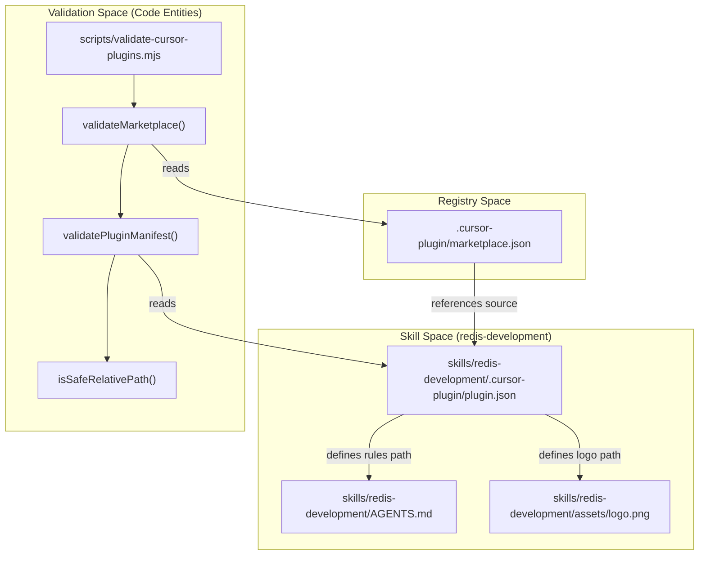
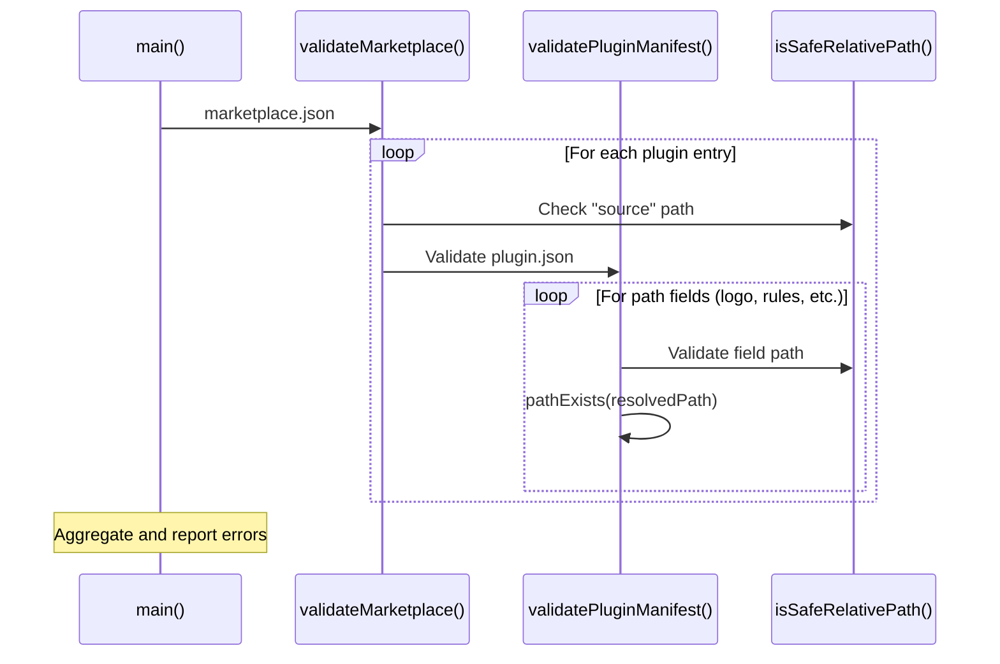

<!-- source: DeepWiki mcp.deepwiki.com · repo redis/agent-skills · page 4.1 Cursor Plugin · fetched 2026-10-27 -->

# Cursor Plugin

Relevant source files

The following files were used as context for generating this wiki page:

- [.cursor-plugin/marketplace.json](.cursor-plugin/marketplace.json)
- [scripts/validate-cursor-plugins.mjs](scripts/validate-cursor-plugins.mjs)
- [skills/redis-development/.cursor-plugin/plugin.json](skills/redis-development/.cursor-plugin/plugin.json)
- [skills/redis-development/assets/logo.png](skills/redis-development/assets/logo.png)

The Cursor Plugin integration provides a seamless way for developers using the [Cursor IDE](https://cursor.com) to access Redis development best practices directly within their AI-assisted coding environment. This integration is managed through a marketplace registry and individual plugin manifests that define how the IDE should interpret and apply the "agent skills" contained in the repository.

## Overview and Data Flow

The Cursor integration operates on a two-tier manifest system. A root-level marketplace manifest acts as a registry for all available plugins, while each skill directory contains its own specific plugin configuration.

### System Architecture

The following diagram illustrates the relationship between the Cursor marketplace configuration, the plugin manifests, and the validation logic that ensures path safety and schema compliance.

**Cursor Integration Architecture**

**Sources:** [scripts/validate-cursor-plugins.mjs:235-248](), [.cursor-plugin/marketplace.json:12-21](), [skills/redis-development/.cursor-plugin/plugin.json:1-14]()

---

## Marketplace Registry

The marketplace manifest located at `.cursor-plugin/marketplace.json` serves as the central directory for Cursor. It defines the owner of the plugins and lists the individual skills available for installation.

### Schema Details
*   **`owner`**: Information about the organization providing the skills [`.cursor-plugin/marketplace.json:3-6`]().
*   **`metadata.pluginRoot`**: Specifies the base directory where plugin sources are located (set to `skills`) [`.cursor-plugin/marketplace.json:10-10`]().
*   **`plugins`**: An array of plugin entries. Each entry must include:
    *   `name`: A kebab-case identifier (e.g., `redis-development`) [`.cursor-plugin/marketplace.json:14-14`]().
    *   `source`: The relative path from `pluginRoot` to the skill folder [`.cursor-plugin/marketplace.json:15-15`]().
    *   `description`: A high-level summary of the skill's purpose [`.cursor-plugin/marketplace.json:16-16`]().

**Sources:** [.cursor-plugin/marketplace.json:1-22]()

---

## Plugin Manifest Schema

Each skill folder contains its own `.cursor-plugin/plugin.json` file. This manifest provides the specific metadata required by Cursor to display and utilize the skill.

| Field | Type | Description |
| :--- | :--- | :--- |
| `name` | String | Must be lowercase, using only alphanumerics, hyphens, and periods [scripts/validate-cursor-plugins.mjs:120-127](). |
| `version` | String | Semantic version of the plugin [skills/redis-development/.cursor-plugin/plugin.json:3-3](). |
| `description` | String | Detailed description shown in the Cursor UI [skills/redis-development/.cursor-plugin/plugin.json:4-4](). |
| `keywords` | Array | Tags used for search and categorization [skills/redis-development/.cursor-plugin/plugin.json:12-12](). |
| `logo` | String | Relative path to the plugin icon [skills/redis-development/.cursor-plugin/plugin.json:13-13](). |
| `rules` | String | (Optional) Path to the markdown file containing the AI rules. |

**Sources:** [skills/redis-development/.cursor-plugin/plugin.json:1-14](), [scripts/validate-cursor-plugins.mjs:151-163]()

---

## Validation and Path Safety

To ensure repository integrity and prevent directory traversal vulnerabilities, the `scripts/validate-cursor-plugins.mjs` script performs rigorous checks on all manifest files.

### Path Safety Validation Logic
The function `isSafeRelativePath` [scripts/validate-cursor-plugins.mjs:58-67]() enforces the following rules:
1.  **No Absolute Paths**: Paths must not start with `/` or drive letters like `C:` [scripts/validate-cursor-plugins.mjs:62-64]().
2.  **No Upward Traversal**: Paths are normalized and checked to ensure they do not start with `../` or equal `..` [scripts/validate-cursor-plugins.mjs:65-66]().

### Validation Workflow
The validation script follows this execution flow:

**Validation Execution Flow**

**Key Functions:**
*   `validateMarketplace(marketplacePath)`: Validates the root registry and iterates through all listed plugins [scripts/validate-cursor-plugins.mjs:166-233]().
*   `validatePluginManifest(manifestPath, pluginDir, context)`: Checks individual plugin schemas, ensuring required fields like `author.name`, `version`, and `description` are present [scripts/validate-cursor-plugins.mjs:112-164]().
*   `extractPathValues(value)`: A recursive utility that extracts file paths from various JSON structures (strings, arrays, or objects with `.path`/`.file` keys) [scripts/validate-cursor-plugins.mjs:69-87]().

**Sources:** [scripts/validate-cursor-plugins.mjs:58-67](), [scripts/validate-cursor-plugins.mjs:69-87](), [scripts/validate-cursor-plugins.mjs:112-164](), [scripts/validate-cursor-plugins.mjs:166-233]()

---

