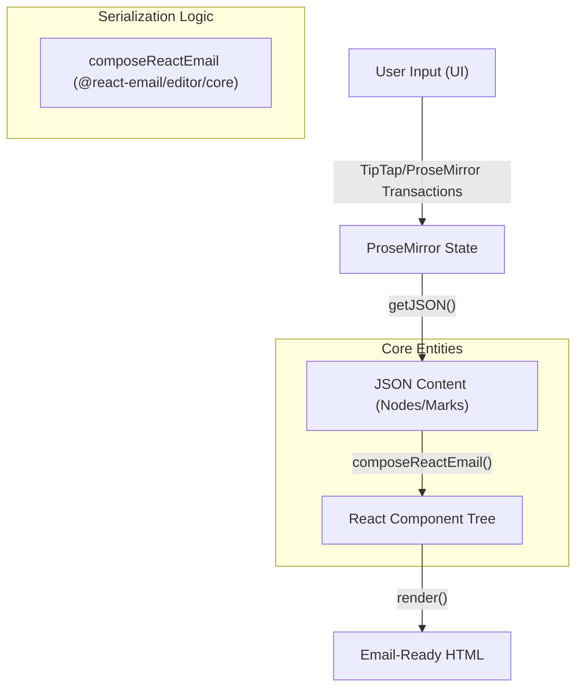
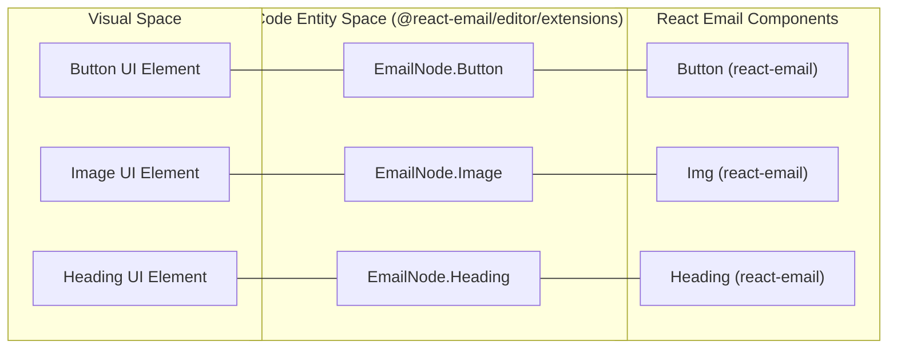

<!-- source: DeepWiki mcp.deepwiki.com · repo resend/resend-skills · page 5.4 Visual Editor (@react-email/editor) · fetched 2026-10-27 -->

# Visual Editor (@react-email/editor)

<details>
<summary>Relevant source files</summary>

The following files were used as context for generating this wiki page:

- [skills/react-email/SKILL.md](skills/react-email/SKILL.md)
- [skills/react-email/references/EDITOR.md](skills/react-email/references/EDITOR.md)

</details>


The `@react-email/editor` package provides a visual, WYSIWYG rich-text editor specifically designed for building email-ready HTML. Built on top of [TipTap](https://tiptap.dev) and [ProseMirror](https://prosemirror.net), it allows developers to embed a professional email composition experience into third-party applications [skills/react-email/references/EDITOR.md:1-4]().

## Architecture Overview

The editor is structured into six specialized entry points to balance ease of use with granular control over the bundle size and feature set.

| Import Path | Purpose |
|:---|:---|
| `@react-email/editor` | Contains the `EmailEditor` all-in-one component [skills/react-email/references/EDITOR.md:53](). |
| `@react-email/editor/core` | Core logic: `composeReactEmail` serialization, `EmailNode`, `EmailMark`, and types [skills/react-email/references/EDITOR.md:54](). |
| `@react-email/editor/extensions` | The `StarterKit` and 35+ email-aware TipTap extensions [skills/react-email/references/EDITOR.md:55](). |
| `@react-email/editor/ui` | UI components like `BubbleMenu`, `SlashCommand`, and `Inspector` [skills/react-email/references/EDITOR.md:56](). |
| `@react-email/editor/plugins` | The `EmailTheming` plugin for visual styles [skills/react-email/references/EDITOR.md:57](). |
| `@react-email/editor/utils` | Low-level attribute and style utility functions [skills/react-email/references/EDITOR.md:58](). |

### Data Flow: From Editor to HTML
The following diagram illustrates how user input in the visual editor is transformed into email-compliant HTML.

**Editor Serialization Pipeline**

**Sources:** [skills/react-email/references/EDITOR.md:47-59](), [skills/react-email/references/EDITOR.md:255-265]()

## The EmailEditor Component

The `EmailEditor` is a "batteries-included" component that pre-configures the `StarterKit`, `EmailTheming`, and default UI overlays [skills/react-email/references/EDITOR.md:60-62]().

### Implementation Example
```tsx
import { EmailEditor, type EmailEditorRef } from '@react-email/editor';
import '@react-email/editor/themes/default.css';
import { useRef } from 'react';

export function MyEditor() {
  const editorRef = useRef<EmailEditorRef>(null);

  const handleExport = async () => {
    // Access the imperative API via ref
    const { html, text } = await editorRef.current!.export();
    console.log(html);
  };

  return (
    <EmailEditor
      ref={editorRef}
      content="<p>Hello World</p>"
      theme="basic"
    />
  );
}
```
**Sources:** [skills/react-email/references/EDITOR.md:64-90]()

### EmailEditorRef API
The `EmailEditorRef` provides imperative methods to interact with the editor instance [skills/react-email/references/EDITOR.md:107]().

*   `export()`: Returns a `Promise<{ html: string; text: string }>` using the internal serialization engine [skills/react-email/references/EDITOR.md:111]().
*   `getJSON()`: Returns the content as TipTap-compatible JSON [skills/react-email/references/EDITOR.md:112]().
*   `getHTML()`: Returns the standard HTML representation [skills/react-email/references/EDITOR.md:113]().
*   `editor`: Direct access to the underlying TipTap `Editor` instance [skills/react-email/references/EDITOR.md:114]().

## Extensions and Schema

The editor's capabilities are defined by **Nodes** (structural elements like paragraphs or buttons) and **Marks** (inline styles like bold or links).

### StarterKit
The `StarterKit` from `@react-email/editor/extensions` bundles over 35 extensions optimized for email clients [skills/react-email/references/EDITOR.md:121-124](). It includes:
*   **Structural Nodes**: `EmailNode.Section`, `EmailNode.Column`, `EmailNode.Container` [skills/react-email/references/EDITOR.md:159]().
*   **Content Nodes**: `EmailNode.Button`, `EmailNode.Image`, `EmailNode.Markdown` [skills/react-email/references/EDITOR.md:203-210]().
*   **Marks**: `EmailMark.Bold`, `EmailMark.Italic`, `EmailMark.Link` [skills/react-email/references/EDITOR.md:168]().

### Custom Node Extensions
You can extend the editor by creating custom TipTap nodes. These must define how they render in the editor (DOM) and how they are serialized to React Email components [skills/react-email/references/EDITOR.md:278-280]().

**Entity Mapping: Editor UI to Code Schema**

**Sources:** [skills/react-email/references/EDITOR.md:148-160](), [skills/react-email/references/EDITOR.md:255-275]()

## UI Components

### Bubble Menus
Floating toolbars that appear upon selection. The editor provides specific menus for different contexts [skills/react-email/references/EDITOR.md:143-145]().
*   `BubbleMenu`: Standard text formatting (Bold, Italic, Alignment) [skills/react-email/references/EDITOR.md:168]().
*   `BubbleMenu.LinkDefault`: Contextual controls for URLs [skills/react-email/references/EDITOR.md:169]().
*   `BubbleMenu.ImageDefault`: Controls for image attributes [skills/react-email/references/EDITOR.md:171]().

### Slash Commands
Triggered by typing `/`, these allow users to quickly insert complex nodes like Sections, Columns, or Buttons [skills/react-email/references/EDITOR.md:181-183](). Default commands are provided via `defaultSlashCommands` [skills/react-email/references/EDITOR.md:186]().

### Inspector Sidebar
The `Inspector` component provides a sidebar for modifying the attributes of the currently selected node (e.g., changing a button's background color or an image's alt text) [skills/react-email/references/EDITOR.md:214-216]().

```tsx
import { Inspector } from '@react-email/editor/ui';

// Inside EditorProvider
<div className="flex">
  <EditorContent editor={editor} />
  <Inspector />
</div>
```
**Sources:** [skills/react-email/references/EDITOR.md:218-226]()

## Exporting and Serialization

The `composeReactEmail` utility is the core of the export process. It traverses the ProseMirror JSON tree and maps each node type to a corresponding React Email component [skills/react-email/references/EDITOR.md:255-258]().

### composeReactEmail Logic
1.  **Input**: TipTap/ProseMirror JSON [skills/react-email/references/EDITOR.md:257]().
2.  **Transformation**: Maps `type: 'button'` to `<Button />`, `type: 'heading'` to `<Heading />`, etc [skills/react-email/references/EDITOR.md:260-265]().
3.  **Output**: A React element tree that can be rendered to HTML using the standard `render()` function from `@react-email/render` [skills/react-email/references/EDITOR.md:258]().

**Sources:** [skills/react-email/references/EDITOR.md:255-275]()

---

