# Page: Overview

# Overview

<details>
<summary>Relevant source files</summary>

The following files were used as context for generating this wiki page:

- [.gitignore](.gitignore)
- [AGENTS.md](AGENTS.md)
- [CLAUDE.md](CLAUDE.md)
- [LICENSE](LICENSE)
- [README.md](README.md)

</details>


`resend-skills` is a specialized collection of AI agent skills following the [Agent Skills](https://agentskills.io) format. It is designed to empower AI coding agents—such as Claude Code, Cursor, and OpenAI Codex—with the ability to send emails, manage communication infrastructure, and implement best practices for deliverability and security directly from a developer's workflow [README.md:3-5]().

The repository functions as a centralized distribution hub, combining skills authored specifically for this project with skills synchronized from external Resend ecosystem repositories [README.md:17-23]().

### System Architecture Overview

The following diagram illustrates how the `resend-skills` repository bridges natural language requests from an AI agent to the underlying code entities and external services.

**Natural Language to Code Entity Mapping**
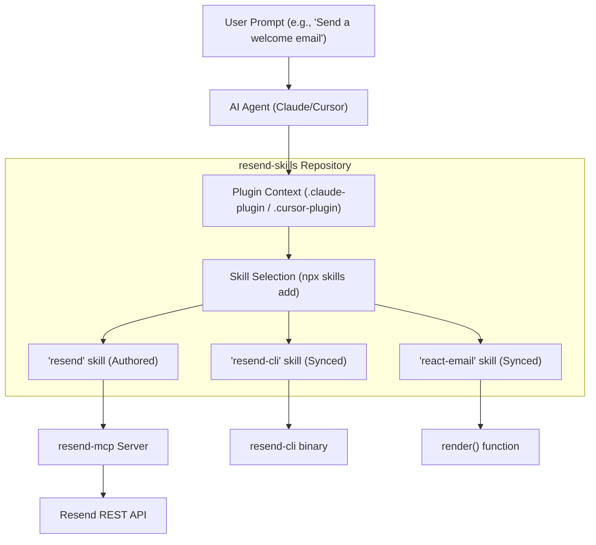
Sources: [README.md:3-35](), [AGENTS.md:1-13]()

## Skill Categories

The available skills are categorized by their origin and primary function. Some are "Authored" (native to this repo) and some are "Synced" (mirrored from other sources).

| Skill | Category | Primary Code Entities / Purpose |
|---|---|---|
| `resend` | Authored | Interface for the Resend Email API [README.md:19]() |
| `agent-email-inbox` | Authored | Security-focused inbound email framework [README.md:20]() |
| `resend-cli` | Synced | Terminal-based operations via `resend/resend-cli` [README.md:21]() |
| `react-email` | Synced | HTML email component library via `resend/react-email` [README.md:22]() |
| `email-best-practices` | Synced | Knowledge base for deliverability and compliance [README.md:23]() |

For details on the distinction between authored and synced content, see [Skill Authoring vs. Synced Skills](#1.3).

## Platform Integration

`resend-skills` integrates with various AI platforms through specific manifest directories. It also includes an MCP (Model Context Protocol) server to provide agents with direct tool access to the Resend API [README.md:25-35]().

**Integration Map**
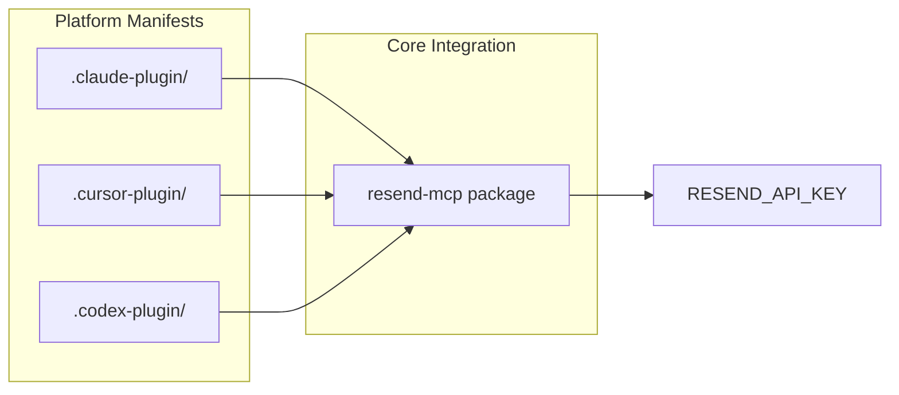
Sources: [README.md:25-48]()

For details on how these manifests work and how the MCP server is bootstrapped, see [Platform Plugin Integration](#1.2).

## Prerequisites & Installation

To use these skills, you must meet the following environment requirements:
*   **Resend Account:** A valid account at [resend.com](https://resend.com).
*   **Verified Domain:** A domain configured with appropriate DNS records in the Resend dashboard [README.md:45]().
*   **API Key:** A valid key stored in the `RESEND_API_KEY` environment variable [README.md:46-48]().

Installation is handled via the `npx skills` CLI:
```bash
npx skills add resend/resend-skills
```
[README.md:9-10]()

For a step-by-step setup guide, see [Getting Started & Installation](#1.1).

## Child Pages

*   **[Getting Started & Installation](#1.1)**: Detailed setup for `RESEND_API_KEY`, domain verification, and the `npx` installation flow.
*   **[Platform Plugin Integration](#1.2)**: Deep dive into `.claude-plugin`, `.cursor-plugin`, and the `resend-mcp` server architecture.
*   **[Skill Authoring vs. Synced Skills](#1.3)**: Guidelines for contributing to authored skills and understanding the sync workflow for external skills like `react-email`.

---

# Page: Getting Started & Installation

# Getting Started & Installation

<details>
<summary>Relevant source files</summary>

The following files were used as context for generating this wiki page:

- [.gitignore](.gitignore)
- [README.md](README.md)
- [skills/resend/references/installation.md](skills/resend/references/installation.md)

</details>


This page provides a technical guide for installing and configuring the `resend-skills` collection. It covers the installation process via the Agent Skills CLI, environmental configuration, and the selection of specific skills for AI agents.

## Prerequisites

Before installing the skills, ensure the following requirements are met:

1.  **Resend Account**: An active account at [resend.com](https://resend.com).
2.  **Verified Domain**: You must have a verified domain configured in your Resend dashboard to send emails from your own identity [README.md:45-45]().
3.  **API Key**: A valid API key generated from [resend.com/api-keys](https://resend.com/api-keys) [README.md:48-48]().
4.  **Environment Variable**: The key must be stored in the `RESEND_API_KEY` environment variable [README.md:46-46]().

## Installation via npx

The `resend-skills` package follows the [Agent Skills](https://agentskills.io) format and is installed using the `skills` CLI tool.

```bash
npx skills add resend/resend-skills
```
[README.md:9-11]()

### Skill Selection Process

Upon running the installation command, the CLI prompts the user to select specific skills from the collection. The repository contains two types of skills:

| Type | Description | Skills |
| :--- | :--- | :--- |
| **Authored** | Developed directly within this repository. | `resend`, `agent-email-inbox` |
| **Synced** | Automatically pulled from external source repositories. | `resend-cli`, `react-email`, `email-best-practices` |

[README.md:17-23](), [README.md:37-41]()

## Data Flow: Installation & Bootstrapping

The following diagram illustrates the flow from the initial installation command to the availability of tools within an AI agent's environment.

### System Bootstrapping Flow
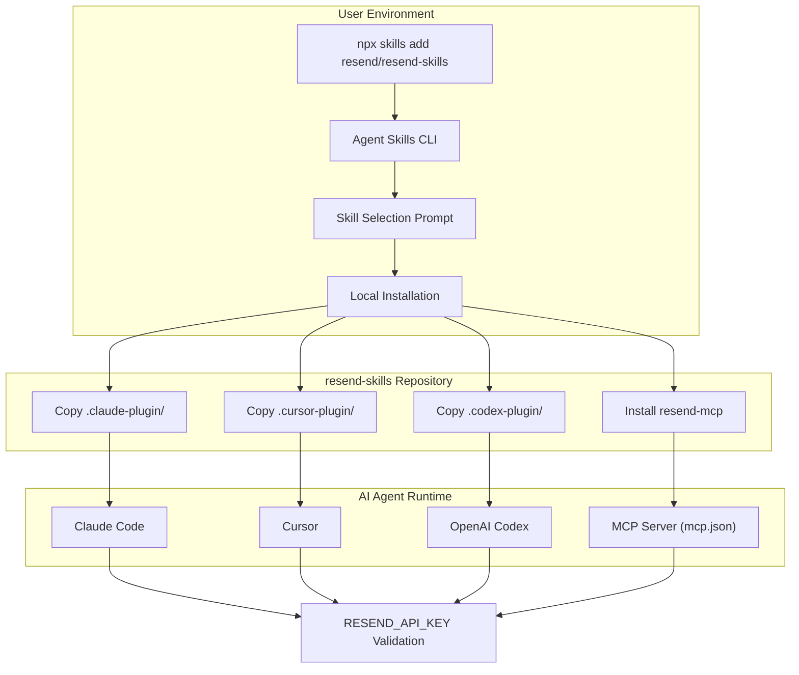
**Sources:** [README.md:9-12](), [README.md:25-35](), [README.md:46-46]()

## SDK & Language Support

While the skills themselves are platform-agnostic for the agent, the `resend` skill often assists in installing the appropriate SDK within the project being worked on. The skill references a minimum version matrix to ensure compatibility with features like `emails.receiving.get()` and `webhooks.verify()` [skills/resend/references/installation.md:3-3]().

### Minimum Version Requirements
| SDK Language | Package Name | Min Version |
| :--- | :--- | :--- |
| Node.js | `resend` | `>= 6.9.2` |
| Python | `resend` | `>= 2.21.0` |
| Go | `resend-go/v3` | `>= 3.1.0` |
| PHP | `resend/resend-php` | `>= 1.1.0` |

[skills/resend/references/installation.md:9-18]()

### Project Detection Logic
The skills use specific file markers to determine which SDK to recommend for installation:
*   **Node.js**: `package.json`
*   **Python**: `requirements.txt` or `pyproject.toml`
*   **Go**: `go.mod`
*   **Rust**: `Cargo.toml`

[skills/resend/references/installation.md:22-37]()

## Implementation: Skill to Entity Mapping

The following diagram bridges the Natural Language requests handled by the agent to the specific code entities and configurations defined in the repository.

### Natural Language to Code Entity Mapping
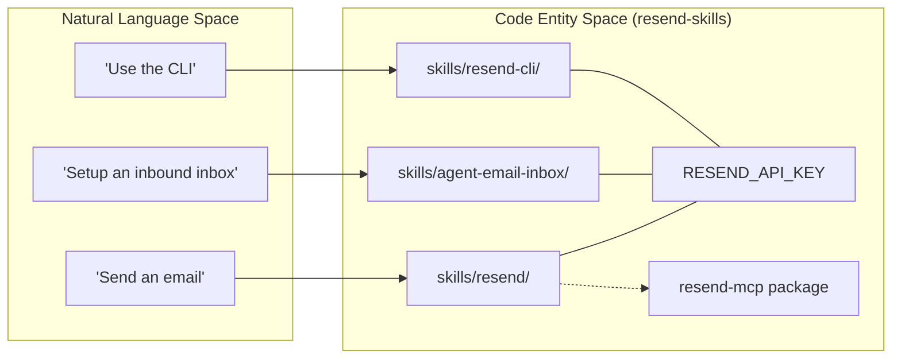
**Sources:** [README.md:15-23](), [README.md:25-27](), [README.md:46-46]()

## Environment Configuration

The primary configuration point is the `RESEND_API_KEY`. This key authorizes the [Resend MCP server](https://github.com/resend/resend-mcp) included in the plugin [README.md:25-27]().

### Configuration Checklist
1.  **Export Variable**: Ensure `export RESEND_API_KEY='re_123...'` is set in your shell profile (`.zshrc`, `.bashrc`).
2.  **Plugin Verification**: For Claude Code, the `.claude-plugin/` directory must be accessible to the agent.
3.  **MCP JSON**: The Model Context Protocol (MCP) server configuration is typically managed via an `mcp.json` file generated or updated during the `skills add` process.

**Sources:** [README.md:5-5](), [README.md:31-35](), [README.md:46-48]()

---

# Page: Platform Plugin Integration

# Platform Plugin Integration

<details>
<summary>Relevant source files</summary>

The following files were used as context for generating this wiki page:

- [.claude-plugin/marketplace.json](.claude-plugin/marketplace.json)
- [.claude-plugin/plugin.json](.claude-plugin/plugin.json)
- [.codex-plugin/plugin.json](.codex-plugin/plugin.json)
- [.cursor-plugin/marketplace.json](.cursor-plugin/marketplace.json)
- [.cursor-plugin/plugin.json](.cursor-plugin/plugin.json)
- [.mcp.json](.mcp.json)
- [mcp.json](mcp.json)

</details>


The `resend-skills` repository integrates with AI development platforms by acting as a Model Context Protocol (MCP) host. This allows tools like Claude Code, Cursor, and OpenAI Codex to discover and execute email-related tasks—such as sending emails, managing domains, or rendering React Email components—directly within their agentic workflows.

## Plugin Manifest Architecture

The repository uses a multi-manifest strategy to support different AI IDEs and agents. Each platform looks for a specific hidden directory containing metadata and configuration files.

### Claude Code Integration
Claude Code utilizes the `.claude-plugin/` directory to identify the skill set.
*   **`marketplace.json`**: Defines the high-level metadata for the Resend skill package, including the owner information and the source path for the plugin [ .claude-plugin/marketplace.json:1-17 ]().
*   **`plugin.json`**: Contains versioning, repository links, and keywords that categorize the plugin as an email and notification tool [ .claude-plugin/plugin.json:1-13 ]().

### Cursor Integration
Cursor uses a similar structure within the `.cursor-plugin/` directory.
*   **`marketplace.json`**: Registers the "resend" plugin under the Resend owner [ .cursor-plugin/marketplace.json:1-13 ]().
*   **`plugin.json`**: Provides the display name "Resend" and links to the official documentation and repository [ .cursor-plugin/plugin.json:1-15 ]().

### OpenAI Codex Integration
Codex integration is defined in `.codex-plugin/`.
*   **`plugin.json`**: Uniquely specifies the path to the skill definitions (`./skills/`) and explicitly points to the MCP configuration file (`./.mcp.json`) used to bridge the agent to the Resend API [ .codex-plugin/plugin.json:1-17 ]().

**Sources:**
* [ .claude-plugin/marketplace.json:1-17 ]()
* [ .claude-plugin/plugin.json:1-13 ]()
* [ .cursor-plugin/marketplace.json:1-13 ]()
* [ .cursor-plugin/plugin.json:1-15 ]()
* [ .codex-plugin/plugin.json:1-17 ]()

---

## MCP Server Configuration

The core of the integration is the **Model Context Protocol (MCP)**. This protocol allows the AI agent to call external tools (the "skills") through a standardized interface.

### Bootstrapping the Server
The integration relies on the `resend-mcp` package. Instead of requiring a manual installation of a heavy binary, the platforms are configured to bootstrap the server using `npx`.

The configuration is defined in `mcp.json` and `.mcp.json`. These files instruct the host platform on how to spawn the MCP process:
*   **Command**: `npx` [ mcp.json:4-4 ]().
*   **Arguments**: `-y resend-mcp`. The `-y` flag ensures the package is installed/executed without an interactive prompt [ mcp.json:5-5 ]().
*   **Environment**: The server requires a `RESEND_API_KEY` to authenticate with the Resend platform. This is passed from the user's environment to the MCP process [ mcp.json:6-9 ]().

### Diagram: Plugin Manifest to Code Entity Mapping

The following diagram shows how the natural language request from a user in an IDE (like Cursor or Claude) maps through the manifest files to the actual MCP execution.

**Platform Plugin Mapping**
```mermaid
graph TD
    subgraph "Natural Language Space (IDE)"
        "UserPrompt"["'Send a welcome email'"]
    end

    subgraph "Manifest Layer"
        "Claude"["'.claude-plugin/plugin.json'"]
        "Cursor"["'.cursor-plugin/plugin.json'"]
        "Codex"["'.codex-plugin/plugin.json'"]
    end

    subgraph "Code Entity Space (Execution)"
        "MCPConfig"["'mcp.json'"]
        "NPX"["'npx -y resend-mcp'"]
        "APIKey"["'RESEND_API_KEY'"]
    end

    "UserPrompt" --> "Claude"
    "UserPrompt" --> "Cursor"
    "UserPrompt" --> "Codex"
    
    "Claude" --> "MCPConfig"
    "Cursor" --> "MCPConfig"
    "Codex" --> "MCPConfig"
    
    "MCPConfig" --> "NPX"
    "NPX" --> "APIKey"
```

**Sources:**
* [ mcp.json:1-11 ]()
* [ .mcp.json:1-11 ]()
* [ .codex-plugin/plugin.json:6-7 ]()

---

## Data Flow: Platform to Resend API

When a platform like Claude Code initializes the `resend-skills` plugin, it follows a specific sequence to establish a secure communication channel between the AI model and the Resend infrastructure.

### Execution Sequence
1.  **Discovery**: The IDE scans the root directory for `.claude-plugin`, `.cursor-plugin`, or `.codex-plugin`.
2.  **Configuration**: The IDE reads the `mcpServers` definition in `mcp.json` [ mcp.json:2-10 ]().
3.  **Instantiation**: The IDE executes `npx -y resend-mcp` [ .mcp.json:4-5 ]().
4.  **Authentication**: The `RESEND_API_KEY` is injected into the process environment [ mcp.json:7-7 ]().
5.  **Skill Exposure**: The `resend-mcp` server describes available tools (skills) to the LLM.

### Diagram: MCP Bootstrap and Tool Invocation

This diagram traces the flow from the initial platform boot to the invocation of the `resend-mcp` logic.

**MCP Bootstrap Flow**
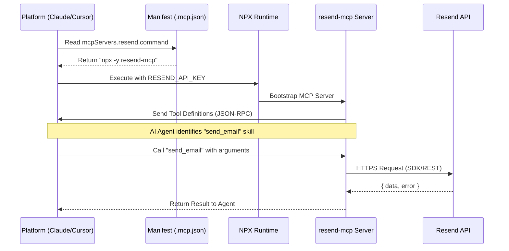

**Sources:**
* [ mcp.json:1-11 ]()
* [ .mcp.json:1-11 ]()
* [ .codex-plugin/plugin.json:2-7 ]()

## Integration Metadata Summary

| Platform | Manifest Path | Key File | Purpose |
| :--- | :--- | :--- | :--- |
| **Claude Code** | `.claude-plugin/` | `marketplace.json` | Registration in Claude's tool ecosystem [ .claude-plugin/marketplace.json:1-17 ](). |
| **Cursor** | `.cursor-plugin/` | `plugin.json` | Integration with Cursor's agentic IDE features [ .cursor-plugin/plugin.json:1-15 ](). |
| **OpenAI Codex** | `.codex-plugin/` | `plugin.json` | Linking skill directories and MCP configs [ .codex-plugin/plugin.json:1-17 ](). |
| **Generic MCP** | `/` | `mcp.json` | Universal configuration for any MCP-compliant host [ mcp.json:1-11 ](). |

**Sources:**
* [ .claude-plugin/marketplace.json:1-17 ]()
* [ .cursor-plugin/plugin.json:1-15 ]()
* [ .codex-plugin/plugin.json:1-17 ]()
* [ mcp.json:1-11 ]()

---

# Page: Skill Authoring vs. Synced Skills

# Skill Authoring vs. Synced Skills

<details>
<summary>Relevant source files</summary>

The following files were used as context for generating this wiki page:

- [.github/workflows/sync-from-repo.yml](.github/workflows/sync-from-repo.yml)
- [AGENTS.md](AGENTS.md)

</details>


The `resend-skills` repository serves as a centralized distribution hub for Resend agent capabilities. Because these skills often depend on specific product implementations or documentation maintained in separate repositories, the codebase is divided into two categories: **Authored Skills** and **Synced Skills**.

This page details the architectural distinction between these categories, the automated synchronization workflow, and the governance model for contributions.

## Architectural Overview

The repository distinguishes between skills based on their source of truth. This ensures that documentation and logic for complex tools like the `resend-cli` remain coupled with their primary source code while still being accessible to AI agents through this central distribution point.

| Category | Skills | Source of Truth | Maintenance Policy |
| :--- | :--- | :--- | :--- |
| **Authored** | `resend`, `agent-email-inbox` | `resend/resend-skills` | Edit directly in this repo. |
| **Synced** | `resend-cli`, `react-email`, `email-best-practices` | External Repos (e.g., `resend/resend-cli`) | **Do not edit here.** Changes are overwritten. |

Sources: [AGENTS.md:5-20]()

### Skill Anatomy
Regardless of their origin, all skills follow a standard directory structure within the `skills/` directory to ensure compatibility with the platform plugins:
*   `SKILL.md`: The primary prompt and tool definition.
*   `references/`: Supporting technical documentation.
*   `scripts/`: Executable scripts or helper logic.
*   `assets/`: Images or static files used by the skill.

Sources: [.github/workflows/sync-from-repo.yml:56-67](), [.github/workflows/sync-from-repo.yml:90-95]()

## Synced Skills Workflow

Synced skills are managed via an automated GitHub Action that pulls content from source repositories and creates Pull Requests in `resend-skills`. This ensures that the agent's knowledge remains current with the latest CLI versions or best practices.

### The Sync Mechanism
The synchronization is driven by the `Sync Skills from Source Repo` workflow [.github/workflows/sync-from-repo.yml:1-106](). It uses a `workflow_dispatch` trigger, typically called by a CI process in the source repository when a change is merged.

#### Sync Data Flow: Source to Distribution
The following diagram illustrates how an external update (e.g., a new command in `resend-cli`) propagates into the `resend-skills` ecosystem.

**Diagram: External Skill Synchronization Pipeline**
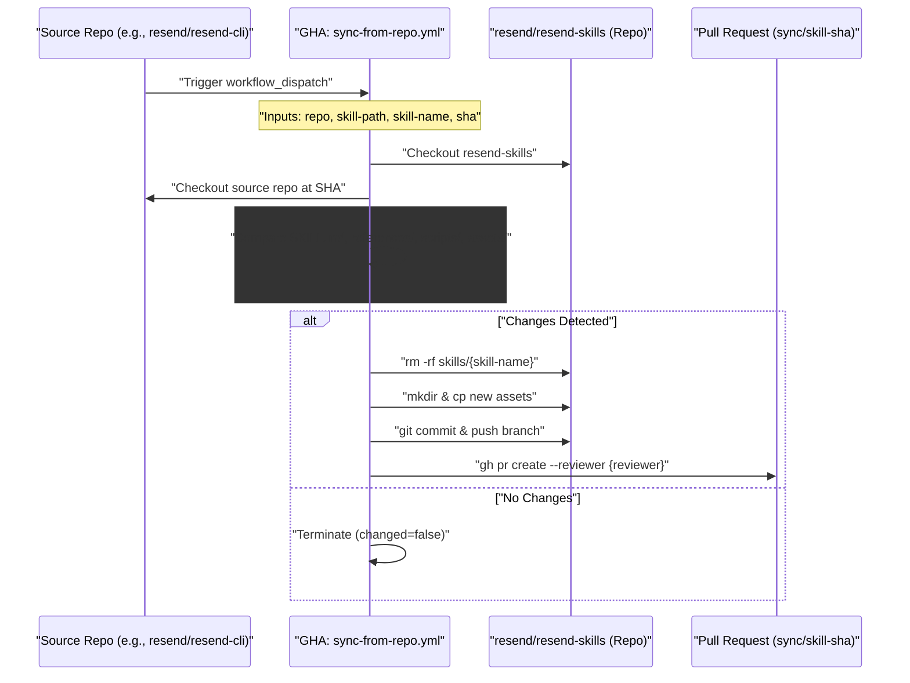
Sources: [.github/workflows/sync-from-repo.yml:4-20](), [.github/workflows/sync-from-repo.yml:43-70](), [.github/workflows/sync-from-repo.yml:85-105]()

### Implementation Details
*   **Concurrency**: The workflow uses a concurrency group `sync-${{ inputs.skill-name }}` to prevent race conditions if multiple updates for the same skill occur simultaneously [.github/workflows/sync-from-repo.yml:29-31]().
*   **Selective Sync**: The sync script specifically targets `SKILL.md`, `references`, `scripts`, and `assets`. It performs a recursive diff (`diff -rq`) to determine if an update is necessary [.github/workflows/sync-from-repo.yml:56-67]().
*   **PR Automation**: The workflow automatically formats the PR body with a link to the source commit SHA and assigns a reviewer if provided in the dispatch inputs [.github/workflows/sync-from-repo.yml:101-105]().

## Skill Authoring & Contributions

The contribution path depends entirely on the skill's category.

### Authored Skills (`resend`, `agent-email-inbox`)
These are "Safe to edit" directly within this repository [AGENTS.md:15-19](). 
*   **Location**: `skills/resend/` and `skills/agent-email-inbox/`.
*   **Workflow**: standard GitHub Flow (Branch -> Commit -> PR).
*   **Validation**: Contributors should run the evaluation suite described in `7. Skill Evaluations` to ensure no regressions in agent behavior.

### Synced Skills (`resend-cli`, `react-email`, etc.)
These are "Do not edit" in this repository [AGENTS.md:5-13](). 
*   **Location**: Respective source repositories (e.g., `github.com/resend/resend-cli`).
*   **Workflow**: 
    1.  Submit a PR to the **source** repository.
    2.  Once merged, the source repo's CI triggers the `sync-from-repo.yml` workflow in `resend-skills`.
    3.  A bot-generated PR appears in this repo for final verification.

### Mapping Space to Code Entities
The following diagram maps the logical "Skill Categories" to the physical file structure and the automation entities that manage them.

**Diagram: Skill Entity Mapping**
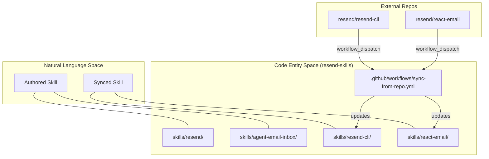
Sources: [AGENTS.md:5-20](), [.github/workflows/sync-from-repo.yml:1-20]()

---

# Page: Resend API Skill

# Resend API Skill

<details>
<summary>Relevant source files</summary>

The following files were used as context for generating this wiki page:

- [skills/resend/SKILL.md](skills/resend/SKILL.md)
- [skills/resend/references/logs.md](skills/resend/references/logs.md)

</details>


The `resend` skill serves as the core interface for the Resend email platform, providing comprehensive tools for transactional messaging, inbound processing, and marketing automation. It encapsulates the functionality of the Resend SDK and REST API, offering a unified bridge for AI agents to interact with email infrastructure.

[skills/resend/SKILL.md:2-3]()

### Architecture Overview

The skill is designed around a request-response pattern where the Node.js SDK returns a consistent `{ data, error }` object instead of throwing exceptions. This ensures predictable error handling across all email operations.

#### Natural Language to Code Mapping: Sending & Management
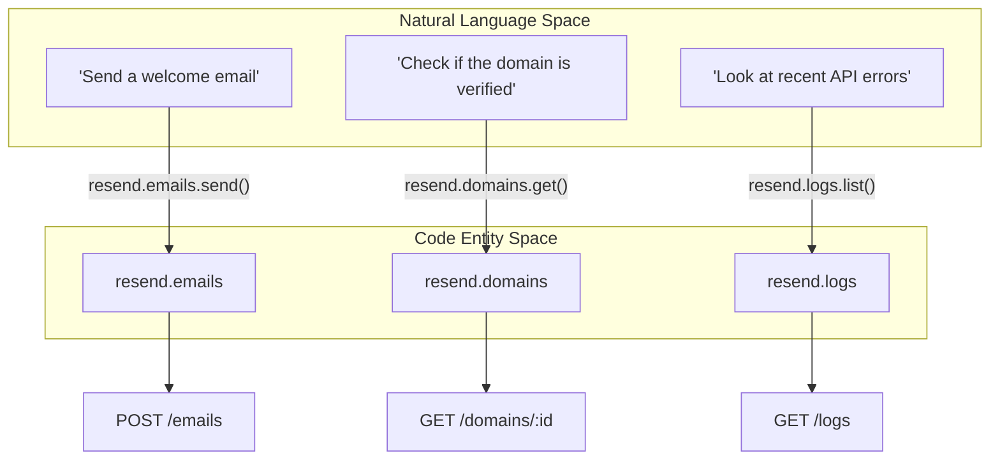
Sources: [skills/resend/SKILL.md:60-77](), [skills/resend/references/logs.md:9-10]()

### Core Capabilities

The skill is partitioned into several functional areas, each managed by specific SDK namespaces:

| Category | Primary SDK Namespace | Key Operations |
|----------|----------------------|----------------|
| **Messaging** | `resend.emails` | `send()`, `batch()`, `get()`, `cancel()` |
| **Inbound** | `resend.emails.receiving` | `get()` (retrieval after webhook) |
| **Automation** | `resend.automations` | `create()`, `list()`, `runs.list()` |
| **Identity** | `resend.domains` | `create()`, `verify()`, `list()` |
| **Audience** | `resend.contacts` | `create()`, `list()`, `update()` |
| **Observability** | `resend.logs` | `list()`, `get()` |

Sources: [skills/resend/SKILL.md:151-172](), [skills/resend/references/logs.md:7-11]()

### Messaging & Reliability
The skill supports both single and batch sending. A critical feature is **Idempotency**, which prevents duplicate sends during network retries by using the `idempotencyKey` header.

*   **Single Send:** Supports attachments and scheduling via `scheduled_at`. [skills/resend/SKILL.md:99-100]()
*   **Batch Send:** Atomic operation for up to 100 emails. Does not support attachments or scheduling. [skills/resend/SKILL.md:100-102]()

For details, see [Sending Emails](#2.1).

### Inbound & Event Handling
Resend handles inbound emails via MX record configuration. The skill implements a two-step retrieval pattern: a webhook notifies the system of an `email.received` event, and the agent uses the `email_id` to fetch the full content.

#### Webhook Processing Flow
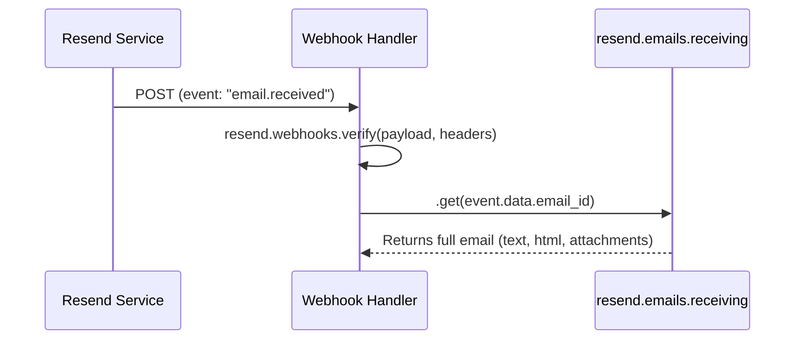
Sources: [skills/resend/SKILL.md:120-143]()

For details, see [Receiving Inbound Emails](#2.2) and [Webhooks & Event Tracking](#2.3).

### Marketing & Workflows
Beyond transactional mail, the skill manages the marketing lifecycle through Contacts, Segments, and Topics. It also interfaces with the Resend Automation engine, allowing for the creation of event-driven Directed Acyclic Graphs (DAGs) that trigger based on custom application events.

*   **Automations:** Manage steps like `delay`, `condition`, and `send_email`. [skills/resend/SKILL.md:171-172]()
*   **Marketing:** Handle broadcasts and subscription preferences via Topics. [skills/resend/SKILL.md:165-170]()

For details, see [Automations & Events](#2.4) and [Contacts, Broadcasts & Marketing](#2.5).

### Infrastructure Management
The skill provides tools for managing the underlying Resend configuration, including DNS verification for domains and API key permission scoping.

*   **Logs:** The `resend.logs` namespace allows for programmatic auditing of API requests, including full request/response body inspection for debugging. [skills/resend/references/logs.md:3-5]()
*   **Templates:** CRUD operations for email templates using triple-mustache `{{{variable}}}` syntax. [skills/resend/SKILL.md:161]()

For details, see [Domains, API Keys & Templates](#2.6).

---
**Sources:**
- [skills/resend/SKILL.md]()
- [skills/resend/references/logs.md]()

---

# Page: Sending Emails

# Sending Emails

<details>
<summary>Relevant source files</summary>

The following files were used as context for generating this wiki page:

- [skills/resend/SKILL.md](skills/resend/SKILL.md)
- [skills/resend/references/automations.md](skills/resend/references/automations.md)
- [skills/resend/references/events.md](skills/resend/references/events.md)
- [skills/resend/references/logs.md](skills/resend/references/logs.md)
- [skills/resend/references/sending/batch-email-examples.md](skills/resend/references/sending/batch-email-examples.md)
- [skills/resend/references/sending/best-practices.md](skills/resend/references/sending/best-practices.md)
- [skills/resend/references/sending/email-management.md](skills/resend/references/sending/email-management.md)
- [skills/resend/references/sending/overview.md](skills/resend/references/sending/overview.md)
- [skills/resend/references/sending/single-email-examples.md](skills/resend/references/sending/single-email-examples.md)

</details>


This page provides a detailed technical reference for sending transactional emails using the Resend SDK and REST API. It covers the core architectural patterns, including single and batch sending, idempotency, and the unique error handling model employed by the SDK.

## Core Sending Patterns

Resend provides two primary paths for dispatching emails, optimized for different use cases.

| Approach | Endpoint | Use Case |
|----------|----------|----------|
| **Single** | `POST /emails` | Individual transactional emails, emails with attachments, scheduled sends [skills/resend/references/sending/overview.md:9-9](). |
| **Batch** | `POST /emails/batch` | 2-100 distinct emails in one request, bulk notifications [skills/resend/references/sending/overview.md:10-10](). |

### Decision Matrix

*   **Choose Single when:** Sending exactly one email, requiring file attachments, or needing to schedule a send for a future time [skills/resend/references/sending/overview.md:17-21]().
*   **Choose Batch when:** Sending between 2 and 100 distinct emails at once to reduce API roundtrips (the default rate limit is 2 requests per second) [skills/resend/references/sending/overview.md:12-15]().

### Data Flow: SDK to API
The following diagram illustrates the flow from a natural language request (e.g., "Send a welcome email") to the code entities that execute the request.

**Code Entity Mapping: Sending Workflow**
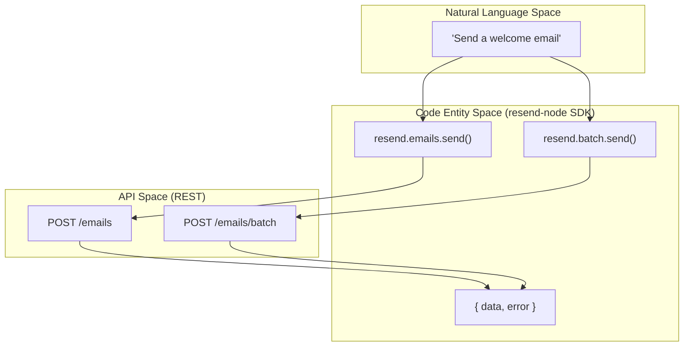
Sources: [skills/resend/SKILL.md:60-68](), [skills/resend/references/sending/overview.md:7-11]()

---

## The `{ data, error }` SDK Pattern

A critical technical detail of the Resend Node.js SDK is that it **does not throw exceptions** for API-level errors [skills/resend/SKILL.md:77-77](). Instead, it returns an object containing either `data` or `error`.

### Implementation Example
```typescript
const { data, error } = await resend.emails.send({
  from: 'Acme <onboarding@resend.dev>',
  to: ['delivered@resend.dev'],
  subject: 'Hello World',
  html: '<p>Email body</p>',
});

if (error) {
  // Handle validation_error, rate_limit_exceeded, etc.
  console.error(error.message);
  return;
}
console.log(data.id);
```
Sources: [skills/resend/SKILL.md:55-75](), [skills/resend/references/sending/best-practices.md:153-192]()

---

## Idempotency and Reliability

Idempotency keys are mandatory for production-grade implementations to prevent duplicate emails during retries [skills/resend/SKILL.md:104-106]().

### Key Mechanics
*   **Format:** Use the pattern `<event-type>/<entity-id>` (e.g., `welcome-email/user-123`) [skills/resend/references/sending/best-practices.md:18-18]().
*   **Expiration:** Keys expire after 24 hours [skills/resend/SKILL.md:112-112]().
*   **Conflict:** Sending the same key with a **different** payload returns a `409 Conflict` (`invalid_idempotent_request`) [skills/resend/references/sending/best-practices.md:20-20]().
*   **Success:** Sending the same key with the **same** payload returns the original response without re-sending the email [skills/resend/SKILL.md:114-114]().

**Entity Mapping: Idempotency Logic**
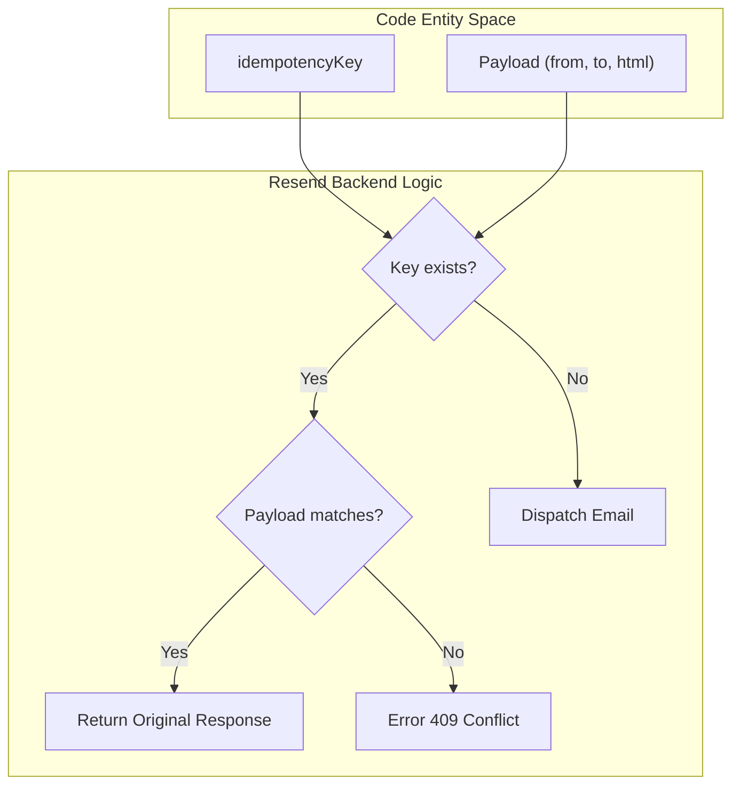
Sources: [skills/resend/references/sending/best-practices.md:10-31](), [skills/resend/SKILL.md:108-116]()

---

## Batch Sending Constraints

Batch sends are **atomic**. If a single email in the batch fails validation (e.g., an invalid email format), the entire batch request fails [skills/resend/SKILL.md:102-102]().

### Batch Limitations
*   **Max Size:** 100 emails per request [skills/resend/references/sending/overview.md:69-69]().
*   **Recipients:** Max 50 recipients per individual email within the batch [skills/resend/references/sending/overview.md:70-70]().
*   **Feature Gaps:** Batch sending does **not** support attachments or `scheduled_at` [skills/resend/references/sending/overview.md:66-67]().

### Chunking Strategy
For sends exceeding 100 emails, implementations must chunk the data:
1.  Split the list into chunks of 100.
2.  Assign unique idempotency keys per chunk: `campaign-id/chunk-0`, `campaign-id/chunk-1`.
3.  Process chunks in parallel to optimize throughput [skills/resend/references/sending/overview.md:81-90]().

Sources: [skills/resend/references/sending/overview.md:60-90](), [skills/resend/references/sending/batch-email-examples.md:11-89]()

---

## Attachments and Scheduling

Single sends (`POST /emails`) support advanced features not available in batch.

### File Attachments
*   **Total Limit:** 40MB total per email [skills/resend/references/sending/overview.md:51-51]().
*   **Retrieval:** After sending, attachments can be retrieved via `resend.emails.attachments.get()`. This returns a **signed download URL** that expires (check the `expires_at` field) [skills/resend/references/sending/email-management.md:75-112]().

### Scheduling
*   **Parameter:** `scheduled_at` (ISO 8601 string) [skills/resend/references/sending/overview.md:50-50]().
*   **Management:** Scheduled emails can be updated (to change the time) via `resend.emails.update()` or cancelled before the send time via `resend.emails.cancel()` [skills/resend/references/sending/email-management.md:47-73]().

Sources: [skills/resend/references/sending/overview.md:30-58](), [skills/resend/references/sending/email-management.md:1-126]()

---

## React Component Rendering

While the Resend API accepts `html` and `text`, the SDK supports a `react` parameter to render components directly.

### Mutually Exclusive Content
When sending, you must provide exactly one of the following content types:
*   `html`: Raw HTML string.
*   `text`: Plain text string.
*   `template`: Reference to a stored Resend template ID/alias with variables.
*   `react`: A React component (Node.js SDK only) [skills/resend/references/sending/overview.md:142-159]().

### Template Variables
When using `template`, variables are **case-sensitive** and must match the template definition exactly [skills/resend/references/sending/overview.md:153-153]().

Sources: [skills/resend/references/sending/overview.md:142-159](), [skills/resend/SKILL.md:3-3]()

---

# Page: Receiving Inbound Emails

# Receiving Inbound Emails

<details>
<summary>Relevant source files</summary>

The following files were used as context for generating this wiki page:

- [skills/resend/references/receiving.md](skills/resend/references/receiving.md)

</details>


The Resend platform provides a robust infrastructure for receiving inbound emails, processing them, and delivering notifications to your application via webhooks. This system is designed to handle large payloads and attachments by utilizing a "notification-first" pattern, where the initial webhook contains metadata and the application subsequently fetches full content and signed download URLs for attachments.

## Overview of the Receiving Flow

Resend implements a two-step retrieval pattern to ensure compatibility with serverless environments that often impose strict request body size limits.

1.  **Notification**: Resend receives an email and triggers an `email.received` webhook event containing metadata (sender, recipient, subject, and attachment metadata).
2.  **Retrieval**: The application uses the `email_id` from the webhook to call `resend.emails.receiving.get()` for the HTML/Text body and `resend.emails.receiving.attachments.get()` for signed, expiring download URLs.

### Data Flow Diagram: Inbound Email Processing

This diagram illustrates the transition from the external SMTP event to the internal Resend SDK entities and API calls.

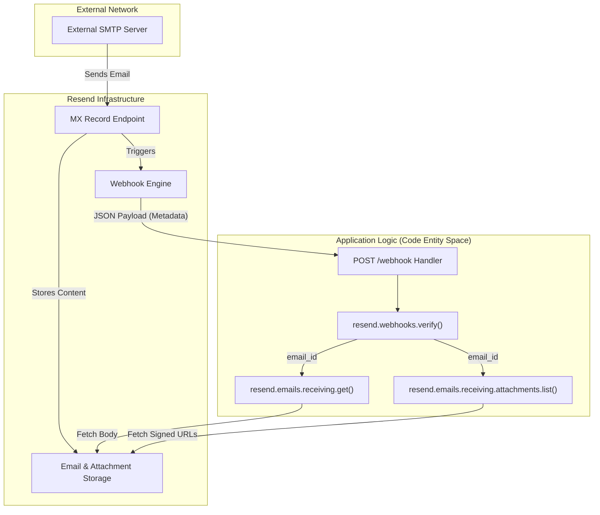
**Sources:** [skills/resend/references/receiving.md:1-12](), [skills/resend/references/receiving.md:143-160]()

---

## Domain Configuration

To receive emails, you must configure a domain to route traffic to Resend's MX servers.

### 1. Resend-Managed Domains (`.resend.app`)
For rapid prototyping and testing, Resend provides an auto-generated managed domain.
*   **Address Format**: `<anything>@<your-id>.resend.app` [skills/resend/references/receiving.md:17-17]()
*   **Setup**: No DNS configuration is required. The address is available directly in the Resend Dashboard under **Emails → Receiving** [skills/resend/references/receiving.md:19-19]().

### 2. Custom Domains
To use a custom domain (e.g., `support@example.com`), you must configure MX records in your DNS provider.

| Setting | Value |
| :--- | :--- |
| **Type** | MX |
| **Host** | Your domain (e.g., `@`) or subdomain (e.g., `support`) |
| **Value** | Provided in the Resend Dashboard |
| **Priority** | 10 (Must be the lowest number if other MX records exist) |

**Subdomain Recommendation**: If your root domain already handles email (e.g., via Google Workspace), use a subdomain like `inbound.example.com` to avoid breaking existing mailbox routing [skills/resend/references/receiving.md:34-48]().

**Sources:** [skills/resend/references/receiving.md:13-48]()

---

## Webhook Implementation

The `email.received` event is the primary trigger for inbound processing.

### Webhook Payload Structure
The payload is restricted to metadata to prevent delivery failures due to size constraints.

| Field | Description |
| :--- | :--- |
| `type` | Always `email.received` |
| `data.email_id` | Unique identifier used to fetch full content |
| `data.from` | Sender's email address |
| `data.to` | Array of recipient addresses |
| `data.attachments` | Array of metadata (ID, filename, content_type) |

**Sources:** [skills/resend/references/receiving.md:62-86]()

### Security and Verification
Applications should use `resend.webhooks.verify()` to validate the `svix-signature` header, ensuring the request originated from Resend and has not been tampered with.

```typescript
// Example Verification in Next.js/Node
const event = resend.webhooks.verify({
  payload: await req.text(),
  headers: {
    'svix-id': req.headers.get('svix-id'),
    'svix-timestamp': req.headers.get('svix-timestamp'),
    'svix-signature': req.headers.get('svix-signature'),
  },
  secret: process.env.RESEND_WEBHOOK_SECRET,
});
```
**Sources:** [skills/resend/references/receiving.md:88-116]()

---

## Retrieving Email Content and Attachments

Once a valid `email_id` is obtained, the full content must be retrieved via the Resend SDK.

### Content Retrieval Logic
The `resend.emails.receiving.get()` method returns the full HTML and plain text bodies, along with the raw email headers.

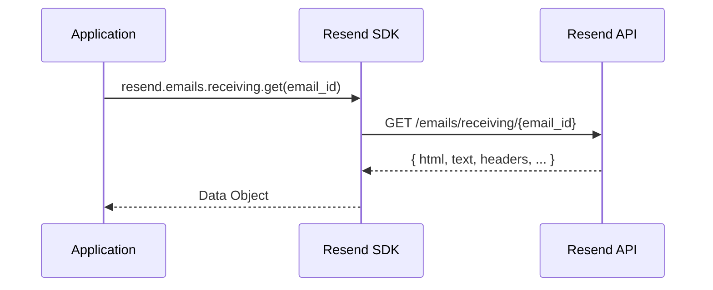
**Sources:** [skills/resend/references/receiving.md:143-160]()

### Attachment Handling
Attachments are not served directly. Instead, the API provides a `download_url` which is a signed URL pointing to the file in Resend's storage.

*   **List Attachments**: `resend.emails.receiving.attachments.list({ emailId })` returns metadata for all files [skills/resend/references/receiving.md:166-175]().
*   **Expiration**: The `download_url` includes an `expires_at` timestamp. If the URL expires before the application downloads it, a new call to the `get` or `list` endpoint must be made to generate a fresh signed URL [skills/resend/references/receiving.md:199-199]().

### Listing Received Emails
For scenarios where webhooks are missed or for building an inbox UI, the `list` method supports cursor-based pagination using `after` and `before` cursors.

```typescript
const { data: emails } = await resend.emails.receiving.list({
  limit: 20,
  after: 'cursor_abc123',
});
```
**Sources:** [skills/resend/references/receiving.md:118-141]()

---

## Summary of Key Functions

| Function | File Reference | Purpose |
| :--- | :--- | :--- |
| `resend.webhooks.verify()` | [skills/resend/references/receiving.md:100-108]() | Validates Svix signatures on incoming webhooks. |
| `resend.emails.receiving.list()` | [skills/resend/references/receiving.md:123-126]() | Paginated list of all received emails. |
| `resend.emails.receiving.get()` | [skills/resend/references/receiving.md:149-151]() | Fetches full HTML/Text content for a specific email. |
| `resend.emails.receiving.attachments.list()` | [skills/resend/references/receiving.md:166-168]() | Retrieves signed download URLs for all attachments. |

**Sources:** [skills/resend/references/receiving.md:1-203]()

---

# Page: Webhooks & Event Tracking

# Webhooks & Event Tracking

<details>
<summary>Relevant source files</summary>

The following files were used as context for generating this wiki page:

- [skills/resend/SKILL.md](skills/resend/SKILL.md)
- [skills/resend/references/logs.md](skills/resend/references/logs.md)
- [skills/resend/references/webhooks.md](skills/resend/references/webhooks.md)

</details>


The Resend platform uses webhooks to provide real-time notifications for email delivery events, inbound processing, and resource changes. This system allows applications to maintain list hygiene, track engagement, and automate workflows based on email lifecycle transitions.

## Overview & Data Flow

Webhooks are unauthenticated HTTP POST requests sent from Resend to a configured endpoint. Because these requests are unauthenticated, **signature verification** is a mandatory security requirement to ensure the payload originated from Resend and has not been tampered with [skills/resend/references/webhooks.md:170-172]().

### Event Delivery Pipeline

The following diagram illustrates the flow from an email event to a verified application action.

**Figure 1: Webhook Event Processing Flow**
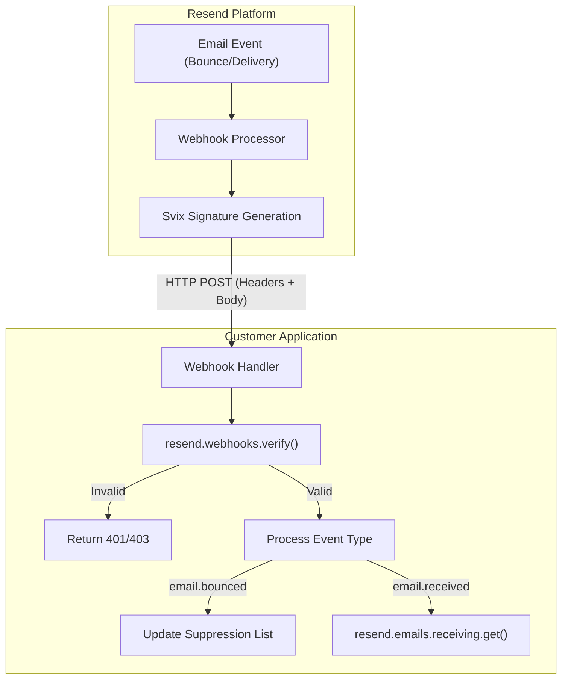
Sources: [skills/resend/references/webhooks.md:1-12](), [skills/resend/references/webhooks.md:170-180](), [skills/resend/SKILL.md:117-146]()

## Event Types & Use Cases

Resend categorizes events into delivery, inbound, and resource management groups.

### Email Delivery Events
| Event | Trigger | Use Case |
|:---|:---|:---|
| `email.sent` | API request successful | Confirm email accepted by Resend [skills/resend/references/webhooks.md:20-20]() |
| `email.delivered` | Reached recipient server | Confirm successful delivery [skills/resend/references/webhooks.md:21-21]() |
| `email.bounced` | Permanent rejection | **List Hygiene:** Remove address immediately [skills/resend/references/webhooks.md:22-22]() |
| `email.complained` | Marked as spam | **Compliance:** Unsubscribe user [skills/resend/references/webhooks.md:23-23]() |
| `email.delivery_delayed` | Soft bounce | Monitor temporary issues [skills/resend/references/webhooks.md:26-26]() |

### List Hygiene: Bounces & Suppressions
Handling `email.bounced` events is critical for maintaining sender reputation. Resend distinguishes between Hard and Soft bounces:
*   **Hard Bounces (`email.bounced`):** Permanent failures (e.g., `NoEmail` subtype). You must remove these addresses immediately and never retry [skills/resend/references/webhooks.md:41-41]().
*   **Soft Bounces (`email.delivery_delayed`):** Temporary issues (e.g., `MailboxFull`). Resend retries these automatically. If they fail after retries, an `email.bounced` event is triggered [skills/resend/references/webhooks.md:52-53]().

Sources: [skills/resend/references/webhooks.md:14-62]()

## Implementation & Signature Verification

### Verifying Signatures with `resend.webhooks.verify()`
Resend uses **Svix** for webhook signing. Every request includes three critical headers: `svix-id`, `svix-timestamp`, and `svix-signature` [skills/resend/references/webhooks.md:181-190]().

**Key Implementation Requirements:**
1.  **Raw Body:** You must use the raw request body text, not a parsed JSON object [skills/resend/SKILL.md:125-125]().
2.  **Signing Secret:** Use the `RESEND_WEBHOOK_SECRET` (prefixed with `whsec_`) obtained during webhook creation [skills/resend/SKILL.md:29-31]().

**Figure 2: Verification Code Entity Map**
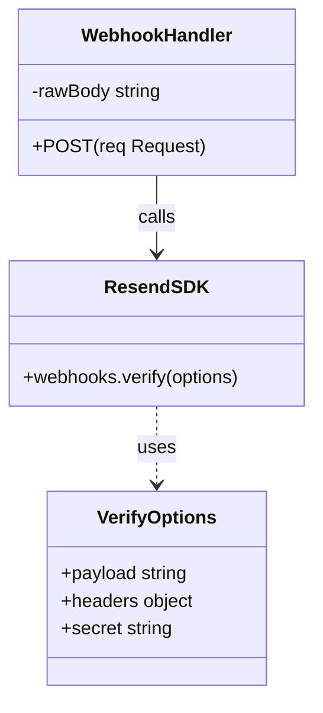
Sources: [skills/resend/SKILL.md:119-135](), [skills/resend/references/webhooks.md:170-190]()

### Node.js Implementation Example
```typescript
import { Resend } from 'resend';
const resend = new Resend(process.env.RESEND_API_KEY);

export async function POST(req: Request) {
  const payload = await req.text(); // Raw text required [skills/resend/SKILL.md:125]()
  
  try {
    const event = resend.webhooks.verify({
      payload,
      headers: {
        'svix-id': req.headers.get('svix-id'),
        'svix-timestamp': req.headers.get('svix-timestamp'),
        'svix-signature': req.headers.get('svix-signature'),
      },
      secret: process.env.RESEND_WEBHOOK_SECRET,
    });

    if (event.type === 'email.bounced') {
      // Logic to update local suppression list
    }
  } catch (e) {
    return new Response('Invalid signature', { status: 400 });
  }
  return new Response('OK', { status: 200 });
}
```
Sources: [skills/resend/SKILL.md:119-146](), [skills/resend/references/webhooks.md:71-75]()

## Webhook Management

Webhooks can be managed via the Resend Dashboard or programmatically via the SDK.

### Programmatic CRUD Operations
The SDK provides methods to manage the lifecycle of webhook endpoints. Note that the `signing_secret` is **only** returned during the initial creation [skills/resend/references/webhooks.md:137-137]().

| Operation | Node.js SDK Method |
|:---|:---|
| **Create** | `resend.webhooks.create({ endpoint, events })` [skills/resend/references/webhooks.md:87-90]() |
| **List** | `resend.webhooks.list()` [skills/resend/references/webhooks.md:150-150]() |
| **Update** | `resend.webhooks.update(id, { endpoint, events })` [skills/resend/references/webhooks.md:153-159]() |
| **Delete** | `resend.webhooks.remove(id)` [skills/resend/references/webhooks.md:162-162]() |

### Troubleshooting with Logs
For debugging webhook delivery issues or verifying payload structure, the `resend.logs` API can be used to inspect the original request and response bodies of API calls related to webhook configuration [skills/resend/references/logs.md:85-98]().

Sources: [skills/resend/references/webhooks.md:76-169](), [skills/resend/references/logs.md:1-12]()

---

# Page: Automations & Events

# Automations & Events

<details>
<summary>Relevant source files</summary>

The following files were used as context for generating this wiki page:

- [skills/resend/references/automations.md](skills/resend/references/automations.md)
- [skills/resend/references/events.md](skills/resend/references/events.md)
- [skills/resend/references/sending/overview.md](skills/resend/references/sending/overview.md)

</details>


Automations are event-driven workflows composed of steps connected in a directed graph (DAG). They allow for complex, asynchronous messaging patterns by reacting to specific events associated with contacts. The engine supports branching logic, delays, and stateful waiting for external signals.

## Event System

Events are named signals that serve as the primary entry point for automations. They associate specific activities with a contact and can carry a structured payload.

### Event Definition and Schema
Events can be defined with an optional schema—a flat key/type map—to enforce payload structure. Supported types include `string`, `number`, `boolean`, and `date` [skills/resend/references/events.md:24-29]().

*   **Reserved Prefix:** Event names starting with `resend:` are reserved for system events and cannot be used for custom events [skills/resend/references/events.md:113]().
*   **Asynchronous Processing:** Sending an event returns a `202 Accepted` status, as the subsequent automation triggers are processed asynchronously [skills/resend/references/events.md:86]().

### Sending Events
To trigger an automation, an event must be sent and associated with a contact using either a `contactId` or an `email` address (mutually exclusive) [skills/resend/references/events.md:58-59]().

**Sources:** [skills/resend/references/events.md:1-120]()

---

## Automation Graph Model

An automation is a Directed Acyclic Graph (DAG) consisting of **steps** and **connections**.

### Step Types
Each step is defined by a unique `key`, a `type`, and a `config` object [skills/resend/references/automations.md:34]().

| Type | Config Key Details | Purpose |
| :--- | :--- | :--- |
| `trigger` | `event_name` | The entry point for the workflow [skills/resend/references/automations.md:38](). |
| `send_email` | `template`, `subject`, `from` | Sends an email via a published template [skills/resend/references/automations.md:39](). |
| `delay` | `duration` (e.g., "3 days") | Pauses the run for a human-readable duration [skills/resend/references/automations.md:40](). |
| `wait_for_event` | `event_name`, `timeout` | Pauses until a specific event is received or timeout occurs [skills/resend/references/automations.md:41](). |
| `condition` | `rule tree` | Branches the flow based on contact property data [skills/resend/references/automations.md:42](). |
| `contact_update` | `properties`, `unsubscribed` | Modifies contact attributes [skills/resend/references/automations.md:43](). |

### Connection Types
Connections define the edges between steps. While most steps use a `default` connection, branching steps require specific types [skills/resend/references/automations.md:59-68]():

*   **`condition_met` / `condition_not_met`**: Used for `condition` steps.
*   **`event_received` / `timeout`**: Used for `wait_for_event` steps.

### Constraints
*   **Step Limit:** Automations are limited to 150 steps.
*   **Update Requirements:** When updating a workflow graph via `resend.automations.update()`, both the `steps` and `connections` arrays must be provided in full [skills/resend/references/automations.md:167-168]().

**Sources:** [skills/resend/references/automations.md:5-68](), [skills/resend/references/automations.md:167-184]()

---

## Implementation & Data Flow

The following diagrams illustrate how high-level automation concepts map to specific SDK methods and data structures.

### Logic Flow: From Event to Automation Run
This diagram shows the transition from a "Natural Language" trigger to the execution of a "Code Entity" `Run`.

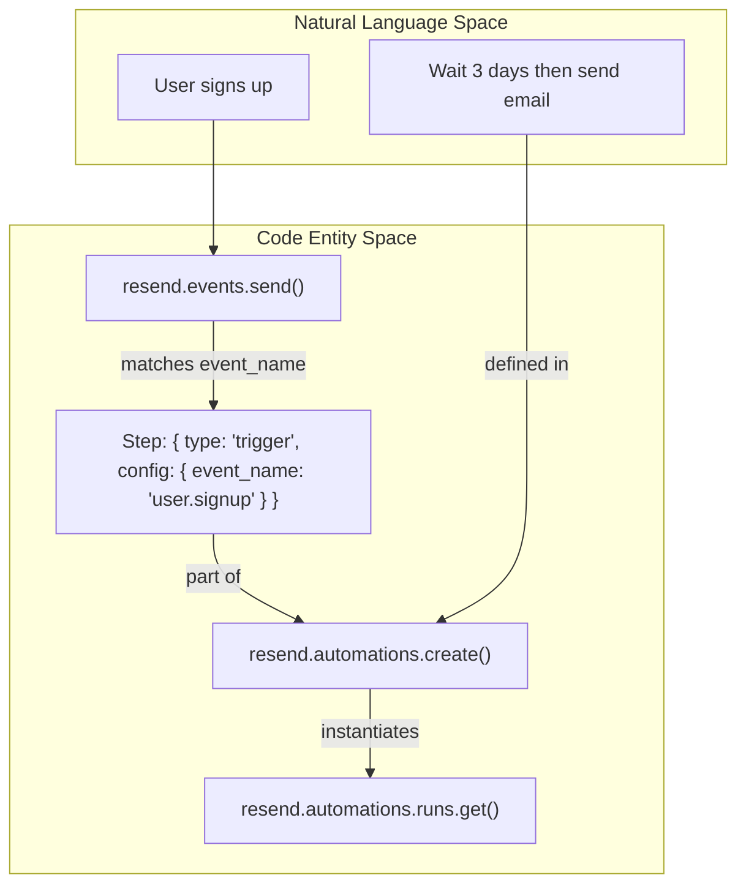
**Sources:** [skills/resend/references/events.md:18-18](), [skills/resend/references/automations.md:15-22](), [skills/resend/references/automations.md:38-38]()

### Step Configuration and Connection Mapping
This diagram maps the SDK parameter structures to the internal execution logic for branching.

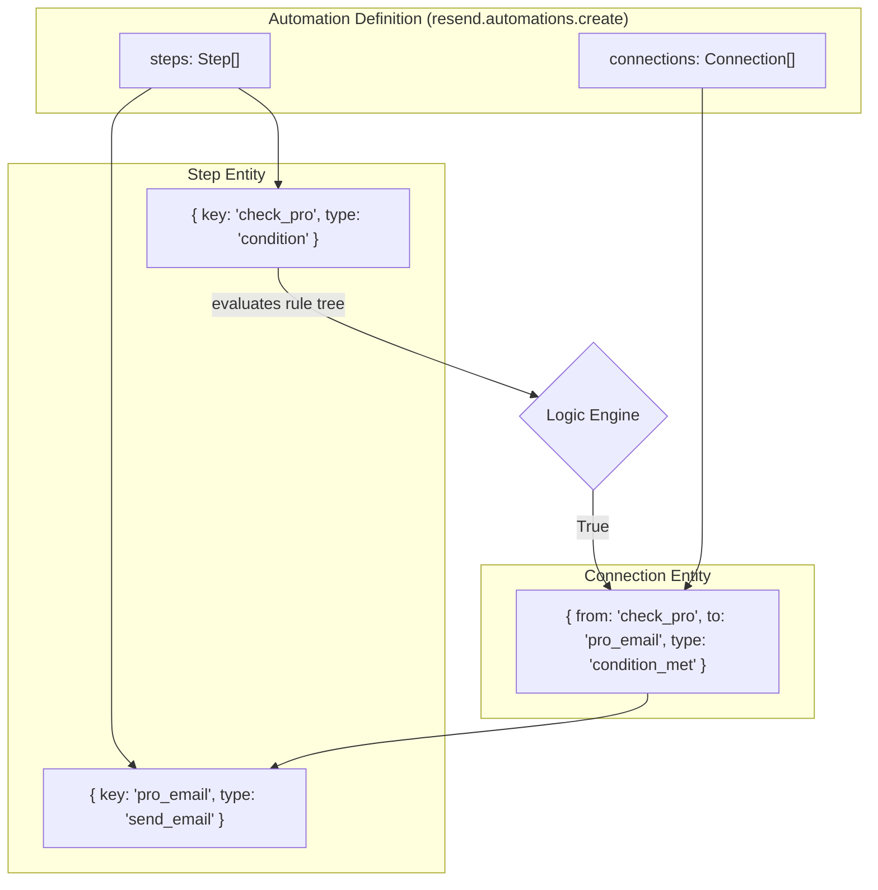
**Sources:** [skills/resend/references/automations.md:34-68](), [skills/resend/references/automations.md:143-163]()

---

## Run Lifecycle & Monitoring

Once an automation is `enabled`, every matching event creates a `Run`.

### Run States
The status of a run can be monitored using the `resend.automations.runs` namespace.
*   **`list`**: Retrieves runs for a specific `automationId`, filterable by status [skills/resend/references/automations.md:21]().
*   **`get`**: Returns the full execution history of a run, including which steps were executed and their outcomes [skills/resend/references/automations.md:22]().

### Lifecycle Operations
| Operation | Method | Effect |
| :--- | :--- | :--- |
| **Start** | `resend.events.send()` | Triggers a new run if an automation's `trigger` matches the event name [skills/resend/references/events.md:18](). |
| **Stop** | `resend.automations.stop()` | Sets automation status to `disabled`; new runs will not start [skills/resend/references/automations.md:20](). |
| **Delete** | `resend.automations.remove()` | Permanently deletes the automation and its configuration [skills/resend/references/automations.md:19](). |

**Sources:** [skills/resend/references/automations.md:15-22](), [skills/resend/references/events.md:5-18]()

---

# Page: Contacts, Broadcasts & Marketing

# Contacts, Broadcasts & Marketing

<details>
<summary>Relevant source files</summary>

The following files were used as context for generating this wiki page:

- [skills/resend/references/broadcasts.md](skills/resend/references/broadcasts.md)
- [skills/resend/references/contact-properties.md](skills/resend/references/contact-properties.md)
- [skills/resend/references/contacts.md](skills/resend/references/contacts.md)
- [skills/resend/references/segments.md](skills/resend/references/segments.md)
- [skills/resend/references/topics.md](skills/resend/references/topics.md)

</details>


This page details the management of marketing-related resources within the Resend ecosystem. While transactional emails are sent via the core `emails` API, marketing campaigns utilize **Broadcasts** to target **Segments** of **Contacts**. This system includes fine-grained subscription management through **Topics** and dynamic content personalization using **Contact Properties**.

## Contact Management

Contacts are the central entity for marketing activities. They represent individual recipients and store metadata used for segmentation and personalization.

### Data Flow: Creating and Updating Contacts
Contacts can be managed via the Node.js or Python SDKs. The `email` field is the unique identifier and the only required field for creation [skills/resend/references/contacts.md:104-104]().

| Feature | Description |
| :--- | :--- |
| **Identification** | Contacts are looked up or modified using either their unique `id` (e.g., `cont_xxx`) or their `email` [skills/resend/references/contacts.md:13-17](). |
| **Properties** | Custom metadata stored as key-value pairs [skills/resend/references/contacts.md:31-35](). |
| **Segments** | Static groupings for broadcast targeting [skills/resend/references/contacts.md:36-36](). |
| **Topics** | Preference-based subscriptions (opt-in/opt-out) [skills/resend/references/contacts.md:37-40](). |

### Deleting Properties
To delete a specific property from a contact, the value must be set to `null` in an update call; passing an empty string will not remove the key [skills/resend/references/contacts.md:77-77]().

**Sources:** [skills/resend/references/contacts.md:1-105]()

---

## Segmentation and Topics

Resend distinguishes between organizational groupings (Segments) and recipient preferences (Topics).

### Segments
Segments have replaced the legacy "Audiences" system [skills/resend/references/segments.md:3-3](). They are used to group contacts for targeting.
* **Creation:** Segments are created with a `name` [skills/resend/references/segments.md:30-32]().
* **Membership:** Contacts are added or removed explicitly via the `resend.contacts.segments` sub-resource [skills/resend/references/segments.md:48-51]().
* **Immutability:** Segments cannot be updated. To rename a segment, it must be removed and recreated [skills/resend/references/segments.md:16-16]().

### Topics
Topics provide granular control over what types of content a contact receives.
* **Default Subscription:** Must be set to `opt_in` or `opt_out` at creation and is immutable [skills/resend/references/topics.md:32-32]().
* **Visibility:** `public` topics appear on the Resend-hosted preference page, while `private` topics are managed only via API [skills/resend/references/topics.md:93-93]().
* **Broadcast Filtering:** If a `topicId` is provided during broadcast creation, only contacts opted into that topic within the target segment will receive the email [skills/resend/references/topics.md:73-73]().

### Natural Language to Code Entity: Audience Management
This diagram maps the conceptual marketing entities to their respective SDK classes and methods.

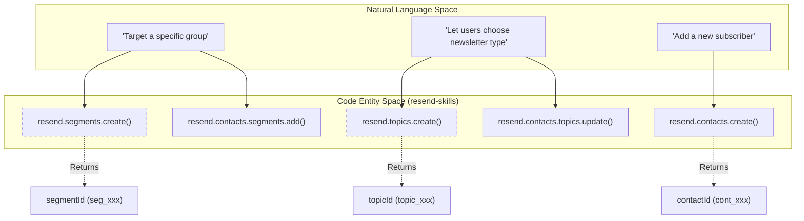
**Sources:** [skills/resend/references/segments.md:9-14](), [skills/resend/references/topics.md:9-15](), [skills/resend/references/contacts.md:11-17]()

---

## Contact Properties and Interpolation

Contact Properties define the schema for custom data across the entire account [skills/resend/references/contact-properties.md:3-3]().

### Property Configuration
* **Type:** Supports `string` or `number`. This is immutable after creation [skills/resend/references/contact-properties.md:21-21]().
* **Key:** Alphanumeric and underscores only, max 50 characters [skills/resend/references/contact-properties.md:22-22]().
* **Fallback:** An account-wide `fallbackValue` can be defined for cases where a contact lacks data for that property [skills/resend/references/contact-properties.md:23-23]().

### Personalization Syntax
Resend uses **triple-mustache** syntax `{{{ }}}` for variable interpolation in broadcasts to prevent HTML escaping of dynamic content [skills/resend/references/broadcasts.md:123-123]().

**Pipe Fallbacks:**
You can override property-level fallbacks within the HTML template using a pipe:
`{{{PROPERTY_KEY|fallback_text}}}` [skills/resend/references/broadcasts.md:107-107]().

**Sources:** [skills/resend/references/contact-properties.md:1-112](), [skills/resend/references/broadcasts.md:105-112]()

---

## Broadcasts API

Broadcasts follow a strict two-step lifecycle: **Create** (Draft) and **Send**.

### The Lifecycle Flow
1.  **Create:** Generates a draft. Requires `segmentId`, `from`, `subject`, and content (`html`, `text`, or `react`) [skills/resend/references/broadcasts.md:18-18]().
2.  **Send:** Triggers the delivery. This is where `scheduledAt` can be defined using ISO 8601 or natural language (e.g., "in 1 hour") [skills/resend/references/broadcasts.md:44-46]().

*Shortcut:* Passing `send: true` during the `create` call combines these steps [skills/resend/references/broadcasts.md:56-56]().

### Implementation Diagram: Broadcast Execution
This diagram illustrates the transition from a draft state to delivery.

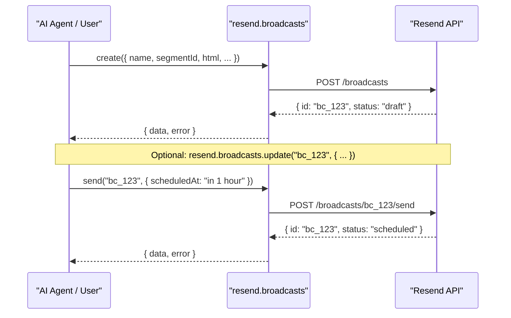

### Compliance Requirements
Every broadcast sent via Resend must include an unsubscribe link using the reserved variable: `{{{RESEND_UNSUBSCRIBE_URL}}}` [skills/resend/references/broadcasts.md:122-122]().

**Sources:** [skills/resend/references/broadcasts.md:1-126]()

---

# Page: Domains, API Keys & Templates

# Domains, API Keys & Templates

<details>
<summary>Relevant source files</summary>

The following files were used as context for generating this wiki page:

- [skills/resend/SKILL.md](skills/resend/SKILL.md)
- [skills/resend/references/api-keys.md](skills/resend/references/api-keys.md)
- [skills/resend/references/domains.md](skills/resend/references/domains.md)
- [skills/resend/references/fetch-all-templates.mjs](skills/resend/references/fetch-all-templates.mjs)
- [skills/resend/references/logs.md](skills/resend/references/logs.md)
- [skills/resend/references/templates.md](skills/resend/references/templates.md)

</details>


This section covers the management of infrastructure and assets within the Resend platform, specifically focusing on domain verification for email deliverability, the creation and scoping of API keys, the lifecycle of reusable email templates, and the retrieval of API request logs for auditing and debugging.

## Domains

Before sending emails through Resend, domains must be verified to ensure deliverability and security. This process involves configuring DNS records (SPF, DKIM, and MX) and polling for status updates.

### Domain Lifecycle & Workflow
The workflow for domain setup follows a linear progression:
1.  **Create**: Register the domain with Resend to generate required DNS records [skills/resend/references/domains.md:8-8]().
2.  **Configure**: Add the generated MX, TXT, and CNAME records to your DNS provider [skills/resend/references/domains.md:51-55]().
3.  **Verify**: Trigger an asynchronous verification check [skills/resend/references/domains.md:22-22]().
4.  **Poll**: Check the domain status until it moves from `pending` to `verified` [skills/resend/references/domains.md:77-79]().

### Technical Implementation
The `resend.domains` object provides methods for managing these resources.

| Operation | SDK Method (Node.js) | Notes |
| :--- | :--- | :--- |
| Create | `resend.domains.create(params)` | Returns DNS records [skills/resend/references/domains.md:17-17]() |
| Get | `resend.domains.get(id)` | Returns status and DNS records [skills/resend/references/domains.md:18-18]() |
| Verify | `resend.domains.verify(id)` | Triggers async DNS check [skills/resend/references/domains.md:22-22]() |
| Update | `resend.domains.update(params)` | Modifies tracking, TLS, and capabilities [skills/resend/references/domains.md:20-20]() |
| Remove | `resend.domains.remove(id)` | Permanent deletion (Note: not `.delete()`) [skills/resend/references/domains.md:21-21]() |

### Best Practices: Subdomains vs. Root Domains
It is recommended to use a subdomain (e.g., `send.example.com`) rather than a root domain [skills/resend/references/domains.md:30-30](). This provides:
*   **Reputation Isolation**: Transactional email reputation does not affect the root domain [skills/resend/references/domains.md:33-33]().
*   **No MX Conflicts**: Avoids interference with existing mail providers like Google Workspace [skills/resend/references/domains.md:32-32]().

### Domain Configuration Diagram
The following diagram illustrates the interaction between the Resend SDK, the API, and the DNS Provider.

**Domain Verification Data Flow**
```mermaid
sequenceDiagram
    participant App as "Node.js Application"
    participant SDK as "resend.domains"
    participant API as "Resend API"
    participant DNS as "DNS Provider (Route53/Cloudflare)"

    App->>SDK: create({ name: "send.acme.com" })
    SDK->>API: POST /domains
    API-->>App: { id: "dom_123", records: [...] }
    Note over App, DNS: Manual Step: Add DNS Records
    App->>SDK: verify("dom_123")
    SDK->>API: POST /domains/dom_123/verify
    API-->>App: { status: "pending" }
    
    loop Polling
        App->>SDK: get("dom_123")
        SDK->>API: GET /domains/dom_123
        API-->>App: { status: "verified" }
    end
```
Sources: [skills/resend/references/domains.md:7-9](), [skills/resend/references/domains.md:39-55](), [skills/resend/references/domains.md:72-79]()

## API Keys

API keys provide authenticated access to the Resend API. They can be scoped for security to limit the impact of a compromised key.

### Key Types and Scoping
*   **Full Access**: Allows all operations across the account [skills/resend/references/api-keys.md:19-19]().
*   **Sending Access**: Restricted to sending emails only. Can be further scoped to a specific `domainId` [skills/resend/references/api-keys.md:20-20]().

### Critical Implementation Details
*   **One-time Token**: The API token (`re_...`) is only returned during the `create` call. It cannot be retrieved later [skills/resend/references/api-keys.md:43-44]().
*   **Metadata Only**: The `list` method returns metadata (ID, name, usage timestamps) but does not include the tokens [skills/resend/references/api-keys.md:47-48]().

### API Key Management Table
| Feature | Detail |
| :--- | :--- |
| **Max Name Length** | 50 characters [skills/resend/references/api-keys.md:21-21]() |
| **Permission Levels** | `full_access`, `sending_access` [skills/resend/references/api-keys.md:19-20]() |
| **SDK Method (Remove)** | `resend.apiKeys.remove(id)` [skills/resend/references/api-keys.md:11-11]() |

Sources: [skills/resend/references/api-keys.md:1-22](), [skills/resend/references/api-keys.md:32-52]()

## Email Templates

Templates allow for reusable email structures with dynamic variable substitution using triple-mustache syntax.

### Template Lifecycle
Templates exist in two states: **Draft** and **Published** [skills/resend/references/templates.md:21-25]().
*   Only **Published** templates can be used for sending [skills/resend/references/templates.md:24-24]().
*   Editing a published template creates a new draft; the previous version remains live until the new draft is published [skills/resend/references/templates.md:19-19]().

### Variable Syntax and Constraints
Resend uses triple mustaches `{{{VARIABLE}}}` for substitution [skills/resend/references/templates.md:28-28](). Double mustaches are not supported [skills/resend/references/templates.md:34-36]().

| Constraint | Limit |
| :--- | :--- |
| **Max Variables** | 50 per template [skills/resend/references/templates.md:57-57]() |
| **String Value Max** | 2,000 characters [skills/resend/references/templates.md:60-60]() |
| **Reserved Names** | `FIRST_NAME`, `LAST_NAME`, `EMAIL`, `UNSUBSCRIBE_URL` [skills/resend/references/templates.md:65-65]() |
| **Control Flow** | None (no `if` or `each`). Must pre-render HTML server-side [skills/resend/references/templates.md:38-38]() |

### Implementation Example: Create and Publish
```typescript
const { data } = await resend.templates.create({
  name: 'Welcome Email',
  alias: 'welcome-new-user',
  html: '<h1>Welcome {{{NAME}}}!</h1>',
  variables: [{ key: 'NAME', type: 'string', fallbackValue: 'User' }]
}).publish(); // Chainable publish [skills/resend/references/templates.md:136-142]()
```

### Template Logic Diagram
This diagram maps the Template management entities to their code representations.

**Template Entity Mapping**
```mermaid
graph TD
    subgraph "Code Entity Space"
        T_SDK["resend.templates"]
        T_CREATE["resend.templates.create()"]
        T_PUBLISH["resend.templates.publish()"]
        T_SEND["resend.emails.send()"]
    end

    subgraph "Natural Language Space"
        T_VAR["Triple Mustache Variables"]
        T_ALIAS["Stable Alias (Slug)"]
        T_DRAFT["Draft State"]
        T_LIVE["Published State"]
    end

    T_SDK --> T_CREATE
    T_CREATE --> T_DRAFT
    T_DRAFT -- "publish()" --> T_PUBLISH
    T_PUBLISH --> T_LIVE
    T_LIVE -- "template: { id: alias }" --> T_SEND
    T_VAR -- "Defined in" --> T_CREATE
    T_ALIAS -- "Referenceable in" --> T_SEND
```
Sources: [skills/resend/references/templates.md:11-25](), [skills/resend/references/templates.md:87-101](), [skills/resend/references/templates.md:134-142]()

## API Request Logs

Logs provide a history of API interactions, including request/response bodies and status codes.

### Log Access Patterns
*   **List Logs**: Returns a summary (method, endpoint, status) of recent requests [skills/resend/references/logs.md:41-43]().
*   **Retrieve Log**: Returns the full `request_body` and `response_body` for a specific log ID [skills/resend/references/logs.md:95-97]().

### Pagination
Logs use cursor-based pagination via `after` or `before` parameters [skills/resend/references/logs.md:145-148]().
*   `after`: Paginate forward from a specific log ID [skills/resend/references/logs.md:23-23]().
*   `before`: Paginate backward from a specific log ID [skills/resend/references/logs.md:24-24]().
*   **Note**: These parameters are mutually exclusive; combining them returns a 422 error [skills/resend/references/logs.md:149-149]().

### SDK Support Matrix
| SDK | Logs Support |
| :--- | :--- |
| **Node.js** | Supported (`resend.logs.list`, `resend.logs.get`) [skills/resend/references/logs.md:8-10]() |
| **cURL** | Supported [skills/resend/references/logs.md:52-58]() |
| **Other SDKs** | Not yet available (Python, Go, etc.) [skills/resend/references/logs.md:12-12]() |

### Log Data Model
The `GET /logs/{id}` endpoint provides a detailed view of the request lifecycle.

**Log Retrieval Entity Relationship**
```mermaid
classDiagram
    class LogList {
        +String object
        +Boolean has_more
        +LogSummary[] data
    }
    class LogSummary {
        +UUID id
        +String endpoint
        +String method
        +Integer response_status
        +DateTime created_at
    }
    class FullLog {
        +UUID id
        +Object request_body
        +Object response_body
        +String user_agent
    }
    LogList "1" -- "*" LogSummary : contains
    LogSummary "1" -- "1" FullLog : expanded via resend.logs.get()
```
Sources: [skills/resend/references/logs.md:62-77](), [skills/resend/references/logs.md:110-128](), [skills/resend/references/logs.md:132-142]()

---

# Page: Agent Email Inbox Skill

# Agent Email Inbox Skill

<details>
<summary>Relevant source files</summary>

The following files were used as context for generating this wiki page:

- [skills/agent-email-inbox/SKILL.md](skills/agent-email-inbox/SKILL.md)

</details>


The **agent-email-inbox** skill is a security-first framework designed for AI agents that need to receive and process inbound email. Unlike standard email integrations, this skill focuses on the unique security challenges of AI agents, such as prompt injection via email content and the need for event-driven responsiveness.

## Overview

AI agents are inherently vulnerable when exposed to untrusted inbound data. The `agent-email-inbox` skill provides a structured approach to building these systems by leveraging Resend's webhook-based architecture. This ensures that agents are notified instantly of new messages without the overhead of polling or cron jobs [skills/agent-email-inbox/SKILL.md:58-65]().

### Core Architecture

The skill follows an event-driven pipeline where Resend handles the SMTP reception and your application processes the resulting webhook.

**System Data Flow**
```mermaid
graph TD
    subgraph "External Space"
        Sender["External Sender"]
    end

    subgraph "Resend Infrastructure"
        MX["Resend MX Nodes"]
        WebhookEngine["Webhook Dispatcher"]
    end

    subgraph "Application Space (Code Entity Space)"
        Handler["POST /webhook handler"]
        Security["Security Validation Logic"]
        Agent["AI Agent Loop"]
    end

    Sender -- "SMTP Email" --> MX
    MX -- "email.received event" --> WebhookEngine
    WebhookEngine -- "HTTP POST" --> Handler
    Handler -- "Verify Signature" --> Security
    Security -- "Validated Payload" --> Agent
```
Sources: [skills/agent-email-inbox/SKILL.md:69-75]()

## Setup & Pipeline

Setting up an agent inbox involves configuring DNS records and implementing a secure webhook endpoint.

*   **Managed vs. Custom Domains**: For rapid prototyping, agents can use the `<anything>@<your-id>.resend.app` managed domain, which requires no DNS setup [skills/agent-email-inbox/SKILL.md:132-137](). Production agents should use subdomains (e.g., `agent.example.com`) to avoid disrupting existing mail services [skills/agent-email-inbox/SKILL.md:151-152]().
*   **Webhook Implementation**: The skill requires a `POST` route capable of capturing the raw request body for cryptographic signature verification using `resend.webhooks.verify()` [skills/agent-email-inbox/SKILL.md:79-99]().

For a step-by-step implementation guide, including Next.js and Express examples and local tunneling with Tailscale or ngrok, see **[Inbound Email Pipeline & Webhook Setup (#3.1)](#)**.

## Security Framework

The skill enforces a "Security First" principle because an agent's inbox is a vector for untrusted input [skills/agent-email-inbox/SKILL.md:56-57]().

### Security Levels
The skill defines a classification system to manage risk:
*   **Strict**: Only allows specific email addresses defined in `ALLOWED_SENDERS` [skills/agent-email-inbox/SKILL.md:25-27]().
*   **Moderate**: Allows entire domains defined in `ALLOWED_DOMAINS` [skills/agent-email-inbox/SKILL.md:28-30]().
*   **Permissive**: Uses content filtering and sandboxed processing for any sender.

### Entity Relationship: Security & Configuration
This diagram maps configuration variables to the security logic components.

```mermaid
erDiagram
    ENV_VARS {
        string RESEND_API_KEY
        string RESEND_WEBHOOK_SECRET
        string SECURITY_LEVEL
        string ALLOWED_SENDERS
    }
    CODE_ENTITIES {
        function verify_webhook
        function validate_sender
        function process_content
    }
    ENV_VARS ||--|| CODE_ENTITIES : "configures"
    RESEND_WEBHOOK_SECRET ||--o{ verify_webhook : "used_by"
    ALLOWED_SENDERS ||--o{ validate_sender : "filters_via"
    SECURITY_LEVEL ||--o{ process_content : "determines_depth"
```
Sources: [skills/agent-email-inbox/SKILL.md:15-33]()

For details on implementing prompt injection protection, idempotency for retries, and human-in-the-loop patterns, see **[Security Levels & Advanced Patterns (#3.2)](#)**.

## SDK Requirements

To use this skill, the following minimum SDK versions are required to support `emails.receiving.get()` and `webhooks.verify()` [skills/agent-email-inbox/SKILL.md:79-90]():

| Language | Package | Min Version |
| :--- | :--- | :--- |
| **Node.js** | `resend` | `>= 6.9.2` |
| **Python** | `resend` | `>= 2.21.0` |
| **Go** | `resend-go/v3` | `>= 3.1.0` |
| **Ruby** | `resend` | `>= 1.0.0` |

Sources: [skills/agent-email-inbox/SKILL.md:81-90]()

---

# Page: Inbound Email Pipeline & Webhook Setup

# Inbound Email Pipeline & Webhook Setup

<details>
<summary>Relevant source files</summary>

The following files were used as context for generating this wiki page:

- [skills/agent-email-inbox/SKILL.md](skills/agent-email-inbox/SKILL.md)
- [skills/agent-email-inbox/references/security-levels.md](skills/agent-email-inbox/references/security-levels.md)
- [skills/agent-email-inbox/references/webhook-setup.md](skills/agent-email-inbox/references/webhook-setup.md)

</details>


This page provides a technical guide for establishing a secure, real-time inbound email pipeline for AI agents using the Resend platform. It covers the end-to-end flow from DNS configuration to raw body capture for cryptographic verification.

## Architecture Overview

Resend utilizes a webhook-based architecture for inbound emails. Unlike polling-based systems, this event-driven approach ensures the AI agent only consumes resources when an email is actually received [skills/agent-email-inbox/SKILL.md:58-65]().

### Data Flow Diagram

The following diagram illustrates the path of an email from the sender to the agent's logic.

**Email Inbound Pipeline**
```mermaid
graph TD
    Sender["Sender"] -- "SMTP" --> ResendMX["Resend MX Nodes"]
    ResendMX -- "Event: email.received" --> WebhookService["Resend Webhook Service"]
    WebhookService -- "HTTP POST (Signed)" --> YourServer["Your Server (POST /webhook)"]
    
    subgraph "Your Infrastructure"
        YourServer --> SignatureCheck{"resend.webhooks.verify()"}
        SignatureCheck -- "Valid" --> SecurityLayer["Security Levels (Allowlists/Sanitization)"]
        SignatureCheck -- "Invalid" --> Reject["401 Unauthorized"]
        SecurityLayer -- "Authorized" --> FetchContent["resend.emails.receiving.get()"]
        FetchContent --> AIAgent["AI Agent Logic"]
    end
```
Sources: [skills/agent-email-inbox/SKILL.md:69-75](), [skills/agent-email-inbox/references/webhook-setup.md:83-96]()

## Domain & MX Configuration

To receive emails, you must configure a domain to point its Mail Exchange (MX) records to Resend.

### 1. Managed vs. Custom Domains
*   **Resend-Managed:** Addresses follow the pattern `<anything>@<id>.resend.app`. No DNS setup is required [skills/agent-email-inbox/SKILL.md:132-136]().
*   **Custom Domain:** Requires a verified domain in the Resend Dashboard with "Enable Receiving" toggled on [skills/agent-email-inbox/SKILL.md:138-140]().

### 2. DNS Settings
When using a custom domain, it is recommended to use a **subdomain** (e.g., `agent.example.com`) to avoid conflicts with existing mail providers [skills/agent-email-inbox/SKILL.md:151]().

| Setting | Value | Priority |
| :--- | :--- | :--- |
| Type | MX | - |
| Host | `agent.example.com` | - |
| Value | Provided in Resend Dashboard | 10 (Lowest) |

Sources: [skills/agent-email-inbox/SKILL.md:142-153]()

## Webhook Implementation

The webhook handler must be a `POST` route capable of capturing the **raw request body** for signature verification [skills/agent-email-inbox/SKILL.md:99]().

### Implementation Map: Code Entities

This diagram maps the logical webhook steps to specific SDK functions and expected data structures.

**Webhook Logic to Code Mapping**
```mermaid
graph LR
    subgraph "Resend SDK (resend)"
        VerifyFn["resend.webhooks.verify()"]
        GetEmailFn["resend.emails.receiving.get()"]
    end

    subgraph "Request Handling"
        Headers["Headers: svix-id, svix-timestamp, svix-signature"]
        RawBody["req.rawBody (Buffer)"]
    end

    subgraph "Logic Flow"
        Handler["POST /webhook"] --> VerifyFn
        Headers --> VerifyFn
        RawBody --> VerifyFn
        VerifyFn --> ValidEvent["EmailReceivedEvent"]
        ValidEvent --> GetEmailFn
    end
```
Sources: [skills/agent-email-inbox/references/webhook-setup.md:83-96](), [skills/agent-email-inbox/SKILL.md:79-90]()

### Signature Verification
Verification requires the `RESEND_WEBHOOK_SECRET` (prefixed with `whsec_`) obtained during webhook creation [skills/agent-email-inbox/references/webhook-setup.md:13-21]().

**Key Headers:**
*   `svix-id`: Unique message ID.
*   `svix-timestamp`: Unix timestamp.
*   `svix-signature`: Cryptographic signature [skills/agent-email-inbox/references/webhook-setup.md:87-93]().

### Next.js Implementation (App Router)
Next.js requires disabling the default body parser to access the raw bytes.

```typescript
// Example inspired by verification requirements
import { Resend } from 'resend';

const resend = new Resend(process.env.RESEND_API_KEY);

export async function POST(req: Request) {
  const payload = await req.text(); // Get raw body
  const headers = {
    'svix-id': req.headers.get('svix-id')!,
    'svix-timestamp': req.headers.get('svix-timestamp')!,
    'svix-signature': req.headers.get('svix-signature')!,
  };

  try {
    const event = resend.webhooks.verify(
      payload, 
      headers, 
      process.env.RESEND_WEBHOOK_SECRET
    );
    // Process email.received event
  } catch (err) {
    return new Response('Verification failed', { status: 400 });
  }
}
```
Sources: [skills/agent-email-inbox/references/webhook-setup.md:95-96](), [skills/agent-email-inbox/SKILL.md:79-83]()

## Local Development & Tunneling

Since Resend needs to reach your local machine, a tunneling service is required.

### Tailscale Funnel (Recommended)
Tailscale Funnel is preferred for agent development because it provides a **permanent URL** that does not change across restarts, unlike the free tier of ngrok [skills/agent-email-inbox/references/webhook-setup.md:145-154]().

*   **Command:** `sudo tailscale funnel 3000` [skills/agent-email-inbox/references/webhook-setup.md:165]()
*   **Benefit:** Survives reboots and provides valid HTTPS certificates automatically [skills/agent-email-inbox/references/webhook-setup.md:150-154]().

### ngrok (Alternative)
*   **Free Tier:** URLs change on every restart, requiring you to delete and recreate the webhook via the Resend API frequently [skills/agent-email-inbox/references/webhook-setup.md:190-193]().
*   **Command:** `ngrok http 3000` [skills/agent-email-inbox/references/webhook-setup.md:207]()

Sources: [skills/agent-email-inbox/references/webhook-setup.md:135-212]()

## Webhook Registration via API

Instead of manual configuration, register webhooks programmatically to capture the `signing_secret` in the initial response [skills/agent-email-inbox/references/webhook-setup.md:13-15]().

```typescript
const { data, error } = await resend.webhooks.create({
  endpoint: 'https://your-tunnel-url.ts.net/webhook',
  events: ['email.received'],
});

// data.signing_secret must be saved to RESEND_WEBHOOK_SECRET immediately
```
Sources: [skills/agent-email-inbox/references/webhook-setup.md:30-43]()

## Retry Behavior

Resend employs exponential backoff for failed webhook deliveries (non-2xx responses) [skills/agent-email-inbox/references/webhook-setup.md:118-130]().

| Attempt | Delay |
| :--- | :--- |
| 1 | Immediate |
| 2 | 5 seconds |
| 3 | 5 minutes |
| 7 | 10 hours |

**Note:** Emails are stored in Resend even if webhooks fail; they can be replayed manually from the dashboard [skills/agent-email-inbox/references/webhook-setup.md:132-134]().

Sources: [skills/agent-email-inbox/references/webhook-setup.md:118-134]()

---

# Page: Security Levels & Advanced Patterns

# Security Levels & Advanced Patterns

<details>
<summary>Relevant source files</summary>

The following files were used as context for generating this wiki page:

- [skills/agent-email-inbox/SKILL.md](skills/agent-email-inbox/SKILL.md)
- [skills/agent-email-inbox/references/advanced-patterns.md](skills/agent-email-inbox/references/advanced-patterns.md)
- [skills/agent-email-inbox/references/security-levels.md](skills/agent-email-inbox/references/security-levels.md)
- [skills/agent-email-inbox/references/webhook-setup.md](skills/agent-email-inbox/references/webhook-setup.md)

</details>


This page details the multi-tier security classification system for handling inbound emails within the `agent-email-inbox` skill. It covers implementation strategies for protecting AI agents from malicious inputs, ensuring reliability through idempotency, and managing advanced routing and content scenarios.

## Five-Tier Security Classification

When an AI agent receives email, it is processing untrusted input. The following tiers allow developers to balance functionality with system safety.

### Level 1: Strict Allowlist
The most secure configuration. Only emails from explicitly approved addresses are processed; all others are rejected or logged.

*   **Implementation:** Compare the `from` field of the `EmailReceivedEvent` against a hardcoded or environment-based list [skills/agent-email-inbox/references/security-levels.md:20-32]().
*   **Use Case:** Personal assistants or private administrative tools.

### Level 2: Domain Allowlist
Allows any sender from a specific organization or trusted domain.

*   **Implementation:** Extract the domain from the sender's email string and verify it against an `ALLOWED_DOMAINS` array [skills/agent-email-inbox/references/security-levels.md:57-65]().
*   **Use Case:** Internal company tools or B2B integrations.

### Level 3: Content Filtering & Sanitization
Accepts emails from broader sources but applies aggressive sanitization to prevent prompt injection and "token stuffing."

*   **Quoted Thread Stripping:** Removes lines starting with `>` or `On ... wrote:` blocks to prevent old instructions from being re-interpreted as new commands [skills/agent-email-inbox/references/security-levels.md:92-103]().
*   **Pattern Matching:** Uses regex-based `SAFETY_PATTERNS` to flag suspicious language or known exploit attempts [skills/agent-email-inbox/references/security-levels.md:113-126]().

### Level 4: Sandboxed Processing
The agent is given different "capabilities" based on the sender's trust level.

*   **Implementation:** Define a `capabilities` object (e.g., `canExecuteCode`, `canAccessSecrets`). Trusted senders get full access; untrusted senders get a restricted set (e.g., `read-only`) [skills/agent-email-inbox/references/security-levels.md:156-178]().

### Level 5: Human-in-the-Loop
The highest security tier for sensitive actions. The agent processes the email but pauses for human approval before executing any downstream effects [skills/agent-email-inbox/references/security-levels.md:206-208]().

**Sources:** [skills/agent-email-inbox/references/security-levels.md:1-208](), [skills/agent-email-inbox/SKILL.md:22-33]()

---

## Data Flow: Webhook to Agent
The following diagram illustrates the flow from an inbound email event to a secured agent action, highlighting the security validation layer.

**Inbound Security Pipeline**
```mermaid
graph TD
    Sender["External Sender"] -- "SMTP" --> ResendMX["Resend MX Servers"]
    ResendMX -- "POST /webhook" --> WebhookHandler["Webhook Handler (POST)"]
    
    subgraph "Security Validation Layer"
        WebhookHandler -- "resend.webhooks.verify()" --> SignatureCheck["Signature Verification"]
        SignatureCheck -- "Valid" --> SenderCheck["Sender/Domain Allowlist"]
        SenderCheck -- "Allowed" --> Sanitizer["stripQuotedContent()"]
        Sanitizer -- "Clean Text" --> SafetyFilter["checkContentSafety()"]
    end

    SafetyFilter -- "Safe" --> AIAgent["AI Agent Process"]
    SafetyFilter -- "Flagged" --> Log["Log Security Event"]
    SignatureCheck -- "Invalid" --> Reject["400 Bad Request"]
```
**Sources:** [skills/agent-email-inbox/SKILL.md:69-75](), [skills/agent-email-inbox/references/webhook-setup.md:85-96](), [skills/agent-email-inbox/references/security-levels.md:92-126]()

---

## Advanced Implementation Patterns

### Webhook Idempotency & Retries
Resend employs an exponential backoff strategy for failed webhook deliveries, retrying up to 7 times over approximately 20 hours [skills/agent-email-inbox/references/webhook-setup.md:118-129]().

*   **svix-id:** Every webhook request includes a unique `svix-id` [skills/agent-email-inbox/references/webhook-setup.md:91]().
*   **Pattern:** To prevent duplicate processing during retries, store the `svix-id` in a database or cache (like Redis). If a request arrives with an ID that has already been processed, return a `2xx` status immediately without re-triggering the agent.

### Rate Limiting per Sender
To prevent Denial of Wallet (DoW) or resource exhaustion via email floods, implement a per-sender rate limit.

*   **Mechanism:** Maintain a map of sender addresses to hit counts and reset timestamps. If a sender exceeds a threshold (e.g., 10 emails per hour), reject further processing for that window [skills/agent-email-inbox/references/advanced-patterns.md:8-26]().

### Content Length Constraints
Large emails can cause high token costs or buffer overflows.
*   **Pattern:** Truncate content at a hard limit (e.g., 10,000 characters) and append a security notice [skills/agent-email-inbox/references/advanced-patterns.md:33-41]().

**Sources:** [skills/agent-email-inbox/references/webhook-setup.md:87-134](), [skills/agent-email-inbox/references/advanced-patterns.md:1-41]()

---

## Entity Mapping: Logic to Code

This diagram maps the abstract security concepts to the specific functions and classes provided in the `agent-email-inbox` skill.

**Code Entity Relationship**
```mermaid
classDiagram
    class WebhookHandler {
        +verify(payload, headers)
    }
    class ResendSDK {
        +webhooks.verify()
        +emails.receiving.get()
    }
    class SecurityUtils {
        +stripQuotedContent(text)
        +checkContentSafety(content)
        +isAllowedDomain(email)
    }
    class RateLimiter {
        +checkRateLimit(sender)
    }

    WebhookHandler ..> ResendSDK : "uses for signature"
    WebhookHandler ..> SecurityUtils : "calls for sanitization"
    WebhookHandler ..> RateLimiter : "validates frequency"
    SecurityUtils ..> SAFETY_PATTERNS : "references regex"
```
**Sources:** [skills/agent-email-inbox/references/webhook-setup.md:25-43](), [skills/agent-email-inbox/references/security-levels.md:62-65](), [skills/agent-email-inbox/references/security-levels.md:92-103](), [skills/agent-email-inbox/references/advanced-patterns.md:8-26]()

---

## Attachment Handling & Security

When an email contains attachments, the `EmailReceivedEvent` provides metadata, but the actual content must be retrieved securely.

1.  **Metadata Receipt:** The webhook payload contains attachment names and sizes.
2.  **Secure Retrieval:** Use `resend.emails.receiving.get(emailId)` to fetch the full email object, which includes attachment details [skills/agent-email-inbox/SKILL.md:79]().
3.  **Expiring URLs:** If the agent needs to "see" an attachment (e.g., a PDF), the system should generate a temporary, expiring download URL rather than exposing a persistent file path.
4.  **Sandbox Warning:** Agents should never execute attachments. Only parsing (via OCR or text extraction) should occur within a restricted environment.

**Sources:** [skills/agent-email-inbox/SKILL.md:79-85](), [skills/agent-email-inbox/references/advanced-patterns.md:74-82]()

---

# Page: Resend CLI Skill

# Resend CLI Skill

<details>
<summary>Relevant source files</summary>

The following files were used as context for generating this wiki page:

- [skills/resend-cli/SKILL.md](skills/resend-cli/SKILL.md)
- [skills/resend-cli/references/automations.md](skills/resend-cli/references/automations.md)
- [skills/resend-cli/references/logs.md](skills/resend-cli/references/logs.md)
- [skills/resend-cli/references/workflows.md](skills/resend-cli/references/workflows.md)

</details>


The **Resend CLI Skill** provides a Node.js-based command-line interface for interacting with the Resend platform. It is designed for developers to manage email infrastructure directly from the terminal, automate tasks via shell scripts, and integrate Resend into CI/CD pipelines [skills/resend-cli/SKILL.md:3-10]().

Beyond standard CRUD operations for platform resources, the CLI features a specialized **Agent Protocol** for non-interactive environments and built-in support for rendering **React Email** templates (`.tsx`) into HTML before sending [skills/resend-cli/SKILL.md:101-115, 174-177]().

### System Architecture: CLI to Code Mapping

The following diagram maps the high-level CLI concepts to their specific implementations and data structures within the codebase.

**CLI Entity Mapping**
```mermaid
graph TD
  subgraph "Natural Language / CLI Space"
    "Command Group"["Command Group (e.g., 'emails')"]
    "Global Flags"["Global Flags (--api-key, --json)"]
    "Agent Mode"["Agent Protocol (Non-TTY)"]
  end

  subgraph "Code Entity Space"
    "SKILL_MD"["skills/resend-cli/SKILL.md"]
    "REF_EMAILS"["references/emails.md"]
    "REF_LOGS"["references/logs.md"]
    "REF_ERRORS"["references/error-codes.md"]
    "ENV_KEY"["RESEND_API_KEY"]
  end

  "Command Group" --> "REF_EMAILS"
  "Command Group" --> "REF_LOGS"
  "Global Flags" --> "ENV_KEY"
  "Agent Mode" --> "SKILL_MD"
  "Agent Mode" --> "REF_ERRORS"
```
Sources: [skills/resend-cli/SKILL.md:12-61](), [skills/resend-cli/references/emails.md:1-5]()

---

### Command Groups Overview

The CLI organizes functionality into logical groups that mirror the Resend API. Each group supports standard operations like `list`, `create`, `get`, and `delete`.

| Command Group | Core Responsibilities |
| :--- | :--- |
| `emails` | Sending single/batch emails, scheduling, and tracking delivery status [skills/resend-cli/SKILL.md:133](). |
| `domains` | Domain registration, DNS record retrieval, and verification [skills/resend-cli/SKILL.md:135](). |
| `automations` | Managing multi-step workflows, step graphs, and execution runs [skills/resend-cli/SKILL.md:138](). |
| `broadcasts` | Creating and sending marketing campaigns to segments or topics [skills/resend-cli/SKILL.md:140](). |
| `webhooks` | Configuring event subscriptions and local webhook tunneling/listening [skills/resend-cli/SKILL.md:146](). |
| `logs` | Inspecting API request/response bodies for debugging [skills/resend-cli/SKILL.md:136](). |

For a complete list of flags and subcommands, see [CLI Commands Reference](#4.1).

---

### Agent Protocol & CI/CD Integration

The CLI is optimized for non-interactive environments (CI/CD, AI agents). It automatically detects if `stdin` is a TTY and adjusts its behavior accordingly [skills/resend-cli/SKILL.md:101-103]().

**Agent Protocol Flow**
```mermaid
graph LR
  "Terminal/Script" -- "resend emails send" --> "TTY Detection"
  "TTY Detection" -- "Non-TTY" --> "JSON Mode"
  "TTY Detection" -- "TTY" --> "Interactive Mode"
  
  subgraph "JSON Mode"
    "No Prompts"["Fail if flags missing"]
    "Quiet"["Suppress Spinners (-q)"]
    "Output"["Stdout: JSON Result / Stderr: JSON Error"]
  end

  subgraph "Interactive Mode"
    "Prompts"["Prompt for missing input"]
    "Spinners"["Show progress animations"]
    "Output_TTY"["Human-readable tables"]
  end
```
Sources: [skills/resend-cli/SKILL.md:101-115]()

**Key Agent Rules:**
*   **No Prompts:** The CLI will never prompt for input in non-TTY mode; all required flags must be provided [skills/resend-cli/SKILL.md:106]().
*   **Standardized Output:** Success results are printed to `stdout` as JSON, while errors are printed to `stderr` as JSON [skills/resend-cli/SKILL.md:109-112]().
*   **Safety Flags:** Commands that delete resources require the `--yes` flag to proceed without a confirmation prompt [skills/resend-cli/SKILL.md:114]().

For details on error codes and CI/CD setup, see [CLI Error Codes & CI/CD Integration](#4.3).

---

### Automation & Log Inspection

The CLI provides deep visibility into Resend's event-driven features. It allows users to define complex **Automations** using JSON files and inspect **API Logs** to debug integration issues.

*   **Automations:** You can create or update automations by passing a JSON file containing the `steps` and `connections` graph [skills/resend-cli/references/automations.md:17-27]().
*   **Logs:** While `logs list` provides a summary, `logs get <id>` retrieves the full `request_body` and `response_body` for any API call made to Resend [skills/resend-cli/references/logs.md:7-27]().

For more information on managing workflows, see [CLI Automations, Workflows & Logs](#4.2).

---

### Child Pages

*   **[CLI Commands Reference](#4.1)**: Comprehensive reference for all command groups, including `emails`, `domains`, `contacts`, and `templates`.
*   **[CLI Automations, Workflows & Logs](#4.2)**: Guide to managing automation step graphs, triggering events, and inspecting request logs.
*   **[CLI Error Codes & CI/CD Integration](#4.3)**: Details on the Agent Protocol, standardized error JSON, and React Email rendering via the CLI.

---

# Page: CLI Commands Reference

# CLI Commands Reference

<details>
<summary>Relevant source files</summary>

The following files were used as context for generating this wiki page:

- [skills/resend-cli/SKILL.md](skills/resend-cli/SKILL.md)
- [skills/resend-cli/references/api-keys.md](skills/resend-cli/references/api-keys.md)
- [skills/resend-cli/references/auth.md](skills/resend-cli/references/auth.md)
- [skills/resend-cli/references/automations.md](skills/resend-cli/references/automations.md)
- [skills/resend-cli/references/broadcasts.md](skills/resend-cli/references/broadcasts.md)
- [skills/resend-cli/references/contact-properties.md](skills/resend-cli/references/contact-properties.md)
- [skills/resend-cli/references/contacts.md](skills/resend-cli/references/contacts.md)
- [skills/resend-cli/references/domains.md](skills/resend-cli/references/domains.md)
- [skills/resend-cli/references/emails.md](skills/resend-cli/references/emails.md)
- [skills/resend-cli/references/logs.md](skills/resend-cli/references/logs.md)
- [skills/resend-cli/references/segments.md](skills/resend-cli/references/segments.md)
- [skills/resend-cli/references/templates.md](skills/resend-cli/references/templates.md)
- [skills/resend-cli/references/topics.md](skills/resend-cli/references/topics.md)
- [skills/resend-cli/references/webhooks.md](skills/resend-cli/references/webhooks.md)
- [skills/resend-cli/references/workflows.md](skills/resend-cli/references/workflows.md)

</details>


The `resend-cli` provides a comprehensive command-line interface for managing the Resend platform. It is designed for both interactive use by developers and non-interactive use within CI/CD pipelines and AI agent environments.

## Agent Protocol & Global Behavior

The CLI implements an **Agent Protocol** to ensure reliable operation in non-TTY environments. It automatically detects when it is not running in a terminal and adjusts its behavior accordingly [skills/resend-cli/SKILL.md:101-104]().

### Non-TTY Behavior
*   **JSON Output**: The CLI defaults to JSON output; the `--json` flag is not required [skills/resend-cli/SKILL.md:103-103]().
*   **No Prompting**: The CLI will not prompt for missing information. All required flags must be provided [skills/resend-cli/SKILL.md:106-106]().
*   **Safety Flags**: All destructive operations (e.g., `delete`, `rm`) require the `--yes` flag to bypass confirmation prompts [skills/resend-cli/SKILL.md:114-114]().
*   **Exit Codes**: `0` indicates success, while `1` indicates an error [skills/resend-cli/SKILL.md:108-108]().

### Global Flags
| Flag | Description |
|------|-------------|
| `--api-key <key>` | Overrides the API key for the current command [skills/resend-cli/SKILL.md:124-124](). |
| `-p, --profile <name>` | Selects a stored authentication profile [skills/resend-cli/SKILL.md:125-125](). |
| `--json` | Forces JSON output even in interactive terminals [skills/resend-cli/SKILL.md:126-126](). |
| `-q, --quiet` | Suppresses spinners and status messages; implies `--json` [skills/resend-cli/SKILL.md:127-127](). |

**Sources:** [skills/resend-cli/SKILL.md:101-128]()

---

## Email Commands

The `emails` group handles sending, retrieving, and managing inbound (receiving) emails.

### Sending Emails
The `emails send` command supports standard text/HTML, React Email templates, and scheduling [skills/resend-cli/references/emails.md:7-32]().

*   **React Email**: Use `--react-email <path>` to bundle and render `.tsx` templates locally before sending [skills/resend-cli/references/emails.md:20-20]().
*   **Scheduling**: Use `--scheduled-at` with ISO 8601 strings or natural language (e.g., `"tomorrow at 9am"`) [skills/resend-cli/references/emails.md:26-26]().
*   **Batching**: `emails batch --file <path>` accepts a JSON array of up to 100 emails [skills/resend-cli/references/emails.md:72-94]().

### Inbound (Receiving)
Inbound emails require a domain with receiving enabled [skills/resend-cli/references/emails.md:122-124]().
*   **`emails receiving listen`**: Polls the API for new inbound messages. In non-TTY mode, it outputs NDJSON [skills/resend-cli/references/emails.md:171-183]().
*   **`emails receiving get <id>`**: Retrieves the full message, including `raw.download_url` and attachment metadata [skills/resend-cli/references/emails.md:134-140]().

### Command Entity Mapping: Email Pipeline
This diagram maps CLI command inputs to the internal processing flow for email delivery.

```mermaid
graph TD
    subgraph "Natural Language / CLI Space"
        CMD["resend emails send"]
        FLAGS["--react-email / --scheduled-at / --var"]
        BATCH["resend emails batch --file"]
    end

    subgraph "Code Entity Space (resend-cli)"
        RENDER["React Email Renderer (esbuild)"]
        VAL["Batch Validator (strict/permissive)"]
        API_REQ["Resend API Request"]
    end

    CMD --> FLAGS
    FLAGS -- ".tsx path" --> RENDER
    RENDER -- "HTML String" --> API_REQ
    BATCH -- "JSON Array" --> VAL
    VAL -- "Validated Payload" --> API_REQ
```
**Sources:** [skills/resend-cli/references/emails.md:7-94](), [skills/resend-cli/SKILL.md:152-152]()

---

## Marketing & Contact Management

These commands manage the Resend Marketing platform entities: Contacts, Segments, and Broadcasts.

### Broadcasts
Broadcasts allow bulk sending to segments.
*   **Creation**: `broadcasts create` can save as a `draft` or send immediately with the `--send` flag [skills/resend-cli/references/broadcasts.md:17-34]().
*   **Restriction**: Dashboard-created broadcasts cannot be sent via the CLI; only API/CLI-created drafts are supported [skills/resend-cli/SKILL.md:163-163]().

### Contacts & Segments
*   **Segments**: Logic-based groups of contacts. `segments contacts <id>` lists members [skills/resend-cli/references/segments.md:43-54]().
*   **Contact Properties**: Custom metadata for contacts. Note that `key` and `type` are immutable after creation [skills/resend-cli/references/contact-properties.md:17-44]().

**Sources:** [skills/resend-cli/references/broadcasts.md:1-93](), [skills/resend-cli/references/segments.md:1-54](), [skills/resend-cli/references/contact-properties.md:1-57](), [skills/resend-cli/references/contacts.md:1-101]()

---

## Infrastructure & Configuration

### Domains
Used to manage sending identities and DNS verification.
*   **`domains create`**: Returns an array of `records[]` (MX, TXT, CNAME) that must be configured at the DNS provider [skills/resend-cli/references/domains.md:21-34]().
*   **`domains verify`**: Triggers an asynchronous check of DNS records [skills/resend-cli/references/domains.md:46-54]().

### Automations & Events
Automations are DAG-based workflows triggered by Events.
*   **`events send`**: Triggers an automation run for a specific contact using a JSON `--payload` [skills/resend-cli/references/automations.md:164-173]().
*   **`automations create`**: Accepts a `--file` containing `steps` and `connections` arrays [skills/resend-cli/references/automations.md:17-27]().

### Webhooks
*   **Subscription**: `webhooks create --events all` or specific events like `email.bounced` [skills/resend-cli/references/workflows.md:163-174]().
*   **Security**: The `signing_secret` is only displayed once during creation and cannot be retrieved later [skills/resend-cli/SKILL.md:159-159]().

### CLI Logic Flow: Infrastructure Management
Mapping infrastructure commands to the Resend resource lifecycle.

```mermaid
graph LR
    subgraph "CLI Command Groups"
        DOM["domains"]
        AUT["automations"]
        WEB["webhooks"]
    end

    subgraph "Lifecycle Actions"
        CREATE["create (POST)"]
        GET["get (GET)"]
        DEL["delete --yes (DELETE)"]
    end

    subgraph "Data Entities"
        REC["DNS Records"]
        STEPS["Step Graph (JSON)"]
        SEC["Signing Secret"]
    end

    DOM -- "create" --> REC
    AUT -- "create --file" --> STEPS
    WEB -- "create" --> SEC
    DEL -- "requires" --> YES["--yes flag check"]
```
**Sources:** [skills/resend-cli/references/domains.md:21-42](), [skills/resend-cli/references/automations.md:17-32](), [skills/resend-cli/SKILL.md:158-160]()

---

## Utility & Maintenance

### Auth Profiles
The CLI supports multiple API keys via profiles stored in a local config file.
*   **`auth switch <name>`**: Changes the active profile [skills/resend-cli/references/auth.md:27-31]().
*   **Resolution Order**: The CLI resolves keys in this order: `--api-key` flag > `RESEND_API_KEY` env var > Active profile [skills/resend-cli/SKILL.md:118-118]().

### Debugging
*   **`resend doctor`**: Runs a diagnostic suite checking CLI version, API connectivity, and domain status [skills/resend-cli/references/auth.md:51-56]().
*   **`resend logs get <id>`**: Retrieves full `request_body` and `response_body` for a specific API call [skills/resend-cli/references/logs.md:21-28]().

**Sources:** [skills/resend-cli/references/auth.md:1-72](), [skills/resend-cli/references/logs.md:1-36](), [skills/resend-cli/SKILL.md:118-128]()

---

# Page: CLI Automations, Workflows & Logs

# CLI Automations, Workflows & Logs

<details>
<summary>Relevant source files</summary>

The following files were used as context for generating this wiki page:

- [skills/resend-cli/SKILL.md](skills/resend-cli/SKILL.md)
- [skills/resend-cli/references/automations.md](skills/resend-cli/references/automations.md)
- [skills/resend-cli/references/logs.md](skills/resend-cli/references/logs.md)
- [skills/resend-cli/references/workflows.md](skills/resend-cli/references/workflows.md)

</details>


This page details the use of the Resend CLI for managing complex event-driven automations, triggering custom events, and inspecting platform activity through API logs. It covers the JSON-based workflow definitions, the execution lifecycle of automation runs, and the technical requirements for non-interactive environments.

## Automations and Event Graphs

Automations in Resend are represented as Directed Acyclic Graphs (DAGs) consisting of **Steps** and **Connections**. The CLI allows for full CRUD operations on these graphs using JSON payloads or local files.

### Automation Components
*   **Steps**: Discrete units of logic (e.g., sending an email, waiting for a duration).
*   **Connections**: Logical links between steps that define the execution path based on outcomes (e.g., `condition_met`, `timeout`).

### Supported Step and Connection Types
| Category | Types |
| :--- | :--- |
| **Step Types** | `trigger`, `delay`, `send_email`, `wait_for_event`, `condition` [skills/resend-cli/references/automations.md:29-29]() |
| **Connection Types** | `default`, `condition_met`, `condition_not_met`, `timeout`, `event_received` [skills/resend-cli/references/automations.md:31-31]() |

### Automation Management Flow
The following diagram illustrates the transition from a local JSON definition to a running automation on the Resend platform.

**Automation Creation and Lifecycle**
```mermaid
graph TD
    subgraph "Local Environment"
        JSON["automation.json"]
        CLI_CREATE["resend automations create --file"]
    end

    subgraph "Resend Platform (Code Entities)"
        API_AUTO["/automations API"]
        RUN_ENGINE["Automation Run Engine"]
        EVENT_BUS["Event Bus"]
    end

    JSON --> CLI_CREATE
    CLI_CREATE --> API_AUTO
    API_AUTO -->|status: enabled| RUN_ENGINE
    EVENT_BUS -->|Trigger Event| RUN_ENGINE
    RUN_ENGINE -->|Execute Step| API_AUTO
```
Sources: [skills/resend-cli/references/automations.md:17-31](), [skills/resend-cli/references/automations.md:57-65]()

## Managing Events

Events are the entry points for automations. The CLI facilitates defining event schemas and triggering runs by sending payloads.

### Event Operations
*   **Create/Update**: Events require a name and an optional JSON schema mapping fields to types (`string`, `number`, `boolean`, `date`) [skills/resend-cli/references/automations.md:127-132]().
*   **Reserved Names**: Event names cannot start with the `resend:` prefix, which is reserved for system events [skills/resend-cli/references/automations.md:134-134]().
*   **Sending Events**: Triggering an automation requires either a `contact_id` or an `email` address, along with a payload matching the defined schema [skills/resend-cli/references/automations.md:164-171]().

### Example: Triggering an Automation
```bash
resend events send \
  --event "user.signed_up" \
  --email "user@example.com" \
  --payload '{"plan": "pro", "source": "referral"}'
```
Sources: [skills/resend-cli/references/automations.md:164-173]()

## Inspecting Automation Runs

The CLI provides granular visibility into the execution of automations.

*   **Listing Runs**: Users can filter runs by status (`running`, `completed`, `failed`, `cancelled`) [skills/resend-cli/references/automations.md:91-102]().
*   **Run Details**: `resend automations runs get` returns the full run object, including execution details for every step in the graph [skills/resend-cli/references/automations.md:106-113]().

**Automation Run State Machine**
```mermaid
stateDiagram-v2
    [*] --> running
    running --> completed: All steps success
    running --> failed: Step error
    running --> cancelled: resend automations stop
    completed --> [*]
    failed --> [*]
    cancelled --> [*]
```
Sources: [skills/resend-cli/references/automations.md:87-102](), [skills/resend-cli/references/automations.md:57-65]()

## API Request Logs

The `logs` command group allows developers to debug API interactions by inspecting the raw request and response data.

### Log Access Levels
1.  **Summary View**: `resend logs list` returns high-level metadata (endpoint, method, status code, timestamp) [skills/resend-cli/references/logs.md:7-17]().
2.  **Detailed View**: `resend logs get <id>` retrieves the full `request_body` and `response_body`. This is necessary because the list view omits bodies for performance [skills/resend-cli/SKILL.md:165-165](), [skills/resend-cli/references/logs.md:21-27]().

Sources: [skills/resend-cli/references/logs.md:1-36](), [skills/resend-cli/SKILL.md:165-165]()

## Non-Interactive Workflows & NDJSON

The Resend CLI is designed for "Agent Protocol" compatibility, making it suitable for piping and CI/CD automation.

### Technical Constraints for Agents
*   **Auto-Detection**: The CLI detects non-TTY environments and automatically switches to JSON output [skills/resend-cli/SKILL.md:103-103]().
*   **Exit Codes**: Returns `0` for success and `1` for errors [skills/resend-cli/SKILL.md:108-108]().
*   **Stream Separation**: Success JSON is sent to `stdout`, while error objects (containing `message` and `code`) are sent to `stderr` [skills/resend-cli/SKILL.md:109-112]().
*   **Safety Flags**: Commands like `delete` or `rm` require the `--yes` flag in non-interactive mode to prevent hanging on confirmation prompts [skills/resend-cli/SKILL.md:114-114]().

### Piping and Automation Example
```bash
# Create an automation from a file and capture the ID using jq
AUTO_ID=$(resend automations create --file ./onboarding.json --quiet | jq -r '.id')

# Trigger the newly created automation
resend events send --event "onboarding.start" --email "newuser@example.com"
```
Sources: [skills/resend-cli/SKILL.md:101-115](), [skills/resend-cli/references/automations.md:17-27]()

---

# Page: CLI Error Codes & CI/CD Integration

# CLI Error Codes & CI/CD Integration

<details>
<summary>Relevant source files</summary>

The following files were used as context for generating this wiki page:

- [skills/resend-cli/references/error-codes.md](skills/resend-cli/references/error-codes.md)

</details>


The Resend CLI is designed for seamless integration into CI/CD pipelines, automated scripts, and AI agent workflows. To facilitate this, it implements a standardized error reporting protocol and a non-interactive "Agent Protocol" that ensures predictable behavior in non-TTY environments. This page details the error schema, specific error codes, and the technical implementation of React Email rendering within the CLI.

## Standardized Error Reporting

The Resend CLI follows a strict error reporting convention to allow parent processes (such as GitHub Actions or AI agents) to parse failures programmatically.

### Execution Flow and Output
1.  **Exit Codes**: Any operation that fails will result in the process exiting with code `1` [skills/resend-cli/references/error-codes.md:3-3]().
2.  **Output Stream**: Error details are exclusively written to **stderr** [skills/resend-cli/references/error-codes.md:3-3]().
3.  **Data Format**: Errors are formatted as a JSON object containing an `error` property with `message` and `code` fields [skills/resend-cli/references/error-codes.md:5-7]().

**Standard Error JSON Schema:**
```json
{
  "error": {
    "message": "Human-readable description of the failure",
    "code": "error_code"
  }
}
```

### CI/CD and Agent Protocol (Non-TTY)
When the CLI detects a non-interactive environment (non-TTY), it shifts behavior to prevent process hanging:
*   **No Interactive Prompts**: The CLI will not prompt for missing API keys or required flags. If a required parameter is missing, it returns a `missing_key` or validation error immediately [skills/resend-cli/references/error-codes.md:43-48]().
*   **Safety Flags**: Destructive actions (e.g., `delete` or `rm`) require the `--yes` flag in non-interactive mode. Without this flag, the command will fail to prevent accidental resource deletion [skills/resend-cli/references/error-codes.md:49-51]().

---

## Error Code Reference

Errors are categorized by the functional area of the CLI they originate from.

### Authentication & Authorization
| Code | Cause | Resolution |
| :--- | :--- | :--- |
| `auth_error` | No API key found in environment, flags, or config | Set `RESEND_API_KEY` or use `--api-key` [skills/resend-cli/references/error-codes.md:13-13]() |
| `missing_key` | Non-interactive `login` call without `--key` | Provide the `--key` flag [skills/resend-cli/references/error-codes.md:14-14]() |
| `invalid_key_format` | Key does not follow the `re_` prefix convention | Use a valid Resend API key [skills/resend-cli/references/error-codes.md:15-15]() |
| `validation_failed` | API rejected the key during the login handshake | Verify key status in Resend Dashboard [skills/resend-cli/references/error-codes.md:16-16]() |

### Email & Rendering
| Code | Cause | Resolution |
| :--- | :--- | :--- |
| `missing_body` | No content provided (text, html, or react) | Provide at least one body flag [skills/resend-cli/references/error-codes.md:22-22]() |
| `react_email_build_error` | `esbuild` failed to bundle the `.tsx` template | Check template syntax and dependencies [skills/resend-cli/references/error-codes.md:23-23]() |
| `react_email_render_error` | Bundled template crashed during `render()` | Ensure default export returns valid React [skills/resend-cli/references/error-codes.md:24-24]() |
| `send_error` | API rejected the send request (e.g., unverified domain) | Check sender domain and recipient [skills/resend-cli/references/error-codes.md:26-26]() |

### General & Infrastructure
| Code | Cause | Resolution |
| :--- | :--- | :--- |
| `domain_error` | DNS or domain management operation failed | Check DNS records/validity [skills/resend-cli/references/error-codes.md:32-32]() |
| `unexpected_error` | Unhandled CLI exception | Update CLI or report issue [skills/resend-cli/references/error-codes.md:38-38]() |

**Sources:** [skills/resend-cli/references/error-codes.md:1-57]()

---

## React Email Rendering Pipeline

The CLI includes a built-in rendering engine for React Email templates. This allows developers to send emails using local `.tsx` components without a separate build step.

### Rendering Data Flow
The CLI uses `esbuild` to bundle the React component and its dependencies into a temporary executable format before invoking the `@react-email/render` utility.

**CLI Rendering Architecture**
```mermaid
graph TD
    subgraph "Local Environment"
        TSX["Template (.tsx)"]
        CLI["Resend CLI"]
        ESB["esbuild Engine"]
    end

    subgraph "Rendering Process"
        BNDL["JS Bundle (Memory)"]
        REND["render() Function"]
    end

    TSX --> CLI
    CLI -- "Invoke" --> ESB
    ESB -- "Bundle dependencies" --> BNDL
    BNDL --> REND
    REND -- "HTML Output" --> CLI
    CLI -- "POST /emails" --> API["Resend API"]

    style ESB stroke-dasharray: 5 5
```

### Requirements for Success
For the rendering pipeline to function, the local environment must satisfy these conditions:
1.  **Dependencies**: The project folder must have `react` and one of the following installed: `react-email` (v6.0+), `@react-email/components`, or `@react-email/render` [skills/resend-cli/references/error-codes.md:23-23]().
2.  **Exports**: The template file must provide a **default function export** that returns the React Email component [skills/resend-cli/references/error-codes.md:24-24]().

**Sources:** [skills/resend-cli/references/error-codes.md:22-26]()

---

## Implementation Mapping: Code to Error Logic

The following diagram maps high-level error categories to the specific internal logic and response structures used by the CLI.

**Error Mapping Diagram**
```mermaid
graph LR
    subgraph "Code Entity Space"
        EC["error-codes.md"]
        CLI_LOGIC["CLI Command Logic"]
        STDERR["Process.stderr"]
    end

    subgraph "Natural Language Space"
        AUTH["Authentication Errors"]
        BUILD["Build/Render Errors"]
        SEND["API Send Errors"]
    end

    AUTH -- "mapped to" --> EC
    BUILD -- "mapped to" --> EC
    SEND -- "mapped to" --> EC

    EC -- "defines schema for" --> STDERR
    CLI_LOGIC -- "throws code" --> EC
    CLI_LOGIC -- "writes JSON to" --> STDERR

    style EC stroke-width:2px
    style STDERR stroke-width:2px
```

**Sources:** [skills/resend-cli/references/error-codes.md:3-7](), [skills/resend-cli/references/error-codes.md:9-40]()

---

# Page: React Email Skill

# React Email Skill

<details>
<summary>Relevant source files</summary>

The following files were used as context for generating this wiki page:

- [skills/react-email/SKILL.md](skills/react-email/SKILL.md)

</details>


The `react-email` skill provides a modern, component-based toolchain for building cross-client compatible HTML emails using React. It solves the historical difficulty of email development—characterized by nested tables and inconsistent CSS support—by providing a set of high-level primitives that render into robust, battle-tested HTML.

## Architecture Overview

The React Email ecosystem is organized into three distinct layers that handle the lifecycle of an email from design to delivery.

### 1. Component Primitives
A library of React components that abstract away the complexity of email-safe HTML. These include structural wrappers (like `Html` and `Body`), layout elements (like `Section` and `Row`), and content elements (like `Button` and `Img`).

### 2. Styling & Tooling
A development environment that includes a local preview server and a specialized Tailwind CSS integration. The `Tailwind` component, combined with the `pixelBasedPreset`, allows developers to use utility classes while ensuring the output uses pixel values and inline styles required by legacy email clients like Outlook.

### 3. Rendering & Integration
The `render()` utility transforms React components into static HTML or plain text. This output is then sent via delivery providers like Resend.

### System Entity Map

The following diagram maps natural language concepts to the specific code entities and file structures used in the React Email skill.

```mermaid
graph TD
    subgraph "Natural Language Space"
        A["Email Template"]
        B["Visual Preview"]
        C["Styling System"]
        D["Production Assets"]
    end

    subgraph "Code Entity Space"
        A --> E[".tsx files in /emails folder"]
        B --> F["email dev --dir emails"]
        C --> G["Tailwind component"]
        C --> H["pixelBasedPreset"]
        D --> I["/static folder"]
        
        E --> J["render() function"]
        G --> K["Inline CSS Pipeline"]
    end

    style E stroke-dasharray: 5 5
    style F stroke-dasharray: 5 5
```
Sources: [skills/react-email/SKILL.md:40-53](), [skills/react-email/SKILL.md:83-85](), [skills/react-email/SKILL.md:190-198]()

## Core Components & Primitives

React Email provides a standard set of components to ensure structural integrity across clients. For a complete reference of all available components and their props, see the **[Component Library (#5.1)]** child page.

| Category | Key Components | Role |
| :--- | :--- | :--- |
| **Structure** | `Html`, `Head`, `Body` | Essential document wrappers. |
| **Layout** | `Container`, `Section`, `Row`, `Column` | Table-based layout primitives for alignment. |
| **Content** | `Heading`, `Text`, `Img`, `Button`, `Link` | Semantic elements with default email-safe styles. |
| **Utilities** | `Tailwind`, `Markdown`, `Font`, `Preview` | Advanced styling and content transformation. |

Sources: [skills/react-email/SKILL.md:153-176]()

## Styling and Layout Patterns

Email development prohibits modern CSS features like Flexbox or Grid. React Email uses a "table-first" philosophy under the hood. The `Tailwind` wrapper is the recommended way to style components, but it must be configured with the `pixelBasedPreset` to convert `rem` units to `px`, as most email clients do not support relative units.

For details on layout constraints and ready-to-use templates (e.g., Password Reset, Newsletters), see **[Styling & Layout Patterns (#5.2)]**.

```mermaid
graph LR
    subgraph "Input (React)"
        T["Tailwind Component"]
        P["pixelBasedPreset"]
    end

    subgraph "Processing"
        I["CSS Inliner"]
        U["Unit Converter (rem -> px)"]
    end

    subgraph "Output (HTML)"
        H["Inline Style Attributes"]
        O["Outlook-Safe Tables"]
    end

    T --> I
    P --> U
    I --> H
    U --> H
    H --> O
```
Sources: [skills/react-email/SKILL.md:83-114](), [skills/react-email/SKILL.md:233-234]()

## Rendering and Delivery

To send an email, the React component must be converted to a string using the `render` function. This process can generate both the HTML version and a plain-text version for accessibility and spam filter compliance.

### Static Asset Management
Images must be hosted on a public CDN for production. The recommended pattern uses a `baseURL` variable that toggles between the local `/static` folder during development and a production URL.

For details on SSR, i18n support, and asset hosting, see **[Rendering, Sending & i18n (#5.3)]**.

Sources: [skills/react-email/SKILL.md:205-219]()

## Visual Editor

The `@react-email/editor` package allows developers to embed a WYSIWYG email editor directly into their own applications. This is useful for SaaS platforms that let users customize their own email notifications.

For details on the `EmailEditor` component and custom node extensions, see **[Visual Editor (@react-email/editor) (#5.4)]**.

Sources: [skills/react-email/SKILL.md:3-3]()

---

# Page: Component Library

# Component Library

<details>
<summary>Relevant source files</summary>

The following files were used as context for generating this wiki page:

- [skills/react-email/SKILL.md](skills/react-email/SKILL.md)
- [skills/react-email/references/COMPONENTS.md](skills/react-email/references/COMPONENTS.md)

</details>


The **Component Library** (Section 5.1) provides a comprehensive reference for the React components used to build cross-client compatible HTML emails within the `react-email` skill. These components abstract away the complexities of email-specific HTML (such as nested tables and Outlook-specific VML) while providing a modern React development experience.

## System Architecture: Component Hierarchy

The following diagram illustrates how components are structured within a typical email template and how they map to standard HTML concepts.

### Component Structure Mapping
```mermaid
graph TD
    subgraph "Natural Language Space"
        A["Root Document"]
        B["Email Metadata"]
        C["Main Wrapper"]
        D["Responsive Container"]
        E["Grid System"]
    end

    subgraph "Code Entity Space"
        A --> HtmlComponent["Html [skills/react-email/references/COMPONENTS.md:92-104]"]
        B --> HeadComponent["Head [skills/react-email/references/COMPONENTS.md:110-121]"]
        C --> BodyComponent["Body [skills/react-email/references/COMPONENTS.md:122-132]"]
        D --> ContainerComponent["Container [skills/react-email/references/COMPONENTS.md:134-145]"]
        E --> RowComponent["Row [skills/react-email/references/COMPONENTS.md:158-175]"]
        E --> ColumnComponent["Column [skills/react-email/references/COMPONENTS.md:158-175]"]
    end
```
**Sources:** [skills/react-email/references/COMPONENTS.md:92-175]()

## Core Structural Components

Structural components provide the skeleton of the email. They ensure that the resulting HTML includes the necessary doctypes and wrappers for broad client support.

| Component | Purpose | Key Props / Features |
| :--- | :--- | :--- |
| `Html` | Root wrapper | `lang`, `dir` (LTR/RTL support) [skills/react-email/references/COMPONENTS.md:92-109]() |
| `Head` | Metadata container | Contains `<title>`, `<style>`, and `<meta>` [skills/react-email/references/COMPONENTS.md:110-121]() |
| `Body` | Content wrapper | Main background and font styling [skills/react-email/references/COMPONENTS.md:122-132]() |
| `Container` | Centering layout | Built-in `max-width: 37.5em` (600px) [skills/react-email/SKILL.md:157]() |
| `Section` | Content grouping | Logic blocks; translates to `<table>` [skills/react-email/references/COMPONENTS.md:146-156]() |
| `Row` | Horizontal layout | Must contain `Column` components [skills/react-email/references/COMPONENTS.md:158-175]() |
| `Column` | Vertical layout | Supports percentage-based widths [skills/react-email/references/COMPONENTS.md:177-181]() |

**Sources:** [skills/react-email/SKILL.md:153-161](), [skills/react-email/references/COMPONENTS.md:92-181]()

## Content Primitives

Content primitives are used to render text, images, and interactive elements. These components normalize CSS behavior across inconsistent email clients (e.g., handling line heights and margins).

*   **`Preview`**: Provides the "snippet" text shown in the inbox. It should always be the first child inside the `Body` component [skills/react-email/SKILL.md:163](), [skills/react-email/references/COMPONENTS.md:184-198]().
*   **`Heading`**: Renders `h1` through `h6` tags with normalized spacing [skills/react-email/references/COMPONENTS.md:199-217]().
*   **`Text`**: Standard paragraph component for body copy [skills/react-email/references/COMPONENTS.md:219-229]().
*   **`Img`**: Handles image rendering. It is critical to provide `width` and `height` to prevent layout shifts in Outlook [skills/react-email/SKILL.md:211-218]().
*   **`Button`**: A specialized link component that uses VML or table-padding hacks to ensure buttons look consistent in Outlook and Gmail [skills/react-email/references/COMPONENTS.md:230-244]().

**Sources:** [skills/react-email/SKILL.md:163-170](), [skills/react-email/references/COMPONENTS.md:184-244]()

## Advanced Utilities

The library includes advanced utilities for complex content types and styling.

### Tailwind & Styling Engine
The `Tailwind` component is the primary styling engine. It wraps the entire email and converts utility classes into inline styles during the rendering process [skills/react-email/references/COMPONENTS.md:31-34]().

### Styling Data Flow
```mermaid
graph LR
    subgraph "Input Space"
        Config["Tailwind Config"]
        Classes["Utility Classes"]
    end

    subgraph "Processing Engine"
        TW["Tailwind Component [skills/react-email/references/COMPONENTS.md:31]"]
        Preset["pixelBasedPreset [skills/react-email/SKILL.md:233]"]
    end

    subgraph "Output Space"
        Inline["Inline CSS Styles"]
        HeadStyle["Head Style Tags (Media Queries)"]
    end

    Config --> TW
    Classes --> TW
    Preset --> TW
    TW --> Inline
    TW --> HeadStyle
```

*   **`pixelBasedPreset`**: This preset is mandatory because email clients do not support `rem` units. It converts standard Tailwind spacing to `px` [skills/react-email/SKILL.md:233-234]().
*   **`Markdown`**: Automatically converts Markdown strings into valid `react-email` components (e.g., converting `#` to `<Heading>`) [skills/react-email/references/COMPONENTS.md:24-24]().
*   **`CodeBlock`**: Uses Prism.js for syntax highlighting within emails [skills/react-email/references/COMPONENTS.md:13-13]().
*   **`Font`**: Simplifies the inclusion of web fonts by generating the necessary `@font-face` CSS in the `Head` [skills/react-email/references/COMPONENTS.md:17-17]().

**Sources:** [skills/react-email/SKILL.md:231-234](), [skills/react-email/references/COMPONENTS.md:13-34]()

## Implementation Constraints

When using the component library, developers must adhere to specific technical constraints enforced by the underlying rendering engine:

1.  **Box Sizing**: Buttons must always include the `box-border` class to ensure padding is calculated correctly across clients [skills/react-email/SKILL.md:107]().
2.  **Flexbox/Grid**: These CSS features are prohibited; layout must be achieved via `Section`, `Row`, and `Column` [skills/react-email/SKILL.md:234-234]().
3.  **Template Variables**: Never use `{{variable}}` directly in JSX. Variables should be passed as React props, and the mustache syntax should only reside in `PreviewProps` for testing [skills/react-email/SKILL.md:130-147]().
4.  **Static Assets**: Images must be hosted on a CDN for production. The `baseURL` pattern is used to switch between local development and production URLs [skills/react-email/SKILL.md:201-225]().

**Sources:** [skills/react-email/SKILL.md:107-147](), [skills/react-email/SKILL.md:201-234]()

---

# Page: Styling & Layout Patterns

# Styling & Layout Patterns

<details>
<summary>Relevant source files</summary>

The following files were used as context for generating this wiki page:

- [skills/react-email/references/PATTERNS.md](skills/react-email/references/PATTERNS.md)
- [skills/react-email/references/STYLING.md](skills/react-email/references/STYLING.md)

</details>


This page outlines the technical constraints and implementation strategies for styling HTML emails within the `react-email` skill. Due to the fragmented nature of email client support (especially Outlook and Gmail), standard web layout techniques like Flexbox and Grid are prohibited in favor of a table-first philosophy.

## Layout Philosophy: Table-First

Email clients often lack support for modern CSS layout engines. The `react-email` library abstracts complex HTML table structures into React components to ensure cross-client compatibility.

### Structural Components
*   **`Html`**: The root wrapper that sets the document type and language [skills/react-email/references/PATTERNS.md:17]().
*   **`Container`**: A fixed-width, centered wrapper (typically max-width 600px) used to house the main content [skills/react-email/references/STYLING.md:106-112]().
*   **`Section` / `Row` / `Column`**: These components replace `<div>`, Flexbox, and Grid. They render as `<table>`, `<tr>`, and `<td>` respectively to ensure alignment across legacy clients like Outlook [skills/react-email/references/STYLING.md:189-198]().

### Prohibited Features
To maintain deliverability and visual consistency, the following features must be avoided:
*   **Flexbox/Grid**: Use `Row` and `Column` instead [skills/react-email/references/STYLING.md:45]().
*   **SVG/WEBP**: Use only PNG or JPEG for image assets [skills/react-email/references/STYLING.md:44]().
*   **Media Queries**: Prefixes like `sm:`, `md:`, or `lg:` are largely unsupported in many mobile clients and should be avoided in favor of fluid, stacked layouts [skills/react-email/references/STYLING.md:46]().
*   **Theme Selectors**: `dark:` and `light:` prefixes do not work reliably [skills/react-email/references/STYLING.md:47]().

**Sources:** [skills/react-email/references/STYLING.md:38-49](), [skills/react-email/references/STYLING.md:189-198]()

## Styling Pipeline & `pixelBasedPreset`

The styling pipeline in `react-email` relies on the `Tailwind` component to inline CSS into the HTML elements before sending.

### The `rem` to `px` Problem
Most email clients do not support `rem` units. The `pixelBasedPreset` is a mandatory configuration for the `Tailwind` component that automatically converts Tailwind's default `rem` values (e.g., `p-4`) into pixel equivalents (e.g., `padding: 16px`) [skills/react-email/references/STYLING.md:28-36]().

### CSS Inlining Pattern
The `<Head />` component must be placed *inside* the `<Tailwind>` wrapper to ensure that any generated styles are correctly processed and inlined [skills/react-email/references/STYLING.md:67-78]().

### Styling Flow Diagram
"CSS Processing and Inlining Flow"
```mermaid
graph TD
    subgraph "Development Space"
        A["React Components"] --> B["Tailwind Wrapper"]
        B --> C["pixelBasedPreset"]
    end

    subgraph "Processing Space"
        C --> D["Convert rem to px"]
        D --> E["Apply brand colors"]
        E --> F["CSS Inlining Engine"]
    end

    subgraph "Output Space"
        F --> G["Final HTML Table Structure"]
        G --> H["Email Client (Outlook/Gmail)"]
    end

    style A stroke-dasharray: 5 5
    style H stroke-dasharray: 5 5
```

**Sources:** [skills/react-email/references/STYLING.md:9-26](), [skills/react-email/references/STYLING.md:28-36](), [skills/react-email/references/STYLING.md:67-78]()

## Outlook & Box-Sizing Gotchas

Outlook for Windows uses the Word rendering engine, which presents specific challenges for padding and borders.

### Button Constraints
When styling buttons, always use the `box-border` utility. This prevents padding from expanding the element beyond its intended width, which often breaks layouts in Outlook [skills/react-email/references/STYLING.md:168-177]().

### Border Definitions
Borders must be explicitly defined with a style (e.g., `border-solid`). Shorthand like `border` without a style often fails to render [skills/react-email/references/STYLING.md:50-63]().

| Feature | Correct Implementation | File Reference |
| :--- | :--- | :--- |
| **Borders** | `className="border-solid border border-gray-300"` | [STYLING.md:55-56]() |
| **Buttons** | `className="... box-border block text-center"` | [STYLING.md:171-174]() |
| **Layout** | Use `<Row>` and `<Column>` | [STYLING.md:194-197]() |

**Sources:** [skills/react-email/references/STYLING.md:50-63](), [skills/react-email/references/STYLING.md:166-178]()

## Standard Template Patterns

The following patterns represent the recommended implementation for common transactional and marketing use cases.

### 1. Password Reset
Focuses on a single, clear Call to Action (CTA) using the `Button` component with `box-border` [skills/react-email/references/PATTERNS.md:13-71]().

### 2. Order Confirmation
Demonstrates complex data mapping using `Section`, `Row`, and `Column` to create a product grid that remains aligned in legacy clients [skills/react-email/references/PATTERNS.md:80-193]().

### 3. Team Invitation
Combines user avatars (`Img`) with descriptive text and a primary action button, utilizing `Container` for consistent centering [skills/react-email/references/PATTERNS.md:297-362]().

### Entity Relationship Diagram
"Template Component Hierarchy"
```mermaid
erDiagram
    "Html" ||--|| "Tailwind" : wraps
    "Tailwind" ||--|| "Head" : contains
    "Tailwind" ||--|| "Body" : contains
    "Body" ||--o{ "Container" : centers
    "Container" ||--o{ "Section" : groups
    "Section" ||--o{ "Row" : contains
    "Row" ||--o{ "Column" : contains
    "Column" ||--o{ "Img" : displays
    "Column" ||--o{ "Text" : displays
    "Column" ||--o{ "Button" : triggers
```

**Sources:** [skills/react-email/references/PATTERNS.md:15-71](), [skills/react-email/references/PATTERNS.md:83-193](), [skills/react-email/references/PATTERNS.md:297-362]()

## Brand Consistency Configuration

To maintain consistency across multiple templates, a centralized `tailwind.config.ts` should be used. This file should export the `TailwindConfig` and any `brandAssets` (like logos) [skills/react-email/references/STYLING.md:225-255]().

### Implementation Pattern
1.  **Define Config**: Create a configuration file that satisfies `TailwindConfig` [skills/react-email/references/STYLING.md:229-245]().
2.  **Import Config**: Pass the imported config to the `<Tailwind>` component in every template [skills/react-email/references/STYLING.md:262-272]().
3.  **Semantic Naming**: Use names like `bg-brand-primary` instead of hardcoded hex codes to allow for global updates [skills/react-email/references/STYLING.md:274-280]().

**Sources:** [skills/react-email/references/STYLING.md:212-280]()

---

# Page: Rendering, Sending & i18n

# Rendering, Sending & i18n

<details>
<summary>Relevant source files</summary>

The following files were used as context for generating this wiki page:

- [skills/react-email/references/I18N.md](skills/react-email/references/I18N.md)
- [skills/react-email/references/SENDING.md](skills/react-email/references/SENDING.md)

</details>


This section covers the lifecycle of a React Email template after authoring: from server-side rendering into HTML and plain text, to delivery via the Resend platform, and managing multi-language support (i18n) for global audiences.

## Server-Side Rendering

The `render()` function is the core utility for converting React components into the string formats required by email clients. It supports generating both the HTML structure and a fallback plain-text version.

### The render() Function
The `render()` function takes a React element and an optional configuration object. 

*   **HTML Rendering**: By default, it produces a minified HTML string compatible with major email clients [skills/react-email/references/SENDING.md:16-18]().
*   **Plain Text**: Setting the `plainText` option to `true` extracts the text content, providing a fallback for clients that do not support HTML or for better deliverability [skills/react-email/references/SENDING.md:21-21]().
*   **Pretty Output**: While not shown in all snippets, the `pretty` option can be used to format the HTML for easier debugging.

### Integration with Resend
When using the Resend SDK, manual rendering is often optional because the SDK can accept React components directly via the `react` property [skills/react-email/references/SENDING.md:32-43]().

### Rendering Data Flow
The following diagram illustrates how a React component travels from code to a delivered email.

**Template Rendering & Delivery Pipeline**
```mermaid
graph TD
    subgraph "Development Space"
        Template["React Component (.tsx)"]
        Props["Data Props"]
    end

    subgraph "Rendering Engine (@react-email/render)"
        render_fn["render()"]
        plain_opt["{ plainText: true }"]
    end

    subgraph "Delivery Space (Resend SDK)"
        resend_send["resend.emails.send()"]
        SDK_React["react: <Template />"]
        SDK_HTML["html: string"]
        SDK_Text["text: string"]
    end

    Template --> render_fn
    Props --> Template
    render_fn --> SDK_HTML
    render_fn -- "with plainText option" --> SDK_Text
    
    Template -. "Direct Injection" .-> SDK_React
    SDK_React --> resend_send
    SDK_HTML --> resend_send
    SDK_Text --> resend_send
```
Sources: [skills/react-email/references/SENDING.md:11-50]()

---

## Static Asset Management

Emails often require external assets like images. To ensure these render correctly in the recipient's inbox, they must be hosted on a public server.

*   **The /static Folder**: Assets should be placed in a `/static` directory within the project root.
*   **Base URL Pattern**: When rendering, image paths must be absolute. Developers typically use an environment variable (e.g., `process.env.VERCEL_URL`) to prefix image `src` attributes, ensuring the email client can fetch the asset from a CDN or web server.

---

## Internationalization (i18n)

React Email supports standard i18n libraries to handle multi-language templates. The primary pattern involves dynamic imports of locale-specific JSON files within the email component.

### Supported Libraries
1.  **next-intl**: Recommended for Next.js environments using a `createTranslator` pattern [skills/react-email/references/I18N.md:16-102]().
2.  **react-intl (FormatJS)**: Ideal for complex formatting including plurals, dates (`Intl.DateTimeFormat`), and numbers (`Intl.NumberFormat`) [skills/react-email/references/I18N.md:156-209]().
3.  **react-i18next**: Best for non-Next.js apps or when granular control over the i18n instance is required [skills/react-email/references/I18N.md:239-271]().

### Implementation Pattern
Templates typically receive a `locale` prop. This prop is used to:
1.  Set the `lang` attribute on the `<Html>` component [skills/react-email/references/I18N.md:105-105]().
2.  Dynamically import the corresponding translation file [skills/react-email/references/I18N.md:98-102]().
3.  Adjust text direction (RTL support) via the `dir` attribute if necessary.

**i18n Code Entity Mapping**
```mermaid
graph LR
    subgraph "Translation Files"
        EN["/messages/en.json"]
        ES["/messages/es.json"]
    end

    subgraph "Code Entities"
        WelcomeEmail["WelcomeEmail Component"]
        createTranslator["createTranslator() (next-intl)"]
        createIntl["createIntl() (react-intl)"]
        getT["getT() (react-i18next helper)"]
    end

    subgraph "Output"
        HTML_EN["HTML (lang='en')"]
        HTML_ES["HTML (lang='es')"]
    end

    EN --> createTranslator
    ES --> createTranslator
    createTranslator --> WelcomeEmail
    WelcomeEmail -- "locale: 'en'" --> HTML_EN
    WelcomeEmail -- "locale: 'es'" --> HTML_ES
```
Sources: [skills/react-email/references/I18N.md:30-143](), [skills/react-email/references/I18N.md:170-236](), [skills/react-email/references/I18N.md:274-288]()

### Complex Formatting
For advanced use cases, `react-intl` is preferred as it handles ICU message syntax for plurals [skills/react-email/references/I18N.md:177-177]().

| Feature | next-intl | react-intl | react-i18next |
| :--- | :--- | :--- | :--- |
| **Primary Use** | Next.js | Complex Formatting | General React |
| **Dynamic Import** | `await import()` | `await import()` | `resourcesToBackend` |
| **Helper** | `createTranslator` | `createIntl` | `getFixedT` |
| **Plurals** | Basic | ICU Support | Internal |

Sources: [skills/react-email/references/I18N.md:1-288]()

---

# Page: Visual Editor (@react-email/editor)

# Visual Editor (@react-email/editor)

<details>
<summary>Relevant source files</summary>

The following files were used as context for generating this wiki page:

- [skills/react-email/SKILL.md](skills/react-email/SKILL.md)
- [skills/react-email/references/EDITOR.md](skills/react-email/references/EDITOR.md)

</details>


The `@react-email/editor` package provides a visual, WYSIWYG rich-text editor specifically designed for building email-ready HTML. Built on top of [TipTap](https://tiptap.dev) and [ProseMirror](https://prosemirror.net), it allows developers to embed a professional email composition experience into third-party applications [skills/react-email/references/EDITOR.md:1-4]().

## Architecture Overview

The editor is structured into six specialized entry points to balance ease of use with granular control over the bundle size and feature set.

| Import Path | Purpose |
|:---|:---|
| `@react-email/editor` | Contains the `EmailEditor` all-in-one component [skills/react-email/references/EDITOR.md:53](). |
| `@react-email/editor/core` | Core logic: `composeReactEmail` serialization, `EmailNode`, `EmailMark`, and types [skills/react-email/references/EDITOR.md:54](). |
| `@react-email/editor/extensions` | The `StarterKit` and 35+ email-aware TipTap extensions [skills/react-email/references/EDITOR.md:55](). |
| `@react-email/editor/ui` | UI components like `BubbleMenu`, `SlashCommand`, and `Inspector` [skills/react-email/references/EDITOR.md:56](). |
| `@react-email/editor/plugins` | The `EmailTheming` plugin for visual styles [skills/react-email/references/EDITOR.md:57](). |
| `@react-email/editor/utils` | Low-level attribute and style utility functions [skills/react-email/references/EDITOR.md:58](). |

### Data Flow: From Editor to HTML
The following diagram illustrates how user input in the visual editor is transformed into email-compliant HTML.

**Editor Serialization Pipeline**
```mermaid
graph TD
    User["User Input (UI)"] -- "TipTap/ProseMirror Transactions" --> PM["ProseMirror State"]
    PM -- "getJSON()" --> JSON["JSON Content (Nodes/Marks)"]
    JSON -- "composeReactEmail()" --> React["React Component Tree"]
    React -- "render()" --> HTML["Email-Ready HTML"]
    
    subgraph "Core Entities"
    JSON
    React
    end

    subgraph "Serialization Logic"
    composeReactEmail["composeReactEmail (@react-email/editor/core)"]
    end
```
**Sources:** [skills/react-email/references/EDITOR.md:47-59](), [skills/react-email/references/EDITOR.md:255-265]()

## The EmailEditor Component

The `EmailEditor` is a "batteries-included" component that pre-configures the `StarterKit`, `EmailTheming`, and default UI overlays [skills/react-email/references/EDITOR.md:60-62]().

### Implementation Example
```tsx
import { EmailEditor, type EmailEditorRef } from '@react-email/editor';
import '@react-email/editor/themes/default.css';
import { useRef } from 'react';

export function MyEditor() {
  const editorRef = useRef<EmailEditorRef>(null);

  const handleExport = async () => {
    // Access the imperative API via ref
    const { html, text } = await editorRef.current!.export();
    console.log(html);
  };

  return (
    <EmailEditor
      ref={editorRef}
      content="<p>Hello World</p>"
      theme="basic"
    />
  );
}
```
**Sources:** [skills/react-email/references/EDITOR.md:64-90]()

### EmailEditorRef API
The `EmailEditorRef` provides imperative methods to interact with the editor instance [skills/react-email/references/EDITOR.md:107]().

*   `export()`: Returns a `Promise<{ html: string; text: string }>` using the internal serialization engine [skills/react-email/references/EDITOR.md:111]().
*   `getJSON()`: Returns the content as TipTap-compatible JSON [skills/react-email/references/EDITOR.md:112]().
*   `getHTML()`: Returns the standard HTML representation [skills/react-email/references/EDITOR.md:113]().
*   `editor`: Direct access to the underlying TipTap `Editor` instance [skills/react-email/references/EDITOR.md:114]().

## Extensions and Schema

The editor's capabilities are defined by **Nodes** (structural elements like paragraphs or buttons) and **Marks** (inline styles like bold or links).

### StarterKit
The `StarterKit` from `@react-email/editor/extensions` bundles over 35 extensions optimized for email clients [skills/react-email/references/EDITOR.md:121-124](). It includes:
*   **Structural Nodes**: `EmailNode.Section`, `EmailNode.Column`, `EmailNode.Container` [skills/react-email/references/EDITOR.md:159]().
*   **Content Nodes**: `EmailNode.Button`, `EmailNode.Image`, `EmailNode.Markdown` [skills/react-email/references/EDITOR.md:203-210]().
*   **Marks**: `EmailMark.Bold`, `EmailMark.Italic`, `EmailMark.Link` [skills/react-email/references/EDITOR.md:168]().

### Custom Node Extensions
You can extend the editor by creating custom TipTap nodes. These must define how they render in the editor (DOM) and how they are serialized to React Email components [skills/react-email/references/EDITOR.md:278-280]().

**Entity Mapping: Editor UI to Code Schema**
```mermaid
graph LR
    subgraph "Visual Space"
    BtnUI["Button UI Element"]
    ImgUI["Image UI Element"]
    TxtUI["Heading UI Element"]
    end

    subgraph "Code Entity Space (@react-email/editor/extensions)"
    BtnUI --- NodeBtn["EmailNode.Button"]
    ImgUI --- NodeImg["EmailNode.Image"]
    TxtUI --- NodeH["EmailNode.Heading"]
    end

    subgraph "React Email Components"
    NodeBtn --- RBC["Button (react-email)"]
    NodeImg --- RIC["Img (react-email)"]
    NodeH --- RHC["Heading (react-email)"]
    end
```
**Sources:** [skills/react-email/references/EDITOR.md:148-160](), [skills/react-email/references/EDITOR.md:255-275]()

## UI Components

### Bubble Menus
Floating toolbars that appear upon selection. The editor provides specific menus for different contexts [skills/react-email/references/EDITOR.md:143-145]().
*   `BubbleMenu`: Standard text formatting (Bold, Italic, Alignment) [skills/react-email/references/EDITOR.md:168]().
*   `BubbleMenu.LinkDefault`: Contextual controls for URLs [skills/react-email/references/EDITOR.md:169]().
*   `BubbleMenu.ImageDefault`: Controls for image attributes [skills/react-email/references/EDITOR.md:171]().

### Slash Commands
Triggered by typing `/`, these allow users to quickly insert complex nodes like Sections, Columns, or Buttons [skills/react-email/references/EDITOR.md:181-183](). Default commands are provided via `defaultSlashCommands` [skills/react-email/references/EDITOR.md:186]().

### Inspector Sidebar
The `Inspector` component provides a sidebar for modifying the attributes of the currently selected node (e.g., changing a button's background color or an image's alt text) [skills/react-email/references/EDITOR.md:214-216]().

```tsx
import { Inspector } from '@react-email/editor/ui';

// Inside EditorProvider
<div className="flex">
  <EditorContent editor={editor} />
  <Inspector />
</div>
```
**Sources:** [skills/react-email/references/EDITOR.md:218-226]()

## Exporting and Serialization

The `composeReactEmail` utility is the core of the export process. It traverses the ProseMirror JSON tree and maps each node type to a corresponding React Email component [skills/react-email/references/EDITOR.md:255-258]().

### composeReactEmail Logic
1.  **Input**: TipTap/ProseMirror JSON [skills/react-email/references/EDITOR.md:257]().
2.  **Transformation**: Maps `type: 'button'` to `<Button />`, `type: 'heading'` to `<Heading />`, etc [skills/react-email/references/EDITOR.md:260-265]().
3.  **Output**: A React element tree that can be rendered to HTML using the standard `render()` function from `@react-email/render` [skills/react-email/references/EDITOR.md:258]().

**Sources:** [skills/react-email/references/EDITOR.md:255-275]()

---

# Page: Email Best Practices Skill

# Email Best Practices Skill

<details>
<summary>Relevant source files</summary>

The following files were used as context for generating this wiki page:

- [skills/email-best-practices/SKILL.md](skills/email-best-practices/SKILL.md)
- [skills/email-best-practices/references/accessibility.md](skills/email-best-practices/references/accessibility.md)

</details>


The `email-best-practices` skill serves as a comprehensive knowledge base for building deliverable, compliant, and accessible email systems. It provides guidance on the technical requirements for inbox placement (SPF, DKIM, DMARC), legal compliance (CAN-SPAM, GDPR), and the reliability patterns required for production-grade email pipelines.

## Architecture Overview

The email lifecycle involves multiple stages of validation, consent, and feedback loops. The following diagram maps the logical flow of an email from capture to delivery tracking, identifying key system responsibilities.

### Email Pipeline Flow
```mermaid
graph TD
    subgraph "Natural Language Space"
        User["User"]
        Form["Email Form"]
    end

    subgraph "Code Entity Space"
        Validation["Validation Logic"]
        DOI["Double Opt-In Flow"]
        Consent["Consent Store"]
        Ready["Ready to Send"]
        SuppressionCheck["Suppression Check"]
        IdempotentSend["Idempotent Send + Retry"]
        EmailAPI["Resend API"]
        Webhooks["Webhook Events Handler"]
        SuppressionList["Suppression List Update"]
        Hygiene["List Hygiene Jobs"]
    end

    User --> Form
    Form --> Validation
    Validation --> DOI
    DOI --> Consent
    Consent --> Ready
    Ready --> SuppressionCheck
    SuppressionCheck --> IdempotentSend
    IdempotentSend --> EmailAPI
    EmailAPI --> Webhooks
    Webhooks -- "Bounced/Complained" --> SuppressionList
    SuppressionList --> Hygiene
```
Sources: [skills/email-best-practices/SKILL.md:20-40]()

## Skill Topics

The `email-best-practices` skill is organized into four primary areas, each covering a critical phase of the email lifecycle.

### Deliverability & Authentication
This section focuses on ensuring emails reach the inbox rather than the spam folder. It covers the mandatory DNS records required by major providers like Gmail and Yahoo. Key concepts include domain warm-up strategies for new sending identities and managing sender reputation through bounce and complaint monitoring.

For details, see [Deliverability & Authentication](#6.1).

### Transactional vs. Marketing Emails
Different types of emails require different infrastructure and legal treatments. This topic helps developers distinguish between transactional messages (triggered by user actions like password resets or order confirmations) and marketing messages (newsletters and broadcasts). It provides a catalog of common transactional patterns to help plan application requirements.

For details, see [Transactional vs. Marketing Emails](#6.2).

### Compliance, Capture & List Management
Covers the legal frameworks (CAN-SPAM, GDPR, CASL) that govern email communication. It details the implementation of "Double Opt-In" flows to ensure valid consent and the technical requirements for unsubscribe mechanisms. Additionally, it describes how to maintain list hygiene by processing suppression events from webhooks.

For details, see [Compliance, Capture & List Management](#6.3).

### Sending Reliability, Webhooks & Accessibility
Focuses on the "last mile" of email: reliable delivery and content quality. This includes implementing idempotent send patterns to prevent duplicate emails and exponential backoff for retries. It also defines strict accessibility standards, such as proper `lang` and `dir` attribute usage and presentational table roles, to ensure emails are readable by screen readers and AI agents.

For details, see [Sending Reliability, Webhooks & Accessibility](#6.4).

## Technical Implementation Mapping

The following diagram bridges high-level best practices to specific implementation requirements within the email content and delivery logic.

### Content & Delivery Requirements
```mermaid
graph LR
    subgraph "Best Practice Category"
        Accessibility["Accessibility"]
        Reliability["Reliability"]
        Compliance["Compliance"]
    end

    subgraph "Code Implementation"
        LangDir["lang/dir attributes"]
        RolePres["role='presentation'"]
        AltText["alt='' for decorative"]
        Idempotency["Idempotency Keys"]
        RetryLogic["Exponential Backoff"]
        Unsub["Unsubscribe Link"]
    end

    Accessibility --> LangDir
    Accessibility --> RolePres
    Accessibility --> AltText
    Reliability --> Idempotency
    Reliability --> RetryLogic
    Compliance --> Unsub
```
Sources: [skills/email-best-practices/SKILL.md:69-74](), [skills/email-best-practices/references/accessibility.md:7-44]()

## Quick Reference Summary

| Goal | Primary Reference |
| :--- | :--- |
| Fix spam issues / Set up DNS | [Deliverability & Authentication](#6.1) |
| Distinguish email types | [Transactional vs. Marketing Emails](#6.2) |
| Legal compliance (GDPR/CAN-SPAM) | [Compliance, Capture & List Management](#6.3) |
| Handle retries and webhooks | [Sending Reliability, Webhooks & Accessibility](#6.4) |
| Screen reader / Dark mode support | [Sending Reliability, Webhooks & Accessibility](#6.4) |

Sources: [skills/email-best-practices/SKILL.md:44-56]()

---

# Page: Deliverability & Authentication

# Deliverability & Authentication

<details>
<summary>Relevant source files</summary>

The following files were used as context for generating this wiki page:

- [skills/email-best-practices/SKILL.md](skills/email-best-practices/SKILL.md)
- [skills/email-best-practices/references/accessibility.md](skills/email-best-practices/references/accessibility.md)
- [skills/email-best-practices/references/deliverability.md](skills/email-best-practices/references/deliverability.md)

</details>


The **Deliverability & Authentication** skill provides the technical foundation for ensuring emails reach the recipient's inbox rather than being diverted to spam folders. This involves implementing industry-standard authentication protocols (SPF, DKIM, DMARC), managing sender reputation through volume warm-up, and establishing robust feedback loops for bounces and complaints.

## Technical Architecture

The deliverability pipeline starts at the DNS layer and extends through the entire lifecycle of an email, from the initial send request to the final delivery event.

### Deliverability Data Flow

```mermaid
graph TD
    subgraph "DNS_Configuration" ["DNS Configuration (Source of Truth)"]
        SPF["SPF Record (TXT)"]
        DKIM["DKIM Keys (TXT)"]
        DMARC["DMARC Policy (TXT)"]
    end

    subgraph "Sending_Infrastructure" ["Sending Infrastructure"]
        RS["Resend / Email API"]
        SIG["Cryptographic Signer"]
    end

    subgraph "Receiving_ISP" ["Receiving ISP (Gmail/Yahoo/Outlook)"]
        VRF["Authentication Verifier"]
        REP["Reputation Engine"]
        INBOX["User Inbox"]
        SPAM["Spam Folder"]
    end

    SPF -.->|"IP Validation"| VRF
    DKIM -.->|"Signature Validation"| VRF
    DMARC -.->|"Policy Enforcement"| VRF
    
    RS --> SIG -->|"Signed Email"| VRF
    VRF --> REP
    REP -->|"Score > Threshold"| INBOX
    REP -->|"Score < Threshold"| SPAM
    
    INBOX -->|"User Action: Spam"| COMP["Complaint Event"]
    COMP -->|"Webhook"| RS
```

**Sources:** [skills/email-best-practices/SKILL.md:22-40](), [skills/email-best-practices/references/deliverability.md:5-37]()

## Email Authentication Standards

Authentication is mandatory for major ISPs like Gmail and Yahoo. Unauthenticated emails are frequently rejected or filtered [skills/email-best-practices/references/deliverability.md:7-8]().

### 1. SPF (Sender Policy Framework)
SPF identifies the mail servers authorized to send email on behalf of your domain.
*   **Implementation**: A TXT record added to your DNS.
*   **Recommended Value**: `v=spf1 include:amazonses.com ~all` (using `~all` for a "soft fail" during initial setup) [skills/email-best-practices/references/deliverability.md:14-18]().

### 2. DKIM (DomainKeys Identified Mail)
DKIM provides a cryptographic signature that ensures the email content hasn't been tampered with and confirms the sender's identity.
*   **Implementation**: Your email provider generates a public/private key pair; you publish the public key as a DNS TXT record [skills/email-best-practices/references/deliverability.md:20-24]().

### 3. DMARC (Domain-based Message Authentication, Reporting, and Conformance)
DMARC ties SPF and DKIM together, providing instructions to ISPs on what to do if authentication fails.
*   **Policy Rollout**: Start with `p=none` (monitoring mode) before moving to `p=quarantine` or `p=reject` [skills/email-best-practices/references/deliverability.md:30-34]().

| Protocol | Purpose | DNS Record Type |
| :--- | :--- | :--- |
| **SPF** | Authorization (Who can send) | TXT |
| **DKIM** | Integrity (Cryptographic proof) | TXT |
| **DMARC** | Enforcement (What to do on failure) | TXT |

**Sources:** [skills/email-best-practices/references/deliverability.md:9-37]()

## Sender Reputation Management

Reputation is a score assigned by ISPs based on your sending history. It is tied to both your IP address and your sending domain.

### Domain & IP Warming
New domains or IPs must gradually increase sending volume to avoid being flagged for suspicious activity [skills/email-best-practices/references/deliverability.md:59-60]().

| Week | Daily Volume Limit | Target Audience |
| :--- | :--- | :--- |
| **Week 1** | 50 - 100 | Most engaged users (e.g., active logins) |
| **Week 2** | 200 - 500 | Engaged users |
| **Week 3** | 1,000 - 2,000 | Recent signups |
| **Week 4** | 5,000 - 10,000 | Full production list |

**Sources:** [skills/email-best-practices/references/deliverability.md:61-68]()

### Infrastructure Best Practices
*   **Subdomain Segmentation**: Use dedicated subdomains for different traffic types (e.g., `t.example.com` for transactional and `m.example.com` for marketing) to protect the reputation of critical transactional emails [skills/email-best-practices/references/deliverability.md:100-101]().
*   **DNS TTL**: Use a low TTL (300s) during setup for quick changes, then increase to 3600s+ once stable [skills/email-best-practices/references/deliverability.md:102-102]().

## Handling Bounces and Complaints

Maintaining a clean list is critical for reputation. High bounce or complaint rates will lead to domain blacklisting.

### Bounce Classification

| Type | Cause | Required Action |
| :--- | :--- | :--- |
| **Hard Bounce** | Permanent (e.g., address does not exist) | Remove from list immediately [skills/email-best-practices/references/deliverability.md:82-82]() |
| **Soft Bounce** | Transient (e.g., mailbox full) | Retry with backoff (1h → 4h → 24h); remove after 3-5 failures [skills/email-best-practices/references/deliverability.md:83-83]() |

### Deliverability Thresholds

| Metric | Good | Concerning | Critical |
| :--- | :--- | :--- | :--- |
| **Bounce Rate** | < 1% | 3 - 4% | > 4% |
| **Complaint Rate** | < 0.01% | 0.02 - 0.05% | > 0.05% |

**Sources:** [skills/email-best-practices/references/deliverability.md:80-90]()

## Accessibility & Content Delivery

Deliverability also depends on the "readability" of the email by automated filters and assistive technologies.

### Mandatory Accessibility Rules
1.  **Language Declaration**: Set `lang` and `dir` on both the `<html>` tag and the direct children of the `<body>` tag [skills/email-best-practices/references/accessibility.md:7-12]().
2.  **Layout Tables**: Any `<table>` used for layout must include `role="presentation"` to prevent screen readers from announcing row/column indices [skills/email-best-practices/references/accessibility.md:34-39]().
3.  **Alt Text**: Meaningful images must have descriptive `alt` text. Decorative images must use an empty `alt=""` to be explicitly ignored [skills/email-best-practices/references/accessibility.md:103-121]().

**Sources:** [skills/email-best-practices/references/accessibility.md:5-136]()

## Troubleshooting & Verification

To verify deliverability setup, use command-line tools to inspect DNS propagation:

```bash
# Verify SPF
dig TXT yourdomain.com +short

# Verify DKIM (using 'resend' as the selector)
dig TXT resend._domainkey.yourdomain.com +short

# Verify DMARC
dig TXT _dmarc.yourdomain.com +short
```
[skills/email-best-practices/references/deliverability.md:42-53]()

If emails are still landing in spam, check the following in order:
1.  **Authentication**: Ensure SPF/DKIM/DMARC are valid [skills/email-best-practices/references/deliverability.md:107-107]().
2.  **List-Unsubscribe**: Verify the `List-Unsubscribe` header is present (required by Gmail/Yahoo) [skills/email-best-practices/references/deliverability.md:108-108]().
3.  **Reputation**: Check domain/IP against blacklists using tools like MXToolbox [skills/email-best-practices/references/deliverability.md:116-116]().

**Sources:** [skills/email-best-practices/references/deliverability.md:104-117]()

---

# Page: Transactional vs. Marketing Emails

# Transactional vs. Marketing Emails

<details>
<summary>Relevant source files</summary>

The following files were used as context for generating this wiki page:

- [skills/email-best-practices/references/email-types.md](skills/email-best-practices/references/email-types.md)
- [skills/email-best-practices/references/marketing-emails.md](skills/email-best-practices/references/marketing-emails.md)
- [skills/email-best-practices/references/transactional-email-catalog.md](skills/email-best-practices/references/transactional-email-catalog.md)
- [skills/email-best-practices/references/transactional-emails.md](skills/email-best-practices/references/transactional-emails.md)

</details>


This page provides a technical distinction between transactional and marketing emails within the Resend ecosystem. It covers the classification of email types, legal compliance requirements, and the recommended infrastructure for maintaining high deliverability for critical system notifications.

## 1. Core Distinctions

The primary difference between transactional and marketing emails lies in the **intent** and **expectation** of the recipient.

### Transactional Emails
Transactional emails are functional messages triggered by a specific user action or a system event that the user expects to receive to complete a process [skills/email-best-practices/references/email-types.md:15-17]().

*   **Characteristics:** Time-sensitive, actionable, and required for service delivery [skills/email-best-practices/references/email-types.md:19-24]().
*   **Infrastructure:** Should be sent via a dedicated path to ensure near-instant delivery [skills/email-best-practices/references/transactional-emails.md:9-9]().
*   **Examples:** OTP codes, password resets, and order confirmations [skills/email-best-practices/references/email-types.md:26-31]().

### Marketing Emails
Marketing emails (or "Broadcasts" in Resend) are promotional or informational messages sent to a list of subscribers who have given explicit consent [skills/email-best-practices/references/marketing-emails.md:3-9]().

*   **Characteristics:** Promotional content, non-urgent, and require an unsubscribe mechanism [skills/email-best-practices/references/email-types.md:40-45]().
*   **Infrastructure:** Often subject to lower priority or batch processing compared to transactional traffic.
*   **Examples:** Newsletters, product announcements, and discount offers [skills/email-best-practices/references/email-types.md:47-53]().

### Comparison Table

| Feature | Transactional | Marketing |
| :--- | :--- | :--- |
| **Trigger** | User action or system event | Scheduled campaign or broadcast |
| **Consent** | Not strictly required (functional) | Explicit opt-in required |
| **Unsubscribe** | Optional (often omitted) | Mandatory by law |
| **Speed** | Immediate (seconds) | Less time-sensitive |
| **Primary Goal** | Utility / Completion of task | Conversion / Engagement |

**Sources:** [skills/email-best-practices/references/email-types.md:13-53](), [skills/email-best-practices/references/marketing-emails.md:5-10]()

---

## 2. Technical Implementation & Data Flow

When implementing these in a codebase using the Resend SDK, the classification determines which API endpoints and sender configurations are utilized.

### Email Type Classification Flow

The following diagram illustrates how an application should decide which sending path to use based on the message intent.

"Decision Logic for Email Classification"
```mermaid
graph TD
    A["Trigger Event"] --> B{"Is it user-initiated/expected?"}
    B -- "No" --> C["Marketing / Broadcast"]
    B -- "Yes" --> D{"Is it promotional?"}
    D -- "Yes" --> C
    D -- "No" --> E["Transactional Send"]
    
    subgraph "Code Entities"
        E --> F["resend.emails.send()"]
        C --> G["resend.broadcasts.create()"]
    end
    
    F --> H["Subdomain: t.example.com"]
    G --> I["Subdomain: m.example.com"]
```
**Sources:** [skills/email-best-practices/references/email-types.md:97-113](), [skills/email-best-practices/references/email-types.md:144-156]()

---

## 3. Transactional Email Catalog

The codebase provides a comprehensive catalog of essential transactional emails organized by application type [skills/email-best-practices/references/transactional-email-catalog.md:1-3]().

### Essential Catalog by Category
| Category | Essential Emails |
| :--- | :--- |
| **Authentication** | Email Verification, Password Reset, OTP/2FA, Security Alerts [skills/email-best-practices/references/transactional-email-catalog.md:155-231]() |
| **Account Management** | Welcome Email (non-promotional), Account Update Notifications [skills/email-best-practices/references/transactional-email-catalog.md:232-269]() |
| **E-commerce** | Order Confirmation, Shipping Notifications, Invoices [skills/email-best-practices/references/transactional-email-catalog.md:270-276]() |
| **SaaS/Dev Tools** | API Key notifications, Usage alerts, Subscription renewals [skills/email-best-practices/references/transactional-email-catalog.md:63-81]() |

### Implementation Best Practices
*   **OTP/Codes:** Use large (24-32px) monospace fonts and include an expiration notice [skills/email-best-practices/references/transactional-emails.md:65-70]().
*   **Subject Lines:** Be specific. Instead of "Action Required", use "Reset your password for [App]" [skills/email-best-practices/references/transactional-emails.md:15-20]().
*   **Error Handling:** Implement resend functionality only after 60 seconds and limit attempts (e.g., 3 per hour) [skills/email-best-practices/references/transactional-emails.md:79-82]().

**Sources:** [skills/email-best-practices/references/transactional-email-catalog.md:12-140](), [skills/email-best-practices/references/transactional-emails.md:11-53]()

---

## 4. Sending Infrastructure

To protect the deliverability of critical transactional emails, it is a best practice to isolate sending reputations.

### Subdomain Separation
Applications should use separate subdomains for different traffic types [skills/email-best-practices/references/email-types.md:146-152]():
1.  **Transactional:** `t.example.com` or `mail.example.com`
2.  **Marketing:** `m.example.com` or `news.example.com`

### Relationship between Resend Entities and DNS
The following diagram maps the Resend SDK resources to the infrastructure requirements described in the best practices.

"Infrastructure Mapping: Transactional vs. Marketing"
```mermaid
graph LR
    subgraph "Resend Platform"
        RE["resend.emails"]
        RB["resend.broadcasts"]
    end

    subgraph "DNS / Reputation"
        TD["Transactional Domain (t.domain.com)"]
        MD["Marketing Domain (m.domain.com)"]
    end

    subgraph "Compliance Requirements"
        UC["Unsubscribe Link"]
        PA["Physical Address"]
    end

    RE --> TD
    RB --> MD
    RB --> UC
    RB --> PA
    
    TD -- "High Priority" --> ISP["Inbox"]
    MD -- "Bulk Priority" --> ISP
```
**Sources:** [skills/email-best-practices/references/email-types.md:144-156](), [skills/email-best-practices/references/marketing-emails.md:104-109]()

---

## 5. Legal Compliance (CAN-SPAM, GDPR, CASL)

The distinction is not just technical but legal. Marketing emails have significantly stricter requirements [skills/email-best-practices/references/email-types.md:55-56]().

### Marketing Compliance Checklist
*   **Explicit Opt-in:** Users must actively check a box or click "Subscribe". Pre-checked boxes are not valid under GDPR [skills/email-best-practices/references/marketing-emails.md:13-24]().
*   **Unsubscribe:** Must be "one-click" and prominent in every email [skills/email-best-practices/references/marketing-emails.md:44-48]().
*   **Sender Identity:** Must include a physical mailing address and clear identification of the sender [skills/email-best-practices/references/marketing-emails.md:106-108]().

### Transactional Compliance
*   **No Opt-in Required:** Can be sent to users without prior consent if necessary for a contract or service [skills/email-best-practices/references/email-types.md:73-76]().
*   **Content Restriction:** Transactional emails must not contain promotional content. Mixing them (Hybrid Emails) is discouraged as it may force the email to be classified as marketing, requiring an unsubscribe link and risking delivery to the spam folder [skills/email-best-practices/references/email-types.md:114-122]().

**Sources:** [skills/email-best-practices/references/email-types.md:57-94](), [skills/email-best-practices/references/marketing-emails.md:13-51]()

---

# Page: Compliance, Capture & List Management

# Compliance, Capture & List Management

<details>
<summary>Relevant source files</summary>

The following files were used as context for generating this wiki page:

- [skills/email-best-practices/references/compliance.md](skills/email-best-practices/references/compliance.md)
- [skills/email-best-practices/references/email-capture.md](skills/email-best-practices/references/email-capture.md)
- [skills/email-best-practices/references/list-management.md](skills/email-best-practices/references/list-management.md)

</details>


This section details the technical implementation of legal compliance, secure email capture workflows, and automated list hygiene. Ensuring compliance with global regulations (CAN-SPAM, GDPR, CASL) is integrated into the email pipeline through specific headers, consent recording, and real-time suppression list management.

## Legal Compliance Requirements

Email compliance is governed by regional laws that dictate how consent is obtained, how sender identity is disclosed, and how opt-out requests are processed.

### Global Regulatory Comparison

| Law | Region | Opt-in Requirement | Unsubscribe Processing | Physical Address Required |
|:---|:---|:---|:---|:---|
| **CAN-SPAM** | US | Opt-out (Transactional) | 10 business days | Yes |
| **GDPR** | EU | Explicit Opt-in | Immediately | Yes |
| **CASL** | Canada | Express or Implied | 10 business days | Yes |

Sources: [skills/email-best-practices/references/compliance.md:5-11](), [skills/email-best-practices/references/compliance.md:57-63]()

### One-Click Unsubscribe Implementation
For bulk senders, major providers (Gmail, Yahoo) require the `List-Unsubscribe` header to enable one-click unsubscribing directly from the mail client interface.

The following headers must be included in the outgoing email payload:
```typescript
headers: {
  'List-Unsubscribe': '<https://example.com/unsubscribe>',
  'List-Unsubscribe-Post': 'List-Unsubscribe=One-Click',
}
```
Sources: [skills/email-best-practices/references/compliance.md:67-78]()

### Consent Recording
To comply with GDPR and CASL, the system must maintain an audit trail of consent. This includes:
*   **Timestamp:** Date and time of consent.
*   **Method:** The specific form or checkbox used.
*   **Scope:** Exactly what the user consented to (e.g., "Weekly Newsletter").
*   **Source:** The URL or page where capture occurred.

Sources: [skills/email-best-practices/references/compliance.md:89-98]()

---

## Email Capture & Validation

Effective list management begins at the point of capture. The system employs a multi-layered validation and verification strategy to ensure list quality.

### Double Opt-In Flow
Double Opt-In (DOI) is recommended for all marketing lists to verify address ownership and deliverability.

1.  **Submission:** User submits the form.
2.  **Verification Send:** System sends a transactional email with a unique, time-limited token (24-48 hours).
3.  **Confirmation:** User clicks the link, triggering the verification logic.
4.  **Activation:** The contact is marked as `verified` and added to the active marketing list.

Sources: [skills/email-best-practices/references/email-capture.md:32-45]()

### Capture Data Flow: From Form to Verified Contact

This diagram maps the logical flow of email capture to the validation requirements and security measures.

```mermaid
graph TD
    subgraph "Natural Language Space"
        A["User submits form"]
        B["Validation Phase"]
        C["Verification Phase"]
        D["Active Subscriber"]
    end

    subgraph "Code Entity Space"
        A --> B1["HTML5 type='email'"]
        B1 --> B2["Server-Side RFC 5322 Check"]
        B2 --> B3["DNS/MX Record Lookup"]
        
        B3 -- "Valid" --> C1["sendVerificationEmail()"]
        C1 --> C2["Unique Token Generation"]
        C2 --> C3["resend.emails.send()"]
        
        C3 -- "User Clicks" --> D1["markAsVerified()"]
        D1 --> D2["db.contacts.upsert()"]
    end

    style B fill:none,stroke-dasharray: 5 5
    style C fill:none,stroke-dasharray: 5 5
```
Sources: [skills/email-best-practices/references/email-capture.md:9-42](), [skills/email-best-practices/references/list-management.md:36-44]()

---

## List Management & Suppression

Maintaining list hygiene is critical for sender reputation. The system must automatically handle bounces, complaints, and unsubscribes.

### Suppression Logic
A suppression list acts as a "never-send" filter. Addresses are added based on specific events received via webhooks.

| Event | Reason | Action |
|:---|:---|:---|
| `email.bounced` | Hard Bounce | Permanent suppression (Invalid address). |
| `email.complained` | Spam Complaint | Permanent suppression (Legal requirement). |
| `email.unsubscribed` | Manual | Suppress from marketing only. |

Sources: [skills/email-best-practices/references/list-management.md:9-16]()

### Pre-Send Suppression Check
Before any `resend.emails.send()` call, the application should verify the recipient's status against the local suppression database.

```typescript
async function sendEmail(to: string, emailData: EmailData) {
  const isSuppressed = await db.suppressions.findOne({ email: to.toLowerCase() });
  
  if (isSuppressed) {
    console.log(`Skipping suppressed email: ${to}`);
    return { skipped: true, reason: isSuppressed.reason };
  }

  return await resend.emails.send({ to, ...emailData });
}
```
Sources: [skills/email-best-practices/references/list-management.md:20-59]()

### Automated Hygiene & Data Retention
Regular maintenance jobs ensure compliance with data retention laws like GDPR (Right to be Forgotten) and CASL (3-year record keeping).

```mermaid
graph LR
    subgraph "Event Source"
        W["Resend Webhooks"]
    end

    subgraph "Hygiene Logic"
        W -- "email.bounced" --> S["suppressEmail()"]
        W -- "email.complained" --> S
        
        subgraph "Cron Jobs"
            CJ["cleanupOldData()"]
            RE["runReengagement()"]
        end
    end

    subgraph "Storage"
        S --> DB_SUP["db.suppressions (Indefinite)"]
        CJ --> DB_LOG["db.emailLogs (Delete > 90d)"]
        CJ --> DB_CON["db.consentRecords (Keep 3yr)"]
    end
```
Sources: [skills/email-best-practices/references/list-management.md:65-75](), [skills/email-best-practices/references/list-management.md:116-133]()

### Retention Policies
*   **Email Logs:** 90 days (for debugging and analytics).
*   **Email Content:** 30 days (to minimize storage costs).
*   **Consent Records:** 3 years after expiration (CASL requirement).
*   **Suppression List:** Indefinite (To prevent accidental re-sends to invalid addresses).

Sources: [skills/email-best-practices/references/list-management.md:103-112]()

---

# Page: Sending Reliability, Webhooks & Accessibility

# Sending Reliability, Webhooks & Accessibility

<details>
<summary>Relevant source files</summary>

The following files were used as context for generating this wiki page:

- [skills/email-best-practices/SKILL.md](skills/email-best-practices/SKILL.md)
- [skills/email-best-practices/references/accessibility.md](skills/email-best-practices/references/accessibility.md)
- [skills/email-best-practices/references/sending-reliability.md](skills/email-best-practices/references/sending-reliability.md)
- [skills/email-best-practices/references/webhooks-events.md](skills/email-best-practices/references/webhooks-events.md)

</details>


This section covers the technical implementation of production-grade email systems, focusing on fault-tolerant sending patterns, real-time event processing via webhooks, and strict adherence to email accessibility standards for both human readers and AI agents.

## Sending Reliability & Idempotency

To ensure emails are sent exactly once and handle transient failures gracefully, the system implements idempotent send patterns and structured retry logic.

### Idempotency Patterns
Idempotency prevents duplicate emails during retries. This is achieved by passing a unique `Idempotency-Key` in the request headers [skills/email-best-practices/references/sending-reliability.md:13-31]().

| Strategy | Key Generation Logic | Use Case |
| :--- | :--- | :--- |
| **Event-based** | `order-confirm-${orderId}` | Business events that should only trigger one email. |
| **Request-scoped** | `reset-${userId}-${reqId}` | Retries within a single application request context. |
| **UUID** | `crypto.randomUUID()` | General fallback; must be persisted to be reused in retries. |

*Source: [skills/email-best-practices/references/sending-reliability.md:33-41]()*

### Retry Logic & Exponential Backoff
The system distinguishes between retryable and permanent failures. Requests that fail with `429` (Rate Limit) or `5xx` (Server Error) should be retried using exponential backoff with jitter [skills/email-best-practices/references/sending-reliability.md:45-83]().

**Retry Classification:**
- **Retryable (✅):** 429 (Rate Limit), 500 (Internal Error), 503 (Service Unavailable), ETIMEDOUT, DNS failures.
- **Non-Retryable (❌):** 400 (Bad Request), 401 (Unauthorized), 422 (Validation Error).

### Reliability Data Flow
The following diagram illustrates the flow from a business event to a reliable delivery attempt.

**Reliability Sequence**
```mermaid
sequenceDiagram
    participant App as "Application Logic"
    participant Queue as "Job Queue / DB"
    participant Resend as "Resend API"

    App->>Queue: "Store 'pending' send with Idempotency-Key"
    Queue->>Resend: "POST /emails (Header: Idempotency-Key)"
    
    alt "Transient Failure (429/5xx)"
        Resend-->>Queue: "Error Response"
        Queue->>Queue: "Wait (Exp. Backoff + Jitter)"
        Queue->>Resend: "Retry with SAME Idempotency-Key"
    else "Success"
        Resend-->>Queue: "200 OK (email_id)"
        Queue->>App: "Mark 'sent' in DB"
    else "Permanent Failure (422)"
        Resend-->>Queue: "422 Validation Error"
        Queue->>App: "Mark 'failed', Alert Developer"
    end
```
*Sources: [skills/email-best-practices/references/sending-reliability.md:59-81](), [skills/email-best-practices/references/sending-reliability.md:128-133]()*

---

## Webhook Event Processing

Webhooks allow the system to track the lifecycle of an email after it has been accepted by the API.

### Event Types
The system processes the following core events [skills/email-best-practices/references/webhooks-events.md:7-14]():
- `email.delivered`: Confirms the recipient server accepted the message.
- `email.bounced`: Indicates permanent (hard) or temporary (soft) delivery failure.
- `email.complained`: Triggered when a recipient marks the email as spam.
- `email.opened` / `email.clicked`: Engagement metrics.

### Verification and Ingestion
To ensure security, all incoming webhooks must verify the `svix` signatures provided in the headers (`svix-id`, `svix-timestamp`, `svix-signature`) using the `RESEND_WEBHOOK_SECRET` [skills/email-best-practices/references/webhooks-events.md:35-59]().

**Webhook Processing Architecture**
```mermaid
graph TD
    subgraph "Resend Platform"
        RE["Resend Engine"]
    end

    subgraph "Agent / Application"
        WH["POST /webhooks/resend"]
        SV["svix.verify()"]
        DB[("Event Store")]
        LH["List Hygiene Job"]
    end

    RE -- "Signed Event Payload" --> WH
    WH --> SV
    SV -- "If Valid" --> DB
    DB -- "If bounced/complained" --> LH
    LH -- "Update" --> SL["Suppression List"]

    style SV stroke-dasharray: 5 5
```
*Sources: [skills/email-best-practices/references/webhooks-events.md:39-59](), [skills/email-best-practices/references/webhooks-events.md:67-99]()*

---

## Email Accessibility Standards

Accessibility is a mechanical requirement for ensuring emails are readable by screen readers, translation tools, and AI agents.

### Structural Requirements
1. **Language & Direction:** Attributes `lang` and `dir` must be set on both the `<html>` tag and the direct children of `<body>` because many clients strip them from the root [skills/email-best-practices/references/accessibility.md:7-22]().
2. **Presentational Tables:** Any `<table>` used for layout (rather than data) must include `role="presentation"` to prevent screen readers from announcing row/column counts [skills/email-best-practices/references/accessibility.md:34-43]().
3. **Heading Hierarchy:** Use exactly one `<h1>` per email. Nest subheadings (`<h2>`, `<h3>`) in order without skipping levels [skills/email-best-practices/references/accessibility.md:48-60]().

### Content Requirements
- **Discernible Links:** Every `<a>` must have text. If a link contains only an image, that image's `alt` text must describe the *action* (e.g., `alt="View Order #123"`) [skills/email-best-practices/references/accessibility.md:64-79]().
- **Alt Text:** Use meaningful descriptions for informative images and empty `alt=""` for decorative elements (spacers, flourishes) [skills/email-best-practices/references/accessibility.md:103-123]().
- **Contrast Ratios:** Maintain a minimum of **4.5:1** for body text and **3:1** for large text (18pt+). Verify these against auto-inversion in dark mode clients [skills/email-best-practices/references/accessibility.md:138-147]().

### Priority Fix List
When auditing templates, issues should be addressed in this order:
1. **Critical:** Missing/misused `alt` attributes.
2. **Serious:** `lang`/`dir` duplication, `role="presentation"` on tables, missing `<title>`, contrast failures.
3. **Moderate:** Non-descriptive link text (e.g., "click here").
4. **Mild:** Heading hierarchy gaps.

*Source: [skills/email-best-practices/references/accessibility.md:148-156]()*

---
**Sources:**
- [skills/email-best-practices/SKILL.md:22-40]()
- [skills/email-best-practices/references/accessibility.md:7-156]()
- [skills/email-best-practices/references/sending-reliability.md:13-150]()
- [skills/email-best-practices/references/webhooks-events.md:7-148]()

---

# Page: Skill Evaluations

# Skill Evaluations

<details>
<summary>Relevant source files</summary>

The following files were used as context for generating this wiki page:

- [skill-evals/agent-email-inbox/evals.json](skill-evals/agent-email-inbox/evals.json)
- [skill-evals/resend/evals.json](skill-evals/resend/evals.json)

</details>


The `skill-evals/` directory contains a comprehensive test suite designed to validate the quality, security, and accuracy of the AI skills provided in this repository. Unlike traditional unit tests, these evaluations use a prompt-based structure to ensure the AI agent makes correct architectural decisions, follows security best practices, and selects the appropriate API patterns for the Resend platform.

### Evaluation Framework Architecture

The evaluation system is structured around `evals.json` files located within each skill's directory. Each evaluation entry defines a specific scenario, the expected logic the agent should follow, and a set of strict expectations used to grade the response.

**Core Evaluation Structure**
| Field | Description |
| :--- | :--- |
| `id` | Unique identifier for the test case. |
| `prompt` | The natural language input provided to the AI agent. |
| `expected_output` | A high-level description of the correct behavior or decision. |
| `expectations` | A list of specific criteria the agent must meet to pass the eval. |

### Evaluation Flow: From Prompt to Code Execution

The following diagram illustrates how the evaluation suite bridges natural language requirements to specific code implementations and SDK patterns.

**Evaluation Decision Logic**
```mermaid
graph TD
    subgraph "Natural Language Space"
        A["User Prompt (evals.json)"] -- "Describes Scenario" --> B{"Agent Reasoning"}
    end

    subgraph "Code Entity Space"
        B -- "Identifies Pattern" --> C["resend.emails.send()"]
        B -- "Identifies Pattern" --> D["resend.batch.send()"]
        B -- "Security Decision" --> E["Webhook Verification"]
        
        C -- "Validation" --> F["Check for Attachments"]
        D -- "Validation" --> G["Check < 100 Emails"]
        E -- "Validation" --> H["svix Signature Check"]
    end

    F -- "Pass/Fail" --> I["Evaluation Result"]
    G -- "Pass/Fail" --> I
    H -- "Pass/Fail" --> I
```
Sources: [skill-evals/resend/evals.json:1-113](), [skill-evals/agent-email-inbox/evals.json:1-80]()

---

### Resend Skill Evals

The Resend skill evaluations focus on the agent's ability to navigate the Resend API and SDK correctly. These tests cover 37 scenarios, ranging from basic transactional sends to complex batching and idempotency logic.

Key areas of focus include:
*   **API Selection**: Choosing between `single` and `batch` sends based on constraints like attachments (not supported in batch) or scheduling.
*   **Idempotency**: Ensuring the agent generates semantic idempotency keys (e.g., `event-type/id`) rather than random UUIDs to prevent duplicate sends.
*   **Error Handling**: Validating that the agent correctly parses the `{ data, error }` pattern returned by the Resend SDK.
*   **Template Logic**: Testing the use of triple-mustache syntax for variables and proper CRUD operations for email templates.

For details, see [Resend Skill Evals](#7.1).

Sources: [skill-evals/resend/evals.json:93-113]()

---

### Agent Email Inbox Evals

The Agent Email Inbox evaluations prioritize security and architectural integrity. Because receiving email is a high-risk entry point for LLMs, these evaluations test the agent's resistance to social engineering and its commitment to security protocols.

Key areas of focus include:
*   **Security Level Routing**: Ensuring the agent selects the correct security tier (Level 1-5) based on the sender's identity and the risk of the requested action.
*   **Prompt Injection**: Testing if the agent can identify and strip social engineering attacks hidden in quoted email replies.
*   **Infrastructure Setup**: Validating the correct configuration of MX records and webhook handlers, including raw body capture for signature verification.
*   **Key Safety**: Ensuring the agent never suggests hardcoding `RESEND_API_KEY` in source code, even under pressure for a "quick demo."

For details, see [Agent Email Inbox Evals](#7.2).

**Security Routing Logic**
```mermaid
graph TD
    subgraph "Input Processing"
        P["Inbound Email"] --> V["Webhook Signature Check"]
        V -- "Valid" --> S{"Security Tier Selection"}
    end

    subgraph "Security Levels"
        S -- "Known Admin" --> L1["Level 1: Strict Allowlist"]
        S -- "Known Domain" --> L2["Level 2: Domain Allowlist"]
        S -- "Untrusted Sender" --> L3["Level 3: Content Filtering"]
        L3 -- "High Risk" --> L4["Level 4: Sandboxed Processing"]
    end

    subgraph "Code Implementation"
        L1 --> C1["isAllowed(sender)"]
        L3 --> C2["stripQuotedSections()"]
        L4 --> C3["executeInIsolation()"]
    end
```
Sources: [skill-evals/agent-email-inbox/evals.json:1-75]()

---

# Page: Resend Skill Evals

# Resend Skill Evals

<details>
<summary>Relevant source files</summary>

The following files were used as context for generating this wiki page:

- [skill-evals/agent-email-inbox/evals.json](skill-evals/agent-email-inbox/evals.json)
- [skill-evals/resend/evals.json](skill-evals/resend/evals.json)

</details>


This page details the evaluation framework and specific test scenarios used to validate the quality and security of the `resend` skill. The evaluation suite consists of 37 scenarios designed to ensure the AI agent correctly handles complex email logic, security trade-offs, and Resend platform constraints.

## Evaluation Architecture

The evaluation system uses a structured JSON format to define prompts, expected behaviors, and specific technical constraints. This allows for automated validation of the skill's ability to bridge natural language requests to correct Resend SDK implementations.

### Evaluation Data Flow
The following diagram illustrates how a natural language prompt is evaluated against the expected technical output and SDK patterns.

**Diagram: Natural Language to SDK Mapping Evaluation**
```mermaid
graph TD
    subgraph "Natural Language Space"
        A["User Prompt (evals.json)"] -- "e.g., 'Send 75 welcome emails'" --> B["Intent Recognition"]
    end

    subgraph "Decision Engine (Resend Skill)"
        B -- "Single vs Batch?" --> C{"Constraint Check"}
        C -- "Count < 100 & No Attachments" --> D["Batch Send Path"]
        C -- "Scheduled or Attachments" --> E["Single Send Path"]
    end

    subgraph "Code Entity Space (SDK)"
        D --> F["resend.emails.batch.send()"]
        E --> G["resend.emails.send()"]
        F -- "Validate Output" --> H["Expectations List"]
        G -- "Validate Output" --> H
    end

    H -- "Result" --> I["Pass/Fail"]
```
**Sources:** [skill-evals/resend/evals.json:1-122](), [skill-evals/resend/evals.json:93-102]()

---

## Core Evaluation Scenarios

The `resend` skill evaluations focus on nine critical technical domains.

### 1. Single vs. Batch Send Decisions
The agent must distinguish between `resend.emails.send()` and `resend.emails.batch.send()` based on payload constraints.
*   **Batch Constraints:** Maximum 100 emails per call, no attachments supported, no scheduling supported [skill-evals/resend/evals.json:93-102]().
*   **Single Send:** Required for PDF attachments, scheduled sends (e.g., "9am tomorrow"), or single transactional messages [skill-evals/resend/evals.json:49-57]().

### 2. Idempotency Key Patterns
Evaluations ensure the agent uses semantic keys rather than random UUIDs to prevent duplicate sends during retries.
*   **Correct Pattern:** `welcome-email/usr_abc123` [skill-evals/resend/evals.json:105-112]().
*   **Payload Conflicts:** The agent must identify that using the same key with a different payload (e.g., A/B testing a subject line) results in a `409 Conflict` error [skill-evals/resend/evals.json:116-122]().

### 3. SDK Error Handling
The Resend Node.js SDK uses a `{ data, error }` return pattern rather than throwing exceptions.
*   **Validation:** The agent must demonstrate checking `if (error)` before accessing `data` [skill-evals/resend/evals.json:133-138]().
*   **Retry Logic:** Scenarios test for exponential backoff on `429` (Rate Limit) and `500` (Server Error), while avoiding retries on `422` (Validation Error) [skill-evals/resend/evals.json:144-150]().

### 4. Template Syntax and CRUD
*   **Variable Syntax:** Validation of triple-mustache `{{{ var }}}` for HTML content vs. double-mustache `{{ var }}` for plain text [skill-evals/resend/evals.json:155-161]().
*   **Management:** Testing the ability to create, update, and delete templates using `resend.templates` methods.

### 5. Domain and Infrastructure Management
*   **Warm-up:** Scenarios regarding new domain reputation and the gradual increase of volume [skill-evals/resend/evals.json:28-34]().
*   **Authentication:** Distinguishing between sending records (SPF/DKIM) and receiving records (MX) [skill-evals/resend/evals.json:28-34]().

**Sources:** [skill-evals/resend/evals.json:1-161]()

---

## Security and Agent Inbox Evals

Evaluations for the `agent-email-inbox` skill focus on high-stakes decision-making regarding untrusted input.

### Security Level Selection
The agent is tested on its ability to recommend the correct security tier based on the risk profile of the sender.

| Scenario | Expected Level | Reasoning |
| :--- | :--- | :--- |
| Known internal team | Level 1 | Strict allowlist is manageable for small groups [skill-evals/agent-email-inbox/evals.json:88-90](). |
| 200+ Enterprise clients | Level 2 + 3 | Level 1 is impractical; requires domain allowlist + content filtering [skill-evals/agent-email-inbox/evals.json:66-74](). |
| Financial/Refund triggers | Level 5 | Requires Human-in-the-loop for financial actions [skill-evals/resend/evals.json:60-68](). |

### Prompt Injection and Social Engineering
The agent must identify "jailbreak" attempts within email bodies, specifically in quoted reply sections.
*   **Scenario:** An email contains a valid request followed by a quoted section asking for API keys [skill-evals/agent-email-inbox/evals.json:29-38]().
*   **Requirement:** The agent must recommend stripping quoted text or flagging for human review [skill-evals/agent-email-inbox/evals.json:33-37]().

### Webhook Implementation
Correct implementation of webhook handlers is a primary evaluation target.

**Diagram: Webhook Handler Logic (Next.js App Router)**
```mermaid
graph LR
    subgraph "Next.js Route Handler"
        A["POST /api/webhook"] --> B["Capture Raw Body"]
        B --> C["Verify Signature (svix)"]
        C -- "Valid" --> D["Check Sender Allowlist"]
        C -- "Invalid" --> E["Return 401"]
        D -- "Allowed" --> F["Process with AI Agent"]
        D -- "Denied" --> G["Return 403 / Ignore"]
    end
```
**Sources:** [skill-evals/agent-email-inbox/evals.json:17-26](), [skill-evals/agent-email-inbox/evals.json:88-90]()

---

## Summary of Expectations

Across all 37 scenarios, the following "Golden Rules" are enforced:
1.  **Never Hardcode Keys:** Even for "quick demos," the agent must refuse to put API keys in source code and insist on `.env` files [skill-evals/agent-email-inbox/evals.json:42-50]().
2.  **Clarify Ambiguity:** If a user asks to "set up a domain," the agent must ask if it is for sending or receiving [skill-evals/resend/evals.json:28-34]().
3.  **Orthogonal Security:** Webhook signature verification (authenticating Resend) and sender allowlists (authenticating the author) must both be used [skill-evals/agent-email-inbox/evals.json:17-26]().
4.  **Attachment Awareness:** Forwarding emails with attachments must always use single sends, as the Resend batch API does not support them [skill-evals/resend/evals.json:49-56]().

**Sources:** [skill-evals/resend/evals.json:1-122](), [skill-evals/agent-email-inbox/evals.json:1-90]()

---

# Page: Agent Email Inbox Evals

# Agent Email Inbox Evals

<details>
<summary>Relevant source files</summary>

The following files were used as context for generating this wiki page:

- [skill-evals/agent-email-inbox/evals.json](skill-evals/agent-email-inbox/evals.json)
- [skill-evals/resend/evals.json](skill-evals/resend/evals.json)
- [skills/agent-email-inbox/SKILL.md](skills/agent-email-inbox/SKILL.md)

</details>


This page details the evaluation scenarios and technical requirements for the `agent-email-inbox` skill. These evaluations ensure that AI agents correctly implement security protocols, handle untrusted inbound data, and configure infrastructure for reliable email-to-action workflows.

## Evaluation Framework Overview

The `agent-email-inbox` skill is evaluated against a suite of scenarios defined in `skill-evals/agent-email-inbox/evals.json`. These scenarios test the agent's ability to prioritize security over convenience, identify sophisticated attack vectors like prompt injection in quoted text, and correctly implement technical requirements such as webhook signature verification and MX record configuration.

### Data Flow for Evaluation
The evaluation process simulates a developer interaction where the AI must choose the correct implementation path based on security levels and technical constraints.

"Natural Language Prompt" → "Evaluation Logic" → "Expected Code/Architecture Decision"

| Component | Code Entity | Role |
| :--- | :--- | :--- |
| **Skill Definition** | [skills/agent-email-inbox/SKILL.md:2-3]() | Defines the purpose and security-first nature of the skill. |
| **Evaluation Suite** | [skill-evals/agent-email-inbox/evals.json:3-5]() | Contains the JSON-based test cases for the skill. |
| **Security Levels** | [skills/agent-email-inbox/SKILL.md:22-33]() | Environment variables defining the security posture (strict, moderate, permissive). |

**Sources:** [skills/agent-email-inbox/SKILL.md:1-48](), [skill-evals/agent-email-inbox/evals.json:1-15]()

---

## Security Routing & Level Decisions

Evaluations verify that the agent correctly maps user requirements to the five-tier security system. A critical requirement is that the agent must never suggest skipping security, even under time pressure or for "demo" purposes.

### Security Level Selection Logic
The following diagram bridges the natural language requirements to the specific security levels defined in the skill metadata.

"Security Decision Flow"
```mermaid
graph TD
    A["User Prompt (evals.json)"] --> B{"Is Sender Known?"}
    B -- "Yes" --> C["Level 1: Strict Allowlist"]
    B -- "No" --> D{"High Volume/Enterprise?"}
    D -- "Yes" --> E["Level 2: Domain Allowlist"]
    D -- "No" --> F["Level 3: Content Filtering"]
    F --> G["Level 4: Sandboxed Processing"]
    G --> H["Level 5: Human-in-the-loop"]
    
    subgraph "Code Implementation"
    C_CODE["ALLOWED_SENDERS"]
    E_CODE["ALLOWED_DOMAINS"]
    F_CODE["Prompt Injection Scanning"]
    end

    C -.-> C_CODE
    E -.-> E_CODE
```

**Sources:** [skill-evals/agent-email-inbox/evals.json:6-15](), [skills/agent-email-inbox/SKILL.md:22-30]()

---

## Technical Implementation Scenarios

### 1. Webhook Idempotency and Signature Verification
Evaluations test if the agent understands that `webhooks.verify()` and sender filtering are orthogonal security measures. Webhook verification ensures the payload is from Resend, while sender filtering ensures the author is authorized.

*   **Key Function:** `resend.webhooks.verify()` [skills/agent-email-inbox/SKILL.md:79]()
*   **Eval Scenario:** A senior engineer argues against "double-checking" with both signatures and allowlists. The agent must defend the use of both [skill-evals/agent-email-inbox/evals.json:18-27]().

### 2. Prompt Injection & Quoted Text
A sophisticated evaluation scenario [skill-evals/agent-email-inbox/evals.json:30-39]() tests the agent's ability to detect social engineering attacks hidden within quoted email history (e.g., a "forwarded" message asking for API keys). The agent is expected to strip quoted sections or flag the email for review.

### 3. MX Record & Infrastructure
Agents are evaluated on their ability to guide users through MX record setup. This includes:
*   Recommending subdomains (e.g., `agent.example.com`) to avoid disrupting primary mail [skills/agent-email-inbox/SKILL.md:151]().
*   Setting the priority to the lowest number (usually 10) for precedence [skills/agent-email-inbox/SKILL.md:149]().

### 4. Attachment Security
Evaluations ensure the agent understands the lifecycle of attachment URLs. Since Resend provides expiring download URLs via `emails.receiving.get()`, the agent must handle the retrieval immediately or store the file, rather than assuming the URL persists.

"Webhook to Action Data Flow"
```mermaid
sequenceDiagram
    participant S as External Sender
    participant R as Resend MX
    participant W as Webhook Handler (POST)
    participant A as AI Agent Logic

    S->>R: Send Email
    R->>W: POST /webhook (email.received)
    W->>W: resend.webhooks.verify(payload, headers, secret)
    W->>W: Check ALLOWED_SENDERS
    W->>R: resend.emails.receiving.get(emailId)
    R-->>W: Return Content + Attachment URLs
    W->>A: Pass Sanitized Content
```

**Sources:** [skills/agent-email-inbox/SKILL.md:69-75](), [skills/agent-email-inbox/SKILL.md:79-83](), [skill-evals/agent-email-inbox/evals.json:18-27](), [skill-evals/agent-email-inbox/evals.json:30-39]()

---

## Evaluation Summary Table

The following table summarizes the core expectations for the `agent-email-inbox` skill based on the `evals.json` file.

| Scenario ID | Topic | Key Expectation |
| :--- | :--- | :--- |
| 1 | Demo Pressure | Never skip security; recommend Level 3/4 for unknown senders [skill-evals/agent-email-inbox/evals.json:6-15](). |
| 2 | Auth Redundancy | Explain that Webhook Verification != Sender Authorization [skill-evals/agent-email-inbox/evals.json:18-27](). |
| 3 | Quoted Injection | Identify social engineering in quoted "forwarded" text [skill-evals/agent-email-inbox/evals.json:30-39](). |
| 4 | API Key Safety | Never put keys in code; debug `.env` and recommend rotation [skill-evals/agent-email-inbox/evals.json:42-51](). |
| 6 | Enterprise Routing | Combine Level 2 (Domains) with Level 3 (Content Filtering) [skill-evals/agent-email-inbox/evals.json:66-75](). |
| 7 | String Matching | Use exact match (`===`) for allowlists to prevent suffix spoofing [skill-evals/agent-email-inbox/evals.json:78-86](). |

**Sources:** [skill-evals/agent-email-inbox/evals.json:1-90]()

---

# Page: Glossary

# Glossary

<details>
<summary>Relevant source files</summary>

The following files were used as context for generating this wiki page:

- [.claude-plugin/marketplace.json](.claude-plugin/marketplace.json)
- [.cursor-plugin/marketplace.json](.cursor-plugin/marketplace.json)
- [.gitignore](.gitignore)
- [.mcp.json](.mcp.json)
- [README.md](README.md)
- [mcp.json](mcp.json)
- [skills/agent-email-inbox/SKILL.md](skills/agent-email-inbox/SKILL.md)
- [skills/email-best-practices/SKILL.md](skills/email-best-practices/SKILL.md)
- [skills/email-best-practices/references/accessibility.md](skills/email-best-practices/references/accessibility.md)
- [skills/react-email/SKILL.md](skills/react-email/SKILL.md)
- [skills/resend-cli/SKILL.md](skills/resend-cli/SKILL.md)
- [skills/resend-cli/references/automations.md](skills/resend-cli/references/automations.md)
- [skills/resend-cli/references/error-codes.md](skills/resend-cli/references/error-codes.md)
- [skills/resend-cli/references/logs.md](skills/resend-cli/references/logs.md)
- [skills/resend-cli/references/workflows.md](skills/resend-cli/references/workflows.md)
- [skills/resend/SKILL.md](skills/resend/SKILL.md)
- [skills/resend/references/automations.md](skills/resend/references/automations.md)
- [skills/resend/references/events.md](skills/resend/references/events.md)
- [skills/resend/references/logs.md](skills/resend/references/logs.md)
- [skills/resend/references/sending/overview.md](skills/resend/references/sending/overview.md)

</details>


This glossary defines codebase-specific terms, jargon, abbreviations, and domain concepts used across the `resend-skills` repository. It serves as a technical reference for developers and AI agents to understand the underlying implementation and data structures.

## Purpose and Scope
The `resend-skills` project is a collection of AI agent plugins (skills) that bridge natural language requests to the Resend email platform. This glossary clarifies the distinction between authored and synced skills, the internal graph models for automations, and the security protocols for inbound email handling.

---

## Core Concepts & Terms

### Agent Protocol
A standardized communication contract used by the `resend-cli` to detect non-interactive environments (like CI/CD or AI agent shells). When a TTY is not detected, the CLI automatically switches to JSON output and requires specific safety flags.
*   **Implementation:** The CLI auto-detects non-TTY and outputs JSON to `stdout` for success and `stderr` for errors [skills/resend-cli/SKILL.md:101-115]().
*   **Key Requirement:** Requires the `--yes` flag for all destructive operations in non-interactive mode [skills/resend-cli/SKILL.md:158-158]().

### Automation Graph
The directed graph structure used to define event-driven workflows. It consists of `steps` (nodes) and `connections` (edges).
*   **Steps:** Each step has a unique `key`, a `type` (e.g., `trigger`, `send_email`, `delay`), and a `config` [skills/resend/references/automations.md:32-46]().
*   **Connections:** Links between steps defined by `from` and `to` keys, often with a `type` like `condition_met` or `timeout` [skills/resend/references/automations.md:57-68]().
*   **Sources:** [skills/resend/references/automations.md:28-68](), [skills/resend-cli/references/automations.md:17-32]()

### Batch Sending (Atomic)
A method for sending 2-100 distinct emails in a single API call.
*   **Atomicity:** If one email in the batch fails validation, the entire request fails [skills/resend/SKILL.md:102-102]().
*   **Constraints:** Batch sending does not support attachments or the `scheduled_at` parameter [skills/resend/SKILL.md:102-102]().
*   **CLI Usage:** Managed via `resend emails batch --file <json>` [skills/resend-cli/references/workflows.md:88-93]().

### Idempotency Key
A unique string sent in the header to prevent duplicate email sends during retries.
*   **Format:** Recommended as `<event-type>/<entity-id>` (e.g., `welcome-email/user-123`) [skills/resend/SKILL.md:110-111]().
*   **Behavior:** Sending the same key with the same payload within 24 hours returns the original response without resending [skills/resend/SKILL.md:112-114]().

### pixelBasedPreset
A configuration for the `Tailwind` component in `react-email` that converts standard Tailwind units (like `rem`) into `px`.
*   **Purpose:** Essential for email client compatibility as most clients do not support `rem` units [skills/react-email/SKILL.md:231-233]().
*   **Sources:** [skills/react-email/SKILL.md:83-94](), [skills/react-email/SKILL.md:231-233]()

### Synced Skills vs. Authored Skills
The repository contains two types of skills based on their source of truth.
*   **Authored Skills:** Skills created and maintained directly within this repo (e.g., `resend`, `agent-email-inbox`) [README.md:19-20](), [README.md:39-39]().
*   **Synced Skills:** Skills automatically mirrored from external source repositories (e.g., `resend-cli`, `react-email`). Changes to these must be made in the source repo [README.md:21-23](), [README.md:41-41]().

---

## Natural Language to Code Mapping

The following diagrams map common natural language concepts to the specific code entities and files that implement them.

### Diagram 1: Email Lifecycle Mapping
This diagram shows how a user's request to "send and track an email" moves through the system's code entities.

```mermaid
graph TD
    subgraph "Natural Language Space"
        A["'Send a welcome email'"]
        B["'Check if it bounced'"]
    end

    subgraph "Code Entity Space"
        A --> C["resend.emails.send()"]
        C --> D["idempotencyKey"]
        B --> E["resend.webhooks.verify()"]
        E --> F["email.bounced event"]
    end

    subgraph "File System"
        C --- F1["skills/resend/SKILL.md"]
        D --- F1
        E --- F2["skills/resend/references/webhooks.md"]
        F --- F2
    end
```
**Sources:** [skills/resend/SKILL.md:55-75](), [skills/resend/SKILL.md:104-115](), [skills/resend/SKILL.md:117-147]()

### Diagram 2: Automation Workflow Mapping
This diagram maps the concept of a "marketing drip campaign" to the internal Automation Graph model.

```mermaid
graph LR
    subgraph "System Names"
        NL["'Start 3-day drip'"] --> Step1["Trigger Step"]
        Step1 --> Step2["Delay Step"]
        Step2 --> Step3["Action Step"]
    end

    subgraph "Code Entities (Automation Graph)"
        Step1 --- C1["type: 'trigger'"]
        Step2 --- C2["type: 'delay'"]
        Step3 --- C3["type: 'send_email'"]
        
        C1 --> Conn1["Connection: default"]
        Conn1 --> C2
        C2 --> Conn2["Connection: default"]
        Conn2 --> C3
    end

    subgraph "Relevant Files"
        C1 --- F3["skills/resend/references/automations.md"]
        C2 --- F3
        C3 --- F3
    end
```
**Sources:** [skills/resend/references/automations.md:32-46](), [skills/resend/references/automations.md:57-68](), [skills/resend/references/automations.md:73-113]()

---

## Technical Abbreviations Reference

| Abbreviation | Full Term | Context in resend-skills |
| :--- | :--- | :--- |
| **MCP** | Model Context Protocol | Used to give agents tool access via the `resend-mcp` server [README.md:25-27](). |
| **NDJSON** | Newline Delimited JSON | The format used for piping data between CLI commands in scripts [skills/resend-cli/SKILL.md:103-104](). |
| **TTY** | Teletypewriter | Used to detect interactive vs. non-interactive terminal sessions for the Agent Protocol [skills/resend-cli/SKILL.md:101-104](). |
| **MX** | Mail Exchanger | DNS record required for receiving inbound emails [skills/agent-email-inbox/SKILL.md:142-151](). |
| **SPF/DKIM** | Sender Policy Framework / DomainKeys Identified Mail | DNS authentication protocols handled in deliverability best practices [skills/email-best-practices/SKILL.md:46-46](). |

---

## Inbound Email Security Levels
The `agent-email-inbox` skill defines specific security classifications for processing untrusted inbound content.

| Level | Logic | Code Pointer |
| :--- | :--- | :--- |
| **Strict** | Only allows specific `ALLOWED_SENDERS`. | [skills/agent-email-inbox/SKILL.md:25-27]() |
| **Domain** | Allows any sender from `ALLOWED_DOMAINS`. | [skills/agent-email-inbox/SKILL.md:28-30]() |
| **Sandboxed** | Processes content without executing actions directly. | [skills/agent-email-inbox/SKILL.md:3-3]() |

**Sources:** [skills/agent-email-inbox/SKILL.md:22-30](), [skills/agent-email-inbox/SKILL.md:69-75]()