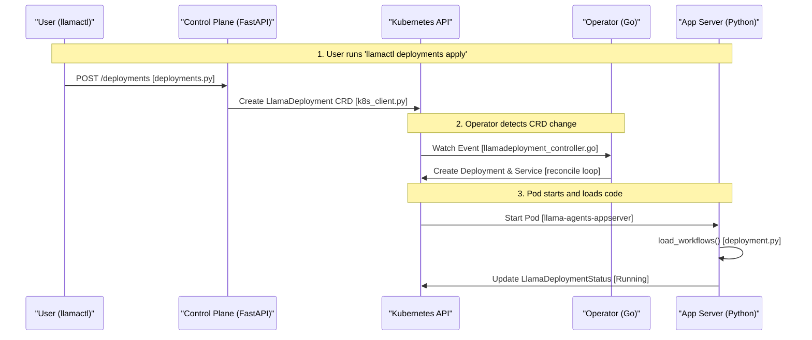

<!-- source: DeepWiki mcp.deepwiki.com · repo run-llama/llama-agents · page 1 Overview · fetched 2026-10-27 -->

# Overview

<details>
<summary>Relevant source files</summary>

The following files were used as context for generating this wiki page:

- [.agents/skills/llamactl-qa/SKILL.md](.agents/skills/llamactl-qa/SKILL.md)
- [CLAUDE.md](CLAUDE.md)
- [CONTRIBUTING.md](CONTRIBUTING.md)
- [README.md](README.md)
- [architecture-docs/overall-architecture.md](architecture-docs/overall-architecture.md)
- [architecture-docs/quick-reference.md](architecture-docs/quick-reference.md)
- [docs/src/content/docs/llamaagents/llamactl-reference/commands-config.md](docs/src/content/docs/llamaagents/llamactl-reference/commands-config.md)
- [docs/src/content/docs/llamaagents/llamactl-reference/commands-environments.md](docs/src/content/docs/llamaagents/llamactl-reference/commands-environments.md)
- [docs/src/content/docs/llamaagents/llamactl-reference/commands-organizations.md](docs/src/content/docs/llamaagents/llamactl-reference/commands-organizations.md)
- [docs/src/content/docs/llamaagents/llamactl-reference/commands-projects.md](docs/src/content/docs/llamaagents/llamactl-reference/commands-projects.md)
- [docs/src/content/docs/llamaagents/workflows/observability.md](docs/src/content/docs/llamaagents/workflows/observability.md)
- [examples/docker/Dockerfile](examples/docker/Dockerfile)
- [examples/docker/app.py](examples/docker/app.py)
- [examples/docker/requirements.txt](examples/docker/requirements.txt)
- [examples/observability/workflows_observability_pt1.ipynb](examples/observability/workflows_observability_pt1.ipynb)
- [examples/observability/workflows_observability_pt2.ipynb](examples/observability/workflows_observability_pt2.ipynb)
- [examples/observability/workflows_observablitiy_arize_phoenix.ipynb](examples/observability/workflows_observablitiy_arize_phoenix.ipynb)
- [examples/observability/workflows_observablitiy_langfuse.ipynb](examples/observability/workflows_observablitiy_langfuse.ipynb)
- [examples/state_management_with_vector_databases.ipynb](examples/state_management_with_vector_databases.ipynb)
- [packages/llamactl/README.md](packages/llamactl/README.md)
- [pyproject.toml](pyproject.toml)
- [uv.lock](uv.lock)

</details>


LlamaAgents is an open-source framework designed for building and shipping document-centric agentic applications in Python. It provides a path from simple script-based workflows to production-grade, distributed agent systems [README.md:13-17]().

The repository is a monorepo containing several interconnected packages that handle everything from the core event-driven orchestration to Kubernetes-based cloud deployment [pyproject.toml:179-202]().

## System Architecture

The LlamaAgents ecosystem bridges the gap between local development and cloud-scale deployment. It transitions from a pure Python library space into a managed infrastructure space involving Kubernetes operators and a centralized control plane [architecture-docs/overall-architecture.md:9-17]().

### From Code to Infrastructure
The following diagram illustrates how high-level system components map to specific code entities and packages within the monorepo.

**System Component to Code Entity Mapping**
```mermaid
graph TD
    subgraph "Local Development"
        "llamactl"["llamactl (CLI)"] -- "calls" --> "ControlPlaneAPI"["Control Plane API"]
        "UserWorkflow"["User Workflow (@step)"] -- "runs in" --> "WorkflowServer"["WorkflowServer"]
    end

    subgraph "Infrastructure Space"
        "ControlPlaneAPI" -- "manages" --> "LlamaDeployment"["LlamaDeployment (CRD)"]
        "LlamaDeployment" -- "reconciled by" --> "LlamaDeploymentReconciler"["LlamaDeploymentReconciler (Go)"]
        "LlamaDeploymentReconciler" -- "creates" --> "AppServerPod"["App Server (Python Pod)"]
    end

    subgraph "Code Entities"
        "llamactl" --> "packages/llamactl"
        "WorkflowServer" --> "packages/llama-agents-server"
        "LlamaDeployment" --> "operator/api/v1"
        "LlamaDeploymentReconciler" --> "operator/internal/controller"
        "AppServerPod" --> "packages/llama-agents-appserver"
    end
```
**Sources:** [architecture-docs/overall-architecture.md:9-17](), [architecture-docs/quick-reference.md:5-28](), [pyproject.toml:182-196]()

## Major Components

The monorepo is organized into functional layers:

### 1. Core Workflow Engine
The foundation of the project is `llama-index-workflows`. It provides an event-driven orchestration library where steps are asynchronous Python functions [README.md:17-18]().
- **Key Class**: `Workflow` [README.md:37]()
- **Key Decorator**: `@step` [README.md:38]()
- **For details, see [Core Workflow Engine (llama-index-workflows)](#2)**.

### 2. Service Layer
Workflows are transformed into network-accessible services using `llama-agents-server` and interacted with via `llama-agents-client` [README.md:45-48]().
- **Key Class**: `WorkflowServer` [README.md:50]()
- **For details, see [Workflow Server and Client (llama-agents-server / llama-agents-client)](#3)**.

### 3. Deployment and Orchestration
The cloud-native stack enables running workflows on Kubernetes.
- **`llamactl`**: The CLI for local development and cloud management [packages/llamactl/README.md:3-5]().
- **Control Plane**: Manages deployments, Git integration, and projects [architecture-docs/overall-architecture.md:26-32]().
- **Kubernetes Operator**: A Go-based controller that reconciles `LlamaDeployment` custom resources into active pods and services [architecture-docs/overall-architecture.md:43-51]().
- **For details, see [Control Plane (llama-agents-control-plane)](#5)** and **[Kubernetes Operator (operator)](#6)**.

## Data and Execution Flow

The following diagram bridges the "Natural Language" intent of a user deploying code to the specific code-level interactions between system services.

**Deployment Execution Flow**

**Sources:** [architecture-docs/overall-architecture.md:106-125](), [architecture-docs/quick-reference.md:5-20]()

## Wiki Navigation

This wiki is structured to guide you from initial setup to deep technical implementation:

*   **[Getting Started](#1.1)**: Setup instructions using `uv`, environment configuration, and running your first workflow.
*   **[Repository Structure and Package Map](#1.2)**: A detailed breakdown of the `packages/` directory and how they depend on each other.
*   **Core Logic**: Sections 2 and 3 cover the internal mechanics of workflows and servers.
*   **Deployment**: Sections 4, 5, and 6 cover the infrastructure required to run agents at scale.
*   **Tooling and Examples**: Sections 7, 8, and 9 cover the CLI, CI/CD pipelines, and reference implementations.

**Sources:** [uv.lock:11-27](), [pyproject.toml:179-202](), [architecture-docs/quick-reference.md:1-27]()

---

