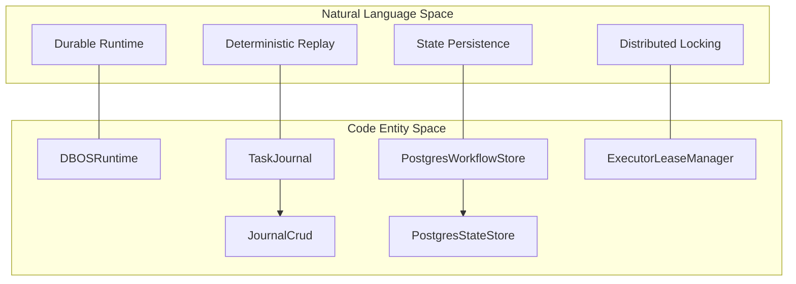
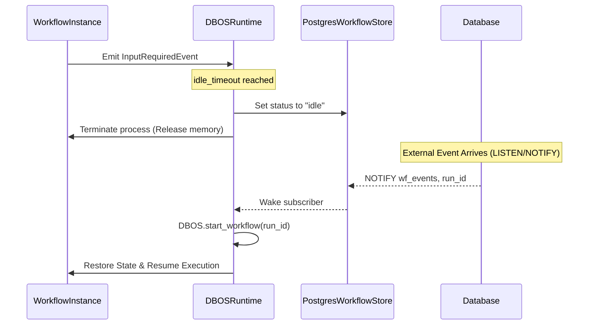

<!-- source: DeepWiki mcp.deepwiki.com · repo run-llama/llama-agents · page 3.3 DBOS Durable Runtime (llama-agents-dbos) · fetched 2026-10-27 -->

# DBOS Durable Runtime (llama-agents-dbos)

Relevant source files

The following files were used as context for generating this wiki page:

- [docs/src/content/docs/llamaagents/workflows/dbos.md](docs/src/content/docs/llamaagents/workflows/dbos.md)
- [examples/dbos/_replica.py](examples/dbos/_replica.py)
- [examples/dbos/durable_workflow.py](examples/dbos/durable_workflow.py)
- [examples/dbos/idle_release_demo.py](examples/dbos/idle_release_demo.py)
- [examples/dbos/server_quickstart.py](examples/dbos/server_quickstart.py)
- [examples/dbos/server_replicas.py](examples/dbos/server_replicas.py)
- [packages/llama-agents-dbos/CHANGELOG.md](packages/llama-agents-dbos/CHANGELOG.md)
- [packages/llama-agents-dbos/README.md](packages/llama-agents-dbos/README.md)
- [packages/llama-agents-dbos/conftest.py](packages/llama-agents-dbos/conftest.py)
- [packages/llama-agents-dbos/package.json](packages/llama-agents-dbos/package.json)
- [packages/llama-agents-dbos/pyproject.toml](packages/llama-agents-dbos/pyproject.toml)
- [packages/llama-agents-dbos/src/llama_agents/dbos/__init__.py](packages/llama-agents-dbos/src/llama_agents/dbos/__init__.py)
- [packages/llama-agents-dbos/src/llama_agents/dbos/executor_lease.py](packages/llama-agents-dbos/src/llama_agents/dbos/executor_lease.py)
- [packages/llama-agents-dbos/src/llama_agents/dbos/journal/__init__.py](packages/llama-agents-dbos/src/llama_agents/dbos/journal/__init__.py)
- [packages/llama-agents-dbos/src/llama_agents/dbos/journal/crud.py](packages/llama-agents-dbos/src/llama_agents/dbos/journal/crud.py)
- [packages/llama-agents-dbos/src/llama_agents/dbos/journal/task_journal.py](packages/llama-agents-dbos/src/llama_agents/dbos/journal/task_journal.py)
- [packages/llama-agents-dbos/src/llama_agents/dbos/runtime.py](packages/llama-agents-dbos/src/llama_agents/dbos/runtime.py)
- [packages/llama-agents-dbos/tests/conftest.py](packages/llama-agents-dbos/tests/conftest.py)
- [packages/llama-agents-dbos/tests/fixtures/runner.py](packages/llama-agents-dbos/tests/fixtures/runner.py)
- [packages/llama-agents-dbos/tests/fixtures/sample_workflows/slow_fan_out_hitl.py](packages/llama-agents-dbos/tests/fixtures/sample_workflows/slow_fan_out_hitl.py)
- [packages/llama-agents-dbos/tests/test_dbos_determinism_subprocess.py](packages/llama-agents-dbos/tests/test_dbos_determinism_subprocess.py)
- [packages/llama-agents-dbos/tests/test_dbos_runtime.py](packages/llama-agents-dbos/tests/test_dbos_runtime.py)
- [packages/llama-agents-dbos/tests/test_dbos_server_postgres.py](packages/llama-agents-dbos/tests/test_dbos_server_postgres.py)
- [packages/llama-agents-dbos/tests/test_executor_lease.py](packages/llama-agents-dbos/tests/test_executor_lease.py)
- [packages/llama-agents-dbos/tests/test_journal_orphan_determinism.py](packages/llama-agents-dbos/tests/test_journal_orphan_determinism.py)
- [packages/llama-agents-server/src/llama_agents/server/_pool.py](packages/llama-agents-server/src/llama_agents/server/_pool.py)
- [packages/llama-agents-server/src/llama_agents/server/_store/postgres_workflow_store.py](packages/llama-agents-server/src/llama_agents/server/_store/postgres_workflow_store.py)
- [packages/llama-agents-server/tests/server/test_pool.py](packages/llama-agents-server/tests/server/test_pool.py)
- [packages/llama-agents-server/tests/server/test_postgres_workflow_store.py](packages/llama-agents-server/tests/server/test_postgres_workflow_store.py)

The `llama-agents-dbos` package provides a durable execution runtime for LlamaIndex Workflows, powered by the [DBOS](https://www.dbos.dev) SDK. It ensures that workflows survive process restarts, crashes, and transient errors by automatically persisting every step transition. Unlike manual checkpointing, `DBOSRuntime` makes durability transparent to the workflow developer.

## Architecture Overview

The `DBOSRuntime` implements the `Runtime` interface from `llama-index-workflows` and integrates with the `llama-agents-server` persistence layer. It leverages a centralized PostgreSQL or SQLite database to manage workflow state, event journals, and execution leases.

### Data Flow: Durable Execution Loop

When a workflow is executed under `DBOSRuntime`, the control loop is wrapped in a `@DBOS.workflow` decorator. This ensures that every operation within the loop is tracked.

1.  **Workflow Start**: The runtime registers the workflow with DBOS and assigns a `run_id` (mapped to `DBOS.workflow_id`) [packages/llama-agents-dbos/src/llama_agents/dbos/runtime.py:146-156]().
2.  **Task Journaling**: As tasks (steps) are executed, they are recorded in a `TaskJournal`. This journal acts as the source of truth for deterministic replay [packages/llama-agents-dbos/src/llama_agents/dbos/journal/task_journal.py:1-10]().
3.  **Step Execution**: Steps are executed as DBOS steps. If a crash occurs, DBOS uses the `TaskJournal` to skip already-completed steps and resume exactly where it left off [packages/llama-agents-dbos/src/llama_agents/dbos/runtime.py:724-740]().
4.  **State Persistence**: Workflow state is stored in a `workflow_state` table, managed by `PostgresStateStore` or `SqliteStateStore` [packages/llama-agents-dbos/src/llama_agents/dbos/runtime.py:111-115]().

### System Component Mapping

The following diagram maps high-level durable execution concepts to the specific code entities in the `llama-agents-dbos` and `llama-agents-server` packages.

**Durable Runtime Entity Map**

Sources: [packages/llama-agents-dbos/src/llama_agents/dbos/runtime.py:116-210](), [packages/llama-agents-dbos/src/llama_agents/dbos/executor_lease.py:17-43](), [packages/llama-agents-dbos/src/llama_agents/dbos/journal/crud.py:36-55]()

## Deterministic Replay via TaskJournal

A critical challenge in durable execution is ensuring that a resumed workflow does not re-execute side effects. `DBOSRuntime` solves this using the `TaskJournal`.

*   **Journal Entry**: Each entry consists of a `run_id`, `seq_num`, and `task_key` [packages/llama-agents-dbos/src/llama_agents/dbos/journal/crud.py:15-18]().
*   **Truncation Logic**: If a workflow fails and restarts, the `TaskJournal` can truncate entries from a specific sequence number to allow for clean recovery [packages/llama-agents-dbos/src/llama_agents/dbos/journal/crud.py:49-55]().
*   **Operation Purging**: To maintain consistency between the workflow journal and DBOS's internal `operation_outputs`, the `purge_operations_from` function removes DBOS-level operation rows that ran ahead of the workflow's committed journal [packages/llama-agents-dbos/src/llama_agents/dbos/journal/crud.py:98-105]().

Sources: [packages/llama-agents-dbos/src/llama_agents/dbos/journal/crud.py:1-105](), [packages/llama-agents-dbos/src/llama_agents/dbos/journal/task_journal.py:1-10]()

## ExecutorLeaseManager

In multi-replica deployments (e.g., Kubernetes), multiple server pods might attempt to run the same workflow. The `ExecutorLeaseManager` provides a distributed locking mechanism using a Postgres table.

*   **Lease Acquisition**: On launch, the runtime attempts to acquire a slot (e.g., `executor-0`) from the `executor_leases` table [packages/llama-agents-dbos/src/llama_agents/dbos/executor_lease.py:69-106]().
*   **Heartbeat Loop**: A background task periodically updates the `heartbeat_at` timestamp for the held slot [packages/llama-agents-dbos/src/llama_agents/dbos/executor_lease.py:147-172]().
*   **Stale Lease Reclamation**: If a replica crashes, its lease eventually expires (based on `lease_timeout`). Another replica can then claim the slot and resume the workflow [packages/llama-agents-dbos/src/llama_agents/dbos/executor_lease.py:82-89]().
*   **Fencing**: If the `heartbeat_loop` detects that its lease has been stolen (holder mismatch), it triggers a `lease_lost_event` to stop execution [packages/llama-agents-dbos/src/llama_agents/dbos/executor_lease.py:163-169]().

Sources: [packages/llama-agents-dbos/src/llama_agents/dbos/executor_lease.py:1-180]()

## Idle Release Mechanism

To optimize resource usage, `DBOSRuntime` supports an idle release mechanism via the `DBOSIdleReleaseDecorator`.

**Workflow Suspension and Resumption**

*   **Idle Detection**: The `DBOSIdleReleaseDecorator` monitors workflow activity. If no events are processed within the `idle_timeout`, the workflow is evicted from memory [packages/llama-agents-dbos/src/llama_agents/dbos/runtime.py:97-100]().
*   **Reactivation**: The `PostgresWorkflowStore` uses `LISTEN/NOTIFY` on the `wf_events` channel. When a new event is appended for an idle workflow, the store notifies the runtime, which restarts the DBOS workflow [packages/llama-agents-server/src/llama_agents/server/_store/postgres_workflow_store.py:140-151]().

Sources: [packages/llama-agents-dbos/src/llama_agents/dbos/runtime.py:97-100](), [packages/llama-agents-server/src/llama_agents/server/_store/postgres_workflow_store.py:121-151]()

## Configuration

The runtime is configured via `DBOSRuntimeConfig` [packages/llama-agents-dbos/src/llama_agents/dbos/runtime.py:195-210]().

| Parameter | Type | Description |
| :--- | :--- | :--- |
| `polling_interval_sec` | `float` | Frequency of checking for new tasks (default: 1.0s). |
| `run_migrations_on_launch` | `bool` | Automatically run DBOS and Server migrations. |
| `pool_size` | `int` | Size of the `asyncpg` connection pool. |
| `max_recovery_attempts` | `int` | Times DBOS will attempt to recover a failed workflow. |
| `_experimental_executor_lease` | `ExecutorLeaseConfig` | Configuration for distributed executor locking. |

Sources: [packages/llama-agents-dbos/src/llama_agents/dbos/runtime.py:175-210]()

---

