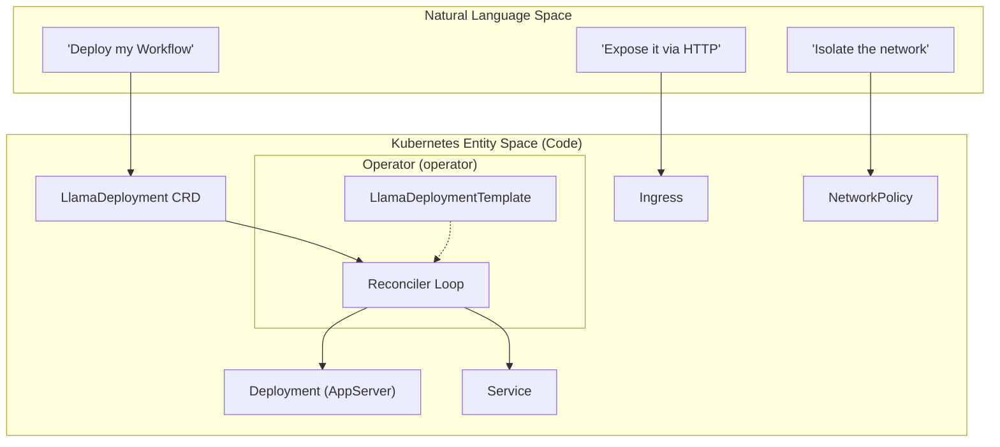
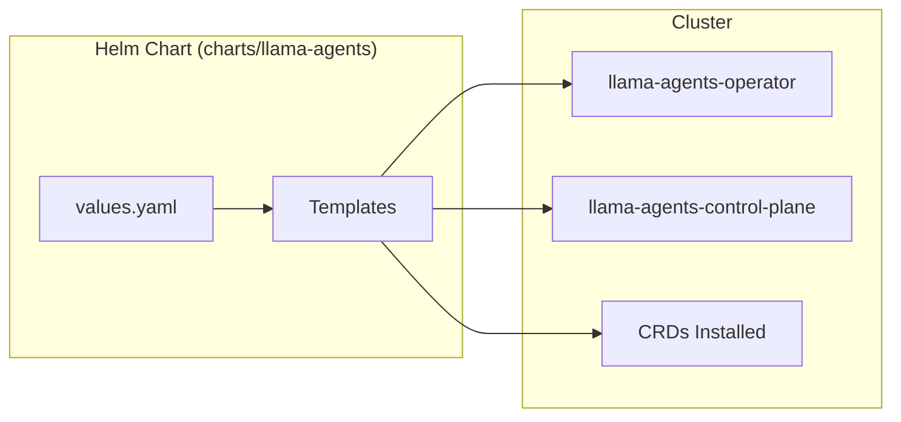

<!-- source: DeepWiki mcp.deepwiki.com · repo run-llama/llama-agents · page 6 Kubernetes Operator (operator) · fetched 2026-10-27 -->

# Kubernetes Operator (operator)

Relevant source files

The following files were used as context for generating this wiki page:

- [charts/llama-agents/CHANGELOG.md](charts/llama-agents/CHANGELOG.md)
- [charts/llama-agents/Chart.yaml](charts/llama-agents/Chart.yaml)
- [charts/llama-agents/README.md](charts/llama-agents/README.md)
- [charts/llama-agents/package.json](charts/llama-agents/package.json)
- [charts/llama-agents/values.yaml](charts/llama-agents/values.yaml)
- [operator/Tiltfile](operator/Tiltfile)
- [operator/dev.py](operator/dev.py)
- [operator/go.mod](operator/go.mod)
- [operator/go.sum](operator/go.sum)
- [operator/tilt/scripts/install-prometheus.sh](operator/tilt/scripts/install-prometheus.sh)
- [packages/llama-agents-agentcore/CHANGELOG.md](packages/llama-agents-agentcore/CHANGELOG.md)
- [packages/llama-agents-agentcore/package.json](packages/llama-agents-agentcore/package.json)
- [packages/llama-agents-agentcore/pyproject.toml](packages/llama-agents-agentcore/pyproject.toml)

The Kubernetes Operator is a Go-based controller built with the `controller-runtime` framework [operator/go.mod:13-13](). It is responsible for the lifecycle of LlamaIndex workflows within a Kubernetes cluster. The operator observes `LlamaDeployment` Custom Resources (CRs) and automates the creation and maintenance of the underlying infrastructure required to run them, such as Pods, Services, and Ingresses.

The operator works in tandem with the **Control Plane** (which manages the API and build logic) and the **App Server** (the runtime container for workflows).

### System Architecture: Operator Reconciliation Loop

The following diagram illustrates how the Go-based operator translates high-level `LlamaDeployment` definitions into concrete Kubernetes entities.

**Operator Resource Mapping**

**Sources:** [operator/go.mod:1-14](), [charts/llama-agents/README.md:10-12]()

---

### Core Responsibilities

The operator's primary role is to act as the "brain" for deployments, ensuring the actual state of the cluster matches the desired state defined in the `LlamaDeployment` CRD.

| Component | Role | Code Pointer |
| :--- | :--- | :--- |
| **LlamaDeployment CRD** | Defines the desired state: container image, environment variables, and workflow configuration. | [charts/llama-agents/README.md:12-12]() |
| **Reconciliation** | Watches for changes to CRDs and manages the transition through phases (e.g., `Pending`, `Running`, `RollingOut`). | [charts/llama-agents/README.md:10-10]() |
| **Resource Management** | Creates and updates `Deployment`, `Service`, `Secret`, `Ingress`, and `NetworkPolicy` objects for each workflow. | [charts/llama-agents/values.yaml:175-181]() |
| **Namespace Isolation** | Supports running app resources in a dedicated `apps.namespace` separate from the operator. | [charts/llama-agents/values.yaml:175-181]() |

For technical details on the reconciliation logic and CRD fields, see [LlamaDeployment CRD and Reconciliation Controller](#6.1).

---

### Deployment and Configuration

The operator is typically deployed using the `llama-agents` Helm chart. This chart bundles the operator, the control plane, and the necessary CRDs.

**Deployment Flow**

**Sources:** [charts/llama-agents/Chart.yaml:1-5](), [charts/llama-agents/values.yaml:26-35]()

The operator uses the `llama-agents-appserver` image [charts/llama-agents/values.yaml:36-45]() as the base for all managed pods. It injects default resource requests (e.g., `750m` CPU, `2Gi` Memory) unless overridden in the `LlamaDeployment` spec [charts/llama-agents/values.yaml:201-207]().

For a guide on deploying the operator and configuring its settings via Helm, see [Helm Chart Deployment (charts/llama-agents)](#6.2).

---

### Local Development

For developers working on the operator, the repository provides a Python-based `dev.py` utility [operator/dev.py:1-25]() and a `Tiltfile` [operator/Tiltfile:1-10]() to orchestrate a local Kubernetes environment using `kind` or `Docker Desktop`.

- **Cluster Setup:** `python dev.py up` creates a local cluster and installs an Nginx ingress controller [operator/dev.py:59-114]().
- **Live Development:** `tilt up` builds the Go operator image [operator/Tiltfile:37-45]() and the Python control plane [operator/Tiltfile:22-34](), deploying them into the local cluster for rapid iteration.

**Sources:** [operator/dev.py:1-46](), [operator/Tiltfile:1-68]()

---

## Child Pages
- [LlamaDeployment CRD and Reconciliation Controller](#6.1)
- [Helm Chart Deployment (charts/llama-agents)](#6.2)

---

