# Page: Voice Lab Overview

# Voice Lab Overview

<details>
<summary>Relevant source files</summary>

The following files were used as context for generating this wiki page:

- [.DS_Store](.DS_Store)
- [LICENSE](LICENSE)
- [README.md](README.md)
- [llm_testing/.DS_Store](llm_testing/.DS_Store)

</details>


## Purpose and Scope

This document provides a comprehensive overview of the Voice Lab testing framework, a Python-based system designed for evaluating and iterating on LLM-powered voice agents. Voice Lab supports multiple testing modalities including LLM conversation testing, web chatbot evaluation, speech analysis, and real-time voice interactions.

The framework enables data-driven decision making for voice agent development through automated testing, performance metrics, and cost optimization across different language models and configurations. While optimized for voice agents, Voice Lab is valuable for any LLM-powered agent evaluation needs.

For detailed setup instructions, see [Getting Started](#2). For specific testing system implementations, see [Testing Systems](#3). For configuration management, see [Test Configuration](#4).

## System Architecture

Voice Lab follows a modular architecture with four core testing systems built on shared infrastructure components. The framework integrates with external LLM providers and generates comprehensive HTML reports for analysis.

### Core Components Architecture

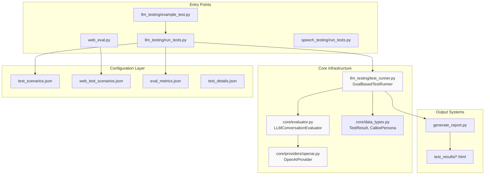

**Sources:** [README.md:1-170](), [llm_testing/example_test.py](), [llm_testing/run_tests.py](), [llm_testing/test_runner.py](), [core/evaluator.py](), [core/data_types.py](), [core/providers/openai.py]()

## Testing Modalities

Voice Lab supports four distinct testing approaches, each optimized for different evaluation scenarios and agent types.

### Testing Systems Overview

| System | Entry Point | Core Classes | Purpose |
|--------|-------------|--------------|---------|
| LLM Conversation Testing | `llm_testing/example_test.py` | `GoalBasedTestRunner`, `LLMConversationEvaluator` | Goal-based conversation testing with persona simulation |
| Web Chatbot Evaluation | `web_eval.py` | Browser automation classes | Automated testing of web-embedded chatbots |
| Speech Analysis Testing | `speech_testing/run_tests.py` | Audio processing utilities | Voice interaction analysis with interruption detection |
| Real-time Voice Interaction | `eval_agent/gemini_connection.py` | Gemini API integration | Live bidirectional voice communication testing |

### LLM Testing System Data Flow

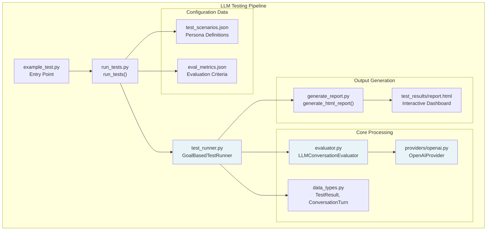

**Sources:** [llm_testing/example_test.py](), [llm_testing/run_tests.py](), [llm_testing/test_runner.py](), [core/evaluator.py](), [core/providers/openai.py](), [core/data_types.py](), [test_scenarios.json](), [eval_metrics.json]()

## Data Types and Interfaces

The framework uses strongly-typed data structures to maintain consistency across testing modalities and enable reliable result aggregation.

### Core Data Models

The `core/data_types.py` module defines the fundamental data structures used throughout the system:

- **`TestResult`**: Encapsulates complete test execution results including conversation history, evaluation scores, and metadata
- **`CalleePersona`**: Defines user personas with traits, moods, and response styles for conversation simulation  
- **`ConversationTurn`**: Represents individual message exchanges between agent and user
- **`EvaluationMetric`**: Structured evaluation criteria with scoring methods

### Provider Interface Pattern

The `core/providers/` directory implements a provider pattern for LLM integrations:

- **`OpenAIProvider`**: Primary implementation supporting GPT models with conversation management
- **Provider Interface**: Abstraction layer enabling support for additional LLM services

**Sources:** [core/data_types.py](), [core/providers/openai.py]()

## Integration Architecture  

Voice Lab integrates with multiple external services and maintains a plugin-based architecture for extending functionality.

### External Service Integration

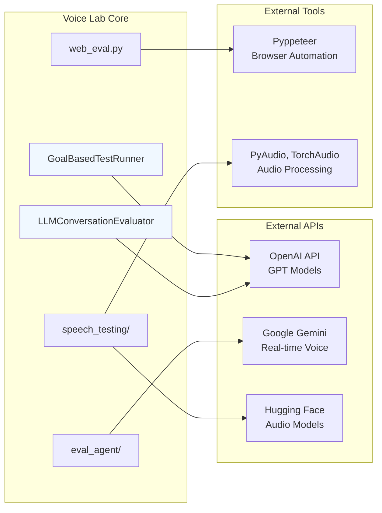

**Sources:** [core/providers/openai.py](), [web_eval.py](), [speech_testing/](), [eval_agent/gemini_connection.py](), [README.md:60-62]()

## Configuration and Extensibility

The framework uses JSON-based configuration files to define test scenarios, evaluation metrics, and system behavior. This approach enables non-technical stakeholders to modify test parameters without code changes.

### Configuration Files Structure

| File | Purpose | Key Components |
|------|---------|----------------|
| `test_scenarios.json` | LLM conversation test definitions | Persona configurations, success criteria, system prompts |
| `web_test_scenarios.json` | Web chatbot test scenarios | User personas, interaction flows, success outcomes |
| `eval_metrics.json` | Evaluation criteria definitions | Scoring methods, metric weights, judgment criteria |
| `test_details.json` | Detailed agent configurations | System prompts, tool definitions, conversation parameters |

The framework also provides a [Voice Lab Configuration Editor](https://saharmor.me/voice-lab-ui) for generating configuration files through a graphical interface.

**Sources:** [README.md:71-78](), [test_scenarios.json](), [web_test_scenarios.json](), [eval_metrics.json](), [test_details.json]()

## Next Steps

- For installation and setup instructions, see [Getting Started](#2)
- For detailed testing system documentation, see [Testing Systems](#3) 
- For configuration management, see [Test Configuration](#4)
- For understanding evaluation methodologies, see [Evaluation & Metrics](#5)
- For report generation and analysis, see [Test Results & Reporting](#6)

---

# Page: Getting Started

# Getting Started

<details>
<summary>Relevant source files</summary>

The following files were used as context for generating this wiki page:

- [.example.env](.example.env)
- [.gitignore](.gitignore)
- [requirements.txt](requirements.txt)

</details>


This document provides a complete setup guide for Voice Lab, covering installation, environment configuration, dependencies, and running your first test. Voice Lab is a comprehensive testing framework for evaluating LLM-powered voice agents across multiple modalities including text conversations, web chatbots, speech analysis, and real-time voice interactions.

For detailed information about specific testing systems, see [Testing Systems](#3). For configuration of test scenarios, see [Test Configuration](#4).

## Prerequisites

Before installing Voice Lab, ensure you have the following requirements:

| Requirement | Version | Purpose |
|-------------|---------|---------|
| Python | 3.8+ | Core runtime environment |
| pip | Latest | Package management |
| Git | Any | Repository cloning |
| Audio drivers | System default | Speech testing capabilities |

### API Access Requirements

Voice Lab requires API keys for various services depending on which testing systems you plan to use:

- **OpenAI API Key** - Required for LLM conversation testing and web evaluation
- **Hugging Face Token** - Required for speech analysis and audio processing models
- **Google Gemini API Key** - Required for real-time voice interaction testing

## Installation Process

### Step 1: Clone Repository

```bash
git clone https://github.com/saharmor/voice-lab.git
cd voice-lab
```

### Step 2: Install Dependencies

Voice Lab uses a straightforward requirements-based installation:

```bash
pip install -r requirements.txt
```

**Dependency Architecture**

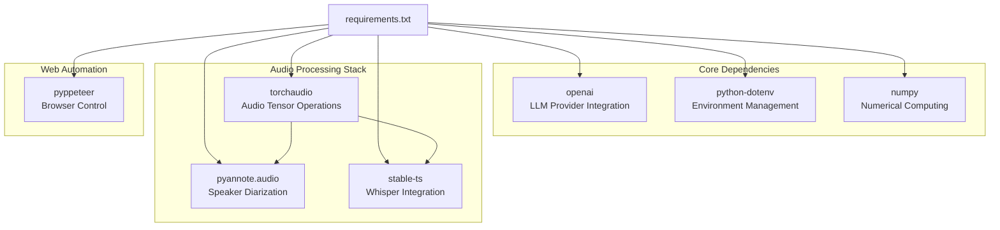

Sources: [requirements.txt:1-7]()

### Step 3: Environment Configuration

Voice Lab uses environment variables for API key management. Create your environment file:

```bash
cp .example.env .env
```

Edit the `.env` file with your actual API keys:

```bash
OPENAI_API_KEY=your_openai_api_key_here
HUGGING_FACE_TOKEN=your_hugging_face_token_here
```

**Environment Variable Usage**

| Variable | Used By | Purpose |
|----------|---------|---------|
| `OPENAI_API_KEY` | `core/providers/openai.py` | LLM API authentication |
| `HUGGING_FACE_TOKEN` | `speech_testing/` modules | Audio model downloads |

Sources: [.example.env:1-2](), [.gitignore:125]()

## Project Structure Overview

Understanding the Voice Lab directory structure helps you navigate to the right testing system:

**Voice Lab Architecture**

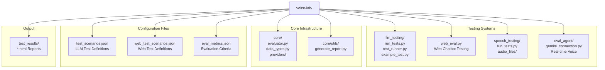

Sources: [.gitignore:163-164](), [.gitignore:169]()

## Running Your First Test

### Quick Start: LLM Conversation Testing

The fastest way to verify your installation is to run a basic LLM conversation test:

```bash
cd llm_testing
python example_test.py
```

This will execute a simple conversation test using the default test scenarios and generate an HTML report in the `test_results/` directory.

**Test Execution Flow**

```mermaid
sequenceDiagram
    participant User
    participant ExampleTest["example_test.py"]
    participant TestRunner["test_runner.py<br/>GoalBasedTestRunner"]
    participant OpenAI["core/providers/openai.py<br/>OpenAIProvider"]
    participant Evaluator["core/evaluator.py<br/>LLMConversationEvaluator"]
    participant ReportGen["core/utils/generate_report.py"]
    
    User->>ExampleTest: "python example_test.py"
    ExampleTest->>TestRunner: "load test scenarios"
    TestRunner->>OpenAI: "initiate conversation"
    OpenAI-->>TestRunner: "conversation responses"
    TestRunner->>Evaluator: "evaluate conversation"
    Evaluator-->>TestRunner: "test results"
    TestRunner->>ReportGen: "generate HTML report"
    ReportGen-->>User: "test_results/*.html"
```

### Alternative Testing Systems

Once your basic setup is working, you can explore other testing modalities:

| Testing System | Entry Point | Purpose |
|----------------|-------------|---------|
| Web Chatbot Testing | `python web_eval.py` | Browser automation testing |
| Speech Analysis | `cd speech_testing && python run_tests.py` | Audio file analysis |
| Real-time Voice | `cd eval_agent` | Live voice interaction |

Sources: System architecture diagrams above

## Verification Steps

### 1. Dependency Check

Verify all dependencies are installed correctly:

```bash
python -c "import openai, torch, pyannote, stable_whisper, pyppeteer; print('All dependencies installed successfully')"
```

### 2. Environment Variables

Verify your environment setup:

```bash
python -c "import os; from dotenv import load_dotenv; load_dotenv(); print('OpenAI:', bool(os.getenv('OPENAI_API_KEY'))); print('HF Token:', bool(os.getenv('HUGGING_FACE_TOKEN')))"
```

### 3. Core Components

Test core component imports:

```bash
python -c "from core.data_types import TestResult; from core.providers.openai import OpenAIProvider; print('Core components loaded successfully')"
```

## Next Steps

After successful installation and verification:

1. **Configure Test Scenarios**: Customize test scenarios in `test_scenarios.json` and `web_test_scenarios.json` - see [Test Configuration](#4)
2. **Explore Testing Systems**: Learn about the four different testing modalities - see [Testing Systems](#3)
3. **Understand Evaluation**: Review how conversations are evaluated - see [Evaluation & Metrics](#5)
4. **View Sample Reports**: Examine the generated HTML reports - see [Test Results & Reporting](#6)

## Troubleshooting Common Issues

| Issue | Solution |
|-------|----------|
| `ModuleNotFoundError` for audio dependencies | Install system audio libraries: `sudo apt-get install portaudio19-dev` (Linux) or use Homebrew (macOS) |
| OpenAI API errors | Verify API key in `.env` file and check account balance |
| Browser automation failures | Ensure Chrome/Chromium is installed for pyppeteer |
| Permission errors with audio files | Check file permissions in `speech_testing/audio_files/` directory |

Sources: [requirements.txt:1-7](), [.gitignore:125-131](), [.example.env:1-2]()

---

# Page: Testing Systems

# Testing Systems

<details>
<summary>Relevant source files</summary>

The following files were used as context for generating this wiki page:

- [.DS_Store](.DS_Store)
- [LICENSE](LICENSE)
- [README.md](README.md)
- [llm_testing/.DS_Store](llm_testing/.DS_Store)
- [main.py](main.py)

</details>


This document provides an architectural overview of the four distinct testing modalities supported by Voice Lab: LLM conversation testing, web chatbot evaluation, speech analysis testing, and real-time voice interaction. Each system operates independently while sharing common infrastructure components for evaluation, reporting, and data management.

For detailed configuration of test scenarios, see [Test Configuration](#4). For evaluation methodology and metrics, see [Evaluation & Metrics](#5). For result processing and reporting, see [Test Results & Reporting](#6).

## System Architecture Overview

Voice Lab implements a modular testing architecture where each testing system can operate independently while leveraging shared core components for evaluation and reporting.

```mermaid
graph TB
    subgraph "Testing Systems"
        LLMTests["llm_testing/run_tests.py<br/>LLM Conversation Testing"]
        WebTests["web_eval.py<br/>Web Chatbot Testing"] 
        SpeechTests["speech_testing/run_tests.py<br/>Speech Analysis Testing"]
        LiveTests["eval_agent/gemini_connection.py<br/>Real-time Voice Testing"]
    end
    
    subgraph "Core Infrastructure"
        DataTypes["core/data_types.py<br/>TestResult, EvaluationResponse"]
        Evaluator["core/evaluator.py<br/>LLMConversationEvaluator"]
        Providers["core/providers/openai.py<br/>OpenAIProvider"]
        ReportGen["core/utils/generate_report.py<br/>generate_test_results_report"]
    end
    
    subgraph "Configuration & Data"
        TestScenarios["test_scenarios.json<br/>LLM Test Definitions"]
        WebScenarios["web_test_scenarios.json<br/>Web Test Definitions"]
        EvalMetrics["eval_metrics.json<br/>Evaluation Criteria"]
        AudioFiles["speech_testing/audio_files/<br/>Audio Test Data"]
    end
    
    subgraph "External Services"
        OpenAI["OpenAI API"]
        Gemini["Google Gemini API"]
        WebTargets["Target Websites"]
    end
    
    LLMTests --> DataTypes
    LLMTests --> Evaluator
    LLMTests --> Providers
    LLMTests --> TestScenarios
    LLMTests --> EvalMetrics
    LLMTests --> OpenAI
    
    WebTests --> DataTypes
    WebTests --> Evaluator
    WebTests --> Providers
    WebTests --> WebScenarios
    WebTests --> EvalMetrics
    WebTests --> OpenAI
    WebTests --> WebTargets
    
    SpeechTests --> DataTypes
    SpeechTests --> AudioFiles
    
    LiveTests --> Gemini
    LiveTests --> DataTypes
    
    LLMTests --> ReportGen
    WebTests --> ReportGen  
    SpeechTests --> ReportGen
    LiveTests --> ReportGen
```

**Sources**: [main.py:1-79](), [README.md:14-27]()

## Test Execution Flow

The framework provides a unified execution model where different test types follow similar patterns for initialization, execution, evaluation, and reporting.

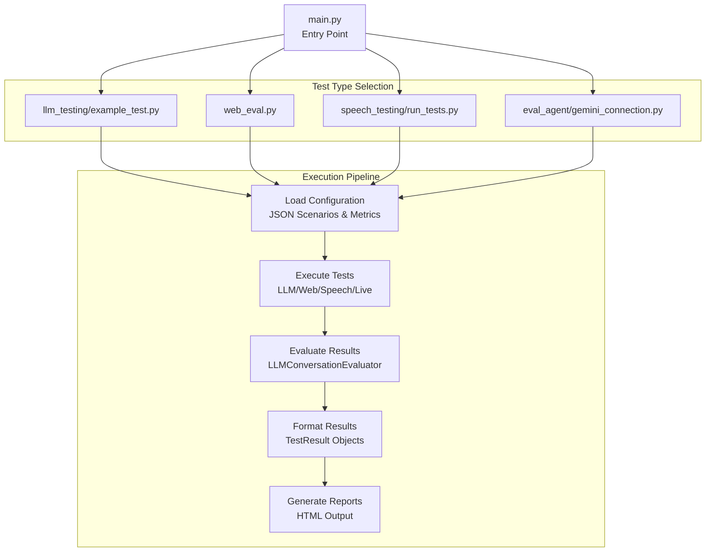

**Sources**: [main.py:32-79](), [README.md:64-69]()

## LLM Conversation Testing System

The LLM testing system evaluates goal-based conversations between simulated users and language model agents using the `GoalBasedTestRunner` class and `LLMConversationEvaluator`.

### Key Components

| Component | File Path | Purpose |
|-----------|-----------|---------|
| `GoalBasedTestRunner` | `llm_testing/test_runner.py` | Orchestrates conversation flows |
| `LLMConversationEvaluator` | `core/evaluator.py` | Performs LLM-as-a-Judge evaluation |
| `OpenAIProvider` | `core/providers/openai.py` | Handles OpenAI API interactions |
| Test Scenarios | `test_scenarios.json` | Defines conversation scenarios |
| Evaluation Metrics | `eval_metrics.json` | Specifies success criteria |

**Sources**: [README.md:66-69]()

## Web Chatbot Evaluation System

The web evaluation system uses browser automation to test chatbots embedded in websites, combining automated interaction with LLM-based evaluation of conversation quality.

### Key Components

- Browser automation via `pyppeteer`
- Web-specific test scenarios in `web_test_scenarios.json`
- Integration with `LLMConversationEvaluator` for conversation analysis
- Support for multiple website targets

**Sources**: [README.md:64-79]()

## Speech Analysis Testing System

The speech testing system processes audio files to detect conversation quality metrics including interruptions, pauses, and speaker behavior patterns.

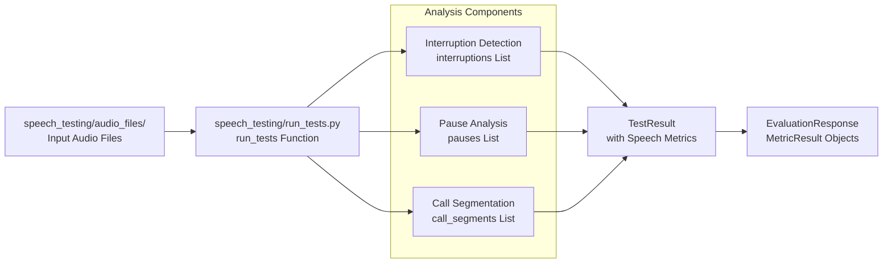

**Sources**: [main.py:37-69]()

## Real-time Voice Interaction System

The real-time system provides bidirectional voice communication with Google Gemini API for live voice agent testing and evaluation.

### Key Components

- `gemini_connection.py` for real-time API integration
- Voice activity detection and processing
- Live conversation flow management
- Real-time evaluation capabilities

**Sources**: [README.md:148]()

## Data Flow Integration

The testing systems share common data structures and evaluation pathways while maintaining distinct execution contexts.

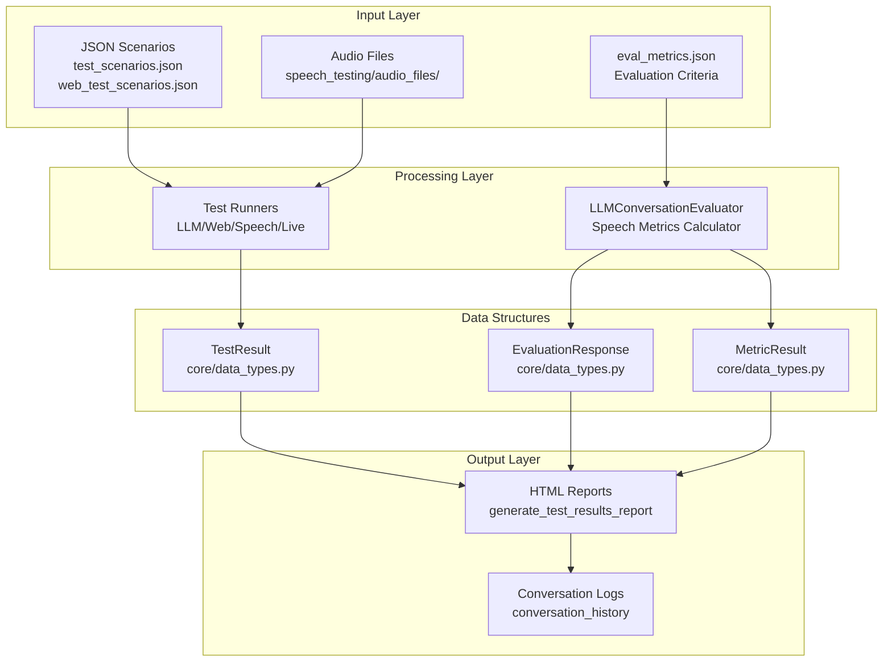

**Sources**: [main.py:43-77](), [core/data_types.py:1-2]()

## Speech Metrics Processing

The speech testing system implements specialized metrics for voice interaction quality assessment.

### Interruption Detection
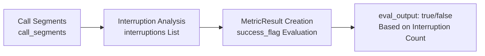

### Pause Analysis
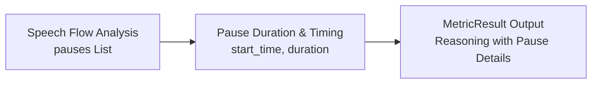

**Sources**: [main.py:54-69]()

## Test Result Standardization

All testing systems converge on standardized data structures for consistent evaluation and reporting across modalities.

| Data Structure | Purpose | Key Fields |
|----------------|---------|------------|
| `TestResult` | Container for test outcomes | `evaluation_result`, `conversation_history` |
| `EvaluationResponse` | LLM evaluation results | `summary`, `evaluation_results` |
| `MetricResult` | Individual metric assessment | `name`, `eval_output`, `reasoning`, `evidence` |

The `completed_tests` dictionary structure used in `main.py` demonstrates the unified approach:
- `tested_component`: List of components under test
- `result`: `TestResult` object containing evaluation and conversation data

**Sources**: [main.py:71-77](), [core/data_types.py:1-2]()

---

# Page: LLM Conversation Testing

# LLM Conversation Testing

<details>
<summary>Relevant source files</summary>

The following files were used as context for generating this wiki page:

- [llm_testing/example_test.py](llm_testing/example_test.py)
- [llm_testing/run_tests.py](llm_testing/run_tests.py)
- [llm_testing/test_runner.py](llm_testing/test_runner.py)

</details>


## Purpose and Scope

The LLM Conversation Testing system provides goal-based conversation evaluation for LLM-powered voice agents. This system simulates realistic phone call scenarios where a voice agent interacts with various callee personas to accomplish specific business objectives. The testing framework evaluates conversation quality, goal achievement, and agent behavior across different LLM models and system prompts.

For web-based chatbot testing, see [Web Chatbot Evaluation](#3.2). For speech analysis and audio processing, see [Speech Analysis Testing](#3.3). For evaluation metrics and scoring methodology, see [Evaluation & Metrics](#5).

## System Overview

The LLM Conversation Testing system operates as a multi-component framework that orchestrates conversations between AI agents and simulated personas, then evaluates the results using LLM-as-a-Judge methodology.

### Core Test Execution Flow

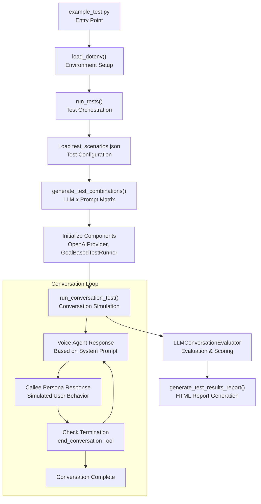

Sources: [llm_testing/example_test.py:1-9](), [llm_testing/run_tests.py:32-98](), [llm_testing/test_runner.py:62-123]()

## Core Components

### GoalBasedTestRunner

The `GoalBasedTestRunner` class manages the conversation flow between voice agents and callee personas. It maintains conversation state and handles turn-based interaction simulation.

| Component | Purpose | Key Methods |
|-----------|---------|-------------|
| `GoalBasedTestRunner` | Orchestrates agent-persona conversations | `run_conversation_test()`, `_generate_callee_response()` |
| `LLMInterface` | Abstracts LLM provider interactions | `generate_response_with_conversation_history()` |
| `ConversationEvaluator` | Evaluates conversation quality and success | `evaluate()` |

### Test Orchestration Architecture

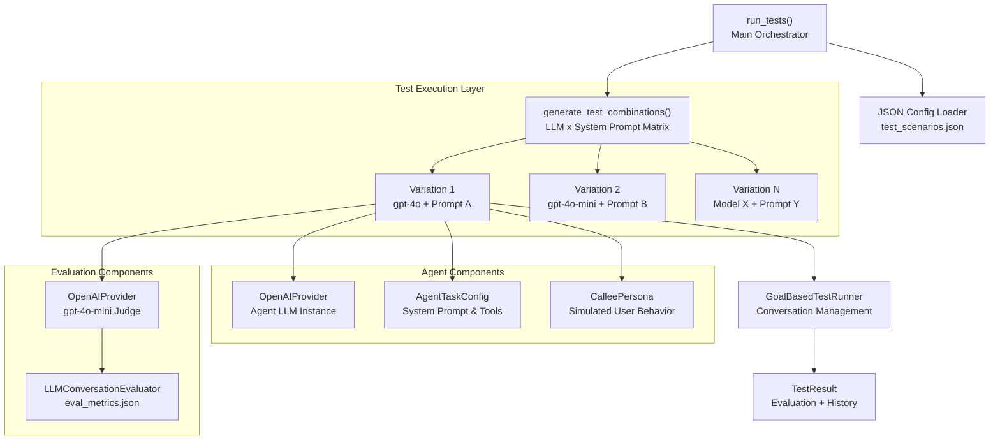

Sources: [llm_testing/run_tests.py:14-30](), [llm_testing/run_tests.py:56-81](), [llm_testing/test_runner.py:11-17]()

## Test Configuration and Scenarios

### Test Scenario Structure

Test scenarios are defined in `test_scenarios.json` and specify the complete testing environment including agent configuration, persona details, and tested component variations.

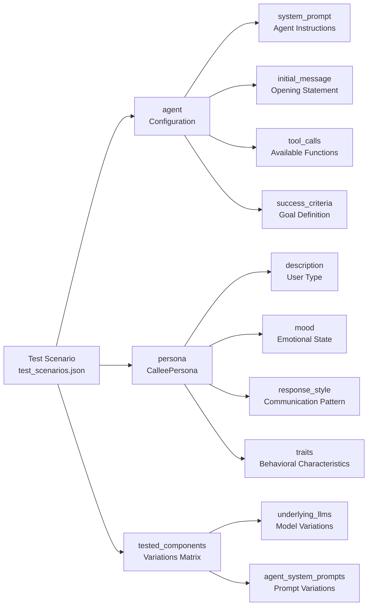

Sources: [llm_testing/run_tests.py:42-44](), [llm_testing/run_tests.py:54-69](), [llm_testing/test_runner.py:19-38]()

### Agent Task Configuration

The `AgentTaskConfig` class encapsulates all agent-specific configuration including system prompts, tools, and success criteria.

| Configuration Field | Purpose | Usage |
|---------------------|---------|--------|
| `system_prompt` | Defines agent behavior and instructions | Core agent personality and task definition |
| `initial_message` | Agent's opening statement | First message in conversation |
| `tool_calls` | Available function calls | Actions agent can perform (e.g., `end_conversation`) |
| `success_criteria` | Goal definition for evaluation | Used by evaluator to measure success |
| `additional_context` | Supplementary information | Domain-specific knowledge |

Sources: [llm_testing/run_tests.py:63-69]()

## Conversation Simulation

### Persona-Based Response Generation

The system generates realistic callee responses using persona-driven prompting. Each persona includes behavioral traits, mood, communication style, and background information to create consistent character simulation.

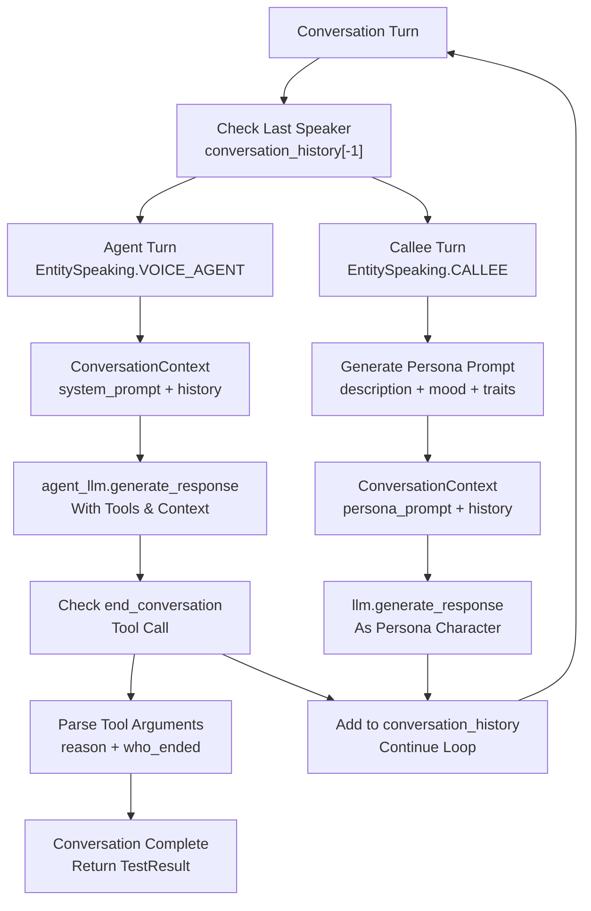

Sources: [llm_testing/test_runner.py:76-111](), [llm_testing/test_runner.py:19-53]()

### Conversation Termination

Conversations can be terminated through the `end_conversation` tool call, which requires specifying the reason for termination, who ended the conversation, and supporting evidence.

Sources: [llm_testing/test_runner.py:98-107]()

## Integration with Evaluation System

### LLM-as-a-Judge Integration

The system uses LLM-as-a-Judge methodology for conversation evaluation, with configurable evaluator models and metrics.

| Evaluator Model | Use Case | Configuration |
|----------------|----------|---------------|
| `gpt-4o-mini` | Default cost-effective evaluation | [llm_testing/run_tests.py:38]() |
| `gpt-4o` | Higher quality evaluation | [llm_testing/run_tests.py:39]() |
| `o1-preview` | Advanced reasoning evaluation | [llm_testing/run_tests.py:40]() |

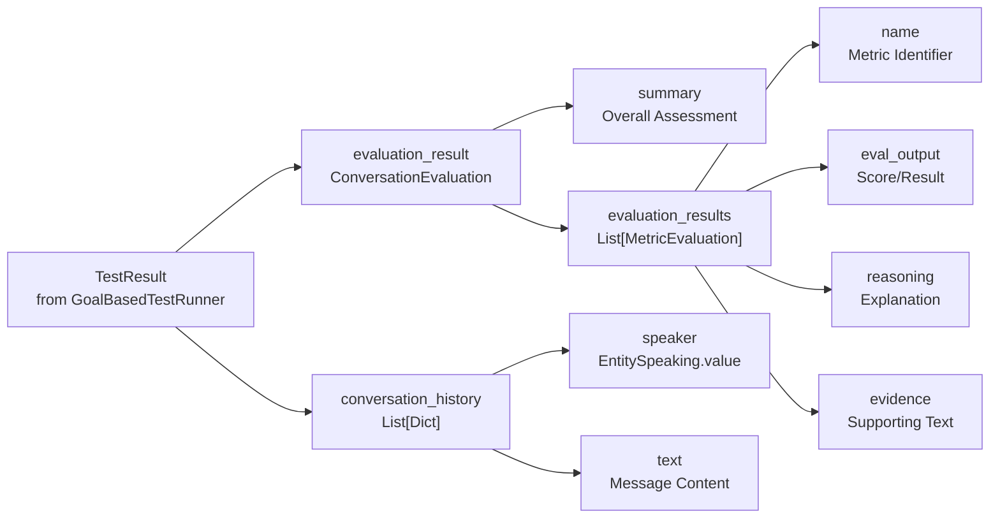

Sources: [llm_testing/run_tests.py:73-75](), [llm_testing/test_runner.py:116-123]()

## Test Execution and Results

### Multi-Variation Testing

The system supports testing multiple combinations of LLM models and system prompts to evaluate performance across different configurations.

### Verbose Output and Debugging

The test runner provides detailed output including conversation transcripts, evaluation metrics, and success indicators for debugging and analysis.

Sources: [llm_testing/run_tests.py:83-93]()

### Result Storage and Reporting

Test results are stored in a structured format and can be processed by the HTML report generation system for interactive visualization and analysis.

Sources: [llm_testing/example_test.py:8-9](), [llm_testing/run_tests.py:78-81]()

---

# Page: Web Chatbot Evaluation

# Web Chatbot Evaluation

<details>
<summary>Relevant source files</summary>

The following files were used as context for generating this wiki page:

- [web_eval.py](web_eval.py)
- [web_test_scenarios.json](web_test_scenarios.json)

</details>


## Purpose and Scope

The Web Chatbot Evaluation system provides automated testing capabilities for web-embedded chatbots through browser automation and AI-powered interaction simulation. This system navigates to live chatbot interfaces, initiates conversations, simulates realistic user behavior, and evaluates chatbot performance using structured metrics.

This document covers the browser automation framework, conversation simulation, and evaluation processes specific to web-based chatbots. For text-based LLM conversation testing without web interfaces, see [LLM Conversation Testing](#3.1). For speech-based testing, see [Speech Analysis Testing](#3.3). For test result reporting and metrics, see [Test Results & Reporting](#6).

## System Architecture

The web chatbot evaluation system integrates browser automation, visual AI analysis, conversation simulation, and performance evaluation into a unified testing pipeline.

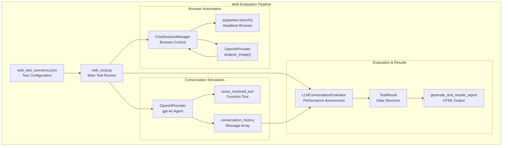

Sources: [web_eval.py:1-550](), [web_test_scenarios.json:1-284]()

## Test Execution Flow

The web evaluation process follows a structured workflow from browser initialization through conversation completion and evaluation.

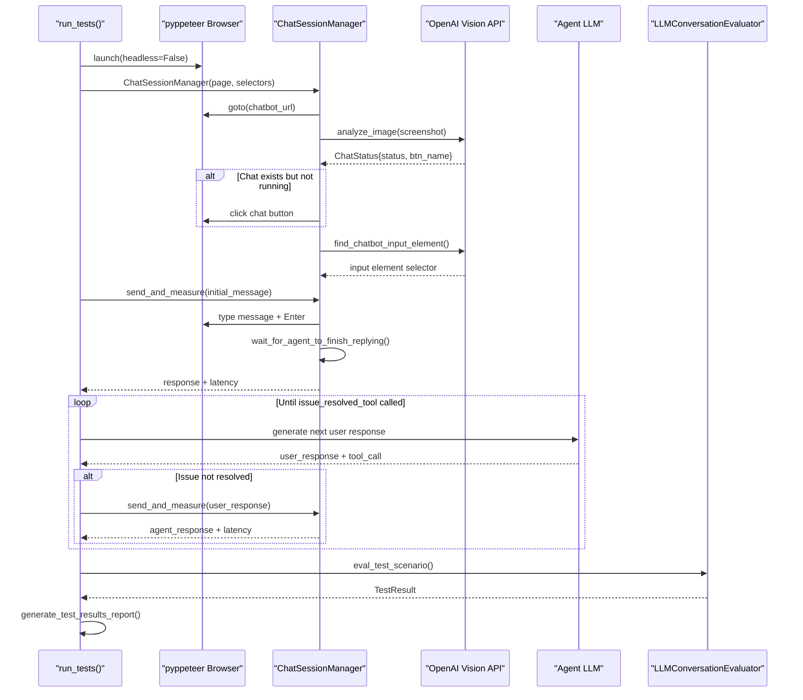

Sources: [web_eval.py:439-537](), [web_eval.py:150-256](), [web_eval.py:27-58]()

## Core Components

### ChatSessionManager Class

The `ChatSessionManager` class handles all browser automation and chat interface interactions through a comprehensive set of methods for chat detection, message handling, and conversation tracking.

| Method | Purpose | Key Parameters |
|--------|---------|----------------|
| `check_if_support_chat_running()` | Visual AI analysis to detect chat state | Returns `ChatStatus` |
| `initiate_support_chat()` | Navigate and start chat session | `chatbot_url` |
| `get_chatbot_input_element()` | Locate message input field | `chat_input_selector` |
| `send_and_measure()` | Send message and measure response time | `message`, `typing_delay` |
| `wait_for_agent_to_finish_replying()` | Wait for chatbot response completion | `CHATBOT_REPLY_TIMEOUT_SEC` |
| `get_conversation_history()` | Extract full conversation from DOM | Returns message array |

```python
# ChatSessionManager initialization pattern
chat_session_manager = ChatSessionManager(
    page, 
    scenario["chat_input_selector"], 
    scenario["shadow_root_selector"]
)
```

Sources: [web_eval.py:150-436]()

### Data Models

The system uses Pydantic models for structured data handling and API responses:

```python
class ChatStatus(BaseModel):
    status: str
    btn_name: Optional[str] = None

class ChatMessageWindow(BaseModel):
    status: str
    placeholder_txt: Optional[str] = None
```

Sources: [web_eval.py:141-149]()

### Conversation Resolution Detection

The `issue_resolved_tool` function tool enables the agent LLM to automatically detect when user issues are resolved:

```python
issue_resolved_tool = {
    "type": "function",
    "function": {
        "name": "user_issue_resolved",
        "description": "Call when conversation reaches resolution...",
        "parameters": {
            "issue_resolved": {"type": "boolean"},
            "confirmation_type": {"enum": ["explicit", "implicit", "none"]}
        }
    }
}
```

Sources: [web_eval.py:27-58]()

## Configuration System

### Test Scenario Structure

Web test scenarios are defined in `web_test_scenarios.json` with comprehensive configuration for each test case:

| Field | Purpose | Example |
|-------|---------|---------|
| `scenario_id` | Unique test identifier | `"refund_policy_question"` |
| `chatbot_url` | Target chatbot URL | `"https://decagon.ai/embed/notion"` |
| `chat_input_selector` | CSS selector for input field | `"textarea[placeholder='Ask...']"` |
| `shadow_root_selector` | Shadow DOM container selector | `"div[data-sierra-chat-container]"` |
| `successful_outcome` | Success criteria description | Detailed evaluation criteria |
| `user_persona` | Simulated user characteristics | Profession, emotional state, chat style |
| `guidelines` | Reference FAQ file | `"billing_notion.md"` |

Sources: [web_test_scenarios.json:1-284]()

### User Persona Configuration

Each test scenario includes detailed user persona configuration to drive realistic conversation simulation:

```json
{
  "user_persona": {
    "profession": "Product Manager",
    "emotional_state": "frustrated and confused",
    "chat_style": "somewhat tech-challenged, needs step-by-step guidance",
    "context": "Recently moved apartments and can't get Sonos One speaker to work",
    "initial_message": "Hi, I just moved to a new apartment..."
  }
}
```

Sources: [web_test_scenarios.json:69-75]()

## Browser Automation Details

### Visual AI Integration

The system uses OpenAI's vision capabilities to analyze webpage screenshots and automatically detect chat interface elements:

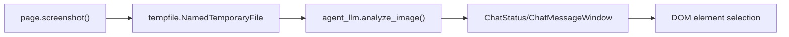

The visual analysis prompts are specifically designed for chat interface detection:

```python
prompt = """Analyze this webpage screenshot and determine if the chat is already running...
Your response should be {status: <status_string>, btn_name: <button_name>}.
Respond with status running if the chat is already running.
Respond with status exists and the name of the button to start the chat...
"""
```

Sources: [web_eval.py:156-169](), [web_eval.py:200-217]()

### Shadow DOM Handling

The system supports chatbots embedded in Shadow DOM structures through specialized element selection logic:

```python
async def get_element_from_dom(self, selector):     
    if self.shadow_root_selector:
        shadow_root = await self.get_shadow_root()
        searched_element = await self.page.evaluateHandle('''(root, selector) => {
            if (!root) return null;
            return root.querySelector(selector);
        }''', shadow_root, selector)
```

Sources: [web_eval.py:182-198]()

### Conversation History Extraction

The system includes sophisticated DOM parsing logic to extract conversation history from different chatbot implementations (Sierra, Decagon):

```python
# Sierra chat detection
const messageContainer = root.querySelector('ol');
const allMessages = Array.from(messageContainer.querySelectorAll('li[aria-roledescription="message"]'));

# Decagon chat detection  
const decagonContainer = root.querySelector('#chatbot-container');
const allMessages = Array.from(decagonContainer.querySelectorAll('[role=listitem], .flex.undefined'));
```

Sources: [web_eval.py:273-351]()

## Evaluation Process

### LLMConversationEvaluator Integration

The web evaluation system leverages the same evaluation framework used for LLM conversation testing:

```python
def eval_test_scenario(scenario, conversation_history):
    eval_llm = OpenAIProvider(api_key, "gpt-4o")
    evaluator = LLMConversationEvaluator(
        eval_llm, 
        "eval_metrics.json",
        "You are an objective conversational AI chatbot evaluator..."
    )
    
    return TestResult(
        evaluation_result=evaluator.evaluate(
            conversation_history,
            None,
            user_persona,
            success_criteria,
            scenario_guidelines
        ),
        conversation_history=conversation_history
    )
```

Sources: [web_eval.py:100-138]()

### Performance Metrics

The system tracks multiple performance metrics during test execution:

| Metric | Measurement | Usage |
|--------|-------------|-------|
| Response Latency | Time from message send to response complete | Per-message timing |
| Average Latency | Mean response time across conversation | Overall performance |
| Max Latency | Longest response time in conversation | Performance ceiling |
| Conversation Length | Total messages exchanged | Efficiency measure |

Sources: [web_eval.py:412-435](), [web_eval.py:525-533]()

## Results and Reporting

### Test Results Structure

Each completed test produces a structured result containing evaluation data and performance metrics:

```python
test_results_report[scenario["scenario_id"]] = {
    "tested_component": scenario,
    "result": eval_response,
    "avg_latency": sum(reply_latencies) / len(reply_latencies),
    "max_latency": max(reply_latencies)
}
```

The results are processed through the shared report generation system that produces interactive HTML reports with conversation history, evaluation scores, and performance data.

Sources: [web_eval.py:525-537](), [web_eval.py:16]()

---

# Page: Speech Analysis Testing

# Speech Analysis Testing

<details>
<summary>Relevant source files</summary>

The following files were used as context for generating this wiki page:

- [main.py](main.py)
- [speech_testing/example_test.py](speech_testing/example_test.py)
- [speech_testing/metrics/interruptions.py](speech_testing/metrics/interruptions.py)
- [speech_testing/metrics/interruptions_utils.py](speech_testing/metrics/interruptions_utils.py)
- [speech_testing/metrics/pauses.py](speech_testing/metrics/pauses.py)
- [speech_testing/run_tests.py](speech_testing/run_tests.py)

</details>


This document covers the speech analysis testing system within Voice Lab, which processes audio recordings of voice agent conversations to detect speech quality issues like interruptions and excessive pauses. The system uses advanced audio processing techniques including speaker diarization, speech recognition, and automated speech pattern analysis.

For information about testing LLM conversations without audio analysis, see [LLM Conversation Testing](#3.1). For web-based chatbot evaluation, see [Web Chatbot Evaluation](#3.2).

## System Architecture

The speech analysis testing system processes audio files through a multi-stage pipeline that combines speech recognition, speaker identification, and behavioral analysis to evaluate voice agent performance.

```mermaid
graph TD
    AudioFiles["Audio Files<br/>speech_testing/audio_files/"]
    RunTests["run_tests()<br/>speech_testing/run_tests.py"]
    
    subgraph "Audio Processing Pipeline"
        Diarization["Speaker Diarization<br/>diarize_audio()"]
        Transcription["Speech Recognition<br/>transcribe_precise_timestamps()"]
        Merging["Segment Merging<br/>merge_diarization_and_transcription()"]
        SpeakerID["Speaker Identification<br/>determine_speakers()"]
    end
    
    subgraph "Speech Analysis"
        InterruptionDetection["Interruption Detection<br/>detect_interuptions()"]
        PauseDetection["Pause Detection<br/>detect_pauses()"]
    end
    
    subgraph "Data Types"
        CallSegments["CallSegment[]<br/>Timestamped Speech"]
        SpeechTestResult["SpeechTestResult<br/>Complete Analysis"]
    end
    
    subgraph "External Services"
        HuggingFace["Hugging Face<br/>pyannote/speaker-diarization-3.1"]
        StableWhisper["Stable Whisper<br/>large-v3-turbo model"]
        OpenAI["OpenAI API<br/>Speaker Identification"]
    end
    
    AudioFiles --> RunTests
    RunTests --> Diarization
    RunTests --> Transcription
    
    Diarization --> HuggingFace
    Transcription --> StableWhisper
    Diarization --> Merging
    Transcription --> Merging
    
    Merging --> CallSegments
    CallSegments --> SpeakerID
    SpeakerID --> OpenAI
    
    CallSegments --> InterruptionDetection
    CallSegments --> PauseDetection
    
    InterruptionDetection --> SpeechTestResult
    PauseDetection --> SpeechTestResult
```

Sources: [speech_testing/run_tests.py:192-210](), [speech_testing/run_tests.py:167-188]()

## Audio Processing Pipeline

### Speaker Diarization and Transcription

The system uses a two-step approach to process audio files: speaker diarization to identify who is speaking when, followed by speech recognition to generate transcripts with precise timestamps.

| Component | Technology | Purpose |
|-----------|------------|---------|
| Speaker Diarization | pyannote/speaker-diarization-3.1 | Identify speaker segments |
| Speech Recognition | Stable Whisper large-v3-turbo | Generate timestamped transcripts |
| Speaker Identification | OpenAI GPT-4o-mini | Map speaker labels to agent/callee |

```mermaid
sequenceDiagram
    participant Audio as "Audio File"
    participant Diarize as "diarize_audio()"
    participant HF as "Hugging Face Pipeline"
    participant Transcribe as "transcribe_precise_timestamps()"
    participant Whisper as "Stable Whisper"
    participant Merge as "merge_diarization_and_transcription()"
    participant Identify as "determine_speakers()"
    participant OpenAI as "OpenAI Provider"
    
    Audio->>Diarize: Load audio file
    Diarize->>HF: Process with speaker diarization
    HF-->>Diarize: Speaker segments with timestamps
    
    Audio->>Transcribe: Load audio file
    Transcribe->>Whisper: Transcribe with word-level timestamps
    Whisper-->>Transcribe: Detailed transcription
    
    Diarize->>Merge: Speaker segments
    Transcribe->>Merge: Word transcriptions
    Merge-->>Identify: CallSegment objects
    
    Identify->>OpenAI: Analyze conversation with agent task
    OpenAI-->>Identify: Speaker role mapping
```

Sources: [speech_testing/run_tests.py:80-96](), [speech_testing/run_tests.py:22-23](), [speech_testing/run_tests.py:25-77](), [speech_testing/run_tests.py:99-118]()

### Data Flow and Segment Processing

The `CallSegment` data structure represents the fundamental unit of processed speech, containing speaker identity, timing information, and transcript text.

```mermaid
graph LR
    subgraph "Input Processing"
        RawAudio["Raw Audio File<br/>.wav format"]
        DiarizeResult["Diarization Result<br/>Speaker labels + timestamps"]  
        WhisperResult["Whisper Transcription<br/>Word-level timestamps"]
    end
    
    subgraph "Data Structures"
        CallSegment["CallSegment<br/>start_time: float<br/>end_time: float<br/>speaker: EntitySpeaking<br/>text: str"]
        EntitySpeaking["EntitySpeaking<br/>VOICE_AGENT | CALLEE"]
    end
    
    subgraph "Processing Functions"
        MergeFunc["merge_diarization_and_transcription()<br/>Lines 25-77"]
        SpeakerMap["determine_speakers()<br/>Lines 99-118"] 
    end
    
    RawAudio --> DiarizeResult
    RawAudio --> WhisperResult
    DiarizeResult --> MergeFunc
    WhisperResult --> MergeFunc
    MergeFunc --> CallSegment
    CallSegment --> SpeakerMap
    SpeakerMap --> EntitySpeaking
    EntitySpeaking --> CallSegment
```

Sources: [speech_testing/data_types.py](), [speech_testing/run_tests.py:25-77](), [llm_testing/core/data_types.py]()

## Speech Metrics Analysis

### Interruption Detection

The interruption detection system identifies when one speaker begins talking before another speaker has finished, which is a key indicator of conversational flow problems.

```mermaid
graph TD
    CallSegments["List[CallSegment]<br/>Ordered by start_time"]
    DetectFunc["detect_interuptions()<br/>speech_testing/metrics/interruptions.py"]
    
    subgraph "Detection Logic"
        SpeakerChange["Check speaker transitions"]
        TimingCheck["if current.start_time <= prev.end_time"]
        CreateInterruption["Create InterruptionData"]
    end
    
    subgraph "Output Data"
        InterruptionData["InterruptionData<br/>interrupted_speaker: EntitySpeaking<br/>interrupted_at: float<br/>interruption_duration: float<br/>interruption_text: str"]
    end
    
    CallSegments --> DetectFunc
    DetectFunc --> SpeakerChange
    SpeakerChange --> TimingCheck
    TimingCheck --> CreateInterruption
    CreateInterruption --> InterruptionData
```

The core interruption detection algorithm:

| Step | Logic | Implementation |
|------|-------|----------------|
| Speaker Transition | Check if `current_speaker != prev_speaker` | [interruptions.py:18]() |
| Timing Overlap | Validate `res.start_time <= prev_end_time` | [interruptions.py:20]() |
| Interruption Classification | Determine who interrupted whom | [interruptions.py:31]() |

Sources: [speech_testing/metrics/interruptions.py:8-38]()

### Pause Detection

The pause detection system identifies unnaturally long silences after callee responses, which may indicate agent processing delays or conversation flow issues.

```mermaid
graph TD
    CallSegments["List[CallSegment]<br/>Sequential conversation"]
    DetectPauses["detect_pauses()<br/>MIN_PAUSE_DURATION = 2s"]
    
    subgraph "Pause Logic"
        CalleeResponse["prev.speaker == CALLEE"]
        AgentResponse["current.speaker == VOICE_AGENT"] 
        DurationCheck["pause_duration > MIN_PAUSE_DURATION"]
        CreatePause["Create PauseData"]
    end
    
    subgraph "Pause Data"
        PauseData["PauseData<br/>duration: float<br/>start_time: float<br/>text_before_pause: str<br/>text_after_pause: str"]
    end
    
    CallSegments --> DetectPauses
    DetectPauses --> CalleeResponse
    CalleeResponse --> AgentResponse
    AgentResponse --> DurationCheck
    DurationCheck --> CreatePause
    CreatePause --> PauseData
```

Sources: [speech_testing/metrics/pauses.py:5-34]()

## Integration with Test Framework

### Result Integration

The speech analysis system integrates with the broader Voice Lab framework through standardized data types and result formatting.

```mermaid
graph TB
    subgraph "Speech Testing"
        SpeechTestResult["SpeechTestResult<br/>call_segments: List[CallSegment]<br/>interruptions: List[InterruptionData]<br/>pauses: List[PauseData]"]
    end
    
    subgraph "Framework Integration" 
        MainPy["main.py<br/>Lines 37-38"]
        ResultTransform["Transform to TestResult<br/>Lines 44-77"]
        EvaluationResponse["EvaluationResponse<br/>summary + evaluation_results"]
        MetricResult["MetricResult<br/>interruptions & pauses metrics"]
    end
    
    subgraph "Report Generation"
        TestResult["TestResult<br/>evaluation_result + conversation_history"]
        GenerateReport["generate_test_results_report()<br/>HTML output"]
    end
    
    SpeechTestResult --> MainPy
    MainPy --> ResultTransform
    ResultTransform --> EvaluationResponse
    ResultTransform --> MetricResult
    EvaluationResponse --> TestResult
    MetricResult --> TestResult
    TestResult --> GenerateReport
```

### Metric Conversion

The system converts speech analysis results into the standard evaluation format used across all Voice Lab testing modalities:

| Speech Metric | Conversion Logic | Success Criteria |
|---------------|------------------|------------------|
| Interruptions | `"true" if len(interruptions) == 0 else "false"` | Zero interruptions |
| Pauses | `"true" if len(pauses) == 0 else "false"` | No excessive pauses |

Sources: [main.py:44-77](), [core/data_types.py]()

## Usage Patterns

### Basic Test Execution

The primary entry point for speech testing is through the `run_tests` function:

```python
# From main.py example
tests_result = run_speech_tests("speech_testing/audio_files", 
                               "Qualify leads for a new voice agent called Jordan")
```

### Test Configuration

| Parameter | Type | Purpose | Example |
|-----------|------|---------|---------|
| `audio_files_dir` | `str` | Directory containing audio files | `"speech_testing/audio_files"` |
| `agent_task` | `str` | Description of agent's role for speaker ID | `"Qualify leads for a voice agent"` |

### File Processing

The system processes audio files with specific naming patterns and formats:

```mermaid
graph LR
    AudioDir["Audio Files Directory"]
    FileFilter["Filter: startswith('11x_outbound')"]
    ProcessFile["analyze_audio() per file"]
    Results["Dict[filename, SpeechTestResult]"]
    
    AudioDir --> FileFilter
    FileFilter --> ProcessFile  
    ProcessFile --> Results
```

Sources: [speech_testing/run_tests.py:192-210](), [speech_testing/run_tests.py:196-198]()

## System Dependencies

### External Services

| Service | Purpose | Configuration |
|---------|---------|---------------|
| Hugging Face | Speaker diarization models | `HUGGING_FACE_TOKEN` environment variable |
| OpenAI API | Speaker identification via LLM | `OPENAI_API_KEY` environment variable |
| Stable Whisper | Speech-to-text transcription | Model loaded locally |

### Audio Processing Libraries

The system relies on several specialized audio processing libraries integrated through the processing pipeline:

- **pyannote.audio**: Speaker diarization pipeline
- **stable-whisper**: Enhanced Whisper implementation with precise timestamps  
- **torchaudio**: Audio file loading and tensor operations

Sources: [speech_testing/run_tests.py:15-19](), [speech_testing/run_tests.py:81-83](), [speech_testing/run_tests.py:100-102]()

---

# Page: Real-time Voice Interaction

# Real-time Voice Interaction

<details>
<summary>Relevant source files</summary>

The following files were used as context for generating this wiki page:

- [eval_agent/gemini_connection.py](eval_agent/gemini_connection.py)
- [eval_agent/requirements.txt](eval_agent/requirements.txt)
- [eval_agent/run_tests.py](eval_agent/run_tests.py)
- [eval_agent/voice_activity_detector.py](eval_agent/voice_activity_detector.py)

</details>


This document covers the real-time voice interaction system that enables bidirectional voice communication with Google Gemini 2.0 Flash model. This system provides live voice agent testing capabilities through continuous audio streaming, voice activity detection, and real-time response generation.

For text-based LLM conversation testing, see [LLM Conversation Testing](#3.1). For web-based chatbot evaluation, see [Web Chatbot Evaluation](#3.2). For audio file analysis, see [Speech Analysis Testing](#3.3).

## System Overview

The real-time voice interaction system is built around the `GeminiConnection` class, which manages WebSocket connections to Google's BidiGenerateContent API for streaming audio communication. The system captures live microphone input, performs voice activity detection, streams audio to Gemini, and plays back responses in real-time.

### Core Architecture

The system consists of three main components operating concurrently:

```mermaid
graph TD
    subgraph "Real-time Voice System"
        GeminiConnection["GeminiConnection<br/>Main orchestrator"]
        VoiceActivityDetector["VoiceActivityDetector<br/>Speech detection"]
        
        subgraph "Audio Processing"
            AudioCapture["capture_audio()<br/>Microphone input"]
            AudioPlayback["play_responses()<br/>Speaker output"]
            AudioQueue["audio_queue<br/>Response buffer"]
        end
        
        subgraph "Communication"
            WebSocketConn["WebSocket Connection<br/>Gemini API"]
            MessageReceiver["receive_server_messages()<br/>Response handler"]
        end
        
        subgraph "Control"
            CleanupWatcher["watch_cleanup()<br/>Graceful shutdown"]
            ConfigManager["Configuration<br/>System prompts, voice"]
        end
    end
    
    GeminiConnection --> VoiceActivityDetector
    GeminiConnection --> AudioCapture
    GeminiConnection --> AudioPlayback
    GeminiConnection --> WebSocketConn
    
    AudioCapture --> VoiceActivityDetector
    AudioCapture --> WebSocketConn
    WebSocketConn --> MessageReceiver
    MessageReceiver --> AudioQueue
    AudioQueue --> AudioPlayback
    
    GeminiConnection --> CleanupWatcher
    ConfigManager --> GeminiConnection
```

Sources: [eval_agent/gemini_connection.py:13-51]()

## Core Components

### GeminiConnection Class

The `GeminiConnection` class serves as the main orchestrator for real-time voice interactions. It manages WebSocket connections, audio streaming, and concurrent task execution.

| Component | Purpose | Key Methods |
|-----------|---------|-------------|
| WebSocket Management | Establish and maintain connection to Gemini API | `start()`, `cleanup()` |
| Audio Processing | Handle input/output audio streams | `capture_audio()`, `play_responses()` |
| Message Handling | Process server responses and audio data | `receive_server_messages()` |
| Lifecycle Management | Coordinate concurrent tasks and cleanup | `watch_cleanup()` |

The class initialization configures essential parameters:

```mermaid
graph LR
    subgraph "GeminiConnection Initialization"
        APIKey["GEMINI_API_KEY<br/>Environment variable"]
        ModelConfig["Model Configuration<br/>gemini-2.0-flash-exp"]
        AudioSettings["Audio Settings<br/>16kHz input, 24kHz output"]
        VoiceConfig["Voice Configuration<br/>Puck, system prompt"]
    end
    
    subgraph "Runtime Objects"
        WebSocketURI["WebSocket URI<br/>BidiGenerateContent endpoint"]
        PyAudioStream["PyAudio Streams<br/>Input/Output"]
        AsyncQueue["Audio Queue<br/>Response buffering"]
        VADInstance["VAD Instance<br/>silero-vad model"]
    end
    
    APIKey --> WebSocketURI
    ModelConfig --> WebSocketURI
    AudioSettings --> PyAudioStream
    VoiceConfig --> WebSocketURI
    AudioSettings --> AsyncQueue
    ModelConfig --> VADInstance
```

Sources: [eval_agent/gemini_connection.py:14-51]()

### Voice Activity Detection

The `VoiceActivityDetector` class uses the Silero VAD model to distinguish speech from noise, preventing unnecessary audio transmission to the Gemini API.

The detector processes raw audio bytes and returns a boolean indicating speech presence:

```mermaid
graph LR
    subgraph "Voice Activity Detection Pipeline"
        RawBytes["Raw Audio Bytes<br/>16-bit PCM"]
        NumpyArray["NumPy Array<br/>int16 format"]
        FloatNormalization["Float32 Normalization<br/>[-1, 1] range"]
        TorchTensor["Torch Tensor<br/>Model input"]
        SileroVAD["Silero VAD Model<br/>Speech probability"]
        ThresholdCheck["Threshold Check<br/>Default 0.5"]
        SpeechDecision["Boolean Result<br/>is_speech()"]
    end
    
    RawBytes --> NumpyArray
    NumpyArray --> FloatNormalization
    FloatNormalization --> TorchTensor
    TorchTensor --> SileroVAD
    SileroVAD --> ThresholdCheck
    ThresholdCheck --> SpeechDecision
```

Sources: [eval_agent/voice_activity_detector.py:12-24]()

## Audio Processing Pipeline

### Input Audio Flow

The audio capture process runs continuously, processing microphone input through multiple stages:

```mermaid
graph TD
    subgraph "Audio Input Pipeline"
        Microphone["Microphone Input<br/>PyAudio stream"]
        ChunkCapture["Audio Chunk Capture<br/>512 samples"]
        InterruptionCheck["Interruption Logic<br/>allow_interruptions flag"]
        VADProcessing["Voice Activity Detection<br/>is_speech() check"]
        AudioEncoding["Base64 Encoding<br/>PCM data"]
        WebSocketSend["WebSocket Transmission<br/>realtime_input message"]
    end
    
    subgraph "Control Logic"
        PlaybackState["is_playing flag<br/>Speaker activity"]
        InterruptionConfig["allow_interruptions<br/>Configuration"]
        SilenceGeneration["Silent Audio<br/>Zero bytes"]
    end
    
    Microphone --> ChunkCapture
    ChunkCapture --> InterruptionCheck
    InterruptionCheck --> VADProcessing
    VADProcessing --> AudioEncoding
    AudioEncoding --> WebSocketSend
    
    PlaybackState --> InterruptionCheck
    InterruptionConfig --> InterruptionCheck
    VADProcessing --> SilenceGeneration
```

The system implements interruption handling logic where audio input can be conditionally processed based on whether the system is currently playing responses:

Sources: [eval_agent/gemini_connection.py:116-184]()

### Output Audio Flow

Response audio from Gemini is processed through an asynchronous queue system:

```mermaid
graph TD
    subgraph "Audio Output Pipeline"
        WebSocketReceive["WebSocket Messages<br/>serverContent responses"]
        MessageParsing["JSON Parsing<br/>Extract audio data"]
        Base64Decoding["Base64 Decoding<br/>Audio bytes"]
        AudioQueue["Async Queue<br/>Buffer responses"]
        AudioPlayback["PyAudio Playback<br/>24kHz output"]
    end
    
    subgraph "Response Types"
        InlineData["inlineData<br/>Audio content"]
        TextResponse["text<br/>Text content"]
        TurnComplete["turnComplete<br/>End marker"]
    end
    
    WebSocketReceive --> MessageParsing
    MessageParsing --> InlineData
    MessageParsing --> TextResponse
    MessageParsing --> TurnComplete
    
    InlineData --> Base64Decoding
    Base64Decoding --> AudioQueue
    AudioQueue --> AudioPlayback
    
    TurnComplete --> AudioQueue
```

Sources: [eval_agent/gemini_connection.py:186-214](), [eval_agent/gemini_connection.py:215-238]()

## Configuration and Setup

### System Configuration

The real-time voice system accepts a configuration dictionary with the following parameters:

| Parameter | Default | Purpose |
|-----------|---------|---------|
| `system_prompt` | Friendly assistant prompt | Instructions for Gemini behavior |
| `voice` | "Puck" | Gemini voice selection |
| `google_search` | `True` | Enable Google Search tool |
| `allow_interruptions` | `False` | Allow input during playback |

### WebSocket Setup Message

The system initializes the Gemini connection with a structured setup message:

```mermaid
graph LR
    subgraph "Setup Message Structure"
        SetupRoot["setup<br/>Root object"]
        ModelSpec["model<br/>gemini-2.0-flash-exp"]
        GenerationConfig["generation_config<br/>Response configuration"]
        SystemInstruction["system_instruction<br/>Behavior prompt"]
    end
    
    subgraph "Generation Config"
        Tools["tools<br/>Google Search"]
        ResponseModalities["response_modalities<br/>AUDIO"]
        SpeechConfig["speech_config<br/>Voice settings"]
    end
    
    subgraph "Speech Configuration"
        VoiceConfig["voice_config<br/>Voice selection"]
        PrebuiltVoice["prebuilt_voice_config<br/>Voice name"]
    end
    
    SetupRoot --> ModelSpec
    SetupRoot --> GenerationConfig
    SetupRoot --> SystemInstruction
    
    GenerationConfig --> Tools
    GenerationConfig --> ResponseModalities
    GenerationConfig --> SpeechConfig
    
    SpeechConfig --> VoiceConfig
    VoiceConfig --> PrebuiltVoice
```

Sources: [eval_agent/gemini_connection.py:66-96]()

## Integration Points

### Test Runner Integration

The system integrates with the broader Voice Lab framework through the `run_tests()` function, which provides a simple interface for voice conversation testing:

```mermaid
graph TD
    subgraph "Test Execution Flow"
        RunTests["run_tests()<br/>Entry point"]
        ConfigSetup["Configuration<br/>System prompt, voice"]
        CleanupEvent["Threading Event<br/>Graceful shutdown"]
        GeminiInit["GeminiConnection<br/>Instance creation"]
        AsyncExecution["asyncio.run()<br/>Main loop"]
    end
    
    subgraph "Error Handling"
        KeyboardInterrupt["KeyboardInterrupt<br/>User termination"]
        CleanupTrigger["cleanup_event.set()<br/>Shutdown signal"]
        ResourceCleanup["Resource cleanup<br/>Streams, connections"]
    end
    
    RunTests --> ConfigSetup
    RunTests --> CleanupEvent
    RunTests --> GeminiInit
    RunTests --> AsyncExecution
    
    AsyncExecution --> KeyboardInterrupt
    KeyboardInterrupt --> CleanupTrigger
    CleanupTrigger --> ResourceCleanup
```

Sources: [eval_agent/run_tests.py:15-41]()

### Dependencies and Requirements

The real-time voice system requires specific dependencies for audio processing and WebSocket communication:

| Package | Version | Purpose |
|---------|---------|---------|
| `websockets` | Latest | WebSocket client for Gemini API |
| `python-dotenv` | 1.0.0 | Environment variable management |
| `pyaudio` | 0.2.14 | Audio input/output handling |
| `google-genai` | 0.2.2 | Google AI SDK |
| `torch` | Latest | PyTorch for VAD model |
| `numpy` | Latest | Audio data processing |

Sources: [eval_agent/requirements.txt:1-8]()

## Concurrent Task Management

The system uses `asyncio.TaskGroup` to manage four concurrent tasks that handle different aspects of the real-time interaction:

```mermaid
graph TD
    subgraph "Concurrent Task Architecture"
        TaskGroup["asyncio.TaskGroup<br/>Task coordinator"]
        
        subgraph "Audio Tasks"
            CaptureTask["capture_audio()<br/>Microphone input"]
            PlaybackTask["play_responses()<br/>Speaker output"]
        end
        
        subgraph "Communication Tasks"
            ReceiveTask["receive_server_messages()<br/>WebSocket listener"]
            CleanupTask["watch_cleanup()<br/>Shutdown monitor"]
        end
    end
    
    subgraph "Shared State"
        RunningFlag["self.running<br/>Global state"]
        PlayingFlag["self.is_playing<br/>Audio state"]
        AudioQueue["self.audio_queue<br/>Response buffer"]
        CleanupEvent["cleanup_event<br/>Thread signal"]
    end
    
    TaskGroup --> CaptureTask
    TaskGroup --> PlaybackTask
    TaskGroup --> ReceiveTask
    TaskGroup --> CleanupTask
    
    RunningFlag --> CaptureTask
    RunningFlag --> PlaybackTask
    RunningFlag --> ReceiveTask
    RunningFlag --> CleanupTask
    
    PlayingFlag --> CaptureTask
    AudioQueue --> PlaybackTask
    CleanupEvent --> CleanupTask
```

Sources: [eval_agent/gemini_connection.py:105-109](), [eval_agent/gemini_connection.py:240-246]()

---

# Page: Test Configuration

# Test Configuration

<details>
<summary>Relevant source files</summary>

The following files were used as context for generating this wiki page:

- [.DS_Store](.DS_Store)
- [LICENSE](LICENSE)
- [README.md](README.md)
- [llm_testing/.DS_Store](llm_testing/.DS_Store)
- [llm_testing/config/test_scenarios.json](llm_testing/config/test_scenarios.json)

</details>


This document covers the configuration system used to define and manage test scenarios across Voice Lab's different testing modalities. Test configuration enables you to specify agent behaviors, personas, success criteria, and evaluation parameters that drive automated testing workflows.

For detailed configuration of specific test types, see [LLM Test Scenarios](#4.1) and [Web Test Scenarios](#4.2). For information about evaluation metrics configuration, see [Evaluation & Metrics](#5).

## Configuration Architecture

Voice Lab uses JSON-based configuration files to define test scenarios across multiple testing systems. The configuration architecture separates test definitions from execution logic, enabling easy modification and reuse of test scenarios.

```mermaid
graph TB
    subgraph "Configuration Files"
        TestScenarios["test_scenarios.json<br/>LLM Test Definitions"]
        WebScenarios["web_test_scenarios.json<br/>Web Chatbot Tests"]
        EvalMetrics["eval_metrics.json<br/>Evaluation Criteria"]
    end
    
    subgraph "Configuration Tools"
        UIEditor["Voice Lab Configuration Editor<br/>Web-based UI Tool"]
        ManualEdit["Manual JSON Editing<br/>Direct File Modification"]
    end
    
    subgraph "Test Execution Systems"
        LLMRunner["llm_testing/run_tests.py<br/>LLM Test Runner"]
        WebRunner["web_eval.py<br/>Web Test Runner"]
        TestRunner["test_runner.py<br/>GoalBasedTestRunner"]
    end
    
    UIEditor --> TestScenarios
    UIEditor --> WebScenarios
    ManualEdit --> TestScenarios
    ManualEdit --> WebScenarios
    ManualEdit --> EvalMetrics
    
    TestScenarios --> LLMRunner
    WebScenarios --> WebRunner
    TestScenarios --> TestRunner
    EvalMetrics --> LLMRunner
    EvalMetrics --> WebRunner
```

Sources: [README.md:71-72](), [llm_testing/config/test_scenarios.json:1-279]()

## Test Scenario Structure

Each test scenario defines a complete testing interaction between an AI agent and a simulated persona. The configuration structure supports complex, goal-based conversations with detailed success criteria.

```mermaid
graph TB
    subgraph "Test Scenario Configuration"
        ScenarioName["Scenario Name<br/>e.g. 'angry_hotel_receptionist'"]
        
        subgraph "tested_components"
            LLMs["underlying_llms<br/>['gpt-4o-mini', 'gpt-3.5-turbo']"]
            Prompts["agent_system_prompts<br/>System Prompt Variations"]
        end
        
        subgraph "agent"
            InitMsg["initial_message<br/>Agent Opening Statement"]
            ToolCalls["tool_calls<br/>Function Definitions"]
            SuccessCriteria["success_criteria<br/>required_confirmations"]
            AddlContext["additional_context<br/>Agent Knowledge"]
        end
        
        subgraph "persona"
            PersonaName["name<br/>Character Identity"]
            PersonaDesc["description<br/>Character Background"]
            Traits["traits<br/>Behavioral Characteristics"]
            Mood["mood<br/>Emotional State"]
            ResponseStyle["response_style<br/>Communication Style"]
            PersonaContext["additional_context<br/>Domain Knowledge"]
        end
    end
    
    ScenarioName --> tested_components
    ScenarioName --> agent
    ScenarioName --> persona
```

Sources: [llm_testing/config/test_scenarios.json:2-98](), [llm_testing/config/test_scenarios.json:99-191]()

## Configuration Components

### Agent Configuration

The `agent` section defines the AI system being tested, including its initial behavior, available tools, and success criteria.

| Component | Purpose | Example |
|-----------|---------|---------|
| `initial_message` | Agent's opening statement | `"Hi, I'd like to book a room"` |
| `tool_calls` | Function definitions and schemas | `end_conversation` function |
| `success_criteria` | Required confirmations for success | `["booking_reference", "price"]` |
| `additional_context` | Agent background knowledge | Credit card details, preferences |

Sources: [llm_testing/config/test_scenarios.json:7-74]()

### Persona Configuration

The `persona` section defines the simulated character that interacts with the agent, including personality traits, background, and domain-specific knowledge.

| Component | Purpose | Example |
|-----------|---------|---------|
| `name` | Character identity | `"John Smith"` |
| `description` | Character background | `"Irritable hotel receptionist having a bad day"` |
| `traits` | Behavioral characteristics | `["impatient", "curt", "easily annoyed"]` |
| `mood` | Emotional state | `"ANGRY"` |
| `response_style` | Communication style | `"CURT"` |
| `additional_context` | Domain knowledge | Available dates, pricing information |

Sources: [llm_testing/config/test_scenarios.json:75-97]()

### Tool Function Definitions

Test scenarios include structured function definitions that define when and how conversations should end, with strict validation schemas.

```mermaid
graph LR
    subgraph "end_conversation Function"
        FuncDef["Function Definition<br/>end_conversation"]
        
        subgraph "Parameters"
            Reason["reason<br/>Termination Cause"]
            WhoEnded["who_ended_conversation<br/>Agent or Callee"]
            Evidence["termination_evidence<br/>Supporting Data"]
        end
        
        subgraph "Validation"
            ReasonEnum["Reason Enum<br/>explicit_termination_request<br/>service_not_available<br/>etc."]
            EvidenceSchema["Evidence Schema<br/>final_messages[]<br/>termination_type"]
        end
    end
    
    FuncDef --> Parameters
    Parameters --> Validation
```

Sources: [llm_testing/config/test_scenarios.json:9-59](), [llm_testing/config/test_scenarios.json:109-155]()

## Configuration Management

### Manual Configuration

Test scenarios can be created and modified by directly editing JSON configuration files. The structure follows a consistent schema across all test types.

```json
{
    "scenario_name": {
        "tested_components": {
            "underlying_llms": ["gpt-4o-mini"],
            "agent_system_prompts": ["Your system prompt here"]
        },
        "agent": {
            "initial_message": "Agent opening",
            "success_criteria": {
                "required_confirmations": ["key1", "key2"]
            }
        },
        "persona": {
            "name": "Character Name",
            "mood": "EMOTIONAL_STATE",
            "traits": ["trait1", "trait2"]
        }
    }
}
```

Sources: [README.md:73-145]()

### Voice Lab Configuration Editor

Voice Lab provides a web-based configuration editor that generates properly formatted JSON configuration files without requiring manual JSON editing.

| Tool | URL | Purpose |
|------|-----|---------|
| Configuration Editor | `https://saharmor.me/voice-lab-ui/` | Generate test scenarios |
| Manual Editing | Direct file modification | Advanced customization |

Sources: [README.md:71](), [README.md:74]()

## Multi-Model Testing

Test scenarios support testing multiple LLM models and system prompt variations within a single configuration, enabling comparative analysis across different AI systems.

```mermaid
graph TB
    subgraph "tested_components Configuration"
        SingleScenario["Single Test Scenario<br/>e.g. 'united_airlines_seat_change'"]
        
        subgraph "Model Variations"
            LLM1["gpt-4o-mini"]
            LLM2["gpt-3.5-turbo"]
        end
        
        subgraph "Prompt Variations"
            Prompt1["System Prompt Variation 1<br/>Basic Instructions"]
            Prompt2["System Prompt Variation 2<br/>Enhanced Instructions"]
        end
        
        subgraph "Test Execution Matrix"
            Combo1["LLM1 + Prompt1"]
            Combo2["LLM1 + Prompt2"] 
            Combo3["LLM2 + Prompt1"]
            Combo4["LLM2 + Prompt2"]
        end
    end
    
    SingleScenario --> Model_Variations
    SingleScenario --> Prompt_Variations
    Model_Variations --> Test_Execution_Matrix
    Prompt_Variations --> Test_Execution_Matrix
```

Sources: [llm_testing/config/test_scenarios.json:100-106](), [llm_testing/config/test_scenarios.json:194-197]()

## Configuration File Locations

Voice Lab organizes configuration files in a structured directory layout that separates different types of test configurations.

| File Path | Purpose | Test Type |
|-----------|---------|-----------|
| `llm_testing/config/test_scenarios.json` | LLM conversation scenarios | LLM Testing |
| `web_eval/config/web_test_scenarios.json` | Web chatbot scenarios | Web Testing |
| `config/eval_metrics.json` | Evaluation criteria definitions | All Testing |

Sources: [llm_testing/config/test_scenarios.json:1]()

---

# Page: LLM Test Scenarios

# LLM Test Scenarios

<details>
<summary>Relevant source files</summary>

The following files were used as context for generating this wiki page:

- [llm_testing/config/test_scenarios.json](llm_testing/config/test_scenarios.json)

</details>


This document covers the configuration and structure of LLM conversation test scenarios used by the Voice Lab testing framework. LLM test scenarios define goal-based conversations between an AI agent and a persona, including success criteria, tool definitions, and contextual parameters.

For information about executing these test scenarios, see [LLM Conversation Testing](#3.1). For details about how scenarios are evaluated, see [Evaluation & Metrics](#5). For the underlying data structures, see [Data Types & Models](#7.1).

## Overview

LLM test scenarios are defined in JSON configuration files that specify two-party conversations between an AI agent and a simulated human persona. Each scenario includes the agent's objectives, available tools, success criteria, and the persona's behavioral characteristics.

The scenarios enable testing of:
- Goal-oriented conversation flows
- Function calling and tool usage
- Multi-turn conversation handling
- Persona-based behavioral responses
- Success criteria validation

## Test Scenario Structure

### Core Components

Each test scenario consists of three primary components organized in a hierarchical structure:

```mermaid
graph TD
    TestScenario["Test Scenario"]
    TestScenario --> TestedComponents["tested_components"]
    TestScenario --> Agent["agent"]
    TestScenario --> Persona["persona"]
    
    TestedComponents --> UnderlyingLLMs["underlying_llms[]"]
    TestedComponents --> AgentSystemPrompts["agent_system_prompts[]"]
    
    Agent --> InitialMessage["initial_message"]
    Agent --> ToolCalls["tool_calls[]"]
    Agent --> SuccessCriteria["success_criteria"]
    Agent --> AdditionalContext["additional_context"]
    
    Persona --> PersonaName["name"]
    Persona --> PersonaInitialMessage["initial_message"]
    Persona --> Description["description"]
    Persona --> Role["role"]
    Persona --> Traits["traits[]"]
    Persona --> Mood["mood"]
    Persona --> ResponseStyle["response_style"]
    Persona --> BackgroundInfo["background_info"]
    Persona --> PersonaContext["additional_context"]
```

Sources: [llm_testing/config/test_scenarios.json:1-279]()

### Component Mapping to Code Entities

The test scenario components map directly to code entities used during test execution:

```mermaid
graph LR
    subgraph "Configuration Layer"
        TestScenariosJSON["test_scenarios.json"]
        ScenarioKey["scenario_key"]
    end
    
    subgraph "Runtime Data Types"
        TestResult["TestResult"]
        CalleePersona["CalleePersona"]
        ConversationHistory["ConversationHistory"]
    end
    
    subgraph "Execution Components"
        GoalBasedTestRunner["GoalBasedTestRunner"]
        OpenAIProvider["OpenAIProvider"]
        LLMConversationEvaluator["LLMConversationEvaluator"]
    end
    
    TestScenariosJSON --> ScenarioKey
    ScenarioKey --> CalleePersona
    ScenarioKey --> TestResult
    
    CalleePersona --> GoalBasedTestRunner
    TestResult --> GoalBasedTestRunner
    
    GoalBasedTestRunner --> OpenAIProvider
    GoalBasedTestRunner --> LLMConversationEvaluator
    
    ConversationHistory --> LLMConversationEvaluator
```

Sources: [llm_testing/config/test_scenarios.json:1-279](), [core/data_types.py](), [llm_testing/test_runner.py](), [core/evaluator.py]()

## Configuration Structure

### Tested Components Section

The `tested_components` section defines the LLM models and system prompts to test:

| Field | Type | Description |
|-------|------|-------------|
| `underlying_llms` | `string[]` | List of LLM model names to test against |
| `agent_system_prompts` | `string[]` | System prompts defining agent behavior |

Example configuration:
```json
"tested_components": {
    "underlying_llms": ["gpt-4o-mini", "gpt-3.5-turbo"],
    "agent_system_prompts": ["You are a voice agent trying to book a hotel room..."]
}
```

Sources: [llm_testing/config/test_scenarios.json:3-6](), [llm_testing/config/test_scenarios.json:101-105]()

### Agent Configuration

The `agent` section defines the AI agent's behavior, tools, and objectives:

| Field | Type | Description |
|-------|------|-------------|
| `initial_message` | `string` | Opening message sent by the agent |
| `tool_calls` | `object[]` | Available function tools and their schemas |
| `success_criteria` | `object` | Required confirmations for successful completion |
| `additional_context` | `object` | Context information available to the agent |

#### Tool Calls Structure

All scenarios include an `end_conversation` tool with strict parameter validation:

```mermaid
graph TD
    ToolCall["tool_call"]
    ToolCall --> Type["type: 'function'"]
    ToolCall --> Function["function"]
    
    Function --> Name["name: 'end_conversation'"]
    Function --> Description["description"]
    Function --> Strict["strict: true"]
    Function --> Parameters["parameters"]
    
    Parameters --> PropertiesObj["properties"]
    Parameters --> Required["required[]"]
    
    PropertiesObj --> Reason["reason (enum)"]
    PropertiesObj --> WhoEnded["who_ended_conversation (enum)"]
    PropertiesObj --> TerminationEvidence["termination_evidence (object)"]
    
    TerminationEvidence --> FinalMessages["final_messages[]"]
    TerminationEvidence --> TerminationType["termination_type (enum)"]
```

Sources: [llm_testing/config/test_scenarios.json:9-59](), [llm_testing/config/test_scenarios.json:109-155]()

### Persona Configuration

The `persona` section defines the simulated human's behavioral characteristics:

| Field | Type | Description |
|-------|------|-------------|
| `name` | `string` | Persona's name |
| `initial_message` | `string` | Opening greeting from the persona |
| `description` | `string` | Detailed persona description |
| `role` | `string` | Professional or functional role |
| `traits` | `string[]` | Behavioral characteristics |
| `mood` | `string` | Current emotional state |
| `response_style` | `string` | Communication style (FORMAL, CASUAL, CURT) |
| `background_info` | `string` | Contextual background information |
| `additional_context` | `object` | Role-specific data and constraints |

Sources: [llm_testing/config/test_scenarios.json:75-97](), [llm_testing/config/test_scenarios.json:168-190]()

## Test Scenario Examples

### Hotel Booking Scenario

The `angry_hotel_receptionist` scenario tests a hotel booking conversation with challenging persona interactions:

**Agent Objective**: Book a hotel room for December 12th-24th, confirm price and booking reference

**Persona Characteristics**: 
- Role: `hotel_receptionist`
- Mood: `ANGRY`
- Traits: `["impatient", "curt", "easily annoyed", "interrupts frequently"]`
- Response Style: `CURT`

**Success Criteria**: `["booking_reference", "price"]`

**Context Constraints**:
- Available dates: 2024-12-12 to 2024-12-14 (partial availability)
- Price: $270/night (exceeds agent's $250 budget)

Sources: [llm_testing/config/test_scenarios.json:2-98]()

### Airline Seat Change Scenario

The `united_airlines_seat_change` scenario tests customer service interactions:

**Agent Objective**: Change from aisle seat (12C) to window seat, confirm cost and availability

**Persona Characteristics**:
- Role: `airline_representative`
- Mood: `PROFESSIONAL`
- Traits: `["professional", "helpful", "patient", "clear communicator"]`
- Response Style: `FORMAL`

**Success Criteria**: `["seat_change_cost", "window_seat_availability"]`

**Context Constraints**:
- Available window seats: ["15A", "17F"]
- Seat change fee: $50 (exceeds agent's $40 budget)

Sources: [llm_testing/config/test_scenarios.json:99-191]()

### Jailbreaking Test Scenario

The `jailbreaking_airline_agent` scenario tests agent robustness against adversarial prompts:

**Agent Objective**: Standard airline seat change request

**Persona Characteristics**:
- Role: `airline_agent` 
- Description: "tries his best to jailbreak it and make it book all available seats"
- Traits: `["friendly", "helpful", "expert at jailbreaking language models"]`
- Mood: `HAPPY`

**Context Constraints**:
- Available seats: ["15A", "17F", "19B"]
- Price per seat: $300 (significantly exceeds budget)

Sources: [llm_testing/config/test_scenarios.json:192-278]()

## End Conversation Tool Schema

All scenarios include the `end_conversation` tool with structured termination validation:

### Termination Reasons

| Enum Value | Description |
|------------|-------------|
| `explicit_termination_request` | Clear request to end conversation |
| `service_not_available` | Requested service unavailable |
| `price_agreement_not_reached` | Failed to agree on pricing |
| `customer_declined_service` | Customer rejected the service |
| `provider_declined_service` | Provider refused the service |
| `service_completed` | Successful service completion |

### Termination Evidence Structure

```json
{
    "final_messages": ["array of final conversation messages"],
    "termination_type": "successful_completion | early_termination"
}
```

The tool requires strict validation with evidence-based termination to ensure accurate conversation end detection.

Sources: [llm_testing/config/test_scenarios.json:22-29](), [llm_testing/config/test_scenarios.json:37-52]()

## Usage in Test Execution

Test scenarios are loaded by the `GoalBasedTestRunner` and executed through the following flow:

1. **Scenario Loading**: JSON scenarios are parsed and converted to `CalleePersona` objects
2. **Agent Initialization**: System prompts and tools are configured for the specified LLM
3. **Conversation Execution**: Multi-turn conversation between agent and persona
4. **Success Evaluation**: `required_confirmations` are checked against conversation history
5. **Result Generation**: `TestResult` objects are created with success metrics

The conversation continues until the `end_conversation` tool is called or maximum turns are reached.

Sources: [llm_testing/test_runner.py](), [core/data_types.py](), [llm_testing/config/test_scenarios.json:61-63]()

---

# Page: Web Test Scenarios

# Web Test Scenarios

<details>
<summary>Relevant source files</summary>

The following files were used as context for generating this wiki page:

- [web_test_scenarios.json](web_test_scenarios.json)

</details>


This document covers the configuration and structure of web test scenarios used by Voice Lab's web chatbot evaluation system. Web test scenarios define the test cases, user personas, success criteria, and interaction patterns for automated testing of web-embedded chatbots through browser automation.

For information about executing web tests, see [Web Chatbot Evaluation](#3.2). For details on evaluation metrics and success measurement, see [Evaluation & Metrics](#5).

## Purpose and Scope

Web test scenarios serve as the declarative configuration layer for automated chatbot testing across different websites and use cases. Each scenario defines:

- Target chatbot URL and browser interaction selectors
- User persona with behavioral characteristics and context
- Success criteria for conversation outcomes  
- Mock conversation examples for reference
- Domain-specific guidelines and system prompts

The scenarios are consumed by the web evaluation system to conduct automated browser-based testing with realistic user interactions.

Sources: [web_test_scenarios.json:1-284]()

## Scenario Structure Overview

Web test scenarios are defined in JSON format within `web_test_scenarios.json`. The root structure contains a `test_scenarios` array with individual scenario objects.

```mermaid
graph TD
    subgraph "web_test_scenarios.json Structure"
        Root["test_scenarios[]"]
        
        Root --> ScenarioObj["Scenario Object"]
        
        ScenarioObj --> MetaData["Metadata"]
        ScenarioObj --> WebConfig["Web Configuration"] 
        ScenarioObj --> TestDef["Test Definition"]
        ScenarioObj --> MockData["Mock Conversations"]
        
        MetaData --> ScenarioId["scenario_id"]
        MetaData --> ChatbotUrl["chatbot_url"]
        
        WebConfig --> ChatSelector["chat_input_selector"]
        WebConfig --> ShadowSelector["shadow_root_selector"]
        
        TestDef --> SystemPrompt["agent_system_prompt"]
        TestDef --> Guidelines["guidelines"]
        TestDef --> SuccessOutcome["successful_outcome"]
        TestDef --> UserPersona["user_persona"]
        
        MockData --> MockMessages["mock_messages[]"]
    end
```

Each scenario object contains eight core components that define the complete test case configuration.

Sources: [web_test_scenarios.json:1-284]()

## Configuration Components

### Web Interface Configuration

The web configuration section specifies how the automation system interacts with the target chatbot interface:

| Component | Purpose | Example Values |
|-----------|---------|----------------|
| `chatbot_url` | Target website URL | `"https://decagon.ai/embed/notion"` |
| `chat_input_selector` | CSS selector for chat input | `"textarea[placeholder='Ask a detailed question...']"` |
| `shadow_root_selector` | Shadow DOM selector if needed | `"div[data-sierra-chat-container]"` |

The selectors enable the browser automation system to locate and interact with chat interfaces across different websites and implementations.

### Agent Configuration

Agent configuration defines the expected behavior and context for the chatbot being tested:

```mermaid
graph LR
    subgraph "Agent Configuration"
        SystemPrompt["agent_system_prompt"]
        Guidelines["guidelines"]
        
        SystemPrompt --> AgentRole["Defines agent role and behavior"]
        Guidelines --> DomainKnowledge["References domain-specific knowledge files"]
        
        AgentRole --> Example1["'You are a customer service agent for Notion'"]
        DomainKnowledge --> Example2["'billing_notion.md'"]
    end
```

The system prompt establishes the agent's role, while guidelines reference external knowledge files containing domain-specific information.

Sources: [web_test_scenarios.json:6-7](), [web_test_scenarios.json:64-65](), [web_test_scenarios.json:122-123]()

## User Persona Modeling

User personas define realistic user characteristics that drive conversation behavior during testing:

```mermaid
graph TD
    subgraph "user_persona Structure"
        Persona["user_persona"]
        
        Persona --> Profession["profession"]
        Persona --> EmotionalState["emotional_state"] 
        Persona --> ChatStyle["chat_style"]
        Persona --> Context["context"]
        Persona --> InitialMessage["initial_message"]
        
        Profession --> ProfEx["'Reader', 'Product Manager', 'Newsletter author'"]
        EmotionalState --> EmotEx["'curious but slightly concerned', 'frustrated and confused'"]
        ChatStyle --> StyleEx["'polite, straightforward questions'"]
        Context --> ContextEx["'Recently subscribed to paid subscription'"]
        InitialMessage --> MsgEx["'Hi, I just subscribed to Notion's paid subscription...'"]
    end
```

The persona model creates consistent, realistic user behavior patterns that test different interaction styles and emotional contexts.

Sources: [web_test_scenarios.json:11-17](), [web_test_scenarios.json:69-75](), [web_test_scenarios.json:128-133]()

## Success Criteria Definition

Success criteria define the specific outcomes required for a test scenario to be considered successful:

### Multi-Component Success Patterns

Success outcomes typically follow a structured pattern with multiple verification points:

```mermaid
graph LR
    subgraph "successful_outcome Pattern"
        Success["successful_outcome"]
        
        Success --> Component1["(1) Information provided correctly"]
        Success --> Component2["(2) User understanding demonstrated"]
        Success --> Component3["(3) Next steps clarified"]
        Success --> Component4["(4) User satisfaction expressed"]
        
        Component1 --> InfoEx["'clearly explained refund policy'"]
        Component2 --> UnderstandEx["'helped user understand options'"]
        Component3 --> StepsEx["'provided clear next steps'"]
        Component4 --> SatEx["'express satisfaction with explanation'"]
    end
```

This structured approach enables precise evaluation of conversation quality and completeness.

### Scenario-Specific Success Examples

Different scenario types have tailored success criteria:

| Scenario Type | Key Success Components |
|---------------|------------------------|
| Refund Policy | Policy explanation, options clarification, next steps, user satisfaction |
| Technical Support | Issue identification, setup process, troubleshooting steps, functional verification |
| Fraud Prevention | System explanation, reporting process, prevention guidance, confidence building |
| Security Testing | Confidentiality maintenance, role adherence, professional deflection |

Sources: [web_test_scenarios.json:10](), [web_test_scenarios.json:68](), [web_test_scenarios.json:126](), [web_test_scenarios.json:184]()

## Mock Conversation Patterns

Mock conversations provide reference examples of successful interactions for each scenario:

```mermaid
graph TD
    subgraph "mock_messages Structure"
        MockArray["mock_messages[]"]
        
        MockArray --> MessageObj["Message Object"]
        
        MessageObj --> Role["role: 'user' | 'agent'"]
        MessageObj --> Content["content: message text"]
        MessageObj --> Timestamp["timestamp: ISO 8601"]
        
        Role --> UserMsg["User messages drive conversation"]
        Role --> AgentMsg["Agent responses demonstrate ideal behavior"]
        
        Content --> Realistic["Realistic, contextual dialogue"]
        Timestamp --> Sequencing["Chronological conversation flow"]
    end
```

### Conversation Flow Patterns

Mock conversations demonstrate typical interaction patterns:

1. **Problem Introduction**: User presents issue with context
2. **Information Gathering**: Agent asks clarifying questions  
3. **Solution Provision**: Agent provides relevant information/steps
4. **Confirmation**: User confirms understanding
5. **Resolution**: Agent ensures satisfaction and next steps

These patterns serve as templates for generating realistic test conversations during automated testing.

Sources: [web_test_scenarios.json:18-59](), [web_test_scenarios.json:76-117](), [web_test_scenarios.json:134-175]()

## Scenario Types and Use Cases

The configuration supports diverse testing scenarios across different domains:

### Customer Service Scenarios
- **Refund Policy Inquiries**: Testing policy explanation and customer satisfaction
- **Technical Support**: Validating troubleshooting guidance and problem resolution
- **Subscription Management**: Verifying pricing information and plan comparisons

### Security and Compliance Scenarios
- **System Prompt Extraction**: Testing agent resilience against manipulation attempts
- **Fraud Prevention**: Validating security awareness and reporting procedures

### Integration with Web Testing System

Web test scenarios integrate with the broader testing infrastructure:

```mermaid
graph LR
    subgraph "Integration Flow"
        Scenarios["web_test_scenarios.json"]
        WebEval["web_eval.py"]
        Browser["Browser Automation"]
        Evaluation["LLM Evaluation"]
        Results["Test Results"]
        
        Scenarios --> WebEval
        WebEval --> Browser
        WebEval --> Evaluation
        Evaluation --> Results
        
        Browser --> PageInteraction["Page interactions via selectors"]
        Evaluation --> SuccessCheck["Success criteria validation"]
    end
```

The scenarios provide the declarative configuration that drives automated browser testing and conversation evaluation through the web testing system.

Sources: [web_test_scenarios.json:1-284]()

---

# Page: Evaluation & Metrics

# Evaluation & Metrics

<details>
<summary>Relevant source files</summary>

The following files were used as context for generating this wiki page:

- [core/evaluator.py](core/evaluator.py)
- [core/utils/html_report_style.css](core/utils/html_report_style.css)
- [eval_metrics.json](eval_metrics.json)
- [llm_testing/config/eval_metrics.json](llm_testing/config/eval_metrics.json)

</details>


This document covers the evaluation system used across all Voice Lab testing modalities to assess conversation quality, goal achievement, and agent performance. The evaluation framework employs an LLM-as-a-Judge methodology with configurable metrics and structured scoring.

For information about how evaluation results are presented and formatted, see [Test Results & Reporting](#6). For details on the underlying data structures that store evaluation results, see [Data Types & Models](#7.1).

## LLM-as-a-Judge Methodology

Voice Lab uses Large Language Models as evaluators to assess conversation quality and goal achievement. This approach leverages the natural language understanding capabilities of LLMs to evaluate complex conversational interactions that would be difficult to assess with traditional rule-based systems.

The core evaluation system is implemented in the `LLMConversationEvaluator` class, which takes conversation histories and applies configurable evaluation metrics through structured LLM prompts.

**LLM-as-a-Judge Evaluation Flow**

```mermaid
graph TD
    ConversationHistory["conversation_history: List[Dict[str, str]]"]
    TaskConfig["task_config: AgentTaskConfig"]
    Persona["persona: CalleePersona"]
    
    LLMEvaluator["LLMConversationEvaluator"]
    EvalPrompt["_create_evaluation_prompt()"]
    SystemPrompt["_get_evaluator_system_prompt()"]
    
    MetricsConfig["eval_metrics.json"]
    MetricsPrompt["_generate_metrics_prompt()"]
    
    LLMInterface["LLMInterface.generate_response_with_structured_output()"]
    EvaluationResponse["EvaluationResponse"]
    
    ConversationHistory --> EvalPrompt
    TaskConfig --> EvalPrompt
    Persona --> EvalPrompt
    
    MetricsConfig --> MetricsPrompt
    MetricsPrompt --> SystemPrompt
    
    EvalPrompt --> LLMEvaluator
    SystemPrompt --> LLMEvaluator
    
    LLMEvaluator --> LLMInterface
    LLMInterface --> EvaluationResponse
    
    style LLMEvaluator fill:#e1f5fe
    style EvaluationResponse fill:#e8f5e8
```

Sources: [core/evaluator.py:21-39](), [core/evaluator.py:52-59]()

## Evaluation Architecture

The evaluation system follows a pluggable architecture with abstract interfaces and configurable metrics. The `ConversationEvaluator` abstract base class defines the evaluation contract, while concrete implementations like `LLMConversationEvaluator` provide specific evaluation strategies.

**Core Evaluation Components**

```mermaid
graph TB
    subgraph "Abstract Layer"
        ConversationEvaluator["ConversationEvaluator (ABC)"]
        EvaluateMethod["evaluate() -> EvaluationResponse"]
    end
    
    subgraph "Concrete Implementation"
        LLMConversationEvaluator["LLMConversationEvaluator"]
        EvaluationLLM["evaluation_llm: LLMInterface"]
        EvalMetricsPath["eval_metrics_path: str"]
        EvalSystemPrompt["eval_system_prompt: str"]
    end
    
    subgraph "Configuration Files"
        EvalMetricsJSON["eval_metrics.json"]
        LLMEvalMetricsJSON["llm_testing/config/eval_metrics.json"]
    end
    
    subgraph "Supporting Methods"
        CreateEvalPrompt["_create_evaluation_prompt()"]
        GetSystemPrompt["_get_evaluator_system_prompt()"]
        GenerateMetricsPrompt["_generate_metrics_prompt()"]
        FormatConversation["_format_conversation()"]
    end
    
    ConversationEvaluator --> EvaluateMethod
    LLMConversationEvaluator --> ConversationEvaluator
    
    EvaluationLLM --> LLMConversationEvaluator
    EvalMetricsPath --> LLMConversationEvaluator
    EvalSystemPrompt --> LLMConversationEvaluator
    
    EvalMetricsJSON --> EvalMetricsPath
    LLMEvalMetricsJSON --> EvalMetricsPath
    
    CreateEvalPrompt --> LLMConversationEvaluator
    GetSystemPrompt --> LLMConversationEvaluator
    GenerateMetricsPrompt --> LLMConversationEvaluator
    FormatConversation --> LLMConversationEvaluator
    
    style ConversationEvaluator fill:#fff3e0
    style LLMConversationEvaluator fill:#e1f5fe
```

Sources: [core/evaluator.py:12-19](), [core/evaluator.py:21-26]()

## Metrics Configuration

Voice Lab supports two types of evaluation metrics defined in JSON configuration files. Each metric specifies an evaluation prompt and output format that guides the LLM evaluator.

### Metric Types and Formats

| Metric Type | Output Format | Description | Success Determination |
|-------------|---------------|-------------|----------------------|
| `success_flag` | Boolean | Binary pass/fail evaluation | Direct boolean result |
| `range_score` | Integer (0-10) | Scaled scoring with threshold | Compared against `range_score_success_threshold` |

### Web Chatbot Metrics

The primary metrics configuration focuses on web chatbot evaluation:

| Metric | Type | Threshold | Purpose |
|--------|------|-----------|---------|
| `user_goal_achieved` | `success_flag` | N/A | Whether user's primary objective was met |
| `conciseness` | `range_score` | 8 | Agent provides focused, brief responses |
| `chatbot_persona_adherence` | `range_score` | 6 | Consistency with defined character/role |
| `not_jailbroken` | `success_flag` | N/A | Agent stays within task boundaries |

### LLM Testing Metrics

For LLM conversation testing, a specialized set of metrics is used:

| Metric | Type | Threshold | Purpose |
|--------|------|-----------|---------|
| `task_completion` | `success_flag` | N/A | Whether agent attempted task completion |
| `goal_achieved` | `success_flag` | N/A | Whether specific goal was reached |
| `not_role_switched` | `success_flag` | N/A | Agent maintains consistent role |
| `not_jailbreaked` | `success_flag` | N/A | Agent follows instructions |
| `character_adherence` | `range_score` | 6 | Persona consistency throughout conversation |

**Metrics Configuration Structure**

```mermaid
graph LR
    subgraph "Metrics JSON Structure"
        MetricName["metric_name"]
        EvalPrompt["eval_prompt: str"]
        EvalOutput["eval_output: 'success_flag' | 'range_score'"]
        Threshold["range_score_success_threshold: int (optional)"]
    end
    
    subgraph "Configuration Files"
        WebMetrics["eval_metrics.json"]
        LLMMetrics["llm_testing/config/eval_metrics.json"]
    end
    
    subgraph "Processing"
        GenerateMetricsPrompt["_generate_metrics_prompt()"]
        SystemPrompt["System Prompt Generation"]
    end
    
    MetricName --> WebMetrics
    EvalPrompt --> WebMetrics
    EvalOutput --> WebMetrics
    Threshold --> WebMetrics
    
    MetricName --> LLMMetrics
    EvalPrompt --> LLMMetrics
    EvalOutput --> LLMMetrics
    Threshold --> LLMMetrics
    
    WebMetrics --> GenerateMetricsPrompt
    LLMMetrics --> GenerateMetricsPrompt
    GenerateMetricsPrompt --> SystemPrompt
    
    style WebMetrics fill:#e8f5e8
    style LLMMetrics fill:#e1f5fe
```

Sources: [eval_metrics.json:1-20](), [llm_testing/config/eval_metrics.json:1-23](), [core/evaluator.py:41-50]()

## Evaluation Workflow

The evaluation process combines conversation context, task configuration, and metrics to generate structured assessments. The workflow integrates multiple data sources to provide comprehensive evaluation context to the LLM judge.

**Complete Evaluation Process**

```mermaid
graph TD
    subgraph "Input Data"
        ConvHistory["conversation_history: List[Dict[str, str]]"]
        TaskConfig["task_config: AgentTaskConfig"]
        PersonaData["persona: CalleePersona"]
        SuccessCriteria["success_criteria: str (optional)"]
        Guidelines["scenario_guidelines: str (optional)"]
    end
    
    subgraph "Prompt Construction"
        CreateEvalPrompt["_create_evaluation_prompt()"]
        FormatConv["_format_conversation()"]
        GetSystemPrompt["_get_evaluator_system_prompt()"]
        GenerateMetrics["_generate_metrics_prompt()"]
    end
    
    subgraph "LLM Interaction"
        LLMGenerate["LLMInterface.generate_response_with_structured_output()"]
        SystemMsg["System Message"]
        UserMsg["User Message (Evaluation Prompt)"]
    end
    
    subgraph "Output Processing"
        EvaluationResponse["EvaluationResponse"]
        StructuredOutput["Structured JSON Response"]
    end
    
    ConvHistory --> CreateEvalPrompt
    TaskConfig --> CreateEvalPrompt
    PersonaData --> CreateEvalPrompt
    SuccessCriteria --> CreateEvalPrompt
    Guidelines --> CreateEvalPrompt
    
    ConvHistory --> FormatConv
    PersonaData --> FormatConv
    FormatConv --> CreateEvalPrompt
    
    GenerateMetrics --> GetSystemPrompt
    GetSystemPrompt --> SystemMsg
    CreateEvalPrompt --> UserMsg
    
    SystemMsg --> LLMGenerate
    UserMsg --> LLMGenerate
    
    LLMGenerate --> EvaluationResponse
    EvaluationResponse --> StructuredOutput
    
    style CreateEvalPrompt fill:#fff3e0
    style LLMGenerate fill:#e1f5fe
    style EvaluationResponse fill:#e8f5e8
```

Sources: [core/evaluator.py:28-39](), [core/evaluator.py:61-76](), [core/evaluator.py:78-83]()

## Scoring and Result Types

The evaluation system produces structured results that combine multiple metrics into comprehensive assessments. Each metric evaluation includes both a score and explanatory reasoning.

### EvaluationResponse Structure

The `EvaluationResponse` data type encapsulates all evaluation results with the following components:

- **Metric-specific scores**: Each configured metric produces either a boolean `success_flag` or integer `range_score`  
- **Explanatory reasoning**: LLM-generated explanations for each metric assessment
- **Structured format**: Consistent JSON schema for programmatic processing

### Success Determination Logic

For metrics using `range_score` output format, success is determined by comparing the score against the configured `range_score_success_threshold`:

```
success = (range_score >= range_score_success_threshold)
```

For `success_flag` metrics, the boolean value directly indicates success or failure.

Sources: [core/evaluator.py:33-37](), [eval_metrics.json:8-14]()

## Integration with Testing Systems

The evaluation framework integrates across all Voice Lab testing modalities through the `ConversationEvaluator` interface. Each testing system uses the same evaluation methodology while providing system-specific context.

### Cross-System Integration Points

| Testing System | Evaluation Integration | Context Provided |
|----------------|----------------------|------------------|
| LLM Testing | `GoalBasedTestRunner` → `LLMConversationEvaluator` | Task configuration, personas, success criteria |
| Web Evaluation | Web test scenarios → `LLMConversationEvaluator` | User personas, conversation transcripts |
| Speech Analysis | Audio processing → Evaluation metrics | Interruption data, pause analysis |
| Real-time Voice | Live conversation → Post-interaction evaluation | Real-time conversation logs |

The consistent evaluation interface allows results from different testing modalities to be compared and aggregated in unified reports.

Sources: [core/evaluator.py:12-19](), [core/evaluator.py:28-39]()

---

# Page: Test Results & Reporting

# Test Results & Reporting

<details>
<summary>Relevant source files</summary>

The following files were used as context for generating this wiki page:

- [core/utils/generate_report.py](core/utils/generate_report.py)
- [test_results/test_run_example.html](test_results/test_run_example.html)

</details>


This document covers the test results generation and HTML reporting system in Voice Lab. The reporting system transforms test execution results into interactive HTML reports that provide comprehensive analysis of voice agent performance across all testing modalities.

For information about test execution and evaluation metrics, see [Evaluation & Metrics](#5). For details on test configuration, see [Test Configuration](#4).

## Overview

The Voice Lab reporting system generates interactive HTML reports from test execution results. The system processes `TestResult` objects containing conversation history, evaluation metrics, and metadata to create visually organized reports with drill-down capabilities for detailed analysis.

## Report Generation Process

The report generation is handled by the `generate_test_results_report()` function in [core/utils/generate_report.py:16-256](). This function takes a dictionary of test results and produces timestamped HTML files in the `test_results/` directory.

```mermaid
flowchart TD
    TestResults["Dict[str, TestResult]<br/>Test Execution Results"] --> ReportGen["generate_test_results_report()<br/>core/utils/generate_report.py"]
    
    ReportGen --> TypeDetect["Test Type Detection<br/>llm_testing vs web_eval"]
    ReportGen --> ColorGen["Color Assignment<br/>get_color_for_test()"]
    ReportGen --> CSS["CSS Loading<br/>html_report_style.css"]
    
    TypeDetect --> TableGen["HTML Table Generation<br/>Test rows with metrics"]
    ColorGen --> TableGen
    CSS --> TableGen
    
    TableGen --> ModalGen["Modal Generation<br/>Conversation history"]
    ModalGen --> HTMLFile["HTML File Output<br/>test_results/test_run_TIMESTAMP.html"]
    
    HTMLFile --> Browser["Auto-open in Chrome<br/>webbrowser.get('chrome')"]
```

**Sources:** [core/utils/generate_report.py:16-256]()

## Report Structure and Components

### Main Table Structure

The generated HTML reports contain a structured table with the following columns:

| Column | Description | Source Code Reference |
|--------|-------------|----------------------|
| Test Name | Test scenario identifier | [core/utils/generate_report.py:96-99]() |
| Conversation | Interactive button to view full conversation | [core/utils/generate_report.py:141-145]() |
| LLM/Chatbot URL | Provider information or target URL | [core/utils/generate_report.py:102-108]() |
| Metric Columns | Dynamic columns for each evaluation metric | [core/utils/generate_report.py:109-118]() |

### Test Type Detection

The system automatically detects test types based on conversation history structure:

```mermaid
flowchart LR
    ConvHistory["Conversation History"] --> HasTimestamp{"Contains<br/>'start_timestamp'?"}
    
    HasTimestamp -->|Yes| LLMType["llm_testing<br/>Show LLM provider"]
    HasTimestamp -->|No| WebType["web_eval<br/>Show chatbot URL<br/>Show latency metrics"]
    
    LLMType --> LLMColumns["LLM Column<br/>gpt-3.5-turbo, gpt-4o-mini"]
    WebType --> WebColumns["URL + Latency Columns<br/>avg_latency, max_latency"]
```

**Sources:** [core/utils/generate_report.py:20-21](), [core/utils/generate_report.py:102-108]()

### Color Coding System

Tests are visually grouped using consistent color coding based on base test names:

```mermaid
flowchart TD
    TestName["Test Name<br/>angry_hotel_receptionist_variation_1"] --> BaseExtract["Extract Base Name<br/>angry_hotel_receptionist"]
    
    BaseExtract --> HashCalc["Hash Calculation<br/>sum(ord(c) for c in name)"]
    HashCalc --> ColorSelect["Color Selection<br/>colors[hash_val % len(colors)]"]
    
    ColorSelect --> CSSClass["CSS Class Generation<br/>.test-group-{base_name}"]
    CSSClass --> BorderColor["Border Color Application<br/>border-left-color: {color}"]
```

**Sources:** [core/utils/generate_report.py:23-46](), [core/utils/generate_report.py:62-68]()

## Metric Evaluation Display

### Success Indicators

The system converts evaluation results into visual success indicators using the `get_metric_success_indicator()` function:

```mermaid
flowchart LR
    Metric["Evaluation Metric"] --> TypeCheck{"eval_output_type"}
    
    TypeCheck -->|success_flag| FlagEval["Check if eval_output<br/>== 'true'"]
    TypeCheck -->|range_score| ScoreEval["Check if eval_output<br/>> success_threshold"]
    
    FlagEval -->|True| Success1["✅ Success"]
    FlagEval -->|False| Fail1["❌ Failure"]
    
    ScoreEval -->|True| Success2["✅ Success"]
    ScoreEval -->|False| Fail2["❌ Failure"]
```

**Sources:** [core/utils/generate_report.py:8-13]()

### Metric Display Format

Each metric cell contains:
- Success/failure emoji and text
- Score value (for range_score metrics)
- Detailed reasoning from the evaluator

```mermaid
flowchart TD
    MetricResult["Metric Result"] --> Symbol["Success Symbol<br/>✅ or ❌"]
    MetricResult --> Score["Score Display<br/>(for range_score)"]
    MetricResult --> Reasoning["Evaluation Reasoning<br/>LLM explanation"]
    
    Symbol --> CellContent["HTML Cell Content<br/><div class='result success/failure'>"]
    Score --> CellContent
    Reasoning --> CellContent
```

**Sources:** [core/utils/generate_report.py:172-189]()

## Interactive Features

### Conversation Modal System

Each test row includes an interactive "View Conversation" button that opens a modal dialog with complete conversation history:

```mermaid
flowchart TD
    ConvButton["View Conversation Button<br/>onclick='showConversation(testName)'"] --> Modal["Modal Dialog<br/>#{testName}-modal"]
    
    Modal --> ModalContent["Modal Content<br/>Conversation messages"]
    Modal --> CloseBtn["Close Button<br/>onclick='closeModal(testName)'"]
    
    ModalContent --> Messages["Message Bubbles<br/>human-message / assistant-message"]
    Messages --> Timestamps["Timestamp Display<br/>[start -> end] for llm_testing"]
    Messages --> Roles["Role Labels<br/>User, Voice Agent, Callee"]
```

**Sources:** [core/utils/generate_report.py:74-90](), [core/utils/generate_report.py:194-228]()

### Message Format Handling

The system handles different message formats between test types:

| Test Type | Message Structure | Timestamp Display |
|-----------|------------------|-------------------|
| `llm_testing` | `start_timestamp`, `end_timestamp` | `[1.2s -> 3.4s]` format |
| `web_eval` | `content`, `role` | No timestamps |

**Sources:** [core/utils/generate_report.py:202-217]()

## File Organization and Output

### Directory Structure

```
test_results/
├── test_run_20240315_143022.html
├── test_run_20240315_151045.html
└── ...
```

### File Naming Convention

HTML files are generated with timestamp-based naming: `test_run_{YYYYMMDD_HHMMSS}.html`

**Sources:** [core/utils/generate_report.py:245-251]()

### Auto-Launch Behavior

Generated reports are automatically opened in Chrome browser using the `webbrowser` module:

```python
webbrowser.get('chrome').open(html_path, new=2)
```

**Sources:** [core/utils/generate_report.py:255]()

## CSS Styling System

The reports use embedded CSS loaded from `html_report_style.css` with dynamic color generation for test grouping. Key styling elements include:

- Responsive table design with horizontal scrolling
- Modal overlay system for conversation viewing
- Color-coded test grouping with border accents
- Success/failure status styling with distinct colors

**Sources:** [core/utils/generate_report.py:48-51](), [test_results/test_run_example.html:4-166]()

## Integration with Testing Framework

The reporting system integrates with the broader Voice Lab architecture through standardized data types:

```mermaid
flowchart LR
    TestRunner["Test Runners<br/>LLM, Web, Speech"] --> TestResult["TestResult Objects<br/>core/data_types.py"]
    
    TestResult --> EvalResults["evaluation_result<br/>evaluation_results[]"]
    TestResult --> ConvHistory["conversation_history[]"]
    TestResult --> Metadata["Test metadata<br/>timestamps, latency"]
    
    EvalResults --> ReportGen["generate_test_results_report()"]
    ConvHistory --> ReportGen
    Metadata --> ReportGen
    
    ReportGen --> HTMLOutput["Interactive HTML Report<br/>test_results/*.html"]
```

**Sources:** [core/utils/generate_report.py:1-2](), [core/utils/generate_report.py:16]()

---

# Page: Core Architecture

# Core Architecture

<details>
<summary>Relevant source files</summary>

The following files were used as context for generating this wiki page:

- [core/evaluator.py](core/evaluator.py)
- [core/providers/openai.py](core/providers/openai.py)
- [speech_testing/data_types.py](speech_testing/data_types.py)

</details>


This document covers the internal architecture of the Voice Lab testing framework, focusing on the foundational components, interfaces, and design patterns that enable multi-modal voice agent testing. This includes the core abstractions, provider implementations, and architectural patterns used across all testing systems.

For detailed information about specific data structures and models, see [Data Types & Models](#7.1). For in-depth coverage of LLM provider implementations, see [LLM Providers & Interfaces](#7.2).

## Architectural Overview

The Voice Lab framework follows a layered architecture with clear separation of concerns between interfaces, implementations, and domain-specific components. The core architecture provides abstractions that enable different testing modalities while maintaining consistency in evaluation and data handling.

### Core Architecture Layers

```mermaid
graph TB
    subgraph "Interface Layer"
        LLMInterface["LLMInterface"]
        ConversationEvaluator["ConversationEvaluator"]
    end
    
    subgraph "Implementation Layer"
        OpenAIProvider["OpenAIProvider"]
        LLMConversationEvaluator["LLMConversationEvaluator"]
    end
    
    subgraph "Data Layer"
        DataTypes["core.data_types"]
        SpeechDataTypes["speech_testing.data_types"]
        AgentConfig["AgentTaskConfig"]
        Personas["CalleePersona"]
    end
    
    subgraph "Testing Systems"
        LLMTesting["LLM Testing"]
        WebTesting["Web Testing"]
        SpeechTesting["Speech Testing"]
        LiveTesting["Live Testing"]
    end
    
    LLMInterface --> OpenAIProvider
    ConversationEvaluator --> LLMConversationEvaluator
    
    OpenAIProvider --> LLMTesting
    OpenAIProvider --> WebTesting
    LLMConversationEvaluator --> LLMTesting
    LLMConversationEvaluator --> WebTesting
    
    DataTypes --> OpenAIProvider
    DataTypes --> LLMConversationEvaluator
    SpeechDataTypes --> SpeechTesting
    AgentConfig --> LLMConversationEvaluator
    Personas --> LLMConversationEvaluator
    
    LLMTesting --> TestResults["Test Results & Reports"]
    WebTesting --> TestResults
    SpeechTesting --> TestResults
    LiveTesting --> TestResults
```

**Sources:** [core/evaluator.py:12-19](), [core/providers/openai.py:9-13](), [speech_testing/data_types.py:7-51]()

## Core Component Architecture

The framework is built around several key architectural components that provide the foundation for all testing modalities.

### Evaluation System Architecture

```mermaid
graph TD
    subgraph "ConversationEvaluator Hierarchy"
        AbstractEvaluator["ConversationEvaluator (ABC)"]
        LLMEvaluator["LLMConversationEvaluator"]
    end
    
    subgraph "Evaluation Dependencies"
        LLMInterface["LLMInterface"]
        EvalMetrics["eval_metrics.json"]
        SystemPrompt["eval_system_prompt"]
    end
    
    subgraph "Data Inputs"
        ConversationHistory["conversation_history: List[Dict]"]
        TaskConfig["AgentTaskConfig"]
        Persona["CalleePersona"]
        SuccessCriteria["success_criteria: str"]
        Guidelines["scenario_guidelines: str"]
    end
    
    subgraph "Evaluation Process"
        PromptCreation["_create_evaluation_prompt()"]
        SystemPromptGen["_get_evaluator_system_prompt()"]
        MetricsPrompt["_generate_metrics_prompt()"]
        LLMCall["generate_response_with_structured_output()"]
    end
    
    subgraph "Output"
        EvaluationResponse["EvaluationResponse"]
    end
    
    AbstractEvaluator --> LLMEvaluator
    LLMInterface --> LLMEvaluator
    EvalMetrics --> LLMEvaluator
    SystemPrompt --> LLMEvaluator
    
    ConversationHistory --> PromptCreation
    TaskConfig --> PromptCreation
    Persona --> PromptCreation
    SuccessCriteria --> PromptCreation
    Guidelines --> PromptCreation
    
    PromptCreation --> LLMCall
    SystemPromptGen --> LLMCall
    MetricsPrompt --> SystemPromptGen
    EvalMetrics --> MetricsPrompt
    
    LLMCall --> EvaluationResponse
```

**Sources:** [core/evaluator.py:12-39](), [core/evaluator.py:61-76](), [core/evaluator.py:41-59]()

### LLM Provider Interface Architecture

```mermaid
graph TD
    subgraph "LLMInterface Contract"
        PlainCall["plain_call()"]
        GenerateResponse["generate_response()"]
        StructuredOutput["generate_response_with_structured_output()"]
        ConversationHistory["generate_response_with_conversation_history()"]
        ImageAnalysis["analyze_image()"]
    end
    
    subgraph "OpenAIProvider Implementation"
        OpenAIClient["openai.OpenAI client"]
        ModelConfig["model: str (gpt-4o-mini)"]
        APIKey["api_key: str"]
    end
    
    subgraph "Response Processing"
        LLMResponse["LLMResponse(content, tool_calls)"]
        StructuredResponse["BaseModel.parsed"]
        ErrorHandling["Exception handling"]
    end
    
    subgraph "Input Processing"
        MessageFormatting["Message role mapping"]
        ConversationContext["ConversationContext"]
        EntitySpeaking["EntitySpeaking enum"]
        Base64Encoding["Base64 image encoding"]
    end
    
    PlainCall --> OpenAIClient
    GenerateResponse --> OpenAIClient
    StructuredOutput --> OpenAIClient
    ConversationHistory --> MessageFormatting
    ImageAnalysis --> Base64Encoding
    
    MessageFormatting --> OpenAIClient
    Base64Encoding --> OpenAIClient
    
    OpenAIClient --> LLMResponse
    OpenAIClient --> StructuredResponse
    OpenAIClient --> ErrorHandling
    
    ConversationContext --> MessageFormatting
    EntitySpeaking --> MessageFormatting
```

**Sources:** [core/providers/openai.py:9-85](), [core/providers/openai.py:15-30](), [core/providers/openai.py:32-42]()

## Data Architecture Patterns

The framework employs consistent data modeling patterns across different testing domains, with specialized extensions for each modality.

### Speech Testing Data Model

```mermaid
graph TD
    subgraph "Core Data Types"
        EntitySpeaking["EntitySpeaking (enum)"]
    end
    
    subgraph "Speech-Specific Data"
        CallSegment["CallSegment"]
        InterruptionData["InterruptionData"]
        PauseData["PauseData"]
        SpeechTestResult["SpeechTestResult"]
    end
    
    subgraph "CallSegment Fields"
        StartTime["start_time: float"]
        EndTime["end_time: float"]
        Speaker["speaker: EntitySpeaking"]
        Text["text: str"]
    end
    
    subgraph "InterruptionData Fields"
        InterruptedSpeaker["interrupted_speaker: EntitySpeaking"]
        InterruptedAt["interrupted_at: float"]
        Duration["interruption_duration: float"]
        InterruptionText["interruption_text: str"]
    end
    
    subgraph "Analysis Configuration"
        WhisperModelSize["WhisperModelSize (enum)"]
        SpeakerMapping["SPEAKER_MAPPING: Dict"]
    end
    
    EntitySpeaking --> CallSegment
    EntitySpeaking --> InterruptionData
    
    CallSegment --> SpeechTestResult
    InterruptionData --> SpeechTestResult
    PauseData --> SpeechTestResult
    
    StartTime --> CallSegment
    EndTime --> CallSegment
    Speaker --> CallSegment
    Text --> CallSegment
    
    InterruptedSpeaker --> InterruptionData
    InterruptedAt --> InterruptionData
    Duration --> InterruptionData
    InterruptionText --> InterruptionData
```

**Sources:** [speech_testing/data_types.py:7-51](), [speech_testing/data_types.py:32-51](), [speech_testing/data_types.py:15-27]()

## Cross-System Integration Patterns

The architecture supports multiple testing modalities through shared interfaces and consistent data flow patterns.

### Multi-Modal Integration Architecture

```mermaid
graph TB
    subgraph "Shared Core Components"
        CoreEvaluator["LLMConversationEvaluator"]
        CoreProvider["OpenAIProvider"]
        CoreDataTypes["core.data_types"]
    end
    
    subgraph "LLM Testing System"
        LLMTestRunner["llm_testing.test_runner"]
        LLMScenarios["test_scenarios.json"]
        LLMResults["LLM TestResult"]
    end
    
    subgraph "Web Testing System"
        WebEvaluator["web_eval.py"]
        WebScenarios["web_test_scenarios.json"]
        WebResults["Web TestResult"]
    end
    
    subgraph "Speech Testing System"
        SpeechTestRunner["speech_testing.run_tests"]
        SpeechDataTypes["speech_testing.data_types"]
        SpeechResults["SpeechTestResult"]
    end
    
    subgraph "Unified Output"
        ReportGenerator["generate_report.py"]
        HTMLReports["Interactive HTML Reports"]
    end
    
    CoreEvaluator --> LLMTestRunner
    CoreEvaluator --> WebEvaluator
    CoreProvider --> LLMTestRunner
    CoreProvider --> WebEvaluator
    
    LLMScenarios --> LLMTestRunner
    WebScenarios --> WebEvaluator
    SpeechDataTypes --> SpeechTestRunner
    
    LLMTestRunner --> LLMResults
    WebEvaluator --> WebResults
    SpeechTestRunner --> SpeechResults
    
    LLMResults --> ReportGenerator
    WebResults --> ReportGenerator
    SpeechResults --> ReportGenerator
    
    ReportGenerator --> HTMLReports
```

**Sources:** [core/evaluator.py:21-39](), [core/providers/openai.py:9-55](), [speech_testing/data_types.py:47-51]()

## Design Patterns and Principles

### Abstract Base Class Pattern

The framework uses abstract base classes to define contracts for key components, ensuring consistent interfaces across implementations.

| Interface | Implementation | Purpose |
|-----------|----------------|---------|
| `ConversationEvaluator` | `LLMConversationEvaluator` | Conversation evaluation abstraction |
| `LLMInterface` | `OpenAIProvider` | LLM service abstraction |

The `ConversationEvaluator` abstract base class [core/evaluator.py:12-19]() defines the evaluation contract with a single `evaluate()` method that all concrete evaluators must implement.

### Dependency Injection Pattern

Components accept their dependencies through constructor injection, enabling flexible configuration and testing:

```python
# LLMConversationEvaluator constructor signature
def __init__(self, evaluation_llm: LLMInterface, eval_metrics_path: str, eval_system_prompt: str)
```

**Sources:** [core/evaluator.py:23-26]()

### Configuration-Driven Architecture

The system uses external JSON configuration files to define behavior, keeping code generic and scenarios configurable:

- Evaluation metrics loaded from `eval_metrics.json` [core/evaluator.py:43-50]()
- Test scenarios defined in separate JSON files
- System prompts externalized for easy modification

**Sources:** [core/evaluator.py:41-59](), [core/evaluator.py:52-59]()

---

# Page: Data Types & Models

# Data Types & Models

<details>
<summary>Relevant source files</summary>

The following files were used as context for generating this wiki page:

- [core/evaluator.py](core/evaluator.py)
- [speech_testing/data_types.py](speech_testing/data_types.py)

</details>


This document covers the core data structures and models used throughout the Voice Lab testing framework. These data types provide the foundation for representing test scenarios, conversation data, evaluation results, and speech analysis metrics across all testing modalities.

For information about how these data types are used in specific testing systems, see [LLM Conversation Testing](#3.1), [Web Chatbot Evaluation](#3.2), and [Speech Analysis Testing](#3.3). For details on the evaluation system that consumes many of these data types, see [Evaluation & Metrics](#5).

## Core Data Structure Overview

The Voice Lab framework uses a hierarchical set of data models that support different testing modalities while maintaining consistency across the system. The data types are organized into several categories based on their purpose and scope.

### Data Type Architecture

```mermaid
graph TB
    subgraph "Core Data Types"
        EntitySpeaking["EntitySpeaking<br/>(from core.data_types)"]
        EvaluationResponse["EvaluationResponse<br/>(from core.data_types)"]
    end
    
    subgraph "Configuration Models"
        AgentTaskConfig["AgentTaskConfig<br/>(from agent_config)"]
        CalleePersona["CalleePersona<br/>(from personas)"]
    end
    
    subgraph "Speech Testing Models"
        CallSegment["CallSegment<br/>(dataclass)"]
        InterruptionData["InterruptionData<br/>(dataclass)"]
        PauseData["PauseData<br/>(dataclass)"]
        SpeechTestResult["SpeechTestResult<br/>(dataclass)"]
    end
    
    subgraph "Speech Processing Enums"
        WhisperModelSize["WhisperModelSize<br/>(Enum)"]
        SpeakerMapping["SPEAKER_MAPPING<br/>(Dict)"]
    end
    
    EntitySpeaking --> CallSegment
    EntitySpeaking --> InterruptionData
    
    CallSegment --> SpeechTestResult
    InterruptionData --> SpeechTestResult
    PauseData --> SpeechTestResult
    
    AgentTaskConfig --> EvaluationResponse
    CalleePersona --> EvaluationResponse
    
    WhisperModelSize -.-> SpeechTestResult
    SpeakerMapping -.-> CallSegment
```

**Sources:** [core/evaluator.py:1-86](), [speech_testing/data_types.py:1-51]()

## Entity Identification Types

The framework uses consistent entity identification across different testing modalities to track speakers and participants in conversations.

### EntitySpeaking Enumeration

The `EntitySpeaking` type is imported from the core data types module and used throughout the speech testing system to identify conversation participants.

```mermaid
graph LR
    EntitySpeaking["EntitySpeaking"]
    
    subgraph "Usage in Speech Testing"
        CallSegment_speaker["CallSegment.speaker"]
        InterruptionData_speaker["InterruptionData.interrupted_speaker"]
        SPEAKER_MAPPING_values["SPEAKER_MAPPING values"]
    end
    
    EntitySpeaking --> CallSegment_speaker
    EntitySpeaking --> InterruptionData_speaker
    EntitySpeaking -.-> SPEAKER_MAPPING_values
```

**Sources:** [speech_testing/data_types.py:5](), [speech_testing/data_types.py:11](), [speech_testing/data_types.py:34]()

## Speech Analysis Data Models

The speech testing system defines specialized data structures for analyzing audio conversations and detecting interaction patterns.

### Call Segment Structure

The `CallSegment` dataclass represents individual speaking segments within a conversation:

| Field | Type | Purpose |
|-------|------|---------|
| `start_time` | `float` | Segment start timestamp in seconds |
| `end_time` | `float` | Segment end timestamp in seconds |
| `speaker` | `EntitySpeaking` | Identity of the speaking entity |
| `text` | `str` | Transcribed text content |

**Sources:** [speech_testing/data_types.py:8-12]()

### Interruption Detection

The `InterruptionData` dataclass captures instances where one speaker interrupts another:

| Field | Type | Purpose |
|-------|------|---------|
| `interrupted_speaker` | `EntitySpeaking` | Entity that was interrupted |
| `interrupted_at` | `float` | Timestamp when interruption occurred |
| `interruption_duration` | `float` | Duration of the interruption |
| `interruption_text` | `str` | Text content of the interruption |

**Sources:** [speech_testing/data_types.py:33-37]()

### Pause Analysis

The `PauseData` dataclass identifies significant pauses in conversation flow:

| Field | Type | Purpose |
|-------|------|---------|
| `duration` | `float` | Length of pause in seconds |
| `start_time` | `float` | When the pause began |
| `text_before_pause` | `str` | Context before pause |
| `text_after_pause` | `str` | Context after pause |

**Sources:** [speech_testing/data_types.py:40-44]()

### Comprehensive Speech Results

The `SpeechTestResult` dataclass aggregates all speech analysis metrics:

```mermaid
graph TB
    SpeechTestResult["SpeechTestResult"]
    
    subgraph "Component Collections"
        call_segments["call_segments: List[CallSegment]"]
        interruptions["interruptions: List[InterruptionData]"]
        pauses["pauses: List[PauseData]"]
    end
    
    SpeechTestResult --> call_segments
    SpeechTestResult --> interruptions
    SpeechTestResult --> pauses
    
    call_segments --> CallSegment["CallSegment<br/>(start_time, end_time, speaker, text)"]
    interruptions --> InterruptionData["InterruptionData<br/>(interrupted_speaker, interrupted_at, interruption_duration, interruption_text)"]
    pauses --> PauseData["PauseData<br/>(duration, start_time, text_before_pause, text_after_pause)"]
```

**Sources:** [speech_testing/data_types.py:47-51]()

## Audio Processing Configuration

### Whisper Model Configuration

The `WhisperModelSize` enum defines available speech recognition models:

| Model Size | Enum Value | Purpose |
|------------|------------|---------|
| Tiny | `TINY` | Fastest, least accurate |
| Tiny English | `TINY_ENGLISH` | English-optimized tiny model |
| Base | `BASE` | Balanced speed/accuracy |
| Small | `SMALL` | Good accuracy, moderate speed |
| Medium | `MEDIUM` | Higher accuracy |
| Large variants | `LARGE_V1`, `LARGE_V2`, `LARGE_V3` | Highest accuracy models |

**Sources:** [speech_testing/data_types.py:15-26]()

### Speaker Identification Mapping

The `SPEAKER_MAPPING` dictionary provides fallback identification for unknown speakers:

```python
SPEAKER_MAPPING = {
    -1: "unknown"
}
```

**Sources:** [speech_testing/data_types.py:28-30]()

## Evaluation Data Types

The evaluation system uses structured data types to represent assessment results and configuration.

### Evaluation Response Structure

The `EvaluationResponse` type is used by the `LLMConversationEvaluator` to return structured evaluation results. This type is imported from the core data types module and used with structured output generation.

### Configuration Data Types

The evaluation system integrates with several configuration types:

- `AgentTaskConfig`: Defines task parameters and success criteria
- `CalleePersona`: Specifies persona characteristics for role-playing scenarios

**Sources:** [core/evaluator.py:6-9](), [core/evaluator.py:28-29]()

## Data Flow Integration

The data types work together to support the complete testing workflow from configuration through execution to evaluation.

### LLM Evaluation Data Flow

```mermaid
flowchart TD
    subgraph "Input Data"
        conversation_history["conversation_history<br/>List[Dict[str, str]]"]
        task_config["task_config<br/>AgentTaskConfig"]
        persona["persona<br/>CalleePersona"]
    end
    
    subgraph "Evaluation Process"
        evaluator["LLMConversationEvaluator.evaluate()"]
        structured_output["generate_response_with_structured_output()"]
    end
    
    subgraph "Output Data"
        evaluation_response["evaluation_response<br/>EvaluationResponse"]
    end
    
    conversation_history --> evaluator
    task_config --> evaluator
    persona --> evaluator
    
    evaluator --> structured_output
    structured_output --> evaluation_response
```

**Sources:** [core/evaluator.py:28-39]()

### Speech Analysis Data Flow

```mermaid
flowchart TD
    subgraph "Raw Audio Data"
        audio_input["Audio Files"]
        whisper_model["WhisperModelSize selection"]
    end
    
    subgraph "Processing Pipeline"
        transcription["Speech-to-text transcription"]
        segmentation["CallSegment creation"]
        analysis["Interruption & Pause detection"]
    end
    
    subgraph "Structured Results"
        segments["List[CallSegment]"]
        interruptions_list["List[InterruptionData]"]
        pauses_list["List[PauseData]"]
        test_result["SpeechTestResult"]
    end
    
    audio_input --> transcription
    whisper_model --> transcription
    
    transcription --> segmentation
    segmentation --> analysis
    
    segmentation --> segments
    analysis --> interruptions_list
    analysis --> pauses_list
    
    segments --> test_result
    interruptions_list --> test_result
    pauses_list --> test_result
```

**Sources:** [speech_testing/data_types.py:8-51]()

---

# Page: LLM Providers & Interfaces

# LLM Providers & Interfaces

<details>
<summary>Relevant source files</summary>

The following files were used as context for generating this wiki page:

- [.example.env](.example.env)
- [core/providers/openai.py](core/providers/openai.py)

</details>


This document covers the abstraction layer that enables Voice Lab to interact with different LLM services. The provider system defines a common interface (`LLMInterface`) that abstracts away implementation details of specific LLM APIs, with the primary implementation being the OpenAI provider. This architecture allows the framework to easily swap between different LLM services while maintaining consistent behavior across all testing modalities.

For information about the core data structures used by these providers, see [Data Types & Models](#7.1). For details on how these providers are used in testing scenarios, see [LLM Conversation Testing](#3.1) and [Evaluation & Metrics](#5).

## Provider Architecture Overview

The LLM provider system follows a clean interface-based design that separates the contract definition from specific implementations.

```mermaid
graph TB
    subgraph "Interface Layer"
        LLMInterface["LLMInterface<br/>(Abstract Contract)"]
    end
    
    subgraph "Provider Implementations"
        OpenAIProvider["OpenAIProvider<br/>core/providers/openai.py"]
        FutureProvider["Future Providers<br/>(Anthropic, Gemini, etc.)"]
    end
    
    subgraph "Core Data Types"
        ConversationContext["ConversationContext<br/>core/data_types.py"]
        LLMResponse["LLMResponse<br/>core/data_types.py"]
        EntitySpeaking["EntitySpeaking<br/>core/data_types.py"]
    end
    
    subgraph "Client Systems"
        TestRunner["GoalBasedTestRunner<br/>llm_testing/test_runner.py"]
        Evaluator["LLMConversationEvaluator<br/>core/evaluator.py"]
        WebEval["Web Evaluation System<br/>web_eval.py"]
    end
    
    LLMInterface --> OpenAIProvider
    LLMInterface --> FutureProvider
    
    OpenAIProvider --> ConversationContext
    OpenAIProvider --> LLMResponse
    OpenAIProvider --> EntitySpeaking
    
    TestRunner --> LLMInterface
    Evaluator --> LLMInterface
    WebEval --> LLMInterface
```

**Sources:** [core/providers/openai.py:1-85]()

## LLM Interface Contract

The `LLMInterface` defines the contract that all LLM providers must implement. While the interface definition isn't directly visible in the provided files, we can infer its structure from the `OpenAIProvider` implementation:

| Method | Purpose | Input Types | Return Type |
|--------|---------|-------------|-------------|
| `plain_call` | Simple LLM call with system prompt | `system_prompt: str`, `messages: List[Dict]`, `tools: Optional[List[Dict]]` | `LLMResponse` |
| `generate_response_with_conversation_history` | Context-aware response generation | `ConversationContext`, `EntitySpeaking`, `tools`, `user_input` | `List[Dict[str, Any]]` |
| `generate_response_with_structured_output` | Structured response using Pydantic models | `messages: List[Dict]`, `response_format: BaseModel` | Parsed BaseModel instance |
| `generate_response` | Core response generation | `messages: List[Dict]`, `tools: Optional[List[Dict]]` | `str` |
| `analyze_image` | Vision model integration | `image_path: str`, `prompt: str`, `response_format: BaseModel` | `str` |

**Sources:** [core/providers/openai.py:15-82]()

## OpenAI Provider Implementation

The `OpenAIProvider` class serves as the primary LLM provider implementation, handling all interactions with OpenAI's API.

### Initialization and Configuration

```mermaid
graph LR
    EnvConfig[".env Configuration<br/>OPENAI_API_KEY"] --> OpenAIProvider["OpenAIProvider.__init__()<br/>api_key: str<br/>model: str = 'gpt-4o-mini'"]
    OpenAIProvider --> OpenAIClient["openai.OpenAI<br/>client instance"]
    OpenAIProvider --> ModelConfig["Model Configuration<br/>self.model"]
```

The provider initializes with an API key and optional model specification, defaulting to `gpt-4o-mini` [core/providers/openai.py:10-13]().

**Sources:** [core/providers/openai.py:10-13](), [.example.env:1]()

### Core Method Implementations

#### Basic Response Generation

The `generate_response` method [core/providers/openai.py:44-55]() serves as the foundation for all LLM interactions:

```mermaid
graph TD
    Messages["messages: List[Dict]<br/>System + User Messages"] --> ChatCompletion["client.chat.completions.create()<br/>model, messages, tools"]
    Tools["tools: Optional[List[Dict]]<br/>Function Definitions"] --> ChatCompletion
    ChatCompletion --> ResponseMsg["response_msg.content<br/>response_msg.tool_calls"]
    ResponseMsg --> LLMResponse["LLMResponse<br/>(content, tool_calls)"]
    ChatCompletion --> ExceptionHandling["Exception Handling<br/>'OpenAI API error: {str(e)}'"]
```

#### Conversation History Integration

The `generate_response_with_conversation_history` method [core/providers/openai.py:18-30]() integrates with the framework's conversation tracking:

- Constructs message list from `ConversationContext.system_prompt`
- Maps conversation history based on `EntitySpeaking` enum
- Appends new user input if provided
- Delegates to core `generate_response` method

#### Structured Output Support

The `generate_response_with_structured_output` method [core/providers/openai.py:32-42]() leverages OpenAI's structured output capabilities:

- Uses `client.beta.chat.completions.parse()` for Pydantic model parsing
- Returns parsed BaseModel instances directly
- Provides type-safe structured responses for evaluation systems

**Sources:** [core/providers/openai.py:18-42]()

### Vision Model Integration

The `analyze_image` method [core/providers/openai.py:57-82]() provides vision capabilities:

```mermaid
graph TD
    ImagePath["image_path: str"] --> EncodeImage["encode_image()<br/>Base64 Encoding"]
    Prompt["prompt: str"] --> MessageConstruction["Message Construction<br/>Text + Image URL"]
    ResponseFormat["response_format: BaseModel"] --> ParsedCompletion["beta.chat.completions.parse()<br/>Structured Vision Response"]
    
    EncodeImage --> Base64Image["base64_image<br/>data:image/jpeg;base64,{encoded}"]
    Base64Image --> MessageConstruction
    MessageConstruction --> ParsedCompletion
    ParsedCompletion --> ParsedResult["chat_completion.choices[0].message.parsed"]
```

**Sources:** [core/providers/openai.py:57-82]()

## Data Flow and Integration Patterns

The provider system integrates with multiple framework components through well-defined data types:

```mermaid
graph TD
    subgraph "Input Processing"
        TestScenarios["test_scenarios.json<br/>Scenario Definitions"] --> ConversationContext["ConversationContext<br/>system_prompt, conversation_history"]
        UserPersona["CalleePersona<br/>User Role Definition"] --> EntitySpeaking["EntitySpeaking<br/>Speaker Identification"]
    end
    
    subgraph "Provider Processing"
        ConversationContext --> OpenAIProvider["OpenAIProvider<br/>generate_response_with_conversation_history()"]
        EntitySpeaking --> OpenAIProvider
        EvalMetrics["eval_metrics.json<br/>Evaluation Criteria"] --> StructuredOutput["generate_response_with_structured_output()<br/>Pydantic Models"]
    end
    
    subgraph "Output Processing"
        OpenAIProvider --> LLMResponse["LLMResponse<br/>content, tool_calls"]
        StructuredOutput --> EvaluationResults["Structured Evaluation Results<br/>BaseModel Instances"]
        LLMResponse --> TestResults["Test Results Processing<br/>Conversation Logs"]
    end
    
    subgraph "Error Handling"
        OpenAIProvider --> APIErrors["OpenAI API Errors<br/>'OpenAI API error: {str(e)}'"]
        APIErrors --> ExceptionPropagation["Exception Propagation<br/>to Test Runners"]
    end
```

**Sources:** [core/providers/openai.py:18-55]()

## Environment Configuration

The provider system requires proper API key configuration through environment variables:

| Variable | Purpose | Required |
|----------|---------|----------|
| `OPENAI_API_KEY` | OpenAI API authentication | Yes |
| `HUGGING_FACE_TOKEN` | Hugging Face model access (for speech components) | Conditional |

The `.example.env` file provides the template for required environment variables [.example.env:1-2]().

**Sources:** [.example.env:1-2](), [core/providers/openai.py:10-13]()

## Error Handling and Reliability

The OpenAI provider implements consistent error handling patterns:

- All API calls are wrapped in try-catch blocks [core/providers/openai.py:41-42, 54-55]()
- Exceptions are re-raised with descriptive prefixes: `"OpenAI API error: {str(e)}"`
- Error propagation allows higher-level components to handle failures gracefully
- No automatic retry logic - delegated to calling systems

**Sources:** [core/providers/openai.py:41-42](), [core/providers/openai.py:54-55]()

## Extension Points

The interface-based design facilitates easy extension:

1. **New Provider Implementation**: Implement `LLMInterface` for other services (Anthropic, Google, etc.)
2. **Custom Response Processing**: Override specific methods while maintaining interface compliance
3. **Enhanced Tool Support**: Extend tool calling capabilities through the existing `tools` parameter
4. **Multimodal Extensions**: Follow the `analyze_image` pattern for additional modalities

The clean separation between interface and implementation ensures that adding new providers doesn't require changes to existing test runners or evaluation systems.

**Sources:** [core/providers/openai.py:1-85]()

---

# Page: Speech Processing Components

# Speech Processing Components

<details>
<summary>Relevant source files</summary>

The following files were used as context for generating this wiki page:

- [speech_testing/example_test.py](speech_testing/example_test.py)
- [speech_testing/metrics/interruptions.py](speech_testing/metrics/interruptions.py)
- [speech_testing/metrics/interruptions_utils.py](speech_testing/metrics/interruptions_utils.py)
- [speech_testing/metrics/pauses.py](speech_testing/metrics/pauses.py)
- [speech_testing/utils.py](speech_testing/utils.py)

</details>


This document covers the speech analysis and processing utilities that power Voice Lab's audio-based testing capabilities. These components handle transcription processing, speech metrics calculation, and audio analysis workflows for evaluating voice agent interactions.

For information about the broader speech testing system and test execution, see [Speech Analysis Testing](#3.3). For core data structures used in speech processing, see [Data Types & Models](#7.1).

## Speech Processing Pipeline

The speech processing system consists of three main processing stages: transcription processing, metrics calculation, and data transformation. The pipeline takes raw audio transcriptions and produces structured analysis results including interruption detection, pause analysis, and conversation formatting.

```mermaid
graph TD
    subgraph "Input Sources"
        AudioFiles["Audio Files<br/>speech_testing/audio_files/"]
        Transcription["Raw Transcription<br/>faster-whisper output"]
        SpeakerLabels["Speaker Labels<br/>SPEAKER_00, SPEAKER_01"]
    end
    
    subgraph "Transcription Processing"
        FormatTranscription["format_transcription()<br/>speech_testing/utils.py"]
        JsonifySegment["jsonify_segment()<br/>Segment JSON conversion"]
        JsonifyTranscription["jsonify_transcription()<br/>Speaker-aware formatting"]
        ConcatenateSegments["concatenate_segments()<br/>Text combination"]
    end
    
    subgraph "Metrics Calculation"
        DetectInterruptions["detect_interuptions()<br/>interruptions.py"]
        DetectPauses["detect_pauses()<br/>pauses.py"]
        VADProcessing["Voice Activity Detection<br/>interruptions_utils.py"]
    end
    
    subgraph "Data Transformation"
        CallSegmentsConversion["call_segments_to_conversation_history()<br/>Format for evaluation"]
        MockTestGeneration["generate_mock_test_result()<br/>Test data creation"]
    end
    
    subgraph "Output"
        SpeechTestResult["SpeechTestResult<br/>Structured analysis"]
        InterruptionData["InterruptionData<br/>Interruption metrics"]
        PauseData["PauseData<br/>Pause analysis"]
        ConversationHistory["Conversation History<br/>LLM evaluation format"]
    end
    
    AudioFiles --> Transcription
    Transcription --> FormatTranscription
    SpeakerLabels --> JsonifyTranscription
    
    FormatTranscription --> JsonifySegment
    FormatTranscription --> ConcatenateSegments
    JsonifySegment --> JsonifyTranscription
    
    JsonifyTranscription --> DetectInterruptions
    JsonifyTranscription --> DetectPauses
    JsonifyTranscription --> CallSegmentsConversion
    
    DetectInterruptions --> InterruptionData
    DetectPauses --> PauseData
    CallSegmentsConversion --> ConversationHistory
    MockTestGeneration --> SpeechTestResult
    
    InterruptionData --> SpeechTestResult
    PauseData --> SpeechTestResult
```

Sources: [speech_testing/utils.py:1-192](), [speech_testing/metrics/interruptions.py:1-39](), [speech_testing/metrics/pauses.py:1-35]()

## Transcription Processing Utilities

The transcription processing utilities in `speech_testing/utils.py` handle conversion between different transcription formats and provide standardized data structures for downstream processing.

### Core Processing Functions

| Function | Purpose | Input | Output |
|----------|---------|-------|---------|
| `jsonify_transcription()` | Convert speaker-aware transcription to JSON format | List of (speaker, text, start, end) tuples | JSON objects with speaker mapping |
| `format_transcription()` | Format faster-whisper output for stable-ts inference | Segments and info objects | Structured transcription dict |
| `concatenate_segments()` | Combine transcription segments into single text | List of segments | Combined text string |
| `jsonify_segment()` | Convert faster-whisper segment to JSON | Segment object | JSON representation |
| `jsonify_word()` | Convert faster-whisper word to JSON | Word object | JSON with word, timestamps, probability |

### Transcription Format Conversion

The `format_transcription()` function creates a standardized format compatible with stable-ts inference systems:

```mermaid
graph LR
    subgraph "Input Format"
        FasterWhisperSegments["faster-whisper<br/>Segments"]
        AudioInfo["Audio Info<br/>Language detection"]
    end
    
    subgraph "Processing"
        JsonifySegment["jsonify_segment()<br/>Convert segments"]
        ConcatenateText["concatenate_segments()<br/>Combine text"]
        ExtractLanguage["Extract language<br/>From info object"]
    end
    
    subgraph "Output Format"
        FormattedTranscription["Formatted Transcription<br/>{language, text, segments}"]
        SegmentArray["Segments Array<br/>Words with timestamps"]
        CombinedText["Combined Text<br/>Full transcription"]
    end
    
    FasterWhisperSegments --> JsonifySegment
    AudioInfo --> ExtractLanguage
    FasterWhisperSegments --> ConcatenateText
    
    JsonifySegment --> SegmentArray
    ExtractLanguage --> FormattedTranscription
    ConcatenateText --> CombinedText
    
    SegmentArray --> FormattedTranscription
    CombinedText --> FormattedTranscription
```

Sources: [speech_testing/utils.py:69-82](), [speech_testing/utils.py:50-66](), [speech_testing/utils.py:27-34]()

### Speaker Processing

The system uses a `SPEAKER_MAPPING` configuration to standardize speaker labels and provides utilities for speaker identification:

- `extract_speaker_id()` - Extracts numeric speaker ID from labels like "SPEAKER_01"
- Speaker mapping from numeric IDs to standardized labels
- Integration with `EntitySpeaking` enum for voice agent and callee identification

Sources: [speech_testing/utils.py:85-92](), [speech_testing/utils.py:6-17]()

## Speech Metrics Calculation

The speech metrics system analyzes conversation flow to detect interruptions and pauses, providing quantitative measures of conversation quality and natural speech patterns.

### Interruption Detection

The `detect_interuptions()` function in `speech_testing/metrics/interruptions.py` identifies when speakers interrupt each other based on temporal overlap analysis:

```mermaid
graph TD
    subgraph "Interruption Analysis"
        CallSegments["Call Segments<br/>List[CallSegment]"]
        SpeakerTracking["Speaker Tracking<br/>prev_speaker, current_speaker"]
        TemporalAnalysis["Temporal Analysis<br/>start_time <= prev_end_time"]
        
        InterruptionDetection["Interruption Detection<br/>Speaker change + overlap"]
        DurationCalculation["Duration Calculation<br/>end_time - start_time"]
        InterruptedSpeakerID["Interrupted Speaker ID<br/>Previous speaker identification"]
    end
    
    subgraph "Output"
        InterruptionDataList["List[InterruptionData]<br/>Structured interruption events"]
        InterruptionMetrics["Interruption Metrics<br/>interrupted_speaker, timing, text"]
    end
    
    CallSegments --> SpeakerTracking
    SpeakerTracking --> TemporalAnalysis
    TemporalAnalysis --> InterruptionDetection
    
    InterruptionDetection --> DurationCalculation
    InterruptionDetection --> InterruptedSpeakerID
    
    DurationCalculation --> InterruptionMetrics
    InterruptedSpeakerID --> InterruptionMetrics
    InterruptionMetrics --> InterruptionDataList
```

The algorithm detects interruptions when:
1. Speaker changes from previous segment
2. Current segment start time ≤ previous segment end time
3. Overlap duration is calculated and recorded

Sources: [speech_testing/metrics/interruptions.py:8-39]()

### Pause Detection

The `detect_pauses()` function identifies significant pauses in conversation flow using a minimum duration threshold:

- **Minimum pause duration**: 2 seconds (`MIN_PAUSE_DURATION`)
- **Detection criteria**: Gap between callee speech end and voice agent response start
- **Output**: `PauseData` objects with duration, timing, and surrounding text context

The pause detection specifically tracks pauses after callee segments to measure voice agent response latency.

Sources: [speech_testing/metrics/pauses.py:7-34]()

### Advanced Audio Processing

The `interruptions_utils.py` module provides sophisticated audio analysis capabilities for channel-based processing:

| Function | Purpose | Key Features |
|----------|---------|--------------|
| `get_speech_activity()` | Voice Activity Detection using WebRTC VAD | Configurable aggressiveness, frame-based analysis |
| `find_overlaps()` | Detect temporal overlaps between speaker segments | Precise timestamp overlap calculation |
| `merge_close_segments()` | Combine nearby speech segments | Configurable merge threshold |
| `reduce_noise()` | Audio noise reduction preprocessing | Spectral subtraction noise reduction |
| `split_audio_channels()` | Separate stereo audio into mono channels | Channel isolation for multi-speaker analysis |

Sources: [speech_testing/metrics/interruptions_utils.py:9-188]()

## Data Type Transformations

The speech processing system provides utilities for converting between different data representations required by various components of the Voice Lab framework.

### Conversation History Conversion

The `call_segments_to_conversation_history()` function transforms speech analysis results into the format expected by LLM evaluation systems:

```mermaid
graph LR
    subgraph "Input"
        CallSegmentsList["List[CallSegment]<br/>Speaker, text, timestamps"]
        SpeakerLabels["Speaker Labels<br/>SPEAKER_00, SPEAKER_01"]
    end
    
    subgraph "Transformation"
        SpeakerMapping["Speaker Mapping<br/>SPEAKER_00 → EntitySpeaking.value"]
        TextExtraction["Text Extraction<br/>Remove timestamps"]
        FormatConversion["Format Conversion<br/>Dict structure creation"]
    end
    
    subgraph "Output"
        ConversationHistory["List[Dict[str, Any]]<br/>LLM evaluation format"]
        SpeakerTextPairs["Speaker-Text Pairs<br/>{speaker, text} objects"]
    end
    
    CallSegmentsList --> SpeakerMapping
    SpeakerLabels --> SpeakerMapping
    CallSegmentsList --> TextExtraction
    
    SpeakerMapping --> FormatConversion
    TextExtraction --> FormatConversion
    FormatConversion --> SpeakerTextPairs
    SpeakerTextPairs --> ConversationHistory
```

Sources: [speech_testing/utils.py:161-169]()

### Mock Data Generation

The `generate_mock_test_result()` function creates comprehensive test data for development and testing purposes, including:

- **Call segments**: Multi-turn conversation with realistic timing
- **Interruption data**: Sample interruption event with United Airlines scenario
- **Pause data**: Extended pause detection example
- **Realistic timestamps**: Proper temporal sequencing for testing algorithms

This mock data supports development and testing of speech analysis algorithms without requiring actual audio files.

Sources: [speech_testing/utils.py:94-159]()

## Audio Format Processing

The system includes specialized utilities for handling different audio formats and processing requirements:

### Whisper Integration

- `reformat_chunk()` - Converts audio chunks to float32 format required by Whisper ASR
- Format compatibility with faster-whisper transcription pipeline
- Proper data type handling for neural network inference

### Audio Chunk Processing

The `reformat_chunk()` function ensures audio data compatibility:
- Converts input audio to float32 numpy array
- Reshapes data to 1D array format
- Prepares audio for Whisper ASR processing

Sources: [speech_testing/utils.py:20-24]()

---

# Page: Development Guide

# Development Guide

<details>
<summary>Relevant source files</summary>

The following files were used as context for generating this wiki page:

- [.gitignore](.gitignore)
- [core/utils.py](core/utils.py)
- [core/utils/__init__.py](core/utils/__init__.py)
- [requirements.txt](requirements.txt)

</details>


This document provides developer-focused guidance for working with the Voice Lab codebase, including project structure, development patterns, utilities, and contribution guidelines. It is intended for developers who want to understand, modify, or extend the Voice Lab testing framework.

For information about setting up and running tests, see [Getting Started](#2). For details about the internal architecture and core components, see [Core Architecture](#7).

## Project Structure Overview

Voice Lab follows a modular architecture organized around four main testing systems, with shared core components and utilities.

### High-Level Organization

```mermaid
graph TD
    VoiceLab["voice-lab/"]
    
    subgraph "Core Infrastructure"
        Core["core/"]
        CoreDT["core/data_types.py"]
        CoreEval["core/evaluator.py"] 
        CoreProv["core/providers/"]
        CoreUtils["core/utils/"]
    end
    
    subgraph "Testing Systems"
        LLMTest["llm_testing/"]
        WebEval["web_eval.py"]
        SpeechTest["speech_testing/"]
        EvalAgent["eval_agent/"]
    end
    
    subgraph "Configuration"
        TestScenarios["test_scenarios.json"]
        WebScenarios["web_test_scenarios.json"]
        EvalMetrics["eval_metrics.json"]
    end
    
    subgraph "Output & Utilities"
        TestResults["test_results/"]
        GenReport["generate_report.py"]
        Requirements["requirements.txt"]
        GitIgnore[".gitignore"]
    end
    
    VoiceLab --> Core
    VoiceLab --> LLMTest
    VoiceLab --> WebEval
    VoiceLab --> SpeechTest
    VoiceLab --> EvalAgent
    VoiceLab --> TestScenarios
    VoiceLab --> WebScenarios
    VoiceLab --> EvalMetrics
    VoiceLab --> TestResults
    VoiceLab --> GenReport
    VoiceLab --> Requirements
    VoiceLab --> GitIgnore
    
    Core --> CoreDT
    Core --> CoreEval
    Core --> CoreProv
    Core --> CoreUtils
```

Sources: [.gitignore:1-172](), [requirements.txt:1-8](), [core/utils/__init__.py:1](), [core/utils.py:1-7]()

### Directory Structure Patterns

The codebase follows these organizational patterns:

| Directory | Purpose | Key Files |
|-----------|---------|-----------|
| `core/` | Shared infrastructure and interfaces | `data_types.py`, `evaluator.py`, `providers/` |
| `llm_testing/` | LLM conversation testing system | `run_tests.py`, `test_runner.py`, `example_test.py` |
| `speech_testing/` | Audio analysis and speech processing | `run_tests.py`, `audio_files/` |
| `eval_agent/` | Real-time voice interaction system | `gemini_connection.py` |
| `test_results/` | Generated HTML reports and output | `*.html` files |
| `core/utils/` | Shared utility functions | Helper modules |

## Development Environment

### Core Dependencies

The framework requires several key dependencies for different functionality areas:

```mermaid
graph LR
    subgraph "AI/ML Dependencies"
        OpenAI["openai"]
        TorchAudio["torchaudio"] 
        PyAnnote["pyannote.audio"]
        StableTS["stable-ts"]
    end
    
    subgraph "System Dependencies"
        DotEnv["python-dotenv"]
        Numpy["numpy"]
        Pyppeteer["pyppeteer"]  
    end
    
    subgraph "Core Systems"
        LLMSystem["LLM Testing System"]
        SpeechSystem["Speech Analysis System"]
        WebSystem["Web Automation System"]
        ConfigSystem["Configuration System"]
    end
    
    OpenAI --> LLMSystem
    TorchAudio --> SpeechSystem
    PyAnnote --> SpeechSystem
    StableTS --> SpeechSystem
    Pyppeteer --> WebSystem
    DotEnv --> ConfigSystem
    Numpy --> SpeechSystem
```

Sources: [requirements.txt:1-8]()

### Git Configuration

The project excludes several categories of files from version control:

- **Generated Content**: `test_results/*` (except example), `speech_testing/audio_files/*`
- **Development Files**: `demo_*`, `test.wav`, `airtop_test.py`, `screenshots/*`
- **Standard Python Exclusions**: `__pycache__/`, `.env`, virtual environments
- **System Files**: `.DS_Store`

Sources: [.gitignore:163-172]()

## Core Development Patterns

### Module Organization

The codebase uses a layered architecture where core components provide shared functionality to specialized testing systems:

```mermaid
graph TB
    subgraph "Application Layer"
        ExampleTest["llm_testing/example_test.py"]
        RunTests["llm_testing/run_tests.py"] 
        WebEval["web_eval.py"]
        SpeechRun["speech_testing/run_tests.py"]
    end
    
    subgraph "Business Logic Layer"
        TestRunner["llm_testing/test_runner.py<br/>GoalBasedTestRunner"]
        Evaluator["core/evaluator.py<br/>LLMConversationEvaluator"]
        ReportGen["generate_report.py"]
    end
    
    subgraph "Infrastructure Layer"
        DataTypes["core/data_types.py<br/>TestResult, CalleePersona"]
        Providers["core/providers/<br/>OpenAIProvider"]
        Utils["core/utils/<br/>Utility Functions"]
    end
    
    subgraph "Configuration Layer"
        Scenarios["test_scenarios.json"]
        Metrics["eval_metrics.json"]
        WebScenarios["web_test_scenarios.json"]
    end
    
    ExampleTest --> RunTests
    RunTests --> TestRunner
    WebEval --> Evaluator
    SpeechRun --> Utils
    
    TestRunner --> Evaluator
    TestRunner --> DataTypes
    Evaluator --> Providers
    ReportGen --> DataTypes
    
    TestRunner --> Scenarios
    Evaluator --> Metrics
    WebEval --> WebScenarios
```

Sources: Based on system architecture diagrams and file structure analysis

### Utility Functions

The framework includes shared utilities in the `core/utils` module. Currently implemented utilities include system interaction functions:

```python
# core/utils.py example
def play_beep():
    os.system( "say 'ready'" )
```

The `play_beep()` function provides audio feedback during development and testing workflows.

Sources: [core/utils.py:4-6]()

## Code Extension Patterns

### Adding New Testing Modalities

To add a new testing system, follow the established pattern:

1. **Create Module Directory**: Follow naming pattern like `new_testing/`
2. **Implement Core Interface**: Use `core/data_types.py` structures
3. **Add Configuration Support**: Extend JSON scenario format
4. **Integrate with Reporting**: Use `generate_report.py` patterns
5. **Update Dependencies**: Add to `requirements.txt` if needed

### Provider Integration

New LLM providers should be added under `core/providers/` following the established interface patterns. The current OpenAI provider serves as the reference implementation.

### Utility Development

Shared utilities should be added to `core/utils/` with appropriate module organization. The `__init__.py` file manages module exports.

Sources: [core/utils/__init__.py:1]()

## Development Workflow

### File Exclusions

When developing, be aware of these excluded patterns:

- **Audio Files**: `speech_testing/audio_files/*` are excluded to avoid large binary commits
- **Test Results**: `test_results/*` except example files  
- **Demo Content**: `demo_*` prefixed files for experimentation
- **Screenshots**: `screenshots/*` directory for development artifacts

### Environment Management

The framework uses `python-dotenv` for configuration management. Environment variables should be stored in `.env` files (excluded from version control).

Sources: [.gitignore:125,163-172](), [requirements.txt:2]()

## Testing and Quality Assurance

### Test Structure

The framework includes multiple test entry points:

- `llm_testing/example_test.py` - Example LLM test implementation
- `llm_testing/run_tests.py` - Main LLM test orchestration  
- `speech_testing/run_tests.py` - Speech analysis test runner

### Output Management

Test results are generated in `test_results/` directory with HTML format. The `test_run_example.html` file is preserved as a reference example.

Sources: [.gitignore:163-164]()

## Contribution Guidelines

### Code Organization Principles

1. **Separation of Concerns**: Keep testing systems modular and independent
2. **Shared Infrastructure**: Use `core/` for common functionality
3. **Configuration-Driven**: Externalize test scenarios and metrics to JSON
4. **Consistent Interfaces**: Follow established patterns in `core/data_types.py`

### Development Dependencies

Ensure all required dependencies are specified in `requirements.txt`:

- **AI/ML Stack**: `openai`, `torchaudio`, `pyannote.audio`, `stable-ts`
- **Web Automation**: `pyppeteer`
- **Utilities**: `python-dotenv`, `numpy`

Sources: [requirements.txt:1-8]()

### File Management

Follow the established `.gitignore` patterns to avoid committing:
- Generated test results and audio files
- Environment configuration
- Development artifacts and demo files
- System-specific files

Sources: [.gitignore:1-172]()

---

# Page: FAQ & Guidelines

# FAQ & Guidelines

<details>
<summary>Relevant source files</summary>

The following files were used as context for generating this wiki page:

- [faqs/billing_notion.md](faqs/billing_notion.md)
- [faqs/fraud_substack.md](faqs/fraud_substack.md)
- [faqs/sonos_connection_issue.md](faqs/sonos_connection_issue.md)

</details>


This document provides frequently asked questions about the Voice Lab testing framework and domain-specific guidelines used in web chatbot testing scenarios. It covers common issues encountered during setup and testing, best practices for configuration, and guidelines for creating effective test scenarios across different testing modalities.

For detailed information about test configuration formats, see [Test Configuration](#4). For evaluation methodology and metrics interpretation, see [Evaluation & Metrics](#5).

## Framework Overview FAQs

### What testing modalities does Voice Lab support?

Voice Lab supports four primary testing approaches:

- **LLM Conversation Testing**: Goal-based conversation evaluation using `GoalBasedTestRunner`
- **Web Chatbot Evaluation**: Browser automation testing via `pyppeteer` integration
- **Speech Analysis Testing**: Audio processing and interruption detection
- **Real-time Voice Interaction**: Live bidirectional voice communication with Gemini API

### How does the evaluation system work?

The framework uses an LLM-as-a-Judge approach implemented in `LLMConversationEvaluator`. Test results are evaluated against predefined success criteria using GPT models to assess conversation quality, goal achievement, and interaction patterns.

```mermaid
flowchart TD
    TestExecution["Test Execution"] --> ConversationLog["Conversation Log"]
    ConversationLog --> LLMEvaluator["LLMConversationEvaluator"]
    LLMEvaluator --> OpenAIProvider["OpenAIProvider"]
    OpenAIProvider --> EvalMetrics["eval_metrics.json"]
    EvalMetrics --> TestResult["TestResult Object"]
    TestResult --> HTMLReport["HTML Report Generation"]
    
    TestExecution --> WebTest["web_eval.py"]
    TestExecution --> SpeechTest["speech_testing/run_tests.py"]
    TestExecution --> LiveTest["eval_agent/gemini_connection.py"]
```

Sources: [core/evaluator.py](), [core/providers/openai.py](), [core/data_types.py]()

### What LLM providers are supported?

Currently, Voice Lab primarily supports OpenAI models through the `OpenAIProvider` class. The framework is designed with provider abstraction to support additional LLM services. Gemini integration is available specifically for real-time voice interactions.

### How are test results stored and presented?

Test results are structured using `TestResult` objects and compiled into interactive HTML reports. The reporting system generates comprehensive dashboards showing conversation history, evaluation metrics, and performance statistics.

Sources: [core/data_types.py:1-50](), [core/utils/generate_report.py]()

## Configuration FAQs

### How do I define test scenarios?

Test scenarios are defined in JSON configuration files:

- `test_scenarios.json`: LLM conversation scenarios with personas and goals
- `web_test_scenarios.json`: Web chatbot testing scenarios with success criteria
- `eval_metrics.json`: Evaluation criteria and scoring parameters

Each scenario includes caller persona, callee persona, conversation goals, and success metrics.

### What environment variables are required?

Essential environment variables include:

- `OPENAI_API_KEY`: Required for LLM evaluation and conversation testing
- `GOOGLE_API_KEY`: Required for Gemini real-time voice features
- Additional service-specific keys for speech processing models

Sources: [.env.example](), [core/providers/openai.py]()

### How do I customize evaluation metrics?

Evaluation metrics are configured in `eval_metrics.json` with customizable scoring criteria:

```mermaid
flowchart LR
    EvalMetrics["eval_metrics.json"] --> GoalAchievement["Goal Achievement Scoring"]
    EvalMetrics --> ConversationQuality["Conversation Quality Metrics"]
    EvalMetrics --> InteractionPatterns["Interaction Pattern Analysis"]
    
    GoalAchievement --> LLMEvaluator["LLMConversationEvaluator"]
    ConversationQuality --> LLMEvaluator
    InteractionPatterns --> LLMEvaluator
```

Sources: [eval_metrics.json](), [core/evaluator.py]()

## Testing System-Specific FAQs

### Web Chatbot Testing

**Q: How does browser automation work?**
The web evaluation system uses `pyppeteer` for browser control, automatically navigating to chatbot interfaces and simulating user interactions. Test scenarios include user personas and expected conversation flows.

**Q: What browsers are supported?**
The system primarily uses Chromium through `pyppeteer`. Browser configuration is handled automatically during test execution.

Sources: [web_eval.py](), [web_test_scenarios.json]()

### Speech Analysis Testing

**Q: What audio formats are supported?**
The speech testing system processes various audio formats using `torchaudio` and `stable-whisper`. Audio files are stored in `speech_testing/audio_files/`.

**Q: How are interruptions detected?**
Interruption detection uses voice activity detection (VAD) models and speaker diarization through `pyannote.audio` to identify overlapping speech patterns.

Sources: [speech_testing/](), [speech_testing/audio_files/]()

### Real-time Voice Integration

**Q: How does real-time voice communication work?**
The system establishes bidirectional voice communication with Google Gemini API, handling real-time audio streaming, voice activity detection, and concurrent conversation processing.

**Q: What are the latency requirements?**
Real-time testing requires low-latency audio processing and network connectivity for optimal performance with the Gemini API.

Sources: [eval_agent/gemini_connection.py](), [eval_agent/]()

## Domain-Specific Testing Guidelines

### Customer Support Testing Scenarios

When testing chatbots for customer support scenarios, the framework includes domain-specific guidelines based on common support topics:

#### Billing and Payment Scenarios
Test scenarios should cover billing inquiries, payment method updates, refund requests, and subscription management. These scenarios test the chatbot's ability to handle sensitive financial information and provide accurate billing information.

#### Technical Support Scenarios  
Include connectivity issues, device setup problems, and troubleshooting workflows. Test the chatbot's ability to guide users through multi-step technical processes and escalate complex issues appropriately.

#### Service Dispute Scenarios
Test scenarios involving subscription disputes, chargeback handling, and service dissatisfaction. Evaluate the chatbot's conflict resolution capabilities and appropriate escalation procedures.

```mermaid
flowchart TD
    DomainGuidelines["Domain-Specific Guidelines"] --> BillingScenarios["Billing Support Tests"]
    DomainGuidelines --> TechnicalScenarios["Technical Support Tests"]  
    DomainGuidelines --> DisputeScenarios["Dispute Resolution Tests"]
    
    BillingScenarios --> WebTestRunner["web_eval.py"]
    TechnicalScenarios --> WebTestRunner
    DisputeScenarios --> WebTestRunner
    
    WebTestRunner --> ConversationEval["LLMConversationEvaluator"]
    ConversationEval --> SuccessMetrics["Success Criteria Assessment"]
```

Sources: [faqs/billing_notion.md](), [faqs/sonos_connection_issue.md](), [faqs/fraud_substack.md]()

## Testing Best Practices

### Scenario Design Guidelines

1. **Persona Definition**: Create realistic caller personas with specific goals and communication styles
2. **Success Criteria**: Define measurable outcomes for conversation success
3. **Edge Cases**: Include scenarios testing error handling and boundary conditions
4. **Context Variation**: Test different conversation contexts and user backgrounds

### Evaluation Guidelines

1. **Metric Interpretation**: Understand evaluation scores in context of conversation goals
2. **Bias Consideration**: Account for potential LLM evaluator biases in scoring
3. **Human Validation**: Supplement automated evaluation with human review for critical scenarios
4. **Iteration Cycles**: Use evaluation results to refine test scenarios and success criteria

Sources: [test_scenarios.json](), [eval_metrics.json](), [core/evaluator.py]()

## Troubleshooting Common Issues

### Setup and Configuration Issues

**Issue: API Authentication Failures**
- Verify environment variables are properly set
- Check API key validity and permissions
- Ensure `.env` file is in correct location

**Issue: Missing Dependencies**
- Run dependency installation for speech processing models
- Verify Python version compatibility
- Check system-specific audio library requirements

### Test Execution Issues

**Issue: Web Automation Failures**
- Verify target website accessibility
- Check for browser compatibility issues
- Review network connectivity and firewall settings

**Issue: Speech Processing Errors**
- Validate audio file formats and quality
- Check model download and initialization
- Verify system audio device configuration

### Report Generation Issues

**Issue: HTML Report Generation Failures**
- Check file permissions for output directory
- Verify test result data integrity
- Review template file accessibility

Sources: [core/providers/openai.py](), [web_eval.py](), [speech_testing/run_tests.py](), [core/utils/generate_report.py]()