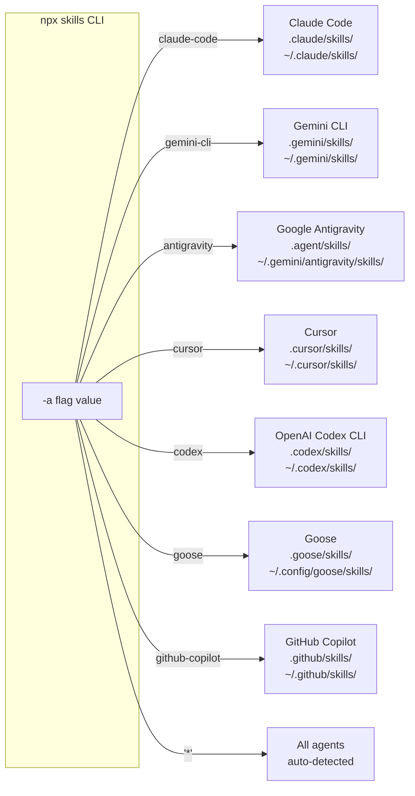
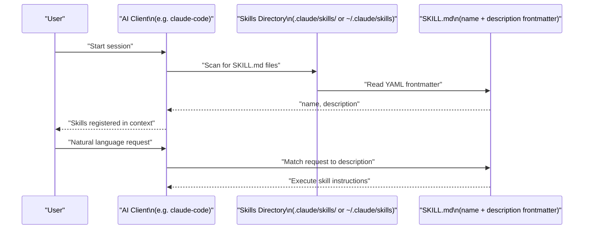

<!-- source: DeepWiki mcp.deepwiki.com · repo sanjay3290/ai-skills · page 2.2 Supported AI Clients · fetched 2026-10-27 -->

# Supported AI Clients

<details>
<summary>Relevant source files</summary>

The following files were used as context for generating this wiki page:

- [README.md](README.md)
- [skills/jules/SKILL.md](skills/jules/SKILL.md)
- [skills/manus/SKILL.md](skills/manus/SKILL.md)

</details>


This page lists all AI clients that the `ai-skills` repository is compatible with, along with the `-a` flag used when targeting each client via the `npx skills` CLI, and the project-level and global skill directory paths for each. For instructions on how to perform an installation, see [Installation Methods](#2.1). For a walkthrough of installing and invoking a skill end-to-end, see [Quick Start Example](#2.3).

---

## Overview

The `ai-skills` repository conforms to the [Agent Skills Standard](https://agentskills.io), which defines a common directory-based convention for skill discovery. Any AI client implementing this standard can consume these skills by reading `SKILL.md` files from its designated skills directory at session start.

The `npx skills` package manager uses the `-a` flag to target a specific client's directory during installation. If `-a` is omitted, the CLI auto-detects the agent from the current project context.

Sources: [README.md:107-120]()

---

## Client Reference Table

The table below covers all clients explicitly supported by the `npx skills` CLI in this repository:

| Client | `-a` Flag | Project Directory | Global Directory |
|---|---|---|---|
| **Claude Code** | `claude-code` | `.claude/skills/` | `~/.claude/skills/` |
| **Gemini CLI** | `gemini-cli` | `.gemini/skills/` | `~/.gemini/skills/` |
| **Google Antigravity** | `antigravity` | `.agent/skills/` | `~/.gemini/antigravity/skills/` |
| **Cursor** | `cursor` | `.cursor/skills/` | `~/.cursor/skills/` |
| **OpenAI Codex CLI** | `codex` | `.codex/skills/` | `~/.codex/skills/` |
| **Goose** | `goose` | `.goose/skills/` | `~/.config/goose/skills/` |
| **GitHub Copilot** | `github-copilot` | `.github/skills/` | `~/.github/skills/` |
| **All agents** | `'*'` | auto-detected | auto-detected |

Sources: [README.md:18-25](), [README.md:111-120]()

---

## Directory Layout by Client

The following diagram maps each client identifier (as used with the `-a` flag) to its corresponding project-level and global skill directories.

**Diagram: Client `-a` Flag → Skill Directory Paths**



Sources: [README.md:111-120]()

---

## Skill Discovery by Client

At the start of each session, a supporting AI client scans its designated skills directory for `SKILL.md` files. The `SKILL.md` file uses a YAML frontmatter block with `name` and `description` fields that the client reads to determine when to invoke the skill.

**Diagram: Runtime Skill Discovery Flow per Client**



Sources: [README.md:346-369]()

---

## Project vs. Global Install

Each client supports two install scopes:

- **Project-level** (default): Skills are placed in a hidden directory at the root of the current working directory (e.g., `.claude/skills/`). These skills are only active when the agent is run from within that project.
- **Global**: Skills are placed in the user's home directory (e.g., `~/.claude/skills/`). These skills are available in all projects.

The `-g` flag to `npx skills add` selects global scope:

```
npx skills add sanjay3290/ai-skills --skill postgres -g
```

Omitting `-g` defaults to project-level.

Sources: [README.md:95-105]()

---

## Per-Client Notes

### Claude Code
- Project directory: `.claude/skills/`
- Global directory: `~/.claude/skills/`
- `-a` flag: `claude-code`

### Gemini CLI
- Project directory: `.gemini/skills/`
- Global directory: `~/.gemini/skills/`
- `-a` flag: `gemini-cli`

### Google Antigravity
- Project directory: `.agent/skills/`
- Global directory: `~/.gemini/antigravity/skills/`
- `-a` flag: `antigravity`
- Note: The global directory is nested under `~/.gemini/`, distinguishing it from Gemini CLI's `~/.gemini/skills/` path.

### Cursor
- Project directory: `.cursor/skills/`
- Global directory: `~/.cursor/skills/`
- `-a` flag: `cursor`

### OpenAI Codex CLI
- Project directory: `.codex/skills/`
- Global directory: `~/.codex/skills/`
- `-a` flag: `codex`

### Goose
- Project directory: `.goose/skills/`
- Global directory: `~/.config/goose/skills/`
- `-a` flag: `goose`
- Note: Unlike the others, the global directory uses the XDG-style `~/.config/goose/` path rather than a dotfile directly in the home directory.

### GitHub Copilot
- Project directory: `.github/skills/`
- Global directory: `~/.github/skills/`
- `-a` flag: `github-copilot`

Sources: [README.md:111-119](), [README.md:18-25]()

---

## Targeting Multiple Clients at Once

The `-a` flag can be repeated to install into multiple clients simultaneously, or `'*'` can be used to install into all supported agents:

```
# Install for Claude Code and Gemini CLI
npx skills add sanjay3290/ai-skills --skill postgres -a claude-code -a gemini-cli

# Install into all supported agents
npx skills add sanjay3290/ai-skills --all -a '*'
```

Sources: [README.md:86-93]()

---

