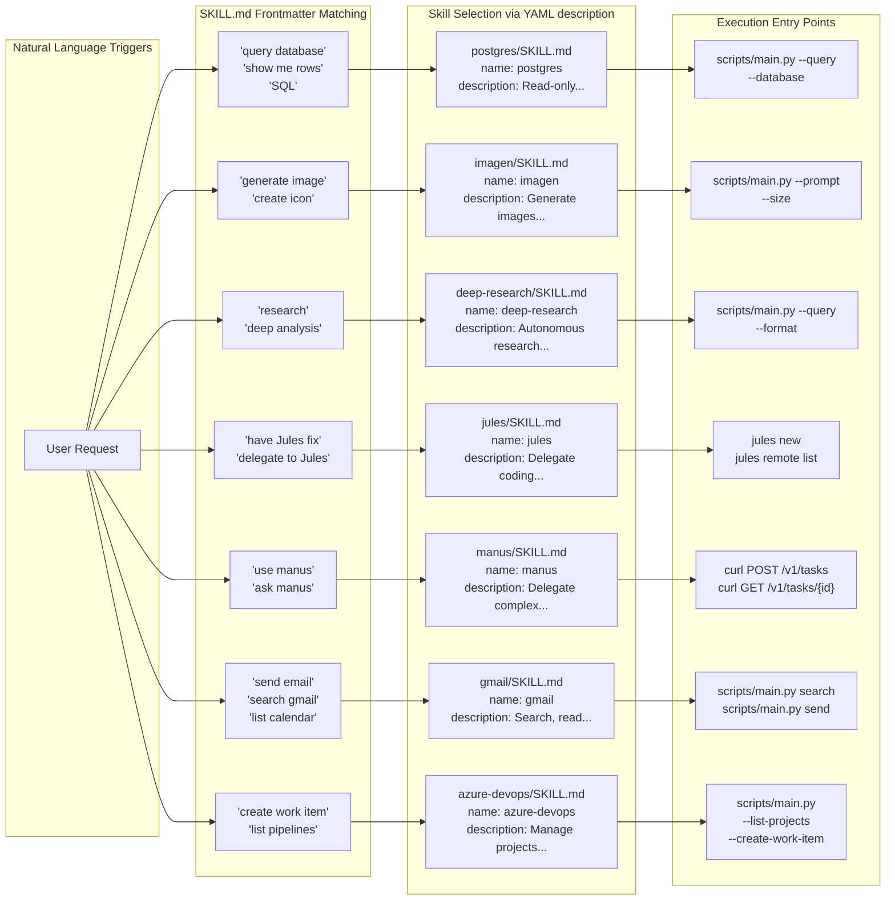

<!-- source: DeepWiki mcp.deepwiki.com · repo sanjay3290/ai-skills · page 4.1 Skills Overview · fetched 2026-10-27 -->

# Skills Overview

<details>
<summary>Relevant source files</summary>

The following files were used as context for generating this wiki page:

- [.claude-plugin/marketplace.json](.claude-plugin/marketplace.json)
- [README.md](README.md)
- [skills/jules/SKILL.md](skills/jules/SKILL.md)
- [skills/manus/SKILL.md](skills/manus/SKILL.md)

</details>


This page provides a comprehensive catalog of all 19+ skills available in the ai-skills repository, organized by functional category. Each skill is a portable, self-contained capability that follows the Agent Skills Standard and works across 40+ AI coding assistants.

For detailed information about specific skill categories, see [Database Skills](#4.2), [AI & ML Services](#4.3), [Agent Delegation](#4.4), [Development Tools](#4.5), and [Google Workspace Skills](#5). For information about skill structure and installation, see [Agent Skills Standard](#3.1).

---

## Complete Skills Catalog

The following table lists all available skills with their primary use cases and configuration requirements:

| Skill | Category | Description | Setup Required |
|-------|----------|-------------|----------------|
| **postgres** | Database | Read-only PostgreSQL queries with multi-layer security | `connections.json`, `psycopg2-binary` |
| **mysql** | Database | Read-only MySQL queries with session-level write protection | `connections.json`, `mysql-connector-python` |
| **mssql** | Database | Read-only Microsoft SQL Server queries with TDS protocol | `connections.json`, `pymssql` |
| **imagen** | AI/ML | Text-to-image generation using Gemini Imagen API | `GEMINI_API_KEY` |
| **deep-research** | AI/ML | Autonomous multi-phase research with Gemini Deep Research | `GEMINI_API_KEY` |
| **notebooklm** | AI/ML | Query NotebookLM notebooks via browser automation | Playwright, Chrome profile |
| **elevenlabs** | AI/ML | Text-to-speech narration and podcast generation | `ELEVENLABS_API_KEY`, ffmpeg |
| **google-tts** | AI/ML | Text-to-speech with Google Cloud TTS (40+ languages) | `GOOGLE_TTS_API_KEY`, ffmpeg |
| **jules** | Agent Delegation | Delegate coding tasks to Google Jules AI agent | `@google/jules` CLI, GitHub auth |
| **manus** | Agent Delegation | Delegate research/analysis tasks to Manus AI agent | `MANUS_API_KEY` |
| **azure-devops** | DevOps | Manage Azure DevOps (99 tools, 13 domains) | OAuth or PAT, `keyring` |
| **atlassian** | DevOps | Manage Jira issues and Confluence wiki pages | OAuth or API token, `keyring` |
| **outline** | DevOps | Search, read, and manage Outline wiki documents | `OUTLINE_API_KEY` |
| **gmail** | Google Workspace | Search, read, send emails, manage labels | OAuth, `keyring` |
| **google-calendar** | Google Workspace | Events, scheduling, free time lookup | OAuth, `keyring` |
| **google-chat** | Google Workspace | List spaces, send messages, DMs, create spaces | OAuth, `keyring` |
| **google-docs** | Google Workspace | Create, read, edit Google Docs | OAuth, `keyring` |
| **google-drive** | Google Workspace | Search files, list folders, download files | OAuth, `keyring` |
| **google-sheets** | Google Workspace | Read spreadsheets, get ranges, find sheets | OAuth, `keyring` |
| **google-slides** | Google Workspace | Read presentations, get text and metadata | OAuth, `keyring` |

**Sources:** [README.md:27-59](), [.claude-plugin/marketplace.json:15-36]()

---

## Skills Directory Structure

The following diagram maps natural language skill names to their actual filesystem locations and key code entities:

```mermaid
graph TB
    subgraph "Repository Root: github.com/sanjay3290/ai-skills"
        Skills["skills/"]
    end
    
    subgraph "Database Skills"
        Postgres["skills/postgres/"]
        MySQL["skills/mysql/"]
        MSSQL["skills/mssql/"]
        
        Postgres --> PSQLMain["scripts/main.py<br/>query_db()"]
        MySQL --> MySQLMain["scripts/main.py<br/>query_db()"]
        MSSQL --> MSSQLMain["scripts/main.py<br/>query_db()"]
        
        Postgres --> PSQLConn["connections.json<br/>chmod 600"]
        MySQL --> MySQLConn["connections.json<br/>chmod 600"]
        MSSQL --> MSSQLConn["connections.json<br/>chmod 600"]
    end
    
    subgraph "AI & ML Services"
        Imagen["skills/imagen/"]
        DeepResearch["skills/deep-research/"]
        NotebookLM["skills/notebooklm/"]
        ElevenLabs["skills/elevenlabs/"]
        GoogleTTS["skills/google-tts/"]
        
        Imagen --> ImagenMain["scripts/main.py<br/>generate_image()"]
        DeepResearch --> DRMain["scripts/main.py<br/>research()"]
        NotebookLM --> NBLMAuth["scripts/auth_manager.py<br/>setup(), status()"]
        NotebookLM --> NBLMAsk["scripts/ask_question.py<br/>query(), batch()"]
        ElevenLabs --> ELMain["scripts/main.py<br/>narrate(), podcast()"]
        GoogleTTS --> GTTSMain["scripts/main.py<br/>narrate(), podcast()"]
    end
    
    subgraph "Agent Delegation"
        Jules["skills/jules/"]
        Manus["skills/manus/"]
        
        Jules --> JulesSkill["SKILL.md<br/>jules new, remote list"]
        Manus --> ManusSkill["SKILL.md<br/>POST /v1/tasks"]
    end
    
    subgraph "DevOps Tools"
        AzureDevOps["skills/azure-devops/"]
        Atlassian["skills/atlassian/"]
        Outline["skills/outline/"]
        
        AzureDevOps --> ADOAuth["scripts/auth.py<br/>login()"]
        Atlassian --> AtlAuth["scripts/auth.py<br/>login()"]
        Outline --> OutlineMain["scripts/main.py<br/>search(), read()"]
    end
    
    subgraph "Google Workspace Skills"
        Gmail["skills/gmail/"]
        Calendar["skills/google-calendar/"]
        Chat["skills/google-chat/"]
        Docs["skills/google-docs/"]
        Drive["skills/google-drive/"]
        Sheets["skills/google-sheets/"]
        Slides["skills/google-slides/"]
        
        Gmail --> GmailAuth["scripts/auth.py<br/>login()"]
        Calendar --> CalAuth["scripts/auth.py<br/>login()"]
        Chat --> ChatAuth["scripts/auth.py<br/>login()"]
        Docs --> DocsAuth["scripts/auth.py<br/>login()"]
        Drive --> DriveAuth["scripts/auth.py<br/>login()"]
        Sheets --> SheetsAuth["scripts/auth.py<br/>login()"]
        Slides --> SlidesAuth["scripts/auth.py<br/>login()"]
        
        GmailAuth --> SharedKeyring["keyring<br/>service: gmail-skill-oauth"]
        CalAuth --> SharedKeyring2["keyring<br/>service: google-calendar-skill-oauth"]
        ChatAuth --> SharedKeyring3["keyring<br/>service: google-chat-skill-oauth"]
    end
    
    Skills --> Postgres
    Skills --> MySQL
    Skills --> MSSQL
    Skills --> Imagen
    Skills --> DeepResearch
    Skills --> NotebookLM
    Skills --> ElevenLabs
    Skills --> GoogleTTS
    Skills --> Jules
    Skills --> Manus
    Skills --> AzureDevOps
    Skills --> Atlassian
    Skills --> Outline
    Skills --> Gmail
    Skills --> Calendar
    Skills --> Chat
    Skills --> Docs
    Skills --> Drive
    Skills --> Sheets
    Skills --> Slides
```



**Skills Directory Structure and Code Entry Points**

This diagram shows how each skill name maps to its directory location under `skills/` and identifies the primary executable scripts and configuration files. All database skills share the same `query_db()` function signature but in separate directories. Google Workspace skills share a common authentication pattern with individual keyring service names for token isolation.

**Sources:** [README.md:27-59](), [.claude-plugin/marketplace.json:15-36]()

---

## Skill Activation Patterns

The following diagram illustrates how AI agents determine when to activate each skill based on natural language triggers and the resulting code execution paths:



**Natural Language to Code Execution Mapping**

AI agents parse the `description` field in each skill's YAML frontmatter to determine activation conditions. When a user request matches the description patterns, the agent reads the skill instructions and executes the specified command-line interface defined in the skill's markdown body.

**Sources:** [README.md:366-388](), [skills/manus/SKILL.md:1-8](), [skills/jules/SKILL.md:1-8]()

---

## Skills by Functional Domain

### Database Access (Read-Only)

All three database skills implement identical safety architectures with multi-layer query validation, read-only enforcement, and connection security. They differ only in database driver and protocol specifics.

| Skill | Driver | Port | Protocol | Key Safety Features |
|-------|--------|------|----------|---------------------|
| **postgres** | `psycopg2-binary` | 5432 | PostgreSQL wire | Whitelist validation, SSL/TLS, transaction isolation |
| **mysql** | `mysql-connector-python` | 3306 | MySQL native | Session `READ ONLY`, SSL, whitelist validation |
| **mssql** | `pymssql` | 1433 | TDS (Tabular Data Stream) | Query rewriting (LIMIT→TOP), SSL, whitelist validation |

All skills use `connections.json` with `chmod 600` permissions and intelligent database selection via semantic `description` field matching. See [Database Skills](#4.2) for detailed documentation.

**Sources:** [README.md:31-33](), [README.md:183-191]()

### AI & ML Services

Skills that integrate with external AI/ML APIs for generation, synthesis, and research tasks:

| Skill | Service | Async? | Output Types | Use Cases |
|-------|---------|--------|--------------|-----------|
| **imagen** | Gemini Imagen | No | PNG images | Icons, hero images, illustrations |
| **deep-research** | Gemini Deep Research | Yes (2-10 min) | Markdown reports with citations | Competitive analysis, framework comparison |
| **notebooklm** | NotebookLM (browser) | No | Text, citations, JSON | Source-grounded Q&A, multi-notebook comparison |
| **elevenlabs** | ElevenLabs API | No | MP3 audio | Single-narrator audiobooks, two-host podcasts |
| **google-tts** | Google Cloud TTS | No | MP3 audio | Multi-language narration, Neural2 voices |

**imagen** and **deep-research** require `GEMINI_API_KEY` from [Google AI Studio](https://aistudio.google.com). **notebooklm** uses Playwright browser automation with persistent Chrome profiles at `~/.notebooklm/`. See [AI & ML Services](#4.3) for details.

**Sources:** [README.md:34-41](), [README.md:193-237]()

### Agent Delegation (Asynchronous)

Skills that delegate long-running tasks to autonomous agents with polling-based status monitoring:

| Skill | Agent | Domain | Typical Duration | Output Format |
|-------|-------|--------|------------------|---------------|
| **jules** | Google Jules | GitHub coding tasks | 5-30 minutes | Git diffs, PRs |
| **manus** | Manus AI | Research, analysis, reports | 1-15 minutes | Markdown, CSV, charts, images |

**jules** requires `@google/jules` CLI installation and GitHub repository connection at [jules.google.com](https://jules.google.com). **manus** requires `MANUS_API_KEY` from [manus.im](https://manus.im) and supports agent profiles: `manus-1.6-lite`, `manus-1.6`, `manus-1.6-max`. Both follow create→poll→retrieve workflow patterns. See [Agent Delegation](#4.4) for complete API documentation.

**Sources:** [README.md:37-38](), [README.md:209-223](), [skills/jules/SKILL.md:1-8](), [skills/manus/SKILL.md:1-8]()

### DevOps & Collaboration

Skills that integrate with DevOps platforms and collaboration tools:

| Skill | Platform | Coverage | Authentication |
|-------|----------|----------|----------------|
| **azure-devops** | Azure DevOps | 99 tools, 13 domains (work items, repos, pipelines, wikis, security, approvals) | OAuth or PAT via `keyring` |
| **atlassian** | Jira + Confluence | Issue management, wiki pages | OAuth 2.1 (MCP server) or API token |
| **outline** | Outline Wiki | Document search, reading, management | `OUTLINE_API_KEY` |

**azure-devops** provides comprehensive coverage including work items, repos, PRs, pipelines, wikis, test plans, security alerts, variable groups, environments, branch policies, and attachments. **atlassian** supports both OAuth via MCP server and API token fallback. See [Development Tools](#4.5) for configuration details.

**Sources:** [README.md:36-43](), [README.md:248-266]()

### Google Workspace Integration

Seven skills providing lightweight alternatives to the full Google Workspace MCP server, each with standalone OAuth authentication:

| Skill | Google API | Primary Operations |
|-------|------------|-------------------|
| **gmail** | Gmail API | Search, read, send, drafts, labels |
| **google-calendar** | Calendar API | Events, scheduling, free time |
| **google-chat** | Chat API | List spaces, send messages, DMs, create spaces |
| **google-docs** | Docs API | Create, read, edit documents |
| **google-drive** | Drive API | Search, upload, download, folder management |
| **google-sheets** | Sheets API | Read, get-range, find, update, append, batch-update |
| **google-slides** | Slides API | Get-text, find, metadata, create, add-slide, replace-text |

All skills share `scripts/auth.py` infrastructure with OAuth token storage via platform-specific keyrings (macOS Keychain, Windows Credential Locker, Linux Secret Service). **Requires Google Workspace account** - personal Gmail accounts are not supported. See [Google Workspace Skills](#5) for detailed authentication and API documentation.

**Sources:** [README.md:45-59](), [README.md:268-286]()

---

## Installation Scope Patterns

Skills can be installed globally (user-level, available in all projects) or locally (project-level, scoped to current repository). The following table summarizes recommended installation scopes:

| Installation Scope | Recommended For | Example Skills |
|-------------------|-----------------|----------------|
| **Global (`-g`)** | Personal tools, cross-project utilities | `imagen`, `deep-research`, `gmail`, `google-calendar` |
| **Project-local** | Project-specific integrations | `postgres`, `mysql`, `azure-devops`, `atlassian` |
| **Both** | Depends on use case | `jules`, `manus`, `google-drive`, `outline` |

Installation directories follow the pattern:
- **Global**: `~/.claude/skills/`, `~/.gemini/skills/`, etc.
- **Project**: `.claude/skills/`, `.gemini/skills/`, etc. (relative to repository root)

For multi-agent installation, use `-a '*'` to deploy to all detected AI clients simultaneously. See [Installation Methods](#2.1) for complete CLI reference.

**Sources:** [README.md:96-122]()

---

## Configuration Requirements Summary

The following table summarizes configuration requirements for all skills:

| Configuration Type | Skills | Files/Variables | Security Mechanism |
|-------------------|--------|-----------------|-------------------|
| **Environment Variables** | `imagen`, `deep-research`, `outline`, `manus`, `elevenlabs`, `google-tts` | `GEMINI_API_KEY`, `OUTLINE_API_KEY`, `MANUS_API_KEY`, `ELEVENLABS_API_KEY`, `GOOGLE_TTS_API_KEY` | API key rotation |
| **Database Connections** | `postgres`, `mysql`, `mssql` | `connections.json` (chmod 600) | File permissions, encrypted connections |
| **OAuth (Keyring)** | All Google Workspace skills, `azure-devops`, `atlassian` | Platform keyring (Keychain/Credential Locker/Secret Service) | OS-level encryption |
| **CLI Authentication** | `jules` | `@google/jules` token storage | Jules CLI managed |
| **Browser Profiles** | `notebooklm` | `~/.notebooklm/default/` or `~/.notebooklm/profiles/{name}/` | Persistent Chrome profiles |

For detailed setup instructions for each configuration type, see [Configuration Guide](#6), including [Environment Variables](#6.1), [OAuth & Keyring Setup](#6.2), [Database Connections](#6.3), and [API Keys & Secrets](#6.4).

**Sources:** [README.md:179-286]()

---

## Marketplace Integration

All skills are cataloged in [.claude-plugin/marketplace.json:1-39](), which defines the plugin structure for the `npx skills` CLI. The marketplace entry specifies:

```json
{
  "name": "ai-skills",
  "plugins": [{
    "skills": [
      "./skills/postgres",
      "./skills/imagen",
      ...
    ]
  }]
}
```

This enables discovery via:
```bash
npx skills add sanjay3290/ai-skills --list
```

The CLI automatically detects installed AI agents and copies skill directories to the appropriate locations (`~/.claude/skills/`, `~/.gemini/skills/`, etc.). See [Marketplace & Plugin System](#3.3) for architecture details.

**Sources:** [.claude-plugin/marketplace.json:1-39](), [README.md:62-78]()

---

