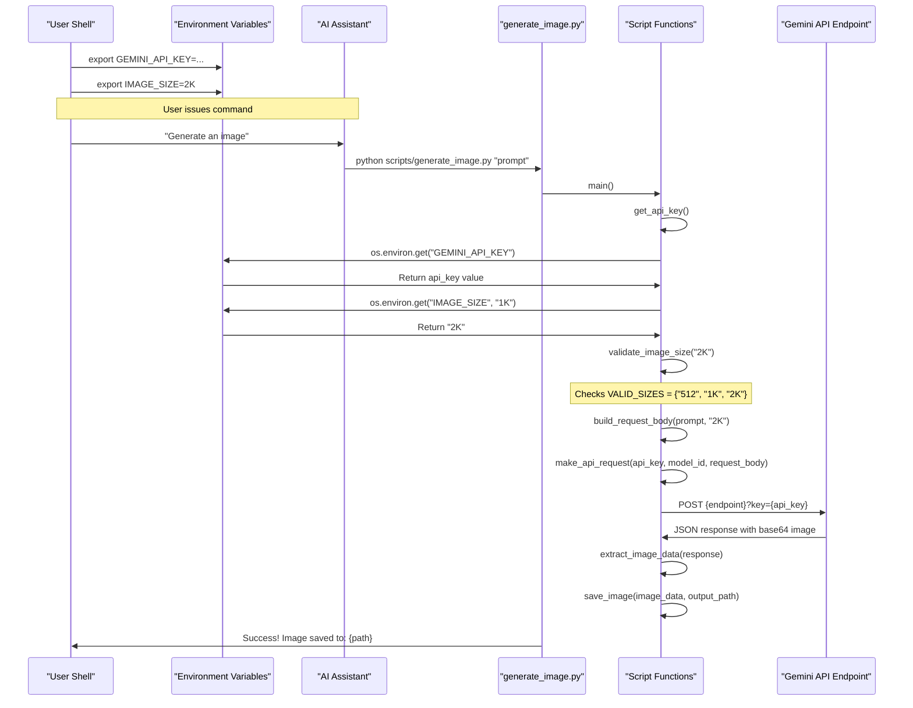
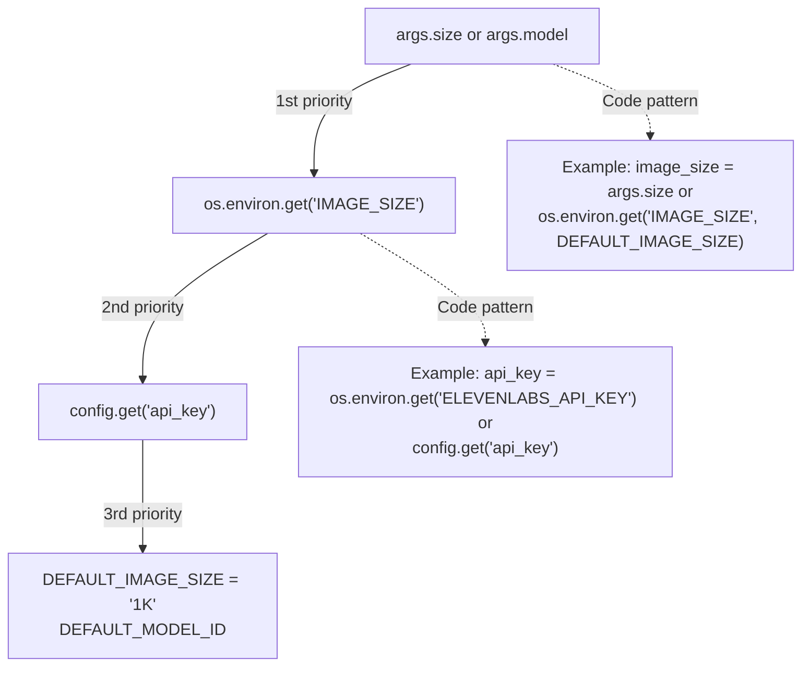

<!-- source: DeepWiki mcp.deepwiki.com · repo sanjay3290/ai-skills · page 6.1 Environment Variables · fetched 2026-10-27 -->

# Environment Variables

<details>
<summary>Relevant source files</summary>

The following files were used as context for generating this wiki page:

- [skills/azure-devops/SKILL.md](skills/azure-devops/SKILL.md)
- [skills/deep-research/SKILL.md](skills/deep-research/SKILL.md)
- [skills/elevenlabs/SKILL.md](skills/elevenlabs/SKILL.md)
- [skills/google-tts/.gitignore](skills/google-tts/.gitignore)
- [skills/google-tts/SKILL.md](skills/google-tts/SKILL.md)
- [skills/google-tts/scripts/extract.py](skills/google-tts/scripts/extract.py)
- [skills/google-tts/scripts/google_tts.py](skills/google-tts/scripts/google_tts.py)
- [skills/imagen/.env.example](skills/imagen/.env.example)
- [skills/imagen/.gitignore](skills/imagen/.gitignore)
- [skills/imagen/README.md](skills/imagen/README.md)
- [skills/imagen/examples.md](skills/imagen/examples.md)
- [skills/imagen/reference.md](skills/imagen/reference.md)
- [skills/imagen/scripts/generate_image.py](skills/imagen/scripts/generate_image.py)

</details>


This page provides a comprehensive reference for all environment variables used across the AI Skills ecosystem. Environment variables are used primarily for API authentication and runtime configuration.

**Scope**: This page covers environment variables for skills that use API key or runtime configuration via environment variables. For other authentication methods, see:
- OAuth and keyring authentication: page 6.2
- Database connection credentials: page 6.3
- API keys stored in configuration files: page 6.4

---

## Overview

Environment variables provide a secure, platform-independent method for configuring skills without hardcoding credentials into scripts or configuration files. Seven skills in the ecosystem use environment variables as their primary or supplementary configuration mechanism:

- **imagen**: Google Gemini image generation
- **deep-research**: Gemini Deep Research Agent
- **elevenlabs**: Text-to-speech and podcast generation
- **google-tts**: Google Text-to-Speech
- **outline**: Outline wiki API access
- **manus**: Research agent tasks
- **notebooklm**: Browser automation data directory override

Sources: [skills/imagen/scripts/generate_image.py:1-294](), [skills/deep-research/SKILL.md:1-107](), [skills/elevenlabs/SKILL.md:1-131](), [skills/outline/.env.example:1-15](), [skills/notebooklm/SKILL.md:1-55]()

---

## Environment Variable Reference

### Complete Variable Table

| Variable | Skill(s) | Required | Default | Description |
|----------|----------|----------|---------|-------------|
| `GEMINI_API_KEY` | imagen, deep-research | Yes | None | Google Gemini API key for image generation and research |
| `IMAGE_SIZE` | imagen | No | `1K` | Image output size: `512`, `1K`, or `2K` |
| `GEMINI_MODEL` | imagen | No | `gemini-3-pro-image-preview` | Gemini model ID for image generation |
| `ELEVENLABS_API_KEY` | elevenlabs | No* | None | ElevenLabs API key; overrides `config.json` |
| `GOOGLE_TTS_API_KEY` | google-tts | No* | None | Google Text-to-Speech API key; overrides `config.json` |
| `OUTLINE_API_KEY` | outline | Yes | None | Outline wiki API token |
| `OUTLINE_API_URL` | outline | No | `https://app.getoutline.com/api` | Outline API base URL (for self-hosted instances) |
| `OUTLINE_TIMEOUT` | outline | No | `30` | API request timeout in seconds |
| `MANUS_API_KEY` | manus | Yes | None | Manus research agent API key |
| `NOTEBOOKLM_DATA_DIR` | notebooklm | No | `~/.config/claude/notebooklm-skill/` | Override directory for persistent Chrome browser profiles |

\* One of env var or `config.json` `api_key` field is required.

Sources: [skills/imagen/scripts/generate_image.py:27-31](), [skills/imagen/reference.md:66-71](), [skills/elevenlabs/SKILL.md:29-43](), [skills/elevenlabs/scripts/elevenlabs.py:66-84](), [skills/outline/.env.example:7-14](), [skills/notebooklm/SKILL.md:26-27]()

---

## Environment Variable Flow

### Runtime Execution Flow



**Description**: This flow demonstrates how `generate_image.py` reads environment variables through `os.environ.get()` calls within specific functions. The `main()` function orchestrates calls to `get_api_key()`, `validate_image_size()`, `build_request_body()`, `make_api_request()`, `extract_image_data()`, and `save_image()` to complete the generation pipeline.

Sources: [skills/imagen/scripts/generate_image.py:40-51](), [skills/imagen/scripts/generate_image.py:54-59](), [skills/imagen/scripts/generate_image.py:69-87](), [skills/imagen/scripts/generate_image.py:90-103](), [skills/imagen/scripts/generate_image.py:180-203](), [skills/imagen/scripts/generate_image.py:205-213](), [skills/imagen/scripts/generate_image.py:225-290]()

---

## API Authentication Variables

### GEMINI_API_KEY

**Used by**: `imagen`, `deep-research`

**Purpose**: Authenticates requests to Google Gemini API for image generation and autonomous research tasks.

**Required**: Yes

**How it's used**:

The `get_api_key()` function in [skills/imagen/scripts/generate_image.py:40-51]() implements the retrieval and validation:

```python
def get_api_key() -> str:
    """Get the Gemini API key from environment variable."""
    api_key = os.environ.get("GEMINI_API_KEY")
    if not api_key:
        print("Error: GEMINI_API_KEY environment variable not set", file=sys.stderr)
        # ... platform-specific setup instructions ...
        sys.exit(1)
    return api_key
```

**API endpoint construction**:

The `make_api_request()` function in [skills/imagen/scripts/generate_image.py:90-103]() constructs the authenticated URL:

```python
def make_api_request(api_key: str, model_id: str, request_body: bytes) -> dict:
    endpoint = get_api_endpoint(model_id)
    url = f"{endpoint}?key={api_key}"
    # ... makes request with urllib.request.Request ...
```

**Obtaining the key**:
1. Visit [Google AI Studio](https://aistudio.google.com)
2. Sign in with Google account
3. Navigate to API Keys section
4. Create or copy existing key

Sources: [skills/imagen/scripts/generate_image.py:40-51](), [skills/imagen/scripts/generate_image.py:90-93](), [skills/deep-research/SKILL.md:20-27]()

---

### ELEVENLABS_API_KEY

**Used by**: `elevenlabs`

**Purpose**: Authenticates requests to ElevenLabs text-to-speech API.

**Required**: Yes (can alternatively be configured in `config.json`)

**Configuration priority**:
1. Environment variable `ELEVENLABS_API_KEY`
2. `api_key` field in `skills/elevenlabs/config.json`

The skill implements the `get_api_key()` function to check both sources:

```python
# Pseudocode from elevenlabs skill pattern
def get_api_key(config: dict) -> str:
    api_key = os.environ.get("ELEVENLABS_API_KEY")
    if api_key:
        return api_key
    
    api_key = config.get("api_key")
    if api_key:
        return api_key
    
    # Print error and exit if neither is set
```

**Example `config.json` structure**:

```json
{
  "api_key": "your-elevenlabs-api-key",
  "default_voice": "JBFqnCBsd6RMkjVDRZzb",
  "default_model": "eleven_multilingual_v2"
}
```

Sources: [skills/elevenlabs/SKILL.md:29-43]()

---

### OUTLINE_API_KEY

**Used by**: `outline`

**Purpose**: Authenticates requests to Outline wiki API for collections, documents, and search operations.

**Required**: Yes

**Obtaining the key**:
1. Navigate to your Outline wiki instance
2. Go to Settings → API Tokens
3. Create a new token

**Example `.env` file**:
```bash
OUTLINE_API_KEY=your-api-key-here
OUTLINE_API_URL=https://app.getoutline.com/api
OUTLINE_TIMEOUT=30
```

Sources: [skills/outline/.env.example:1-15]()

---

### MANUS_API_KEY

**Used by**: `manus`

**Purpose**: Authenticates requests to Manus research agent for deep research tasks with parallel source querying.

**Required**: Yes

---

### GOOGLE_TTS_API_KEY

**Used by**: `google-tts`

**Purpose**: Authenticates requests to the Google Text-to-Speech API for voice synthesis, podcast generation, and document narration.

**Required**: Yes (can alternatively be configured in `config.json`)

**Configuration priority**:
1. Environment variable `GOOGLE_TTS_API_KEY`
2. `api_key` field in `skills/google-tts/config.json`

**Config file format** (see `skills/google-tts/config.example.json`):
```json
{
  "api_key": "your-google-tts-api-key",
  "default_voice": "...",
  "default_language": "en-US"
}
```

The skill follows the same pattern as `elevenlabs`: the environment variable takes precedence over any value in `config.json`.

---

## Configuration Variables

### IMAGE_SIZE

**Used by**: `imagen`

**Purpose**: Controls the output resolution of generated images.

**Required**: No

**Default**: `1K`

**Valid values**:

| Value | Resolution | Use Case |
|-------|------------|----------|
| `512` | 512×512 px | Icons, thumbnails, quick previews |
| `1K` | 1024×1024 px | General web images, default quality |
| `2K` | 2048×2048 px | High-resolution, print, retina displays |

**Validation logic**:

The `validate_image_size()` function in [skills/imagen/scripts/generate_image.py:54-59]() validates user input:

```python
VALID_SIZES = {"512", "1K", "2K"}  # Line 31

def validate_image_size(size: str) -> str:
    """Validate and return the image size."""
    if size not in VALID_SIZES:
        print(f"Warning: Invalid IMAGE_SIZE '{size}'. Using default '{DEFAULT_IMAGE_SIZE}'",
              file=sys.stderr)
        return DEFAULT_IMAGE_SIZE
    return size
```

The `main()` function applies this validation in [skills/imagen/scripts/generate_image.py:254-256]():

```python
image_size = args.size or os.environ.get("IMAGE_SIZE", DEFAULT_IMAGE_SIZE)
image_size = validate_image_size(image_size)
```

**Command-line override example**:
```bash
# Environment variable (2nd priority)
export IMAGE_SIZE=2K
python scripts/generate_image.py "prompt"

# Or use --size flag to override (1st priority)
python scripts/generate_image.py --size 512 "prompt"
```

Sources: [skills/imagen/scripts/generate_image.py:30-31](), [skills/imagen/scripts/generate_image.py:54-59](), [skills/imagen/reference.md:43-50]()

---

### GEMINI_MODEL

**Used by**: `imagen`

**Purpose**: Specifies which Gemini model to use for image generation.

**Required**: No

**Default**: `gemini-3-pro-image-preview`

**How it's used**:

The constant is defined at [skills/imagen/scripts/generate_image.py:28]():
```python
DEFAULT_MODEL_ID = "gemini-3-pro-image-preview"
```

The `main()` function resolves the model ID at [skills/imagen/scripts/generate_image.py:254]():
```python
model_id = args.model or os.environ.get("GEMINI_MODEL", DEFAULT_MODEL_ID)
```

The `get_api_endpoint()` function constructs the API URL at [skills/imagen/scripts/generate_image.py:34-37]():
```python
def get_api_endpoint(model_id: str) -> str:
    """Build the API endpoint URL for the given model."""
    return f"{API_BASE_URL}/{model_id}:streamGenerateContent"
```

**Use case**: Allows switching between Gemini image generation models as Google releases new versions without modifying scripts. Users can override via `--model` flag or `GEMINI_MODEL` environment variable.

Sources: [skills/imagen/scripts/generate_image.py:28-29](), [skills/imagen/scripts/generate_image.py:254]()

---

### OUTLINE_API_URL

**Used by**: `outline`

**Purpose**: Specifies the base URL for the Outline API, enabling use with self-hosted instances.

**Required**: No

**Default**: `https://app.getoutline.com/api`

**Use case**: Organizations running self-hosted Outline instances need to point the skill at their own API endpoint:

```bash
export OUTLINE_API_URL=https://wiki.mycompany.com/api
```

Sources: [skills/outline/.env.example:9-11]()

---

### OUTLINE_TIMEOUT

**Used by**: `outline`

**Purpose**: Sets the HTTP request timeout for Outline API calls.

**Required**: No

**Default**: `30` (seconds)

**Use case**: Adjust timeout for slow network connections or large document operations:

```bash
export OUTLINE_TIMEOUT=60  # 1 minute timeout
```

Sources: [skills/outline/.env.example:13-14]()

---

### NOTEBOOKLM_DATA_DIR

**Used by**: `notebooklm`

**Purpose**: Overrides the directory where the `notebooklm` skill stores persistent Playwright Chrome browser profiles. This directory also holds local state files such as `library.json` and `source_state.json`.

**Required**: No

**Default**: `~/.config/claude/notebooklm-skill/`

**Use case**: Redirect data storage to a custom location, such as a project-specific directory or a shared volume:

```bash
export NOTEBOOKLM_DATA_DIR=/data/notebooklm-profiles
```

**Files stored under this directory**:
- Chrome browser profiles (for persistent authentication sessions)
- `library.json` — registered notebook metadata
- `source_state.json` — hash-based source deduplication state

Sources: [skills/notebooklm/SKILL.md:26-27]()

---

## Skill-to-Variable Mapping

### Environment Variables by Skill

**Skill–Variable Dependency Map**

```mermaid
graph TB
    subgraph imagen_skill["imagen skill"]
        generate_image_py["scripts/generate_image.py"]
        get_api_key_imagen["get_api_key()"]
        validate_image_size_fn["validate_image_size()"]
        
        GEMINI_API_KEY_1["GEMINI_API_KEY"]
        IMAGE_SIZE_VAR["IMAGE_SIZE"]
        GEMINI_MODEL_VAR["GEMINI_MODEL"]
        
        generate_image_py --> get_api_key_imagen
        generate_image_py --> validate_image_size_fn
        get_api_key_imagen --> GEMINI_API_KEY_1
        validate_image_size_fn --> IMAGE_SIZE_VAR
        generate_image_py --> GEMINI_MODEL_VAR
    end

    subgraph deep_research_skill["deep-research skill"]
        research_py["scripts/research.py"]
        GEMINI_API_KEY_2["GEMINI_API_KEY"]
        research_py --> GEMINI_API_KEY_2
    end

    subgraph elevenlabs_skill["elevenlabs skill"]
        elevenlabs_py["scripts/elevenlabs.py"]
        load_config_el["load_config()"]
        get_api_key_el["get_api_key()"]
        config_json_el["config.json api_key field"]
        ELEVENLABS_API_KEY_VAR["ELEVENLABS_API_KEY"]
        
        elevenlabs_py --> get_api_key_el
        get_api_key_el --> ELEVENLABS_API_KEY_VAR
        get_api_key_el --> load_config_el
        load_config_el --> config_json_el
    end

    subgraph google_tts_skill["google-tts skill"]
        google_tts_py["scripts/google_tts.py"]
        load_config_gtts["load_config()"]
        get_api_key_gtts["get_api_key()"]
        config_json_gtts["config.json api_key field"]
        GOOGLE_TTS_API_KEY_VAR["GOOGLE_TTS_API_KEY"]
        
        google_tts_py --> get_api_key_gtts
        get_api_key_gtts --> GOOGLE_TTS_API_KEY_VAR
        get_api_key_gtts --> load_config_gtts
        load_config_gtts --> config_json_gtts
    end

    subgraph outline_skill["outline skill"]
        outline_py["outline.py"]
        OUTLINE_API_KEY_VAR["OUTLINE_API_KEY"]
        OUTLINE_API_URL_VAR["OUTLINE_API_URL"]
        OUTLINE_TIMEOUT_VAR["OUTLINE_TIMEOUT"]
        
        outline_py --> OUTLINE_API_KEY_VAR
        outline_py --> OUTLINE_API_URL_VAR
        outline_py --> OUTLINE_TIMEOUT_VAR
    end

    subgraph manus_skill["manus skill"]
        manus_py["manus.py"]
        MANUS_API_KEY_VAR["MANUS_API_KEY"]
        manus_py --> MANUS_API_KEY_VAR
    end

    subgraph notebooklm_skill["notebooklm skill"]
        auth_manager_py["scripts/auth_manager.py"]
        NOTEBOOKLM_DATA_DIR_VAR["NOTEBOOKLM_DATA_DIR"]
        auth_manager_py --> NOTEBOOKLM_DATA_DIR_VAR
    end

    GEMINI_API_KEY_1 -.->|"shared variable"| GEMINI_API_KEY_2
```



**Description**: This diagram maps scripts to the functions that read environment variables and their dependencies. Both `imagen` and `deep-research` skills share `GEMINI_API_KEY` for Google's Gemini API. The `elevenlabs` and `google-tts` skills implement a fallback pattern where `get_api_key()` checks the environment variable first, then falls back to `load_config()` reading from `config.json`. The `notebooklm` skill uses `NOTEBOOKLM_DATA_DIR` as a filesystem path rather than an API credential.

Sources: [skills/imagen/scripts/generate_image.py:40-59](), [skills/imagen/scripts/generate_image.py:225-290](), [skills/deep-research/SKILL.md:15-27](), [skills/google-tts/scripts/google_tts.py:54-95](), [skills/outline/.env.example:1-15]()

---

## Setting Environment Variables

### Platform-Specific Instructions

#### Windows PowerShell

**Set for current session**:
```powershell
$env:GEMINI_API_KEY = "AIzaSy..."
$env:IMAGE_SIZE = "2K"
$env:ELEVENLABS_API_KEY = "abc123..."
```

**Persist across sessions** (add to PowerShell profile):
```powershell
# View profile location
echo $PROFILE

# Add to profile
Add-Content $PROFILE "`n`$env:GEMINI_API_KEY = 'AIzaSy...'"
Add-Content $PROFILE "`n`$env:IMAGE_SIZE = '2K'"
```

**Verify**:
```powershell
echo $env:GEMINI_API_KEY
```

Sources: [skills/imagen/scripts/generate_image.py:44-47](), [skills/imagen/reference.md:13-19]()

---

#### Windows CMD

**Set for current session**:
```cmd
set GEMINI_API_KEY=AIzaSy...
set IMAGE_SIZE=2K
set ELEVENLABS_API_KEY=abc123...
```

**Persist across sessions**:
1. Open System Properties → Environment Variables
2. Create new user or system variables
3. Restart terminal

**Verify**:
```cmd
echo %GEMINI_API_KEY%
```

Sources: [skills/imagen/reference.md:21-26]()

---

#### macOS / Linux

**Set for current session**:
```bash
export GEMINI_API_KEY="AIzaSy..."
export IMAGE_SIZE="2K"
export ELEVENLABS_API_KEY="abc123..."
```

**Persist across sessions** (add to shell profile):
```bash
# For zsh (macOS default)
echo 'export GEMINI_API_KEY="AIzaSy..."' >> ~/.zshrc
echo 'export IMAGE_SIZE="2K"' >> ~/.zshrc
source ~/.zshrc

# For bash
echo 'export GEMINI_API_KEY="AIzaSy..."' >> ~/.bashrc
echo 'export IMAGE_SIZE="2K"' >> ~/.bashrc
source ~/.bashrc
```

**Verify**:
```bash
echo $GEMINI_API_KEY
```

Sources: [skills/imagen/scripts/generate_image.py:47-48](), [skills/imagen/reference.md:28-34]()

---

## .env File Pattern

### Template Files

Each skill that uses environment variables provides a `.env.example` file as a template:

**imagen skill** ([skills/imagen/.env.example:1-7]()):
```bash
# Google Gemini API Key
# Get your free key at: https://aistudio.google.com/
GEMINI_API_KEY=your-api-key-here

# Optional: Default image size (512, 1K, or 2K)
# IMAGE_SIZE=1K
```

**outline skill** ([skills/outline/.env.example:1-15]()):
```bash
# Outline Wiki API Configuration
# Get your API key from: Settings > API Tokens > Create a token
OUTLINE_API_KEY=your-api-key-here

# Optional: API URL (default: https://app.getoutline.com/api)
# OUTLINE_API_URL=https://your-outline-instance.com/api

# Optional: Request timeout in seconds (default: 30)
# OUTLINE_TIMEOUT=30
```

The `elevenlabs` and `google-tts` skills use `config.example.json` rather than `.env.example` as their primary configuration template. See [skills/elevenlabs/config.example.json:1-8]() for the `elevenlabs` format. The API key field in `config.json` is overridden by the corresponding environment variable at runtime.

### Creating Your .env File

```bash
# 1. Copy the example file
cp skills/imagen/.env.example skills/imagen/.env

# 2. Edit with your actual credentials
# Replace placeholder values with real API keys

# 3. Ensure .env is in .gitignore
# It should already be listed: skills/imagen/.gitignore
```

**Security note**: `.env` files containing credentials should never be committed to version control. All skills include `.env` in their `.gitignore` files.

Sources: [skills/imagen/.env.example:1-7](), [skills/outline/.env.example:1-15](), [skills/imagen/.gitignore:1-3]()

---

## Variable Access in Scripts

### Reading Environment Variables

All skills use Python's standard `os.environ` API to read environment variables through specific patterns.

**Pattern 1: Required variable** (`get_api_key()` in `generate_image.py`):

The function at [skills/imagen/scripts/generate_image.py:40-51]() implements strict validation:

```python
def get_api_key() -> str:
    """Get the Gemini API key from environment variable."""
    api_key = os.environ.get("GEMINI_API_KEY")
    if not api_key:
        print("Error: GEMINI_API_KEY environment variable not set", file=sys.stderr)
        # Prints platform-specific setup instructions
        sys.exit(1)
    return api_key
```

Exits with code `1` when the variable is absent, providing clear error messages and setup instructions for Windows PowerShell, Windows CMD, and macOS/Linux.

**Pattern 2: Environment variable overrides config file** (`get_api_key()` in `google_tts.py`):

The function at [skills/google-tts/scripts/google_tts.py:77-95]() implements a fallback chain:

```python
def get_api_key(config: dict | None = None) -> str:
    """Get Google Cloud API key from env var or config."""
    api_key = os.environ.get("GOOGLE_TTS_API_KEY")
    if api_key:
        return api_key

    if config:
        api_key = config.get("api_key")
        if api_key:
            return api_key

    # Prints error with setup instructions
    sys.exit(1)
```

This pattern checks `GOOGLE_TTS_API_KEY` environment variable first, then falls back to the `api_key` field from `config.json` loaded by `load_config()` at [skills/google-tts/scripts/google_tts.py:64-75]().

**Pattern 3: Optional variable with default** (`main()` in `generate_image.py`):

The code at [skills/imagen/scripts/generate_image.py:254-256]() demonstrates the precedence chain:

```python
model_id = args.model or os.environ.get("GEMINI_MODEL", DEFAULT_MODEL_ID)
image_size = args.size or os.environ.get("IMAGE_SIZE", DEFAULT_IMAGE_SIZE)
image_size = validate_image_size(image_size)
```

Priority order: CLI argument (`args.model`) → environment variable (`GEMINI_MODEL`) → built-in default (`DEFAULT_MODEL_ID = "gemini-3-pro-image-preview"`).

**Variable access precedence summary**:



**Description**: Configuration resolution follows a clear precedence chain. Line [skills/imagen/scripts/generate_image.py:255-256]() shows: `image_size = args.size or os.environ.get("IMAGE_SIZE", DEFAULT_IMAGE_SIZE)`. Line [skills/google-tts/scripts/google_tts.py:77-86]() demonstrates the env-then-config pattern: `api_key = os.environ.get("GOOGLE_TTS_API_KEY")` followed by `config.get("api_key")` fallback.

Sources: [skills/imagen/scripts/generate_image.py:40-51](), [skills/imagen/scripts/generate_image.py:254-256](), [skills/google-tts/scripts/google_tts.py:77-86]()

---

## Error Handling and Validation

### Missing Required Variables

When a required environment variable is missing, scripts exit immediately with helpful error messages. The `get_api_key()` function in [skills/imagen/scripts/generate_image.py:40-51]() demonstrates this pattern:

```python
def get_api_key() -> str:
    """Get the Gemini API key from environment variable."""
    api_key = os.environ.get("GEMINI_API_KEY")
    if not api_key:
        print("Error: GEMINI_API_KEY environment variable not set", file=sys.stderr)
        print("\nTo set it:", file=sys.stderr)
        print("  Windows (PowerShell): $env:GEMINI_API_KEY = 'your-key'", file=sys.stderr)
        print("  Windows (CMD): set GEMINI_API_KEY=your-key", file=sys.stderr)
        print("  macOS/Linux: export GEMINI_API_KEY='your-key'", file=sys.stderr)
        print("\nGet a free key at: https://aistudio.google.com/", file=sys.stderr)
        sys.exit(1)
    return api_key
```

**Exit behavior**:
- **Exit code**: `1` (indicates error to AI assistant and shell)
- **Error stream**: Messages are printed to `sys.stderr` rather than `stdout`
- **Platform-specific help**: Provides exact commands for Windows PowerShell, Windows CMD, and macOS/Linux

Similarly, [skills/google-tts/scripts/google_tts.py:77-95]() implements error handling for `GOOGLE_TTS_API_KEY` with instructions to enable the Cloud Text-to-Speech API at the Google Cloud Console.

Sources: [skills/imagen/scripts/generate_image.py:40-51](), [skills/google-tts/scripts/google_tts.py:77-95]()

---

### Invalid Variable Values

Configuration variables are validated before use. The `validate_image_size()` function at [skills/imagen/scripts/generate_image.py:54-59]() demonstrates defensive validation:

```python
# Constants defined at line 31
VALID_SIZES = {"512", "1K", "2K"}
DEFAULT_IMAGE_SIZE = "1K"

def validate_image_size(size: str) -> str:
    """Validate and return the image size."""
    if size not in VALID_SIZES:
        print(f"Warning: Invalid IMAGE_SIZE '{size}'. Using default '{DEFAULT_IMAGE_SIZE}'", 
              file=sys.stderr)
        return DEFAULT_IMAGE_SIZE
    return size
```

**Usage in `main()` function** at [skills/imagen/scripts/generate_image.py:255-256]():

```python
image_size = args.size or os.environ.get("IMAGE_SIZE", DEFAULT_IMAGE_SIZE)
image_size = validate_image_size(image_size)
output_path = Path(args.output)
```

**Validation pattern characteristics**:
- **Non-fatal**: Invalid values trigger warnings (`print(..., file=sys.stderr)`) but don't call `sys.exit(1)`
- **Automatic fallback**: Scripts substitute safe defaults (`DEFAULT_IMAGE_SIZE`)
- **User feedback**: Warnings inform users of the substitution via stderr
- **Continued execution**: The script proceeds with the corrected value

Sources: [skills/imagen/scripts/generate_image.py:30-31](), [skills/imagen/scripts/generate_image.py:54-59](), [skills/imagen/scripts/generate_image.py:255-256]()

---

## Best Practices

### Security

1. **Never commit credentials**: Ensure `.env` is in `.gitignore`
2. **Use least-privilege keys**: Create API keys with minimal required permissions
3. **Rotate keys regularly**: Especially for shared development environments
4. **Use project-specific keys**: Don't share API keys across different projects

### Organization

1. **Document in .env.example**: Always provide a template with comments
2. **Group by skill**: Keep related variables together in shell profiles
3. **Use descriptive names**: Variable names should be self-documenting
4. **Include setup URLs**: Comment each key with where to obtain it

### Configuration Priority

Most skills follow this precedence order (highest to lowest):
1. Command-line arguments (`--size 2K`)
2. Environment variables (`IMAGE_SIZE=2K`)
3. Configuration files (`config.json`)
4. Built-in defaults

This allows per-invocation overrides while maintaining sensible defaults.

Sources: [skills/imagen/scripts/generate_image.py:254-256](), [skills/imagen/.env.example:1-7](), [skills/outline/.env.example:1-15]()

---

## Troubleshooting

### Variable Not Found

**Problem**: Script reports environment variable not set despite having set it.

**Diagnosis**:
```bash
# macOS/Linux
echo $VARIABLE_NAME

# Windows PowerShell
echo $env:VARIABLE_NAME

# Windows CMD
echo %VARIABLE_NAME%
```

**Solutions**:
- Ensure variable was exported: `export VAR=value` (not just `VAR=value`)
- Check spelling and case sensitivity (variables are case-sensitive)
- Restart terminal if adding to profile files
- Verify profile file was sourced: `source ~/.zshrc`

### Variable Value Not Updating

**Problem**: Changes to environment variable don't take effect.

**Causes**:
- Shell caching: Restart terminal or source profile
- Multiple terminal windows: Old terminals have old values
- IDE override: Some IDEs (VS Code, PyCharm) cache environment

**Solution**: Restart the terminal or IDE where AI assistant runs.

### Permission Denied on API Key

**Problem**: Valid API key rejected by API (HTTP 403).

**Diagnosis**:
```bash
# Print masked key to verify it's being read
echo $GEMINI_API_KEY | head -c 20  # Shows first 20 chars
```

**Solutions**:
- Verify key at provider's dashboard (e.g., [aistudio.google.com](https://aistudio.google.com))
- Check key hasn't been revoked or expired
- Ensure required API is enabled in provider's console
- Verify key has necessary permissions/scopes

Sources: [skills/imagen/scripts/generate_image.py:104-177]()

---

