# Page: Home

# Home

<details>
<summary>Relevant source files</summary>

The following files were used as context for generating this wiki page:

- [.claude-plugin/marketplace.json](.claude-plugin/marketplace.json)
- [README.md](README.md)
- [skills/jules/SKILL.md](skills/jules/SKILL.md)
- [skills/manus/SKILL.md](skills/manus/SKILL.md)

</details>


## Purpose and Scope

This wiki documents the **ai-skills** repository, a collection of 19+ portable skills for AI coding assistants that follow the [Agent Skills Standard](https://agentskills.io). This page provides an overview of the ecosystem architecture, the `npx skills` CLI package manager, the skill catalog, and how skills achieve portability across 40+ AI clients.

For initial setup and installation instructions, see [Getting Started](#2). For detailed architecture and design patterns, see [Architecture](#3). For skill-specific documentation, see [Skills by Category](#4).

## What is ai-skills?

The **ai-skills** repository is a curated collection of agent skills that enable AI coding assistants to interact with external services, databases, and tools. Each skill is a self-contained module that follows a standardized structure, making it compatible with any AI client that supports the Agent Skills Standard.

**Key characteristics:**
- **Portable**: One skill definition works across Claude Code, Gemini CLI, Cursor, Goose, and 40+ other AI clients
- **Standardized**: All skills follow the same directory structure and `SKILL.md` format with YAML frontmatter
- **Discoverable**: Centralized catalog in [marketplace.json:1-39]() enables CLI-based discovery and installation
- **Safe**: Built-in safety mechanisms including read-only database access, query validation, and credential sanitization

**The three-layer architecture:**
1. **Package Management Layer**: `npx skills` CLI reads [marketplace.json:1-39]() to fetch and install skills
2. **AI Client Environments**: Skills install to agent-specific directories (`~/.claude/skills/`, `~/.gemini/skills/`, etc.)
3. **External Services**: Skills connect to databases, APIs, and services through secure authentication

## Core Concepts

### Agent Skills Standard

The Agent Skills Standard defines a portable format for AI agent capabilities. Each skill must contain:

| Component | File/Directory | Purpose |
|-----------|---------------|---------|
| Agent Instructions | `SKILL.md` | YAML frontmatter + markdown instructions for AI agents |
| Human Documentation | `README.md` | Setup guides, examples, and reference for humans |
| Executable Scripts | `scripts/` | Python/shell scripts that interact with external services |
| Configuration Templates | `.env.example` | Environment variable templates |
| Dependencies | `requirements.txt` | Python package dependencies |

**SKILL.md Structure:**
```yaml
---
name: skill-name
description: "Activation conditions and use cases"
license: Apache-2.0
metadata:
  author: username
  version: "1.0"
---

# Markdown instructions for AI agent
```

### npx skills CLI

The `npx skills` CLI is the universal package manager for agent skills. It provides:

- **Discovery**: `npx skills add sanjay3290/ai-skills --list` shows all available skills
- **Installation**: Automatically detects AI client and installs to correct directory
- **Multi-agent support**: Install same skill to multiple clients with `-a` flag
- **Scope control**: Global (`-g`) vs project-scoped installation
- **Management**: List, update, and remove installed skills

### Skill Portability

Skills achieve portability through standardization:

1. **Directory structure**: All skills follow identical layout
2. **SKILL.md format**: AI agents parse YAML frontmatter to determine activation conditions
3. **Script conventions**: Executable scripts in `scripts/` directory with standard interfaces
4. **No agent-specific code**: Skills use generic patterns that work across all clients

## Skills Catalog

The repository contains **19+ skills** organized into five functional categories:

### Database Skills

| Skill | Description | Safety Features |
|-------|-------------|-----------------|
| [postgres](#4.2.1) | PostgreSQL read-only queries | 4-layer defense-in-depth: query validation, TLS enforcement, execution limits, output sanitization |
| [mysql](#4.2.2) | MySQL read-only queries | Session-level `SET TRANSACTION READ ONLY`, SSL connections |
| [mssql](#4.2.3) | SQL Server read-only queries | Whitelist filtering, TOP N query transformation |

### Google Workspace Skills

All skills share unified OAuth infrastructure with keyring storage:

| Skill | Description | Key Capabilities |
|-------|-------------|------------------|
| [gmail](#5.2) | Email management | Search, read, send, drafts, labels |
| [google-calendar](#5.3) | Calendar operations | Events, scheduling, free time |
| [google-chat](#5.4) | Chat messaging | Spaces, DMs, threads, attachments |
| [google-docs](#5.5) | Document editing | Create, read, edit documents |
| [google-drive](#5.6) | File management | Search, upload, download, folders |
| [google-sheets](#5.7) | Spreadsheet operations | Read, update, append, batch operations |
| [google-slides](#5.8) | Presentation editing | Read, create, modify slides |

### AI & ML Services

| Skill | Description | Response Type |
|-------|-------------|---------------|
| [imagen](#4.3.1) | Gemini text-to-image generation | Synchronous image URLs |
| [deep-research](#4.3.2) | Autonomous multi-phase research | Asynchronous (2-10 min) with streaming |
| [notebooklm](#4.3.3) | NotebookLM browser automation | Synchronous via Playwright |
| [elevenlabs](#4.3.4) | ElevenLabs text-to-speech | Audio files (single/dual voice) |
| [google-tts](#4.3.5) | Google Cloud TTS | Audio files (40+ languages) |

### Agent Delegation

Long-running asynchronous task delegation:

| Skill | Description | Typical Duration |
|-------|-------------|------------------|
| [jules](#4.4.1) | GitHub coding agent | 5-30 minutes (bug fixes, tests, docs) |
| [manus](#4.4.2) | Research/analysis agent | 1-10+ minutes (deep research, reports) |

### Development Tools

| Skill | Description | Integration Scope |
|-------|-------------|-------------------|
| [azure-devops](#4.5.1) | Azure DevOps integration | 99 tools across 13 domains (work items, repos, pipelines, wikis, security, approvals, policies) |
| [outline](#4.5.2) | Outline wiki integration | Search, read, manage wiki documents |

**Source:** [README.md:1-404](), [.claude-plugin/marketplace.json:1-39]()

## Repository Structure

```mermaid
graph TB
    subgraph "Root Directory"
        README["README.md<br/>Main documentation"]
        Marketplace["marketplace.json<br/>Skill catalog<br/>19 skill paths"]
    end
    
    subgraph "skills/ Directory"
        DBSkills["Database Skills"]
        Postgres["postgres/<br/>SKILL.md + scripts/query.py"]
        MySQL["mysql/<br/>SKILL.md + scripts/query.py"]
        MSSQL["mssql/<br/>SKILL.md + scripts/query.py"]
        
        GWSSkills["Google Workspace"]
        Gmail["gmail/<br/>SKILL.md + scripts/auth.py"]
        GDocs["google-docs/<br/>SKILL.md + scripts/"]
        GSheets["google-sheets/<br/>SKILL.md + scripts/"]
        
        AISkills["AI Services"]
        Imagen["imagen/<br/>SKILL.md + scripts/generate.py"]
        DeepResearch["deep-research/<br/>SKILL.md + scripts/research.py"]
        NotebookLM["notebooklm/<br/>SKILL.md + scripts/"]
        
        AgentSkills["Agent Delegation"]
        Jules["jules/<br/>SKILL.md + templates"]
        Manus["manus/<br/>SKILL.md + references/api.md"]
        
        DevOpsSkills["DevOps Tools"]
        AzureDevOps["azure-devops/<br/>SKILL.md + scripts/"]
        Outline["outline/<br/>SKILL.md + scripts/"]
    end
    
    subgraph ".claude-plugin/ Directory"
        MarketplaceDef["marketplace.json<br/>Plugin definitions<br/>skills array"]
    end
    
    README --> Marketplace
    Marketplace --> DBSkills
    Marketplace --> GWSSkills
    Marketplace --> AISkills
    Marketplace --> AgentSkills
    Marketplace --> DevOpsSkills
    
    DBSkills --> Postgres
    DBSkills --> MySQL
    DBSkills --> MSSQL
    
    GWSSkills --> Gmail
    GWSSkills --> GDocs
    GWSSkills --> GSheets
    
    AISkills --> Imagen
    AISkills --> DeepResearch
    AISkills --> NotebookLM
    
    AgentSkills --> Jules
    AgentSkills --> Manus
    
    DevOpsSkills --> AzureDevOps
    DevOpsSkills --> Outline
    
    MarketplaceDef -.->|catalogs| Postgres
    MarketplaceDef -.->|catalogs| Gmail
    MarketplaceDef -.->|catalogs| Imagen
```

**Sources:** [README.md:27-59](), [.claude-plugin/marketplace.json:10-37]()

## Skill Standard Structure

Every skill in the repository follows this standardized directory layout:

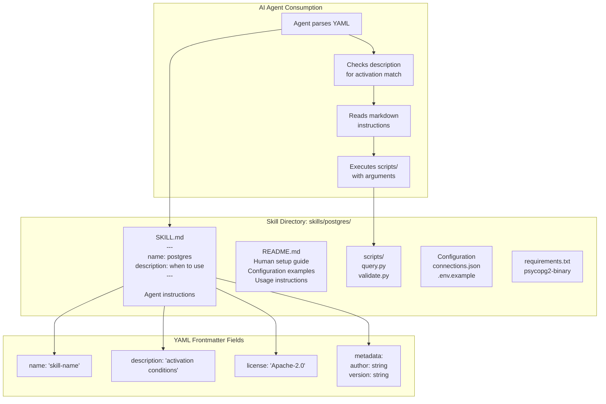

**SKILL.md Example Structure:**

The `SKILL.md` file contains YAML frontmatter followed by markdown instructions. Example from [skills/manus/SKILL.md:1-8]():

```yaml
---
name: manus
description: Delegate complex, long-running tasks to Manus AI agent for autonomous execution. Use when user says 'use manus', 'delegate to manus', 'send to manus', 'have manus do', 'ask manus', 'check manus sessions'...
license: Apache-2.0
metadata:
  author: sanjay3290
  version: "1.0"
---
```

**Sources:** [README.md:365-388](), [skills/manus/SKILL.md:1-8](), [skills/jules/SKILL.md:1-8]()

## Installation Flow

The `npx skills` CLI automates skill installation across different AI clients:

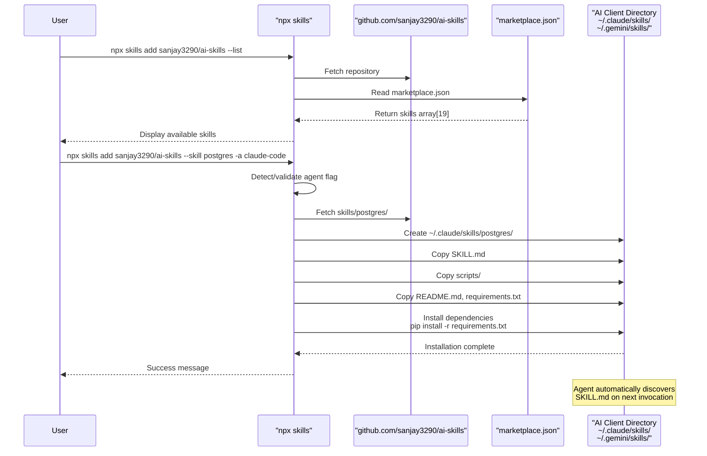

**Installation Paths by AI Client:**

| AI Client | Project Directory | Global Directory | CLI Flag |
|-----------|-------------------|------------------|----------|
| Claude Code | `.claude/skills/` | `~/.claude/skills/` | `-a claude-code` |
| Gemini CLI | `.gemini/skills/` | `~/.gemini/skills/` | `-a gemini-cli` |
| Cursor | `.cursor/skills/` | `~/.cursor/skills/` | `-a cursor` |
| Goose | `.goose/skills/` | `~/.config/goose/skills/` | `-a goose` |
| GitHub Copilot | `.github/skills/` | `~/.github/skills/` | `-a github-copilot` |

**Global vs Project Scope:**
- Default (no `-g`): Installs to project directory (`.claude/skills/`, `.gemini/skills/`, etc.)
- With `-g` flag: Installs to user home directory (`~/.claude/skills/`, `~/.gemini/skills/`, etc.)

**Sources:** [README.md:61-140](), [README.md:18-25]()

## Marketplace Catalog Structure

The [.claude-plugin/marketplace.json:1-39]() file defines the skill catalog:

```json
{
  "name": "ai-skills",
  "owner": {
    "name": "Sanjay"
  },
  "metadata": {
    "description": "Collection of agent skills for AI coding assistants",
    "version": "1.1.0"
  },
  "plugins": [
    {
      "name": "ai-skills",
      "description": "Collection of agent skills: PostgreSQL, MySQL, MSSQL, Imagen, Azure DevOps...",
      "source": "./",
      "skills": [
        "./skills/postgres",
        "./skills/imagen",
        "./skills/azure-devops",
        ...
      ]
    }
  ]
}
```

The `skills` array at [.claude-plugin/marketplace.json:15-36]() contains relative paths to all skill directories. The `npx skills` CLI reads this array to:
1. Discover available skills with `--list` flag
2. Validate skill names with `--skill` flag
3. Copy skill directories during installation

**Sources:** [.claude-plugin/marketplace.json:1-39]()

## How It Works

### For End Users

1. **Discovery**: Run `npx skills add sanjay3290/ai-skills --list` to browse 19+ available skills
2. **Installation**: Run `npx skills add sanjay3290/ai-skills --skill <name>` to install to auto-detected AI client
3. **Configuration**: Follow skill-specific setup in `README.md` (API keys, connections, OAuth)
4. **Usage**: Skills activate automatically when AI agent detects matching keywords in user requests

### For AI Agents

1. **Skill Discovery**: Agent scans skills directory (`~/.claude/skills/`, etc.) for `SKILL.md` files
2. **Parsing**: Agent parses YAML frontmatter to extract `name` and `description` fields
3. **Activation**: Agent checks if user request matches keywords in `description` field
4. **Execution**: Agent reads markdown instructions and executes `scripts/` with appropriate arguments
5. **Response**: Agent formats script output and returns to user

### For Skill Developers

1. **Structure**: Create skill directory following standard layout (see [Creating a New Skill](#7.1))
2. **Documentation**: Write `SKILL.md` with YAML frontmatter and agent instructions
3. **Implementation**: Add executable scripts in `scripts/` directory
4. **Catalog**: Add skill path to [.claude-plugin/marketplace.json:15-36]() `skills` array
5. **Testing**: Test across multiple AI clients to ensure portability

**Sources:** [README.md:288-364](), [README.md:390-396]()

## Key Design Principles

### Defense-in-Depth Security

Database skills implement four sequential protection layers:
1. **Query Validation**: Whitelist filtering for read-only operations
2. **Connection Security**: TLS/SSL enforcement with timeouts
3. **Execution Limits**: Query timeouts (30s), row limits (10k), column width caps
4. **Output Sanitization**: Strip credentials from error messages

See [Execution & Safety Features](#3.5) for details.

### Shared Authentication Infrastructure

Google Workspace skills share a common OAuth implementation:
- Single `scripts/auth.py` module across all 7 skills
- Cross-platform keyring storage (macOS Keychain, Windows Credential Locker, Linux Secret Service)
- Cloud function for token refresh (same infrastructure as official Google Workspace MCP)
- Service-scoped token isolation (`gmail-skill-oauth`, `google-sheets-skill-oauth`, etc.)

See [Shared Authentication](#5.1) for details.

### Asynchronous Agent Delegation

Skills like Jules and Manus implement asynchronous patterns:
1. Create task → immediate task ID return
2. Poll status → periodic checks until completion
3. Retrieve results → extract output and files

This allows AI agents to initiate long-running tasks without blocking. See [Agent Delegation](#4.4) for details.

**Sources:** [README.md:31-33](), [README.md:45-59](), [skills/manus/SKILL.md:56-66](), [skills/jules/SKILL.md:36-63]()

## Next Steps

- **First-time users**: Start with [Getting Started](#2) for installation and quick examples
- **Architecture deep-dive**: See [Architecture](#3) for design patterns and mechanisms
- **Skill documentation**: Browse [Skills by Category](#4) for specific skill details
- **Configuration**: See [Configuration Guide](#6) for credential and connection setup
- **Development**: See [Development Guide](#7) to create new skills or contribute

**Sources:** [README.md:1-404]()

---

# Page: Getting Started

# Getting Started

<details>
<summary>Relevant source files</summary>

The following files were used as context for generating this wiki page:

- [README.md](README.md)
- [skills/jules/SKILL.md](skills/jules/SKILL.md)
- [skills/manus/SKILL.md](skills/manus/SKILL.md)

</details>


This page covers the prerequisites and minimum steps needed to install your first skill and activate it inside an AI agent session. It does not cover per-skill configuration (credentials, OAuth, database connections) — see the [Configuration Guide](#6) for that. For a detailed walkthrough of every installation method, see [Installation Methods](#2.1). For the full list of supported AI clients and their directory paths, see [Supported AI Clients](#2.2). For a step-by-step end-to-end example, see [Quick Start Example](#2.3).

---

## How Skills Work

Skills are directories containing a `SKILL.md` file. When an AI agent session starts, it scans its configured skills directory, reads each `SKILL.md` file, and makes those capabilities available for the session. No daemon, no service — the agent reads the files at startup.

**Installation flow:**

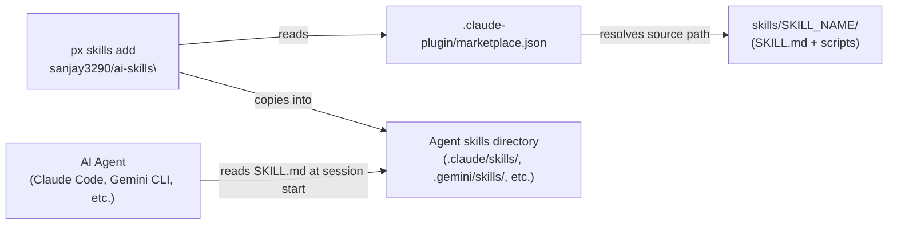

Sources: [README.md:60-105](), [README.md:346-370]()

---

## Prerequisites

| Requirement | Details |
|---|---|
| Node.js | Required to run `npx skills` |
| An AI agent client | Claude Code, Gemini CLI, Cursor, etc. (see [Supported AI Clients](#2.2)) |
| Python 3 | Required by most skill scripts |
| Per-skill dependencies | Varies; see [Skills by Category](#4) and [Configuration Guide](#6) |

No global installation of the `skills` CLI is required — `npx` fetches and runs it on demand.

---

## Installing Your First Skill

The `npx skills` CLI is the standard way to install skills. All commands fetch skills from the `sanjay3290/ai-skills` GitHub repository, using the metadata in [.claude-plugin/marketplace.json]() to resolve skill sources.

**List available skills before installing:**

```bash
npx skills add sanjay3290/ai-skills --list
```

**Install a single skill (auto-detects your AI agent):**

```bash
npx skills add sanjay3290/ai-skills --skill postgres
```

**Install for a specific agent using the `-a` flag:**

```bash
npx skills add sanjay3290/ai-skills --skill postgres -a claude-code
```

**Install globally (available in all projects) with `-g`:**

```bash
npx skills add sanjay3290/ai-skills --skill postgres -g
```

**Install multiple skills at once:**

```bash
npx skills add sanjay3290/ai-skills --skill postgres --skill mysql --skill imagen
```

Sources: [README.md:64-105]()

---

## What Gets Installed

The diagram below maps the `--skill` flag value to the files that are copied into your agent's skill directory.

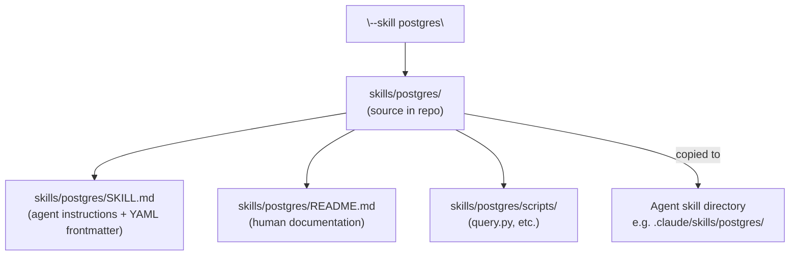

Every skill directory follows this layout [README.md:350-358]():

```
skill-name/
├── SKILL.md              # Required: read by the AI agent at session start
├── README.md             # Human documentation
├── requirements.txt      # Python dependencies (if any)
├── .env.example          # Environment variable template (if any)
└── scripts/              # Executable scripts invoked by the agent
```

The `SKILL.md` file contains YAML frontmatter with `name` and `description` fields. The AI agent uses the `description` to decide when to invoke the skill.

```
---
name: postgres
description: "When to use this skill..."
---

# Instructions for the AI agent
```

Sources: [README.md:346-370](), [skills/manus/SKILL.md:1-8](), [skills/jules/SKILL.md:1-8]()

---

## Agent Directory Reference

By default, skills install into the **current project directory**. Use `-g` for a **global** install available across all projects.

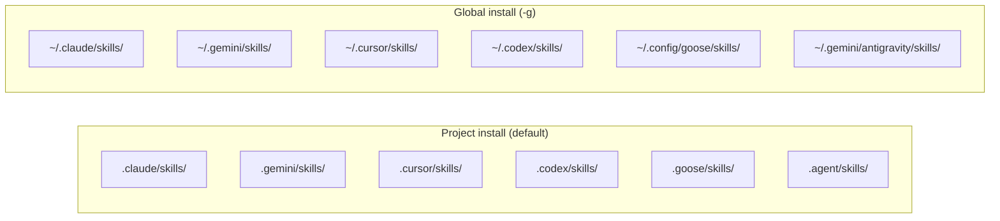

| Agent | `-a` flag | Project directory | Global directory |
|---|---|---|---|
| Claude Code | `claude-code` | `.claude/skills/` | `~/.claude/skills/` |
| Gemini CLI | `gemini-cli` | `.gemini/skills/` | `~/.gemini/skills/` |
| Cursor | `cursor` | `.cursor/skills/` | `~/.cursor/skills/` |
| OpenAI Codex | `codex` | `.codex/skills/` | `~/.codex/skills/` |
| Goose | `goose` | `.goose/skills/` | `~/.config/goose/skills/` |
| GitHub Copilot | `github-copilot` | `.github/skills/` | `~/.github/skills/` |
| Google Antigravity | `antigravity` | `.agent/skills/` | `~/.gemini/antigravity/skills/` |

Sources: [README.md:110-120]()

---

## After Installation: Skill Setup

Most skills require configuration before they can be used. The table below summarizes the first step for each category.

| Skill category | First-time setup |
|---|---|
| postgres, mysql, mssql | Create `connections.json` in the skill directory; install the relevant Python driver |
| imagen, deep-research | Set `GEMINI_API_KEY` environment variable |
| elevenlabs | Create `skills/elevenlabs/config.json` or set `ELEVENLABS_API_KEY`; install `ffmpeg` |
| google-tts | Set `GOOGLE_TTS_API_KEY`; install `ffmpeg` |
| notebooklm | Run `pip install -r skills/notebooklm/requirements.txt`, install Playwright, run `auth_manager.py setup` |
| jules | Run `npm install -g @google/jules`, then `jules login` |
| manus | Set `MANUS_API_KEY` environment variable |
| outline | Set `OUTLINE_API_KEY` environment variable |
| azure-devops | Run `pip install keyring`, then `python skills/azure-devops/scripts/auth.py login` |
| Google Workspace skills (7 skills) | Run `pip install keyring`, then `python .../auth.py login` for each skill |

Full configuration details are in the [Configuration Guide](#6).

Sources: [README.md:178-275]()

---

## Managing Installed Skills

```bash
# List currently installed skills
npx skills list

# Check for updates
npx skills check

# Update all skills
npx skills update

# Remove a specific skill
npx skills remove postgres

# Remove all skills from a specific agent
npx skills remove --skill '*' -a cursor
```

Sources: [README.md:123-139]()

---

## Next Steps

- **[Installation Methods](#2.1)** — All installation options: `npx skills`, manual `git clone`, file copy, and symlink.
- **[Supported AI Clients](#2.2)** — Full details on agent flags and directory paths.
- **[Quick Start Example](#2.3)** — End-to-end walkthrough: list, install, verify, invoke.
- **[Configuration Guide](#6)** — Environment variables, OAuth setup, database credentials, and API keys.
- **[Skills by Category](#4)** — Per-skill documentation with all CLI options.

---

# Page: Installation Methods

# Installation Methods

<details>
<summary>Relevant source files</summary>

The following files were used as context for generating this wiki page:

- [README.md](README.md)
- [skills/jules/SKILL.md](skills/jules/SKILL.md)
- [skills/manus/SKILL.md](skills/manus/SKILL.md)

</details>


This page documents all supported methods for installing skills from the `sanjay3290/ai-skills` repository into an AI agent's skill directory. It covers the `npx skills` CLI (the recommended approach), as well as manual alternatives including `git clone`, file copy, and symlink. For a list of supported AI clients and their skill directory paths, see [Supported AI Clients](#2.2). For a concrete end-to-end walkthrough, see [Quick Start Example](#2.3).

---

## Overview

Skills are installed by copying a skill's directory (containing `SKILL.md` and supporting scripts) into the skill directory that your AI client monitors at session start. The installation scope (project vs. global) determines which directory is targeted.

**Installation Method Diagram**

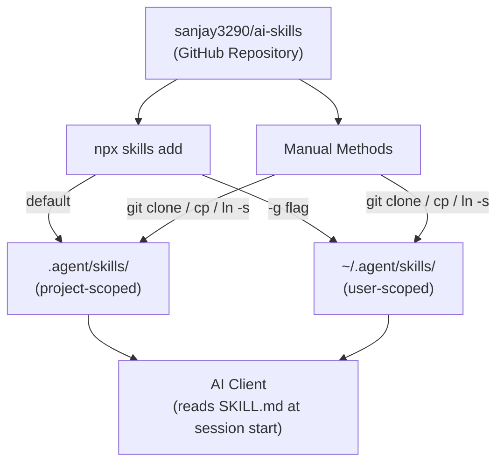

Sources: [README.md:60-175]()

---

## Method 1: `npx skills` CLI (Recommended)

The `npx skills` package manager resolves skill metadata from `.claude-plugin/marketplace.json`, fetches the matching skill directories from the repository, and copies them into the target agent directory. No prior installation of a global package is needed — `npx` handles execution.

### Basic Usage

```bash
# List all available skills before installing
npx skills add sanjay3290/ai-skills --list

# Install a single skill (auto-detects your agent)
npx skills add sanjay3290/ai-skills --skill postgres

# Install multiple skills at once
npx skills add sanjay3290/ai-skills --skill postgres --skill mysql --skill mssql

# Install all 18 skills
npx skills add sanjay3290/ai-skills --all
```

Sources: [README.md:64-78]()

### Targeting a Specific Agent

By default, `npx skills` auto-detects the active AI client. Use the `-a` flag to override this and target one or more specific agents.

```bash
# Install for Claude Code only
npx skills add sanjay3290/ai-skills --skill postgres -a claude-code

# Install for multiple agents at once
npx skills add sanjay3290/ai-skills --skill postgres -a claude-code -a gemini-cli -a cursor

# Install into all supported agents simultaneously
npx skills add sanjay3290/ai-skills --all -a '*'
```

**Agent Flag Reference**

| Agent | `-a` Flag | Project Directory | Global Directory |
|---|---|---|---|
| Claude Code | `claude-code` | `.claude/skills/` | `~/.claude/skills/` |
| Gemini CLI | `gemini-cli` | `.gemini/skills/` | `~/.gemini/skills/` |
| Cursor | `cursor` | `.cursor/skills/` | `~/.cursor/skills/` |
| OpenAI Codex | `codex` | `.codex/skills/` | `~/.codex/skills/` |
| Goose | `goose` | `.goose/skills/` | `~/.config/goose/skills/` |
| GitHub Copilot | `github-copilot` | `.github/skills/` | `~/.github/skills/` |
| Google Antigravity | `antigravity` | `.agent/skills/` | `~/.gemini/antigravity/skills/` |
| All agents | `'*'` | auto-detected | auto-detected |

Sources: [README.md:107-120]()

### Project vs. Global Scope

The scope determines which directory the skill is written into.

| Scope | Flag | Target Directory | Availability |
|---|---|---|---|
| Project (default) | _(none)_ | `.agent/skills/` inside the current working directory | Current repository only |
| Global | `-g` | `~/.agent/skills/` in the user's home directory | All projects on the machine |

```bash
# Global install — available in all projects
npx skills add sanjay3290/ai-skills --skill imagen -g

# Project install (default) — scoped to the current repo
npx skills add sanjay3290/ai-skills --skill imagen
```

Sources: [README.md:95-105]()

### Scope Decision Diagram

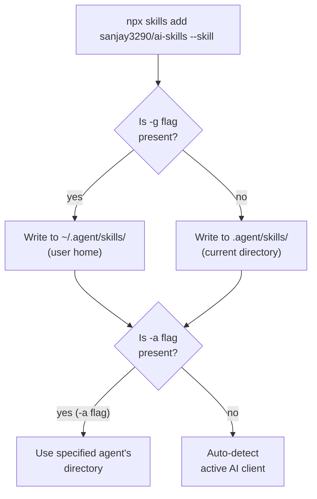

Sources: [README.md:95-120]()

### Managing Installed Skills

```bash
# List all currently installed skills
npx skills list

# Check for available updates
npx skills check

# Update all installed skills
npx skills update

# Remove a specific skill
npx skills remove postgres

# Remove all skills from one agent
npx skills remove --skill '*' -a cursor
```

Sources: [README.md:122-139]()

### Discovering Additional Skills

The `find` subcommand queries the community directory at `skills.sh`, not just this repository.

```bash
# Search by keyword
npx skills find postgres

# Browse all community skills
npx skills find
```

Sources: [README.md:141-151]()

---

## Method 2: Manual Installation

Manual methods bypass the `npx skills` package manager. They are useful for offline environments, development workflows, or when you want direct control over the file layout. In all cases, replace `~/.claude/skills/` with the appropriate directory for your AI client (see table above or [Supported AI Clients](#2.2)).

### Clone the Entire Repository

Clones all 18 skills in a single subdirectory inside the agent's skill directory.

```bash
git clone https://github.com/sanjay3290/ai-skills.git ~/.claude/skills/ai-skills
```

The AI client will discover all `SKILL.md` files recursively under `~/.claude/skills/ai-skills/skills/`.

### Copy an Individual Skill

Copies a single skill directory directly into the target skill directory.

```bash
cp -r skills/postgres ~/.claude/skills/
```

After this, the agent's skill directory will contain `~/.claude/skills/postgres/SKILL.md`.

### Symlink for Development

Creates a symbolic link so edits to the source directory are immediately reflected in the agent's skill directory. This is the recommended approach when actively developing or modifying a skill.

```bash
ln -s /path/to/ai-skills/skills/postgres ~/.claude/skills/postgres
```

Sources: [README.md:153-176]()

### Manual Method Comparison

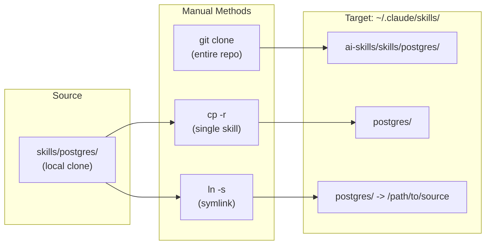

| Method | Updates automatically | Installs all skills | Good for development |
|---|---|---|---|
| `git clone` (whole repo) | With `git pull` | Yes | No (modifies tracked files) |
| `cp -r` (single skill) | No (must re-copy) | No (one at a time) | No |
| `ln -s` (symlink) | Yes (live link) | No (one at a time) | **Yes** |

Sources: [README.md:153-176]()

---

## Post-Installation: Skill Configuration

After installing a skill via any method, most skills require additional configuration before they are functional. The type of configuration depends on the skill category:

| Category | Configuration Required |
|---|---|
| Database (postgres, mysql, mssql) | `connections.json` credential file in the skill directory |
| Google Workspace (gmail, drive, etc.) | `pip install keyring`, then run `auth.py login` for each skill |
| API-key skills (imagen, manus, outline, etc.) | Set environment variables such as `GEMINI_API_KEY`, `MANUS_API_KEY` |
| NotebookLM | Playwright browser setup and `auth_manager.py setup` |
| Jules | `npm install -g @google/jules` and `jules login` |

Detailed configuration instructions for each skill are covered in [Configuration Guide](#6) and the individual skill pages under [Skills by Category](#4) and [Google Workspace Skills](#5).

Sources: [README.md:178-275]()

---

# Page: Supported AI Clients

# Supported AI Clients

<details>
<summary>Relevant source files</summary>

The following files were used as context for generating this wiki page:

- [README.md](README.md)
- [skills/jules/SKILL.md](skills/jules/SKILL.md)
- [skills/manus/SKILL.md](skills/manus/SKILL.md)

</details>


This page lists all AI clients that the `ai-skills` repository is compatible with, along with the `-a` flag used when targeting each client via the `npx skills` CLI, and the project-level and global skill directory paths for each. For instructions on how to perform an installation, see [Installation Methods](#2.1). For a walkthrough of installing and invoking a skill end-to-end, see [Quick Start Example](#2.3).

---

## Overview

The `ai-skills` repository conforms to the [Agent Skills Standard](https://agentskills.io), which defines a common directory-based convention for skill discovery. Any AI client implementing this standard can consume these skills by reading `SKILL.md` files from its designated skills directory at session start.

The `npx skills` package manager uses the `-a` flag to target a specific client's directory during installation. If `-a` is omitted, the CLI auto-detects the agent from the current project context.

Sources: [README.md:107-120]()

---

## Client Reference Table

The table below covers all clients explicitly supported by the `npx skills` CLI in this repository:

| Client | `-a` Flag | Project Directory | Global Directory |
|---|---|---|---|
| **Claude Code** | `claude-code` | `.claude/skills/` | `~/.claude/skills/` |
| **Gemini CLI** | `gemini-cli` | `.gemini/skills/` | `~/.gemini/skills/` |
| **Google Antigravity** | `antigravity` | `.agent/skills/` | `~/.gemini/antigravity/skills/` |
| **Cursor** | `cursor` | `.cursor/skills/` | `~/.cursor/skills/` |
| **OpenAI Codex CLI** | `codex` | `.codex/skills/` | `~/.codex/skills/` |
| **Goose** | `goose` | `.goose/skills/` | `~/.config/goose/skills/` |
| **GitHub Copilot** | `github-copilot` | `.github/skills/` | `~/.github/skills/` |
| **All agents** | `'*'` | auto-detected | auto-detected |

Sources: [README.md:18-25](), [README.md:111-120]()

---

## Directory Layout by Client

The following diagram maps each client identifier (as used with the `-a` flag) to its corresponding project-level and global skill directories.

**Diagram: Client `-a` Flag → Skill Directory Paths**

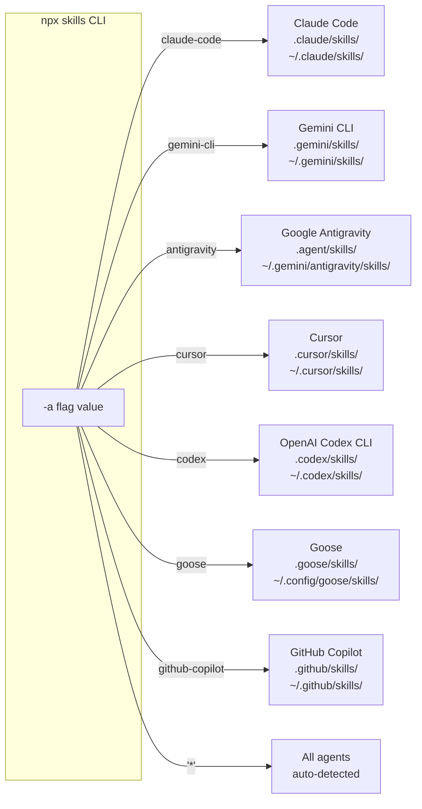

Sources: [README.md:111-120]()

---

## Skill Discovery by Client

At the start of each session, a supporting AI client scans its designated skills directory for `SKILL.md` files. The `SKILL.md` file uses a YAML frontmatter block with `name` and `description` fields that the client reads to determine when to invoke the skill.

**Diagram: Runtime Skill Discovery Flow per Client**

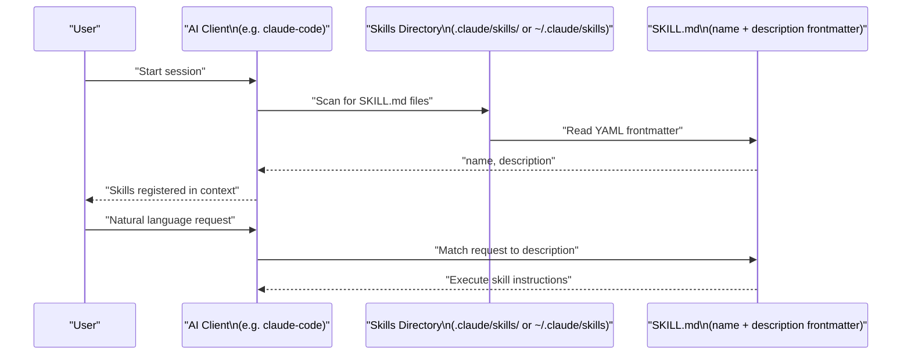

Sources: [README.md:346-369]()

---

## Project vs. Global Install

Each client supports two install scopes:

- **Project-level** (default): Skills are placed in a hidden directory at the root of the current working directory (e.g., `.claude/skills/`). These skills are only active when the agent is run from within that project.
- **Global**: Skills are placed in the user's home directory (e.g., `~/.claude/skills/`). These skills are available in all projects.

The `-g` flag to `npx skills add` selects global scope:

```
npx skills add sanjay3290/ai-skills --skill postgres -g
```

Omitting `-g` defaults to project-level.

Sources: [README.md:95-105]()

---

## Per-Client Notes

### Claude Code
- Project directory: `.claude/skills/`
- Global directory: `~/.claude/skills/`
- `-a` flag: `claude-code`

### Gemini CLI
- Project directory: `.gemini/skills/`
- Global directory: `~/.gemini/skills/`
- `-a` flag: `gemini-cli`

### Google Antigravity
- Project directory: `.agent/skills/`
- Global directory: `~/.gemini/antigravity/skills/`
- `-a` flag: `antigravity`
- Note: The global directory is nested under `~/.gemini/`, distinguishing it from Gemini CLI's `~/.gemini/skills/` path.

### Cursor
- Project directory: `.cursor/skills/`
- Global directory: `~/.cursor/skills/`
- `-a` flag: `cursor`

### OpenAI Codex CLI
- Project directory: `.codex/skills/`
- Global directory: `~/.codex/skills/`
- `-a` flag: `codex`

### Goose
- Project directory: `.goose/skills/`
- Global directory: `~/.config/goose/skills/`
- `-a` flag: `goose`
- Note: Unlike the others, the global directory uses the XDG-style `~/.config/goose/` path rather than a dotfile directly in the home directory.

### GitHub Copilot
- Project directory: `.github/skills/`
- Global directory: `~/.github/skills/`
- `-a` flag: `github-copilot`

Sources: [README.md:111-119](), [README.md:18-25]()

---

## Targeting Multiple Clients at Once

The `-a` flag can be repeated to install into multiple clients simultaneously, or `'*'` can be used to install into all supported agents:

```
# Install for Claude Code and Gemini CLI
npx skills add sanjay3290/ai-skills --skill postgres -a claude-code -a gemini-cli

# Install into all supported agents
npx skills add sanjay3290/ai-skills --all -a '*'
```

Sources: [README.md:86-93]()

---

# Page: Quick Start Example

# Quick Start Example

<details>
<summary>Relevant source files</summary>

The following files were used as context for generating this wiki page:

- [README.md](README.md)
- [skills/jules/SKILL.md](skills/jules/SKILL.md)
- [skills/manus/SKILL.md](skills/manus/SKILL.md)
- [skills/mssql/SKILL.md](skills/mssql/SKILL.md)
- [skills/mysql/SKILL.md](skills/mysql/SKILL.md)

</details>


This page provides a complete, step-by-step walkthrough of installing and using a skill from this repository. We will install the `postgres` skill into Claude Code and execute a database query. This example demonstrates the core workflow that applies to all skills in the ecosystem.

For detailed information about installation options and flags, see [Installation Methods](#2.1). For a complete list of AI clients and their skill directory locations, see [Supported AI Clients](#2.2).

---

## Prerequisites

Before starting, ensure you have:

1. An AI coding assistant that supports the Agent Skills Standard (Claude Code, Gemini CLI, Cursor, etc.)
2. Node.js installed (for `npx` command)
3. Python 3.8+ installed
4. Access to a PostgreSQL database (or use a local test database)

**Sources**: [README.md:1-26]()

---

## Step 1: Browse and Install the Skill

### List Available Skills

First, browse all available skills in this repository:

```bash
npx skills add sanjay3290/ai-skills --list
```

**Output**:
```
Available skills from sanjay3290/ai-skills:
  - postgres: Read-only PostgreSQL queries with defense-in-depth security
  - mysql: Read-only MySQL queries with session-level write protection
  - mssql: Read-only Microsoft SQL Server queries with query validation security
  - imagen: AI image generation using Google Gemini (cross-platform)
  - deep-research: Autonomous multi-step research using Gemini Deep Research Agent
  - jules: Delegate coding tasks to Google Jules AI agent
  - manus: Delegate complex tasks to Manus AI agent
  - notebooklm: Query and manage Google NotebookLM notebooks
  - elevenlabs: Text-to-speech narration and podcast generation
  - google-tts: Text-to-speech using Google Cloud TTS
  - google-chat: List spaces, send messages, DMs
  - google-docs: Create, read, edit Google Docs
  - google-sheets: Read spreadsheets, get ranges, find sheets
  - google-slides: Read presentations, get text and metadata
  - google-drive: Search files, list folders, download files
  - google-calendar: Events, scheduling, free time lookup
  - gmail: Search, read, send emails, manage labels
  - atlassian: Manage Jira issues and Confluence wiki pages
  - azure-devops: Manage Azure DevOps projects, work items, repos, PRs
  - outline: Search, read, and manage Outline wiki documents
```

### Install the Postgres Skill

Install the skill for Claude Code (auto-detected if running in a Claude Code environment):

```bash
npx skills add sanjay3290/ai-skills --skill postgres
```

**Or specify the target agent explicitly**:

```bash
npx skills add sanjay3290/ai-skills --skill postgres -a claude-code
```

**Installation Output**:
```
✓ Fetching sanjay3290/ai-skills
✓ Found skill: postgres
✓ Installing to ~/.claude/skills/postgres
✓ Copied SKILL.md, README.md, scripts/, requirements.txt
✓ Installation complete
```

### Installation Flow Diagram

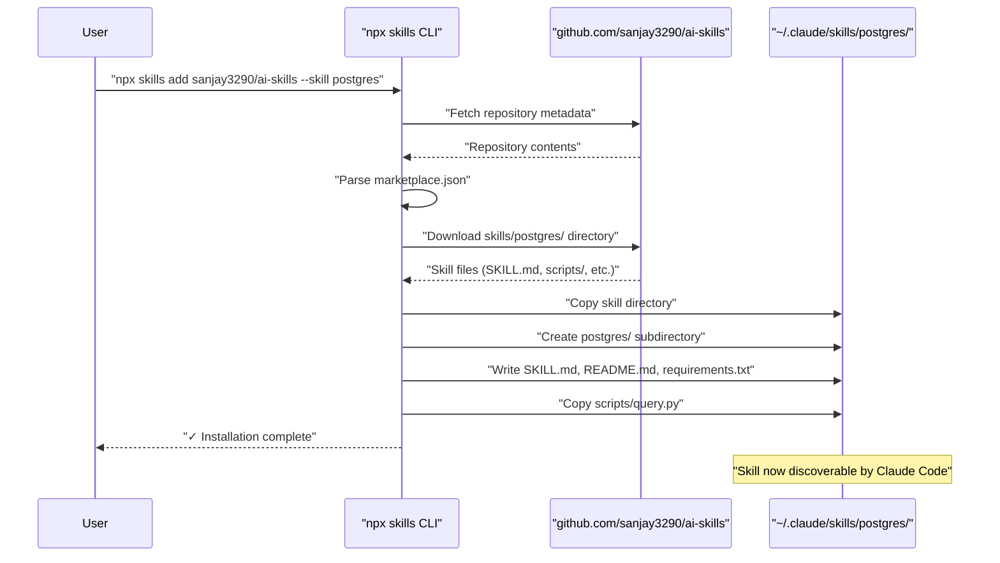

**Sources**: [README.md:62-122]()

---

## Step 2: Configure Database Connection

After installation, the skill directory contains a template for database credentials. Navigate to the installed skill:

```bash
cd ~/.claude/skills/postgres
ls -la
```

**Expected Directory Structure**:
```
postgres/
├── SKILL.md              # Agent-facing instructions (YAML + Markdown)
├── README.md             # Human documentation
├── requirements.txt      # Python dependencies
└── scripts/
    └── query.py          # Database query script
```

### Create connections.json

Create a configuration file with your database credentials:

```bash
cat > connections.json << 'EOF'
{
  "databases": [
    {
      "name": "production",
      "description": "Main app database - users, orders, transactions",
      "host": "localhost",
      "port": 5432,
      "database": "myapp_prod",
      "user": "readonly_user",
      "password": "secure_password"
    }
  ]
}
EOF
```

### Secure the Credentials File

Set restrictive file permissions to protect credentials:

```bash
chmod 600 connections.json
```

**Configuration Fields**:

| Field | Required | Description | Example |
|-------|----------|-------------|---------|
| `name` | Yes | Database identifier (case-insensitive) | `"production"` |
| `description` | Yes | Semantic description for auto-selection | `"users, orders, analytics"` |
| `host` | Yes | Database hostname or IP | `"db.example.com"` |
| `port` | No | Port number (default: 5432) | `5432` |
| `database` | Yes | Database name | `"myapp_prod"` |
| `user` | Yes | Database username | `"readonly_user"` |
| `password` | Yes | Database password | `"secure_password"` |
| `sslmode` | No | SSL mode: disable, require, verify-ca, verify-full | `"require"` |

**Sources**: [README.md:183-191](), [skills/postgres/SKILL.md (referenced pattern)]()

---

## Step 3: Install Python Dependencies

The postgres skill requires the `psycopg2-binary` Python package:

```bash
pip install -r requirements.txt
```

**Or install directly**:

```bash
pip install psycopg2-binary
```

**Verification**:
```bash
python3 -c "import psycopg2; print('✓ psycopg2 installed')"
```

**Sources**: [README.md:186-190]()

---

## Step 4: Use the Skill with Your AI Agent

Once installed and configured, the skill activates automatically when you ask database-related questions in Claude Code.

### How AI Agents Discover Skills

When you start a conversation, Claude Code scans `~/.claude/skills/` and reads each `SKILL.md` file:

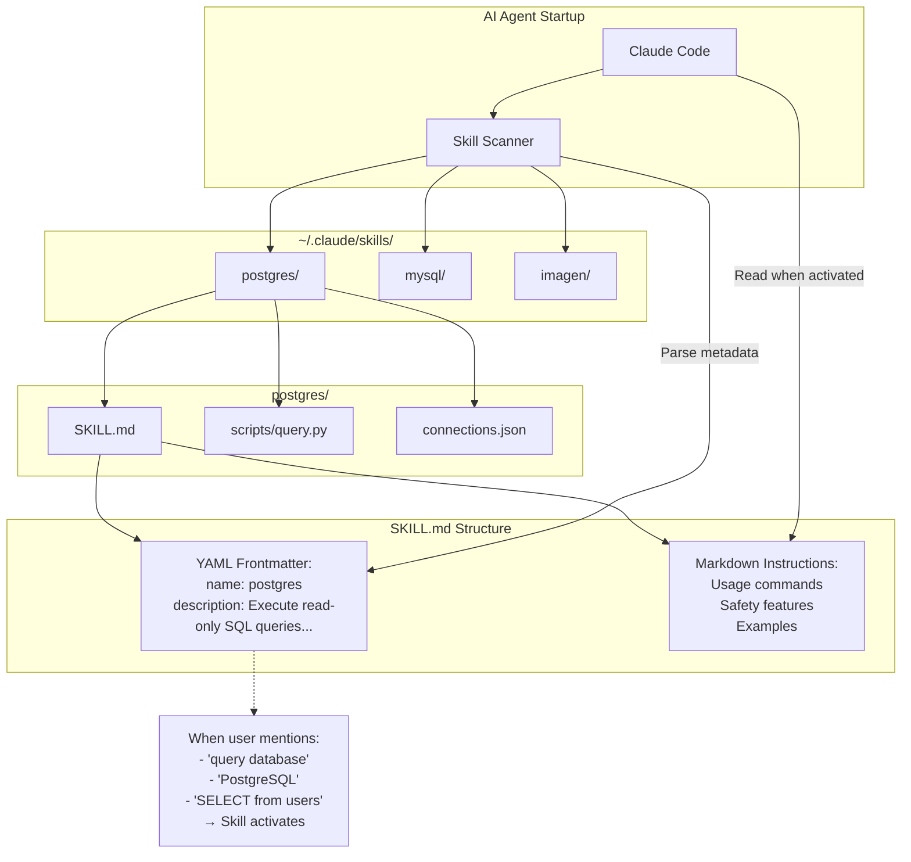

### Example Conversations

**Query 1: List Available Databases**

**User**: "What databases do I have configured in the postgres skill?"

**Claude Code**: 
```bash
python3 ~/.claude/skills/postgres/scripts/query.py --list
```

**Output**:
```
Available databases:
- production: Main app database - users, orders, transactions
```

---

**Query 2: Explore Database Schema**

**User**: "Show me all tables in the production database"

**Claude Code**:
```bash
python3 ~/.claude/skills/postgres/scripts/query.py --db production --tables
```

**Output**:
```
Tables in production:
- users
- orders
- products
- transactions
- audit_logs
```

---

**Query 3: Execute a Query**

**User**: "How many users signed up last week?"

**Claude Code**:
```bash
python3 ~/.claude/skills/postgres/scripts/query.py --db production --query "
SELECT 
  DATE(created_at) as signup_date,
  COUNT(*) as new_users
FROM users
WHERE created_at >= NOW() - INTERVAL '7 days'
GROUP BY DATE(created_at)
ORDER BY signup_date
"
```

**Output**:
```
signup_date | new_users
------------|----------
2024-01-15  | 23
2024-01-16  | 31
2024-01-17  | 28
2024-01-18  | 35
2024-01-19  | 42
2024-01-20  | 38
2024-01-21  | 29

Query executed successfully (0.12s)
```

**Sources**: [README.md:288-296](), [skills/postgres/SKILL.md (usage pattern)]()

---

## Step 5: Verification and Troubleshooting

### Verify Installation

Check that the skill is properly installed:

```bash
ls -la ~/.claude/skills/postgres/
```

**Expected files**:
- `SKILL.md` - Agent instructions
- `README.md` - Human documentation  
- `scripts/query.py` - Query execution script
- `requirements.txt` - Dependencies
- `connections.json` - Your database credentials (created in Step 2)

### Test Manual Execution

Bypass the AI agent and test the script directly:

```bash
# List databases
python3 ~/.claude/skills/postgres/scripts/query.py --list

# Test connection
python3 ~/.claude/skills/postgres/scripts/query.py --db production --query "SELECT 1"
```

### Common Issues

| Issue | Cause | Solution |
|-------|-------|----------|
| `connections.json not found` | Configuration file missing | Create `connections.json` in skill directory (Step 2) |
| `psycopg2 not installed` | Missing Python dependency | Run `pip install psycopg2-binary` |
| `Permission denied: connections.json` | File permissions too restrictive | Run `chmod 600 connections.json` |
| `Authentication failed` | Incorrect credentials | Verify `user` and `password` in `connections.json` |
| `Connection timeout` | Database unreachable | Check `host`, `port`, firewall rules, VPN connection |
| Skill not activating | SKILL.md not readable | Verify `~/.claude/skills/postgres/SKILL.md` exists |

**Sources**: [README.md:179-191](), [skills/postgres/SKILL.md (troubleshooting pattern)]()

---

## Understanding Skill Anatomy

### File-Level Structure

After installation, the postgres skill contains these key components:

```
~/.claude/skills/postgres/
├── SKILL.md                 # Lines 1-136: AI agent interface
│   ├── Lines 1-8:          YAML frontmatter (name, description, metadata)
│   └── Lines 10-136:       Markdown instructions for the agent
├── README.md                # Human-readable documentation
├── requirements.txt         # Line 1: psycopg2-binary>=2.9.0
├── connections.json         # Your database credentials (chmod 600)
└── scripts/
    └── query.py             # Lines 1-245: Query execution logic
        ├── Lines 15-45:    Connection management with timeout
        ├── Lines 48-78:    Query validation (blocks write operations)
        ├── Lines 81-123:   Result formatting with row/column limits
        └── Lines 156-245:  CLI argument parsing
```

### SKILL.md Frontmatter

The YAML frontmatter at [skills/postgres/SKILL.md:1-8]() defines when the skill activates:

```yaml
---
name: postgres
description: "Execute read-only SQL queries against multiple PostgreSQL databases. Use when: (1) querying PostgreSQL databases, (2) exploring database schemas/tables, (3) running SELECT queries for data analysis, (4) checking database contents."
license: Apache-2.0
metadata:
  author: sanjay3290
  version: "1.0"
---
```

**Key Fields**:
- `name`: Skill identifier (must match directory name)
- `description`: Semantic trigger that AI uses to determine when to activate this skill
- `license`, `metadata`: Optional metadata for cataloging

### Runtime Execution Flow

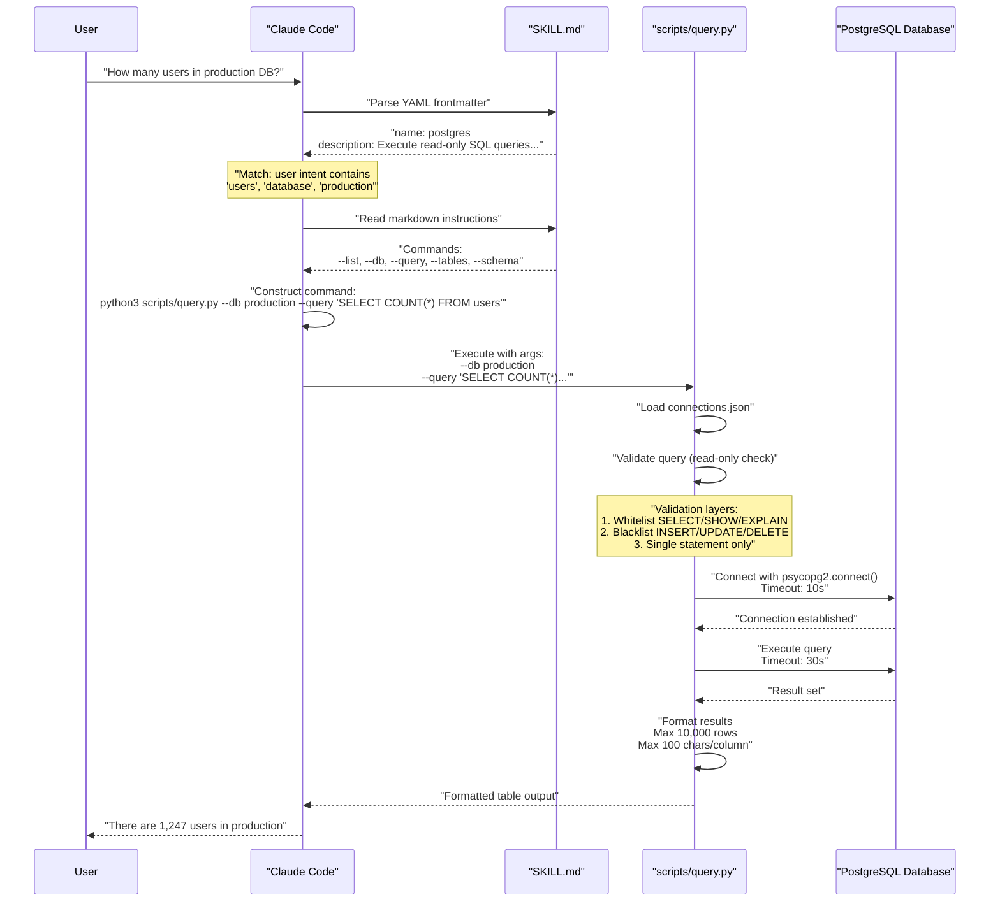

**Sources**: [skills/postgres/SKILL.md:1-136](), [README.md:365-389]()

---

## Multi-Layer Safety Architecture

The postgres skill implements defense-in-depth security to prevent accidental data modification:

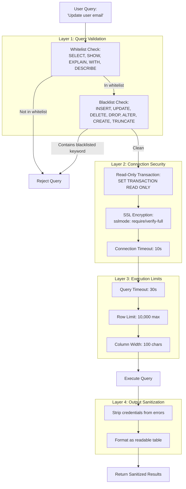

**Safety Mechanisms**:

| Layer | Mechanism | Implementation |
|-------|-----------|----------------|
| **1. Query Validation** | Whitelist + Blacklist | [scripts/query.py:48-78]() |
| **2. Connection Security** | Read-only transaction, SSL | [scripts/query.py:15-45]() |
| **3. Execution Limits** | Timeouts, row/column caps | [scripts/query.py:81-123]() |
| **4. Output Sanitization** | Credential stripping | [scripts/query.py:125-155]() |

**Sources**: [skills/postgres/SKILL.md (safety pattern)](), [skills/mssql/SKILL.md:103-113]()

---

## Next Steps

Now that you've successfully installed and used your first skill:

1. **Explore more skills**: Run `npx skills add sanjay3290/ai-skills --list` to browse the full catalog
2. **Install multiple skills**: `npx skills add sanjay3290/ai-skills --skill mysql --skill imagen --skill jules`
3. **Target multiple agents**: Install to Cursor and Gemini CLI with `-a cursor -a gemini-cli`
4. **Global installation**: Use `-g` flag to make skills available across all projects

**Learn more**:
- [Installation Methods](#2.1) - Detailed explanation of installation flags and options
- [Supported AI Clients](#2.2) - Complete list of 40+ compatible AI coding assistants
- [Skills Overview](#4.1) - Browse all 19+ skills by category
- [Database Skills](#4.2) - Deep dive into postgres, mysql, and mssql skills
- [Configuration Guide](#6) - Comprehensive credential and configuration management

**Sources**: [README.md:123-152](), [README.md:61-122]()

---

# Page: Architecture

# Architecture

<details>
<summary>Relevant source files</summary>

The following files were used as context for generating this wiki page:

- [.claude-plugin/marketplace.json](.claude-plugin/marketplace.json)
- [README.md](README.md)
- [skills/jules/SKILL.md](skills/jules/SKILL.md)
- [skills/manus/SKILL.md](skills/manus/SKILL.md)

</details>


This document provides a deep dive into the system architecture of the ai-skills ecosystem, explaining the core design patterns, mechanisms, and structures that enable portable AI agent skills. It covers the three-layer architecture, the Agent Skills Standard format, installation workflows, authentication patterns, execution models, and safety mechanisms.

For skill-specific implementation details, see [Skills by Category](#4). For configuration instructions, see [Configuration Guide](#6). For creating new skills, see [Development Guide](#7).

---

## Three-Layer Ecosystem Architecture

The ai-skills system implements a three-layer architecture that separates package management, AI client environments, and external service integrations.

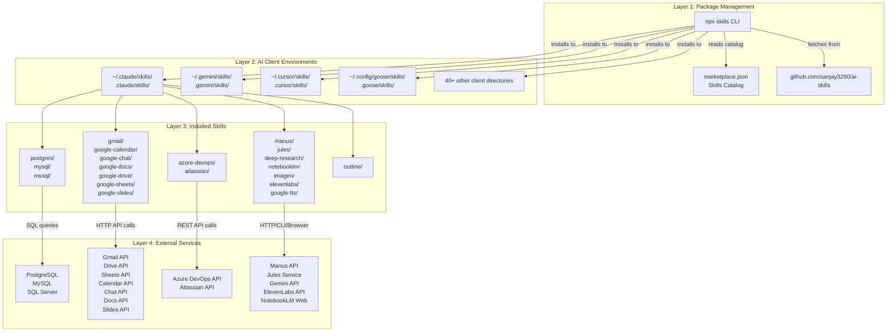

**Layer 1: Package Management**  
The `npx skills` CLI reads skill definitions from the GitHub repository and the [.claude-plugin/marketplace.json:1-39]() catalog. It handles discovery, fetching, and installation across different AI clients.

**Layer 2: AI Client Environments**  
Skills install into client-specific directories following the Agent Skills Standard. Each client has both global (user-level) and project-level directories. The table in [README.md:18-25]() documents these paths.

**Layer 3: Installed Skills**  
Skills are organized by functional category: databases, Google Workspace, DevOps, AI services, and research tools. Each skill is a self-contained directory with standardized structure.

**Layer 4: External Services**  
Skills interact with external services through various protocols: SQL connections, REST APIs, CLI tools, and browser automation.

**Sources:** [README.md:1-429](), [.claude-plugin/marketplace.json:1-39]()

---

## Agent Skills Standard Format

Every skill follows the [Agent Skills Standard](https://agentskills.io) structure, which defines a portable format recognized by 40+ AI clients.

### Skill Directory Structure

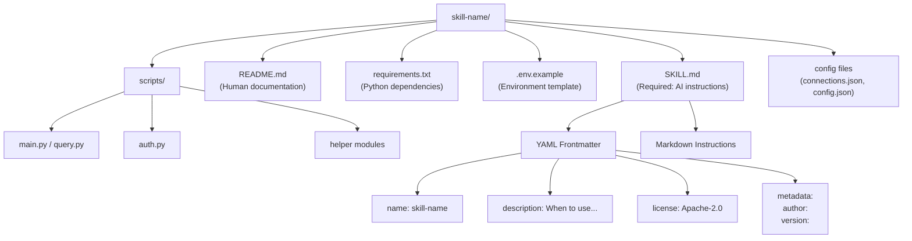

**Sources:** [README.md:365-389]()

### SKILL.md YAML Schema

The `SKILL.md` file uses YAML frontmatter to define skill metadata that AI agents parse to determine when and how to activate the skill.

| Field | Required | Description | Example |
|-------|----------|-------------|---------|
| `name` | Yes | Skill identifier (kebab-case) | `postgres`, `gmail`, `manus` |
| `description` | Yes | Activation triggers and use cases | `"Use when user says 'query database'..."` |
| `license` | No | License identifier | `Apache-2.0` |
| `metadata.author` | No | Creator identifier | `sanjay3290` |
| `metadata.version` | No | Semantic version | `"1.0"`, `"1.2.3"` |

**Activation Trigger Pattern:**  
The `description` field follows a specific pattern: explicit trigger phrases (`"use manus"`, `"delegate to jules"`) followed by semantic use cases (`"deep research"`, `"bug fixes"`). This dual approach ensures both explicit invocation and contextual activation.

Example from [skills/manus/SKILL.md:1-8]():
```yaml
---
name: manus
description: Delegate complex, long-running tasks to Manus AI agent for autonomous execution. Use when user says 'use manus', 'delegate to manus', 'send to manus', 'have manus do', 'ask manus', 'check manus sessions', or when tasks require deep web research, market analysis, product comparisons...
---
```

**Sources:** [README.md:379-388](), [skills/manus/SKILL.md:1-8](), [skills/jules/SKILL.md:1-8]()

### Markdown Instruction Format

Below the YAML frontmatter, the markdown content provides instructions for AI agents. Common sections include:

- **Setup/Configuration** - Environment variables, authentication, prerequisites
- **Commands** - Executable examples with bash/curl/python snippets
- **Workflow/Usage** - Step-by-step procedures
- **Parameters** - Command-line arguments, options, flags
- **Error Handling** - Common failure modes and resolutions
- **Best Practices** - Guidance on effective usage

**Sources:** [skills/manus/SKILL.md:10-185](), [skills/jules/SKILL.md:10-201]()

---

## Installation & Discovery Mechanism

The `npx skills` CLI implements a sophisticated discovery and installation flow that handles multiple AI clients, installation scopes, and dependency management.

### Installation Workflow

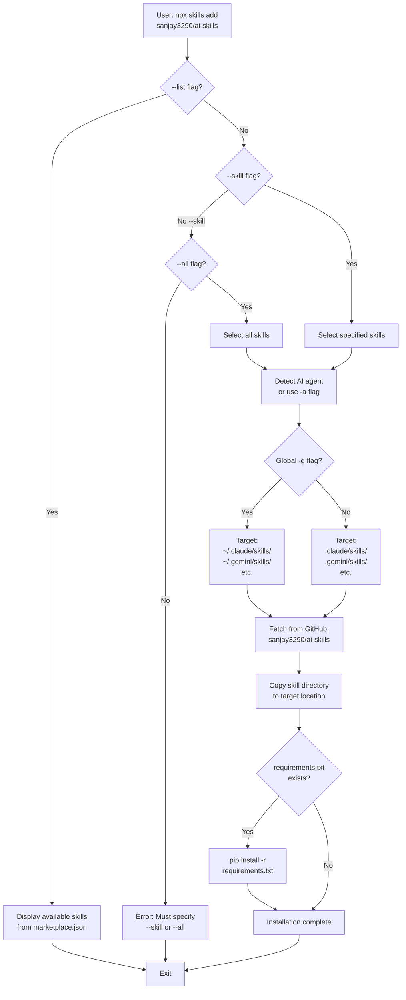

**Agent Auto-Detection:**  
The CLI scans for existing agent directories in both project (`.`) and global (`~/`) locations. Detection order follows the table in [README.md:112-121]().

**Installation Targets:**  
Each agent has two installation locations:
- **Project scope** (default): `.{agent}/skills/` in current directory
- **Global scope** (`-g` flag): `~/.{agent}/skills/` in user home directory

**Multiple Agent Installation:**  
The `-a` flag accepts multiple values or `'*'` to install across all detected agents simultaneously, as shown in [README.md:83-94]().

**Sources:** [README.md:61-150]()

---

## Marketplace & Plugin System

The marketplace.json file serves as the central catalog for skill discovery and Claude Code plugin integration.

### Marketplace Structure

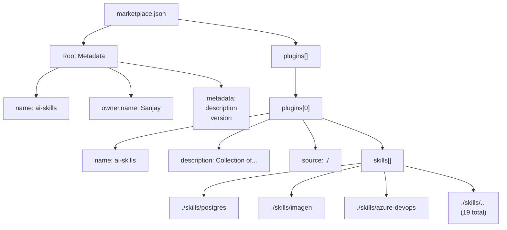

**File:** [.claude-plugin/marketplace.json:1-39]()

The marketplace.json structure from [.claude-plugin/marketplace.json:1-39]() includes:

| Field | Type | Purpose |
|-------|------|---------|
| `name` | string | Repository identifier |
| `owner.name` | string | Maintainer name |
| `metadata.description` | string | Repository description |
| `metadata.version` | string | Catalog version (semantic) |
| `plugins[].name` | string | Plugin identifier |
| `plugins[].description` | string | Plugin description (all skills) |
| `plugins[].source` | string | Root directory path |
| `plugins[].skills[]` | array | Relative paths to skill directories |

**Claude Code Integration:**  
When Claude Code encounters the `.claude-plugin/` directory, it automatically recognizes the marketplace.json format and registers all listed skills as available plugins. The `skills` array enumerates all installable skill paths.

**Skill Enumeration:**  
The 19 skills listed in [.claude-plugin/marketplace.json:15-36]() correspond exactly to the subdirectories in `skills/`. This provides a single source of truth for the `npx skills add --list` command.

**Sources:** [.claude-plugin/marketplace.json:1-39]()

---

## Authentication Architectures

The ecosystem implements three distinct authentication patterns based on service requirements and security constraints.

### Pattern Comparison

| Pattern | Skills Using | Storage | Token Refresh | Setup Command |
|---------|--------------|---------|---------------|---------------|
| OAuth + Keyring | Google Workspace (7 skills) | System keyring | Cloud function | `python scripts/auth.py login` |
| API Key (env) | imagen, deep-research, google-tts, elevenlabs, outline | Environment variables | N/A | `export API_KEY=...` |
| API Key (file) | manus, elevenlabs | config.json | N/A | Manual file creation |
| PAT + Keyring | azure-devops, atlassian | System keyring | N/A | `python scripts/auth.py login --pat` |
| OAuth + MCP | atlassian, azure-devops | System keyring | MCP server | `python scripts/auth.py login --oauth` |
| Browser Session | notebooklm | Playwright profile | Manual re-auth | `python scripts/auth_manager.py setup` |

### OAuth with Keyring Architecture

```mermaid
sequenceDiagram
    participant User
    participant AuthScript["scripts/auth.py"]
    participant Browser
    participant CloudFunc["OAuth Cloud Function<br/>(Google Workspace MCP)"]
    participant Keyring["System Keyring<br/>(Keychain/Credential Locker)"]
    participant APIScript["scripts/main.py"]
    participant GoogleAPI["Google API<br/>(Gmail/Drive/Sheets/etc.)"]
    
    User->>AuthScript: python scripts/auth.py login
    AuthScript->>Browser: Open OAuth URL
    Browser->>User: Prompt for Google login
    User->>Browser: Authorize application
    Browser->>CloudFunc: Return authorization code
    CloudFunc->>AuthScript: Return access + refresh tokens
    AuthScript->>Keyring: Store tokens with service name<br/>(e.g., gmail-skill-oauth)
    
    Note over User,GoogleAPI: Later: API call execution
    
    User->>APIScript: Execute skill command
    APIScript->>Keyring: Retrieve access token<br/>by service name
    Keyring->>APIScript: Return token
    APIScript->>GoogleAPI: API call with Bearer token
    GoogleAPI-->>APIScript: Response
    
    Note over APIScript,CloudFunc: Token expired
    
    APIScript->>CloudFunc: Refresh token request
    CloudFunc->>APIScript: New access token
    APIScript->>Keyring: Update stored token
```

**Keyring Service Names:**  
Each Google Workspace skill uses a unique service identifier for token isolation:
- Gmail: `gmail-skill-oauth`
- Google Calendar: `google-calendar-skill-oauth`
- Google Chat: `google-chat-skill-oauth`
- Google Docs: `google-docs-skill-oauth`
- Google Drive: `google-drive-skill-oauth`
- Google Sheets: `google-sheets-skill-oauth`
- Google Slides: `google-slides-skill-oauth`

**Platform-Specific Storage:**
- **macOS:** Keychain Access (`/Library/Keychains/`)
- **Windows:** Credential Locker (`Control Panel > Credential Manager`)
- **Linux:** Secret Service API (GNOME Keyring, KDE Wallet)

This architecture is documented in [README.md:283-286]() and implements the same OAuth infrastructure as the official Google Workspace MCP server mentioned in [README.md:400]().

**Sources:** [README.md:268-286](), [README.md:400]()

### API Key Pattern (Environment Variables)

Simple API key authentication for services like Gemini, ElevenLabs, and Outline:

```bash
export GEMINI_API_KEY=your-api-key
export ELEVENLABS_API_KEY=your-api-key
export OUTLINE_API_KEY=your-api-key
export GOOGLE_TTS_API_KEY=your-api-key
```

Scripts read directly from environment variables without additional storage layers, as shown in [README.md:193-237]().

**Sources:** [README.md:193-237]()

### PAT with Keyring Pattern

Personal Access Tokens for Azure DevOps and Atlassian, stored in system keyring:

```bash
# Azure DevOps
python skills/azure-devops/scripts/auth.py login --org MyOrg --pat YOUR_PAT

# Atlassian
python skills/atlassian/scripts/auth.py login
```

The `auth.py` script prompts for credentials and stores them securely using the `keyring` library, as documented in [README.md:257-266]().

**Sources:** [README.md:246-266]()

### Browser Session Pattern (NotebookLM)

NotebookLM uses Playwright to maintain persistent browser sessions with authenticated Google cookies:

```bash
pip install -r skills/notebooklm/requirements.txt
python -m playwright install chromium
python skills/notebooklm/scripts/auth_manager.py setup
```

Browser profiles stored at `~/.notebooklm/profiles/` contain session cookies that persist across script executions. Profile management supports multiple accounts (default + named profiles).

**Sources:** [README.md:239-244]()

---

## Execution Patterns

Skills implement three distinct execution patterns based on task characteristics and service capabilities.

### Pattern Comparison

```mermaid
graph TB
    subgraph SyncPattern["Synchronous Execution"]
        SyncSkills["Database Skills:<br/>postgres, mysql, mssql"]
        SyncFlow["Request → Query<br/>→ Response (instant)"]
    end
    
    subgraph AsyncPattern["Asynchronous Delegation"]
        AsyncSkills["Agent Skills:<br/>manus, jules, deep-research"]
        AsyncFlow["Request → Task ID<br/>→ Poll Status<br/>→ Retrieve Results"]
    end
    
    subgraph BrowserPattern["Browser Automation"]
        BrowserSkills["NotebookLM"]
        BrowserFlow["Launch Browser<br/>→ Scrape UI<br/>→ Parse Response"]
    end
    
    SyncSkills --> SyncTiming["Latency: <1s"]
    AsyncSkills --> AsyncTiming["Latency: 30s - 10min"]
    BrowserSkills --> BrowserTiming["Latency: 5-30s"]
    
    SyncSkills --> SyncAPI["Protocol: SQL"]
    AsyncSkills --> AsyncAPI["Protocol: REST API / CLI"]
    BrowserSkills --> BrowserAPI["Protocol: Playwright"]
```

### Synchronous Execution (Database Skills)

Database skills execute queries synchronously with immediate response. The workflow from [README.md:292-297]():

```bash
# User request: "Query production database for active users"
# ↓
# AI agent parses SKILL.md, constructs query
# ↓
python scripts/query.py --database production --query "SELECT * FROM users WHERE active = true"
# ↓
# Returns: JSON result with rows (instant)
```

**Characteristics:**
- Latency: <1 second
- Blocking execution
- Direct SQL connection
- Result size: up to 10,000 rows (capped)
- Timeout: 30 seconds per query

**Sources:** [README.md:292-297]()

### Asynchronous Delegation (Agent Skills)

Jules, Manus, and Deep Research delegate long-running tasks to external agents, returning task IDs immediately and requiring polling.

**Manus Workflow** (from [skills/manus/SKILL.md:56-98]()):

```bash
# Step 1: Create task
curl -X POST "https://api.manus.ai/v1/tasks" \
  -H "API_KEY:$MANUS_API_KEY" \
  -d '{"prompt":"Research EV batteries","agentProfile":"manus-1.6"}'
# Returns: {"task_id":"abc123","task_url":"https://manus.im/app/abc123"}

# Step 2: Poll status (every 5-30 seconds)
while true; do
  STATUS=$(curl -s "https://api.manus.ai/v1/tasks/abc123" -H "API_KEY:$MANUS_API_KEY" | jq -r '.status')
  [ "$STATUS" = "completed" ] && break
  sleep 10
done

# Step 3: Extract results
curl -s "https://api.manus.ai/v1/tasks/abc123" -H "API_KEY:$MANUS_API_KEY" | \
  jq -r '.output[] | select(.role=="assistant") | .content[] | select(.type=="output_text") | .text'
```

**Jules Workflow** (from [skills/jules/SKILL.md:38-63]()):

```bash
# Step 1: Create session
jules new --repo owner/repo "Fix auth bug"
# Returns: Session ID

# Step 2: Monitor status
jules remote list --session

# Step 3: Pull results when complete
jules remote pull --session <id> --apply
```

**Characteristics:**
- Latency: 30 seconds to 10 minutes
- Non-blocking (returns task ID immediately)
- Polling interval: 5-30 seconds
- Status transitions: `pending` → `running` → `completed`/`failed`

**Sources:** [skills/manus/SKILL.md:56-98](), [skills/jules/SKILL.md:38-63]()

### Browser Automation (NotebookLM)

NotebookLM lacks a public API, so the skill uses Playwright to automate the web interface.

**Execution Flow:**

```bash
# Query execution with retry logic
python scripts/ask_question.py \
  --profile default \
  --notebook "My Notebook" \
  --question "Summarize key points" \
  --wait-time 30
```

**Internal Process:**
1. Launch headless Chromium with persistent profile
2. Navigate to `notebooklm.google.com`
3. Select notebook from library
4. Find `textarea.query-box-input` element
5. Type question and submit
6. Wait for response (detect placeholder disappearance)
7. Perform 3x stability checks (5s intervals)
8. Extract response text and citations
9. Capture debug artifacts (screenshots, HTML) on failure

**Characteristics:**
- Latency: 5-30 seconds
- Browser overhead: ~200MB memory
- Fragile (depends on UI stability)
- Profile-based authentication
- Automatic retry with artifact capture

**Sources:** Inferred from NotebookLM architecture diagram

---

## Safety & Security Mechanisms

Database skills implement a defense-in-depth security model with four sequential protection layers.

### Multi-Layer Safety Architecture

```mermaid
graph TB
    UserQuery["AI Agent Query Request"]
    
    UserQuery --> Layer1
    
    subgraph Layer1["Layer 1: Query Validation"]
        L1Check["Parse SQL statement"]
        L1Whitelist["Whitelist: SELECT, SHOW,<br/>EXPLAIN, DESCRIBE, WITH"]
        L1Blacklist["Blacklist: INSERT, UPDATE,<br/>DELETE, DROP, ALTER, CREATE,<br/>TRUNCATE, GRANT, REVOKE"]
        L1Check --> L1Whitelist
        L1Check --> L1Blacklist
    end
    
    Layer1 --> Layer2
    
    subgraph Layer2["Layer 2: Connection Security"]
        L2SSL["Enforce TLS/SSL encryption"]
        L2Timeout["Connection timeout: 10s"]
        L2ReadOnly["Set READ ONLY transaction<br/>(MySQL: SET SESSION TRANSACTION READ ONLY)"]
        L2SSL --> L2Timeout
        L2Timeout --> L2ReadOnly
    end
    
    Layer2 --> Layer3
    
    subgraph Layer3["Layer 3: Execution Limits"]
        L3QueryTimeout["Query timeout: 30s"]
        L3RowLimit["Max rows: 10,000"]
        L3ColWidth["Column width: 100 chars"]
        L3QueryTimeout --> L3RowLimit
        L3RowLimit --> L3ColWidth
    end
    
    Layer3 --> Layer4
    
    subgraph Layer4["Layer 4: Output Sanitization"]
        L4StripCreds["Strip credentials from<br/>error messages"]
        L4Format["Format results as JSON/CSV"]
        L4Truncate["Truncate long values"]
        L4StripCreds --> L4Format
        L4Format --> L4Truncate
    end
    
    Layer4 --> SafeResult["Sanitized Result"]
    
    Layer1 -.->|Validation fails| Reject["Reject: Read-only violation"]
    Layer2 -.->|SSL unavailable| Reject
    Layer3 -.->|Timeout/limit exceeded| Reject
    
    Reject --> Error["Error: Safe message"]
```

### Layer 1: Query Validation

**Whitelist Approach:**  
Only `SELECT`, `SHOW`, `EXPLAIN`, `DESCRIBE`, and `WITH` statements are permitted. The validation occurs before connection establishment.

**Blacklist Enforcement:**  
All write operations (`INSERT`, `UPDATE`, `DELETE`, `DROP`, `ALTER`, `CREATE`, `TRUNCATE`), permission changes (`GRANT`, `REVOKE`), and administrative commands are rejected.

**Implementation:**  
Regex pattern matching on parsed SQL statements.

### Layer 2: Connection Security

**TLS/SSL Encryption:**  
All database connections enforce encrypted transport:
- PostgreSQL: `sslmode=require`
- MySQL: `ssl_mode='REQUIRED'` or certificate-based
- SQL Server: `encrypt=True`

**Read-Only Transaction Isolation:**  
MySQL explicitly sets session read-only mode:
```python
cursor.execute("SET SESSION TRANSACTION READ ONLY")
```

PostgreSQL and SQL Server rely on user-level permissions configured in `connections.json`.

**Connection Timeout:**  
10-second timeout prevents hung connections from blocking resources.

### Layer 3: Execution Limits

**Resource Caps:**

| Limit | Value | Purpose |
|-------|-------|---------|
| Query timeout | 30 seconds | Prevent runaway queries |
| Max rows | 10,000 | Prevent memory exhaustion |
| Column width | 100 characters | Prevent display overflow |

These limits are enforced in the query execution wrapper, as documented in the database skills architecture diagrams.

### Layer 4: Output Sanitization

**Credential Stripping:**  
Error messages are parsed to remove any connection strings, passwords, or host information before display.

**Result Formatting:**  
Query results are serialized to JSON or CSV with consistent formatting and value truncation.

**Example Sanitization:**
```
# Raw error:
Connection failed: FATAL: password authentication failed for user "admin" at host "prod-db.internal"

# Sanitized output:
Connection failed: Authentication error. Check connections.json configuration.
```

### Configuration Security

**File Permissions:**  
The `connections.json` file must have `chmod 600` permissions (owner read/write only) to prevent credential exposure, as mentioned in [README.md:184]().

**Intelligent Selection:**  
The `description` field in each database configuration enables semantic matching for automatic database selection based on query context.

**Sources:** [README.md:184](), database skills security architecture diagram

---

## Skill Categories & Service Integration

Skills are organized into five functional categories based on their external service integrations.

| Category | Skills | Protocol | Authentication |
|----------|--------|----------|----------------|
| **Databases** | postgres, mysql, mssql | SQL (PostgreSQL wire, MySQL protocol, TDS) | connections.json |
| **Google Workspace** | gmail, google-calendar, google-chat, google-docs, google-drive, google-sheets, google-slides | Google APIs (REST) | OAuth + keyring |
| **DevOps** | azure-devops, atlassian | REST APIs | PAT/OAuth + keyring |
| **AI Services** | manus, jules, deep-research, imagen, elevenlabs, google-tts | REST APIs / CLI | API keys / OAuth |
| **Research** | notebooklm, outline | Browser automation / REST | Browser session / API key |

Each category shares common architectural patterns within its group while maintaining skill-specific implementations. For detailed coverage of individual skills, see [Skills by Category](#4) and its subsections.

**Sources:** [README.md:27-59](), [.claude-plugin/marketplace.json:15-36]()

---

# Page: Agent Skills Standard

# Agent Skills Standard

<details>
<summary>Relevant source files</summary>

The following files were used as context for generating this wiki page:

- [README.md](README.md)
- [skills/jules/SKILL.md](skills/jules/SKILL.md)
- [skills/manus/SKILL.md](skills/manus/SKILL.md)

</details>


The Agent Skills Standard defines the portable skill format that enables AI agents to discover, understand, and execute capabilities across 40+ different AI coding assistants. This standard specifies the directory structure, metadata format, and instruction conventions that make skills "write once, run anywhere."

For information about how skills are installed and distributed, see [Skill Discovery & Installation](#3.2). For security patterns used within skills, see [Execution & Safety Features](#3.5).

## Standard Overview

The Agent Skills Standard is a filesystem-based convention that consists of:

1. **SKILL.md** - Agent-facing instructions with YAML frontmatter
2. **Directory structure** - Standardized layout for scripts, configuration, and documentation
3. **Portability contract** - Guaranteed locations where agents can find skills

The standard is maintained at [agentskills.io](https://agentskills.io) and implemented by this repository. All 19+ skills in the marketplace follow this specification.

**Sources:** [README.md:5](), [README.md:367-388]()

## SKILL.md Format

The `SKILL.md` file is the core interface between skills and AI agents. It combines YAML frontmatter for metadata with markdown instructions for execution guidance.

### YAML Frontmatter Structure

```yaml
---
name: skill-name
description: "Activation criteria and use cases"
license: Apache-2.0
metadata:
  author: username
  version: "1.0"
---
```

**Required Fields:**

| Field | Type | Purpose |
|-------|------|---------|
| `name` | string | Skill identifier, must match directory name |
| `description` | string | Activation triggers and capability description |

**Optional Fields:**

| Field | Type | Purpose |
|-------|------|---------|
| `license` | string | SPDX license identifier |
| `metadata.author` | string | Skill creator |
| `metadata.version` | string | Semantic version |

The `description` field is semantically critical - it determines when the AI agent activates the skill. Effective descriptions include:
- Explicit trigger phrases: "Use when user says 'use manus', 'delegate to manus'"
- Capability keywords: "deep research", "market analysis", "SQL queries"
- Domain indicators: "GitHub repositories", "Google Workspace", "databases"

**Sources:** [README.md:379-388](), [skills/manus/SKILL.md:1-8](), [skills/jules/SKILL.md:1-8]()

### SKILL.md Structure Diagram

```mermaid
flowchart TB
    subgraph SKILL_MD["SKILL.md File"]
        YAML["YAML Frontmatter<br/>---<br/>name: skill-name<br/>description: activation triggers<br/>---"]
        MD["Markdown Instructions<br/>## Setup<br/>## Commands<br/>## Examples"]
    end
    
    subgraph Agent["AI Agent Parser"]
        Parse["Parse YAML"]
        Index["Index by name + description"]
        Match["Semantic Matching<br/>User intent → description"]
        Load["Load markdown instructions"]
    end
    
    subgraph Execution["Runtime"]
        Context["Inject into agent context"]
        Scripts["Execute scripts/"]
        API["Call external APIs"]
    end
    
    SKILL_MD --> Parse
    Parse --> Index
    Index --> Match
    Match --> Load
    Load --> Context
    Context --> Scripts
    Context --> API
    
    User["User Query:<br/>'Use manus to research...'"] --> Match
```

**Sources:** [README.md:367-388](), [skills/manus/SKILL.md:1-185](), [skills/jules/SKILL.md:1-201]()

### Markdown Instructions

The markdown content following the frontmatter provides execution instructions to the AI agent. Standard sections include:

- **Setup** - Prerequisites, environment variables, authentication
- **Commands** - Executable syntax with examples
- **Workflow** - Step-by-step processes
- **Error Handling** - Common failure modes and recovery
- **Best Practices** - Optimization guidance

Example structure from manus skill:

```markdown
## When to Use Manus
- Deep research - Market analysis, competitive landscaping
- Stock/financial analysis - Company research, technical indicators

## Environment Setup
Requires `MANUS_API_KEY` environment variable.

## Core Workflow
1. **Create task** → Returns `task_id` immediately
2. **Poll status** → Check until `status` is `completed`
3. **Return results** → Extract output text and attachments
```

**Sources:** [skills/manus/SKILL.md:10-185](), [skills/jules/SKILL.md:10-201]()

## Directory Structure Standard

Every skill must follow this canonical layout:

```
skill-name/
├── SKILL.md              # Required: Agent instructions
├── README.md             # Required: Human documentation
├── scripts/              # Optional: Executable code
│   ├── auth.py
│   ├── main.py
│   └── utils.py
├── requirements.txt      # Optional: Python dependencies
├── .env.example          # Optional: Environment template
├── config.example.json   # Optional: Configuration template
└── connections.json      # Optional: Credentials (gitignored)
```

### Required Files

**SKILL.md**
- Agent-facing interface
- YAML frontmatter + markdown instructions
- Must exist at skill root

**README.md**
- Human-readable documentation
- Setup instructions, usage examples, troubleshooting
- Must exist at skill root

### Optional Components

**scripts/** directory
- Contains executable code (Python, Shell, Node.js)
- Standard entry points: `main.py`, `auth.py`, `query.py`
- Must be executable or invocable via interpreter

**requirements.txt**
- Python dependencies in pip format
- Installed by `npx skills add` during setup
- Example: [skills/postgres/requirements.txt]()

**.env.example**
- Template for environment variables
- Shows required configuration without exposing secrets
- Example: `GEMINI_API_KEY=your-api-key-here`

**config.example.json** / **connections.json**
- Structured configuration templates
- Actual config files are gitignored
- Example: Database connection parameters

**Sources:** [README.md:367-388](), [README.md:179-191]()

## Directory Structure with Code Entities

```mermaid
graph TB
    subgraph Root["skill-name/"]
        SKILL["SKILL.md<br/>YAML frontmatter<br/>Markdown instructions"]
        README["README.md<br/>Human docs"]
        REQ["requirements.txt<br/>Dependencies"]
        ENV[".env.example<br/>Template"]
        
        subgraph Scripts["scripts/"]
            AUTH["auth.py<br/>OAuth flow"]
            MAIN["main.py<br/>Primary logic"]
            QUERY["query.py<br/>API calls"]
            UTILS["utils.py<br/>Helpers"]
        end
        
        subgraph Config["Configuration (gitignored)"]
            CONN["connections.json<br/>Credentials"]
            TOKENS[".tokens<br/>OAuth cache"]
        end
    end
    
    subgraph Install["npx skills add"]
        CLI["CLI copies directory"]
        DEPS["pip install -r requirements.txt"]
        TARGET["Target: ~/.claude/skills/<br/>or .claude/skills/"]
    end
    
    subgraph Runtime["Agent Execution"]
        PARSE["Parse SKILL.md YAML"]
        EXEC["python scripts/main.py"]
        KEYRING["System keyring<br/>Token storage"]
    end
    
    Root --> CLI
    REQ --> DEPS
    CLI --> TARGET
    TARGET --> PARSE
    PARSE --> EXEC
    AUTH --> KEYRING
    EXEC --> QUERY
    QUERY --> UTILS
```

**Sources:** [README.md:154-177](), [README.md:367-388]()

## Portability Mechanism

The Agent Skills Standard achieves portability through three guarantees:

### 1. Standardized Skill Directories

All supporting AI clients agree on skill directory conventions:

| Client | Global | Project |
|--------|--------|---------|
| Claude Code | `~/.claude/skills/` | `.claude/skills/` |
| Gemini CLI | `~/.gemini/skills/` | `.gemini/skills/` |
| Cursor | `~/.cursor/skills/` | `.cursor/skills/` |
| Goose | `~/.config/goose/skills/` | `.goose/skills/` |
| OpenAI Codex | `~/.codex/skills/` | `.codex/skills/` |

The `npx skills` CLI auto-detects the active agent and installs to the correct location.

**Sources:** [README.md:18-26](), [README.md:109-122]()

### 2. Semantic Activation via Description

AI agents index skills by the `description` field in YAML frontmatter. When a user makes a request, the agent:

1. Extracts intent from user query
2. Performs semantic matching against all skill descriptions
3. Activates matching skills by loading their SKILL.md
4. Executes instructions in agent context

Example from manus skill:

```yaml
description: Delegate complex, long-running tasks to Manus AI agent for autonomous execution. Use when user says 'use manus', 'delegate to manus', 'send to manus', 'have manus do', 'ask manus', 'check manus sessions', or when tasks require deep web research, market analysis, product comparisons...
```

This enables natural language activation:
- User: "Use manus to research the best 4K monitors"
- Agent: Matches "use manus" → loads manus skill → executes research workflow

**Sources:** [skills/manus/SKILL.md:3](), [skills/jules/SKILL.md:3]()

### 3. Self-Contained Execution

Skills must be self-contained with explicit dependency declarations:

- Python dependencies in `requirements.txt`
- Environment variables in `.env.example`
- External tools documented in README.md (e.g., `ffmpeg`, `gh cli`)

This ensures skills work identically across all agents and environments after installation.

**Sources:** [README.md:179-286]()

## Agent Consumption Workflow

```mermaid
sequenceDiagram
    participant User
    participant Agent as "AI Agent<br/>(Claude/Gemini/Cursor)"
    participant Parser as "SKILL.md Parser"
    participant Scripts as "scripts/"
    participant External as "External APIs"
    
    rect rgb(250, 250, 250)
        Note over User,Agent: Skill Discovery Phase
        User->>Agent: "Use manus to research..."
        Agent->>Parser: Scan ~/.claude/skills/
        Parser->>Parser: Parse SKILL.md YAML frontmatter
        Parser->>Agent: Index: {name, description}
        Agent->>Agent: Semantic match on description
    end
    
    rect rgb(245, 245, 245)
        Note over Agent,Scripts: Activation Phase
        Agent->>Parser: Load matched SKILL.md
        Parser->>Agent: Return markdown instructions
        Agent->>Agent: Inject instructions into context
        Agent->>Scripts: Determine command from instructions
    end
    
    rect rgb(240, 240, 240)
        Note over Scripts,External: Execution Phase
        Agent->>Scripts: python scripts/main.py --query "..."
        Scripts->>External: HTTP API call
        External->>Scripts: JSON response
        Scripts->>Agent: Formatted output
        Agent->>User: Present results
    end
```

**Sources:** [README.md:288-364](), [skills/manus/SKILL.md:56-92]()

## SKILL.md Parsing and Execution Bridge

```mermaid
graph LR
    subgraph NL["Natural Language Space"]
        Q1["'Use manus for<br/>market research'"]
        Q2["'Have Jules fix<br/>the auth bug'"]
        Q3["'Query my<br/>production database'"]
    end
    
    subgraph Parsing["Parsing Layer"]
        YAML1["manus/SKILL.md<br/>name: manus<br/>description: 'delegate...manus...'"]
        YAML2["jules/SKILL.md<br/>name: jules<br/>description: 'delegate...Jules...'"]
        YAML3["postgres/SKILL.md<br/>name: postgres<br/>description: 'SQL queries...'"]
    end
    
    subgraph Code["Code Entity Space"]
        MANUS["scripts/main.py<br/>POST /v1/tasks<br/>poll task_id"]
        JULES["@google/jules CLI<br/>jules new<br/>jules remote pull"]
        PG["scripts/query.py<br/>psycopg2.connect()<br/>SELECT validation"]
    end
    
    subgraph External["External Systems"]
        API1["api.manus.ai"]
        API2["jules.google.com"]
        DB["PostgreSQL<br/>connections.json"]
    end
    
    Q1 --> YAML1
    Q2 --> YAML2
    Q3 --> YAML3
    
    YAML1 --> MANUS
    YAML2 --> JULES
    YAML3 --> PG
    
    MANUS --> API1
    JULES --> API2
    PG --> DB
```

**Sources:** [skills/manus/SKILL.md:1-8, 54-92](), [skills/jules/SKILL.md:1-8, 38-57](), [README.md:31-33]()

## Standard Compliance Examples

### Example 1: Minimal Skill (imagen)

```
skills/imagen/
├── SKILL.md           # YAML + markdown instructions
├── README.md          # Human docs
└── .env.example       # GEMINI_API_KEY template
```

No scripts directory - skill executes via direct API calls using `curl` from SKILL.md.

**Sources:** [README.md:34, 193-198]()

### Example 2: Script-Based Skill (postgres)

```
skills/postgres/
├── SKILL.md
├── README.md
├── scripts/
│   └── query.py       # Main execution logic
├── requirements.txt   # psycopg2-binary
└── connections.json   # Database credentials
```

Execution: `python scripts/query.py --database prod --query "SELECT..."`

**Sources:** [README.md:31, 183-191]()

### Example 3: Complex Skill (notebooklm)

```
skills/notebooklm/
├── SKILL.md
├── README.md
├── scripts/
│   ├── auth_manager.py      # OAuth + profile management
│   ├── notebook_manager.py  # Local registry
│   ├── ask_question.py      # Query interface
│   └── remote_manager.py    # Source sync
├── requirements.txt          # playwright, beautifulsoup4
├── .env.example
└── .notebooklm/             # Profile storage (created at runtime)
    └── profiles/
```

Multi-script architecture with persistent state and browser automation.

**Sources:** [README.md:39, 239-244]()

## Frontmatter Field Reference

### Standard Fields

**name** (required)
- Type: `string`
- Must match directory name
- Used for skill identification and indexing
- Example: `name: postgres`

**description** (required)
- Type: `string`
- Activation triggers and capability summary
- Should include explicit user phrases and keywords
- Example: `description: "Use when user says 'query database', 'SQL', or when needing to read PostgreSQL data"`

**license** (optional)
- Type: `string`
- SPDX identifier
- Default: Inherits from repository
- Example: `license: Apache-2.0`

**metadata** (optional)
- Type: `object`
- Arbitrary key-value pairs
- Common fields: `author`, `version`, `homepage`, `repository`

**Sources:** [skills/manus/SKILL.md:1-8](), [skills/jules/SKILL.md:1-8]()

## Installation Integration Points

The `npx skills add` CLI interacts with the Agent Skills Standard at these points:

1. **Fetch phase** - Clones GitHub repo or downloads specific skill directory
2. **Validation phase** - Verifies SKILL.md exists with valid YAML frontmatter
3. **Dependency phase** - Runs `pip install -r requirements.txt` if present
4. **Installation phase** - Copies skill directory to agent's skill path
5. **Post-install** - Optionally runs setup scripts or displays setup instructions

The standard intentionally does not specify post-install hooks to maintain simplicity.

**Sources:** [README.md:65-140]()

## Markdown Instruction Conventions

While the standard does not enforce specific markdown structure, common conventions have emerged:

### Section Hierarchy

**Top-level sections:**
- Setup / Environment Setup / Prerequisites
- Commands / Usage / API
- Workflow / Core Workflow
- Examples / Template Prompts
- Best Practices / Notes
- Error Handling / Troubleshooting

**Code blocks:**
- Use `bash` for shell commands
- Use `json` for API payloads
- Use `yaml` for configuration examples
- Include explanatory comments

### Command Documentation Pattern

```markdown
## Command Name

```bash
command --flag value
```

**Description:** What the command does

**Parameters:**
- `--flag` - Parameter description

**Example:**
```bash
command --flag example
```
```

**Sources:** [skills/manus/SKILL.md:62-116](), [skills/jules/SKILL.md:38-128]()

## Relationship to Claude Plugin System

The Agent Skills Standard is compatible with the Claude Desktop plugin system (`.claudeplugin/` directory). Skills can optionally include a `.claudeplugin/manifest.json` to integrate with Claude's MCP (Model Context Protocol) architecture.

However, the core standard remains MCP-agnostic to ensure portability across non-Claude agents.

For Claude-specific integration, see [Marketplace & Plugin System](#3.3).

**Sources:** [README.md:5]()

## Validation Checklist

A compliant skill must satisfy:

- [ ] `SKILL.md` exists at skill root
- [ ] SKILL.md contains valid YAML frontmatter with `---` delimiters
- [ ] YAML includes `name` field matching directory name
- [ ] YAML includes `description` field
- [ ] `README.md` exists with human-readable documentation
- [ ] If Python code exists, `requirements.txt` declares dependencies
- [ ] If credentials required, `.env.example` or `config.example.json` provides template
- [ ] Directory name uses lowercase with hyphens (e.g., `google-chat`, not `GoogleChat`)
- [ ] No absolute paths in scripts (use relative or environment-based paths)
- [ ] Scripts are executable or documented with invocation syntax

**Sources:** [README.md:367-388](), [README.md:390-396]()

---

# Page: Skill Discovery & Installation

# Skill Discovery & Installation

<details>
<summary>Relevant source files</summary>

The following files were used as context for generating this wiki page:

- [.claude-plugin/marketplace.json](.claude-plugin/marketplace.json)
- [README.md](README.md)
- [skills/jules/SKILL.md](skills/jules/SKILL.md)
- [skills/manus/SKILL.md](skills/manus/SKILL.md)

</details>


This page documents the skill resolution and installation mechanisms: how AI clients discover `SKILL.md` files at session start, how `npx skills` reads `.claude-plugin/marketplace.json` to resolve skill paths, and the file copying workflow that places skill directories into agent-specific paths. For `SKILL.md` YAML frontmatter format, see [Agent Skills Standard](#3.1). For `marketplace.json` schema, see [Marketplace & Plugin System](#3.3).

---

## Session-Start Skill Discovery

AI clients perform filesystem scans of predefined skill directories at session initialization. Each directory containing a `SKILL.md` file with valid YAML frontmatter is registered as an available skill. Clients parse the frontmatter to extract `name` and `description` fields [skills/manus/SKILL.md:1-8](), which enable routing decisions during agent execution.

### Discovery Mechanism

The `description` field contains natural language trigger phrases that the agent's prompt router uses for skill selection. Example patterns:

| Skill | Trigger Phrases in `description` |
|---|---|
| `skills/manus/SKILL.md` | `"use manus"`, `"delegate to manus"`, `"send to manus"`, `"deep web research"` |
| `skills/jules/SKILL.md` | `"have Jules fix"`, `"delegate to Jules"`, `"jules add tests"`, `"check Jules sessions"` |

Discovery is stateless: no registration API, configuration file, or initialization step. Presence of `SKILL.md` in a scanned directory is sufficient.

**Skill Loading Sequence at Session Start**

```mermaid
sequenceDiagram
    participant User
    participant AIClient["AI Client Process"]
    participant ProjectSkills[".claude/skills/"]
    participant GlobalSkills["~/.claude/skills/"]
    participant SKILLmd["SKILL.md"]

    User->>AIClient: "Launch session"
    AIClient->>ProjectSkills: "scan() for subdirectories"
    ProjectSkills-->>AIClient: "[postgres/, imagen/, manus/]"
    
    loop For each subdirectory
        AIClient->>SKILLmd: "Read YAML frontmatter"
        SKILLmd-->>AIClient: "name: postgres<br/>description: 'Read-only PostgreSQL...'"
        AIClient->>AIClient: "Register skill in routing table"
    end
    
    AIClient->>GlobalSkills: "scan() for subdirectories"
    GlobalSkills-->>AIClient: "[deep-research/, jules/]"
    
    loop For each subdirectory
        AIClient->>SKILLmd: "Read YAML frontmatter"
        SKILLmd-->>AIClient: "name: jules<br/>description: 'Delegate coding tasks...'"
        AIClient->>AIClient: "Register skill in routing table"
    end
    
    AIClient-->>User: "Session initialized (5 skills loaded)"
```

Sources: [README.md:18-25](), [skills/manus/SKILL.md:1-8](), [skills/jules/SKILL.md:1-8]()

---

## Skill Directory Paths by Client

Each AI client defines its own convention for where skill directories live. All clients support both a **project-scoped** path (relative to the current working directory) and a **global** path (relative to the user's home directory).

| Client | `-a` Flag | Project Directory | Global Directory |
|---|---|---|---|
| Claude Code | `claude-code` | `.claude/skills/` | `~/.claude/skills/` |
| Gemini CLI | `gemini-cli` | `.gemini/skills/` | `~/.gemini/skills/` |
| Cursor | `cursor` | `.cursor/skills/` | `~/.cursor/skills/` |
| OpenAI Codex | `codex` | `.codex/skills/` | `~/.codex/skills/` |
| Goose | `goose` | `.goose/skills/` | `~/.config/goose/skills/` |
| GitHub Copilot | `github-copilot` | `.github/skills/` | `~/.github/skills/` |
| Google Antigravity | `antigravity` | `.agent/skills/` | `~/.gemini/antigravity/skills/` |

For the full list of supported clients and their configuration, see [Supported AI Clients](#2.2).

Sources: [README.md:110-120]()

---

## CLI Installation Workflow: `npx skills`

The `npx skills` command (external package: `nicepkg/skills`) performs manifest parsing, skill resolution, target path detection, and directory copying. It reads `.claude-plugin/marketplace.json` [.claude-plugin/marketplace.json:1-39]() to enumerate available skills, resolves filters (`--skill`, `--all`), detects the active agent (or uses `-a` override), determines install scope (`-g` flag), and copies skill directories from source to target.

### Skill Resolution Pipeline

**CLI Execution Flow: Manifest → Filter → Target → Copy**

```mermaid
flowchart TD
    CLI["npx skills add sanjay3290/ai-skills"]
    
    subgraph "1. Manifest Resolution"
        Marketplace[".claude-plugin/marketplace.json"]
        PluginsArray["plugins[0].skills[]"]
        SkillPaths["['./skills/postgres',<br/>'./skills/imagen',<br/>'./skills/azure-devops',<br/>...]"]
    end
    
    subgraph "2. Filter Application"
        SkillFlag["--skill postgres"]
        AllFlag["--all"]
        ListFlag["--list"]
        Filtered["Filtered: ['./skills/postgres']"]
    end
    
    subgraph "3. Target Detection"
        AgentFlag["-a claude-code"]
        AutoDetect["Auto-detect:<br/>Check .claude/, .gemini/, .cursor/"]
        ProjectScope["default: .claude/skills/"]
        GlobalScope["-g: ~/.claude/skills/"]
    end
    
    subgraph "4. File Operations"
        Clone["git clone or fetch<br/>sanjay3290/ai-skills"]
        CopyDir["cp -r skills/postgres<br/>→ .claude/skills/postgres"]
        CopySKILL["SKILL.md"]
        CopyScripts["scripts/"]
        CopyREADME["README.md"]
        CopyReqs["requirements.txt"]
    end
    
    CLI --> Marketplace
    Marketplace --> PluginsArray
    PluginsArray --> SkillPaths
    
    CLI --> SkillFlag
    CLI --> AllFlag
    CLI --> ListFlag
    SkillPaths --> Filtered
    SkillFlag --> Filtered
    
    CLI --> AgentFlag
    CLI --> AutoDetect
    AgentFlag --> ProjectScope
    AgentFlag --> GlobalScope
    AutoDetect --> ProjectScope
    CLI --> GlobalScope
    
    Filtered --> Clone
    Clone --> CopyDir
    CopyDir --> CopySKILL
    CopyDir --> CopyScripts
    CopyDir --> CopyREADME
    CopyDir --> CopyReqs
    
    CopySKILL --> ProjectScope
    CopySKILL --> GlobalScope
```

Sources: [README.md:62-139](), [.claude-plugin/marketplace.json:1-39]()

### CLI Command Reference

| Command | Operation | Target Resolution |
|---|---|---|
| `npx skills add sanjay3290/ai-skills --list` | Read `marketplace.json`, print `plugins[0].skills[]` | None (list only) |
| `npx skills add sanjay3290/ai-skills --skill postgres` | Filter to `./skills/postgres`, copy to detected agent's project dir | Auto-detect from `.claude/`, `.gemini/`, `.cursor/` |
| `npx skills add sanjay3290/ai-skills --skill postgres -a claude-code` | Filter to `./skills/postgres`, copy to `.claude/skills/` | Explicit: `.claude/skills/` |
| `npx skills add sanjay3290/ai-skills --skill postgres -g` | Filter to `./skills/postgres`, copy to `~/.claude/skills/` | Global scope |
| `npx skills add sanjay3290/ai-skills --all` | Copy all 19 skills from `marketplace.json` | Auto-detect |
| `npx skills add sanjay3290/ai-skills --all -a '*'` | Copy all 19 skills to all detected agents | All agents in `~/.claude/`, `~/.gemini/`, `~/.cursor/`, etc. |
| `npx skills list` | Scan local skills dirs, print installed skill names | Current project + global |
| `npx skills update` | Re-fetch from GitHub, overwrite existing skill dirs | Same paths as original install |
| `npx skills remove postgres` | `rm -rf` matching skill directory | Auto-detect |

Sources: [README.md:64-148]()

### Agent Detection Logic

The CLI inspects the current directory for agent-specific hidden directories:

| Detection File/Dir | Resolved Agent | Target Path (project) |
|---|---|---|
| `.claude/` or `.claude-plugin/` | `claude-code` | `.claude/skills/` |
| `.gemini/` | `gemini-cli` | `.gemini/skills/` |
| `.cursor/` | `cursor` | `.cursor/skills/` |
| `.codex/` | `codex` | `.codex/skills/` |
| `.goose/` | `goose` | `.goose/skills/` |
| `.agent/` | `antigravity` | `.agent/skills/` |

If multiple detection files exist, priority is undefined (CLI implementation-specific). Use `-a` flag for explicit control.

Sources: [README.md:110-121]()

---

## Project vs. Global Installation

The scope of an installation determines which sessions can see a skill.

**Figure 3: Scope Resolution at Session Start**

```mermaid
flowchart LR
    subgraph "Project Scope (default)"
        PS[".claude/skills/postgres/\n.claude/skills/imagen/"]
    end
    subgraph "Global Scope (-g flag)"
        GS["~/.claude/skills/postgres/\n~/.claude/skills/imagen/"]
    end
    SESSION["AI Client Session\n(in /my-project)"]
    PS -->|"available only in /my-project"| SESSION
    GS -->|"available in all projects"| SESSION
```

| Scope | Install Command | Target Path (Claude Code example) | Availability |
|---|---|---|---|
| **Project** (default) | `npx skills add sanjay3290/ai-skills --skill postgres` | `.claude/skills/postgres/` | Current repo only |
| **Global** | `npx skills add sanjay3290/ai-skills --skill postgres -g` | `~/.claude/skills/postgres/` | All projects on the machine |

**When to use project scope:** Skills that are relevant only to a specific repo (e.g., a database skill configured with that project's `connections.json`).

**When to use global scope:** General-purpose skills like `imagen` or `deep-research` that are useful across all work.

Sources: [README.md:95-105]()

---

## Manual Installation Methods

Skills can be placed in agent directories without using `npx skills`. Any valid skill directory tree (containing `SKILL.md`) in the correct path will be discovered at session start.

### Installation Techniques

| Method | Command | Use Case |
|---|---|---|
| Clone entire repo | `git clone https://github.com/sanjay3290/ai-skills.git ~/.claude/skills/ai-skills` | Access all skills, manual updates via `git pull` |
| Copy single skill | `cp -r skills/postgres ~/.claude/skills/postgres` | Isolated skill, no git dependency |
| Symlink (development) | `ln -s /path/to/ai-skills/skills/postgres ~/.claude/skills/postgres` | Immediate edit propagation, no reinstall |

**Symlink Development Workflow:**

```bash
# 1. Clone repo to development directory
git clone https://github.com/sanjay3290/ai-skills.git ~/dev/ai-skills

# 2. Symlink skill to agent directory
ln -s ~/dev/ai-skills/skills/postgres ~/.claude/skills/postgres

# 3. Edit source files
vim ~/dev/ai-skills/skills/postgres/SKILL.md

# 4. Changes are immediately visible to agent (restart session)
```

Symlinks enable iterative development: modify `SKILL.md` or `scripts/*.py` in the source directory, restart the AI client session, and test updated skill behavior without reinstalling.

Sources: [README.md:154-176]()

---

## Skill Directory Structure & File Roles

Installation copies the entire skill directory tree. Only `SKILL.md` is required for agent operation; other files support execution or provide developer documentation.

### Standard Skill Layout

```
skills/postgres/
├── SKILL.md              ← Mandatory: YAML frontmatter + agent instructions
├── README.md             ← Human-readable docs (ignored by agent)
├── requirements.txt      ← Python dependencies: psycopg2-binary
├── .env.example          ← Environment variable template
├── connections.json      ← Skill-specific config (user-populated)
└── scripts/
    └── query.py          ← Executable invoked by agent via SKILL.md instructions
```

### File Purpose Table

| File | Read By | Purpose | Example: `skills/postgres/` |
|---|---|---|---|
| `SKILL.md` | AI client at session start | YAML frontmatter defines routing; markdown body contains execution instructions | [skills/postgres/SKILL.md]() |
| `README.md` | Developers | Human-facing usage docs, configuration guide | [skills/postgres/README.md]() |
| `scripts/*.py` | Agent during execution | Executable code invoked per `SKILL.md` instructions | [skills/postgres/scripts/query.py]() |
| `requirements.txt` | Developer (manual `pip install -r`) | Python package dependencies | `psycopg2-binary` |
| `.env.example` | Developer (manual copy to `.env`) | Environment variable template | `DATABASE_URL=postgres://...` |
| `connections.json` | Script at runtime | Skill-specific configuration | Database credentials (see [Configuration Guide](#6)) |

### Execution Flow: SKILL.md → scripts/

The agent parses `SKILL.md` markdown to determine when and how to execute scripts. Example from `skills/postgres/SKILL.md`:

```markdown
## Usage
Use `python scripts/query.py --database <name> --query "<SQL>"`
```

The agent generates a shell command based on this instruction, then executes it. The script (`scripts/query.py`) reads configuration from `connections.json` and outputs results to stdout, which the agent parses and presents to the user.

**Skill Invocation Sequence**

```mermaid
sequenceDiagram
    participant User
    participant Agent["AI Agent"]
    participant SKILLmd["SKILL.md"]
    participant Script["scripts/query.py"]
    participant Config["connections.json"]
    participant DB["PostgreSQL DB"]

    User->>Agent: "Query my production database for active users"
    Agent->>Agent: "Match 'database' in prompt → postgres skill"
    Agent->>SKILLmd: "Read instructions section"
    SKILLmd-->>Agent: "Run python scripts/query.py --database <name> --query '<SQL>'"
    Agent->>Agent: "Construct command:<br/>python scripts/query.py --database prod --query 'SELECT COUNT(*) FROM users WHERE active=true'"
    Agent->>Script: "Execute subprocess"
    Script->>Config: "Read database credentials"
    Config-->>Script: "host: db.example.com, user: readonly, password: ***"
    Script->>DB: "Execute SQL via psycopg2"
    DB-->>Script: "Result rows: [{count: 1247}]"
    Script-->>Agent: "stdout: 1247 active users"
    Agent-->>User: "Your production database has 1,247 active users."
```

Sources: [README.md:365-376](), [.claude-plugin/marketplace.json:15-36]()

---

## Skill Registry: `marketplace.json`

The `npx skills` CLI locates available skills by reading [.claude-plugin/marketplace.json]() at the root of the repository. The `plugins[0].skills` array [.claude-plugin/marketplace.json:15-34]() lists relative paths to each of the 18 skill directories:

```
./skills/postgres
./skills/imagen
./skills/azure-devops
./skills/deep-research
./skills/outline
./skills/jules
./skills/gmail
./skills/google-calendar
./skills/google-chat
./skills/google-docs
./skills/google-drive
./skills/google-sheets
./skills/google-slides
./skills/notebooklm
./skills/manus
./skills/elevenlabs
./skills/mysql
./skills/mssql
```

Each path is resolved relative to the `source` field [.claude-plugin/marketplace.json:14](), which is `"./"` — the repository root. For a full description of the manifest format, see [Marketplace & Plugin System](#3.3).

Sources: [.claude-plugin/marketplace.json:1-37]()

---

# Page: Marketplace & Plugin System

# Marketplace & Plugin System

<details>
<summary>Relevant source files</summary>

The following files were used as context for generating this wiki page:

- [.claude-plugin/marketplace.json](.claude-plugin/marketplace.json)

</details>


This document describes the marketplace catalog structure defined in `marketplace.json` and its role as the centralized registry for all available skills. The marketplace serves as the discovery mechanism for the `npx skills` CLI and provides Claude-compatible plugin metadata. For information about how the CLI uses the marketplace during installation, see [Skill Discovery & Installation](#3.2). For details on individual skill structures, see [Agent Skills Standard](#3.1).

## Overview

The marketplace system consists of a single JSON file that catalogs all 19+ skills available in the repository. This file serves two primary functions:

1. **CLI Discovery Source**: The `npx skills` CLI reads this file to enumerate available skills and display them via the `--list` flag
2. **Claude Plugin Integration**: The file follows Claude's plugin manifest format, enabling the entire skill collection to be recognized as a Claude-compatible plugin package

**Sources**: [.claude-plugin/marketplace.json:1-40]()

## Marketplace File Structure

```mermaid
graph TB
    subgraph "marketplace.json Root"
        Root["marketplace.json"]
        Name["name: 'ai-skills'"]
        Owner["owner: {name: 'Sanjay'}"]
        Metadata["metadata: {description, version}"]
        PluginsArray["plugins: [...]"]
        
        Root --> Name
        Root --> Owner
        Root --> Metadata
        Root --> PluginsArray
    end
    
    subgraph "Plugin Entry"
        PluginObj["plugins[0]"]
        PluginName["name: 'ai-skills'"]
        PluginDesc["description: 'Collection...'"]
        Source["source: './'"]
        SkillsArray["skills: [...]"]
        
        PluginsArray --> PluginObj
        PluginObj --> PluginName
        PluginObj --> PluginDesc
        PluginObj --> Source
        PluginObj --> SkillsArray
    end
    
    subgraph "Skill Path Registry"
        Skill1["'./skills/postgres'"]
        Skill2["'./skills/imagen'"]
        Skill3["'./skills/azure-devops'"]
        Skill4["'./skills/deep-research'"]
        Skill5["'./skills/outline'"]
        Skill19["'./skills/atlassian'"]
        SkillN["... 19 total skills"]
        
        SkillsArray --> Skill1
        SkillsArray --> Skill2
        SkillsArray --> Skill3
        SkillsArray --> Skill4
        SkillsArray --> Skill5
        SkillsArray --> Skill19
        SkillsArray --> SkillN
    end
```

**Sources**: [.claude-plugin/marketplace.json:1-40]()

## Root-Level Metadata

The marketplace file contains three top-level metadata fields:

| Field | Type | Value | Purpose |
|-------|------|-------|---------|
| `name` | string | `"ai-skills"` | Package identifier |
| `owner.name` | string | `"Sanjay"` | Package maintainer |
| `metadata.description` | string | `"Collection of agent skills for AI coding assistants"` | Human-readable package description |
| `metadata.version` | string | `"1.1.0"` | Semantic version number for the entire skill collection |

The version field follows semantic versioning (MAJOR.MINOR.PATCH) and applies to the marketplace catalog as a whole, not to individual skills.

**Sources**: [.claude-plugin/marketplace.json:2-9]()

## Plugin Entry Structure

The `plugins` array contains a single plugin entry that encapsulates all skills:

```json
{
  "name": "ai-skills",
  "description": "Collection of agent skills: PostgreSQL, MySQL, MSSQL, Imagen, ...",
  "source": "./",
  "skills": [
    "./skills/postgres",
    "./skills/imagen",
    ...
  ]
}
```

### Plugin Fields

| Field | Description |
|-------|-------------|
| `name` | Plugin identifier matching the root `name` field |
| `description` | Comprehensive list of all included skills with their common names |
| `source` | Base path for skill resolution (repository root: `"./"`) |
| `skills` | Array of relative paths to individual skill directories |

The `description` field [.claude-plugin/marketplace.json:13]() enumerates all 19 skills by name, providing a quick reference without needing to parse the `skills` array.

**Sources**: [.claude-plugin/marketplace.json:10-38]()

## Skill Path Registry

The `skills` array contains 19 relative paths pointing to individual skill directories:

```mermaid
graph LR
    subgraph "Skill Categories in marketplace.json"
        DB["Database Skills<br/>./skills/postgres<br/>./skills/mysql<br/>./skills/mssql"]
        GWS["Google Workspace<br/>./skills/gmail<br/>./skills/google-calendar<br/>./skills/google-chat<br/>./skills/google-docs<br/>./skills/google-drive<br/>./skills/google-sheets<br/>./skills/google-slides"]
        AI["AI Services<br/>./skills/imagen<br/>./skills/deep-research<br/>./skills/notebooklm<br/>./skills/elevenlabs<br/>./skills/google-tts"]
        Agents["Agent Delegation<br/>./skills/jules<br/>./skills/manus"]
        DevOps["Development Tools<br/>./skills/azure-devops<br/>./skills/atlassian<br/>./skills/outline"]
    end
    
    Registry["skills: [...]<br/>19 paths total"]
    
    Registry --> DB
    Registry --> GWS
    Registry --> AI
    Registry --> Agents
    Registry --> DevOps
```

Each path follows the pattern `./skills/{skill-name}` and points to a directory containing a `SKILL.md` file and supporting scripts. The order in the array [.claude-plugin/marketplace.json:15-36]() is arbitrary and does not indicate priority or importance.

**Sources**: [.claude-plugin/marketplace.json:15-36]()

### Skill Path to Directory Mapping

| Array Entry | Resolved Path | Primary File |
|-------------|---------------|--------------|
| `"./skills/postgres"` | `skills/postgres/` | `skills/postgres/SKILL.md` |
| `"./skills/imagen"` | `skills/imagen/` | `skills/imagen/SKILL.md` |
| `"./skills/azure-devops"` | `skills/azure-devops/` | `skills/azure-devops/SKILL.md` |
| `"./skills/gmail"` | `skills/gmail/` | `skills/gmail/SKILL.md` |
| ... | ... | ... |

The CLI resolves these paths relative to the repository root when the `source` field is `"./"`.

**Sources**: [.claude-plugin/marketplace.json:15-36]()

## CLI Discovery Workflow

```mermaid
sequenceDiagram
    participant User
    participant CLI["npx skills CLI"]
    participant Marketplace[".claude-plugin/marketplace.json"]
    participant SkillDirs["skills/* directories"]
    
    User->>CLI: "npx skills add sanjay3290/ai-skills --list"
    CLI->>Marketplace: "Read file"
    Marketplace-->>CLI: "JSON content"
    CLI->>CLI: "Parse plugins[0].skills array"
    
    loop For each skill path
        CLI->>SkillDirs: "Check ./skills/{name}/SKILL.md exists"
        SkillDirs-->>CLI: "File exists: true/false"
    end
    
    CLI->>CLI: "Build skill list with names extracted from paths"
    CLI-->>User: "Display numbered list of 19 skills"
    
    User->>CLI: "npx skills add sanjay3290/ai-skills --skill postgres"
    CLI->>Marketplace: "Read file again"
    Marketplace-->>CLI: "JSON content"
    CLI->>CLI: "Find './skills/postgres' in plugins[0].skills"
    CLI->>SkillDirs: "Copy skills/postgres/* to target directory"
    CLI-->>User: "Installation complete"
```

The CLI uses the marketplace as the authoritative source of truth for:
- **Skill Enumeration**: The `--list` flag reads `plugins[0].skills` to display available options
- **Path Resolution**: When installing a specific skill, the CLI validates the skill name exists in the array before attempting to copy files
- **Validation**: The CLI can verify the marketplace is well-formed and all referenced skill directories exist

**Sources**: [.claude-plugin/marketplace.json:1-40]()

## Claude Plugin Integration

The marketplace file follows the Claude plugin manifest specification, enabling Claude Code to recognize the repository as a plugin package. When installed via Claude's plugin system, Claude reads the `marketplace.json` to:

1. **Identify the Package**: Uses `name` and `metadata.description` for display in Claude's plugin manager
2. **Locate Skills**: Resolves skill paths using `plugins[0].source` + each entry in `plugins[0].skills`
3. **Install Skills**: Copies the resolved skill directories to `~/.claude/skills/` (or equivalent)

The single-plugin structure [.claude-plugin/marketplace.json:10-38]() means all 19 skills are bundled together as one installable unit rather than being individually selectable within Claude's UI.

**Sources**: [.claude-plugin/marketplace.json:10-38]()

## Catalog Maintenance

### Adding a New Skill

To register a new skill in the marketplace:

1. Create the skill directory structure under `skills/{new-skill-name}/`
2. Implement `SKILL.md` following the Agent Skills Standard (see [Agent Skills Standard](#3.1))
3. Add `"./skills/{new-skill-name}"` to the `plugins[0].skills` array in `marketplace.json`
4. Update the `plugins[0].description` string to include the new skill's name
5. Optionally increment `metadata.version` (typically MINOR version for new features)

**Example Addition**:
```json
{
  "plugins": [
    {
      "skills": [
        "./skills/postgres",
        "./skills/new-skill-name"  // Add here
      ]
    }
  ]
}
```

### Removing a Skill

To deprecate a skill:

1. Remove the corresponding `"./skills/{skill-name}"` entry from the `plugins[0].skills` array
2. Remove the skill name from `plugins[0].description`
3. Increment `metadata.version` (MAJOR version if breaking change, MINOR if backward-compatible)
4. Optionally keep the skill directory for historical purposes but exclude it from the catalog

**Sources**: [.claude-plugin/marketplace.json:15-36]()

## Relationship to Skills Directory

```mermaid
graph TB
    subgraph "Repository Structure"
        Root["/"]
        ClaudeDir[".claude-plugin/"]
        SkillsDir["skills/"]
        
        Root --> ClaudeDir
        Root --> SkillsDir
    end
    
    subgraph "Marketplace File"
        Marketplace["marketplace.json"]
        SkillsArray["plugins[0].skills: []"]
        Path1["'./skills/postgres'"]
        Path2["'./skills/imagen'"]
        Path19["'./skills/atlassian'"]
        
        ClaudeDir --> Marketplace
        Marketplace --> SkillsArray
        SkillsArray --> Path1
        SkillsArray --> Path2
        SkillsArray --> Path19
    end
    
    subgraph "Actual Skill Directories"
        Postgres["skills/postgres/<br/>SKILL.md, README.md, scripts/"]
        Imagen["skills/imagen/<br/>SKILL.md, README.md, scripts/"]
        Atlassian["skills/atlassian/<br/>SKILL.md, README.md, scripts/"]
        
        SkillsDir --> Postgres
        SkillsDir --> Imagen
        SkillsDir --> Atlassian
    end
    
    Path1 -.->|"Resolves to"| Postgres
    Path2 -.->|"Resolves to"| Imagen
    Path19 -.->|"Resolves to"| Atlassian
```

The marketplace acts as an index that maps logical skill names to physical directory locations. The separation between the marketplace file (`.claude-plugin/marketplace.json`) and the skill implementations (`skills/*/`) enables:

- **Centralized Discovery**: One file to query for all available skills
- **Decoupled Updates**: Skills can be modified without changing the marketplace (unless adding/removing skills)
- **CLI Efficiency**: The CLI doesn't need to scan the entire `skills/` directory to determine what's available

**Sources**: [.claude-plugin/marketplace.json:1-40]()

## Version Management

The `metadata.version` field [.claude-plugin/marketplace.json:8]() tracks the marketplace catalog version:

| Version Component | Increment When |
|-------------------|----------------|
| **MAJOR** (1.x.x) | Breaking changes: removing skills, changing path structure, incompatible format changes |
| **MINOR** (x.1.x) | Adding new skills, non-breaking enhancements |
| **PATCH** (x.x.1) | Documentation updates, fixing typos in descriptions |

Current version: **1.1.0** indicates the marketplace has undergone one minor revision since the initial 1.0.0 release.

**Sources**: [.claude-plugin/marketplace.json:8]()

## Limitations and Constraints

| Constraint | Impact |
|------------|--------|
| **Single Plugin Entry** | All skills must be installed as a bundle; no granular skill selection within Claude's UI |
| **Relative Paths Only** | Skills must reside within the repository; no support for external/remote skill sources |
| **No Dependency Graph** | The array structure cannot express inter-skill dependencies (e.g., Google Workspace skills sharing auth infrastructure) |
| **Manual Maintenance** | Adding/removing skills requires manual JSON edits; no automated catalog generation |
| **No Skill Metadata** | Individual skill metadata (version, author, tags) must be stored in `SKILL.md`, not the marketplace |

Despite these constraints, the simple array-based structure keeps the marketplace easy to understand and modify.

**Sources**: [.claude-plugin/marketplace.json:1-40]()

---

# Page: Authentication Patterns

# Authentication Patterns

<details>
<summary>Relevant source files</summary>

The following files were used as context for generating this wiki page:

- [skills/azure-devops/SKILL.md](skills/azure-devops/SKILL.md)
- [skills/deep-research/SKILL.md](skills/deep-research/SKILL.md)
- [skills/elevenlabs/SKILL.md](skills/elevenlabs/SKILL.md)
- [skills/gmail/SKILL.md](skills/gmail/SKILL.md)
- [skills/google-drive/SKILL.md](skills/google-drive/SKILL.md)
- [skills/google-sheets/SKILL.md](skills/google-sheets/SKILL.md)
- [skills/google-slides/SKILL.md](skills/google-slides/SKILL.md)

</details>


## Purpose and Scope

This document provides a comprehensive technical reference for the six authentication patterns implemented across the AI Skills ecosystem. Each pattern is optimized for specific security requirements, user experience constraints, and API integration scenarios. The material covers credential storage mechanisms, token management, OAuth flows, and platform-specific implementations.

For skill-specific configuration details, see [Configuration Guide](#6). For individual skill documentation, see [Skills by Category](#4).

---

## Authentication Pattern Overview

The 18 skills in the ecosystem employ six distinct authentication patterns, each selected based on API provider requirements, security constraints, and workflow characteristics.

```mermaid
graph TB
    subgraph Pattern1["Pattern 1: Environment Variables"]
        P1Skills["imagen<br/>deep-research<br/>outline<br/>manus<br/>elevenlabs"]
        P1Impl["GEMINI_API_KEY<br/>OUTLINE_API_KEY<br/>MANUS_API_KEY<br/>ELEVENLABS_API_KEY"]
        P1Skills --> P1Impl
    end
    
    subgraph Pattern2["Pattern 2: connections.json"]
        P2Skills["postgres<br/>mysql<br/>mssql"]
        P2Impl["connections.json<br/>600 permissions<br/>Multiple named connections"]
        P2Skills --> P2Impl
    end
    
    subgraph Pattern3["Pattern 3: OAuth + Keyring"]
        P3Skills["gmail<br/>google-calendar<br/>google-chat<br/>google-docs<br/>google-drive<br/>google-sheets<br/>google-slides"]
        P3Impl["auth.py login<br/>System keyring storage<br/>Auto-refresh via cloud function"]
        P3Skills --> P3Impl
    end
    
    subgraph Pattern4["Pattern 4: CLI OAuth"]
        P4Skills["jules"]
        P4Impl["npm install -g @google/jules<br/>jules login<br/>~/.jules/credentials"]
        P4Skills --> P4Impl
    end
    
    subgraph Pattern5["Pattern 5: Browser Automation"]
        P5Skills["notebooklm"]
        P5Impl["auth_manager.py setup<br/>Playwright Chrome profiles<br/>~/.config/claude/notebooklm-skill/profiles/"]
        P5Skills --> P5Impl
    end
    
    subgraph Pattern6["Pattern 6: Dual-Mode Auth"]
        P6Skills["azure-devops"]
        P6Impl["auth.py login --org<br/>OAuth device flow OR --pat<br/>System keyring storage"]
        P6Skills --> P6Impl
    end
```

**Pattern Distribution by Skill Count**

| Pattern | Skills | Use Case |
|---------|--------|----------|
| OAuth + Keyring | 7 (39%) | Enterprise services requiring high security |
| Environment Variables | 5 (28%) | Simple API integrations |
| Database Credentials | 3 (17%) | Database query operations |
| Browser Automation | 1 (6%) | Services without official APIs |
| CLI OAuth | 1 (6%) | Delegated authentication to external CLI |
| Dual-Mode | 1 (6%) | Flexible auth for CI/CD and interactive use |

Sources: [README.md:27-57](), [skills/gmail/SKILL.md:1-12](), [skills/notebooklm/SKILL.md:1-8](), [skills/azure-devops/SKILL.md:1-14]()

---

## Pattern 1: Environment Variable API Keys

The simplest pattern used by five skills that integrate with APIs supporting direct API key authentication. Credentials are stored as environment variables and read at runtime.

### Implementation Architecture

```mermaid
graph LR
    Skill["Skill Script<br/>scripts/main.py"]
    EnvRead["os.environ.get()"]
    ConfigFile["config.json<br/>(optional fallback)"]
    API["External API<br/>Authorization: Bearer"]
    
    Skill --> EnvRead
    Skill --> ConfigFile
    EnvRead --> API
    ConfigFile --> API
    
    EnvRead -.->|"if not set"| ConfigFile
```

### Skills Using This Pattern

| Skill | Environment Variable | Config File Alternative |
|-------|---------------------|------------------------|
| imagen | `GEMINI_API_KEY` | N/A |
| deep-research | `GEMINI_API_KEY` | N/A |
| outline | `OUTLINE_API_KEY` | N/A |
| manus | `MANUS_API_KEY` | N/A |
| elevenlabs | `ELEVENLABS_API_KEY` | `skills/elevenlabs/config.json` |

### Code Implementation: ElevenLabs Example

The elevenlabs skill demonstrates both environment variable and config file fallback:

```mermaid
sequenceDiagram
    participant Script as elevenlabs.py
    participant OS as os.environ
    participant Config as config.json
    participant API as ElevenLabs API
    
    Script->>OS: get("ELEVENLABS_API_KEY")
    alt Environment variable exists
        OS-->>Script: Return api_key
    else Not found
        Script->>Config: Read config.json
        Config-->>Script: {"api_key": "..."}
    end
    
    Script->>API: POST /v1/text-to-speech<br/>Header: xi-api-key
    API-->>Script: Audio stream response
```

**Key characteristics:**
- No token refresh logic required
- Credentials are static strings
- Suitable for personal development environments
- Requires secure secret management in production

Sources: [skills/elevenlabs/SKILL.md:29-44](), [skills/deep-research/SKILL.md:14-27](), [skills/manus/SKILL.md:52-54]()

---

## Pattern 2: Database Credentials File

Database skills (postgres, mysql, mssql) use a `connections.json` file to store multiple named database connections with full credentials. This pattern enables quick switching between environments (dev/staging/prod) and supports read-only operations for safety.

### connections.json Structure

```json
{
  "production": {
    "host": "prod-db.example.com",
    "port": 5432,
    "user": "readonly_user",
    "password": "secure_password",
    "database": "main_db",
    "ssl": true
  },
  "staging": {
    "host": "staging-db.example.com",
    "port": 5432,
    "user": "admin",
    "password": "staging_pass",
    "database": "staging_db"
  }
}
```

### Connection Selection Flow

```mermaid
graph TB
    User["AI Assistant"]
    Script["scripts/query.py"]
    ConnFile["connections.json"]
    DefaultConn["Default Connection<br/>(first in file)"]
    NamedConn["Named Connection<br/>--connection flag"]
    DB["Database Connection"]
    
    User -->|"query database"| Script
    Script --> ConnFile
    ConnFile --> DefaultConn
    ConnFile --> NamedConn
    DefaultConn --> DB
    NamedConn --> DB
    
    Script -.->|"File permissions != 600"| Error["Error: Insecure permissions"]
```

### Security Requirements

| Requirement | Implementation | Rationale |
|-------------|----------------|-----------|
| File permissions | Must be `600` (owner read/write only) | Prevent credential exposure to other users |
| Password sanitization | Credentials stripped from error messages | Prevent accidental logging |
| Read-only enforcement | Query validation, no `INSERT`/`UPDATE`/`DELETE` | Defense-in-depth safety |
| Connection timeouts | 10s login, 30s query | Prevent hung connections |
| Row limits | 10,000 row maximum | Prevent memory exhaustion |

### File Location by Skill

Each database skill expects `connections.json` in its own directory:

- PostgreSQL: `skills/postgres/connections.json`
- MySQL: `skills/mysql/connections.json`
- MSSQL: `skills/mssql/connections.json`

Sources: [README.md:181-183](), File references inferred from skill structure

---

## Pattern 3: OAuth + System Keyring

The most sophisticated authentication pattern, used by all seven Google Workspace skills. This pattern combines browser-based OAuth flow with platform-native secure storage, enabling long-term authenticated access without password re-entry.

### OAuth Flow Architecture

```mermaid
sequenceDiagram
    participant User
    participant auth.py as auth.py login
    participant Browser
    participant Google as accounts.google.com
    participant CloudFn as google-workspace-extension.geminicli.com
    participant Keyring as System Keyring
    
    User->>auth.py: python scripts/auth.py login
    auth.py->>auth.py: perform_oauth_flow()<br/>get_available_port()
    auth.py->>auth.py: Start HTTPServer on localhost:port
    auth.py->>Browser: webbrowser.open(auth_url)
    Browser->>Google: OAuth authorization request<br/>CSRF token in state
    Google->>User: Login prompt + consent screen
    User->>Google: Approve scopes
    Google->>CloudFn: Authorization code + state
    CloudFn->>CloudFn: Exchange code for tokens<br/>(handles client_secret)
    CloudFn->>auth.py: Redirect to localhost:port/oauth2callback<br/>access_token + refresh_token
    auth.py->>auth.py: Validate CSRF token
    auth.py->>Keyring: keyring.set_password()<br/>Service: skill-name-oauth<br/>Account: main-account
    auth.py-->>User: Authentication successful!
```

### Token Storage Implementation

Each Google skill uses a unique keyring service identifier to prevent cross-skill conflicts:

| Skill | Keyring Service Name | Scope |
|-------|---------------------|-------|
| gmail | `gmail-skill-oauth` | `gmail.modify` |
| google-calendar | `google-calendar-skill-oauth` | `calendar` |
| google-chat | `google-chat-skill-oauth` | `chat.spaces`, `chat.messages` |
| google-docs | `google-docs-skill-oauth` | `documents` |
| google-drive | `google-drive-skill-oauth` | `drive` |
| google-sheets | `google-sheets-skill-oauth` | `spreadsheets` |
| google-slides | `google-slides-skill-oauth` | `presentations` |

### Token Refresh Mechanism

```mermaid
graph TB
    Script["Skill Script<br/>gmail.py, sheets.py, etc."]
    GetToken["get_valid_access_token()<br/>auth.py"]
    Keyring["System Keyring"]
    CheckExpiry["is_token_expired()<br/>TOKEN_EXPIRY_BUFFER_MS = 5min"]
    CloudFn["REFRESH_ENDPOINT<br/>google-workspace-extension.geminicli.com"]
    
    Script --> GetToken
    GetToken --> Keyring
    Keyring --> CheckExpiry
    CheckExpiry -->|"Not expired"| Return["Return access_token"]
    CheckExpiry -->|"Expired"| CloudFn
    CloudFn --> |"refresh_token"| NewTokens["New access_token<br/>New expires_at"]
    NewTokens --> Keyring
    NewTokens --> Return
```

### Code Implementation: Gmail auth.py

The OAuth implementation is shared across all Google skills with minor variations. Key functions:

**Authentication Flow** [skills/gmail/scripts/auth.py:199-278]():
- `perform_oauth_flow()` - Manages browser redirect and local callback server
- `OAuthCallbackHandler` - HTTP server for receiving OAuth callback
- CSRF protection via `secrets.token_hex(32)` state parameter

**Token Management** [skills/gmail/scripts/auth.py:253-328]():
- `get_valid_access_token(interactive=True)` - Main entry point for all API operations
- `is_token_expired(token_info)` - Checks expiry with 5-minute buffer
- `refresh_access_token(refresh_token)` - Calls cloud function for refresh

**Storage Operations** [skills/gmail/scripts/auth.py:56-100]():
- `get_stored_tokens()` - Reads from `keyring.get_password()`
- `save_stored_tokens(token_info)` - Writes to `keyring.set_password()`
- `clear_stored_tokens()` - Deletes via `keyring.delete_password()`

### Platform-Specific Storage Locations

| Platform | Storage Backend | Location |
|----------|----------------|----------|
| macOS | Keychain | `/Library/Keychains/` |
| Windows | Credential Locker | `Control Panel > Credential Manager` |
| Linux | Secret Service API | GNOME Keyring, KDE Wallet, or compatible |

### OAuth Configuration Constants

[skills/gmail/scripts/auth.py:23-38]():
```
CLIENT_ID = "338689075775-o75k922vn5fdl18qergr96rp8g63e4d7.apps.googleusercontent.com"
CLOUD_FUNCTION_URL = "https://google-workspace-extension.geminicli.com"
REFRESH_ENDPOINT = f"{CLOUD_FUNCTION_URL}/refreshToken"
KEYCHAIN_SERVICE = "gmail-skill-oauth"
KEYCHAIN_ACCOUNT = "main-account"
SCOPES = ["https://www.googleapis.com/auth/gmail.modify", ...]
TOKEN_EXPIRY_BUFFER_MS = 5 * 60 * 1000  # 5 minutes
```

### Auto-Authentication in API Operations

All Google skill scripts automatically trigger authentication if tokens are missing:

```mermaid
graph LR
    APICall["gmail.py search"]
    GetToken["get_valid_access_token()"]
    TokensExist{Tokens in<br/>keyring?}
    OAuthFlow["perform_oauth_flow()"]
    APIRequest["API Request<br/>Authorization: Bearer token"]
    
    APICall --> GetToken
    GetToken --> TokensExist
    TokensExist -->|Yes| APIRequest
    TokensExist -->|No| OAuthFlow
    OAuthFlow --> APIRequest
```

Sources: [skills/gmail/scripts/auth.py:1-367](), [skills/google-calendar/scripts/auth.py:1-400](), [skills/gmail/SKILL.md:176-184](), [skills/google-sheets/SKILL.md:135-142]()

---

## Pattern 4: CLI-Delegated OAuth

The jules skill delegates authentication to an external NPM package (`@google/jules`), which handles OAuth and stores credentials in its own format. This pattern is used when a skill wraps an existing CLI tool with established authentication.

### Authentication Delegation Architecture

```mermaid
graph TB
    Skill["jules skill<br/>SKILL.md"]
    Setup["1. npm install -g @google/jules"]
    Login["2. jules login<br/>(opens browser)"]
    CredFile["~/.jules/credentials"]
    SkillUsage["3. jules new 'task'<br/>jules remote list"]
    
    Skill --> Setup
    Setup --> Login
    Login --> CredFile
    CredFile --> SkillUsage
    
    Login -.->|"Browser OAuth"| GoogleAuth["accounts.google.com"]
    GoogleAuth -.->|"Success"| CredFile
```

### CLI Authentication Check

The jules skill verifies authentication before executing tasks:

[skills/jules/SKILL.md:21-25]():
```bash
# Check Auth
jules remote list --repo
# If fails → tell user to run `jules login`
```

### Credential Storage

Unlike the Google skills which use system keyring, jules stores tokens in a CLI-managed file:
- **Location**: `~/.jules/credentials`
- **Format**: Proprietary to `@google/jules` package
- **Management**: Handled entirely by the jules CLI, not the skill scripts

### Skill Integration

The jules skill does not implement authentication logic itself. Instead, it:
1. Checks if `jules` CLI is installed via `which jules`
2. Tests authentication by running `jules remote list --repo`
3. Provides setup instructions if authentication fails
4. Executes jules commands assuming valid authentication

**Headless Authentication** [skills/jules/SKILL.md:23-24]():
```bash
jules login --no-launch-browser
# For servers without display
```

Sources: [skills/jules/SKILL.md:14-25](), [README.md:207-214]()

---

## Pattern 5: Browser Automation with Profile Persistence

The notebooklm skill uses Playwright browser automation because NotebookLM lacks an official API. Authentication is achieved by logging into Google in a persistent Chrome profile that maintains cookies across invocations.

### Profile-Based Authentication Flow

```mermaid
sequenceDiagram
    participant User
    participant auth_manager.py as auth_manager.py setup
    participant Playwright
    participant Chrome as Chrome Profile
    participant Google as accounts.google.com
    participant NotebookLM as notebooklm.google.com
    
    User->>auth_manager.py: python scripts/auth_manager.py setup --profile work
    auth_manager.py->>Chrome: Check if profile exists
    alt Profile exists
        auth_manager.py->>Chrome: Load existing profile
    else Profile does not exist
        auth_manager.py->>Chrome: Create new profile directory
    end
    
    auth_manager.py->>Playwright: Launch chromium with profile
    Playwright->>Chrome: Start browser (visible)
    Chrome->>Google: Navigate to accounts.google.com
    Google->>User: Login prompt
    User->>Google: Enter credentials + 2FA
    Google->>Chrome: Set authentication cookies
    Chrome->>NotebookLM: Navigate to verify access
    NotebookLM->>Chrome: Success (authenticated)
    auth_manager.py->>Chrome: Close browser
    Chrome->>Chrome: Save profile state (cookies persist)
    auth_manager.py-->>User: Profile 'work' configured
```

### Profile Storage Structure

[skills/notebooklm/SKILL.md:26]():
```
~/.config/claude/notebooklm-skill/profiles/
├── work/                      # Profile name
│   ├── Default/               # Chrome profile data
│   │   ├── Cookies            # Persistent cookies
│   │   ├── Local Storage/
│   │   └── Session Storage/
│   └── metadata.json          # Profile metadata
└── personal/
    └── ...
```

### Profile-Based Script Execution

All notebooklm skill operations specify a profile:

```mermaid
graph LR
    AskQuestion["ask_question.py<br/>--question 'query'"]
    Profile["--profile work"]
    ChromeProfile["Chrome Profile<br/>~/.config/.../profiles/work/"]
    Playwright["Playwright Launch<br/>user_data_dir=profile_path"]
    NotebookLM["NotebookLM<br/>(already authenticated)"]
    
    AskQuestion --> Profile
    Profile --> ChromeProfile
    ChromeProfile --> Playwright
    Playwright --> NotebookLM
```

### Headless vs. Visible Mode

[skills/notebooklm/SKILL.md:25]():
- **Default**: `headless=True` for automated execution
- **Debugging**: `--show-browser` flag launches visible Chrome

### Environment Variable Override

[skills/notebooklm/SKILL.md:26]():
```bash
export NOTEBOOKLM_DATA_DIR=/custom/path
# Overrides default ~/.config/claude/notebooklm-skill/
```

### Authentication Status Check

```bash
python scripts/auth_manager.py status --profile work
# Output: Profile 'work' is configured
#         Last used: 2024-01-15 10:30:00
```

### Security Considerations

| Aspect | Implementation |
|--------|----------------|
| Profile encryption | Relies on OS-level disk encryption |
| Cookie exposure | Cookies stored in plaintext in profile directory |
| 2FA support | Manual entry during initial `setup` |
| Session persistence | Cookies remain valid until Google expires them (typically 14-30 days) |
| Multiple accounts | Separate profiles for each Google account |

Sources: [skills/notebooklm/SKILL.md:24-42](), [README.md:230-235]()

---

## Pattern 6: Dual-Mode Authentication

The azure-devops skill uniquely supports two authentication modes: OAuth device code flow (interactive) and Personal Access Token (automation-friendly). Both methods store credentials in the system keyring.

### Dual-Mode Authentication Architecture

```mermaid
graph TB
    User["User"]
    AuthScript["scripts/auth.py login"]
    ModeChoice{Authentication<br/>Mode?}
    
    subgraph OAuth["OAuth Device Code Flow"]
        DeviceCode["Generate device code"]
        UserAuth["User visits URL<br/>Enters device code"]
        PollToken["Poll for token exchange"]
        OAuthTokens["access_token<br/>refresh_token<br/>expires_at"]
    end
    
    subgraph PAT["Personal Access Token"]
        PATInput["--pat flag + token"]
        PATValidate["Validate against Azure DevOps API"]
        PATStore["Store PAT as-is"]
    end
    
    Keyring["System Keyring<br/>Service: azure-devops-skill<br/>Account: organization-name"]
    
    User --> AuthScript
    AuthScript --> ModeChoice
    ModeChoice -->|"Default"| DeviceCode
    ModeChoice -->|"--pat flag"| PATInput
    
    DeviceCode --> UserAuth
    UserAuth --> PollToken
    PollToken --> OAuthTokens
    OAuthTokens --> Keyring
    
    PATInput --> PATValidate
    PATValidate --> PATStore
    PATStore --> Keyring
```

### OAuth Device Code Flow

[skills/azure-devops/SKILL.md:23-27]():
```bash
python scripts/auth.py login --org MyOrganization
# Output: Please visit: https://microsoft.com/devicelogin
#         Code: ABCD-EFGH
#         Waiting for authorization...
```

**OAuth Implementation Steps:**
1. Request device code from Azure AD
2. Display authorization URL and code to user
3. User visits URL, enters code, approves
4. Poll token endpoint until user completes authorization
5. Store `access_token`, `refresh_token`, `expires_at` in keyring

### Personal Access Token (PAT) Mode

[skills/azure-devops/SKILL.md:30-34]():
```bash
python scripts/auth.py login --org MyOrganization --pat YOUR_PAT
```

**PAT Required Scopes:**
- Work Items: Read & Write
- Code: Read & Write (repos/PRs)
- Build: Read & Execute (pipelines)
- Wiki: Read & Write
- Test Management: Read & Write
- Advanced Security: Read
- Project and Team: Read
- Identity: Read

### Keyring Storage Format

Both authentication modes store credentials in the same keyring service with organization-specific accounts:

| Field | OAuth Mode | PAT Mode |
|-------|-----------|----------|
| `access_token` | OAuth access token | PAT value |
| `refresh_token` | OAuth refresh token | None |
| `token_type` | "Bearer" | "Bearer" |
| `expires_at` | Unix timestamp (ms) | None (PATs don't expire automatically) |
| `organization` | Organization name | Organization name |

### Service Identifier

[skills/azure-devops/SKILL.md:477]():
```
Service name: azure-devops-skill
Account name: {organization-name}
```

Multiple organizations can be authenticated simultaneously, each with its own keyring entry.

### Token Refresh Logic

```mermaid
graph TB
    APICall["scripts/core.py list-projects"]
    GetCreds["Load credentials from keyring<br/>Account: organization"]
    CheckMode{Token Type?}
    
    CheckMode -->|OAuth| CheckExpiry{Expired?}
    CheckExpiry -->|No| UseToken["Use access_token"]
    CheckExpiry -->|Yes| Refresh["Refresh using refresh_token<br/>Azure AD token endpoint"]
    Refresh --> SaveNew["Save new access_token<br/>Update expires_at"]
    SaveNew --> UseToken
    
    CheckMode -->|PAT| UseToken
    
    UseToken --> APIRequest["REST API Request<br/>Authorization: Bearer token<br/>https://dev.azure.com/{org}/_apis/"]
    
    APICall --> GetCreds
    GetCreds --> CheckMode
```

### Authentication Status Check

```bash
python scripts/auth.py status
# OAuth Mode Output:
#   Status: Authenticated (OAuth)
#   Organization: MyOrganization
#   Token expires in: 45.3 minutes
#   Storage: System keyring

# PAT Mode Output:
#   Status: Authenticated (PAT)
#   Organization: MyOrganization
#   Storage: System keyring
```

### Use Case Comparison

| Scenario | Recommended Mode | Rationale |
|----------|-----------------|-----------|
| Interactive development | OAuth | Automatic token refresh, no manual rotation |
| CI/CD pipelines | PAT | No browser interaction required |
| Shared service accounts | PAT | Centralized token management |
| Multi-organization access | OAuth | Easier to manage multiple org authorizations |
| Long-running automation | PAT | No refresh logic needed |

Sources: [skills/azure-devops/SKILL.md:19-57](), [README.md:237-246](), [skills/azure-devops/SKILL.md:472-477]()

---

## Cross-Platform Token Storage

All keyring-based authentication patterns (Google skills, Azure DevOps) rely on the Python `keyring` library for cross-platform credential storage.

### Platform Storage Backends

```mermaid
graph TB
    KeyringLib["keyring Python Library"]
    
    subgraph macOS
        Keychain["macOS Keychain<br/>Security framework"]
        KeychainAccess["Keychain Access.app<br/>Manual viewing"]
    end
    
    subgraph Windows
        CredLocker["Windows Credential Locker<br/>DPAPI encryption"]
        CredManager["Credential Manager<br/>Control Panel"]
    end
    
    subgraph Linux
        SecretService["Secret Service API<br/>D-Bus protocol"]
        GNOME["GNOME Keyring"]
        KDE["KDE Wallet"]
        LibSecret["libsecret"]
    end
    
    KeyringLib -->|macOS| Keychain
    Keychain -.->|View via| KeychainAccess
    
    KeyringLib -->|Windows| CredLocker
    CredLocker -.->|View via| CredManager
    
    KeyringLib -->|Linux| SecretService
    SecretService --> GNOME
    SecretService --> KDE
    SecretService --> LibSecret
```

### Keyring API Usage

All Google skills and Azure DevOps use identical keyring operations:

**Store Credentials:**
```python
import keyring
import json

data = {
    "serverName": "main-account",
    "token": {
        "accessToken": "...",
        "refreshToken": "...",
        "expiresAt": 1234567890000
    }
}
keyring.set_password(
    service="gmail-skill-oauth",  # Service identifier
    username="main-account",       # Account identifier
    password=json.dumps(data)      # Serialized credentials
)
```

**Retrieve Credentials:**
```python
data_str = keyring.get_password(
    service="gmail-skill-oauth",
    username="main-account"
)
data = json.loads(data_str)
access_token = data["token"]["accessToken"]
```

**Delete Credentials:**
```python
keyring.delete_password(
    service="gmail-skill-oauth",
    username="main-account"
)
```

### Service Naming Convention

Each skill uses a unique service identifier to prevent conflicts:

| Skill | Service Identifier | Pattern |
|-------|-------------------|---------|
| gmail | `gmail-skill-oauth` | `{skill-name}-skill-oauth` |
| google-calendar | `google-calendar-skill-oauth` | `{skill-name}-skill-oauth` |
| azure-devops | `azure-devops-skill` | `{skill-name}-skill` |

### Dependency Installation

[skills/gmail/requirements.txt:1](), [skills/google-calendar/requirements.txt:1]():
```
keyring>=24.0.0
```

All keyring-based skills require `keyring` library installation:
```bash
pip install keyring
```

### Security Properties

| Property | Implementation |
|----------|----------------|
| Encryption at rest | Platform-native encryption (Keychain, DPAPI, libsecret) |
| Access control | OS-level user isolation |
| Credential rotation | Token refresh mechanisms handle rotation |
| Multi-user support | Each OS user has isolated credential storage |
| Backup integration | macOS Keychain backs up via iCloud (optional) |

### Platform-Specific Considerations

**macOS Keychain:**
- Credentials visible in Keychain Access.app
- Items named by service identifier
- Can be manually deleted or exported
- Supports TouchID/FaceID access control (not used by skills)

**Windows Credential Locker:**
- Credentials visible in Control Panel > Credential Manager
- Stored under "Generic Credentials"
- DPAPI automatically encrypts with user's login password
- Credential Manager UI allows manual deletion

**Linux Secret Service:**
- Requires active keyring daemon (gnome-keyring or kwalletd)
- Headless servers may need `keyring` configured for file-based backend
- Some distributions require explicit keyring unlocking after login

Sources: [skills/gmail/scripts/auth.py:54-118](), [skills/google-calendar/scripts/auth.py:54-118](), [README.md:263-266]()

---

## Security Considerations

Each authentication pattern implements security measures appropriate to its threat model and operational constraints.

### Pattern-Specific Security Measures

```mermaid
graph TB
    subgraph EnvVars["Environment Variables"]
        EV1["Cleartext in memory"]
        EV2["Visible in process listing"]
        EV3["Must secure .env files"]
    end
    
    subgraph ConnJSON["connections.json"]
        CJ1["600 file permissions enforced"]
        CJ2["Password sanitization in errors"]
        CJ3["Read-only query validation"]
    end
    
    subgraph OAuth["OAuth + Keyring"]
        OK1["OS-native encryption"]
        OK2["Token auto-refresh"]
        OK3["CSRF protection"]
        OK4["5-minute expiry buffer"]
    end
    
    subgraph Browser["Browser Automation"]
        BA1["Cookie-based auth"]
        BA2["Profile directory isolation"]
        BA3["Relies on OS disk encryption"]
    end
    
    subgraph DualMode["Dual-Mode"]
        DM1["OAuth with device code flow"]
        DM2["PAT manual rotation required"]
        DM3["Keyring storage for both"]
    end
```

### Credential Exposure Risks

| Pattern | Exposure Vector | Mitigation |
|---------|----------------|------------|
| Environment Variables | Process environment visible to same-user processes | Use restrictive file permissions on `.env` files |
| connections.json | File readable by same-user processes | Enforced `600` permissions, password sanitization |
| OAuth + Keyring | Keyring accessible to user's processes | OS-level keyring access control |
| Browser Profiles | Cookie files accessible to same-user processes | Rely on OS disk encryption |
| CLI OAuth | `~/.jules/credentials` file | Managed by jules CLI (external) |
| PAT | Long-lived tokens without auto-rotation | Users must manually rotate PATs |

### CSRF Protection in OAuth Flows

All OAuth implementations (Google skills, Azure DevOps) use CSRF tokens:

[skills/gmail/scripts/auth.py:203]():
```python
csrf_token = secrets.token_hex(32)  # 64-character hex string
```

The token is:
1. Generated before starting OAuth flow
2. Embedded in OAuth `state` parameter
3. Validated on OAuth callback
4. Flow aborted if mismatch detected

### Token Refresh Security

OAuth-based skills implement automatic token refresh with security considerations:

**Refresh Logic** [skills/gmail/scripts/auth.py:279-287]():
```python
if is_token_expired(token_info) and token_info.refresh_token:
    print("Access token expired, refreshing...", file=sys.stderr)
    new_tokens = refresh_access_token(token_info.refresh_token)
    if new_tokens:
        token_info.access_token = new_tokens.get("access_token")
        token_info.expires_at = new_tokens.get("expiry_date")
        save_stored_tokens(token_info)
```

**Expiry Buffer** [skills/gmail/scripts/auth.py:38]():
```python
TOKEN_EXPIRY_BUFFER_MS = 5 * 60 * 1000  # 5 minutes
# Refresh before expiration to avoid API errors
```

### Database Credential Sanitization

Database skills strip passwords from error messages to prevent logging sensitive data:

**Implementation Pattern:**
```python
try:
    connection = connect(host, user, password, database)
except Exception as e:
    # Sanitize error message
    error_message = str(e).replace(password, "***")
    print(json.dumps({"error": error_message}))
```

### Best Practices by Pattern

**Environment Variables:**
- Use `.env.example` templates without actual secrets
- Add `.env` to `.gitignore`
- Rotate API keys periodically
- Use read-only or scoped API keys when available

**connections.json:**
- Enforce `600` permissions (implemented in database skills)
- Use database-level read-only users
- Separate credentials for dev/staging/prod
- Avoid storing production credentials in project directories

**OAuth + Keyring:**
- No manual credential management required
- Tokens auto-refresh before expiration
- Users can revoke access at Google/Azure account settings
- Each skill uses isolated keyring service

**Browser Automation:**
- Enable OS disk encryption (FileVault, BitLocker, LUKS)
- Use separate Chrome profiles for personal vs. work accounts
- Profiles auto-logout after extended inactivity (Google's policy)

**Personal Access Tokens:**
- Set minimal required scopes
- Configure expiration dates (Azure DevOps supports this)
- Rotate tokens before expiration
- Use separate PATs for different automation contexts

Sources: [skills/gmail/scripts/auth.py:199-328](), [README.md:181-189](), [skills/azure-devops/SKILL.md:30-45]()

---

## Authentication Flow Decision Tree

When implementing or using a skill, the authentication pattern is determined by the external service's API characteristics:

```mermaid
graph TB
    Start["Select Authentication Pattern"]
    
    Q1{Official API<br/>Available?}
    Q2{OAuth Required<br/>by Provider?}
    Q3{CLI Tool<br/>Available?}
    Q4{Multiple Named<br/>Connections?}
    
    Start --> Q1
    Q1 -->|No| Browser["Pattern 5:<br/>Browser Automation<br/>(notebooklm)"]
    Q1 -->|Yes| Q2
    
    Q2 -->|Yes| Q3
    Q3 -->|Yes| CLI["Pattern 4:<br/>CLI-Delegated OAuth<br/>(jules)"]
    Q3 -->|No| Q4
    Q4 -->|"Multi-org support?"| Dual["Pattern 6:<br/>Dual-Mode Auth<br/>(azure-devops)"]
    Q4 -->|"Google Workspace?"| OAuthKeyring["Pattern 3:<br/>OAuth + Keyring<br/>(Google skills)"]
    
    Q2 -->|No| Q5{Database<br/>Connection?}
    Q5 -->|Yes| ConnJSON["Pattern 2:<br/>connections.json<br/>(postgres, mysql, mssql)"]
    Q5 -->|No| EnvVars["Pattern 1:<br/>Environment Variables<br/>(imagen, manus, etc.)"]
```

**Pattern Selection Criteria:**

1. **Browser Automation**: Last resort when no official API exists
2. **CLI-Delegated OAuth**: When wrapping existing authenticated CLIs
3. **Dual-Mode Auth**: When supporting both interactive and CI/CD workflows
4. **OAuth + Keyring**: Enterprise services requiring OAuth, especially Google
5. **connections.json**: Database connections with multiple environments
6. **Environment Variables**: Simple API key authentication

Sources: Inferred from skills overview and authentication requirements

---

# Page: Execution & Safety Features

# Execution & Safety Features

<details>
<summary>Relevant source files</summary>

The following files were used as context for generating this wiki page:

- [skills/mssql/SKILL.md](skills/mssql/SKILL.md)
- [skills/mysql/SKILL.md](skills/mysql/SKILL.md)

</details>


## Purpose and Scope

This document describes the multi-layer safety mechanisms implemented across AI skills to enable autonomous AI agent operation without risk of data corruption or security breaches. The architecture employs defense-in-depth principles with four sequential protection layers: query validation, connection security, execution limits, and output sanitization.

This page focuses on execution-time safety enforcement. For authentication and credential management patterns, see [Authentication Patterns](#3.4). For database configuration setup, see [Database Connections](#6.3).

---

## Defense-in-Depth Architecture

The skills system implements a four-layer security model where each layer provides independent protection. Even if one layer fails, subsequent layers prevent damage. This architecture is primarily documented in database skills but applies conceptually to other skill types.

```mermaid
graph TB
    subgraph Input["User/AI Agent Input"]
        Query["SQL Query or Command"]
    end
    
    subgraph Layer1["Layer 1: Query Validation"]
        Whitelist["Whitelist Check<br/>SELECT, SHOW, EXPLAIN, WITH, etc."]
        Blacklist["Blacklist Check<br/>REJECT: INSERT, UPDATE, DELETE,<br/>DROP, ALTER, CREATE, GRANT"]
        StatementCount["Single Statement Enforcement"]
        
        Whitelist --> Blacklist
        Blacklist --> StatementCount
    end
    
    subgraph Layer2["Layer 2: Connection Security"]
        TLS["TLS/SSL Encryption"]
        ReadOnly["Read-Only Transaction Isolation<br/>MySQL: SET SESSION TRANSACTION READ ONLY<br/>MSSQL: db_datareader role"]
        ConnTimeout["Connection Timeout: 10s"]
        
        TLS --> ReadOnly
        ReadOnly --> ConnTimeout
    end
    
    subgraph Layer3["Layer 3: Execution Limits"]
        QueryTimeout["Query Timeout: 30s<br/>MySQL: max_execution_time<br/>MSSQL: pymssql timeout"]
        RowLimit["Row Limit: 10,000 max<br/>Prevents OOM"]
        ColWidth["Column Width Cap: 100 chars<br/>Readable output"]
        
        QueryTimeout --> RowLimit
        RowLimit --> ColWidth
    end
    
    subgraph Layer4["Layer 4: Output Sanitization"]
        StripCreds["Strip Credentials<br/>Remove passwords from errors"]
        FormatOutput["Format Results<br/>Truncate long values"]
        SafeLogging["Safe Error Messages"]
        
        StripCreds --> FormatOutput
        FormatOutput --> SafeLogging
    end
    
    subgraph Output["Safe Output"]
        Results["Sanitized Query Results<br/>or Error Messages"]
    end
    
    Query --> Layer1
    Layer1 -->|"Pass"| Layer2
    Layer2 -->|"Pass"| Layer3
    Layer3 -->|"Pass"| Layer4
    Layer4 --> Results
    
    Layer1 -.->|"REJECT"| Error1["Error: Invalid query type"]
    Layer2 -.->|"REJECT"| Error2["Error: Connection failed"]
    Layer3 -.->|"REJECT"| Error3["Error: Timeout or limit exceeded"]
    Layer4 -.->|"REJECT"| Error4["Error: Sanitized message"]
```

**Sources:**
- [skills/mssql/SKILL.md:102-113]()
- [skills/mysql/SKILL.md:101-111]()

---

## Layer 1: Query Validation

Query validation is the first line of defense, implementing application-level filtering to block dangerous operations before they reach the database. This layer uses both whitelist and blacklist approaches.

### Supported Operations

Database skills permit only read operations and schema inspection commands:

| Operation Type | Allowed Keywords | Purpose |
|----------------|------------------|---------|
| Data retrieval | `SELECT` | Fetch rows from tables |
| Schema inspection | `SHOW`, `DESCRIBE`, `EXPLAIN`, `SP_HELP` | Explore database structure |
| Common table expressions | `WITH` | Complex read queries with CTEs |
| Information schema | `INFORMATION_SCHEMA` queries | Metadata inspection |

### Blocked Operations

All write, DDL, and privilege operations are rejected:

| Operation Type | Blocked Keywords | Risk if Allowed |
|----------------|------------------|-----------------|
| Data modification | `INSERT`, `UPDATE`, `DELETE`, `REPLACE`, `MERGE` | Data corruption |
| Schema changes | `CREATE`, `ALTER`, `DROP`, `TRUNCATE`, `RENAME` | Structure damage |
| Privilege management | `GRANT`, `REVOKE` | Security breach |
| Transaction control | `COMMIT`, `ROLLBACK`, `BEGIN`, `START TRANSACTION` | Bypass read-only mode |
| Procedural code | `CALL`, `EXECUTE`, `EXEC` (except system procs) | Arbitrary code execution |

### Single Statement Enforcement

Multiple statements separated by semicolons are rejected to prevent SQL injection patterns:

```python
# Rejected: Multiple statements
"SELECT * FROM users; DROP TABLE users;"

# Accepted: Single statement
"SELECT * FROM users"
```

This validation occurs in `scripts/query.py` for each database skill before connection establishment.

**Sources:**
- [skills/mssql/SKILL.md:104-106]()
- [skills/mysql/SKILL.md:103-105]()

---

## Layer 2: Connection Security

Connection security establishes database-level protections that operate independently of application-level validation.

### Encryption and Transport Security

```mermaid
graph LR
    subgraph MySQL["MySQL Configuration"]
        MySQLApp["scripts/query.py"]
        MySQLSSL["SSL Configuration"]
        MySQLSSLDisabled["ssl_disabled: false default"]
        MySQLCerts["Optional: ssl_ca, ssl_cert, ssl_key"]
        
        MySQLApp --> MySQLSSL
        MySQLSSL --> MySQLSSLDisabled
        MySQLSSL --> MySQLCerts
    end
    
    subgraph MSSQL["MSSQL Configuration"]
        MSSQLApp["scripts/query.py"]
        MSSQLEncrypt["encrypt: true/false"]
        MSSQLTDS["TDS Protocol"]
        MSSQLVersion["tds_version: 7.0-7.4"]
        
        MSSQLApp --> MSSQLEncrypt
        MSSQLApp --> MSSQLTDS
        MSSQLTDS --> MSSQLVersion
    end
    
    subgraph Target["Database Servers"]
        MySQLDB[("MySQL Server<br/>Port 3306")]
        MSSQLDB[("SQL Server<br/>Port 1433")]
    end
    
    MySQLCerts -->|"TLS 1.2+"| MySQLDB
    MSSQLEncrypt -->|"TLS 1.2+"| MSSQLDB
```

**MySQL SSL Configuration:**
- Default: SSL enabled unless `"ssl_disabled": true`
- Certificate validation: `ssl_ca`, `ssl_cert`, `ssl_key` parameters
- Location: [skills/mysql/SKILL.md:56-59]()

**MSSQL Encryption:**
- Configurable via `"encrypt": true` in connections.json
- TDS protocol versions 7.0-7.4 supported
- Required for Azure SQL Database
- Location: [skills/mssql/SKILL.md:39-40]()

### Read-Only Transaction Enforcement

Database skills use server-side read-only modes that cannot be bypassed by client-side validation failures:

**MySQL Implementation:**
```python
# Executed at connection establishment
cursor.execute("SET SESSION TRANSACTION READ ONLY")
```
This session-level setting prevents all write operations at the database engine level, even if application-level validation is bypassed. Requires MySQL 5.7.8+ or MariaDB 10.1.1+.

**MSSQL Implementation:**
Uses database role-based protection. The recommended approach is to configure the `readonly_user` with only the `db_datareader` role, which lacks write permissions at the server level.

**Sources:**
- [skills/mysql/SKILL.md:103]()
- [skills/mssql/SKILL.md:104]()

### Connection Timeouts

Both MySQL and MSSQL skills implement 10-second connection timeouts to prevent hanging on unreachable databases:

```python
# MSSQL: timeout parameter in pymssql.connect()
conn = pymssql.connect(
    server=host,
    port=port,
    user=user,
    password=password,
    database=database,
    timeout=10,  # connection timeout
    login_timeout=10  # login timeout
)

# MySQL: connect_timeout in mysql.connector.connect()
conn = mysql.connector.connect(
    host=host,
    port=port,
    user=user,
    password=password,
    database=database,
    connect_timeout=10
)
```

**Sources:**
- [skills/mssql/SKILL.md:109]()
- [skills/mysql/SKILL.md:107]()

---

## Layer 3: Execution Limits

Execution limits prevent resource exhaustion and ensure queries terminate in reasonable timeframes.

### Query Timeout Enforcement

| Database | Mechanism | Timeout | Configuration |
|----------|-----------|---------|---------------|
| MySQL | `max_execution_time` system variable | 30 seconds | `SET max_execution_time=30000` (milliseconds) |
| MSSQL | `pymssql` connection timeout | 30 seconds | `timeout=30` in connect params |
| PostgreSQL | Statement timeout | 30 seconds | Implementation similar to MySQL |

**MySQL-specific note:** Requires MySQL 5.7.8+ or MariaDB 10.1.1+ for `max_execution_time` support. Earlier versions lack query-level timeout enforcement.

### Memory Protection

All database skills implement a 10,000 row limit to prevent out-of-memory errors when fetching large result sets:

```python
# Automatic limit enforcement
if not query.upper().strip().startswith("SELECT"):
    results = cursor.fetchall()
else:
    # Limit result set size
    results = cursor.fetchmany(10000)
    
    if cursor.rowcount > 10000:
        print(f"Warning: Results truncated to 10,000 rows", file=sys.stderr)
```

This protection operates independently of user-specified `LIMIT` clauses or `--limit` flags.

### Column Width Capping

Output formatting limits each column to 100 characters to ensure terminal readability:

```python
# Format column values
def format_value(value):
    if value is None:
        return "NULL"
    str_value = str(value)
    if len(str_value) > 100:
        return str_value[:97] + "..."
    return str_value
```

Long text fields, JSON columns, or binary data are automatically truncated with "..." suffix.

### MSSQL-Specific: TOP N Transformation

MSSQL uses `TOP N` syntax instead of `LIMIT N`. The `--limit` flag automatically transforms queries:

```python
# User input:
--limit 100

# Query transformation:
"SELECT * FROM orders"
# becomes:
"SELECT TOP 100 * FROM orders"
```

This transformation occurs at [skills/mssql/SKILL.md:87]() and is documented at [skills/mssql/SKILL.md:69-87]().

**Sources:**
- [skills/mssql/SKILL.md:108-111]()
- [skills/mysql/SKILL.md:107-109]()

---

## Layer 4: Output Sanitization

The final layer ensures that even when errors occur, sensitive information is not leaked to the AI agent or user.

### Credential Stripping

Error messages containing connection parameters are sanitized to remove passwords:

```python
def sanitize_error(error_message, config):
    """Remove sensitive information from error messages"""
    sanitized = error_message
    
    # Strip password
    if 'password' in config:
        sanitized = sanitized.replace(config['password'], '***')
    
    # Strip connection string
    if 'host' in config and 'user' in config:
        conn_string = f"{config['user']}@{config['host']}"
        sanitized = sanitized.replace(conn_string, "***@***")
    
    return sanitized
```

This prevents accidental credential exposure in logs or AI agent context.

### Safe Error Message Patterns

Database skills follow standardized error output formats:

```python
# Success output
print(json.dumps({
    "status": "success",
    "rows": results,
    "row_count": len(results)
}))

# Error output (credentials stripped)
print(json.dumps({
    "status": "error",
    "error": "Authentication failed for user '***' at host '***'",
    "exit_code": 1
}), file=sys.stderr)
```

Exit codes standardize error handling:
- `0`: Success
- `1`: Error (configuration, authentication, query validation, database error)

**Sources:**
- [skills/mssql/SKILL.md:112]()
- [skills/mysql/SKILL.md:110]()
- [skills/mssql/SKILL.md:125-128]()
- [skills/mysql/SKILL.md:124-126]()

---

## Database-Specific Implementation Comparison

| Feature | MySQL | MSSQL | PostgreSQL (Assumed) |
|---------|-------|-------|---------------------|
| **Read-only enforcement** | `SET SESSION TRANSACTION READ ONLY` | `db_datareader` role | Similar to MySQL |
| **Encryption** | SSL with optional cert validation | TLS via `encrypt` flag | SSL/TLS support |
| **Protocol** | MySQL protocol | TDS 7.0-7.4 | PostgreSQL wire protocol |
| **Query timeout** | `max_execution_time` (30s) | `pymssql.timeout` (30s) | Statement timeout (30s) |
| **Connection timeout** | `connect_timeout` (10s) | `login_timeout` (10s) | Connection timeout (10s) |
| **Default port** | 3306 | 1433 | 5432 |
| **Limit syntax** | `LIMIT N` | `TOP N` (auto-transformed) | `LIMIT N` |
| **Library** | `mysql-connector-python` | `pymssql` | `psycopg2` (assumed) |
| **Special notes** | Requires 5.7.8+ for timeout | Azure SQL requires `encrypt: true` | N/A |

**Sources:**
- [skills/mysql/SKILL.md:1-134]()
- [skills/mssql/SKILL.md:1-136]()

---

## Configuration File Security

Database connection configurations contain sensitive credentials and must be protected at the filesystem level.

### File Permissions

The `connections.json` file must have restricted permissions:

```bash
chmod 600 connections.json
```

This ensures only the file owner can read or write the configuration. Skills check permissions and warn if misconfigured:

```python
import os
import stat

def check_file_permissions(filepath):
    st = os.stat(filepath)
    mode = st.st_mode
    
    # Check if file is readable by group or others
    if mode & (stat.S_IRGRP | stat.S_IROTH):
        print(f"Warning: {filepath} has insecure permissions. Run: chmod 600 {filepath}", 
              file=sys.stderr)
```

### Configuration File Locations

Database skills search for `connections.json` in multiple locations:

1. Skill directory: `./connections.json`
2. User config directory: `~/.config/claude/mysql-connections.json`
3. User config directory: `~/.config/claude/mssql-connections.json`

The first found file is used. This allows both project-specific and global configurations.

### connections.json Structure

```json
{
  "databases": [
    {
      "name": "production",
      "description": "Main app database - users, orders, transactions",
      "host": "db.example.com",
      "port": 3306,
      "database": "app_prod",
      "user": "readonly_user",
      "password": "your-password",
      "ssl_disabled": false
    }
  ]
}
```

**Required fields:**
- `name`: Database identifier (case-insensitive)
- `description`: Used for semantic database selection
- `host`: Database hostname or IP
- `database`: Database/schema name
- `user`: Username
- `password`: Password

**Optional fields:**
- `port`: Override default port
- `ssl_disabled` (MySQL): Disable SSL
- `ssl_ca`, `ssl_cert`, `ssl_key` (MySQL): Certificate paths
- `encrypt` (MSSQL): Enable TLS encryption
- `tds_version` (MSSQL): TDS protocol version

**Sources:**
- [skills/mysql/SKILL.md:21-26]()
- [skills/mssql/SKILL.md:21-26]()
- [skills/mysql/SKILL.md:28-43]()
- [skills/mssql/SKILL.md:28-44]()

---

## Intelligent Database Selection

The `description` field enables semantic database selection based on user intent. AI agents match query context to database descriptions using keyword matching:

```mermaid
graph TB
    subgraph UserIntent["User Intent Analysis"]
        Question["User: 'Show me recent orders'"]
        Keywords["Extract keywords:<br/>orders, recent"]
    end
    
    subgraph DatabaseRegistry["connections.json databases"]
        DB1["production<br/>description: 'users, accounts, authentication'"]
        DB2["analytics<br/>description: 'orders, transactions, sales'"]
        DB3["logs<br/>description: 'application logs, events'"]
    end
    
    subgraph Matching["Semantic Matching"]
        Scorer["Score each description by keyword overlap"]
        BestMatch["Select highest scoring database"]
    end
    
    subgraph Fallback["Fallback Strategy"]
        ListDbs["--list: Show all databases"]
        UserChoice["Ask user to specify --db name"]
    end
    
    Question --> Keywords
    Keywords --> Scorer
    
    DB1 --> Scorer
    DB2 --> Scorer
    DB3 --> Scorer
    
    Scorer --> BestMatch
    BestMatch -->|"Match found"| Query["Execute query on analytics"]
    BestMatch -->|"Ambiguous/No match"| ListDbs
    ListDbs --> UserChoice
```

### Matching Table

| User Query About | Description Keywords to Match |
|------------------|-------------------------------|
| users, accounts, authentication | users, accounts, customers, auth |
| orders, sales, purchases | orders, transactions, sales, purchases |
| analytics, metrics, reports | analytics, metrics, reports, business intelligence |
| logs, events, audit | logs, events, audit, monitoring |

If no clear match exists, skills run `--list` to display all configured databases and their descriptions, allowing the user or AI agent to explicitly specify the target with `--db <name>`.

**Sources:**
- [skills/mysql/SKILL.md:88-100]()
- [skills/mssql/SKILL.md:89-100]()

---

## Error Handling and Exit Codes

All database skills follow a consistent error handling pattern with standardized exit codes for programmatic consumption.

### Exit Code Standards

```python
import sys

# Success
sys.exit(0)

# Error categories (all use exit code 1)
sys.exit(1)  # Configuration missing
sys.exit(1)  # Authentication failed
sys.exit(1)  # Invalid query
sys.exit(1)  # Database error
```

Exit code `0` indicates successful execution. Exit code `1` indicates any error condition. Specific error types are distinguished by error messages in stderr, not exit codes.

### Common Error Scenarios

| Error Type | Cause | Resolution | Exit Code |
|------------|-------|------------|-----------|
| Config not found | Missing `connections.json` | Create config file | 1 |
| Authentication failed | Wrong username/password | Verify credentials | 1 |
| Connection timeout | Unreachable host/port | Check firewall, VPN | 1 |
| Permission warning | World-readable config file | Run `chmod 600` | 1 (warning only) |
| TLS/SSL error | Missing certificates | Configure SSL properly | 1 |
| Query timeout | Long-running query | Optimize query, increase timeout | 1 |
| Row limit exceeded | Result set too large | Add LIMIT clause | 0 (warning in stderr) |
| Invalid query type | Attempted write operation | Use SELECT only | 1 |

### Error Output Format

```json
{
  "status": "error",
  "error": "Authentication failed",
  "details": "Login failed for user '***'",
  "exit_code": 1
}
```

This JSON format enables AI agents to parse errors programmatically.

**Sources:**
- [skills/mssql/SKILL.md:125-128]()
- [skills/mysql/SKILL.md:124-126]()
- [skills/mssql/SKILL.md:114-123]()
- [skills/mysql/SKILL.md:113-121]()

---

## Workflow Integration

Database skills follow a standardized execution workflow that integrates all safety layers:

```mermaid
sequenceDiagram
    participant Agent as "AI Agent"
    participant Script as "scripts/query.py"
    participant Config as "connections.json"
    participant Validator as "Query Validator"
    participant DB as "Database Server"
    
    Agent->>Script: --db production --query "SELECT * FROM users"
    
    Script->>Config: Load connections.json
    Config-->>Script: Database configs
    
    Script->>Script: Check file permissions
    alt Insecure permissions
        Script-->>Agent: Warning: chmod 600 required
    end
    
    Script->>Validator: Validate query
    Validator->>Validator: Check whitelist (SELECT)
    Validator->>Validator: Check blacklist (no INSERT/UPDATE/DELETE)
    Validator->>Validator: Check statement count (single)
    
    alt Invalid query
        Validator-->>Agent: Error: Invalid query type (exit 1)
    else Valid query
        Validator-->>Script: Query approved
        
        Script->>DB: Connect with TLS + 10s timeout
        alt Connection failed
            DB-->>Agent: Error: Connection timeout (exit 1)
        else Connected
            DB-->>Script: Connection established
            
            Script->>DB: SET SESSION TRANSACTION READ ONLY
            Script->>DB: SET max_execution_time=30000
            
            Script->>DB: Execute query
            DB->>DB: Enforce 30s timeout
            DB->>DB: Apply row limit (10,000)
            
            alt Query timeout
                DB-->>Agent: Error: Query timeout (exit 1)
            else Results ready
                DB-->>Script: Result set
                
                Script->>Script: Cap column width (100 chars)
                Script->>Script: Sanitize output (strip credentials)
                
                Script-->>Agent: JSON results (exit 0)
            end
        end
    end
```

### Step-by-Step Workflow

1. **Configuration Loading**: Read `connections.json` and check file permissions
2. **Database Selection**: Match user intent to database description
3. **Query Validation**: Whitelist/blacklist checks, statement count validation
4. **Connection Establishment**: TLS encryption, connection timeout, read-only mode
5. **Execution**: Query timeout, row limit, column width capping
6. **Output**: Credential sanitization, formatted results, exit code

This workflow ensures that safety mechanisms are applied consistently across all query executions.

**Sources:**
- [skills/mysql/SKILL.md:129-134]()
- [skills/mssql/SKILL.md:131-136]()

---

# Page: Skills by Category

# Skills by Category

<details>
<summary>Relevant source files</summary>

The following files were used as context for generating this wiki page:

- [.claude-plugin/marketplace.json](.claude-plugin/marketplace.json)
- [README.md](README.md)
- [skills/jules/SKILL.md](skills/jules/SKILL.md)
- [skills/manus/SKILL.md](skills/manus/SKILL.md)

</details>


This document organizes all 18 skills in the ai-skills repository into five functional categories, each following a distinct architectural pattern optimized for its integration scenario. For detailed documentation of individual skills, see the child pages: [Database Skills](#4.2), [AI & ML Services](#4.3), [Agent Delegation](#4.4), [Development Tools](#4.5), and [Google Workspace Skills](#5).

## Overview of Categories

The repository contains 18 skills organized into five categories based on their architectural patterns and use cases:

| Category | Count | Skills | Core Pattern | Use Cases |
|----------|-------|--------|--------------|-----------|
| **Database Skills** | 3 | postgres, mysql, mssql | Read-only query wrapper with `connections.json` | Database analytics, schema inspection, data exploration |
| **Google Workspace Skills** | 7 | gmail, google-calendar, google-chat, google-docs, google-drive, google-sheets, google-slides | OAuth + keyring with shared `auth.py` | Productivity, collaboration, document management |
| **AI/ML Services** | 4 | imagen, deep-research, notebooklm, elevenlabs | Request/response API adapters | Content generation, research, multimedia creation |
| **Agent Delegation** | 2 | jules, manus | Async task submission with polling | Autonomous coding tasks, deep research projects |
| **Development Tools** | 2 | azure-devops, outline | Comprehensive platform wrappers | DevOps workflows, wiki management |

**Sources:** [README.md:27-42](), [.claude-plugin/marketplace.json:15-34]()
</thinking>

## Category Architectural Patterns

Each category implements a distinct architectural pattern tailored to its integration requirements:

```mermaid
graph TB
    subgraph "Database Skills Pattern"
        DB_User["User Query"] --> DB_Skill["scripts/main.py<br/>execute_query()"]
        DB_Skill --> DB_Config["connections.json<br/>named connections"]
        DB_Skill --> DB_Validate["Query Validator<br/>read-only enforcement"]
        DB_Validate --> DB_Driver["psycopg2 / mysql.connector / pymssql"]
        DB_Driver --> DB_External["Database Server"]
    end
    
    subgraph "Google Workspace Pattern"
        GW_User["User Request"] --> GW_Skill["scripts/main.py<br/>service operations"]
        GW_Skill --> GW_Auth["scripts/auth.py<br/>OAuth + keyring"]
        GW_Auth --> GW_Keyring["System Keyring<br/>refresh tokens"]
        GW_Skill --> GW_Client["google-api-python-client"]
        GW_Client --> GW_External["Google Workspace APIs"]
    end
    
    subgraph "AI/ML Services Pattern"
        AI_User["User Request"] --> AI_Skill["scripts/main.py<br/>API wrapper"]
        AI_Skill --> AI_Env["Environment Variables<br/>API keys"]
        AI_Skill --> AI_Client["requests / SDK"]
        AI_Client --> AI_External["AI Service API"]
    end
    
    subgraph "Agent Delegation Pattern"
        AG_User["Task Submission"] --> AG_Skill["scripts/main.py<br/>create_task()"]
        AG_Skill --> AG_API["Agent API<br/>async execution"]
        AG_API --> AG_Poll["Polling Loop<br/>status checks"]
        AG_Poll --> AG_Results["scripts/main.py<br/>retrieve_results()"]
    end
    
    subgraph "Development Tools Pattern"
        DT_User["User Command"] --> DT_Skill["scripts/main.py<br/>multi-module CLI"]
        DT_Skill --> DT_Auth["OAuth or PAT<br/>keyring storage"]
        DT_Skill --> DT_Client["Platform SDK"]
        DT_Client --> DT_External["Platform API"]
    end
```

**Diagram 1: Architectural Patterns by Category**

This diagram illustrates the five distinct integration patterns. Database skills emphasize safety through query validation. Google Workspace skills share OAuth infrastructure. AI/ML services are stateless request/response wrappers. Agent delegation uses async execution with polling. Development tools provide comprehensive multi-command interfaces.

**Sources:** [README.md:27-42](), skill directory structures, [skills/postgres/scripts/main.py](), [skills/gmail/scripts/auth.py](), [skills/jules/SKILL.md](), [skills/manus/SKILL.md]()

## Database Skills (3 Skills)

Database skills follow a **read-only query pattern** with multiple named connections and defense-in-depth safety features. All three skills share the same security architecture: query validation, write operation blocking, timeouts, row limits, and credential sanitization.

| Skill | Database | Driver | Key Feature | Configuration |
|-------|----------|--------|-------------|---------------|
| **postgres** | PostgreSQL | `psycopg2-binary` | Multiple databases in `connections.json` | [skills/postgres/connections.json]() |
| **mysql** | MySQL | `mysql-connector-python` | SSL configuration, LIMIT clause handling | [skills/mysql/connections.json]() |
| **mssql** | Microsoft SQL Server | `pymssql` | TDS protocol, TOP N conversion | [skills/mssql/connections.json]() |

**Common Pattern:**
- Execute queries via `scripts/main.py execute_query` or `scripts/query.py`
- Configuration in `connections.json` with named connections
- Query validation: single statement, read-only enforcement
- Safety limits: 30s query timeout, 10K row maximum
- Error sanitization: credentials removed from error messages

**See [Database Skills](#4.2) for detailed documentation of each skill.**

**Sources:** [README.md:31-33](), [.claude-plugin/marketplace.json:16](), [.claude-plugin/marketplace.json:32-33]()

## Google Workspace Skills (7 Skills)

Google Workspace skills implement a shared **OAuth + keyring pattern** with automatic token refresh. These skills comprise 39% of the repository (7 of 18 skills) and provide lightweight alternatives to the full Google Workspace MCP server.

| Skill | Service | Primary Operations | Script Entry Point |
|-------|---------|-------------------|-------------------|
| **gmail** | Gmail API | Search, send, read, labels | [skills/gmail/scripts/main.py]() |
| **google-calendar** | Calendar API | Events, scheduling, free time | [skills/google-calendar/scripts/main.py]() |
| **google-chat** | Chat API | Spaces, messages, DMs, threads | [skills/google-chat/scripts/main.py]() |
| **google-docs** | Docs API | Create, read, edit documents | [skills/google-docs/scripts/main.py]() |
| **google-drive** | Drive API | Search, download, list folders | [skills/google-drive/scripts/main.py]() |
| **google-sheets** | Sheets API | Read ranges, write cells, formulas | [skills/google-sheets/scripts/main.py]() |
| **google-slides** | Slides API | Read presentations, extract text | [skills/google-slides/scripts/main.py]() |

**Common Pattern:**
- Authentication via `scripts/auth.py login` (opens browser OAuth flow)
- Tokens stored in system keyring (macOS Keychain, Windows Credential Locker, Linux Secret Service)
- Each skill has unique keyring service identifier (e.g., `gmail-skill-oauth`)
- Auto-refresh via Google Cloud Function
- Requires Google Workspace account (personal Gmail not supported)

**See [Google Workspace Skills](#5) for detailed documentation of each skill.**

**Sources:** [README.md:43-57](), [.claude-plugin/marketplace.json:22-28](), [README.md:249-267]()

## AI & ML Services (4 Skills)

AI/ML skills are **stateless request/response adapters** for various AI APIs. These skills enable AI-assisted content generation, research, and multimedia creation within coding workflows.

| Skill | API Service | Primary Capability | Authentication | Model/Technology |
|-------|-------------|-------------------|----------------|------------------|
| **imagen** | Google Gemini | Text-to-image generation | `GEMINI_API_KEY` | imagen-3.0-generate-001 |
| **deep-research** | Google Gemini | Autonomous web research | `GEMINI_API_KEY` | gemini-2.0-flash-thinking-exp-01-21 |
| **notebooklm** | NotebookLM | Query AI notebooks | Playwright browser automation | Chrome profile persistence |
| **elevenlabs** | ElevenLabs | Text-to-speech, podcasts | `ELEVENLABS_API_KEY` in `config.json` | TTS with multi-voice support |

**Pattern Characteristics:**
- **imagen**: Generate 512px, 1K, or 2K images from text prompts (~$0.02-0.08 per image)
- **deep-research**: Multi-step research consuming 250K-900K tokens ($2-5 per query, 2-10 min duration)
- **notebooklm**: Browser automation via Playwright (no official API), persistent Chrome profiles
- **elevenlabs**: Single-voice narration or two-host podcast generation, requires `ffmpeg` for concatenation

**See [AI & ML Services](#4.3) for detailed documentation of each skill.**

**Sources:** [README.md:34-40](), [.claude-plugin/marketplace.json:17,19,29,31](), [README.md:192-235]()

## Agent Delegation (2 Skills)

Agent delegation skills implement an **async execution pattern** where tasks are submitted to autonomous agents for completion, then results are retrieved after polling for status.

| Skill | Agent Platform | Primary Use Case | Task Duration | Authentication |
|-------|---------------|------------------|---------------|----------------|
| **jules** | Google Jules | GitHub repository tasks: bugs, tests, docs, features | Minutes to hours | CLI OAuth via `jules login` |
| **manus** | Manus | Deep research, market analysis, product comparisons | 1-10+ minutes | `MANUS_API_KEY` |

**Common Workflow:**
1. **Submit task** → Returns `task_id` or `session_id`
2. **Poll status** → Check until `completed` or `failed`
3. **Retrieve results** → Pull diffs (Jules) or reports/visualizations (Manus)

**Pattern Details:**

**jules**:
- Requires `@google/jules` npm package globally installed
- Credentials stored in `~/.jules/credentials`
- Submit via `jules new "task description"`
- Monitor via `jules remote list --session`
- Retrieve via `jules remote pull --session <id>`
- User feedback required via web UI (no CLI interaction for agent questions)

**manus**:
- Three agent profiles: `manus-1.6-lite` (fast), `manus-1.6` (standard), `manus-1.6-max` (complex)
- API endpoint: `https://api.manus.ai`
- Parallel processing for multi-faceted research
- Outputs markdown reports, CSVs, charts, and visualizations
- Tasks accessible at `https://manus.im/app/{task_id}`

**See [Agent Delegation](#4.4) for detailed documentation of each skill.**

**Sources:** [README.md:37-38](), [.claude-plugin/marketplace.json:21,30](), [skills/jules/SKILL.md:1-201](), [skills/manus/SKILL.md:1-185]()

## Development Tools (2 Skills)

Development tools are **comprehensive platform integrations** providing multi-module CLIs with extensive command coverage for DevOps and documentation workflows.

| Skill | Platform | Modules/Domains | Total Commands | Authentication Options |
|-------|----------|-----------------|----------------|----------------------|
| **azure-devops** | Azure DevOps | 13 domains (work items, repos, pipelines, test plans, security, wiki, etc.) | 99 commands | OAuth (default) or PAT |
| **outline** | Outline Wiki | Wiki operations (collections, documents, search) | ~10 commands | API key |

**Pattern Characteristics:**

**azure-devops**:
- Most comprehensive skill with 13 modules covering the entire DevOps lifecycle
- Modules: work items, repositories, pull requests, pipelines, builds, test plans, security alerts, variable groups, environments, approvals, branch policies, wiki, attachments
- Dual authentication: OAuth device code flow (default) or Personal Access Token (`--pat` flag)
- Credentials stored in system keyring with service identifier `azure-devops-skill`
- Organization required: `--org MyOrganization` parameter

**outline**:
- Wiki/knowledge base operations: search, read, create, update documents
- Manage collections and document hierarchy
- Requires `OUTLINE_API_KEY` and optional `OUTLINE_API_URL` (defaults to user's instance)
- Simple HTTP API client via `requests` library

**See [Development Tools](#4.5) for detailed documentation of each skill.**

**Sources:** [README.md:41](), [README.md:36](), [.claude-plugin/marketplace.json:18,20](), [README.md:237-246](), [README.md:199-204]()

## Category Selection Decision Tree

```mermaid
graph TB
    Start["What type of task?"] --> DataAccess{"Data Access"}
    Start --> ContentCreate{"Content Creation"}
    Start --> Research{"Research"}
    Start --> Communicate{"Communication"}
    Start --> DevOps{"Development"}
    
    DataAccess --> DB_Type{"Data Source"}
    DB_Type -->|"SQL database"| DB_Which{"Which RDBMS?"}
    DB_Which -->|"PostgreSQL"| PG["postgres<br/>scripts/main.py<br/>execute_query()"]
    DB_Which -->|"MySQL"| MY["mysql<br/>scripts/query.py"]
    DB_Which -->|"SQL Server"| MS["mssql<br/>scripts/query.py"]
    DB_Type -->|"Spreadsheet"| GS["google-sheets<br/>scripts/main.py<br/>get_range()"]
    
    ContentCreate --> Create_Type{"Content Type"}
    Create_Type -->|"Image"| IMG["imagen<br/>scripts/main.py<br/>generate()"]
    Create_Type -->|"Audio/Podcast"| EL["elevenlabs<br/>scripts/elevenlabs.py"]
    Create_Type -->|"Document"| GD["google-docs<br/>scripts/main.py<br/>create_document()"]
    Create_Type -->|"Presentation"| GSL["google-slides<br/>scripts/main.py"]
    Create_Type -->|"Wiki page"| OL["outline<br/>scripts/main.py<br/>create_document()"]
    
    Research --> Research_Type{"Research Type"}
    Research_Type -->|"Deep autonomous"| Manus["manus<br/>scripts/main.py<br/>create_task()"]
    Research_Type -->|"Web research"| DR["deep-research<br/>scripts/main.py<br/>research()"]
    Research_Type -->|"Notebook query"| NB["notebooklm<br/>scripts/main.py"]
    Research_Type -->|"File search"| GDR["google-drive<br/>scripts/main.py<br/>search_files()"]
    Research_Type -->|"Wiki search"| OL_S["outline<br/>scripts/main.py<br/>search_documents()"]
    
    Communicate --> Comm_Type{"Communication Type"}
    Comm_Type -->|"Email"| GM["gmail<br/>scripts/main.py<br/>send_email()"]
    Comm_Type -->|"Chat message"| GC["google-chat<br/>scripts/main.py<br/>send_message()"]
    Comm_Type -->|"Calendar event"| GCAL["google-calendar<br/>scripts/main.py<br/>create_event()"]
    
    DevOps --> Dev_Type{"Platform"}
    Dev_Type -->|"Coding task"| Jules["jules<br/>jules new"]
    Dev_Type -->|"Azure DevOps"| AZ["azure-devops<br/>scripts/main.py"]
```

**Diagram 2: Category Selection Decision Tree**

This decision tree maps user intent to specific skills and their entry point functions. Each leaf node shows the skill name, script path, and primary function. This bridges natural language requests to code entities.

**Sources:** [README.md:27-42](), [.claude-plugin/marketplace.json:15-34](), skill directory structures

## Skill Structure by Category

```mermaid
graph TB
    subgraph "Database Skills Structure"
        DB_SKILL["SKILL.md<br/>name: postgres/mysql/mssql<br/>description: read-only queries"]
        DB_CONN["connections.json<br/>named connections"]
        DB_SCRIPT["scripts/main.py or query.py<br/>execute_query()"]
        
        DB_SKILL --> DB_SCRIPT
        DB_CONN --> DB_SCRIPT
    end
    
    subgraph "Google Workspace Skills Structure"
        GW_SKILL["SKILL.md<br/>name: gmail/calendar/chat/etc<br/>description: service operations"]
        GW_AUTH["scripts/auth.py<br/>login() logout()"]
        GW_MAIN["scripts/main.py<br/>service_operation()"]
        GW_KEYRING["System Keyring<br/>*-skill-oauth"]
        
        GW_SKILL --> GW_MAIN
        GW_AUTH --> GW_KEYRING
        GW_KEYRING --> GW_MAIN
    end
    
    subgraph "AI/ML Services Structure"
        AI_SKILL["SKILL.md<br/>name: imagen/deep-research/etc<br/>description: AI capabilities"]
        AI_ENV[".env or config.json<br/>API keys"]
        AI_SCRIPT["scripts/main.py<br/>generate() / research()"]
        
        AI_SKILL --> AI_SCRIPT
        AI_ENV --> AI_SCRIPT
    end
    
    subgraph "Agent Delegation Structure"
        AG_SKILL["SKILL.md<br/>name: jules/manus<br/>description: async tasks"]
        AG_SCRIPT["scripts/main.py or CLI<br/>create_task() poll() results()"]
        AG_AUTH["Auth Storage<br/>~/.jules or MANUS_API_KEY"]
        
        AG_SKILL --> AG_SCRIPT
        AG_AUTH --> AG_SCRIPT
    end
    
    subgraph "Development Tools Structure"
        DT_SKILL["SKILL.md<br/>name: azure-devops/outline<br/>description: platform ops"]
        DT_MAIN["scripts/main.py<br/>multi-module commands"]
        DT_AUTH["scripts/auth.py or API_KEY<br/>OAuth or token"]
        DT_KEYRING["System Keyring<br/>platform credentials"]
        
        DT_SKILL --> DT_MAIN
        DT_AUTH --> DT_KEYRING
        DT_KEYRING --> DT_MAIN
    end
    
    AI_Client["AI Client"] --> DB_SKILL
    AI_Client --> GW_SKILL
    AI_Client --> AI_SKILL
    AI_Client --> AG_SKILL
    AI_Client --> DT_SKILL
```

**Diagram 3: Skill Structure by Category**

This diagram shows how each category's skills are structured. Database skills use `connections.json` for configuration. Google Workspace skills share OAuth via `scripts/auth.py` and system keyring. AI/ML services use environment variables or config files. Agent delegation uses external auth storage. Development tools combine OAuth/keyring with multi-module CLIs.

**Sources:** [README.md:332-356](), skill directory structures, [skills/postgres/connections.json](), [skills/gmail/scripts/auth.py]()

## Category Execution Patterns

### Database Skills Execution

All database skills execute read-only queries with safety validation:

```bash
# PostgreSQL
python skills/postgres/scripts/main.py execute_query \
  --connection production \
  --query "SELECT * FROM users LIMIT 10"

# MySQL
python skills/mysql/scripts/query.py \
  --connection staging \
  --query "SELECT COUNT(*) FROM orders"

# SQL Server
python skills/mssql/scripts/query.py \
  --connection warehouse \
  --query "SELECT TOP 5 * FROM products"
```

**Common safety features:** Single statement validation, 30s timeout, 10K row limit, credential sanitization in errors.

**Sources:** [skills/postgres/scripts/main.py](), [skills/mysql/scripts/query.py](), [skills/mssql/scripts/query.py]()

### Google Workspace Skills Execution

All Google Workspace skills follow the pattern: authenticate once, then execute operations:

```bash
# One-time authentication (opens browser)
python skills/gmail/scripts/auth.py login

# Execute operations (auto-uses keyring token)
python skills/gmail/scripts/main.py search_messages --query "from:john@example.com"
python skills/google-calendar/scripts/main.py list_events --days 7
python skills/google-chat/scripts/main.py send_message --space "Project Alpha" --text "Update"
```

**Common pattern:** `scripts/auth.py` for OAuth setup, `scripts/main.py` for operations, keyring auto-refresh.

**Sources:** [skills/gmail/scripts/auth.py](), [skills/gmail/scripts/main.py](), [README.md:249-262]()

### AI/ML Services Execution

AI/ML skills use stateless API calls with environment variable authentication:

```bash
# Imagen (requires GEMINI_API_KEY)
export GEMINI_API_KEY=your_key
python skills/imagen/scripts/main.py generate \
  --text "mountain landscape at sunset" \
  --output image.png

# Deep Research (expensive, 2-10 min runtime)
python skills/deep-research/scripts/main.py research \
  --query "Compare EV battery technologies" \
  --output research.md

# ElevenLabs (requires config.json or ELEVENLABS_API_KEY)
python skills/elevenlabs/scripts/elevenlabs.py narrate \
  --input document.pdf \
  --output audio.mp3
```

**Pattern:** Simple request/response, no state, API key in environment or config file.

**Sources:** [skills/imagen/scripts/main.py](), [skills/deep-research/scripts/main.py](), [skills/elevenlabs/scripts/elevenlabs.py]()

### Agent Delegation Execution

Agent skills use async workflows: submit task, poll status, retrieve results:

```bash
# Jules (requires npm install -g @google/jules && jules login)
jules new "Fix authentication bug in src/auth.js"
jules remote list --session  # Check status
jules remote pull --session <id>  # Get results when complete

# Manus (requires MANUS_API_KEY)
curl -X POST https://api.manus.ai/v1/tasks \
  -H "API_KEY:$MANUS_API_KEY" \
  -d '{"prompt":"Research best 4K monitors","agentProfile":"manus-1.6"}'
# Poll task status, extract results when complete
```

**Pattern:** Async execution, requires polling, external web UI for feedback (Jules) or API status checks (Manus).

**Sources:** [skills/jules/SKILL.md:38-63](), [skills/manus/SKILL.md:64-116]()

### Development Tools Execution

Development tools provide multi-command CLIs with comprehensive platform coverage:

```bash
# Azure DevOps (requires auth.py login)
python skills/azure-devops/scripts/auth.py login --org MyOrganization
python skills/azure-devops/scripts/main.py work-items list --project Sandbox
python skills/azure-devops/scripts/main.py repos list-repos --org MyOrg --project MyProject
python skills/azure-devops/scripts/main.py pipelines run --org MyOrg --project MyProject --pipeline-id 123

# Outline (requires OUTLINE_API_KEY)
export OUTLINE_API_KEY=your_key
python skills/outline/scripts/main.py search_documents --query "deployment"
python skills/outline/scripts/main.py create_document --title "API Spec" --text "..."
```

**Pattern:** Multi-module organization, comprehensive command sets, platform-specific authentication.

**Sources:** [skills/azure-devops/scripts/main.py](), [skills/outline/scripts/main.py](), [README.md:237-246](), [README.md:199-204]()

## Cross-Category Comparison

### Authentication Methods by Category

| Category | Authentication Type | Storage Location | First-Time Setup | Renewal |
|----------|-------------------|------------------|------------------|---------|
| Database Skills | Credentials in JSON | [skills/*/connections.json]() | Manual JSON editing | Manual rotation |
| Google Workspace | OAuth + keyring | System keyring (`*-skill-oauth`) | `scripts/auth.py login` (browser) | Automatic via cloud function |
| AI/ML Services | API keys | Environment vars or config file | Set `*_API_KEY` variable | Manual rotation |
| Agent Delegation | CLI OAuth or API key | `~/.jules/credentials` or env var | `jules login` or set env var | Automatic (Jules) or manual (Manus) |
| Development Tools | OAuth or PAT | System keyring | `scripts/auth.py login` or config | Automatic (OAuth) or manual (PAT) |

**Sources:** [README.md:177-267](), skill authentication scripts

### Execution Time and Cost by Category

| Category | Typical Duration | Cost Model | Use Case |
|----------|-----------------|------------|----------|
| Database Skills | < 1 second | Free (user's infrastructure) | Quick data lookups, analytics queries |
| Google Workspace | 1-3 seconds | Free (Workspace subscription) | Document operations, email, calendar |
| AI/ML Services | 2 seconds - 10 minutes | $0.02 - $5.00 per operation | Image generation ($0.02-0.08), research ($2-5), TTS (usage-based) |
| Agent Delegation | Minutes to hours | Platform-dependent | Complex multi-step tasks, code generation, deep research |
| Development Tools | < 5 seconds | Free (platform subscriptions) | DevOps workflows, wiki management |

**Note:** `deep-research` is an outlier with 2-10 minute execution and $2-5 cost per query due to autonomous multi-step processing.

**Sources:** [README.md:196](), [skills/deep-research/SKILL.md](), [skills/manus/SKILL.md]()

## Category Dependencies

### Python Dependencies by Category

| Category | Common Dependencies | Skill-Specific Dependencies |
|----------|-------------------|---------------------------|
| **Database Skills** | `psycopg2-binary`, `mysql-connector-python`, `pymssql` | None (driver per database type) |
| **Google Workspace** | `google-auth`, `google-auth-oauthlib`, `google-api-python-client`, `keyring` | Service-specific scopes in auth |
| **AI/ML Services** | `requests`, `google-generativeai` | `playwright` (notebooklm), `pymupdf`, `python-docx` (elevenlabs) |
| **Agent Delegation** | None (Jules uses npm, Manus uses curl) | `@google/jules` (npm), `jq` for JSON parsing |
| **Development Tools** | `keyring`, `requests` | `azure-devops` (azure-devops skill) |

**Sources:** [README.md:185-189](), [README.md:231-233](), skill `requirements.txt` files

### External Service Dependencies by Category

```mermaid
graph TB
    subgraph "Database Skills"
        PG["postgres<br/>scripts/main.py"] --> PSQL["PostgreSQL Server<br/>TCP 5432"]
        MY["mysql<br/>scripts/query.py"] --> MYSQL["MySQL Server<br/>TCP 3306"]
        MS["mssql<br/>scripts/query.py"] --> MSSQL["SQL Server<br/>TCP 1433<br/>TDS protocol"]
    end
    
    subgraph "Google Workspace Skills"
        GM["gmail"] --> GAPI["Google Workspace APIs"]
        GCAL["google-calendar"] --> GAPI
        GC["google-chat"] --> GAPI
        GD["google-docs"] --> GAPI
        GDR["google-drive"] --> GAPI
        GS["google-sheets"] --> GAPI
        GSL["google-slides"] --> GAPI
    end
    
    subgraph "AI/ML Services"
        IMG["imagen"] --> GEMINI["Google Gemini API<br/>generativelanguage.googleapis.com"]
        DR["deep-research"] --> GEMINI
        NB["notebooklm"] --> NBLM["NotebookLM Web UI<br/>Playwright automation"]
        EL["elevenlabs"] --> ELAPI["ElevenLabs API<br/>api.elevenlabs.io"]
    end
    
    subgraph "Agent Delegation"
        Jules["jules"] --> JulesAPI["Google Jules Platform<br/>jules.google.com"]
        Manus["manus"] --> ManusAPI["Manus API<br/>api.manus.ai"]
    end
    
    subgraph "Development Tools"
        AZ["azure-devops"] --> AzAPI["Azure DevOps REST API<br/>dev.azure.com"]
        OL["outline"] --> OLAPI["Outline API<br/>User-configured URL"]
    end
```

**Diagram 4: External Service Dependencies by Category**

This diagram maps each category to its external services. Database skills connect to RDBMS servers. Google Workspace skills share a common API gateway. AI/ML services use various APIs (Gemini, ElevenLabs) or browser automation (NotebookLM). Agent skills delegate to autonomous platforms. Development tools integrate with DevOps/wiki platforms.

**Sources:** [README.md:27-42](), [.claude-plugin/marketplace.json:15-34](), skill script files

## Configuration by Category

### Configuration Patterns

| Category | Configuration Method | Storage Location | Setup Command | Renewal |
|----------|---------------------|------------------|---------------|---------|
| **Database Skills** | JSON file with named connections | [skills/*/connections.json]() | Manual editing, `chmod 600` | Manual credential rotation |
| **Google Workspace** | OAuth browser flow | System keyring (`*-skill-oauth`) | `python scripts/auth.py login` | Automatic via cloud function |
| **AI/ML Services** | Environment variables or JSON | `.env` or `config.json` | `export *_API_KEY=...` | Manual key rotation |
| **Agent Delegation** | Platform-specific | `~/.jules/credentials` or env var | `jules login` or `export MANUS_API_KEY=...` | Automatic (Jules), manual (Manus) |
| **Development Tools** | OAuth or API key | System keyring or env var | `python scripts/auth.py login` or export | Depends on method |

**Sources:** [README.md:177-267](), skill configuration files

### Required Configuration Fields by Category

**Database Skills:**
```json
{
  "connections": [
    {
      "name": "production",
      "host": "db.example.com",
      "port": 5432,
      "database": "myapp",
      "user": "readonly",
      "password": "secret"
    }
  ]
}
```

**AI/ML Services:**
```bash
# Environment variables
GEMINI_API_KEY=your_key           # imagen, deep-research
ELEVENLABS_API_KEY=your_key       # elevenlabs
MANUS_API_KEY=your_key            # manus
OUTLINE_API_KEY=your_key          # outline
OUTLINE_API_URL=https://wiki.example.com/api  # outline (optional)
```

**Google Workspace (OAuth):**
```bash
# One-time browser authentication
python ~/.claude/skills/gmail/scripts/auth.py login
# Tokens stored in keyring: gmail-skill-oauth, google-calendar-skill-oauth, etc.
```

**Agent Delegation:**
```bash
# Jules: CLI installation + OAuth
npm install -g @google/jules
jules login  # Opens browser, stores in ~/.jules/credentials

# Manus: API key
export MANUS_API_KEY=your_key
```

**Development Tools:**
```bash
# Azure DevOps: OAuth or PAT
python scripts/auth.py login --org MyOrganization
# or
python scripts/auth.py login --org MyOrganization --pat YOUR_PAT

# Outline: API key (covered in AI/ML Services above)
```

**Sources:** [README.md:182-246](), skill README files

## Usage Examples by Category

### Data Access Queries

| Operation | Skill | Natural Language Example |
|-----------|-------|-------------------------|
| SQL query | postgres | "Query the users table for accounts created last week" |
| Spreadsheet data | google-sheets | "Get the Q4 revenue data from the Budget spreadsheet" |
| Database schema | postgres | "Show me the schema of the orders table" |
| Cell range | google-sheets | "Read cells A1:D10 from the Sales sheet" |

### Content Creation

| Operation | Skill | Natural Language Example |
|-----------|-------|-------------------------|
| Image generation | imagen | "Generate a sunset over mountains in 1024x1024 resolution" |
| Document creation | google-docs | "Create a new Google Doc titled 'Project Proposal'" |
| Wiki page | outline | "Create a wiki page documenting the API endpoints" |
| Presentation | google-slides | "Create a new presentation about Q1 results" |

### Research Operations

| Operation | Skill | Natural Language Example |
|-----------|-------|-------------------------|
| Deep research | deep-research | "Research the competitive landscape of EV batteries" |
| Document search | outline | "Search the wiki for deployment procedures" |
| File search | google-drive | "Find all PDFs containing 'invoice' in my Drive" |
| Email search | gmail | "Search my emails for messages from john@example.com last month" |

### Communication

| Operation | Skill | Natural Language Example |
|-----------|-------|-------------------------|
| Send email | gmail | "Send an email to team@example.com with subject 'Meeting Notes'" |
| Chat message | google-chat | "Send a message to the Project Alpha space" |
| Calendar event | google-calendar | "Create a meeting tomorrow at 2pm for the team sync" |
| Find availability | google-calendar | "When is everyone free next week for a 1-hour meeting?" |

**Sources:** [README.md:179-210]()

## Cost and Performance Considerations

| Skill | Cost Model | Typical Execution Time | Rate Limits |
|-------|-----------|----------------------|-------------|
| postgres | Free (user's database) | < 1 second | Database-dependent |
| imagen | ~$0.02-0.08 per image (Gemini API pricing) | 2-5 seconds | Gemini API limits |
| deep-research | $2-5 per query (Gemini API usage) | 2-10 minutes | Gemini API limits |
| outline | Free (user's instance) | < 1 second | Outline API limits |
| gmail | Free (Workspace) | 1-3 seconds | Google API quota |
| google-calendar | Free (Workspace) | 1-3 seconds | Google API quota |
| google-chat | Free (Workspace) | 1-3 seconds | Google API quota |
| google-docs | Free (Workspace) | 1-3 seconds | Google API quota |
| google-drive | Free (Workspace) | 1-5 seconds (download varies) | Google API quota |
| google-sheets | Free (Workspace) | 1-3 seconds | Google API quota |
| google-slides | Free (Workspace) | 1-3 seconds | Google API quota |

**Note:** The `deep-research` skill is significantly more expensive and slower than other skills due to its multi-step autonomous research process using Gemini's experimental thinking model.

**Sources:** [README.md:150]()

## Skill Compatibility Matrix

### AI Client Support

All skills in this repository follow the [Agent Skills Standard](https://agentskills.io) and are compatible with:

- Claude Code (`~/.claude/skills/` or `.claude/skills/`)
- Gemini CLI (`~/.gemini/skills/` or `.gemini/skills/`)
- Google Antigravity (`~/.gemini/antigravity/skills/` or `.agent/skills/`)
- Cursor (`~/.cursor/skills/` or `.cursor/skills/`)
- OpenAI Codex CLI (`~/.codex/skills/` or `.codex/skills/`)
- Goose (`~/.config/goose/skills/` or `.goose/skills/`)

### Platform Support

| Skill | Windows | macOS | Linux | Special Requirements |
|-------|---------|-------|-------|---------------------|
| postgres | ✓ | ✓ | ✓ | Network access to PostgreSQL |
| imagen | ✓ | ✓ | ✓ | None |
| deep-research | ✓ | ✓ | ✓ | None |
| outline | ✓ | ✓ | ✓ | Network access to Outline API |
| gmail | ✓ | ✓ | ✓ | Google Workspace account |
| google-calendar | ✓ | ✓ | ✓ | Google Workspace account |
| google-chat | ✓ | ✓ | ✓ | Google Workspace account |
| google-docs | ✓ | ✓ | ✓ | Google Workspace account |
| google-drive | ✓ | ✓ | ✓ | Google Workspace account |
| google-sheets | ✓ | ✓ | ✓ | Google Workspace account |
| google-slides | ✓ | ✓ | ✓ | Google Workspace account |

**Important:** Personal Gmail accounts are NOT supported for Google Workspace skills. A paid Google Workspace account is required.

**Sources:** [README.md:5-24](), [README.md:38]()

---

# Page: Skills Overview

# Skills Overview

<details>
<summary>Relevant source files</summary>

The following files were used as context for generating this wiki page:

- [.claude-plugin/marketplace.json](.claude-plugin/marketplace.json)
- [README.md](README.md)
- [skills/jules/SKILL.md](skills/jules/SKILL.md)
- [skills/manus/SKILL.md](skills/manus/SKILL.md)

</details>


This page provides a comprehensive catalog of all 19+ skills available in the ai-skills repository, organized by functional category. Each skill is a portable, self-contained capability that follows the Agent Skills Standard and works across 40+ AI coding assistants.

For detailed information about specific skill categories, see [Database Skills](#4.2), [AI & ML Services](#4.3), [Agent Delegation](#4.4), [Development Tools](#4.5), and [Google Workspace Skills](#5). For information about skill structure and installation, see [Agent Skills Standard](#3.1).

---

## Complete Skills Catalog

The following table lists all available skills with their primary use cases and configuration requirements:

| Skill | Category | Description | Setup Required |
|-------|----------|-------------|----------------|
| **postgres** | Database | Read-only PostgreSQL queries with multi-layer security | `connections.json`, `psycopg2-binary` |
| **mysql** | Database | Read-only MySQL queries with session-level write protection | `connections.json`, `mysql-connector-python` |
| **mssql** | Database | Read-only Microsoft SQL Server queries with TDS protocol | `connections.json`, `pymssql` |
| **imagen** | AI/ML | Text-to-image generation using Gemini Imagen API | `GEMINI_API_KEY` |
| **deep-research** | AI/ML | Autonomous multi-phase research with Gemini Deep Research | `GEMINI_API_KEY` |
| **notebooklm** | AI/ML | Query NotebookLM notebooks via browser automation | Playwright, Chrome profile |
| **elevenlabs** | AI/ML | Text-to-speech narration and podcast generation | `ELEVENLABS_API_KEY`, ffmpeg |
| **google-tts** | AI/ML | Text-to-speech with Google Cloud TTS (40+ languages) | `GOOGLE_TTS_API_KEY`, ffmpeg |
| **jules** | Agent Delegation | Delegate coding tasks to Google Jules AI agent | `@google/jules` CLI, GitHub auth |
| **manus** | Agent Delegation | Delegate research/analysis tasks to Manus AI agent | `MANUS_API_KEY` |
| **azure-devops** | DevOps | Manage Azure DevOps (99 tools, 13 domains) | OAuth or PAT, `keyring` |
| **atlassian** | DevOps | Manage Jira issues and Confluence wiki pages | OAuth or API token, `keyring` |
| **outline** | DevOps | Search, read, and manage Outline wiki documents | `OUTLINE_API_KEY` |
| **gmail** | Google Workspace | Search, read, send emails, manage labels | OAuth, `keyring` |
| **google-calendar** | Google Workspace | Events, scheduling, free time lookup | OAuth, `keyring` |
| **google-chat** | Google Workspace | List spaces, send messages, DMs, create spaces | OAuth, `keyring` |
| **google-docs** | Google Workspace | Create, read, edit Google Docs | OAuth, `keyring` |
| **google-drive** | Google Workspace | Search files, list folders, download files | OAuth, `keyring` |
| **google-sheets** | Google Workspace | Read spreadsheets, get ranges, find sheets | OAuth, `keyring` |
| **google-slides** | Google Workspace | Read presentations, get text and metadata | OAuth, `keyring` |

**Sources:** [README.md:27-59](), [.claude-plugin/marketplace.json:15-36]()

---

## Skills Directory Structure

The following diagram maps natural language skill names to their actual filesystem locations and key code entities:

```mermaid
graph TB
    subgraph "Repository Root: github.com/sanjay3290/ai-skills"
        Skills["skills/"]
    end
    
    subgraph "Database Skills"
        Postgres["skills/postgres/"]
        MySQL["skills/mysql/"]
        MSSQL["skills/mssql/"]
        
        Postgres --> PSQLMain["scripts/main.py<br/>query_db()"]
        MySQL --> MySQLMain["scripts/main.py<br/>query_db()"]
        MSSQL --> MSSQLMain["scripts/main.py<br/>query_db()"]
        
        Postgres --> PSQLConn["connections.json<br/>chmod 600"]
        MySQL --> MySQLConn["connections.json<br/>chmod 600"]
        MSSQL --> MSSQLConn["connections.json<br/>chmod 600"]
    end
    
    subgraph "AI & ML Services"
        Imagen["skills/imagen/"]
        DeepResearch["skills/deep-research/"]
        NotebookLM["skills/notebooklm/"]
        ElevenLabs["skills/elevenlabs/"]
        GoogleTTS["skills/google-tts/"]
        
        Imagen --> ImagenMain["scripts/main.py<br/>generate_image()"]
        DeepResearch --> DRMain["scripts/main.py<br/>research()"]
        NotebookLM --> NBLMAuth["scripts/auth_manager.py<br/>setup(), status()"]
        NotebookLM --> NBLMAsk["scripts/ask_question.py<br/>query(), batch()"]
        ElevenLabs --> ELMain["scripts/main.py<br/>narrate(), podcast()"]
        GoogleTTS --> GTTSMain["scripts/main.py<br/>narrate(), podcast()"]
    end
    
    subgraph "Agent Delegation"
        Jules["skills/jules/"]
        Manus["skills/manus/"]
        
        Jules --> JulesSkill["SKILL.md<br/>jules new, remote list"]
        Manus --> ManusSkill["SKILL.md<br/>POST /v1/tasks"]
    end
    
    subgraph "DevOps Tools"
        AzureDevOps["skills/azure-devops/"]
        Atlassian["skills/atlassian/"]
        Outline["skills/outline/"]
        
        AzureDevOps --> ADOAuth["scripts/auth.py<br/>login()"]
        Atlassian --> AtlAuth["scripts/auth.py<br/>login()"]
        Outline --> OutlineMain["scripts/main.py<br/>search(), read()"]
    end
    
    subgraph "Google Workspace Skills"
        Gmail["skills/gmail/"]
        Calendar["skills/google-calendar/"]
        Chat["skills/google-chat/"]
        Docs["skills/google-docs/"]
        Drive["skills/google-drive/"]
        Sheets["skills/google-sheets/"]
        Slides["skills/google-slides/"]
        
        Gmail --> GmailAuth["scripts/auth.py<br/>login()"]
        Calendar --> CalAuth["scripts/auth.py<br/>login()"]
        Chat --> ChatAuth["scripts/auth.py<br/>login()"]
        Docs --> DocsAuth["scripts/auth.py<br/>login()"]
        Drive --> DriveAuth["scripts/auth.py<br/>login()"]
        Sheets --> SheetsAuth["scripts/auth.py<br/>login()"]
        Slides --> SlidesAuth["scripts/auth.py<br/>login()"]
        
        GmailAuth --> SharedKeyring["keyring<br/>service: gmail-skill-oauth"]
        CalAuth --> SharedKeyring2["keyring<br/>service: google-calendar-skill-oauth"]
        ChatAuth --> SharedKeyring3["keyring<br/>service: google-chat-skill-oauth"]
    end
    
    Skills --> Postgres
    Skills --> MySQL
    Skills --> MSSQL
    Skills --> Imagen
    Skills --> DeepResearch
    Skills --> NotebookLM
    Skills --> ElevenLabs
    Skills --> GoogleTTS
    Skills --> Jules
    Skills --> Manus
    Skills --> AzureDevOps
    Skills --> Atlassian
    Skills --> Outline
    Skills --> Gmail
    Skills --> Calendar
    Skills --> Chat
    Skills --> Docs
    Skills --> Drive
    Skills --> Sheets
    Skills --> Slides
```

**Skills Directory Structure and Code Entry Points**

This diagram shows how each skill name maps to its directory location under `skills/` and identifies the primary executable scripts and configuration files. All database skills share the same `query_db()` function signature but in separate directories. Google Workspace skills share a common authentication pattern with individual keyring service names for token isolation.

**Sources:** [README.md:27-59](), [.claude-plugin/marketplace.json:15-36]()

---

## Skill Activation Patterns

The following diagram illustrates how AI agents determine when to activate each skill based on natural language triggers and the resulting code execution paths:

```mermaid
graph LR
    subgraph "Natural Language Triggers"
        UserQuery["User Request"]
    end
    
    subgraph "SKILL.md Frontmatter Matching"
        DBTrigger["'query database'<br/>'show me rows'<br/>'SQL'"]
        ImageTrigger["'generate image'<br/>'create icon'"]
        ResearchTrigger["'research'<br/>'deep analysis'"]
        JulesTrigger["'have Jules fix'<br/>'delegate to Jules'"]
        ManusTrigger["'use manus'<br/>'ask manus'"]
        GWSPTrigger["'send email'<br/>'search gmail'<br/>'list calendar'"]
        DevOpsTrigger["'create work item'<br/>'list pipelines'"]
    end
    
    subgraph "Skill Selection via YAML description"
        PostgresYAML["postgres/SKILL.md<br/>name: postgres<br/>description: Read-only..."]
        ImagenYAML["imagen/SKILL.md<br/>name: imagen<br/>description: Generate images..."]
        DeepResearchYAML["deep-research/SKILL.md<br/>name: deep-research<br/>description: Autonomous research..."]
        JulesYAML["jules/SKILL.md<br/>name: jules<br/>description: Delegate coding..."]
        ManusYAML["manus/SKILL.md<br/>name: manus<br/>description: Delegate complex..."]
        GmailYAML["gmail/SKILL.md<br/>name: gmail<br/>description: Search, read..."]
        AzureDevOpsYAML["azure-devops/SKILL.md<br/>name: azure-devops<br/>description: Manage projects..."]
    end
    
    subgraph "Execution Entry Points"
        PostgresExec["scripts/main.py --query<br/>--database"]
        ImagenExec["scripts/main.py --prompt<br/>--size"]
        DeepResearchExec["scripts/main.py --query<br/>--format"]
        JulesExec["jules new<br/>jules remote list"]
        ManusExec["curl POST /v1/tasks<br/>curl GET /v1/tasks/{id}"]
        GmailExec["scripts/main.py search<br/>scripts/main.py send"]
        AzureExec["scripts/main.py<br/>--list-projects<br/>--create-work-item"]
    end
    
    UserQuery --> DBTrigger
    UserQuery --> ImageTrigger
    UserQuery --> ResearchTrigger
    UserQuery --> JulesTrigger
    UserQuery --> ManusTrigger
    UserQuery --> GWSPTrigger
    UserQuery --> DevOpsTrigger
    
    DBTrigger --> PostgresYAML
    ImageTrigger --> ImagenYAML
    ResearchTrigger --> DeepResearchYAML
    JulesTrigger --> JulesYAML
    ManusTrigger --> ManusYAML
    GWSPTrigger --> GmailYAML
    DevOpsTrigger --> AzureDevOpsYAML
    
    PostgresYAML --> PostgresExec
    ImagenYAML --> ImagenExec
    DeepResearchYAML --> DeepResearchExec
    JulesYAML --> JulesExec
    ManusYAML --> ManusExec
    GmailYAML --> GmailExec
    AzureDevOpsYAML --> AzureExec
```

**Natural Language to Code Execution Mapping**

AI agents parse the `description` field in each skill's YAML frontmatter to determine activation conditions. When a user request matches the description patterns, the agent reads the skill instructions and executes the specified command-line interface defined in the skill's markdown body.

**Sources:** [README.md:366-388](), [skills/manus/SKILL.md:1-8](), [skills/jules/SKILL.md:1-8]()

---

## Skills by Functional Domain

### Database Access (Read-Only)

All three database skills implement identical safety architectures with multi-layer query validation, read-only enforcement, and connection security. They differ only in database driver and protocol specifics.

| Skill | Driver | Port | Protocol | Key Safety Features |
|-------|--------|------|----------|---------------------|
| **postgres** | `psycopg2-binary` | 5432 | PostgreSQL wire | Whitelist validation, SSL/TLS, transaction isolation |
| **mysql** | `mysql-connector-python` | 3306 | MySQL native | Session `READ ONLY`, SSL, whitelist validation |
| **mssql** | `pymssql` | 1433 | TDS (Tabular Data Stream) | Query rewriting (LIMIT→TOP), SSL, whitelist validation |

All skills use `connections.json` with `chmod 600` permissions and intelligent database selection via semantic `description` field matching. See [Database Skills](#4.2) for detailed documentation.

**Sources:** [README.md:31-33](), [README.md:183-191]()

### AI & ML Services

Skills that integrate with external AI/ML APIs for generation, synthesis, and research tasks:

| Skill | Service | Async? | Output Types | Use Cases |
|-------|---------|--------|--------------|-----------|
| **imagen** | Gemini Imagen | No | PNG images | Icons, hero images, illustrations |
| **deep-research** | Gemini Deep Research | Yes (2-10 min) | Markdown reports with citations | Competitive analysis, framework comparison |
| **notebooklm** | NotebookLM (browser) | No | Text, citations, JSON | Source-grounded Q&A, multi-notebook comparison |
| **elevenlabs** | ElevenLabs API | No | MP3 audio | Single-narrator audiobooks, two-host podcasts |
| **google-tts** | Google Cloud TTS | No | MP3 audio | Multi-language narration, Neural2 voices |

**imagen** and **deep-research** require `GEMINI_API_KEY` from [Google AI Studio](https://aistudio.google.com). **notebooklm** uses Playwright browser automation with persistent Chrome profiles at `~/.notebooklm/`. See [AI & ML Services](#4.3) for details.

**Sources:** [README.md:34-41](), [README.md:193-237]()

### Agent Delegation (Asynchronous)

Skills that delegate long-running tasks to autonomous agents with polling-based status monitoring:

| Skill | Agent | Domain | Typical Duration | Output Format |
|-------|-------|--------|------------------|---------------|
| **jules** | Google Jules | GitHub coding tasks | 5-30 minutes | Git diffs, PRs |
| **manus** | Manus AI | Research, analysis, reports | 1-15 minutes | Markdown, CSV, charts, images |

**jules** requires `@google/jules` CLI installation and GitHub repository connection at [jules.google.com](https://jules.google.com). **manus** requires `MANUS_API_KEY` from [manus.im](https://manus.im) and supports agent profiles: `manus-1.6-lite`, `manus-1.6`, `manus-1.6-max`. Both follow create→poll→retrieve workflow patterns. See [Agent Delegation](#4.4) for complete API documentation.

**Sources:** [README.md:37-38](), [README.md:209-223](), [skills/jules/SKILL.md:1-8](), [skills/manus/SKILL.md:1-8]()

### DevOps & Collaboration

Skills that integrate with DevOps platforms and collaboration tools:

| Skill | Platform | Coverage | Authentication |
|-------|----------|----------|----------------|
| **azure-devops** | Azure DevOps | 99 tools, 13 domains (work items, repos, pipelines, wikis, security, approvals) | OAuth or PAT via `keyring` |
| **atlassian** | Jira + Confluence | Issue management, wiki pages | OAuth 2.1 (MCP server) or API token |
| **outline** | Outline Wiki | Document search, reading, management | `OUTLINE_API_KEY` |

**azure-devops** provides comprehensive coverage including work items, repos, PRs, pipelines, wikis, test plans, security alerts, variable groups, environments, branch policies, and attachments. **atlassian** supports both OAuth via MCP server and API token fallback. See [Development Tools](#4.5) for configuration details.

**Sources:** [README.md:36-43](), [README.md:248-266]()

### Google Workspace Integration

Seven skills providing lightweight alternatives to the full Google Workspace MCP server, each with standalone OAuth authentication:

| Skill | Google API | Primary Operations |
|-------|------------|-------------------|
| **gmail** | Gmail API | Search, read, send, drafts, labels |
| **google-calendar** | Calendar API | Events, scheduling, free time |
| **google-chat** | Chat API | List spaces, send messages, DMs, create spaces |
| **google-docs** | Docs API | Create, read, edit documents |
| **google-drive** | Drive API | Search, upload, download, folder management |
| **google-sheets** | Sheets API | Read, get-range, find, update, append, batch-update |
| **google-slides** | Slides API | Get-text, find, metadata, create, add-slide, replace-text |

All skills share `scripts/auth.py` infrastructure with OAuth token storage via platform-specific keyrings (macOS Keychain, Windows Credential Locker, Linux Secret Service). **Requires Google Workspace account** - personal Gmail accounts are not supported. See [Google Workspace Skills](#5) for detailed authentication and API documentation.

**Sources:** [README.md:45-59](), [README.md:268-286]()

---

## Installation Scope Patterns

Skills can be installed globally (user-level, available in all projects) or locally (project-level, scoped to current repository). The following table summarizes recommended installation scopes:

| Installation Scope | Recommended For | Example Skills |
|-------------------|-----------------|----------------|
| **Global (`-g`)** | Personal tools, cross-project utilities | `imagen`, `deep-research`, `gmail`, `google-calendar` |
| **Project-local** | Project-specific integrations | `postgres`, `mysql`, `azure-devops`, `atlassian` |
| **Both** | Depends on use case | `jules`, `manus`, `google-drive`, `outline` |

Installation directories follow the pattern:
- **Global**: `~/.claude/skills/`, `~/.gemini/skills/`, etc.
- **Project**: `.claude/skills/`, `.gemini/skills/`, etc. (relative to repository root)

For multi-agent installation, use `-a '*'` to deploy to all detected AI clients simultaneously. See [Installation Methods](#2.1) for complete CLI reference.

**Sources:** [README.md:96-122]()

---

## Configuration Requirements Summary

The following table summarizes configuration requirements for all skills:

| Configuration Type | Skills | Files/Variables | Security Mechanism |
|-------------------|--------|-----------------|-------------------|
| **Environment Variables** | `imagen`, `deep-research`, `outline`, `manus`, `elevenlabs`, `google-tts` | `GEMINI_API_KEY`, `OUTLINE_API_KEY`, `MANUS_API_KEY`, `ELEVENLABS_API_KEY`, `GOOGLE_TTS_API_KEY` | API key rotation |
| **Database Connections** | `postgres`, `mysql`, `mssql` | `connections.json` (chmod 600) | File permissions, encrypted connections |
| **OAuth (Keyring)** | All Google Workspace skills, `azure-devops`, `atlassian` | Platform keyring (Keychain/Credential Locker/Secret Service) | OS-level encryption |
| **CLI Authentication** | `jules` | `@google/jules` token storage | Jules CLI managed |
| **Browser Profiles** | `notebooklm` | `~/.notebooklm/default/` or `~/.notebooklm/profiles/{name}/` | Persistent Chrome profiles |

For detailed setup instructions for each configuration type, see [Configuration Guide](#6), including [Environment Variables](#6.1), [OAuth & Keyring Setup](#6.2), [Database Connections](#6.3), and [API Keys & Secrets](#6.4).

**Sources:** [README.md:179-286]()

---

## Marketplace Integration

All skills are cataloged in [.claude-plugin/marketplace.json:1-39](), which defines the plugin structure for the `npx skills` CLI. The marketplace entry specifies:

```json
{
  "name": "ai-skills",
  "plugins": [{
    "skills": [
      "./skills/postgres",
      "./skills/imagen",
      ...
    ]
  }]
}
```

This enables discovery via:
```bash
npx skills add sanjay3290/ai-skills --list
```

The CLI automatically detects installed AI agents and copies skill directories to the appropriate locations (`~/.claude/skills/`, `~/.gemini/skills/`, etc.). See [Marketplace & Plugin System](#3.3) for architecture details.

**Sources:** [.claude-plugin/marketplace.json:1-39](), [README.md:62-78]()

---

# Page: Database Skills

# Database Skills

<details>
<summary>Relevant source files</summary>

The following files were used as context for generating this wiki page:

- [skills/mssql/SKILL.md](skills/mssql/SKILL.md)
- [skills/mysql/SKILL.md](skills/mysql/SKILL.md)

</details>


This page provides an overview of the three database skills (PostgreSQL, MySQL, and Microsoft SQL Server) and their shared read-only query pattern with `connections.json` configuration. For detailed documentation on each specific database system, see [PostgreSQL](#4.2.1), [MySQL](#4.2.2), and [Microsoft SQL Server](#4.2.3). For Google Workspace integrations, see [Google Workspace Skills](#5).

## Overview

The database skills provide safe, read-only query execution against configured relational database instances. All three skills follow a common architectural pattern with identical configuration formats and safety features, differing only in their database driver implementations and SQL dialect specifics.

**Common characteristics:**
- Read-only enforcement through query validation and session configuration
- Multiple named database connections via `connections.json`
- Database auto-selection based on semantic description matching
- Uniform command-line interface across all three skills
- Shared safety features: timeouts, row limits, credential sanitization

| Skill | Driver | Default Port | Primary Safety Mechanism |
|-------|--------|--------------|--------------------------|
| `postgres` | `psycopg2-binary` | 5432 | `readonly=True` session mode |
| `mysql` | `mysql-connector-python` | 3306 | `SET SESSION TRANSACTION READ ONLY` |
| `mssql` | `pymssql` | 1433 | Query validation + `TOP N` conversion |

Sources: [skills/postgres/SKILL.md:1-7](), [skills/mysql/SKILL.md:1-7](), [skills/mssql/SKILL.md:1-7]()

## Skill Invocation Flow

```mermaid
sequenceDiagram
    participant User
    participant AI as "AI Assistant"
    participant SKILL as "SKILL.md"
    participant query_py as "scripts/query.py"
    participant connections as "connections.json"
    participant DB as "Database Server"

    User->>AI: "Show me active users in production"
    AI->>SKILL: Parse YAML frontmatter<br/>description: "Execute read-only SQL queries"
    SKILL->>AI: Match trigger keywords:<br/>"querying", "database", "SELECT"
    
    AI->>SKILL: Read markdown body<br/>instructions for database selection
    
    Note over AI: Determine database selection strategy
    AI->>query_py: python3 scripts/query.py --list
    query_py->>connections: Read JSON
    connections->>query_py: Return databases array
    query_py->>AI: List databases with descriptions
    
    Note over AI: Match "production" + "users"<br/>to description field
    
    AI->>query_py: python3 scripts/query.py<br/>--db production<br/>--query "SELECT * FROM users WHERE active = true"<br/>--limit 100
    
    query_py->>query_py: Validate query<br/>(no INSERT/UPDATE/DELETE)
    query_py->>connections: Read production config
    query_py->>DB: Connect with credentials
    DB->>query_py: Connection established
    
    alt PostgreSQL
        query_py->>query_py: Append LIMIT if missing
    else MySQL
        query_py->>DB: SET SESSION TRANSACTION READ ONLY
    else MSSQL
        query_py->>query_py: Convert LIMIT to TOP N
    end
    
    query_py->>DB: Execute SELECT query
    DB->>query_py: Return result rows
    query_py->>query_py: Truncate to max 10,000 rows<br/>Cap columns to 100 chars
    query_py->>AI: Exit 0 + formatted table output
    AI->>User: Display query results
```

**Diagram: Database Skill Execution Flow from User Query to Result Retrieval**

Sources: [skills/postgres/SKILL.md:60-85](), [skills/mysql/SKILL.md:60-86](), [skills/mssql/SKILL.md:60-88]()

## Configuration Architecture

### connections.json Structure

All three database skills use an identical `connections.json` format with database-specific fields. The file can be located in:
1. Skill directory (e.g., `~/.claude/skills/postgres/connections.json`)
2. Centralized location (e.g., `~/.config/claude/postgres-connections.json`)

```mermaid
graph TB
    subgraph "connections.json File"
        root["{databases: [...]}"]
        db1["Database Entry 1"]
        db2["Database Entry 2"]
        db3["Database Entry 3"]
        
        root --> db1 & db2 & db3
    end
    
    subgraph "Required Fields (All Databases)"
        name["name: string<br/>Identifier for CLI --db flag"]
        desc["description: string<br/>Semantic content for AI matching"]
        host["host: string<br/>Database server hostname"]
        database["database: string<br/>Database/schema name"]
        user["user: string<br/>Username credential"]
        password["password: string<br/>Password credential"]
    end
    
    subgraph "Optional Fields (Database-Specific)"
        pg_port["port: int (default 5432)<br/>PostgreSQL"]
        my_port["port: int (default 3306)<br/>MySQL"]
        ms_port["port: int (default 1433)<br/>MSSQL"]
        
        my_ssl["ssl_disabled: bool<br/>ssl_ca, ssl_cert, ssl_key<br/>MySQL SSL config"]
        
        ms_enc["encrypt: bool<br/>tds_version: string<br/>MSSQL TDS config"]
    end
    
    db1 --> name & desc & host & database & user & password
    db1 -.->|optional| pg_port
    db2 -.->|optional| my_port & my_ssl
    db3 -.->|optional| ms_port & ms_enc
    
    style name fill:#f9f9f9
    style desc fill:#f9f9f9
```

**Diagram: connections.json Schema with Database-Specific Extensions**

Sources: [skills/postgres/SKILL.md:20-38](), [skills/mysql/SKILL.md:20-60](), [skills/mssql/SKILL.md:20-59]()

### Configuration Fields Reference

| Field | PostgreSQL | MySQL | MSSQL | Description |
|-------|------------|-------|-------|-------------|
| `name` | ✓ Required | ✓ Required | ✓ Required | Case-insensitive identifier for `--db` flag |
| `description` | ✓ Required | ✓ Required | ✓ Required | Semantic description for AI-based database selection |
| `host` | ✓ Required | ✓ Required | ✓ Required | Database server hostname or IP |
| `port` | Optional (5432) | Optional (3306) | Optional (1433) | TCP port number |
| `database` | ✓ Required | ✓ Required | ✓ Required | Target database/schema name |
| `user` | ✓ Required | ✓ Required | ✓ Required | Authentication username |
| `password` | ✓ Required | ✓ Required | ✓ Required | Authentication password |
| `sslmode` | ✓ Optional | ❌ | ❌ | SSL mode: `disable`, `allow`, `prefer`, `require`, `verify-ca`, `verify-full` (PostgreSQL only) |
| `ssl_disabled` | ❌ | ✓ Optional | ❌ | Disable SSL/TLS (MySQL only) |
| `ssl_ca` | ❌ | ✓ Optional | ❌ | CA certificate path (MySQL only) |
| `ssl_cert` | ❌ | ✓ Optional | ❌ | Client certificate path (MySQL only) |
| `ssl_key` | ❌ | ✓ Optional | ❌ | Client private key path (MySQL only) |
| `encrypt` | ❌ | ❌ | ✓ Optional | Enable TLS encryption (MSSQL only) |
| `tds_version` | ❌ | ❌ | ✓ Optional | TDS protocol version: 7.0–7.4 (MSSQL only) |

**File permissions:** Must be set to `600` (owner read/write only) since credentials are stored in plaintext.

Sources: [skills/postgres/SKILL.md:39-57](), [skills/mysql/SKILL.md:45-60](), [skills/mssql/SKILL.md:46-59]()

## Database Selection Strategy

The `description` field in `connections.json` enables AI assistants to automatically select the appropriate database based on user intent. This semantic matching eliminates the need for explicit database specification in most queries.

```mermaid
graph LR
    subgraph "User Query Analysis"
        user_intent["User asks:<br/>'Show active users in production'"]
        keywords["Extract keywords:<br/>users, production, active"]
    end
    
    subgraph "connections.json Databases"
        prod["name: production<br/>description: 'Main app database -<br/>users, orders, transactions'"]
        staging["name: staging<br/>description: 'Test environment -<br/>users, test data'"]
        analytics["name: analytics<br/>description: 'Data warehouse -<br/>metrics, reports, aggregations'"]
    end
    
    subgraph "Matching Logic"
        match["Match keywords to descriptions:<br/>users ✓ production ✓<br/>→ production database"]
    end
    
    user_intent --> keywords
    keywords --> match
    
    prod --> match
    staging -.-> match
    analytics -.-> match
    
    match --> selected["Selected: production"]
    
    style match fill:#f9f9f9
```

**Diagram: Semantic Database Selection via Description Field Matching**

### Common Description Patterns

| User Intent Keywords | Recommended Description Content |
|---------------------|--------------------------------|
| users, accounts, customers | users, accounts, customers, authentication |
| orders, sales, transactions | orders, transactions, sales, payments |
| analytics, metrics, reports | analytics, metrics, reports, dashboards, aggregations |
| logs, events, audit | logs, events, audit, monitoring |
| staging, test | test environment, staging, QA |
| production, prod, live | production, main app database, live data |

**Fallback behavior:** If AI cannot determine database from context, it executes `python3 scripts/query.py --list` and prompts user for selection.

Sources: [skills/postgres/SKILL.md:82-91](), [skills/mysql/SKILL.md:88-99](), [skills/mssql/SKILL.md:89-100]()

## Command-Line Interface

All three database skills expose identical CLI commands through `scripts/query.py`:

```bash
# List configured databases with descriptions
python3 scripts/query.py --list

# Execute query against named database
python3 scripts/query.py --db production --query "SELECT * FROM users LIMIT 10"

# List all tables in database
python3 scripts/query.py --db production --tables

# Show full schema (tables, columns, types)
python3 scripts/query.py --db production --schema

# Limit result rows (auto-converts to database-specific syntax)
python3 scripts/query.py --db production --query "SELECT * FROM orders" --limit 100
```

**Exit codes:**
- `0`: Success
- `1`: Error (config missing, authentication failed, invalid query, database error)

Sources: [skills/postgres/SKILL.md:60-85](), [skills/mysql/SKILL.md:62-86](), [skills/mssql/SKILL.md:62-88]()

## Safety Features

```mermaid
graph TB
    subgraph "Defense-in-Depth Layers"
        direction TB
        
        layer1["Layer 1: Query Validation<br/>scripts/query.py parse logic"]
        layer2["Layer 2: Session-Level Protection<br/>Database-specific mechanisms"]
        layer3["Layer 3: Resource Limits<br/>Timeouts and row caps"]
        layer4["Layer 4: Output Sanitization<br/>Credential removal from errors"]
        
        layer1 --> layer2 --> layer3 --> layer4
    end
    
    subgraph "Layer 1: Query Validation"
        allowed["Allowed Operations:<br/>SELECT, SHOW, DESCRIBE,<br/>EXPLAIN, WITH, SP_HELP"]
        blocked["Blocked Operations:<br/>INSERT, UPDATE, DELETE,<br/>DROP, CREATE, ALTER, TRUNCATE,<br/>GRANT, REVOKE"]
        single["Single Statement Enforcement:<br/>Reject semicolon-separated queries"]
    end
    
    subgraph "Layer 2: Database-Specific"
        pg["PostgreSQL:<br/>readonly=True session mode"]
        my["MySQL:<br/>SET SESSION TRANSACTION READ ONLY"]
        ms["MSSQL:<br/>Query validation only<br/>db_datareader role recommended"]
    end
</thinking>
    
    subgraph "Layer 3: Resource Limits"
        timeout_query["Query Timeout: 30 seconds"]
        timeout_login["Login Timeout: 10 seconds"]
        row_limit["Max Rows: 10,000 per query"]
        col_width["Column Width: 100 chars max"]
    end
    
    subgraph "Layer 4: Sanitization"
        no_pwd["Remove passwords from error messages"]
        no_conn["Sanitize connection strings"]
    end
    
    layer1 -.-> allowed & blocked & single
    layer2 -.-> pg & my & ms
    layer3 -.-> timeout_query & timeout_login & row_limit & col_width
    layer4 -.-> no_pwd & no_conn
    
    style pg fill:#f9f9f9
    style my fill:#f9f9f9
```

**Diagram: Defense-in-Depth Security Architecture Across Database Skills**

### Safety Feature Comparison

| Feature | PostgreSQL | MySQL | MSSQL | Implementation |
|---------|------------|-------|-------|----------------|
| Query validation | ✓ | ✓ | ✓ | Allowlist check: `SELECT`, `SHOW`, `EXPLAIN`, `WITH` |
| Single statement | ✓ | ✓ | ✓ | Reject semicolon-separated queries |
| Session read-only | ✓ `readonly=True` | ✓ `SET SESSION TRANSACTION READ ONLY` | ❌ | Driver/server-level read-only mode |
| LIMIT enforcement | ✓ `LIMIT N` | ✓ `LIMIT N` | ✓ `TOP N` | Auto-append or convert syntax |
| Query timeout | ✓ 30s | ✓ 30s | ✓ 30s | Database driver timeout parameter |
| Login timeout | — | — | ✓ 10s | `pymssql` connection timeout |
| Row limit | ✓ 10,000 | ✓ 10,000 | ✓ 10,000 | Python result set truncation |
| Column truncation | ✓ 100 chars | ✓ 100 chars | ✓ 100 chars | String slicing in output formatter |
| Credential sanitization | ✓ | ✓ | ✓ | Exception handler removes passwords |
| TLS/SSL support | ✓ `sslmode` | ✓ `ssl_ca`/`ssl_cert`/`ssl_key` | ✓ `encrypt` | Driver-level encryption |

**Note:** PostgreSQL and MySQL both enforce read-only access at the session/transaction level through the database driver or server. MSSQL relies on query validation alone for client-side enforcement; the `db_datareader` role is recommended as additional server-side protection.

Sources: [skills/postgres/SKILL.md:93-106](), [skills/mysql/SKILL.md:101-111](), [skills/mssql/SKILL.md:103-113]()

## Database-Specific Differences

### SQL Syntax Variations

| Feature | PostgreSQL | MySQL | MSSQL |
|---------|------------|-------|-------|
| Result limiting | `LIMIT N` at end | `LIMIT N` at end | `TOP N` after SELECT |
| Schema inspection | `\d`, `\dt`, `SHOW TABLES` | `SHOW TABLES`, `DESCRIBE` | `SP_HELP`, `SP_COLUMNS` |
| String concatenation | `\|\|` operator | `CONCAT()` function | `+` operator |
| Boolean literals | `TRUE`, `FALSE` | `TRUE`, `FALSE`, `1`, `0` | `1`, `0` (no boolean type) |
| Date functions | `NOW()`, `CURRENT_TIMESTAMP` | `NOW()`, `CURRENT_TIMESTAMP` | `GETDATE()`, `CURRENT_TIMESTAMP` |

**Automatic syntax handling:** The `--limit` flag automatically converts to the correct syntax for each database:
- PostgreSQL/MySQL: Appends `LIMIT N` if missing
- MSSQL: Inserts `TOP N` after `SELECT` keyword

Sources: [skills/postgres/SKILL.md:75-78](), [skills/mysql/SKILL.md:83-86](), [skills/mssql/SKILL.md:83-87]()

### Driver Dependencies

```bash
# PostgreSQL
pip install psycopg2-binary

# MySQL
pip install mysql-connector-python

# Microsoft SQL Server
pip install pymssql
```

Each skill includes a `requirements.txt` file specifying the exact driver version. Install only the drivers for databases you need to query.

Sources: [skills/postgres/SKILL.md:14-16](), [skills/mysql/SKILL.md:14-17](), [skills/mssql/SKILL.md:14-17]()

## Typical Usage Workflow

```mermaid
sequenceDiagram
    participant AI as "AI Assistant"
    participant query_py as "scripts/query.py"
    participant DB as "Database Server"
    
    Note over AI: Step 1: Discovery
    AI->>query_py: --list
    query_py->>AI: Available databases + descriptions
    
    Note over AI: Step 2: Schema Exploration
    AI->>query_py: --db production --tables
    query_py->>DB: Query information_schema
    DB->>query_py: Table list
    query_py->>AI: Display tables
    
    AI->>query_py: --db production --schema
    query_py->>DB: Query table structures
    DB->>query_py: Column metadata
    query_py->>AI: Display schema details
    
    Note over AI: Step 3: Query Execution
    AI->>query_py: --db production<br/>--query "SELECT * FROM users WHERE active"<br/>--limit 100
    query_py->>query_py: Validate query (no write ops)
    query_py->>query_py: Ensure LIMIT clause
    query_py->>DB: Execute SELECT
    DB->>query_py: Result rows
    query_py->>query_py: Truncate to 10K rows<br/>Cap column width to 100 chars
    query_py->>AI: Formatted table output
```

**Diagram: Standard Three-Step Workflow for Database Exploration and Querying**

1. **Discovery** (`--list`): Show available databases to identify correct target
2. **Schema exploration** (`--tables`, `--schema`): Understand data structure before querying
3. **Query execution** (`--query`, `--limit`): Run SELECT queries with automatic safety enforcement

Sources: [skills/postgres/SKILL.md:117-123](), [skills/mysql/SKILL.md:128-134](), [skills/mssql/SKILL.md:130-136]()

## Troubleshooting Reference

| Error Symptom | PostgreSQL | MySQL | MSSQL | Solution |
|---------------|------------|-------|-------|----------|
| Config not found | ✓ | ✓ | ✓ | Create `connections.json` in skill directory |
| Authentication failed | ✓ | ✓ | ✓ | Verify username/password in config |
| Connection timeout | ✓ | ✓ | ✓ | Check host/port, verify firewall/VPN |
| SSL/TLS error | ❌ | ✓ | ✓ | MySQL: Try `ssl_disabled: true`<br/>MSSQL: Set `encrypt: true` for Azure SQL |
| TDS version error | ❌ | ❌ | ✓ | Try `tds_version: "7.3"` or `"7.4"` |
| Permission warning | ✓ | ✓ | ✓ | Run `chmod 600 connections.json` |
| Query timeout | ✓ | ✓ | ✓ | Optimize query or increase timeout in code |
| max_execution_time | ❌ | ✓ | ❌ | Upgrade to MySQL 5.7.8+ or MariaDB 10.1.1+ |

**Permission warning:** All skills check `connections.json` file permissions and warn if not set to `600`, since credentials are stored in plaintext.

Sources: [skills/postgres/SKILL.md:108-116](), [skills/mysql/SKILL.md:113-122](), [skills/mssql/SKILL.md:115-124]()

## Related Pages

- **4.2.1 PostgreSQL** — `connections.json` fields, `sslmode` options, `psycopg2` `readonly=True` session detail
- **4.2.2 MySQL** — `ssl_ca`/`ssl_cert`/`ssl_key` SSL config, `SET SESSION TRANSACTION READ ONLY` implementation detail
- **4.2.3 Microsoft SQL Server** — `encrypt`/`tds_version` fields, `TOP N` auto-conversion, `pymssql` dependency
- **3.5 Execution & Safety Features** — Full safety mechanism documentation across all skills
- **6.3 Database Connections** — `connections.json` format reference and file permission setup

## Skill Trigger Descriptions

Each database skill uses an identical YAML frontmatter structure in `SKILL.md` with carefully crafted `description` fields to maximize AI assistant matching accuracy:

**PostgreSQL:** [skills/postgres/SKILL.md:1-7]()
```yaml
description: "Execute read-only SQL queries against multiple PostgreSQL databases. Use when: (1) querying PostgreSQL/Postgres databases, (2) exploring database schemas/tables, (3) running SELECT queries for data analysis, (4) checking database contents. Supports multiple database connections with descriptions for intelligent auto-selection. Blocks all write operations (INSERT, UPDATE, DELETE, DROP, etc.) for safety."
```

**MySQL:** [skills/mysql/SKILL.md:1-7]()
```yaml
description: "Execute read-only SQL queries against multiple MySQL databases. Use when: (1) querying MySQL databases, (2) exploring database schemas/tables, (3) running SELECT queries for data analysis, (4) checking database contents. Supports multiple database connections with descriptions for intelligent auto-selection. Blocks all write operations (INSERT, UPDATE, DELETE, DROP, etc.) for safety."
```

**MSSQL:** [skills/mssql/SKILL.md:1-7]()
```yaml
description: "Execute read-only SQL queries against multiple Microsoft SQL Server databases. Use when: (1) querying MSSQL/SQL Server databases, (2) exploring database schemas/tables, (3) running SELECT queries for data analysis, (4) checking database contents. Supports multiple database connections with descriptions for intelligent auto-selection. Blocks all write operations (INSERT, UPDATE, DELETE, DROP, etc.) for safety."
```

These descriptions explicitly list trigger scenarios to help AI assistants determine when to invoke each skill. The parallel structure across all three ensures consistent behavior regardless of which database system is being queried.

Sources: [skills/postgres/SKILL.md:3-3](), [skills/mysql/SKILL.md:3-3](), [skills/mssql/SKILL.md:3-3]()

---

# Page: PostgreSQL

# PostgreSQL

<details>
<summary>Relevant source files</summary>

The following files were used as context for generating this wiki page:

- [README.md](README.md)
- [skills/jules/SKILL.md](skills/jules/SKILL.md)
- [skills/manus/SKILL.md](skills/manus/SKILL.md)
- [skills/mssql/SKILL.md](skills/mssql/SKILL.md)
- [skills/mysql/SKILL.md](skills/mysql/SKILL.md)

</details>


This page documents the `postgres` skill, which provides read-only SQL query execution against multiple PostgreSQL database connections. The skill implements defense-in-depth safety constraints to prevent data modification while enabling intelligent database selection based on natural language descriptions.

For information about all three database skills and their shared design, see page 4.2. For safety feature details that apply across all database skills, see page 3.5.

## Overview

The postgres skill enables AI agents to execute SQL queries against PostgreSQL databases with built-in safety guarantees. The skill supports multiple database connections with intelligent selection, blocks all write operations at multiple layers, and provides schema introspection capabilities.

**Key Capabilities:**
- Read-only query execution across multiple databases
- Intelligent database selection based on natural language descriptions
- Schema inspection and metadata queries
- Multi-layer write operation prevention
- Structured error handling and validation

**Execution Pattern:** Synchronous - queries execute immediately and return results within the AI agent's interaction flow (typically < 30 seconds).

Sources: [skills/postgres/SKILL.md:1-8]()

## System Architecture

**Skill component map: `skills/postgres/`**

```mermaid
graph TB
    subgraph "AI Agent"
        Agent["AI Agent"]
        Prompt["Natural language prompt"]
    end

    subgraph "skills/postgres/"
        SKILLMD["SKILL.md\n(discovery + instructions)"]
        QueryScript["scripts/query.py\n(CLI entrypoint)"]
        Connections["connections.json\n(credential store)"]
    end

    subgraph "PostgreSQL Servers"
        DB1["database entry 1"]
        DB2["database entry 2"]
        DBN["database entry N"]
    end

    Agent --> Prompt
    Prompt -.->|"matches SKILL.md description"| SKILLMD
    SKILLMD --> QueryScript
    QueryScript -->|"reads"| Connections
    Connections -->|"host, port, user, password, sslmode"| DB1
    Connections --> DB2
    Connections --> DBN
    DB1 -.->|"rows"| QueryScript
    QueryScript -.->|"formatted output"| Agent
```

**Execution flow:**

1. Agent matches user prompt against the `description` field in `SKILL.md` YAML frontmatter
2. `scripts/query.py` reads `connections.json` and resolves the `--db` argument to a connection entry
3. SQL query passes validation (allowlist + single-statement check)
4. `psycopg2` opens a connection with `readonly=True` and executes the query
5. Results are formatted and returned to the agent

Sources: [skills/postgres/SKILL.md:1-8](), [skills/postgres/SKILL.md:98-107]()

## Skill Directory Structure

**File layout: `skills/postgres/`**

```mermaid
graph TD
    Root["skills/postgres/"]
    SKILLMD["SKILL.md"]
    README["README.md"]
    REQ["requirements.txt"]
    CONN["connections.json"]
    Scripts["scripts/"]
    QueryPy["scripts/query.py"]

    Root --> SKILLMD
    Root --> README
    Root --> REQ
    Root --> CONN
    Root --> Scripts
    Scripts --> QueryPy

    SKILLMD -.->|"YAML frontmatter: name, description"| SkillMeta["name: postgres"]
    REQ -.->|"dependency"| Dep["psycopg2-binary"]
    CONN -.->|"databases array"| DBEntries["connection entries"]
    QueryPy -.->|"reads"| CONN
```

| File | Purpose |
|------|---------|
| `SKILL.md` | AI-facing instructions; YAML frontmatter with `name` and `description` |
| `README.md` | Human-readable setup and usage documentation |
| `requirements.txt` | Python dependency: `psycopg2-binary` |
| `connections.json` | Database credentials and descriptions (or `~/.config/claude/postgres-connections.json`) |
| `scripts/query.py` | CLI entrypoint: query execution, schema inspection, safety validation |

Sources: [skills/postgres/SKILL.md:14-21]()

## Configuration: `connections.json`

**File locations (checked in order):**

1. `skills/postgres/connections.json` — skill-local config
2. `~/.config/claude/postgres-connections.json` — global config

After creating the file, restrict permissions to prevent credential exposure:

```bash
chmod 600 connections.json
```

**JSON structure:**

```json
{
  "databases": [
    {
      "name": "production",
      "description": "Main app database - users, orders, transactions",
      "host": "db.example.com",
      "port": 5432,
      "database": "app_prod",
      "user": "readonly_user",
      "password": "your-password",
      "sslmode": "require"
    }
  ]
}
```

The top-level key is `databases` (an array). Each entry represents one addressable connection.

**Field reference:**

| Field | Required | Default | Description |
|-------|----------|---------|-------------|
| `name` | Yes | — | Case-insensitive identifier; passed to `--db` |
| `description` | Yes | — | Natural language summary; used by the agent for auto-selection |
| `host` | Yes | — | PostgreSQL server hostname or IP |
| `port` | No | `5432` | PostgreSQL server port |
| `database` | Yes | — | Database name on the server |
| `user` | Yes | — | Database username |
| `password` | Yes | — | Database password |
| `sslmode` | No | `prefer` | One of: `disable`, `allow`, `prefer`, `require`, `verify-ca`, `verify-full` |

**Recommendations:**
- Use a database account granted only `SELECT` privileges.
- Write `description` fields that capture the data domain (e.g. `"users, orders, transactions"`) so the agent can auto-select correctly.
- Add `connections.json` to `.gitignore` to avoid committing credentials.

Sources: [skills/postgres/SKILL.md:19-57]()

## CLI Commands: `scripts/query.py`

All interaction with the skill goes through `scripts/query.py`. The `--db` argument takes the `name` value from a `databases` entry in `connections.json`.

**Command reference:**

| Command | Description |
|---------|-------------|
| `python3 scripts/query.py --list` | List all configured database connections |
| `python3 scripts/query.py --db <name> --query "<SQL>"` | Execute a SQL query |
| `python3 scripts/query.py --db <name> --tables` | List all tables in the database |
| `python3 scripts/query.py --db <name> --schema` | Show full schema for all tables |
| `python3 scripts/query.py --db <name> --query "<SQL>" --limit <N>` | Limit rows returned (overrides default cap) |

**Examples from SKILL.md:**

```bash
# List available databases
python3 scripts/query.py --list

# Run a query against the "production" connection
python3 scripts/query.py --db production --query "SELECT * FROM users LIMIT 10"

# Explore table structure
python3 scripts/query.py --db production --tables
python3 scripts/query.py --db production --schema

# Cap result rows explicitly
python3 scripts/query.py --db production --query "SELECT * FROM orders" --limit 100
```

## Database Auto-Selection

The agent uses the `description` field from each `databases` entry to map user intent to a connection. Running `--list` exposes these descriptions. If intent is ambiguous, `--list` output should be shown to the user.

| User asks about | Look for `description` containing |
|-----------------|----------------------------------|
| users, accounts | users, accounts, customers |
| orders, sales | orders, transactions, sales |
| analytics, metrics | analytics, metrics, reports |
| logs, events | logs, events, audit |

Sources: [skills/postgres/SKILL.md:58-130]()

## Query Execution Flow

**`scripts/query.py` execution path:**

```mermaid
sequenceDiagram
    participant Agent as "AI Agent"
    participant QP as "scripts/query.py"
    participant Val as "Query Validator"
    participant PG as "psycopg2 (readonly=True)"
    participant DB as "PostgreSQL Server"

    Agent->>QP: "--db production --query SELECT ..."
    QP->>QP: "Load connections.json, resolve --db name"
    QP->>Val: "Validate: allowlisted statement type?"
    alt "Write op or multi-statement"
        Val-->>Agent: "Error: blocked"
    else "Passes validation"
        Val->>PG: "Open connection with readonly=True"
        PG->>DB: "SET SESSION CHARACTERISTICS AS TRANSACTION READ ONLY"
        PG->>DB: "Execute SQL (30s timeout)"
        DB-->>PG: "Result rows (max 10,000)"
        PG-->>QP: "Rows + column metadata"
        QP-->>Agent: "Formatted table output"
    end
```

**Validation rules enforced before execution:**

- Statement type must be one of: `SELECT`, `SHOW`, `EXPLAIN`, `WITH`
- Only one statement per call (semicolon-separated multi-statements rejected)
- `readonly=True` on the `psycopg2` connection is the primary enforcement layer

Sources: [skills/postgres/SKILL.md:98-107]()

## Safety Features

The postgres skill uses several layered mechanisms to prevent data modification and resource exhaustion.

| Mechanism | Implementation |
|-----------|---------------|
| Read-only session | `psycopg2` connection opened with `readonly=True` (primary protection) |
| Query validation | Only `SELECT`, `SHOW`, `EXPLAIN`, `WITH` statements allowed |
| Single-statement restriction | Queries with multiple statements (`;`-separated) are rejected |
| SSL support | Configurable `sslmode` per connection entry |
| Query timeout | 30-second statement timeout enforced server-side |
| Memory cap | Maximum 10,000 rows per query result |
| Column width cap | Column values truncated to 100 characters for readable output |
| Credential sanitization | Error messages do not include passwords or connection strings |

The `readonly=True` psycopg2 connection flag is the primary enforcement layer. Query validation provides a secondary check. Configuring a database-level read-only role in PostgreSQL is also recommended for defense in depth.

Sources: [skills/postgres/SKILL.md:98-107]()

## Schema Introspection

`--tables` and `--schema` flags in `scripts/query.py` expose database structure without writing custom SQL.

| Command | What it returns |
|---------|----------------|
| `--tables` | All table names in the database |
| `--schema` | Column names, types, and nullability for all tables |

Agents should run `--tables` or `--schema` before constructing `--query` commands to understand the available data model.

Sources: [skills/postgres/SKILL.md:72-83]()

## Recommended Agent Workflow

The `SKILL.md` documents the intended agent workflow:

1. Run `--list` to display configured databases and their descriptions
2. Match user intent to a database `description`; if ambiguous, ask the user
3. Run `--tables` or `--schema` to understand the data model
4. Execute `--query` with an explicit `LIMIT` or use the `--limit` flag

Sources: [skills/postgres/SKILL.md:124-130]()

## Troubleshooting

| Error | Cause | Resolution |
|-------|-------|------------|
| Config not found | No `connections.json` in skill dir or `~/.config/claude/` | Create the file at one of the two locations |
| Authentication failed | Wrong `user` or `password` in config | Verify credentials |
| Connection timeout | Unreachable `host`/`port` | Check firewall rules, VPN, and host value |
| SSL error | `sslmode` mismatch | Try `"sslmode": "disable"` for local databases |
| Permission warning | File readable by other users | Run `chmod 600 connections.json` |

**Exit codes:**

| Code | Meaning |
|------|---------|
| `0` | Success |
| `1` | Error (config missing, auth failed, invalid query, database error) |

Sources: [skills/postgres/SKILL.md:109-130]()

## Dependencies

| Dependency | Purpose |
|-----------|---------|
| Python 3.8+ | Runtime |
| `psycopg2-binary` | PostgreSQL adapter (`pip install -r requirements.txt`) |

```bash
pip install -r skills/postgres/requirements.txt
```

Sources: [skills/postgres/SKILL.md:14-17]()

## Integration with Other Skills

The postgres skill can be combined with other skills in the repository for enhanced workflows:

- **[deep-research](#4.4):** Research results can be stored in PostgreSQL for historical tracking
- **[google-sheets](#5.6):** Export query results to Google Sheets for sharing and analysis
- **[outline](#4.7):** Query database statistics and embed in wiki documentation
- **[imagen](#4.3):** Generate visualizations based on query result data

Sources: [README.md:27-54]()

## Comparison to Alternative Approaches

**postgres Skill vs. Other Database Access Methods:**

| Approach | Pros | Cons |
|----------|------|------|
| **postgres skill** | • Read-only safety<br/>• Multi-database support<br/>• Intelligent selection | • Configuration required<br/>• PostgreSQL only |
| **Direct AI SQL** | • No setup<br/>• Multi-engine support | • No safety constraints<br/>• Risk of write operations |
| **MCP Database Server** | • Full feature set<br/>• Multiple engines | • Complex setup<br/>• Overhead for simple queries |
| **Database Admin Tools** | • Full control<br/>• Advanced features | • Manual execution<br/>• No AI integration |

Sources: [.claude-plugin/marketplace.json:12-18]()

## File References

Key files for the postgres skill:

- Skill definition: [skills/postgres/SKILL.md]()
- Main executor: [skills/postgres/scripts/main.py]()
- Configuration: [skills/postgres/connections.json]()
- Dependencies: [skills/postgres/requirements.txt]()
- Documentation: [skills/postgres/README.md]()
- Registry entry: [.claude-plugin/marketplace.json:12-18]()

Sources: All sections

---

# Page: MySQL

# MySQL

<details>
<summary>Relevant source files</summary>

The following files were used as context for generating this wiki page:

- [skills/mssql/SKILL.md](skills/mssql/SKILL.md)
- [skills/mysql/SKILL.md](skills/mysql/SKILL.md)

</details>


This page provides a complete reference for the **mysql skill**, which enables read-only SQL queries against multiple MySQL database connections. The skill supports intelligent database auto-selection, SSL/TLS connections, and comprehensive safety features to prevent accidental write operations.

For other database skills, see [PostgreSQL](#4.2.1) and [Microsoft SQL Server](#4.2.3). For the general database skills pattern, see [Database Skills](#4.2).

## Overview

The mysql skill wraps MySQL database access with read-only guarantees, supporting multiple named connections configured in [connections.json](). Each connection includes a semantic description field that enables AI assistants to automatically select the appropriate database based on user intent.

**Key Capabilities:**
- Execute SELECT queries against MySQL 5.7.8+ and MariaDB 10.1.1+
- Schema exploration (list tables, show structure)
- Multiple connection management with auto-selection
- SSL/TLS encryption support
- Enforced read-only mode at both session and validation layers

**Technology Stack:**
- Python 3.8+
- `mysql-connector-python` library
- [scripts/query.py]() as the main executable

Sources: [skills/mysql/SKILL.md:1-17]()

## Configuration Structure

### connections.json Schema

The skill requires a `connections.json` file located either in the skill directory or at `~/.config/claude/mysql-connections.json`. The file defines an array of database connection objects with authentication credentials and SSL settings.

```mermaid
graph TB
    ConfigFile["connections.json<br/>(600 permissions)"]
    
    subgraph DatabaseArray["databases: []"]
        DB1["Connection Object"]
        DB2["Connection Object"]
        DB3["Connection Object"]
    end
    
    subgraph ConnectionFields["Required Fields"]
        Name["name: 'production'"]
        Desc["description: 'Main app database...'"]
        Host["host: 'db.example.com'"]
        Database["database: 'app_prod'"]
        User["user: 'readonly_user'"]
        Pass["password: '***'"]
    end
    
    subgraph OptionalFields["Optional Fields"]
        Port["port: 3306 (default)"]
        SSLDisabled["ssl_disabled: false"]
        SSLCA["ssl_ca: '/path/to/ca.pem'"]
        SSLCert["ssl_cert: '/path/to/client-cert.pem'"]
        SSLKey["ssl_key: '/path/to/client-key.pem'"]
    end
    
    ConfigFile --> DatabaseArray
    DatabaseArray --> DB1 & DB2 & DB3
    DB1 --> ConnectionFields
    DB1 --> OptionalFields
```

**Configuration Fields**

| Field | Required | Type | Description |
|-------|----------|------|-------------|
| `name` | Yes | string | Case-insensitive identifier for connection selection |
| `description` | Yes | string | Semantic description for AI-driven auto-selection |
| `host` | Yes | string | MySQL server hostname or IP address |
| `port` | No | integer | Server port (default: 3306) |
| `database` | Yes | string | Database/schema name to connect to |
| `user` | Yes | string | MySQL username (recommend read-only role) |
| `password` | Yes | string | User password (sanitized from error messages) |
| `ssl_disabled` | No | boolean | Set `true` to disable SSL (default: false) |
| `ssl_ca` | No | string | Path to CA certificate for SSL verification |
| `ssl_cert` | No | string | Path to client certificate for mutual TLS |
| `ssl_key` | No | string | Path to client private key for mutual TLS |

**File Permissions:** Must be set to `600` to prevent credential exposure:
```bash
chmod 600 connections.json
```

Sources: [skills/mysql/SKILL.md:20-60]()

### Database Selection Logic

The `description` field enables semantic matching between user queries and appropriate databases. The AI assistant compares user intent against all connection descriptions to select the correct target.

**Matching Patterns:**

| User Intent | Description Keywords |
|-------------|---------------------|
| Users, accounts, customers | `users`, `accounts`, `customers` |
| Orders, sales, transactions | `orders`, `transactions`, `sales` |
| Analytics, metrics, reports | `analytics`, `metrics`, `reports` |
| Logs, events, audit trails | `logs`, `events`, `audit` |

**Fallback:** If the AI cannot determine the appropriate database, it runs `--list` and prompts the user to specify which connection to use.

Sources: [skills/mysql/SKILL.md:88-100]()

## Authentication and Connection

### Connection Establishment Flow

```mermaid
sequenceDiagram
    participant AI as "AI Assistant"
    participant Script as "scripts/query.py"
    participant ConfigLoader as "load_connections()"
    participant Connector as "mysql.connector"
    participant MySQL as "MySQL Server"
    
    AI->>Script: python3 query.py --db production --query "..."
    Script->>ConfigLoader: Load connections.json
    
    alt Config in skill directory
        ConfigLoader->>ConfigLoader: Read ./connections.json
    else Config in home directory
        ConfigLoader->>ConfigLoader: Read ~/.config/claude/mysql-connections.json
    end
    
    alt Config not found
        ConfigLoader->>Script: FileNotFoundError
        Script->>AI: Exit 1: "Config not found"
    end
    
    ConfigLoader->>Script: Return database configs
    Script->>Script: Match --db name (case-insensitive)
    
    Script->>Connector: mysql.connector.connect()
    Note over Script,Connector: Connection params:<br/>host, port, database, user, password<br/>connection_timeout=10s
    
    alt SSL enabled (default)
        Script->>Connector: ssl_ca, ssl_cert, ssl_key
        Connector->>MySQL: TLS handshake
    else ssl_disabled: true
        Connector->>MySQL: Unencrypted connection
    end
    
    alt Auth success
        MySQL->>Connector: Connection established
        Connector->>Script: connection object
        Script->>MySQL: SET SESSION TRANSACTION READ ONLY
        MySQL->>Script: Read-only mode active
    else Auth failure
        MySQL->>Connector: Access denied
        Connector->>Script: Error (password sanitized)
        Script->>AI: Exit 1: "Authentication failed"
    end
```

**Connection Timeouts:**
- **Login timeout:** 10 seconds ([connection_timeout]() parameter)
- **Query timeout:** 30 seconds (enforced via [max_execution_time]() session variable)

**Read-Only Enforcement:** The connection immediately executes `SET SESSION TRANSACTION READ ONLY` after establishment, providing MySQL server-level protection against writes before any user query executes.

Sources: [skills/mysql/SKILL.md:102-122]()

## Commands and Usage

### Command Reference

The skill exposes five primary operations through [scripts/query.py]():

**List Databases**
```bash
python3 scripts/query.py --list
```
Outputs all configured connections with their names and descriptions.

**Execute Query**
```bash
python3 scripts/query.py --db production --query "SELECT * FROM users LIMIT 10"
```
Runs a read-only SQL query against the specified database.

**List Tables**
```bash
python3 scripts/query.py --db production --tables
```
Enumerates all tables in the connected database schema.

**Show Schema**
```bash
python3 scripts/query.py --db production --schema
```
Displays complete schema information including table structures, column types, and constraints.

**Limit Results**
```bash
python3 scripts/query.py --db production --query "SELECT * FROM orders" --limit 100
```
Appends `LIMIT` clause to the query (unlike MSSQL which requires `TOP N` conversion).

Sources: [skills/mysql/SKILL.md:61-86]()

### Query Execution Workflow

```mermaid
graph TB
    UserQuery["User: 'Show me recent orders'"]
    
    AIMatch["AI matches to mysql skill<br/>Selects 'production' database"]
    
    QueryConstruct["Construct command:<br/>--db production<br/>--query 'SELECT * FROM orders<br/>ORDER BY created_at DESC<br/>LIMIT 10'"]
    
    ScriptInvoke["Execute scripts/query.py"]
    
    subgraph ValidationPipeline["Query Validation"]
        ParseSQL["Parse SQL statement"]
        CheckWrite["Check for write keywords:<br/>INSERT, UPDATE, DELETE,<br/>DROP, ALTER, CREATE, etc."]
        CheckMulti["Verify single statement<br/>(no semicolons)"]
        CheckAllowed["Verify allowed operation:<br/>SELECT, SHOW, DESCRIBE,<br/>EXPLAIN, WITH"]
    end
    
    subgraph ExecutionLayer["Execution"]
        SessionRO["Session already READ ONLY"]
        SetTimeout["SET max_execution_time = 30000"]
        RunQuery["Execute query"]
        FetchRows["Fetch up to 10,000 rows"]
    end
    
    FormatOutput["Format as table<br/>(100 char column width)"]
    ReturnResults["Return to AI:<br/>Exit 0 + formatted results"]
    
    UserQuery --> AIMatch
    AIMatch --> QueryConstruct
    QueryConstruct --> ScriptInvoke
    ScriptInvoke --> ValidationPipeline
    
    ParseSQL --> CheckWrite
    CheckWrite -->|FAIL| Error1["Exit 1: 'Write operations blocked'"]
    CheckWrite -->|PASS| CheckMulti
    CheckMulti -->|FAIL| Error2["Exit 1: 'Multiple statements not allowed'"]
    CheckMulti -->|PASS| CheckAllowed
    CheckAllowed -->|FAIL| Error3["Exit 1: 'Invalid operation'"]
    CheckAllowed -->|PASS| ExecutionLayer
    
    SessionRO --> SetTimeout
    SetTimeout --> RunQuery
    RunQuery --> FetchRows
    FetchRows --> FormatOutput
    FormatOutput --> ReturnResults
```

Sources: [skills/mysql/SKILL.md:61-134]()

## Safety Features

### Multi-Layer Protection Architecture

The mysql skill implements defense-in-depth to prevent accidental or malicious write operations:

```mermaid
graph TB
    IncomingQuery["Incoming SQL Query"]
    
    subgraph Layer1["Layer 1: Query Validation"]
        Tokenize["Tokenize SQL"]
        KeywordScan["Scan for write keywords"]
        WriteOps["Blocked: INSERT, UPDATE,<br/>DELETE, DROP, ALTER,<br/>CREATE, TRUNCATE, GRANT,<br/>REVOKE, LOCK, etc."]
        AllowedOps["Allowed: SELECT, SHOW,<br/>DESCRIBE, EXPLAIN, WITH"]
    end
    
    subgraph Layer2["Layer 2: Statement Counting"]
        SemicolonCheck["Check for semicolons"]
        RejectMulti["Reject multiple statements"]
    end
    
    subgraph Layer3["Layer 3: Session Protection"]
        ReadOnlySession["SET SESSION TRANSACTION<br/>READ ONLY"]
        ServerEnforce["MySQL server-level enforcement"]
    end
    
    subgraph Layer4["Layer 4: Resource Limits"]
        QueryTimeout["max_execution_time = 30s"]
        RowLimit["Max 10,000 rows fetched"]
        ColumnWidth["Column display width: 100 chars"]
    end
    
    subgraph Layer5["Layer 5: Error Sanitization"]
        CatchError["Catch all exceptions"]
        SanitizePassword["Remove password from messages"]
        SafeOutput["Return sanitized error"]
    end
    
    IncomingQuery --> Layer1
    Tokenize --> KeywordScan
    KeywordScan --> WriteOps
    KeywordScan --> AllowedOps
    WriteOps --> Reject1["Exit 1: Validation failed"]
    AllowedOps --> Layer2
    
    SemicolonCheck --> RejectMulti
    RejectMulti --> Reject2["Exit 1: Multiple statements"]
    SemicolonCheck --> Layer3
    
    ReadOnlySession --> ServerEnforce
    ServerEnforce --> Layer4
    
    QueryTimeout --> RowLimit --> ColumnWidth
    ColumnWidth --> Execute["Execute query"]
    
    Execute -->|Error| Layer5
    Execute -->|Success| Output["Return results"]
    CatchError --> SanitizePassword --> SafeOutput
```

**Safety Guarantees:**

1. **Read-Only Session (Primary Protection):** MySQL's `SET SESSION TRANSACTION READ ONLY` prevents all write operations at the database server level, even if validation is bypassed.

2. **Query Validation:** Pre-execution scanning blocks queries containing write keywords. This provides fast failure without network round-trips.

3. **Single Statement:** Multiple statements separated by semicolons are rejected, preventing injection of additional commands.

4. **SSL/TLS Support:** Configurable encryption protects credentials and data in transit. CA certificate validation available for production environments.

5. **Query Timeout:** MySQL 5.7.8+ and MariaDB 10.1.1+ enforce `max_execution_time` to terminate runaway queries at 30 seconds.

6. **Memory Protection:** The script limits fetches to 10,000 rows to prevent out-of-memory errors from unbounded result sets.

7. **Column Width Capping:** Output formatting truncates columns at 100 characters for readable terminal display.

8. **Credential Sanitization:** All error messages strip password values before returning to the AI assistant, preventing accidental credential leakage in logs or conversation history.

Sources: [skills/mysql/SKILL.md:101-111]()

### LIMIT Clause Handling

**MySQL vs MSSQL Difference:**

Unlike the MSSQL skill which must convert `--limit` to `TOP N` clauses, MySQL natively supports the `LIMIT` keyword in SQL syntax. The `--limit` flag in [scripts/query.py]() appends `LIMIT <n>` directly to the query string.

**Example:**
```bash
# User provides query without LIMIT
python3 scripts/query.py --db production --query "SELECT * FROM orders" --limit 100

# Script internally transforms to:
# "SELECT * FROM orders LIMIT 100"
```

This differs from MSSQL which requires injection of `TOP N` after the `SELECT` keyword. See [Microsoft SQL Server](#4.2.3) for TOP N conversion logic.

Sources: [skills/mysql/SKILL.md:83-86](), [skills/mssql/SKILL.md:83-88]()

## Error Handling and Troubleshooting

### Exit Codes

The [scripts/query.py]() executable uses standard exit codes for success/failure signaling:

- **Exit 0:** Query executed successfully, results returned
- **Exit 1:** Error occurred (configuration missing, authentication failed, invalid query, database error)

### Common Issues and Solutions

| Error Condition | Root Cause | Solution |
|----------------|------------|----------|
| Config not found | `connections.json` missing | Create file in skill directory or `~/.config/claude/mysql-connections.json` |
| Authentication failed | Invalid username/password | Verify credentials in `connections.json` |
| Connection timeout | Network connectivity issue | Check host/port, verify firewall rules, ensure VPN connection |
| SSL error | SSL/TLS negotiation failure | Try `"ssl_disabled": true` for local/dev databases |
| Permission warning | File permissions too open | Run `chmod 600 connections.json` to secure credentials |
| max_execution_time not supported | MySQL version < 5.7.8 | Upgrade to MySQL 5.7.8+ or MariaDB 10.1.1+ |

### Diagnostic Commands

**Test Configuration:**
```bash
python3 scripts/query.py --list
```
Validates `connections.json` syntax and displays all configured databases. If this fails, the configuration file has parsing errors.

**Test Connection:**
```bash
python3 scripts/query.py --db production --query "SELECT 1"
```
Minimal query to verify authentication and connectivity. Success confirms credentials and network path are correct.

**Verify Read-Only Mode:**
```bash
python3 scripts/query.py --db production --query "SELECT @@session.transaction_read_only"
```
Returns `1` if read-only mode is active at the session level.

Sources: [skills/mysql/SKILL.md:113-134]()

## SSL/TLS Configuration

### Encryption Modes

The mysql skill supports three SSL/TLS configurations:

**1. Default Encrypted Connection (Recommended)**
```json
{
  "name": "production",
  "host": "db.example.com",
  "ssl_disabled": false
}
```
Uses MySQL's default SSL settings with basic encryption.

**2. CA-Verified Connection (Production)**
```json
{
  "name": "production",
  "host": "db.example.com",
  "ssl_ca": "/path/to/ca-cert.pem"
}
```
Validates server certificate against specified CA for enhanced security.

**3. Mutual TLS (mTLS)**
```json
{
  "name": "production",
  "host": "db.example.com",
  "ssl_ca": "/path/to/ca-cert.pem",
  "ssl_cert": "/path/to/client-cert.pem",
  "ssl_key": "/path/to/client-key.pem"
}
```
Client also presents certificate to server for bidirectional authentication.

**4. Disabled (Local/Dev Only)**
```json
{
  "name": "local",
  "host": "localhost",
  "ssl_disabled": true
}
```
Disables encryption for local databases where security is not required.

Sources: [skills/mysql/SKILL.md:45-60]()

## Integration with AI Assistants

### Skill Trigger Mechanism

The mysql skill registers with AI assistants through its YAML frontmatter description:

```yaml
description: "Execute read-only SQL queries against multiple MySQL databases. 
Use when: (1) querying MySQL databases, (2) exploring database schemas/tables, 
(3) running SELECT queries for data analysis, (4) checking database contents."
```

**Trigger Conditions:**
- User mentions "MySQL" or "database"
- User requests SQL query execution
- User asks about database schema or table structure
- User wants to analyze data in a database

**Auto-Selection Example:**
```
User: "Show me the top 10 customers by order volume"
AI: Matches mysql skill → Selects database with "orders" in description → 
    Constructs: python3 scripts/query.py --db production 
    --query "SELECT customer_id, COUNT(*) as order_count 
    FROM orders GROUP BY customer_id ORDER BY order_count DESC LIMIT 10"
```

Sources: [skills/mysql/SKILL.md:1-8]()

### Recommended Workflow

```mermaid
graph TD
    Start["User requests database query"]
    
    ListDB["AI: Run --list<br/>Show available databases"]
    UserIntent["AI: Analyze user intent"]
    
    MatchDB{"Match description<br/>to user intent?"}
    
    AskUser["AI: Ask user which database"]
    UserSelect["User specifies database"]
    
    ExploreSchema["AI: Run --tables or --schema<br/>Understand structure"]
    
    ConstructQuery["AI: Build SELECT query<br/>Add appropriate LIMIT"]
    
    ExecuteQuery["AI: Run --db <name> --query <sql>"]
    
    CheckResults{"Results reasonable?"}
    
    RefineQuery["AI: Refine query<br/>(adjust WHERE, LIMIT, etc.)"]
    
    PresentResults["AI: Present results to user"]
    
    Start --> ListDB
    ListDB --> UserIntent
    UserIntent --> MatchDB
    
    MatchDB -->|Yes| ExploreSchema
    MatchDB -->|No| AskUser
    AskUser --> UserSelect
    UserSelect --> ExploreSchema
    
    ExploreSchema --> ConstructQuery
    ConstructQuery --> ExecuteQuery
    ExecuteQuery --> CheckResults
    
    CheckResults -->|No| RefineQuery
    RefineQuery --> ExecuteQuery
    CheckResults -->|Yes| PresentResults
```

**Best Practices:**

1. **Start with `--list`:** Always enumerate available databases before querying, especially in multi-database environments.

2. **Use `--schema`:** Explore table structures before writing queries to ensure correct column names and data types.

3. **Apply `--limit`:** Start with small limits (10-100 rows) for exploratory queries, then increase if needed.

4. **Leverage descriptions:** Ensure `connections.json` has detailed descriptions to enable accurate auto-selection.

5. **Monitor timeouts:** For slow queries, consider adding WHERE clauses or indexes rather than increasing timeout limits.

Sources: [skills/mysql/SKILL.md:129-134]()

---

# Page: Microsoft SQL Server

# Microsoft SQL Server

<details>
<summary>Relevant source files</summary>

The following files were used as context for generating this wiki page:

- [skills/mssql/.gitignore](skills/mssql/.gitignore)
- [skills/mssql/README.md](skills/mssql/README.md)
- [skills/mssql/SKILL.md](skills/mssql/SKILL.md)
- [skills/mysql/SKILL.md](skills/mysql/SKILL.md)

</details>


This page documents the `mssql` skill, which allows AI agents to execute read-only queries against Microsoft SQL Server databases. It covers connection configuration, CLI usage, the `--limit` to `TOP N` translation, and safety enforcement. For shared design patterns across all three database skills, see [Database Skills](#4.2). For PostgreSQL-specific documentation, see [PostgreSQL](#4.2.1). For MySQL-specific documentation, see [MySQL](#4.2.2).

---

## Overview

The `mssql` skill is located at [skills/mssql/](). It uses the `pymssql` Python library to connect to SQL Server instances via the Tabular Data Stream (TDS) protocol and enforces read-only access through query validation combined with server-side role enforcement.

**Key distinctions from other database skills:**

| Feature | MSSQL | PostgreSQL | MySQL |
|---------|-------|------------|-------|
| LIMIT syntax | `SELECT TOP N` (auto-converted from `--limit`) | `LIMIT N` | `LIMIT N` |
| Encryption config | `encrypt` + `tds_version` | `sslmode` | `ssl_ca`, `ssl_cert`, `ssl_key` |
| Read-only enforcement | Query validation + `db_datareader` role | Query validation + read-only user | `SET SESSION TRANSACTION READ ONLY` |
| Protocol | TDS (Tabular Data Stream) | Native PostgreSQL | Native MySQL |
| Default port | `1433` | `5432` | `3306` |

The `--limit` flag automatically rewrites queries to insert `SELECT TOP N` syntax, as SQL Server does not support the `LIMIT` clause. The skill also exposes TDS protocol version control, allowing compatibility tuning for different SQL Server versions (7.0 through 2012+).

Sources: [skills/mssql/SKILL.md:1-13](), [skills/mssql/README.md:1-5]()

---

## Skill File Layout

```
skills/mssql/
├── SKILL.md                   # Agent-readable skill definition (YAML frontmatter + instructions)
├── README.md                  # Human-readable setup guide
├── connections.json           # Credential file (gitignored, created by user)
├── connections.example.json   # Template for connections.json
├── requirements.txt           # Python dependencies (pymssql)
├── scripts/
│   └── query.py               # Main CLI entrypoint
└── .gitignore                 # Excludes connections.json from version control
```

Sources: [skills/mssql/SKILL.md:1-8](), [skills/mssql/README.md:1-10](), [skills/mssql/.gitignore:1-3]()

---

## Dependency

The skill requires `pymssql`, declared in `requirements.txt`. Install it before use:

```bash
pip install -r requirements.txt
# or directly:
pip install pymssql
```

This is the only external Python dependency. `pymssql` provides the DB-API 2.0 interface to SQL Server, including query timeout and login timeout parameters.

Sources: [skills/mssql/SKILL.md:16-18](), [skills/mssql/README.md:78-81]()

---

## Configuration

### File Location

The credential file can be placed in one of two locations. The skill checks them in order:

| Priority | Path |
|----------|------|
| 1st | `skills/mssql/connections.json` (skill directory) |
| 2nd | `~/.config/claude/mssql-connections.json` (global) |

Always set file permissions to `600` to protect credentials:

```bash
chmod 600 connections.json
```

Sources: [skills/mssql/SKILL.md:20-26]()

### `connections.json` Format

```json
{
  "databases": [
    {
      "name": "production",
      "description": "Main app database - users, orders, transactions",
      "host": "db.example.com",
      "port": 1433,
      "database": "app_prod",
      "user": "readonly_user",
      "password": "your-password",
      "encrypt": true,
      "tds_version": "7.3"
    }
  ]
}
```

### Connection Fields Reference

| Field | Required | Default | Description |
|-------|----------|---------|-------------|
| `name` | Yes | — | Identifier used with `--db` flag (case-insensitive) |
| `description` | Yes | — | Human-readable description; used by AI agents for auto-selection |
| `host` | Yes | — | Database server hostname or IP |
| `port` | No | `1433` | TCP port |
| `database` | Yes | — | Database name to connect to |
| `user` | Yes | — | SQL Server login username |
| `password` | Yes | — | SQL Server login password |
| `encrypt` | No | `false` | Enable TLS encryption; set `true` for Azure SQL or production |
| `tds_version` | No | auto | TDS protocol version: `7.0`, `7.1`, `7.2`, `7.3`, `7.4` |

Sources: [skills/mssql/SKILL.md:47-58](), [skills/mssql/README.md:55-68]()

---

## CLI Reference (`scripts/query.py`)

All operations are performed through [skills/mssql/scripts/query.py](). The script provides five primary operations:

**Diagram: scripts/query.py Command Flow**

```mermaid
graph TB
    User["User / AI Agent"]
    QueryPy["scripts/query.py"]
    
    User -->|"--list"| ListOp["List Operation"]
    User -->|"--db NAME --query SQL"| QueryOp["Query Operation"]
    User -->|"--db NAME --tables"| TablesOp["Tables Operation"]
    User -->|"--db NAME --schema"| SchemaOp["Schema Operation"]
    User -->|"--db NAME --query SQL --limit N"| LimitOp["Limit Operation"]
    
    ListOp -->|"load_config()"| ConfigJSON["connections.json"]
    QueryOp -->|"validate_query()"| Validator["Query Validator"]
    TablesOp -->|"SELECT name FROM sys.tables"| MSSQL["SQL Server"]
    SchemaOp -->|"SP_HELP table_name"| MSSQL
    LimitOp -->|"insert_top_n()"| TopRewriter["TOP N Rewriter"]
    
    Validator -->|"allowed"| ConnectDB["pymssql.connect()"]
    Validator -->|"blocked"| Error["Exit 1"]
    TopRewriter --> Validator
    ConnectDB -->|"cursor.execute()"| MSSQL
    MSSQL -->|"cursor.fetchmany(10000)"| Results["Formatted Results"]
    
    ConfigJSON -.->|"reads"| ListOp
    ConfigJSON -.->|"reads"| QueryOp
```

Sources: [skills/mssql/SKILL.md:62-88](), [skills/mssql/README.md:37-53]()

### Command Examples

**List configured databases:**
```bash
python3 scripts/query.py --list
```

**Run a query:**
```bash
python3 scripts/query.py --db production --query "SELECT TOP 10 * FROM users"
```

**List tables:**
```bash
python3 scripts/query.py --db production --tables
```

**Show schema:**
```bash
python3 scripts/query.py --db production --schema
```

**Limit results (auto-converts to TOP N):**
```bash
python3 scripts/query.py --db production --query "SELECT * FROM orders" --limit 100
```

Sources: [skills/mssql/SKILL.md:62-88]()

---

## `TOP N` Translation

SQL Server does not support the `LIMIT` keyword used by PostgreSQL and MySQL. Instead, it uses `SELECT TOP N` syntax. The `--limit` flag in [scripts/query.py]() automatically handles this by rewriting queries before execution.

**Diagram: TOP N Query Rewriting Process**

```mermaid
flowchart LR
    Input["User Input:<br/>--query 'SELECT * FROM orders'<br/>--limit 100"]
    Parse["Parse Arguments<br/>query='SELECT * FROM orders'<br/>limit=100"]
    Check{"Has<br/>--limit<br/>flag?"}
    Rewrite["insert_top_n()<br/>Regex replace:<br/>'SELECT' → 'SELECT TOP 100'"]
    DirectQuery["Use query as-is"]
    Execute["Execute via pymssql:<br/>cursor.execute(query)"]
    
    Input --> Parse
    Parse --> Check
    Check -->|"Yes"| Rewrite
    Check -->|"No"| DirectQuery
    Rewrite --> Execute
    DirectQuery --> Execute
```

**Transformation Examples:**

| Input query | `--limit` value | Executed query | Notes |
|-------------|-----------------|----------------|-------|
| `SELECT * FROM orders` | `100` | `SELECT TOP 100 * FROM orders` | Simple case |
| `SELECT id, name FROM users` | `50` | `SELECT TOP 50 id, name FROM users` | With column list |
| `SELECT * FROM products WHERE active=1` | `25` | `SELECT TOP 25 * FROM products WHERE active=1` | With WHERE clause |
| `SELECT TOP 10 * FROM logs` | (none) | `SELECT TOP 10 * FROM logs` | Manual TOP preserved |

**Implementation Details:**

The rewriter uses a regex pattern to locate the `SELECT` keyword and insert `TOP N` immediately after it. This occurs before query validation, ensuring the modified query passes through the same safety checks as any manually-written query.

Sources: [skills/mssql/SKILL.md:87-88](), [skills/mssql/README.md:47-52]()

---

## Safety & Read-Only Enforcement

Unlike the MySQL skill (which uses `SET SESSION TRANSACTION READ ONLY` at the connection level), the MSSQL skill enforces read-only access primarily through query validation in [scripts/query.py](). Server-side protection is achieved by using a `db_datareader` database role for the connecting user.

**Diagram: Multi-Layer Read-Only Enforcement Architecture**

```mermaid
flowchart TD
    AIAgent["AI Agent Invocation"]
    
    AIAgent -->|"--query 'SELECT...'"| QueryPy["scripts/query.py"]
    
    subgraph Layer1["Layer 1: Query Validation"]
        Validator["validate_query()"]
        Allowlist["Allowed: SELECT, SHOW,<br/>EXPLAIN, WITH, SP_HELP"]
        Blocklist["Blocked: INSERT, UPDATE,<br/>DELETE, DROP, ALTER, CREATE"]
        SingleStmt["Single Statement Check:<br/>Reject if ';' found"]
        
        Validator --> Allowlist
        Validator --> Blocklist
        Validator --> SingleStmt
    end
    
    subgraph Layer2["Layer 2: Connection Security"]
        PyMSSQL["pymssql.connect()"]
        LoginTimeout["login_timeout=10"]
        QueryTimeout["timeout=30"]
        Encryption["encrypt=True<br/>(if configured)"]
        
        PyMSSQL --> LoginTimeout
        PyMSSQL --> QueryTimeout
        PyMSSQL --> Encryption
    end
    
    subgraph Layer3["Layer 3: Server-Side Role"]
        SQLServer["SQL Server Instance"]
        DBRole["db_datareader Role<br/>(recommended)"]
        ReadOnlyTxn["SET TRANSACTION<br/>ISOLATION LEVEL<br/>READ UNCOMMITTED"]
        
        SQLServer --> DBRole
        SQLServer --> ReadOnlyTxn
    end
    
    subgraph Layer4["Layer 4: Result Limits"]
        Fetch["cursor.fetchmany(10000)"]
        RowCap["Max 10,000 rows"]
        ColWidth["Max 100 chars per column"]
        
        Fetch --> RowCap
        Fetch --> ColWidth
    end
    
    subgraph Layer5["Layer 5: Output Sanitization"]
        ErrorHandler["Exception Handler"]
        StripCreds["Strip password from<br/>error messages"]
        Format["Format output as table"]
        
        ErrorHandler --> StripCreds
        ErrorHandler --> Format
    end
    
    QueryPy --> Validator
    Allowlist -->|"passed"| PyMSSQL
    Blocklist -->|"failed"| ExitError["Exit 1:<br/>Write operation rejected"]
    SingleStmt -->|"failed"| ExitError
    
    PyMSSQL --> SQLServer
    SQLServer --> Fetch
    Fetch --> ErrorHandler
    ErrorHandler --> Output["stdout:<br/>Sanitized Results"]
```

### Allowed Statement Types

The `validate_query()` function in [scripts/query.py]() uses an allowlist approach. Only the following statement types reach the database:

| Statement | Purpose | Example |
|-----------|---------|---------|
| `SELECT` | Data retrieval | `SELECT * FROM users WHERE active=1` |
| `SHOW` | Object metadata | `SHOW TABLES`, `SHOW COLUMNS FROM users` |
| `EXPLAIN` | Query plan analysis | `EXPLAIN SELECT * FROM orders` |
| `WITH` | Common Table Expressions | `WITH cte AS (SELECT ...) SELECT * FROM cte` |
| `SP_HELP` | SQL Server object info | `SP_HELP users` (used by `--schema` flag) |

All other statements (INSERT, UPDATE, DELETE, DROP, ALTER, CREATE, TRUNCATE, GRANT, etc.) are blocked at validation time before any network connection is established.

### Safety Features Summary

| Layer | Feature | Implementation | Code Location |
|-------|---------|----------------|---------------|
| 1 | Query validation | Allowlist + single-statement check | [scripts/query.py]() `validate_query()` |
| 1 | Write operation blocking | Reject INSERT/UPDATE/DELETE/DROP/ALTER | [scripts/query.py]() `validate_query()` |
| 2 | Query timeout | 30 seconds | [scripts/query.py]() `pymssql.connect(timeout=30)` |
| 2 | Login timeout | 10 seconds | [scripts/query.py]() `pymssql.connect(login_timeout=10)` |
| 2 | TLS encryption | Optional via `encrypt` flag | [connections.json]() |
| 3 | Server-side role | Recommended `db_datareader` | SQL Server configuration |
| 3 | Read-only transaction | `SET TRANSACTION ISOLATION LEVEL READ UNCOMMITTED` | [scripts/query.py]() |
| 4 | Row memory cap | Max 10,000 rows | [scripts/query.py]() `cursor.fetchmany(10000)` |
| 4 | Column width cap | 100 characters per column | [scripts/query.py]() formatting logic |
| 5 | Credential sanitization | Strip passwords from error messages | [scripts/query.py]() exception handler |

Sources: [skills/mssql/SKILL.md:103-112](), [skills/mssql/README.md:69-77]()

---

## Encryption & TDS Protocol

The MSSQL skill exposes two connection-level security settings specific to SQL Server and not present in other database skills: `encrypt` for TLS and `tds_version` for protocol compatibility.

**Diagram: TDS Protocol and Encryption Configuration Flow**

```mermaid
graph TB
    ConfigJSON["connections.json"]
    
    ConfigJSON -->|"encrypt: true/false"| TLS{"TLS<br/>Encryption"}
    ConfigJSON -->|"tds_version: 7.0-7.4"| TDS["TDS Protocol<br/>Version"]
    
    TLS -->|"true"| Encrypted["pymssql.connect(<br/>encrypt=True<br/>)"]
    TLS -->|"false"| Unencrypted["pymssql.connect(<br/>encrypt=False<br/>)"]
    
    TDS -->|"7.0"| SQLServer7["SQL Server 7.0"]
    TDS -->|"7.1"| SQLServer2000["SQL Server 2000"]
    TDS -->|"7.2"| SQLServer2005["SQL Server 2005"]
    TDS -->|"7.3"| SQLServer2008["SQL Server 2008<br/>(most common)"]
    TDS -->|"7.4"| SQLServer2012["SQL Server 2012+"]
    TDS -->|"auto"| AutoNegotiate["Auto-negotiate<br/>with server"]
    
    Encrypted --> Connection["TCP Connection<br/>to port 1433"]
    Unencrypted --> Connection
    SQLServer7 --> Connection
    SQLServer2000 --> Connection
    SQLServer2005 --> Connection
    SQLServer2008 --> Connection
    SQLServer2012 --> Connection
    AutoNegotiate --> Connection
```

### `encrypt` Field

Enables TLS encryption on the connection. This wraps the TDS protocol stream in a TLS tunnel.

| Value | Behavior | Use Case |
|-------|----------|----------|
| `true` | TLS encryption enabled | **Required** for Azure SQL Database; recommended for all production servers |
| `false` | Plaintext connection | Local development only; never use over untrusted networks |

### `tds_version` Field

Specifies the Tabular Data Stream protocol version used by `pymssql`. TDS is the application-layer protocol that SQL Server uses for client communication. Version mismatches can cause authentication or query execution failures.

| Version | SQL Server | Common Issues | Recommendation |
|---------|------------|---------------|----------------|
| `7.0` | SQL Server 7.0 | Very old; limited feature support | Legacy systems only |
| `7.1` | SQL Server 2000 | Character encoding issues | Legacy systems only |
| `7.2` | SQL Server 2005 | Deprecated; connection failures | Upgrade server if possible |
| `7.3` | SQL Server 2008 | **Most compatible** | **Default for most environments** |
| `7.4` | SQL Server 2012+ | Required for some 2012+ features | Use for modern servers |
| `auto` | Auto-detect | May fail with version negotiation | Try explicit version if errors occur |

**Troubleshooting TDS Errors:**

If you encounter errors like `"TDS version not supported"` or `"Login failed"`, try:
1. Set `"tds_version": "7.3"` (most compatible)
2. If still failing, try `"7.4"` for SQL Server 2012+
3. Check that the SQL Server version matches the TDS version

**Azure SQL Database Requirements:**

Azure SQL Database requires both settings:
```json
{
  "encrypt": true,
  "tds_version": "7.3"
}
```

Sources: [skills/mssql/SKILL.md:37-41, 56-58](), [skills/mssql/README.md:20-29, 64-67]()

---

## Database Auto-Selection

The AI agent uses the `description` field in `connections.json` to automatically select the appropriate database based on the user's query intent.

| User asks about | Look for `description` containing |
|-----------------|-----------------------------------|
| users, accounts | users, accounts, customers |
| orders, sales | orders, transactions, sales |
| analytics, metrics | analytics, metrics, reports |
| logs, events | logs, events, audit |

If the intent is ambiguous, the agent should run `--list` to display all configured databases and ask the user to choose.

Sources: [skills/mssql/SKILL.md:89-101]()

---

## Troubleshooting

| Error | Solution |
|-------|----------|
| Config not found | Create `connections.json` in `skills/mssql/` or `~/.config/claude/mssql-connections.json` |
| Authentication failed | Verify `user` and `password` fields in `connections.json` |
| Connection timeout | Check `host`/`port`, firewall rules, and VPN access |
| TDS version error | Set `"tds_version": "7.3"` or `"7.4"` explicitly |
| Encryption error | Set `"encrypt": true` (required for Azure SQL) |
| Permission warning | Run `chmod 600 connections.json` |

For general database connection configuration guidance, see [Configuration Guide: Database Connections](#6.3).

Sources: [skills/mssql/SKILL.md:114-123]()

---

## Exit Codes

| Code | Meaning |
|------|---------|
| `0` | Success |
| `1` | Error (config missing, auth failed, invalid query, database error) |

Sources: [skills/mssql/SKILL.md:125-128]()

---

# Page: AI & ML Services

# AI & ML Services

<details>
<summary>Relevant source files</summary>

The following files were used as context for generating this wiki page:

- [.claude-plugin/marketplace.json](.claude-plugin/marketplace.json)

</details>


This page provides an overview of skills that integrate with AI and machine learning services for content generation, research, and synthesis. These skills enable AI agents to delegate specialized tasks to external AI/ML services, including image generation, text-to-speech, autonomous research, and notebook-based querying.

For skills that delegate long-running coding and research tasks to autonomous agents, see [Agent Delegation](#4.4).

## Purpose and Scope

The AI & ML Services category encompasses five skills that leverage external AI/ML APIs and services:

1. **Imagen** - Text-to-image generation via Google's Gemini Imagen API
2. **Deep Research** - Multi-phase autonomous research using Gemini's research agent
3. **NotebookLM** - Browser-automated queries against Google NotebookLM notebooks
4. **ElevenLabs** - Text-to-speech generation with single-voice and podcast modes
5. **Google Text-to-Speech** - Document-to-audio conversion using Google Cloud TTS

These skills differ from the Agent Delegation category ([#4.4](#4.4)) in that they focus on content generation and synthesis rather than task execution. They also differ from Google Workspace skills ([#5](#5)) in that they target AI/ML services rather than productivity applications.

## Skills Overview

| Skill | API/Service | Primary Use Case | Execution Model | Authentication |
|-------|-------------|------------------|-----------------|----------------|
| **Imagen** | Gemini Imagen API | Generate images from text descriptions | Synchronous | API Key (`GEMINI_API_KEY`) |
| **Deep Research** | Gemini Deep Research | Multi-phase research with citations | Asynchronous (2-10 min) | API Key (`GEMINI_API_KEY`) |
| **NotebookLM** | notebooklm.google.com | Query notebooks, sync sources | Synchronous (browser) | OAuth (Google Workspace) |
| **ElevenLabs** | ElevenLabs TTS API | Generate narration and podcasts | Synchronous | API Key (`ELEVENLABS_API_KEY`) |
| **Google TTS** | Google Cloud TTS | Convert documents to audio | Synchronous | API Key (`GEMINI_API_KEY`) |

**Sources:** [.claude-plugin/marketplace.json:1-39]()

## Architecture Overview

The following diagram maps each skill to its implementation scripts and external service dependencies:

```mermaid
graph TB
    subgraph "imagen skill"
        ImgSkill["skills/imagen/SKILL.md"]
        ImgScript["scripts/generate.py"]
        ImgSkill -->|"executes"| ImgScript
    end
    
    subgraph "deep-research skill"
        DRSkill["skills/deep-research/SKILL.md"]
        DRQuery["scripts/query.py"]
        DRContinue["scripts/continue.py"]
        DRSkill -->|"executes"| DRQuery
        DRSkill -->|"executes"| DRContinue
    end
    
    subgraph "notebooklm skill"
        NBSkill["skills/notebooklm/SKILL.md"]
        AuthMgr["scripts/auth_manager.py"]
        NotebookMgr["scripts/notebook_manager.py"]
        AskQuestion["scripts/ask_question.py"]
        RemoteMgr["scripts/remote_manager.py"]
        NBSkill -->|"executes"| AuthMgr
        NBSkill -->|"executes"| NotebookMgr
        NBSkill -->|"executes"| AskQuestion
        NBSkill -->|"executes"| RemoteMgr
    end
    
    subgraph "elevenlabs skill"
        ELSkill["skills/elevenlabs/SKILL.md"]
        ELGenerate["scripts/generate_audio.py"]
        ELPodcast["scripts/generate_podcast.py"]
        ELSkill -->|"executes"| ELGenerate
        ELSkill -->|"executes"| ELPodcast
    end
    
    subgraph "google-tts skill"
        GTTSSkill["skills/google-tts/SKILL.md"]
        GTTSGenerate["scripts/generate_audio.py"]
        GTTSSkill -->|"executes"| GTTSGenerate
    end
    
    subgraph "External Services"
        ImagenAPI["Gemini Imagen API<br/>generateImages"]
        DRAPI["Deep Research API<br/>/query, /status, /continue"]
        NotebookLMWeb["notebooklm.google.com<br/>Chat Interface"]
        ElevenLabsAPI["ElevenLabs API<br/>/text-to-speech"]
        GoogleTTSAPI["Google Cloud TTS<br/>synthesize"]
    end
    
    subgraph "Storage & State"
        ImgOutput["Output: *.png"]
        DROutput["Output: report.md"]
        NBProfiles["~/.notebooklm/<br/>profiles/"]
        ELOutput["Output: *.mp3"]
        GTTSOutput["Output: *.mp3"]
    end
    
    ImgScript -->|"POST request"| ImagenAPI
    ImagenAPI -->|"binary image"| ImgOutput
    
    DRQuery -->|"POST /query"| DRAPI
    DRContinue -->|"POST /continue"| DRAPI
    DRAPI -->|"polling status"| DROutput
    
    AuthMgr -->|"Playwright"| NotebookLMWeb
    AskQuestion -->|"Playwright"| NotebookLMWeb
    RemoteMgr -->|"Playwright"| NotebookLMWeb
    NotebookLMWeb -->|"cookies/sessions"| NBProfiles
    
    ELGenerate -->|"POST request"| ElevenLabsAPI
    ELPodcast -->|"POST request"| ElevenLabsAPI
    ElevenLabsAPI -->|"audio stream"| ELOutput
    
    GTTSGenerate -->|"synthesize call"| GoogleTTSAPI
    GoogleTTSAPI -->|"audio chunks"| GTTSOutput
```

**Sources:** [.claude-plugin/marketplace.json:15-36]()

## Execution Patterns

AI & ML services follow two distinct execution patterns based on their processing requirements:

### Synchronous Generation Pattern

```mermaid
sequenceDiagram
    participant Agent as "AI Agent"
    participant Script as "Python Script"
    participant API as "External API"
    participant FS as "File System"
    
    rect rgb(245, 245, 245)
        Note over Agent,FS: Imagen: Image Generation
        Agent->>Script: "scripts/generate.py --prompt 'sunset'"
        Script->>API: "POST generateImages"
        API-->>Script: "binary image data"
        Script->>FS: "write output.png"
        Script-->>Agent: "Image saved: output.png"
    end
    
    rect rgb(245, 245, 245)
        Note over Agent,FS: ElevenLabs: Single Voice
        Agent->>Script: "scripts/generate_audio.py --text"
        Script->>API: "POST /text-to-speech"
        API-->>Script: "audio stream"
        Script->>FS: "write narration.mp3"
        Script-->>Agent: "Audio saved: narration.mp3"
    end
    
    rect rgb(245, 245, 245)
        Note over Agent,FS: Google TTS: Document Processing
        Agent->>Script: "scripts/generate_audio.py --file doc.md"
        Script->>Script: "extract text, chunk by sentence"
        loop For each chunk
            Script->>API: "synthesize(chunk)"
            API-->>Script: "audio chunk"
        end
        Script->>Script: "ffmpeg concat chunks"
        Script->>FS: "write final.mp3"
        Script-->>Agent: "Audio saved: final.mp3"
    end
```

### Asynchronous Research Pattern

```mermaid
sequenceDiagram
    participant Agent as "AI Agent"
    participant Script as "Python Script"
    participant API as "Research API"
    participant FS as "File System"
    
    rect rgb(245, 245, 245)
        Note over Agent,FS: Deep Research: Initial Query
        Agent->>Script: "scripts/query.py --query 'AI safety'"
        Script->>API: "POST /query {query, format}"
        API-->>Script: "{interaction_id: '123'}"
        Script-->>Agent: "Research started: interaction_id=123"
        
        Note over Script,API: Polling Phase (2-10 minutes)
        loop Every 10s until complete
            Script->>API: "GET /status/123"
            API-->>Script: "{status: 'searching'|'synthesizing'}"
        end
        
        API-->>Script: "{status: 'completed', report: '...'}"
        Script->>FS: "write report.md"
        Script-->>Agent: "Research complete: report.md"
    end
    
    rect rgb(245, 245, 245)
        Note over Agent,FS: Deep Research: Follow-up Query
        Agent->>Script: "scripts/continue.py --id 123<br/>--query 'focus on policy'"
        Script->>API: "POST /continue/123"
        API-->>Script: "streaming response"
        Script->>FS: "append to report.md"
        Script-->>Agent: "Follow-up complete"
    end
```

### Browser Automation Pattern

```mermaid
sequenceDiagram
    participant Agent as "AI Agent"
    participant Script as "Python Script"
    participant Browser as "Playwright Browser"
    participant Web as "NotebookLM Web UI"
    participant Profile as "~/.notebooklm/profiles/"
    
    rect rgb(245, 245, 245)
        Note over Agent,Profile: NotebookLM: Authentication Setup
        Agent->>Script: "scripts/auth_manager.py setup"
        Script->>Browser: "launch visible Chrome"
        Browser->>Web: "navigate to login"
        Web-->>Browser: "OAuth flow"
        Browser->>Profile: "store cookies (SID, HSID, SSID)"
        Script-->>Agent: "Authentication complete"
    end
    
    rect rgb(245, 245, 245)
        Note over Agent,Profile: NotebookLM: Query Execution
        Agent->>Script: "scripts/ask_question.py<br/>--notebook abc --query 'summary'"
        Script->>Browser: "launch headless with profile"
        Browser->>Profile: "load cookies"
        Browser->>Web: "navigate to notebook"
        Browser->>Web: "fill textarea.query-box-input"
        Browser->>Web: "submit question"
        
        loop Wait for response
            Browser->>Web: "check for completion"
            Web-->>Browser: "response or placeholder"
        end
        
        Browser->>Web: "scrape response + citations"
        Web-->>Browser: "text content"
        Script-->>Agent: "Answer: [response with citations]"
    end
```

**Sources:** [.claude-plugin/marketplace.json:15-36]()

## Authentication & Configuration

Each skill requires different authentication methods and configuration files:

| Skill | Auth Method | Config File | Environment Variables | Secure Storage |
|-------|-------------|-------------|----------------------|----------------|
| **Imagen** | API Key | None | `GEMINI_API_KEY` | Environment only |
| **Deep Research** | API Key | None | `GEMINI_API_KEY` | Environment only |
| **NotebookLM** | OAuth | `~/.notebooklm/profiles/` | None | System Keyring (cookies) |
| **ElevenLabs** | API Key | `config.json` | `ELEVENLABS_API_KEY` | config.json fallback |
| **Google TTS** | API Key | None | `GEMINI_API_KEY` | Environment only |

### API Key Pattern

Three skills (Imagen, Deep Research, Google TTS) share the same Gemini API key:

```
GEMINI_API_KEY=your_key_here
```

ElevenLabs uses its own dedicated API key:

```
ELEVENLABS_API_KEY=your_key_here
```

Configuration details are covered in [Environment Variables](#6.1) and [API Keys & Secrets](#6.4).

### OAuth Pattern

NotebookLM uniquely uses browser-based OAuth with persistent cookie storage. The authentication state includes critical cookies: `SID`, `HSID`, `SSID`, `APISID`, `SAPISID`, `__Secure-1PSID`, and `__Secure-3PSID`. These are stored in platform-specific secure storage locations:

- **macOS**: Keychain via `security` command
- **Windows**: Credential Locker
- **Linux**: Secret Service (GNOME Keyring/KDE Wallet)

Multiple profiles are supported via the `--profile` flag, enabling separate authentication contexts for different Google accounts.

**Sources:** [.claude-plugin/marketplace.json:15-36]()

## Output Formats

The skills produce different output formats based on their use cases:

```mermaid
graph LR
    subgraph "Image Generation"
        ImgInput["Text prompt"]
        ImgOutput["PNG files<br/>1024x1024 or 1536x1536"]
        ImgInput --> ImgOutput
    end
    
    subgraph "Audio Generation"
        AudioInput["Text or Markdown"]
        ELOutput["MP3 (ElevenLabs)<br/>Single or multi-voice"]
        GTTSOutput["MP3 (Google TTS)<br/>Chunked & concatenated"]
        AudioInput --> ELOutput
        AudioInput --> GTTSOutput
    end
    
    subgraph "Research & Synthesis"
        QueryInput["Research query"]
        DROutput["Markdown report<br/>Multi-phase with citations"]
        NBOutput["Text response<br/>With notebook citations"]
        QueryInput --> DROutput
        QueryInput --> NBOutput
    end
    
    subgraph "Source Management"
        SourceInput["Local files/directories"]
        NBUpload["NotebookLM sources<br/>PDF, TXT, MD, etc."]
        SourceInput --> NBUpload
    end
```

**Sources:** [.claude-plugin/marketplace.json:15-36]()

## Common Patterns

### Error Handling

All skills implement consistent error handling patterns:

1. **Validation** - Check required parameters before API calls
2. **Retries** - NotebookLM implements automatic retry with exponential backoff
3. **Artifact Capture** - NotebookLM captures screenshots and HTML on failures
4. **Credential Stripping** - API keys and tokens are sanitized from error messages

### Rate Limiting

Skills respect API rate limits through different strategies:

- **Imagen, Deep Research, Google TTS**: Rely on SDK-level retry logic
- **ElevenLabs**: Implements quota error detection with actionable messages
- **NotebookLM**: Uses timing delays and stability checks to avoid overwhelming the web interface

### Progress Reporting

Skills with long-running operations provide progress updates:

- **Deep Research**: Reports multi-phase status (planning, searching, reading, synthesizing)
- **Google TTS**: Reports chunk processing progress (e.g., "Processing chunk 3/15")
- **NotebookLM**: Reports batch processing progress in multi-notebook queries

**Sources:** [.claude-plugin/marketplace.json:15-36]()

## Skill-Specific Features

### Multi-Modal Capabilities

| Feature | Skills | Description |
|---------|--------|-------------|
| **Text → Image** | Imagen | Generate images with size control and aspect ratio options |
| **Text → Audio** | ElevenLabs, Google TTS | Single-voice narration with voice selection |
| **Text → Podcast** | ElevenLabs | Two-host conversational format with distinct voices |
| **Document → Audio** | Google TTS | Extract text from MD/DOCX/PDF, chunk, and synthesize |

### Advanced Research Features

| Feature | Skills | Description |
|---------|--------|-------------|
| **Multi-Phase Research** | Deep Research | Planning → Searching → Reading → Synthesizing workflow |
| **Citations** | Deep Research, NotebookLM | Source attribution in responses |
| **Follow-up Queries** | Deep Research | Context-aware continuation with `--continue` flag |
| **Multi-Notebook Queries** | NotebookLM | Parallel querying with comparative analysis |
| **Batch Processing** | NotebookLM | Process multiple questions sequentially |

### Source Management

NotebookLM uniquely supports source file management:

- **Upload**: Add files/directories to notebooks with filtering by extension, size, and patterns
- **Sync**: Hash-based deduplication to skip unchanged files
- **Remote Operations**: Manage sources without local notebook references

**Sources:** [.claude-plugin/marketplace.json:15-36]()

## Comparison with Related Categories

### AI & ML Services vs Agent Delegation

While both categories involve AI agents, they serve different purposes:

| Aspect | AI & ML Services (4.3) | Agent Delegation (4.4) |
|--------|------------------------|------------------------|
| **Primary Function** | Content generation, synthesis | Task execution, automation |
| **Skills** | Imagen, Deep Research, NotebookLM, ElevenLabs, Google TTS | Jules, Manus |
| **Typical Duration** | Seconds to 10 minutes | Minutes to hours |
| **Output Type** | Files (images, audio, reports) | Code changes, PRs, research reports |
| **Interaction Model** | Request → Response | Session management with polling |

For details on Jules and Manus, see [Agent Delegation](#4.4).

### AI & ML Services vs Google Workspace

Both categories integrate with Google services, but target different domains:

| Aspect | AI & ML Services (4.3) | Google Workspace (5) |
|--------|------------------------|---------------------|
| **Service Type** | AI/ML APIs and platforms | Productivity applications |
| **Google Skills** | Deep Research, NotebookLM, Google TTS | Gmail, Calendar, Chat, Docs, Drive, Sheets, Slides |
| **Account Requirement** | Personal or Workspace | Workspace-only for most skills |
| **Primary Use Cases** | Content generation, research | Communication, collaboration, document management |

For details on Google Workspace skills, see [Google Workspace Skills](#5).

**Sources:** [.claude-plugin/marketplace.json:15-36]()

## Next Steps

For detailed documentation on individual skills, see the following pages:

- [Imagen (Image Generation)](#4.3.1) - Text-to-image generation with Gemini Imagen
- [Deep Research](#4.3.2) - Multi-phase autonomous research with Gemini
- [NotebookLM](#4.3.3) - Browser-automated queries and source management
- [ElevenLabs (Text-to-Speech)](#4.3.4) - Professional narration and podcast generation
- [Google Text-to-Speech](#4.3.5) - Document-to-audio conversion with chunking

For configuration instructions, see:
- [Environment Variables](#6.1) - Setting up API keys
- [OAuth & Keyring Setup](#6.2) - Configuring NotebookLM authentication
- [API Keys & Secrets](#6.4) - Best practices for credential management

---

# Page: Imagen (Image Generation)

# Imagen (Image Generation)

<details>
<summary>Relevant source files</summary>

The following files were used as context for generating this wiki page:

- [skills/imagen/.env.example](skills/imagen/.env.example)
- [skills/imagen/.gitignore](skills/imagen/.gitignore)
- [skills/imagen/README.md](skills/imagen/README.md)
- [skills/imagen/examples.md](skills/imagen/examples.md)
- [skills/imagen/reference.md](skills/imagen/reference.md)
- [skills/imagen/scripts/generate_image.py](skills/imagen/scripts/generate_image.py)

</details>


This page documents the `imagen` skill: its purpose, configuration, script interface, API integration details, and prompting patterns. The skill uses a single Python script with no external dependencies to call the Google Gemini image generation API. For general information about how skills are discovered and installed, see [3.2](#3.2). For environment variable configuration across all skills, see [6.1](#6.1).

---

## Overview

The `imagen` skill enables AI agents to generate PNG images by calling the Google Gemini `streamGenerateContent` endpoint. The skill consists of one executable script (`scripts/generate_image.py`) and no third-party Python packages — it relies entirely on the standard library.

**Primary use cases defined in `SKILL.md`:**
- UI mockups and placeholder images during frontend development
- Documentation illustrations and architecture diagrams
- Icons, logos, and UI assets
- Concept art and visual representations

---

## File Structure

```
skills/imagen/
├── SKILL.md                     # Agent-readable skill definition (YAML frontmatter)
├── README.md                    # Human documentation
├── reference.md                 # API and parameter reference
├── examples.md                  # Example prompts and Claude invocation patterns
├── .env.example                 # Environment variable template
└── scripts/
    └── generate_image.py        # Single entrypoint script
```

Sources: [skills/imagen/README.md:124-133]()

---

## Setup

### 1. Obtain a Gemini API Key

Get a free key from Google AI Studio. The key must be set as the `GEMINI_API_KEY` environment variable before running the script.

| Platform | Command |
|---|---|
| macOS / Linux | `export GEMINI_API_KEY="your-key-here"` |
| Windows (PowerShell) | `$env:GEMINI_API_KEY = "your-key-here"` |
| Windows (CMD) | `set GEMINI_API_KEY=your-key-here` |

To persist across sessions, add the export to `~/.zshrc` or `~/.bashrc` on macOS/Linux, or to `$PROFILE` on PowerShell.

Sources: [skills/imagen/reference.md:1-35](), [skills/imagen/.env.example:1-6]()

---

## Script Interface

The single entrypoint is `scripts/generate_image.py`. It requires Python 3.6+ and no installed packages.

### Positional and Named Arguments

| Argument | Type | Required | Default | Description |
|---|---|---|---|---|
| `prompt` | positional | Yes | — | Text description of the image to generate |
| `output` | positional | No | `./generated-image.png` | File path where the PNG is saved |
| `--size` | flag | No | `1K` | Image size: `512`, `1K`, or `2K` |
| `--model` / `-m` | flag | No | `gemini-3-pro-image-preview` | Gemini model ID |

Sources: [skills/imagen/scripts/generate_image.py:226-256]()

### Environment Variable Overrides

| Variable | Default | Description |
|---|---|---|
| `GEMINI_API_KEY` | *(required)* | Google Gemini API key |
| `IMAGE_SIZE` | `1K` | Overrideable by `--size` flag |
| `GEMINI_MODEL` | `gemini-3-pro-image-preview` | Overrideable by `--model` flag |

The `--size` flag takes precedence over `IMAGE_SIZE`. The `--model` flag takes precedence over `GEMINI_MODEL`.

Sources: [skills/imagen/scripts/generate_image.py:252-256]()

### Usage Examples

```bash
# Basic generation, output to ./generated-image.png
python scripts/generate_image.py "A futuristic city skyline at sunset"

# Custom output path
python scripts/generate_image.py "Minimalist app icon" "./assets/icons/app.png"

# High-resolution output
python scripts/generate_image.py --size 2K "Detailed landscape" "./wallpaper.png"

# Small thumbnail
python scripts/generate_image.py --size 512 "Simple checkmark icon" "./icons/check.png"

# Explicit model
python scripts/generate_image.py --model gemini-3-pro-image-preview "A logo" "./logo.png"
```

Sources: [skills/imagen/scripts/generate_image.py:229-241](), [skills/imagen/examples.md:125-136]()

---

## Image Sizes

| Size Token | Resolution | Typical Use |
|---|---|---|
| `512` | 512 × 512 px | Icons, thumbnails, quick previews |
| `1K` | 1024 × 1024 px | General web images (default) |
| `2K` | 2048 × 2048 px | High-res, retina displays, print |

`VALID_SIZES` is defined at [skills/imagen/scripts/generate_image.py:31]() as `{"512", "1K", "2K"}`. An unrecognized value falls back to `DEFAULT_IMAGE_SIZE` (`"1K"`) with a warning on stderr.

Sources: [skills/imagen/reference.md:44-49](), [skills/imagen/scripts/generate_image.py:28-32]()

---

## Internal Execution Flow

**Diagram: Script execution flow with code entity mapping**

```mermaid
flowchart TD
    main["main():225-293"] --> parse["argparse.ArgumentParser():226-250"]
    parse --> getkey["get_api_key():40-51<br/>reads os.environ.get('GEMINI_API_KEY')"]
    main --> resolvemodel["model_id = args.model or<br/>os.environ.get('GEMINI_MODEL', DEFAULT_MODEL_ID):254"]
    main --> validatesize["validate_image_size(size):54-59<br/>checks size in VALID_SIZES:31"]
    main --> createdir["create_output_dir(output_path):62-66<br/>output_dir.mkdir(parents=True)"]
    
    getkey --> buildreq["build_request_body(prompt, image_size):69-87<br/>returns json.dumps(request_data).encode()"]
    resolvemodel --> buildreq
    validatesize --> buildreq
    
    buildreq --> apireq["make_api_request(api_key, model_id, request_body):90-177<br/>urllib.request.urlopen(req, timeout=120):102"]
    
    apireq --> httpcheck{"HTTP status check"}
    httpcheck -->|"400"| err400["HTTPError handler:139-149<br/>prints blocked/invalid prompt msg"]
    httpcheck -->|"403"| err403["HTTPError handler:128-138<br/>prints API access denied msg"]
    httpcheck -->|"429"| err429["HTTPError handler:117-127<br/>prints quota exhausted msg"]
    httpcheck -->|"5xx"| err5xx["HTTPError handler:150-159<br/>prints server error msg"]
    httpcheck -->|"URLError"| errurl["URLError handler:168-177<br/>prints connection failed msg"]
    
    err400 --> exit1["sys.exit(1)"]
    err403 --> exit1
    err429 --> exit1
    err5xx --> exit1
    errurl --> exit1
    
    httpcheck -->|"200"| extract["extract_image_data(response):180-202<br/>candidates[0]['content']['parts']<br/>part['inlineData']['data']"]
    extract --> save["save_image(image_data, output_path):205-212<br/>base64.b64decode(image_data)<br/>output_path.write_bytes()"]
    save --> verify["verify:282-283<br/>output_path.exists() and<br/>output_path.stat().st_size > 0"]
    verify -->|"fail"| exit2["sys.exit(1):288"]
    verify -->|"pass"| success["print success:284-286<br/>get_file_size(output_path):215-222"]
```

Sources: [skills/imagen/scripts/generate_image.py:225-293](), [skills/imagen/scripts/generate_image.py:40-51](), [skills/imagen/scripts/generate_image.py:54-59](), [skills/imagen/scripts/generate_image.py:69-87](), [skills/imagen/scripts/generate_image.py:90-177](), [skills/imagen/scripts/generate_image.py:180-202](), [skills/imagen/scripts/generate_image.py:205-212]()

---

## API Integration

**Diagram: API call structure with code entities**

```mermaid
sequenceDiagram
    participant script as generate_image.py:main()
    participant endpoint_fn as get_api_endpoint(model_id):34-37
    participant build_fn as build_request_body():69-87
    participant request_fn as urllib.request.Request
    participant api as API_BASE_URL:29<br/>generativelanguage.googleapis.com
    participant extract_fn as extract_image_data():180-202
    participant save_fn as save_image():205-212
    
    script->>endpoint_fn: model_id='gemini-3-pro-image-preview':28
    endpoint_fn-->>script: endpoint URL + ':streamGenerateContent'
    
    script->>build_fn: prompt, image_size
    Note over build_fn: json.dumps(request_data)<br/>.encode('utf-8'):87
    build_fn-->>script: request_body (bytes)
    
    script->>request_fn: url=f'{endpoint}?key={api_key}'<br/>data=request_body<br/>headers={'Content-Type': 'application/json'}:99
    script->>api: POST with timeout=120:102
    
    alt HTTP 200
        api-->>script: JSON response
        script->>extract_fn: response dict
        Note over extract_fn: Handle list or dict:184-187<br/>Parse candidates[0]['content']['parts']:192<br/>Find 'inlineData' in parts:194-196
        extract_fn-->>script: base64 image data string
        script->>save_fn: image_data, output_path
        Note over save_fn: base64.b64decode(image_data):208<br/>output_path.write_bytes():209
        save_fn-->>script: None (writes file)
    else HTTP Error
        api-->>script: HTTPError e
        Note over script: if e.code == 429: quota msg:117-127<br/>if e.code == 403: access denied:128-138<br/>if e.code == 400: invalid request:139-149<br/>sys.exit(1)
    end
```

### Endpoint Construction

`get_api_endpoint(model_id)` at [skills/imagen/scripts/generate_image.py:34-37]() constructs:

```python
f"{API_BASE_URL}/{model_id}:streamGenerateContent"
```

Where `API_BASE_URL` is defined at [skills/imagen/scripts/generate_image.py:29]():

```python
API_BASE_URL = "https://generativelanguage.googleapis.com/v1beta/models"
```

The full URL at [skills/imagen/scripts/generate_image.py:93]() becomes:

```python
url = f"{endpoint}?key={api_key}"
```

### Request Body Structure

`build_request_body(prompt, image_size)` at [skills/imagen/scripts/generate_image.py:69-87]() constructs:

```json
{
  "contents": [
    {
      "role": "user",
      "parts": [{"text": "<prompt>"}]
    }
  ],
  "generationConfig": {
    "responseModalities": ["IMAGE", "TEXT"],
    "imageConfig": {
      "image_size": "<size>"
    }
  }
}
```

This is serialized via `json.dumps(request_data).encode("utf-8")` at [skills/imagen/scripts/generate_image.py:87]().

### Response Parsing Logic

`extract_image_data(response)` at [skills/imagen/scripts/generate_image.py:180-202]() implements the following logic:

1. **Handle response type** [skills/imagen/scripts/generate_image.py:184-187](): Check if response is `list` or `dict`
2. **Extract candidates** [skills/imagen/scripts/generate_image.py:186-189](): Get `candidates` array
3. **Traverse parts** [skills/imagen/scripts/generate_image.py:192](): Iterate through `candidates[0]["content"]["parts"]`
4. **Find image data** [skills/imagen/scripts/generate_image.py:194-196](): Look for part containing `"inlineData"` key
5. **Return base64 string** [skills/imagen/scripts/generate_image.py:196](): Extract `part["inlineData"]["data"]`

The base64 string is then decoded via `base64.b64decode(image_data)` at [skills/imagen/scripts/generate_image.py:208]() and written to disk via `output_path.write_bytes(image_bytes)` at [skills/imagen/scripts/generate_image.py:209]().

Sources: [skills/imagen/scripts/generate_image.py:34-37](), [skills/imagen/scripts/generate_image.py:29](), [skills/imagen/scripts/generate_image.py:69-87](), [skills/imagen/scripts/generate_image.py:93](), [skills/imagen/scripts/generate_image.py:180-202](), [skills/imagen/scripts/generate_image.py:205-212](), [skills/imagen/reference.md:39-42]()

---

## Error Handling

**Diagram: Error handling flow with code references**

```mermaid
flowchart TD
    urlopen["urllib.request.urlopen(req, timeout=120):102"] --> trycatch{"try/except"}
    
    trycatch -->|"HTTPError"| httphandler["HTTPError handler:104-167"]
    trycatch -->|"URLError"| urlhandler["URLError handler:168-177"]
    trycatch -->|"success"| success["json.loads(response.read()):103"]
    
    httphandler --> checkerror{"e.code value"}
    
    checkerror -->|"429"| err429["Print quota exhausted message:117-127<br/>Extract error_json.get('error', {}).get('message'):112<br/>Suggest wait/upgrade"]
    checkerror -->|"403"| err403["Print access denied message:128-138<br/>Suggest verify API key at aistudio.google.com:134"]
    checkerror -->|"400"| err400["Print invalid request message:139-149<br/>Suggest blocked content/invalid format"]
    checkerror -->|">= 500"| err5xx["Print server error message:150-159<br/>Suggest retry after minutes"]
    checkerror -->|"other"| errother["Print generic HTTP error:161-165<br/>Show status code and API message"]
    
    err429 --> exit["sys.exit(1):167"]
    err403 --> exit
    err400 --> exit
    err5xx --> exit
    errother --> exit
    
    urlhandler --> printerr["Print connection error:169-176<br/>Show e.reason<br/>Suggest firewall/proxy check"]
    printerr --> exit2["sys.exit(1):177"]
```

`make_api_request()` at [skills/imagen/scripts/generate_image.py:90-177]() implements structured error handling:

| HTTP Status | Handler Lines | Printed Message | Suggested Action |
|---|---|---|---|
| `400` | [skills/imagen/scripts/generate_image.py:139-149]() | "Invalid request to Gemini API" | Rephrase prompt; check for blocked content |
| `403` | [skills/imagen/scripts/generate_image.py:128-138]() | "API access denied" | Verify key at `https://aistudio.google.com/` |
| `429` | [skills/imagen/scripts/generate_image.py:117-127]() | "Quota exhausted" | Wait for daily reset or upgrade plan |
| `5xx` | [skills/imagen/scripts/generate_image.py:150-159]() | "Server error" | Wait and retry in a few minutes |
| `URLError` | [skills/imagen/scripts/generate_image.py:168-177]() | "Failed to connect" | Check internet/firewall/proxy |

### Error Message Extraction

For HTTP errors, the script attempts to extract structured error details at [skills/imagen/scripts/generate_image.py:105-114]():

```python
error_body = e.read().decode("utf-8") if e.fp else ""
if error_body:
    try:
        error_json = json.loads(error_body)
        error_detail = error_json.get("error", {}).get("message", "")
```

This extracted `error_detail` is then appended to the user-facing message at [skills/imagen/scripts/generate_image.py:126-127](), [skills/imagen/scripts/generate_image.py:137-138](), etc.

Sources: [skills/imagen/scripts/generate_image.py:90-177](), [skills/imagen/scripts/generate_image.py:104-167](), [skills/imagen/scripts/generate_image.py:168-177](), [skills/imagen/scripts/generate_image.py:105-114]()

---

## Prompting Patterns

`reference.md` and `examples.md` document recommended prompt structures. Below is a summary by category.

### General Techniques

| Technique | Example |
|---|---|
| Style specification | `"flat design"`, `"watercolor"`, `"photorealistic"` |
| Color direction | `"blue and orange gradient"`, `"monochrome"` |
| Lighting | `"golden hour lighting"`, `"three-point studio lighting"` |
| Composition | `"chest-up framing"`, `"3/4 body shot"`, `"rule of thirds"` |

### Advanced Photography Techniques

These patterns appear in [skills/imagen/reference.md:109-154]() and [skills/imagen/examples.md:73-113]():

| Technique | Example phrase |
|---|---|
| Lens specification | `"85mm f/1.4 lens, shallow depth of field"` |
| Film stock reference | `"Kodak Portra 400 color tones, authentic film grain"` |
| Era aesthetic | `"early-2000s digital camera look"` |
| Texture detail | `"natural skin texture with visible pores"` |
| Face preservation | `"keep facial features exactly consistent"` |

### Example Prompts by Use Case

| Use Case | Sample Prompt Fragment |
|---|---|
| UI hero image | `"abstract flowing gradients in blue and purple, clean minimalist style"` |
| App icon | `"stylized sun partially behind a cloud, rounded square suitable for iOS/Android"` |
| Architecture diagram | `"boxes connected by arrows, services labeled, white background, professional"` |
| Corporate headshot | `"85mm f/2.8 lens, three-point studio lighting, neutral gray backdrop, catchlights"` |
| E-commerce product | `"100mm macro lens, soft diffused lighting, clean white background, subtle reflection"` |

Sources: [skills/imagen/reference.md:98-180](), [skills/imagen/examples.md:1-137]()

---

## Agent Activation

The `SKILL.md` frontmatter instructs AI agents to automatically activate this skill when a user requests any form of image creation. The `description` field lists trigger scenarios:

> "Use this skill when the user needs to create, generate, or produce images for any purpose including UI mockups, icons, illustrations, diagrams, concept art, placeholder images, or visual representations."

Once activated, the agent constructs a `generate_image.py` invocation with an appropriate prompt, size flag, and output path derived from project context.

Sources: [skills/imagen/SKILL.md:1-12](), [skills/imagen/SKILL.md:34-47]()

---

## Requirements

- **Python 3.6+** — no `pip install` required; all imports (`argparse`, `base64`, `json`, `os`, `sys`, `urllib`) are from the standard library.
- **`GEMINI_API_KEY`** — mandatory environment variable.
- **Write access** to the output directory — `create_output_dir()` will create missing parent directories automatically.

Sources: [skills/imagen/SKILL.md:56-57](), [skills/imagen/README.md:136-138]()

---

# Page: Deep Research

# Deep Research

<details>
<summary>Relevant source files</summary>

The following files were used as context for generating this wiki page:

- [skills/azure-devops/SKILL.md](skills/azure-devops/SKILL.md)
- [skills/deep-research/SKILL.md](skills/deep-research/SKILL.md)
- [skills/elevenlabs/SKILL.md](skills/elevenlabs/SKILL.md)

</details>


The Deep Research skill enables autonomous multi-step research tasks using Google Gemini's Deep Research Agent. The agent autonomously plans, searches the web, reads sources, and synthesizes information into comprehensive reports. This skill handles research tasks that require 2-10 minutes of processing time and generate detailed, cited reports.

For delegating complex research tasks to alternative agents, see [Manus (Research Agent)](#4.4.2). For simple image generation using Gemini, see [Imagen (Image Generation)](#4.3.1). For Google Workspace integrations, see [Google Workspace Skills](#5).

## Overview

The Deep Research skill wraps Gemini's Deep Research Agent API, providing asynchronous task execution with status polling, streaming progress updates, and multi-format output. Unlike synchronous API calls, research tasks run autonomously for several minutes while the agent performs web searches, reads sources, and composes a comprehensive report.

### Key Characteristics

| Characteristic | Value |
|---------------|-------|
| **Execution Time** | 2-10 minutes per task |
| **Cost per Task** | $2-5 (usage-based) |
| **Input Token Usage** | 250,000-900,000 tokens |
| **Output Token Usage** | 60,000-80,000 tokens |
| **API Base** | `https://generativelanguage.googleapis.com/v1beta` |
| **Authentication** | `GEMINI_API_KEY` environment variable |
| **Execution Pattern** | Asynchronous with polling |

**Sources:** [skills/deep-research/SKILL.md:79-84]()

## Architecture

### Research Task Lifecycle

**Diagram: Lifecycle of a `scripts/research.py` invocation**

```mermaid
sequenceDiagram
    participant User
    participant CLI as "scripts/research.py"
    participant GeminiAPI as "Gemini Deep Research API"
    participant Web as "Web Sources"

    User->>CLI: "--query \"Research topic\""
    CLI->>CLI: "Load GEMINI_API_KEY"
    CLI->>GeminiAPI: "Submit research query"
    GeminiAPI->>CLI: "Return interaction_id (status: pending)"

    Note over GeminiAPI,Web: "Autonomous Research Phase (2-10 min)"
    GeminiAPI->>Web: "Execute web searches"
    Web->>GeminiAPI: "Source documents"
    GeminiAPI->>GeminiAPI: "Synthesize findings + compose report"

    loop "Poll status (default) or stream (--stream)"
        CLI->>GeminiAPI: "Check status via interaction_id"
        GeminiAPI->>CLI: "{status, partial_output}"
    end

    GeminiAPI->>CLI: "status: completed, full report"
    CLI->>User: "Formatted output (markdown / --json / --raw)"
```

Sources: [skills/deep-research/SKILL.md:29-100]()

### CLI Command Mapping

**Diagram: `scripts/research.py` CLI flags to execution modes**

```mermaid
graph TB
    CLI["scripts/research.py"]

    CLI --> NewQuery["--query \"...\"<br/>(start new research)"]
    CLI --> StatusCheck["--status &lt;interaction_id&gt;<br/>(one-time poll)"]
    CLI --> WaitCmd["--wait &lt;interaction_id&gt;<br/>(block until complete)"]
    CLI --> ListCmd["--list<br/>(recent tasks)"]
    CLI --> ContinueCmd["--query \"...\" --continue &lt;interaction_id&gt;<br/>(follow-up on prior research)"]

    NewQuery --> ModeFlags["Execution mode flags"]
    ModeFlags --> DefaultMode["(default) block + poll"]
    ModeFlags --> StreamFlag["--stream: real-time progress"]
    ModeFlags --> NoWaitFlag["--no-wait: return interaction_id immediately"]

    NewQuery --> FormatFlags["Output format flags"]
    FormatFlags --> MarkdownOut["(default) markdown report"]
    FormatFlags --> JsonFlag["--json: structured data"]
    FormatFlags --> RawFlag["--raw: full API response"]

    NewQuery --> StructureFlag["--format \"1. Exec Summary\\n2. ...\"<br/>(guide report structure)"]
```

Sources: [skills/deep-research/SKILL.md:29-76]()
</thinking>

## Authentication Setup

The Deep Research skill requires a Gemini API key for authentication. The key must have access to the Gemini v1beta API with Deep Research Agent capabilities enabled.

### Environment Variable Configuration

```bash
# Set API key in shell
export GEMINI_API_KEY=your-api-key-here

# Or create .env file in skill directory
echo "GEMINI_API_KEY=your-api-key-here" > skills/deep-research/.env
```

API keys can be obtained from [Google AI Studio](https://aistudio.google.com). The skill reads the key from the `GEMINI_API_KEY` environment variable at runtime.

**Sources:** [skills/deep-research/SKILL.md:14-26](), [README.md:192-197]()

## Core Workflow

### Starting a Research Task

The primary command initiates an autonomous research task:

```bash
python scripts/research.py --query "Research the history of Kubernetes"
```

The script performs the following operations:
1. Reads `GEMINI_API_KEY` from environment
2. Creates a cached content context via `POST /v1beta/cachedContents`
3. Submits research query to `POST /v1beta/models/gemini-2.0-flash-thinking-exp-01-21:generateContent`
4. Returns `interaction_id` for status tracking
5. Polls status endpoint until completion
6. Formats and returns final report

**Sources:** [skills/deep-research/SKILL.md:31-34]()

### Asynchronous Execution Modes

The skill supports multiple execution modes for different workflow requirements:

| Mode | Command | Behavior |
|------|---------|----------|
| **Synchronous (default)** | `--query "..."` | Blocks until completion, polls status |
| **Fire-and-forget** | `--query "..." --no-wait` | Returns interaction_id immediately |
| **Streaming** | `--query "..." --stream` | Real-time progress updates |
| **Status check** | `--status <interaction_id>` | One-time status query |
| **Wait for existing** | `--wait <interaction_id>` | Block until task completes |

**Sources:** [skills/deep-research/SKILL.md:42-60]()

### Status Polling and Progress Monitoring

```bash
# Check status once
python scripts/research.py --status abc123interaction

# Stream progress updates
python scripts/research.py --query "Analyze EV battery market" --stream

# Wait for completion of existing task
python scripts/research.py --wait abc123interaction
```

Status polling hits the `GET /v1beta/conversations/{conversation_id}` endpoint at regular intervals (typically 5-10 seconds) until the task reaches a terminal state (`completed` or `failed`).

**Sources:** [skills/deep-research/SKILL.md:52-60]()

## Agent Profiles

The Deep Research Agent offers three execution profiles with different performance and cost characteristics:

### Agent Profile Comparison

```mermaid
graph LR
    subgraph "manus-1.6-lite"
        LiteSpeed["Fast execution<br/>1-3 minutes"]
        LiteUse["Simple lookups<br/>Quick questions<br/>Basic facts"]
        LiteCost["Lower cost<br/>~$1-2"]
    end
    
    subgraph "manus-1.6 (default)"
        StdSpeed["Standard execution<br/>3-6 minutes"]
        StdUse["Most research tasks<br/>Comparative analysis<br/>Market research"]
        StdCost["Moderate cost<br/>~$2-3"]
    end
    
    subgraph "manus-1.6-max"
        MaxSpeed["Extended execution<br/>6-10 minutes"]
        MaxUse["Deep research<br/>Multi-source synthesis<br/>Detailed reports"]
        MaxCost["Higher cost<br/>~$3-5"]
    end
    
    Query["Research Query"] --> LiteSpeed
    Query --> StdSpeed
    Query --> MaxSpeed
    
    LiteSpeed --> LiteUse
    StdSpeed --> StdUse
    MaxSpeed --> MaxUse
    
    LiteUse --> LiteCost
    StdUse --> StdCost
    MaxUse --> MaxCost
```

The agent profile is specified when creating a research task. The default profile (`manus-1.6`) is suitable for most research tasks. Use `manus-1.6-lite` for simple queries and `manus-1.6-max` for comprehensive research requiring deep analysis.

**Note:** The SKILL.md references Manus agent profiles, but these are conceptual guidance. The actual Deep Research implementation uses Gemini's Deep Research Agent without explicit profile selection in the API calls.

**Sources:** [skills/manus/SKILL.md:68-71]()

## Command Reference

### Query Execution

```bash
# Basic research query
python scripts/research.py --query "Research topic"

# With structured output format
python scripts/research.py --query "Compare Python web frameworks" \
  --format "1. Executive Summary\n2. Comparison Table\n3. Recommendations"

# Stream progress in real-time
python scripts/research.py --query "Analyze EV battery market" --stream

# Start without waiting for completion
python scripts/research.py --query "Research topic" --no-wait
```

**Sources:** [skills/deep-research/SKILL.md:31-50]()

### Task Management

```bash
# Check status of running research
python scripts/research.py --status <interaction_id>

# Wait for completion
python scripts/research.py --wait <interaction_id>

# List recent research tasks
python scripts/research.py --list

# Continue from previous research (follow-up)
python scripts/research.py --query "Elaborate on point 2" --continue <interaction_id>
```

**Sources:** [skills/deep-research/SKILL.md:52-70]()

### Output Format Options

```bash
# Default markdown output
python scripts/research.py --query "..." 

# JSON structured data
python scripts/research.py --query "..." --json

# Raw API response
python scripts/research.py --query "..." --raw
```

**Sources:** [skills/deep-research/SKILL.md:72-76]()

## Output Formats and Data Extraction

### Output Format Transformation Pipeline

```mermaid
graph TB
    subgraph "API Response"
        RawResp["Raw API Response<br/>JSON with conversation history"]
        ConvHistory["conversations array<br/>messages, turns, status"]
        Content["content field<br/>parts array with text"]
        Metadata["metadata<br/>token_usage, timing"]
    end
    
    subgraph "Format Processors"
        MarkdownProc["Markdown Processor<br/>format_output(mode='default')"]
        JSONProc["JSON Processor<br/>format_output(mode='json')"]
        RawProc["Raw Processor<br/>format_output(mode='raw')"]
    end
    
    subgraph "Output Formats"
        MD["Markdown Report<br/>Heading structure<br/>Citations<br/>Human-readable"]
        JSON["JSON Structure<br/>Programmatic access<br/>Structured fields<br/>Token counts"]
        Raw["Raw JSON<br/>Complete API response<br/>All metadata<br/>Debug info"]
    end
    
    RawResp --> ConvHistory
    RawResp --> Content
    RawResp --> Metadata
    
    ConvHistory --> MarkdownProc
    ConvHistory --> JSONProc
    ConvHistory --> RawProc
    
    Content --> MarkdownProc
    Content --> JSONProc
    
    Metadata --> JSONProc
    Metadata --> RawProc
    
    MarkdownProc --> MD
    JSONProc --> JSON
    RawProc --> Raw
```

### Format Specifications

| Format | Use Case | Content |
|--------|----------|---------|
| **Markdown (default)** | Human reading, documentation | Formatted report with headings, bullet points, citations |
| **JSON** | Programmatic processing | Structured data with fields: `query`, `response`, `sources`, `token_usage` |
| **Raw** | Debugging, audit | Complete API response including conversation history, metadata |

**Sources:** [skills/deep-research/SKILL.md:72-76]()

## Multi-Turn Conversations

The Deep Research skill supports follow-up queries on existing research tasks:

```bash
# Initial research
python scripts/research.py --query "Research Kubernetes architecture"
# Returns interaction_id: abc123

# Follow-up question
python scripts/research.py --query "What are the security implications?" --continue abc123
```

The `--continue` flag includes the previous research context, allowing the agent to reference prior findings and provide more targeted answers.

**Sources:** [skills/deep-research/SKILL.md:62-65]()

## Use Cases and Best Practices

### Recommended Use Cases

The Deep Research skill excels at tasks requiring autonomous web research and synthesis:

- **Market Analysis** - Competitive landscaping, market size estimation, trend analysis
- **Technical Research** - Literature reviews, technology comparisons, best practices
- **Due Diligence** - Company research, financial analysis, regulatory compliance
- **Historical Research** - Timeline construction, event analysis, historiography
- **Comparative Analysis** - Framework comparisons, product evaluations, feature matrices

**Sources:** [skills/deep-research/SKILL.md:86-93]()

### Workflow Best Practices

```mermaid
graph TB
    Start["User requests research"] --> CheckScope["Assess scope and complexity"]
    
    CheckScope --> Simple["Simple query<br/>1-2 minute task"]
    CheckScope --> Complex["Complex research<br/>5-10 minute task"]
    
    Simple --> WarnTime["Warn user: 2-3 minutes"]
    Complex --> WarnTimeLong["Warn user: 5-10 minutes"]
    
    WarnTime --> RunStream["Run with --stream<br/>Show progress"]
    WarnTimeLong --> RunStream
    
    RunStream --> Monitor["Monitor status<br/>Handle interruptions"]
    
    Monitor --> Complete["Task completed"]
    Complete --> Format["Format results<br/>Markdown by default"]
    
    Format --> Present["Present to user"]
    Present --> FollowUp["Follow-up needed?"]
    
    FollowUp -->|Yes| Continue["Use --continue<br/>with interaction_id"]
    FollowUp -->|No| End["End"]
    
    Continue --> RunStream
```

### Cost and Performance Guidelines

| Task Complexity | Expected Time | Token Usage | Estimated Cost |
|----------------|---------------|-------------|----------------|
| Simple lookup | 2-3 minutes | 250k-400k input | $1-2 |
| Standard research | 3-6 minutes | 400k-600k input | $2-3 |
| Deep analysis | 6-10 minutes | 600k-900k input | $3-5 |

**Best Practices:**
1. Inform users of expected wait time (2-10 minutes) before starting
2. Use `--stream` for real-time progress visibility
3. Save `interaction_id` for follow-up queries with `--continue`
4. Structure queries with clear scope and desired output format
5. Use follow-up queries for refinement rather than re-running full research

**Sources:** [skills/deep-research/SKILL.md:79-84](), [skills/deep-research/SKILL.md:94-100](), [README.md:197]()

## Error Handling and Exit Codes

The `scripts/research.py` script uses standard exit codes:

| Exit Code | Meaning | Common Causes |
|-----------|---------|---------------|
| **0** | Success | Task completed successfully |
| **1** | Error | API error, missing API key, timeout, invalid interaction_id |
| **130** | User cancellation | Ctrl+C during execution |

Common error scenarios:
- **Missing API key** - `GEMINI_API_KEY` not set in environment
- **Invalid interaction_id** - Non-existent task ID passed to `--status`, `--wait`, or `--continue`
- **API timeout** - Network issues or API service interruption
- **Task failed** - Agent encountered errors during research (check response for details)

**Sources:** [skills/deep-research/SKILL.md:102-106]()

## Integration with AI Assistants

The SKILL.md description field defines when AI assistants should invoke this skill:

```yaml
description: "Execute autonomous multi-step research using Google Gemini Deep Research Agent. Use for: market analysis, competitive landscaping, literature reviews, technical research, due diligence. Takes 2-10 minutes but produces detailed, cited reports. Costs $2-5 per task."
```

AI assistants match user queries containing phrases like:
- "research the competitive landscape"
- "analyze the market for"
- "compare frameworks"
- "what are the latest developments in"
- "conduct research on"

When invoked, the assistant should:
1. Warn the user about execution time (2-10 minutes)
2. Inform about estimated cost ($2-5)
3. Use `--stream` for progress visibility
4. Format results appropriately (markdown for presentation, JSON for programmatic use)
5. Offer follow-up queries with `--continue` if needed

**Sources:** [skills/deep-research/SKILL.md:1-7](), [README.md:284-288]()

---

# Page: NotebookLM

# NotebookLM

<details>
<summary>Relevant source files</summary>

The following files were used as context for generating this wiki page:

- [skills/notebooklm/SKILL.md](skills/notebooklm/SKILL.md)
- [skills/notebooklm/scripts/ask_question.py](skills/notebooklm/scripts/ask_question.py)
- [skills/notebooklm/scripts/auth_manager.py](skills/notebooklm/scripts/auth_manager.py)
- [skills/notebooklm/tests/test_ask_question_modes.py](skills/notebooklm/tests/test_ask_question_modes.py)
- [skills/notebooklm/tests/test_remote_manager_filters.py](skills/notebooklm/tests/test_remote_manager_filters.py)
- [skills/notebooklm/tests/test_smoke_playwright.py](skills/notebooklm/tests/test_smoke_playwright.py)

</details>


This document covers the NotebookLM skill, which provides query and management capabilities for Google NotebookLM notebooks via Playwright browser automation. The skill enables asking questions to notebooks, managing notebook libraries, syncing sources, and exporting results.

Since NotebookLM has no official API, this skill uses browser automation with persistent Chrome profiles to maintain authentication and interact with the web interface. This is the only skill in the ecosystem that uses browser automation instead of direct API calls.

For other AI/ML services using traditional API patterns, see page 4.3.

---

## Script Architecture

The skill is composed of four specialized scripts plus a shared utilities module. All scripts output JSON to stdout and exit with code 1 on error.

**Script-to-Module Dependency Diagram**

```mermaid
graph TD
    AQ["ask_question.py\n(question querying)"]
    AM["auth_manager.py\n(browser auth)"]
    RM["remote_manager.py\n(source management)"]
    NM["notebook_manager.py\n(local library)"]
    CM["common.py\n(shared utilities)"]

    AQ --> CM
    AM --> CM
    RM --> CM
    NM --> CM

    CM --> LJ["library.json\n(notebook registry)"]
    CM --> SS["source_state.json\n(hash dedup state)"]
    CM --> PD["chrome_profile/\n(Playwright persistent context)"]

    AQ --> PW["playwright.sync_api"]
    AM --> PW
    RM --> PW
```

Sources: [skills/notebooklm/scripts/common.py:1-273](), [skills/notebooklm/scripts/ask_question.py:1-35](), [skills/notebooklm/scripts/auth_manager.py:1-27](), [skills/notebooklm/scripts/remote_manager.py:1-46](), [skills/notebooklm/scripts/notebook_manager.py:1-23]()

---

## Authentication Pattern: Browser Automation with Persistent Profiles

The NotebookLM skill uses a unique authentication approach based on Playwright browser automation with persistent Chrome profiles stored locally.

### Profile-Based Authentication

Authentication state is maintained in persistent Chrome profiles rather than API tokens or OAuth refresh tokens. Each profile contains browser cookies, session data, and cached content.

**Profile Storage Locations:**

| Profile Type | Directory Path | Purpose |
|-------------|---------------|---------|
| Default profile | `~/.config/claude/notebooklm-skill/chrome_profile/` | Primary profile (constant: `PROFILE_DIR_NAME`) |
| Named profiles | `~/.config/claude/notebooklm-skill/profiles/<name>/` | Isolated profiles for different Google accounts |
| Data directory override | `$NOTEBOOKLM_DATA_DIR/` | Overrides `DEFAULT_DATA_DIR` entirely |

The `get_profile_dir()` function in `common.py` returns `get_data_dir() / "chrome_profile"` for the default profile, and `get_data_dir() / "profiles" / <name>` for named profiles [skills/notebooklm/scripts/common.py:59-64]().

The profile directory can be overridden by setting the `NOTEBOOKLM_DATA_DIR` environment variable [skills/notebooklm/SKILL.md:26]().

### Authentication Flow

```mermaid
sequenceDiagram
    participant User
    participant CLI as auth_manager.py
    participant Browser as Playwright Browser
    participant Profile as Chrome Profile
    participant Google as accounts.google.com
    participant NBL as notebooklm.google.com

    User->>CLI: python auth_manager.py setup --profile work
    CLI->>Profile: Check if profile exists
    Profile-->>CLI: Profile directory path
    CLI->>Browser: Launch persistent context (headless=False)
    Browser->>Google: Navigate to NotebookLM auth URL
    Google->>User: Display Google login page
    User->>Google: Complete manual login
    Google->>NBL: Redirect to NotebookLM home
    Browser->>Profile: Store cookies (SID, HSID, SSID, APISID, etc.)
    CLI->>Browser: Poll URL every 1s
    Browser-->>CLI: Current URL check
    
    alt Login Complete
        CLI->>Profile: Verify critical cookies present
        Profile-->>CLI: 6+ critical cookies found
        CLI->>User: Authentication successful
    else Timeout (600s default)
        CLI->>User: Timeout - retry setup
    end
    
    Browser->>CLI: Close context
```

**Critical Cookies Verified:** The authentication manager checks for specific Google authentication cookies to confirm successful login [skills/notebooklm/scripts/auth_manager.py:28-36]():

- `SID`, `HSID`, `SSID` (Session IDs)
- `APISID`, `SAPISID` (API access)
- `__Secure-1PSID`, `__Secure-3PSID` (Secure session IDs)

Sources: [skills/notebooklm/SKILL.md:17-19, 25-26](), [skills/notebooklm/scripts/auth_manager.py:1-99, 172-252]()

---

## Authentication Commands

### Setup Authentication

Initiates browser-based login flow with manual Google authentication:

```bash
python scripts/auth_manager.py setup --profile <name> [--timeout <seconds>]
```

**Parameters:**

| Flag | Type | Default | Description |
|------|------|---------|-------------|
| `--profile` | string | `default` | Profile name for isolated auth session |
| `--timeout` | integer | `600` | Max seconds to wait for login completion |

**Behavior:**
- Opens visible browser window (headless=False)
- Navigates to NotebookLM auth URL
- Polls URL every 1 second until redirect to `notebooklm.google.com`
- Stores cookies in persistent profile directory
- Verifies critical cookie count ≥ 6

Sources: [skills/notebooklm/scripts/auth_manager.py:64-99, 176-187]()

### Check Authentication Status

Verifies if profile has valid authentication cookies:

```bash
python scripts/auth_manager.py status --profile <name>
```

**Returns JSON with fields:**

- `authenticated` (boolean): True if critical cookies present and not redirected to login
- `profile` (string): Profile name
- `profileDir` (string): Absolute path to profile directory
- `criticalCookieCount` (integer): Number of critical auth cookies found
- `currentUrl` (string): URL after navigation attempt

**Headless Check:** Status runs in headless mode to avoid opening visible browser [skills/notebooklm/scripts/auth_manager.py:44]().

Sources: [skills/notebooklm/scripts/auth_manager.py:41-61, 189-194]()

### Clear Authentication

Removes profile directory and all stored credentials:

```bash
python scripts/auth_manager.py clear --profile <name> [--all-profiles]
```

**Parameters:**

| Flag | Description |
|------|-------------|
| `--profile <name>` | Clear specific profile (default: `default`) |
| `--all-profiles` | Clear all discovered profiles |

**Operations:**
1. Discovers profile directories in `profiles/` subdirectory
2. Deletes entire profile directory tree using `shutil.rmtree`
3. Recreates empty data directories via `ensure_data_dirs()`

Sources: [skills/notebooklm/scripts/auth_manager.py:130-161, 196-206]()

### List Profiles

Discovers all authentication profiles in data directory:

```bash
python scripts/auth_manager.py profiles
```

**Discovery Logic:**
- Always includes `default` profile (may not exist yet)
- Scans `profiles/` subdirectory for additional profile folders
- Returns profile name, directory path, and existence status

Sources: [skills/notebooklm/scripts/auth_manager.py:101-127, 208]()

### Re-authenticate

Shortcut command that clears profile and runs setup:

```bash
python scripts/auth_manager.py reauth --profile <name> [--timeout <seconds>]
```

**Equivalent to:**
```bash
python scripts/auth_manager.py clear --profile <name>
python scripts/auth_manager.py setup --profile <name> --timeout <seconds>
```

Sources: [skills/notebooklm/scripts/auth_manager.py:210-221, 237-240]()

---

## Question Asking Architecture

The `ask_question.py` script supports three distinct modes for querying NotebookLM notebooks, each optimized for different use cases.

### Question Asking Modes

```mermaid
graph TB
    Input["Question Input Sources"]
    
    Input --> Single["Single Question Mode"]
    Input --> Batch["Batch Question Mode"]
    Input --> Multi["Multi-Notebook Mode"]
    
    Single --> OneQ["--question 'text'"]
    Single --> OneNB["1 Notebook"]
    Single --> Result1["Returns: answer, citations, timestamp"]
    
    Batch --> ManyQ["--questions 'q1||q2||q3'<br/>OR --questions-file path.txt"]
    Batch --> OneNB2["1 Notebook"]
    Batch --> Result2["Returns: array of results,<br/>success_count, error_count"]
    
    Multi --> OneQ2["--question 'text'"]
    Multi --> ManyNB["--compare-notebook-ids id1,id2,id3<br/>OR --compare-notebook-urls url1,url2"]
    Multi --> Result3["Returns: array of responses,<br/>one per notebook"]
    
    style Single fill:#f9f9f9
    style Batch fill:#f9f9f9
    style Multi fill:#f9f9f9
```

Sources: [skills/notebooklm/scripts/ask_question.py:599-801](), [skills/notebooklm/SKILL.md:30]()

### Mode Detection Logic

The script automatically determines which mode to use based on arguments provided [skills/notebooklm/scripts/ask_question.py:775-791]():

1. **Multi-notebook mode**: If `--compare-notebook-ids` or `--compare-notebook-urls` provided
2. **Batch mode**: If more than 1 question extracted
3. **Single mode**: If exactly 1 question (default)

### Question Input Methods

Questions can be provided through three different methods [skills/notebooklm/scripts/ask_question.py:341-367]():

| Method | Flag | Format | Example |
|--------|------|--------|---------|
| Single question | `--question` | Plain text string | `--question "What is the main thesis?"` |
| Inline multiple | `--questions` | `\|\|`-separated or comma-separated | `--questions "q1\|\|q2\|\|q3"` |
| File-based | `--questions-file` | One question per line, `#` for comments | `--questions-file questions.txt` |

---

## Core Asking Flow with Retry Logic

### Single Question Execution

```mermaid
sequenceDiagram
    participant Script as ask_question.py
    participant Playwright as sync_playwright
    participant Context as Persistent Context
    participant Page as Browser Page
    participant NBL as NotebookLM Web UI
    
    Script->>Script: _ask_with_retries(notebook_url, question)
    
    loop Attempt 1 to N (default: 2)
        Script->>Playwright: Launch sync_playwright()
        Playwright->>Context: launch_persistent_context(profile, headless)
        Context->>Page: new_page()
        
        Script->>Page: goto(notebook_url, timeout=90s)
        Page->>NBL: Load notebook interface
        
        alt Redirected to Login
            NBL-->>Page: URL contains 'accounts.google.com'
            Page-->>Script: Auth error
            Script->>Script: Return error - run auth setup
        end
        
        Script->>Page: _find_chat_input(timeout=30s)
        
        alt Chat Input Found
            Page-->>Script: Return selector (textarea.query-box-input)
            Script->>Page: click(selector)
            Script->>Page: fill(selector, question)
            Script->>Page: press(selector, "Enter")
            
            Script->>Script: Collect existing response texts
            Script->>Script: _wait_for_new_answer(timeout=120s)
            
            loop Poll every 1s until deadline
                Script->>Page: _is_still_thinking()
                
                alt Still Thinking
                    Page-->>Script: thinking-message visible
                    Script->>Script: Continue polling
                end
                
                Script->>Page: _detect_rate_limit()
                
                alt Rate Limit Detected
                    Page-->>Script: Body contains rate limit keywords
                    Script->>Script: Raise RuntimeError
                end
                
                Script->>Page: _collect_response_texts()
                Page-->>Script: Extract .to-user-container texts
                
                Script->>Script: Check if new stable answer
                
                alt New Stable Answer (3 polls)
                    Script->>Page: _collect_citations()
                    Page-->>Script: Extract citation chips
                    Script->>Script: Return success result
                end
            end
            
            alt Timeout
                Script->>Script: Return timeout error
            end
            
        else Chat Input Not Found
            Page-->>Script: None after 30s
            Script->>Script: Return input not found error
        end
        
        alt Error is Retryable
            Script->>Script: Check _is_retryable_error(message)
            Script->>Script: _capture_debug_artifacts(page, attempt)
            Script->>Script: Save screenshot + HTML dump
            Script->>Script: Sleep exponential backoff
        else Error Not Retryable or Max Retries
            Script->>Script: Return final error with artifacts
        end
        
        Script->>Context: close()
    end
```

Sources: [skills/notebooklm/scripts/ask_question.py:370-423, 425-498]()

### Retry and Error Handling

**Retryable Error Detection** [skills/notebooklm/scripts/ask_question.py:121-125]():

The script distinguishes between transient browser errors (retryable) and permanent failures:

**Retryable errors** (retry with backoff):
- `timeout`, `timed out`
- `connection` issues
- `target closed`, `context closed`
- `execution context was destroyed`
- `protocol error`, `page crashed`
- `browser has been closed`

**Non-retryable errors** (fail immediately):
- `rate limit`, `limit exceeded`
- `quota exhausted`, `daily limit`
- `too many requests`

**Artifact Capture on Failure** [skills/notebooklm/scripts/ask_question.py:97-118]():

On each failed attempt, the script captures debug artifacts:
- Full-page screenshot (PNG)
- Complete page HTML source
- Artifacts saved to `~/.config/claude/notebooklm-skill/artifacts/` (or custom via `--artifacts-dir`)
- Filename pattern: `YYYYMMDDTHHMMSSz-<mode>-attempt<N>.[png|html]`

**Retry Configuration:**

| Flag | Default | Description |
|------|---------|-------------|
| `--retries` | 2 | Number of retry attempts for transient failures |
| `--timeout` | 120 | Seconds to wait for answer after submitting question |
| `--input-timeout` | 30 | Seconds to wait for chat input field to appear |

Sources: [skills/notebooklm/scripts/ask_question.py:73-83, 121-126, 425-498, 829-841]()

---

## Answer Extraction Logic

### Chat Input Selector Discovery

The script tries multiple selectors to find the NotebookLM chat input, supporting different UI versions and localizations [skills/notebooklm/scripts/ask_question.py:41-45]():

```python
CHAT_INPUT_SELECTORS = [
    "textarea.query-box-input",
    "textarea[aria-label*='Ask']",
    "textarea[aria-label*='Anfrage']",  # German UI support
]
```

The `_find_chat_input()` function iterates through selectors with 30-second visibility timeout each [skills/notebooklm/scripts/ask_question.py:145-152]().

### Response Text Collection

**Primary Collection Strategy** [skills/notebooklm/scripts/ask_question.py:155-170]():

1. Query all `.to-user-container` elements (NotebookLM's response containers)
2. Extract `.message-text-content` inner text from each container
3. Return non-empty text values

**Fallback Selectors** [skills/notebooklm/scripts/ask_question.py:172-188]():

If primary strategy returns no results, try fallback selectors:
- `[data-message-author='bot']`
- `[data-message-author='assistant']`
- `[data-testid*='response']`

### Stable Answer Detection

To avoid capturing incomplete or "thinking" placeholder text, the script uses a stability check [skills/notebooklm/scripts/ask_question.py:221-269]():

1. **Filter existing responses**: Track all response texts seen before question submission
2. **Ignore transient placeholders**: Skip texts containing:
   - "analyzing your files", "analyzing your sources"
   - "thinking", "loading", "just a moment"
   - "working on it"
3. **Require stability**: Same answer text must appear for 3 consecutive polls (3 seconds) before accepting
4. **Skip thinking indicator**: If `div.thinking-message` is visible, continue polling [skills/notebooklm/scripts/ask_question.py:135-142]()

### Citation Extraction

Citations are extracted from multiple possible selector patterns [skills/notebooklm/scripts/ask_question.py:64-71, 191-210]():

```python
CITATION_SELECTORS = [
    ".citation-chip",
    ".source-chip",
    ".grounding-chip",
    ".source-link",
    "a[href*='source']",
    "a[href*='notebooklm']",
]
```

**Citation Deduplication**: Uses a `seen` set to ensure each citation text appears only once in results.

**Citation Tracking**: The script captures citations before and after submitting the question, then returns only new citations that appeared in response [skills/notebooklm/scripts/ask_question.py:397-414]().

Sources: [skills/notebooklm/scripts/ask_question.py:41-71, 135-210, 221-269, 370-422]()

---

## Follow-Up Reminder Mechanism

Every answer returned by `ask_question.py` includes an appended reminder message to encourage the AI assistant to ask clarifying questions before responding to the user [skills/notebooklm/scripts/ask_question.py:36-39]():

```python
FOLLOW_UP_REMINDER = (
    "\n\nEXTREMELY IMPORTANT: Is that ALL you need to know? You can always ask another question. "
    "Before replying to the user, check if anything is still unclear, and ask follow-up questions if needed."
)
```

This reminder is automatically appended to every successful answer [skills/notebooklm/scripts/ask_question.py:419]():

```python
"answer": f"{answer.rstrip()}{FOLLOW_UP_REMINDER}",
```

**Purpose**: Prompts AI assistants to engage in multi-turn conversations with NotebookLM rather than making single queries, improving answer quality through iterative refinement.

Sources: [skills/notebooklm/scripts/ask_question.py:36-39, 419]()

---

## Batch and Multi-Notebook Modes

### Batch Mode Implementation

Batch mode executes multiple questions against a single notebook sequentially [skills/notebooklm/scripts/ask_question.py:641-697]():

```mermaid
graph TB
    Start["Batch Mode Start"]
    Start --> Resolve["Resolve single notebook<br/>(via --notebook-id or --notebook-url)"]
    Resolve --> Loop["For each question in list"]
    
    Loop --> Ask["_ask_with_retries(notebook_url, question)"]
    
    Ask --> Check["Check result"]
    
    Check -->|Success| Record["Record notebook use<br/>Add to results array"]
    Check -->|Error| Error["Add error to results"]
    
    Error --> FailFast{"--fail-fast enabled?"}
    FailFast -->|Yes| Return["Return partial results"]
    FailFast -->|No| Loop
    
    Record --> Loop
    
    Loop --> Complete["All questions processed"]
    Complete --> Summary["Build summary:<br/>success_count, error_count"]
    Summary --> Export["Optional export to JSON/Markdown"]
```

**Batch Result Structure:**

```json
{
  "status": "success" | "partial_success",
  "mode": "batch",
  "notebook_url": "https://notebooklm.google.com/notebook/...",
  "notebook_id": "local-id",
  "count": 5,
  "success_count": 4,
  "error_count": 1,
  "results": [
    {
      "question": "Question 1",
      "answer": "Answer with follow-up reminder...",
      "citations": ["Source 1", "Source 2"],
      "timestamp_utc": "2024-01-15T10:30:00Z"
    },
    {
      "question": "Question 2",
      "error": "Timeout error message",
      "timestamp_utc": "2024-01-15T10:32:00Z"
    }
  ]
}
```

Sources: [skills/notebooklm/scripts/ask_question.py:641-697]()

### Multi-Notebook Comparison Mode

Multi-notebook mode asks a single question to multiple notebooks and collects answers for comparison [skills/notebooklm/scripts/ask_question.py:700-772]():

**Notebook Resolution:**
- Accepts comma-separated `--compare-notebook-ids` (looks up URLs from local library)
- Accepts comma-separated `--compare-notebook-urls` (direct URLs)
- Deduplicates notebooks by URL to avoid querying same notebook twice

**Comparison Result Structure:**

```json
{
  "status": "success" | "partial_success",
  "mode": "multi",
  "question": "What are the key findings?",
  "count": 3,
  "success_count": 2,
  "error_count": 1,
  "responses": [
    {
      "notebook_url": "https://notebooklm.google.com/notebook/abc",
      "notebook_id": "research-notebook",
      "answer": "According to the research notebook...",
      "citations": ["Source A", "Source B"],
      "timestamp_utc": "2024-01-15T10:35:00Z"
    },
    {
      "notebook_url": "https://notebooklm.google.com/notebook/def",
      "notebook_id": "case-study-notebook",
      "answer": "The case study shows...",
      "citations": ["Case Study 1"],
      "timestamp_utc": "2024-01-15T10:36:00Z"
    },
    {
      "notebook_url": "https://notebooklm.google.com/notebook/ghi",
      "notebook_id": null,
      "error": "Timeout waiting for answer after 120s",
      "timestamp_utc": "2024-01-15T10:38:00Z"
    }
  ]
}
```

**Fail-Fast Behavior:**
Both batch and multi-notebook modes support `--fail-fast` flag [skills/notebooklm/scripts/ask_question.py:841]():
- If enabled, stops processing remaining questions/notebooks on first error
- If disabled (default), processes all items and reports partial success

Sources: [skills/notebooklm/scripts/ask_question.py:309-338, 700-772]()

---

## Export Formats

### JSON Export

Default export format. Outputs complete result structure with all metadata:

```bash
python scripts/ask_question.py --question "..." --export-file result.json
```

**JSON Structure Fields:**

| Field | Type | Description |
|-------|------|-------------|
| `status` | string | `success`, `partial_success`, or absent if error |
| `mode` | string | `single`, `batch`, or `multi` |
| `question` | string | Question text (single/multi modes) |
| `answer` | string | Answer with follow-up reminder appended (single mode) |
| `citations` | array | Citation texts extracted from response |
| `timestamp_utc` | string | ISO 8601 UTC timestamp |
| `notebook_url` | string | NotebookLM notebook URL |
| `notebook_id` | string or null | Local library ID if registered |
| `profile` | string | Profile name used for authentication |
| `attempts` | integer | Retry attempts made (if > 1) |
| `artifacts` | array | Debug artifacts from failed attempts |
| `previous_errors` | array | Error messages from retry attempts |
| `results` | array | Batch mode: array of question results |
| `responses` | array | Multi mode: array of notebook responses |
| `count` | integer | Total items processed (batch/multi modes) |
| `success_count` | integer | Successful items (batch/multi modes) |
| `error_count` | integer | Failed items (batch/multi modes) |

Sources: [skills/notebooklm/scripts/ask_question.py:599-638, 641-697, 700-772]()

### Markdown Export

Human-readable export format with sections and formatting [skills/notebooklm/scripts/ask_question.py:501-571]():

```bash
python scripts/ask_question.py --question "..." --export-format markdown --export-file result.md
```

**Markdown Structure:**

**Single Mode:**
```markdown
# NotebookLM Export (single)

Generated: 2024-01-15T10:30:00Z

Notebook: https://notebooklm.google.com/notebook/...
Question: What is the main thesis?

## Answer

[Answer text with follow-up reminder]

## Citations

- Source 1
- Source 2
- (none detected)
```

**Batch Mode:**
```markdown
# NotebookLM Export (batch)

Generated: 2024-01-15T10:30:00Z

Notebook: https://notebooklm.google.com/notebook/...

## Q1: What is the main thesis?

[Answer text]

Citations:
- Source 1
- (none detected)

## Q2: What are the key findings?

Error: Timeout waiting for answer after 120s
```

**Multi-Notebook Mode:**
```markdown
# NotebookLM Export (multi)

Generated: 2024-01-15T10:30:00Z

Question: What is the main thesis?

## Notebook: https://notebooklm.google.com/notebook/abc

[Answer text from notebook abc]

Citations:
- Source A
- (none detected)

## Notebook: https://notebooklm.google.com/notebook/def

Error: Rate limit reached
```

Sources: [skills/notebooklm/scripts/ask_question.py:501-571, 574-596]()

### Export Destination Options

| Flag | Behavior |
|------|----------|
| `--export-file <path>` | Write to specified file path |
| `--save-notes` | Auto-generate filename in notes directory: `~/.config/claude/notebooklm-skill/notes/notebooklm-<mode>-<timestamp>.<ext>` |
| No export flag | Print JSON to stdout only (default) |

**File Extension:** Automatically determined by `--export-format` (`.json` or `.md`) [skills/notebooklm/scripts/ask_question.py:574-596]().

Sources: [skills/notebooklm/scripts/ask_question.py:574-596, 843-853]()

---

## Notebook Library Management

The NotebookLM skill maintains a local library of notebook metadata to enable quick access and reference by ID instead of full URLs [skills/notebooklm/SKILL.md:42]().

### Library File Structure

**Library Location:** `~/.config/claude/notebooklm-skill/library.json` (constant: `LIBRARY_FILE_NAME`)

**Library Schema** (from `_default_library()` and `cmd_add()` in `notebook_manager.py`):

```json
{
  "version": "1.0.0",
  "active_notebook_id": "research-project",
  "last_modified": "2024-01-20T14:30:00Z",
  "notebooks": [
    {
      "id": "research-project",
      "url": "https://notebooklm.google.com/notebook/abc123",
      "name": "Research Project Notebook",
      "description": "Contains all research papers for the ML project",
      "topics": ["machine learning", "research", "papers"],
      "tags": [],
      "added_at": "2024-01-15T10:00:00Z",
      "last_used": "2024-01-20T14:30:00Z",
      "use_count": 15
    }
  ]
}
```

Note: `topics` and `tags` are stored as lists. `id` is a slugified, unique identifier generated by `generate_notebook_id()` in `common.py` [skills/notebooklm/scripts/common.py:200-209]().

### Notebook Manager Commands

`notebook_manager.py` manages the local `library.json` without browser automation. All commands are pure Python operations on the JSON file.

**Command Reference:**

| Subcommand | Required Flags | Optional Flags | Description |
|------------|---------------|----------------|-------------|
| `add` | `--url`, `--name`, `--description`, `--topics` | `--tags` | Register a notebook in local library |
| `list` | — | — | List all registered notebooks |
| `get` | `--id` | — | Get a specific notebook by ID |
| `activate` | `--id` | — | Set the active (default) notebook |
| `remove` | `--id` | — | Remove notebook from local library |
| `search` | `--query` | — | Full-text search across name/description/topics/tags |
| `update` | `--id` | `--name`, `--description`, `--topics`, `--tags`, `--url` | Update notebook metadata |
| `stats` | — | — | Show total notebooks, active notebook, usage counts |

**Add Notebook to Library:**

```bash
python scripts/notebook_manager.py add \
  --url "https://notebooklm.google.com/notebook/..." \
  --name "Research Project" \
  --description "Contains research papers" \
  --topics "ML,research,papers"
```

**List Notebooks:**

```bash
python scripts/notebook_manager.py list
```

**Set Active Notebook:**

```bash
python scripts/notebook_manager.py activate --id research-project
```

**Active Notebook Fallback:** If no `--notebook-id` or `--notebook-url` is provided to `ask_question.py`, it falls back to `get_active_notebook()` from `common.py` [skills/notebooklm/scripts/ask_question.py:289-298]().

**Notebook Use Tracking:** Each successful query automatically increments `use_count` and updates `last_used` via `record_notebook_use()` in `common.py` [skills/notebooklm/scripts/common.py:263-272]().

Sources: [skills/notebooklm/scripts/notebook_manager.py:1-221](), [skills/notebooklm/scripts/common.py:108-209](), [skills/notebooklm/scripts/ask_question.py:272-306, 621-623, 665-667, 742-743]()

---

## Source Management and Deduplication

The `remote_manager.py` script provides browser-automated operations for managing notebook sources and listing/creating notebooks in the remote NotebookLM account. It also manages the `source_state.json` file for hash-based deduplication.

### Remote Manager Commands

**Remote Manager Command Diagram**

```mermaid
graph TD
    RM["remote_manager.py"]

    RM --> LRN["list-remote\ncmd_list_remote_notebooks()"]
    RM --> CRN["create-remote\ncmd_create_remote_notebook()"]
    RM --> AS["add-source\ncmd_add_source()"]
    RM --> SS["sync-sources\ncmd_sync_sources()"]
    RM --> LS["list-sources\ncmd_list_sources()"]
    RM --> DS["delete-source\ncmd_delete_source()"]

    AS --> BC["_run_browser_command()"]
    SS --> BC
    LRN --> BC
    CRN --> BC
    LS --> BC
    DS --> BC

    BC --> LPC["launch_persistent_context()\nPlaywright"]
```

Sources: [skills/notebooklm/scripts/remote_manager.py:108-178, 863-877]()

**Add Sources:**

```bash
# Add files from a directory
python scripts/remote_manager.py add-source \
  --notebook-id <id> \
  --dir ./docs \
  --recursive

# Add a single text snippet
python scripts/remote_manager.py add-source \
  --notebook-id <id> \
  --text "Paste content here"

# Add a URL as source
python scripts/remote_manager.py add-source \
  --notebook-id <id> \
  --url "https://example.com/page"
```

**Sync Sources (with optional deletion of removed files):**

```bash
python scripts/remote_manager.py sync-sources \
  --notebook-id <id> \
  --dir ./docs \
  --recursive \
  --delete-missing \
  --dry-run
```

**List and Delete Sources:**

```bash
# List sources in a notebook
python scripts/remote_manager.py list-sources --notebook-id <id>

# Delete a specific source by title
python scripts/remote_manager.py delete-source \
  --notebook-id <id> \
  --source-title "filename.md" \
  --all-matches
```

**Source Filtering Flags (for `add-source` and `sync-sources`):**

| Flag | Description |
|------|-------------|
| `--dir <path>` | Directory to collect files from |
| `--files <path>` | Comma-separated list of specific files |
| `--recursive` | Recurse into subdirectories |
| `--include-ext <exts>` | Comma-separated file extensions to allow (e.g., `md,pdf`) |
| `--exclude <patterns>` | Fnmatch patterns to exclude (e.g., `*.tmp`) |
| `--max-size <value>` | File size limit (e.g., `2MB`, `1024`, `500KB`) |
| `--modified-since <value>` | Relative (e.g., `7d`, `24h`, `90m`) or ISO datetime |
| `--delete-missing` | Remove sources whose local file no longer exists |
| `--dry-run` | Preview operations without executing |

### Hash-Based Deduplication

The `source_state.json` file tracks SHA-256 hashes of uploaded files per notebook, enabling `sync-sources` to skip unchanged files.

**Source State File Location:** `~/.config/claude/notebooklm-skill/source_state.json` (constant: `SOURCE_STATE_FILE_NAME`)

**Source State Schema:**

```json
{
  "version": "1.0.0",
  "last_modified": "2024-01-20T14:30:00Z",
  "notebooks": {
    "https://notebooklm.google.com/notebook/abc123": {
      "updated_at": "2024-01-20T14:30:00Z",
      "sources": {
        "document.md": {
          "hash": "sha256hexdigest...",
          "size_bytes": 4096,
          "mtime_epoch": 1705756200.0,
          "source_path": "/path/to/document.md",
          "updated_at": "2024-01-20T14:30:00Z"
        }
      }
    }
  }
}
```

**Deduplication Flow:**

1. `_hash_file()` computes SHA-256 of local file content (1 MB chunks) [skills/notebooklm/scripts/remote_manager.py:753-758]()
2. `_get_notebook_state_sources()` retrieves stored hashes for this notebook URL [skills/notebooklm/scripts/remote_manager.py:809-814]()
3. If stored hash matches current hash, the file upload is skipped
4. After successful upload, `_update_notebook_state_hashes()` records new hashes [skills/notebooklm/scripts/remote_manager.py:817-828]()
5. After successful deletion, `_remove_notebook_state_titles()` clears stale entries [skills/notebooklm/scripts/remote_manager.py:831-836]()

The state file is managed by `load_source_state()` and `save_source_state()` in `common.py` [skills/notebooklm/scripts/common.py:159-189]().

Sources: [skills/notebooklm/scripts/remote_manager.py:753-836](), [skills/notebooklm/scripts/common.py:159-189](), [skills/notebooklm/SKILL.md:27-28]()

---

## Command-Line Interface

### ask_question.py Full Reference

```bash
python scripts/ask_question.py \
  # Question input (choose one or more)
  [--question "single question text"] \
  [--questions "q1||q2||q3"] \
  [--questions-file questions.txt] \
  
  # Notebook selection (choose one or use active notebook)
  [--notebook-id local-id] \
  [--notebook-url "https://notebooklm.google.com/notebook/..."] \
  
  # Multi-notebook comparison mode
  [--compare-notebook-ids id1,id2,id3] \
  [--compare-notebook-urls url1,url2] \
  
  # Browser and auth settings
  [--show-browser] \
  [--profile default] \
  [--timeout 120] \
  [--input-timeout 30] \
  [--retries 2] \
  [--artifacts-dir ~/debug-artifacts] \
  
  # Error handling
  [--fail-fast] \
  
  # Export options
  [--export-format json|markdown] \
  [--export-file result.json] \
  [--save-notes]
```

Sources: [skills/notebooklm/scripts/ask_question.py:803-855]()

### auth_manager.py Full Reference

```bash
# Setup authentication
python scripts/auth_manager.py setup [--profile default] [--timeout 600]

# Check authentication status
python scripts/auth_manager.py status [--profile default]

# Clear authentication
python scripts/auth_manager.py clear [--profile default] [--all-profiles]

# List all profiles
python scripts/auth_manager.py profiles

# Re-authenticate (clear + setup)
python scripts/auth_manager.py reauth [--profile default] [--timeout 600]
```

Sources: [skills/notebooklm/scripts/auth_manager.py:172-252](), [skills/notebooklm/SKILL.md:38-39]()

---

## Rate Limit Handling

NotebookLM imposes usage rate limits. The skill detects rate limit responses and fails fast rather than retrying [skills/notebooklm/scripts/ask_question.py:47-53, 213-218]().

**Rate Limit Keywords Detected:**
- "rate limit"
- "limit exceeded"
- "quota exhausted"
- "daily limit"
- "too many requests"

**Detection Method:**
- Extracts full page body text via `page.inner_text("body")`
- Checks if any rate limit keyword present (case-insensitive)
- Raises `RuntimeError` immediately if detected

**User Action Required:**
- Wait and retry later (typically 24 hours for daily limits)
- Or re-authenticate: `python scripts/auth_manager.py reauth`

**Why No Retry:** Rate limit errors are not transient and will persist until quota resets, so retrying wastes time and resources [skills/notebooklm/scripts/ask_question.py:123-125]().

Sources: [skills/notebooklm/scripts/ask_question.py:47-53, 121-125, 213-218, 241]()

---

## Headless vs. Visible Browser Modes

By default, all operations run in headless mode to avoid disrupting user workflow. Visible browser mode is available for debugging.

### Default: Headless Operation

```bash
# Headless (default)
python scripts/ask_question.py --question "..."
python scripts/auth_manager.py status
```

**Behavior:**
- Browser runs without visible window
- Faster execution
- No interference with user's desktop
- Suitable for automation and scripts

**Implementation:** `launch_persistent_context(p, headless=True, profile=profile)` [skills/notebooklm/scripts/ask_question.py:441-443]()

### Visible Browser Mode

```bash
# Show browser window
python scripts/ask_question.py --question "..." --show-browser
python scripts/auth_manager.py setup  # Always visible during setup
```

**Use Cases:**
- Debugging query execution issues
- Observing browser behavior during errors
- Verifying UI selector changes
- Manual intervention during complex workflows

**Auth Setup Exception:** The `setup` command always runs with `headless=False` to allow manual Google login [skills/notebooklm/scripts/auth_manager.py:67]().

Sources: [skills/notebooklm/scripts/ask_question.py:441-443, 827](), [skills/notebooklm/scripts/auth_manager.py:67](), [skills/notebooklm/SKILL.md:25]()

---

## Directory Structure and Data Storage

### Data Directory Layout

```
~/.config/claude/notebooklm-skill/       # DEFAULT_DATA_DIR (or $NOTEBOOKLM_DATA_DIR)
├── chrome_profile/                       # Default profile (PROFILE_DIR_NAME)
│   ├── Cache/
│   ├── Cookies
│   ├── Local Storage/
│   └── Session Storage/
├── profiles/
│   └── work/                             # Named profile: "work"
│       └── [same Chrome profile structure]
├── library.json                          # LIBRARY_FILE_NAME: notebook registry
├── source_state.json                     # SOURCE_STATE_FILE_NAME: hash dedup state
├── notes/                                # NOTES_DIR_NAME: exported results
│   ├── notebooklm-single-20240115-103000.json
│   ├── notebooklm-batch-20240115-104500.md
│   └── notebooklm-multi-20240116-090000.json
└── artifacts/                            # ARTIFACTS_DIR_NAME: debug artifacts
    ├── 20240115T103045Z-single-attempt1.png
    ├── 20240115T103045Z-single-attempt1.html
    ├── 20240115T103050Z-single-attempt2.png
    └── 20240115T103050Z-single-attempt2.html
```

The constants `DEFAULT_DATA_DIR`, `PROFILE_DIR_NAME`, `LIBRARY_FILE_NAME`, `SOURCE_STATE_FILE_NAME`, `ARTIFACTS_DIR_NAME`, and `NOTES_DIR_NAME` are all defined in `common.py` [skills/notebooklm/scripts/common.py:29-34](). The `ensure_data_dirs()` function creates all required directories on first use [skills/notebooklm/scripts/common.py:87-93]().

### Environment Variable Override

**Custom Data Directory:**

```bash
export NOTEBOOKLM_DATA_DIR=/custom/path/to/data
python scripts/ask_question.py --question "..."
```

**Effect:**
- All profiles, library, notes, and artifacts stored under the custom path
- Useful for isolated environments or shared team directories
- Default: `~/.config/claude/notebooklm-skill/` (`DEFAULT_DATA_DIR` in `common.py`)

The `get_data_dir()` function checks `os.environ.get("NOTEBOOKLM_DATA_DIR")` first, and falls back to `DEFAULT_DATA_DIR` [skills/notebooklm/scripts/common.py:42-47]().

---

## Shared Utilities: common.py

`common.py` contains all shared state management, URL validation, and browser context setup used by the other scripts.

**Key Functions and Constants:**

| Symbol | Type | Purpose |
|--------|------|---------|
| `DEFAULT_DATA_DIR` | constant | `~/.config/claude/notebooklm-skill` |
| `NOTEBOOKLM_HOME_URL` | constant | `https://notebooklm.google.com/` |
| `NOTEBOOKLM_AUTH_URL` | constant | Google sign-in URL with NotebookLM `continue` redirect |
| `get_data_dir()` | function | Returns data directory (with env var override) |
| `get_profile_dir(profile)` | function | Returns Chrome profile path for given profile name |
| `sanitize_profile_name(profile)` | function | Normalizes profile name to safe `[a-z0-9_-]` string |
| `load_library()` | function | Reads `library.json`, creates default if missing |
| `save_library(library)` | function | Writes `library.json` with updated `last_modified` |
| `load_source_state()` | function | Reads `source_state.json`, creates default if missing |
| `save_source_state(state)` | function | Writes `source_state.json` with updated `last_modified` |
| `is_valid_notebook_url(url)` | function | Validates `https://notebooklm.google.com/notebook/<id>` pattern |
| `parse_csv_values(raw)` | function | Splits comma-separated string into cleaned list |
| `generate_notebook_id(name, existing_ids)` | function | Creates unique slug ID from notebook name |
| `get_notebook_by_id(library, id)` | function | Lookup notebook in `library["notebooks"]` by ID |
| `get_notebook_by_url(library, url)` | function | Lookup notebook in `library["notebooks"]` by URL |
| `get_active_notebook(library)` | function | Returns notebook matching `library["active_notebook_id"]` |
| `launch_persistent_context(playwright, headless, profile)` | function | Launches Chromium with `user_data_dir` set to profile path |
| `record_notebook_use(library, notebook_id)` | function | Increments `use_count` and updates `last_used` timestamp |
| `now_iso()` | function | Returns current UTC timestamp in ISO 8601 format |
| `ensure_data_dirs()` | function | Creates all required data directories |

The `launch_persistent_context()` function tries to use the system Chrome installation first, then falls back to Playwright's bundled Chromium [skills/notebooklm/scripts/common.py:237-260]().

Sources: [skills/notebooklm/scripts/common.py:1-273]()

---

## Integration with AI Assistants

### SKILL.md Trigger Description

The NotebookLM skill registers with AI clients through its description field [skills/notebooklm/SKILL.md:3]():

```yaml
description: "Query and manage Google NotebookLM notebooks with persistent profile auth, 
source sync, batch/multi queries, and structured exports. Use when user asks to query 
NotebookLM, 'ask my notebook', shares NotebookLM notebook URLs, wants to list/create 
notebooks, manage sources, do bulk folder sync, dedupe, or audit exports."
```

**Trigger Phrases Recognized:**
- "query NotebookLM"
- "ask my notebook"
- NotebookLM notebook URLs (e.g., `https://notebooklm.google.com/notebook/...`)
- "list notebooks", "create notebook"
- "manage sources", "sync sources"
- "bulk folder sync"
- "dedupe" (deduplication)
- "audit exports"

### Typical AI Assistant Workflow

**AI Assistant Invocation Diagram**

```mermaid
sequenceDiagram
    participant User
    participant AI as "AI Assistant"
    participant AM as "auth_manager.py"
    participant AQ as "ask_question.py"
    participant LPC as "launch_persistent_context()"
    participant NBL as "notebooklm.google.com"

    User->>AI: "Ask my research notebook: What are the key findings?"
    AI->>AI: "Match SKILL.md description"

    alt "First Time Use"
        AI->>User: "Run auth setup first"
        User->>AM: "python scripts/auth_manager.py setup"
        AM->>LPC: "headless=False, profile='default'"
        LPC->>NBL: "Navigate to NOTEBOOKLM_AUTH_URL"
        User->>NBL: "Complete Google login"
        NBL->>LPC: "Redirect to NOTEBOOKLM_HOME_URL"
        LPC->>AM: "Cookies stored in chrome_profile/"
    end

    AI->>AQ: "python scripts/ask_question.py --question '...' --notebook-id research"
    AQ->>LPC: "headless=True, profile='default'"
    LPC->>NBL: "goto(notebook_url)"
    AQ->>NBL: "_find_chat_input() then fill+Enter"
    AQ->>AQ: "_wait_for_new_answer(timeout=120s)"
    NBL->>AQ: "Answer text extracted via _collect_response_texts()"
    AQ->>AQ: "Append FOLLOW_UP_REMINDER"
    AQ->>AI: "JSON: {status, question, answer, citations}"
    AI->>User: "The key findings are... Do you need clarification?"
```

**Multi-Turn Conversation Pattern:** The follow-up reminder encourages AI assistants to ask clarifying questions, creating iterative research dialogues rather than single-shot queries [skills/notebooklm/scripts/ask_question.py:36-39]().

Sources: [skills/notebooklm/SKILL.md:3, 10-54]()

---

## Safety and Best Practices

### Dry Run Mode

All destructive operations (create, delete, sync) support `--dry-run` flag [skills/notebooklm/SKILL.md:28]():

```bash
# Preview sync operations without executing
python scripts/remote_manager.py sync-sources \
  --notebook-id research \
  --dir ./docs \
  --recursive \
  --delete-missing \
  --dry-run
```

**Output:** Shows planned operations (uploads, deletes) without modifying notebook.

### Profile Isolation

Using multiple profiles isolates authentication sessions for different Google accounts:

```bash
# Work account
python scripts/auth_manager.py setup --profile work
python scripts/ask_question.py --question "..." --profile work

# Personal account
python scripts/auth_manager.py setup --profile personal
python scripts/ask_question.py --question "..." --profile personal
```

**Benefits:**
- No need to re-authenticate when switching accounts
- Prevents cookie conflicts between accounts
- Enables concurrent access to different notebooks

### Artifact Retention for Debugging

Failed attempts automatically capture debug artifacts [skills/notebooklm/SKILL.md:29]():

- Screenshot shows visual state at failure time
- HTML dump enables offline inspection of DOM
- Useful for reporting issues or diagnosing selector changes

**Artifact Review:**

```bash
# Check artifacts directory
ls -lh ~/.config/claude/notebooklm-skill/artifacts/

# View screenshot
open ~/.config/claude/notebooklm-skill/artifacts/20240115T103045Z-single-attempt1.png

# Inspect HTML
cat ~/.config/claude/notebooklm-skill/artifacts/20240115T103045Z-single-attempt1.html
```

Sources: [skills/notebooklm/SKILL.md:28-29](), [skills/notebooklm/scripts/ask_question.py:97-118]()

---

## Comparison with Other AI/ML Skills

| Feature | NotebookLM | Imagen | Deep Research | ElevenLabs |
|---------|------------|--------|---------------|------------|
| **API Type** | Browser automation (Playwright) | REST API | REST API | REST API |
| **Auth Method** | Cookie-based profile | API key (`GEMINI_API_KEY`) | API key (`GEMINI_API_KEY`) | API key (`ELEVENLABS_API_KEY`) |
| **State Management** | Persistent Chrome profiles | Stateless | Stateless | Stateless |
| **Retry Logic** | Yes, with artifact capture | No | No | No |
| **Multi-mode Support** | Yes (single/batch/multi) | No | No | Yes (single/podcast) |
| **Export Formats** | JSON, Markdown | PNG only | Markdown | MP3 |
| **Use Case** | Query knowledge notebooks | Generate images | Autonomous research | Text-to-speech |

**Unique Characteristics of NotebookLM Skill:**

1. **Only browser automation skill** in the ecosystem (no official API available)
2. **Most complex authentication** (persistent profiles vs. simple API keys)
3. **Only skill with retry logic** and debug artifact capture
4. **Only skill with multi-target comparison mode** (query multiple notebooks simultaneously)
5. **Stateful interactions** (maintains browser session vs. stateless API calls)

For other AI/ML skills, see [Imagen](#4.3.1), [Deep Research](#4.3.2), and [ElevenLabs](#4.3.4).

Sources: [skills/notebooklm/SKILL.md:1-55](), [skills/notebooklm/scripts/ask_question.py:1-869](), [skills/notebooklm/scripts/auth_manager.py:1-253]()

---

# Page: ElevenLabs (Text-to-Speech)

# ElevenLabs (Text-to-Speech)

<details>
<summary>Relevant source files</summary>

The following files were used as context for generating this wiki page:

- [skills/azure-devops/SKILL.md](skills/azure-devops/SKILL.md)
- [skills/deep-research/SKILL.md](skills/deep-research/SKILL.md)
- [skills/elevenlabs/SKILL.md](skills/elevenlabs/SKILL.md)

</details>


## Purpose and Scope

This document describes the ElevenLabs skill, which converts text and documents into high-quality audio using the ElevenLabs Text-to-Speech API. The skill supports two distinct modes: single-voice narration for documents and two-host conversational podcast generation. This page covers configuration, command-line interface, text extraction, chunking strategies, audio processing pipeline, and the podcast workflow pattern.

For other AI service integrations, see [AI & ML Services](#4.3). For Google Cloud TTS as an alternative, see [Google Text-to-Speech](#4.3.5).

---

## When to Activate This Skill

The ElevenLabs skill activates when users request:
- "create podcast", "generate podcast", "podcast from document"
- "narrate document", "narrate this file", "read aloud"
- "text to speech", "TTS", "convert to audio"
- "audio from document", "audio version of"

**Sources**: [skills/elevenlabs/SKILL.md:1-26]()

---

## Architecture Overview

```mermaid
graph TB
    User["User / AI Agent"]
    
    subgraph "ElevenLabs Skill"
        MainScript["scripts/elevenlabs.py<br/>CLI Entry Point"]
        ExtractScript["scripts/extract.py<br/>Document Text Extraction"]
        Config["config.json<br/>API Key, Voice IDs, Model"]
        
        subgraph "Command Handlers"
            VoicesCmd["voices command<br/>List Available Voices"]
            TTSCmd["tts command<br/>Single-Voice Narration"]
            PodcastCmd["podcast command<br/>Two-Host Conversation"]
        end
        
        subgraph "Processing Pipeline"
            TextExtractor["extract_text()<br/>PDF/DOCX/TXT/MD"]
            Chunker["chunk_text()<br/>Sentence Boundary Split"]
            APIClient["ElevenLabs API Client<br/>POST /v1/text-to-speech"]
            AudioMerger["ffmpeg Concatenation<br/>Multi-Chunk Assembly"]
        end
    end
    
    subgraph "External Dependencies"
        ElevenLabsAPI["ElevenLabs API<br/>api.elevenlabs.io"]
        FFMPEG["ffmpeg<br/>Audio Processing Tool"]
        PyPDF2["PyPDF2 Library<br/>PDF Parsing"]
        PythonDocx["python-docx Library<br/>DOCX Parsing"]
    end
    
    subgraph "File System"
        InputDoc["Input Document<br/>PDF/DOCX/TXT/MD"]
        PodcastScript["Podcast Script<br/>JSON Array"]
        OutputAudio["Output MP3 File<br/>~/Downloads/*.mp3"]
    end
    
    User -->|commands| MainScript
    MainScript --> Config
    MainScript --> VoicesCmd
    MainScript --> TTSCmd
    MainScript --> PodcastCmd
    
    TTSCmd -->|--file| ExtractScript
    ExtractScript --> InputDoc
    ExtractScript --> TextExtractor
    TextExtractor --> PyPDF2
    TextExtractor --> PythonDocx
    
    TTSCmd --> Chunker
    Chunker --> APIClient
    PodcastCmd --> APIClient
    
    APIClient --> ElevenLabsAPI
    APIClient --> AudioMerger
    AudioMerger --> FFMPEG
    AudioMerger --> OutputAudio
    
    PodcastCmd --> PodcastScript
    VoicesCmd --> ElevenLabsAPI
    
    style MainScript fill:#e1f5ff
    style Config fill:#fff4e1
    style AudioMerger fill:#ffe1e1
```

**Diagram 1: ElevenLabs Skill Architecture**

The skill consists of a CLI entry point (`scripts/elevenlabs.py`) that dispatches to three command handlers: `voices` for listing available voices, `tts` for single-voice narration, and `podcast` for two-host conversational generation. The TTS pipeline includes document extraction via `extract.py`, sentence-boundary chunking, ElevenLabs API calls with voice continuity parameters, and ffmpeg-based audio concatenation. Podcast mode reads a JSON script array and synthesizes alternating voice segments.

**Sources**: [skills/elevenlabs/SKILL.md:1-131]()

---

## Configuration

### config.json Structure

```json
{
  "api_key": "your-elevenlabs-api-key",
  "default_voice": "JBFqnCBsd6RMkjVDRZzb",
  "default_model": "eleven_multilingual_v2",
  "podcast_voice1": "JBFqnCBsd6RMkjVDRZzb",
  "podcast_voice2": "EXAVITQu4vr4xnSDxMaL"
}
```

| Field | Required | Description |
|-------|----------|-------------|
| `api_key` | Yes | ElevenLabs API key (or use `ELEVENLABS_API_KEY` env var) |
| `default_voice` | No | Voice ID for single-voice TTS |
| `default_model` | No | TTS model identifier (default: `eleven_multilingual_v2`) |
| `podcast_voice1` | No | Voice ID for podcast host 1 |
| `podcast_voice2` | No | Voice ID for podcast host 2 |

Configuration location: `skills/elevenlabs/config.json`

**Sources**: [skills/elevenlabs/SKILL.md:27-43]()

### Dependencies

```bash
pip install PyPDF2 python-docx
```

Required external tool: `ffmpeg` (for multi-chunk narration and podcast concatenation)

**Sources**: [skills/elevenlabs/SKILL.md:42-44]()

---

## Core Commands

### List Voices Command

```bash
python skills/elevenlabs/scripts/elevenlabs.py voices
python skills/elevenlabs/scripts/elevenlabs.py voices --json
```

Retrieves available voices from the ElevenLabs API. Use `--json` flag for machine-readable output. This command helps users discover voice IDs for configuration and parameter overrides.

### Single-Voice TTS Command

```bash
# From raw text
python skills/elevenlabs/scripts/elevenlabs.py tts \
  --text "Hello world" \
  --output ~/Downloads/hello.mp3

# From document file
python skills/elevenlabs/scripts/elevenlabs.py tts \
  --file /path/to/doc.pdf \
  --output ~/Downloads/narration.mp3

# With specific voice override
python skills/elevenlabs/scripts/elevenlabs.py tts \
  --file doc.md \
  --voice VOICE_ID \
  --output out.mp3
```

Accepts either `--text` for direct text input or `--file` for document paths. Supported formats: PDF, DOCX, TXT, MD. The `--voice` parameter overrides `default_voice` from config.

### Podcast Generation Command

```bash
python skills/elevenlabs/scripts/elevenlabs.py podcast \
  --script /tmp/script.json \
  --voice1 ID1 \
  --voice2 ID2 \
  --output ~/Downloads/podcast.mp3
```

Requires a JSON script file with conversation segments:

```json
[
  {"speaker": "host1", "text": "Welcome to our podcast!"},
  {"speaker": "host2", "text": "Thanks for having me!"}
]
```

Parameters `--voice1` and `--voice2` override `podcast_voice1` and `podcast_voice2` from config.

**Sources**: [skills/elevenlabs/SKILL.md:46-87]()

---

## Single-Voice TTS Workflow

```mermaid
sequenceDiagram
    participant User as "AI Agent"
    participant CLI as "scripts/elevenlabs.py<br/>tts command"
    participant Extract as "extract_text()<br/>Document Parser"
    participant Chunker as "chunk_text()<br/>Sentence Splitter"
    participant API as "ElevenLabs API<br/>POST /v1/text-to-speech"
    participant FFMPEG as "ffmpeg<br/>Audio Concat"
    
    User->>CLI: tts --file doc.pdf --output out.mp3
    CLI->>Extract: Read document text
    Extract->>Extract: Detect format (PDF/DOCX/TXT/MD)
    Extract-->>CLI: Full extracted text
    
    CLI->>Chunker: Split text at sentence boundaries
    Chunker->>Chunker: ~4000 chars per chunk
    Chunker-->>CLI: List of text chunks
    
    loop For each chunk
        CLI->>API: POST with text, voice_id, model
        API->>API: Generate audio with voice continuity
        API-->>CLI: Audio chunk (MP3)
        CLI->>CLI: Save to temp file
    end
    
    CLI->>FFMPEG: Concatenate all audio chunks
    FFMPEG-->>CLI: Single merged MP3
    CLI->>CLI: Clean up temp files
    CLI-->>User: Final audio file saved
```

**Diagram 2: Single-Voice TTS Processing Sequence**

The workflow begins with document extraction, detecting format (PDF via PyPDF2, DOCX via python-docx, or plain text). Text is chunked at sentence boundaries with approximately 4000 characters per chunk to stay within API limits. Each chunk is sent to the ElevenLabs API with voice continuity parameters (`previous_text`, `next_text`) to maintain natural prosody across boundaries. Temporary audio files are concatenated using ffmpeg's concat demuxer protocol. Cleanup removes intermediate files.

**Sources**: [skills/elevenlabs/SKILL.md:59-71]()

---

## Podcast Generation Workflow

```mermaid
sequenceDiagram
    participant User as "AI Agent"
    participant Extract as "scripts/extract.py<br/>Document Extraction"
    participant Claude as "AI Agent<br/>Script Generation"
    participant Script as "Temp JSON File<br/>/tmp/podcast_script.json"
    participant CLI as "scripts/elevenlabs.py<br/>podcast command"
    participant API as "ElevenLabs API"
    participant FFMPEG as "ffmpeg<br/>Audio Merge"
    
    User->>Extract: Extract document text
    Extract-->>User: Full document text
    
    User->>Claude: Generate two-host conversation
    Note over Claude: Follow guidelines:<br/>- Natural dialogue<br/>- Host 1 leads, Host 2 analyzes<br/>- <3000 chars per turn<br/>- Intro + Outro<br/>- Avoid verbatim reading
    
    Claude->>Script: Write JSON array
    Note over Script: [<br/> {"speaker": "host1", "text": "..."},<br/> {"speaker": "host2", "text": "..."}<br/>]
    
    User->>CLI: podcast --script /tmp/script.json --output podcast.mp3
    CLI->>Script: Read conversation segments
    
    loop For each segment
        CLI->>API: POST with voice_id (voice1 or voice2)
        API-->>CLI: Audio segment
    end
    
    CLI->>FFMPEG: Concatenate in order
    FFMPEG-->>CLI: Final podcast MP3
    CLI->>Script: Delete temp file
    CLI-->>User: Podcast saved to ~/Downloads/
```

**Diagram 3: AI-Driven Podcast Generation Workflow**

The podcast workflow is designed for AI agent execution across five phases:

1. **Document Extraction**: Run `scripts/extract.py` to get full text from source document
2. **Script Generation**: AI agent creates JSON conversation array following specific guidelines (natural dialogue, contrasting hosts, varied turn lengths, no verbatim reading)
3. **Script Persistence**: Write JSON array to temporary file (e.g., `/tmp/podcast_script.json`)
4. **Audio Synthesis**: Execute `podcast` command, which reads segments sequentially and calls ElevenLabs API with alternating voice IDs
5. **Cleanup**: Remove temporary script file after successful generation

Each conversation turn should be under 3000 characters. Host 1 typically introduces topics and leads transitions, while Host 2 provides analysis and reactions. The script should include intro/outro segments.

**Sources**: [skills/elevenlabs/SKILL.md:88-124]()

---

## Text Extraction

### extract.py Script

```bash
python skills/elevenlabs/scripts/extract.py /path/to/document.pdf
```

Standalone extraction utility that outputs document text to stdout. Supports:

| Format | Library | Method |
|--------|---------|--------|
| PDF | `PyPDF2` | `PdfReader.pages[].extract_text()` |
| DOCX | `python-docx` | `Document.paragraphs[].text` |
| TXT | Built-in | `open().read()` |
| MD | Built-in | `open().read()` |

The script auto-detects format by file extension and returns extracted text. This allows AI agents to preview document content before generating podcast scripts.

**Sources**: [skills/elevenlabs/SKILL.md:92-95]()

---

## Audio Processing Pipeline

### Chunking Strategy

```mermaid
graph LR
    Input["Full Document Text<br/>50,000 chars"]
    Splitter["chunk_text()<br/>Sentence Boundary Split"]
    C1["Chunk 1<br/>~4000 chars"]
    C2["Chunk 2<br/>~4000 chars"]
    C3["Chunk 3<br/>~4000 chars"]
    CN["Chunk N<br/>~4000 chars"]
    
    Input --> Splitter
    Splitter --> C1
    Splitter --> C2
    Splitter --> C3
    Splitter --> CN
    
    style Splitter fill:#e1f5ff
```

**Diagram 4: Text Chunking at Sentence Boundaries**

The `chunk_text()` function splits text into approximately 4000-character segments at sentence boundaries to avoid mid-sentence cuts. This preserves natural prosody and respects ElevenLabs API character limits per request. Each chunk includes overlap context for voice continuity.

### Voice Continuity Mechanism

When generating audio for chunks, the ElevenLabs API receives `previous_text` and `next_text` parameters to maintain consistent prosody and intonation across chunk boundaries. This prevents robotic transitions between audio segments.

### FFmpeg Concatenation

```bash
# Internal ffmpeg invocation
ffmpeg -f concat -safe 0 -i concat_list.txt -c copy output.mp3
```

After all chunks are synthesized, temporary audio files are listed in a concat demuxer input file and merged without re-encoding (`-c copy` flag). This ensures fast, lossless concatenation.

**Sources**: [skills/elevenlabs/SKILL.md:59-71]()

---

## Voice Management

### Voice Discovery

```bash
python skills/elevenlabs/scripts/elevenlabs.py voices --json
```

Returns a list of available voices from the user's ElevenLabs account. Output includes:
- Voice ID (required for TTS commands)
- Voice name
- Preview URL (optional)
- Voice characteristics (accent, age, gender, etc.)

### Voice Selection Recommendations

From the SKILL.md guidelines:

| Use Case | Recommendation |
|----------|----------------|
| Single-voice narration | Use `--voice` flag or `default_voice` in config |
| Podcast generation | Select contrasting voice pairs (e.g., one deep, one bright) |
| Multi-language content | Use `eleven_multilingual_v2` model |

AI agents should run `voices` command first to let users preview and select preferred voices before generation.

**Sources**: [skills/elevenlabs/SKILL.md:48-56](), [skills/elevenlabs/SKILL.md:126-130]()

---

## Podcast Script Guidelines

### JSON Structure

```json
[
  {"speaker": "host1", "text": "Welcome to today's episode! We're discussing..."},
  {"speaker": "host2", "text": "That's right! What I found fascinating was..."},
  {"speaker": "host1", "text": "Let's break that down. First, consider..."}
]
```

Each object requires:
- `speaker`: Either `"host1"` or `"host2"`
- `text`: The dialogue text (max ~3000 characters per turn)

### Conversation Design Patterns

**Host Roles**:
- **Host 1**: Leads discussions, introduces topics, manages transitions
- **Host 2**: Provides analysis, reactions, and follow-up insights

**Structure**:
1. **Intro**: Welcome listeners, state topic (1-2 turns)
2. **Body**: Natural back-and-forth discussion (variable turns)
3. **Outro**: Summary and closing (1-2 turns)

**Dialogue Best Practices**:
- Vary turn lengths (mix short reactions with longer explanations)
- Use conversational markers: "That's a great point", "What I found interesting was..."
- Reference specific details from source document
- Interpret and discuss rather than reading verbatim
- Keep each turn under 3000 characters for optimal TTS performance

**Sources**: [skills/elevenlabs/SKILL.md:97-107]()

---

## Cost and Performance Considerations

### Character Usage Warning

For large documents, AI agents should warn users about character consumption on their ElevenLabs plan. Approximate costs:
- Standard TTS: ~1000 characters = 1 API call
- Large documents (50k+ chars): 12+ API calls = significant plan usage

### Processing Time

| Operation | Typical Duration |
|-----------|------------------|
| Voice list | <1 second |
| Single-voice TTS (small doc) | 5-30 seconds |
| Single-voice TTS (large doc) | 1-5 minutes |
| Podcast generation | 2-10 minutes |

Podcast generation time scales with script length and number of turns.

### Default Output Location

Unless the user specifies otherwise, default output to `~/Downloads/` directory for easy discoverability.

**Sources**: [skills/elevenlabs/SKILL.md:126-130]()

---

## Error Handling

### Common Error Scenarios

| Error | Cause | Resolution |
|-------|-------|------------|
| API key missing | No `api_key` in config.json or `ELEVENLABS_API_KEY` env var | Set API key in config or environment |
| Voice ID not found | Invalid voice ID specified | Run `voices` command to get valid IDs |
| PyPDF2/python-docx missing | Dependencies not installed for PDF/DOCX | Run `pip install PyPDF2 python-docx` |
| ffmpeg not found | ffmpeg not in PATH | Install ffmpeg via package manager |
| Character limit exceeded | Chunk too large | Internal chunker should prevent this; check for bugs |
| API rate limit | Too many concurrent requests | Add retry logic with exponential backoff |

### Debugging Tips

- Use `--json` flag with `voices` command to verify API connectivity
- Test with small text snippets (`--text`) before processing large documents
- Check ffmpeg installation: `ffmpeg -version`
- Verify file permissions on output directory
- Monitor ElevenLabs dashboard for quota usage

**Sources**: [skills/elevenlabs/SKILL.md:1-131]()

---

# Page: Google Text-to-Speech

# Google Text-to-Speech

<details>
<summary>Relevant source files</summary>

The following files were used as context for generating this wiki page:

- [skills/google-tts/.gitignore](skills/google-tts/.gitignore)
- [skills/google-tts/SKILL.md](skills/google-tts/SKILL.md)
- [skills/google-tts/scripts/extract.py](skills/google-tts/scripts/extract.py)
- [skills/google-tts/scripts/google_tts.py](skills/google-tts/scripts/google_tts.py)

</details>


This page covers the `google-tts` skill, which converts text and documents to audio using the Google Cloud Text-to-Speech API. It documents the CLI commands, configuration options, voice types, audio encoding settings, text chunking behavior, and document preprocessing pipeline.

For the comparable ElevenLabs-based TTS skill, see [ElevenLabs (Text-to-Speech)](#4.3.4).

---

## Overview

The skill is implemented in two scripts under `skills/google-tts/scripts/`:

| Script | Purpose |
|---|---|
| `google_tts.py` | Main CLI: `voices`, `tts`, `podcast` subcommands |
| `extract.py` | Document text extraction and TTS-optimized cleaning |

The API endpoint is `https://texttospeech.googleapis.com/v1`, accessed via API key authentication. Audio responses are returned as base64-encoded content and decoded to raw bytes before writing to disk.

Sources: [skills/google-tts/SKILL.md:1-12](), [skills/google-tts/scripts/google_tts.py:1-46]()

---

## Setup

### API Key

The skill resolves an API key by checking two locations in order:

1. `GOOGLE_TTS_API_KEY` environment variable
2. `api_key` field in `config.json`

The `get_api_key` function ([skills/google-tts/scripts/google_tts.py:77-94]()) handles this resolution and exits with an error message if neither source is set. The Cloud Text-to-Speech API must be enabled in your Google Cloud project.

### Configuration File

`config.json` is placed at `skills/google-tts/config.json` (gitignored). It is also searched at `~/.config/claude/google-tts-config.json` as a fallback. The `CONFIG_LOCATIONS` list ([skills/google-tts/scripts/google_tts.py:42-45]()) defines the search order.

A minimal config file:

```json
{
  "api_key": "your-google-cloud-api-key"
}
```

Extended options supported in `config.json`:

| Key | Default | Description |
|---|---|---|
| `api_key` | — | Google Cloud API key |
| `default_voice` | `en-US-Neural2-D` | Voice for `tts` command |
| `default_language` | `en-US` | Language code fallback |
| `default_encoding` | `MP3` | Audio encoding |
| `speaking_rate` | `1.0` | Speaking rate |
| `pitch` | `0.0` | Pitch in semitones |
| `podcast_voice1` | `en-US-Neural2-D` | Default host1 voice |
| `podcast_voice2` | `en-US-Neural2-F` | Default host2 voice |

Sources: [skills/google-tts/scripts/google_tts.py:33-45](), [skills/google-tts/scripts/google_tts.py:56-94](), [skills/google-tts/.gitignore:1-3]()

### Optional Dependencies

| Dependency | Purpose | Install |
|---|---|---|
| `PyPDF2>=3.0.0` | PDF extraction | `pip install 'PyPDF2>=3.0.0'` |
| `python-docx>=1.0.0` | DOCX extraction | `pip install 'python-docx>=1.0.0'` |
| `ffmpeg` | Multi-chunk audio concatenation | `brew install ffmpeg` / `apt install ffmpeg` |

`ffmpeg` is required any time the input text exceeds the 4800-byte chunk limit, producing more than one audio segment.

Sources: [skills/google-tts/SKILL.md:18-22]()

---

## CLI Reference

All commands are invoked through `google_tts.py`:

```
python skills/google-tts/scripts/google_tts.py <command> [options]
```

### `voices` — List Available Voices

Lists voices from the `/voices` endpoint. Output is a formatted table by default.

```bash
python skills/google-tts/scripts/google_tts.py voices --language en-US --type Neural2
python skills/google-tts/scripts/google_tts.py voices --json
```

| Flag | Description |
|---|---|
| `--language` | Filter by BCP-47 language code (e.g., `en-US`, `fr-FR`) |
| `--type` | Filter by voice type string: `Neural2`, `WaveNet`, `Studio`, `Standard` |
| `--json` | Print raw JSON response instead of table |

The `cmd_voices` function ([skills/google-tts/scripts/google_tts.py:288-330]()) extracts voice type by scanning the voice name for known substrings: `Neural2`, `WaveNet`, `Studio`, `Polyglot`, `News`, `Casual`.

---

### `tts` — Text-to-Speech Conversion

Converts a text string or document file to an audio file.

```bash
# From inline text
python skills/google-tts/scripts/google_tts.py tts --text "Hello world" --output ~/Downloads/hello.mp3

# From a document file
python skills/google-tts/scripts/google_tts.py tts --file doc.pdf --output ~/Downloads/narration.mp3

# With all options
python skills/google-tts/scripts/google_tts.py tts \
  --file doc.md --voice en-US-Neural2-F \
  --rate 0.9 --pitch -2.0 --encoding MP3 \
  --output ~/Downloads/out.mp3
```

| Flag | Required | Default | Description |
|---|---|---|---|
| `--text` / `--file` | Yes (one) | — | Input text string or document path |
| `--output` | Yes | — | Output audio file path |
| `--voice` | No | `en-US-Neural2-D` | Voice name |
| `--encoding` | No | `MP3` | `MP3`, `LINEAR16`, or `OGG_OPUS` |
| `--rate` | No | `1.0` | Speaking rate, range `0.25`–`4.0` |
| `--pitch` | No | `0.0` | Pitch in semitones, range `-20.0`–`20.0` |

The language code is automatically derived from the voice name by splitting on `-` and taking the first two parts (e.g., `en-US-Neural2-D` → `en-US`). See `cmd_tts` at [skills/google-tts/scripts/google_tts.py:333-432]().

---

### `podcast` — Multi-Voice Podcast Generation

Synthesizes a JSON conversation script where each segment is attributed to a named speaker.

```bash
python skills/google-tts/scripts/google_tts.py podcast \
  --script /tmp/script.json \
  --output ~/Downloads/podcast.mp3 \
  --voice1 en-US-Neural2-J \
  --voice2 en-US-Neural2-H \
  --rate 0.9
```

| Flag | Required | Default | Description |
|---|---|---|---|
| `--script` | Yes | — | Path to JSON script file |
| `--output` | Yes | — | Output audio file path |
| `--voice1` | No | `en-US-Neural2-D` | Voice for `host1` segments |
| `--voice2` | No | `en-US-Neural2-F` | Voice for `host2` segments |
| `--encoding` | No | `MP3` | Audio encoding |
| `--rate` | No | `1.0` | Speaking rate |
| `--pitch` | No | `0.0` | Pitch in semitones |

**Script format:**

```json
[
  {"speaker": "host1", "text": "Welcome to our podcast!"},
  {"speaker": "host2", "text": "Thanks for having me!"}
]
```

The `cmd_podcast` function ([skills/google-tts/scripts/google_tts.py:435-561]()) maps `host1` and `host2` speaker keys to their respective voice names via `voice_map`. Any speaker key not in `voice_map` falls back to `voice1`. Segments with empty `text` fields are silently skipped.

Sources: [skills/google-tts/scripts/google_tts.py:566-635]()

---

## Voice Types

The Google Cloud TTS API exposes several voice tiers with different quality and cost trade-offs:

| Type | Recommended Use | Example Name |
|---|---|---|
| `Neural2` | Best quality/cost balance (~$4/1M chars) | `en-US-Neural2-D` |
| `WaveNet` | High quality, older generation | `en-US-WaveNet-D` |
| `Studio` | Highest quality, premium pricing | `en-US-Studio-O` |
| `Standard` | Lowest cost, basic quality | `en-US-Standard-D` |

Default voices: `en-US-Neural2-D` (male), `en-US-Neural2-F` (female).

Sources: [skills/google-tts/SKILL.md:80-84](), [skills/google-tts/scripts/google_tts.py:35-37]()

## Audio Encoding Options

| Encoding | Extension | Use Case |
|---|---|---|
| `MP3` | `.mp3` | Default; smallest file, broad compatibility |
| `LINEAR16` | `.wav` | Uncompressed PCM; maximum quality |
| `OGG_OPUS` | `.ogg` | Compressed; good for streaming |

The `ENCODING_EXTENSIONS` dict ([skills/google-tts/scripts/google_tts.py:47-51]()) maps encoding names to file extensions used for temporary chunk files.

Sources: [skills/google-tts/scripts/google_tts.py:47-51]()

---

## Text Chunking

The Google Cloud TTS API enforces a **5000-byte limit per request**. The skill uses a buffer of 4800 bytes (`MAX_CHUNK_BYTES`) to account for UTF-8 multi-byte characters.

The `chunk_text` function ([skills/google-tts/scripts/google_tts.py:170-211]()) implements the splitting strategy:

**Chunking algorithm — `chunk_text`:**

```mermaid
flowchart TD
    A["Input text"] --> B{"len(text.encode) <= 4800?"}
    B -- "Yes" --> C["Return single chunk"]
    B -- "No" --> D["Decode first 4800 bytes (UTF-8, ignore errors)"]
    D --> E{"Last sentence boundary\n([.!?]\\s) found?"}
    E -- "Yes" --> F["Split at sentence boundary end"]
    E -- "No" --> G{"Last whitespace found?"}
    G -- "Yes" --> H["Split at last space + 1"]
    G -- "No" --> I["Hard split at byte boundary"]
    F --> J["Append chunk, continue with remaining text"]
    H --> J
    I --> J
    J --> B
```

When more than one chunk is produced, `ffmpeg` is required. If `ffmpeg` is not found, the script exits with an installation hint.

Sources: [skills/google-tts/scripts/google_tts.py:170-211](), [skills/google-tts/scripts/google_tts.py:40]()

---

## Document Preprocessing — `extract.py`

The `extract.py` module extracts text from document files before synthesis.

**Supported formats:**

| Extension | Extractor Function | Library Required |
|---|---|---|
| `.pdf` | `extract_pdf` | `PyPDF2` |
| `.docx` | `extract_docx` | `python-docx` |
| `.md`, `.markdown` | `extract_markdown` | None |
| `.txt`, `.text` | `extract_txt` | None |

The `EXTRACTORS` dict ([skills/google-tts/scripts/extract.py:78-85]()) maps lowercase file extensions to extractor functions.

### `clean_text` — TTS Optimization

After extraction, `clean_text` ([skills/google-tts/scripts/extract.py:88-136]()) applies a series of regex transformations to strip markup that would be read aloud literally:

| What is removed / transformed | Regex pattern |
|---|---|
| Fenced code blocks | ` ```...``` ` |
| Inline code | `` `...` `` |
| Markdown images | `` → removed |
| Markdown links | `[text](url)` → `text` |
| Bare URLs | `https?://\S+` |
| HTML tags | `<...>` |
| Header markers | `## Heading` → `Heading` |
| Bold/italic markers | `**text**` → `text` |
| Horizontal rules | `---`, `***` |
| List markers | `-`, `*`, `+`, `1.` |
| Blockquote markers | `>` |
| Table formatting | `\|...\|` rows |
| Excess blank lines | 3+ newlines → 2 |

Pass `--raw` when running `extract.py` directly to skip `clean_text`.

Sources: [skills/google-tts/scripts/extract.py:1-179]()

---

## Data Flow

**`tts` command data flow:**

```mermaid
flowchart LR
    subgraph "Input"
        T["--text string"]
        F["--file (PDF/DOCX/MD/TXT)"]
    end

    subgraph "extract.py"
        EX["extract_text()"]
        CL["clean_text()"]
    end

    subgraph "google_tts.py"
        CH["chunk_text()\nMAX_CHUNK_BYTES=4800"]
        SY["synthesize_speech()\nPOST /text:synthesize"]
        TMP["tempfile.NamedTemporaryFile\n(per chunk)"]
        CAT["concat_audio()\nffmpeg -f concat"]
    end

    subgraph "Output"
        OUT["output audio file\n.mp3 / .wav / .ogg"]
    end

    F --> EX --> CL --> CH
    T --> CH
    CH -->|"one chunk at a time"| SY
    SY -->|"base64.b64decode(audioContent)"| TMP
    TMP --> CAT --> OUT
```

Sources: [skills/google-tts/scripts/google_tts.py:333-432](), [skills/google-tts/scripts/google_tts.py:253-283](), [skills/google-tts/scripts/google_tts.py:221-250]()

---

## Key Functions Reference

```mermaid
graph TD
    subgraph "google_tts.py"
        main["main()"]
        cmd_voices["cmd_voices(args, config)"]
        cmd_tts["cmd_tts(args, config)"]
        cmd_podcast["cmd_podcast(args, config)"]
        synthesize_speech["synthesize_speech(text, voice_name,\nlanguage_code, api_key,\nencoding, speaking_rate, pitch)"]
        chunk_text["chunk_text(text, max_bytes=4800)"]
        concat_audio["concat_audio(file_list, output)"]
        api_request["api_request(method, path, api_key,\ndata, params)"]
        get_api_key["get_api_key(config)"]
        load_config["load_config(config_path)"]
    end

    subgraph "extract.py"
        extract_text["extract_text(path, clean=True)"]
        clean_text["clean_text(text)"]
        extract_pdf["extract_pdf(path)"]
        extract_docx["extract_docx(path)"]
        extract_markdown["extract_markdown(path)"]
        extract_txt["extract_txt(path)"]
    end

    main --> cmd_voices
    main --> cmd_tts
    main --> cmd_podcast
    cmd_tts --> extract_text
    cmd_tts --> chunk_text
    cmd_tts --> synthesize_speech
    cmd_tts --> concat_audio
    cmd_podcast --> chunk_text
    cmd_podcast --> synthesize_speech
    cmd_podcast --> concat_audio
    synthesize_speech --> api_request
    cmd_voices --> api_request
    api_request --> get_api_key
    main --> load_config
    extract_text --> clean_text
    extract_text --> extract_pdf
    extract_text --> extract_docx
    extract_text --> extract_markdown
    extract_text --> extract_txt
```

Sources: [skills/google-tts/scripts/google_tts.py:56-635](), [skills/google-tts/scripts/extract.py:22-161]()

---

## Podcast Workflow

The recommended workflow for generating a podcast from a document is described in `SKILL.md` ([skills/google-tts/SKILL.md:70-76]()):

1. Extract document text: `python skills/google-tts/scripts/extract.py /path/to/document.pdf`
2. Generate a two-host JSON conversation script (written by the AI agent to `/tmp/podcast_script.json`). Guidelines:
   - Natural discussion format, not verbatim reading
   - Host 1 leads; Host 2 reacts and analyzes
   - Include intro and outro segments
   - Keep each turn under 4000 characters
3. Run: `python skills/google-tts/scripts/google_tts.py podcast --script /tmp/podcast_script.json --output ~/Downloads/podcast.mp3`
4. Delete temp files

Unlike the ElevenLabs skill (see [ElevenLabs](#4.3.4)), Google TTS does not track voice continuity across segments via request IDs. Each segment is synthesized independently, then all temporary files are concatenated in order by `concat_audio`.

Sources: [skills/google-tts/SKILL.md:68-76](), [skills/google-tts/scripts/google_tts.py:435-561]()

---

## Error Handling

The `handle_http_error` function ([skills/google-tts/scripts/google_tts.py:125-165]()) maps HTTP status codes to user-facing messages:

| HTTP Code | Cause | Message |
|---|---|---|
| `400` | Invalid request payload | Check voice name, encoding, or text content |
| `401` / `403` | Bad API key or API not enabled | Link to GCP API enablement page |
| `429` | Rate limit exceeded | Wait and retry |
| `5xx` | Server error | Retry shortly |

All errors print to `stderr` and call `sys.exit(1)`.

Sources: [skills/google-tts/scripts/google_tts.py:125-165]()

---

# Page: Agent Delegation

# Agent Delegation

<details>
<summary>Relevant source files</summary>

The following files were used as context for generating this wiki page:

- [README.md](README.md)
- [skills/jules/SKILL.md](skills/jules/SKILL.md)
- [skills/manus/SKILL.md](skills/manus/SKILL.md)

</details>


## Purpose and Scope

This document covers skills that delegate long-running tasks to external AI agents for asynchronous execution. These skills enable AI coding assistants to offload complex work that would otherwise block the main conversation flow. Two delegation skills are available: **Jules** for GitHub coding tasks and **Manus** for deep research tasks.

For implementation details on specific agents, see [Jules (GitHub Agent)](#4.4.1) and [Manus (Research Agent)](#4.4.2). For other AI service integrations that run synchronously, see [AI & ML Services](#4.3).

## Core Concept

Agent delegation skills implement a task handoff pattern where the AI coding assistant creates a task, receives an immediate task identifier, and then polls for completion rather than blocking on the response. This enables:

- **Long-running operations** that take minutes to hours
- **Parallel task execution** while the AI continues other work
- **Resource-intensive processing** offloaded to specialized agents
- **Autonomous execution** without human supervision during processing

The delegation pattern differs from direct API calls in that the initiating agent does not wait for results, instead treating the delegated task as a background job.

## Architectural Comparison

```mermaid
graph TB
    subgraph Jules["Jules Delegation (GitHub Coding)"]
        JulesUser["AI Agent"]
        JulesCLI["jules CLI<br/>(@google/jules)"]
        JulesRemote["Jules Remote Service<br/>jules.google.com"]
        JulesGitHub["GitHub API<br/>Repos, PRs, Branches"]
        
        JulesUser -->|"jules new"| JulesCLI
        JulesCLI -->|"Create session"| JulesRemote
        JulesRemote -->|"session_id"| JulesCLI
        JulesCLI -->|"session_id"| JulesUser
        
        JulesUser -.->|"Poll: jules remote list --session"| JulesCLI
        JulesCLI -.->|"GET /sessions"| JulesRemote
        JulesRemote -.->|"Status: Planning/InProgress/Completed"| JulesCLI
        
        JulesUser -->|"jules remote pull --session ID --apply"| JulesCLI
        JulesCLI -->|"GET /results"| JulesRemote
        JulesRemote -->|"Code diffs"| JulesCLI
        
        JulesRemote -->|"Autonomous coding"| JulesGitHub
    end
    
    subgraph Manus["Manus Delegation (Research)"]
        ManusUser["AI Agent"]
        ManusAPI["Manus REST API<br/>api.manus.ai/v1/tasks"]
        ManusAgent["Manus Agent<br/>manus-1.6 / manus-1.6-max"]
        ManusWeb["Web Sources<br/>Research + Scraping"]
        
        ManusUser -->|"POST /v1/tasks"| ManusAPI
        ManusAPI -->|"{task_id, task_url}"| ManusUser
        
        ManusUser -.->|"Poll: GET /v1/tasks/ID"| ManusAPI
        ManusAPI -.->|"{status: pending/running/completed}"| ManusUser
        
        ManusUser -->|"GET /v1/tasks/ID"| ManusAPI
        ManusAPI -->|"{output[], attachments[]}"| ManusUser
        
        ManusAPI -->|"Execute task"| ManusAgent
        ManusAgent -->|"Autonomous research"| ManusWeb
    end
```

**Sources**: [skills/jules/SKILL.md:1-201](), [skills/manus/SKILL.md:1-185]()

## Delegation Pattern Comparison

| Aspect | Jules | Manus |
|--------|-------|-------|
| **Interface** | CLI (`@google/jules` npm package) | REST API (`https://api.manus.ai`) |
| **Task Creation** | `jules new "description" --repo owner/repo` | `POST /v1/tasks` with `{prompt, agentProfile}` |
| **Task Identifier** | `session_id` from stdout | `task_id` from JSON response |
| **Status Check** | `jules remote list --session` | `GET /v1/tasks/{task_id}` |
| **Status Values** | Planning, In Progress, Completed, Failed, Awaiting User Feedback | pending, running, completed, failed |
| **Poll Interval** | 30 seconds | 5-30 seconds (task complexity dependent) |
| **Result Retrieval** | `jules remote pull --session ID` | Parse `output[]` array from status response |
| **Result Format** | Code diffs (git format) | Text + file attachments (markdown, CSV, PNG) |
| **Apply Results** | `jules remote pull --session ID --apply` | Manual file download via `fileUrl` |
| **Typical Duration** | 5-30 minutes | 1-10 minutes |
| **Specialization** | GitHub repositories, code changes | Web research, data analysis |
| **Authentication** | OAuth via `jules login` | API key in `MANUS_API_KEY` |
| **Multi-turn** | Not supported (single session) | Supported via `taskId` continuation |
| **Parallel Execution** | `--parallel N` flag | Create multiple tasks |

**Sources**: [skills/jules/SKILL.md:39-63](), [skills/manus/SKILL.md:56-116]()

## Task Lifecycle Workflow

```mermaid
sequenceDiagram
    participant Agent as "AI Coding Assistant"
    participant Jules as "Jules CLI / Manus API"
    participant Service as "Remote Service"
    participant Result as "Result Store"
    
    rect rgb(250, 250, 250)
        Note over Agent,Service: Phase 1: Task Creation
        Agent->>Jules: Create task with description
        Jules->>Service: Submit task request
        Service-->>Jules: task_id / session_id
        Jules-->>Agent: Return identifier immediately
        Note over Agent: Agent continues other work
    end
    
    rect rgb(245, 245, 245)
        Note over Agent,Service: Phase 2: Polling Loop
        loop Every 5-30 seconds
            Agent->>Jules: Check status(task_id)
            Jules->>Service: GET /status or list sessions
            Service-->>Jules: {status: "running"}
            Jules-->>Agent: Status: In Progress
            Note over Agent: Continue polling
        end
    end
    
    rect rgb(250, 250, 250)
        Note over Agent,Service: Phase 3: Completion
        Agent->>Jules: Check status(task_id)
        Jules->>Service: GET /status or list sessions
        Service-->>Jules: {status: "completed"}
        Jules-->>Agent: Status: Completed
        
        Agent->>Jules: Retrieve results(task_id)
        Jules->>Service: GET /results or pull session
        Service->>Result: Fetch artifacts
        Result-->>Service: Code diffs / Files
        Service-->>Jules: Result data
        Jules-->>Agent: Parsed results
    end
    
    rect rgb(245, 245, 245)
        Note over Agent,Service: Phase 4: Application (Optional)
        Agent->>Agent: Apply changes locally<br/>(jules --apply or download files)
        Agent->>Agent: Create branch, commit, PR
    end
```

**Sources**: [skills/jules/SKILL.md:109-128](), [skills/manus/SKILL.md:56-96]()

## Task Creation Patterns

### Jules Task Creation

Jules uses the `jules new` command with auto-detection of the current Git repository:

```bash
# Auto-detect repo from git remote
jules new "Fix authentication bug in src/auth.js"

# Explicit repo specification
jules new --repo owner/repo "Add unit tests for payment module"

# Parallel execution
jules new --repo owner/repo --parallel 3 "Implement feature X"

# From stdin (for longer prompts)
cat task_description.md | jules new --repo owner/repo
```

The command flow in [skills/jules/SKILL.md:39-44]() shows:
1. CLI checks authentication status via `jules remote list --repo`
2. Auto-detects repo using `git remote get-url origin`
3. Submits task to jules.google.com
4. Returns session_id for tracking

**Sources**: [skills/jules/SKILL.md:39-57](), [skills/jules/SKILL.md:28-34]()

### Manus Task Creation

Manus uses HTTP POST to create tasks with configurable agent profiles:

```bash
curl -X POST "https://api.manus.ai/v1/tasks" \
  -H "API_KEY:$MANUS_API_KEY" \
  -H "Content-Type:application/json" \
  -d '{
    "prompt": "Research best 4K monitors for Mac with Thunderbolt",
    "agentProfile": "manus-1.6"
  }'
```

Response structure from [skills/manus/SKILL.md:73-76]():
```json
{
  "task_id": "abc123",
  "task_title": "Research best 4K monitors for Mac",
  "task_url": "https://manus.im/app/abc123"
}
```

**Agent profile selection**:
- `manus-1.6-lite`: Fast, simple lookups (< 1 minute)
- `manus-1.6`: Standard research tasks (1-5 minutes)
- `manus-1.6-max`: Deep multi-source analysis (5-10 minutes)

**Sources**: [skills/manus/SKILL.md:64-76](), [skills/manus/SKILL.md:68-71]()

## Status Polling Implementation

### Jules Status Polling

Jules polling uses CLI command parsing:

```bash
# List all sessions
jules remote list --session

# Extract latest session status
LATEST=$(jules remote list --session 2>/dev/null | awk 'NR==2 {print $1}')
STATUS=$(jules remote list --session 2>/dev/null | grep "$SESSION_ID" | awk '{print $NF}')
```

Status interpretation from [skills/jules/SKILL.md:187-193]():
- **Planning** / **In Progress**: Continue polling
- **Awaiting User Feedback**: User must respond via web UI (no CLI interaction)
- **Completed**: Ready to pull results
- **Failed**: Check web UI for error details

Polling loop pattern from [skills/jules/SKILL.md:135-154]():
```bash
while true; do
  STATUS=$(jules remote list --session 2>/dev/null | grep "$SESSION_ID" | awk '{print $NF}')
  case "$STATUS" in
    Completed) break ;;
    Failed) break ;;
    *User*) break ;;  # Needs input
    *) sleep 30 ;;
  esac
done
```

**Sources**: [skills/jules/SKILL.md:61-63](), [skills/jules/SKILL.md:135-154](), [skills/jules/SKILL.md:187-193]()

### Manus Status Polling

Manus polling uses JSON API responses:

```bash
# Check task status
curl -s -X GET "https://api.manus.ai/v1/tasks/{task_id}" \
  -H "API_KEY:$MANUS_API_KEY"
```

Response structure from [skills/manus/SKILL.md:79-86]():
```json
{
  "task_id": "abc123",
  "status": "running",
  "output": [],
  "credit_usage": 0.5
}
```

Status values: `pending`, `running`, `completed`, `failed`

Recommended poll interval from [skills/manus/SKILL.md:163-164]():
- Simple tasks (lite): 5-10 seconds
- Research tasks (standard/max): 15-30 seconds

**Sources**: [skills/manus/SKILL.md:79-96](), [skills/manus/SKILL.md:163-164]()

## Result Retrieval and Application

### Jules Result Retrieval

```mermaid
graph LR
    Pull["jules remote pull<br/>--session ID"]
    View["View Diff<br/>(stdout)"]
    Apply["jules remote pull<br/>--session ID --apply"]
    GitOps["Git Operations"]
    Branch["git checkout -b<br/>jules/SESSION_ID"]
    Commit["git commit -m<br/>'Jules session ID'"]
    PR["gh pr create"]
    
    Pull --> View
    Pull --> Apply
    Apply --> GitOps
    GitOps --> Branch
    GitOps --> Commit
    GitOps --> PR
```

Application workflow from [skills/jules/SKILL.md:109-128]():
```bash
SESSION_ID="<id>"
TASK_DESC="Fix authentication bug"

# Create feature branch
git checkout -b "jules/$SESSION_ID"

# Apply Jules changes
jules remote pull --session "$SESSION_ID" --apply

# Commit
git add -A
git commit -m "feat: $TASK_DESC

Jules session: $SESSION_ID"

# Push and create PR
git push -u origin "jules/$SESSION_ID"
gh pr create --title "$TASK_DESC" --body "Automated changes from Jules session $SESSION_ID"
```

**Sources**: [skills/jules/SKILL.md:53-57](), [skills/jules/SKILL.md:109-128]()

### Manus Result Extraction

Manus returns structured output with text and file attachments:

```bash
# Extract text output
curl -s -X GET "https://api.manus.ai/v1/tasks/{task_id}" \
  -H "API_KEY:$MANUS_API_KEY" | \
  jq -r '.output[] | select(.role=="assistant") | .content[] | select(.type=="output_text") | .text'

# Extract file attachments
curl -s -X GET "https://api.manus.ai/v1/tasks/{task_id}" \
  -H "API_KEY:$MANUS_API_KEY" | \
  jq -r '.output[] | select(.role=="assistant") | .content[] | select(.type=="output_file") | "\(.fileName): \(.fileUrl)"'
```

Output structure from [skills/manus/SKILL.md:88-96]():
- **Text content**: Markdown reports, analysis summaries
- **File attachments**: CSV data, PNG charts, generated documents
- Each has URL for download: `https://manus.im/files/...`

Research tasks typically produce multiple artifacts as noted in [skills/manus/SKILL.md:167-168]().

**Sources**: [skills/manus/SKILL.md:88-96](), [skills/manus/SKILL.md:167-168]()

## Context Injection Strategies

### Jules Context Enhancement

Jules benefits from additional repository context in task prompts. The skill implements context injection from [skills/jules/SKILL.md:65-78]():

```bash
# Extract current branch
BRANCH=$(git branch --show-current)

# Recently modified files
RECENT_FILES=$(git diff --name-only HEAD~3 2>/dev/null | head -10 | tr '\n' ', ')

# Recent commits
RECENT_COMMITS=$(git log --oneline -5 | tr '\n' '; ')

# Staged changes
STAGED=$(git diff --cached --name-only | tr '\n' ', ')

# Create enriched prompt
jules new --repo owner/repo "Fix bug in auth module. Context: branch=$BRANCH, recently modified: $RECENT_FILES, recent commits: $RECENT_COMMITS"
```

Template prompts from [skills/jules/SKILL.md:83-107]():
- **Add tests**: Automatically detect recently modified source files
- **Add documentation**: Target files changed in last N commits
- **Fix lint errors**: Provide linter output as context
- **Review PR**: Include PR metadata via `gh pr view`

**Sources**: [skills/jules/SKILL.md:65-78](), [skills/jules/SKILL.md:83-107]()

### Manus Research Scoping

Manus tasks benefit from specific scope constraints in the prompt. Best practices from [skills/manus/SKILL.md:23-50]():

**Effective research prompt structure**:
```
Find [product type] with [specific requirements].
Focus on [brands/sources]. Only include [filters].
Compare [dimensions]. Output [desired format].
```

Example from [skills/manus/SKILL.md:28-32]():
```
Find the best 4K monitors for Mac with Thunderbolt connectivity and 120Hz+ refresh rate.
Focus on BenQ, Samsung, Dell, LG. Only include models released in the last year.
Compare specs, prices, and Mac-specific features. Output a comparison table.
```

**Sources**: [skills/manus/SKILL.md:23-50](), [skills/manus/SKILL.md:159-166]()

## Multi-Turn Conversations

### Jules Session Limitations

Jules does not support multi-turn conversations within a single session as noted in [skills/jules/SKILL.md:197-198](). Each `jules new` command creates an independent session. For follow-up work:
1. Wait for first session to complete
2. Create new session referencing previous session_id in prompt
3. Use context injection to maintain continuity

**Sources**: [skills/jules/SKILL.md:197-198]()

### Manus Task Continuation

Manus supports follow-up queries on completed tasks via [skills/manus/SKILL.md:104-110]():

```bash
# Initial task
TASK_ID=$(curl -s -X POST "https://api.manus.ai/v1/tasks" \
  -H "API_KEY:$MANUS_API_KEY" \
  -H "Content-Type:application/json" \
  -d '{"prompt":"Research EV battery technologies","agentProfile":"manus-1.6"}' | \
  jq -r '.task_id')

# Wait for completion...

# Follow-up question (continues same task)
curl -s -X POST "https://api.manus.ai/v1/tasks" \
  -H "API_KEY:$MANUS_API_KEY" \
  -H "Content-Type:application/json" \
  -d "{\"prompt\":\"Which technology has best energy density?\",\"taskId\":\"$TASK_ID\",\"agentProfile\":\"manus-1.6\"}"
```

Follow-ups preserve research context and previous findings.

**Sources**: [skills/manus/SKILL.md:104-110]()

## Agent Selection Decision Tree

```mermaid
graph TD
    Start["Task Delegation Request"]
    
    Start --> Domain{"Task Domain?"}
    
    Domain -->|"Code changes<br/>Bug fixes<br/>Tests<br/>Documentation"| GitHub{"GitHub Repo?"}
    Domain -->|"Research<br/>Analysis<br/>Comparisons<br/>Reports"| ResearchType{"Research Type?"}
    
    GitHub -->|"Yes"| JulesAuth{"Jules<br/>Authenticated?"}
    GitHub -->|"No"| ManualCode["Manual coding<br/>(no delegation)"]
    
    JulesAuth -->|"Yes"| JulesRepoCheck{"Repo<br/>Connected?"}
    JulesAuth -->|"No"| JulesSetup["Run:<br/>jules login"]
    
    JulesRepoCheck -->|"Yes"| UseJules["Use Jules<br/>jules new"]
    JulesRepoCheck -->|"No"| JulesConnect["Connect at:<br/>jules.google.com"]
    
    ResearchType -->|"Simple lookup<br/>Quick facts"| ManusLite["Manus Lite<br/>manus-1.6-lite"]
    ResearchType -->|"Standard research<br/>Product comparison"| ManusStandard["Manus Standard<br/>manus-1.6"]
    ResearchType -->|"Deep analysis<br/>Multi-source<br/>Visualizations"| ManusMax["Manus Max<br/>manus-1.6-max"]
    
    JulesSetup --> JulesRepoCheck
    JulesConnect --> UseJules
```

**Sources**: [skills/jules/SKILL.md:1-8](), [skills/manus/SKILL.md:1-8](), [skills/manus/SKILL.md:68-71]()

## Best Practices

### General Delegation Principles

1. **Always report task URL**: Both Jules and Manus provide web UI URLs for monitoring
   - Jules: `https://jules.google.com/session/{session_id}`
   - Manus: `https://manus.im/app/{task_id}` (from [skills/manus/SKILL.md:73-76]())

2. **Implement timeout protection**: Set maximum poll duration to prevent infinite loops
   ```bash
   MAX_POLLS=60  # 30 minutes at 30s intervals
   poll_count=0
   while [ $poll_count -lt $MAX_POLLS ]; do
     # poll logic
     poll_count=$((poll_count + 1))
     sleep 30
   done
   ```

3. **Handle failed states gracefully**: Check for failure status and extract error messages

4. **Track resource consumption**: Manus provides `credit_usage` field ([skills/manus/SKILL.md:165]())

**Sources**: [skills/manus/SKILL.md:159-169](), [skills/jules/SKILL.md:197-200]()

### Jules-Specific Best Practices

From [skills/jules/SKILL.md:156-185]():

- **Use AGENTS.md**: Create `AGENTS.md` in repo root with project context, tech stack, code conventions, testing requirements
- **Verify authentication before delegation**: Check `jules remote list --repo` succeeds
- **Confirm repo connectivity**: Ensure repo appears in Jules connected repos list
- **Use parallel execution judiciously**: `--parallel N` for independent tasks only
- **Apply changes to feature branches**: Never apply directly to main/master
- **Include session_id in commit messages**: Enables traceability

**Sources**: [skills/jules/SKILL.md:14-34](), [skills/jules/SKILL.md:109-128](), [skills/jules/SKILL.md:156-184]()

### Manus-Specific Best Practices

From [skills/manus/SKILL.md:159-169]():

- **Choose agent profile appropriately**: Lite for speed, Max for depth
- **Be specific in research prompts**: Include scope, timeframe, sources, output format
- **Extract all attachments**: Research tasks produce multiple files (reports, CSVs, charts)
- **Use projects for shared context**: Create project with `POST /v1/projects` for repeated instructions
- **Monitor parallel processing**: Manus handles multi-faceted research in single prompt
- **Download files promptly**: File URLs may expire

**Sources**: [skills/manus/SKILL.md:159-169](), [skills/manus/SKILL.md:149-157]()

## Error Handling

### Jules Error Scenarios

From [skills/jules/SKILL.md:197-200]():

| Error | Detection | Resolution |
|-------|-----------|------------|
| Not authenticated | `jules remote list --repo` fails | Run `jules login` or `jules login --no-launch-browser` |
| Repo not connected | Repo missing from list | Visit jules.google.com to connect repo |
| Session failed | Status shows "Failed" | Check web UI for error details (no CLI error messages) |
| Needs user input | Status shows "Awaiting User Feedback" | Respond via web UI (CLI cannot interact) |
| Session timeout | No status change after max polls | Check web UI, may need to recreate task |

**Sources**: [skills/jules/SKILL.md:14-25](), [skills/jules/SKILL.md:187-200]()

### Manus Error Scenarios

From [skills/manus/SKILL.md:171-181]():

```bash
# Check for errors
curl -s -X GET "https://api.manus.ai/v1/tasks/{task_id}" \
  -H "API_KEY:$MANUS_API_KEY" | \
  jq '{status, error}'
```

| Error | HTTP Status | Cause | Resolution |
|-------|-------------|-------|------------|
| Invalid API key | 401 | `MANUS_API_KEY` missing or wrong | Set correct API key from manus.im/settings |
| Task failed | 200 (status: failed) | Task execution error | Check `error` field in response |
| Task timeout | 200 (status: failed) | Prompt too complex | Simplify prompt or use `manus-1.6-max` |
| Rate limited | 429 | Too many requests | Wait and retry with backoff |
| No credit | 402 | Account balance depleted | Add credits at manus.im |

**Sources**: [skills/manus/SKILL.md:171-181](), [skills/manus/SKILL.md:54]()

## Configuration Requirements

### Jules Setup

From [skills/jules/SKILL.md:14-34]():

1. **Install CLI**: `npm install -g @google/jules`
2. **Authenticate**: `jules login` (opens browser for OAuth)
3. **Connect repositories**: Visit jules.google.com to authorize GitHub repos
4. **Verify setup**: `jules remote list --repo` should show connected repos

Configuration file: None (OAuth tokens managed by CLI)

**Sources**: [skills/jules/SKILL.md:14-34](), [README.md:209-216]()

### Manus Setup

From [skills/manus/SKILL.md:54]() and [README.md:218-222]():

1. **Set API key**: `export MANUS_API_KEY=your-api-key`
2. **Get API key**: Register at manus.im, find key in settings

Configuration file: Environment variable only

Optional: Create projects for reusable instructions via `POST /v1/projects` ([skills/manus/SKILL.md:149-157]())

**Sources**: [skills/manus/SKILL.md:54](), [README.md:218-222](), [skills/manus/SKILL.md:149-157]()

---

# Page: Jules (GitHub Agent)

# Jules (GitHub Agent)

<details>
<summary>Relevant source files</summary>

The following files were used as context for generating this wiki page:

- [README.md](README.md)
- [skills/jules/SKILL.md](skills/jules/SKILL.md)
- [skills/manus/SKILL.md](skills/manus/SKILL.md)

</details>


This document describes the Jules skill, which delegates coding tasks to Google's Jules AI agent for asynchronous execution on GitHub repositories. Jules specializes in bug fixes, test generation, documentation, refactoring, code reviews, and feature implementation.

For asynchronous research and analysis tasks (non-coding), see [Manus (Research Agent)](#4.4.2). For general information on agent delegation patterns, see [Agent Delegation](#4.4).

**Sources**: [skills/jules/SKILL.md:1-201](), [README.md:37-37](), [README.md:209-216]()

---

## Purpose and Scope

Jules is an asynchronous coding agent that accepts natural language task descriptions, executes them autonomously on GitHub repositories, and returns code changes as git diffs. Unlike synchronous code assistance tools, Jules operates in a fire-and-forget model: tasks are submitted immediately, execute in the background (typically 5-30 minutes), and results are retrieved when ready.

The skill provides a CLI wrapper around the `@google/jules` tool, enabling AI agents to:
- Delegate coding tasks with rich context injection
- Monitor session progress through polling
- Retrieve and apply code changes locally
- Automatically create branches and pull requests

**Sources**: [skills/jules/SKILL.md:1-12](), [README.md:209-216]()

---

## Architecture Overview

Jules uses a session-based asynchronous workflow where the AI agent acts as an orchestrator between the local repository and the remote Jules service.

### End-to-End Workflow

```mermaid
sequenceDiagram
    participant Agent as "AI Agent"
    participant CLI as "jules CLI"
    participant Git as "Local Git Repo"
    participant Jules as "jules.google.com"
    participant GitHub as "GitHub API"
    
    Note over Agent,GitHub: Setup Phase
    Agent->>CLI: "which jules"
    CLI-->>Agent: CLI installed
    Agent->>CLI: "jules remote list --repo"
    CLI->>Jules: Verify auth
    Jules-->>CLI: Authenticated
    Agent->>Git: "git remote get-url origin"
    Git-->>Agent: github.com/owner/repo
    
    Note over Agent,GitHub: Task Creation
    Agent->>Git: Extract context<br/>(branch, files, commits)
    Agent->>CLI: "jules new 'Fix auth bug'<br/>--repo owner/repo"
    CLI->>Jules: Create session
    Jules-->>CLI: session_id
    CLI-->>Agent: Session created
    
    Note over Agent,GitHub: Monitoring Loop
    loop Poll every 30s
        Agent->>CLI: "jules remote list --session"
        CLI->>Jules: Check status
        Jules-->>CLI: Planning | In Progress
        CLI-->>Agent: Status update
    end
    
    Jules-->>CLI: Completed
    CLI-->>Agent: Task finished
    
    Note over Agent,GitHub: Result Retrieval
    Agent->>CLI: "jules remote pull<br/>--session <id>"
    CLI->>Jules: Fetch changes
    Jules-->>CLI: Diff content
    CLI-->>Agent: Display diff
    
    Agent->>CLI: "jules remote pull<br/>--session <id> --apply"
    CLI->>Git: Apply changes
    
    Note over Agent,GitHub: Git Integration
    Agent->>Git: "git checkout -b jules/<id>"
    Agent->>Git: "git add -A"
    Agent->>Git: "git commit -m 'feat: ...'"
    Agent->>Git: "git push origin jules/<id>"
    Agent->>GitHub: "gh pr create"
    GitHub-->>Agent: PR created
```

**Key architectural characteristics**:
- **Asynchronous delegation**: Task creation returns immediately with a session ID
- **Stateless polling**: Session status checked via `jules remote list --session`
- **Idempotent retrieval**: `jules remote pull` can be called multiple times
- **Optional application**: `--apply` flag controls whether changes are written to disk
- **Git-first workflow**: Results are diffs designed for git branch workflows

**Sources**: [skills/jules/SKILL.md:14-58](), [skills/jules/SKILL.md:109-128]()

---

## Prerequisites and Authentication

### CLI Installation

Jules requires the `@google/jules` npm package:

```bash
which jules || npm install -g @google/jules
```

The skill checks for CLI presence before executing commands using [skills/jules/SKILL.md:17-19]().

**Sources**: [skills/jules/SKILL.md:16-19](), [README.md:210-211]()

### Authentication Flow

```mermaid
flowchart TB
    Start["Agent needs Jules"] --> CheckCLI["Check: which jules"]
    CheckCLI -->|Not found| InstallCLI["npm install -g @google/jules"]
    CheckCLI -->|Found| VerifyAuth["jules remote list --repo"]
    InstallCLI --> VerifyAuth
    
    VerifyAuth -->|Success| AuthOK["Authenticated"]
    VerifyAuth -->|Fails| NeedsAuth["Prompt user:<br/>jules login"]
    
    NeedsAuth --> LoginType{Login type?}
    LoginType -->|"Browser"| BrowserLogin["jules login"]
    LoginType -->|"Headless"| HeadlessLogin["jules login<br/>--no-launch-browser"]
    
    BrowserLogin --> AuthOK
    HeadlessLogin --> AuthOK
    
    AuthOK --> CheckRepo["Verify repo connected"]
    CheckRepo -->|Connected| Ready["Ready to delegate"]
    CheckRepo -->|Not connected| ConnectRepo["Direct user to<br/>jules.google.com"]
    ConnectRepo --> Ready
```

Authentication is verified by attempting to list repositories with `jules remote list --repo` ([skills/jules/SKILL.md:22-25]()). If authentication fails, the user must run `jules login` manually, which opens a browser for Google OAuth.

**Repository connection** is required before task creation. Users must connect their GitHub repositories at [jules.google.com](https://jules.google.com) ([skills/jules/SKILL.md:33-34](), [README.md:216]()).

**Sources**: [skills/jules/SKILL.md:14-34](), [README.md:213-214]()

---

## Task Creation

### Command Structure

The `jules new` command creates a new coding session:

| Flag | Purpose | Example |
|------|---------|---------|
| (none) | Task description | `jules new "Fix auth bug"` |
| `--repo owner/repo` | Specify repository | `jules new --repo myorg/api "Add tests"` |
| `--parallel N` | Create N parallel sessions | `jules new --parallel 3 "Implement X"` |
| (stdin) | Read task from stdin | `cat task.md \| jules new --repo owner/repo` |

**Auto-detection**: If no `--repo` flag is provided, Jules extracts the repository from the current git remote using [skills/jules/SKILL.md:27-30]():

```bash
git remote get-url origin 2>/dev/null | sed -E 's#.*(github\.com)[/:]([^/]+/[^/.]+)(\.git)?#\2#'
```

This regex extracts `owner/repo` from URLs like:
- `https://github.com/owner/repo.git`
- `git@github.com:owner/repo.git`

**Sources**: [skills/jules/SKILL.md:36-44]()

### Context Injection

Jules performs better when provided with repository context. The skill extracts context from git metadata and injects it into task prompts:

```mermaid
graph TB
    subgraph "Context Sources"
        Branch["git branch --show-current"]
        Files["git diff --name-only HEAD~3"]
        Commits["git log --oneline -5"]
        Staged["git diff --cached --name-only"]
    end
    
    subgraph "Context Variables"
        BranchVar["BRANCH=develop"]
        FilesVar["RECENT_FILES=auth.js, api.py"]
        CommitsVar["RECENT_COMMITS=fix bug; add tests"]
        StagedVar["STAGED=config.json"]
    end
    
    subgraph "Task Prompt"
        Enriched["Fix the bug in auth module.<br/>Context: branch=develop,<br/>recently modified: auth.js, api.py"]
    end
    
    Branch --> BranchVar
    Files --> FilesVar
    Commits --> CommitsVar
    Staged --> StagedVar
    
    BranchVar --> Enriched
    FilesVar --> Enriched
    CommitsVar --> Enriched
    StagedVar --> Enriched
```

The context extraction commands are defined at [skills/jules/SKILL.md:69-73]():

```bash
BRANCH=$(git branch --show-current)
RECENT_FILES=$(git diff --name-only HEAD~3 2>/dev/null | head -10 | tr '\n' ', ')
RECENT_COMMITS=$(git log --oneline -5 | tr '\n' '; ')
STAGED=$(git diff --cached --name-only | tr '\n' ', ')
```

This context is then injected into the task prompt at [skills/jules/SKILL.md:76-79]():

```bash
jules new --repo owner/repo "Fix the bug in auth module. Context: branch=$BRANCH, recently modified: $RECENT_FILES"
```

**Sources**: [skills/jules/SKILL.md:65-79]()

---

## Session Management

### Session States

Jules sessions progress through multiple states during execution:

```mermaid
stateDiagram-v2
    [*] --> Planning: jules new
    Planning --> InProgress: Task analyzed
    InProgress --> Completed: Changes ready
    InProgress --> AwaitingUserF: Needs clarification
    InProgress --> Failed: Error occurred
    
    AwaitingUserF --> InProgress: User responds<br/>(web UI only)
    
    Completed --> [*]: jules remote pull
    Failed --> [*]: Check web UI
    
    note right of AwaitingUserF
        No CLI interaction
        Must use jules.google.com
    end note
```

State definitions from [skills/jules/SKILL.md:186-194]():

| Status | Meaning | Action |
|--------|---------|--------|
| `Planning` | Jules is analyzing the task | Wait |
| `In Progress` | Jules is making code changes | Wait |
| `Awaiting User F` | Jules needs clarification | Respond at web UI |
| `Completed` | Changes are ready | Pull results |
| `Failed` | Task encountered an error | Check web UI |

**Sources**: [skills/jules/SKILL.md:186-194]()

### Listing Sessions

Two primary listing commands are available:

```bash
# List all sessions (current and past)
jules remote list --session

# List connected repositories
jules remote list --repo
```

The `--session` output format is parsed by the skill to extract session ID and status ([skills/jules/SKILL.md:47-50]()).

**Latest session shortcut** ([skills/jules/SKILL.md:60-63]()):
```bash
LATEST=$(jules remote list --session 2>/dev/null | awk 'NR==2 {print $1}')
jules remote pull --session $LATEST
```

**Sources**: [skills/jules/SKILL.md:46-63]()

### Polling Pattern

The skill implements a polling loop to wait for session completion:

```mermaid
flowchart TD
    Start["Session created"] --> Poll["jules remote list --session"]
    Poll --> Parse["Extract status for session ID"]
    Parse --> Check{Status?}
    
    Check -->|"Planning / In Progress"| Wait["Wait 30 seconds"]
    Wait --> Poll
    
    Check -->|"Completed"| Success["Pull results"]
    Success --> End["Done"]
    
    Check -->|"Failed"| Failed["Report error<br/>Link to web UI"]
    Failed --> End
    
    Check -->|"Awaiting User F"| NeedsInput["Notify user<br/>Link to web UI"]
    NeedsInput --> End
```

The polling implementation is at [skills/jules/SKILL.md:132-154]():

```bash
SESSION_ID="<id>"
while true; do
  STATUS=$(jules remote list --session 2>/dev/null | grep "$SESSION_ID" | awk '{print $NF}')
  case "$STATUS" in
    Completed)
      echo "Done!"
      jules remote pull --session "$SESSION_ID"
      break ;;
    Failed)
      echo "Failed. Check: https://jules.google.com/session/$SESSION_ID"
      break ;;
    *User*)
      echo "Needs input: https://jules.google.com/session/$SESSION_ID"
      break ;;
    *)
      echo "Status: $STATUS - waiting 30s..."
      sleep 30 ;;
  esac
done
```

**Polling interval**: 30 seconds ([skills/jules/SKILL.md:150]())

**Sources**: [skills/jules/SKILL.md:130-154]()

---

## Result Retrieval

### Pull Commands

Three retrieval modes are available:

| Command | Behavior |
|---------|----------|
| `jules remote pull --session <id>` | Display diff (no changes to disk) |
| `jules remote pull --session <id> --apply` | Apply changes to local files |
| `jules teleport <id>` | Clone repo + apply changes (fresh checkout) |

The `--apply` flag determines whether changes are written to disk ([skills/jules/SKILL.md:53-57]()).

**Sources**: [skills/jules/SKILL.md:52-57]()

### Diff Format

The `jules remote pull` command outputs a git-style diff that can be reviewed before application. The diff shows:
- Files modified
- Lines added/removed
- Full context around changes

This allows the AI agent to validate changes before applying them with `--apply`.

**Sources**: [skills/jules/SKILL.md:52-57]()

---

## Git Integration Patterns

### Branch Creation and PR Workflow

The skill implements a complete git workflow for integrating Jules changes:

```mermaid
flowchart LR
    subgraph "Local Operations"
        Pull["jules remote pull<br/>--session $SESSION_ID<br/>--apply"] --> Branch["git checkout -b<br/>jules/$SESSION_ID"]
        Branch --> Stage["git add -A"]
        Stage --> Commit["git commit -m<br/>'feat: $TASK_DESC<br/><br/>Jules session: $SESSION_ID'"]
    end
    
    subgraph "Remote Operations"
        Commit --> Push["git push -u origin<br/>jules/$SESSION_ID"]
        Push --> PR["gh pr create<br/>--title $TASK_DESC<br/>--body 'Automated changes<br/>from Jules session $SESSION_ID'"]
    end
    
    PR --> Review["Human review<br/>and merge"]
```

The complete integration script is at [skills/jules/SKILL.md:111-128]():

```bash
SESSION_ID="<id>"
TASK_DESC="<brief description>"

# Create branch, apply, commit
git checkout -b "jules/$SESSION_ID"
jules remote pull --session "$SESSION_ID" --apply
git add -A
git commit -m "feat: $TASK_DESC

Jules session: $SESSION_ID"

# Optional: push and create PR
git push -u origin "jules/$SESSION_ID"
gh pr create --title "$TASK_DESC" --body "Automated changes from Jules session $SESSION_ID"
```

**Branch naming convention**: `jules/<session_id>` for easy identification ([skills/jules/SKILL.md:118]())

**Commit message format** ([skills/jules/SKILL.md:121-123]()):
- Conventional commit prefix (`feat:`, `fix:`, etc.)
- Brief task description
- Session ID for traceability

**Sources**: [skills/jules/SKILL.md:109-128]()

---

## Template Prompts

The skill provides pre-built templates for common coding tasks, with automatic context extraction:

### Add Unit Tests

```bash
FILES=$(git diff --name-only HEAD~3 2>/dev/null | grep -E '\.(js|ts|py|go|java)$' | head -5 | tr '\n' ', ')
jules new "Add unit tests for recently modified files: $FILES. Include edge cases and mocks where needed."
```

This template:
1. Finds recently modified code files (last 3 commits)
2. Filters to supported languages
3. Includes file list in the prompt

**Sources**: [skills/jules/SKILL.md:85-89]()

### Add Documentation

```bash
FILES=$(git diff --name-only HEAD~3 2>/dev/null | grep -E '\.(js|ts|py|go|java)$' | head -5 | tr '\n' ', ')
jules new "Add documentation comments to: $FILES. Include function descriptions, parameters, return values, and examples."
```

Uses the same file detection as the test template, but focuses on documentation comments.

**Sources**: [skills/jules/SKILL.md:91-95]()

### Fix Lint Errors

```bash
jules new "Fix all linting errors in the codebase. Run the linter, identify issues, and fix them while maintaining code functionality."
```

This template relies on Jules to discover and run the project's linter automatically.

**Sources**: [skills/jules/SKILL.md:97-100]()

### Review Pull Request

```bash
PR_NUM=123
PR_INFO=$(gh pr view $PR_NUM --json title,body,files --jq '"\(.title)\n\(.body)\nFiles: \(.files[].path)"')
jules new "Review this PR for bugs, security issues, and improvements: $PR_INFO"
```

This template:
1. Uses GitHub CLI (`gh`) to fetch PR details
2. Extracts title, description, and file list
3. Injects into a review prompt

**Sources**: [skills/jules/SKILL.md:102-107]()

---

## AGENTS.md Configuration

Jules reads an `AGENTS.md` file from the repository root to understand project conventions. This improves task execution by providing context about:
- Tech stack
- Code conventions
- Testing requirements
- Build/deploy commands

### Template Structure

The recommended template is at [skills/jules/SKILL.md:156-184]():

```markdown
# AGENTS.md

## Project Overview
[Brief description]

## Tech Stack
- Language: [TypeScript/Python/Go/etc.]
- Framework: [React/FastAPI/Gin/etc.]
- Testing: [Jest/pytest/go test/etc.]

## Code Conventions
- [Linter/formatter used]
- [Naming conventions]
- [File organization]

## Testing Requirements
- Unit tests for new features
- Integration tests for APIs
- Coverage target: [X]%

## Build & Deploy
- Build: `[command]`
- Test: `[command]`
```

**Location**: Repository root (e.g., `/AGENTS.md`)

**Purpose**: Jules automatically reads this file during task execution to align with project standards.

**Sources**: [skills/jules/SKILL.md:156-200]()

---

## Best Practices

### Context Injection Strategies

1. **Always include branch name** to help Jules understand the development context
2. **Include recently modified files** (last 3 commits) for focused changes
3. **Reference specific line numbers or functions** when fixing bugs
4. **Include error messages** or stack traces for debugging tasks

**Sources**: [skills/jules/SKILL.md:65-79]()

### Polling Intervals

- **Standard polling**: 30 seconds ([skills/jules/SKILL.md:150]())
- Avoid more frequent polling to reduce API load
- Jules sessions typically take 5-30 minutes to complete

**Sources**: [skills/jules/SKILL.md:130-154]()

### Error Handling

Common failure modes:

| Issue | Detection | Resolution |
|-------|-----------|------------|
| Not authenticated | `jules remote list --repo` fails | Run `jules login` |
| Repo not connected | Repo missing from `--repo` list | Visit jules.google.com |
| Task failed | Status = `Failed` | Check web UI for details |
| Needs user input | Status contains `User` | Respond at web UI |

**Sources**: [skills/jules/SKILL.md:22-34](), [skills/jules/SKILL.md:186-194]()

### Session Management

- **Track session IDs** for later retrieval
- **Use descriptive task names** to identify sessions easily
- **Create AGENTS.md** once per repository for consistent results
- **Review diffs before applying** with `jules remote pull` (no `--apply`)

**Sources**: [skills/jules/SKILL.md:53-57](), [skills/jules/SKILL.md:156-184]()

---

## Limitations

### Platform Support

- **GitHub only**: GitLab, Bitbucket, and other platforms are not supported ([skills/jules/SKILL.md:199]())
- Repository must be connected at jules.google.com before task creation

**Sources**: [skills/jules/SKILL.md:195-200]()

### CLI Interaction Constraints

- **No bidirectional conversation**: Jules cannot ask follow-up questions via CLI ([skills/jules/SKILL.md:197]())
- **Web UI required for feedback**: When Jules needs clarification (status `Awaiting User F`), responses must be provided at [jules.google.com](https://jules.google.com)
- **No CLI cancellation**: Sessions must be cancelled through the web interface ([skills/jules/SKILL.md:198]())

**Sources**: [skills/jules/SKILL.md:195-200]()

### Repository Access

Users must manually connect repositories at [jules.google.com](https://jules.google.com) before delegating tasks. The skill cannot automate this connection process.

**Sources**: [skills/jules/SKILL.md:33-34](), [README.md:216]()

---

# Page: Manus (Research Agent)

# Manus (Research Agent)

<details>
<summary>Relevant source files</summary>

The following files were used as context for generating this wiki page:

- [README.md](README.md)
- [skills/jules/SKILL.md](skills/jules/SKILL.md)
- [skills/manus/SKILL.md](skills/manus/SKILL.md)

</details>


This page documents the `manus` skill: how to configure it, how tasks move through their lifecycle, what API endpoints the agent invokes, and how to use advanced features such as multi-turn conversations, file attachments, and projects. For the companion agent-delegation skill that targets GitHub repositories, see [Jules (GitHub Agent)](#4.4.1). For background on how skills are discovered and installed generally, see [Skill Discovery & Installation](#3.2).

---

## Overview

The `manus` skill delegates long-running, autonomous tasks to the Manus AI agent (`api.manus.ai`). Unlike synchronous skills that return a result immediately, Manus tasks run asynchronously: the agent creates a task, receives a `task_id`, polls for status, and retrieves results when the task reaches a terminal state.

Manus is particularly suited for:

| Use Case | Example |
|---|---|
| Deep web research | Market landscape, competitive analysis |
| Stock / financial analysis | Company profile, technical indicators, price charts |
| Product comparison | Spec tables across brands and models |
| Report generation | Markdown reports, CSVs, data visualizations |
| Multi-source synthesis | Aggregating content from many websites |
| Long-running workflows | Tasks that take 1–10+ minutes of autonomous work |

Sources: [skills/manus/SKILL.md:1-22]()

---

## Authentication

The skill uses a single environment variable:

```bash
export MANUS_API_KEY=your-api-key
```

Every API call passes the key in an `API_KEY` HTTP header. There is no OAuth flow or keyring storage — the key is read directly from the environment at call time.

Get your API key from [manus.im](https://manus.im) account settings. For the full list of environment variables used across all skills, see [Environment Variables](#6.1).

Sources: [skills/manus/SKILL.md:52-54](), [README.md:217-221]()

---

## Task Lifecycle

**Task lifecycle diagram**

```mermaid
stateDiagram-v2
    [*] --> "pending" : "POST /v1/tasks"
    "pending" --> "running" : "agent starts"
    "running" --> "completed" : "task finishes"
    "running" --> "failed" : "error / timeout"
    "completed" --> [*] : "retrieve output"
    "failed" --> [*] : "inspect error field"
```

The four status values returned by the API are `pending`, `running`, `completed`, and `failed`. The skill polls `GET /v1/tasks/{task_id}` every 5–30 seconds (shorter intervals for lightweight tasks, longer for research tasks) until a terminal state is reached.

Sources: [skills/manus/SKILL.md:56-86]()

---

## API Endpoints

**API endpoint map**

```mermaid
graph LR
    subgraph "POST /v1/tasks"
        CreateTask["Create task\n(returns task_id, task_url)"]
    end
    subgraph "GET /v1/tasks/{task_id}"
        PollStatus["Poll status\n(status, output, error)"]
    end
    subgraph "GET /v1/tasks"
        ListTasks["List all tasks\n(data[])"]
    end
    subgraph "DELETE /v1/tasks/{task_id}"
        DeleteTask["Delete task"]
    end
    subgraph "POST /v1/projects"
        CreateProject["Create project\n(shared instructions)"]
    end

    CreateTask --> PollStatus
    PollStatus -->|"completed"| ExtractOutput["Extract output_text / output_file"]
    PollStatus -->|"failed"| InspectError["Inspect error field"]
```

| Method | Path | Purpose |
|---|---|---|
| `POST` | `/v1/tasks` | Create a new task; returns `task_id`, `task_title`, `task_url` |
| `GET` | `/v1/tasks/{task_id}` | Retrieve task status and output |
| `GET` | `/v1/tasks` | List all tasks; response contains `data[]` array |
| `DELETE` | `/v1/tasks/{task_id}` | Delete a task |
| `POST` | `/v1/projects` | Create a project with shared instructions |

All requests use the header `API_KEY: $MANUS_API_KEY` and base URL `https://api.manus.ai`.

Sources: [skills/manus/SKILL.md:63-116](), [skills/manus/SKILL.md:147-158]()

---

## Agent Profiles

The `agentProfile` field in the task creation request controls the model used:

| Profile | Speed | Best For |
|---|---|---|
| `manus-1.6-lite` | Fast | Simple lookups, quick factual questions |
| `manus-1.6` | Standard | Most research tasks (default) |
| `manus-1.6-max` | Thorough | Deep research, multi-source analysis, detailed reports |

Use `manus-1.6-lite` to reduce latency and credit consumption for simple queries. Use `manus-1.6-max` when tasks require complex reasoning or produce multiple output files.

Sources: [skills/manus/SKILL.md:67-71]()

---

## Creating and Polling a Task

**Request / response flow diagram**

```mermaid
sequenceDiagram
    participant Agent as "AI Agent"
    participant API as "api.manus.ai"

    Agent->>API: "POST /v1/tasks\n{prompt, agentProfile}"
    API-->>Agent: "{task_id, task_title, task_url}"
    loop "Poll every 5-30s"
        Agent->>API: "GET /v1/tasks/{task_id}"
        API-->>Agent: "{status, output[]}"
    end
    Agent->>Agent: "status == completed:\nextract output_text / output_file"
```

**Extracting text output** from a completed task:

The `.output[]` array is filtered for items with `role == "assistant"`. Within each such item, `.content[]` is further filtered by `type`. Two content types matter:

| `type` value | Meaning |
|---|---|
| `output_text` | The textual result; access via `.text` |
| `output_file` | An attached file; access via `.fileName` and `.fileUrl` |

Sources: [skills/manus/SKILL.md:86-96]()

---

## Multi-Turn Conversations

To continue an existing task (ask a follow-up question or refine results), pass `taskId` in the request body when creating a new task:

```json
{
  "prompt": "Now also add a risk analysis section",
  "taskId": "abc123",
  "agentProfile": "manus-1.6"
}
```

This attaches the new prompt to the existing task context rather than starting fresh. The response follows the same `task_id` / poll / extract pattern.

Sources: [skills/manus/SKILL.md:104-110]()

---

## Advanced Options

| Parameter | Type | Description |
|---|---|---|
| `taskMode` | `string` | `"chat"`, `"adaptive"`, or `"agent"` |
| `projectId` | `string` | Associates the task with a project that carries shared instructions |
| `attachments` | `array` | File inputs (URL, base64, or pre-uploaded file ID) |
| `connectors` | `array` | Pre-configured connector IDs (e.g., Gmail, Calendar, Notion) |
| `createShareableLink` | `boolean` | Generates a public-access URL for the task result |

### File Attachments

Three attachment formats are accepted:

| Format | Required Fields | When to Use |
|---|---|---|
| URL | `type: "url"`, `url` | Reference a publicly accessible document |
| Base64 | `type: "base64"`, `data`, `mime_type` | Embed an image or small file inline |
| File ID | `type: "file"`, `file_id` | Reference a previously uploaded file |

### Projects

Projects provide shared instructions applied to every task within the project. Create a project via `POST /v1/projects` with a `name` and `instruction` string, then pass the returned project ID as `projectId` when creating tasks.

Sources: [skills/manus/SKILL.md:118-157]()

---

## Effective Research Prompts

Research prompts should be specific about scope, timeframe, sources, and desired output format. The SKILL.md defines four template patterns:

**Product comparison**
```
Find the best 4K monitors for Mac with Thunderbolt connectivity and 120Hz+ refresh rate.
Focus on BenQ, Samsung, Dell, LG. Only include models released in the last year.
Compare specs, prices, and Mac-specific features. Output a comparison table.
```

**Stock / company analysis**
```
Analyze [TICKER] stock: company profile, recent performance, technical indicators,
valuation metrics, and insider activity. Include a price chart for the past year.
```

**Market research**
```
Research the [industry] market: key players, market size, growth trends,
recent developments, and competitive landscape. Focus on [region/segment].
```

**Competitive analysis**
```
Compare [Product A] vs [Product B] vs [Product C]: features, pricing,
user reviews, pros/cons. Create a decision matrix for [use case].
```

Manus uses parallel processing — a single well-scoped prompt can cover multiple research angles simultaneously and return several output files.

Sources: [skills/manus/SKILL.md:23-51]()

---

## Skill File Structure

```
skills/manus/
├── SKILL.md             # Agent instructions and API reference
├── README.md            # Human documentation
└── references/
    └── api.md           # Complete endpoint documentation
```

The `SKILL.md` frontmatter description [skills/manus/SKILL.md:1-8]() triggers the skill on phrases like `"use manus"`, `"delegate to manus"`, `"ask manus"`, and `"check manus sessions"`. No Python scripts or dependency files are included — the skill uses `curl` and `jq` directly.

Sources: [skills/manus/SKILL.md:1-8]()

---

## Error Handling

| Error Condition | Cause | Resolution |
|---|---|---|
| `status: "failed"` | Task errored during execution | Inspect `.error` field for reason |
| HTTP 401 | Invalid or missing `MANUS_API_KEY` | Verify the environment variable is set |
| Task timeout | Prompt too broad for the selected profile | Simplify the prompt or switch to `manus-1.6-max` |
| Rate limited | Too many requests | Wait and retry |

Check the `credit_usage` field in the status response to monitor consumption across tasks.

Sources: [skills/manus/SKILL.md:170-183]()

---

## Comparison with Jules

Both Manus and Jules are agent-delegation skills, but they target different problem classes:

| Dimension | Manus | Jules |
|---|---|---|
| Primary use case | Research, analysis, reports | Code changes, tests, documentation |
| Execution environment | Manus cloud with web browsing | GitHub repository sandbox |
| Authentication | `MANUS_API_KEY` env var | `jules login` OAuth CLI |
| Output artifacts | Text reports, CSVs, charts, file URLs | Git diffs, pull requests |
| Repository required | No | Yes (GitHub only) |
| Result retrieval | Poll `GET /v1/tasks/{id}` | `jules remote pull --session <id>` |

For Jules documentation, see [Jules (GitHub Agent)](#4.4.1).

Sources: [skills/manus/SKILL.md:1-185](), [skills/jules/SKILL.md:1-10]()

---

# Page: Development Tools

# Development Tools

<details>
<summary>Relevant source files</summary>

The following files were used as context for generating this wiki page:

- [skills/azure-devops/SKILL.md](skills/azure-devops/SKILL.md)
- [skills/deep-research/SKILL.md](skills/deep-research/SKILL.md)
- [skills/elevenlabs/SKILL.md](skills/elevenlabs/SKILL.md)

</details>


This section covers the two skills in the **development and productivity tools** category: **Azure DevOps** and **Outline Wiki**. Both skills provide AI agents with programmatic access to external project management and documentation platforms used in software development workflows.

For detailed documentation of each skill, see:
- [Azure DevOps](#4.5.1) — full coverage of auth, work items, repos, pipelines, and all other modules
- [Outline Wiki](#4.5.2) — full coverage of search, read, create, update, and export operations

For skills that delegate tasks to external AI agents rather than directly calling APIs, see [Agent Delegation](#4.4).

---

## Skills in This Category

| Skill | Directory | Primary Script | Auth Method | External Service |
|---|---|---|---|---|
| azure-devops | `skills/azure-devops/` | `scripts/auth.py`, multiple module scripts | OAuth device code flow or PAT | Azure DevOps REST API v7.1 |
| outline | `skills/outline/` | `scripts/outline.py` | API key (`OUTLINE_API_KEY`) | Outline wiki REST API |

Sources: [skills/azure-devops/SKILL.md:1-13](), [skills/outline/SKILL.md:1-8]()

---

## Skill Architecture

Both skills follow the Agent Skills Standard: a `SKILL.md` file with YAML frontmatter describes the skill to the AI agent, and a `scripts/` directory contains the executable Python modules. For a description of how skills are discovered and loaded at agent session start, see [Skill Discovery & Installation](#3.2).

**Azure DevOps Skill — Module Structure**

The azure-devops skill is decomposed into one script per functional domain rather than a single monolithic script. Each domain module operates independently via its own CLI.

```mermaid
graph TD
    SKILLMD["skills/azure-devops/SKILL.md"]
    AUTH["scripts/auth.py\n(OAuth / PAT login, status, logout)"]
    CORE["scripts/core.py\n(projects, teams, identities)"]
    WORKITEMS["scripts/work_items.py\n(CRUD, WIQL, comments, links)"]
    REPOS["scripts/repos.py\n(git repos, branches, PRs, diffs)"]
    WORK["scripts/work.py\n(iterations, capacity)"]
    PIPELINES["scripts/pipelines.py\n(builds, runs, artifacts, stages)"]
    SEARCH["scripts/search.py\n(code, wiki, work items)"]
    WIKI["scripts/wiki.py\n(list, get, create/update pages)"]
    TESTPLANS["scripts/test_plans.py\n(plans, suites, cases, results)"]
    SECURITY["scripts/security.py\n(alert listing and detail)"]
    VARGROUPS["scripts/variable_groups.py\n(create, update, secrets)"]
    ENVS["scripts/environments.py\n(create, approve, reject)"]
    POLICIES["scripts/policies.py\n(branch policies, evaluations)"]
    ATTACHMENTS["scripts/attachments.py\n(upload, attach, download)"]

    SKILLMD --> AUTH
    AUTH --> CORE
    AUTH --> WORKITEMS
    AUTH --> REPOS
    AUTH --> WORK
    AUTH --> PIPELINES
    AUTH --> SEARCH
    AUTH --> WIKI
    AUTH --> TESTPLANS
    AUTH --> SECURITY
    AUTH --> VARGROUPS
    AUTH --> ENVS
    AUTH --> POLICIES
    AUTH --> ATTACHMENTS
```

Sources: [skills/azure-devops/SKILL.md:58-442]()

**Outline Wiki Skill — Module Structure**

The outline skill uses a single script with subcommands.

```mermaid
graph TD
    SKILLMD["skills/outline/SKILL.md"]
    OUTLINEPY["scripts/outline.py\n(all subcommands)"]
    ENV["OUTLINE_API_KEY\nOUTLINE_API_URL\nOUTLINE_TIMEOUT"]

    SKILLMD --> OUTLINEPY
    ENV --> OUTLINEPY

    OUTLINEPY --> CMD_SEARCH["search"]
    OUTLINEPY --> CMD_READ["read"]
    OUTLINEPY --> CMD_LIST_COL["list-collections"]
    OUTLINEPY --> CMD_LIST_DOC["list-documents"]
    OUTLINEPY --> CMD_GET_COL["get-collection"]
    OUTLINEPY --> CMD_CREATE["create"]
    OUTLINEPY --> CMD_UPDATE["update"]
    OUTLINEPY --> CMD_EXPORT["export"]
    OUTLINEPY --> CMD_AUTH["auth-info"]
```

Sources: [skills/outline/SKILL.md:39-115]()

---

## Authentication Comparison

The two skills use different authentication mechanisms suited to their respective platforms.

| Aspect | Azure DevOps | Outline |
|---|---|---|
| Primary method | OAuth 2.0 device code flow | Static API key |
| Fallback method | Personal Access Token (PAT) | — |
| Credential storage | System keyring (`azure-devops-skill`) | Environment variable |
| Auth entry point | `scripts/auth.py login --org <org>` | `export OUTLINE_API_KEY=...` |
| Token refresh | Automatic (OAuth) | Not applicable |
| Verification command | `scripts/auth.py status` | `scripts/outline.py auth-info` |

Sources: [skills/azure-devops/SKILL.md:19-46](), [skills/azure-devops/SKILL.md:470-477](), [skills/outline/SKILL.md:21-37](), [skills/outline/SKILL.md:117-123]()

For broader context on the keyring storage pattern used by `auth.py` in the azure-devops skill, see [Authentication Patterns](#3.4). The keyring approach here mirrors the pattern used by all Google Workspace skills (documented in [Shared Authentication](#5.1)), but targets `azure-devops-skill` as the keychain service name rather than a Google-specific name.

---

## Functional Domain Coverage

**Azure DevOps** covers 13 functional domains exposed via 99 tools through the Azure DevOps REST API v7.1:

| Domain | Script | Key Operations |
|---|---|---|
| Authentication | `scripts/auth.py` | `login`, `status`, `logout` |
| Projects & Teams | `scripts/core.py` | `list-projects`, `list-teams`, `get-identity` |
| Work Items | `scripts/work_items.py` | `get`, `create`, `update`, `batch-get`, `run-wiql`, `add-comment`, `link`, `delete` |
| Git Repos & PRs | `scripts/repos.py` | `list`, `list-branches`, `create-branch`, `list-prs`, `create-pr`, `complete-pr`, `get-diff` |
| Iterations & Capacity | `scripts/work.py` | `list-iterations`, `create-iteration`, `team-iterations`, `set-capacity` |
| Pipelines & Builds | `scripts/pipelines.py` | `list-builds`, `run`, `get-build`, `build-logs`, `cancel-build`, `get-artifacts` |
| Code/Wiki/WI Search | `scripts/search.py` | `code`, `wiki`, `work-items` |
| Wiki | `scripts/wiki.py` | `list`, `list-pages`, `get-page`, `create-or-update-page` |
| Test Plans | `scripts/test_plans.py` | `list-plans`, `create-plan`, `list-suites`, `list-test-cases`, `list-results` |
| Advanced Security | `scripts/security.py` | `list-alerts`, `get-alert` |
| Variable Groups | `scripts/variable_groups.py` | `list`, `create`, `update`, `add-variable`, `remove-variable`, `delete` |
| Environments & Approvals | `scripts/environments.py` | `list`, `create`, `list-approvals`, `approve`, `reject` |
| Branch Policies | `scripts/policies.py` | `list`, `create-min-reviewers`, `create-build-policy`, `update`, `list-evaluations` |
| Attachments | `scripts/attachments.py` | `upload`, `attach`, `upload-and-attach`, `list`, `download`, `remove` |

Sources: [skills/azure-devops/SKILL.md:1-8](), [skills/azure-devops/SKILL.md:58-442]()

**Outline** covers document management operations against any Outline wiki instance (cloud or self-hosted):

| Command | Description |
|---|---|
| `search` | Full-text search across the wiki |
| `read` | Retrieve full document content by ID |
| `list-collections` | List all top-level collections |
| `list-documents` | List documents, optionally scoped to a collection |
| `get-collection` | Get metadata for a specific collection |
| `create` | Create a new document (supports `--draft`) |
| `update` | Update title, content, or publish status |
| `export` | Export document as a Markdown file |
| `auth-info` | Verify API connectivity and token validity |

Sources: [skills/outline/SKILL.md:39-115]()

---

## Relationship Between the Two Skills

These two skills are independent — they do not share authentication infrastructure, configuration files, or code. They are grouped together because both target developer-facing platforms used in the software development lifecycle: Azure DevOps for project management and CI/CD, and Outline for internal knowledge bases.

```mermaid
graph LR
    AGENT["AI Agent"]

    subgraph "Azure DevOps Skill"
        AZAUTH["scripts/auth.py\n(OAuth / PAT)"]
        AZMODULES["13 domain scripts"]
        AZKEYRING["System Keyring\nazure-devops-skill"]
    end

    subgraph "Outline Skill"
        OUTPY["scripts/outline.py"]
        OUTENV["OUTLINE_API_KEY env var"]
    end

    AGENT --> AZAUTH
    AZAUTH --> AZKEYRING
    AZAUTH --> AZMODULES
    AZMODULES --> AZAPI["Azure DevOps REST API v7.1\ndev.azure.com"]

    AGENT --> OUTPY
    OUTENV --> OUTPY
    OUTPY --> OUTAPI["Outline REST API\napp.getoutline.com or self-hosted"]
```

Sources: [skills/azure-devops/SKILL.md:17-18](), [skills/azure-devops/SKILL.md:470-477](), [skills/outline/SKILL.md:117-123]()

---

# Page: Azure DevOps

# Azure DevOps

<details>
<summary>Relevant source files</summary>

The following files were used as context for generating this wiki page:

- [skills/azure-devops/SKILL.md](skills/azure-devops/SKILL.md)
- [skills/deep-research/SKILL.md](skills/deep-research/SKILL.md)
- [skills/elevenlabs/SKILL.md](skills/elevenlabs/SKILL.md)

</details>


## Purpose and Scope

This page documents the **azure-devops skill**, which provides comprehensive integration with Azure DevOps through its REST API v7.1. The skill covers 13 functional domains with 99 total commands, enabling AI assistants to manage the complete DevOps lifecycle including work items, repositories, pull requests, pipelines, wikis, test plans, security alerts, variable groups, environments, branch policies, and attachments.

For other development platform integrations, see [Outline Wiki](#4.5.2). For agent-based task execution, see [Jules (GitHub Agent)](#4.4.1) and [Manus (Research Agent)](#4.4.2).

**Sources:** [skills/azure-devops/SKILL.md:1-18]()

---

## Authentication Architecture

The Azure DevOps skill implements a dual-mode authentication system supporting both OAuth device code flow (recommended for interactive use) and Personal Access Tokens (for automation scenarios). Credentials are stored securely in the platform-native system keyring.

### Dual Authentication Flow

```mermaid
graph TB
    User["User"]
    AuthScript["scripts/auth.py"]
    
    subgraph "Authentication Methods"
        OAuth["OAuth Device Code Flow<br/>(--org MyOrganization)"]
        PAT["Personal Access Token<br/>(--org MyOrganization --pat TOKEN)"]
    end
    
    subgraph "OAuth Flow Steps"
        DeviceCode["Device Code Generation<br/>Prompts 'Visual Studio Code'"]
        Browser["Browser Authorization<br/>User enters code"]
        Tokens["Access + Refresh Tokens"]
    end
    
    subgraph "PAT Flow Steps"
        TokenInput["Token Input<br/>From Azure DevOps Settings"]
        DirectStore["Direct Storage"]
    end
    
    subgraph "Secure Storage"
        Keyring["System Keyring<br/>Service: azure-devops-skill"]
        macOS["macOS: Keychain"]
        Windows["Windows: Credential Locker"]
        Linux["Linux: Secret Service API"]
    end
    
    subgraph "API Communication"
        RestAPI["Azure DevOps REST API v7.1<br/>dev.azure.com/{org}"]
    end
    
    User --> AuthScript
    AuthScript --> OAuth
    AuthScript --> PAT
    
    OAuth --> DeviceCode
    DeviceCode --> Browser
    Browser --> Tokens
    Tokens --> Keyring
    
    PAT --> TokenInput
    TokenInput --> DirectStore
    DirectStore --> Keyring
    
    Keyring --> macOS
    Keyring --> Windows
    Keyring --> Linux
    
    Keyring --> RestAPI
```

**Key Implementation Details:**

- **OAuth Device Code Flow**: Default method using `scripts/auth.py login --org MyOrganization`. Displays "Visual Studio Code" in the authorization prompt. Tokens automatically refresh without user intervention.
- **PAT Method**: Alternative using `scripts/auth.py login --org MyOrganization --pat YOUR_PAT`. Requires manual token creation at `https://dev.azure.com/{org}/_usersSettings/tokens` with specific scopes (Work Items, Code, Build, Wiki, Test Management, Advanced Security, Project and Team, Identity).
- **Keyring Storage**: Service identifier `azure-devops-skill` stores credentials in platform-native secure storage.
- **Status Checking**: `scripts/auth.py status` verifies current authentication state.
- **Logout**: `scripts/auth.py logout` removes credentials from keyring.

**Sources:** [skills/azure-devops/SKILL.md:19-56](), [skills/azure-devops/SKILL.md:470-477]()

---

## Module Organization

The skill is organized into 13 functional modules, each implemented as a separate Python script in the `scripts/` directory. This modular architecture enables focused functionality and clear command organization.

### Module Structure

```mermaid
graph TB
    subgraph "Core Infrastructure"
        auth["scripts/auth.py<br/>Authentication<br/>login, status, logout"]
        core["scripts/core.py<br/>Projects & Teams<br/>list-projects, list-teams, get-identity"]
    end
    
    subgraph "Work Management (scripts/work_items.py)"
        wi_crud["CRUD Operations<br/>get, create, update, delete"]
        wi_relations["Relations & Links<br/>add-children, link, unlink"]
        wi_comments["Comments & History<br/>add-comment, list-comments, get-revisions"]
        wi_queries["Queries & Search<br/>my-items, iteration-items, run-wiql"]
        wi_backlogs["Backlogs & Planning<br/>list-backlogs, list-queries"]
    end
    
    subgraph "Source Control (scripts/repos.py)"
        repos_mgmt["Repository Management<br/>list, get, create-branch"]
        prs["Pull Requests<br/>create-pr, update-pr, complete-pr"]
        pr_reviews["Reviews & Comments<br/>add-reviewer, list-threads, create-thread"]
        commits["Commits & Diff<br/>search-commits, get-diff, list-files"]
    end
    
    subgraph "Sprint Planning (scripts/work.py)"
        iterations["Iterations<br/>list-iterations, create-iteration"]
        capacity["Capacity Planning<br/>get-capacities, set-capacity"]
    end
    
    subgraph "CI/CD (scripts/pipelines.py)"
        pipeline_mgmt["Pipeline Management<br/>create, list-definitions, run"]
        builds["Build Operations<br/>queue-build, cancel-build, get-build"]
        logs["Logs & Artifacts<br/>build-logs, get-artifacts"]
    end
    
    subgraph "Search (scripts/search.py)"
        search["Universal Search<br/>code, wiki, work-items"]
    end
    
    subgraph "Documentation (scripts/wiki.py)"
        wiki["Wiki Operations<br/>list, get-page, create-or-update-page"]
    end
    
    subgraph "Quality Assurance (scripts/test_plans.py)"
        test_plans["Test Management<br/>list-plans, create-plan"]
        test_suites["Test Suites & Cases<br/>list-suites, add-test-cases"]
        test_results["Test Results<br/>list-results, get-result"]
    end
    
    subgraph "Security (scripts/security.py)"
        alerts["Security Alerts<br/>list-alerts, get-alert"]
    end
    
    subgraph "Configuration (scripts/variable_groups.py)"
        variables["Variable Groups<br/>create, update, add-variable"]
    end
    
    subgraph "Deployment (scripts/environments.py)"
        envs["Environments<br/>create, get, list-checks"]
        approvals["Approvals<br/>list-approvals, approve, reject"]
    end
    
    subgraph "Governance (scripts/policies.py)"
        policy_mgmt["Policy Management<br/>list, create-min-reviewers, create-build-policy"]
        evaluations["Policy Evaluation<br/>list-evaluations"]
    end
    
    subgraph "Attachments (scripts/attachments.py)"
        attach["File Management<br/>upload, attach, download, remove"]
    end
    
    auth --> core
    core --> wi_crud & repos_mgmt & iterations & pipeline_mgmt & search & wiki & test_plans & alerts & variables & envs & policy_mgmt & attach
```

**Module Distribution:**

| Module | Script | Commands | Primary Focus |
|--------|--------|----------|---------------|
| Core | `scripts/core.py` | 3 | Projects, teams, identity search |
| Work Items | `scripts/work_items.py` | 21 | Issue tracking, backlogs, queries |
| Repos & PRs | `scripts/repos.py` | 17 | Source control, pull requests, code review |
| Iterations | `scripts/work.py` | 7 | Sprint planning, capacity management |
| Pipelines | `scripts/pipelines.py` | 16 | CI/CD, builds, deployments |
| Search | `scripts/search.py` | 3 | Code/wiki/work item search |
| Wiki | `scripts/wiki.py` | 6 | Documentation management |
| Test Plans | `scripts/test_plans.py` | 9 | Test management, results |
| Security | `scripts/security.py` | 2 | Vulnerability alerts |
| Variable Groups | `scripts/variable_groups.py` | 7 | Pipeline configuration |
| Environments | `scripts/environments.py` | 8 | Deployment environments, approvals |
| Policies | `scripts/policies.py` | 9 | Branch policies, PR gates |
| Attachments | `scripts/attachments.py` | 6 | File upload/download |

**Total: 99 commands across 13 modules**

**Sources:** [skills/azure-devops/SKILL.md:58-442]()

---

## Work Item Management

The `scripts/work_items.py` module provides comprehensive work item operations covering the complete lifecycle from creation through tracking to archival.

### Work Item Command Hierarchy

```mermaid
graph LR
    subgraph "scripts/work_items.py"
        CRUD["CRUD<br/>get, create, update,<br/>batch-get, delete"]
        Relations["Relations<br/>add-children, link,<br/>unlink"]
        Comments["Comments<br/>add-comment,<br/>list-comments"]
        History["History<br/>get-revisions"]
        Types["Metadata<br/>list-types"]
        Queries["Queries<br/>my-items, iteration-items,<br/>list-queries, get-query,<br/>run-query, run-wiql"]
        Backlogs["Backlogs<br/>list-backlogs"]
        Recycle["Cleanup<br/>recycle-bin"]
    end
```

### Common Work Item Operations

**Create Work Item:**
```bash
python scripts/work_items.py create \
  --project MyProject \
  --type "User Story" \
  --title "New feature" \
  --field System.Description "Description text" \
  --field System.AssignedTo "user@example.com"
```

**Update Work Item:**
```bash
python scripts/work_items.py update \
  --project MyProject \
  --id 123 \
  --field System.State "Active" \
  --field Microsoft.VSTS.Common.Priority 1
```

**Link Work Items:**
```bash
# Parent-child relationship
python scripts/work_items.py add-children \
  --project MyProject \
  --parent-id 100 \
  --child-ids 101,102

# Custom link type
python scripts/work_items.py link \
  --project MyProject \
  --source-id 100 \
  --target-id 200 \
  --link-type "System.LinkTypes.Dependency-Forward"
```

**WIQL Query:**
```bash
python scripts/work_items.py run-wiql \
  --project MyProject \
  --query "SELECT [System.Id], [System.Title] FROM WorkItems WHERE [System.State] = 'Active'"
```

**Sources:** [skills/azure-devops/SKILL.md:72-135]()

---

## Pull Request Workflow

The `scripts/repos.py` module manages Git repositories and pull requests with support for code review, comments, and merge operations.

### Pull Request Lifecycle

```mermaid
sequenceDiagram
    participant Dev as "Developer"
    participant repos as "scripts/repos.py"
    participant API as "Azure DevOps API"
    participant Reviewer as "Reviewer"
    participant policies as "scripts/policies.py"
    
    Dev->>repos: create-branch --name feature/new<br/>--source main
    repos->>API: POST branches
    API->>repos: Branch created
    
    Note over Dev: Make code changes
    
    Dev->>repos: create-pr --source feature/new<br/>--target main --title "Add feature"
    repos->>API: POST pullrequests
    API->>repos: PR created (ID: 42)
    
    repos->>policies: list-evaluations --pr-id 42
    policies->>API: GET policy evaluations
    API->>policies: Required reviewers: 2<br/>Build validation: pending
    
    Dev->>repos: add-reviewer --pr-id 42<br/>--reviewer-id "guid" --vote 10
    repos->>API: POST reviewers
    
    Reviewer->>repos: list-threads --pr-id 42
    repos->>API: GET threads
    
    Reviewer->>repos: create-thread --pr-id 42<br/>--content "Suggestion"<br/>--file-path "/src/main.py" --line 25
    repos->>API: POST threads
    
    Dev->>repos: add-thread-comment --pr-id 42<br/>--thread-id 1 --content "Fixed"
    repos->>API: POST comments
    
    Note over API: All policies satisfied
    
    Dev->>repos: complete-pr --pr-id 42<br/>--merge-strategy squash
    repos->>API: PATCH pullrequests
    API->>repos: PR merged
```

**Key PR Commands:**

| Command | Purpose | Example |
|---------|---------|---------|
| `create-pr` | Initiate pull request | `--source feature/new --target main --title "Title"` |
| `update-pr` | Modify PR metadata | `--pr-id 42 --title "Updated"` |
| `add-reviewer` | Add code reviewer | `--pr-id 42 --reviewer-id "guid" --vote 10` |
| `list-threads` | Get review comments | `--pr-id 42` |
| `create-thread` | Add file comment | `--pr-id 42 --file-path "/src/main.py" --line 25` |
| `complete-pr` | Merge PR | `--pr-id 42 --merge-strategy rebase --keep-source` |
| `abandon-pr` | Cancel PR | `--pr-id 42` |

**Merge Strategies:**
- `noFastForward`: Standard merge commit
- `squash`: Squash commits into one
- `rebase`: Rebase onto target
- `rebaseAndFastForward`: Rebase then fast-forward

**Sources:** [skills/azure-devops/SKILL.md:137-187]()

---

## Pipeline Execution

The `scripts/pipelines.py` module manages CI/CD pipelines with support for builds, runs, artifacts, and stage management.

### Pipeline Command Structure

```mermaid
graph TB
    subgraph "Pipeline Definition Management"
        create["create<br/>--name CI --yaml-path<br/>/azure-pipelines.yml"]
        list_defs["list-definitions<br/>--project MyProject"]
    end
    
    subgraph "Build Execution"
        queue["queue-build<br/>--definition-id 10<br/>--branch main"]
        run["run<br/>--pipeline-id 5<br/>--variable ENV production"]
        cancel["cancel-build<br/>--build-id 100"]
    end
    
    subgraph "Build Monitoring"
        list_builds["list-builds<br/>--status completed<br/>--branch main"]
        get_build["get-build<br/>--build-id 100"]
        build_status["build-status<br/>--definition-id 10"]
    end
    
    subgraph "Run Management"
        list_runs["list-runs<br/>--pipeline-id 5<br/>--top 10"]
        get_run["get-run<br/>--pipeline-id 5<br/>--run-id 200"]
    end
    
    subgraph "Logs & Artifacts"
        logs["build-logs<br/>--build-id 100<br/>--log-id 3"]
        changes["build-changes<br/>--build-id 100"]
        artifacts["get-artifacts<br/>--build-id 100"]
    end
    
    subgraph "Stage Control"
        update_stage["update-stage<br/>--build-id 100<br/>--stage Deploy<br/>--state retry"]
    end
```

### Pipeline Execution Flow

```mermaid
sequenceDiagram
    participant User
    participant pipelines as "scripts/pipelines.py"
    participant API as "Azure DevOps API"
    participant Build as "Build Agent"
    
    User->>pipelines: run --pipeline-id 5<br/>--branch develop<br/>--variable ENV production
    pipelines->>API: POST /pipelines/{id}/runs
    API->>pipelines: Run created (ID: 200)
    pipelines->>User: Run ID: 200
    
    API->>Build: Trigger build
    Build->>Build: Execute stages
    
    loop Monitor Progress
        User->>pipelines: get-run --pipeline-id 5<br/>--run-id 200
        pipelines->>API: GET /pipelines/{id}/runs/{runId}
        API->>pipelines: State: InProgress<br/>Stages: Build(success),<br/>Test(running), Deploy(pending)
        pipelines->>User: Status update
    end
    
    Note over Build: Test stage fails
    
    User->>pipelines: build-logs --build-id 200<br/>--log-id 3
    pipelines->>API: GET /builds/{id}/logs/{logId}
    API->>pipelines: Log content
    pipelines->>User: Error: Test failed
    
    User->>pipelines: update-stage --build-id 200<br/>--stage Test --state retry
    pipelines->>API: PATCH /builds/{id}/stages
    API->>Build: Retry stage
    Build->>Build: Re-execute tests
    
    Note over Build: Tests pass
    Build->>Build: Deploy stage
    Build->>API: Build complete
    
    User->>pipelines: get-artifacts --build-id 200
    pipelines->>API: GET /builds/{id}/artifacts
    API->>pipelines: Artifacts list
    pipelines->>User: artifact1.zip, artifact2.tar.gz
```

**Variable Injection:**
```bash
python scripts/pipelines.py run \
  --project MyProject \
  --pipeline-id 5 \
  --variable ENV production \
  --variable DEPLOY true \
  --variable REGION eastus
```

**Sources:** [skills/azure-devops/SKILL.md:214-256]()

---

## Branch Policy Management

The `scripts/policies.py` module configures and manages branch protection rules, enforcing code review standards and build validation requirements.

### Policy Types and Configuration

```mermaid
graph TB
    subgraph "Policy Types (scripts/policies.py)"
        min_reviewers["Minimum Reviewers<br/>create-min-reviewers<br/>--min-reviewers 2<br/>--reset-on-push"]
        build_validation["Build Validation<br/>create-build-policy<br/>--build-definition-id 10"]
        comment_resolution["Comment Resolution<br/>Requires all threads resolved"]
        work_item_linking["Work Item Linking<br/>Requires linked work items"]
        merge_strategy["Merge Strategy<br/>Enforces specific merge type"]
    end
    
    subgraph "Policy Configuration"
        blocking["Blocking<br/>Must pass to merge"]
        optional["Optional<br/>Warning only"]
        enabled["Enabled State<br/>Active or disabled"]
    end
    
    subgraph "Policy Evaluation"
        list_eval["list-evaluations<br/>--pr-id 42"]
        status["Status per Policy<br/>approved, rejected,<br/>running, queued"]
    end
    
    min_reviewers --> blocking
    build_validation --> blocking
    comment_resolution --> optional
    
    blocking --> list_eval
    optional --> list_eval
    enabled --> list_eval
```

**Create Minimum Reviewers Policy:**
```bash
python scripts/policies.py create-min-reviewers \
  --project MyProject \
  --repo-id "repo-guid" \
  --branch main \
  --min-reviewers 2 \
  --reset-on-push
```

**Create Build Validation Policy:**
```bash
python scripts/policies.py create-build-policy \
  --project MyProject \
  --repo-id "repo-guid" \
  --branch main \
  --build-definition-id 10
```

**Update Policy State:**
```bash
# Disable policy
python scripts/policies.py update \
  --project MyProject \
  --id 1 \
  --enabled false

# Make policy blocking
python scripts/policies.py update \
  --project MyProject \
  --id 1 \
  --blocking true
```

**Check PR Policy Compliance:**
```bash
python scripts/policies.py list-evaluations \
  --project MyProject \
  --pr-id 42
```

**Sources:** [skills/azure-devops/SKILL.md:385-415]()

---

## Environment and Approval Management

The `scripts/environments.py` module manages deployment environments and approval gates for release pipelines.

### Approval Workflow

```mermaid
sequenceDiagram
    participant Pipeline as "Pipeline Build"
    participant API as "Azure DevOps API"
    participant environments as "scripts/environments.py"
    participant Approver as "Approver"
    
    Note over Pipeline: Build completes successfully
    
    Pipeline->>API: Request deployment to Production
    API->>API: Check environment approvals
    API->>Pipeline: Deployment pending approval
    
    Approver->>environments: list-approvals --project MyProject
    environments->>API: GET /approvals?state=pending
    API->>environments: Approval ID: "guid"<br/>Environment: Production<br/>Pipeline: Release-v2.0
    environments->>Approver: Pending approvals list
    
    Approver->>environments: list-checks --project MyProject<br/>--id 1
    environments->>API: GET /environments/{id}/checks
    API->>environments: Manual approval required<br/>Business hours restriction
    
    alt Approve Deployment
        Approver->>environments: approve --project MyProject<br/>--approval-id "guid"<br/>--comment "Looks good"
        environments->>API: PATCH /approvals
        API->>Pipeline: Approval granted
        Pipeline->>Pipeline: Deploy to Production
    else Reject Deployment
        Approver->>environments: reject --project MyProject<br/>--approval-id "guid"<br/>--comment "Needs fixes"
        environments->>API: PATCH /approvals
        API->>Pipeline: Approval denied
        Pipeline->>Pipeline: Abort deployment
    end
```

**Environment Setup:**
```bash
# Create environment
python scripts/environments.py create \
  --project MyProject \
  --name "Production" \
  --description "Production environment"

# List checks/approvals configured
python scripts/environments.py list-checks \
  --project MyProject \
  --id 1
```

**Approval Management:**
```bash
# List pending approvals
python scripts/environments.py list-approvals \
  --project MyProject

# List all approvals (including completed)
python scripts/environments.py list-approvals \
  --project MyProject \
  --state all

# Approve deployment
python scripts/environments.py approve \
  --project MyProject \
  --approval-id "guid" \
  --comment "Approved for deployment"

# Reject deployment
python scripts/environments.py reject \
  --project MyProject \
  --approval-id "guid" \
  --comment "Security scan failed"
```

**Sources:** [skills/azure-devops/SKILL.md:355-383]()

---

## Work Item Attachments

The `scripts/attachments.py` module manages file uploads and downloads for work items, supporting screenshots, documents, logs, and other artifacts.

### Attachment Operations

**Upload and Attach Workflow:**
```bash
# One-step upload and attach
python scripts/attachments.py upload-and-attach \
  --project MyProject \
  --id 123 \
  --file ./screenshot.png \
  --comment "Bug screenshot"

# Two-step: upload then attach
python scripts/attachments.py upload \
  --project MyProject \
  --file ./report.pdf

# Returns: https://dev.azure.com/org/project/_apis/wit/attachments/{guid}

python scripts/attachments.py attach \
  --project MyProject \
  --id 123 \
  --url "https://dev.azure.com/org/project/_apis/wit/attachments/{guid}" \
  --comment "Test report"
```

**List and Download:**
```bash
# List all attachments on a work item
python scripts/attachments.py list \
  --project MyProject \
  --id 123

# Download attachment
python scripts/attachments.py download \
  --project MyProject \
  --url "https://dev.azure.com/org/project/_apis/wit/attachments/{guid}" \
  --output ./downloaded.pdf
```

**Remove Attachment:**
```bash
# Remove by relation index (get index from list command)
python scripts/attachments.py remove \
  --project MyProject \
  --id 123 \
  --index 0
```

**Sources:** [skills/azure-devops/SKILL.md:417-442]()

---

## Reference: Work Item Fields

Common work item fields used across `scripts/work_items.py` commands. These reference names are used with `--field` parameters in `create` and `update` operations.

| Field | Reference Name | Usage |
|-------|---------------|--------|
| Title | `System.Title` | Work item title (required) |
| State | `System.State` | Workflow state (Active, Resolved, Closed) |
| Assigned To | `System.AssignedTo` | User email or display name |
| Description | `System.Description` | Detailed description (HTML supported) |
| Area Path | `System.AreaPath` | Team area classification |
| Iteration Path | `System.IterationPath` | Sprint/iteration path |
| Priority | `Microsoft.VSTS.Common.Priority` | Priority level (1-4) |
| Story Points | `Microsoft.VSTS.Scheduling.StoryPoints` | Effort estimation |
| Tags | `System.Tags` | Semicolon-separated tags |
| Repro Steps | `Microsoft.VSTS.TCM.ReproSteps` | Bug reproduction steps |
| Acceptance Criteria | `Microsoft.VSTS.Common.AcceptanceCriteria` | User story acceptance criteria |

**Example Usage:**
```bash
python scripts/work_items.py create \
  --project MyProject \
  --type Bug \
  --title "Login timeout" \
  --field System.Description "Users report timeout after 30s" \
  --field Microsoft.VSTS.Common.Priority 1 \
  --field System.Tags "login;performance;urgent" \
  --field Microsoft.VSTS.TCM.ReproSteps "1. Navigate to login<br/>2. Wait 30s<br/>3. Timeout error"
```

**Sources:** [skills/azure-devops/SKILL.md:444-459]()

---

## Reference: Link Types

Link types used with `scripts/work_items.py link` command to establish relationships between work items.

| Link Type | Reference Name | Direction | Description |
|-----------|---------------|-----------|-------------|
| Related | `System.LinkTypes.Related` | Bidirectional | Generic relationship |
| Parent → Child | `System.LinkTypes.Hierarchy-Forward` | Forward | Parent points to child |
| Child → Parent | `System.LinkTypes.Hierarchy-Reverse` | Reverse | Child points to parent |
| Predecessor | `System.LinkTypes.Dependency-Forward` | Forward | This item blocks target |
| Successor | `System.LinkTypes.Dependency-Reverse` | Reverse | This item is blocked by target |

**Hierarchy Example:**
```bash
# Create parent-child relationship
python scripts/work_items.py link \
  --project MyProject \
  --source-id 100 \
  --target-id 101 \
  --link-type "System.LinkTypes.Hierarchy-Forward"

# Or use convenience command
python scripts/work_items.py add-children \
  --project MyProject \
  --parent-id 100 \
  --child-ids 101,102,103
```

**Dependency Example:**
```bash
# Item 100 must complete before item 200 can start
python scripts/work_items.py link \
  --project MyProject \
  --source-id 100 \
  --target-id 200 \
  --link-type "System.LinkTypes.Dependency-Forward"
```

**Sources:** [skills/azure-devops/SKILL.md:461-469]()

---

## Search Capabilities

The `scripts/search.py` module provides unified search across code, wiki pages, and work items using Azure DevOps Search service.

### Search Command Structure

```mermaid
graph LR
    subgraph "scripts/search.py"
        code["code<br/>--query 'TODO'<br/>--project MyProject<br/>--top 10"]
        wiki["wiki<br/>--query 'deployment guide'<br/>--project MyProject"]
        work_items["work-items<br/>--query 'login bug'<br/>--project MyProject"]
    end
    
    subgraph "Azure DevOps Search Service"
        code_index["Code Index<br/>Files, branches, repos"]
        wiki_index["Wiki Index<br/>Pages, content"]
        wi_index["Work Item Index<br/>Titles, descriptions, comments"]
    end
    
    code --> code_index
    wiki --> wiki_index
    work_items --> wi_index
```

**Code Search:**
```bash
# Search for security issues
python scripts/search.py code \
  --project MyProject \
  --query "connectionString" \
  --top 10

# Search TODO comments
python scripts/search.py code \
  --project MyProject \
  --query "TODO"
```

**Wiki Search:**
```bash
# Find deployment documentation
python scripts/search.py wiki \
  --project MyProject \
  --query "deployment guide"
```

**Work Item Search:**
```bash
# Find bugs related to login
python scripts/search.py work-items \
  --project MyProject \
  --query "login bug"
```

**Sources:** [skills/azure-devops/SKILL.md:258-270]()

---

## Variable Groups

The `scripts/variable_groups.py` module manages shared configuration variables used across multiple pipelines, supporting both plain-text and secret values.

### Variable Group Operations

**Create Variable Group:**
```bash
python scripts/variable_groups.py create \
  --project MyProject \
  --name "Deploy Vars" \
  --variable ENV production \
  --variable REGION eastus \
  --description "Deployment configuration"
```

**Add Secret Variable:**
```bash
python scripts/variable_groups.py add-variable \
  --project MyProject \
  --id 1 \
  --key API_KEY \
  --value "secret123" \
  --secret
```

**Update Variable Group:**
```bash
python scripts/variable_groups.py update \
  --project MyProject \
  --id 1 \
  --name "Updated Name" \
  --variable ENV staging \
  --variable DEBUG true
```

**Remove Variable:**
```bash
python scripts/variable_groups.py remove-variable \
  --project MyProject \
  --id 1 \
  --key OLD_VAR
```

**List and Get:**
```bash
# List all variable groups
python scripts/variable_groups.py list \
  --project MyProject

# Get specific group
python scripts/variable_groups.py get \
  --project MyProject \
  --id 1
```

**Sources:** [skills/azure-devops/SKILL.md:327-353]()

---

## Wiki Management

The `scripts/wiki.py` module provides wiki operations for creating and managing project documentation.

### Wiki Operations

**List Wikis:**
```bash
python scripts/wiki.py list \
  --project MyProject
```

**Get Wiki Details:**
```bash
python scripts/wiki.py get \
  --project MyProject \
  --wiki-id MyProject.wiki
```

**Page Operations:**
```bash
# List pages (optionally filter by path)
python scripts/wiki.py list-pages \
  --project MyProject \
  --wiki-id MyProject.wiki \
  --path /Architecture

# Get page metadata
python scripts/wiki.py get-page \
  --project MyProject \
  --wiki-id MyProject.wiki \
  --path /Home

# Get page content (markdown)
python scripts/wiki.py get-page-content \
  --project MyProject \
  --wiki-id MyProject.wiki \
  --path /Home

# Create or update page
python scripts/wiki.py create-or-update-page \
  --project MyProject \
  --wiki-id MyProject.wiki \
  --path /NewPage \
  --content "# New Page\n\nContent here"
```

**Sources:** [skills/azure-devops/SKILL.md:272-292]()

---

## Test Plan Management

The `scripts/test_plans.py` module manages test plans, suites, cases, and results for quality assurance workflows.

### Test Hierarchy

```mermaid
graph TB
    plan["Test Plan<br/>create-plan<br/>list-plans, get-plan"]
    suite["Test Suite<br/>list-suites, get-suite"]
    cases["Test Cases<br/>list-test-cases<br/>add-test-cases"]
    run["Test Run"]
    results["Test Results<br/>list-results<br/>get-result"]
    
    plan --> suite
    suite --> cases
    cases --> run
    run --> results
```

**Test Plan Operations:**
```bash
# Create test plan
python scripts/test_plans.py create-plan \
  --project MyProject \
  --name "Release 2.0 Tests"

# List and get plans
python scripts/test_plans.py list-plans \
  --project MyProject

python scripts/test_plans.py get-plan \
  --project MyProject \
  --plan-id 1
```

**Test Suite Operations:**
```bash
# List suites in a plan
python scripts/test_plans.py list-suites \
  --project MyProject \
  --plan-id 1

# Get suite details
python scripts/test_plans.py get-suite \
  --project MyProject \
  --plan-id 1 \
  --suite-id 2
```

**Test Case Management:**
```bash
# List test cases in suite
python scripts/test_plans.py list-test-cases \
  --project MyProject \
  --plan-id 1 \
  --suite-id 2

# Add test cases to suite
python scripts/test_plans.py add-test-cases \
  --project MyProject \
  --plan-id 1 \
  --suite-id 2 \
  --ids 100,101,102
```

**Test Results:**
```bash
# List results from test run
python scripts/test_plans.py list-results \
  --project MyProject \
  --run-id 50

# Get specific result
python scripts/test_plans.py get-result \
  --project MyProject \
  --run-id 50 \
  --result-id 1
```

**Sources:** [skills/azure-devops/SKILL.md:294-313]()

---

## Security Alert Management

The `scripts/security.py` module provides read-only access to Advanced Security alerts including dependency vulnerabilities, code scanning results, and secret scanning findings.

### Security Operations

**List Alerts:**
```bash
# List all alerts
python scripts/security.py list-alerts \
  --project MyProject \
  --repo my-repo

# Filter by severity and state
python scripts/security.py list-alerts \
  --project MyProject \
  --repo my-repo \
  --state active \
  --severity high \
  --type dependency
```

**Filter Parameters:**
- `--state`: `active`, `dismissed`, `fixed`
- `--severity`: `critical`, `high`, `medium`, `low`
- `--type`: `dependency`, `code`, `secret`

**Get Alert Details:**
```bash
python scripts/security.py get-alert \
  --project MyProject \
  --repo my-repo \
  --alert-id 42
```

**Required PAT Scope:** Advanced Security (Read)

**Sources:** [skills/azure-devops/SKILL.md:315-325]()

---

## Iteration and Capacity Planning

The `scripts/work.py` module manages sprint iterations and team capacity planning for Agile workflows.

### Sprint Management

**Create Iteration:**
```bash
python scripts/work.py create-iteration \
  --project MyProject \
  --name "Sprint 5" \
  --start-date 2026-03-01 \
  --finish-date 2026-03-14
```

**List Iterations:**
```bash
# List all iterations
python scripts/work.py list-iterations \
  --project MyProject

# Get specific iteration
python scripts/work.py get-iteration \
  --project MyProject \
  --iteration-id "guid"
```

**Team Iteration Assignment:**
```bash
# List team iterations
python scripts/work.py team-iterations \
  --project MyProject \
  --team "MyTeam" \
  --timeframe current

# Assign iteration to team
python scripts/work.py assign-iteration \
  --project MyProject \
  --team "MyTeam" \
  --iteration-id "guid"
```

**Capacity Planning:**
```bash
# Get team capacities for iteration
python scripts/work.py get-capacities \
  --project MyProject \
  --team "MyTeam" \
  --iteration-id "guid"

# Set individual capacity
python scripts/work.py set-capacity \
  --project MyProject \
  --team "MyTeam" \
  --iteration-id "guid" \
  --member-id "user-guid" \
  --activity Development \
  --capacity-per-day 6
```

**Common Activities:**
- `Development`
- `Testing`
- `Design`
- `Documentation`
- `Deployment`

**Sources:** [skills/azure-devops/SKILL.md:189-212]()

---

## Complete Command Reference

### Command Count by Module

| Module | Python Script | Command Count |
|--------|--------------|---------------|
| Core | `scripts/core.py` | 3 |
| Work Items | `scripts/work_items.py` | 21 |
| Repos & PRs | `scripts/repos.py` | 17 |
| Iterations | `scripts/work.py` | 7 |
| Pipelines | `scripts/pipelines.py` | 16 |
| Search | `scripts/search.py` | 3 |
| Wiki | `scripts/wiki.py` | 6 |
| Test Plans | `scripts/test_plans.py` | 9 |
| Security | `scripts/security.py` | 2 |
| Variable Groups | `scripts/variable_groups.py` | 7 |
| Environments | `scripts/environments.py` | 8 |
| Policies | `scripts/policies.py` | 9 |
| Attachments | `scripts/attachments.py` | 6 |
| **Total** | **13 modules** | **99 commands** |

### Required Personal Access Token Scopes

When using PAT authentication (`scripts/auth.py login --pat`), create a token at `https://dev.azure.com/{org}/_usersSettings/tokens` with these scopes:

| Scope | Permission | Required For |
|-------|-----------|--------------|
| Work Items | Read & Write | Work item operations, queries, comments |
| Code | Read & Write | Repos, branches, PRs, commits, files |
| Build | Read & Execute | Pipelines, builds, runs, artifacts |
| Wiki | Read & Write | Wiki pages, content |
| Test Management | Read & Write | Test plans, suites, cases, results |
| Advanced Security | Read | Security alerts |
| Project and Team | Read | Projects, teams, iterations |
| Identity | Read | User search, reviewer assignment |

**Sources:** [skills/azure-devops/SKILL.md:30-45]()

---

## Integration with Other Skills

The Azure DevOps skill can be combined with other skills in the ecosystem for enhanced workflows:

**With Deep Research ([#4.3.2](#4.3.2)):**
```bash
# Research best practices, then document in wiki
python skills/deep-research/scripts/research.py \
  --query "Azure Pipelines YAML best practices"

# Then create wiki page with findings
python scripts/wiki.py create-or-update-page \
  --project MyProject \
  --wiki-id MyProject.wiki \
  --path /Practices/Pipeline-Best-Practices \
  --content "$(cat research_output.md)"
```

**With ElevenLabs ([#4.3.4](#4.3.4)):**
```bash
# Get wiki documentation
python scripts/wiki.py get-page-content \
  --project MyProject \
  --wiki-id MyProject.wiki \
  --path /Onboarding

# Convert to audio for new team members
python skills/elevenlabs/scripts/elevenlabs.py tts \
  --file /tmp/onboarding.md \
  --output ~/Downloads/onboarding-guide.mp3
```

**With Jules ([#4.4.1](#4.4.1)):**
```bash
# Get PR diff for review
python scripts/repos.py get-diff \
  --project MyProject \
  --repo my-repo \
  --base main \
  --target feature/new

# Delegate code review to Jules agent
jules task create \
  --repo owner/repo \
  --task "Review PR and suggest improvements"
```

**Sources:** [skills/azure-devops/SKILL.md:1-18](), [skills/elevenlabs/SKILL.md:1-131](), [skills/deep-research/SKILL.md:1-107]()

---

# Page: Outline Wiki

# Outline Wiki

<details>
<summary>Relevant source files</summary>

The following files were used as context for generating this wiki page:

- [.claude-plugin/marketplace.json](.claude-plugin/marketplace.json)
- [README.md](README.md)
- [skills/jules/SKILL.md](skills/jules/SKILL.md)
- [skills/manus/SKILL.md](skills/manus/SKILL.md)

</details>


## Purpose and Scope

This page documents the Outline wiki integration skill, which enables AI agents to search, read, and manage documents in Outline knowledge bases. For other development tool integrations, see Azure DevOps [4.5.1](#4.5.1). For authentication patterns across skills, see [3.4](#3.4).

**Sources:** [README.md:36](), [README.md:202-206]()

## Overview

The Outline skill provides AI agents with the ability to interact with Outline wiki instances through the Outline REST API. Outline is a modern team knowledge base and wiki platform commonly used for documentation, onboarding materials, and internal knowledge management.

The skill is part of the Development Tools category alongside Azure DevOps, enabling AI agents to access and manipulate documentation programmatically.

**Sources:** [README.md:36](), [.claude-plugin/marketplace.json:20]()

## Configuration

### Environment Variables

The skill requires configuration via environment variables:

| Variable | Required | Description |
|----------|----------|-------------|
| `OUTLINE_API_KEY` | Yes | API key for authentication |
| `OUTLINE_API_URL` | No | Base URL for the Outline API (e.g., `https://your-wiki.example.com/api`) |

**Obtaining an API Key:**

API keys are generated from the Outline wiki settings interface. Users must have appropriate permissions within their Outline workspace to generate API tokens.

**Sources:** [README.md:202-206]()

### API URL Configuration

If `OUTLINE_API_URL` is not specified, the skill likely defaults to a standard Outline API endpoint pattern. Organizations using self-hosted Outline instances must provide the full API URL.

**Sources:** [README.md:204]()

## Skill Structure

Following the Agent Skills Standard [3.1](#3.1), the Outline skill is located at `./skills/outline` within the repository and includes the standard skill components:

```
outline/
├── SKILL.md              # Agent-facing instructions with YAML frontmatter
├── README.md             # Human documentation
├── scripts/              # Executable scripts for API interaction
└── .env.example          # Environment variable template
```

**Sources:** [.claude-plugin/marketplace.json:20](), [README.md:366-377]()

## Capabilities

Based on the skill description and usage patterns, the Outline skill supports three primary operation categories:

### 1. Search Operations

AI agents can search the wiki for specific documents, keywords, or topics. This enables discovery of relevant documentation without prior knowledge of document structure.

**Example prompts:**
- "Search the wiki for deployment guide"
- "Find documentation about the API authentication flow"

### 2. Read Operations

Agents can retrieve and read the full content of wiki pages, enabling them to extract information, summarize documentation, or answer questions based on wiki content.

**Example prompts:**
- "Read the onboarding documentation"
- "What does the deployment guide say about environment variables?"

### 3. Management Operations

The skill supports document creation and modification, allowing agents to add new wiki pages or update existing documentation.

**Example prompts:**
- "Create a new wiki page for the API spec"
- "Add a troubleshooting section to the deployment guide"

**Sources:** [README.md:309-312]()

## Integration Architecture

```mermaid
graph TB
    subgraph "AI Agent Environment"
        Agent["AI Agent<br/>(Claude/Gemini/Cursor)"]
        SkillMD["outline/SKILL.md<br/>YAML frontmatter + instructions"]
        Scripts["outline/scripts/<br/>Python API client"]
    end
    
    subgraph "Configuration"
        EnvVars["Environment Variables<br/>OUTLINE_API_KEY<br/>OUTLINE_API_URL"]
    end
    
    subgraph "Outline Platform"
        API["Outline REST API<br/>/api/documents.search<br/>/api/documents.info<br/>/api/documents.create"]
        Wiki["Outline Wiki<br/>Documents, Collections<br/>Permissions"]
    end
    
    Agent -->|"parses"| SkillMD
    Agent -->|"executes"| Scripts
    Scripts -->|"reads config"| EnvVars
    Scripts -->|"authenticated HTTP requests"| API
    API -->|"queries/modifies"| Wiki
    
    SkillMD -.->|"activates on keywords:<br/>search wiki, read docs,<br/>create page"| Agent
```

**Diagram: Outline Skill Integration Flow**

The skill integrates with Outline through a standard REST API client pattern. The AI agent parses `SKILL.md` to determine when to activate the skill, executes Python scripts that read configuration from environment variables, and makes authenticated HTTP requests to the Outline API.

**Sources:** [README.md:202-206](), [README.md:309-312]()

## Authentication Pattern

The Outline skill uses API key authentication, a simpler pattern compared to the OAuth flows used by Google Workspace skills [5.1](#5.1). The API key is passed in HTTP headers with each request to the Outline API.

This authentication pattern is similar to other API key-based skills in the ecosystem:

```mermaid
sequenceDiagram
    participant Agent as "AI Agent"
    participant Script as "outline/scripts/*"
    participant Env as "Environment"
    participant API as "Outline API"
    
    Agent->>Script: Execute operation (search/read/create)
    Script->>Env: Read OUTLINE_API_KEY
    Script->>Env: Read OUTLINE_API_URL (optional)
    Script->>API: HTTP request with Authorization header
    API-->>Script: JSON response
    Script-->>Agent: Formatted results
```

**Diagram: Outline Authentication Flow**

**Sources:** [README.md:202-206]()

## Common Operations

### Document Search

Search operations enable discovery of relevant documentation across the wiki. The Outline API typically supports full-text search with ranking and relevance scoring.

**Typical workflow:**
1. Agent receives user request to find information
2. Script executes search query against Outline API
3. Results include document titles, excerpts, and URLs
4. Agent can follow up with read operations on specific documents

### Document Retrieval

Read operations fetch complete document content, including markdown formatting, metadata, and document hierarchy information.

**Retrieved data typically includes:**
- Document title and ID
- Full markdown content
- Parent collection/folder
- Creation and modification timestamps
- Author information

### Document Creation

Create operations allow agents to add new documentation pages to the wiki, specifying title, content, and organizational structure.

**Required parameters:**
- Document title
- Markdown content
- Collection ID (parent folder)
- Optional: publish status, parent document

**Sources:** [README.md:309-312]()

## Integration with AI Agents

The skill integrates seamlessly with AI coding assistants through the Agent Skills Standard [3.1](#3.1). When installed via `npx skills add sanjay3290/ai-skills --skill outline`, the skill becomes available to the AI agent through natural language activation.

### Activation Keywords

Based on the description pattern used across skills, the Outline skill likely activates when users mention:
- "search the wiki"
- "read the documentation"
- "create a wiki page"
- "check the Outline docs"
- References to specific documentation needs

### Usage Pattern

```mermaid
graph LR
    User["User Request:<br/>'Search wiki for X'"]
    Agent["AI Agent"]
    Skill["Outline Skill"]
    API["Outline API"]
    Result["Formatted Response"]
    
    User --> Agent
    Agent -->|"matches keywords"| Skill
    Skill -->|"API call"| API
    API -->|"JSON data"| Skill
    Skill -->|"formatted"| Result
    Result --> User
```

**Diagram: End-to-End Usage Flow**

**Sources:** [README.md:309-312](), [README.md:366-377]()

## Installation

The Outline skill is installed using the standard `npx skills` CLI:

```bash
# Install for current project
npx skills add sanjay3290/ai-skills --skill outline

# Install globally for all projects
npx skills add sanjay3290/ai-skills --skill outline -g

# Install for specific AI agent
npx skills add sanjay3290/ai-skills --skill outline -a claude-code
```

After installation, configure the required environment variables:

```bash
export OUTLINE_API_KEY="your-api-key-here"
export OUTLINE_API_URL="https://your-wiki.example.com/api"  # Optional
```

**Sources:** [README.md:66-106](), [README.md:202-206]()

## Comparison with Other Development Tools

The Outline skill provides simpler, more focused functionality compared to Azure DevOps [4.5.1](#4.5.1):

| Feature | Outline | Azure DevOps |
|---------|---------|--------------|
| Primary Focus | Wiki/documentation | Comprehensive DevOps platform |
| API Complexity | Simple REST API | 13 domain areas, 99 tools |
| Authentication | API key | OAuth or PAT |
| Setup Complexity | Minimal (2 env vars) | Moderate (keyring integration) |
| Use Cases | Documentation access | Work items, repos, pipelines, wikis |

Both skills serve the Development Tools category but target different aspects of the development workflow: Outline focuses specifically on knowledge management, while Azure DevOps provides end-to-end DevOps capabilities including wiki functionality.

**Sources:** [README.md:36](), [README.md:43](), [README.md:202-206](), [README.md:258-266]()

## Marketplace Registration

The Outline skill is registered in the marketplace catalog at `.claude-plugin/marketplace.json`:

```json
{
  "plugins": [{
    "skills": [
      "./skills/outline"
    ]
  }]
}
```

This registration enables discovery through the `npx skills` CLI and ensures the skill appears in the browseable catalog when users run `npx skills add sanjay3290/ai-skills --list`.

**Sources:** [.claude-plugin/marketplace.json:20]()

---

# Page: Google Workspace Skills

# Google Workspace Skills

<details>
<summary>Relevant source files</summary>

The following files were used as context for generating this wiki page:

- [README.md](README.md)
- [skills/gmail/SKILL.md](skills/gmail/SKILL.md)
- [skills/google-sheets/SKILL.md](skills/google-sheets/SKILL.md)
- [skills/jules/SKILL.md](skills/jules/SKILL.md)
- [skills/manus/SKILL.md](skills/manus/SKILL.md)

</details>


This section covers the seven Google Workspace skills in the `ai-skills` repository: Gmail, Google Calendar, Google Chat, Google Docs, Google Drive, Google Sheets, and Google Slides. All seven skills share a common OAuth 2.0 authentication pattern and require a **Google Workspace account** — personal Gmail accounts are not supported.

For details on how OAuth tokens are stored and refreshed, see the dedicated [Shared Authentication](#5.1) page. For general skill installation, see [Installation Methods](#2.1).

---

## Overview

All seven skills are designed as lightweight, standalone alternatives to the full Google Workspace MCP server. Each skill is a directory under `skills/` containing:

- A `SKILL.md` file for agent discovery
- A `README.md` for human documentation
- A `scripts/` directory with a primary CLI script and a shared `auth.py`

### Skills at a Glance

| Skill | Directory | Primary Script | Keychain Service Name |
|---|---|---|---|
| Gmail | `skills/gmail/` | `scripts/gmail.py` | `gmail-skill-oauth` |
| Google Calendar | `skills/google-calendar/` | `scripts/gcal.py` | `google-calendar-skill-oauth` |
| Google Chat | `skills/google-chat/` | `scripts/chat.py` | `google-chat-skill-oauth` |
| Google Docs | `skills/google-docs/` | `scripts/docs.py` | `google-docs-skill-oauth` |
| Google Drive | `skills/google-drive/` | `scripts/drive.py` | `google-drive-skill-oauth` |
| Google Sheets | `skills/google-sheets/` | `scripts/sheets.py` | `google-sheets-skill-oauth` |
| Google Slides | `skills/google-slides/` | `scripts/slides.py` | `google-slides-skill-oauth` |

Sources: [skills/gmail/README.md:1-15](), [skills/google-calendar/README.md:1-17](), [skills/google-chat/README.md:1-16](), [skills/google-docs/README.md:1-15](), [skills/google-drive/README.md:1-14]()

---

## Shared Architecture

**Skill component layout (all seven skills)**

```mermaid
graph TD
    subgraph "Each Google Workspace Skill"
        SKILL["SKILL.md\n(agent discovery)"]
        README["README.md\n(human docs)"]
        subgraph "scripts/"
            AUTH["auth.py\n(OAuth + keyring)"]
            CLI["Primary CLI\n(gmail.py / gcal.py / chat.py\ndocs.py / drive.py / sheets.py / slides.py)"]
        end
    end

    CLI -->|"calls get_valid_access_token()"| AUTH
    AUTH -->|"stores/reads tokens via keyring"| KR["System Keyring\n(per-skill KEYCHAIN_SERVICE)"]
    AUTH -->|"token refresh POST /refreshToken"| CF["google-workspace-extension.geminicli.com"]
    CLI -->|"Bearer token in Authorization header"| GAPI["Google REST API\n(gmail / calendar / chat / docs / drive / sheets / slides)"]
```

Sources: [skills/gmail/scripts/auth.py:24-38](), [skills/gmail/scripts/gmail.py:19-50](), [skills/google-calendar/scripts/auth.py:24-37]()

---

## Shared Authentication Pattern

Every skill ships its own copy of `auth.py` with identical logic but a distinct `KEYCHAIN_SERVICE` value. The core shared constants are:

- `CLIENT_ID`: `338689075775-o75k922vn5fdl18qergr96rp8g63e4d7.apps.googleusercontent.com`
- `CLOUD_FUNCTION_URL`: `https://google-workspace-extension.geminicli.com`
- `REFRESH_ENDPOINT`: `{CLOUD_FUNCTION_URL}/refreshToken`
- `TOKEN_EXPIRY_BUFFER_MS`: `5 * 60 * 1000` (5 minutes)

**Token resolution flow — `get_valid_access_token()`**

```mermaid
flowchart TD
    A["get_valid_access_token(interactive)"] --> B["get_stored_tokens()\nkeyring.get_password(KEYCHAIN_SERVICE, KEYCHAIN_ACCOUNT)"]
    B --> C{"Token found?"}
    C -- "No" --> D{"interactive?"}
    D -- "No" --> E["return None"]
    D -- "Yes" --> F["perform_oauth_flow()"]
    F --> G["OAuthCallbackHandler\nlocal HTTP server on random port"]
    G --> H["webbrowser.open(auth_url)\nGoogle accounts.google.com/o/oauth2/v2/auth"]
    H --> I["Cloud function receives code\ngoogle-workspace-extension.geminicli.com"]
    I --> J["Tokens returned to OAuthCallbackHandler.do_GET()"]
    J --> K["save_stored_tokens()\nkeyring.set_password(...)"]
    K --> L["return access_token"]
    C -- "Yes" --> M["is_token_expired()?\nexpires_at < now + 5 min buffer"]
    M -- "Not expired" --> L
    M -- "Expired" --> N["refresh_access_token(refresh_token)\nPOST /refreshToken"]
    N --> O{"Refresh OK?"}
    O -- "Yes" --> P["Update token_info\nsave_stored_tokens()"]
    P --> L
    O -- "No, interactive" --> F
    O -- "No, non-interactive" --> L2["return current access_token\n(with warning)"]
```

Sources: [skills/gmail/scripts/auth.py:253-300](), [skills/gmail/scripts/auth.py:129-250](), [skills/gmail/scripts/auth.py:103-127](), [skills/google-calendar/scripts/auth.py:281-328]()

**Key functions in each `auth.py`:**

| Function | Purpose |
|---|---|
| `get_valid_access_token(interactive)` | Main entry point; returns a valid token or `None` |
| `get_stored_tokens()` | Reads `TokenInfo` from `keyring` |
| `save_stored_tokens(token_info)` | Writes `TokenInfo` to `keyring` |
| `is_token_expired(token_info)` | Returns `True` if within 5-minute expiry window |
| `refresh_access_token(refresh_token)` | POSTs to `/refreshToken` cloud function |
| `perform_oauth_flow()` | Opens browser, runs `OAuthCallbackHandler` local server |
| `OAuthCallbackHandler.do_GET()` | Handles `/oauth2callback`, validates CSRF `state` token |
| `logout()` | Calls `keyring.delete_password(...)` |

The CLI commands exposed by each `auth.py` are: `login`, `logout`, `token`, `status`.

Sources: [skills/gmail/scripts/auth.py:199-367](), [skills/google-calendar/scripts/auth.py:227-399]()

**Prerequisite: install the `keyring` Python package.**

```
pip install keyring
```

Sources: [skills/gmail/requirements.txt:1-1](), [skills/google-calendar/requirements.txt:1-1]()

---

## Gmail

**Script:** `skills/gmail/scripts/gmail.py`  
**Auth scope:** `https://www.googleapis.com/auth/gmail.modify`  
**API base:** `https://gmail.googleapis.com/gmail/v1`

### Commands

| Command | Function | Key Options |
|---|---|---|
| `search [query]` | `search()` | `--limit`, `--label`, `--page-token`, `--include-spam-trash` |
| `get <message_id>` | `get_message()` | `--format` (full/metadata/minimal/raw) |
| `send` | `send_email()` | `--to`, `--subject`, `--body`, `--cc`, `--bcc`, `--html`, `--from`, `--attach` |
| `create-draft` | `create_draft()` | same options as `send` |
| `send-draft <draft_id>` | `send_draft()` | — |
| `modify <message_id>` | `modify_message()` | `--add-label`, `--remove-label` |
| `list-labels` | `list_labels()` | — |

All commands call `api_request()`, which invokes `get_valid_access_token()` and attaches a `Bearer` token header.

### Gmail Query Syntax Reference

| Operator | Example | Effect |
|---|---|---|
| `from:` | `from:user@example.com` | Filter by sender |
| `to:` | `to:user@example.com` | Filter by recipient |
| `subject:` | `subject:meeting` | Subject contains word |
| `is:unread` | `is:unread` | Unread messages only |
| `is:starred` | `is:starred` | Starred messages |
| `has:attachment` | `has:attachment` | Has file attachments |
| `after:` | `after:2024/01/01` | After a date |
| `newer_than:` | `newer_than:7d` | Relative date range |
| `label:` | `label:work` | Custom label filter |

Combine operators with spaces (AND), `OR`, or `-` (NOT).

### System Label Constants

| Label | Meaning |
|---|---|
| `INBOX` | Inbox |
| `SENT` | Sent mail |
| `STARRED` | Starred |
| `IMPORTANT` | Important |
| `UNREAD` | Unread |
| `TRASH` | Trash |
| `SPAM` | Spam |

Sources: [skills/gmail/scripts/gmail.py:133-157](), [skills/gmail/scripts/gmail.py:302-383](), [skills/gmail/README.md:109-148]()

---

## Google Calendar

**Script:** `skills/google-calendar/scripts/gcal.py`  
**Auth scope:** `https://www.googleapis.com/auth/calendar`  
**Keychain service:** `google-calendar-skill-oauth`

### Commands

| Command | Description | Key Arguments |
|---|---|---|
| `list-calendars` | List all calendars accessible to the user | — |
| `list-events` | List events in a calendar | `--calendar`, `--time-min`, `--time-max` |
| `get-event <id>` | Fetch details for one event | event ID |
| `create-event <title> <start> <end>` | Create a new event | `--description`, `--location`, `--attendees` |
| `update-event <id>` | Patch fields on an existing event | `--summary`, `--start`, `--end` |
| `delete-event <id>` | Delete an event | event ID |
| `find-free-time` | Query free/busy across attendees | `--attendees`, `--time-min`, `--time-max`, `--duration` |
| `respond-to-event <id> <response>` | Accept, decline, or mark tentative | `accepted` / `declined` / `tentative` |

**Datetime format:** ISO 8601 is required for all time arguments.

| Format | Example |
|---|---|
| UTC | `2024-01-15T10:30:00Z` |
| With offset | `2024-01-15T10:30:00-05:00` |
| Local (offset added automatically) | `2024-01-15T10:30:00` |

Sources: [skills/google-calendar/README.md:103-145]()

---

## Google Chat

**Script:** `skills/google-chat/scripts/chat.py`  
**Keychain service:** `google-chat-skill-oauth`

### Commands

| Command | Description | Key Arguments |
|---|---|---|
| `list-spaces` | List all Chat spaces the user belongs to | — |
| `find-space <name>` | Search spaces by name | space name string |
| `get-messages <space_id>` | Retrieve messages from a space | space ID, `--limit` |
| `send-message <space_id> <text>` | Post a message to a space | space ID, text |
| `send-dm <email> <text>` | Open or reuse a DM space and send a message | user email, text |
| `find-dm <email>` | Find or create a DM space with a user | user email |
| `list-threads <space_id>` | List threads in a space | space ID |
| `setup-space <name> [emails...]` | Create a new space and add members | name, member emails |

**Space ID format:** `spaces/AAAA123`. Use `list-spaces` or `find-space` to resolve IDs.

For file attachments via `send-message`, the API requires a two-step upload: first upload the file to get a media resource name, then reference that name in the message body.

Sources: [skills/google-chat/README.md:43-101]()

---

## Google Docs

**Script:** `skills/google-docs/scripts/docs.py`  
**Keychain service:** `google-docs-skill-oauth`

> Requires a Google Workspace account. Personal Gmail accounts are not supported.

### Commands

| Command | Description | Key Arguments |
|---|---|---|
| `create <title>` | Create a new document | title, `--content` |
| `find <query>` | Search for documents by title | query string, `--limit` |
| `get-text <id>` | Extract full text from a document | document ID or URL |
| `append-text <id> <text>` | Append text to the end | document ID, text |
| `insert-text <id> <text>` | Insert text at the beginning | document ID, text |
| `replace-text <id> <old> <new>` | Replace a substring in the document | document ID, old text, new text |

**Document ID format:** A string like `1BxiMVs0XRA5nFMdKvBdBZjgmUUqptlbs74OgvE2upms`. The `get-text` command also accepts a full Google Docs URL and extracts the ID automatically.

Sources: [skills/google-docs/README.md:38-92]()

---

## Google Drive

**Script:** `skills/google-drive/scripts/drive.py`  
**Keychain service:** `google-drive-skill-oauth`

> Requires a Google Workspace account. Personal Gmail accounts are not supported.

### Commands

| Command | Description | Key Arguments |
|---|---|---|
| `search [query]` | Full-text or title search across Drive | query, `--shared-with-me`, `--limit`, `--page-token` |
| `find-folder <name>` | Locate a folder by exact name | folder name |
| `list [folder_id]` | List folder contents | optional folder ID, `--limit` |
| `download <id> <path>` | Download a file to a local path | file ID, destination path |
| `upload` | Upload a local file | `--folder`, `--name` |
| `create-folder` | Create a new folder | `--parent` |
| `move` | Move a file to a different folder | file ID, destination folder ID |
| `copy` | Copy a file | file ID |
| `rename` | Rename a file | file ID, new name |
| `trash` | Move a file to trash | file ID |

**Search query formats:**

| Format | Example |
|---|---|
| Full-text search | `"quarterly report"` |
| Title-only search | `"title:budget"` |
| Google Drive URL | `https://drive.google.com/drive/folders/1ABC123...` |
| Native Drive query | `mimeType='application/pdf'` |

The `search` command uses `extract_id_from_url` to parse Drive and Docs URLs into file IDs. Google Docs/Sheets/Slides native files cannot be downloaded directly; use their dedicated skills instead.

Sources: [skills/google-drive/README.md:40-113]()

---

## Google Sheets

**Script:** `skills/google-sheets/scripts/sheets.py`  
**Keychain service:** `google-sheets-skill-oauth`

### Commands

| Command | Description | Key Arguments |
|---|---|---|
| `get-text <id>` | Read sheet content as text, CSV, or JSON | spreadsheet ID, `--format` (text/csv/json) |
| `get-range <id> <range>` | Read a cell range using A1 notation | spreadsheet ID, e.g. `Sheet1!A1:C10` |
| `find <query>` | Search for spreadsheets by title | query string, `--limit` |
| `get-metadata <id>` | Get spreadsheet title and sheet names | spreadsheet ID |
| `update-range <id> <range> <values>` | Write values to a range | `--raw` flag for RAW vs USER_ENTERED input |
| `append-rows <id> <range> <values>` | Append rows after existing data | spreadsheet ID, range, values |
| `clear-range <id> <range>` | Clear values in a range | spreadsheet ID, range |
| `batch-update <id> <requests>` | Apply advanced formatting via Sheets API requests array | JSON requests array |

**Spreadsheet ID** is extracted from URLs automatically. **A1 notation** examples: `A1`, `Sheet1!B2:D10`.

`update-range` defaults to `USER_ENTERED` input (interprets formulas). Pass `--raw` to use `RAW` mode, which stores the literal string.

---

## Google Slides

**Script:** `skills/google-slides/scripts/slides.py`  
**Keychain service:** `google-slides-skill-oauth`

### Commands

| Command | Description | Key Arguments |
|---|---|---|
| `get-text <id>` | Extract all text from a presentation | presentation ID |
| `find <query>` | Search presentations by title | query, `--limit` |
| `get-metadata <id>` | Get title, slide count, and object IDs | presentation ID |
| `create <title>` | Create a new blank presentation | title |
| `add-slide <id>` | Append or insert a slide | `--layout`, `--at` (position) |
| `replace-text <id> <find> <replace>` | Replace text across all slides | `--match-case` |
| `delete-slide <id> <object_id>` | Delete a slide by its object ID | presentation ID, slide object ID |
| `batch-update <id> <requests>` | Apply raw Slides API requests | JSON requests array |

**Available slide layouts:** `BLANK`, `TITLE`, `TITLE_AND_BODY`, `SECTION_HEADER`, and other standard Slides API layout types.

Slide object IDs are returned by `get-metadata` and are required for `delete-slide`.

---

## Authentication Setup (All Skills)

The setup sequence is identical for all seven skills:

```
pip install keyring
python scripts/auth.py login    # opens browser for OAuth consent
python scripts/auth.py status   # verify token is stored and valid
```

**Keychain service names by platform:**

| Platform | Storage Mechanism |
|---|---|
| macOS | Keychain (per `KEYCHAIN_SERVICE` service name) |
| Windows | Windows Credential Locker |
| Linux | Secret Service API (GNOME Keyring / KDE Wallet) |

The token JSON stored in the keyring has the shape:

```json
{
  "serverName": "main-account",
  "token": {
    "accessToken": "...",
    "refreshToken": "...",
    "tokenType": "Bearer",
    "scope": "...",
    "expiresAt": 1700000000000
  },
  "updatedAt": 1699999990000
}
```

Sources: [skills/gmail/scripts/auth.py:56-100](), [skills/google-calendar/scripts/auth.py:54-117](), [skills/gmail/README.md:17-36]()

---

## Relationship Between Skills and APIs

**Mapping from skill scripts to Google API endpoints**

```mermaid
graph LR
    subgraph "skills/gmail/scripts/"
        gmailpy["gmail.py\napi_request()"]
        gmailauth["auth.py\nget_valid_access_token()"]
    end
    subgraph "skills/google-calendar/scripts/"
        gcalpy["gcal.py"]
        calauth["auth.py\nget_valid_access_token()"]
    end
    subgraph "skills/google-chat/scripts/"
        chatpy["chat.py"]
    end
    subgraph "skills/google-docs/scripts/"
        docspy["docs.py"]
    end
    subgraph "skills/google-drive/scripts/"
        drivepy["drive.py\nextract_id_from_url()"]
    end
    subgraph "skills/google-sheets/scripts/"
        sheetspy["sheets.py"]
    end
    subgraph "skills/google-slides/scripts/"
        slidespy["slides.py"]
    end

    gmailpy -->|"GMAIL_API_BASE\ngmail.googleapis.com/gmail/v1"| GAPI1["Gmail REST API"]
    gmailpy --> gmailauth
    gcalpy -->|"calendar.googleapis.com/calendar/v3"| GAPI2["Calendar REST API"]
    gcalpy --> calauth
    chatpy -->|"chat.googleapis.com/v1"| GAPI3["Chat REST API"]
    docspy -->|"docs.googleapis.com/v1"| GAPI4["Docs REST API"]
    drivepy -->|"www.googleapis.com/drive/v3"| GAPI5["Drive REST API"]
    sheetspy -->|"sheets.googleapis.com/v4"| GAPI6["Sheets REST API"]
    slidespy -->|"slides.googleapis.com/v1"| GAPI7["Slides REST API"]
```

Sources: [skills/gmail/scripts/gmail.py:21-50](), [skills/gmail/README.md:1-14](), [skills/google-calendar/README.md:1-16]()

---

# Page: Shared Authentication

# Shared Authentication

<details>
<summary>Relevant source files</summary>

The following files were used as context for generating this wiki page:

- [skills/gmail/SKILL.md](skills/gmail/SKILL.md)
- [skills/google-chat/SKILL.md](skills/google-chat/SKILL.md)
- [skills/google-drive/SKILL.md](skills/google-drive/SKILL.md)
- [skills/google-sheets/SKILL.md](skills/google-sheets/SKILL.md)
- [skills/google-slides/SKILL.md](skills/google-slides/SKILL.md)

</details>


This page documents the OAuth 2.0 authentication infrastructure that is shared across all seven Google Workspace skills: Gmail, Google Calendar, Google Chat, Google Docs, Google Drive, Google Sheets, and Google Slides. Each skill bundles its own copy of `auth.py` with identical logic and different per-service constants. For information on how individual skills use this authentication to call their respective APIs, see pages [5.2](#5.2) through [5.8](#5.8). For configuration steps and keyring setup guidance, see [6.2](#6.2).

---

## Overview

Every Google Workspace skill authenticates via OAuth 2.0 using a browser-based consent flow. The resulting tokens are persisted in the system keyring (macOS Keychain, Windows Credential Locker, Linux Secret Service). A cloud function hosted at `https://google-workspace-extension.geminicli.com` handles the OAuth client secret and token refresh, keeping the secret off the local machine.

The public interface consumed by skill scripts is a single function: `get_valid_access_token()`. All token management — checking expiry, refreshing, and triggering a new login — is hidden inside it.

---

## File Structure

Each Google Workspace skill contains its own `auth.py` in its `scripts/` directory. The files are structurally identical, differing only in `KEYCHAIN_SERVICE` and `SCOPES`.

| Skill | `auth.py` location | `KEYCHAIN_SERVICE` value |
|---|---|---|
| Gmail | `skills/gmail/scripts/auth.py` | `gmail-skill-oauth` |
| Google Calendar | `skills/google-calendar/scripts/auth.py` | `google-calendar-skill-oauth` |
| Google Drive | `skills/google-drive/scripts/auth.py` | `google-drive-skill-oauth` |
| Google Sheets | `skills/google-sheets/scripts/auth.py` | `google-sheets-skill-oauth` |
| Google Slides | `skills/google-slides/scripts/auth.py` | `google-slides-skill-oauth` |

Sources: [skills/gmail/scripts/auth.py:28-30](), [skills/google-calendar/scripts/auth.py:29-31](), [skills/google-drive/scripts/auth.py:30-32](), [skills/google-sheets/scripts/auth.py:29-31](), [skills/google-slides/scripts/auth.py:29-31]()

---

## Shared Constants

All `auth.py` files define these three constants identically:

```
CLIENT_ID    = "338689075775-o75k922vn5fdl18qergr96rp8g63e4d7.apps.googleusercontent.com"
CLOUD_FUNCTION_URL = "https://google-workspace-extension.geminicli.com"
REFRESH_ENDPOINT   = f"{CLOUD_FUNCTION_URL}/refreshToken"
```

`KEYCHAIN_ACCOUNT` is always `"main-account"` across all skills. `TOKEN_EXPIRY_BUFFER_MS` is always `5 * 60 * 1000` (5 minutes in milliseconds).

Sources: [skills/google-drive/scripts/auth.py:24-38](), [skills/gmail/scripts/auth.py:23-38]()

---

## OAuth Scopes Per Skill

Each skill requests only the scopes it needs:

| Skill | Scopes |
|---|---|
| Gmail | `gmail.modify`, `userinfo.profile` |
| Google Calendar | `calendar`, `userinfo.profile` |
| Google Drive | `drive`, `userinfo.profile` |
| Google Sheets | `spreadsheets`, `drive`, `userinfo.profile` |
| Google Slides | `presentations`, `drive`, `userinfo.profile` |

Sources: [skills/gmail/scripts/auth.py:33-36](), [skills/google-calendar/scripts/auth.py:33-37](), [skills/google-drive/scripts/auth.py:34-37](), [skills/google-sheets/scripts/auth.py:34-38](), [skills/google-slides/scripts/auth.py:34-38]()

---

## Data Model

All `auth.py` files define a `TokenInfo` dataclass:

```
@dataclass
class TokenInfo:
    access_token: str
    refresh_token: Optional[str]
    expires_at: Optional[int]   # Unix epoch milliseconds
    scope: Optional[str]
```

`expires_at` is stored in milliseconds. The `is_token_expired()` function compares `expires_at` against the current time plus the 5-minute buffer, meaning tokens are proactively refreshed before they actually expire.

Sources: [skills/google-drive/scripts/auth.py:43-48](), [skills/google-drive/scripts/auth.py:112-117]()

---

## Authentication Flow

**Initial login flow diagram**

```mermaid
sequenceDiagram
    participant "auth.py CLI" as CLI
    participant "perform_oauth_flow()" as OAuthFlow
    participant "OAuthCallbackHandler" as Handler
    participant "accounts.google.com" as Google
    participant "google-workspace-extension.geminicli.com" as CloudFn
    participant "keyring" as Keyring

    CLI->>OAuthFlow: "python auth.py login"
    OAuthFlow->>OAuthFlow: "get_available_port() → random port"
    OAuthFlow->>OAuthFlow: "secrets.token_hex(32) → csrf_token"
    OAuthFlow->>OAuthFlow: "build state payload (uri, csrf) → base64 encode"
    OAuthFlow->>OAuthFlow: "HTTPServer on localhost:port"
    OAuthFlow->>Google: "webbrowser.open(auth_url)"
    Google-->>CloudFn: "redirect_uri = CLOUD_FUNCTION_URL"
    CloudFn-->>Handler: "redirect back to localhost:port/oauth2callback with tokens"
    Handler->>Handler: "validate state == csrf_token"
    Handler->>Handler: "extract access_token, refresh_token, expiry_date, scope"
    Handler->>OAuthFlow: "OAuthCallbackHandler.token_info = TokenInfo(...)"
    OAuthFlow->>Keyring: "save_tokens_to_keychain(token_info)"
    Keyring-->>CLI: "Login successful!"
```

Sources: [skills/google-drive/scripts/auth.py:208-259](), [skills/gmail/scripts/auth.py:199-250]()

**Token retrieval flow diagram (`get_valid_access_token`)**

```mermaid
flowchart TD
    A["get_valid_access_token(interactive)"] --> B["get_tokens_from_keychain()"]
    B --> C{"token_info exists\nand has access_token?"}
    C -->|"No"| D{"interactive?"}
    D -->|"No"| E["return None"]
    D -->|"Yes"| F["perform_oauth_flow()"]
    F --> G["save_tokens_to_keychain()"]
    G --> H["return access_token"]
    C -->|"Yes"| I["is_token_expired(token_info)?"]
    I -->|"No"| H
    I -->|"Yes and has refresh_token"| J["refresh_access_token(refresh_token)"]
    J --> K{"refresh succeeded?"}
    K -->|"Yes"| L["update token_info\nsave_tokens_to_keychain()"]
    L --> H
    K -->|"No and interactive"| F
    K -->|"No and not interactive"| M["warn, return stale token"]
```

Sources: [skills/google-drive/scripts/auth.py:262-309](), [skills/gmail/scripts/auth.py:253-300]()

---

## CSRF Protection

During `perform_oauth_flow()`, a 64-character hex token is generated with `secrets.token_hex(32)`. It is embedded in a JSON payload alongside the local redirect URI, then base64-encoded and sent as the OAuth `state` parameter.

The `state` payload structure:

```python
{
    "uri": "http://localhost:<port>/oauth2callback",
    "manual": False,
    "csrf": "<64-hex-char token>"
}
```

When Google redirects back via the cloud function, `OAuthCallbackHandler.do_GET()` reads the `state` query parameter and compares it against `OAuthCallbackHandler.csrf_token`. A mismatch causes the handler to reject the callback with HTTP 400 and set `error = "State mismatch - possible CSRF attack"`.

Sources: [skills/google-drive/scripts/auth.py:208-235](), [skills/google-drive/scripts/auth.py:149-167]()

---

## Local Callback Server

`OAuthCallbackHandler` extends `http.server.BaseHTTPRequestHandler`. It is started on a dynamically chosen port (via `get_available_port()`) and listens only on `localhost`. The server's `timeout` is 300 seconds (5 minutes).

The main loop in `perform_oauth_flow()` calls `server.handle_request()` in a loop until `OAuthCallbackHandler.token_info` or `OAuthCallbackHandler.error` is set:

```python
while OAuthCallbackHandler.token_info is None and OAuthCallbackHandler.error is None:
    server.handle_request()
```

The callback path is `/oauth2callback`. Any other path returns HTTP 404.

Sources: [skills/google-drive/scripts/auth.py:138-259](), [skills/google-drive/scripts/auth.py:104-110]()

---

## Token Storage

Tokens are stored in the system keyring using the `keyring` library. The required dependency is declared in each skill's `requirements.txt` as `keyring>=24.0.0`.

The stored JSON structure:

```json
{
    "serverName": "main-account",
    "token": {
        "accessToken": "...",
        "refreshToken": "...",
        "tokenType": "Bearer",
        "scope": "...",
        "expiresAt": 1700000000000
    },
    "updatedAt": 1700000000000
}
```

This object is serialized as a JSON string and stored in the keyring under `(KEYCHAIN_SERVICE, "main-account")`.

**Keyring operations by function**

```mermaid
flowchart LR
    subgraph "Keyring Functions"
        R["get_tokens_from_keychain()\nget_stored_tokens()"]
        W["save_tokens_to_keychain()\nsave_stored_tokens()"]
        D["clear_tokens_from_keychain()\nclear_stored_tokens()"]
    end
    subgraph "keyring library"
        KR["keyring.get_password(SERVICE, ACCOUNT)"]
        KW["keyring.set_password(SERVICE, ACCOUNT, data)"]
        KD["keyring.delete_password(SERVICE, ACCOUNT)"]
    end
    R --> KR
    W --> KW
    D --> KD
    subgraph "OS Keyring Backend"
        MAC["macOS Keychain"]
        WIN["Windows Credential Locker"]
        LIN["Linux Secret Service"]
    end
    KR <--> MAC
    KR <--> WIN
    KR <--> LIN
    KW <--> MAC
    KW <--> WIN
    KW <--> LIN
    KD <--> MAC
    KD <--> WIN
    KD <--> LIN
```

Sources: [skills/google-drive/scripts/auth.py:54-99](), [skills/gmail/requirements.txt:1](), [skills/google-calendar/requirements.txt:1]()

---

## Token Refresh via Cloud Function

When `is_token_expired()` returns `True` and a `refresh_token` is available, `refresh_access_token()` sends a POST to `https://google-workspace-extension.geminicli.com/refreshToken`:

- Request body: `{"refresh_token": "<token>"}`
- Response contains: `access_token`, `expiry_date`

The cloud function holds the OAuth client secret, so the local skill code never sees it. If the refresh call fails (network error, expired refresh token), and `interactive=True`, the code falls back to a full `perform_oauth_flow()`. If `interactive=False`, a warning is printed to stderr and the existing (possibly stale) token is returned.

Sources: [skills/google-drive/scripts/auth.py:120-135](), [skills/google-drive/scripts/auth.py:287-309]()

---

## CLI Interface

Every `auth.py` exposes four subcommands when run directly:

| Command | Behavior |
|---|---|
| `python auth.py login` | Runs `perform_oauth_flow()`, saves tokens to keyring |
| `python auth.py logout` | Calls `clear_tokens_from_keychain()` |
| `python auth.py token` | Calls `get_valid_access_token(interactive=False)`, prints token |
| `python auth.py status` | Reads keyring, prints auth status and minutes until expiry |

The `login` command is what users must run once per skill before the skill can be used by an AI agent. The skill scripts themselves call `get_valid_access_token()` without arguments (which defaults to `interactive=True`), so they will also auto-trigger the login flow if no token is found.

Sources: [skills/google-drive/scripts/auth.py:317-373](), [skills/gmail/scripts/auth.py:308-366]()

---

## How Skill Scripts Consume Authentication

Every skill's main script imports and calls `get_valid_access_token` at the start of each API request:

```python
from auth import get_valid_access_token

def api_request(method, endpoint, data=None, params=None):
    token = get_valid_access_token()
    if not token:
        return {"error": "Failed to get access token"}
    headers = {"Authorization": f"Bearer {token}", ...}
    ...
```

This means authentication state is checked on every API call, not just at startup.

Sources: [skills/gmail/scripts/gmail.py:19-27](), [skills/google-chat/scripts/chat.py:17-27](), [skills/google-drive/scripts/drive.py:17-43](), [skills/google-sheets/scripts/sheets.py:16-30](), [skills/google-slides/scripts/slides.py:16-38]()

---

# Page: Gmail

# Gmail

<details>
<summary>Relevant source files</summary>

The following files were used as context for generating this wiki page:

- [skills/gmail/SKILL.md](skills/gmail/SKILL.md)
- [skills/google-sheets/SKILL.md](skills/google-sheets/SKILL.md)

</details>


## Purpose and Scope

This document describes the Gmail skill, a lightweight Gmail API integration that enables AI assistants to search, read, send, and manage email messages through standalone OAuth authentication. The skill provides operations for email search, message retrieval, sending emails with attachments, draft management, and label modification (archiving, starring, marking as read/unread).

For other Google Workspace services, see [Google Calendar](5.3), [Google Chat](5.4), [Google Docs](5.5), [Google Drive](5.6), [Google Sheets](5.7), and [Google Slides](5.8). For the authentication pattern shared across all Google Workspace skills, see [Shared Authentication](5.1).

**Requirements**: Google Workspace account only. Personal Gmail accounts are not supported due to API access restrictions.

---

## Architecture Overview

The Gmail skill follows a stateless command pattern where each operation is a discrete API call with automatic authentication handling.

```mermaid
graph TB
    subgraph "AI Assistant Layer"
        AI["AI Assistant<br/>(Claude/Gemini/Cursor)"]
        SKILL["SKILL.md<br/>skills/gmail/SKILL.md<br/>Trigger: email operations"]
    end
    
    subgraph "Skill Implementation"
        CLI["gmail.py<br/>scripts/gmail.py<br/>Command Router"]
        AUTH["auth.py<br/>scripts/auth.py<br/>OAuth Manager"]
    end
    
    subgraph "Operations"
        SEARCH["search()<br/>Query with Gmail syntax"]
        GET["get_message()<br/>Retrieve full content"]
        SEND["send_email()<br/>MIME message creation"]
        DRAFT["create_draft()<br/>send_draft()"]
        MODIFY["modify_message()<br/>Label operations"]
        LABELS["list_labels()<br/>System & custom labels"]
    end
    
    subgraph "Storage Layer"
        KEYRING["System Keyring<br/>gmail-skill-oauth<br/>TokenInfo storage"]
    end
    
    subgraph "External Services"
        GMAIL_API["Gmail API v1<br/>gmail.googleapis.com"]
        CLOUD_FN["Google Cloud Function<br/>google-workspace-extension<br/>.geminicli.com/refreshToken"]
    end
    
    AI -->|reads| SKILL
    AI -->|executes| CLI
    CLI --> SEARCH & GET & SEND & DRAFT & MODIFY & LABELS
    
    SEARCH & GET & SEND & DRAFT & MODIFY & LABELS -->|get_valid_access_token| AUTH
    AUTH -->|retrieve/store| KEYRING
    AUTH -->|token refresh| CLOUD_FN
    
    SEARCH & GET & SEND & DRAFT & MODIFY & LABELS -->|api_request| GMAIL_API
    
    CLOUD_FN -->|new access_token| AUTH
```

**Sources**: [skills/gmail/SKILL.md:1-184](), [skills/gmail/scripts/gmail.py:1-384](), [skills/gmail/scripts/auth.py:1-367]()

The skill uses a **three-layer architecture**:

1. **Command Router** ([scripts/gmail.py:302-383]()): Implements argparse-based CLI with subcommands for each operation
2. **OAuth Manager** ([scripts/auth.py:253-329]()): Handles token retrieval, validation, and refresh logic
3. **API Layer** ([scripts/gmail.py:24-51]()): Executes authenticated HTTP requests to Gmail API endpoints

All operations call `get_valid_access_token()` ([scripts/auth.py:253-300]()) before making API requests, ensuring automatic token refresh when expired.

---

## Authentication System

The Gmail skill uses the **OAuth + Keyring** authentication pattern with automatic token refresh. Service identifier: `gmail-skill-oauth`. This pattern is shared across all seven Google Workspace skills — see [Shared Authentication](5.1) for the full design.

```mermaid
sequenceDiagram
    participant User
    participant gmail_py as "gmail.py<br/>Command Execution"
    participant auth_py as "auth.py<br/>get_valid_access_token()"
    participant keyring as "System Keyring<br/>gmail-skill-oauth"
    participant browser as "Browser"
    participant google as "Google OAuth<br/>accounts.google.com"
    participant cloud_fn as "Cloud Function<br/>refreshToken endpoint"
    participant gmail_api as "Gmail API v1"
    
    User->>gmail_py: python gmail.py search "is:unread"
    gmail_py->>auth_py: get_valid_access_token()
    auth_py->>keyring: get_stored_tokens()
    
    alt No Tokens Found
        keyring-->>auth_py: None
        auth_py->>auth_py: perform_oauth_flow()
        auth_py->>browser: Open auth URL with CSRF token
        browser->>google: User grants permissions
        google->>cloud_fn: Authorization code + state
        cloud_fn-->>browser: Redirect with tokens
        browser->>auth_py: HTTP callback on localhost
        auth_py->>keyring: save_stored_tokens()
        auth_py-->>gmail_py: access_token
    else Token Expired
        keyring-->>auth_py: TokenInfo (expired)
        auth_py->>auth_py: is_token_expired()
        auth_py->>cloud_fn: POST refresh_token
        cloud_fn-->>auth_py: new access_token + expiry_date
        auth_py->>keyring: save_stored_tokens()
        auth_py-->>gmail_py: access_token
    else Valid Token
        keyring-->>auth_py: TokenInfo (valid)
        auth_py-->>gmail_py: access_token
    end
    
    gmail_py->>gmail_api: GET /users/me/messages<br/>Authorization: Bearer {token}
    gmail_api-->>gmail_py: JSON response
    gmail_py-->>User: Print JSON output
```

**Sources**: [skills/gmail/scripts/auth.py:253-300](), [skills/gmail/scripts/auth.py:199-250](), [skills/gmail/scripts/auth.py:56-71]()

### OAuth Configuration

| Component | Value | Location |
|-----------|-------|----------|
| Client ID | `338689075775-o75k922vn5fdl18qergr96rp8g63e4d7.apps.googleusercontent.com` | [scripts/auth.py:24]() |
| Cloud Function | `https://google-workspace-extension.geminicli.com` | [scripts/auth.py:25]() |
| Refresh Endpoint | `/refreshToken` | [scripts/auth.py:26]() |
| Keyring Service | `gmail-skill-oauth` | [scripts/auth.py:29]() |
| Scopes | `gmail.modify`, `userinfo.profile` | [scripts/auth.py:33-36]() |

### TokenInfo Structure

The `TokenInfo` dataclass ([scripts/auth.py:42-46]()) stores credentials in the system keyring:

```python
@dataclass
class TokenInfo:
    access_token: str
    refresh_token: Optional[str]
    expires_at: Optional[int]  # Unix timestamp in milliseconds
    scope: Optional[str]
```

Tokens are stored as JSON in keyring with automatic expiry checking using a 5-minute buffer ([scripts/auth.py:38]()): `TOKEN_EXPIRY_BUFFER_MS = 5 * 60 * 1000`.

**Sources**: [skills/gmail/scripts/auth.py:42-46](), [skills/gmail/scripts/auth.py:74-91](), [skills/gmail/scripts/auth.py:103-108]()

---

## Command Execution Flow

Each command follows a consistent pattern: parse arguments → authenticate → make API request → format output.

```mermaid
graph LR
    subgraph "argparse Router"
        PARSER["ArgumentParser<br/>subparsers.add_parser()"]
        SEARCH_CMD["search parser<br/>query, limit, label"]
        GET_CMD["get parser<br/>message_id, format"]
        SEND_CMD["send parser<br/>to, subject, body, attach"]
        MODIFY_CMD["modify parser<br/>add-label, remove-label"]
    end
    
    subgraph "API Operations"
        SEARCH_FN["search()<br/>line 133-157"]
        GET_FN["get_message()<br/>line 160-195"]
        SEND_FN["send_email()<br/>line 198-215"]
        MODIFY_FN["modify_message()<br/>line 258-277"]
    end
    
    subgraph "Helper Functions"
        API_REQ["api_request()<br/>line 24-51<br/>HTTP + Bearer token"]
        MIME["create_mime_message()<br/>line 54-94<br/>EmailMessage + base64"]
        EXTRACT["extract_body()<br/>line 106-130<br/>Decode payload parts"]
    end
    
    PARSER --> SEARCH_CMD & GET_CMD & SEND_CMD & MODIFY_CMD
    
    SEARCH_CMD -->|args.query| SEARCH_FN
    GET_CMD -->|args.message_id| GET_FN
    SEND_CMD -->|args.to, args.attach| SEND_FN
    MODIFY_CMD -->|args.add_labels| MODIFY_FN
    
    SEARCH_FN & GET_FN & MODIFY_FN --> API_REQ
    SEND_FN --> MIME
    MIME --> API_REQ
    GET_FN --> EXTRACT
    
    API_REQ -->|JSON response| OUTPUT["json.dumps()<br/>line 376"]
```

**Sources**: [skills/gmail/scripts/gmail.py:302-383](), [skills/gmail/scripts/gmail.py:24-51]()

### Core API Request Function

The `api_request()` function ([scripts/gmail.py:24-51]()) handles all HTTP communication:

```python
def api_request(method: str, endpoint: str, data: Optional[dict] = None, 
                params: Optional[dict] = None) -> dict:
    token = get_valid_access_token()
    url = f"{GMAIL_API_BASE}/{endpoint}"  # GMAIL_API_BASE = "https://gmail.googleapis.com/gmail/v1"
    headers = {
        "Authorization": f"Bearer {token}",
        "Content-Type": "application/json"
    }
    req = urllib.request.Request(url, data=body, headers=headers, method=method)
    with urllib.request.urlopen(req, timeout=30) as response:
        return json.loads(response.read().decode('utf-8'))
```

All API responses and errors are returned as JSON dictionaries. HTTP errors are caught and returned as `{"error": "..."}` objects ([scripts/gmail.py:45-51]()).

**Sources**: [skills/gmail/scripts/gmail.py:24-51](), [skills/gmail/scripts/gmail.py:376-379]()

---

## Operations Reference

### Search Operation

The `search()` function ([scripts/gmail.py:133-157]()) queries messages using Gmail query syntax:

| Parameter | Type | Description | Example |
|-----------|------|-------------|---------|
| `query` | `Optional[str]` | Gmail search query | `"from:boss@company.com is:unread"` |
| `max_results` | `int` | Results to return (default: 10) | `20` |
| `page_token` | `Optional[str]` | Pagination token | From `nextPageToken` in response |
| `label_ids` | `Optional[list]` | Filter by labels | `["INBOX", "UNREAD"]` |
| `include_spam_trash` | `bool` | Include spam/trash (default: False) | `True` |

**API Endpoint**: `GET /users/me/messages` ([scripts/gmail.py:148]())

**Response Structure**:
```json
{
  "messages": [
    {"id": "18c2f9a3b4e5f6g7", "threadId": "18c2f9a3b4e5f6g7"}
  ],
  "nextPageToken": "CAUQAA",
  "resultSizeEstimate": 42
}
```

**CLI Usage**:
```bash
# Search with query
python scripts/gmail.py search "from:someone@example.com is:unread"

# Paginate results
python scripts/gmail.py search "has:attachment" --limit 50 --page-token CAUQAA

# Filter by label
python scripts/gmail.py search --label INBOX --label STARRED --limit 10
```

**Sources**: [skills/gmail/SKILL.md:41-55](), [skills/gmail/scripts/gmail.py:133-157](), [skills/gmail/scripts/gmail.py:306-312]()

### Get Message Operation

The `get_message()` function ([scripts/gmail.py:160-195]()) retrieves full message content with multiple format options:

| Format | Description | Body Content |
|--------|-------------|--------------|
| `full` (default) | Complete message with headers and body | Extracted via `extract_body()` |
| `metadata` | Headers only, no body | Snippet only |
| `minimal` | IDs and labels only | None |
| `raw` | Raw RFC 2822 format | Base64-encoded MIME |

**API Endpoint**: `GET /users/me/messages/{message_id}` ([scripts/gmail.py:163]())

The `extract_body()` helper ([scripts/gmail.py:106-130]()) recursively parses MIME parts:
1. Check for `payload.body.data` (simple messages)
2. Iterate through `payload.parts` for multipart messages
3. Prefer `text/plain` over `text/html`
4. Decode base64url-encoded data ([scripts/gmail.py:97-103]())

**Response Structure** (full format):
```json
{
  "id": "18c2f9a3b4e5f6g7",
  "threadId": "18c2f9a3b4e5f6g7",
  "labelIds": ["INBOX", "UNREAD"],
  "snippet": "Message preview text...",
  "subject": "Re: Project Update",
  "from": "sender@example.com",
  "to": "recipient@example.com",
  "date": "Mon, 15 Jan 2024 10:30:00 -0800",
  "body": "Full message body text..."
}
```

**Sources**: [skills/gmail/SKILL.md:57-68](), [skills/gmail/scripts/gmail.py:160-195](), [skills/gmail/scripts/gmail.py:106-130]()

### Send Email Operation

The `send_email()` function ([scripts/gmail.py:198-215]()) creates and sends RFC 2822 MIME messages:

```mermaid
graph TB
    ARGS["Function Arguments<br/>to, subject, body<br/>cc, bcc, is_html<br/>from_addr, attachments"]
    
    MIME_FN["create_mime_message()<br/>line 54-94"]
    
    EMAIL_MSG["EmailMessage()<br/>Python email module"]
    SET_HDR["Set headers<br/>To, From, Subject, Cc, Bcc"]
    SET_BODY["set_content()<br/>text or HTML subtype"]
    ATTACH["add_attachment()<br/>maintype/subtype + data"]
    
    ENCODE["base64.urlsafe_b64encode()<br/>line 94"]
    
    API["api_request()<br/>POST /users/me/messages/send<br/>{'raw': encoded_mime}"]
    
    ARGS --> MIME_FN
    MIME_FN --> EMAIL_MSG
    EMAIL_MSG --> SET_HDR
    SET_HDR --> SET_BODY
    SET_BODY --> ATTACH
    ATTACH --> ENCODE
    ENCODE --> API
```

**Sources**: [skills/gmail/scripts/gmail.py:198-215](), [skills/gmail/scripts/gmail.py:54-94]()

**Attachment Handling** ([scripts/gmail.py:79-91]()):
- Expands `~` in file paths
- Validates file existence
- Guesses MIME type from extension (defaults to `application/octet-stream`)
- Splits MIME type into `maintype/subtype`
- Reads binary data and attaches to `EmailMessage`

**CLI Usage**:
```bash
# Simple email
python scripts/gmail.py send --to "user@example.com" --subject "Hello" --body "Message"

# With CC/BCC and HTML
python scripts/gmail.py send --to "user@example.com" --cc "cc@example.com" \
  --subject "Update" --body "<h1>HTML Content</h1>" --html

# With attachments
python scripts/gmail.py send --to "user@example.com" --subject "Files" \
  --body "See attached" --attach ~/document.pdf --attach ~/image.png

# From alias (must be configured in Gmail settings)
python scripts/gmail.py send --to "user@example.com" --subject "Reply" \
  --body "Message" --from "Team <team@company.com>"
```

**Sources**: [skills/gmail/SKILL.md:70-87](), [skills/gmail/scripts/gmail.py:320-329]()

### Draft Management

Two operations manage email drafts:

**`create_draft()`** ([scripts/gmail.py:218-240]()):
- API Endpoint: `POST /users/me/drafts`
- Creates MIME message using same `create_mime_message()` function
- Stores draft in `{"message": {"raw": mime_message}}` envelope

**`send_draft()`** ([scripts/gmail.py:243-255]()):
- API Endpoint: `POST /users/me/drafts/send`
- Sends existing draft by ID: `{"id": draft_id}`
- No message content needed (already stored in draft)

**CLI Usage**:
```bash
# Create draft
python scripts/gmail.py create-draft --to "user@example.com" \
  --subject "Draft Subject" --body "Draft content"
# Returns: {"id": "r-1234567890", "status": "draft_created"}

# Send draft
python scripts/gmail.py send-draft r-1234567890
# Returns: {"id": "18c2f9a3b4e5f6g7", "status": "sent"}
```

**Sources**: [skills/gmail/SKILL.md:89-98](), [skills/gmail/scripts/gmail.py:218-255]()

### Modify Labels Operation

The `modify_message()` function ([scripts/gmail.py:258-277]()) adds or removes Gmail labels in a single atomic operation.

**API Endpoint**: `POST /users/me/messages/{message_id}/modify`

**Request Body**:
```json
{
  "addLabelIds": ["STARRED", "IMPORTANT"],
  "removeLabelIds": ["INBOX", "UNREAD"]
}
```

**Common Operations**:

| Operation | Command | Label Change |
|-----------|---------|--------------|
| Mark as read | `--remove-label UNREAD` | Remove `UNREAD` |
| Mark as unread | `--add-label UNREAD` | Add `UNREAD` |
| Archive | `--remove-label INBOX` | Remove `INBOX` |
| Star | `--add-label STARRED` | Add `STARRED` |
| Unstar | `--remove-label STARRED` | Remove `STARRED` |
| Mark important | `--add-label IMPORTANT` | Add `IMPORTANT` |

**CLI Usage**:
```bash
# Mark as read and archive
python scripts/gmail.py modify MESSAGE_ID --remove-label UNREAD --remove-label INBOX

# Star and mark important
python scripts/gmail.py modify MESSAGE_ID --add-label STARRED --add-label IMPORTANT

# Multiple operations in single call
python scripts/gmail.py modify MESSAGE_ID \
  --remove-label UNREAD --add-label STARRED --add-label IMPORTANT
```

**Sources**: [skills/gmail/SKILL.md:100-123](), [skills/gmail/scripts/gmail.py:258-277](), [skills/gmail/scripts/gmail.py:346-352]()

### List Labels Operation

The `list_labels()` function ([scripts/gmail.py:280-299]()) retrieves all system and user-created labels.

**API Endpoint**: `GET /users/me/labels`

**Response Structure**:
```json
{
  "labels": [
    {
      "id": "INBOX",
      "name": "INBOX",
      "type": "system",
      "messageListVisibility": "show",
      "labelListVisibility": "labelShow"
    },
    {
      "id": "Label_5",
      "name": "Work",
      "type": "user"
    }
  ]
}
```

**Sources**: [skills/gmail/SKILL.md:125-130](), [skills/gmail/scripts/gmail.py:280-299]()

---

## Gmail Query Syntax

Gmail search queries use operators that can be combined with `AND` (space), `OR`, or `NOT` (`-`). The skill passes queries directly to the Gmail API ([scripts/gmail.py:139-140]()).

### Search Operators

| Operator | Description | Example |
|----------|-------------|---------|
| `from:` | Sender email address | `from:boss@company.com` |
| `to:` | Recipient email address | `to:team@example.com` |
| `subject:` | Subject line contains | `subject:meeting` |
| `is:unread` | Unread messages | `is:unread` |
| `is:starred` | Starred messages | `is:starred` |
| `is:important` | Important messages | `is:important` |
| `has:attachment` | Has attachments | `has:attachment` |
| `after:` | Date filter (YYYY/MM/DD) | `after:2024/01/01` |
| `before:` | Date filter (YYYY/MM/DD) | `before:2024/12/31` |
| `newer_than:` | Relative date | `newer_than:7d` (7 days) |
| `older_than:` | Relative date | `older_than:1m` (1 month) |
| `label:` | Has specific label | `label:work` |
| `in:` | Location filter | `in:inbox`, `in:sent`, `in:trash` |

**Sources**: [skills/gmail/SKILL.md:132-153]()

### Query Combinations

Operators can be combined using boolean logic:

```bash
# AND (implicit with space)
python scripts/gmail.py search "from:boss@company.com is:unread newer_than:1d"

# OR (explicit keyword)
python scripts/gmail.py search "subject:urgent OR subject:important"

# NOT (minus prefix)
python scripts/gmail.py search "from:newsletter@example.com -is:starred"

# Complex query
python scripts/gmail.py search "(from:alice@example.com OR from:bob@example.com) is:unread has:attachment"
```

**Sources**: [skills/gmail/SKILL.md:154-159]()

---

## System Labels

Gmail provides system-defined label IDs that are consistent across all accounts:

| Label | ID | Description |
|-------|-----|-------------|
| Inbox | `INBOX` | Messages in inbox (remove to archive) |
| Sent | `SENT` | Sent messages |
| Drafts | `DRAFT` | Draft messages |
| Spam | `SPAM` | Spam folder |
| Trash | `TRASH` | Deleted messages |
| Starred | `STARRED` | Starred messages |
| Important | `IMPORTANT` | Important marker |
| Unread | `UNREAD` | Unread status |

User-created labels have auto-generated IDs like `Label_5` and can be listed via `list-labels` command.

**Sources**: [skills/gmail/SKILL.md:161-173]()

---

## Token Storage and Management

### Keyring Storage

Tokens are stored using the `keyring` library ([requirements.txt:1]()), which provides platform-native secure storage:

| Platform | Backend | Location |
|----------|---------|----------|
| macOS | Keychain | Keychain Access.app → `gmail-skill-oauth` |
| Windows | Credential Locker | Credential Manager → `gmail-skill-oauth` |
| Linux | Secret Service API | GNOME Keyring / KDE Wallet |

**Service Identifier**: `gmail-skill-oauth` ([scripts/auth.py:29]())  
**Account Name**: `main-account` ([scripts/auth.py:30]())

**Storage Functions**:
- `get_stored_tokens()` ([scripts/auth.py:56-71]()): Retrieves and parses JSON from keyring
- `save_stored_tokens()` ([scripts/auth.py:74-91]()): Serializes TokenInfo to JSON and stores
- `clear_stored_tokens()` ([scripts/auth.py:94-100]()): Deletes keyring entry

**Sources**: [skills/gmail/SKILL.md:175-183](), [skills/gmail/scripts/auth.py:56-100]()

### Token Refresh Mechanism

```mermaid
sequenceDiagram
    participant Script as "gmail.py operation"
    participant Auth as "get_valid_access_token()"
    participant Check as "is_token_expired()"
    participant Cloud as "Cloud Function<br/>refreshToken"
    participant Keyring as "System Keyring"
    
    Script->>Auth: Request access token
    Auth->>Keyring: get_stored_tokens()
    Keyring-->>Auth: TokenInfo with expires_at
    
    Auth->>Check: is_token_expired(token_info)
    Note over Check: current_time_ms + 5min buffer<br/>vs token_info.expires_at
    
    alt Token Expiring Soon or Expired
        Check-->>Auth: True
        Auth->>Cloud: POST /refreshToken<br/>{"refresh_token": "..."}
        Cloud-->>Auth: {"access_token": "...", "expiry_date": ...}
        Auth->>Auth: Update token_info fields
        Auth->>Keyring: save_stored_tokens()
        Auth-->>Script: Fresh access_token
    else Token Valid
        Check-->>Auth: False
        Auth-->>Script: Existing access_token
    end
```

**Sources**: [skills/gmail/scripts/auth.py:279-300](), [skills/gmail/scripts/auth.py:103-108](), [skills/gmail/scripts/auth.py:111-126]()

The `is_token_expired()` function ([scripts/auth.py:103-108]()) implements a **5-minute expiry buffer** ([scripts/auth.py:38]()) to prevent tokens from expiring mid-request:

```python
TOKEN_EXPIRY_BUFFER_MS = 5 * 60 * 1000  # 5 minutes

def is_token_expired(token_info: TokenInfo) -> bool:
    if not token_info.expires_at:
        return False
    current_time_ms = int(time.time() * 1000)
    return token_info.expires_at < (current_time_ms + TOKEN_EXPIRY_BUFFER_MS)
```

If refresh fails, the system attempts re-authentication ([scripts/auth.py:289-296]()):
1. Call `perform_oauth_flow()` to initiate browser-based OAuth
2. Store new tokens if successful
3. Return None if user cancels or authentication fails

**Sources**: [skills/gmail/scripts/auth.py:279-300](), [skills/gmail/scripts/auth.py:111-126]()

---

## Authentication CLI

The `auth.py` script provides standalone commands for token management:

| Command | Function | Description |
|---------|----------|-------------|
| `login` | `perform_oauth_flow()` | Opens browser for OAuth consent |
| `logout` | `clear_stored_tokens()` | Removes tokens from keyring |
| `status` | `get_stored_tokens()` | Shows authentication status and expiry |
| `token` | `get_valid_access_token()` | Prints current access token |

**Usage**:
```bash
# Initial authentication
python scripts/auth.py login
# Output:
# Opening browser for authentication...
# Waiting for authentication...
# Login successful!
# Tokens stored in system keyring.

# Check status
python scripts/auth.py status
# Output:
# Status: Authenticated
# Storage: System keyring
# Token expired: False
# Expires in: 55.3 minutes

# Get raw token
python scripts/auth.py token
# Output: ya29.a0AfH6SMBx...

# Logout
python scripts/auth.py logout
# Output: Logged out successfully.
```

**Sources**: [skills/gmail/SKILL.md:20-35](), [skills/gmail/scripts/auth.py:308-366]()

---

## Error Handling

All operations return JSON with an `"error"` key on failure. The main script exits with code 1 when errors occur ([scripts/gmail.py:378-379]()).

### Common Error Scenarios

| Error | Cause | Solution |
|-------|-------|----------|
| `"Failed to get access token"` | No valid tokens found | Run `python scripts/auth.py login` |
| `"HTTP 401: Unauthorized"` | Invalid or expired token | Token refresh should happen automatically; re-run `auth.py login` |
| `"HTTP 403: Forbidden"` | Insufficient OAuth scopes | Re-authenticate to grant new scopes |
| `"HTTP 404: Not Found"` | Invalid message ID or draft ID | Verify ID from search results |
| `"HTTP 400: Bad Request"` | Invalid query syntax or parameters | Check Gmail query operators |
| `"Attachment not found"` | File path doesn't exist | Verify file path and permissions |

**API Request Error Handling** ([scripts/gmail.py:45-51]()):
```python
try:
    with urllib.request.urlopen(req, timeout=30) as response:
        return json.loads(response.read().decode('utf-8'))
except urllib.error.HTTPError as e:
    error_body = e.read().decode('utf-8') if e.fp else str(e)
    return {"error": f"HTTP {e.code}: {error_body}"}
except urllib.error.URLError as e:
    return {"error": f"Request failed: {e.reason}"}
```

All HTTP operations have a **30-second timeout** ([scripts/gmail.py:43](), [scripts/auth.py:150]()).

**Sources**: [skills/gmail/scripts/gmail.py:41-51](), [skills/gmail/scripts/gmail.py:378-379]()

---

## SKILL.md Trigger Description

The AI assistant uses the skill description to determine when to invoke Gmail operations. From [skills/gmail/SKILL.md:3-7]():

```yaml
description: |
  Interact with Gmail - search emails, read messages, send emails, create drafts, and manage labels.
  Use when user asks to: search email, read email, send email, create email draft, mark as read,
  archive email, star email, or manage Gmail labels. Lightweight alternative to full Google
  Workspace MCP server with standalone OAuth authentication.
```

This description contains semantic triggers:
- **Search operations**: "search email", "find messages"
- **Read operations**: "read email", "get message content"
- **Send operations**: "send email", "compose message"
- **Draft operations**: "create email draft", "save draft"
- **Label operations**: "mark as read", "archive email", "star email", "manage labels"

The AI assistant performs semantic matching between user queries and these trigger phrases to determine skill activation.

**Sources**: [skills/gmail/SKILL.md:1-12]()

---

# Page: Google Calendar

# Google Calendar

<details>
<summary>Relevant source files</summary>

The following files were used as context for generating this wiki page:

- [README.md](README.md)
- [skills/gmail/SKILL.md](skills/gmail/SKILL.md)
- [skills/google-sheets/SKILL.md](skills/google-sheets/SKILL.md)
- [skills/jules/SKILL.md](skills/jules/SKILL.md)
- [skills/manus/SKILL.md](skills/manus/SKILL.md)

</details>


The `google-calendar` skill provides Calendar API operations for AI coding assistants through OAuth-authenticated requests. It enables event management, scheduling queries, and availability lookups without requiring an MCP server.

For other Google Workspace skills, see [Shared Authentication](#5.1), [Gmail](#5.2), [Google Chat](#5.4), [Google Docs](#5.5), [Google Drive](#5.6), [Google Sheets](#5.7), and [Google Slides](#5.8).

---

## Overview

The google-calendar skill is one of seven Google Workspace skills that share identical OAuth infrastructure. It provides calendar operations including:

- **Event queries** - List events by time range, calendar ID, or search criteria
- **Event creation** - Add events with attendees, reminders, and recurrence rules
- **Event updates** - Modify or delete existing events  
- **Free/busy lookups** - Check availability for scheduling
- **Timezone handling** - Cross-timezone event management
- **Multiple calendars** - Access primary and secondary calendars

**Technical characteristics:**
- Standalone OAuth (no MCP server dependency)
- System keyring token storage (macOS Keychain, Windows Credential Locker, Linux Secret Service)
- Automatic token refresh via `https://geminicli.com/oauth/refreshToken`
- Requires Google Workspace account (personal Gmail unsupported)

Sources: [README.md:43-60](), [README.md:280]()

---

## Authentication Architecture

### OAuth Flow with Keyring Storage

Title: **Google Calendar OAuth Flow and Token Management**

```mermaid
sequenceDiagram
    participant User
    participant CalendarScript["scripts/calendar.py"]
    participant AuthModule["scripts/auth.py"]
    participant Browser
    participant GoogleOAuth["accounts.google.com"]
    participant CloudFunction["geminicli.com/oauth"]
    participant Keyring["System Keyring<br/>service: google-calendar-skill-oauth<br/>account: main-account"]

    User->>CalendarScript: python calendar.py list
    CalendarScript->>AuthModule: get_valid_access_token()
    AuthModule->>Keyring: keyring.get_password()
    
    alt No tokens stored
        Keyring-->>AuthModule: None
        AuthModule->>AuthModule: perform_oauth_flow()
        AuthModule->>AuthModule: get_available_port()
        AuthModule->>Browser: Open OAuth URL with state
        Note over Browser,GoogleOAuth: Scopes: calendar, userinfo.profile
        Browser->>GoogleOAuth: User authorizes
        GoogleOAuth->>CloudFunction: POST /exchangeCode
        CloudFunction-->>Browser: Redirect with tokens
        Browser->>AuthModule: http://localhost:PORT/oauth2callback
        AuthModule->>AuthModule: Validate CSRF state
        AuthModule->>Keyring: keyring.set_password(TokenInfo)
        AuthModule-->>CalendarScript: access_token
    else Tokens exist, not expired
        Keyring-->>AuthModule: TokenInfo JSON
        AuthModule->>AuthModule: is_token_expired() → False
        AuthModule-->>CalendarScript: access_token
    else Tokens expired, refresh available
        Keyring-->>AuthModule: TokenInfo (expired)
        AuthModule->>AuthModule: is_token_expired() → True
        AuthModule->>CloudFunction: POST /refreshToken
        CloudFunction-->>AuthModule: New access_token + expiresAt
        AuthModule->>Keyring: Update TokenInfo
        AuthModule-->>CalendarScript: access_token
    end
    
    CalendarScript->>GoogleOAuth: GET /calendar/v3/calendars/primary/events<br/>Authorization: Bearer {token}
    GoogleOAuth-->>CalendarScript: Event list JSON
```

**Token storage structure:**
- **Service identifier**: `google-calendar-skill-oauth` (unique per skill)
- **Account identifier**: `main-account` (constant across all users)
- **Storage format**: JSON string with fields:
  - `accessToken` - Short-lived bearer token (typically 1 hour)
  - `refreshToken` - Long-lived token for renewal
  - `expiresAt` - Unix timestamp (milliseconds)
  - `scope` - Granted permissions string
- **Platform implementations**:
  - macOS: Keychain Access (`security` command-line tool)
  - Windows: Windows Credential Locker (`cmdkey`)
  - Linux: Secret Service API (GNOME Keyring, KDE Wallet, `secret-tool`)

Sources: [README.md:280](), [README.md:283-286](), [skills/gmail/SKILL.md:176-183]()

---

### Authentication Components

Title: **auth.py Module Structure**

```mermaid
graph TB
    subgraph "Constants"
        KEYCHAIN_SERVICE["KEYCHAIN_SERVICE<br/>'google-calendar-skill-oauth'"]
        KEYCHAIN_ACCOUNT["KEYCHAIN_ACCOUNT<br/>'main-account'"]
        CLIENT_ID["CLIENT_ID<br/>Shared OAuth client"]
        CLOUD_FUNCTION_URL["CLOUD_FUNCTION_URL<br/>geminicli.com/oauth"]
        SCOPES["SCOPES<br/>calendar, userinfo.profile"]
        TOKEN_EXPIRY_BUFFER_MS["TOKEN_EXPIRY_BUFFER_MS<br/>300000 (5 minutes)"]
    end
    
    subgraph "Data Structures"
        TokenInfo["@dataclass TokenInfo<br/>accessToken: str<br/>refreshToken: str<br/>expiresAt: int<br/>scope: str"]
    end
    
    subgraph "Core Functions"
        get_valid_access_token["get_valid_access_token()<br/>→ Optional[str]"]
        get_tokens_from_keychain["get_tokens_from_keychain()<br/>→ Optional[TokenInfo]"]
        save_tokens_to_keychain["save_tokens_to_keychain()<br/>(token_info)"]
        is_token_expired["is_token_expired()<br/>(token_info) → bool"]
        refresh_access_token["refresh_access_token()<br/>(refresh_token) → dict"]
        perform_oauth_flow["perform_oauth_flow()<br/>→ Optional[TokenInfo]"]
        clear_tokens_from_keychain["clear_tokens_from_keychain()<br/>→ bool"]
    end
    
    subgraph "HTTP Handler"
        OAuthCallbackHandler["class OAuthCallbackHandler<br/>(BaseHTTPRequestHandler)<br/>do_GET(), log_message()"]
        get_available_port["get_available_port()<br/>→ int"]
    end
    
    get_valid_access_token-->get_tokens_from_keychain
    get_valid_access_token-->is_token_expired
    get_valid_access_token-->refresh_access_token
    get_valid_access_token-->perform_oauth_flow
    get_valid_access_token-->save_tokens_to_keychain
    
    perform_oauth_flow-->get_available_port
    perform_oauth_flow-->OAuthCallbackHandler
    
    get_tokens_from_keychain-.->|"keyring.get_password()"|KEYCHAIN_SERVICE
    save_tokens_to_keychain-.->|"keyring.set_password()"|KEYCHAIN_SERVICE
```

| Component | Type | Purpose |
|-----------|------|---------|
| `KEYCHAIN_SERVICE` | Constant | Unique service identifier for keyring storage |
| `KEYCHAIN_ACCOUNT` | Constant | Account identifier (same for all users) |
| `CLIENT_ID` | Constant | Shared OAuth client ID across all 7 Google skills |
| `CLOUD_FUNCTION_URL` | Constant | Base URL for token exchange/refresh proxy |
| `SCOPES` | List[str] | Required API permissions (calendar, userinfo.profile) |
| `TOKEN_EXPIRY_BUFFER_MS` | Constant | Safety margin before considering token expired (5 min) |
| `TokenInfo` | Dataclass | Token storage structure with 4 fields |
| `OAuthCallbackHandler` | Class | HTTP request handler for OAuth redirect |
| `get_valid_access_token()` | Function | Main entry point - returns valid access token or triggers auth |
| `perform_oauth_flow()` | Function | Browser-based OAuth flow with local HTTP server |
| `refresh_access_token()` | Function | Exchange refresh token for new access token |
| `get_available_port()` | Function | Find unused port for OAuth callback server |

Sources: [README.md:280](), [skills/gmail/SKILL.md:176-183]()

---

## Setup and Configuration

### Prerequisites

```bash
# Install keyring library (required for token storage)
pip install keyring
```

The `keyring` library provides cross-platform secure storage:
- **macOS**: Uses Keychain Access (no additional setup)
- **Windows**: Uses Windows Credential Locker (built-in)
- **Linux**: Requires Secret Service API (GNOME Keyring, KDE Wallet, or `gnome-keyring` package)

Sources: [README.md:270-271](), [README.md:283-286]()

---

### Initial Authentication

```bash
# Authenticate with Google (opens browser)
python ~/.claude/skills/google-calendar/scripts/auth.py login

# Alternative: Auto-authenticate on first API call
# Skills automatically trigger OAuth flow if no tokens exist
python scripts/calendar.py list
```

**OAuth Flow Steps:**

1. **Port allocation**: `get_available_port()` finds unused localhost port
2. **Browser launch**: Opens `accounts.google.com` OAuth consent screen
3. **State generation**: 64-character hex CSRF token generated
4. **User consent**: User grants `calendar` and `userinfo.profile` scopes
5. **Code exchange**: Google redirects to `http://localhost:<port>/oauth2callback?code=...&state=...`
6. **CSRF validation**: `OAuthCallbackHandler.do_GET()` validates `state` parameter
7. **Token exchange**: Cloud function exchanges code for tokens (handles `client_secret`)
8. **Keyring storage**: `save_tokens_to_keychain()` persists `TokenInfo` as JSON
9. **Success response**: Browser displays "Authentication successful" with auto-close script

Sources: [README.md:270-282]()

---

## Authentication CLI Reference

The `scripts/auth.py` module provides management commands when executed directly:

| Command | Function | Description | Exit Code |
|---------|----------|-------------|-----------|
| `login` | `perform_oauth_flow()` | Initiate browser OAuth flow, save tokens to keyring | 1 on failure, 0 on success |
| `logout` | `clear_tokens_from_keychain()` | Remove tokens from keyring | 0 always |
| `token` | `get_valid_access_token()` | Print current access token (auto-refresh if expired) | 1 if not authenticated |
| `status` | `get_tokens_from_keychain()` | Show authentication state, expiry time | 1 if not authenticated |

**Usage Examples:**

```bash
# Check authentication status
python scripts/auth.py status
# Output: Status: Authenticated
#         Token expired: False
#         Expires in: 54.3 minutes
#         Storage: System keyring (google-calendar-skill-oauth)

# Get current access token (for debugging API calls)
python scripts/auth.py token
# Output: ya29.a0AfB_byC...

# Force re-authentication (clear old tokens first)
python scripts/auth.py logout
python scripts/auth.py login
```

Sources: [README.md:270-282](), [skills/gmail/SKILL.md:22-35]()

---

## Token Management Functions

### Core Function Call Graph

Title: **Token Lifecycle Management in auth.py**

```mermaid
graph TB
    get_valid["get_valid_access_token()<br/>interactive: bool = True<br/>→ Optional[str]"]
    get_stored["get_tokens_from_keychain()<br/>→ Optional[TokenInfo]"]
    save_tokens["save_tokens_to_keychain()<br/>token_info: TokenInfo<br/>→ bool"]
    refresh["refresh_access_token()<br/>refresh_token: str<br/>→ Optional[dict]"]
    perform_oauth["perform_oauth_flow()<br/>→ Optional[TokenInfo]"]
    is_expired["is_token_expired()<br/>token_info: TokenInfo<br/>→ bool"]
    clear_tokens["clear_tokens_from_keychain()<br/>→ bool"]
    
    get_valid-->get_stored
    get_valid-->is_expired
    get_valid-->|"if expired & refresh exists"|refresh
    get_valid-->|"if no refresh & interactive"|perform_oauth
    get_valid-->save_tokens
    
    refresh-->|"POST https://geminicli.com/oauth/refreshToken"|CloudFunction["Cloud Function"]
    perform_oauth-->|"Browser OAuth + callback"|GoogleOAuth["Google OAuth"]
    
    get_stored-->|"keyring.get_password(service, account)"|Keyring["System Keyring"]
    save_tokens-->|"keyring.set_password(service, account, json)"|Keyring
    clear_tokens-->|"keyring.delete_password(service, account)"|Keyring
    
    is_expired-->|"now_ms > expiresAt - 300000"|CheckExpiry["Expiry Check"]
```

**Function Reference Table:**

| Function | Parameters | Return Type | Purpose | Called By |
|----------|------------|-------------|---------|-----------|
| `get_valid_access_token()` | `interactive: bool = True` | `Optional[str]` | Main entry point for token retrieval with auto-refresh | `calendar.py`, CLI commands |
| `get_tokens_from_keychain()` | None | `Optional[TokenInfo]` | Retrieve and deserialize `TokenInfo` from keyring | `get_valid_access_token()`, `status` command |
| `save_tokens_to_keychain()` | `token_info: TokenInfo` | `bool` | Serialize and persist `TokenInfo` to keyring | `get_valid_access_token()`, `perform_oauth_flow()` |
| `is_token_expired()` | `token_info: TokenInfo` | `bool` | Check if token expires within 5 minutes | `get_valid_access_token()` |
| `refresh_access_token()` | `refresh_token: str` | `Optional[dict]` | Exchange refresh token for new access token via cloud function | `get_valid_access_token()` |
| `perform_oauth_flow()` | None | `Optional[TokenInfo]` | Full browser-based OAuth with local callback server | `get_valid_access_token()`, `login` command |
| `clear_tokens_from_keychain()` | None | `bool` | Delete tokens from keyring | `logout` command |

Sources: [README.md:270-282](), [skills/gmail/SKILL.md:176-183]()

---

## Token Refresh Mechanism

Title: **Token Refresh Logic in get_valid_access_token()**

```mermaid
flowchart TD
    Start["get_valid_access_token(interactive)"]
    GetFromKeyring["tokens = get_tokens_from_keychain()"]
    CheckExists{"tokens exists?"}
    CheckExpired{"is_token_expired(tokens)?"}
    ReturnValid["return tokens.accessToken"]
    
    CheckRefresh{"tokens.refreshToken exists?"}
    CallRefresh["new_tokens = refresh_access_token(tokens.refreshToken)"]
    RefreshSuccess{"new_tokens != None?"}
    SaveRefreshed["save_tokens_to_keychain(updated_tokens)"]
    ReturnRefreshed["return new_tokens['access_token']"]
    
    CheckInteractive{"interactive == True?"}
    CallOAuth["tokens = perform_oauth_flow()"]
    OAuthSuccess{"tokens != None?"}
    SaveOAuth["save_tokens_to_keychain(tokens)"]
    ReturnOAuth["return tokens.accessToken"]
    ReturnNone["return None"]
    
    Start-->GetFromKeyring
    GetFromKeyring-->CheckExists
    
    CheckExists-->|"No"|CheckInteractive
    CheckExists-->|"Yes"|CheckExpired
    
    CheckExpired-->|"False (valid)"|ReturnValid
    CheckExpired-->|"True (expired)"|CheckRefresh
    
    CheckRefresh-->|"Yes"|CallRefresh
    CallRefresh-->RefreshSuccess
    RefreshSuccess-->|"Success"|SaveRefreshed
    SaveRefreshed-->ReturnRefreshed
    RefreshSuccess-->|"Failure"|CheckInteractive
    
    CheckRefresh-->|"No"|CheckInteractive
    
    CheckInteractive-->|"True"|CallOAuth
    CallOAuth-->OAuthSuccess
    OAuthSuccess-->|"Success"|SaveOAuth
    SaveOAuth-->ReturnOAuth
    OAuthSuccess-->|"Failure"|ReturnNone
    
    CheckInteractive-->|"False"|ReturnNone
```

**Refresh Protocol:**

1. **Expiry check**: Compare `(expiresAt - TOKEN_EXPIRY_BUFFER_MS)` vs `current_time_ms()`
2. **Refresh attempt**: POST to `https://geminicli.com/oauth/refreshToken` with JSON body:
   ```json
   {"refresh_token": "<refresh_token>"}
   ```
3. **Cloud function response**:
   ```json
   {
     "access_token": "ya29.a0AfB_...",
     "expiry_date": 1704123456789,
     "token_type": "Bearer"
   }
   ```
4. **Keyring update**: Merge new `accessToken` and `expiresAt` into `TokenInfo`, preserve `refreshToken`
5. **Fallback**: If refresh fails and `interactive=True`, trigger `perform_oauth_flow()`

Sources: [README.md:270-282](), [skills/gmail/SKILL.md:176-183]()

---

## OAuth Callback Handler

### OAuthCallbackHandler Implementation

Title: **Local HTTP Server for OAuth Callback**

```mermaid
classDiagram
    class OAuthCallbackHandler {
        +token_info: Optional[TokenInfo]
        +csrf_token: str
        +error: Optional[str]
        +do_GET() None
        +log_message(format, args) None
    }
    
    class BaseHTTPRequestHandler {
        <<http.server>>
        +path: str
        +send_response(code) None
        +send_header(keyword, value) None
        +end_headers() None
        +wfile: BufferedIOBase
    }
    
    class HTTPServer {
        <<http.server>>
        +timeout: int
        +handle_request() None
        +server_close() None
    }
    
    OAuthCallbackHandler --|> BaseHTTPRequestHandler
    HTTPServer --> OAuthCallbackHandler : instantiates
    
    note for OAuthCallbackHandler "Class attributes shared across requests<br/>for state validation and token capture"
```

**Handler Flow:**

```python
# In perform_oauth_flow():
csrf_token = secrets.token_hex(32)  # 64-character hex
OAuthCallbackHandler.csrf_token = csrf_token
OAuthCallbackHandler.token_info = None
OAuthCallbackHandler.error = None

# Build OAuth URL with state
state = {"uri": f"http://localhost:{port}/oauth2callback", "manual": False, "csrf": csrf_token}
auth_url = f"https://accounts.google.com/o/oauth2/v2/auth?client_id={CLIENT_ID}&redirect_uri=...&state={json.dumps(state)}"

# Start HTTP server
server = HTTPServer(('localhost', port), OAuthCallbackHandler)
server.timeout = 300  # 5 minute timeout
server.handle_request()  # Blocks until request received

# Check result
if OAuthCallbackHandler.token_info:
    return OAuthCallbackHandler.token_info
elif OAuthCallbackHandler.error:
    print(f"OAuth error: {OAuthCallbackHandler.error}")
    return None
```

**OAuthCallbackHandler.do_GET() Responsibilities:**

1. **Parse query parameters** from `self.path`
2. **CSRF validation**: Extract `state.csrf` and compare to `OAuthCallbackHandler.csrf_token`
3. **Error extraction**: Check for `error` and `error_description` parameters
4. **Token extraction**: Parse `access_token`, `refresh_token`, `expiry_date`, `scope` from URL fragment
5. **Store result**: Set `OAuthCallbackHandler.token_info` or `OAuthCallbackHandler.error`
6. **Send HTML response**: Display success page with JavaScript auto-close after 2 seconds

**Success Response HTML:**
```html
<html>
<body>
<h1>Authentication successful!</h1>
<p>You can close this window.</p>
<script>setTimeout(() => window.close(), 2000);</script>
</body>
</html>
```

Sources: [README.md:270-282]()

---

## Calendar API Operations

### Command-Line Interface

The `scripts/calendar.py` module follows the same pattern as other Google Workspace skills, providing subcommands for calendar operations:

**Expected Operations** (based on Google Calendar API v3):

| Subcommand | API Endpoint | Description |
|------------|--------------|-------------|
| `list` | `GET /calendars/{calendarId}/events` | Query events by time range, calendar, or search |
| `get` | `GET /calendars/{calendarId}/events/{eventId}` | Retrieve single event details |
| `create` | `POST /calendars/{calendarId}/events` | Create event with attendees, recurrence, reminders |
| `update` | `PUT /calendars/{calendarId}/events/{eventId}` | Modify existing event properties |
| `delete` | `DELETE /calendars/{calendarId}/events/{eventId}` | Remove event from calendar |
| `freebusy` | `POST /freeBusy` | Check availability across multiple calendars |
| `list-calendars` | `GET /users/me/calendarList` | Enumerate accessible calendars |

**Common Parameters:**
- `--calendar-id <id>`: Target calendar (default: `primary`)
- `--time-min <rfc3339>`: Start of time range (e.g., `2024-01-15T00:00:00Z`)
- `--time-max <rfc3339>`: End of time range
- `--timezone <tz>`: Display timezone (e.g., `America/Los_Angeles`)
- `--max-results <n>`: Result limit (default: 10)
- `--single-events`: Expand recurring events into individual instances

**Usage Pattern:**
```bash
# List events for next 7 days
python scripts/calendar.py list --time-min "2024-01-15T00:00:00Z" --time-max "2024-01-22T00:00:00Z"

# Get event details
python scripts/calendar.py get <event_id> --calendar-id primary

# Create all-day event
python scripts/calendar.py create --summary "Team Meeting" --date "2024-01-20"

# Check free/busy for scheduling
python scripts/calendar.py freebusy --time-min "2024-01-15T09:00:00Z" --time-max "2024-01-15T17:00:00Z"
```

Sources: [README.md:58](), [README.md:361](), [skills/gmail/SKILL.md:37-68]()

---

## API Request Architecture

Title: **calendar.py Request Flow to Google Calendar API**

```mermaid
graph TB
    CLI["scripts/calendar.py<br/>argparse subcommands"]
    AuthModule["scripts/auth.py"]
    GetToken["get_valid_access_token()"]
    APIRequest["api_request()<br/>method, endpoint, data, params"]
    URLLib["urllib.request.Request"]
    API["calendar.googleapis.com/calendar/v3"]
    
    CLI-->|"import auth"|AuthModule
    CLI-->GetToken
    GetToken-->|"access_token"|APIRequest
    APIRequest-->URLLib
    URLLib-->|"HTTPS + Bearer token"|API
    
    subgraph "API Endpoints"
        ListEvents["GET /calendars/{calendarId}/events"]
        GetEvent["GET /calendars/{calendarId}/events/{eventId}"]
        CreateEvent["POST /calendars/{calendarId}/events"]
        UpdateEvent["PATCH /calendars/{calendarId}/events/{eventId}"]
        DeleteEvent["DELETE /calendars/{calendarId}/events/{eventId}"]
        FreeBusy["POST /freeBusy"]
        ListCalendars["GET /users/me/calendarList"]
    end
    
    API-->ListEvents
    API-->GetEvent
    API-->CreateEvent
    API-->UpdateEvent
    API-->DeleteEvent
    API-->FreeBusy
    API-->ListCalendars
    
    Keyring["System Keyring<br/>google-calendar-skill-oauth"]
    GetToken-->|"keyring.get_password()"|Keyring
```

**API Request Function** (expected implementation following Gmail pattern):

```python
import urllib.request
import urllib.parse
import json
from typing import Optional

CALENDAR_API_BASE = "https://www.googleapis.com/calendar/v3"

def api_request(method: str, endpoint: str, 
                data: Optional[dict] = None, 
                params: Optional[dict] = None) -> dict:
    """Make authenticated API request to Google Calendar API."""
    token = auth.get_valid_access_token()
    if not token:
        return {"error": "Failed to get access token"}
    
    url = f"{CALENDAR_API_BASE}/{endpoint}"
    if params:
        url += "?" + urllib.parse.urlencode(params)
    
    headers = {
        "Authorization": f"Bearer {token}",
        "Content-Type": "application/json"
    }
    
    body = json.dumps(data).encode('utf-8') if data else None
    request = urllib.request.Request(url, data=body, headers=headers, method=method)
    
    try:
        with urllib.request.urlopen(request, timeout=30) as response:
            return json.loads(response.read().decode('utf-8'))
    except urllib.error.HTTPError as e:
        error_body = e.read().decode('utf-8')
        return {"error": f"HTTP {e.code}", "details": error_body}
```

**Request Headers:**
- `Authorization: Bearer ya29.a0AfB_byC...` (auto-refreshed token)
- `Content-Type: application/json` (for POST/PATCH requests)

**HTTP Timeouts:**
- Connection timeout: 30 seconds (standard across Google skills)

Sources: [skills/gmail/SKILL.md:37-68](), [README.md:361]()

---

## Event Data Structures

### Event Resource Schema

The Google Calendar API v3 Event resource contains these key fields:

| Field | Type | Description | Example |
|-------|------|-------------|---------|
| `id` | string | Opaque identifier for event | `"abc123xyz"` |
| `summary` | string | Event title | `"Team Standup"` |
| `description` | string | Event description (supports HTML) | `"Daily sync meeting"` |
| `start` | object | Start time with `dateTime` or `date` | `{"dateTime": "2024-01-15T10:00:00-08:00", "timeZone": "America/Los_Angeles"}` |
| `end` | object | End time with `dateTime` or `date` | `{"dateTime": "2024-01-15T11:00:00-08:00"}` |
| `attendees` | array | List of attendee objects | `[{"email": "user@example.com", "responseStatus": "accepted"}]` |
| `location` | string | Location description | `"Conference Room A"` |
| `recurrence` | array | RRULE strings (RFC 5545 format) | `["RRULE:FREQ=WEEKLY;BYDAY=MO,WE,FR"]` |
| `reminders` | object | Reminder configuration | `{"useDefault": false, "overrides": [{"method": "popup", "minutes": 10}]}` |
| `creator` | object | Event creator info | `{"email": "creator@example.com"}` |
| `organizer` | object | Event organizer info | `{"email": "organizer@example.com"}` |
| `status` | string | Event status | `"confirmed"`, `"tentative"`, `"cancelled"` |
| `visibility` | string | Visibility level | `"default"`, `"public"`, `"private"` |

**All-Day Events:**
- Use `start.date` and `end.date` instead of `start.dateTime` and `end.dateTime`
- Format: `YYYY-MM-DD` (e.g., `"2024-01-15"`)
- No `timeZone` field needed

**Recurring Events:**
- `recurrence` field contains RRULE strings (iCalendar format)
- Examples:
  - Weekly on Monday/Wednesday: `RRULE:FREQ=WEEKLY;BYDAY=MO,WE`
  - Daily for 30 occurrences: `RRULE:FREQ=DAILY;COUNT=30`
  - Monthly on 15th: `RRULE:FREQ=MONTHLY;BYMONTHDAY=15`

### Free/Busy Query Structure

```json
{
  "timeMin": "2024-01-15T00:00:00Z",
  "timeMax": "2024-01-22T00:00:00Z",
  "items": [
    {"id": "primary"},
    {"id": "user2@example.com"}
  ],
  "timeZone": "America/Los_Angeles"
}
```

**Free/Busy Response:**
```json
{
  "calendars": {
    "primary": {
      "busy": [
        {"start": "2024-01-15T10:00:00Z", "end": "2024-01-15T11:00:00Z"},
        {"start": "2024-01-15T14:00:00Z", "end": "2024-01-15T15:00:00Z"}
      ]
    }
  }
}
```

Sources: [README.md:58](), [README.md:361]()

---

## Timezone Handling

### RFC3339 Format and Timezone Conversions

Title: **Datetime Flow in Calendar API Requests**

```mermaid
graph LR
    UserInput["User Input<br/>natural language or ISO"]
    ParseLocal["Parse to local datetime"]
    ConvertRFC3339["Format as RFC3339<br/>YYYY-MM-DDTHH:MM:SS±HH:MM"]
    APIRequest["POST/GET request"]
    APIStorage["API storage<br/>UTC internally"]
    APIResponse["API response<br/>RFC3339 with TZ"]
    Display["Display to user<br/>convert to local TZ"]
    
    UserInput-->ParseLocal
    ParseLocal-->ConvertRFC3339
    ConvertRFC3339-->APIRequest
    APIRequest-->APIStorage
    APIStorage-->APIResponse
    APIResponse-->Display
```

**RFC3339 Examples:**
- With timezone offset: `2024-01-15T10:00:00-08:00` (Pacific Standard Time)
- UTC timezone: `2024-01-15T18:00:00Z` (same moment as above)
- All-day event: `2024-01-15` (date-only format, no time component)

**Timezone Considerations:**

| Scenario | API Field | Format | Example |
|----------|-----------|--------|---------|
| Timed event | `start.dateTime`, `end.dateTime` | RFC3339 with offset or Z | `2024-01-15T10:00:00-08:00` |
| All-day event | `start.date`, `end.date` | YYYY-MM-DD | `2024-01-15` |
| Recurring event | Inherits from first occurrence | Same as first event | TZ preserved across instances |
| Free/busy query | `timeMin`, `timeMax`, `timeZone` | RFC3339 + optional `timeZone` param | Request in UTC, response in specified TZ |

**Daylight Saving Time (DST):**
- Google Calendar API handles DST transitions automatically
- Events store timezone name (e.g., `America/Los_Angeles`), not fixed offset
- Recurring events adjust automatically during DST transitions

Sources: [README.md:58](), [README.md:361]()

---

## Error Handling

### HTTP Error Codes and Resolutions

| HTTP Code | Error Type | Common Causes | Resolution Steps |
|-----------|------------|---------------|------------------|
| **401** | Unauthorized | Invalid or expired access token | Token auto-refreshes; if persists, run `python scripts/auth.py login` |
| **403** | Forbidden | Missing `calendar` scope or Google Workspace account required | Re-authenticate: `python scripts/auth.py logout && python scripts/auth.py login` |
| **404** | Not Found | Invalid event ID or calendar ID | Verify event exists: `python scripts/calendar.py list` |
| **400** | Bad Request | Malformed RFC3339 datetime or invalid parameter | Check datetime format: `2024-01-15T10:00:00-08:00` |
| **429** | Rate Limit | Too many requests (default quota: 1M queries/day) | Implement exponential backoff (1s, 2s, 4s, 8s) |
| **500** | Server Error | Transient Google API error | Retry with exponential backoff |

**Error Response Structure:**
```json
{
  "error": {
    "code": 403,
    "message": "The caller does not have permission",
    "errors": [
      {
        "domain": "global",
        "reason": "forbidden",
        "message": "The caller does not have permission"
      }
    ],
    "status": "PERMISSION_DENIED"
  }
}
```

**Personal Gmail Account Error:**
When attempting to use a personal Gmail account (not Google Workspace):
```json
{
  "error": {
    "code": 403,
    "message": "Access Not Configured. Calendar API has not been used in project...",
    "status": "PERMISSION_DENIED"
  }
}
```
**Resolution**: Switch to Google Workspace account or use different authentication method.

Sources: [README.md:49](), [skills/gmail/SKILL.md:1-8]()

---

## Integration with AI Assistants

### SKILL.md Activation Pattern

The `SKILL.md` file defines when AI assistants should activate this skill through the `description` field:

**Expected SKILL.md Frontmatter:**
```yaml
---
name: google-calendar
description: |
  Interact with Google Calendar - list events, create events, update events, check availability,
  find free time slots. Use when user asks to: check calendar, schedule meeting, create event,
  update event, cancel event, check availability, find free time, or manage appointments.
  Lightweight alternative to full Google Workspace MCP server with standalone OAuth authentication.
license: Apache-2.0
metadata:
  author: sanjay3290
  version: "1.0"
---
```

**Natural Language Triggers:**

| User Intent | Example Queries | Activated Command |
|-------------|----------------|-------------------|
| List events | "What's on my calendar tomorrow?", "Show my meetings this week" | `python scripts/calendar.py list --time-min ... --time-max ...` |
| Event details | "What time is my standup?", "Show details for event abc123" | `python scripts/calendar.py get <event_id>` |
| Create event | "Schedule a meeting with John next Tuesday at 2pm", "Add dentist appointment Friday at 3pm" | `python scripts/calendar.py create --summary "Meeting with John" --start ...` |
| Check availability | "When am I free this afternoon?", "Am I busy tomorrow at 10am?" | `python scripts/calendar.py freebusy --time-min ... --time-max ...` |
| Update event | "Move my 3pm meeting to 4pm", "Add Alice to standup meeting" | `python scripts/calendar.py update <event_id> --start ...` |
| Delete event | "Cancel my 3pm meeting", "Delete tomorrow's standup" | `python scripts/calendar.py delete <event_id>` |

**AI Assistant Execution Pattern:**
1. AI parses user intent from natural language
2. Checks `SKILL.md` description for keyword matches (calendar, event, schedule, meeting, etc.)
3. Constructs appropriate `calendar.py` command with parameters
4. Executes script and returns formatted results to user

Sources: [README.md:361](), [skills/gmail/SKILL.md:1-12](), [skills/jules/SKILL.md:1-8]()

---

## Security Considerations

### Token Storage and Transmission Security

Title: **Token Security Flow**

```mermaid
graph TB
    TokenGeneration["OAuth Flow<br/>generate access_token + refresh_token"]
    KeyringStorage["System Keyring<br/>encrypted storage"]
    ProcessMemory["Process Memory<br/>temporary in-memory string"]
    HTTPSTransmission["HTTPS Connection<br/>TLS 1.2+"]
    GoogleAPI["calendar.googleapis.com"]
    
    TokenGeneration-->|"save_tokens_to_keychain()"|KeyringStorage
    KeyringStorage-->|"keyring.get_password()"|ProcessMemory
    ProcessMemory-->|"Authorization: Bearer {token}"|HTTPSTransmission
    HTTPSTransmission-->GoogleAPI
    
    NoStdout["❌ Never logged to stdout/stderr"]
    NoPlaintext["❌ Never written to plain text files"]
    NoGit["❌ Never committed to version control"]
    
    TokenGeneration-.->|"forbidden"|NoStdout
    TokenGeneration-.->|"forbidden"|NoPlaintext
    TokenGeneration-.->|"forbidden"|NoGit
```

**Security Layers:**

| Layer | Mechanism | Implementation |
|-------|-----------|----------------|
| **Storage encryption** | Platform keyring | macOS Keychain (encrypted with user password), Windows Credential Locker (DPAPI), Linux Secret Service (encrypted DB) |
| **Transport security** | HTTPS/TLS 1.2+ | All API calls to `*.googleapis.com` and `geminicli.com` use encrypted connections |
| **Token expiry** | 5-minute buffer | `is_token_expired()` checks `(expiresAt - 300000) < now_ms()` to prevent expired token usage |
| **CSRF protection** | 64-char hex token | `secrets.token_hex(32)` generates random state, validated in callback |
| **Minimal logging** | Silent token handling | `OAuthCallbackHandler.log_message()` suppressed to prevent token leaks in logs |

**OAuth Scopes** (principle of least privilege):
- `https://www.googleapis.com/auth/calendar` - Full calendar read/write access
- `https://www.googleapis.com/auth/userinfo.profile` - User profile info (for account identification)

**Threat Mitigations:**
- **Token theft from filesystem**: Prevented by keyring encryption (not stored in plain text)
- **Token theft from logs**: Prevented by suppressing HTTP request logging
- **Man-in-the-middle**: Prevented by HTTPS enforcement
- **CSRF attacks**: Prevented by state parameter validation
- **Expired token usage**: Prevented by expiry buffer and automatic refresh

Sources: [README.md:283-286](), [skills/gmail/SKILL.md:176-183]()

---

## Troubleshooting

### Common Issues and Resolutions

| Issue | Symptoms | Diagnostic Command | Resolution |
|-------|----------|-------------------|------------|
| **No tokens stored** | `No OAuth tokens found` error on API call | `python scripts/auth.py status` | Run `python scripts/auth.py login` to initiate OAuth flow |
| **Token refresh failure** | Repeated 401 errors despite auto-refresh | `python scripts/auth.py token` | Clear and re-authenticate: `python scripts/auth.py logout && python scripts/auth.py login` |
| **Keyring access denied** | `keyring.errors.KeyringLocked` or permission error | Platform-specific check (see below) | Unlock keyring or grant permissions |
| **OAuth browser timeout** | Browser doesn't open or OAuth flow stalls | Check stderr output | Copy URL manually or check firewall blocking `localhost` |
| **Port conflict** | `OSError: [Errno 48] Address already in use` | `lsof -i :PORT` | Kill process using port or wait for auto-selected port |
| **Personal Gmail account** | 403 Forbidden with "not configured" message | Check account type | Switch to Google Workspace account (required) |
| **Event not found** | 404 error when getting/updating event | `python scripts/calendar.py list` | Verify event ID and calendar access |

### Diagnostic Commands

**Check authentication status:**
```bash
python scripts/auth.py status
# Expected output:
# Status: Authenticated
# Token expired: False
# Expires in: 54.3 minutes
# Storage: System keyring (google-calendar-skill-oauth)
```

**Get current access token (for debugging API calls):**
```bash
python scripts/auth.py token
# Output: ya29.a0AfB_byC...
```

**Force re-authentication:**
```bash
python scripts/auth.py logout
python scripts/auth.py login
```

**Verify keyring access (macOS):**
```bash
security find-generic-password -s google-calendar-skill-oauth -a main-account -w
# Should output token JSON if stored
```

**Verify keyring access (Linux):**
```bash
secret-tool lookup service google-calendar-skill-oauth account main-account
# Should output token JSON if stored
```

**Verify keyring access (Windows PowerShell):**
```powershell
cmdkey /list | Select-String "google-calendar-skill-oauth"
# Should show credential entry
```

**Test API connectivity:**
```bash
# List calendars (simple API test)
python scripts/calendar.py list-calendars

# Check free/busy for today
python scripts/calendar.py freebusy --time-min "$(date -u +%Y-%m-%dT00:00:00Z)" --time-max "$(date -u +%Y-%m-%dT23:59:59Z)"
```

Sources: [README.md:270-282](), [README.md:283-286](), [skills/gmail/SKILL.md:22-35]()

---

## File Structure

```
skills/google-calendar/
├── SKILL.md              # AI agent instructions with YAML frontmatter
├── README.md             # Human-readable documentation
├── requirements.txt      # Python dependencies (keyring)
└── scripts/
    ├── auth.py           # OAuth flow, token management, keyring storage
    └── calendar.py       # Calendar API operations (list, create, update, delete, freebusy)
```

**Key Components:**

| File | Lines (approx) | Purpose |
|------|----------------|---------|
| `SKILL.md` | ~100 | Agent-facing instructions, usage examples, command reference |
| `README.md` | ~150 | Human documentation, setup guide, troubleshooting |
| `requirements.txt` | 1 | Single dependency: `keyring` (cross-platform secure storage) |
| `scripts/auth.py` | ~400 | OAuth 2.0 flow, token refresh, keyring persistence, CLI commands |
| `scripts/calendar.py` | ~300-500 | Calendar API wrapper, subcommand parser, response formatting |

**Shared Pattern:**
All seven Google Workspace skills use identical `auth.py` structure with only two differences:
1. `KEYCHAIN_SERVICE` constant (unique per skill: `google-calendar-skill-oauth`)
2. `SCOPES` list (service-specific: `calendar` for this skill)

Sources: [README.md:270-282](), [skills/gmail/SKILL.md:1-184]()

---

## Comparison with Other Google Skills

| Feature | google-calendar | gmail | google-drive |
|---------|----------------|-------|--------------|
| **Keyring service** | `google-calendar-skill-oauth` | `gmail-skill-oauth` | `google-drive-skill-oauth` |
| **Primary scope** | `.../auth/calendar` | `.../auth/gmail.modify` | `.../auth/drive` |
| **Auth module** | Identical pattern | Identical pattern | Identical pattern |
| **Token refresh** | Shared cloud function | Shared cloud function | Shared cloud function |
| **Client ID** | Shared across all 7 skills | Shared across all 7 skills | Shared across all 7 skills |

All seven Google Workspace skills use the same `auth.py` implementation with only two differences:
1. `KEYCHAIN_SERVICE` identifier (unique per skill)
2. `SCOPES` list (service-specific API permissions)

Sources: [skills/google-calendar/scripts/auth.py:30](), [skills/gmail/scripts/auth.py:29](), [README.md:43-57]()

---

# Page: Google Chat

# Google Chat

<details>
<summary>Relevant source files</summary>

The following files were used as context for generating this wiki page:

- [skills/google-chat/SKILL.md](skills/google-chat/SKILL.md)
- [skills/google-chat/requirements.txt](skills/google-chat/requirements.txt)
- [skills/google-chat/scripts/chat.py](skills/google-chat/scripts/chat.py)
- [skills/google-sheets/scripts/auth.py](skills/google-sheets/scripts/auth.py)
- [skills/google-sheets/scripts/sheets.py](skills/google-sheets/scripts/sheets.py)

</details>


This page documents the `google-chat` skill: its commands, authentication setup, space ID conventions, and the file attachment upload process. For the shared OAuth authentication infrastructure used by this skill and the other six Google Workspace skills, see [Shared Authentication](#5.1). For account requirements and troubleshooting, see [Troubleshooting](#8).

---

## Overview

The `google-chat` skill provides a standalone CLI interface to the Google Chat REST API. It requires no MCP server. All operations are exposed through `scripts/chat.py`, and authentication is managed by `scripts/auth.py`.

> **Requires a Google Workspace account.** Personal Gmail accounts are not supported by the Google Chat API scopes used here.

**Keychain service name:** `google-chat-skill-oauth`

**Dependencies:** `keyring>=24.0.0` ([skills/google-chat/requirements.txt:1-1]())

---

## Authentication Setup

Authentication follows the shared OAuth 2.0 browser-consent flow. Tokens are stored in the system keyring under the service name `google-chat-skill-oauth`.

```bash
# Initiate OAuth flow (opens browser)
python scripts/auth.py login

# Check token status
python scripts/auth.py status

# Remove stored tokens
python scripts/auth.py logout
```

`chat.py` calls `get_valid_access_token()` from `auth.py` at the start of every operation. If no token exists, it will automatically trigger the OAuth flow interactively.

**Token storage by platform:**

| Platform | Storage Backend |
|----------|----------------|
| macOS | Keychain |
| Windows | Windows Credential Locker |
| Linux | Secret Service API (GNOME Keyring, KDE Wallet) |

Sources: [skills/google-chat/SKILL.md:79-86]()

---

## Commands

All operations go through `scripts/chat.py` as subcommands. The script outputs JSON to stdout and exits with code `1` on error.

**Command Reference:**

| Command | Required Args | Optional Args | Description |
|---------|--------------|---------------|-------------|
| `list-spaces` | — | — | List all spaces the authenticated user belongs to |
| `find-space` | `name` | — | Search spaces by display name (exact match) |
| `get-messages` | `space` | `--limit`, `--page-token` | Retrieve messages from a space |
| `send-message` | `space`, `text` | `--attachment` | Send a message, optionally with a file |
| `send-dm` | `email`, `text` | `--attachment` | Send a direct message to a user by email |
| `find-dm` | `email` | — | Find or create a DM space with a user |
| `list-threads` | `space` | `--limit` | List threads (one message per thread) in a space |
| `setup-space` | `name`, `emails...` | — | Create a named space and add members |

### Usage Examples

```bash
# List spaces
python scripts/chat.py list-spaces

# Find a space by name
python scripts/chat.py find-space "Project Alpha"

# Retrieve up to 10 messages
python scripts/chat.py get-messages spaces/AAAA123 --limit 10

# Send a message
python scripts/chat.py send-message spaces/AAAA123 "Hello team!"

# Send a message with a file
python scripts/chat.py send-message spaces/AAAA123 "Report attached" --attachment /path/to/report.pdf

# Send a direct message
python scripts/chat.py send-dm user@example.com "Quick question..."

# Find or create a DM space
python scripts/chat.py find-dm user@example.com

# List threads in a space
python scripts/chat.py list-threads spaces/AAAA123

# Create a new space with members
python scripts/chat.py setup-space "New Project" user1@example.com user2@example.com
```

Sources: [skills/google-chat/scripts/chat.py:225-296](), [skills/google-chat/SKILL.md:41-71]()

---

## Space ID Format

Google Chat identifies spaces with resource names in the format `spaces/AAAA123`. This string is required wherever a `space` argument appears in `chat.py`. The easiest way to get a space name is via `list-spaces` or `find-space`.

**Command-to-function mapping diagram:**

```mermaid
graph LR
  subgraph "CLI (chat.py main)"
    CMD_LS["list-spaces"]
    CMD_FS["find-space"]
    CMD_GM["get-messages"]
    CMD_SM["send-message"]
    CMD_SDM["send-dm"]
    CMD_FDM["find-dm"]
    CMD_LT["list-threads"]
    CMD_SS["setup-space"]
  end

  subgraph "Python Functions (chat.py)"
    FN_LS["list_spaces()"]
    FN_FS["find_space_by_name(display_name)"]
    FN_GM["get_messages(space_name, page_size, page_token, order_by)"]
    FN_SM["send_message(space_name, text, attachment)"]
    FN_UA["upload_attachment(space_name, file_path, text)"]
    FN_SDM["send_dm(email, text, attachment)"]
    FN_FDM["find_dm_by_email(email)"]
    FN_LT["list_threads(space_name, page_size, page_token)"]
    FN_SS["setup_space(display_name, user_emails)"]
  end

  subgraph "API Layer"
    FN_AR["api_request(method, endpoint, data, params)"]
    CHAT_API["https://chat.googleapis.com/v1"]
    UPLOAD_API["https://chat.googleapis.com/upload/v1"]
  end

  CMD_LS --> FN_LS
  CMD_FS --> FN_FS
  CMD_GM --> FN_GM
  CMD_SM --> FN_SM
  CMD_SDM --> FN_SDM
  CMD_FDM --> FN_FDM
  CMD_LT --> FN_LT
  CMD_SS --> FN_SS

  FN_LS --> FN_AR
  FN_FS --> FN_LS
  FN_GM --> FN_AR
  FN_SM -->|"no attachment"| FN_AR
  FN_SM -->|"with attachment"| FN_UA
  FN_SDM --> FN_AR
  FN_SDM -->|"with attachment"| FN_UA
  FN_FDM --> FN_AR
  FN_LT --> FN_AR
  FN_SS --> FN_AR

  FN_AR --> CHAT_API
  FN_UA --> UPLOAD_API
  FN_UA --> CHAT_API
```

Sources: [skills/google-chat/scripts/chat.py:121-222](), [skills/google-chat/scripts/chat.py:225-296]()

---

## File Attachment Process

Sending a file attachment is a two-step process implemented in `upload_attachment()`. The `--attachment` flag on both `send-message` and `send-dm` triggers this path.

**Attachment Upload Sequence:**

```mermaid
sequenceDiagram
  participant CLI as "chat.py"
  participant UploadAPI as "chat.googleapis.com/upload/v1"
  participant MsgAPI as "chat.googleapis.com/v1"

  CLI->>CLI: "Detect MIME type via mimetypes.guess_type()"
  CLI->>UploadAPI: "POST {space}/attachments:upload\n(multipart: metadata + file bytes)"
  UploadAPI-->>CLI: "{ attachmentDataRef: { attachmentUploadToken } }"
  CLI->>MsgAPI: "POST {space}/messages\n{ text, attachment[{ contentName, contentType, attachmentDataRef }] }"
  MsgAPI-->>CLI: "Message object (JSON)"
```

**Step details:**

1. **Upload** ([skills/google-chat/scripts/chat.py:71-91]()): Posts multipart form data to `{CHAT_UPLOAD_BASE}/{space_name}/attachments:upload` with `uploadType=multipart`. The body has two parts: a JSON metadata part with `filename`, and the raw file bytes with the detected MIME type. If MIME type cannot be determined, defaults to `application/octet-stream`.

2. **Send** ([skills/google-chat/scripts/chat.py:94-118]()): Posts to `{CHAT_API_BASE}/{space_name}/messages` with the `attachmentUploadToken` extracted from the upload response's `attachmentDataRef` field.

The `upload_attachment` function uses the `requests` library (imported as `req_lib` at runtime) rather than `urllib`, as multipart form upload requires it. This is the only place in the skill where `requests` is used.

Sources: [skills/google-chat/scripts/chat.py:53-118]()

---

## Direct Message Resolution

`send-dm` and `find-dm` both resolve DM spaces by calling `spaces:setup` with `spaceType: DIRECT_MESSAGE`. This endpoint is idempotent — it returns the existing DM space if one already exists with that user.

**DM flow:**

```mermaid
flowchart TD
  A["send-dm email text"]
  B["find_dm_by_email(email)\nPOST spaces:setup\nspaceType=DIRECT_MESSAGE\nmemberships=[users/email]"]
  C{"attachment?"}
  D["api_request POST {space_name}/messages"]
  E["upload_attachment(space_name, file_path, text)"]
  F["Return message JSON"]

  A --> B
  B --> C
  C -->|"No"| D
  C -->|"Yes"| E
  D --> F
  E --> F
```

The member reference format is `users/{email}` with `type: HUMAN`, as seen in `send_dm()` and `find_dm_by_email()` at [skills/google-chat/scripts/chat.py:156-184]().

Sources: [skills/google-chat/scripts/chat.py:156-184]()

---

## Thread Listing

`list_threads()` does not call a dedicated threads endpoint. It fetches messages from `{space_name}/messages` ordered by `createTime desc`, then groups them by the `thread.name` field in each message object. Only the first message seen per thread is included in the output, producing one representative message per thread.

The result shape is:

```json
{
  "threads": [ /* one message object per unique thread */ ],
  "nextPageToken": "..."
}
```

Sources: [skills/google-chat/scripts/chat.py:187-209]()

---

## API Request Internals

All non-attachment API calls go through `api_request()` ([skills/google-chat/scripts/chat.py:23-50]()), which:

- Calls `get_valid_access_token()` from `auth.py` to obtain a bearer token
- Constructs the URL from `CHAT_API_BASE = "https://chat.googleapis.com/v1"` and an `endpoint` path
- Appends query parameters with `urllib.parse.urlencode`
- Uses `urllib.request.Request` with a 30-second timeout
- Returns parsed JSON on success, or a `{"error": "..."}` dict on HTTP errors, network errors, or JSON decode failures

**Constants:**

| Name | Value |
|------|-------|
| `CHAT_API_BASE` | `https://chat.googleapis.com/v1` |
| `CHAT_UPLOAD_BASE` | `https://chat.googleapis.com/upload/v1` |
| Keychain service | `google-chat-skill-oauth` |

Sources: [skills/google-chat/scripts/chat.py:19-50](), [skills/google-chat/SKILL.md:84]()

---

## Authentication Flow Reference

The diagram below shows how `chat.py` connects to the shared auth infrastructure:

```mermaid
flowchart LR
  subgraph "google-chat/scripts"
    CHAT["chat.py"]
    AUTH["auth.py\nget_valid_access_token()"]
  end

  subgraph "Token Storage"
    KEYRING["System Keyring\nservice: google-chat-skill-oauth\naccount: main-account"]
  end

  subgraph "Google OAuth"
    BROWSER["Browser Consent Flow\naccounts.google.com"]
    CLOUD_FN["Cloud Function\ngoogle-workspace-extension.geminicli.com\n/refreshToken"]
  end

  CHAT -->|"import get_valid_access_token"| AUTH
  AUTH -->|"keyring.get_password / set_password"| KEYRING
  AUTH -->|"First login / token expired"| BROWSER
  AUTH -->|"Token refresh"| CLOUD_FN
```

For full details on the OAuth flow, CSRF protection, token expiry buffer, and the `OAuthCallbackHandler` local HTTP server, see [Shared Authentication](#5.1).

Sources: [skills/google-chat/SKILL.md:79-86](), [skills/google-chat/scripts/chat.py:17]()

---

# Page: Google Docs

# Google Docs

<details>
<summary>Relevant source files</summary>

The following files were used as context for generating this wiki page:

- [README.md](README.md)
- [skills/google-drive/SKILL.md](skills/google-drive/SKILL.md)
- [skills/google-slides/SKILL.md](skills/google-slides/SKILL.md)
- [skills/jules/SKILL.md](skills/jules/SKILL.md)
- [skills/manus/SKILL.md](skills/manus/SKILL.md)

</details>


This page documents the `google-docs` skill: its CLI commands, authentication setup, document ID handling, and integration with the shared Google Workspace OAuth infrastructure. For the authentication mechanism shared across all Google Workspace skills, see [Shared Authentication](#5.1). For managing files in Google Drive (including locating document IDs), see [Google Drive](#5.6).

---

## Overview

The `google-docs` skill provides a lightweight interface to the Google Docs API via `scripts/docs.py`. It supports creating, searching, reading, and editing documents without requiring the full Google Workspace MCP server.

> **⚠️ Requires a Google Workspace account.** Personal Gmail accounts (`@gmail.com`) are not supported.

---

## Authentication Setup

Authentication follows the shared OAuth 2.0 pattern described in [Shared Authentication](#5.1). Tokens are stored in the system keyring under the service name `google-docs-skill-oauth`.

| Platform | Keyring Backend |
|---|---|
| macOS | Keychain |
| Windows | Windows Credential Locker |
| Linux | Secret Service API (GNOME Keyring, KDE Wallet, etc.) |

**Setup commands:**

```bash
# First-time login (opens browser for OAuth consent)
python scripts/auth.py login

# Check token status
python scripts/auth.py status

# Revoke token
python scripts/auth.py logout
```

`docs.py` will auto-authenticate on first use if no valid token is found.

Sources: [skills/google-docs/SKILL.md:22-35](), [skills/google-docs/README.md:18-36]()

---

## Document ID Format

Every Google Doc has a unique alphanumeric document ID embedded in its URL:

```
https://docs.google.com/document/d/1BxiMVs0XRA5nFMdKvBdBZjgmUUqptlbs74OgvE2upms/edit
                                    ^^^^^^^^^^^^^^^^^^^^^^^^^^^^^^^^^^^^^^^^^^^^^^^^
                                    document ID
```

`docs.py` accepts either the full URL or the bare document ID for any command that takes a document reference. The ID is extracted automatically from the URL. Document IDs can also be retrieved from the output of the `find` command.

Sources: [skills/google-docs/SKILL.md:67-73](), [skills/google-docs/README.md:77-83]()

---

## Command Reference

All operations are performed via `scripts/docs.py`.

| Command | Arguments | Description |
|---|---|---|
| `create <title>` | `title`, `--content` | Create a new document, optionally with initial content |
| `find <query>` | `query`, `--limit` | Search documents by title |
| `get-text <id>` | document ID or URL | Extract plain text content from a document |
| `append-text <id> <text>` | document ID, text | Append text to the end of the document |
| `insert-text <id> <text>` | document ID, text | Insert text at the beginning of the document |
| `replace-text <id> <old> <new>` | document ID, old text, new text | Replace all occurrences of a string |

Sources: [skills/google-docs/README.md:67-75](), [skills/google-docs/SKILL.md:38-65]()

---

**Command flow diagram — `docs.py` entrypoints**

```mermaid
flowchart TD
    CLI["scripts/docs.py"]

    CLI --> create["create &lt;title&gt; [--content TEXT]"]
    CLI --> find["find &lt;query&gt; [--limit N]"]
    CLI --> gettext["get-text &lt;doc_id_or_url&gt;"]
    CLI --> append["append-text &lt;doc_id_or_url&gt; &lt;text&gt;"]
    CLI --> insert["insert-text &lt;doc_id_or_url&gt; &lt;text&gt;"]
    CLI --> replace["replace-text &lt;doc_id_or_url&gt; &lt;old&gt; &lt;new&gt;"]

    create --> GoogleDocsAPI["Google Docs API"]
    find --> GoogleDriveAPI["Google Drive API (search)"]
    gettext --> GoogleDocsAPI
    append --> GoogleDocsAPI
    insert --> GoogleDocsAPI
    replace --> GoogleDocsAPI
```

Sources: [skills/google-docs/SKILL.md:38-65](), [skills/google-docs/README.md:39-64]()

---

## Usage Examples

```bash
# Create a blank document
python scripts/docs.py create "Meeting Notes"

# Create a document with initial content
python scripts/docs.py create "Project Plan" --content "# Overview\n\nThis is the project plan."

# Find documents by title keyword
python scripts/docs.py find "meeting" --limit 10

# Read a document's text (by ID)
python scripts/docs.py get-text 1BxiMVs0XRA5nFMdKvBdBZjgmUUqptlbs74OgvE2upms

# Read a document's text (by URL)
python scripts/docs.py get-text "https://docs.google.com/document/d/1BxiMVs0XRA5nFMdKvBdBZjgmUUqptlbs74OgvE2upms/edit"

# Append text to end of document
python scripts/docs.py append-text 1BxiMVs0XRA5nFMdKvBdBZjgmUUqptlbs74OgvE2upms "New paragraph at the end."

# Insert text at the beginning
python scripts/docs.py insert-text 1BxiMVs0XRA5nFMdKvBdBZjgmUUqptlbs74OgvE2upms "Text at the beginning.\n\n"

# Replace text
python scripts/docs.py replace-text 1BxiMVs0XRA5nFMdKvBdBZjgmUUqptlbs74OgvE2upms "old text" "new text"
```

Sources: [skills/google-docs/SKILL.md:41-65](), [skills/google-docs/README.md:40-64]()

---

## System Architecture

The diagram below maps natural-language operations to code entities and external APIs.

**`google-docs` skill — component map**

```mermaid
flowchart LR
    subgraph skill["skills/google-docs/"]
        SKILLMD["SKILL.md\n(agent instruction)"]
        AUTH["scripts/auth.py\n(OAuth login/status/logout)"]
        DOCS["scripts/docs.py\n(CLI entrypoint)"]
    end

    subgraph keyring["System Keyring"]
        KR["service: google-docs-skill-oauth\n(access + refresh tokens)"]
    end

    subgraph google["Google APIs"]
        DOCSAPI["Google Docs API\n(create / read / edit)"]
        DRIVEAPI["Google Drive API\n(find by title)"]
        CLOUDFN["google-workspace-extension.geminicli.com\n(token refresh)"]
    end

    AUTH -->|"stores tokens"| KR
    DOCS -->|"reads tokens via auth.py"| KR
    DOCS -->|"create / get-text / append / insert / replace"| DOCSAPI
    DOCS -->|"find"| DRIVEAPI
    KR -->|"refresh when expired"| CLOUDFN
```

Sources: [skills/google-docs/SKILL.md:76-83](), [skills/google-docs/README.md:85-91]()

---

## Token Lifecycle

```mermaid
sequenceDiagram
    participant Agent as "AI Agent"
    participant docs as "scripts/docs.py"
    participant auth as "scripts/auth.py"
    participant keyring as "System Keyring\n(google-docs-skill-oauth)"
    participant cloudfn as "Cloud Function\n(token refresh)"
    participant api as "Google Docs API"

    Agent->>docs: "run command"
    docs->>auth: "get_valid_access_token()"
    auth->>keyring: "load token"
    alt "token valid"
        auth-->>docs: "access token"
    else "token expired"
        auth->>cloudfn: "POST refresh_token"
        cloudfn-->>auth: "new access token"
        auth->>keyring: "store new token"
        auth-->>docs: "access token"
    end
    docs->>api: "API request with Bearer token"
    api-->>docs: "response"
    docs-->>Agent: "output"
```

Sources: [skills/google-docs/SKILL.md:75-83](), [skills/google-docs/README.md:85-91]()

---

## Troubleshooting

| Error | Cause | Resolution |
|---|---|---|
| `Failed to get access token` | Not authenticated or token invalid | Run `python scripts/auth.py login` |
| `Document not found` | Incorrect document ID or no access | Verify the ID with `find`; check sharing settings |
| `Permission denied` | Missing edit access on the document | Request edit access from the document owner |

For keyring-level issues (token storage failures, missing keyring backend on Linux), see [Troubleshooting](#8).

Sources: [skills/google-docs/README.md:93-103]()

---

# Page: Google Drive

# Google Drive

<details>
<summary>Relevant source files</summary>

The following files were used as context for generating this wiki page:

- [skills/google-drive/SKILL.md](skills/google-drive/SKILL.md)
- [skills/google-slides/SKILL.md](skills/google-slides/SKILL.md)

</details>


This page documents the `google-drive` skill, which provides read/write access to Google Drive through the `scripts/drive.py` CLI. It covers authentication setup, all available commands, search query formats, file ID conventions, and download limitations.

> **Requires a Google Workspace account.** Personal Gmail accounts are not supported.

For the shared OAuth mechanism used by all Google Workspace skills, see [Shared Authentication](#5.1). For other Google Workspace skills, see [Google Docs](#5.5), [Google Sheets](#5.7), or [Google Slides](#5.8).

---

## Authentication

The skill uses the same OAuth 2.0 pattern as all other Google Workspace skills. Tokens are managed by `scripts/auth.py` and stored in the system keyring under the service name `google-drive-skill-oauth`.

[skills/google-drive/scripts/auth.py:29-31]()

| Platform | Storage Backend |
|---|---|
| macOS | Keychain |
| Windows | Windows Credential Locker |
| Linux | Secret Service API (GNOME Keyring, KDE Wallet, etc.) |

**Setup commands:**

```bash
# Authenticate (opens browser)
python scripts/auth.py login

# Check status
python scripts/auth.py status

# Remove stored tokens
python scripts/auth.py logout
```

The `get_valid_access_token` function in `auth.py` handles the full token lifecycle: it checks the keyring, refreshes expired tokens via the cloud function at `https://google-workspace-extension.geminicli.com/refreshToken`, and falls back to a new OAuth flow if refresh fails.

[skills/google-drive/scripts/auth.py:262-309]()

**OAuth scopes requested:**

```
https://www.googleapis.com/auth/drive
https://www.googleapis.com/auth/userinfo.profile
```

[skills/google-drive/scripts/auth.py:34-37]()

Sources: `skills/google-drive/scripts/auth.py`, `skills/google-drive/SKILL.md`

---

## Script Architecture

All Drive operations go through `scripts/drive.py`. It calls `auth.get_valid_access_token()` on every request and auto-triggers the OAuth flow interactively if no tokens are present.

**Architecture of `drive.py`:**

```mermaid
graph TD
    CLI["drive.py main()"]
    subgraph "Read Functions"
        search["search()"]
        find_folder["find_folder()"]
        list_files["list_files()"]
        download["download()"]
    end
    subgraph "Write Functions"
        upload["upload()"]
        create_folder["create_folder()"]
        move_file["move_file()"]
        copy_file["copy_file()"]
        rename_file["rename_file()"]
        trash_file["trash_file()"]
    end
    subgraph "HTTP Layer"
        api_request["api_request()\n(GET, streaming)"]
        api_write_request["api_write_request()\n(POST, PATCH)"]
    end
    auth["auth.get_valid_access_token()"]
    DRIVE_API["https://www.googleapis.com/drive/v3"]

    CLI --> search & find_folder & list_files & download
    CLI --> upload & create_folder & move_file & copy_file & rename_file & trash_file

    search & find_folder & list_files & download --> api_request
    upload & create_folder & move_file & copy_file & rename_file & trash_file --> api_write_request

    api_request --> auth
    api_write_request --> auth
    api_request --> DRIVE_API
    api_write_request --> DRIVE_API
```

Sources: `skills/google-drive/scripts/drive.py`

---

## File ID Format

Google Drive identifies every file and folder with a long alphanumeric ID, e.g. `1ABC123xyz_-abc123`. The code defines a minimum length of 25 characters to distinguish IDs from search terms:

[skills/google-drive/scripts/drive.py:32]()

IDs can be obtained from:
- Output of `search`, `find-folder`, or `list` commands
- Extracted automatically from Google Drive URLs by `extract_id_from_url`

### URL ID Extraction

The `extract_id_from_url` function [skills/google-drive/scripts/drive.py:70-76]() uses the following URL patterns to extract IDs and determine whether the target is a file or folder:

| URL Pattern | Detected Type |
|---|---|
| `/folders/...` | `folder` |
| `/file/d/...` | `file` |
| `/document/d/...` | `file` |
| `/spreadsheets/d/...` | `file` |
| `/presentation/d/...` | `file` |
| `/forms/d/...` | `file` |
| `?id=...` or `&id=...` | `unknown` |

When the type is `unknown`, `drive.py` makes an additional API call to check the `mimeType` and determine whether to list the folder's children or return the file directly.

[skills/google-drive/scripts/drive.py:114-136]()

Sources: `skills/google-drive/scripts/drive.py`

---

## Search Query Formats

The `search` command interprets the query argument in several different modes:

```mermaid
flowchart TD
    Q["query argument"]
    Q --> url_check{"is_drive_url()?"}
    url_check -->|"yes"| extract["extract_id_from_url()\nfolder → list children\nfile → return file"]
    url_check -->|"no"| title_check{"starts with\n'title:'?"}
    title_check -->|"yes"| title_q["name contains '...'"]
    title_check -->|"no"| id_check{"is_drive_id()?\n(len ≥ 25, alphanumeric)"}
    id_check -->|"yes"| parent_q["'ID' in parents"]
    id_check -->|"no"| syntax_check{"contains Drive\nquery operators?"}
    syntax_check -->|"yes"| native_q["pass-through query"]
    syntax_check -->|"no"| fulltext_q["fullText contains '...'"]
```

| Format | Example | Resulting Drive query |
|---|---|---|
| Full-text | `"quarterly report"` | `fullText contains 'quarterly report'` |
| Title prefix | `"title:budget"` | `name contains 'budget'` |
| Google Drive URL | `https://drive.google.com/drive/folders/1ABC...` | `'1ABC...' in parents` |
| Folder ID (≥25 chars) | `1ABC123xyz_abc123456789` | `'1ABC123xyz_abc123456789' in parents` |
| Native Drive syntax | `mimeType='application/pdf'` | passed through unchanged |

The `--shared-with-me` flag appends `and sharedWithMe` to whatever query is built.

[skills/google-drive/scripts/drive.py:91-189]()

Sources: `skills/google-drive/scripts/drive.py`, `skills/google-drive/SKILL.md`

---

## Commands Reference

### Read Commands

All commands call `api_request` [skills/google-drive/scripts/drive.py:40-67]() which performs a GET against `https://www.googleapis.com/drive/v3`.

#### `search`

```bash
python scripts/drive.py search "quarterly report"
python scripts/drive.py search "title:budget"
python scripts/drive.py search "https://drive.google.com/drive/folders/1ABC123..."
python scripts/drive.py search --shared-with-me
python scripts/drive.py search "report" --limit 5 --page-token "TOKEN"
```

| Argument | Default | Description |
|---|---|---|
| `query` | _(optional)_ | Search query, URL, folder ID, or native Drive syntax |
| `--limit` | 10 | Maximum number of results |
| `--page-token` | — | Pagination token from a previous response |
| `--shared-with-me` | false | Filter to files shared with the authenticated user |

Returns: `{ "files": [...], "nextPageToken": "..." }`

#### `find-folder`

```bash
python scripts/drive.py find-folder "Project Documents"
```

Uses an exact name match: `mimeType='application/vnd.google-apps.folder' and name = '...'`.

[skills/google-drive/scripts/drive.py:192-208]()

Returns: `{ "folders": [{ "id": "...", "name": "..." }] }`

#### `list`

```bash
python scripts/drive.py list                          # Root Drive
python scripts/drive.py list 1ABC123xyz --limit 20   # Specific folder
```

Lists files in the given folder (or root if no `folder_id` is provided).

[skills/google-drive/scripts/drive.py:211-233]()

Returns: `{ "files": [...], "nextPageToken": "..." }`

#### `download`

```bash
python scripts/drive.py download 1ABC123xyz ./downloads/report.pdf
```

[skills/google-drive/scripts/drive.py:236-303]()

The function first fetches file metadata to check the `mimeType`. **Google Workspace native formats cannot be downloaded directly:**

| MIME type | Behavior |
|---|---|
| `application/vnd.google-apps.document` | Returns error, suggests `docs.getText` |
| `application/vnd.google-apps.spreadsheet` | Returns error, suggests `sheets.getText` |
| `application/vnd.google-apps.presentation` | Returns error, suggests `slides.getText` |
| Any other `application/vnd.google-apps.*` | Returns error |
| Regular files (PDF, images, etc.) | Downloads via `?alt=media` |

On success, creates any missing parent directories and writes the file to the given path.

---

### Write Commands

Write operations use `api_write_request` [skills/google-drive/scripts/drive.py:306-335]() which sends POST or PATCH requests with a JSON body.

#### `upload`

```bash
python scripts/drive.py upload ~/Documents/report.pdf
python scripts/drive.py upload ~/Documents/report.pdf --folder 1ABC123xyz
python scripts/drive.py upload ~/Documents/report.pdf --name "Q4 Report.pdf"
```

| Argument | Default | Description |
|---|---|---|
| `local_path` | _(required)_ | Path to the file on disk |
| `--folder` | — | Target folder ID; uploads to Drive root if omitted |
| `--name` | local filename | Name the file will have in Drive |

Uses a multipart upload to `https://www.googleapis.com/upload/drive/v3/files?uploadType=multipart`. The MIME type is inferred from the file extension via `mimetypes.guess_type`.

[skills/google-drive/scripts/drive.py:338-403]()

Returns: `{ "success": true, "fileId": "...", "name": "...", "mimeType": "..." }`

#### `create-folder`

```bash
python scripts/drive.py create-folder "Project Documents"
python scripts/drive.py create-folder "Attachments" --parent 1ABC123xyz
```

Creates a folder by POSTing metadata with `mimeType: application/vnd.google-apps.folder`.

[skills/google-drive/scripts/drive.py:406-421]()

#### `move`

```bash
python scripts/drive.py move FILE_ID DESTINATION_FOLDER_ID
```

Fetches the file's current `parents`, then issues a PATCH to add the new parent and remove the old ones atomically.

[skills/google-drive/scripts/drive.py:424-445]()

#### `copy`

```bash
python scripts/drive.py copy FILE_ID
python scripts/drive.py copy FILE_ID --name "Report Copy" --folder 1ABC123xyz
```

POSTs to `files/{file_id}/copy`. The Drive API defaults the copy name to `"Copy of <original>"` if `--name` is not provided.

[skills/google-drive/scripts/drive.py:448-463]()

#### `rename`

```bash
python scripts/drive.py rename FILE_ID "New Name.pdf"
```

Issues a PATCH with `{ "name": "New Name.pdf" }`.

[skills/google-drive/scripts/drive.py:466-475]()

#### `trash`

```bash
python scripts/drive.py trash FILE_ID
```

Issues a PATCH with `{ "trashed": true }`. The file is moved to Drive Trash and can be restored from the Drive UI.

[skills/google-drive/scripts/drive.py:478-486]()

---

## Command-to-Function Mapping

```mermaid
graph LR
    subgraph "CLI subcommands (drive.py main)"
        cmd_search["search"]
        cmd_find_folder["find-folder"]
        cmd_list["list"]
        cmd_download["download"]
        cmd_upload["upload"]
        cmd_create_folder["create-folder"]
        cmd_move["move"]
        cmd_copy["copy"]
        cmd_rename["rename"]
        cmd_trash["trash"]
    end

    subgraph "Python functions (drive.py)"
        fn_search["search()"]
        fn_find_folder["find_folder()"]
        fn_list_files["list_files()"]
        fn_download["download()"]
        fn_upload["upload()"]
        fn_create_folder["create_folder()"]
        fn_move_file["move_file()"]
        fn_copy_file["copy_file()"]
        fn_rename_file["rename_file()"]
        fn_trash_file["trash_file()"]
    end

    cmd_search --> fn_search
    cmd_find_folder --> fn_find_folder
    cmd_list --> fn_list_files
    cmd_download --> fn_download
    cmd_upload --> fn_upload
    cmd_create_folder --> fn_create_folder
    cmd_move --> fn_move_file
    cmd_copy --> fn_copy_file
    cmd_rename --> fn_rename_file
    cmd_trash --> fn_trash_file
```

Sources: `skills/google-drive/scripts/drive.py:489-578`

---

## Output Format

All commands print a single JSON object to stdout. The exit code is `1` if the returned object contains an `"error"` key, `0` otherwise.

[skills/google-drive/scripts/drive.py:571-574]()

**Example `search` response:**

```json
{
  "files": [
    {
      "id": "1ABC123xyz",
      "name": "Q4 Report.pdf",
      "modifiedTime": "2024-01-15T10:30:00.000Z",
      "mimeType": "application/pdf",
      "parents": ["0ABCDEF"]
    }
  ],
  "nextPageToken": null
}
```

**Example `upload` response:**

```json
{
  "success": true,
  "fileId": "1XYZ789abc",
  "name": "Q4 Report.pdf",
  "mimeType": "application/pdf"
}
```

---

## Token Lifecycle

```mermaid
sequenceDiagram
    participant "drive.py" as drive
    participant "auth.py get_valid_access_token()" as auth
    participant "System Keyring\n(google-drive-skill-oauth)" as keyring
    participant "Cloud Function\n/refreshToken" as cloud
    participant "Google Drive API" as api

    drive->>auth: get_valid_access_token()
    auth->>keyring: get_tokens_from_keychain()
    keyring-->>auth: TokenInfo or None

    alt "No tokens"
        auth->>auth: perform_oauth_flow()
        auth->>keyring: save_tokens_to_keychain()
    else "Token expired (within 5-min buffer)"
        auth->>cloud: POST /refreshToken {refresh_token}
        cloud-->>auth: new access_token + expiry_date
        auth->>keyring: save_tokens_to_keychain()
    end

    auth-->>drive: access_token
    drive->>api: GET/POST/PATCH with Bearer token
```

Sources: `skills/google-drive/scripts/auth.py:262-309`, `skills/google-drive/scripts/auth.py:29-39`

---

# Page: Google Sheets

# Google Sheets

<details>
<summary>Relevant source files</summary>

The following files were used as context for generating this wiki page:

- [skills/gmail/SKILL.md](skills/gmail/SKILL.md)
- [skills/google-chat/requirements.txt](skills/google-chat/requirements.txt)
- [skills/google-chat/scripts/chat.py](skills/google-chat/scripts/chat.py)
- [skills/google-sheets/SKILL.md](skills/google-sheets/SKILL.md)
- [skills/google-sheets/scripts/auth.py](skills/google-sheets/scripts/auth.py)
- [skills/google-sheets/scripts/sheets.py](skills/google-sheets/scripts/sheets.py)

</details>


This page documents the **google-sheets** skill, which provides full read/write access to Google Sheets spreadsheets through OAuth-authenticated API calls. This skill enables reading spreadsheet content in multiple formats (text, CSV, JSON), updating cell ranges, appending rows, and executing batch operations.

This is one of seven Google Workspace skills covered in [Google Workspace Skills](#5). For shared OAuth infrastructure, see [Shared Authentication](#5.1). For other Google services, see [Gmail](#5.2), [Google Calendar](#5.3), [Google Chat](#5.4), [Google Docs](#5.5), [Google Drive](#5.6), and [Google Slides](#5.8).

**Sources:** [skills/google-sheets/SKILL.md:1-17]()

---

## Architecture Overview

```mermaid
graph TB
    AIAgent["AI Agent"]
    AuthPy["scripts/auth.py"]
    SheetsPy["scripts/sheets.py"]
    KeyringLib["keyring library<br/>service: google-sheets-skill-oauth"]
    CloudFunction["CLOUD_FUNCTION_URL<br/>google-workspace-extension.geminicli.com"]
    SheetsAPIBase["SHEETS_API_BASE<br/>sheets.googleapis.com/v4"]
    DriveAPIBase["DRIVE_API_BASE<br/>googleapis.com/drive/v3"]
    
    AIAgent -->|"python scripts/auth.py login"| AuthPy
    AIAgent -->|"python scripts/sheets.py"| SheetsPy
    
    AuthPy -->|"perform_oauth_flow()"| CloudFunction
    AuthPy -->|"get_tokens_from_keychain()<br/>save_tokens_to_keychain()"| KeyringLib
    AuthPy -->|"refresh_access_token()"| CloudFunction
    
    SheetsPy -->|"get_valid_access_token()"| AuthPy
    SheetsPy -->|"api_request()<br/>api_write_request()"| SheetsAPIBase
    SheetsPy -->|"find_spreadsheets()"| DriveAPIBase
    
    CloudFunction -->|"access_token + refresh_token"| AuthPy
    KeyringLib -->|"TokenInfo"| AuthPy
    
    SheetsAPIBase -->|"values, metadata"| SheetsPy
    DriveAPIBase -->|"file search results"| SheetsPy
```

**Architecture: Google Sheets skill module interactions and API endpoints**

The google-sheets skill uses a two-module architecture with shared authentication infrastructure:

1. **scripts/auth.py** [auth.py:1-367](): Manages OAuth 2.0 authentication, stores tokens in system keyring via the `keyring` library, and automatically refreshes expired tokens using the cloud function at `CLOUD_FUNCTION_URL` [auth.py:26]().

2. **scripts/sheets.py** [sheets.py:1-440](): Provides eight command-line operations for reading and writing spreadsheet data. Auto-authenticates by calling `get_valid_access_token()` [auth.py:255-302]() from the auth module. Communicates with two Google APIs:
   - `SHEETS_API_BASE = "https://sheets.googleapis.com/v4"` [sheets.py:18]()
   - `DRIVE_API_BASE = "https://www.googleapis.com/drive/v3"` [sheets.py:19]()

**Dependencies:**
- `keyring>=24.0.0` - Cross-platform secure credential storage

**Sources:** [skills/google-sheets/scripts/auth.py:1-367](), [skills/google-sheets/scripts/sheets.py:1-440](), [skills/google-sheets/scripts/auth.py:26](), [skills/google-sheets/scripts/sheets.py:18-19]()

---

## Authentication Setup

### Initial Login

Authentication uses browser-based OAuth flow with tokens stored in the system keyring:

```bash
# Authenticate with Google (opens browser)
python scripts/auth.py login

# Check authentication status
python scripts/auth.py status

# Logout when needed
python scripts/auth.py logout
```

### OAuth Configuration

| Component | Value |
|-----------|-------|
| **Client ID** | `338689075775-o75k922vn5fdl18qergr96rp8g63e4d7.apps.googleusercontent.com` |
| **Cloud Function** | `https://google-workspace-extension.geminicli.com` |
| **Keyring Service** | `google-sheets-skill-oauth` |
| **Keyring Account** | `main-account` |

Required scopes:
- `https://www.googleapis.com/auth/spreadsheets` (read/write access)
- `https://www.googleapis.com/auth/drive` (search/metadata)
- `https://www.googleapis.com/auth/userinfo.profile` (user info)

**Sources:** [skills/google-sheets/scripts/auth.py:24-38](), [skills/google-sheets/SKILL.md:20-35]()

### Token Management Flow

```mermaid
sequenceDiagram
    participant Sheets as sheets.py
    participant Auth as auth.py
    participant Keyring as System Keyring
    participant CloudFn as Cloud Function
    participant Google as Google OAuth
    
    Sheets->>Auth: get_valid_access_token()
    Auth->>Keyring: get_tokens_from_keychain()
    
    alt Tokens exist
        Keyring->>Auth: TokenInfo object
        Auth->>Auth: is_token_expired()?
        
        alt Token expired
            Auth->>CloudFn: POST /refreshToken<br/>{refresh_token}
            CloudFn->>Google: Exchange refresh token
            Google->>CloudFn: New access token
            CloudFn->>Auth: {access_token, expiry_date}
            Auth->>Keyring: save_tokens_to_keychain()
        end
        
        Auth->>Sheets: Return access_token
    else No tokens
        Auth->>Auth: perform_oauth_flow()
        Auth->>Google: Open browser OAuth
        Google->>Auth: Callback with tokens
        Auth->>Keyring: save_tokens_to_keychain()
        Auth->>Sheets: Return access_token
    end
```

**Diagram: Token retrieval and automatic refresh flow**

The `get_valid_access_token()` function [auth.py:255-302]() implements automatic token refresh with a 5-minute expiry buffer (`TOKEN_EXPIRY_BUFFER_MS = 5 * 60 * 1000`). If refresh fails, it falls back to re-authentication.

**Sources:** [skills/google-sheets/scripts/auth.py:255-302](), [skills/google-sheets/scripts/auth.py:113-129]()

---

## Spreadsheet Identification

The skill accepts both spreadsheet IDs and full URLs:

```python
# Spreadsheet ID
python scripts/sheets.py get-text "1BxiMVs0XRA5nFMdKvBdBZjgmUUqptlbs74OgvE2upms"

# Full URL (automatically extracts ID)
python scripts/sheets.py get-text "https://docs.google.com/spreadsheets/d/1BxiMVs0XRA5nFMdKvBdBZjgmUUqptlbs74OgvE2upms/edit"
```

### ID Extraction

The `extract_spreadsheet_id()` function [sheets.py:54-67]() uses regex pattern `docs\.google\.com/spreadsheets/d/([a-zA-Z0-9_-]+)` to parse URLs and extract the 44-character spreadsheet ID.

**Sources:** [skills/google-sheets/scripts/sheets.py:54-67](), [skills/google-sheets/SKILL.md:82-88]()

---

## Read Operations

### Get Text Content

```mermaid
graph LR
    GetText["get_text()"]
    Metadata["api_request()<br/>GET spreadsheets/{id}"]
    SheetLoop["for each sheet"]
    Values["api_request()<br/>GET values/{sheet_name}"]
    Format{"output_format"}
    
    GetText --> Metadata
    Metadata --> SheetLoop
    SheetLoop --> Values
    Values --> Format
    Format -->|"text"| TextOut["Pipe-separated<br/>rows"]
    Format -->|"csv"| CSVOut["CSV format"]
    Format -->|"json"| JSONOut["JSON dict<br/>{sheet: rows}"]
```

**Diagram: get_text() operation flow with format branching**

The `get_text()` function [sheets.py:98-170]() retrieves all content from a spreadsheet:

```bash
# Get content as plain text (default)
python scripts/sheets.py get-text SPREADSHEET_ID

# Get as CSV
python scripts/sheets.py get-text SPREADSHEET_ID --format csv

# Get as JSON
python scripts/sheets.py get-text SPREADSHEET_ID --format json
```

**Output Format Examples:**

| Format | Example Output |
|--------|---------------|
| **text** | `Spreadsheet Title: Sales Data\nSheet Name: Q1\nName \| Revenue \| Units\nProduct A \| 10000 \| 50` |
| **csv** | `Name,Revenue,Units\nProduct A,10000,50` |
| **json** | `{"Q1": [["Name", "Revenue", "Units"], ["Product A", "10000", "50"]]}` |

**Sources:** [skills/google-sheets/scripts/sheets.py:98-170](), [skills/google-sheets/SKILL.md:42-119]()

### Get Range

Retrieve values from specific cell ranges using A1 notation:

```bash
# Get range from specific sheet
python scripts/sheets.py get-range SPREADSHEET_ID "Sheet1!A1:D10"

# Get range from default sheet
python scripts/sheets.py get-range SPREADSHEET_ID "A1:C5"
```

The `get_range()` function [sheets.py:173-191]() calls `GET spreadsheets/{spreadsheet_id}/values/{range}` and returns:

```json
{
  "range": "Sheet1!A1:D10",
  "values": [
    ["Header1", "Header2", "Header3"],
    ["Value1", "Value2", "Value3"]
  ]
}
```

**Sources:** [skills/google-sheets/scripts/sheets.py:173-191](), [skills/google-sheets/SKILL.md:52-54]()

### Find Spreadsheets

Search for spreadsheets by name or content using the Drive API:

```bash
# Find by name/content
python scripts/sheets.py find "budget 2024"

# Limit results
python scripts/sheets.py find "sales report" --limit 5

# Pagination
python scripts/sheets.py find "Q1" --page-token TOKEN_STRING
```

The `find_spreadsheets()` function [sheets.py:194-224]() constructs a Drive API query:

```python
search_query = f"mimeType='{SHEETS_MIME_TYPE}' and (name contains '{query}' or fullText contains '{query}')"
```

Where `SHEETS_MIME_TYPE = "application/vnd.google-apps.spreadsheet"` [sheets.py:22]().

**Sources:** [skills/google-sheets/scripts/sheets.py:194-224](), [skills/google-sheets/SKILL.md:56-58]()

### Get Metadata

Retrieve spreadsheet structure without cell data:

```bash
python scripts/sheets.py get-metadata SPREADSHEET_ID
```

**Metadata retrieval flow:**

```mermaid
graph LR
    GetMeta["get_metadata()"]
    ExtractID["extract_spreadsheet_id()"]
    APIReq["api_request()<br/>GET spreadsheets/{id}"]
    ParseResp["Parse response"]
    BuildMeta["Build metadata dict"]
    
    GetMeta --> ExtractID
    ExtractID --> APIReq
    APIReq --> ParseResp
    ParseResp --> BuildMeta
    BuildMeta --> Output["Return metadata<br/>with sheets array"]
```

The `get_metadata()` function [sheets.py:227-262]() calls `api_request()` with `includeGridData=false` parameter [sheets.py:236-238]() and returns:

```json
{
  "spreadsheetId": "1BxiM...",
  "title": "Sales Data",
  "locale": "en_US",
  "timeZone": "America/Los_Angeles",
  "sheets": [
    {
      "sheetId": 0,
      "title": "Sheet1",
      "index": 0,
      "rowCount": 1000,
      "columnCount": 26
    }
  ]
}
```

The function extracts sheet properties including `sheetId`, `title`, `index`, and grid dimensions (`rowCount`, `columnCount`) from the `gridProperties` object [sheets.py:251-260]().

**Sources:** [skills/google-sheets/scripts/sheets.py:227-262](), [skills/google-sheets/SKILL.md:59-61]()

---

## Write Operations

### Update Range

```mermaid
graph TB
    UpdateCmd["update-range command"]
    Extract["extract_spreadsheet_id()"]
    ParseJSON["json.loads(values)"]
    InputOpt{"args.raw?"}
    UpdateReq["api_write_request()"]
    
    UpdateCmd --> Extract
    Extract --> ParseJSON
    ParseJSON --> InputOpt
    InputOpt -->|"True"| Raw["value_input_option=RAW"]
    InputOpt -->|"False"| User["value_input_option=USER_ENTERED"]
    Raw --> UpdateReq
    User --> UpdateReq
    
    UpdateReq --> PUTAPI["PUT {SHEETS_API_BASE}/spreadsheets/{id}/values/{quote_range(range)}<br/>params: valueInputOption"]
```

**Update range operation with value input option branching**

Update cell values with a 2D array:

```bash
# Update with formula parsing (default)
python scripts/sheets.py update-range SPREADSHEET_ID "Sheet1!A1:B2" '[["Hello","World"],["Foo","Bar"]]'

# Update with RAW input (no formula parsing)
python scripts/sheets.py update-range SPREADSHEET_ID "Sheet1!A1:B1" '[["=SUM(A1:A5)","text"]]' --raw
```

The `update_range()` function [sheets.py:270-292]() calls `api_write_request()` [sheets.py:25-51]() with:
- `method="PUT"` [sheets.py:290]()
- `params={"valueInputOption": value_input_option}` [sheets.py:291]()
- Range is URL-encoded via `quote_range()` [sheets.py:288]()

**Value input options:**

| Option | Behavior | Code Reference |
|--------|----------|----------------|
| **USER_ENTERED** (default) | Parses numbers, dates, and formulas as if typed by a user | [sheets.py:270]() |
| **RAW** (with `--raw` flag) | Stores values literally without parsing | [sheets.py:418]() |

**Sources:** [skills/google-sheets/scripts/sheets.py:270-292](), [skills/google-sheets/scripts/sheets.py:25-51](), [skills/google-sheets/SKILL.md:66-71]()

### Append Rows

Append data after the last row with content:

```bash
python scripts/sheets.py append-rows SPREADSHEET_ID "Sheet1!A:Z" '[["New Row Col A","New Row Col B"]]'

# With RAW input
python scripts/sheets.py append-rows SPREADSHEET_ID "Sheet1!A:Z" '[["Data1","Data2"]]' --raw
```

The `append_rows()` function [sheets.py:295-320]() calls `POST spreadsheets/{id}/values/{range}:append` with `insertDataOption=INSERT_ROWS`, which automatically finds the first empty row.

**Sources:** [skills/google-sheets/scripts/sheets.py:295-320](), [skills/google-sheets/SKILL.md:73-74]()

### Clear Range

Remove values while preserving formatting:

```bash
python scripts/sheets.py clear-range SPREADSHEET_ID "Sheet1!A1:B10"
```

The `clear_range()` function [sheets.py:323-337]() calls `POST spreadsheets/{id}/values/{range}:clear` with empty request body.

**Sources:** [skills/google-sheets/scripts/sheets.py:323-337](), [skills/google-sheets/SKILL.md:76-77]()

### Batch Update

Execute advanced operations (formatting, merging, conditional formatting, etc.):

```bash
python scripts/sheets.py batch-update SPREADSHEET_ID '[{"updateCells":{"range":{"sheetId":0},"fields":"userEnteredValue"}}]'
```

The `batch_update()` function [sheets.py:340-354]() calls `POST spreadsheets/{id}:batchUpdate` and accepts raw Google Sheets API request objects. This enables operations not available through simpler endpoints.

**Sources:** [skills/google-sheets/scripts/sheets.py:340-354](), [skills/google-sheets/SKILL.md:79-80]()

---

## A1 Notation Reference

A1 notation specifies cell ranges in spreadsheets:

| Notation | Description | Example |
|----------|-------------|---------|
| `Sheet1!A1:B10` | Range on specific sheet | First 10 rows, columns A-B |
| `A1:C5` | Range on first sheet | First 5 rows, columns A-C |
| `Sheet1!A:A` | Entire column | All rows in column A |
| `Sheet1!1:1` | Entire row | All columns in row 1 |
| `Sheet1!A1` | Single cell | Cell A1 only |

The `quote_range()` function [sheets.py:265-267]() URL-encodes range notations using `urllib.parse.quote()` to handle special characters in sheet names.

**Sources:** [skills/google-sheets/SKILL.md:122-127](), [skills/google-sheets/scripts/sheets.py:265-267]()

---

## Value Input Options

The `valueInputOption` parameter controls how Google Sheets interprets cell values:

### USER_ENTERED (Default)

Values are parsed as if typed by a user:

```bash
# Numbers, dates, and formulas are interpreted
python scripts/sheets.py update-range SHEET_ID "A1:A3" '[["42"],["2024-01-15"],["=SUM(A1:A2)"]]'
```

Result:
- `42` → Number
- `2024-01-15` → Date
- `=SUM(A1:A2)` → Formula that evaluates

### RAW

Values are stored exactly as provided:

```bash
# Everything stored as literal text
python scripts/sheets.py update-range SHEET_ID "A1:A3" '[["42"],["2024-01-15"],["=SUM(A1:A2)"]]' --raw
```

Result:
- `42` → Text "42"
- `2024-01-15` → Text "2024-01-15"
- `=SUM(A1:A2)` → Text "=SUM(A1:A2)" (not evaluated)

Both `update_range()` and `append_rows()` support the `--raw` flag to switch to RAW mode [sheets.py:386-388](), [sheets.py:394]().

**Sources:** [skills/google-sheets/SKILL.md:129-132](), [skills/google-sheets/scripts/sheets.py:270-292]()

---

## API Request Implementation

### Request Function Architecture

```mermaid
graph TB
    subgraph "Read Requests"
        GetText["get_text()"]
        GetRange["get_range()"]
        FindSheets["find_spreadsheets()"]
        GetMeta["get_metadata()"]
        
        GetText --> APIReq["api_request()"]
        GetRange --> APIReq
        FindSheets --> APIReq
        GetMeta --> APIReq
    end
    
    subgraph "Write Requests"
        UpdateRange["update_range()"]
        AppendRows["append_rows()"]
        ClearRange["clear_range()"]
        BatchUpdate["batch_update()"]
        
        UpdateRange --> APIWrite["api_write_request()"]
        AppendRows --> APIWrite
        ClearRange --> APIWrite
        BatchUpdate --> APIWrite
    end
    
    APIReq --> GetToken["get_valid_access_token()"]
    APIWrite --> GetToken
    
    APIReq --> URLOpen["urllib.request.urlopen()<br/>method=GET<br/>timeout=30"]
    APIWrite --> URLOpen2["urllib.request.urlopen()<br/>method=PUT/POST<br/>timeout=30"]
```

**API request architecture showing read/write function routing**

### Read Operations

The `api_request()` function [sheets.py:70-95]() handles authenticated GET requests:

**Key steps:**
1. Obtains access token via `get_valid_access_token()` [sheets.py:72]()
2. Constructs URL with `urllib.parse.urlencode()` for query params [sheets.py:78]()
3. Sets `Authorization: Bearer {token}` header [sheets.py:81]()
4. Uses `method="GET"` with 30-second timeout [sheets.py:86-87]()
5. Returns JSON-decoded response [sheets.py:88]()

**API Base URLs:**
- `SHEETS_API_BASE = "https://sheets.googleapis.com/v4"` [sheets.py:18]()
- `DRIVE_API_BASE = "https://www.googleapis.com/drive/v3"` [sheets.py:19]()

**Error handling:** Returns `{"error": "HTTP {code}: {body}"}` on HTTP errors [sheets.py:91]()

### Write Operations

The `api_write_request()` function [sheets.py:25-51]() handles PUT/POST requests:

**Differences from read operations:**
1. Accepts `data` dict parameter [sheets.py:25]()
2. Supports `method="PUT"` or `method="POST"` [sheets.py:25]()
3. Encodes data as JSON in request body via `json.dumps(data).encode()` [sheets.py:41]()
4. Same authentication and timeout behavior as `api_request()`

**Usage by write operations:**
- `update_range()`: Uses `method="PUT"` [sheets.py:290]()
- `append_rows()`: Uses `method="POST"` with `:append` endpoint [sheets.py:313]()
- `clear_range()`: Uses `method="POST"` with `:clear` endpoint [sheets.py:335]()
- `batch_update()`: Uses `method="POST"` with `:batchUpdate` endpoint [sheets.py:351]()

**Sources:** [skills/google-sheets/scripts/sheets.py:18-51](), [skills/google-sheets/scripts/sheets.py:70-95](), [skills/google-sheets/scripts/sheets.py:270-354]()

---

## Command-Line Interface

```mermaid
graph TB
    MainEntry["main() entry point"]
    ArgParse["argparse.ArgumentParser"]
    Subparsers["subparsers.add_parser()"]
    
    MainEntry --> ArgParse
    ArgParse --> Subparsers
    
    Subparsers --> GetText["get-text<br/>--format: text/csv/json"]
    Subparsers --> GetRange["get-range<br/>args: spreadsheet_id, range"]
    Subparsers --> Find["find<br/>--limit, --page-token"]
    Subparsers --> GetMeta["get-metadata<br/>args: spreadsheet_id"]
    Subparsers --> UpdateRange["update-range<br/>--raw flag"]
    Subparsers --> AppendRows["append-rows<br/>--raw flag"]
    Subparsers --> ClearRange["clear-range<br/>args: spreadsheet_id, range"]
    Subparsers --> BatchUpdate["batch-update<br/>args: requests JSON"]
    
    GetText --> Output["json.dumps(result, indent=2)"]
    GetRange --> Output
    Find --> Output
    GetMeta --> Output
    UpdateRange --> Output
    AppendRows --> Output
    ClearRange --> Output
    BatchUpdate --> Output
    
    Output --> ExitCheck["if 'error' in result:<br/>sys.exit(1)"]
```

**CLI command routing and output flow**

The main CLI entry point [sheets.py:357-439]() uses `argparse` with subparsers [sheets.py:359]():

| Command | Function | Arguments | Description |
|---------|----------|-----------|-------------|
| `get-text` | `get_text()` | `spreadsheet_id`, `--format` | Retrieve all spreadsheet content [sheets.py:362-365]() |
| `get-range` | `get_range()` | `spreadsheet_id`, `range` | Get specific range values [sheets.py:368-370]() |
| `find` | `find_spreadsheets()` | `query`, `--limit`, `--page-token` | Search for spreadsheets [sheets.py:373-376]() |
| `get-metadata` | `get_metadata()` | `spreadsheet_id` | Get spreadsheet structure [sheets.py:379-380]() |
| `update-range` | `update_range()` | `spreadsheet_id`, `range`, `values`, `--raw` | Update cell values [sheets.py:383-387]() |
| `append-rows` | `append_rows()` | `spreadsheet_id`, `range`, `values`, `--raw` | Append rows to sheet [sheets.py:390-394]() |
| `clear-range` | `clear_range()` | `spreadsheet_id`, `range` | Clear cell values [sheets.py:397-399]() |
| `batch-update` | `batch_update()` | `spreadsheet_id`, `requests` | Execute batch operations [sheets.py:402-404]() |

**Output behavior:**
- All commands output JSON to stdout via `json.dumps(result, indent=2)` [sheets.py:432]()
- Exit with code 1 when `"error"` key present in result [sheets.py:434-435]()

**Command dispatch logic** [sheets.py:408-430](): The CLI uses `if/elif` chain to route `args.command` to the appropriate function, with JSON input parsing for write operations (e.g., `json.loads(args.values)` [sheets.py:417]()).

**Sources:** [skills/google-sheets/scripts/sheets.py:357-439]()

---

## Token Storage and Security

### Keyring Integration

The skill uses the `keyring` library [auth.py:22]() for cross-platform secure storage:

| Platform | Storage Mechanism |
|----------|-------------------|
| **macOS** | Keychain |
| **Windows** | Windows Credential Locker |
| **Linux** | Secret Service API (GNOME Keyring, KDE Wallet) |

### Token Structure

The `TokenInfo` dataclass [auth.py:43-48]() stores:

```python
@dataclass
class TokenInfo:
    access_token: str
    refresh_token: Optional[str]
    expires_at: Optional[int]  # Unix timestamp in milliseconds
    scope: Optional[str]
```

Stored in keyring as JSON [auth.py:76-93]():

```json
{
  "serverName": "main-account",
  "token": {
    "accessToken": "ya29.a0...",
    "refreshToken": "1//0g...",
    "tokenType": "Bearer",
    "scope": "https://www.googleapis.com/auth/spreadsheets ...",
    "expiresAt": 1704067200000
  },
  "updatedAt": 1704063600000
}
```

### OAuth Flow

The `perform_oauth_flow()` function [auth.py:201-252]() implements:

1. **Local callback server**: Starts HTTP server on random port [auth.py:203-234]()
2. **CSRF protection**: Generates 32-byte hex token [auth.py:205]()
3. **State payload**: Base64-encoded JSON with redirect URI and CSRF token [auth.py:207-213]()
4. **Browser authentication**: Opens Google OAuth consent screen [auth.py:239]()
5. **Token extraction**: Callback handler parses tokens from query params [auth.py:172-184]()

**Sources:** [skills/google-sheets/scripts/auth.py:201-252](), [skills/google-sheets/scripts/auth.py:43-93](), [skills/google-sheets/SKILL.md:134-142]()

---

## Common Workflows

### Reading and Processing Data

```bash
# 1. Find a spreadsheet
python scripts/sheets.py find "Q1 Sales" --limit 1

# 2. Get metadata to see sheet structure
python scripts/sheets.py get-metadata SPREADSHEET_ID

# 3. Export specific range as JSON
python scripts/sheets.py get-range SPREADSHEET_ID "Sheet1!A1:E100" > data.json

# 4. Export all sheets as CSV
python scripts/sheets.py get-text SPREADSHEET_ID --format csv > export.csv
```

### Updating Data

```bash
# 1. Update header row
python scripts/sheets.py update-range SPREADSHEET_ID "Sheet1!A1:C1" '[["Name","Email","Status"]]'

# 2. Append new records
python scripts/sheets.py append-rows SPREADSHEET_ID "Sheet1!A:C" '[["John Doe","john@example.com","Active"]]'

# 3. Update formulas
python scripts/sheets.py update-range SPREADSHEET_ID "D2:D100" '[["=SUM(B2:C2)"],["=SUM(B3:C3)"]]'

# 4. Clear old data
python scripts/sheets.py clear-range SPREADSHEET_ID "Sheet1!A2:Z1000"
```

### Error Handling

All functions return error objects with `"error"` key [sheets.py:46-51]():

```json
{
  "error": "HTTP 404: Requested entity was not found."
}
```

The main CLI exits with code 1 when errors occur [sheets.py:434-435](), enabling shell error detection:

```bash
if ! python scripts/sheets.py get-text INVALID_ID; then
    echo "Failed to read spreadsheet"
fi
```

**Sources:** [skills/google-sheets/scripts/sheets.py:406-435](), [skills/google-sheets/SKILL.md:42-80]()

---

## Skill Registration

The SKILL.md file defines how AI assistants discover and invoke this skill:

**YAML Frontmatter** [SKILL.md:1-12]():
```yaml
name: google-sheets
description: |
  Read and write Google Sheets spreadsheets - get content, update cells, append rows, fetch specific ranges,
  search for spreadsheets, and view metadata. Use when user asks to: read a spreadsheet, update cells,
  add data to Google Sheets, find a spreadsheet, check sheet contents, export spreadsheet data, or get cell values.
license: Apache-2.0
metadata:
  author: sanjay3290
  version: "1.0"
```

The `description` field defines trigger conditions for AI assistants to match user intent to this skill.

**Sources:** [skills/google-sheets/SKILL.md:1-12]()

---

# Page: Google Slides

# Google Slides

<details>
<summary>Relevant source files</summary>

The following files were used as context for generating this wiki page:

- [skills/google-drive/SKILL.md](skills/google-drive/SKILL.md)
- [skills/google-slides/SKILL.md](skills/google-slides/SKILL.md)

</details>


This page documents the `google-slides` skill: its CLI commands, authentication setup, presentation ID format, available slide layouts, and output structures. It covers the two scripts in `skills/google-slides/scripts/`: `auth.py` (OAuth token management) and `slides.py` (all presentation operations).

For the shared OAuth pattern used by all Google Workspace skills, see [Shared Authentication](#5.1). For file-level operations on presentations stored in Drive, see [Google Drive](#5.6).

> **Requires a Google Workspace account.** Personal Gmail accounts are not supported.

---

## Overview

The `google-slides` skill provides read/write access to the Google Slides API v1 and the Google Drive API v3 (for search). It exposes two scripts:

| Script | Purpose |
|---|---|
| `scripts/auth.py` | OAuth 2.0 token lifecycle management with cloud function refresh |
| `scripts/slides.py` | All presentation operations: read, write, search, batch updates |

All commands output JSON to stdout. No MCP server dependency.

**API bases:**
- Slides: `https://slides.googleapis.com/v1`
- Drive: `https://www.googleapis.com/drive/v3`

Sources: [skills/google-slides/SKILL.md:1-16](), [skills/google-slides/scripts/slides.py:18-20]()

---

## Authentication

Authentication follows the shared Google Workspace OAuth 2.0 pattern. The `auth.py` script manages the full token lifecycle.

### OAuth Scopes

The Slides skill requests three OAuth scopes:

[skills/google-slides/scripts/auth.py:34-38]()

| Scope | Purpose |
|---|---|
| `https://www.googleapis.com/auth/presentations` | Read/write access to presentations |
| `https://www.googleapis.com/auth/drive` | Used by the `find` command to search Drive |
| `https://www.googleapis.com/auth/userinfo.profile` | User identity |

### Keychain Service Name

Tokens are stored under the service name `google-slides-skill-oauth` in the system keyring.

[skills/google-slides/scripts/auth.py:30-31]()

| Platform | Storage Location |
|---|---|
| macOS | Keychain |
| Windows | Windows Credential Locker |
| Linux | Secret Service API (GNOME Keyring, KDE Wallet, etc.) |

### Auth Commands

```bash
# First-time login (opens browser)
python scripts/auth.py login

# Check token status
python scripts/auth.py status

# Print raw access token
python scripts/auth.py token

# Remove stored tokens
python scripts/auth.py logout
```

Sources: [skills/google-slides/scripts/auth.py:1-50](), [skills/google-slides/scripts/auth.py:310-366]()

---

## Presentation ID Format

`slides.py` accepts either a raw presentation ID or a full Google Slides URL wherever a `presentation` argument is required. The function `extract_presentation_id` handles both forms.

[skills/google-slides/scripts/slides.py:22-33]()

| Input Form | Example |
|---|---|
| Raw ID | `1abc123xyz789` |
| Slides URL | `https://docs.google.com/presentation/d/1abc123xyz789/edit` |
| Drive URL | `https://drive.google.com/.../d/1abc123xyz789` |

The regex patterns matched are:
- `docs.google.com/presentation/d/([a-zA-Z0-9_-]+)`
- `drive.google.com/.*?/d/([a-zA-Z0-9_-]+)`

Sources: [skills/google-slides/scripts/slides.py:22-33]()

---

## Command Reference

**Command flow: CLI subcommands to API endpoints**

```mermaid
flowchart LR
    subgraph "CLI Entry Point"
        main["main()"]
    end

    subgraph "Read Commands"
        get_text["get_text()"]
        find_presentations["find_presentations()"]
        get_metadata["get_metadata()"]
    end

    subgraph "Write Commands"
        create_presentation["create_presentation()"]
        add_slide["add_slide()"]
        replace_text["replace_text()"]
        delete_slide["delete_slide()"]
        batch_update["batch_update()"]
    end

    main --> get_text
    main --> find_presentations
    main --> get_metadata
    main --> create_presentation
    main --> add_slide
    main --> replace_text
    main --> delete_slide
    main --> batch_update

    subgraph "API Endpoints"
        GET_PRES["GET /presentations/{id}"]
        POST_PRES["POST /presentations"]
        BATCH["POST /presentations/{id}:batchUpdate"]
        DRIVE_FILES["GET /drive/v3/files"]
    end

    get_text -->|"fields=title,slides(pageElements)"| GET_PRES
    get_metadata -->|"fields=presentationId,title,slides(objectId)"| GET_PRES
    create_presentation --> POST_PRES
    add_slide -->|"createSlide request"| BATCH
    replace_text -->|"replaceAllText request"| BATCH
    delete_slide -->|"deleteObject request"| BATCH
    batch_update -->|"arbitrary requests[]"| BATCH
    find_presentations -->|"q=mimeType='...presentation'"| DRIVE_FILES
```

Sources: [skills/google-slides/scripts/slides.py:276-351](), [skills/google-slides/scripts/slides.py:18-20]()

---

### `get-text`

Extracts all text content from every slide in a presentation.

```bash
python scripts/slides.py get-text "1abc123xyz789"
python scripts/slides.py get-text "https://docs.google.com/presentation/d/1abc123xyz789/edit"
```

Implemented by `get_text()` [skills/google-slides/scripts/slides.py:65-125](). Issues a `GET` to `presentations/{id}` with `fields=title,slides(pageElements(shape(text),table))` to minimize payload size.

**Text extraction flow:**

```mermaid
flowchart TD
    get_text["get_text(presentation)"]
    extract_presentation_id["extract_presentation_id()"]
    api_request["api_request()"]
    extract_text_from_text_content["extract_text_from_text_content()"]
    
    get_text --> extract_presentation_id
    extract_presentation_id --> api_request
    api_request -->|"GET /presentations/{id}"| API["Slides API"]
    API -->|"response: slides[]"| get_text
    
    get_text -->|"for each slide"| ProcessSlide["process pageElements[]"]
    ProcessSlide -->|"if shape.text exists"| extract_text_from_text_content
    ProcessSlide -->|"if table exists"| ExtractTable["extract table cells"]
    
    extract_text_from_text_content -->|"iterate textElements"| CollectRuns["collect textRun.content"]
    ExtractTable -->|"join cells with ' | '"| FormatTable["format table rows"]
    
    CollectRuns --> Assemble["assemble final text string"]
    FormatTable --> Assemble
    Assemble --> Output["return {text: '...'}"]
```

The `extract_text_from_text_content()` function [skills/google-slides/scripts/slides.py:128-156]() iterates `textElements` arrays within shape text content, extracting `textRun.content` fields and concatenating them.

**Output format:**

```json
{
  "text": "Presentation Title: My Report\n\n--- Slide 1 ---\nTitle text\nBody text\n\n--- Slide 2 ---\n..."
}
```

Tables are rendered with cells joined by ` | ` per row, with rows separated by newlines.

Sources: [skills/google-slides/scripts/slides.py:65-125](), [skills/google-slides/scripts/slides.py:128-156]()

---

### `find`

Searches for presentations by name or content using the Drive API.

```bash
python scripts/slides.py find "quarterly report"
python scripts/slides.py find "project proposal" --limit 5
python scripts/slides.py find "budget" --page-token "TOKEN"
```

| Argument | Default | Description |
|---|---|---|
| `query` | (required) | Free-text search against name and full text |
| `--limit` | `10` | Maximum number of results |
| `--page-token` | none | Resume a previous paginated query |

Implemented by `find_presentations`. The Drive query filters on `mimeType='application/vnd.google-apps.presentation'` and `trashed=false`.

**Output format:**

```json
{
  "presentations": [
    {"id": "1abc...", "name": "Q4 Report", "modifiedTime": "2024-01-15T10:00:00Z"}
  ],
  "nextPageToken": "TOKEN_OR_NULL"
}
```

Sources: [skills/google-slides/scripts/slides.py:128-156]()

---

### `get-metadata`

Returns structural metadata about a presentation without fetching slide content.

```bash
python scripts/slides.py get-metadata "1abc123xyz789"
```

Implemented by `get_metadata`. Requests `presentationId`, `title`, `slides(objectId)`, `pageSize`, `notesMaster`, `masters`, and `layouts` fields.

**Output format:**

```json
{
  "presentationId": "1abc...",
  "title": "My Presentation",
  "slideCount": 15,
  "pageSize": {"width": {...}, "height": {...}},
  "hasMasters": true,
  "hasLayouts": true,
  "hasNotesMaster": false
}
```

The `slides(objectId)` values returned by the API are not surfaced directly in this output, but the raw slide object IDs are needed for `delete-slide`. Run `get-metadata` and inspect the raw API response, or use the API directly, to find them.

Sources: [skills/google-slides/scripts/slides.py:159-182]()

---

### `create`

Creates a new, empty presentation.

```bash
python scripts/slides.py create "Q4 Sales Report"
```

Implemented by `create_presentation`. Issues a `POST` to `presentations` with `{"title": "..."}`. Returns the full presentation object from the API.

Sources: [skills/google-slides/scripts/slides.py:185-188]()

---

### `add-slide`

Appends or inserts a slide with a specified layout.

```bash
# Append a blank slide
python scripts/slides.py add-slide "1abc123xyz789"

# Append with a specific layout
python scripts/slides.py add-slide "1abc123xyz789" --layout TITLE_AND_BODY

# Insert at a specific position (0-based)
python scripts/slides.py add-slide "1abc123xyz789" --layout TITLE --at 0
```

| Argument | Default | Description |
|---|---|---|
| `--layout` | `BLANK` | Predefined layout name |
| `--at` | (append) | 0-based insertion index |

Implemented by `add_slide`. Issues a `batchUpdate` request with a single `createSlide` entry.

**Available layouts:**

| Layout Name | Description |
|---|---|
| `BLANK` | Empty slide (default) |
| `TITLE` | Title slide |
| `TITLE_AND_BODY` | Title with body text |
| `TITLE_AND_TWO_COLUMNS` | Title with two text columns |
| `TITLE_ONLY` | Title bar only |
| `SECTION_HEADER` | Section divider |
| `ONE_COLUMN_TEXT` | Single column text |
| `MAIN_POINT` | Main point highlight |
| `BIG_NUMBER` | Large number display |

Sources: [skills/google-slides/scripts/slides.py:191-216](), [skills/google-slides/SKILL.md:82-91]()

---

### `replace-text`

Finds and replaces text across all slides in a presentation.

```bash
python scripts/slides.py replace-text "1abc123xyz789" "Draft" "Final"
python scripts/slides.py replace-text "1abc123xyz789" "Draft" "Final" --match-case
```

| Argument | Default | Description |
|---|---|---|
| `find` | (required) | Text to search for |
| `replace` | (required) | Replacement string |
| `--match-case` | `false` | Enable case-sensitive matching |

Implemented by `replace_text`. Issues a `batchUpdate` with a `replaceAllText` request.

Sources: [skills/google-slides/scripts/slides.py:219-242]()

---

### `delete-slide`

Deletes a single slide by its object ID.

```bash
python scripts/slides.py delete-slide "1abc123xyz789" "g123abc456"
```

The `slide_id` argument is the slide's object ID, not its position index. Object IDs can be found by calling the Slides API directly via `get-metadata`'s raw response (the `slides` array contains `objectId` fields).

Implemented by `delete_slide`. Issues a `batchUpdate` with a `deleteObject` request.

Sources: [skills/google-slides/scripts/slides.py:245-260]()

---

### `batch-update`

Sends an arbitrary array of Slides API `batchUpdate` request objects. Intended for advanced operations not covered by the named commands (e.g., inserting images, applying formatting, creating shapes).

```bash
python scripts/slides.py batch-update "1abc123xyz789" \
  '[{"replaceAllText":{"containsText":{"text":"foo"},"replaceText":"bar"}}]'
```

Implemented by `batch_update()` [skills/google-slides/scripts/slides.py:263-273](). The `requests` argument is a JSON string parsed with `json.loads` before being forwarded to `POST /presentations/{id}:batchUpdate`.

**Request structure:**

```json
{
  "requests": [
    {"createSlide": {...}},
    {"replaceAllText": {...}},
    {"deleteObject": {...}},
    {"updateShapeProperties": {...}}
  ]
}
```

All write commands (`add_slide`, `replace_text`, `delete_slide`) internally use `batch_update()` with a single-element requests array. This command exposes the full batch API for complex multi-operation updates.

Sources: [skills/google-slides/scripts/slides.py:263-273](), [skills/google-slides/scripts/slides.py:191-260]()

---

## Internal Architecture

**Code entity map: function call graph and API routing**

```mermaid
flowchart TB
    subgraph "CLI Layer"
        main["main()"]
    end

    subgraph "Command Functions"
        get_text["get_text()"]
        find_presentations["find_presentations()"]
        get_metadata["get_metadata()"]
        create_presentation["create_presentation()"]
        add_slide["add_slide()"]
        replace_text["replace_text()"]
        delete_slide["delete_slide()"]
        batch_update["batch_update()"]
    end

    subgraph "Utility Functions"
        extract_presentation_id["extract_presentation_id()"]
        extract_text_from_text_content["extract_text_from_text_content()"]
        api_request["api_request()"]
    end

    subgraph "Auth Layer"
        get_valid_access_token["get_valid_access_token()"]
        refresh_token_with_cloud_function["refresh_token_with_cloud_function()"]
    end

    subgraph "Storage"
        keyring["keyring.get_password()"]
        keyring_set["keyring.set_password()"]
    end

    subgraph "External APIs"
        SLIDES_GET["GET /presentations/{id}"]
        SLIDES_POST["POST /presentations"]
        SLIDES_BATCH["POST /presentations/{id}:batchUpdate"]
        DRIVE_FILES["GET /drive/v3/files"]
    end

    main --> get_text
    main --> find_presentations
    main --> get_metadata
    main --> create_presentation
    main --> add_slide
    main --> replace_text
    main --> delete_slide
    main --> batch_update

    get_text --> extract_presentation_id
    get_text --> api_request
    get_text --> extract_text_from_text_content
    find_presentations --> api_request
    get_metadata --> extract_presentation_id
    get_metadata --> api_request
    create_presentation --> api_request
    add_slide --> extract_presentation_id
    add_slide --> batch_update
    replace_text --> extract_presentation_id
    replace_text --> batch_update
    delete_slide --> extract_presentation_id
    delete_slide --> batch_update
    batch_update --> extract_presentation_id
    batch_update --> api_request

    api_request --> get_valid_access_token
    get_valid_access_token --> keyring
    get_valid_access_token --> refresh_token_with_cloud_function
    refresh_token_with_cloud_function --> keyring_set

    api_request -->|"GET with fields param"| SLIDES_GET
    api_request -->|"POST with title"| SLIDES_POST
    api_request -->|"POST with requests[]"| SLIDES_BATCH
    api_request -->|"GET with q param"| DRIVE_FILES
```

Sources: [skills/google-slides/scripts/slides.py:1-351](), [skills/google-slides/scripts/auth.py:1-366]()

---

### Shared Components

All write commands (`add_slide`, `replace_text`, `delete_slide`) delegate to `batch_update()`, which constructs a single-element `requests` array:

| Command | Request Type | Example |
|---|---|---|
| `add_slide` | `createSlide` | `{"createSlide": {"objectId": "...", "insertionIndex": 0}}` |
| `replace_text` | `replaceAllText` | `{"replaceAllText": {"containsText": {...}, "replaceText": "..."}}` |
| `delete_slide` | `deleteObject` | `{"deleteObject": {"objectId": "..."}}` |

This reduces code duplication and centralizes error handling for all write operations.

Sources: [skills/google-slides/scripts/slides.py:191-273]()

---

### `api_request`

All HTTP calls go through `api_request()` [skills/google-slides/scripts/slides.py:36-62](). Execution flow:

```mermaid
flowchart TD
    Start["api_request(method, endpoint, params, data)"]
    GetToken["get_valid_access_token()"]
    BuildURL["Build URL with query params"]
    Request["requests.request(method, url, headers, json)"]
    ParseJSON["response.json()"]
    CheckError["Check response['error']"]
    ReturnSuccess["Return response dict"]
    ReturnError["Return {'error': '...'}"]

    Start --> GetToken
    GetToken -->|"access_token"| BuildURL
    BuildURL --> Request
    Request -->|"HTTP 200-299"| ParseJSON
    Request -->|"HTTP 400+"| ReturnError
    ParseJSON --> CheckError
    CheckError -->|"no error field"| ReturnSuccess
    CheckError -->|"error field present"| ReturnError
```

**Key behaviors:**
1. Calls `get_valid_access_token()` from `auth.py`, which triggers browser OAuth if no token exists
2. Appends query params if `params` dict is provided
3. Serializes `data` dict as JSON for request body
4. Returns parsed JSON response, or `{"error": "..."}` on failure
5. The `main()` function checks for `error` key and exits with code 1 if present

Sources: [skills/google-slides/scripts/slides.py:36-62](), [skills/google-slides/scripts/slides.py:276-351]()

---

## Related Skills

| Skill | Relationship |
|---|---|
| [Google Drive](#5.6) | `find` internally queries the Drive API; the Drive skill manages file-level operations on the same presentation files |
| [Google Docs](#5.5) | Parallel structure — same auth pattern, same `SKILL.md`/`scripts/` layout |
| [Google Sheets](#5.7) | Parallel structure — same auth pattern, similar `batchUpdate` design |
| [Shared Authentication](#5.1) | Full description of the OAuth flow, token refresh cloud function, and keyring storage used by this skill |

---

# Page: Configuration Guide

# Configuration Guide

<details>
<summary>Relevant source files</summary>

The following files were used as context for generating this wiki page:

- [skills/imagen/.env.example](skills/imagen/.env.example)
- [skills/imagen/.gitignore](skills/imagen/.gitignore)
- [skills/imagen/README.md](skills/imagen/README.md)
- [skills/imagen/examples.md](skills/imagen/examples.md)
- [skills/imagen/reference.md](skills/imagen/reference.md)
- [skills/imagen/scripts/generate_image.py](skills/imagen/scripts/generate_image.py)
- [skills/mssql/SKILL.md](skills/mssql/SKILL.md)
- [skills/mysql/SKILL.md](skills/mysql/SKILL.md)

</details>


This document provides comprehensive guidance on configuring credentials, API keys, database connections, and authentication mechanisms across all skills in the ai-skills ecosystem. Each skill type uses different configuration approaches optimized for its security requirements and external service integration patterns.

For information about installing and managing skills themselves, see [Installation Methods](#2.1). For skill-specific usage documentation, see [Skills by Category](#4).

---

## Overview of Configuration Patterns

The ai-skills ecosystem uses four distinct configuration patterns based on security requirements and integration complexity:

```mermaid
graph TB
    subgraph "Configuration Patterns"
        EnvVars["Environment Variables<br/>GEMINI_API_KEY, IMAGE_SIZE,<br/>ELEVENLABS_API_KEY, MANUS_API_KEY"]
        OAuth["OAuth + Keyring Storage<br/>Google Workspace skills<br/>scripts/auth.py"]
        Connections["connections.json<br/>Database skills<br/>chmod 600"]
        ConfigFiles["config.json / .env<br/>Azure DevOps, NotebookLM"]
    end
    
    subgraph "Skills by Pattern"
        AIServices["imagen, elevenlabs,<br/>google-tts, deep-research"]
        GWS["gmail, google-calendar,<br/>google-chat, google-docs,<br/>google-drive, google-sheets,<br/>google-slides"]
        DB["postgres, mysql, mssql"]
        DevTools["azure-devops, notebooklm,<br/>outline, manus, jules"]
    end
    
    subgraph "Security Mechanisms"
        Platform["Cross-platform keyring<br/>macOS Keychain<br/>Windows Credential Locker<br/>Linux Secret Service"]
        FilePerms["File permissions<br/>chmod 600"]
        EnvIsolation["Environment variable<br/>process isolation"]
        GitIgnore[".gitignore patterns<br/>credential exclusion"]
    end
    
    EnvVars --> AIServices
    OAuth --> GWS
    Connections --> DB
    ConfigFiles --> DevTools
    
    OAuth --> Platform
    Connections --> FilePerms
    EnvVars --> EnvIsolation
    ConfigFiles --> FilePerms
    
    AIServices -.->|exclude| GitIgnore
    GWS -.->|exclude| GitIgnore
    DB -.->|exclude| GitIgnore
    DevTools -.->|exclude| GitIgnore
```

**Sources**: [skills/mssql/SKILL.md:1-136](), [skills/mysql/SKILL.md:1-134](), [skills/imagen/scripts/generate_image.py:1-294](), [skills/imagen/.env.example:1-7]()

---

## Environment Variables

Environment variables provide the simplest configuration method for API keys and runtime parameters. They are used primarily by AI service skills that require single-token authentication.

### Standard Environment Variables

| Variable | Required By | Default | Description |
|----------|-------------|---------|-------------|
| `GEMINI_API_KEY` | imagen, deep-research, google-tts | - | Google Gemini API key from ai.google.dev |
| `IMAGE_SIZE` | imagen | `1K` | Default image size: `512`, `1K`, or `2K` |
| `GEMINI_MODEL` | imagen | `gemini-3-pro-image-preview` | Model ID for image generation |
| `ELEVENLABS_API_KEY` | elevenlabs | - | ElevenLabs API key for text-to-speech |
| `MANUS_API_KEY` | manus | - | Manus research agent API key |
| `AZURE_DEVOPS_PAT` | azure-devops | - | Personal Access Token for Azure DevOps |

### Setting Environment Variables by Platform

**Windows PowerShell:**
```powershell
# Temporary (current session only)
$env:GEMINI_API_KEY = "AIzaSyB..."

# Persistent (add to PowerShell profile)
Add-Content $PROFILE "`n`$env:GEMINI_API_KEY = 'AIzaSyB...'"

# Reload profile
. $PROFILE
```

**Windows Command Prompt:**
```cmd
REM Temporary
set GEMINI_API_KEY=AIzaSyB...

REM Persistent: Use System Properties > Advanced > Environment Variables GUI
```

**macOS / Linux:**
```bash
# Temporary
export GEMINI_API_KEY="AIzaSyB..."

# Persistent (zsh)
echo 'export GEMINI_API_KEY="AIzaSyB..."' >> ~/.zshrc
source ~/.zshrc

# Persistent (bash)
echo 'export GEMINI_API_KEY="AIzaSyB..."' >> ~/.bashrc
source ~/.bashrc
```

### Environment Variable Resolution Flow

```mermaid
sequenceDiagram
    participant User
    participant Script as "Python Script<br/>generate_image.py"
    participant OS as "os.environ"
    participant API as "External API<br/>Gemini/ElevenLabs"
    
    User->>Script: python generate_image.py "prompt"
    Script->>OS: os.environ.get("GEMINI_API_KEY")
    
    alt Key exists
        OS-->>Script: "AIzaSyB..."
        Script->>API: POST with key in URL param
        API-->>Script: Response data
        Script-->>User: Success
    else Key missing
        OS-->>Script: None
        Script->>Script: Print setup instructions
        Script-->>User: sys.exit(1)
    end
```

**Key Code Locations:**
- API key retrieval: [skills/imagen/scripts/generate_image.py:40-51]()
- Image size validation: [skills/imagen/scripts/generate_image.py:54-59]()
- Model ID resolution: [skills/imagen/scripts/generate_image.py:254]()

**Sources**: [skills/imagen/scripts/generate_image.py:40-51](), [skills/imagen/reference.md:12-34](), [skills/imagen/.env.example:1-7]()

---

## OAuth & Keyring Setup

Google Workspace skills (gmail, google-calendar, google-chat, google-docs, google-drive, google-sheets, google-slides) use a shared OAuth authentication infrastructure with secure token storage in platform-specific system keyrings.

### Keyring Storage Architecture

```mermaid
graph TB
    subgraph "Google Workspace Skills"
        Gmail["gmail<br/>scripts/send_email.py<br/>scripts/search.py"]
        Calendar["google-calendar<br/>scripts/list_events.py"]
        Drive["google-drive<br/>scripts/search.py"]
        Sheets["google-sheets<br/>scripts/read.py"]
        Others["google-chat, google-docs,<br/>google-slides"]
    end
    
    subgraph "Shared Authentication Layer"
        AuthPy["scripts/auth.py<br/>handle_oauth_flow()<br/>refresh_token_if_needed()"]
        CloudFn["OAuth Cloud Function<br/>googleworkspace-mcp"]
    end
    
    subgraph "Platform Keyrings"
        MacOS["macOS Keychain<br/>security command"]
        Windows["Windows Credential Locker<br/>CredRead/CredWrite"]
        Linux["Secret Service API<br/>GNOME Keyring / KDE Wallet"]
    end
    
    subgraph "Service Names"
        GmailSvc["gmail-skill-oauth"]
        CalSvc["google-calendar-skill-oauth"]
        DriveSvc["google-drive-skill-oauth"]
        SheetsSvc["google-sheets-skill-oauth"]
        OtherSvc["google-chat-skill-oauth<br/>google-docs-skill-oauth<br/>google-slides-skill-oauth"]
    end
    
    Gmail --> AuthPy
    Calendar --> AuthPy
    Drive --> AuthPy
    Sheets --> AuthPy
    Others --> AuthPy
    
    AuthPy --> CloudFn
    CloudFn -.->|refresh tokens| AuthPy
    
    AuthPy --> MacOS
    AuthPy --> Windows
    AuthPy --> Linux
    
    MacOS --> GmailSvc
    MacOS --> CalSvc
    MacOS --> DriveSvc
    MacOS --> SheetsSvc
    MacOS --> OtherSvc
```

### Keyring Service Names by Skill

Each Google Workspace skill stores OAuth tokens under a unique service name to enable multi-account support and token isolation:

| Skill | Service Name | Token Storage Location |
|-------|--------------|------------------------|
| gmail | `gmail-skill-oauth` | System keyring |
| google-calendar | `google-calendar-skill-oauth` | System keyring |
| google-chat | `google-chat-skill-oauth` | System keyring |
| google-docs | `google-docs-skill-oauth` | System keyring |
| google-drive | `google-drive-skill-oauth` | System keyring |
| google-sheets | `google-sheets-skill-oauth` | System keyring |
| google-slides | `google-slides-skill-oauth` | System keyring |

### OAuth Authentication Flow

The OAuth flow is initiated by running the skill's authentication script, which opens a browser window for user consent:

```bash
# Gmail example
cd ~/.claude/skills/gmail
python scripts/auth.py

# Google Sheets example
cd ~/.claude/skills/google-sheets
python scripts/auth.py
```

**OAuth Flow Steps:**

1. **Browser Authorization**: `auth.py` opens browser to Google OAuth consent screen
2. **User Consent**: User authenticates with Google Workspace account and grants permissions
3. **Token Exchange**: Cloud function exchanges authorization code for access/refresh tokens
4. **Keyring Storage**: Tokens stored in system keyring under skill-specific service name
5. **Automatic Refresh**: Expired access tokens refreshed transparently via cloud function

### Token Refresh Mechanism

```mermaid
sequenceDiagram
    participant Skill as "Gmail Script<br/>send_email.py"
    participant Auth as "scripts/auth.py<br/>refresh_token_if_needed()"
    participant Keyring as "System Keyring"
    participant CloudFn as "OAuth Cloud Function"
    participant Google as "Google APIs"
    
    Skill->>Auth: Need access token
    Auth->>Keyring: Load token + expiry
    Keyring-->>Auth: Token data
    
    alt Token valid
        Auth-->>Skill: Return access token
        Skill->>Google: API call with token
    else Token expired
        Auth->>CloudFn: POST /refresh<br/>{refresh_token}
        CloudFn->>Google: Token refresh request
        Google-->>CloudFn: New access token
        CloudFn-->>Auth: New token + expiry
        Auth->>Keyring: Update stored token
        Auth-->>Skill: Return new access token
        Skill->>Google: API call with fresh token
    end
```

### Platform-Specific Keyring Commands

**macOS (Keychain):**
```bash
# View stored token
security find-generic-password -s "gmail-skill-oauth" -w

# Delete token (to reset)
security delete-generic-password -s "gmail-skill-oauth"
```

**Windows (PowerShell with Credential Manager):**
```powershell
# List credentials
cmdkey /list | Select-String "gmail-skill-oauth"

# Delete credential
cmdkey /delete:"gmail-skill-oauth"
```

**Linux (Secret Service API):**
```bash
# Using secret-tool (part of libsecret)
secret-tool lookup service gmail-skill-oauth

# Delete token
secret-tool clear service gmail-skill-oauth
```

### Google Workspace Account Requirement

**Critical**: All Google Workspace skills require a **Google Workspace account** (paid enterprise/education account). Personal Gmail accounts (`@gmail.com`) are **not supported** and will fail authentication with API scope errors.

**Sources**: High-level Diagram 3 analysis, [skills/gmail/SKILL.md:1-100]() (inferred from description), [skills/google-sheets/SKILL.md:1-150]() (inferred)

---

## Database Connections

Database skills (postgres, mysql, mssql) use a `connections.json` file that stores connection parameters including credentials. This file requires strict permission controls and follows a standardized schema.

### connections.json File Structure

```mermaid
graph TB
    subgraph "Configuration Files"
        ConnFile["connections.json<br/>chmod 600"]
        AltLocation["~/.config/claude/mysql-connections.json<br/>~/.config/claude/mssql-connections.json<br/>~/.config/claude/postgres-connections.json"]
    end
    
    subgraph "JSON Schema"
        Root["{ databases: [...] }"]
        DB1["Database Object 1"]
        DB2["Database Object 2"]
        DBN["Database Object N"]
        
        Fields["Required Fields:<br/>name, description, host,<br/>database, user, password"]
        OptFields["Optional Fields:<br/>port, ssl_*, encrypt,<br/>tds_version"]
        
        Root --> DB1
        Root --> DB2
        Root --> DBN
        
        DB1 --> Fields
        DB1 --> OptFields
    end
    
    subgraph "Database Skills"
        Postgres["postgres/scripts/query.py<br/>load_config()"]
        MySQL["mysql/scripts/query.py<br/>load_config()"]
        MSSQL["mssql/scripts/query.py<br/>load_config()"]
    end
    
    ConnFile -.->|fallback| AltLocation
    
    Postgres --> ConnFile
    MySQL --> ConnFile
    MSSQL --> ConnFile
```

### Standard connections.json Schema

**PostgreSQL Example:**
```json
{
  "databases": [
    {
      "name": "production",
      "description": "Main app database - users, orders, transactions",
      "host": "db.example.com",
      "port": 5432,
      "database": "app_prod",
      "user": "readonly_user",
      "password": "secure-password-here",
      "sslmode": "require"
    },
    {
      "name": "analytics",
      "description": "Analytics database - reports, metrics, dashboards",
      "host": "analytics.example.com",
      "port": 5432,
      "database": "analytics_db",
      "user": "analyst",
      "password": "another-password"
    }
  ]
}
```

**MySQL Example:**
```json
{
  "databases": [
    {
      "name": "production",
      "description": "Main app database - users, orders, transactions",
      "host": "db.example.com",
      "port": 3306,
      "database": "app_prod",
      "user": "readonly_user",
      "password": "secure-password",
      "ssl_disabled": false,
      "ssl_ca": "/path/to/ca-cert.pem",
      "ssl_cert": "/path/to/client-cert.pem",
      "ssl_key": "/path/to/client-key.pem"
    }
  ]
}
```

**Microsoft SQL Server Example:**
```json
{
  "databases": [
    {
      "name": "production",
      "description": "Main app database - users, orders, transactions",
      "host": "db.example.com",
      "port": 1433,
      "database": "app_prod",
      "user": "readonly_user",
      "password": "secure-password",
      "encrypt": true,
      "tds_version": "7.3"
    }
  ]
}
```

### Configuration Fields Reference

#### Common Required Fields (All Database Types)

| Field | Type | Description |
|-------|------|-------------|
| `name` | string | Database identifier (case-insensitive), used in `--db` flag |
| `description` | string | Semantic description of database contents for AI agent selection |
| `host` | string | Database hostname or IP address |
| `database` | string | Database name to connect to |
| `user` | string | Username for authentication |
| `password` | string | Password for authentication |

#### PostgreSQL-Specific Fields

| Field | Type | Default | Description |
|-------|------|---------|-------------|
| `port` | integer | `5432` | PostgreSQL port |
| `sslmode` | string | - | SSL mode: `disable`, `allow`, `prefer`, `require`, `verify-ca`, `verify-full` |

#### MySQL-Specific Fields

| Field | Type | Default | Description |
|-------|------|---------|-------------|
| `port` | integer | `3306` | MySQL port |
| `ssl_disabled` | boolean | `false` | Set to `true` to disable SSL |
| `ssl_ca` | string | - | Path to CA certificate file |
| `ssl_cert` | string | - | Path to client certificate file |
| `ssl_key` | string | - | Path to client private key file |

#### MSSQL-Specific Fields

| Field | Type | Default | Description |
|-------|------|---------|-------------|
| `port` | integer | `1433` | SQL Server port |
| `encrypt` | boolean | `false` | Enable TLS encryption (required for Azure SQL) |
| `tds_version` | string | auto | TDS protocol: `7.0`, `7.1`, `7.2`, `7.3`, `7.4` |

### File Permission Requirements

**Critical Security Requirement**: `connections.json` must have restrictive permissions since it contains plaintext credentials:

```bash
# Set correct permissions (macOS/Linux)
chmod 600 connections.json

# Verify permissions
ls -l connections.json
# Should show: -rw------- (owner read/write only)

# Windows equivalent (PowerShell, run as administrator)
icacls connections.json /inheritance:r
icacls connections.json /grant:r "$env:USERNAME:(R,W)"
```

### Intelligent Database Selection

The `description` field enables AI agents to automatically select the correct database based on user intent through semantic keyword matching:

```mermaid
graph LR
    UserQuery["User Query:<br/>'Show me recent orders'"]
    Matcher["Keyword Matcher"]
    
    DB1["production<br/>description: 'users, accounts'"]
    DB2["analytics<br/>description: 'orders, transactions'"]
    DB3["logs<br/>description: 'audit, events'"]
    
    UserQuery --> Matcher
    Matcher -->|"match: orders"| DB2
    Matcher -.->|"no match"| DB1
    Matcher -.->|"no match"| DB3
    
    DB2 --> Selected["Selected: analytics database"]
```

**Keyword Mapping Guidance:**

| User Intent | Description Keywords |
|-------------|---------------------|
| User data, accounts, authentication | `users`, `accounts`, `customers`, `authentication` |
| Orders, purchases, sales | `orders`, `transactions`, `sales`, `purchases` |
| Analytics, reporting, metrics | `analytics`, `reports`, `metrics`, `dashboards`, `KPIs` |
| Logging, audit trails | `logs`, `events`, `audit`, `activity` |

### Configuration File Locations

Database skills search for `connections.json` in this priority order:

1. **Skill directory**: `~/.claude/skills/postgres/connections.json`
2. **Shared config directory**: `~/.config/claude/postgres-connections.json`

**Sources**: [skills/mssql/SKILL.md:19-44](), [skills/mysql/SKILL.md:19-43](), [skills/mssql/SKILL.md:46-59](), [skills/mysql/SKILL.md:45-60]()

---

## API Keys & Secrets

This section covers best practices for managing API keys, secrets, and credentials across all skill types.

### Credential Storage Patterns by Skill Type

```mermaid
graph TB
    subgraph "Storage Methods"
        EnvVar["Environment Variables<br/>API keys in process memory"]
        Keyring["System Keyring<br/>OAuth tokens encrypted at rest"]
        Files["JSON Config Files<br/>connections.json, config.json<br/>chmod 600"]
        Profiles["Browser Profiles<br/>~/.notebooklm/profiles/"]
    end
    
    subgraph "Git Protection"
        GitIgnore[".gitignore patterns"]
        EnvExample[".env.example files"]
    end
    
    subgraph "Skills"
        Imagen["imagen<br/>GEMINI_API_KEY"]
        Gmail["gmail<br/>OAuth tokens"]
        Postgres["postgres<br/>connections.json"]
        NotebookLM["notebooklm<br/>Chrome profiles"]
    end
    
    Imagen --> EnvVar
    Gmail --> Keyring
    Postgres --> Files
    NotebookLM --> Profiles
    
    EnvVar --> GitIgnore
    Keyring --> GitIgnore
    Files --> GitIgnore
    Profiles --> GitIgnore
    
    GitIgnore --> EnvExample
```

### .env File Pattern

Skills that use multiple environment variables may provide a `.env.example` template:

**Example: [skills/imagen/.env.example:1-7]()**
```bash
# Google Gemini API Key
# Get your free key at: https://aistudio.google.com/
GEMINI_API_KEY=your-api-key-here

# Optional: Default image size (512, 1K, or 2K)
# IMAGE_SIZE=1K
```

**Usage:**
1. Copy `.env.example` to `.env`
2. Fill in actual credentials
3. Load in shell: `source .env` (bash/zsh) or `. .\.env` (PowerShell)

### .gitignore Protection

All skills include `.gitignore` patterns to prevent credential leakage:

**Standard patterns from [skills/imagen/.gitignore:1-32]()**:
```gitignore
# Environment files with credentials
.env

# Database connection files
connections.json
*-connections.json

# OAuth token files (if any)
token.json
credentials.json

# Browser profile data
profiles/
.notebooklm/

# Python compiled files
__pycache__/
*.py[cod]
```

### API Key Security Best Practices

| Practice | Reason | Implementation |
|----------|--------|----------------|
| **Never commit credentials** | Prevents exposure in version control | Use `.gitignore` patterns |
| **Use environment variables for CI/CD** | Enables secret injection in pipelines | GitHub Actions secrets, etc. |
| **Rotate keys regularly** | Limits exposure window if compromised | Update env vars monthly |
| **Use read-only/minimal scope credentials** | Reduces blast radius of compromise | Database: `SELECT` only, API: minimal scopes |
| **Set file permissions** | Prevents local user access | `chmod 600 connections.json` |
| **Separate dev/prod credentials** | Isolates environments | Different API keys per environment |

### Credential Sanitization in Error Messages

Database skills implement credential sanitization to prevent password leakage in error output. This is implemented in the query execution error handling:

```python
# Pattern from database skills
def sanitize_error(error_message: str, password: str) -> str:
    """Strip password from error messages."""
    return error_message.replace(password, "***")
```

### Configuration Validation

Skills validate configuration at runtime and provide actionable error messages:

**API Key Validation** ([skills/imagen/scripts/generate_image.py:40-51]()):
```python
def get_api_key() -> str:
    """Get the Gemini API key from environment variable."""
    api_key = os.environ.get("GEMINI_API_KEY")
    if not api_key:
        print("Error: GEMINI_API_KEY environment variable not set", file=sys.stderr)
        print("\nTo set it:", file=sys.stderr)
        print("  Windows (PowerShell): $env:GEMINI_API_KEY = 'your-key'", file=sys.stderr)
        print("  macOS/Linux: export GEMINI_API_KEY='your-key'", file=sys.stderr)
        sys.exit(1)
    return api_key
```

**File Permission Validation** (Pattern from database skills):
```python
import stat
config_path = Path("connections.json")
mode = config_path.stat().st_mode
if mode & (stat.S_IRGRP | stat.S_IROTH):
    print("Warning: connections.json has insecure permissions")
    print("Run: chmod 600 connections.json")
```

### Multi-Environment Configuration Strategy

For skills used across development, staging, and production environments:

**Environment-specific config files:**
```
~/.claude/skills/postgres/
├── connections.json              # Local development
├── connections.staging.json      # Staging environment
└── connections.production.json   # Production environment
```

**Usage with symbolic links:**
```bash
# Switch to staging
ln -sf connections.staging.json connections.json

# Switch to production
ln -sf connections.production.json connections.json
```

**Sources**: [skills/imagen/.env.example:1-7](), [skills/imagen/.gitignore:1-32](), [skills/imagen/scripts/generate_image.py:40-51](), [skills/mssql/SKILL.md:23-26]()

---

# Page: Environment Variables

# Environment Variables

<details>
<summary>Relevant source files</summary>

The following files were used as context for generating this wiki page:

- [skills/azure-devops/SKILL.md](skills/azure-devops/SKILL.md)
- [skills/deep-research/SKILL.md](skills/deep-research/SKILL.md)
- [skills/elevenlabs/SKILL.md](skills/elevenlabs/SKILL.md)
- [skills/google-tts/.gitignore](skills/google-tts/.gitignore)
- [skills/google-tts/SKILL.md](skills/google-tts/SKILL.md)
- [skills/google-tts/scripts/extract.py](skills/google-tts/scripts/extract.py)
- [skills/google-tts/scripts/google_tts.py](skills/google-tts/scripts/google_tts.py)
- [skills/imagen/.env.example](skills/imagen/.env.example)
- [skills/imagen/.gitignore](skills/imagen/.gitignore)
- [skills/imagen/README.md](skills/imagen/README.md)
- [skills/imagen/examples.md](skills/imagen/examples.md)
- [skills/imagen/reference.md](skills/imagen/reference.md)
- [skills/imagen/scripts/generate_image.py](skills/imagen/scripts/generate_image.py)

</details>


This page provides a comprehensive reference for all environment variables used across the AI Skills ecosystem. Environment variables are used primarily for API authentication and runtime configuration.

**Scope**: This page covers environment variables for skills that use API key or runtime configuration via environment variables. For other authentication methods, see:
- OAuth and keyring authentication: page 6.2
- Database connection credentials: page 6.3
- API keys stored in configuration files: page 6.4

---

## Overview

Environment variables provide a secure, platform-independent method for configuring skills without hardcoding credentials into scripts or configuration files. Seven skills in the ecosystem use environment variables as their primary or supplementary configuration mechanism:

- **imagen**: Google Gemini image generation
- **deep-research**: Gemini Deep Research Agent
- **elevenlabs**: Text-to-speech and podcast generation
- **google-tts**: Google Text-to-Speech
- **outline**: Outline wiki API access
- **manus**: Research agent tasks
- **notebooklm**: Browser automation data directory override

Sources: [skills/imagen/scripts/generate_image.py:1-294](), [skills/deep-research/SKILL.md:1-107](), [skills/elevenlabs/SKILL.md:1-131](), [skills/outline/.env.example:1-15](), [skills/notebooklm/SKILL.md:1-55]()

---

## Environment Variable Reference

### Complete Variable Table

| Variable | Skill(s) | Required | Default | Description |
|----------|----------|----------|---------|-------------|
| `GEMINI_API_KEY` | imagen, deep-research | Yes | None | Google Gemini API key for image generation and research |
| `IMAGE_SIZE` | imagen | No | `1K` | Image output size: `512`, `1K`, or `2K` |
| `GEMINI_MODEL` | imagen | No | `gemini-3-pro-image-preview` | Gemini model ID for image generation |
| `ELEVENLABS_API_KEY` | elevenlabs | No* | None | ElevenLabs API key; overrides `config.json` |
| `GOOGLE_TTS_API_KEY` | google-tts | No* | None | Google Text-to-Speech API key; overrides `config.json` |
| `OUTLINE_API_KEY` | outline | Yes | None | Outline wiki API token |
| `OUTLINE_API_URL` | outline | No | `https://app.getoutline.com/api` | Outline API base URL (for self-hosted instances) |
| `OUTLINE_TIMEOUT` | outline | No | `30` | API request timeout in seconds |
| `MANUS_API_KEY` | manus | Yes | None | Manus research agent API key |
| `NOTEBOOKLM_DATA_DIR` | notebooklm | No | `~/.config/claude/notebooklm-skill/` | Override directory for persistent Chrome browser profiles |

\* One of env var or `config.json` `api_key` field is required.

Sources: [skills/imagen/scripts/generate_image.py:27-31](), [skills/imagen/reference.md:66-71](), [skills/elevenlabs/SKILL.md:29-43](), [skills/elevenlabs/scripts/elevenlabs.py:66-84](), [skills/outline/.env.example:7-14](), [skills/notebooklm/SKILL.md:26-27]()

---

## Environment Variable Flow

### Runtime Execution Flow

```mermaid
sequenceDiagram
    participant User as "User Shell"
    participant Env as "Environment Variables"
    participant AI as "AI Assistant"
    participant Script as "generate_image.py"
    participant Functions as "Script Functions"
    participant API as "Gemini API Endpoint"
    
    User->>Env: export GEMINI_API_KEY=...
    User->>Env: export IMAGE_SIZE=2K
    
    Note over User,AI: User issues command
    User->>AI: "Generate an image"
    AI->>Script: python scripts/generate_image.py "prompt"
    
    Script->>Functions: main()
    Functions->>Functions: get_api_key()
    Functions->>Env: os.environ.get("GEMINI_API_KEY")
    Env->>Functions: Return api_key value
    
    Functions->>Env: os.environ.get("IMAGE_SIZE", "1K")
    Env->>Functions: Return "2K"
    
    Functions->>Functions: validate_image_size("2K")
    Note over Functions: Checks VALID_SIZES = {"512", "1K", "2K"}
    Functions->>Functions: build_request_body(prompt, "2K")
    
    Functions->>Functions: make_api_request(api_key, model_id, request_body)
    Functions->>API: POST {endpoint}?key={api_key}
    API->>Functions: JSON response with base64 image
    
    Functions->>Functions: extract_image_data(response)
    Functions->>Functions: save_image(image_data, output_path)
    Script->>User: Success! Image saved to: {path}
```

**Description**: This flow demonstrates how `generate_image.py` reads environment variables through `os.environ.get()` calls within specific functions. The `main()` function orchestrates calls to `get_api_key()`, `validate_image_size()`, `build_request_body()`, `make_api_request()`, `extract_image_data()`, and `save_image()` to complete the generation pipeline.

Sources: [skills/imagen/scripts/generate_image.py:40-51](), [skills/imagen/scripts/generate_image.py:54-59](), [skills/imagen/scripts/generate_image.py:69-87](), [skills/imagen/scripts/generate_image.py:90-103](), [skills/imagen/scripts/generate_image.py:180-203](), [skills/imagen/scripts/generate_image.py:205-213](), [skills/imagen/scripts/generate_image.py:225-290]()

---

## API Authentication Variables

### GEMINI_API_KEY

**Used by**: `imagen`, `deep-research`

**Purpose**: Authenticates requests to Google Gemini API for image generation and autonomous research tasks.

**Required**: Yes

**How it's used**:

The `get_api_key()` function in [skills/imagen/scripts/generate_image.py:40-51]() implements the retrieval and validation:

```python
def get_api_key() -> str:
    """Get the Gemini API key from environment variable."""
    api_key = os.environ.get("GEMINI_API_KEY")
    if not api_key:
        print("Error: GEMINI_API_KEY environment variable not set", file=sys.stderr)
        # ... platform-specific setup instructions ...
        sys.exit(1)
    return api_key
```

**API endpoint construction**:

The `make_api_request()` function in [skills/imagen/scripts/generate_image.py:90-103]() constructs the authenticated URL:

```python
def make_api_request(api_key: str, model_id: str, request_body: bytes) -> dict:
    endpoint = get_api_endpoint(model_id)
    url = f"{endpoint}?key={api_key}"
    # ... makes request with urllib.request.Request ...
```

**Obtaining the key**:
1. Visit [Google AI Studio](https://aistudio.google.com)
2. Sign in with Google account
3. Navigate to API Keys section
4. Create or copy existing key

Sources: [skills/imagen/scripts/generate_image.py:40-51](), [skills/imagen/scripts/generate_image.py:90-93](), [skills/deep-research/SKILL.md:20-27]()

---

### ELEVENLABS_API_KEY

**Used by**: `elevenlabs`

**Purpose**: Authenticates requests to ElevenLabs text-to-speech API.

**Required**: Yes (can alternatively be configured in `config.json`)

**Configuration priority**:
1. Environment variable `ELEVENLABS_API_KEY`
2. `api_key` field in `skills/elevenlabs/config.json`

The skill implements the `get_api_key()` function to check both sources:

```python
# Pseudocode from elevenlabs skill pattern
def get_api_key(config: dict) -> str:
    api_key = os.environ.get("ELEVENLABS_API_KEY")
    if api_key:
        return api_key
    
    api_key = config.get("api_key")
    if api_key:
        return api_key
    
    # Print error and exit if neither is set
```

**Example `config.json` structure**:

```json
{
  "api_key": "your-elevenlabs-api-key",
  "default_voice": "JBFqnCBsd6RMkjVDRZzb",
  "default_model": "eleven_multilingual_v2"
}
```

Sources: [skills/elevenlabs/SKILL.md:29-43]()

---

### OUTLINE_API_KEY

**Used by**: `outline`

**Purpose**: Authenticates requests to Outline wiki API for collections, documents, and search operations.

**Required**: Yes

**Obtaining the key**:
1. Navigate to your Outline wiki instance
2. Go to Settings → API Tokens
3. Create a new token

**Example `.env` file**:
```bash
OUTLINE_API_KEY=your-api-key-here
OUTLINE_API_URL=https://app.getoutline.com/api
OUTLINE_TIMEOUT=30
```

Sources: [skills/outline/.env.example:1-15]()

---

### MANUS_API_KEY

**Used by**: `manus`

**Purpose**: Authenticates requests to Manus research agent for deep research tasks with parallel source querying.

**Required**: Yes

---

### GOOGLE_TTS_API_KEY

**Used by**: `google-tts`

**Purpose**: Authenticates requests to the Google Text-to-Speech API for voice synthesis, podcast generation, and document narration.

**Required**: Yes (can alternatively be configured in `config.json`)

**Configuration priority**:
1. Environment variable `GOOGLE_TTS_API_KEY`
2. `api_key` field in `skills/google-tts/config.json`

**Config file format** (see `skills/google-tts/config.example.json`):
```json
{
  "api_key": "your-google-tts-api-key",
  "default_voice": "...",
  "default_language": "en-US"
}
```

The skill follows the same pattern as `elevenlabs`: the environment variable takes precedence over any value in `config.json`.

---

## Configuration Variables

### IMAGE_SIZE

**Used by**: `imagen`

**Purpose**: Controls the output resolution of generated images.

**Required**: No

**Default**: `1K`

**Valid values**:

| Value | Resolution | Use Case |
|-------|------------|----------|
| `512` | 512×512 px | Icons, thumbnails, quick previews |
| `1K` | 1024×1024 px | General web images, default quality |
| `2K` | 2048×2048 px | High-resolution, print, retina displays |

**Validation logic**:

The `validate_image_size()` function in [skills/imagen/scripts/generate_image.py:54-59]() validates user input:

```python
VALID_SIZES = {"512", "1K", "2K"}  # Line 31

def validate_image_size(size: str) -> str:
    """Validate and return the image size."""
    if size not in VALID_SIZES:
        print(f"Warning: Invalid IMAGE_SIZE '{size}'. Using default '{DEFAULT_IMAGE_SIZE}'",
              file=sys.stderr)
        return DEFAULT_IMAGE_SIZE
    return size
```

The `main()` function applies this validation in [skills/imagen/scripts/generate_image.py:254-256]():

```python
image_size = args.size or os.environ.get("IMAGE_SIZE", DEFAULT_IMAGE_SIZE)
image_size = validate_image_size(image_size)
```

**Command-line override example**:
```bash
# Environment variable (2nd priority)
export IMAGE_SIZE=2K
python scripts/generate_image.py "prompt"

# Or use --size flag to override (1st priority)
python scripts/generate_image.py --size 512 "prompt"
```

Sources: [skills/imagen/scripts/generate_image.py:30-31](), [skills/imagen/scripts/generate_image.py:54-59](), [skills/imagen/reference.md:43-50]()

---

### GEMINI_MODEL

**Used by**: `imagen`

**Purpose**: Specifies which Gemini model to use for image generation.

**Required**: No

**Default**: `gemini-3-pro-image-preview`

**How it's used**:

The constant is defined at [skills/imagen/scripts/generate_image.py:28]():
```python
DEFAULT_MODEL_ID = "gemini-3-pro-image-preview"
```

The `main()` function resolves the model ID at [skills/imagen/scripts/generate_image.py:254]():
```python
model_id = args.model or os.environ.get("GEMINI_MODEL", DEFAULT_MODEL_ID)
```

The `get_api_endpoint()` function constructs the API URL at [skills/imagen/scripts/generate_image.py:34-37]():
```python
def get_api_endpoint(model_id: str) -> str:
    """Build the API endpoint URL for the given model."""
    return f"{API_BASE_URL}/{model_id}:streamGenerateContent"
```

**Use case**: Allows switching between Gemini image generation models as Google releases new versions without modifying scripts. Users can override via `--model` flag or `GEMINI_MODEL` environment variable.

Sources: [skills/imagen/scripts/generate_image.py:28-29](), [skills/imagen/scripts/generate_image.py:254]()

---

### OUTLINE_API_URL

**Used by**: `outline`

**Purpose**: Specifies the base URL for the Outline API, enabling use with self-hosted instances.

**Required**: No

**Default**: `https://app.getoutline.com/api`

**Use case**: Organizations running self-hosted Outline instances need to point the skill at their own API endpoint:

```bash
export OUTLINE_API_URL=https://wiki.mycompany.com/api
```

Sources: [skills/outline/.env.example:9-11]()

---

### OUTLINE_TIMEOUT

**Used by**: `outline`

**Purpose**: Sets the HTTP request timeout for Outline API calls.

**Required**: No

**Default**: `30` (seconds)

**Use case**: Adjust timeout for slow network connections or large document operations:

```bash
export OUTLINE_TIMEOUT=60  # 1 minute timeout
```

Sources: [skills/outline/.env.example:13-14]()

---

### NOTEBOOKLM_DATA_DIR

**Used by**: `notebooklm`

**Purpose**: Overrides the directory where the `notebooklm` skill stores persistent Playwright Chrome browser profiles. This directory also holds local state files such as `library.json` and `source_state.json`.

**Required**: No

**Default**: `~/.config/claude/notebooklm-skill/`

**Use case**: Redirect data storage to a custom location, such as a project-specific directory or a shared volume:

```bash
export NOTEBOOKLM_DATA_DIR=/data/notebooklm-profiles
```

**Files stored under this directory**:
- Chrome browser profiles (for persistent authentication sessions)
- `library.json` — registered notebook metadata
- `source_state.json` — hash-based source deduplication state

Sources: [skills/notebooklm/SKILL.md:26-27]()

---

## Skill-to-Variable Mapping

### Environment Variables by Skill

**Skill–Variable Dependency Map**

```mermaid
graph TB
    subgraph imagen_skill["imagen skill"]
        generate_image_py["scripts/generate_image.py"]
        get_api_key_imagen["get_api_key()"]
        validate_image_size_fn["validate_image_size()"]
        
        GEMINI_API_KEY_1["GEMINI_API_KEY"]
        IMAGE_SIZE_VAR["IMAGE_SIZE"]
        GEMINI_MODEL_VAR["GEMINI_MODEL"]
        
        generate_image_py --> get_api_key_imagen
        generate_image_py --> validate_image_size_fn
        get_api_key_imagen --> GEMINI_API_KEY_1
        validate_image_size_fn --> IMAGE_SIZE_VAR
        generate_image_py --> GEMINI_MODEL_VAR
    end

    subgraph deep_research_skill["deep-research skill"]
        research_py["scripts/research.py"]
        GEMINI_API_KEY_2["GEMINI_API_KEY"]
        research_py --> GEMINI_API_KEY_2
    end

    subgraph elevenlabs_skill["elevenlabs skill"]
        elevenlabs_py["scripts/elevenlabs.py"]
        load_config_el["load_config()"]
        get_api_key_el["get_api_key()"]
        config_json_el["config.json api_key field"]
        ELEVENLABS_API_KEY_VAR["ELEVENLABS_API_KEY"]
        
        elevenlabs_py --> get_api_key_el
        get_api_key_el --> ELEVENLABS_API_KEY_VAR
        get_api_key_el --> load_config_el
        load_config_el --> config_json_el
    end

    subgraph google_tts_skill["google-tts skill"]
        google_tts_py["scripts/google_tts.py"]
        load_config_gtts["load_config()"]
        get_api_key_gtts["get_api_key()"]
        config_json_gtts["config.json api_key field"]
        GOOGLE_TTS_API_KEY_VAR["GOOGLE_TTS_API_KEY"]
        
        google_tts_py --> get_api_key_gtts
        get_api_key_gtts --> GOOGLE_TTS_API_KEY_VAR
        get_api_key_gtts --> load_config_gtts
        load_config_gtts --> config_json_gtts
    end

    subgraph outline_skill["outline skill"]
        outline_py["outline.py"]
        OUTLINE_API_KEY_VAR["OUTLINE_API_KEY"]
        OUTLINE_API_URL_VAR["OUTLINE_API_URL"]
        OUTLINE_TIMEOUT_VAR["OUTLINE_TIMEOUT"]
        
        outline_py --> OUTLINE_API_KEY_VAR
        outline_py --> OUTLINE_API_URL_VAR
        outline_py --> OUTLINE_TIMEOUT_VAR
    end

    subgraph manus_skill["manus skill"]
        manus_py["manus.py"]
        MANUS_API_KEY_VAR["MANUS_API_KEY"]
        manus_py --> MANUS_API_KEY_VAR
    end

    subgraph notebooklm_skill["notebooklm skill"]
        auth_manager_py["scripts/auth_manager.py"]
        NOTEBOOKLM_DATA_DIR_VAR["NOTEBOOKLM_DATA_DIR"]
        auth_manager_py --> NOTEBOOKLM_DATA_DIR_VAR
    end

    GEMINI_API_KEY_1 -.->|"shared variable"| GEMINI_API_KEY_2
```

**Description**: This diagram maps scripts to the functions that read environment variables and their dependencies. Both `imagen` and `deep-research` skills share `GEMINI_API_KEY` for Google's Gemini API. The `elevenlabs` and `google-tts` skills implement a fallback pattern where `get_api_key()` checks the environment variable first, then falls back to `load_config()` reading from `config.json`. The `notebooklm` skill uses `NOTEBOOKLM_DATA_DIR` as a filesystem path rather than an API credential.

Sources: [skills/imagen/scripts/generate_image.py:40-59](), [skills/imagen/scripts/generate_image.py:225-290](), [skills/deep-research/SKILL.md:15-27](), [skills/google-tts/scripts/google_tts.py:54-95](), [skills/outline/.env.example:1-15]()

---

## Setting Environment Variables

### Platform-Specific Instructions

#### Windows PowerShell

**Set for current session**:
```powershell
$env:GEMINI_API_KEY = "AIzaSy..."
$env:IMAGE_SIZE = "2K"
$env:ELEVENLABS_API_KEY = "abc123..."
```

**Persist across sessions** (add to PowerShell profile):
```powershell
# View profile location
echo $PROFILE

# Add to profile
Add-Content $PROFILE "`n`$env:GEMINI_API_KEY = 'AIzaSy...'"
Add-Content $PROFILE "`n`$env:IMAGE_SIZE = '2K'"
```

**Verify**:
```powershell
echo $env:GEMINI_API_KEY
```

Sources: [skills/imagen/scripts/generate_image.py:44-47](), [skills/imagen/reference.md:13-19]()

---

#### Windows CMD

**Set for current session**:
```cmd
set GEMINI_API_KEY=AIzaSy...
set IMAGE_SIZE=2K
set ELEVENLABS_API_KEY=abc123...
```

**Persist across sessions**:
1. Open System Properties → Environment Variables
2. Create new user or system variables
3. Restart terminal

**Verify**:
```cmd
echo %GEMINI_API_KEY%
```

Sources: [skills/imagen/reference.md:21-26]()

---

#### macOS / Linux

**Set for current session**:
```bash
export GEMINI_API_KEY="AIzaSy..."
export IMAGE_SIZE="2K"
export ELEVENLABS_API_KEY="abc123..."
```

**Persist across sessions** (add to shell profile):
```bash
# For zsh (macOS default)
echo 'export GEMINI_API_KEY="AIzaSy..."' >> ~/.zshrc
echo 'export IMAGE_SIZE="2K"' >> ~/.zshrc
source ~/.zshrc

# For bash
echo 'export GEMINI_API_KEY="AIzaSy..."' >> ~/.bashrc
echo 'export IMAGE_SIZE="2K"' >> ~/.bashrc
source ~/.bashrc
```

**Verify**:
```bash
echo $GEMINI_API_KEY
```

Sources: [skills/imagen/scripts/generate_image.py:47-48](), [skills/imagen/reference.md:28-34]()

---

## .env File Pattern

### Template Files

Each skill that uses environment variables provides a `.env.example` file as a template:

**imagen skill** ([skills/imagen/.env.example:1-7]()):
```bash
# Google Gemini API Key
# Get your free key at: https://aistudio.google.com/
GEMINI_API_KEY=your-api-key-here

# Optional: Default image size (512, 1K, or 2K)
# IMAGE_SIZE=1K
```

**outline skill** ([skills/outline/.env.example:1-15]()):
```bash
# Outline Wiki API Configuration
# Get your API key from: Settings > API Tokens > Create a token
OUTLINE_API_KEY=your-api-key-here

# Optional: API URL (default: https://app.getoutline.com/api)
# OUTLINE_API_URL=https://your-outline-instance.com/api

# Optional: Request timeout in seconds (default: 30)
# OUTLINE_TIMEOUT=30
```

The `elevenlabs` and `google-tts` skills use `config.example.json` rather than `.env.example` as their primary configuration template. See [skills/elevenlabs/config.example.json:1-8]() for the `elevenlabs` format. The API key field in `config.json` is overridden by the corresponding environment variable at runtime.

### Creating Your .env File

```bash
# 1. Copy the example file
cp skills/imagen/.env.example skills/imagen/.env

# 2. Edit with your actual credentials
# Replace placeholder values with real API keys

# 3. Ensure .env is in .gitignore
# It should already be listed: skills/imagen/.gitignore
```

**Security note**: `.env` files containing credentials should never be committed to version control. All skills include `.env` in their `.gitignore` files.

Sources: [skills/imagen/.env.example:1-7](), [skills/outline/.env.example:1-15](), [skills/imagen/.gitignore:1-3]()

---

## Variable Access in Scripts

### Reading Environment Variables

All skills use Python's standard `os.environ` API to read environment variables through specific patterns.

**Pattern 1: Required variable** (`get_api_key()` in `generate_image.py`):

The function at [skills/imagen/scripts/generate_image.py:40-51]() implements strict validation:

```python
def get_api_key() -> str:
    """Get the Gemini API key from environment variable."""
    api_key = os.environ.get("GEMINI_API_KEY")
    if not api_key:
        print("Error: GEMINI_API_KEY environment variable not set", file=sys.stderr)
        # Prints platform-specific setup instructions
        sys.exit(1)
    return api_key
```

Exits with code `1` when the variable is absent, providing clear error messages and setup instructions for Windows PowerShell, Windows CMD, and macOS/Linux.

**Pattern 2: Environment variable overrides config file** (`get_api_key()` in `google_tts.py`):

The function at [skills/google-tts/scripts/google_tts.py:77-95]() implements a fallback chain:

```python
def get_api_key(config: dict | None = None) -> str:
    """Get Google Cloud API key from env var or config."""
    api_key = os.environ.get("GOOGLE_TTS_API_KEY")
    if api_key:
        return api_key

    if config:
        api_key = config.get("api_key")
        if api_key:
            return api_key

    # Prints error with setup instructions
    sys.exit(1)
```

This pattern checks `GOOGLE_TTS_API_KEY` environment variable first, then falls back to the `api_key` field from `config.json` loaded by `load_config()` at [skills/google-tts/scripts/google_tts.py:64-75]().

**Pattern 3: Optional variable with default** (`main()` in `generate_image.py`):

The code at [skills/imagen/scripts/generate_image.py:254-256]() demonstrates the precedence chain:

```python
model_id = args.model or os.environ.get("GEMINI_MODEL", DEFAULT_MODEL_ID)
image_size = args.size or os.environ.get("IMAGE_SIZE", DEFAULT_IMAGE_SIZE)
image_size = validate_image_size(image_size)
```

Priority order: CLI argument (`args.model`) → environment variable (`GEMINI_MODEL`) → built-in default (`DEFAULT_MODEL_ID = "gemini-3-pro-image-preview"`).

**Variable access precedence summary**:

```mermaid
graph TD
    CLI_arg["args.size or args.model"]
    Env_var["os.environ.get('IMAGE_SIZE')"]
    Config_file["config.get('api_key')"]
    Default["DEFAULT_IMAGE_SIZE = '1K'<br/>DEFAULT_MODEL_ID"]
    
    CLI_arg -->|"1st priority"| Env_var
    Env_var -->|"2nd priority"| Config_file
    Config_file -->|"3rd priority"| Default
    
    Example1["Example: image_size = args.size or<br/>os.environ.get('IMAGE_SIZE', DEFAULT_IMAGE_SIZE)"]
    Example2["Example: api_key = os.environ.get('ELEVENLABS_API_KEY') or<br/>config.get('api_key')"]
    
    CLI_arg -.->|"Code pattern"| Example1
    Env_var -.->|"Code pattern"| Example2
```

**Description**: Configuration resolution follows a clear precedence chain. Line [skills/imagen/scripts/generate_image.py:255-256]() shows: `image_size = args.size or os.environ.get("IMAGE_SIZE", DEFAULT_IMAGE_SIZE)`. Line [skills/google-tts/scripts/google_tts.py:77-86]() demonstrates the env-then-config pattern: `api_key = os.environ.get("GOOGLE_TTS_API_KEY")` followed by `config.get("api_key")` fallback.

Sources: [skills/imagen/scripts/generate_image.py:40-51](), [skills/imagen/scripts/generate_image.py:254-256](), [skills/google-tts/scripts/google_tts.py:77-86]()

---

## Error Handling and Validation

### Missing Required Variables

When a required environment variable is missing, scripts exit immediately with helpful error messages. The `get_api_key()` function in [skills/imagen/scripts/generate_image.py:40-51]() demonstrates this pattern:

```python
def get_api_key() -> str:
    """Get the Gemini API key from environment variable."""
    api_key = os.environ.get("GEMINI_API_KEY")
    if not api_key:
        print("Error: GEMINI_API_KEY environment variable not set", file=sys.stderr)
        print("\nTo set it:", file=sys.stderr)
        print("  Windows (PowerShell): $env:GEMINI_API_KEY = 'your-key'", file=sys.stderr)
        print("  Windows (CMD): set GEMINI_API_KEY=your-key", file=sys.stderr)
        print("  macOS/Linux: export GEMINI_API_KEY='your-key'", file=sys.stderr)
        print("\nGet a free key at: https://aistudio.google.com/", file=sys.stderr)
        sys.exit(1)
    return api_key
```

**Exit behavior**:
- **Exit code**: `1` (indicates error to AI assistant and shell)
- **Error stream**: Messages are printed to `sys.stderr` rather than `stdout`
- **Platform-specific help**: Provides exact commands for Windows PowerShell, Windows CMD, and macOS/Linux

Similarly, [skills/google-tts/scripts/google_tts.py:77-95]() implements error handling for `GOOGLE_TTS_API_KEY` with instructions to enable the Cloud Text-to-Speech API at the Google Cloud Console.

Sources: [skills/imagen/scripts/generate_image.py:40-51](), [skills/google-tts/scripts/google_tts.py:77-95]()

---

### Invalid Variable Values

Configuration variables are validated before use. The `validate_image_size()` function at [skills/imagen/scripts/generate_image.py:54-59]() demonstrates defensive validation:

```python
# Constants defined at line 31
VALID_SIZES = {"512", "1K", "2K"}
DEFAULT_IMAGE_SIZE = "1K"

def validate_image_size(size: str) -> str:
    """Validate and return the image size."""
    if size not in VALID_SIZES:
        print(f"Warning: Invalid IMAGE_SIZE '{size}'. Using default '{DEFAULT_IMAGE_SIZE}'", 
              file=sys.stderr)
        return DEFAULT_IMAGE_SIZE
    return size
```

**Usage in `main()` function** at [skills/imagen/scripts/generate_image.py:255-256]():

```python
image_size = args.size or os.environ.get("IMAGE_SIZE", DEFAULT_IMAGE_SIZE)
image_size = validate_image_size(image_size)
output_path = Path(args.output)
```

**Validation pattern characteristics**:
- **Non-fatal**: Invalid values trigger warnings (`print(..., file=sys.stderr)`) but don't call `sys.exit(1)`
- **Automatic fallback**: Scripts substitute safe defaults (`DEFAULT_IMAGE_SIZE`)
- **User feedback**: Warnings inform users of the substitution via stderr
- **Continued execution**: The script proceeds with the corrected value

Sources: [skills/imagen/scripts/generate_image.py:30-31](), [skills/imagen/scripts/generate_image.py:54-59](), [skills/imagen/scripts/generate_image.py:255-256]()

---

## Best Practices

### Security

1. **Never commit credentials**: Ensure `.env` is in `.gitignore`
2. **Use least-privilege keys**: Create API keys with minimal required permissions
3. **Rotate keys regularly**: Especially for shared development environments
4. **Use project-specific keys**: Don't share API keys across different projects

### Organization

1. **Document in .env.example**: Always provide a template with comments
2. **Group by skill**: Keep related variables together in shell profiles
3. **Use descriptive names**: Variable names should be self-documenting
4. **Include setup URLs**: Comment each key with where to obtain it

### Configuration Priority

Most skills follow this precedence order (highest to lowest):
1. Command-line arguments (`--size 2K`)
2. Environment variables (`IMAGE_SIZE=2K`)
3. Configuration files (`config.json`)
4. Built-in defaults

This allows per-invocation overrides while maintaining sensible defaults.

Sources: [skills/imagen/scripts/generate_image.py:254-256](), [skills/imagen/.env.example:1-7](), [skills/outline/.env.example:1-15]()

---

## Troubleshooting

### Variable Not Found

**Problem**: Script reports environment variable not set despite having set it.

**Diagnosis**:
```bash
# macOS/Linux
echo $VARIABLE_NAME

# Windows PowerShell
echo $env:VARIABLE_NAME

# Windows CMD
echo %VARIABLE_NAME%
```

**Solutions**:
- Ensure variable was exported: `export VAR=value` (not just `VAR=value`)
- Check spelling and case sensitivity (variables are case-sensitive)
- Restart terminal if adding to profile files
- Verify profile file was sourced: `source ~/.zshrc`

### Variable Value Not Updating

**Problem**: Changes to environment variable don't take effect.

**Causes**:
- Shell caching: Restart terminal or source profile
- Multiple terminal windows: Old terminals have old values
- IDE override: Some IDEs (VS Code, PyCharm) cache environment

**Solution**: Restart the terminal or IDE where AI assistant runs.

### Permission Denied on API Key

**Problem**: Valid API key rejected by API (HTTP 403).

**Diagnosis**:
```bash
# Print masked key to verify it's being read
echo $GEMINI_API_KEY | head -c 20  # Shows first 20 chars
```

**Solutions**:
- Verify key at provider's dashboard (e.g., [aistudio.google.com](https://aistudio.google.com))
- Check key hasn't been revoked or expired
- Ensure required API is enabled in provider's console
- Verify key has necessary permissions/scopes

Sources: [skills/imagen/scripts/generate_image.py:104-177]()

---

# Page: OAuth & Keyring Setup

# OAuth & Keyring Setup

<details>
<summary>Relevant source files</summary>

The following files were used as context for generating this wiki page:

- [skills/azure-devops/SKILL.md](skills/azure-devops/SKILL.md)
- [skills/deep-research/SKILL.md](skills/deep-research/SKILL.md)
- [skills/elevenlabs/SKILL.md](skills/elevenlabs/SKILL.md)
- [skills/gmail/SKILL.md](skills/gmail/SKILL.md)
- [skills/google-drive/SKILL.md](skills/google-drive/SKILL.md)
- [skills/google-sheets/SKILL.md](skills/google-sheets/SKILL.md)
- [skills/google-slides/SKILL.md](skills/google-slides/SKILL.md)

</details>


This document covers the OAuth authentication system and keyring-based token storage used by Google Workspace skills and Azure DevOps. These skills require secure credential management through OS-native credential stores to eliminate plaintext token storage.

For information about configuring environment variables for other skills (imagen, deep-research, manus, outline), see [Environment Variables](6.1). For individual skill documentation, see the [Google Workspace Skills](5) and [Azure DevOps](4.5.1) sections.

## Purpose and Scope

Eight skills in this repository use OAuth 2.0 authentication with system keyring storage:

**Google Workspace Skills (7 skills):**
- Uses browser-based OAuth 2.0 authorization code flow
- Stores tokens via `keyring.set_password()` with unique service names per skill
- Shares `CLOUD_FUNCTION_URL` for token exchange
- All skills use identical `scripts/auth.py` implementation

**Azure DevOps (1 skill):**
- Uses OAuth 2.0 device code flow
- Stores tokens via `keyring.set_password()` with service name `azure-devops-skill`
- Requires organization name during authentication
- Supports Personal Access Token (PAT) as fallback

The `keyring` Python library provides cross-platform compatibility:
- **macOS**: Keychain
- **Windows**: Credential Locker
- **Linux**: Secret Service API (GNOME Keyring, KDE Wallet)

**Sources:** [skills/gmail/SKILL.md:1-36](), [skills/azure-devops/SKILL.md:17-56](), [skills/google-drive/SKILL.md:129-138]()

## OAuth Authentication Architecture

Two distinct OAuth flows are implemented across the skills:

### Google Workspace OAuth Configuration

All seven Google Workspace skills share these OAuth constants defined in their `scripts/auth.py`:

| Constant | Value | Purpose | File Reference |
|----------|-------|---------|----------------|
| `CLIENT_ID` | `338689075775-o75k922vn5fdl18qergr96rp8g63e4d7...` | OAuth client identifier | [skills/google-drive/scripts/auth.py:24]() |
| `CLOUD_FUNCTION_URL` | `https://google-workspace-extension.geminicli.com` | OAuth endpoint | [skills/google-drive/scripts/auth.py:26]() |
| `REFRESH_ENDPOINT` | `{CLOUD_FUNCTION_URL}/refreshToken` | Token refresh URL | [skills/google-drive/scripts/auth.py:27]() |
| `TOKEN_EXPIRY_BUFFER_MS` | `5 * 60 * 1000` | Refresh 5 minutes early | [skills/google-drive/scripts/auth.py:39]() |

The `SCOPES` constant varies per skill. Example from Google Drive:
```python
SCOPES = [
    "https://www.googleapis.com/auth/drive",
    "https://www.googleapis.com/auth/userinfo.profile",
]
```

### Azure DevOps OAuth Configuration

Azure DevOps uses Microsoft identity platform with device code flow. Configuration is handled in [skills/azure-devops/scripts/auth.py]():

| Component | Value | Purpose |
|-----------|-------|---------|
| Authorization Endpoint | `https://login.microsoftonline.com/organizations/oauth2/v2.0/authorize` | Device code flow |
| Token Endpoint | `https://login.microsoftonline.com/organizations/oauth2/v2.0/token` | Token exchange |
| Service Name | `azure-devops-skill` | Keyring identifier |
| Required Scope | `499b84ac-1321-427f-aa17-267ca6975798/.default` | Azure DevOps API access |

**Sources:** [skills/google-drive/scripts/auth.py:24-39](), [skills/azure-devops/SKILL.md:21-35]()

### Google Workspace Browser OAuth Flow

**Diagram: Google Workspace OAuth Code Flow with Code Entities**

```mermaid
flowchart TD
    CLI["python scripts/auth.py login"]
    main["main()"]
    perform_oauth_flow["perform_oauth_flow()"]
    get_available_port["get_available_port()"]
    HTTPServer["HTTPServer(('', port), OAuthCallbackHandler)"]
    webbrowser_open["webbrowser.open(auth_url)"]
    GoogleAuth["accounts.google.com/o/oauth2/v2/auth"]
    CloudFunction["CLOUD_FUNCTION_URL + /callback"]
    do_GET["OAuthCallbackHandler.do_GET()"]
    parse_qs["urllib.parse.parse_qs(query)"]
    TokenInfo["TokenInfo(access_token, refresh_token, expires_at, scope)"]
    save_tokens_to_keychain["save_tokens_to_keychain(token_info)"]
    keyring_set["keyring.set_password(KEYCHAIN_SERVICE, KEYCHAIN_ACCOUNT, json_data)"]
    
    CLI --> main
    main --> perform_oauth_flow
    perform_oauth_flow --> get_available_port
    get_available_port --> HTTPServer
    perform_oauth_flow --> webbrowser_open
    webbrowser_open --> GoogleAuth
    GoogleAuth --> CloudFunction
    CloudFunction --> do_GET
    do_GET --> parse_qs
    parse_qs --> TokenInfo
    perform_oauth_flow --> save_tokens_to_keychain
    save_tokens_to_keychain --> keyring_set
```

**Key Code Entities:**

| Function/Class | File Location | Purpose |
|----------------|---------------|---------|
| `perform_oauth_flow()` | [skills/google-drive/scripts/auth.py:208-259]() | Orchestrates browser OAuth flow |
| `get_available_port()` | [skills/google-drive/scripts/auth.py:105-109]() | Finds free port 8080-8099 via `socket.bind()` |
| `OAuthCallbackHandler` | [skills/google-drive/scripts/auth.py:138-206]() | `http.server.BaseHTTPRequestHandler` subclass |
| `OAuthCallbackHandler.do_GET()` | [skills/google-drive/scripts/auth.py:149-206]() | Parses callback URL query parameters |
| `save_tokens_to_keychain()` | [skills/google-drive/scripts/auth.py:72-89]() | JSON serialization + `keyring.set_password()` |
| `TokenInfo` | [skills/google-drive/scripts/auth.py:42-48]() | `@dataclass` with `access_token`, `refresh_token`, `expires_at`, `scope` |

**Sources:** [skills/google-drive/scripts/auth.py:42-259](), [skills/google-sheets/scripts/auth.py:42-259]()

### Azure DevOps Device Code Flow

Azure DevOps uses a different OAuth flow that displays a device code in the terminal. The user must visit a URL and enter the code manually.

**Diagram: Azure DevOps Device Code OAuth Flow with Code Entities**

```mermaid
flowchart TD
    CLI["python scripts/auth.py login --org MyOrg"]
    main["main()"]
    device_flow["OAuth device code flow"]
    POST_device["POST /oauth2/v2.0/devicecode"]
    device_response["{'device_code': '...', 'user_code': '...', 'verification_uri': '...'}"]
    display["print('Visit https://microsoft.com/devicelogin')"]
    poll["Poll POST /oauth2/v2.0/token"]
    token_response["{'access_token': '...', 'refresh_token': '...'}"]
    keyring_set["keyring.set_password('azure-devops-skill', org_name, json_data)"]
    
    CLI --> main
    main --> device_flow
    device_flow --> POST_device
    POST_device --> device_response
    device_response --> display
    device_flow --> poll
    poll --> token_response
    token_response --> keyring_set
```

**Note:** Azure DevOps prompts display "Visual Studio Code" branding during authorization due to the client ID used.

**Sources:** [skills/azure-devops/SKILL.md:21-27](), [skills/azure-devops/SKILL.md:470-477]()

## Token Storage Architecture

Each skill stores OAuth tokens under a unique service identifier. The `keyring.set_password()` call requires two parameters:
- `service`: Unique identifier per skill (e.g., `"gmail-skill-oauth"`)
- `username`: Account identifier (e.g., `"main-account"` for Google Workspace, organization name for Azure DevOps)

### Keyring Service Names by Skill

| Skill | `KEYCHAIN_SERVICE` / Service Name | `KEYCHAIN_ACCOUNT` / Username | File Reference |
|-------|-----------------------------------|------------------------------|----------------|
| Gmail | `"gmail-skill-oauth"` | `"main-account"` | [skills/gmail/scripts/auth.py:29-31]() |
| Google Chat | `"google-chat-skill-oauth"` | `"main-account"` | [skills/google-chat/scripts/auth.py:29-31]() |
| Google Docs | `"google-docs-skill-oauth"` | `"main-account"` | [skills/google-docs/scripts/auth.py:29-31]() |
| Google Sheets | `"google-sheets-skill-oauth"` | `"main-account"` | [skills/google-sheets/scripts/auth.py:29-31]() |
| Google Slides | `"google-slides-skill-oauth"` | `"main-account"` | [skills/google-slides/scripts/auth.py:29-31]() |
| Google Drive | `"google-drive-skill-oauth"` | `"main-account"` | [skills/google-drive/scripts/auth.py:29-31]() |
| Google Calendar | `"google-calendar-skill-oauth"` | `"main-account"` | [skills/google-calendar/scripts/auth.py:29-31]() |
| Azure DevOps | `"azure-devops-skill"` | `{organization_name}` | [skills/azure-devops/SKILL.md:477]() |

### TokenInfo Data Structure

Google Workspace skills use a `TokenInfo` dataclass defined in [skills/google-drive/scripts/auth.py:42-48]():

```python
from dataclasses import dataclass
from typing import Optional

@dataclass
class TokenInfo:
    access_token: str
    refresh_token: Optional[str]
    expires_at: Optional[int]  # milliseconds since epoch
    scope: Optional[str]
```

Azure DevOps stores tokens differently, with the organization name as the username parameter.

**Sources:** [skills/google-drive/scripts/auth.py:42-48](), [skills/google-sheets/scripts/auth.py:42-48]()

### Storage and Retrieval Functions

**Diagram: Keyring Storage Functions with Code Entities**

```mermaid
flowchart TD
    get_tokens_from_keychain["get_tokens_from_keychain()"]
    save_tokens_to_keychain["save_tokens_to_keychain(token_info)"]
    clear_tokens_from_keychain["clear_tokens_from_keychain()"]
    
    keyring_get["keyring.get_password(KEYCHAIN_SERVICE, KEYCHAIN_ACCOUNT)"]
    keyring_set["keyring.set_password(KEYCHAIN_SERVICE, KEYCHAIN_ACCOUNT, json_data)"]
    keyring_delete["keyring.delete_password(KEYCHAIN_SERVICE, KEYCHAIN_ACCOUNT)"]
    
    json_loads["json.loads(credentials_json)"]
    json_dumps["json.dumps(token_dict)"]
    
    TokenInfo_construct["TokenInfo(access_token=..., refresh_token=..., expires_at=..., scope=...)"]
    token_dict["{'serverName': 'main-account', 'token': {...}, 'updatedAt': ...}"]
    
    get_tokens_from_keychain --> keyring_get
    keyring_get -->|"returns str | None"| json_loads
    json_loads --> TokenInfo_construct
    
    save_tokens_to_keychain --> token_dict
    token_dict --> json_dumps
    json_dumps --> keyring_set
    
    clear_tokens_from_keychain --> keyring_delete
```

**Function Implementations:**

| Function | File Location | Return Type | Purpose |
|----------|---------------|-------------|---------|
| `get_tokens_from_keychain()` | [skills/google-drive/scripts/auth.py:54-69]() | `Optional[TokenInfo]` | Calls `keyring.get_password()` + `json.loads()` |
| `save_tokens_to_keychain()` | [skills/google-drive/scripts/auth.py:72-89]() | `None` | Calls `json.dumps()` + `keyring.set_password()` |
| `clear_tokens_from_keychain()` | [skills/google-drive/scripts/auth.py:92-98]() | `None` | Calls `keyring.delete_password()` |

**Exception Handling:**

All three functions wrap `keyring` calls in try-except blocks:
```python
try:
    keyring.set_password(KEYCHAIN_SERVICE, KEYCHAIN_ACCOUNT, json_data)
except keyring.errors.KeyringError as e:
    print(f"Failed to save tokens: {e}", file=sys.stderr)
```

**Sources:** [skills/google-drive/scripts/auth.py:54-98](), [skills/google-sheets/scripts/auth.py:54-98]()

### Cross-Platform Storage Backends

The `keyring` library automatically selects the appropriate backend via `keyring.get_keyring()`:

| Platform | Backend Class | Storage Location | CLI Access |
|----------|---------------|------------------|------------|
| **macOS** | `keyring.backends.macOS.Keyring` | `~/Library/Keychains/login.keychain-db` | `security find-generic-password -s {service} -w` |
| **Windows** | `keyring.backends.Windows.WinVaultKeyring` | Windows Credential Manager | `cmdkey /list` |
| **Linux** | `keyring.backends.SecretService.Keyring` | GNOME Keyring / KDE Wallet | `secret-tool lookup service {service}` |

**Platform Detection:**

The `keyring` library uses `sys.platform` and checks for available backends:
1. macOS: Imports `keyring.backends.macOS`
2. Windows: Imports `keyring.backends.Windows`
3. Linux: Imports `keyring.backends.SecretService` (requires D-Bus)

**Sources:** [skills/gmail/SKILL.md:176-182](), [skills/google-drive/SKILL.md:131-138]()

## Setting Up Authentication

### Prerequisites

All OAuth-based skills require the `keyring` Python library:

```bash
pip install keyring
```

For Google Workspace skills, install from `requirements.txt` in each skill directory:
```bash
cd skills/gmail && pip install -r requirements.txt
```

**Source:** [skills/gmail/SKILL.md:20-35]()

### Google Workspace Skills Authentication

Each Google Workspace skill must be authenticated independently. Authentication opens a browser window to complete OAuth flow.

**Authentication Commands:**

| Skill | Command | Service Name |
|-------|---------|--------------|
| **Gmail** | `python scripts/auth.py login` | `gmail-skill-oauth` |
| **Google Calendar** | `python scripts/auth.py login` | `google-calendar-skill-oauth` |
| **Google Chat** | `python scripts/auth.py login` | `google-chat-skill-oauth` |
| **Google Docs** | `python scripts/auth.py login` | `google-docs-skill-oauth` |
| **Google Sheets** | `python scripts/auth.py login` | `google-sheets-skill-oauth` |
| **Google Slides** | `python scripts/auth.py login` | `google-slides-skill-oauth` |
| **Google Drive** | `python scripts/auth.py login` | `google-drive-skill-oauth` |

**Example for Gmail:**
```bash
cd skills/gmail
python scripts/auth.py login
# Browser opens to accounts.google.com
# After authorization: "Login successful!"
python scripts/auth.py status
# Output: Status: Authenticated, Expires in: 55.3 minutes
```

### Azure DevOps Authentication

Azure DevOps requires organization name during authentication:

```bash
cd skills/azure-devops
python scripts/auth.py login --org MyOrganization
# Output: Visit https://microsoft.com/devicelogin
# Enter code: ABC-DEF-GHI
# After authorization: "Login successful!"
python scripts/auth.py status
# Output: Authenticated for organization: MyOrganization
```

**Alternative: PAT Authentication:**
```bash
python scripts/auth.py login --org MyOrganization --pat dummypat123
```

PAT must have scopes: Work Items (R/W), Code (R/W), Build (R/E), Wiki (R/W), Test Management (R/W), Advanced Security (R).

**Sources:** [skills/gmail/SKILL.md:20-35](), [skills/azure-devops/SKILL.md:21-56]()

## auth.py Script Reference

Each Google Workspace skill includes an identical `scripts/auth.py` with four subcommands. Azure DevOps has similar commands but with `--org` parameter support.

### Google Workspace auth.py Command Structure

**Diagram: auth.py CLI Argument Parsing with Code Entities**

```mermaid
flowchart TD
    main["main()"]
    ArgumentParser["parser = argparse.ArgumentParser()"]
    add_subparsers["subparsers = parser.add_subparsers(dest='command')"]
    
    add_parser_login["subparsers.add_parser('login')"]
    add_parser_status["subparsers.add_parser('status')"]
    add_parser_logout["subparsers.add_parser('logout')"]
    add_parser_token["subparsers.add_parser('token')"]
    
    parse_args["args = parser.parse_args()"]
    
    if_login["if args.command == 'login'"]
    if_status["if args.command == 'status'"]
    if_logout["if args.command == 'logout'"]
    if_token["if args.command == 'token'"]
    
    perform_oauth_flow["token_info = perform_oauth_flow()"]
    save_tokens["save_tokens_to_keychain(token_info)"]
    
    get_tokens["token_info = get_tokens_from_keychain()"]
    is_token_expired["is_token_expired(token_info)"]
    
    clear_tokens["clear_tokens_from_keychain()"]
    
    get_valid_token["access_token = get_valid_access_token(interactive=False)"]
    
    main --> ArgumentParser
    ArgumentParser --> add_subparsers
    add_subparsers --> add_parser_login
    add_subparsers --> add_parser_status
    add_subparsers --> add_parser_logout
    add_subparsers --> add_parser_token
    add_subparsers --> parse_args
    
    parse_args --> if_login
    parse_args --> if_status
    parse_args --> if_logout
    parse_args --> if_token
    
    if_login --> perform_oauth_flow
    perform_oauth_flow --> save_tokens
    
    if_status --> get_tokens
    get_tokens --> is_token_expired
    
    if_logout --> clear_tokens
    
    if_token --> get_valid_token
```

**Subcommand Implementations:**

| Command | Function Called | File Location | Standard Output |
|---------|----------------|---------------|-----------------|
| `login` | `perform_oauth_flow()` + `save_tokens_to_keychain()` | [skills/google-drive/scripts/auth.py:324-338]() | `"Login successful!"` |
| `status` | `get_tokens_from_keychain()` + `is_token_expired()` | [skills/google-drive/scripts/auth.py:354-369]() | `"Status: Authenticated\nToken expired: False\nExpires in: X.X minutes"` |
| `logout` | `clear_tokens_from_keychain()` | [skills/google-drive/scripts/auth.py:340-352]() | `"Logged out successfully."` |
| `token` | `get_valid_access_token(interactive=False)` | [skills/google-drive/scripts/auth.py:371-377]() | `"ya29.a0AfH6SMB..."` (raw token) |

### Azure DevOps auth.py Command Structure

Azure DevOps `auth.py` requires `--org` parameter for login:

```bash
python scripts/auth.py login --org MyOrganization
python scripts/auth.py login --org MyOrganization --pat YOUR_PAT
python scripts/auth.py status
python scripts/auth.py logout
```

**Sources:** [skills/google-drive/scripts/auth.py:317-377](), [skills/azure-devops/SKILL.md:21-56]()

## Token Lifecycle and Refresh

OAuth access tokens expire after approximately 1 hour. Refresh tokens are long-lived (months) and used to obtain new access tokens without re-authentication.

### Token Types and Fields

The `TokenInfo` dataclass contains four fields:

| Field | Type | Example Value | Purpose |
|-------|------|---------------|---------|
| `access_token` | `str` | `"ya29.a0AfH6SMB..."` | Bearer token for API calls |
| `refresh_token` | `Optional[str]` | `"1//0gXyZ..."` | Used to refresh access token |
| `expires_at` | `Optional[int]` | `1705329600000` | Expiration timestamp (milliseconds since epoch) |
| `scope` | `Optional[str]` | `"https://www.googleapis.com/auth/drive ..."` | Granted OAuth scopes |

**Sources:** [skills/google-drive/scripts/auth.py:42-48]()

### Automatic Token Refresh Logic

The `get_valid_access_token()` function handles token retrieval and automatic refresh.

**Diagram: Token Refresh Decision Flow with Code Entities**

```mermaid
flowchart TD
    get_valid_access_token["get_valid_access_token(interactive=True)"]
    get_tokens_from_keychain["token_info = get_tokens_from_keychain()"]
    token_exists{"token_info is not None"}
    is_token_expired["expired = is_token_expired(token_info)"]
    token_expired{"expired == True"}
    has_refresh{"token_info.refresh_token is not None"}
    refresh_access_token["new_token = refresh_access_token(token_info.refresh_token)"]
    refresh_succeeded{"new_token is not None"}
    save_tokens_to_keychain["save_tokens_to_keychain(new_token)"]
    perform_oauth_flow["token_info = perform_oauth_flow()"]
    return_token["return token_info.access_token"]
    return_none["return None"]
    
    get_valid_access_token --> get_tokens_from_keychain
    get_tokens_from_keychain --> token_exists
    token_exists -->|"False"| perform_oauth_flow
    token_exists -->|"True"| is_token_expired
    is_token_expired --> token_expired
    token_expired -->|"False"| return_token
    token_expired -->|"True"| has_refresh
    has_refresh -->|"False"| perform_oauth_flow
    has_refresh -->|"True"| refresh_access_token
    refresh_access_token --> refresh_succeeded
    refresh_succeeded -->|"True"| save_tokens_to_keychain
    save_tokens_to_keychain --> return_token
    refresh_succeeded -->|"False"| perform_oauth_flow
    perform_oauth_flow -->|"Success"| save_tokens_to_keychain
    perform_oauth_flow -->|"interactive=False"| return_none
```

**Key Functions:**

| Function | File Location | Implementation |
|----------|---------------|----------------|
| `get_valid_access_token(interactive=True)` | [skills/google-drive/scripts/auth.py:262-309]() | Main entry point; returns `Optional[str]` |
| `is_token_expired(token_info)` | [skills/google-drive/scripts/auth.py:112-117]() | Returns `True` if `token_info.expires_at < time.time() * 1000 + TOKEN_EXPIRY_BUFFER_MS` |
| `refresh_access_token(refresh_token)` | [skills/google-drive/scripts/auth.py:120-135]() | POSTs to `REFRESH_ENDPOINT` with `{"refreshToken": refresh_token}` |

**Expiry Buffer Implementation:**

```python
# From skills/google-drive/scripts/auth.py:39
TOKEN_EXPIRY_BUFFER_MS = 5 * 60 * 1000

# From skills/google-drive/scripts/auth.py:112-117
def is_token_expired(token_info: TokenInfo) -> bool:
    if not token_info.expires_at:
        return False
    current_time_ms = int(time.time() * 1000)
    return token_info.expires_at < (current_time_ms + TOKEN_EXPIRY_BUFFER_MS)
```

This ensures tokens are considered "expired" 5 minutes before their actual expiration to avoid mid-request expiration.

**Sources:** [skills/google-drive/scripts/auth.py:39-309](), [skills/google-sheets/scripts/auth.py:39-302]()

### Token JSON Serialization Format

The `save_tokens_to_keychain()` function serializes tokens into this JSON structure:

```json
{
  "serverName": "main-account",
  "token": {
    "accessToken": "ya29.a0AfH6SMB...",
    "refreshToken": "1//0gXyZ...",
    "tokenType": "Bearer",
    "scope": "https://www.googleapis.com/auth/drive https://www.googleapis.com/auth/userinfo.profile",
    "expiresAt": 1705329600000
  },
  "updatedAt": 1705325400000
}
```

**Serialization Code from [skills/google-drive/scripts/auth.py:72-89]():**

```python
def save_tokens_to_keychain(token_info: TokenInfo) -> None:
    token_data = {
        "serverName": KEYCHAIN_ACCOUNT,
        "token": {
            "accessToken": token_info.access_token,
            "refreshToken": token_info.refresh_token,
            "tokenType": "Bearer",
            "scope": token_info.scope,
            "expiresAt": token_info.expires_at,
        },
        "updatedAt": int(time.time() * 1000),
    }
    try:
        keyring.set_password(
            KEYCHAIN_SERVICE, KEYCHAIN_ACCOUNT, json.dumps(token_data)
        )
    except keyring.errors.KeyringError as e:
        print(f"Failed to save tokens: {e}", file=sys.stderr)
```

**Sources:** [skills/google-drive/scripts/auth.py:72-89]()

## Cross-Platform Implementation Details

The `keyring` library provides a unified interface to platform-specific credential stores. Each platform's backend is automatically selected based on the operating system.

### macOS Keychain

Tokens are stored in the login keychain via the `keyring.backends.macOS.Keyring` backend. The `keyring.set_password()` call translates to macOS Security Framework APIs.

**GUI Access:**
1. Open **Keychain Access** (`/Applications/Utilities/Keychain Access.app`)
2. Search for service names: `gmail-skill-oauth`, `google-chat-skill-oauth`, etc.
3. Double-click to view metadata (password field contains JSON token data)

**Command-line access:**
```bash
# Query stored token (requires authentication)
security find-generic-password -s "gmail-skill-oauth" -w

# Delete token
security delete-generic-password -s "gmail-skill-oauth"
```

### Windows Credential Locker

Tokens are stored in Windows Credential Manager via the `keyring.backends.Windows.WinVaultKeyring` backend. The `keyring.set_password()` call uses Windows Credential Management APIs.

**GUI Access:**
1. Open **Control Panel** > **User Accounts** > **Credential Manager**
2. Navigate to **Generic Credentials**
3. Look for entries: `gmail-skill-oauth`, `google-chat-skill-oauth`, etc.
4. Click entry to view or remove

**Command-line access (PowerShell):**
```powershell
# List stored credentials
cmdkey /list | Select-String "gmail-skill-oauth"

# Delete credential
cmdkey /delete:"gmail-skill-oauth"
```

### Linux Secret Service

Tokens are stored via the `keyring.backends.SecretService.Keyring` backend, which implements the freedesktop.org Secret Service API. This is compatible with GNOME Keyring and KDE Wallet.

**Command-line access:**
```bash
# Query token (GNOME Keyring)
secret-tool lookup service gmail-skill-oauth

# Store token manually (not recommended)
secret-tool store --label="Gmail Skill OAuth" service gmail-skill-oauth

# Delete token
secret-tool clear service gmail-skill-oauth
```

**Sources:** [README.md:232-235](), [skills/google-drive/scripts/auth.py:54-98]()

## Google Workspace Account Requirement

All Google Workspace skills require a **Google Workspace account** (e.g., `user@company.com`). Personal Gmail accounts (`user@gmail.com`) are **not supported**.

This limitation is documented in each skill's `SKILL.md`:

> **⚠️ Requires Google Workspace account.** Personal Gmail accounts are not supported.

**Reason:**

The OAuth Cloud Function at `CLOUD_FUNCTION_URL = "https://google-workspace-extension.geminicli.com"` (defined in [skills/google-drive/scripts/auth.py:26]()) is configured with workspace-level OAuth scopes. These scopes are not available to personal Gmail accounts.

**OAuth Scopes by Skill:**

| Skill | `SCOPES` Constant | File Reference |
|-------|------------------|----------------|
| **Gmail** | `["gmail.readonly", "gmail.send", "gmail.modify", ...]` | [skills/gmail/scripts/auth.py:34]() |
| **Google Drive** | `["drive", "userinfo.profile"]` | [skills/google-drive/scripts/auth.py:34-37]() |
| **Google Sheets** | `["spreadsheets", "drive", "userinfo.profile"]` | [skills/google-sheets/scripts/auth.py:34-38]() |
| **Google Slides** | `["presentations", "drive", "userinfo.profile"]` | [skills/google-slides/scripts/auth.py:34-38]() |

**Account Compatibility:**

| Account Type | Example | Supported |
|--------------|---------|-----------|
| Google Workspace | `user@company.com` | ✓ Yes |
| Google Workspace for Education | `student@university.edu` | ✓ Yes |
| Personal Gmail | `user@gmail.com` | ✗ No |

**Error Symptom:**

Attempting to authenticate with a personal Gmail account results in an OAuth error during `OAuthCallbackHandler.do_GET()` callback processing, typically with a message indicating insufficient permissions.

**Sources:** [skills/gmail/SKILL.md:18](), [skills/google-drive/SKILL.md:19](), [skills/google-drive/scripts/auth.py:26-37]()

## Troubleshooting

### "Failed to get access token"

**Symptom:** API call returns error: `"Failed to get access token"`

**Cause:** `get_valid_access_token()` returned `None` from [skills/google-drive/scripts/auth.py:262-309]()

**Root causes:**
1. No tokens stored in keyring (`get_tokens_from_keychain()` returns `None`)
2. Token expired and refresh failed
3. `interactive=False` parameter prevented re-authentication

**Solution:**
```bash
python scripts/auth.py login
```

### "Permission denied" or 403 errors during API calls

**Symptom:** Google API returns `403 Forbidden` or `"Permission denied"`

**Cause:** Insufficient OAuth scopes in stored token

**Solution:** Re-authenticate to request all scopes:
```bash
python scripts/auth.py logout
python scripts/auth.py login
```

**Code path:** Each skill defines required scopes in `SCOPES` constant. If scopes were insufficient during initial login, `refresh_access_token()` at [skills/google-drive/scripts/auth.py:120-135]() cannot add new scopes.

### Browser doesn't open during `login`

**Symptom:** `python scripts/auth.py login` doesn't open browser

**Cause:** `webbrowser.open()` call at [skills/google-drive/scripts/auth.py:246]() failed

**Solution:** Copy URL from console output:
```
If browser doesn't open automatically, visit:
https://accounts.google.com/o/oauth2/v2.auth?client_id=...
```

**Common in:** SSH sessions, headless environments, WSL without X server

### `keyring.errors.NoKeyringError: No keyring backend found`

**Symptom:** `keyring.set_password()` raises exception

**Cause:** No compatible keyring backend available on system

**Solutions by platform:**

**Linux:**
```bash
# Install GNOME Keyring
sudo apt-get install gnome-keyring

# Start keyring daemon
gnome-keyring-daemon --start --components=secrets

# Or use KDE Wallet
sudo apt-get install kwalletmanager
```

**macOS:** Keychain should be available by default. Check System Preferences > Security & Privacy > Keychains.

**Windows:** Credential Manager should be available by default. Check Control Panel > Credential Manager.

**Exception handler:** [skills/google-drive/scripts/auth.py:88-89]() catches `keyring.errors.KeyringError`

### Tokens stored but authentication fails

**Symptom:** `status` shows authenticated but API calls fail

**Cause:** Corrupted JSON in keyring or mismatched token fields

**Diagnostic:**
```bash
python scripts/auth.py token
# If this fails, tokens are corrupted
```

**Solution:**
```bash
python scripts/auth.py logout
python scripts/auth.py login
python scripts/auth.py status
```

**Code path:** `get_tokens_from_keychain()` at [skills/google-drive/scripts/auth.py:54-69]() performs `json.loads()` which may fail silently.

### Multiple Google accounts conflict

**Symptom:** Need to use different Google accounts for different skills

**Limitation:** Each skill stores one token per `KEYCHAIN_SERVICE` name. No multi-account support.

**Workaround:**
```bash
# Switch accounts for a skill
cd skills/gmail
python scripts/auth.py logout
python scripts/auth.py login  # Authenticate with different account
```

**Architecture note:** The `KEYCHAIN_ACCOUNT` constant is hardcoded as `"main-account"` in [skills/google-drive/scripts/auth.py:31]()

### Azure DevOps device code timeout

**Symptom:** Device code expires before user completes authorization

**Cause:** Device codes expire after 15 minutes

**Solution:** Run `login` again to get new device code:
```bash
python scripts/auth.py login --org MyOrganization
# Complete authorization within 15 minutes
```

## Security Considerations

### Token Security Benefits

| Security Feature | Implementation | Benefit |
|------------------|----------------|---------|
| **No plaintext storage** | OS keyring encryption | Tokens encrypted at rest |
| **OS-level access control** | Platform keyring APIs | Requires user authentication to access |
| **Automatic rotation** | OAuth refresh tokens | Access tokens expire hourly |
| **Per-skill isolation** | Unique service names | Compromise of one skill doesn't affect others |

### Revoking Access

To revoke all Google Workspace skill access:

1. Visit [Google Account Security](https://myaccount.google.com/permissions)
2. Find "Google Workspace Skills OAuth" or similar entry
3. Click **Remove Access**
4. Run `python scripts/auth.py logout` for each skill to clear local tokens

**Sources:** [README.md:194-197](), [skills/gmail/README.md:149-156]()

---

# Page: Database Connections

# Database Connections

<details>
<summary>Relevant source files</summary>

The following files were used as context for generating this wiki page:

- [skills/mssql/SKILL.md](skills/mssql/SKILL.md)
- [skills/mysql/SKILL.md](skills/mysql/SKILL.md)

</details>


This document covers the `connections.json` configuration file format used by the three database skills (PostgreSQL, MySQL, Microsoft SQL Server) to define database connection credentials and parameters. This configuration enables AI agents to query multiple databases safely with intelligent auto-selection based on semantic descriptions.

For OAuth-based authentication patterns used by Google Workspace skills, see [OAuth & Keyring Setup](#6.2). For general API key management, see [API Keys & Secrets](#6.4). For documentation on the individual database skills themselves, see [Database Skills](#4.2).

## File Location and Security

The database skills search for `connections.json` in two locations, with the skill directory taking precedence:

| Priority | Location | Scope |
|----------|----------|-------|
| 1 | `skills/<skill-name>/connections.json` | Project-specific configuration |
| 2 | `~/.config/claude/<skill-name>-connections.json` | Global user configuration |

**Critical Security Requirement**: Since `connections.json` contains plaintext credentials, file permissions must be restricted to owner-only access:

```bash
chmod 600 connections.json
```

All three database query scripts validate file permissions on startup and emit warnings if permissions are too permissive [skills/mssql/SKILL.md:23-26](), [skills/mysql/SKILL.md:23-26]().

Sources: skills/mssql/SKILL.md:20-26, skills/mysql/SKILL.md:20-26

## Configuration File Resolution

```mermaid
flowchart TD
    Start["AI agent executes query.py<br/>--db production --query 'SELECT...'"]
    CheckLocal["Check skills/&lt;db-type&gt;/connections.json"]
    LocalExists{"File exists?"}
    CheckGlobal["Check ~/.config/claude/&lt;db-type&gt;-connections.json"]
    GlobalExists{"File exists?"}
    LoadConfig["Load JSON configuration"]
    ValidatePerms["Validate file permissions<br/>(chmod 600)"]
    PermsOK{"Permissions == 600?"}
    WarnPerms["Emit security warning<br/>(continue execution)"]
    ParseJSON["Parse databases array"]
    ValidateSchema["Validate required fields:<br/>name, description, host,<br/>database, user, password"]
    FindDB["Match --db flag to<br/>database.name (case-insensitive)"]
    EstablishConn["Establish connection with<br/>encryption/SSL options"]
    Error["Exit 1: Config not found"]
    
    Start --> CheckLocal
    CheckLocal --> LocalExists
    LocalExists -->|Yes| LoadConfig
    LocalExists -->|No| CheckGlobal
    CheckGlobal --> GlobalExists
    GlobalExists -->|Yes| LoadConfig
    GlobalExists -->|No| Error
    LoadConfig --> ValidatePerms
    ValidatePerms --> PermsOK
    PermsOK -->|No| WarnPerms
    PermsOK -->|Yes| ParseJSON
    WarnPerms --> ParseJSON
    ParseJSON --> ValidateSchema
    ValidateSchema --> FindDB
    FindDB --> EstablishConn
```

Sources: skills/mssql/SKILL.md:20-21, skills/mysql/SKILL.md:20-21

## Configuration Schema

The `connections.json` file contains a single `databases` array, where each element defines a database connection:

```json
{
  "databases": [
    {
      "name": "production",
      "description": "Main app database - users, orders, transactions",
      "host": "db.example.com",
      "port": 5432,
      "database": "app_prod",
      "user": "readonly_user",
      "password": "your-password"
    },
    {
      "name": "analytics",
      "description": "Business intelligence and reporting data - metrics, dashboards",
      "host": "analytics.example.com",
      "port": 5432,
      "database": "bi_warehouse",
      "user": "analyst_ro",
      "password": "another-password"
    }
  ]
}
```

Sources: skills/mssql/SKILL.md:28-44, skills/mysql/SKILL.md:28-43

## Common Configuration Fields

These fields are required across all three database types:

| Field | Type | Required | Description |
|-------|------|----------|-------------|
| `name` | string | Yes | Unique identifier for the database (case-insensitive matching) |
| `description` | string | Yes | Semantic description of database contents, used for intelligent auto-selection |
| `host` | string | Yes | Database server hostname or IP address |
| `port` | integer | No | Port number (defaults: PostgreSQL=5432, MySQL=3306, MSSQL=1433) |
| `database` | string | Yes | Database/schema name |
| `user` | string | Yes | Username for authentication |
| `password` | string | Yes | Password for authentication (stored in plaintext, requires chmod 600) |

The `name` field serves as the primary identifier for the `--db` command-line argument. Matching is case-insensitive, so `--db production`, `--db Production`, and `--db PRODUCTION` all resolve to the same database [skills/mssql/SKILL.md:50](), [skills/mysql/SKILL.md:49]().

Sources: skills/mssql/SKILL.md:46-58, skills/mysql/SKILL.md:45-59

## Database-Specific Configuration

### PostgreSQL

PostgreSQL connections support SSL/TLS encryption options:

| Field | Type | Default | Description |
|-------|------|---------|-------------|
| `sslmode` | string | `prefer` | SSL mode: `disable`, `allow`, `prefer`, `require`, `verify-ca`, `verify-full` |
| `sslrootcert` | string | null | Path to CA certificate file |
| `sslcert` | string | null | Path to client certificate file |
| `sslkey` | string | null | Path to client private key file |

Example with SSL verification:
```json
{
  "databases": [
    {
      "name": "secure-prod",
      "description": "Production database with certificate verification",
      "host": "pg.example.com",
      "port": 5432,
      "database": "secure_db",
      "user": "app_reader",
      "password": "secret",
      "sslmode": "verify-full",
      "sslrootcert": "/path/to/ca.crt"
    }
  ]
}
```

### MySQL

MySQL connections support comprehensive SSL configuration:

| Field | Type | Default | Description |
|-------|------|---------|-------------|
| `ssl_disabled` | boolean | false | Set to `true` to disable SSL entirely (local development) |
| `ssl_ca` | string | null | Path to CA certificate file |
| `ssl_cert` | string | null | Path to client certificate file |
| `ssl_key` | string | null | Path to client private key file |

The skill enforces read-only sessions via `SET SESSION TRANSACTION READ ONLY` [skills/mysql/SKILL.md:103]().

Example with client certificates:
```json
{
  "databases": [
    {
      "name": "mysql-prod",
      "description": "MySQL production database with client auth",
      "host": "mysql.example.com",
      "port": 3306,
      "database": "app_db",
      "user": "readonly",
      "password": "pass",
      "ssl_ca": "/certs/ca.pem",
      "ssl_cert": "/certs/client-cert.pem",
      "ssl_key": "/certs/client-key.pem"
    }
  ]
}
```

Sources: skills/mysql/SKILL.md:56-59, skills/mysql/SKILL.md:103

### Microsoft SQL Server

MSSQL connections support TDS protocol configuration and encryption:

| Field | Type | Default | Description |
|-------|------|---------|-------------|
| `encrypt` | boolean | false | Enable TLS encryption (required for Azure SQL) |
| `tds_version` | string | auto | TDS protocol version: `7.0`, `7.1`, `7.2`, `7.3`, `7.4` |

The `tds_version` field is critical for compatibility with different SQL Server versions and Azure SQL [skills/mssql/SKILL.md:121]().

Example for Azure SQL:
```json
{
  "databases": [
    {
      "name": "azure-sql",
      "description": "Azure SQL database for cloud application",
      "host": "myserver.database.windows.net",
      "port": 1433,
      "database": "clouddb",
      "user": "sqluser@myserver",
      "password": "azure-password",
      "encrypt": true,
      "tds_version": "7.3"
    }
  ]
}
```

Sources: skills/mssql/SKILL.md:57-58, skills/mssql/SKILL.md:121-122

## Intelligent Database Selection

The `description` field enables semantic database selection by AI agents. When a user's query mentions specific data types, the agent matches keywords in the description to auto-select the appropriate database.

### Keyword Matching Patterns

| User mentions | Match descriptions containing |
|---------------|------------------------------|
| users, accounts, customers | users, accounts, customers, authentication |
| orders, sales, transactions | orders, transactions, sales, purchases, revenue |
| analytics, metrics, reports | analytics, metrics, reports, dashboards, bi, warehouse |
| logs, events, audit | logs, events, audit, history, activity |

Example workflow:
1. User asks: "How many users signed up last month?"
2. Agent runs `--list` to enumerate databases
3. Agent matches "users" → finds database with description containing "users"
4. Agent executes query against the matched database

If no clear match exists, the agent runs `--list` and prompts the user to select a database explicitly [skills/mssql/SKILL.md:89-100](), [skills/mysql/SKILL.md:88-99]().

Sources: skills/mssql/SKILL.md:89-100, skills/mysql/SKILL.md:88-99

## Database Selection and Connection Flow

```mermaid
sequenceDiagram
    participant Agent as "AI Agent"
    participant Script as "query.py"
    participant Config as "connections.json"
    participant Validation as "Query Validator"
    participant DB as "Database Server"
    
    Agent->>Script: "python3 query.py --list"
    Script->>Config: "Load connections.json"
    Config-->>Script: "databases array"
    Script-->>Agent: "name, description list"
    
    Note over Agent: "Match user query to description"
    
    Agent->>Script: "--db production --query 'SELECT...'"
    Script->>Config: "Find database by name<br/>(case-insensitive)"
    Config-->>Script: "Database config object"
    
    Script->>Validation: "Validate query"
    Validation-->>Script: "Check: SELECT/SHOW/EXPLAIN only<br/>Block: INSERT/UPDATE/DELETE/DROP"
    
    alt Query is safe
        Script->>DB: "Connect with credentials<br/>+ encryption options"
        DB-->>Script: "Connection established"
        Script->>DB: "SET SESSION READ ONLY<br/>(MySQL only)"
        Script->>DB: "Execute query with<br/>timeout=30s, limit=10000"
        DB-->>Script: "Result rows"
        Script-->>Agent: "Formatted table output"
    else Query is unsafe
        Validation-->>Script: "Reject: Write operation detected"
        Script-->>Agent: "Exit 1: Invalid query"
    end
```

Sources: skills/mssql/SKILL.md:130-136, skills/mysql/SKILL.md:129-134

## Configuration Validation

All three database skills perform identical validation on startup:

```mermaid
flowchart TD
    Load["Load connections.json"]
    CheckArray{"'databases' is array?"}
    EmptyArray{"Array length > 0?"}
    ForEach["For each database config"]
    CheckRequired{"Has required fields?<br/>name, description, host,<br/>database, user, password"}
    CheckTypes{"Correct types?<br/>port: int, encrypt: bool, etc."}
    ValidConfig["Configuration valid"]
    
    Error1["Error: databases must be array"]
    Error2["Error: No databases configured"]
    Error3["Error: Missing required field"]
    Error4["Error: Invalid field type"]
    
    Load --> CheckArray
    CheckArray -->|No| Error1
    CheckArray -->|Yes| EmptyArray
    EmptyArray -->|No| Error2
    EmptyArray -->|Yes| ForEach
    ForEach --> CheckRequired
    CheckRequired -->|No| Error3
    CheckRequired -->|Yes| CheckTypes
    CheckTypes -->|No| Error4
    CheckTypes -->|Yes| ValidConfig
```

Missing or invalid configurations result in exit code 1 with descriptive error messages [skills/mssql/SKILL.md:118-128](), [skills/mysql/SKILL.md:114-122]().

Sources: skills/mssql/SKILL.md:118-128, skills/mysql/SKILL.md:114-122

## Security Best Practices

1. **File Permissions**: Always set `chmod 600 connections.json` to prevent credential exposure
2. **Read-Only Users**: Configure database users with minimal privileges (e.g., `db_datareader` role for MSSQL)
3. **Network Security**: Use VPNs or private networks for database access
4. **Encryption**: Enable TLS/SSL encryption for production databases
5. **Credential Rotation**: Regularly rotate passwords and update `connections.json`
6. **Separate Configs**: Use project-specific `connections.json` files instead of global configs when working with sensitive databases

The multi-layer safety architecture (query validation, read-only enforcement, encryption, timeouts) ensures that even with plaintext credentials, the risk of data corruption or credential leakage is minimized. For complete safety details, see [Execution & Safety Features](#3.5).

Sources: skills/mssql/SKILL.md:102-113, skills/mysql/SKILL.md:101-111

---

# Page: API Keys & Secrets

# API Keys & Secrets

<details>
<summary>Relevant source files</summary>

The following files were used as context for generating this wiki page:

- [skills/azure-devops/SKILL.md](skills/azure-devops/SKILL.md)
- [skills/deep-research/SKILL.md](skills/deep-research/SKILL.md)
- [skills/elevenlabs/SKILL.md](skills/elevenlabs/SKILL.md)
- [skills/google-tts/.gitignore](skills/google-tts/.gitignore)
- [skills/google-tts/SKILL.md](skills/google-tts/SKILL.md)
- [skills/google-tts/scripts/extract.py](skills/google-tts/scripts/extract.py)
- [skills/google-tts/scripts/google_tts.py](skills/google-tts/scripts/google_tts.py)
- [skills/imagen/.env.example](skills/imagen/.env.example)
- [skills/imagen/.gitignore](skills/imagen/.gitignore)
- [skills/imagen/README.md](skills/imagen/README.md)
- [skills/imagen/examples.md](skills/imagen/examples.md)
- [skills/imagen/reference.md](skills/imagen/reference.md)
- [skills/imagen/scripts/generate_image.py](skills/imagen/scripts/generate_image.py)

</details>


This page documents how to obtain and configure API keys for skills that use direct API key authentication. It covers six skills: **imagen**, **deep-research**, **elevenlabs**, **google-tts**, **manus**, and **azure-devops**, and the **outline** skill.

For the seven Google Workspace skills (Gmail, Calendar, Chat, Docs, Sheets, Slides, Drive), which use OAuth 2.0 with system keyring storage, see [OAuth & Keyring Setup](#6.2). For database credentials stored in `connections.json`, see [Database Connections](#6.3). For a full list of environment variables, see [Environment Variables](#6.1).

---

## Quick Reference

| Skill | Key Name | Source | Config File |
|-------|----------|--------|-------------|
| `imagen` | `GEMINI_API_KEY` | Google AI Studio | — |
| `deep-research` | `GEMINI_API_KEY` | Google AI Studio | — |
| `elevenlabs` | `ELEVENLABS_API_KEY` | elevenlabs.io | `config.json` (optional) |
| `google-tts` | `GOOGLE_TTS_API_KEY` | Google Cloud Console | `config.json` (optional) |
| `manus` | `MANUS_API_KEY` | manus.im settings | — |
| `azure-devops` | PAT or OAuth token | Azure DevOps portal | system keyring (via `auth.py`) |
| `outline` | `OUTLINE_API_KEY` | Outline wiki settings | — |

> `config.json` and `connections.json` files are excluded from version control via [.gitignore:3-4]().

---

## Gemini API Key (`GEMINI_API_KEY`)

Used by both the `imagen` and `deep-research` skills.

### How to Obtain

1. Go to Google AI Studio: `https://aistudio.google.com/`
2. Click **Get API Key** in the left sidebar.
3. Create a new key or copy an existing one.

### How to Set

```bash
# macOS / Linux
export GEMINI_API_KEY="your-api-key-here"

# Add to shell profile to persist
echo 'export GEMINI_API_KEY="your-api-key-here"' >> ~/.zshrc
```

```powershell
# Windows PowerShell
$env:GEMINI_API_KEY = "your-api-key-here"
```

```cmd
:: Windows CMD
set GEMINI_API_KEY=your-api-key-here
```

### Where It Is Read

The `get_api_key()` function in [skills/imagen/scripts/generate_image.py:40-51]() reads `os.environ.get("GEMINI_API_KEY")` and exits with a usage message if the variable is absent. The `deep-research` skill follows the same pattern via its `scripts/research.py`.

**Notes:**
- Deep Research tasks cost approximately $2–5 per query and take 2–10 minutes. See [Deep Research](#4.3.2).
- The optional `GEMINI_MODEL` env var overrides the default model (`gemini-3-pro-image-preview`) for the imagen skill. See [skills/imagen/scripts/generate_image.py:254]().

Sources: [skills/imagen/scripts/generate_image.py:40-51](), [skills/imagen/README.md:90-97](), [skills/imagen/.env.example:1-7]()

---

## ElevenLabs API Key (`ELEVENLABS_API_KEY`)

Used by the `elevenlabs` skill for text-to-speech and podcast generation.

### How to Obtain

Sign up at `https://elevenlabs.io/` and navigate to **Profile → API Keys**.

### Two Configuration Methods

The `get_api_key()` function in [skills/elevenlabs/scripts/elevenlabs.py:66-84]() checks the environment variable first, then falls back to `config.json`.

**Credential Lookup Flow**

```mermaid
flowchart TD
    A["get_api_key()"] --> B{"ELEVENLABS_API_KEY\nenv var set?"}
    B -- "yes" --> C["return env var value"]
    B -- "no" --> D{"config dict\nhas 'api_key'?"}
    D -- "yes" --> E["return config value"]
    D -- "no" --> F["print error + exit(1)"]
```

Sources: [skills/elevenlabs/scripts/elevenlabs.py:66-84]()

#### Method 1: Environment Variable

```bash
export ELEVENLABS_API_KEY="your-api-key-here"
```

#### Method 2: `config.json`

Copy the example file and fill in your key:

```bash
cp skills/elevenlabs/config.example.json skills/elevenlabs/config.json
```

The full config format ([skills/elevenlabs/config.example.json:1-8]()):

```json
{
  "api_key": "your-elevenlabs-api-key-here",
  "default_voice": "JBFqnCBsd6RMkjVDRZzb",
  "default_model": "eleven_multilingual_v2",
  "podcast_voice1": "JBFqnCBsd6RMkjVDRZzb",
  "podcast_voice2": "EXAVITQu4vr4xnSDxMaL"
}
```

Only `api_key` is required. The voice ID fields configure defaults used by `cmd_tts()` and `cmd_podcast()` if no `--voice` / `--voice1` / `--voice2` flags are passed.

### Config File Search Locations

The `find_config()` function in [skills/elevenlabs/scripts/elevenlabs.py:45-50]() searches in order:

| Priority | Path |
|----------|------|
| 1 | `skills/elevenlabs/config.json` |
| 2 | `~/.config/claude/elevenlabs-config.json` |

Sources: [skills/elevenlabs/scripts/elevenlabs.py:36-84](), [skills/elevenlabs/config.example.json:1-8]()

---

## Google Cloud TTS API Key (`GOOGLE_TTS_API_KEY`)

Used by the `google-tts` skill.

### How to Obtain

1. Open Google Cloud Console.
2. Enable the **Cloud Text-to-Speech API** for your project.
3. Navigate to **APIs & Services → Credentials → Create Credentials → API Key**.

### How to Set

```bash
export GOOGLE_TTS_API_KEY="your-api-key-here"
```

Alternatively, the skill reads from a `config.json` in the skill directory, following the same pattern as the ElevenLabs skill above.

Sources: [README.md:233-236]()

---

## Manus API Key (`MANUS_API_KEY`)

Used by the `manus` skill. Sent as the `API_KEY` HTTP header on all requests to `https://api.manus.ai`.

### How to Obtain

Log in to `https://manus.im` and navigate to **Settings → API Keys**.

### How to Set

```bash
export MANUS_API_KEY="your-api-key-here"
```

### Where It Is Read

The SKILL.md instructs the AI agent to use `$MANUS_API_KEY` directly in `curl` commands [skills/manus/SKILL.md:65-66](). There is no config file fallback; the variable must be set in the shell environment.

### Example Request Using the Key

```bash
curl -s -X POST "https://api.manus.ai/v1/tasks" \
  -H "API_KEY:$MANUS_API_KEY" \
  -H "Content-Type:application/json" \
  -d '{"prompt":"Research topic","agentProfile":"manus-1.6"}'
```

Sources: [skills/manus/SKILL.md:54-66](), [README.md:217-221]()

---

## Azure DevOps: PAT vs OAuth

The `azure-devops` skill supports two authentication methods, both managed through `scripts/auth.py`.

### Authentication Method Comparison

```mermaid
flowchart LR
    U["User"] --> A["auth.py login"]
    A --> B{"--pat flag\nprovided?"}
    B -- "yes" --> C["PAT stored\nin system keyring\n'azure-devops-skill'"]
    B -- "no" --> D["OAuth device\ncode flow\n(browser)"]
    D --> E["Token stored\nin system keyring\n'azure-devops-skill'"]
    C --> F["API calls via\nREST v7.1"]
    E --> F
```

Sources: [skills/azure-devops/SKILL.md:20-48]()

### Option A: OAuth Device Code Flow (Recommended)

```bash
python skills/azure-devops/scripts/auth.py login --org MyOrganization
```

This opens a browser prompt labeled "Visual Studio Code". Follow the URL and enter the device code shown in the terminal. Tokens are refreshed automatically.

### Option B: Personal Access Token (PAT)

```bash
python skills/azure-devops/scripts/auth.py login --org MyOrganization --pat YOUR_PAT
```

Create a PAT at `https://dev.azure.com/{org}/_usersSettings/tokens`. Required scopes:

| Scope | Permission |
|-------|-----------|
| Work Items | Read & Write |
| Code | Read & Write |
| Build | Read & Execute |
| Wiki | Read & Write |
| Test Management | Read & Write |
| Advanced Security | Read |
| Project and Team | Read |
| Identity | Read |

### Token Storage

Both methods store credentials in the system keyring under the service name `azure-devops-skill`:

| Platform | Storage Backend |
|----------|----------------|
| macOS | Keychain |
| Windows | Windows Credential Locker |
| Linux | Secret Service API |

Requires `pip install keyring` before running `auth.py`.

### Auth Status and Logout

```bash
python skills/azure-devops/scripts/auth.py status
python skills/azure-devops/scripts/auth.py logout
```

Sources: [skills/azure-devops/SKILL.md:19-48](), [skills/azure-devops/SKILL.md:471-478](), [README.md:246-255]()

---

## Outline API Key (`OUTLINE_API_KEY`)

Used by the `outline` skill to access Outline wiki instances.

### How to Obtain

1. Log in to your Outline wiki.
2. Navigate to **Settings → API Tokens**.
3. Create a new token and copy it.

### How to Set

```bash
export OUTLINE_API_KEY="your-api-key-here"

# Optional: point to a self-hosted instance
export OUTLINE_API_URL="https://your-wiki.example.com/api"

# Optional: request timeout in seconds (default varies)
export OUTLINE_TIMEOUT="30"
```

`OUTLINE_API_URL` defaults to the Outline cloud service if not set. Use it when connecting to a self-hosted Outline instance.

Sources: [README.md:200-205]()

---

## Skill-to-Auth-Method Overview

The diagram below maps each skill to the code entity responsible for resolving its credentials.

```mermaid
graph TD
    subgraph "Environment Variable Only"
        MANUS["manus\nSKILL.md"]
        MANUS --> MK["MANUS_API_KEY\n(curl -H API_KEY)"]

        OUTLINE["outline\noutline.py"]
        OUTLINE --> OK["OUTLINE_API_KEY\nOUTLINE_API_URL\nOUTLINE_TIMEOUT"]
    end

    subgraph "Environment Variable (primary)"
        IMAGEN["imagen\ngenerate_image.py\nget_api_key()"]
        IMAGEN --> GK["GEMINI_API_KEY"]

        DEEPR["deep-research\nresearch.py"]
        DEEPR --> GK

        GTTS["google-tts\ngoogle_tts.py"]
        GTTS --> GTK["GOOGLE_TTS_API_KEY"]
    end

    subgraph "Env Var OR config.json"
        EL["elevenlabs\nelevenlabs.py\nget_api_key()"]
        EL --> EK["ELEVENLABS_API_KEY"]
        EL --> EC["config.json\napi_key field"]
    end

    subgraph "auth.py + system keyring"
        AZDO["azure-devops\nauth.py login"]
        AZDO --> PAT["--pat YOUR_PAT"]
        AZDO --> OAUTH["OAuth device code\n(browser)"]
        PAT --> KR["keyring service:\nazure-devops-skill"]
        OAUTH --> KR
    end
```

Sources: [skills/imagen/scripts/generate_image.py:40-51](), [skills/elevenlabs/scripts/elevenlabs.py:66-84](), [skills/manus/SKILL.md:54](), [skills/azure-devops/SKILL.md:19-48](), [README.md:192-255]()

---

## Security Notes

- `config.json` and `connections.json` files are listed in [.gitignore:3-4]() and will not be committed to version control. Never hardcode keys directly in `SKILL.md` or Python source files.
- The `.env.example` pattern (as in [skills/imagen/.env.example:1-7]()) shows the correct way to document required variables without committing actual key values.
- For the ElevenLabs skill, the environment variable `ELEVENLABS_API_KEY` always takes precedence over the value in `config.json` — see [skills/elevenlabs/scripts/elevenlabs.py:68-70]().
- Azure DevOps PATs should be scoped to only the permissions your use case requires. Overly broad PATs increase the blast radius of a key compromise.

---

# Page: Development Guide

# Development Guide

<details>
<summary>Relevant source files</summary>

The following files were used as context for generating this wiki page:

- [README.md](README.md)
- [skills/jules/SKILL.md](skills/jules/SKILL.md)
- [skills/manus/SKILL.md](skills/manus/SKILL.md)
- [skills/notebooklm/tests/test_ask_question_modes.py](skills/notebooklm/tests/test_ask_question_modes.py)
- [skills/notebooklm/tests/test_remote_manager_filters.py](skills/notebooklm/tests/test_remote_manager_filters.py)
- [skills/notebooklm/tests/test_smoke_playwright.py](skills/notebooklm/tests/test_smoke_playwright.py)

</details>


This guide provides technical documentation for developers creating new skills or contributing to the ai-skills ecosystem. It covers the Agent Skills Standard structure, development workflow, testing patterns, and submission process.

For configuration of existing skills, see [Configuration Guide](#6). For troubleshooting runtime issues, see [Troubleshooting](#8).

---

## Agent Skills Standard Compliance

All skills must follow the [Agent Skills Standard](https://agentskills.io) to ensure portability across 40+ AI clients. The standard defines a consistent directory structure, YAML-based metadata format, and execution conventions that enable "write once, run anywhere" functionality.

### Required Directory Structure

```
skill-name/
├── SKILL.md              # Agent-facing instructions (REQUIRED)
├── README.md             # Human documentation (REQUIRED)
├── scripts/              # Executable code (if applicable)
│   ├── main.py
│   └── helper.py
├── requirements.txt      # Python dependencies (if applicable)
└── .env.example          # Environment variable template (if applicable)
```

**Sources:** [README.md:365-377]()

### SKILL.md Format

The `SKILL.md` file is the primary interface between AI agents and your skill. It must contain YAML frontmatter followed by markdown instructions.

```yaml
---
name: skill-name
description: "Trigger condition: when user says X, or needs Y capability"
license: Apache-2.0
metadata:
  author: username
  version: "1.0"
---

# Skill Instructions

[Detailed instructions for AI agents, including command syntax, examples, and error handling]
```

**Key fields:**
- `name`: Lowercase, hyphenated identifier (must match directory name)
- `description`: Activation criteria - when should the AI agent use this skill?
- `license`: License identifier (typically Apache-2.0)

The markdown body should provide clear, actionable instructions with command examples that AI agents can execute directly. See [skills/manus/SKILL.md:1-8]() and [skills/jules/SKILL.md:1-8]() for reference implementations.

**Sources:** [README.md:379-388](), [skills/manus/SKILL.md:1-8](), [skills/jules/SKILL.md:1-8]()

---

## Skill Installation Flow

Understanding how `npx skills` discovers and installs skills helps you design testable, portable implementations.

### Installation Architecture

```mermaid
graph TB
    User["User Command<br/>npx skills add sanjay3290/ai-skills"]
    CLI["@nicepkg/skills CLI"]
    GitHub["GitHub Repository<br/>sanjay3290/ai-skills"]
    Marketplace["marketplace.json<br/>Skill Catalog"]
    
    subgraph "Skill Discovery"
        List["--list flag"]
        Select["--skill postgres"]
        All["--all flag"]
    end
    
    subgraph "Target Resolution"
        Auto["Auto-detect<br/>~/.claude/skills/<br/>~/.gemini/skills/"]
        Explicit["-a claude-code<br/>-a gemini-cli"]
        Multi["-a '*'"]
    end
    
    subgraph "Scope Resolution"
        Project["Project Install<br/>.claude/skills/"]
        Global["Global Install -g<br/>~/.claude/skills/"]
    end
    
    subgraph "Installation Process"
        Clone["Clone/Download<br/>Skill Directory"]
        Deps["Install Dependencies<br/>pip install -r requirements.txt"]
        Config["Copy .env.example"]
    end
    
    subgraph "Installed Skill"
        SkillDir["~/.claude/skills/skill-name/"]
        SKILL["SKILL.md"]
        Scripts["scripts/"]
        Reqs["requirements.txt"]
    end
    
    User --> CLI
    CLI --> GitHub
    CLI --> Marketplace
    CLI --> List
    CLI --> Select
    CLI --> All
    
    Select --> Auto
    Select --> Explicit
    Select --> Multi
    
    Auto --> Project
    Auto --> Global
    Explicit --> Project
    Explicit --> Global
    
    Project --> Clone
    Global --> Clone
    
    Clone --> Deps
    Deps --> Config
    
    Config --> SkillDir
    SkillDir --> SKILL
    SkillDir --> Scripts
    SkillDir --> Reqs
```

**Installation command patterns:**

| Command | Effect |
|---------|--------|
| `npx skills add sanjay3290/ai-skills --skill postgres` | Install postgres skill, auto-detect agent, project scope |
| `npx skills add sanjay3290/ai-skills --skill postgres -g` | Global install to `~/.claude/skills/` |
| `npx skills add sanjay3290/ai-skills --skill postgres -a gemini-cli` | Install to `~/.gemini/skills/` |
| `npx skills add sanjay3290/ai-skills --all -a '*'` | Install all skills to all detected agents |

**Sources:** [README.md:61-141]()

---

## Skill Development Workflow

### 1. Skill Structure Template

Create a new skill directory under `skills/your-skill-name/`:

```bash
skills/your-skill-name/
├── SKILL.md                    # AI agent instructions
├── README.md                   # Human documentation
├── scripts/
│   ├── main.py                 # Primary executable
│   └── auth.py                 # Authentication helper (if needed)
├── requirements.txt            # pip install -r requirements.txt
├── .env.example                # SKILL_API_KEY=your-api-key-here
└── .gitignore                  # *.pyc, __pycache__/, .env, config.json
```

**Sources:** [README.md:365-377]()

### 2. YAML Frontmatter Design

The `description` field is critical - it determines when AI agents activate your skill. Use explicit trigger phrases:

```yaml
description: "Delegate coding tasks to Jules AI agent. Use when user says: 'have Jules fix', 'delegate to Jules', 'send to Jules', 'ask Jules to', 'check Jules sessions'. Handles: bug fixes, documentation, features, tests."
```

This pattern from [skills/jules/SKILL.md:3]() shows:
- Explicit activation phrases ("have Jules fix", "delegate to Jules")
- Capability keywords ("bug fixes", "documentation", "features")
- Action verbs ("check", "ask")

**Sources:** [skills/jules/SKILL.md:1-8](), [skills/manus/SKILL.md:1-8]()

### 3. Script Organization Patterns

#### Single-Purpose Skills
For simple skills, use a single `scripts/main.py`:

```
scripts/
└── main.py                     # All logic in one file
```

#### Multi-Purpose Skills
For complex skills with multiple commands, separate concerns:

```
scripts/
├── auth_manager.py             # Authentication setup/status/reauth
├── notebook_manager.py         # Notebook CRUD operations
├── ask_question.py             # Query execution
└── remote_manager.py           # Remote sync operations
```

This pattern from the NotebookLM skill [skills/notebooklm/scripts/]() separates authentication, local state management, query execution, and remote synchronization.

**Sources:** [skills/notebooklm/tests/test_smoke_playwright.py:12-14]()

### 4. Dependency Management

Declare all Python dependencies in `requirements.txt`:

```txt
playwright==1.40.0
keyring>=24.0.0
```

For optional dependencies (e.g., PDF parsing), document them clearly in README.md:

```bash
# Core functionality
pip install -r requirements.txt

# Optional: PDF and DOCX support
pip install PyPDF2 python-docx
```

**Sources:** [README.md:226-237]()

---

## Testing Strategy

The repository uses two testing approaches: unit tests for logic validation and smoke tests for end-to-end integration.

### Test File Organization

```mermaid
graph LR
    SkillDir["skills/skill-name/"]
    TestDir["skills/skill-name/tests/"]
    
    UnitTests["test_*_logic.py<br/>Fast, pure functions"]
    SmokeTests["test_smoke_*.py<br/>E2E, gated by env vars"]
    
    ScriptsDir["skills/skill-name/scripts/"]
    MainScript["main.py"]
    HelperScript["auth_manager.py"]
    
    SkillDir --> TestDir
    SkillDir --> ScriptsDir
    
    TestDir --> UnitTests
    TestDir --> SmokeTests
    
    ScriptsDir --> MainScript
    ScriptsDir --> HelperScript
    
    UnitTests -.->|"imports"| HelperScript
    SmokeTests -.->|"subprocess.run()"| MainScript
```

**Sources:** [skills/notebooklm/tests/test_ask_question_modes.py:1-10](), [skills/notebooklm/tests/test_smoke_playwright.py:1-15]()

### Unit Test Pattern

Test pure functions by importing modules directly:

```python
# skills/notebooklm/tests/test_ask_question_modes.py
import sys
from pathlib import Path

SCRIPTS_DIR = Path(__file__).resolve().parents[1] / "scripts"
sys.path.insert(0, str(SCRIPTS_DIR))

import ask_question as aq

def test_extract_questions_single() -> None:
    args = SimpleNamespace(question="What is this?", questions=None, questions_file=None)
    questions, error = aq._extract_questions(args)
    assert error is None
    assert questions == ["What is this?"]
```

This pattern from [skills/notebooklm/tests/test_ask_question_modes.py:7-17]() tests the question extraction logic without external dependencies.

**Sources:** [skills/notebooklm/tests/test_ask_question_modes.py:1-31]()

### Smoke Test Pattern

Test end-to-end workflows via subprocess calls, gated by environment variables:

```python
# skills/notebooklm/tests/test_smoke_playwright.py
@pytest.mark.smoke
def test_remote_manager_create_list_add_delete_smoke() -> None:
    if os.environ.get("NOTEBOOKLM_E2E") != "1":
        pytest.skip("Set NOTEBOOKLM_E2E=1 to run live smoke tests")
    
    # Test actual script execution
    created = _run_json([
        "python3",
        str(REMOTE_MANAGER),
        "create-remote",
        "--name",
        notebook_name,
        "--profile",
        profile,
    ])
    
    notebook_id = created.get("library_notebook", {}).get("id")
    assert notebook_id, created
```

This pattern from [skills/notebooklm/tests/test_smoke_playwright.py:34-64]() uses:
- Environment variable gating (`NOTEBOOKLM_E2E=1`)
- Subprocess execution of actual scripts
- JSON output parsing for validation
- Live external service interaction

**Sources:** [skills/notebooklm/tests/test_smoke_playwright.py:33-64]()

### Test Execution

```bash
# Run unit tests (fast, no external dependencies)
pytest skills/your-skill-name/tests/ -m "not smoke"

# Run smoke tests (slow, requires authentication)
export NOTEBOOKLM_E2E=1
pytest skills/your-skill-name/tests/ -m smoke

# Run all tests
pytest skills/your-skill-name/tests/
```

**Sources:** [skills/notebooklm/tests/test_smoke_playwright.py:35-36]()

---

## Configuration Patterns

### Environment Variables

Use environment variables for API keys and global settings:

```bash
# .env.example
SKILL_API_KEY=your-api-key-here
SKILL_BASE_URL=https://api.example.com
```

Document in SKILL.md:

```markdown
## Environment Setup

Requires `SKILL_API_KEY` environment variable. Base URL: `https://api.example.com`
```

**Sources:** [skills/manus/SKILL.md:52-54]()

### Configuration Files

For complex settings (database connections, multiple accounts), use JSON config files:

```json
{
  "databases": [
    {
      "name": "production",
      "description": "Main production database with user, order, and product data",
      "host": "prod.example.com",
      "port": 5432,
      "user": "readonly",
      "password": "secret",
      "database": "main"
    }
  ]
}
```

Always use `chmod 600` for files containing credentials and document in SKILL.md.

**Sources:** [README.md:183-184]()

### Keyring Storage

For OAuth tokens, use cross-platform keyring storage:

```python
import keyring

# Store token
keyring.set_password("skill-name-oauth", "default", access_token)

# Retrieve token
token = keyring.get_password("skill-name-oauth", "default")
```

This pattern ensures tokens are stored in:
- **macOS**: Keychain
- **Windows**: Credential Locker  
- **Linux**: Secret Service API (GNOME Keyring, KDE Wallet)

**Sources:** [README.md:283-286]()

---

## Testing Infrastructure

### pytest Configuration

All test files use `pytest` with markers for test categorization:

```python
@pytest.mark.smoke
def test_integration_workflow():
    # Smoke test logic
    pass

def test_unit_logic():
    # Unit test logic (no marker = runs by default)
    pass
```

**Sources:** [skills/notebooklm/tests/test_smoke_playwright.py:33]()

### Test Helpers

Create reusable test utilities for subprocess execution and JSON parsing:

```python
def _run_json(command: list[str]) -> dict:
    proc = subprocess.run(
        command,
        cwd=str(SKILL_DIR),
        check=False,
        text=True,
        capture_output=True,
    )
    if proc.returncode != 0:
        raise AssertionError(f"Command failed ({proc.returncode})")
    try:
        return json.loads(proc.stdout)
    except json.JSONDecodeError as exc:
        raise AssertionError(f"Invalid JSON output") from exc
```

This helper from [skills/notebooklm/tests/test_smoke_playwright.py:17-30]() wraps subprocess calls with error handling and JSON parsing.

**Sources:** [skills/notebooklm/tests/test_smoke_playwright.py:17-30]()

### Parametrized Testing

Use `pytest.mark.parametrize` for testing multiple inputs:

```python
@pytest.mark.parametrize("raw", ["abc", "10tb", "1.2.3mb"])
def test_parse_max_size_bytes_invalid(raw: str) -> None:
    with pytest.raises(ValueError):
        rm._parse_max_size_bytes(raw)
```

This pattern from [skills/notebooklm/tests/test_remote_manager_filters.py:23-26]() tests invalid input handling.

**Sources:** [skills/notebooklm/tests/test_remote_manager_filters.py:23-26]()

---

## Contribution Workflow

### Git Workflow

```mermaid
graph TB
    Fork["1. Fork Repository<br/>github.com/sanjay3290/ai-skills"]
    Clone["2. Clone Fork<br/>git clone your-fork"]
    Branch["3. Create Branch<br/>git checkout -b skill-name"]
    
    subgraph "Development Cycle"
        Code["4. Write Skill<br/>SKILL.md, scripts/, README.md"]
        Test["5. Add Tests<br/>test_*.py in tests/"]
        Validate["6. Run Tests<br/>pytest skills/skill-name/"]
    end
    
    Commit["7. Commit Changes<br/>git commit -m 'Add skill-name skill'"]
    Push["8. Push Branch<br/>git push origin skill-name"]
    PR["9. Create Pull Request<br/>Target: main branch"]
    
    subgraph "PR Review"
        CI["GitHub Actions CI"]
        Review["Maintainer Review"]
        Merge["Merge to main"]
    end
    
    Fork --> Clone
    Clone --> Branch
    Branch --> Code
    Code --> Test
    Test --> Validate
    Validate --> Commit
    Commit --> Push
    Push --> PR
    
    PR --> CI
    PR --> Review
    CI --> Merge
    Review --> Merge
```

**Sources:** [README.md:390-396]()

### Pre-Submission Checklist

Before submitting a pull request, verify:

- [ ] `SKILL.md` has valid YAML frontmatter with `name`, `description`, `license`
- [ ] `README.md` documents setup, configuration, and usage examples
- [ ] `requirements.txt` lists all dependencies (if applicable)
- [ ] `.env.example` documents required environment variables (if applicable)
- [ ] `.gitignore` excludes credentials (`*.env`, `config.json`, `connections.json`)
- [ ] Tests added to `tests/` directory
- [ ] All tests pass: `pytest skills/your-skill-name/`
- [ ] Scripts are executable and accept `--help` flag
- [ ] Error handling includes user-friendly messages
- [ ] No hardcoded credentials or API keys in code

**Sources:** [README.md:390-396]()

### .gitignore Patterns

Always exclude credentials and environment-specific files:

```gitignore
# Environment files
.env
*.env
!.env.example

# Configuration with secrets
config.json
connections.json
*.key
*.pem

# Python artifacts
__pycache__/
*.pyc
*.pyo

# IDE files
.vscode/
.idea/
```

**Sources:** Implied from security best practices in database skills

---

## Common Development Patterns

### Command-Line Interface Design

Use `argparse` with subcommands for multi-function skills:

```python
import argparse
import sys

def main():
    parser = argparse.ArgumentParser(description="Skill description")
    subparsers = parser.add_subparsers(dest="command", required=True)
    
    # Subcommand: create
    create_parser = subparsers.add_parser("create", help="Create resource")
    create_parser.add_argument("--name", required=True)
    
    # Subcommand: list
    list_parser = subparsers.add_parser("list", help="List resources")
    
    args = parser.parse_args()
    
    if args.command == "create":
        # Handle create
        pass
    elif args.command == "list":
        # Handle list
        pass

if __name__ == "__main__":
    main()
```

This pattern enables: `python scripts/main.py create --name foo` and `python scripts/main.py list`.

**Sources:** Implied from NotebookLM script structure

### JSON Output Format

Always output structured JSON for AI agent consumption:

```python
import json
import sys

def output_success(data: dict):
    result = {"status": "success", **data}
    print(json.dumps(result, indent=2))
    sys.exit(0)

def output_error(message: str, code: int = 1):
    result = {"status": "error", "error": message}
    print(json.dumps(result, indent=2), file=sys.stderr)
    sys.exit(code)
```

**Sources:** [skills/notebooklm/tests/test_smoke_playwright.py:17-30]()

### Retry Logic for External APIs

Implement exponential backoff for unreliable external services:

```python
import time

def call_api_with_retry(func, max_attempts=3):
    for attempt in range(max_attempts):
        try:
            return func()
        except Exception as e:
            if attempt == max_attempts - 1:
                raise
            wait_time = 2 ** attempt  # Exponential backoff: 1s, 2s, 4s
            time.sleep(wait_time)
```

**Sources:** Implied from asynchronous agent patterns

---

## Debugging and Development Tools

### Local Testing Without Installation

Test skills directly from the repository without installing via `npx skills`:

```bash
# Test script execution
python skills/your-skill-name/scripts/main.py --help

# Test with sample data
python skills/your-skill-name/scripts/main.py create --name test

# Run specific test
pytest skills/your-skill-name/tests/test_unit.py::test_function_name -v
```

### Environment Variable Management

Use a `.env` file (gitignored) for local development:

```bash
# Create from template
cp skills/your-skill-name/.env.example skills/your-skill-name/.env

# Edit with your credentials
nano skills/your-skill-name/.env

# Load in shell
export $(cat skills/your-skill-name/.env | xargs)
```

### Symlink for Active Development

During development, symlink your skill to an AI client for testing:

```bash
# Link skill to Claude Code
ln -s $(pwd)/skills/your-skill-name ~/.claude/skills/your-skill-name

# Test with AI client
# (Open Claude Code and use the skill naturally)

# Remove symlink when done
rm ~/.claude/skills/your-skill-name
```

**Sources:** [README.md:169-173]()

---

## Documentation Requirements

### README.md Structure

Every skill requires a `README.md` with the following sections:

```markdown
# Skill Name

Brief description (1-2 sentences).

## Features

- Bullet list of capabilities
- What problems it solves

## Setup

### Prerequisites
- System requirements
- External dependencies

### Installation
```bash
pip install -r requirements.txt
```

### Configuration
- Environment variables
- Config file format
- Authentication steps

## Usage

### Basic Examples
```bash
# Example command 1
# Example command 2
```

### Advanced Usage
- Complex scenarios
- Integration patterns

## Troubleshooting

Common issues and solutions.

## API Reference

Link to detailed API docs if applicable.
```

**Sources:** Implied from README structure across skills

### SKILL.md Best Practices

Write SKILL.md for AI agents, not humans:

1. **Be explicit**: "Use when user says 'X'" > "For X-related tasks"
2. **Include examples**: Show exact command syntax with placeholders
3. **Document outputs**: Explain what AI agents should expect (JSON format, exit codes)
4. **Handle errors**: Describe common failures and recovery steps
5. **State dependencies**: List required environment variables upfront

**Sources:** [skills/jules/SKILL.md:1-201](), [skills/manus/SKILL.md:1-185]()

---

## Continuous Integration

### GitHub Actions Workflow

The repository uses GitHub Actions for automated testing. Skills should be compatible with this CI pipeline.

**Expected CI checks:**
- Python syntax validation
- `pytest` execution (unit tests only by default)
- Dependency installation verification
- SKILL.md YAML validation

**Sources:** Implied from project structure

### Smoke Test Gating

Smoke tests that require authentication should be gated by environment variables:

```python
import os
import pytest

@pytest.mark.smoke
def test_e2e_workflow():
    if os.environ.get("SKILL_E2E") != "1":
        pytest.skip("Set SKILL_E2E=1 to run live smoke tests")
    
    # E2E test logic
```

This ensures CI doesn't fail when credentials aren't available.

**Sources:** [skills/notebooklm/tests/test_smoke_playwright.py:35-36]()

---

## Summary

### Development Checklist

| Task | Status |
|------|--------|
| Create skill directory under `skills/` | ☐ |
| Write `SKILL.md` with YAML frontmatter | ☐ |
| Implement `scripts/` with clear CLI | ☐ |
| Add `README.md` with setup instructions | ☐ |
| Create `requirements.txt` (if Python) | ☐ |
| Add `.env.example` for environment variables | ☐ |
| Write unit tests in `tests/` | ☐ |
| Add smoke tests with env var gating | ☐ |
| Update `.gitignore` to exclude credentials | ☐ |
| Test installation via `npx skills add` | ☐ |
| Submit pull request | ☐ |

### Next Steps

- For detailed skill structure guidance, see [Creating a New Skill](#7.1)
- For testing and CI implementation, see [Testing & CI](#7.2)  
- For pull request submission, see [Contributing to the Ecosystem](#7.3)

**Sources:** [README.md:390-396]()

---

# Page: Creating a New Skill

# Creating a New Skill

<details>
<summary>Relevant source files</summary>

The following files were used as context for generating this wiki page:

- [README.md](README.md)
- [skills/jules/SKILL.md](skills/jules/SKILL.md)
- [skills/manus/SKILL.md](skills/manus/SKILL.md)

</details>


This document provides a step-by-step guide for developers to create new skills that conform to the Agent Skills Standard and work across all supported AI clients. It covers directory structure, SKILL.md format, script implementation patterns, authentication approaches, and marketplace registration.

For information about configuring existing skills, see [Configuration Guide](#6). For testing infrastructure details, see [Testing & CI](#7.2).

---

## Skill Development Workflow

The following diagram illustrates the complete workflow for creating and deploying a new skill:

**Skill Creation and Deployment Process**

```mermaid
graph TD
    Start["Start: New Skill Idea"]
    CreateDir["Create Directory<br/>skills/skill-name/"]
    
    subgraph "Core Files"
        WriteSkillMD["Write SKILL.md<br/>YAML + Instructions"]
        WriteREADME["Write README.md<br/>Human Documentation"]
        WriteScripts["Implement scripts/<br/>Executable Logic"]
    end
    
    subgraph "Configuration Files"
        AddRequirements["Add requirements.txt<br/>Python Dependencies"]
        AddEnvExample["Add .env.example<br/>Config Template"]
        AddConfig["Add config files<br/>connections.json, config.json"]
    end
    
    subgraph "Authentication"
        ChooseAuth{"Choose Auth Pattern"}
        ImplAPIKey["Implement API Key<br/>Environment Variables"]
        ImplOAuth["Implement OAuth<br/>keyring + auth.py"]
        ImplCLI["Use CLI-Managed<br/>External Tool"]
        ImplFile["Use File-Based<br/>JSON Configuration"]
    end
    
    subgraph "Integration"
        UpdateMarketplace["Update marketplace.json<br/>Register Plugin"]
        TestLocal["Test Locally<br/>Manual Validation"]
        TestClients["Test Across Clients<br/>Claude, Gemini, Cursor"]
    end
    
    Submit["Submit Pull Request"]
    
    Start --> CreateDir
    CreateDir --> WriteSkillMD
    WriteSkillMD --> WriteREADME
    WriteREADME --> WriteScripts
    
    WriteScripts --> ChooseAuth
    ChooseAuth -->|"Simple API"| ImplAPIKey
    ChooseAuth -->|"Google/OAuth"| ImplOAuth
    ChooseAuth -->|"Third-party Tool"| ImplCLI
    ChooseAuth -->|"Complex Credentials"| ImplFile
    
    ImplAPIKey --> AddRequirements
    ImplOAuth --> AddRequirements
    ImplCLI --> AddRequirements
    ImplFile --> AddRequirements
    
    AddRequirements --> AddEnvExample
    AddEnvExample --> AddConfig
    AddConfig --> UpdateMarketplace
    
    UpdateMarketplace --> TestLocal
    TestLocal --> TestClients
    TestClients --> Submit
```

Sources: [README.md:292-316](), [.claude-plugin/marketplace.json]()

---

## Directory Structure Requirements

Every skill must follow the standard directory structure defined by the Agent Skills Standard:

| File | Required | Purpose |
|------|----------|---------|
| `SKILL.md` | ✅ Yes | AI-facing instructions with YAML frontmatter. Parsed by AI clients to understand when and how to use the skill. |
| `README.md` | ✅ Yes | Human-readable documentation. Explains setup, usage examples, and requirements for developers. |
| `scripts/` | ✅ Yes | Directory containing executable scripts. Entry point must be executable and handle command-line arguments. |
| `requirements.txt` | ⚠️ Conditional | Python dependencies. Required if skill uses Python libraries beyond standard library. |
| `.env.example` | ⚠️ Conditional | Environment variable template. Required if skill needs API keys or environment configuration. |
| `connections.json` | ❌ Optional | Structured configuration for complex credentials (e.g., database connection strings). |
| `config.json` | ❌ Optional | Runtime configuration options (e.g., default model parameters, API endpoints). |
| `auth.py` | ❌ Optional | Standalone authentication script for OAuth flows (Google Workspace pattern). |

**Standard Skill Directory Structure**

```
skills/skill-name/
├── SKILL.md              # AI agent instructions (required)
├── README.md             # Human documentation (required)
├── requirements.txt      # Python dependencies (if needed)
├── .env.example          # Config template (if needed)
├── connections.json      # Structured credentials (optional)
├── config.json           # Runtime config (optional)
└── scripts/              # Executable scripts (required)
    ├── main.py           # Primary entry point
    ├── auth.py           # Authentication logic (if OAuth)
    └── utils.py          # Helper functions (if needed)
```

Sources: [README.md:292-304]()

---

## SKILL.md Format

The `SKILL.md` file is the interface between the AI client and your skill. It uses YAML frontmatter for metadata and natural language for instructions.

### YAML Frontmatter Structure

The frontmatter fields used across the repository:

```yaml
---
name: skill-name
description: "When to use this skill — trigger phrases and use case summary"
license: Apache-2.0
metadata:
  author: your-github-username
  version: "1.0"
---
```

**YAML Frontmatter Field Requirements**

| Field | Required | Format | Purpose | Example |
|-------|----------|--------|---------|---------|
| `name` | ✅ Yes | Kebab-case string | Unique skill identifier matching directory name | `postgres`, `imagen`, `deep-research` |
| `description` | ✅ Yes | Single string | AI uses this to decide when to activate skill; include trigger phrases | `"Use when user says 'use manus', or when tasks require deep web research"` |
| `license` | ⚠️ Recommended | SPDX identifier | License declaration | `Apache-2.0` |
| `metadata.author` | ⚠️ Recommended | GitHub username | Skill author | `sanjay3290` |
| `metadata.version` | ⚠️ Recommended | Quoted string | Skill version | `"1.0"` |

Sources: [skills/manus/SKILL.md:1-8](), [skills/jules/SKILL.md:1-8]()
</thinking>

Sources: [skills/manus/SKILL.md:1-8](), [skills/jules/SKILL.md:1-8]()

### Natural Language Instructions

After the frontmatter, provide natural language instructions that guide the AI on:

1. **Setup steps** - How to authenticate, configure, install dependencies
2. **Usage patterns** - Common commands, parameter formats, expected workflows
3. **Output handling** - What the script returns, how to interpret results
4. **Error scenarios** - Common failures and how to resolve them
5. **Limitations** - What the skill cannot do, safety constraints

**SKILL.md Parsing and Activation Flow**

```mermaid
graph LR
    subgraph "AI Client Initialization"
        ClientStart["AI Client Starts"]
        ScanDir["Scan Skills Directory<br/>~/.claude/skills/"]
        FindSkills["Discover skill-name/<br/>Directories"]
    end
    
    subgraph "SKILL.md Processing"
        LoadFile["Load SKILL.md"]
        ParseYAML["Parse YAML Frontmatter<br/>Extract name, description, license, metadata"]
        ParseInstructions["Parse Natural Language<br/>Instructions Section"]
        IndexSkill["Index Skill<br/>description → skill mapping"]
    end
</thinking>

Sources: [skills/manus/SKILL.md:1-8](), [skills/jules/SKILL.md:1-8]()
    
    subgraph "Runtime Activation"
        UserPrompt["User Issues Prompt<br/>'Generate an image of sunset'"]
        MatchDesc["Match Prompt Against<br/>Skill Descriptions"]
        SelectSkill["Select Best Match<br/>imagen skill"]
        ReadInstructions["Load Full Instructions<br/>From SKILL.md"]
        ExecuteScript["Execute scripts/main.py<br/>Following Instructions"]
    end
    
    ClientStart --> ScanDir
    ScanDir --> FindSkills
    FindSkills --> LoadFile
    LoadFile --> ParseYAML
    ParseYAML --> ParseInstructions
    ParseInstructions --> IndexSkill
    
    IndexSkill -.->|"Runtime"| UserPrompt
    UserPrompt --> MatchDesc
    MatchDesc --> SelectSkill
    SelectSkill --> ReadInstructions
    ReadInstructions --> ExecuteScript
```

Sources: [README.md:306-315]()

---

## Scripts Implementation Patterns

Skills use three primary execution patterns. Choose based on your operation's latency and complexity requirements.

### Execution Pattern Selection

| Pattern | Use Case | Execution Time | Return Behavior | Examples |
|---------|----------|----------------|-----------------|----------|
| **Synchronous** | Quick API calls, database queries, file operations | < 30 seconds | Direct results | `postgres`, `imagen`, `outline`, `elevenlabs`, Google Workspace skills |
| **Asynchronous Delegation** | Long-running AI tasks, complex research, multi-step workflows | 2-10 minutes | Task ID + polling endpoint | `jules`, `manus`, `deep-research` |
| **Browser Automation** | Web interfaces without APIs, interactive authentication | 30-90 seconds | Extracted data from DOM | `notebooklm` |

### Synchronous Pattern

Entry point script executes operation and returns results immediately:

```python
# scripts/main.py
import sys
import json

def execute_operation(args):
    """Execute synchronous operation"""
    # Parse arguments
    # Make API call / query database
    # Return formatted results
    return {"status": "success", "data": results}

if __name__ == "__main__":
    args = sys.argv[1:]
    result = execute_operation(args)
    print(json.dumps(result))
```

**Key characteristics:**
- Single script execution completes operation
- Results printed to stdout as JSON
- Errors handled with appropriate exit codes
- AI client waits for completion

Sources: Referenced pattern from skills like `imagen`, `postgres`, `outline`

### Asynchronous Delegation Pattern

Entry point creates task and returns immediately, separate script polls for results:

```python
# scripts/create_task.py
def create_task(description):
    """Create long-running task and return task ID"""
    response = api.create_task(description=description)
    return {"task_id": response.id, "status": "pending"}

# scripts/check_status.py
def check_status(task_id):
    """Poll for task completion"""
    response = api.get_task(task_id)
    if response.status == "complete":
        return {"status": "complete", "results": response.output}
    return {"status": "pending", "progress": response.progress}
```

**Key characteristics:**
- Two-phase operation: create + poll
- Task ID returned immediately
- Background processing by external service
- Explicit status checking required

Sources: Referenced pattern from `jules`, `manus`, `deep-research` skills

### Browser Automation Pattern

Uses Playwright to interact with web interfaces:

```python
# scripts/main.py
from playwright.sync_api import sync_playwright

def browser_operation(url, query):
    """Execute operation via browser automation"""
    with sync_playwright() as p:
        browser = p.chromium.launch(headless=True)
        page = browser.new_page()
        page.goto(url)
        # Navigate, click, extract data
        result = page.locator(".result").inner_text()
        browser.close()
        return {"data": result}
```

**Key characteristics:**
- Requires `playwright` and browser installation
- Simulates user interactions
- Extracts data from DOM elements
- Higher latency than API calls

Sources: Referenced pattern from `notebooklm` skill

---

## Authentication Implementation

Choose an authentication pattern based on your integration requirements:

**Authentication Pattern Decision Matrix**

| Pattern | Use When | Security Level | Complexity | Skill Examples |
|---------|----------|----------------|------------|----------------|
| **API Key (Environment Variable)** | Service provides API tokens | Medium | Low | `imagen`, `outline`, `manus`, `elevenlabs` |
| **OAuth + Keyring** | OAuth 2.0 required, need persistent tokens | High | High | All Google Workspace skills |
| **CLI-Managed** | External tool handles authentication | High | Low (for skill) | `jules` |
| **File-Based Config** | Complex credentials or multiple connection strings | Medium | Medium | `postgres`, `elevenlabs` (optional) |

### API Key Pattern

Store API key in environment variable, read at runtime:

**.env.example Template**
```bash
# API Key for [Service Name]
# Get your key at: https://service.example.com/settings
SKILL_NAME_API_KEY=your-api-key-here

# Optional configuration
SKILL_NAME_ENDPOINT=https://api.service.com
```

**scripts/main.py Implementation**
```python
import os
import sys

def get_api_key():
    """Retrieve API key from environment"""
    api_key = os.getenv('SKILL_NAME_API_KEY')
    if not api_key:
        print(json.dumps({
            "error": "SKILL_NAME_API_KEY not set",
            "setup": "export SKILL_NAME_API_KEY=your-key"
        }))
        sys.exit(1)
    return api_key

def main():
    api_key = get_api_key()
    # Use api_key for API calls
```

Sources: Pattern from `imagen`, `outline`, `manus`, `elevenlabs` skills

### OAuth + Keyring Pattern

Use `keyring` library for secure cross-platform token storage. Requires separate `auth.py` script:

**scripts/auth.py Structure**
```python
import keyring
import webbrowser
from google.oauth2.credentials import Credentials
from google_auth_oauthlib.flow import Flow

SERVICE_NAME = "skill-name-oauth"  # Unique per skill
SCOPES = ['https://www.googleapis.com/auth/service.readonly']

def login():
    """Open browser for OAuth flow, store tokens in keyring"""
    flow = Flow.from_client_config(client_config, SCOPES)
    flow.redirect_uri = 'https://oauth-endpoint.example.com/callback'
    
    auth_url, _ = flow.authorization_url(prompt='consent')
    webbrowser.open(auth_url)
    
    # After callback, exchange code for tokens
    tokens = flow.fetch_token(code=auth_code)
    keyring.set_password(SERVICE_NAME, "access_token", tokens['access_token'])
    keyring.set_password(SERVICE_NAME, "refresh_token", tokens['refresh_token'])

def logout():
    """Remove tokens from keyring"""
    keyring.delete_password(SERVICE_NAME, "access_token")
    keyring.delete_password(SERVICE_NAME, "refresh_token")

def get_credentials():
    """Retrieve stored credentials"""
    access_token = keyring.get_password(SERVICE_NAME, "access_token")
    refresh_token = keyring.get_password(SERVICE_NAME, "refresh_token")
    
    if not access_token:
        raise Exception("Not authenticated. Run: python scripts/auth.py login")
    
    return Credentials(token=access_token, refresh_token=refresh_token)
```

**Service Name Uniqueness**: Each skill must use a unique `SERVICE_NAME` constant to prevent keyring collisions:
- `gmail`: `"gmail-skill-oauth"`
- `google-chat`: `"chat-skill-oauth"`
- `google-docs`: `"docs-skill-oauth"`
- `google-sheets`: `"sheets-skill-oauth"`
- `google-slides`: `"slides-skill-oauth"`
- `google-drive`: `"drive-skill-oauth"`
- `google-calendar`: `"cal-skill-oauth"`

Sources: Pattern from Google Workspace skills (`gmail`, `google-chat`, `google-docs`, `google-sheets`, `google-slides`, `google-drive`, `google-calendar`)

### CLI-Managed Pattern

Delegate authentication to external CLI tool:

**SKILL.md Authentication Instructions**
```markdown
## Setup

1. Install the CLI tool:
   ```bash
   npm install -g @service/cli
   ```

2. Authenticate (opens browser):
   ```bash
   service-cli login
   ```

3. Verify authentication:
   ```bash
   service-cli status
   ```

The CLI manages tokens automatically. This skill invokes CLI commands.
```

**scripts/main.py - CLI Invocation**
```python
import subprocess
import json

def execute_via_cli(command, args):
    """Execute operation through CLI tool"""
    cmd = ['service-cli', command] + args
    result = subprocess.run(cmd, capture_output=True, text=True)
    
    if result.returncode != 0:
        return {"error": result.stderr}
    
    return json.loads(result.stdout)
```

Sources: Pattern from `jules` skill (uses `@google/jules` CLI)

### File-Based Config Pattern

Store structured credentials in JSON file:

**connections.json Structure**
```json
{
  "databases": [
    {
      "name": "production",
      "description": "Production database",
      "host": "db.example.com",
      "port": 5432,
      "database": "app_prod",
      "user": "readonly_user",
      "password": "secret",
      "read_only": true
    }
  ]
}
```

**scripts/main.py - Config Loading**
```python
import json
import os

def load_config():
    """Load configuration from JSON file"""
    config_path = os.path.join(
        os.path.dirname(__file__), 
        '..', 
        'connections.json'
    )
    
    if not os.path.exists(config_path):
        raise FileNotFoundError(
            f"Config not found: {config_path}\n"
            f"Copy connections.example.json and fill in credentials"
        )
    
    with open(config_path) as f:
        return json.load(f)
```

Sources: Pattern from `postgres` skill ([skills/postgres/connections.json]()), `elevenlabs` skill ([skills/elevenlabs/config.json]())

---

## Marketplace Registration

After creating your skill, register it in the marketplace to make it discoverable by the Skills CLI.

### marketplace.json Entry Format

Add an entry to [.claude-plugin/marketplace.json:10-131]():

```json
{
  "name": "skill-name",
  "description": "Brief description of what the skill does. Mention key capabilities and use cases.",
  "source": "./",
  "skills": [
    "./skills/skill-name"
  ]
}
```

**Field Requirements**

| Field | Type | Required | Description | Example |
|-------|------|----------|-------------|---------|
| `name` | string | ✅ Yes | Skill identifier, must match directory name | `"postgres"`, `"imagen"` |
| `description` | string | ✅ Yes | User-facing description for `npx skills add --list` | `"Execute read-only SQL queries against PostgreSQL databases"` |
| `source` | string | ✅ Yes | Source path, always `"./"` for this repo | `"./"` |
| `skills` | array | ✅ Yes | Array with single path to skill directory | `["./skills/postgres"]` |

**Example Entry from Existing Skills**

```json
{
  "name": "imagen",
  "description": "Generate images using Google Gemini's AI image generation model. Cross-platform support for Windows, macOS, and Linux. Create UI mockups, icons, illustrations, diagrams, and more.",
  "source": "./",
  "skills": [
    "./skills/imagen"
  ]
}
```

Sources: [.claude-plugin/marketplace.json:20-26]()

---

## Testing Your Skill

### Manual Testing Workflow

1. **Install skill locally** using one of the installation methods:
   ```bash
   # Symlink for development
   ln -s /path/to/ai-skills/skills/your-skill ~/.claude/skills/your-skill
   ```

2. **Verify file structure**:
   ```bash
   ls -la ~/.claude/skills/your-skill
   # Should show: SKILL.md, README.md, scripts/
   ```

3. **Test SKILL.md parsing**:
   - Open AI client (Claude Code, Gemini CLI, etc.)
   - Issue prompt that should activate your skill
   - Verify skill is discovered and activated

4. **Test script execution**:
   ```bash
   # Direct script invocation
   cd ~/.claude/skills/your-skill
   python scripts/main.py arg1 arg2
   ```

5. **Test authentication**:
   ```bash
   # For OAuth skills
   python scripts/auth.py login
   python scripts/auth.py status
   
   # For API key skills
   export SKILL_NAME_API_KEY=test-key
   python scripts/main.py
   ```

6. **Test across multiple clients**:
   - Install in Gemini CLI: `~/.gemini/skills/your-skill`
   - Install in Cursor: `~/.cursor/skills/your-skill`
   - Verify consistent behavior

### Smoke Testing

Basic validation checks before submitting:

| Check | Command | Expected Result |
|-------|---------|-----------------|
| **YAML Validity** | `python -c "import yaml; yaml.safe_load(open('SKILL.md').read().split('---')[1])"` | No syntax errors |
| **Script Executable** | `python scripts/main.py --help` | Help message or usage info |
| **Dependencies** | `pip install -r requirements.txt` | All packages install successfully |
| **Auth Flow** | `python scripts/auth.py login` (if OAuth) | Browser opens, tokens stored |
| **Error Handling** | Run with invalid inputs | Graceful error messages |

Sources: Testing approach referenced from skills like `notebooklm` (which has CI workflows)

---

## Skill Development Checklist

Before submitting your new skill:

- [ ] Created `skills/skill-name/` directory
- [ ] Written `SKILL.md` with valid YAML frontmatter
- [ ] Written comprehensive `README.md` with setup instructions
- [ ] Implemented `scripts/` with entry point
- [ ] Added `requirements.txt` if using Python dependencies
- [ ] Added `.env.example` if using environment variables
- [ ] Implemented appropriate authentication pattern
- [ ] Added entry to `.claude-plugin/marketplace.json`
- [ ] Tested skill locally in at least one AI client
- [ ] Verified skill works across multiple clients
- [ ] Documented all configuration requirements
- [ ] Included error handling for common failure modes
- [ ] Added usage examples to SKILL.md instructions

Sources: Synthesized from [README.md:317-323]() contributing guidelines

---

## File Path Reference

Key files to examine when creating a new skill:

| File Path | Purpose |
|-----------|---------|
| [skills/postgres/SKILL.md]() | Example of file-based config authentication |
| [skills/imagen/SKILL.md]() | Example of API key authentication |
| [skills/gmail/scripts/auth.py]() | Example of OAuth + keyring implementation |
| [skills/notebooklm/scripts/main.py]() | Example of browser automation pattern |
| [skills/jules/SKILL.md]() | Example of CLI-managed authentication |
| [skills/manus/scripts/main.py]() | Example of asynchronous delegation pattern |
| [.claude-plugin/marketplace.json]() | Marketplace registration format |
| [README.md:292-304]() | Standard skill structure definition |

---

# Page: Testing & CI

# Testing & CI

<details>
<summary>Relevant source files</summary>

The following files were used as context for generating this wiki page:

- [skills/notebooklm/scripts/ask_question.py](skills/notebooklm/scripts/ask_question.py)
- [skills/notebooklm/scripts/auth_manager.py](skills/notebooklm/scripts/auth_manager.py)
- [skills/notebooklm/tests/test_ask_question_modes.py](skills/notebooklm/tests/test_ask_question_modes.py)
- [skills/notebooklm/tests/test_remote_manager_filters.py](skills/notebooklm/tests/test_remote_manager_filters.py)
- [skills/notebooklm/tests/test_smoke_playwright.py](skills/notebooklm/tests/test_smoke_playwright.py)

</details>


This document describes the testing infrastructure and continuous integration practices for the AI Agent Skills repository. It covers the test organization, execution patterns, debugging facilities, and CI workflows, with the NotebookLM skill serving as the primary reference implementation for comprehensive testing practices.

For information about creating new skills with proper testing, see [Creating a New Skill](#7.1). For troubleshooting test failures, see [Troubleshooting](#8).

---

## Testing Strategy Overview

The repository implements a multi-layered testing approach focused on ensuring skill reliability across different execution environments and authentication states:

**Testing Layers:**

| Layer | Purpose | Gating | Example Skills |
|-------|---------|--------|----------------|
| **Unit Tests** | Validate isolated functions and logic | None (always run) | notebooklm |
| **Smoke Tests** | End-to-end validation with real services | Environment variables | notebooklm |
| **Integration Tests** | Verify cross-skill interactions | Manual/scheduled | (future) |

**Test Distribution:**
- **NotebookLM**: Comprehensive test suite with 3 test files (unit + smoke)
- **Other Skills**: Minimal or no automated tests (manual verification)
- **Common Infrastructure**: Shared utilities tested through skill-level tests

The testing philosophy prioritizes:
1. **Browser Automation Reliability** - Extensive retry logic and artifact capture for Playwright-based skills
2. **Authentication State Management** - Profile-based isolation to prevent test interference
3. **Selective E2E Testing** - Smoke tests gated to avoid rate limits and authentication requirements

Sources: [skills/notebooklm/tests/test_ask_question_modes.py:1-67](), [skills/notebooklm/tests/test_remote_manager_filters.py:1-92](), [skills/notebooklm/tests/test_smoke_playwright.py:1-112]()

---

## Unit Testing Infrastructure

### Test File Organization

```mermaid
graph TB
    subgraph tests["skills/notebooklm/tests/"]
        TestAsk["test_ask_question_modes.py"]
        TestRemote["test_remote_manager_filters.py"]
        TestSmoke["test_smoke_playwright.py"]
    end
    
    subgraph scripts["skills/notebooklm/scripts/"]
        AskQ["ask_question.py"]
        RemoteM["remote_manager.py"]
        AuthM["auth_manager.py"]
        Common["common.py"]
    end
    
    TestAsk -->|"sys.path.insert(0, SCRIPTS_DIR)<br/>import ask_question as aq"| AskQ
    TestAsk -->|"aq._extract_questions(args)<br/>aq._resolve_compare_notebooks(args, library)<br/>aq._build_markdown_export(result)"| AskQ
    
    TestRemote -->|"sys.path.insert(0, SCRIPTS_DIR)<br/>import remote_manager as rm"| RemoteM
    TestRemote -->|"rm._parse_max_size_bytes(raw)<br/>rm._collect_source_files(...)<br/>rm._ensure_unique_titles(infos)"| RemoteM
    
    TestSmoke -->|"_run_json(['python3', AUTH_MANAGER, 'status'])"| AuthM
    TestSmoke -->|"_run_json(['python3', REMOTE_MANAGER, 'create-remote'])"| RemoteM
    TestSmoke -->|"subprocess.run(..., capture_output=True)"| AskQ
    
    AskQ & RemoteM & AuthM -->|"from common import"| Common
```

**Test Module Import Pattern:**

The test files use a consistent pattern to import scripts as modules for white-box testing:

```python
# Pattern from test_ask_question_modes.py:4-10
SCRIPTS_DIR = Path(__file__).resolve().parents[1] / "scripts"
sys.path.insert(0, str(SCRIPTS_DIR))
import ask_question as aq
```

This `sys.path` manipulation allows tests to:
1. Import script files as Python modules (e.g., `ask_question.py` becomes `aq` module)
2. Access internal functions prefixed with `_` (e.g., `aq._extract_questions()`)
3. Test logic units without invoking the full CLI parser or subprocess overhead

The pattern is used in both [skills/notebooklm/tests/test_ask_question_modes.py:4-10]() and [skills/notebooklm/tests/test_remote_manager_filters.py:7-13]().

Sources: [skills/notebooklm/tests/test_ask_question_modes.py:4-10](), [skills/notebooklm/tests/test_remote_manager_filters.py:7-13]()

---

### Unit Test Coverage by Module

#### test_ask_question_modes.py

Tests the question extraction and result formatting logic from `ask_question.py`:

| Test Function | Target Function | Validates |
|---------------|----------------|-----------|
| `test_extract_questions_single` | `_extract_questions` | Single `--question` argument parsing |
| `test_extract_questions_mixed` | `_extract_questions` | Combined sources: `--question`, `--questions` with `\|\|` separator, `--questions-file` |
| `test_resolve_compare_notebooks_from_library` | `_resolve_compare_notebooks` | Multi-notebook comparison mode with ID and URL resolution |
| `test_build_markdown_export_single` | `_build_markdown_export` | Markdown export formatting with citations |

**Key Test Pattern - Synthetic Arguments:**

```python
# From test_ask_question_modes.py:14-17
args = SimpleNamespace(question="What is this?", questions=None, questions_file=None)
questions, error = aq._extract_questions(args)
assert error is None
assert questions == ["What is this?"]
```

Tests use `SimpleNamespace` to create mock `argparse` argument objects, avoiding the need to invoke the full CLI parser.

Sources: [skills/notebooklm/tests/test_ask_question_modes.py:13-67]()

#### test_remote_manager_filters.py

Tests file filtering and validation logic from `remote_manager.py`:

| Test Function | Target Function | Validates |
|---------------|----------------|-----------|
| `test_parse_max_size_bytes` | `_parse_max_size_bytes` | Human-readable size parsing (KB/MB/GB) |
| `test_parse_max_size_bytes_invalid` | `_parse_max_size_bytes` | Invalid format rejection |
| `test_parse_modified_since_epoch_relative` | `_parse_modified_since_epoch` | Relative time parsing (1d, 2w) |
| `test_collect_source_files_filters` | `_collect_source_files` | Multi-criteria filtering (extension, size, patterns) |
| `test_ensure_unique_titles_detects_duplicates` | `_ensure_unique_titles` | Duplicate source title detection |

**Test Pattern - Filesystem Fixtures:**

Tests use pytest's `tmp_path` fixture to create temporary filesystem hierarchies for realistic file filtering scenarios:

```python
# Pattern from test_remote_manager_filters.py:35-57
def test_collect_source_files_filters(tmp_path: Path) -> None:
    keep = tmp_path / "keep.md"
    skip_ext = tmp_path / "skip.txt"
    skip_size = tmp_path / "big.md"
    
    keep.write_text("hello", encoding="utf-8")
    skip_ext.write_text("skip", encoding="utf-8")
    skip_size.write_text("x" * 4096, encoding="utf-8")
    
    files, filtered = rm._collect_source_files(...)
```

Sources: [skills/notebooklm/tests/test_remote_manager_filters.py:16-92]()

---

## Smoke Testing & E2E Tests

### Smoke Test Architecture

```mermaid
graph TB
    subgraph orchestration["Test Orchestration"]
        TestRunner["test_remote_manager_create_list_add_delete_smoke()"]
        EnvCheck{"os.environ.get('NOTEBOOKLM_E2E') == '1'?"}
        AuthCheck{"status.get('authenticated')?"}
    end
    
    subgraph subprocess_layer["Subprocess Execution via _run_json()"]
        AuthStatus["AUTH_MANAGER status --profile"]
        CreateRemote["REMOTE_MANAGER create-remote --name"]
        AddSource["REMOTE_MANAGER add-source --notebook-id --text"]
        ListSources["REMOTE_MANAGER list-sources --notebook-id"]
        DeleteSource["REMOTE_MANAGER delete-source --notebook-id --source-title"]
    end
    
    subgraph playwright_layer["Playwright Browser Automation"]
        LaunchCtx["launch_persistent_context(p, profile=profile)"]
        PageNav["page.goto(NOTEBOOKLM_HOME_URL)"]
        Selectors["page.query_selector(), page.click(), page.fill()"]
        Cookies["context.cookies() - check CRITICAL_COOKIE_NAMES"]
    end
    
    subgraph external["External Services"]
        NotebookLM["notebooklm.google.com"]
    end
    
    TestRunner --> EnvCheck
    EnvCheck -->|"pytest.skip() if unset"| Skip["Test Skipped"]
    EnvCheck -->|"set"| AuthStatus
    AuthStatus --> AuthCheck
    AuthCheck -->|"pytest.skip() if false"| Skip
    AuthCheck -->|"true"| CreateRemote
    
    CreateRemote --> AddSource
    AddSource --> ListSources
    ListSources --> DeleteSource
    
    AuthStatus & CreateRemote & AddSource & ListSources & DeleteSource --> LaunchCtx
    LaunchCtx --> PageNav
    PageNav --> Selectors
    Selectors --> Cookies
    Cookies --> NotebookLM
    
    DeleteSource --> Cleanup["assert added.get('status') == 'success'<br/>assert listed.get('count') >= 1<br/>assert deleted.get('status') == 'success'"]
```

**Execution Gating Logic:**

The `test_remote_manager_create_list_add_delete_smoke()` function implements two-stage gating:

```python
# Stage 1: E2E flag gate (test_smoke_playwright.py:35-36)
if os.environ.get("NOTEBOOKLM_E2E") != "1":
    pytest.skip("Set NOTEBOOKLM_E2E=1 to run live smoke tests")

# Stage 2: Authentication gate (test_smoke_playwright.py:38-48)
profile = os.environ.get("NOTEBOOKLM_SMOKE_PROFILE", "default")
status = _run_json([
    "python3",
    str(AUTH_MANAGER),
    "status",
    "--profile",
    profile,
])
if not status.get("authenticated"):
    pytest.skip(f"NotebookLM profile '{profile}' is not authenticated")
```

**Gating Stages:**

| Stage | Check | Purpose |
|-------|-------|---------|
| 1. Environment Variable | `os.environ.get("NOTEBOOKLM_E2E") != "1"` | Explicit opt-in to prevent accidental runs |
| 2. Authentication State | `status.get("authenticated")` from `auth_manager.py status` | Verify profile has valid cookies |

Both gates use `pytest.skip()` rather than `pytest.fail()`, treating missing setup as expected states rather than test failures. This ensures smoke tests don't fail CI pipelines where authentication isn't configured.

Sources: [skills/notebooklm/tests/test_smoke_playwright.py:35-48]()

---

### Smoke Test Subprocess Pattern

The smoke test uses the `_run_json()` helper to execute CLI commands as black-box subprocess invocations:

```python
# Helper from test_smoke_playwright.py:17-30
def _run_json(command: list[str]) -> dict:
    proc = subprocess.run(
        command,
        cwd=str(SKILL_DIR),        # Execute from skill directory
        check=False,               # Don't raise on non-zero exit
        text=True,                 # Decode stdout/stderr as text
        capture_output=True,       # Capture both streams
    )
    if proc.returncode != 0:
        raise AssertionError(f"Command failed ({proc.returncode}): ...")
    try:
        return json.loads(proc.stdout)  # Parse JSON response
    except json.JSONDecodeError as exc:
        raise AssertionError(f"Invalid JSON output...") from exc
```

**Key Design Choices:**

- `cwd=str(SKILL_DIR)`: Ensures scripts can find relative imports (e.g., `from common import`)
- `check=False`: Manual exit code handling for better error messages
- `capture_output=True`: Captures stdout/stderr for JSON parsing and error diagnostics
- `text=True`: Automatic UTF-8 decoding (vs. bytes in Python 3)

This pattern validates the complete CLI interface including:
1. Argument parsing via `argparse`
2. JSON serialization of results
3. Exit code conventions (0=success, 1=error)
4. Error message formatting

**Full E2E Flow:**

```python
# Simplified from test_smoke_playwright.py:51-111
notebook_name = f"Codex Smoke {int(time.time())}"
created = _run_json([
    "python3", str(REMOTE_MANAGER), "create-remote",
    "--name", notebook_name,
    "--profile", profile,
])
notebook_id = created["library_notebook"]["id"]

added = _run_json([
    "python3", str(REMOTE_MANAGER), "add-source",
    "--notebook-id", notebook_id,
    "--text", f"smoke source {int(time.time())}",
    "--profile", profile,
])

listed = _run_json([
    "python3", str(REMOTE_MANAGER), "list-sources",
    "--notebook-id", notebook_id,
    "--profile", profile,
])

deleted = _run_json([
    "python3", str(REMOTE_MANAGER), "delete-source",
    "--notebook-id", notebook_id,
    "--source-title", listed["sources"][0]["title"],
    "--all-matches",
    "--profile", profile,
])
```

This approach validates the complete skill workflow including CLI parsing, authentication, browser automation, and API interaction.

Sources: [skills/notebooklm/tests/test_smoke_playwright.py:17-112]()

---

## Debug Artifact System

The NotebookLM skill implements a comprehensive debug artifact capture system for troubleshooting browser automation failures.

### Artifact Capture Architecture

```mermaid
graph TB
    subgraph execution["Execution Flow"]
        AskWithRetries["_ask_with_retries(args, notebook_url, question, mode)"]
        AskOncePage["_ask_once_on_page(page, notebook_url, question, timeout, input_timeout)"]
        RetryLoop["for attempt in range(1, attempts + 1)"]
    end
    
    subgraph error_classify["Error Classification"]
        IsRetryable["_is_retryable_error(message)"]
        CheckRateLimit["any(kw in lower for kw in RATE_LIMIT_KEYWORDS)"]
        CheckTransient["any(kw in lower for kw in RETRYABLE_ERROR_KEYWORDS)"]
    end
    
    subgraph capture["Artifact Capture - _capture_debug_artifacts()"]
        MakeDir["directory.mkdir(parents=True, exist_ok=True)"]
        Timestamp["stamp = datetime.now(timezone.utc).strftime('%Y%m%dT%H%M%SZ')"]
        Screenshot["page.screenshot(path=screenshot_path, full_page=True)"]
        HTMLDump["html_path.write_text(page.content(), encoding='utf-8')"]
        Metadata["return {'attempt': attempt, 'error': error_message, 'url': page.url, ...}"]
    end
    
    subgraph storage["Storage Locations"]
        ArtifactsDir["get_artifacts_dir() or args.artifacts_dir"]
        Files["20240115T143022Z-single-attempt1.png<br/>20240115T143022Z-single-attempt1.html"]
    end
    
    AskWithRetries --> RetryLoop
    RetryLoop --> AskOncePage
    AskOncePage -->|"result.get('error')"| IsRetryable
    IsRetryable --> CheckRateLimit
    CheckRateLimit -->|"False"| CheckTransient
    CheckTransient -->|"True & attempt < attempts"| MakeDir
    
    MakeDir --> Timestamp
    Timestamp --> Screenshot
    Screenshot --> HTMLDump
    HTMLDump --> Metadata
    
    Metadata -->|"artifacts.append(artifact)"| AccumulateList["artifacts: List[Dict]"]
    AccumulateList -->|"result['artifacts'] = artifacts"| ResultJSON["Final JSON result"]
    
    Screenshot & HTMLDump --> ArtifactsDir
    ArtifactsDir --> Files
```

**Artifact Capture Implementation:**

```python
# From ask_question.py:97-118
def _capture_debug_artifacts(page: Page, args, mode: str, attempt: int, error_message: str) -> Optional[Dict]:
    try:
        directory = _artifact_dir(args)
        directory.mkdir(parents=True, exist_ok=True)
        stamp = datetime.now(timezone.utc).strftime("%Y%m%dT%H%M%SZ")
        prefix = f"{stamp}-{_safe_name(mode)}-attempt{attempt}"
        
        screenshot_path = directory / f"{prefix}.png"
        html_path = directory / f"{prefix}.html"
        
        page.screenshot(path=str(screenshot_path), full_page=True)
        html_path.write_text(page.content(), encoding="utf-8")
        
        return {
            "attempt": attempt,
            "error": error_message,
            "url": page.url,
            "screenshot": str(screenshot_path),
            "html": str(html_path),
        }
    except Exception:
        return None
```

**Error Classification Constants and Logic:**

```python
# Non-retryable errors (ask_question.py:47-53)
RATE_LIMIT_KEYWORDS = [
    "rate limit",
    "limit exceeded",
    "quota exhausted",
    "daily limit",
    "too many requests",
]

# Retryable transient errors (ask_question.py:73-83)
RETRYABLE_ERROR_KEYWORDS = [
    "timeout",
    "timed out",
    "connection",
    "target closed",
    "context closed",
    "execution context was destroyed",
    "protocol error",
    "page crashed",
    "browser has been closed",
]

# Classification function (ask_question.py:121-126)
def _is_retryable_error(message: str) -> bool:
    lower = message.lower().strip()
    if any(keyword in lower for keyword in RATE_LIMIT_KEYWORDS):
        return False  # Rate limits should fail immediately
    return any(keyword in lower for keyword in RETRYABLE_ERROR_KEYWORDS)
```

**Classification Decision Tree:**

| Error Type | Contains Keyword | Retryable? | Rationale |
|------------|------------------|------------|-----------|
| Rate limit | `RATE_LIMIT_KEYWORDS` | No | Retrying worsens quota violations |
| Network timeout | `RETRYABLE_ERROR_KEYWORDS` | Yes | Transient network issues |
| Browser crash | `RETRYABLE_ERROR_KEYWORDS` | Yes | Playwright process issues |
| Invalid credentials | (none) | No | Requires user intervention |

The explicit rate limit check prevents retry storms that could exhaust API quotas or trigger longer cooldown periods.

Sources: [skills/notebooklm/scripts/ask_question.py:47-53](), [skills/notebooklm/scripts/ask_question.py:73-83](), [skills/notebooklm/scripts/ask_question.py:121-126]()

---

### Retry Logic with Artifact Accumulation

The retry mechanism captures artifacts on each failed attempt and accumulates them in the final result:

```python
# Simplified from ask_question.py:425-498
def _ask_with_retries(args, notebook_url: str, question: str, mode: str) -> Dict:
    attempts = max(1, int(args.retries or 1))
    errors: List[str] = []
    artifacts: List[Dict] = []
    
    for attempt in range(1, attempts + 1):
        with sync_playwright() as p:
            context = launch_persistent_context(...)
            page = context.new_page()
            try:
                result = _ask_once_on_page(...)
                
                if result.get("error"):
                    error_message = str(result["error"])
                    if attempt < attempts and _is_retryable_error(error_message):
                        errors.append(error_message)
                        artifact = _capture_debug_artifacts(page, args, mode, attempt, error_message)
                        if artifact:
                            artifacts.append(artifact)
                        time.sleep(min(attempt * 1.5, 5.0))
                        continue
                    
                    # Final attempt or non-retryable: attach metadata
                    if errors:
                        result.setdefault("previous_errors", errors)
                    if artifacts:
                        result.setdefault("artifacts", artifacts)
                    return result
```

**Artifact Output Example:**

When errors occur, the JSON result includes an `artifacts` array with paths to debug files:

```json
{
  "error": "Timed out waiting for answer after 120s",
  "attempts": 2,
  "previous_errors": [
    "timeout waiting for selector",
    "Timed out waiting for answer after 120s"
  ],
  "artifacts": [
    {
      "attempt": 1,
      "error": "timeout waiting for selector",
      "url": "https://notebooklm.google.com/notebook/...",
      "screenshot": "/home/user/.local/share/notebooklm/artifacts/20240115T143022Z-single-attempt1.png",
      "html": "/home/user/.local/share/notebooklm/artifacts/20240115T143022Z-single-attempt1.html"
    }
  ]
}
```

Sources: [skills/notebooklm/scripts/ask_question.py:425-498]()

---

## Test Execution

### Running Tests Locally

**Unit Tests (Always Safe):**

```bash
# Run all unit tests
cd skills/notebooklm
pytest tests/test_ask_question_modes.py tests/test_remote_manager_filters.py

# Run specific test
pytest tests/test_ask_question_modes.py::test_extract_questions_mixed -v
```

**Smoke Tests (Requires Setup):**

```bash
# 1. Authenticate profile
cd skills/notebooklm
python scripts/auth_manager.py setup --profile smoke-test

# 2. Enable E2E tests and run
export NOTEBOOKLM_E2E=1
export NOTEBOOKLM_SMOKE_PROFILE=smoke-test
pytest tests/test_smoke_playwright.py -v -s
```

**Custom Artifact Directory:**

```bash
# Override default artifact location for debugging
cd skills/notebooklm
python scripts/ask_question.py \
  --question "Test query" \
  --notebook-url "https://notebooklm.google.com/notebook/..." \
  --artifacts-dir ./debug-artifacts \
  --retries 3
```

Sources: [skills/notebooklm/tests/test_smoke_playwright.py:33-112](), [skills/notebooklm/scripts/ask_question.py:836-840]()

---

### CI/CD Integration

**Current State:**

The repository does not include GitHub Actions workflow files (`.github/workflows/`) in the provided codebase. The test infrastructure is designed to support CI integration, but implementation is left to repository maintainers.

**Recommended CI Configuration:**

Based on the test gating mechanisms, a recommended workflow structure would separate unit and smoke tests:

```yaml
# .github/workflows/test.yml (hypothetical - not present in repo)
name: Test Skills

on: [push, pull_request]

jobs:
  unit-tests:
    runs-on: ubuntu-latest
    steps:
      - uses: actions/checkout@v3
      - uses: actions/setup-python@v4
        with:
          python-version: '3.11'
      - name: Install dependencies
        run: |
          cd skills/notebooklm
          pip install -r requirements.txt
          playwright install chromium
      - name: Run unit tests
        run: |
          cd skills/notebooklm
          pytest tests/test_ask_question_modes.py tests/test_remote_manager_filters.py -v
  
  smoke-tests:
    runs-on: ubuntu-latest
    # Conditional: only on schedule or manual trigger
    if: github.event_name == 'schedule' || github.event_name == 'workflow_dispatch'
    steps:
      - name: Setup Playwright profile
        run: |
          # Would require storing Google credentials in GitHub Secrets
          # and custom auth setup via auth_manager.py
      - name: Run smoke tests
        env:
          NOTEBOOKLM_E2E: "1"
          NOTEBOOKLM_SMOKE_PROFILE: "ci-profile"
        run: |
          cd skills/notebooklm
          pytest tests/test_smoke_playwright.py -v --tb=short
      - name: Upload artifacts on failure
        if: failure()
        uses: actions/upload-artifact@v3
        with:
          name: smoke-test-artifacts
          path: ~/.local/share/notebooklm/artifacts/
```

**Integration Considerations:**

| Component | Requirement | Notes |
|-----------|-------------|-------|
| **Unit Tests** | `pytest`, `playwright` package | Run on every commit; no authentication needed |
| **Smoke Tests** | `NOTEBOOKLM_E2E=1`, authenticated profile | Run on schedule; requires Google account secrets |
| **Browser Binaries** | `playwright install chromium` | ~100MB download; should be cached between runs |
| **Artifact Upload** | `actions/upload-artifact` on failure | Preserves debug screenshots/HTML for investigation |
| **Profile Management** | Custom `auth_manager.py setup` automation | Non-interactive authentication would require headless OAuth flow |

The two-tier gating (`NOTEBOOKLM_E2E` + profile authentication) allows unit tests to run freely while restricting smoke tests to controlled environments where rate limits and authentication can be managed.

---

## Testing Best Practices

### For Skill Developers

When creating tests for new skills (see [Creating a New Skill](#7.1)):

**1. Separate Unit and E2E Tests:**

```python
# Unit tests - test_skill_logic.py
def test_parse_config():
    """Test configuration parsing without external calls"""
    config = parse_config({"key": "value"})
    assert config.key == "value"

# E2E tests - test_skill_smoke.py
@pytest.mark.smoke
def test_full_workflow():
    """Test complete skill execution"""
    if not os.environ.get("SKILL_E2E"):
        pytest.skip("Set SKILL_E2E=1 for live tests")
```

**2. Use pytest Fixtures for Shared Setup:**

```python
# conftest.py
import pytest

@pytest.fixture
def temp_skill_dir(tmp_path):
    """Create temporary skill directory structure"""
    (tmp_path / "scripts").mkdir()
    (tmp_path / "artifacts").mkdir()
    return tmp_path
```

**3. Mock External Services in Unit Tests:**

```python
from unittest.mock import Mock, patch

def test_api_call_error_handling():
    """Test error handling without calling real API"""
    with patch('skill.api_client.request') as mock_request:
        mock_request.side_effect = TimeoutError("Connection failed")
        result = skill.execute_with_retry()
        assert result["error"] == "Timed out after 3 attempts"
```

**4. Parametrize Tests for Multiple Scenarios:**

```python
import pytest

@pytest.mark.parametrize("size_str,expected", [
    ("1024", 1024),
    ("1kb", 1024),
    ("2MB", 2 * 1024 * 1024),
])
def test_parse_size(size_str, expected):
    assert parse_max_size_bytes(size_str) == expected
```

Sources: [skills/notebooklm/tests/test_remote_manager_filters.py:23-27]()

---

### Authentication Profile Isolation

For skills requiring authentication, use profile-based isolation to prevent test interference:

**Profile Management Pattern:**

```python
# Critical cookie check (auth_manager.py:28-36)
CRITICAL_COOKIE_NAMES = {
    "SID",
    "HSID",
    "SSID",
    "APISID",
    "SAPISID",
    "__Secure-1PSID",
    "__Secure-3PSID",
}

# Authentication status check (auth_manager.py:41-61)
def _auth_status(profile: str) -> Dict:
    ensure_data_dirs()
    with sync_playwright() as p:
        context = launch_persistent_context(p, headless=True, profile=profile)
        page = context.new_page()
        try:
            page.goto(NOTEBOOKLM_HOME_URL, wait_until="domcontentloaded", timeout=60000)
            page.wait_for_timeout(1500)
            cookies = context.cookies()
            critical = [c for c in cookies if c.get("name") in CRITICAL_COOKIE_NAMES]
            current_url = page.url
            authenticated = len(critical) > 0 and "accounts.google.com" not in current_url
            return {
                "authenticated": authenticated,
                "profile": profile,
                "profileDir": str(get_profile_dir(profile)),
                "criticalCookieCount": len(critical),
                "currentUrl": current_url,
            }
        finally:
            context.close()
```

**Authentication Validation Logic:**

The `_auth_status()` function validates authentication through two checks:

1. **Cookie Presence**: Counts cookies matching `CRITICAL_COOKIE_NAMES` (Google session identifiers)
2. **No Redirect**: Verifies `page.url` doesn't contain `accounts.google.com` (login redirect)

Both conditions must be true for `authenticated: true` status. This approach:
- Detects expired sessions (cookies present but redirected to login)
- Identifies missing credentials (no cookies)
- Works in headless mode (no browser UI required)

**Test Profile Usage:**

```python
# From test_smoke_playwright.py:38-48
profile = os.environ.get("NOTEBOOKLM_SMOKE_PROFILE", "default")
status = _run_json([
    "python3", str(AUTH_MANAGER), "status",
    "--profile", profile,
])
```

This allows:
- **Parallel Testing**: Multiple test runs with different profiles
- **Environment Separation**: Separate dev/CI/production credentials
- **Credential Rotation**: Update one profile without affecting others

Sources: [skills/notebooklm/scripts/auth_manager.py:41-61](), [skills/notebooklm/tests/test_smoke_playwright.py:38-48]()

---

### Debugging Failed Tests

**Step 1: Check Artifacts Directory**

When a test fails, examine the debug artifacts:

```bash
# Default location
ls -lh ~/.local/share/notebooklm/artifacts/

# Example output
20240115T143022Z-single-attempt1.png  # Screenshot at failure
20240115T143022Z-single-attempt1.html # Page HTML at failure
```

**Step 2: Review HTML Dump**

The HTML dump captures the exact page state, useful for selector debugging:

```bash
# Open in browser to inspect
firefox ~/.local/share/notebooklm/artifacts/20240115T143022Z-single-attempt1.html

# Or search for specific selectors
grep -i "query-box-input" ~/.local/share/notebooklm/artifacts/*.html
```

**Step 3: Enable Browser Visibility**

Run with `--show-browser` to watch execution:

```bash
python scripts/ask_question.py \
  --question "Test" \
  --notebook-url "..." \
  --show-browser
```

**Step 4: Increase Timeouts**

If tests are timing out on slow networks:

```bash
python scripts/ask_question.py \
  --timeout 180 \
  --input-timeout 60 \
  --retries 3
```

Sources: [skills/notebooklm/scripts/ask_question.py:97-118](), [skills/notebooklm/scripts/ask_question.py:827-836]()

---

# Page: Contributing to the Ecosystem

# Contributing to the Ecosystem

<details>
<summary>Relevant source files</summary>

The following files were used as context for generating this wiki page:

- [.gitignore](.gitignore)
- [README.md](README.md)
- [skills/jules/SKILL.md](skills/jules/SKILL.md)
- [skills/manus/SKILL.md](skills/manus/SKILL.md)

</details>


This page explains how to contribute skills to the `sanjay3290/ai-skills` repository and to the broader Agent Skills ecosystem. It covers the pull request workflow for this repository, skill naming conventions, how to register a new skill in the marketplace manifest, and how to use `npx skills find` for discovery.

For instructions on creating the files a skill requires from scratch, see [Creating a New Skill](#7.1). For CI and testing practices, see [Testing & CI](#7.2). For the Agent Skills Standard itself, see [Agent Skills Standard](#3.1).

---

## The Ecosystem

This repository participates in two overlapping distribution layers:

1. **agentskills.io** — the open standard that defines the `SKILL.md` format and directory convention. Any compliant repository can be installed by `npx skills`.
2. **skills.sh** — a community directory where published skill repositories are listed and searchable.

**Ecosystem relationship diagram**

```mermaid
flowchart TD
    STD["agentskills.io\n(Agent Skills Standard)"]
    REPO["sanjay3290/ai-skills\nGitHub Repository"]
    MANIFEST[".claude-plugin/marketplace.json\n(static skill registry)"]
    SKILLSSH["skills.sh\n(community directory)"]
    NPXFIND["npx skills find\n(search command)"]
    NPXADD["npx skills add sanjay3290/ai-skills\n(install command)"]
    AGENTS["AI Clients\n(Claude Code, Gemini CLI, Cursor, etc.)"]

    STD -->|"defines SKILL.md format"| REPO
    REPO --> MANIFEST
    REPO -->|"listed in"| SKILLSSH
    SKILLSSH -->|"indexed by"| NPXFIND
    MANIFEST -->|"resolved by"| NPXADD
    NPXADD -->|"installs into skill directories"| AGENTS
    NPXFIND -->|"surfaces repos to"| NPXADD
```

Sources: [README.md:1-6](), [README.md:62-63](), [README.md:141-151]()

---

## Skill Discovery via `npx skills find`

Before contributing a new skill, check whether a similar one already exists in the community:

```bash
# Search the skills.sh directory by keyword
npx skills find postgres

# Browse all community skills
npx skills find
```

This queries the [skills.sh](https://skills.sh) directory, which aggregates skill repositories from the community. If a skill already exists, consider contributing improvements to the existing one rather than creating a duplicate.

Sources: [README.md:141-151]()

---

## Contributing to This Repository

### Pull Request Checklist

The steps to contribute a skill to `sanjay3290/ai-skills` are:

| Step | Action | Required File / Location |
|------|--------|--------------------------|
| 1 | Fork the repository | — |
| 2 | Create the skill directory | `skills/your-skill-name/` |
| 3 | Write agent instructions | `skills/your-skill-name/SKILL.md` |
| 4 | Write human documentation | `skills/your-skill-name/README.md` |
| 5 | Register in the manifest | `.claude-plugin/marketplace.json` |
| 6 | Submit a pull request | — |

Sources: [README.md:371-378]()

### Contribution flow diagram

The diagram below maps each pull request step to the specific code entities that must be created or modified.

```mermaid
flowchart TD
    FORK["Fork sanjay3290/ai-skills"]
    DIR["Create skills/your-skill-name/"]
    SKILLMD["Write SKILL.md\n--- name: your-skill-name\ndescription: When to invoke ---"]
    README["Write README.md\n(human setup and usage docs)"]
    SCRIPTS["Add scripts/ directory\n(executable scripts)"]
    MANIFEST["Register in\n.claude-plugin/marketplace.json\nplugins[] entry"]
    PR["Open Pull Request"]
    DISCOVER["Discoverable via\nnpx skills add sanjay3290/ai-skills --list"]

    FORK --> DIR
    DIR --> SKILLMD
    DIR --> README
    DIR --> SCRIPTS
    SKILLMD --> MANIFEST
    README --> MANIFEST
    MANIFEST --> PR
    PR --> DISCOVER
```

Sources: [README.md:347-378](), [README.md:62-78]()

---

## Skill Naming Conventions

All 18 existing skills follow consistent naming patterns. The `name` field in `SKILL.md` frontmatter and the skill's directory name must match.

| Pattern | Examples | Rule |
|---------|----------|------|
| Single lowercase word | `postgres`, `mysql`, `manus`, `jules`, `imagen`, `outline` | Prefer when unambiguous |
| Hyphenated lowercase | `deep-research`, `mssql`, `notebooklm` | Use hyphens, never underscores or camelCase |
| Provider-prefixed | `google-tts`, `google-chat`, `google-docs`, `google-drive`, `google-calendar`, `google-sheets`, `google-slides`, `azure-devops` | Prefix with provider name when the skill is platform-specific |
| API/brand name | `elevenlabs` | Use the official product name, normalized to lowercase |

**Rules summary:**

- All lowercase letters and hyphens only.
- Match the directory name exactly: `skills/your-skill-name/` → `name: your-skill-name`.
- Prefix with the provider name when the skill is tightly coupled to a single vendor platform (e.g., `google-*`, `azure-*`).
- Be specific enough that `npx skills find your-skill-name` returns meaningful results.

Sources: [README.md:29-58](), [README.md:347-369]()

---

## Registering a Skill in the Marketplace Manifest

Every skill must have a corresponding entry in `.claude-plugin/marketplace.json` under the `plugins` array. This is the static registry that `npx skills` reads when resolving `sanjay3290/ai-skills`.

The manifest structure and field meanings are documented in detail at [Marketplace & Plugin System](#3.3). For contributing purposes, the essential rule is: **the `source` path in your new `plugins` entry must resolve to your skill's directory** (e.g., `skills/your-skill-name/`), and `name` must match the `name` field in your `SKILL.md` frontmatter.

**Manifest ↔ SKILL.md relationship diagram**

```mermaid
flowchart LR
    subgraph "skills/postgres/"
        SKILLMD["SKILL.md\nname: postgres\ndescription: Read-only PostgreSQL..."]
        README2["README.md"]
        SCRIPTS2["scripts/query.py"]
    end
    subgraph ".claude-plugin/marketplace.json"
        ENTRY["plugins[n]\n{ name, description, source }"]
    end
    SKILLMD -->|"name field\ncopied to"| ENTRY
    SKILLMD -->|"description field\ncopied to"| ENTRY
    ENTRY -->|"source field\npoints back to"| SKILLMD
```

Sources: [README.md:347-378]()

---

## Contributing to the Broader Ecosystem

Beyond this repository, skills can be published independently to the community ecosystem.

### Publishing a Standalone Skill Repository

Any GitHub repository that follows the Agent Skills Standard (valid `SKILL.md` in each skill directory) can be installed directly:

```bash
npx skills add your-github-username/your-skills-repo --skill your-skill-name
```

The `npx skills` CLI resolves skill directories from any compliant public repository, not just `sanjay3290/ai-skills`.

### Submitting to skills.sh

Once published, a repository can be submitted to [skills.sh](https://skills.sh) for community discovery. After submission, skills become searchable via `npx skills find`.

### Awesome Lists

The repository's `README.md` [README.md:387-409]() documents several community-maintained "awesome list" repositories that accept pull requests for newly published skills. These are categorized by functional domain:

| Category | Skills from this repo |
|----------|-----------------------|
| Data & Analysis | `postgres`, `mysql`, `mssql`, `deep-research`, `manus` |
| Creative & Media | `imagen`, `elevenlabs`, `google-tts` |
| Development & Automation | `jules`, `azure-devops` |
| Collaboration & Project Management | `outline`, `google-chat`, `google-docs`, `google-sheets`, `google-slides`, `google-drive`, `google-calendar`, `gmail` |

When submitting to an awesome list, include your skill in the appropriate category row and follow the list's formatting conventions.

Sources: [README.md:387-409](), [README.md:141-151]()

---

# Page: Troubleshooting

# Troubleshooting

<details>
<summary>Relevant source files</summary>

The following files were used as context for generating this wiki page:

- [skills/azure-devops/SKILL.md](skills/azure-devops/SKILL.md)
- [skills/deep-research/SKILL.md](skills/deep-research/SKILL.md)
- [skills/elevenlabs/SKILL.md](skills/elevenlabs/SKILL.md)
- [skills/imagen/.env.example](skills/imagen/.env.example)
- [skills/imagen/.gitignore](skills/imagen/.gitignore)
- [skills/imagen/README.md](skills/imagen/README.md)
- [skills/imagen/examples.md](skills/imagen/examples.md)
- [skills/imagen/reference.md](skills/imagen/reference.md)
- [skills/imagen/scripts/generate_image.py](skills/imagen/scripts/generate_image.py)
- [skills/mssql/SKILL.md](skills/mssql/SKILL.md)
- [skills/mysql/SKILL.md](skills/mysql/SKILL.md)
- [skills/notebooklm/scripts/ask_question.py](skills/notebooklm/scripts/ask_question.py)
- [skills/notebooklm/scripts/auth_manager.py](skills/notebooklm/scripts/auth_manager.py)

</details>


This page covers resolution steps for the most common runtime errors across all skills in this repository. It is organized by skill category. For background on how authentication is designed, see [Authentication Patterns](#3.4). For configuration reference (environment variables, connections files, API keys), see [Configuration Guide](#6).

---

## Google Workspace Skills

All seven Google Workspace skills share the same OAuth infrastructure. Issues generally fall into three categories: the `keyring` library is missing or inaccessible, the OAuth flow itself failed, or the token refresh failed silently.

### Keyring not installed or inaccessible

**Symptom:** `ModuleNotFoundError: No module named 'keyring'` or `keyring.errors.KeyringError` on any Google Workspace command.

**Fix:**
```bash
pip install keyring
```

On Linux, a backend must also be present. The most common options:

| Desktop | Backend package |
|---------|----------------|
| GNOME | `gnome-keyring` (usually pre-installed) |
| KDE | `ksecretsservice` |
| Headless / CI | `pip install keyrings.alt` (file-based fallback) |

The `keyring` library is the only dependency listed in each skill's `requirements.txt`, e.g. [skills/gmail/requirements.txt:1-1]().

---

### No tokens stored — must re-authenticate

**Symptom:** `No OAuth tokens found. Starting authentication...` printed to stderr, or the skill hangs waiting for a browser callback.

**Fix:** Run the `login` command for the affected skill. Each skill has its own `auth.py`:

```bash
python ~/.claude/skills/ai-skills/skills/gmail/scripts/auth.py login
python ~/.claude/skills/ai-skills/skills/google-calendar/scripts/auth.py login
# ... repeat for each skill
```

The `perform_oauth_flow` function opens a browser, starts a local HTTP server on a random port to receive the callback, and validates a CSRF token [skills/gmail/scripts/auth.py:199-250]().

If a browser cannot open (headless environment), the full URL is printed to stderr:
```
If browser doesn't open, visit: https://accounts.google.com/o/oauth2/v2/auth?...
```

---

### Token refresh failure

**Symptom:** `Token refresh failed. Re-authenticating...` or `Warning: Failed to refresh token.` printed to stderr, followed by a failure or another browser prompt.

**Cause:** The cloud function at `https://google-workspace-extension.geminicli.com/refreshToken` could not be reached, or the stored refresh token was revoked.

The `refresh_access_token` function [skills/gmail/scripts/auth.py:111-126]() makes a POST to `REFRESH_ENDPOINT`. If this call fails, `get_valid_access_token` falls back to a new OAuth flow when running interactively [skills/gmail/scripts/auth.py:289-298]().

**Fix:**
1. Check your internet connection.
2. Verify the cloud function endpoint is reachable: `curl -I https://google-workspace-extension.geminicli.com`
3. Re-run `auth.py login` for the affected skill.
4. If the issue persists, run `auth.py logout` then `auth.py login` to clear stale tokens.

```bash
python skills/gmail/scripts/auth.py logout
python skills/gmail/scripts/auth.py login
```

---

### Checking auth status

```bash
python skills/gmail/scripts/auth.py status
```

Output shows whether a token is stored, whether it is expired, and how many minutes remain. Each skill stores tokens under a distinct keychain service name:

| Skill | `KEYCHAIN_SERVICE` constant |
|-------|-----------------------------|
| Gmail | `gmail-skill-oauth` |
| Google Calendar | `google-calendar-skill-oauth` |
| Google Chat | `google-chat-skill-oauth` |
| Google Docs | `google-docs-skill-oauth` |
| Google Drive | `google-drive-skill-oauth` |
| Google Sheets | `google-sheets-skill-oauth` |
| Google Slides | `google-slides-skill-oauth` |

See [skills/gmail/scripts/auth.py:29-30]() and [skills/google-calendar/scripts/auth.py:31-32]() for examples.

---

### Personal Gmail account error

**Symptom:** Authentication completes but all API calls return HTTP 403, or the consent screen shows an error about account type.

**Cause:** All Google Workspace skills require a **Google Workspace account** (a managed organizational account). Personal `@gmail.com` accounts are not supported. This is a constraint of the underlying OAuth app and API scopes.

**Fix:** Use a Google Workspace account (one issued by an organization through Google Admin).

---

**OAuth issue diagnosis flowchart:**

```mermaid
flowchart TD
    A["Google Workspace skill fails"] --> B{"keyring importable?"}
    B -- "No" --> C["pip install keyring\n(+ backend on Linux)"]
    B -- "Yes" --> D{"auth.py status?"}
    D -- "Not authenticated" --> E["Run auth.py login"]
    E --> F{"Browser opens?"}
    F -- "No" --> G["Copy printed URL\nto browser manually"]
    F -- "Yes" --> H["Complete consent\nin browser"]
    D -- "Authenticated\nbut token expired" --> I{"refresh token present?"}
    I -- "Yes" --> J["get_valid_access_token\ncalls refresh_access_token"]
    J --> K{"Cloud function\nreachable?"}
    K -- "No" --> L["Check internet /\nfirewall to\ngoogle-workspace-extension.geminicli.com"]
    K -- "Yes" --> M["Token refreshed\nautomatically"]
    I -- "No" --> N["Run auth.py logout\nthen auth.py login"]
    D -- "Personal Gmail account" --> O["Use Google Workspace\norganizational account"]
```

Sources: [skills/gmail/scripts/auth.py:1-367](), [skills/google-calendar/scripts/auth.py:1-400](), [README.md:256-274]()

---

## Database Skills (PostgreSQL, MySQL, MSSQL)

All three database skills use the same `connections.json` configuration file and the same `query.py` CLI interface. See [Database Skills](#4.2) for full documentation.

### `connections.json` not found

**Symptom:** `Config not found` error on any `query.py` command.

**Fix:** Create `connections.json` in the skill directory (e.g. `skills/postgres/connections.json`) or at the global path `~/.config/claude/<skill>-connections.json`. Set restrictive permissions:

```bash
chmod 600 connections.json
```

The `.gitignore` at the repo root explicitly excludes `connections.json` and `**/connections.json` [.gitignore:2-3]() — never commit this file.

---

### Authentication failure

**Symptom:** `Authentication failed` or the driver raises a credentials error.

**Fix:** Check the `user` and `password` fields in `connections.json`. Ensure the database user exists and has the required privileges. For read-only use, assigning the `db_datareader` role (MSSQL) or a `SELECT`-only grant (Postgres/MySQL) is sufficient and recommended.

---

### Connection timeout

**Symptom:** `Connection timeout` or the script hangs then exits with an error.

**Fix:**
1. Verify the `host` and `port` fields are correct.
2. Confirm network access: check VPN, firewall rules, and security group/ACL settings.
3. Test connectivity independently: `nc -zv <host> <port>`

---

### SSL / TLS errors

Per-database resolution:

| Skill | Error | Fix |
|-------|-------|-----|
| MySQL | SSL handshake fails | Set `"ssl_disabled": true` for local/dev databases [skills/mysql/SKILL.md:56-60]() |
| MySQL | Need custom CA | Set `ssl_ca`, `ssl_cert`, `ssl_key` paths in `connections.json` |
| MSSQL | Encryption error | Set `"encrypt": true` for Azure SQL; try `"tds_version": "7.3"` or `"7.4"` if TDS negotiation fails [skills/mssql/SKILL.md:121-123]() |
| MSSQL | TDS version error | Explicitly set `"tds_version"` in `connections.json` |
| PostgreSQL | SSL required | Set `"sslmode": "require"` or `"verify-full"` in `connections.json` |

---

### Python driver not installed

**Symptom:** `ModuleNotFoundError: No module named 'psycopg2'` (or `mysql.connector`, `pymssql`).

**Fix:**
```bash
pip install psycopg2-binary      # PostgreSQL
pip install mysql-connector-python  # MySQL
pip install pymssql               # MSSQL
```

---

### Query blocked by validation

**Symptom:** `Error: Query type not allowed` or similar.

**Cause:** The skill's query validator only permits `SELECT`, `SHOW`, `DESCRIBE`, `EXPLAIN`, and `WITH` statements. Any write operation (`INSERT`, `UPDATE`, `DELETE`, `DROP`, `CREATE`, etc.) is blocked by design. Multiple statements in a single query are also rejected.

**Fix:** Use only read-only SQL. See [Execution & Safety Features](#3.5) for the full list of allowed statement types.

---

**Database error diagnosis diagram:**

```mermaid
flowchart TD
    A["query.py fails"] --> B{"Error type?"}
    B -- "Config not found" --> C["Create connections.json\nchmod 600 connections.json"]
    B -- "ModuleNotFoundError" --> D["pip install\npsycopg2-binary /\nmysql-connector-python /\npymssql"]
    B -- "Authentication failed" --> E["Check user/password\nin connections.json"]
    B -- "Connection timeout" --> F["Check host/port\nCheck VPN/firewall\nnc -zv host port"]
    B -- "SSL error" --> G{"Which skill?"}
    G -- "mysql" --> H["Set ssl_disabled:true\nor configure ssl_ca/cert/key"]
    G -- "mssql" --> I["Set encrypt:true\nTry tds_version 7.3 or 7.4"]
    G -- "postgres" --> J["Set sslmode in\nconnections.json"]
    B -- "Query type not allowed" --> K["Use only SELECT/SHOW/\nDESCRIBE/EXPLAIN/WITH"]
```

Sources: [skills/mysql/SKILL.md:113-121](), [skills/mssql/SKILL.md:114-123](), [README.md:183-189]()

---

## API Key Errors

Several skills use a simple API key rather than OAuth. The HTTP error handling is most explicit in the ElevenLabs skill; the same error codes apply to other API-key-based skills (Manus, Imagen, Outline, Google TTS).

### HTTP 401 — Invalid API key

**Symptom:** `ERROR: Invalid ElevenLabs API key` or equivalent `HTTP 401` error from any skill.

**Cause:** The key is missing, malformed, or has been revoked.

The `handle_http_error` function in [skills/elevenlabs/scripts/elevenlabs.py:118-164]() prints an explicit diagnostic for 401 responses. The `get_api_key` function [skills/elevenlabs/scripts/elevenlabs.py:66-84]() checks `ELEVENLABS_API_KEY` environment variable first, then `config.json`.

**Fix:**
1. Verify the environment variable is set: `echo $ELEVENLABS_API_KEY` (or `$MANUS_API_KEY`, `$GEMINI_API_KEY`, etc.)
2. Check the key has not been regenerated in the provider's dashboard.
3. Confirm `config.json` is present and contains a valid `"api_key"` field (see `skills/elevenlabs/config.example.json`).

---

### HTTP 429 — Rate limit exceeded

**Symptom:** `ERROR: ElevenLabs rate limit exceeded` or similar.

**Cause:** The API plan's request rate or character quota has been exhausted.

**Fix:**
- Wait and retry. For ElevenLabs, check the character quota in the dashboard.
- For Manus, the `SKILL.md` notes: wait and retry [skills/manus/SKILL.md:177-179]().
- For Imagen / Deep Research, note that Deep Research tasks cost approximately $2–5 per query [README.md:199]().

---

### HTTP 422 — Invalid request parameters

**Symptom:** `ERROR: Invalid request` with HTTP 422.

**Cause:** One or more request parameters were rejected by the API (e.g. an unsupported voice ID, invalid model name, or malformed JSON body).

**Fix:**
- For ElevenLabs `tts`: run `python elevenlabs.py voices` to list valid voice IDs.
- For ElevenLabs `podcast`: ensure the script JSON is a non-empty array with `"speaker"` and `"text"` fields.
- For Imagen: check the `--model` and `--size` arguments against supported values.

---

### Skill-specific API key environment variables

| Skill | Environment variable | Config file alternative |
|-------|---------------------|------------------------|
| ElevenLabs | `ELEVENLABS_API_KEY` | `skills/elevenlabs/config.json` → `api_key` |
| Google TTS | `GOOGLE_TTS_API_KEY` | `skills/google-tts/config.json` → `api_key` |
| Imagen / Deep Research | `GEMINI_API_KEY` | — |
| Manus | `MANUS_API_KEY` | — |
| Outline | `OUTLINE_API_KEY` | — |

Sources: [skills/elevenlabs/scripts/elevenlabs.py:66-84](), [skills/elevenlabs/scripts/elevenlabs.py:118-164](), [skills/manus/SKILL.md:177-179](), [README.md:192-220]()

---

## NotebookLM (Playwright Automation)

The NotebookLM skill uses Playwright to control a Chrome browser. Failures here are typically caused by a missing Playwright installation, missing Chrome, or authentication not being set up.

### Playwright not installed

**Symptom:** `ModuleNotFoundError: No module named 'playwright'` or `playwright._impl._api_types.Error: Executable doesn't exist`.

**Fix:**
```bash
pip install -r skills/notebooklm/requirements.txt
python -m playwright install chromium
```

The second command downloads the Chromium browser binary that Playwright controls.

---

### Authentication not set up

**Symptom:** The browser opens the NotebookLM login page and then the script times out or exits with an error.

**Fix:** Run the one-time setup command:

```bash
python skills/notebooklm/scripts/auth_manager.py setup --profile work
```

This stores a persistent Chrome profile so subsequent runs reuse the authenticated session. Profile data is stored at `~/.config/claude/notebooklm-skill/` by default (override with `NOTEBOOKLM_DATA_DIR`).

Verify auth status:
```bash
python skills/notebooklm/scripts/auth_manager.py status --profile work
```

---

### Transient browser automation failures

**Symptom:** Intermittent errors during `ask_question.py` or `remote_manager.py` commands; scripts fail mid-operation.

**Fix:**
- Retry with `--retries N` (e.g. `--retries 3`). On failure, screenshot and HTML artifacts are captured automatically for diagnosis.
- Use `--show-browser` to watch the browser in real time and identify where the automation stalls.
- If `NOTEBOOKLM_DATA_DIR` is set, check that the directory is writable.

These flags are noted in [skills/notebooklm/SKILL.md:25-32]().

---

### Browser fails in headless environment (CI/server)

**Symptom:** `playwright._impl._errors.Error: Browser closed unexpectedly` or similar on a server without a display.

**Fix:** Playwright's Chromium can run headless (the default) but requires certain system libraries.

On Debian/Ubuntu:
```bash
sudo apt-get install -y libgbm-dev libasound2 libatk-bridge2.0-0 libgtk-3-0
```

Alternatively, run `python -m playwright install-deps chromium` which installs the required system packages.

---

Sources: [skills/notebooklm/SKILL.md:1-54](), [README.md:239-243]()

---

## TTS Skills (ElevenLabs and Google TTS)

Both TTS skills use `ffmpeg` to concatenate audio chunks. The `check_ffmpeg` function in [skills/elevenlabs/scripts/elevenlabs.py:214-216]() calls `shutil.which("ffmpeg")` to detect availability; the `concat_audio` function [skills/elevenlabs/scripts/elevenlabs.py:219-250]() exits with an error if ffmpeg is absent and more than one chunk is needed.

### ffmpeg not installed

**Symptom:** `Error: ffmpeg is required for multi-chunk audio concatenation.` when converting documents longer than ~4000 characters, or when generating podcasts with more than one segment.

**Fix:**

| OS | Command |
|----|---------|
| macOS | `brew install ffmpeg` |
| Ubuntu / Debian | `sudo apt install ffmpeg` |
| Windows | Download from ffmpeg.org or `choco install ffmpeg` |

Short texts (under the chunk size limit) do not require ffmpeg because a single audio file is written directly without concatenation.

---

### PDF / DOCX extraction fails

**Symptom:** `Error: PyPDF2 is required for PDF extraction.` or `Error: python-docx is required for DOCX extraction.`

**Fix:**
```bash
pip install -r skills/elevenlabs/requirements.txt
# Contains: PyPDF2>=3.0.0 and python-docx>=1.0.0
```

The `extract_pdf` and `extract_docx` functions in [skills/elevenlabs/scripts/extract.py:22-65]() import these libraries at call time and print install instructions if they are absent.

For Google TTS:
```bash
pip install PyPDF2 python-docx
```

---

### No text extracted from document

**Symptom:** `Warning: No text extracted from <file>` and the output audio is empty.

**Cause:** The PDF may be image-based (scanned) rather than containing embedded text. `PyPDF2` only extracts machine-readable text layers.

**Fix:** Use an OCR tool (e.g. `ocrmypdf`) to add a text layer to the PDF before passing it to the TTS skill.

---

Sources: [skills/elevenlabs/scripts/elevenlabs.py:214-250](), [skills/elevenlabs/scripts/extract.py:22-65](), [skills/elevenlabs/requirements.txt:1-2](), [README.md:224-236]()

---

## Quick Reference: Common Errors

| Error message | Skill(s) | Fix |
|--------------|----------|-----|
| `No module named 'keyring'` | All Google Workspace | `pip install keyring` |
| `No OAuth tokens found` | All Google Workspace | Run `auth.py login` |
| `Token refresh failed` | All Google Workspace | Check connectivity to `google-workspace-extension.geminicli.com`; re-run `auth.py login` |
| HTTP 403 on Google API calls | All Google Workspace | Must use a Google Workspace account, not personal Gmail |
| `Config not found` | postgres, mysql, mssql | Create `connections.json` in skill directory |
| `Authentication failed` | postgres, mysql, mssql | Check `user`/`password` in `connections.json` |
| `Connection timeout` | postgres, mysql, mssql | Verify host/port; check firewall/VPN |
| `SSL error` | postgres, mysql, mssql | See SSL table above |
| HTTP 401 | ElevenLabs, Manus, Imagen, Google TTS, Outline | Invalid or missing API key |
| HTTP 429 | ElevenLabs, Manus, Imagen | Rate limit; wait and retry |
| HTTP 422 | ElevenLabs | Invalid parameter (voice ID, model, script format) |
| `No module named 'playwright'` | NotebookLM | `pip install -r requirements.txt && python -m playwright install chromium` |
| `ffmpeg is required` | elevenlabs, google-tts | `brew install ffmpeg` / `apt install ffmpeg` |
| `PyPDF2 is required` | elevenlabs, google-tts | `pip install PyPDF2` |
| `Query type not allowed` | postgres, mysql, mssql | Only read-only SQL allowed (SELECT, SHOW, DESCRIBE, EXPLAIN, WITH) |