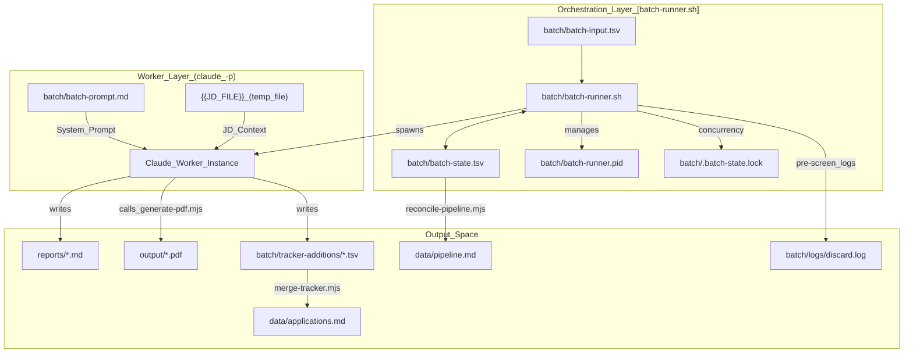
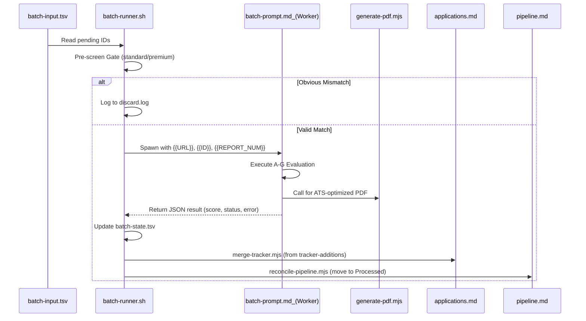

<!-- source: DeepWiki mcp.deepwiki.com · repo santifer/career-ops · page 4 Batch Processing System · fetched 2026-10-27 -->

# Batch Processing System

Relevant source files

The following files were used as context for generating this wiki page:

- [analyze-patterns.mjs](analyze-patterns.mjs)
- [batch-evaluate-gemini.mjs](batch-evaluate-gemini.mjs)
- [batch/README.md](batch/README.md)
- [batch/batch-prompt.md](batch/batch-prompt.md)
- [batch/batch-runner.sh](batch/batch-runner.sh)
- [browser-extract.mjs](browser-extract.mjs)
- [examples/README.md](examples/README.md)
- [examples/cv-example.md](examples/cv-example.md)
- [examples/resume-example.md](examples/resume-example.md)
- [modes/auto-pipeline.md](modes/auto-pipeline.md)
- [modes/batch.md](modes/batch.md)
- [modes/followup.md](modes/followup.md)
- [modes/oferta.md](modes/oferta.md)
- [modes/patterns.md](modes/patterns.md)
- [modes/tracker.md](modes/tracker.md)
- [modes/training.md](modes/training.md)
- [reconcile-pipeline.mjs](reconcile-pipeline.mjs)
- [tests/application-artifacts.test.mjs](tests/application-artifacts.test.mjs)
- [tests/batch-evaluate.test.mjs](tests/batch-evaluate.test.mjs)
- [tests/batch-runner-jd-prefetch.test.mjs](tests/batch-runner-jd-prefetch.test.mjs)
- [tests/batch-runner-score-delimiter.test.mjs](tests/batch-runner-score-delimiter.test.mjs)
- [tests/browser-extract-flags.test.mjs](tests/browser-extract-flags.test.mjs)
- [tests/browser-extract.test.mjs](tests/browser-extract.test.mjs)

The **Batch Processing System** is a high-volume evaluation subsystem designed to process job offers in parallel. It automates the transition from a raw URL or Job Description (JD) to a complete professional evaluation, including a generated PDF CV and a structured entry in the application tracker.

This system is designed for "burst" processing where a candidate identifies dozens of potential roles and needs a rapid, high-quality assessment of each without manual intervention for every step.

## System Architecture

The batch system follows an **Orchestrator/Worker** pattern. The orchestrator manages the state, concurrency, and error recovery, while independent workers (powered by Claude) perform the actual analysis and file generation.

### High-Level Flow
1.  **Input**: A list of URLs or JDs is provided via `batch/batch-input.tsv` [batch/batch-runner.sh:16]().
2.  **Orchestration**: The system determines which offers are pending by checking `batch/batch-state.tsv` [batch/batch-runner.sh:17]().
3.  **Execution**: Workers are spawned (sequentially or in parallel) to process each offer using `claude -p` with the `batch-prompt.md` template [batch/batch-runner.sh:8-11]().
4.  **Output**: Each worker generates a Markdown report in `reports/`, a customized PDF via `generate-pdf.mjs`, and a tracker TSV line in `batch/tracker-additions/` [batch/batch-prompt.md:7-12]().
5.  **Reconciliation**: Results are merged into the main `data/applications.md` tracker and the `data/pipeline.md` inbox is updated to reflect processed items via `reconcile-pipeline.mjs` [batch/README.md:27]().

### Code Entity Map: Architecture
The following diagram maps the logical components of the batch system to their physical file entities and data structures.

**Batch System Entity Mapping**

Sources: [batch/batch-runner.sh:13-27](), [batch/batch-prompt.md:1-12](), [modes/batch.md:32-44](), [reconcile-pipeline.mjs:3-15]()

---

## Operational Modes

The batch system can be triggered in two distinct ways depending on the source of the job offers.

### 1. Conductor --chrome Mode
In this mode, the system uses a headed browser to navigate portals in real-time, extracting JDs directly from the DOM [modes/batch.md:8-20]().
*   **Extraction**: Navigates to portal search results and populates `batch-input.tsv` [modes/batch.md:46-50]().
*   **Orchestration**: For each pending URL, it extracts the JD text to a temporary file and executes a headless worker [modes/batch.md:51-60]().
*   **Post-Process**: Automatically merges additions into the main tracker and reconciles the pipeline inbox upon completion [modes/batch.md:65]().

### 2. Standalone Orchestrator (`batch-runner.sh`)
This is a headless Bash-based orchestrator used for bulk processing of URLs or JDs already collected in `batch-input.tsv` [batch/batch-runner.sh:4-6]().
*   **Parallelism**: Can run $N$ workers simultaneously using the `--parallel` flag [batch/batch-runner.sh:63]().
*   **Resumability**: Uses `batch-state.tsv` to skip completed IDs and can retry failed ones via `--retry-failed` [batch/batch-runner.sh:65]().
*   **Rate-Limiting**: Automatically handles Claude session limits, pausing via `paused_rate_limit` state and resuming with `--resume-paused` [batch/batch-runner.sh:109]().

Sources: [modes/batch.md:46-67](), [batch/batch-runner.sh:55-100]()

---

## Core Components

### [batch-runner.sh Orchestrator](#4.1)
The primary Bash script responsible for the lifecycle of a batch job. It handles prerequisite validation (checking for `claude` CLI), state management with a robust directory-based lock `STATE_LOCK_DIR` to handle parallel state updates [batch/batch-runner.sh:27-29](), and final merging via `merge-tracker.mjs` [batch/README.md:60-65](). It also implements a pre-fetch logic using `curl` with a word-count sufficiency check to ensure workers don't process empty or JS-shell pages [tests/batch-runner-jd-prefetch.test.mjs:12-16]().

For details, see [batch-runner.sh Orchestrator](#4.1).

### [batch-prompt.md Worker Template](#4.2)
A self-contained system prompt that transforms a standard Claude instance into a specialized career-ops worker [batch/batch-prompt.md:1-9](). It contains the logic for the 6-step evaluation pipeline (Archetype → A-F eval → Report → PDF → Tracker → JSON stdout) [batch/batch-prompt.md:84-150](). It respects `config/profile.yml` for `language.output` and `spend_tier` configurations [batch/batch-prompt.md:26-32]().

For details, see [batch-prompt.md Worker Template](#4.2).

---

## Data Flow & State Management

The system relies on Tab-Separated Values (TSV) files to maintain a robust, human-readable state that survives process crashes.

| File | Purpose | Key Columns |
| :--- | :--- | :--- |
| `batch-input.tsv` | Queue of work | `id`, `url`, `source`, `notes` [batch/batch-runner.sh:82]() |
| `batch-state.tsv` | Execution history | `status`, `started_at`, `score`, `error`, `retries` [batch/batch-runner.sh:200]() |
| `tracker-additions/` | Individual results | Individual TSV lines for `merge-tracker.mjs` [batch/batch-runner.sh:22]() |
| `logs/discard.log` | Pre-screen audit | `timestamp`, `job_id`, `url`, `reason` [modes/batch.md:32]() |

### Code Entity Map: Data Lifecycle
This diagram illustrates how data transitions from raw input to the final application tracker and pipeline inbox.

**Batch Data Lifecycle**

Sources: [batch/batch-runner.sh:198-202](), [batch/batch-prompt.md:73-82](), [batch/batch-prompt.md:84-150](), [modes/batch.md:24-33](), [reconcile-pipeline.mjs:12-19]()

---

