<!-- source: DeepWiki mcp.deepwiki.com · repo scarletkc/vexor · page 1.2 Key Features · fetched 2026-10-27 -->

# Key Features

<details>
<summary>Relevant source files</summary>

The following files were used as context for generating this wiki page:

- [README.md](README.md)
- [plugins/vexor/.claude-plugin/plugin.json](plugins/vexor/.claude-plugin/plugin.json)
- [vexor/__init__.py](vexor/__init__.py)

</details>


This page catalogs Vexor's primary capabilities and architectural features. It provides an overview of what the system can do and how major components relate to each other. For detailed usage instructions, see [Quick Start - CLI](#2.2) and [Quick Start - Python API](#2.3). For in-depth explanations of individual concepts, see [Core Concepts](#3).

## Feature Overview Table

| Feature Category | Description | Configuration | Primary Implementation |
|-----------------|-------------|---------------|----------------------|
| **Reusable Index Cache** | SQLite-backed persistent vector storage | `~/.vexor/index.db` | [vexor/cache.py]() |
| **Embedding Providers** | OpenAI, Gemini, Voyage, Custom API, Local (fastembed) | `--provider`, `--model` | [vexor/search.py:54-143]() |
| **Index Modes** | auto, name, head, brief, full, code, outline | `--mode` | [vexor/services/index_service.py:42-185]() |
| **Reranking** | off, bm25, flashrank, remote | `--rerank` | [vexor/services/search_service.py:125-203]() |
| **Multi-Interface Access** | CLI (Typer), Python API, Desktop App (Electron) | - | [vexor/cli.py](), [vexor/api.py](), [gui/]() |
| **AI Agent Integration** | Skills for Claude Code, Codex | `vexor install --skills` | [plugins/vexor/skills/]() |
| **Incremental Updates** | Only re-embed changed files | Automatic | [vexor/cache.py:468-565]() |
| **Offline Operation** | Local models via fastembed + optional CUDA | `vexor local --setup` | [vexor/search.py:91-143]() |
| **Configuration Hierarchy** | Env vars → config file → runtime overrides | `~/.vexor/config.json` | [vexor/config.py]() |
| **Performance Tuning** | Parallel extraction, batching, caching | `--embed-concurrency`, `--batch-size` | [vexor/config.py:28-31]() |

**Sources:** [README.md:1-304](), [vexor/config.py:1-710]()

## Core Feature Architecture

The diagram below bridges each major feature domain to the specific code entities that implement it.

**Feature-to-Code Bridge:**

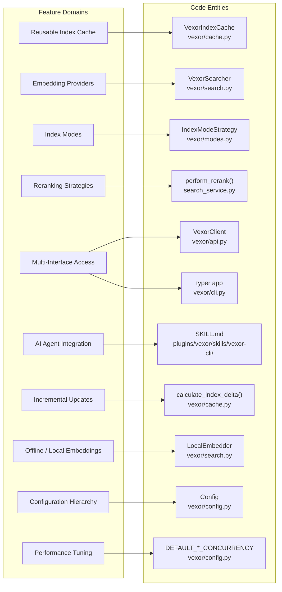

**Sources:** [vexor/cache.py:1-751](), [vexor/search.py:1-487](), [vexor/modes.py:1-200](), [vexor/services/index_service.py:1-405](), [vexor/services/search_service.py:1-318](), [vexor/cli.py:1-1200](), [vexor/api.py:1-350]()

---

## 1. Reusable Index Cache

Vexor persists all indexed vectors and metadata in `~/.vexor/index.db`, a SQLite database with WAL mode enabled. Once a directory is indexed, subsequent searches reuse the cached embeddings without re-processing files or calling the embedding provider.

### Cache Structure

The `VexorIndexCache` class ([vexor/cache.py:169-751]()) owns all cache operations. The diagram shows the SQLite tables and the in-memory layer it manages.

**VexorIndexCache data model:**

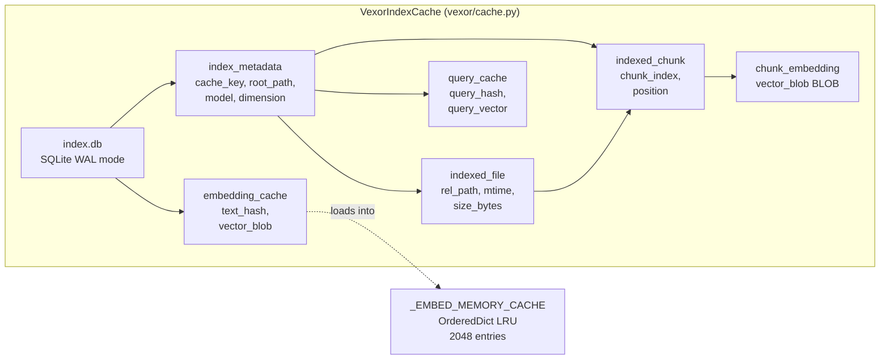

**Key Classes:**
- `VexorIndexCache` ([vexor/cache.py:169-751]()): Manages all cache operations
- `IndexMetadata` ([vexor/cache.py:28-42]()): Represents a cached index
- `IndexedEntry` ([vexor/cache.py:44-59]()): Represents a file/chunk with embedding

**Cache Key Derivation:**
The cache key is computed from indexing parameters via `compute_cache_key()` ([vexor/cache.py:62-112]()):
```python
# Key components: path, mode, include_hidden, no_recursive, 
# no_respect_gitignore, extensions, exclude_patterns
```

**Sources:** [vexor/cache.py:1-751](), Diagram 4 from high-level architecture

---

## 2. Multiple Embedding Providers

Vexor abstracts embedding generation through the `VexorSearcher` class ([vexor/search.py:146-487]()), supporting five provider types:

| Provider | Configuration | Base URL | Authentication | Offline |
|----------|---------------|----------|----------------|---------|
| `openai` | `DEFAULT_PROVIDER` | `api.openai.com` | `OPENAI_API_KEY` or `VEXOR_API_KEY` | ❌ |
| `gemini` | `--provider gemini` | `generativelanguage.googleapis.com` | `GOOGLE_GENAI_API_KEY` or `VEXOR_API_KEY` | ❌ |
| `voyageai` | `--provider voyageai` | `VOYAGE_BASE_URL` ([vexor/config.py:36]()) | `VOYAGE_API_KEY` or `VEXOR_API_KEY` | ❌ |
| `custom` | `--provider custom --base-url URL` | User-specified | `VEXOR_API_KEY` or `OPENAI_API_KEY` | ❌ |
| `local` | `--provider local` | N/A | None | ✅ |

### Provider Resolution Flow

**`VexorSearcher` backend selection — natural language to code entity bridge:**

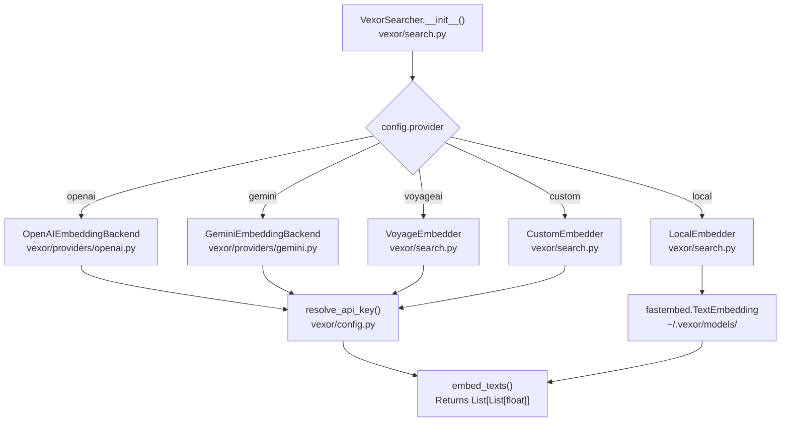

**Default Models:**
- OpenAI: `text-embedding-3-small` ([vexor/config.py:24]())
- Gemini: `gemini-embedding-001` ([vexor/config.py:25]())
- Voyage: `voyage-3-large` ([vexor/config.py:26]())
- Local: `intfloat/multilingual-e5-small` ([vexor/config.py:27]())

**Sources:** [vexor/search.py:146-487](), [vexor/config.py:24-51](), [README.md:172-221]()

---

## 3. Index Modes

Index modes control content extraction and chunking strategies. Implemented in `extract_content()` ([vexor/services/index_service.py:42-185]()):

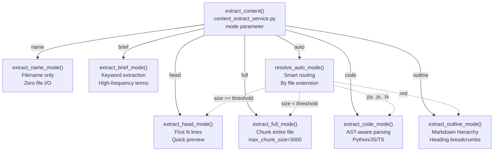

### Mode Implementation Details

| Mode | Function | File Path | Key Feature |
|------|----------|-----------|-------------|
| `auto` | `resolve_auto_mode()` | [vexor/services/index_service.py:189-213]() | Routes by extension and size |
| `name` | `extract_name_mode()` | [vexor/services/index_service.py:216-224]() | Returns `[filename]` |
| `head` | `extract_head_mode()` | [vexor/services/index_service.py:227-244]() | Extracts first snippet |
| `brief` | `extract_brief_mode()` | [vexor/services/index_service.py:247-280]() | TF-IDF-style keyword extraction |
| `full` | `extract_full_mode()` | [vexor/services/index_service.py:283-309]() | Chunks by `max_chunk_size=3000` |
| `code` | `extract_code_mode()` | [vexor/services/index_service.py:312-345]() | AST parsing via `tree-sitter` |
| `outline` | `extract_outline_mode()` | [vexor/services/index_service.py:348-405]() | Markdown heading hierarchy |

**Sources:** [vexor/services/index_service.py:42-405](), [README.md:222-235]()

---

## 4. Reranking Strategies

After initial cosine similarity ranking, results can be reordered using secondary rankers. Implemented in `perform_rerank()` ([vexor/services/search_service.py:125-203]()):

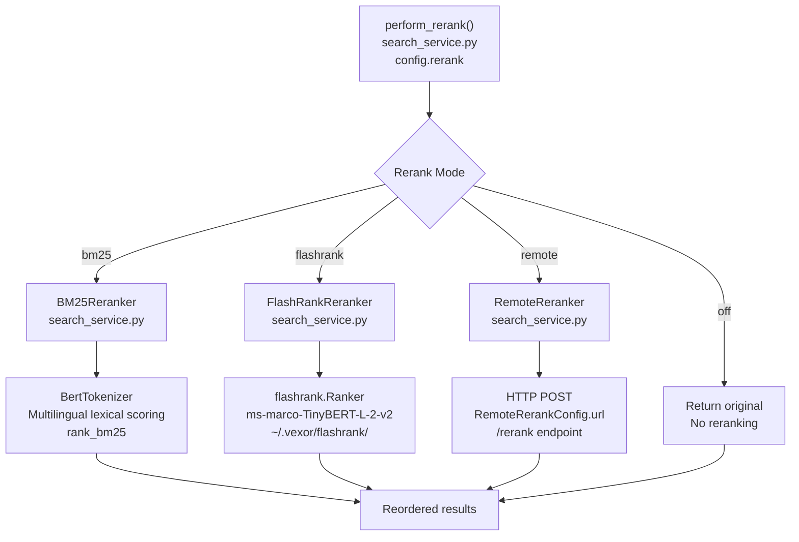

### Reranker Configuration

| Reranker | Default | Configuration | Dependencies |
|----------|---------|---------------|--------------|
| `off` | ✅ | `vexor config --rerank off` | None |
| `bm25` | ❌ | `vexor config --rerank bm25` | Built-in |
| `flashrank` | ❌ | `vexor config --rerank flashrank --set-flashrank-model MODEL` | `pip install "vexor[flashrank]"` |
| `remote` | ❌ | `vexor config --rerank remote --set-remote-rerank-url URL` | External API |

**Candidate Selection:** Top-K candidates for reranking: `clamp(int(top * 2), 20, 150)` ([README.md:159]())

**FlashRank Models:**
- Default: `ms-marco-TinyBERT-L-2-v2` ([vexor/config.py:34]())
- Multilingual: `ms-marco-MultiBERT-L-12` (recommended for CJK content)

**Sources:** [vexor/services/search_service.py:125-318](), [README.md:156-171](), [vexor/config.py:33-38]()

---

## 5. Multi-Interface Access

Vexor exposes the same core functionality through three interfaces:

### Interface Architecture

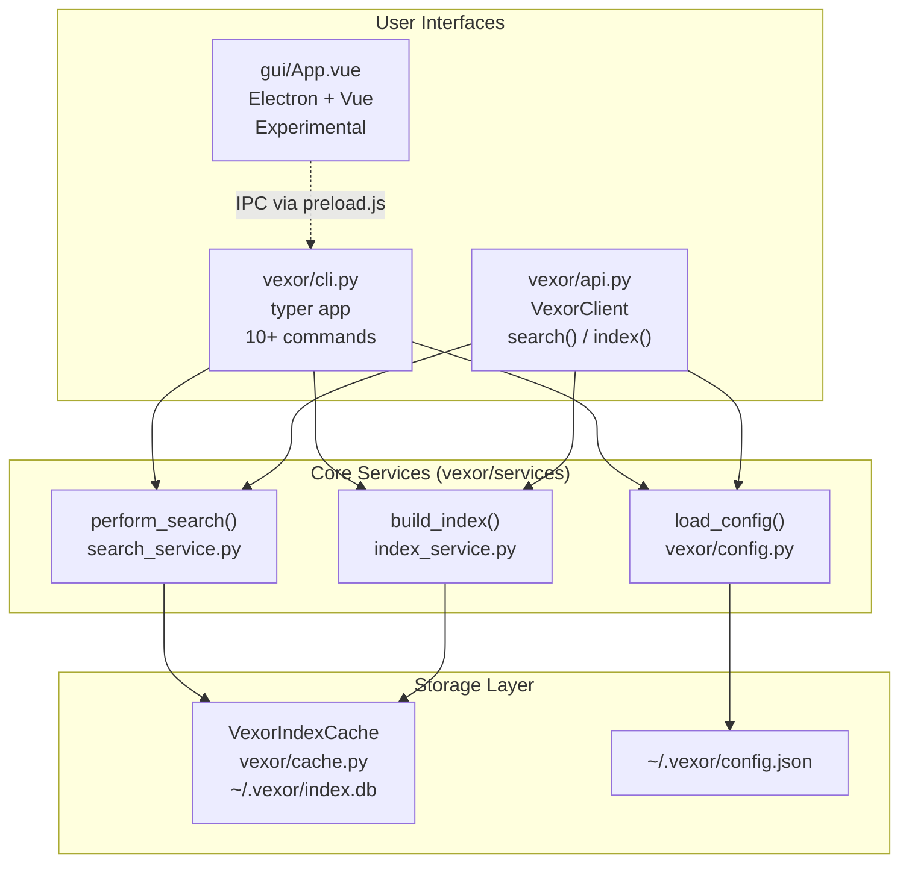

### Interface Capabilities

| Feature | CLI | Python API | Desktop App |
|---------|-----|------------|-------------|
| **Search** | `vexor search QUERY` | `vexor.search(query)` | GUI search box |
| **Index** | `vexor index --path .` | `vexor.index(path)` | Auto-index |
| **Config** | `vexor config --show` | `config_context()` | Settings panel |
| **In-Memory** | `--no-cache` flag | `index_in_memory()` | ❌ |
| **Session Scope** | N/A | `VexorClient()` | N/A |
| **Output Formats** | `--format rich/porcelain/porcelain-z` | Python objects | Rich display |

**Key Classes:**
- CLI: `app = typer.Typer()` ([vexor/cli.py:54]())
- Python API: `VexorClient` ([vexor/api.py:37-202]()), `InMemoryIndex` ([vexor/api.py:205-350]())

**Sources:** [vexor/cli.py:1-1200](), [vexor/api.py:1-350](), [gui/](), [README.md:89-105]()

---

## 6. AI Agent Integration

Vexor includes pre-built skills for AI coding assistants. The skill definitions expose the CLI as a tool that agents can invoke:

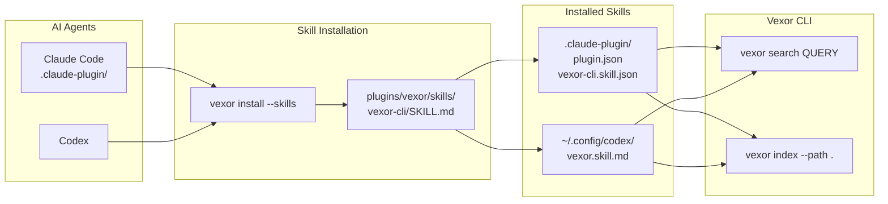

**Installation Commands:**
- Claude: `vexor install --skills claude` → Installs to `.claude-plugin/`
- Codex: `vexor install --skills codex` → Installs to `~/.config/codex/`

**Skill Definition:** [plugins/vexor/skills/vexor-cli/SKILL.md]()

**Agent Workflow:**
1. Agent receives task requiring file search
2. Agent invokes `vexor search "semantic query"` as a tool
3. Vexor returns ranked file paths with similarity scores
4. Agent uses results to locate relevant files

**Sources:** [README.md:106-116](), [plugins/vexor/skills/]()

---

## 7. Incremental Updates

When re-running `vexor index`, Vexor computes a delta between cached and current filesystem state. Only changed files are re-embedded.

### Delta Calculation Flow

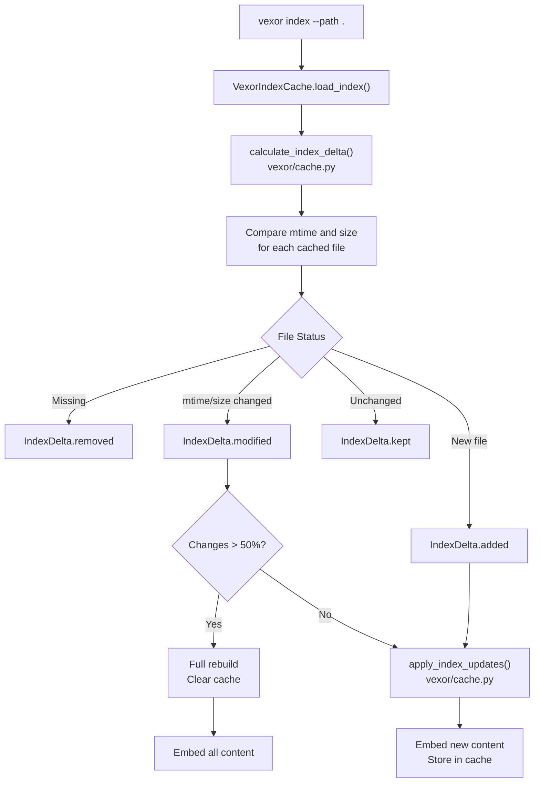

**Key Functions:**
- `calculate_index_delta()` ([vexor/cache.py:468-565]()): Computes file changes
- `apply_index_updates()` ([vexor/cache.py:567-661]()): Applies delta to cache

**Threshold:** If `>50%` of files changed, triggers full rebuild ([README.md:248]())

**Sources:** [vexor/cache.py:468-661](), [README.md:248-249]()

---

## 8. Offline Operation

The `local` provider enables fully offline semantic search using fastembed ([https://github.com/qdrant/fastembed]()):

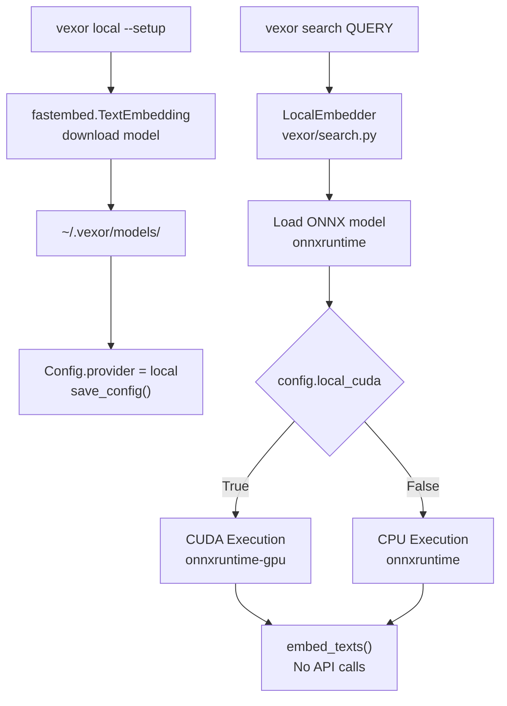

**Setup Commands:**
- CPU: `pip install "vexor[local]"` then `vexor local --setup`
- GPU: `pip install "vexor[local-cuda]"` then `vexor local --setup --cuda`

**Runtime Toggle:**
- Enable CUDA: `vexor local --cuda`
- Disable CUDA: `vexor local --cpu`

**Model Storage:** `~/.vexor/models/` (clear with `vexor local --clean-up`)

**Sources:** [vexor/search.py:349-487](), [README.md:198-221](), [vexor/config.py:191-193]()

---

## 9. Configuration Hierarchy

Vexor resolves configuration from five sources with strict precedence:

### Configuration Resolution

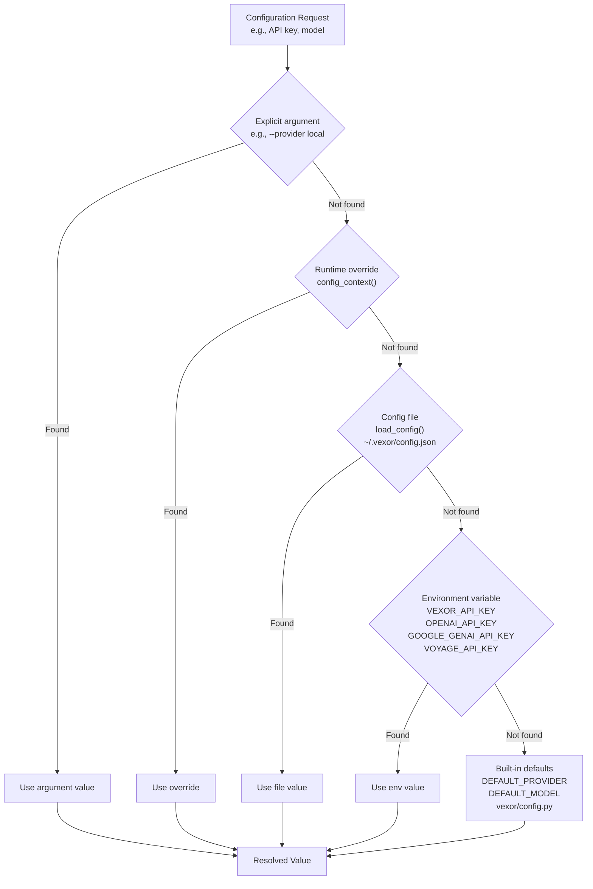

**Precedence Order:**
1. **Explicit arguments:** `vexor search --provider local`
2. **Runtime overrides:** `config_context(provider="local")`
3. **Config file:** `~/.vexor/config.json`
4. **Environment variables:** `VEXOR_API_KEY`, `OPENAI_API_KEY`, `GOOGLE_GENAI_API_KEY`, `VOYAGE_API_KEY`
5. **Built-in defaults:** `DEFAULT_PROVIDER = "openai"` ([vexor/config.py:32]())

**Configuration Functions:**
- Load: `load_config()` ([vexor/config.py:123-149]())
- Save: `save_config(config)` ([vexor/config.py:151-189]())
- Override: `config_context()` (Python API only)
- Update: `update_config_from_json(payload)` ([vexor/config.py:224-231]())

**Sources:** [vexor/config.py:1-710](), Diagram 3 from high-level architecture

---

## 10. Performance Optimizations

Vexor includes several performance features for large codebases:

### Parallelization Architecture

| Component | Configuration | Default | Implementation |
|-----------|---------------|---------|----------------|
| **Embedding Concurrency** | `--embed-concurrency N` | `4` | [vexor/config.py:29]() |
| **Extraction Concurrency** | `--extract-concurrency N` | `min(4, cpu_count)` | [vexor/config.py:30]() |
| **Extraction Backend** | `--extract-backend auto/thread/process` | `auto` | [vexor/config.py:31]() |
| **Batch Size** | `--batch-size N` | `64` | [vexor/config.py:28]() |
| **In-Memory Cache** | N/A (automatic) | `2048 entries` | [vexor/cache.py:689-707]() |

### Optimization Flow

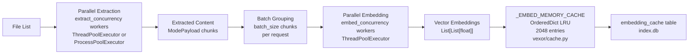

**Auto Backend Selection:**
- `auto`: Uses `process` for local provider, `thread` otherwise ([vexor/services/index_service.py:31-40]())
- `thread`: Python `ThreadPoolExecutor` (I/O-bound)
- `process`: Python `ProcessPoolExecutor` (CPU-bound)

**Batch Processing:**
- Setting `batch_size=0` sends all texts in a single request
- Non-zero values group texts into batches of N

**In-Memory Cache:**
- LRU eviction policy via `OrderedDict` ([vexor/cache.py:689-707]())
- Thread-safe with `threading.Lock` ([vexor/cache.py:686]())
- Falls back to SQLite `embedding_cache` table on miss

**Sources:** [vexor/config.py:28-31](), [vexor/cache.py:686-707](), [vexor/services/index_service.py:31-40]()

---

