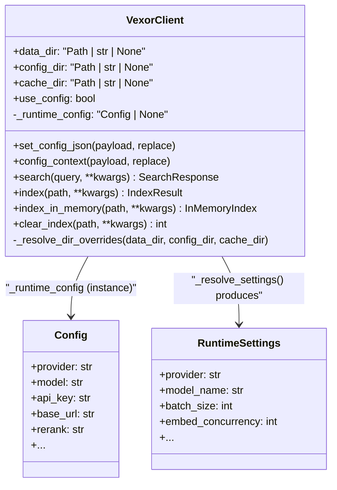
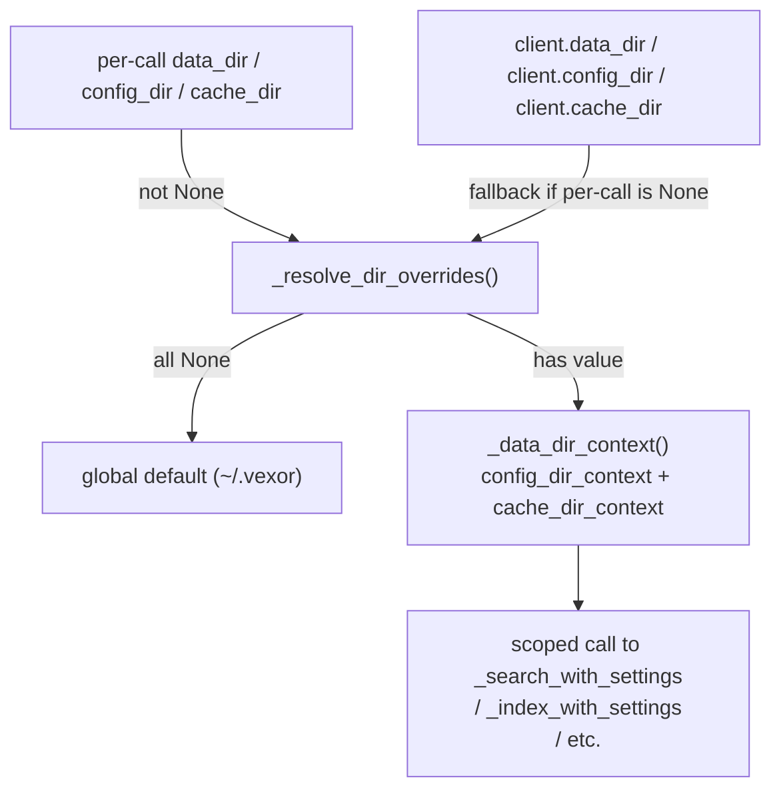
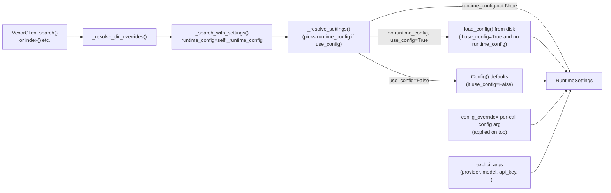

<!-- source: DeepWiki mcp.deepwiki.com · repo scarletkc/vexor · page 5.4 VexorClient Class · fetched 2026-10-27 -->

# VexorClient Class

<details>
<summary>Relevant source files</summary>

The following files were used as context for generating this wiki page:

- [docs/api/python.md](docs/api/python.md)
- [plugins/vexor/.claude-plugin/plugin.json](plugins/vexor/.claude-plugin/plugin.json)
- [tests/unit/test_api.py](tests/unit/test_api.py)
- [vexor/__init__.py](vexor/__init__.py)
- [vexor/api.py](vexor/api.py)

</details>


`VexorClient` is the session-style API wrapper in the Vexor Python library. It lets you fix shared settings — data directories, config, and provider credentials — once at construction, and then reuse those settings across multiple `search`, `index`, `index_in_memory`, and `clear_index` calls without repeating them. It also provides a scoped `config_context` method for temporary per-block configuration overrides.

This page covers the `VexorClient` class itself. For the equivalent module-level functions (`search`, `index`, `index_in_memory`, `clear_index`) see [5.2](#5.2) and [5.3](#5.3). For `set_config_json`, `config_context`, and `set_data_dir` as module-level utilities, see [5.5](#5.5). For the `InMemoryIndex` class returned by `index_in_memory`, see [5.6](#5.6).

---

## Class Definition

`VexorClient` is defined in [vexor/api.py:209-484]() and is exported through [`vexor/__init__.py`](vexor/__init__.py) as part of the public `__all__` surface.

```
vexor/__init__.py  →  from .api import VexorClient
```

Sources: [vexor/api.py:209-224](), [vexor/__init__.py:1-31]()

---

## Constructor

[vexor/api.py:212-224]()

| Parameter | Type | Default | Description |
|---|---|---|---|
| `data_dir` | `Path \| str \| None` | `None` | Base directory for both config and cache. Equivalent to setting `config_dir` and `cache_dir` to the same path. |
| `config_dir` | `Path \| str \| None` | `None` | Override for the config directory only. Takes precedence over `data_dir` for config. |
| `cache_dir` | `Path \| str \| None` | `None` | Override for the cache (SQLite) directory only. Takes precedence over `data_dir` for cache. |
| `use_config` | `bool` | `True` | Whether to read from the on-disk `config.json` when resolving settings. Set to `False` for fully isolated library usage. |

The constructor stores these as public instance attributes. A private attribute `_runtime_config: Config | None` is initialized to `None` and is the instance-level in-memory config slot.

Sources: [vexor/api.py:209-224]()

---

## Instance State

**Instance-level config architecture diagram**



Sources: [vexor/api.py:209-485]()

---

## Directory Resolution

Each method on `VexorClient` accepts optional `data_dir`, `config_dir`, and `cache_dir` keyword arguments. These per-call values are merged with the client-level defaults through `_resolve_dir_overrides` [vexor/api.py:257-266]():

- If the per-call value is not `None`, it wins.
- Otherwise, the value stored on the client instance is used.
- A `None` result means the global default (`~/.vexor/`) is used.

The resolved directories are then passed to the internal `_data_dir_context` context manager [vexor/api.py:168-185](), which applies `config_dir_context` and `cache_dir_context` as thread-local overrides for the duration of the call. This means directory overrides are fully scoped to the call and do not mutate global state.

**Directory resolution precedence diagram**



Sources: [vexor/api.py:257-266](), [vexor/api.py:168-185](), [vexor/api.py:300-334]()

---

## Configuration Management

### `set_config_json`

[vexor/api.py:226-240]()

Sets `self._runtime_config` from a dict or JSON string. This does **not** write to `config.json` on disk. Pass `None` to clear the runtime config.

| Parameter | Type | Default | Description |
|---|---|---|---|
| `payload` | `Mapping[str, object] \| str \| None` | required | Dict or JSON string of config fields. `None` clears the override. |
| `replace` | `bool` | `False` | If `False`, merges into the current `_runtime_config` or disk config. If `True`, applies the payload to default values only, skipping any existing config. |

Raises `VexorError` if the payload cannot be parsed as a valid config.

The key difference from the module-level `set_config_json` [vexor/api.py:194-206]() is scope: the method writes to `self._runtime_config`, which is instance-local. The module-level function writes to the module global `_RUNTIME_CONFIG`, which affects all module-level function calls.

### `config_context`

[vexor/api.py:242-255]()

A context manager that temporarily overrides `self._runtime_config` for the duration of a `with` block, then restores the previous value.

```
previous = self._runtime_config
→ set_config_json(payload, replace=replace)
→ yield self
→ self._runtime_config = previous
```

It yields `self`, so you can use the client directly inside the `with` block:

```python
client = VexorClient(data_dir="/tmp/vexor")
with client.config_context({"provider": "gemini", "api_key": "key"}):
    response = client.search("query", path=".")
# _runtime_config is restored here
```

Sources: [vexor/api.py:226-255](), [tests/unit/test_api.py:360-386]()

---

## Methods

All four operation methods follow the same pattern:

1. Resolve `use_config` — use the instance default unless the caller overrides it.
2. Call `_resolve_dir_overrides` to merge per-call and instance-level directory settings.
3. Delegate to the corresponding module-internal `_*_with_settings` function, passing `runtime_config=self._runtime_config`.

**Config resolution flow within a method call**



Sources: [vexor/api.py:268-484](), [vexor/api.py:1029-1105]()

### `search`

[vexor/api.py:268-334]()

Runs a semantic search and returns a `SearchResponse`. Accepts the same parameters as the module-level `search` function. The instance-level `use_config` is used as the default for the `use_config` parameter.

### `index`

[vexor/api.py:336-392]()

Builds or refreshes the persistent index for a directory. Returns an `IndexResult`. Accepts the same parameters as the module-level `index` function.

### `index_in_memory`

[vexor/api.py:394-452]()

Builds an index in memory without writing to disk. Returns an `InMemoryIndex`. Defaults `no_cache=True`. See [5.6](#5.6) for `InMemoryIndex` details.

### `clear_index`

[vexor/api.py:454-484]()

Clears cached index entries for a directory and returns the count of entries removed. Does not accept config-related parameters since clearing does not require embedding provider access.

---

## Module-Level `config_context`

The module also exports a standalone `config_context` context manager [vexor/api.py:487-508]() that creates a fresh `VexorClient`, applies the given config, yields it, and clears the config on exit. It is a convenience wrapper for one-off scoped usage when you do not need a persistent client:

```python
with config_context({"provider": "gemini", "api_key": "key"}) as client:
    response = client.search("query", path=".")
```

| Parameter | Description |
|---|---|
| `payload` | Dict or JSON string of config fields (same as `set_config_json`) |
| `replace` | Passed through to `set_config_json` |
| `data_dir`, `config_dir`, `cache_dir` | Passed to the `VexorClient` constructor |
| `use_config` | Passed to the `VexorClient` constructor |

Sources: [vexor/api.py:487-508](), [tests/unit/test_api.py:500-520]()

---

## Comparison: `VexorClient` vs. Module-Level Functions

| Aspect | Module-level (`search`, `index`, …) | `VexorClient` methods |
|---|---|---|
| Runtime config slot | Global `_RUNTIME_CONFIG` | `self._runtime_config` (per-instance) |
| `set_config_json` scope | Mutates global state | Mutates instance state only |
| `config_context` | Creates a new `VexorClient`; yields it | Temporarily overrides `self._runtime_config` |
| Directory defaults | Per-call only | Inherited from constructor; overridable per-call |
| `use_config` default | `True` (function parameter) | Instance attribute; per-call can override |
| Suitable for | Simple scripts, one-off calls | Library code, multiple concurrent sessions |

Sources: [vexor/api.py:165-207](), [vexor/api.py:209-508](), [docs/api/python.md:18-38]()

---

