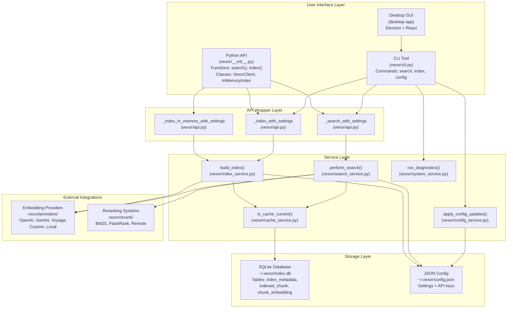
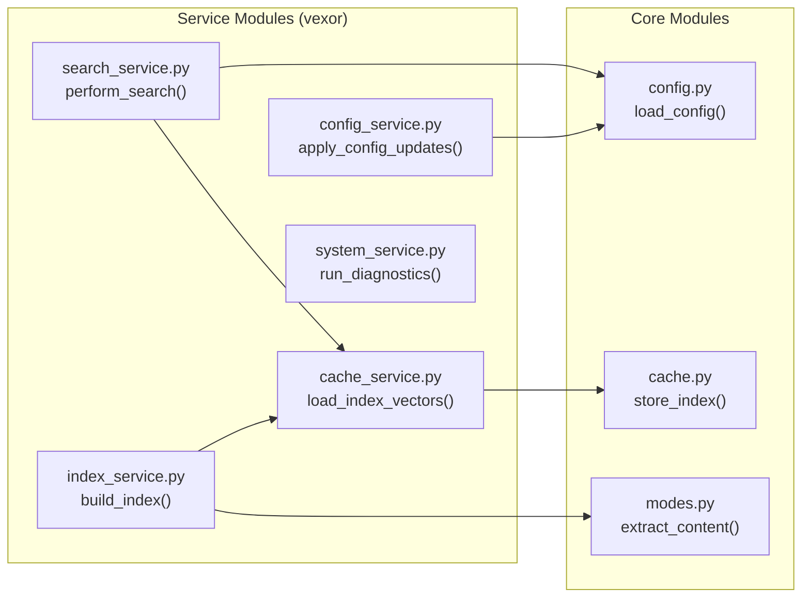
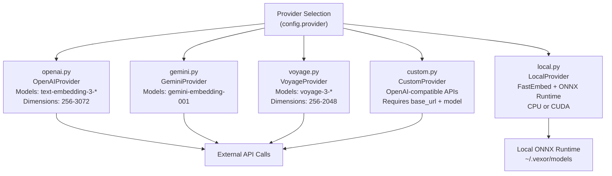
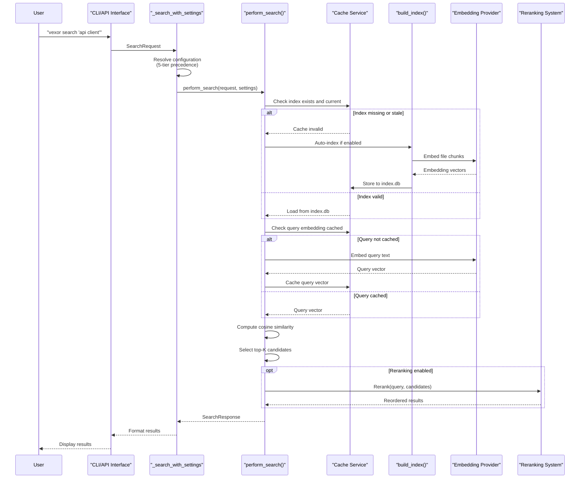
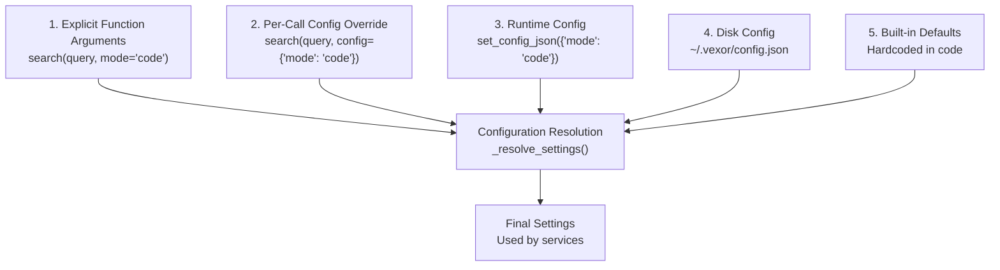

<!-- source: DeepWiki mcp.deepwiki.com · repo scarletkc/vexor · page 6.1 Overview · fetched 2026-10-27 -->

# Overview

<details>
<summary>Relevant source files</summary>

The following files were used as context for generating this wiki page:

- [README.md](README.md)
- [plugins/vexor/.claude-plugin/plugin.json](plugins/vexor/.claude-plugin/plugin.json)
- [vexor/__init__.py](vexor/__init__.py)

</details>


This page provides a high-level introduction to Vexor's architecture, explaining its purpose, major components, and how they interact. For installation and first-time setup, see [Getting Started](#2). For in-depth technical details about specific subsystems, see [Architecture Deep Dive](#7).

## What is Vexor

Vexor is a semantic search engine that builds reusable indexes over files and codebases. Unlike traditional text search tools that rely on exact keyword matching, Vexor uses vector embeddings to understand the semantic meaning of queries and file contents, enabling users to find files by describing what they do rather than memorizing filenames or specific keywords.

The system is designed for two primary use cases:
1. **Human developers** searching codebases when they remember functionality but not file locations
2. **AI coding assistants** performing autonomous file discovery in agent workflows

Vexor exposes three user interfaces—a CLI tool, a Python API, and an experimental desktop application—all backed by a shared service layer and persistent cache.

Sources: [README.md:1-38]()

## System Architecture

The following diagram shows Vexor's layered architecture, mapping high-level concepts to specific code entities:



**Architecture Overview**

Vexor follows a four-tier architecture:

1. **User Interface Layer**: Three distinct entry points (CLI, Python API, GUI) provide different ways to interact with the system
2. **API Wrapper Layer**: Internal functions in [vexor/api.py]() that handle configuration resolution, validation, and normalization before delegating to services
3. **Service Layer**: Business logic modules that orchestrate search, indexing, caching, and configuration operations
4. **Storage Layer**: Persistent storage using SQLite for embeddings/indexes and JSON for configuration

External integrations include multiple embedding providers and optional reranking systems that enhance search accuracy.

Sources: [README.md:18-20](), [vexor/__init__.py:1-39](), diagrams Diagram 1, Diagram 5

## Core Components

### User Interfaces

| Interface | Entry Point | Primary Use Case |
|-----------|-------------|------------------|
| **CLI** | `vexor` command ([vexor/cli.py]()) | Interactive terminal usage, shell scripting, CI/CD |
| **Python API** | `import vexor` ([vexor/__init__.py]()) | Programmatic integration, custom workflows |
| **Desktop GUI** | Electron app ([desktop-app/]()) | Visual interaction (experimental, not actively maintained) |

All three interfaces share the same underlying service layer, ensuring consistent behavior regardless of entry point. The CLI is the most mature and feature-complete interface. The Python API exposes both module-level functions (`vexor.search()`, `vexor.index()`) and a session-based `VexorClient` class for scoped configuration.

Sources: [README.md:38-105](), [vexor/__init__.py:5-16]()

### Service Layer

The service layer implements core business logic through specialized modules:



Each service module has a focused responsibility:

- **search_service.py**: Executes semantic queries, handles auto-indexing, and coordinates reranking
- **index_service.py**: Manages file scanning, content extraction, embedding generation, and cache updates
- **cache_service.py**: Validates cache currency, loads/stores index data, manages query cache
- **config_service.py**: Applies configuration updates and validates settings
- **system_service.py**: Runs diagnostics, checks for updates, manages system health

Sources: diagrams Diagram 6

### Storage Architecture

Vexor uses two persistent storage mechanisms:

**SQLite Cache** (`~/.vexor/index.db`)

The cache database uses a normalized schema to store embeddings and metadata:

| Table | Purpose |
|-------|---------|
| `index_metadata` | Index configuration (path, mode, root directory, file count) |
| `indexed_chunk` | File chunks with metadata (file path, hash, timestamp) |
| `chunk_embedding` | Embedding vectors as binary blobs |
| `chunk_meta` | Line numbers, preview text, and chunk-specific metadata |
| `query_cache` | Cached query embeddings per index |
| `embedding_cache` | General-purpose text embedding cache |

The cache implements a two-tier strategy: an in-memory LRU cache (2048 entries) for hot data, backed by SQLite for persistence. This design provides fast lookups while maintaining durability across sessions.

**JSON Configuration** (`~/.vexor/config.json`)

The configuration file stores user preferences:
- Provider settings (API keys, base URLs, model names)
- Indexing parameters (mode, concurrency, batch size)
- Reranking configuration
- Auto-indexing behavior

Configuration can be modified via `vexor config` commands or programmatically through the Python API.

Sources: diagrams Diagram 4, [README.md:148-149]()

### Provider System

Vexor supports five embedding provider types, each implemented as a separate module in [vexor/providers/]():



**Provider Selection Logic**:
- Remote providers (OpenAI, Gemini, Voyage, Custom) require API keys and make HTTP requests
- The `custom` provider enables integration with any OpenAI-compatible embedding service
- The `local` provider uses ONNX Runtime for on-device embedding, eliminating API costs and enabling offline operation
- Provider configuration is stored in `config.json` and can be changed without code modifications

Sources: [README.md:172-220](), diagrams Diagram 3

## Search Operation Flow

The following diagram traces a search operation from user input through result delivery:



**Key Optimization Strategies**:

1. **Automatic Indexing**: When a search is performed on an unindexed directory, the system automatically builds the index (if `auto_index` is enabled)
2. **Multi-Level Caching**: Both file embeddings and query embeddings are cached, dramatically improving performance for repeated searches
3. **Incremental Updates**: Re-indexing only processes changed files; full rebuilds occur only when >50% of files change
4. **Optional Reranking**: Results can be refined using BM25 (lexical), FlashRank (neural), or remote reranking services

Sources: diagrams Diagram 2, [README.md:54-70]()

## Configuration Resolution

Vexor implements a five-tier configuration precedence system that allows flexible overrides at different scopes:



**Precedence Order** (highest to lowest):
1. Explicit function arguments (`path="."`, `mode="code"`)
2. Per-call config dictionary (`config={"provider": "local"}`)
3. In-memory runtime config set via `set_config_json()`
4. On-disk configuration in `~/.vexor/config.json`
5. Built-in defaults

This design enables use cases like:
- Temporary config changes for a single operation
- Session-scoped configuration via `VexorClient`
- Persistent preferences via `vexor config` commands
- Context-specific overrides via `config_context()`

Sources: diagrams Diagram 3

## Key Subsystems

The following table maps high-level concepts to detailed documentation pages:

| Subsystem | Purpose | Documentation |
|-----------|---------|---------------|
| **Indexing Modes** | Seven strategies for content extraction (auto, name, head, brief, full, code, outline) | [Core Concepts - Indexing Modes](#3.2) |
| **Embedding Providers** | Five backend options for generating vector embeddings | [Core Concepts - Embedding Providers](#3.3) |
| **Reranking** | Four strategies for result refinement (off, bm25, flashrank, remote) | [Core Concepts - Reranking Strategies](#3.4) |
| **Cache Management** | SQLite-based persistence for indexes and embeddings | [Core Concepts - Cache System](#3.5) |
| **CLI Commands** | Complete reference for terminal interface | [CLI Reference](#4) |
| **Python API** | Programmatic interface for custom integrations | [Python API Reference](#5) |
| **Desktop Application** | Experimental GUI for visual interaction | [Desktop Application](#6) |
| **AI Agent Skills** | Integration with Claude and Codex | [Advanced Usage - AI Agent Integration](#8.6) |

Each subsystem is documented in detail in its respective section.

Sources: JSON table of contents

## Data Directory

All Vexor data is stored under `~/.vexor/` by default:

```
~/.vexor/
├── config.json          # User configuration
├── index.db             # SQLite cache (indexes, embeddings, queries)
├── models/              # Local ONNX models (if using local provider)
└── flashrank/           # FlashRank reranker models (if enabled)
```

The data directory can be overridden programmatically via `set_data_dir()` or by setting the `VEXOR_DATA_DIR` environment variable.

Sources: [README.md:148-149](), [README.md:217]()

## Version and Installation

Vexor is distributed through multiple channels:

- **PyPI package**: `pip install vexor` (requires Python 3.9+)
- **Standalone binaries**: Platform-specific executables available from GitHub releases
- **Optional extras**: `vexor[local]`, `vexor[local-cuda]`, `vexor[flashrank]` for additional features

The current version is defined in [vexor/__init__.py:33]() as `__version__ = "0.23.1rc1"`.

For detailed installation instructions, see [Getting Started - Installation](#2.1).

Sources: [README.md:7-43](), [vexor/__init__.py:33]()

---

