# Page: Overview

# Overview

<details>
<summary>Relevant source files</summary>

The following files were used as context for generating this wiki page:

- [README.md](README.md)
- [plugins/vexor/.claude-plugin/plugin.json](plugins/vexor/.claude-plugin/plugin.json)
- [vexor/__init__.py](vexor/__init__.py)

</details>


This page provides a high-level introduction to Vexor's architecture, explaining its purpose, major components, and how they interact. For installation and first-time setup, see [Getting Started](#2). For in-depth technical details about specific subsystems, see [Architecture Deep Dive](#7).

## What is Vexor

Vexor is a semantic search engine that builds reusable indexes over files and codebases. Unlike traditional text search tools that rely on exact keyword matching, Vexor uses vector embeddings to understand the semantic meaning of queries and file contents, enabling users to find files by describing what they do rather than memorizing filenames or specific keywords.

The system is designed for two primary use cases:
1. **Human developers** searching codebases when they remember functionality but not file locations
2. **AI coding assistants** performing autonomous file discovery in agent workflows

Vexor exposes three user interfaces—a CLI tool, a Python API, and an experimental desktop application—all backed by a shared service layer and persistent cache.

Sources: [README.md:1-38]()

## System Architecture

The following diagram shows Vexor's layered architecture, mapping high-level concepts to specific code entities:

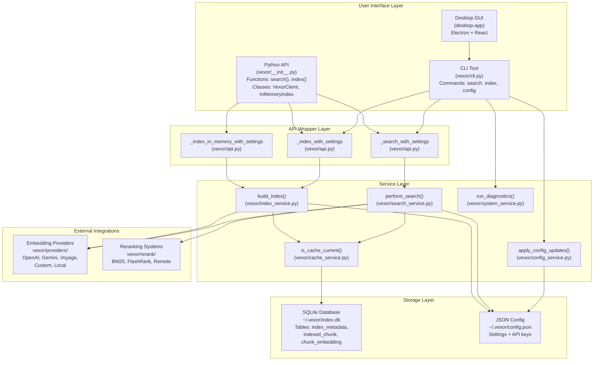

**Architecture Overview**

Vexor follows a four-tier architecture:

1. **User Interface Layer**: Three distinct entry points (CLI, Python API, GUI) provide different ways to interact with the system
2. **API Wrapper Layer**: Internal functions in [vexor/api.py]() that handle configuration resolution, validation, and normalization before delegating to services
3. **Service Layer**: Business logic modules that orchestrate search, indexing, caching, and configuration operations
4. **Storage Layer**: Persistent storage using SQLite for embeddings/indexes and JSON for configuration

External integrations include multiple embedding providers and optional reranking systems that enhance search accuracy.

Sources: [README.md:18-20](), [vexor/__init__.py:1-39](), diagrams Diagram 1, Diagram 5

## Core Components

### User Interfaces

| Interface | Entry Point | Primary Use Case |
|-----------|-------------|------------------|
| **CLI** | `vexor` command ([vexor/cli.py]()) | Interactive terminal usage, shell scripting, CI/CD |
| **Python API** | `import vexor` ([vexor/__init__.py]()) | Programmatic integration, custom workflows |
| **Desktop GUI** | Electron app ([desktop-app/]()) | Visual interaction (experimental, not actively maintained) |

All three interfaces share the same underlying service layer, ensuring consistent behavior regardless of entry point. The CLI is the most mature and feature-complete interface. The Python API exposes both module-level functions (`vexor.search()`, `vexor.index()`) and a session-based `VexorClient` class for scoped configuration.

Sources: [README.md:38-105](), [vexor/__init__.py:5-16]()

### Service Layer

The service layer implements core business logic through specialized modules:

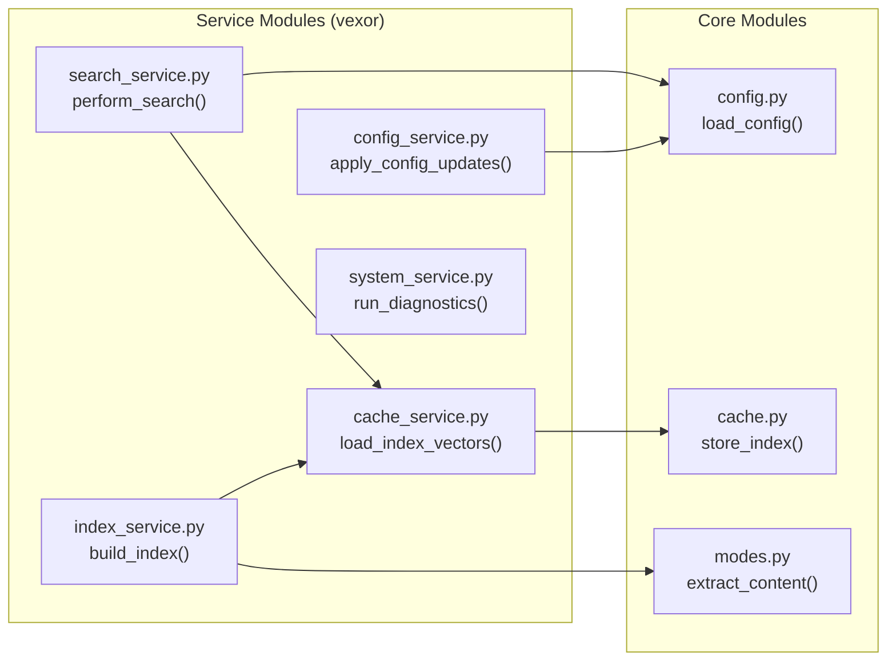

Each service module has a focused responsibility:

- **search_service.py**: Executes semantic queries, handles auto-indexing, and coordinates reranking
- **index_service.py**: Manages file scanning, content extraction, embedding generation, and cache updates
- **cache_service.py**: Validates cache currency, loads/stores index data, manages query cache
- **config_service.py**: Applies configuration updates and validates settings
- **system_service.py**: Runs diagnostics, checks for updates, manages system health

Sources: diagrams Diagram 6

### Storage Architecture

Vexor uses two persistent storage mechanisms:

**SQLite Cache** (`~/.vexor/index.db`)

The cache database uses a normalized schema to store embeddings and metadata:

| Table | Purpose |
|-------|---------|
| `index_metadata` | Index configuration (path, mode, root directory, file count) |
| `indexed_chunk` | File chunks with metadata (file path, hash, timestamp) |
| `chunk_embedding` | Embedding vectors as binary blobs |
| `chunk_meta` | Line numbers, preview text, and chunk-specific metadata |
| `query_cache` | Cached query embeddings per index |
| `embedding_cache` | General-purpose text embedding cache |

The cache implements a two-tier strategy: an in-memory LRU cache (2048 entries) for hot data, backed by SQLite for persistence. This design provides fast lookups while maintaining durability across sessions.

**JSON Configuration** (`~/.vexor/config.json`)

The configuration file stores user preferences:
- Provider settings (API keys, base URLs, model names)
- Indexing parameters (mode, concurrency, batch size)
- Reranking configuration
- Auto-indexing behavior

Configuration can be modified via `vexor config` commands or programmatically through the Python API.

Sources: diagrams Diagram 4, [README.md:148-149]()

### Provider System

Vexor supports five embedding provider types, each implemented as a separate module in [vexor/providers/]():

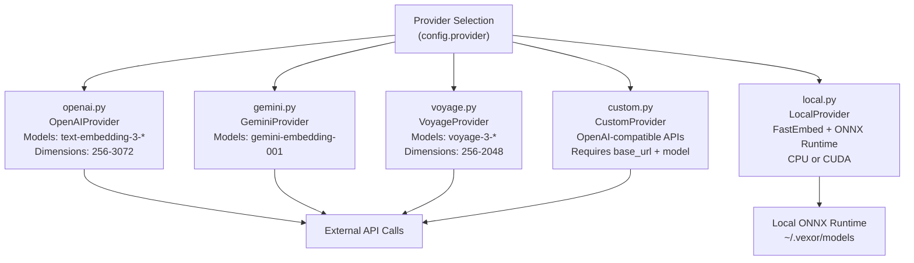

**Provider Selection Logic**:
- Remote providers (OpenAI, Gemini, Voyage, Custom) require API keys and make HTTP requests
- The `custom` provider enables integration with any OpenAI-compatible embedding service
- The `local` provider uses ONNX Runtime for on-device embedding, eliminating API costs and enabling offline operation
- Provider configuration is stored in `config.json` and can be changed without code modifications

Sources: [README.md:172-220](), diagrams Diagram 3

## Search Operation Flow

The following diagram traces a search operation from user input through result delivery:

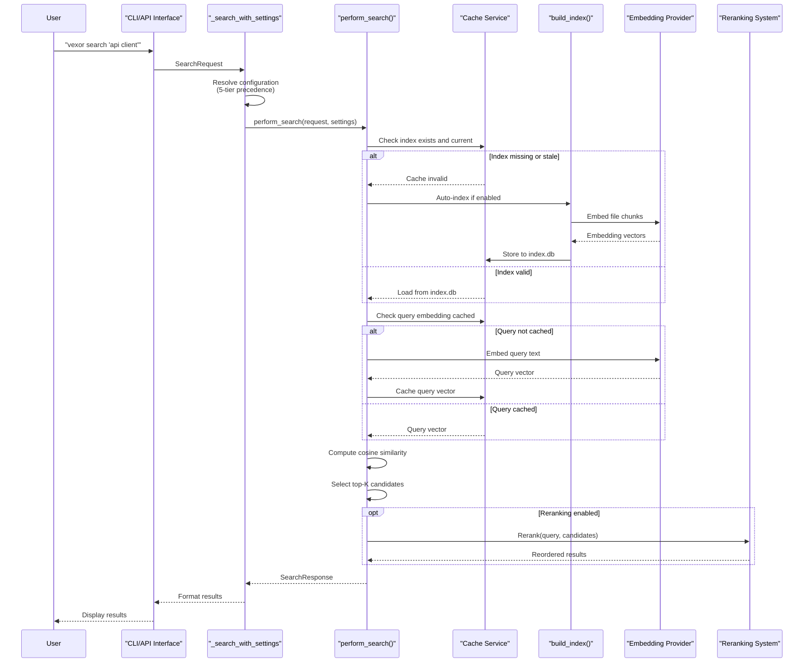

**Key Optimization Strategies**:

1. **Automatic Indexing**: When a search is performed on an unindexed directory, the system automatically builds the index (if `auto_index` is enabled)
2. **Multi-Level Caching**: Both file embeddings and query embeddings are cached, dramatically improving performance for repeated searches
3. **Incremental Updates**: Re-indexing only processes changed files; full rebuilds occur only when >50% of files change
4. **Optional Reranking**: Results can be refined using BM25 (lexical), FlashRank (neural), or remote reranking services

Sources: diagrams Diagram 2, [README.md:54-70]()

## Configuration Resolution

Vexor implements a five-tier configuration precedence system that allows flexible overrides at different scopes:

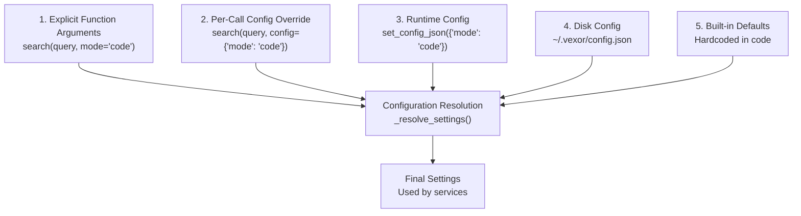

**Precedence Order** (highest to lowest):
1. Explicit function arguments (`path="."`, `mode="code"`)
2. Per-call config dictionary (`config={"provider": "local"}`)
3. In-memory runtime config set via `set_config_json()`
4. On-disk configuration in `~/.vexor/config.json`
5. Built-in defaults

This design enables use cases like:
- Temporary config changes for a single operation
- Session-scoped configuration via `VexorClient`
- Persistent preferences via `vexor config` commands
- Context-specific overrides via `config_context()`

Sources: diagrams Diagram 3

## Key Subsystems

The following table maps high-level concepts to detailed documentation pages:

| Subsystem | Purpose | Documentation |
|-----------|---------|---------------|
| **Indexing Modes** | Seven strategies for content extraction (auto, name, head, brief, full, code, outline) | [Core Concepts - Indexing Modes](#3.2) |
| **Embedding Providers** | Five backend options for generating vector embeddings | [Core Concepts - Embedding Providers](#3.3) |
| **Reranking** | Four strategies for result refinement (off, bm25, flashrank, remote) | [Core Concepts - Reranking Strategies](#3.4) |
| **Cache Management** | SQLite-based persistence for indexes and embeddings | [Core Concepts - Cache System](#3.5) |
| **CLI Commands** | Complete reference for terminal interface | [CLI Reference](#4) |
| **Python API** | Programmatic interface for custom integrations | [Python API Reference](#5) |
| **Desktop Application** | Experimental GUI for visual interaction | [Desktop Application](#6) |
| **AI Agent Skills** | Integration with Claude and Codex | [Advanced Usage - AI Agent Integration](#8.6) |

Each subsystem is documented in detail in its respective section.

Sources: JSON table of contents

## Data Directory

All Vexor data is stored under `~/.vexor/` by default:

```
~/.vexor/
├── config.json          # User configuration
├── index.db             # SQLite cache (indexes, embeddings, queries)
├── models/              # Local ONNX models (if using local provider)
└── flashrank/           # FlashRank reranker models (if enabled)
```

The data directory can be overridden programmatically via `set_data_dir()` or by setting the `VEXOR_DATA_DIR` environment variable.

Sources: [README.md:148-149](), [README.md:217]()

## Version and Installation

Vexor is distributed through multiple channels:

- **PyPI package**: `pip install vexor` (requires Python 3.9+)
- **Standalone binaries**: Platform-specific executables available from GitHub releases
- **Optional extras**: `vexor[local]`, `vexor[local-cuda]`, `vexor[flashrank]` for additional features

The current version is defined in [vexor/__init__.py:33]() as `__version__ = "0.23.1rc1"`.

For detailed installation instructions, see [Getting Started - Installation](#2.1).

Sources: [README.md:7-43](), [vexor/__init__.py:33]()

---

# Page: What is Vexor

# What is Vexor

<details>
<summary>Relevant source files</summary>

The following files were used as context for generating this wiki page:

- [README.md](README.md)

</details>


This page defines Vexor as a semantic search engine for files and code, explains its primary use cases, and identifies its target users. For specific features, see [Key Features](#1.2). For architectural details, see [System Architecture](#1.3).

---

## Definition

Vexor is a semantic search engine that builds reusable, persistent vector indexes over files and code. It accepts natural-language queries and returns ranked file matches based on semantic similarity rather than lexical pattern matching.

The system embeds both query text and file content into a shared vector space using configurable embedding providers (OpenAI, Gemini, Voyage AI, custom OpenAI-compatible endpoints, or local ONNX models). Similarity scoring uses cosine distance. Optional reranking refines results using BM25 lexical scoring, FlashRank neural reranking, or remote HTTP reranking services.

The canonical workflow:

```bash
vexor "api client config"  # searches current directory
```

This command triggers the `perform_search()` function in `vexor/services/search_service.py`, which embeds the query via `VexorSearcher.embed()`, loads cached vectors from `~/.vexor/index.db` via `CacheManager`, computes cosine similarity, and optionally reranks results before returning a `SearchResponse` object.

Sources: [README.md:18-36](), [vexor/services/search_service.py:1-200]()
</thinking>

---

## Primary Use Cases

Vexor solves the semantic file discovery problem where traditional text-based search tools (`grep`, `find`, `rg`) fail.

**Use Case 1: Human Developers**

Scenario: A developer remembers what a file implements but not its name or location.

Example: "Where is the function that parses API configuration?" Instead of manually traversing directories or writing complex regex patterns, the developer uses semantic search to find the target file based on its functional description.

**Use Case 2: AI Coding Assistants**

Scenario: An AI agent (Claude Code, Codex, etc.) needs to locate relevant files in a codebase to complete a task but cannot efficiently enumerate and read all files.

Example: The agent receives a task to "add rate limiting to the API client." It uses Vexor to semantically search for files related to "API client request handling" and receives ranked results without reading the entire codebase.

Vexor exposes an agent skill specification in `plugins/vexor/skills/vexor-cli/SKILL.md` that defines how agents should invoke the CLI tool.

| Search Type | Traditional Tools | Vexor Semantic Search |
|---|---|---|
| **Lexical match** | `grep "config_loader"` finds exact token | Finds files based on functional meaning |
| **Recall** | Requires knowledge of exact identifiers | Returns matches for synonyms and related concepts |
| **Agent integration** | Must read entire directory tree | Single search call returns ranked candidates |

Sources: [README.md:33-37](), [plugins/vexor/skills/vexor-cli/SKILL.md:1-40]()

---

## Target Users

Vexor targets two distinct user populations:

**1. Human Developers**

- Primary interface: CLI tool (`vexor/cli.py`) or Python API (`vexor/__init__.py`)
- Typical workflow: Interactive search during development, code review, or debugging
- Configuration: Managed via `~/.vexor/config.json` using `vexor config` commands

**2. AI Coding Assistants**

- Primary interface: CLI tool invoked as an agent skill
- Typical workflow: Autonomous file discovery during task execution
- Configuration: Inherits user's `~/.vexor/config.json` or accepts per-call overrides
- Example agents: Claude Code, Codex (both support skill installation via `vexor install --skills`)

The desktop GUI (`gui/`) exists but is explicitly marked experimental and not actively maintained. Production users should prefer the CLI or Python API.

Sources: [README.md:33-37](), [README.md:80-87](), [README.md:107-116]()

---

## System Entry Points

Vexor exposes three primary interfaces that all delegate to the same service layer:

| Interface | Entry Module | Primary Functions | Status |
|---|---|---|---|
| **CLI** | `vexor/cli.py` | `search_command()`, `index_command()`, `config_command()` | Stable |
| **Python API** | `vexor/__init__.py`, `vexor/api.py` | `search()`, `index()`, `index_in_memory()` | Stable |
| **Desktop GUI** | `gui/src/` (Electron + Vue) | IPC calls to CLI via `preload.js` | Experimental |
| **Agent Skill** | `plugins/vexor/skills/vexor-cli/` | Shell invocation of CLI commands | Stable |

All interfaces call functions in `vexor/services/` that implement core business logic.

**CLI-to-Service Mapping**

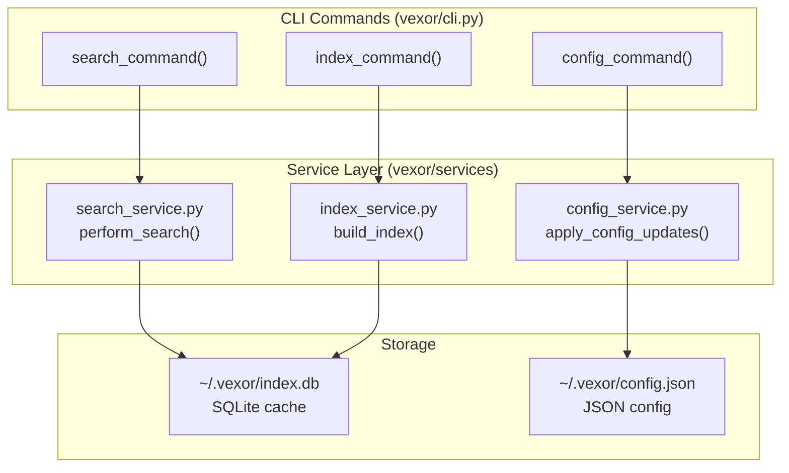

Sources: [vexor/cli.py:1-500](), [vexor/services/search_service.py:1-200](), [vexor/services/index_service.py:1-300](), [vexor/services/config_service.py:1-100]()

**Python API-to-Service Mapping**

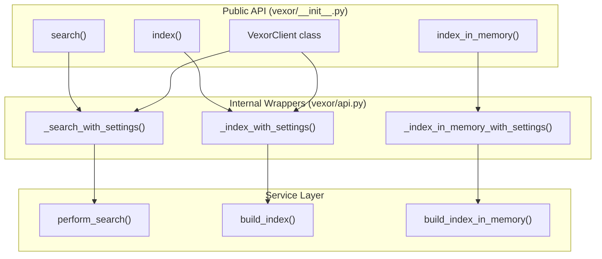

Sources: [vexor/__init__.py:1-150](), [vexor/api.py:1-250](), [vexor/services/search_service.py:1-200](), [vexor/services/index_service.py:1-300]()

---

## Three Access Points

The same core engine is exposed through three interfaces. All three funnel into the same set of services in `vexor/services/`.

**Interfaces and their entry points:**

| Interface | Entry Point | Status |
|---|---|---|
| CLI | `vexor/cli.py` (`typer` app) | Stable |
| Python API | `vexor/api.py`, `vexor/__init__.py` | Stable |
| Desktop GUI | `gui/` (Electron + Vue) | Experimental |
| AI Agent Skill | `plugins/vexor/skills/vexor-cli/` | Stable |

The desktop app is explicitly labeled experimental and not actively maintained. For production use, the CLI is preferred.

Sources: [README.md:80-87]()


---

## Core Pipeline: Indexing and Searching

Vexor implements a two-phase pipeline: **indexing** (build vector database) and **searching** (query and rank).

**Phase 1: Indexing (`build_index()` in `vexor/services/index_service.py`)**

1. **File Discovery**: Scan target directory respecting `.gitignore`, filtering by extensions and exclude patterns
2. **Content Extraction**: Process each file using a mode-specific extractor from `vexor/modes/`:
   - `auto`: Routes by file type (`.py`/`.js`/`.ts` → `code`, `.md` → `outline`, etc.)
   - `name`: Embed filename only (fastest)
   - `head`: Extract first N lines
   - `full`: Chunk entire content
   - `code`: AST-aware chunking for Python/JS/TS (preserves function/class boundaries)
   - `outline`: Markdown heading hierarchy
3. **Batch Embedding**: Group chunks and call embedding provider (configured in `~/.vexor/config.json`)
4. **Storage**: Write vectors to SQLite cache at `~/.vexor/index.db` via `CacheManager.store_index()`

**Phase 2: Searching (`perform_search()` in `vexor/services/search_service.py`)**

1. **Query Embedding**: Call `VexorSearcher.embed(query)` using configured provider
2. **Vector Retrieval**: Load cached vectors via `CacheManager.load_index_vectors()`
3. **Similarity Scoring**: Compute cosine distance between query vector and all indexed vectors
4. **Top-K Selection**: Select candidates (default: 5 results, configurable via `--top`)
5. **Optional Reranking**: If configured, rerank via:
   - `bm25`: Lexical scoring using `BM25Reranker` in `vexor/rerankers/bm25.py`
   - `flashrank`: Neural reranking using `FlashRankReranker` in `vexor/rerankers/flashrank.py`
   - `remote`: HTTP reranking via `RemoteReranker` in `vexor/rerankers/remote.py`
6. **Response Construction**: Return `SearchResponse` containing list of `SearchResult` objects

**Indexing Pipeline Diagram**

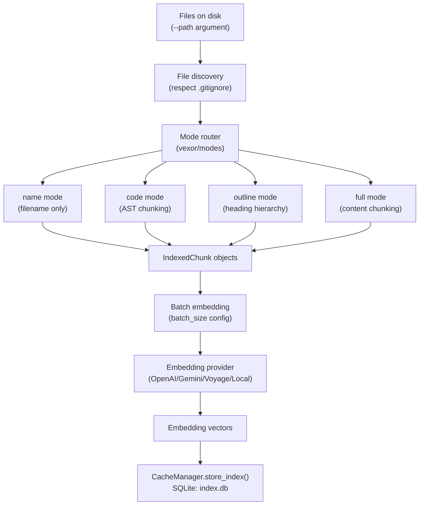

Sources: [vexor/services/index_service.py:1-300](), [vexor/modes/:1-500](), [vexor/cache.py:1-400]()

**Search Pipeline Diagram**

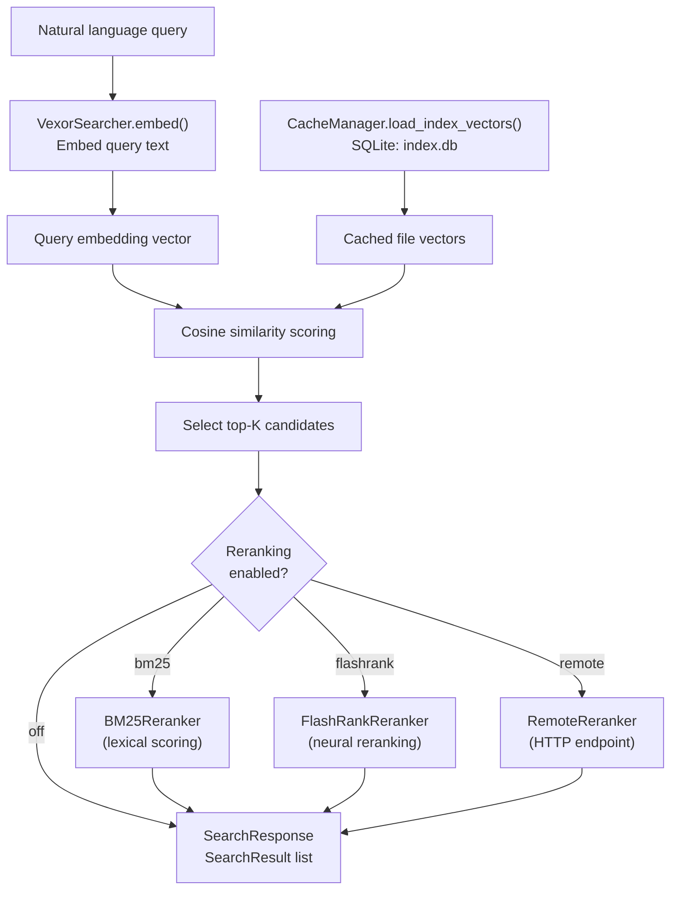

Sources: [vexor/services/search_service.py:1-200](), [vexor/rerankers/:1-400](), [vexor/cache.py:1-400]()

---

## Storage and Configuration

Vexor persists data in two locations under `~/.vexor/`:

**Index Cache (`~/.vexor/index.db`)**

SQLite database managed by `CacheManager` class in `vexor/cache.py`. Contains:

| Table | Purpose | Key Columns |
|---|---|---|
| `index_metadata` | Index configuration and root path | `id`, `config_hash`, `absolute_root` |
| `indexed_chunk` | File chunk metadata | `id`, `index_id`, `file_path`, `mode` |
| `chunk_embedding` | Vector data (pickled numpy arrays) | `chunk_id`, `embedding_vector` |
| `chunk_meta` | Line numbers and preview text | `chunk_id`, `start_line`, `end_line`, `preview` |
| `query_cache` | Cached query embeddings per index | `index_id`, `query_text`, `embedding_vector` |
| `embedding_cache` | General text embedding cache | `text_hash`, `embedding_vector` |

The cache key is computed by `compute_config_hash()` in `vexor/cache.py` from parameters: `absolute_root`, `mode`, `include_hidden`, `no_recursive`, `no_respect_gitignore`, `extensions`, `exclude_patterns`.

Incremental updates: Re-running `build_index()` only re-embeds files with modified `mtime`. If >50% of files change, a full rebuild is triggered.

**Configuration File (`~/.vexor/config.json`)**

JSON file managed by functions in `vexor/config.py`. Controls:

- Embedding provider: `provider` (openai/gemini/voyageai/custom/local)
- Model selection: `model` (e.g., `text-embedding-3-small`)
- Authentication: `api_key` (or environment variables)
- Reranking: `rerank` (off/bm25/flashrank/remote)
- Concurrency: `batch_size`, `embed_concurrency`, `extract_concurrency`
- Dimensions: `embedding_dimensions` (optional, provider-specific)

Configuration precedence (highest to lowest):
1. Explicit function arguments
2. Per-call config override
3. In-memory runtime config (`_RUNTIME_CONFIG`)
4. On-disk `config.json`
5. Built-in defaults

Sources: [vexor/cache.py:1-400](), [vexor/config.py:1-200](), [README.md:237-249]()

---

## Relationship to Other Pages

- For a complete list of capabilities: [Key Features](#1.2)
- For the full system architecture diagram: [System Architecture](#1.3)
- For Python version and dependency requirements: [System Requirements](#1.4)
- For the CLI command reference: [CLI Reference](#4)
- For the Python API reference: [Python API Reference](#5)
- For agent integration details: [AI Agent Integration](#8.6)

---

# Page: Key Features

# Key Features

<details>
<summary>Relevant source files</summary>

The following files were used as context for generating this wiki page:

- [README.md](README.md)
- [plugins/vexor/.claude-plugin/plugin.json](plugins/vexor/.claude-plugin/plugin.json)
- [vexor/__init__.py](vexor/__init__.py)

</details>


This page catalogs Vexor's primary capabilities and architectural features. It provides an overview of what the system can do and how major components relate to each other. For detailed usage instructions, see [Quick Start - CLI](#2.2) and [Quick Start - Python API](#2.3). For in-depth explanations of individual concepts, see [Core Concepts](#3).

## Feature Overview Table

| Feature Category | Description | Configuration | Primary Implementation |
|-----------------|-------------|---------------|----------------------|
| **Reusable Index Cache** | SQLite-backed persistent vector storage | `~/.vexor/index.db` | [vexor/cache.py]() |
| **Embedding Providers** | OpenAI, Gemini, Voyage, Custom API, Local (fastembed) | `--provider`, `--model` | [vexor/search.py:54-143]() |
| **Index Modes** | auto, name, head, brief, full, code, outline | `--mode` | [vexor/services/index_service.py:42-185]() |
| **Reranking** | off, bm25, flashrank, remote | `--rerank` | [vexor/services/search_service.py:125-203]() |
| **Multi-Interface Access** | CLI (Typer), Python API, Desktop App (Electron) | - | [vexor/cli.py](), [vexor/api.py](), [gui/]() |
| **AI Agent Integration** | Skills for Claude Code, Codex | `vexor install --skills` | [plugins/vexor/skills/]() |
| **Incremental Updates** | Only re-embed changed files | Automatic | [vexor/cache.py:468-565]() |
| **Offline Operation** | Local models via fastembed + optional CUDA | `vexor local --setup` | [vexor/search.py:91-143]() |
| **Configuration Hierarchy** | Env vars → config file → runtime overrides | `~/.vexor/config.json` | [vexor/config.py]() |
| **Performance Tuning** | Parallel extraction, batching, caching | `--embed-concurrency`, `--batch-size` | [vexor/config.py:28-31]() |

**Sources:** [README.md:1-304](), [vexor/config.py:1-710]()

## Core Feature Architecture

The diagram below bridges each major feature domain to the specific code entities that implement it.

**Feature-to-Code Bridge:**

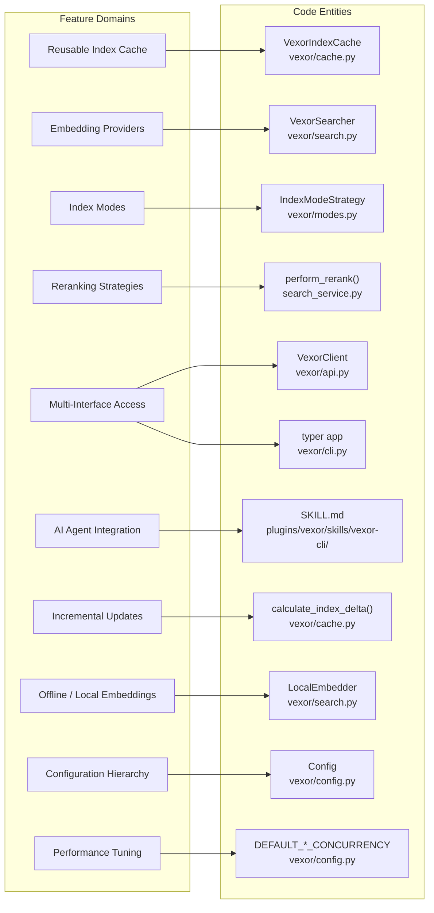

**Sources:** [vexor/cache.py:1-751](), [vexor/search.py:1-487](), [vexor/modes.py:1-200](), [vexor/services/index_service.py:1-405](), [vexor/services/search_service.py:1-318](), [vexor/cli.py:1-1200](), [vexor/api.py:1-350]()

---

## 1. Reusable Index Cache

Vexor persists all indexed vectors and metadata in `~/.vexor/index.db`, a SQLite database with WAL mode enabled. Once a directory is indexed, subsequent searches reuse the cached embeddings without re-processing files or calling the embedding provider.

### Cache Structure

The `VexorIndexCache` class ([vexor/cache.py:169-751]()) owns all cache operations. The diagram shows the SQLite tables and the in-memory layer it manages.

**VexorIndexCache data model:**

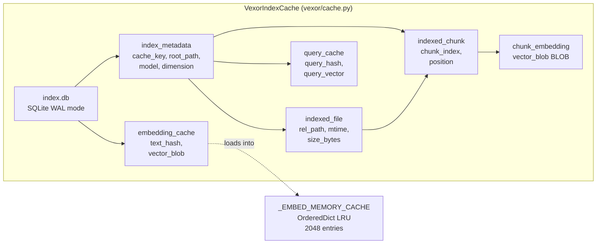

**Key Classes:**
- `VexorIndexCache` ([vexor/cache.py:169-751]()): Manages all cache operations
- `IndexMetadata` ([vexor/cache.py:28-42]()): Represents a cached index
- `IndexedEntry` ([vexor/cache.py:44-59]()): Represents a file/chunk with embedding

**Cache Key Derivation:**
The cache key is computed from indexing parameters via `compute_cache_key()` ([vexor/cache.py:62-112]()):
```python
# Key components: path, mode, include_hidden, no_recursive, 
# no_respect_gitignore, extensions, exclude_patterns
```

**Sources:** [vexor/cache.py:1-751](), Diagram 4 from high-level architecture

---

## 2. Multiple Embedding Providers

Vexor abstracts embedding generation through the `VexorSearcher` class ([vexor/search.py:146-487]()), supporting five provider types:

| Provider | Configuration | Base URL | Authentication | Offline |
|----------|---------------|----------|----------------|---------|
| `openai` | `DEFAULT_PROVIDER` | `api.openai.com` | `OPENAI_API_KEY` or `VEXOR_API_KEY` | ❌ |
| `gemini` | `--provider gemini` | `generativelanguage.googleapis.com` | `GOOGLE_GENAI_API_KEY` or `VEXOR_API_KEY` | ❌ |
| `voyageai` | `--provider voyageai` | `VOYAGE_BASE_URL` ([vexor/config.py:36]()) | `VOYAGE_API_KEY` or `VEXOR_API_KEY` | ❌ |
| `custom` | `--provider custom --base-url URL` | User-specified | `VEXOR_API_KEY` or `OPENAI_API_KEY` | ❌ |
| `local` | `--provider local` | N/A | None | ✅ |

### Provider Resolution Flow

**`VexorSearcher` backend selection — natural language to code entity bridge:**

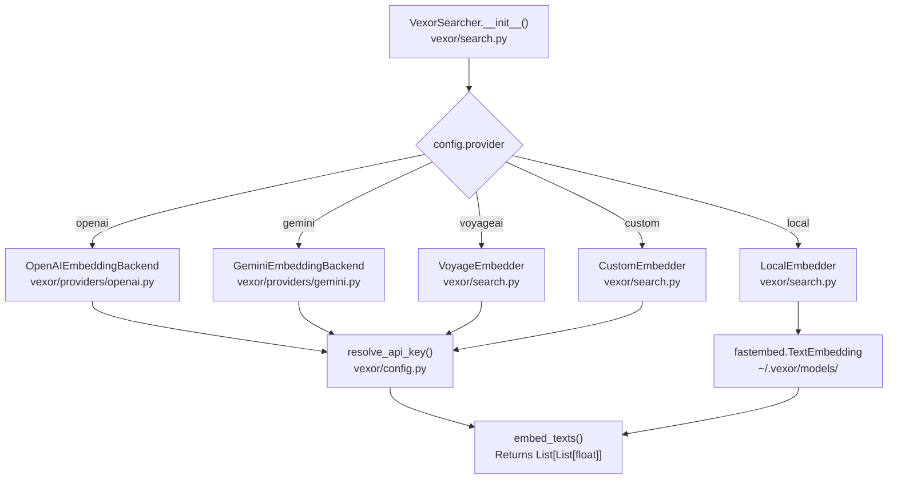

**Default Models:**
- OpenAI: `text-embedding-3-small` ([vexor/config.py:24]())
- Gemini: `gemini-embedding-001` ([vexor/config.py:25]())
- Voyage: `voyage-3-large` ([vexor/config.py:26]())
- Local: `intfloat/multilingual-e5-small` ([vexor/config.py:27]())

**Sources:** [vexor/search.py:146-487](), [vexor/config.py:24-51](), [README.md:172-221]()

---

## 3. Index Modes

Index modes control content extraction and chunking strategies. Implemented in `extract_content()` ([vexor/services/index_service.py:42-185]()):

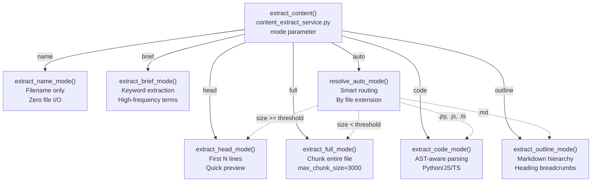

### Mode Implementation Details

| Mode | Function | File Path | Key Feature |
|------|----------|-----------|-------------|
| `auto` | `resolve_auto_mode()` | [vexor/services/index_service.py:189-213]() | Routes by extension and size |
| `name` | `extract_name_mode()` | [vexor/services/index_service.py:216-224]() | Returns `[filename]` |
| `head` | `extract_head_mode()` | [vexor/services/index_service.py:227-244]() | Extracts first snippet |
| `brief` | `extract_brief_mode()` | [vexor/services/index_service.py:247-280]() | TF-IDF-style keyword extraction |
| `full` | `extract_full_mode()` | [vexor/services/index_service.py:283-309]() | Chunks by `max_chunk_size=3000` |
| `code` | `extract_code_mode()` | [vexor/services/index_service.py:312-345]() | AST parsing via `tree-sitter` |
| `outline` | `extract_outline_mode()` | [vexor/services/index_service.py:348-405]() | Markdown heading hierarchy |

**Sources:** [vexor/services/index_service.py:42-405](), [README.md:222-235]()

---

## 4. Reranking Strategies

After initial cosine similarity ranking, results can be reordered using secondary rankers. Implemented in `perform_rerank()` ([vexor/services/search_service.py:125-203]()):

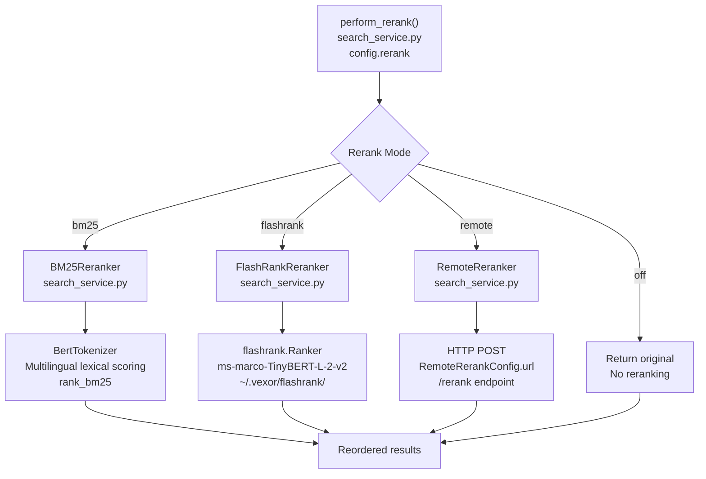

### Reranker Configuration

| Reranker | Default | Configuration | Dependencies |
|----------|---------|---------------|--------------|
| `off` | ✅ | `vexor config --rerank off` | None |
| `bm25` | ❌ | `vexor config --rerank bm25` | Built-in |
| `flashrank` | ❌ | `vexor config --rerank flashrank --set-flashrank-model MODEL` | `pip install "vexor[flashrank]"` |
| `remote` | ❌ | `vexor config --rerank remote --set-remote-rerank-url URL` | External API |

**Candidate Selection:** Top-K candidates for reranking: `clamp(int(top * 2), 20, 150)` ([README.md:159]())

**FlashRank Models:**
- Default: `ms-marco-TinyBERT-L-2-v2` ([vexor/config.py:34]())
- Multilingual: `ms-marco-MultiBERT-L-12` (recommended for CJK content)

**Sources:** [vexor/services/search_service.py:125-318](), [README.md:156-171](), [vexor/config.py:33-38]()

---

## 5. Multi-Interface Access

Vexor exposes the same core functionality through three interfaces:

### Interface Architecture

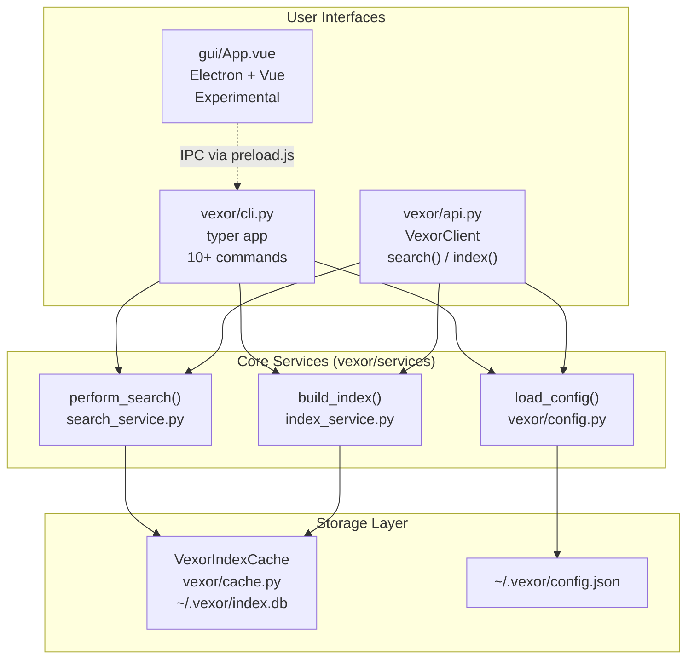

### Interface Capabilities

| Feature | CLI | Python API | Desktop App |
|---------|-----|------------|-------------|
| **Search** | `vexor search QUERY` | `vexor.search(query)` | GUI search box |
| **Index** | `vexor index --path .` | `vexor.index(path)` | Auto-index |
| **Config** | `vexor config --show` | `config_context()` | Settings panel |
| **In-Memory** | `--no-cache` flag | `index_in_memory()` | ❌ |
| **Session Scope** | N/A | `VexorClient()` | N/A |
| **Output Formats** | `--format rich/porcelain/porcelain-z` | Python objects | Rich display |

**Key Classes:**
- CLI: `app = typer.Typer()` ([vexor/cli.py:54]())
- Python API: `VexorClient` ([vexor/api.py:37-202]()), `InMemoryIndex` ([vexor/api.py:205-350]())

**Sources:** [vexor/cli.py:1-1200](), [vexor/api.py:1-350](), [gui/](), [README.md:89-105]()

---

## 6. AI Agent Integration

Vexor includes pre-built skills for AI coding assistants. The skill definitions expose the CLI as a tool that agents can invoke:

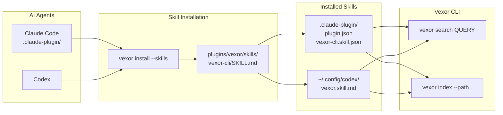

**Installation Commands:**
- Claude: `vexor install --skills claude` → Installs to `.claude-plugin/`
- Codex: `vexor install --skills codex` → Installs to `~/.config/codex/`

**Skill Definition:** [plugins/vexor/skills/vexor-cli/SKILL.md]()

**Agent Workflow:**
1. Agent receives task requiring file search
2. Agent invokes `vexor search "semantic query"` as a tool
3. Vexor returns ranked file paths with similarity scores
4. Agent uses results to locate relevant files

**Sources:** [README.md:106-116](), [plugins/vexor/skills/]()

---

## 7. Incremental Updates

When re-running `vexor index`, Vexor computes a delta between cached and current filesystem state. Only changed files are re-embedded.

### Delta Calculation Flow

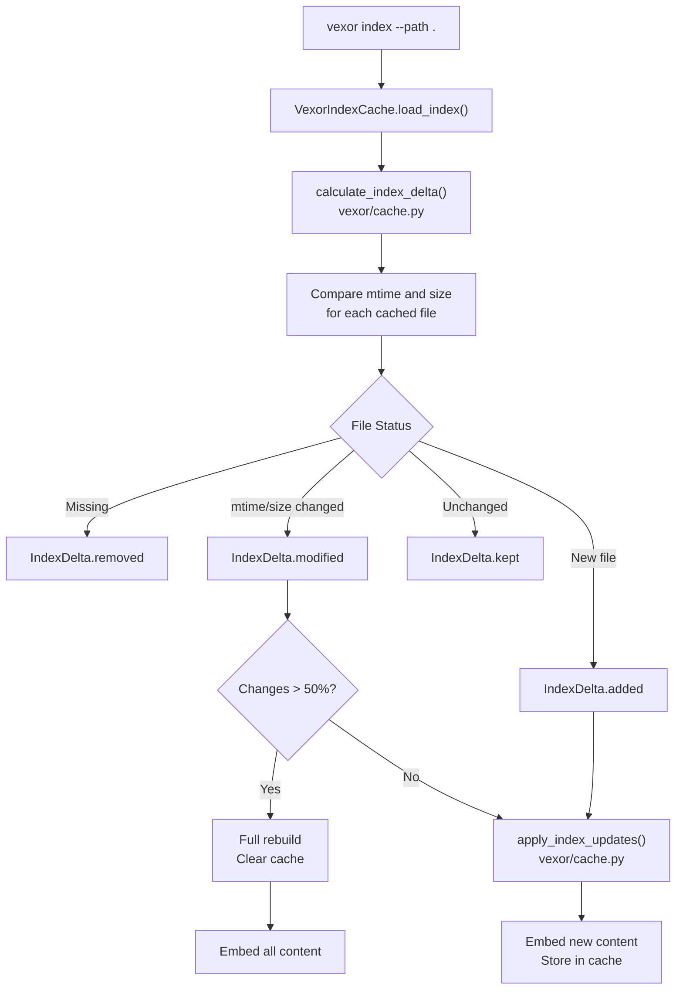

**Key Functions:**
- `calculate_index_delta()` ([vexor/cache.py:468-565]()): Computes file changes
- `apply_index_updates()` ([vexor/cache.py:567-661]()): Applies delta to cache

**Threshold:** If `>50%` of files changed, triggers full rebuild ([README.md:248]())

**Sources:** [vexor/cache.py:468-661](), [README.md:248-249]()

---

## 8. Offline Operation

The `local` provider enables fully offline semantic search using fastembed ([https://github.com/qdrant/fastembed]()):

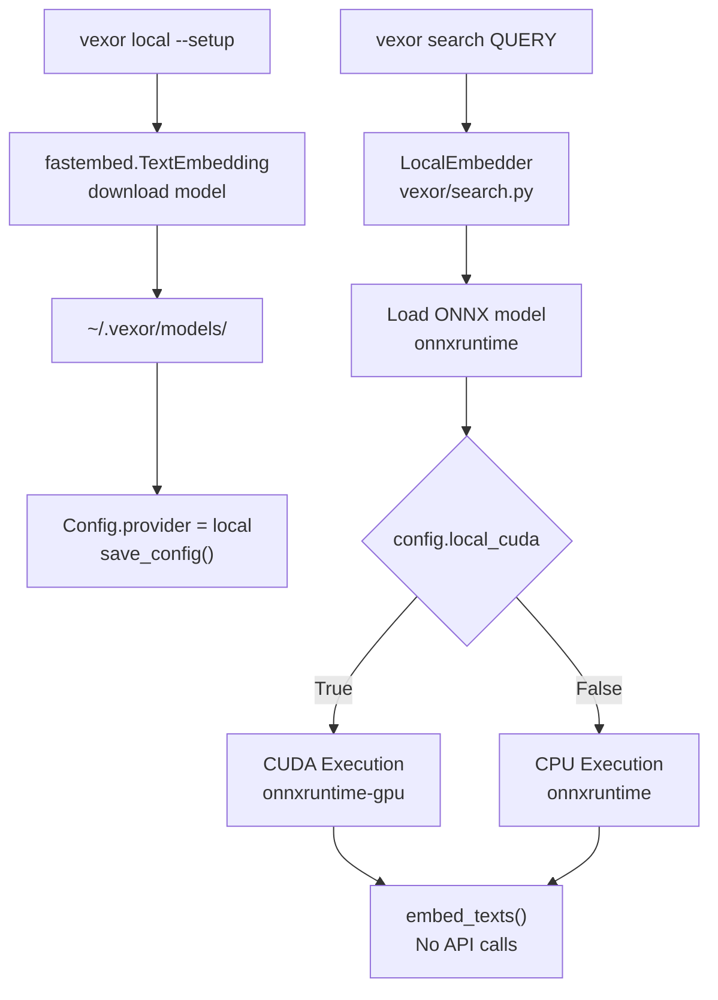

**Setup Commands:**
- CPU: `pip install "vexor[local]"` then `vexor local --setup`
- GPU: `pip install "vexor[local-cuda]"` then `vexor local --setup --cuda`

**Runtime Toggle:**
- Enable CUDA: `vexor local --cuda`
- Disable CUDA: `vexor local --cpu`

**Model Storage:** `~/.vexor/models/` (clear with `vexor local --clean-up`)

**Sources:** [vexor/search.py:349-487](), [README.md:198-221](), [vexor/config.py:191-193]()

---

## 9. Configuration Hierarchy

Vexor resolves configuration from five sources with strict precedence:

### Configuration Resolution

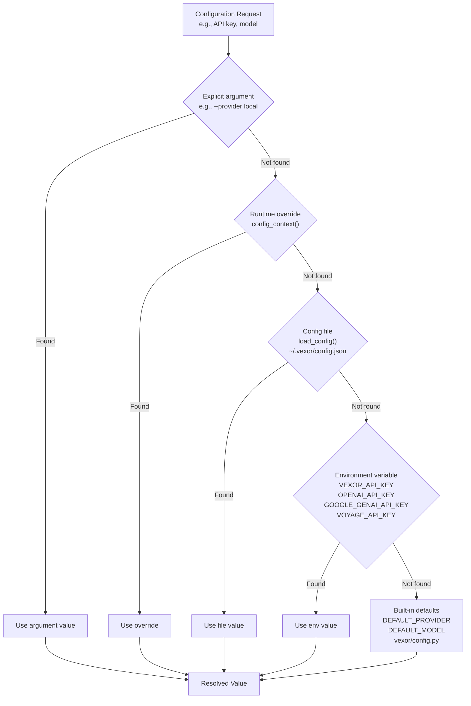

**Precedence Order:**
1. **Explicit arguments:** `vexor search --provider local`
2. **Runtime overrides:** `config_context(provider="local")`
3. **Config file:** `~/.vexor/config.json`
4. **Environment variables:** `VEXOR_API_KEY`, `OPENAI_API_KEY`, `GOOGLE_GENAI_API_KEY`, `VOYAGE_API_KEY`
5. **Built-in defaults:** `DEFAULT_PROVIDER = "openai"` ([vexor/config.py:32]())

**Configuration Functions:**
- Load: `load_config()` ([vexor/config.py:123-149]())
- Save: `save_config(config)` ([vexor/config.py:151-189]())
- Override: `config_context()` (Python API only)
- Update: `update_config_from_json(payload)` ([vexor/config.py:224-231]())

**Sources:** [vexor/config.py:1-710](), Diagram 3 from high-level architecture

---

## 10. Performance Optimizations

Vexor includes several performance features for large codebases:

### Parallelization Architecture

| Component | Configuration | Default | Implementation |
|-----------|---------------|---------|----------------|
| **Embedding Concurrency** | `--embed-concurrency N` | `4` | [vexor/config.py:29]() |
| **Extraction Concurrency** | `--extract-concurrency N` | `min(4, cpu_count)` | [vexor/config.py:30]() |
| **Extraction Backend** | `--extract-backend auto/thread/process` | `auto` | [vexor/config.py:31]() |
| **Batch Size** | `--batch-size N` | `64` | [vexor/config.py:28]() |
| **In-Memory Cache** | N/A (automatic) | `2048 entries` | [vexor/cache.py:689-707]() |

### Optimization Flow

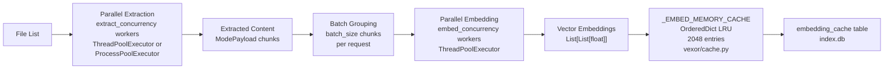

**Auto Backend Selection:**
- `auto`: Uses `process` for local provider, `thread` otherwise ([vexor/services/index_service.py:31-40]())
- `thread`: Python `ThreadPoolExecutor` (I/O-bound)
- `process`: Python `ProcessPoolExecutor` (CPU-bound)

**Batch Processing:**
- Setting `batch_size=0` sends all texts in a single request
- Non-zero values group texts into batches of N

**In-Memory Cache:**
- LRU eviction policy via `OrderedDict` ([vexor/cache.py:689-707]())
- Thread-safe with `threading.Lock` ([vexor/cache.py:686]())
- Falls back to SQLite `embedding_cache` table on miss

**Sources:** [vexor/config.py:28-31](), [vexor/cache.py:686-707](), [vexor/services/index_service.py:31-40]()

---

# Page: System Architecture

# System Architecture

<details>
<summary>Relevant source files</summary>

The following files were used as context for generating this wiki page:

- [README.md](README.md)
- [docs/api/python.md](docs/api/python.md)
- [tests/unit/test_api.py](tests/unit/test_api.py)
- [tests/unit/test_search_service.py](tests/unit/test_search_service.py)
- [vexor/api.py](vexor/api.py)
- [vexor/cli.py](vexor/cli.py)
- [vexor/services/search_service.py](vexor/services/search_service.py)

</details>


This document describes Vexor's internal architecture, explaining how the CLI, Python API, and desktop application delegate to a shared service layer that manages indexing, search, caching, and provider integrations. For conceptual explanations of semantic search and indexing modes, see [Core Concepts](#3). For detailed service implementations, see [Architecture Deep Dive](#7).

---

## Overview

Vexor implements a layered architecture where multiple user-facing interfaces converge on a unified service layer. The system stores persistent state in two locations: a SQLite database ([vexor/cache.py:1-800]()) for indexes and embeddings, and a JSON configuration file ([vexor/config.py:1-500]()) for settings. All interfaces share the same configuration resolution logic and cache management strategies.

**Sources:** [README.md:1-304](), [vexor/cli.py:1-100](), [vexor/api.py:1-100]()

---

## Layer Architecture

```mermaid
graph TB
    subgraph "Interface Layer"
        CLI["CLI<br/>vexor/cli.py<br/>Typer app"]
        PythonAPI["Python API<br/>vexor/api.py<br/>vexor/__init__.py"]
        GUI["Desktop App<br/>Electron + IPC"]
    end
    
    subgraph "Service Layer"
        SearchSvc["search_service.py<br/>perform_search()"]
        IndexSvc["index_service.py<br/>build_index()"]
        ConfigSvc["config_service.py<br/>apply_config_updates()"]
        CacheSvc["cache_service.py<br/>is_cache_current()"]
        SystemSvc["system_service.py<br/>diagnostics"]
    end
    
    subgraph "Provider Layer"
        OpenAIProvider["providers/openai.py<br/>OpenAIEmbedding"]
        GeminiProvider["providers/gemini.py<br/>GeminiEmbedding"]
        VoyageProvider["providers/voyageai.py<br/>VoyageAIEmbedding"]
        LocalProvider["providers/local.py<br/>LocalEmbeddingBackend"]
        CustomProvider["providers/custom.py<br/>CustomEmbedding"]
    end
    
    subgraph "Storage Layer"
        Cache["cache.py<br/>SQLite DB<br/>~/.vexor/index.db"]
        Config["config.py<br/>JSON File<br/>~/.vexor/config.json"]
    end
    
    CLI --> SearchSvc
    CLI --> IndexSvc
    CLI --> ConfigSvc
    CLI --> SystemSvc
    
    PythonAPI --> SearchSvc
    PythonAPI --> IndexSvc
    PythonAPI --> ConfigSvc
    
    GUI --> CLI
    
    SearchSvc --> CacheSvc
    IndexSvc --> CacheSvc
    
    SearchSvc --> OpenAIProvider
    SearchSvc --> GeminiProvider
    SearchSvc --> VoyageProvider
    SearchSvc --> LocalProvider
    SearchSvc --> CustomProvider
    
    IndexSvc --> OpenAIProvider
    IndexSvc --> GeminiProvider
    IndexSvc --> VoyageProvider
    IndexSvc --> LocalProvider
    IndexSvc --> CustomProvider
    
    CacheSvc --> Cache
    ConfigSvc --> Config
    
    SearchSvc --> Cache
    IndexSvc --> Cache
```

**Diagram 1: Layered Architecture with Code Entities**

Vexor's architecture consists of four layers:

1. **Interface Layer**: User-facing entry points that parse input and delegate to services
2. **Service Layer**: Business logic for indexing, search, configuration, and cache management
3. **Provider Layer**: Abstraction over different embedding APIs and local models
4. **Storage Layer**: Persistent state in SQLite and JSON

**Sources:** [vexor/cli.py:1-100](), [vexor/api.py:1-100](), [vexor/services/search_service.py:1-50](), [vexor/services/index_service.py:1-50]()

---

## Interface Layer

### CLI Implementation

The CLI is implemented in [vexor/cli.py]() using Typer. The `DefaultSearchGroup` class ([vexor/cli.py:115-147]()) treats unknown subcommands as search queries, allowing `vexor "query"` as shorthand for `vexor search "query"`.

| Command | Function | Description |
|---------|----------|-------------|
| `search` | [cli.py:348-529]() | Execute semantic search with auto-indexing |
| `index` | [cli.py:531-711]() | Build or refresh cached index |
| `config` | [cli.py:726-1048]() | Manage `~/.vexor/config.json` settings |
| `init` | [cli.py:713-723]() | Run interactive setup wizard |
| `doctor` | [cli.py:1283-1368]() | System diagnostics |
| `update` | [cli.py:1370-1467]() | Check/upgrade CLI version |
| `local` | [cli.py:1050-1177]() | Manage local embedding models |

**Sources:** [vexor/cli.py:149-154](), [vexor/cli.py:348-711]()

### Python API Implementation

The Python API is exposed through [vexor/api.py]() and re-exported in [vexor/__init__.py](). It provides both module-level functions and a session-based `VexorClient` class.

```mermaid
graph TD
    ModuleLevel["Module-level functions<br/>search() index()<br/>index_in_memory()<br/>clear_index()"]
    Client["VexorClient<br/>Session-based API"]
    ContextMgr["config_context()<br/>Scoped configuration"]
    
    ModuleLevel --> Wrappers["Internal wrappers<br/>_search_with_settings()<br/>_index_with_settings()"]
    Client --> Wrappers
    ContextMgr --> Client
    
    Wrappers --> RuntimeConfig["_RUNTIME_CONFIG<br/>Global override"]
    Wrappers --> ClientConfig["client._runtime_config<br/>Instance override"]
    Wrappers --> DirContext["_data_dir_context()<br/>config_dir_context()<br/>cache_dir_context()"]
    
    Wrappers --> Services["Service layer<br/>perform_search()<br/>build_index()"]
```

**Diagram 2: Python API Architecture**

The `VexorClient` class ([vexor/api.py:209-485]()) provides isolated configuration state without mutating global config. The `config_context` function ([vexor/api.py:487-509]()) creates a temporary client with scoped configuration.

**Sources:** [vexor/api.py:1-100](), [vexor/api.py:209-485](), [vexor/api.py:487-509]()

### Desktop Application

The desktop application is an Electron app that communicates with the CLI via subprocess invocation. It provides a GUI wrapper around CLI commands but does not implement independent business logic.

**Sources:** [README.md:80-88]()

---

## Service Layer

### Search Service

The `perform_search` function ([vexor/services/search_service.py:358-708]()) implements the complete search pipeline:

```mermaid
graph TB
    Start["perform_search(SearchRequest)"]
    CheckTemp{"temporary_index<br/>or no_cache?"}
    LoadIndex["load_index_vectors()<br/>from cache.py"]
    IndexMissing{"Index exists?"}
    AutoIndex{"auto_index<br/>enabled?"}
    BuildIndex["build_index()"]
    CheckStale["is_cache_current()"]
    Stale{"Cache stale?"}
    FilterIndex["Filter by directory,<br/>extensions, exclude_patterns"]
    
    EmbedQuery["VexorSearcher.embed_texts()<br/>Generate query vector"]
    CheckQueryCache["load_query_vector()"]
    CheckEmbedCache["load_embedding_cache()"]
    
    Similarity["Cosine similarity<br/>file_vectors @ query_vector"]
    TopK["_top_indices()<br/>Select top candidates"]
    
    Rerank{"rerank enabled?"}
    BM25["_apply_bm25_rerank()"]
    FlashRank["_apply_flashrank_rerank()"]
    Remote["_apply_remote_rerank()"]
    
    Results["SearchResponse"]
    
    Start --> CheckTemp
    CheckTemp -->|Yes| BuildInMemory["build_index_in_memory()"]
    CheckTemp -->|No| LoadIndex
    LoadIndex --> IndexMissing
    IndexMissing -->|No| AutoIndex
    IndexMissing -->|Yes| FilterIndex
    AutoIndex -->|Yes| BuildIndex
    AutoIndex -->|No| Error["Raise FileNotFoundError"]
    BuildIndex --> LoadIndex
    FilterIndex --> CheckStale
    CheckStale --> Stale
    Stale -->|Yes and auto_index| BuildIndex
    Stale -->|No| EmbedQuery
    
    EmbedQuery --> CheckQueryCache
    CheckQueryCache -->|Cache hit| Similarity
    CheckQueryCache -->|Cache miss| CheckEmbedCache
    CheckEmbedCache -->|Cache hit| Similarity
    CheckEmbedCache -->|Cache miss| EmbedQuery
    
    Similarity --> TopK
    TopK --> Rerank
    Rerank -->|bm25| BM25
    Rerank -->|flashrank| FlashRank
    Rerank -->|remote| Remote
    Rerank -->|off| Results
    BM25 --> Results
    FlashRank --> Results
    Remote --> Results
    
    BuildInMemory --> EmbedQuery
```

**Diagram 3: Search Service Flow with Function Names**

Key data structures:
- `SearchRequest` ([vexor/services/search_service.py:33-60]()): Input parameters
- `SearchResponse` ([vexor/services/search_service.py:62-70]()): Results with metadata

**Sources:** [vexor/services/search_service.py:358-708](), [vexor/services/search_service.py:33-70]()

### Index Service

The `build_index` function ([vexor/services/index_service.py:1-400]()) orchestrates file scanning, content extraction, embedding generation, and cache storage:

```mermaid
graph LR
    Start["build_index()"]
    ScanFiles["scan_files()<br/>Collect file paths"]
    ExtractContent["Parallel extraction<br/>extract_concurrency workers"]
    Router["Mode router<br/>auto/name/head/full/code/outline"]
    
    BatchEmbed["Batch embedding<br/>batch_size chunks<br/>embed_concurrency requests"]
    Provider["Provider.embed_batch()"]
    
    StoreCache["store_index()<br/>SQLite persistence"]
    Result["IndexResult"]
    
    Start --> ScanFiles
    ScanFiles --> ExtractContent
    ExtractContent --> Router
    Router --> BatchEmbed
    BatchEmbed --> Provider
    Provider --> StoreCache
    StoreCache --> Result
```

**Diagram 4: Index Service Pipeline**

The service uses `IndexedChunk` ([vexor/cache.py:50-100]()) objects to represent file chunks with embeddings and metadata.

**Sources:** [vexor/services/index_service.py:1-400](), [vexor/cache.py:50-100]()

---

## Configuration System

Configuration resolution follows a five-tier precedence system:

```mermaid
graph TD
    FunctionArgs["1. Explicit function arguments<br/>provider='openai'"]
    ConfigOverride["2. Per-call config override<br/>config={...}"]
    RuntimeConfig["3. In-memory runtime config<br/>_RUNTIME_CONFIG / client._runtime_config"]
    DiskConfig["4. On-disk config.json<br/>~/.vexor/config.json"]
    Defaults["5. Built-in defaults<br/>DEFAULT_PROVIDER, DEFAULT_MODEL"]
    
    Resolution["_resolve_settings()<br/>api.py"]
    
    FunctionArgs -->|Highest priority| Resolution
    ConfigOverride --> Resolution
    RuntimeConfig --> Resolution
    DiskConfig --> Resolution
    Defaults -->|Lowest priority| Resolution
    
    Resolution --> Settings["RuntimeSettings<br/>Resolved configuration"]
```

**Diagram 5: Configuration Precedence**

The `_resolve_settings` function ([vexor/api.py:1000-1100]()) merges configuration sources in order, with explicit arguments taking precedence over all other sources.

**Sources:** [vexor/api.py:1000-1100](), [vexor/config.py:1-500]()

---

## Storage Layer

### SQLite Cache Schema

The cache database at `~/.vexor/index.db` uses the following schema:

| Table | Purpose | Key Columns |
|-------|---------|-------------|
| `index_metadata` | Index configuration | `id`, `root_path`, `model`, `mode` |
| `indexed_chunk` | File chunks | `index_id`, `rel_path`, `chunk_index` |
| `chunk_embedding` | Vector data | `chunk_id`, `embedding_blob` |
| `chunk_meta` | Line numbers and previews | `chunk_id`, `start_line`, `end_line` |
| `query_cache` | Cached query embeddings | `index_id`, `query_hash` |
| `embedding_cache` | General text embeddings | `model`, `text_hash` |

**Schema Functions:**
- `store_index`: [vexor/cache.py:400-600]()
- `load_index_vectors`: [vexor/cache.py:600-800]()
- `store_query_vector`: [vexor/cache.py:800-900]()
- `load_embedding_cache`: [vexor/cache.py:900-1000]()

**Sources:** [vexor/cache.py:1-1000]()

### Configuration File

The `~/.vexor/config.json` file stores persistent settings:

```python
{
    "provider": "openai",
    "model": "text-embedding-3-small",
    "api_key": "sk-...",
    "batch_size": 0,
    "embed_concurrency": 4,
    "extract_concurrency": 4,
    "extract_backend": "auto",
    "auto_index": true,
    "rerank": "bm25",
    "embedding_dimensions": 1536
}
```

Functions:
- `load_config`: [vexor/config.py:200-300]()
- `save_config`: [vexor/config.py:300-400]()
- `apply_config_updates`: [vexor/services/config_service.py:1-100]()

**Sources:** [vexor/config.py:1-500](), [vexor/services/config_service.py:1-100]()

---

## Provider System

Vexor abstracts embedding generation through a common interface. Each provider implements:

```mermaid
graph TB
    Interface["Embedding Provider Interface"]
    OpenAI["OpenAIEmbedding<br/>providers/openai.py"]
    Gemini["GeminiEmbedding<br/>providers/gemini.py"]
    Voyage["VoyageAIEmbedding<br/>providers/voyageai.py"]
    Custom["CustomEmbedding<br/>providers/custom.py"]
    Local["LocalEmbeddingBackend<br/>providers/local.py"]
    
    Interface --> OpenAI
    Interface --> Gemini
    Interface --> Voyage
    Interface --> Custom
    Interface --> Local
    
    OpenAI --> OpenAIAPI["OpenAI API<br/>text-embedding-3-*"]
    Gemini --> GeminiAPI["Google Gemini API<br/>text-embeddings-*"]
    Voyage --> VoyageAPI["Voyage AI API<br/>voyage-3-*"]
    Custom --> CustomAPI["OpenAI-compatible API<br/>Custom base_url"]
    Local --> ONNX["ONNX Runtime<br/>FastEmbed models"]
```

**Diagram 6: Provider Architecture**

The `VexorSearcher` class ([vexor/search.py:1-200]()) selects the appropriate provider based on the `provider` configuration parameter and delegates embedding generation.

**Sources:** [vexor/providers/openai.py:1-100](), [vexor/providers/gemini.py:1-100](), [vexor/providers/voyageai.py:1-100](), [vexor/providers/custom.py:1-100](), [vexor/providers/local.py:1-100](), [vexor/search.py:1-200]()

---

## Data Flow: Complete Search Operation

```mermaid
sequenceDiagram
    participant User
    participant CLI as "cli.py<br/>search()"
    participant SearchSvc as "search_service.py<br/>perform_search()"
    participant Cache as "cache.py<br/>load_index_vectors()"
    participant IndexSvc as "index_service.py<br/>build_index()"
    participant Searcher as "search.py<br/>VexorSearcher"
    participant Provider as "Provider<br/>embed_texts()"
    
    User->>CLI: vexor search "query"
    CLI->>SearchSvc: SearchRequest
    SearchSvc->>Cache: load_index_vectors()
    
    alt Index missing
        Cache-->>SearchSvc: FileNotFoundError
        SearchSvc->>IndexSvc: build_index()
        IndexSvc->>Provider: embed_batch()
        Provider-->>IndexSvc: vectors
        IndexSvc->>Cache: store_index()
        SearchSvc->>Cache: load_index_vectors()
    end
    
    Cache-->>SearchSvc: paths, vectors, metadata
    
    SearchSvc->>Cache: load_query_vector()
    alt Query not cached
        Cache-->>SearchSvc: None
        SearchSvc->>Searcher: embed_texts([query])
        Searcher->>Provider: embed()
        Provider-->>Searcher: query_vector
        SearchSvc->>Cache: store_query_vector()
    end
    
    SearchSvc->>SearchSvc: cosine_similarity
    SearchSvc->>SearchSvc: _top_indices()
    
    opt Reranking enabled
        SearchSvc->>SearchSvc: _apply_bm25_rerank()
    end
    
    SearchSvc-->>CLI: SearchResponse
    CLI-->>User: Display results
```

**Diagram 7: Complete Search Sequence with Code Entities**

This sequence diagram shows how a CLI search invocation flows through the system, including cache lookups, auto-indexing, embedding generation, similarity computation, and optional reranking.

**Sources:** [vexor/cli.py:348-529](), [vexor/services/search_service.py:358-708](), [vexor/cache.py:400-900](), [vexor/services/index_service.py:1-400](), [vexor/search.py:1-200]()

---

## Key Design Patterns

### Separation of Concerns

The architecture strictly separates interface logic (CLI/API), business logic (services), provider abstraction, and storage operations. This allows:
- Multiple interfaces sharing the same core functionality
- Provider swapping without service layer changes
- Independent testing of each layer

**Sources:** [vexor/cli.py:1-100](), [vexor/api.py:1-100](), [vexor/services/]()

### Configuration Composition

Configuration sources are composed at call time using a clear precedence hierarchy. The `_resolve_settings` function ([vexor/api.py:1000-1100]()) implements this pattern, allowing runtime overrides without mutating global state.

**Sources:** [vexor/api.py:1000-1100]()

### Cache Layering

The cache system implements multiple layers:
1. **In-memory LRU cache**: Process-local, 2048-entry OrderedDict ([vexor/cache.py:100-200]())
2. **SQLite embedding cache**: Persistent text embeddings ([vexor/cache.py:900-1000]())
3. **SQLite query cache**: Per-index query vectors ([vexor/cache.py:800-900]())
4. **SQLite index cache**: File vectors and metadata ([vexor/cache.py:600-800]())

This layering provides fast lookups for repeated queries while maintaining persistence across sessions.

**Sources:** [vexor/cache.py:100-1000]()

### Provider Abstraction

All embedding providers implement a common interface with `embed_texts()` and `embed_batch()` methods. The `VexorSearcher` class ([vexor/search.py:1-200]()) selects the provider at runtime based on configuration, enabling seamless switching between APIs and local models.

**Sources:** [vexor/search.py:1-200](), [vexor/providers/]()

---

# Page: System Requirements

# System Requirements

<details>
<summary>Relevant source files</summary>

The following files were used as context for generating this wiki page:

- [README.md](README.md)

</details>


This page lists the Python version requirements, required and optional package dependencies, and OS compatibility notes for running Vexor. For installation steps, see [Installation](#2.1). For configuring optional features like local models and reranking, see [Provider Configuration](#8.2) and [Reranking Strategies](#3.4).

---

## Python Version

Vexor requires **Python 3.9 or later**.

[pyproject.toml:12-12]()

If you are using the standalone binary from the GitHub releases page, no Python installation is needed.

---

## Required Dependencies

These packages are installed automatically when you run `pip install vexor`. They cover the core search pipeline, embedding provider clients, content extraction, and the CLI interface.

| Package | Minimum Version | Role |
|---|---|---|
| `openai` | 1.0.0 | OpenAI embedding provider client |
| `google-genai` | 1.57.0 | Gemini embedding provider client |
| `scikit-learn` | 1.3.0 | Cosine similarity scoring |
| `numpy` | 1.23.0 | Vector math and embedding storage |
| `rank-bm25` | 0.2.2 | BM25 reranking (`BM25Okapi`) |
| `tokenizers` | 0.15.0 | Multilingual tokenizer for BM25 (BERT pre-tokenizer) |
| `typer` | 0.9.0 | CLI framework (`vexor/cli.py`) |
| `rich` | 13.0.0 | Terminal output formatting (`vexor/text.py`) |
| `pathspec` | 0.12.1 | `.gitignore`-style file filtering (`vexor/utils.py`) |
| `python-dotenv` | 1.0.0 | `.env` file loading for API keys |
| `charset-normalizer` | 3.3.0 | File encoding detection during content extraction |
| `pypdf` | 4.0.0 | PDF content extraction |
| `python-docx` | 0.8.11 | `.docx` content extraction |
| `python-pptx` | 0.6.21 | `.pptx` content extraction |
| `tree-sitter` | 0.23.0 | AST parsing for code indexing (`code` mode) |
| `tree-sitter-javascript` | 0.23.0 | JavaScript AST grammar |
| `tree-sitter-typescript` | 0.23.0 | TypeScript AST grammar |

Sources: [pyproject.toml:29-47]()

---

## Optional Dependencies (Extras)

Optional extras enable specific features. Install them with the bracket syntax shown below.

### Dependency map

**Diagram: Optional extras and their enabled features**

```mermaid
graph TD
    subgraph extras["pip install extras"]
        E1["vexor[local]"]
        E2["vexor[local-cuda]"]
        E3["vexor[flashrank]"]
        E4["vexor[dev]"]
    end

    subgraph pkgs["Installed Packages"]
        P1["fastembed>=0.4.0"]
        P2["onnxruntime-gpu>=1.17.0\n(non-macOS only)"]
        P3["flashrank>=0.2.9"]
        P4["pytest / pytest-cov\nbuild / twine / pyinstaller"]
    end

    subgraph features["Enabled Feature"]
        F1["Local offline embeddings\n(vexor local --setup)"]
        F2["CUDA GPU acceleration\n(vexor local --cuda)"]
        F3["FlashRank neural reranker\n(--rerank flashrank)"]
        F4["Development and packaging toolchain"]
    end

    E1 --> P1 --> F1
    E2 --> P1 --> F1
    E2 --> P2 --> F2
    E3 --> P3 --> F3
    E4 --> P4 --> F4
```

Sources: [pyproject.toml:51-68]()

### Summary table

| Extra | Install Command | Key Package | Feature Unlocked |
|---|---|---|---|
| `local` | `pip install "vexor[local]"` | `fastembed>=0.4.0` | Offline local embedding models via `fastembed` |
| `local-cuda` | `pip install "vexor[local-cuda]"` | `fastembed`, `onnxruntime-gpu>=1.17.0` | GPU-accelerated local embeddings (requires CUDA drivers) |
| `flashrank` | `pip install "vexor[flashrank]"` | `flashrank>=0.2.9` | Neural reranking via `FlashRank` |
| `dev` | `pip install "vexor[dev]"` | `pytest`, `pyinstaller`, etc. | Test suite, packaging, publishing |

Sources: [pyproject.toml:51-68]()

> **Note:** `onnxruntime-gpu` is excluded on macOS (`platform_system != "Darwin"`). On macOS, GPU acceleration via ONNX Runtime is not supported; use `vexor[local]` (CPU only) instead.

---

## Feature-to-Package Dependency Map

This diagram maps Vexor code-level features to the concrete Python packages they require.

**Diagram: Code entity to dependency mapping**

```mermaid
graph LR
    subgraph core["vexor/services/ (always required)"]
        SS["search_service.py"]
        IS["index_service.py"]
        CES["content_extract_service.py"]
    end

    subgraph providers["vexor/providers/ (always required)"]
        OAI["openai.py\nOpenAIEmbeddingBackend"]
        GEM["gemini.py\nGeminiEmbeddingBackend"]
    end

    subgraph search["vexor/search.py"]
        VS["VexorSearcher"]
        BM25R["BM25 reranker"]
        FR["FlashRank reranker"]
        LOCAL["local backend"]
    end

    subgraph modes["vexor/modes.py"]
        CODE["code mode\nIndexModeStrategy"]
        DOC["PDF/DOCX/PPTX\nextraction"]
    end

    OAI -->|"requires"| openai["openai>=1.0.0"]
    GEM -->|"requires"| genai["google-genai>=1.57.0"]
    VS -->|"requires"| sklearn["scikit-learn>=1.3.0"]
    VS -->|"requires"| numpy["numpy>=1.23.0"]
    BM25R -->|"requires"| bm25["rank-bm25>=0.2.2"]
    BM25R -->|"requires"| tok["tokenizers>=0.15.0"]
    FR -->|"requires (optional)"| flashrank["flashrank>=0.2.9\n[flashrank extra]"]
    LOCAL -->|"requires (optional)"| fastembed["fastembed>=0.4.0\n[local extra]"]
    LOCAL -->|"GPU optional"| onnx["onnxruntime-gpu>=1.17.0\n[local-cuda extra]"]
    CODE -->|"requires"| ts["tree-sitter>=0.23.0\ntree-sitter-javascript\ntree-sitter-typescript"]
    DOC -->|"requires"| pypdf["pypdf>=4.0.0"]
    DOC -->|"requires"| docx["python-docx>=0.8.11"]
    DOC -->|"requires"| pptx["python-pptx>=0.6.21"]
    IS -->|"requires"| pathspec["pathspec>=0.12.1"]
    CES -->|"requires"| charset["charset-normalizer>=3.3.0"]
```

Sources: [pyproject.toml:29-68](), [README.md:198-219]()

---

## Operating System Compatibility

Vexor's `pyproject.toml` classifies it as `Operating System :: OS Independent`. In practice:

| OS | Support Level | Notes |
|---|---|---|
| **Linux** | Full | All extras supported including `local-cuda` |
| **macOS** | Full | `onnxruntime-gpu` excluded; CPU-only local models via `[local]` |
| **Windows** | Full | All extras supported including `local-cuda` |

Sources: [pyproject.toml:14-28](), [pyproject.toml:56-57]()

---

## Storage Requirements

Vexor writes persistent data to `~/.vexor/` at runtime. No specific disk quota is enforced, but storage usage scales with indexed corpus size:

| Item | Default Location | Notes |
|---|---|---|
| Config file (`config.json`) | `~/.vexor/config.json` | Small; JSON text |
| SQLite index database (`index.db`) | `~/.vexor/` | Grows with number of indexed chunks and embeddings |
| Local embedding models | `~/.vexor/models/` | Model-dependent; typically hundreds of MB |
| FlashRank model cache | `~/.vexor/flashrank/` | Model-dependent; `ms-marco-TinyBERT-L-2-v2` is the default |

These paths are managed by `vexor/config.py` (`load_config`, `save_config`) and `vexor/cache.py`. Use `vexor local --clean-up` and `vexor config --clear-flashrank` to reclaim disk space.

Sources: [README.md:148-148](), [README.md:217-218]()

---

# Page: Getting Started

# Getting Started

<details>
<summary>Relevant source files</summary>

The following files were used as context for generating this wiki page:

- [README.md](README.md)
- [vexor/cli.py](vexor/cli.py)

</details>


This section covers everything needed to install Vexor and run your first search. It is organized into focused sub-pages:

- **[Installation](#2.1)** — pip, pipx, standalone binary, and optional extras
- **[Quick Start: CLI](#2.2)** — `vexor init`, `vexor search`, `vexor index`
- **[Quick Start: Python API](#2.3)** — `index()` and `search()` from Python code
- **[Quick Start: Desktop App](#2.4)** — the experimental Electron GUI
- **[First-Run Setup](#2.5)** — the `vexor init` interactive wizard in detail

For a conceptual explanation of how Vexor works internally, see [Core Concepts](#3). For complete command and API references, see [CLI Reference](#4) and [Python API Reference](#5).

---

## What You Need Before You Start

| Requirement | Details |
|---|---|
| Python | 3.9 or later |
| API key | Required for remote providers (`openai`, `gemini`, `voyageai`). Not needed for the `local` provider. |
| Network access | Required for remote embedding providers and installation via pip. |
| Optional extras | `vexor[local]`, `vexor[flashrank]`, `vexor[local-cuda]` — see [Installation](#2.1). |

Configuration is stored in `~/.vexor/config.json` and the index cache in `~/.vexor/index.db`. These are created automatically on first use.

Sources: [README.md:38-44]()

---

## Three Ways to Use Vexor

Vexor exposes the same core search and indexing engine through three interfaces. Choose the one that fits your workflow.

**Diagram: Vexor interfaces and their entry points**

```mermaid
graph TD
    subgraph "User Interfaces"
        CLI["CLI\nvexor/cli.py\n(typer app)"]
        PyAPI["Python API\nvexor/api.py\nvexor/__init__.py"]
        Desktop["Desktop GUI\ngui/ (Electron + Vue)\n[experimental]"]
    end

    subgraph "Core Services (vexor/services)"
        SS["search_service.py\nperform_search()"]
        IS["index_service.py\nbuild_index()"]
        INIT_S["init_service.py\nrun_init_wizard()"]
    end

    subgraph "Storage"
        Cache["vexor/cache.py\n~/.vexor/index.db"]
        ConfigFile["vexor/config.py\n~/.vexor/config.json"]
    end

    CLI --> SS
    CLI --> IS
    CLI --> INIT_S
    PyAPI --> SS
    PyAPI --> IS
    Desktop -->|"IPC via preload.js"| CLI

    SS --> Cache
    IS --> Cache
    INIT_S --> ConfigFile
    SS --> ConfigFile
    IS --> ConfigFile
```

Sources: [README.md:18-101]()

| Interface | Entry point | Best for |
|---|---|---|
| CLI | `vexor/cli.py` | Interactive use, shell scripts, AI agent integration |
| Python API | `vexor/api.py`, `vexor/__init__.py` | Programmatic access, build tooling, notebooks |
| Desktop GUI | `gui/` | Visual exploration (experimental) |

---

## Choosing a Path

**Diagram: Getting started decision flow**

```mermaid
flowchart TD
    Start["Start: Install Vexor\n(see Installation - 2.1)"]
    Start --> Q1{"How will you\nuse Vexor?"}

    Q1 -->|"shell / scripts / agents"| CLIPath["CLI Quick Start\n(see 2.2)\nvexor init\nvexor search QUERY"]
    Q1 -->|"Python code"| PyPath["Python API Quick Start\n(see 2.3)\nfrom vexor import index, search"]
    Q1 -->|"visual GUI"| DesktopPath["Desktop App Quick Start\n(see 2.4)\ngui/ (Electron)"]

    CLIPath --> Wizard["First-Run Wizard\n(see 2.5)\nvexor init\ninit_service.run_init_wizard()"]
    PyPath --> Wizard
    DesktopPath --> Wizard

    Wizard --> Search["Run a Search\nperform_search()\nbuild_index()"]
```

Sources: [README.md:45-101]()

---

## Installation at a Glance

Full details are in [Installation](#2.1). The shortest path:

```
pip install vexor
```

For offline/local embedding (no API key required):

```
pip install "vexor[local]"
```

For stronger local reranking:

```
pip install "vexor[flashrank]"
```

Standalone binaries (no Python required) are available on the GitHub releases page.

Sources: [README.md:38-44]()

---

## First Search in 60 Seconds

After installation, from your project directory:

```
vexor init          # configure provider and API key (also runs automatically on first use)
vexor "database connection timeout"   # search current directory
```

`vexor init` runs the interactive wizard implemented in `init_service.run_init_wizard()` ([vexor/services/init_service.py]()). It configures your embedding provider, API key, and optional reranking, writing the result to `~/.vexor/config.json`.

On the first search, Vexor calls `build_index()` ([vexor/services/index_service.py]()) automatically before calling `perform_search()` ([vexor/services/search_service.py]()), so no explicit index step is required.

Example output:

```
Vexor semantic file search results
──────────────────────────────────
#   Similarity   File path                       Lines   Preview
1   0.923        ./src/config_loader.py          -       config loader entrypoint
2   0.871        ./src/utils/config_parse.py     -       parse config helpers
3   0.809        ./tests/test_config_loader.py   -       tests for config loader
```

Sources: [README.md:45-78]()

---

## Key Configuration Points

Before searching, Vexor needs at minimum a provider and an API key (unless using the `local` provider). These are set once and persist in `~/.vexor/config.json` via `vexor/config.py`.

| Setting | CLI flag | Environment variable |
|---|---|---|
| Provider | `vexor config --set-provider openai` | — |
| API key | `vexor config --set-api-key KEY` | `VEXOR_API_KEY`, `OPENAI_API_KEY`, `GOOGLE_GENAI_API_KEY`, `VOYAGE_API_KEY` |
| Reranker | `vexor config --rerank bm25` | — |

The `vexor init` wizard sets all of these interactively. See [First-Run Setup](#2.5) for the full walkthrough, or [CLI Reference: vexor config](#4.4) for the complete flag list.

Sources: [README.md:117-155]()

---

# Page: Installation

# Installation

<details>
<summary>Relevant source files</summary>

The following files were used as context for generating this wiki page:

- [README.md](README.md)

</details>


This page covers all supported methods for installing Vexor and its optional dependency extras. It applies to the Python package distributed via PyPI as well as the standalone binary distribution. For first-run configuration after installation, see [First-Run Setup](#2.5). For system requirements (Python version, OS compatibility), see [System Requirements](#1.4).

---

## Installation Methods

Vexor can be installed in three ways. All three produce the same `vexor` CLI entry point and the same importable `vexor` Python package.

| Method | Command | Notes |
|---|---|---|
| `pip` | `pip install vexor` | Standard; installs into the active environment |
| `pipx` | `pipx install vexor` | Isolated environment; recommended for CLI-only use |
| `uv` | `uv pip install vexor` or `uv tool install vexor` | Fast resolver alternative |
| Standalone binary | Download from GitHub releases | No Python required |

The CLI entry point is declared in [pyproject.toml:73-74]() as `vexor = "vexor.cli:run"`, mapping the `vexor` shell command to the `run` function in `vexor/cli.py`.

Sources: [README.md:38-43](), [pyproject.toml:73-74]()

---

## Optional Extras

The base `vexor` package installs only remote-provider dependencies (OpenAI, Gemini, VoyageAI). Additional capabilities require optional extras declared in [pyproject.toml:51-68]().

| Extra | Install Command | What It Adds |
|---|---|---|
| `local` | `pip install "vexor[local]"` | `fastembed>=0.4.0` — enables the `local` embedding provider (CPU) |
| `local-cuda` | `pip install "vexor[local-cuda]"` | `fastembed>=0.4.0` + `onnxruntime-gpu>=1.17.0` — enables the `local` provider with GPU acceleration (not available on macOS) |
| `flashrank` | `pip install "vexor[flashrank]"` | `flashrank>=0.2.9` — enables the `flashrank` reranking strategy |
| `dev` | `pip install "vexor[dev]"` | `pytest`, `pytest-cov`, `build`, `twine`, `pyinstaller` — development tooling only |

> **Note:** `local-cuda` excludes `onnxruntime-gpu` on Darwin (`platform_system != "Darwin"`), as declared in [pyproject.toml:56-58]().

Sources: [pyproject.toml:51-68](), [README.md:200-219]()

---

## Core Dependencies

The base install pulls in these required packages ([pyproject.toml:29-47]()):

| Package | Purpose |
|---|---|
| `openai>=1.0.0` | OpenAI embedding provider |
| `google-genai>=1.57.0` | Gemini embedding provider |
| `rank-bm25>=0.2.2` | BM25 reranking (always available; no extra needed) |
| `scikit-learn>=1.3.0` | Cosine similarity scoring |
| `numpy>=1.23.0` | Vector math |
| `tokenizers>=0.15.0` | Multilingual tokenizer (used by BM25) |
| `typer>=0.9.0` | CLI framework |
| `rich>=13.0.0` | Terminal output formatting |
| `tree-sitter>=0.23.0` | AST-based code chunking |
| `tree-sitter-javascript>=0.23.0` | JS grammar for code mode |
| `tree-sitter-typescript>=0.23.0` | TS grammar for code mode |
| `pypdf>=4.0.0` | PDF content extraction |
| `python-docx>=0.8.11` | DOCX content extraction |
| `python-pptx>=0.6.21` | PPTX content extraction |
| `pathspec>=0.12.1` | `.gitignore`-style path filtering |
| `python-dotenv>=1.0.0` | `.env` file loading for API keys |
| `charset-normalizer>=3.3.0` | File encoding detection |

Sources: [pyproject.toml:29-47]()

---

## Dependency and Extra Relationships

**Diagram: Install extras mapped to providers and strategies**

```mermaid
graph TD
    base["vexor (base install)"]
    local_extra["vexor[local]"]
    cuda_extra["vexor[local-cuda]"]
    flash_extra["vexor[flashrank]"]

    base --> openai_dep["openai>=1.0.0\n→ OpenAI provider"]
    base --> genai_dep["google-genai>=1.57.0\n→ Gemini provider"]
    base --> bm25_dep["rank-bm25>=0.2.2\n→ BM25 reranker"]
    base --> ts_dep["tree-sitter + grammars\n→ code index mode"]

    local_extra --> fastembed_dep["fastembed>=0.4.0\n→ local provider (CPU)"]
    cuda_extra --> fastembed_dep
    cuda_extra --> onnx_dep["onnxruntime-gpu>=1.17.0\n→ local provider (GPU, non-macOS)"]

    flash_extra --> flashrank_dep["flashrank>=0.2.9\n→ flashrank reranker"]
```

Sources: [pyproject.toml:29-68](), [README.md:163-168]()

---

## Standalone Binary

A pre-built binary is available on the GitHub releases page. It bundles a Python interpreter and all core dependencies via PyInstaller (see [pyproject.toml:64]() for the `pyinstaller` dev dependency). No Python installation is required.

The binary exposes the same `vexor` CLI as the pip-installed package. Optional extras (e.g., `local`, `flashrank`) are not available in the standalone binary.

Sources: [README.md:40-41](), [README.md:87](), [pyproject.toml:64]()

---

## Entry Point Resolution

**Diagram: How the `vexor` shell command maps to source code**

```mermaid
flowchart LR
    shell["\"vexor\" shell command"]
    entry["pyproject.toml\nscripts.vexor = \"vexor.cli:run\""]
    cli["vexor/cli.py\nrun()"]
    typer_app["typer app\n(commands: search, index, config, init, ...)"]

    shell --> entry
    entry --> cli
    cli --> typer_app
```

Sources: [pyproject.toml:73-74]()

---

## Python Version Requirement

Vexor requires **Python 3.9 or later**, as declared in [pyproject.toml:12]():

```
requires-python = ">=3.9"
```

Sources: [pyproject.toml:12](), [README.md:7]()

---

## Post-Installation

After installation, run the guided setup wizard:

```
vexor init
```

This configures the embedding provider, API key, and optional reranking. The wizard also runs automatically on first use when no config file exists at `~/.vexor/config.json`. See [First-Run Setup](#2.5) for full details.

To verify the installation:

```
vexor doctor
```

`vexor doctor` checks the command path, config file, cache directory, API key presence, and API connectivity. See [vexor doctor and update](#4.5) for what each check covers.

Sources: [README.md:47-51](), [README.md:266]()

---

# Page: Quick Start - CLI

# Quick Start - CLI

<details>
<summary>Relevant source files</summary>

The following files were used as context for generating this wiki page:

- [README.md](README.md)
- [vexor/cli.py](vexor/cli.py)
- [vexor/text.py](vexor/text.py)

</details>


This page covers the minimum set of CLI commands needed to get Vexor running: initial setup, building an index, and performing a semantic search. It uses concrete commands and expected output.

- For the full CLI reference with every flag documented, see [CLI Reference](#4).
- For the Python API equivalent of these workflows, see [Quick Start - Python API](#2.3).
- For first-run wizard details beyond what this page covers, see [First-Run Setup](#2.5).

---

## Prerequisites

Vexor must be installed (see [Installation](#2.1)) and an embedding provider must be reachable. The default provider is `openai`, which requires `OPENAI_API_KEY` to be set in the environment or stored via `vexor config --set-api-key`.

---

## Step 0 — First-Run Setup

```bash
vexor init
```

Run the interactive setup wizard before your first search. It walks through provider selection, API key input, optional reranker setup, and shell alias creation. The wizard writes its choices to `~/.vexor/config.json`.

**The wizard also triggers automatically.** On the first invocation of any command, `run()` in [vexor/cli.py:1939-1953]() calls `should_auto_run_init()`. If no config file exists, the wizard runs in place of the requested command, then prints the command the user should re-run.

```
Vexor Setup Wizard
Let's configure the basics so you can search quickly.
...
Run your original command again:
vexor search "api client"
```

Use `--dry` to preview what the wizard would configure without writing anything:

```bash
vexor init --dry
```

---

## Step 1 — Search

### Search Shortcut

Any unrecognised subcommand is treated as a search query against the current directory. This is implemented in `DefaultSearchGroup.resolve_command()` at [vexor/cli.py:121-146]().

```bash
vexor "api client config"
```

This is equivalent to:

```bash
vexor search "api client config"
```

### Explicit Search

```bash
vexor search "api client config" --path ~/projects/demo --top 5
```

`--path` sets the root directory. `--top` (alias `-k`) controls how many results are returned. The default for both is the current working directory and 5 results respectively.

**Example output (rich format):**

```
Vexor semantic file search results
──────────────────────────────────
#   Similarity   File path                       Lines   Preview
1   0.923        ./src/config_loader.py          -       config loader entrypoint
2   0.871        ./src/utils/config_parse.py     -       parse config helpers
3   0.809        ./tests/test_config_loader.py   -       tests for config loader
```

The columns map to fields of the `SearchResult` type returned by `perform_search()`. The table is rendered by `_render_results()` at [vexor/cli.py:1801-1827]().

### In-Memory Search (No Cache)

```bash
vexor search "api client config" --no-cache
```

`--no-cache` skips both reading and writing the SQLite index. Files are embedded on the fly and results are not persisted. Useful for quick one-off queries on directories you do not want to maintain an index for.

### Auto-Index Behaviour

By default (`auto_index=True` in config), Vexor checks whether the index is stale or missing before searching. This check is performed by `_should_index_before_search()` at [vexor/cli.py:272-330](). If indexing is needed, it runs transparently and the search follows immediately.

**Auto-index decision flow:**

```mermaid
flowchart TD
    S["search command called"] --> NCI{"no_cache?"}
    NCI -->|"yes"| INMEM["embed in memory,\nskip cache entirely"]
    NCI -->|"no"| AI{"auto_index\nenabled?"}
    AI -->|"no"| USECACHE["use existing cache\n(may be stale)"]
    AI -->|"yes"| SIDBS["_should_index_before_search()"]
    SIDBS --> LIMS["load_index_metadata_safe()"]
    LIMS -->|"metadata found"| ICC["is_cache_current()"]
    LIMS -->|"no metadata"| SSC["_select_cache_superset()"]
    SSC -->|"no superset"| RUNIDX["build_index()"]
    SSC -->|"superset found"| ICC
    ICC -->|"up to date"| USECACHE
    ICC -->|"stale"| RUNIDX
    RUNIDX --> SEARCH["perform_search()"]
    USECACHE --> SEARCH
    INMEM --> SEARCH
```

Sources: [vexor/cli.py:272-330](), [vexor/cli.py:463-488]()

---

## Step 2 — Index

### Build or Refresh the Index

```bash
vexor index                            # index current directory
vexor index --path ~/projects/demo     # index a specific path
```

Calls `build_index()` from `vexor/services/index_service.py`. On re-runs, only changed files are re-embedded. If more than 50% of files have changed, a full rebuild is triggered. See [Incremental Index Updates](#8.1) for details.

### Specify an Index Mode

```bash
vexor index --path ~/projects/demo --mode code
```

Mode controls how file content is extracted and chunked before embedding. The `auto` mode (default) routes intelligently: Python/JS/TS files use `code`, Markdown uses `outline`, and others use `head` or `full` based on size.

| Mode | What it extracts |
|---|---|
| `auto` | Smart routing per file type (default) |
| `name` | Filename only — fastest, no file I/O |
| `head` | First text snippet |
| `brief` | High-frequency keywords |
| `full` | Entire content, chunked |
| `code` | AST-aware chunks by class/function |
| `outline` | Markdown headings with breadcrumbs |

Sources: [README.md:226-234](), [vexor/text.py:29-33]()

### Inspect Index Metadata

```bash
vexor index --show
vexor index --path ~/projects/demo --mode code --show
```

Displays the cached index metadata matching the given options: mode, model, file count, embedding dimension, and generation timestamp. Implemented at [vexor/cli.py:606-644]().

### Clear an Index

```bash
vexor index --path . --clear
```

Removes cached index entries for the given path and flag combination. `--show` and `--clear` cannot be combined.

---

## CLI Command Map

The following diagram shows how the top-level commands in `vexor/cli.py` connect to the service functions they call.

```mermaid
graph LR
    subgraph "vexor/cli.py (DefaultSearchGroup)"
        CMD_INIT["init()"]
        CMD_SEARCH["search()"]
        CMD_INDEX["index()"]
        CMD_CONFIG["config()"]
        CMD_DOCTOR["doctor()"]
        CMD_LOCAL["local()"]
    end

    subgraph "vexor/services/"
        SVC_INIT["init_service.run_init_wizard()"]
        SVC_SEARCH["search_service.perform_search()"]
        SVC_INDEX["index_service.build_index()"]
        SVC_CFG["config_service.apply_config_updates()"]
        SVC_SYS["system_service.run_all_doctor_checks()"]
        SVC_CACHE["cache_service.load_index_metadata_safe()"]
    end

    subgraph "vexor/config.py"
        LOADCFG["load_config()"]
    end

    CMD_INIT --> SVC_INIT
    CMD_SEARCH --> LOADCFG
    CMD_SEARCH --> SVC_CACHE
    CMD_SEARCH --> SVC_SEARCH
    CMD_INDEX --> LOADCFG
    CMD_INDEX --> SVC_INDEX
    CMD_CONFIG --> SVC_CFG
    CMD_DOCTOR --> LOADCFG
    CMD_DOCTOR --> SVC_SYS
    CMD_LOCAL --> SVC_CFG
```

Sources: [vexor/cli.py:348-402](), [vexor/cli.py:531-711](), [vexor/cli.py:713-722](), [vexor/cli.py:1512-1519]()

---

## Common Flags

These flags apply to both `search` and `index` commands.

| Flag | Default | Description |
|---|---|---|
| `--path PATH` / `-p` | `cwd` | Root directory to search or index |
| `--mode MODE` / `-m` | `auto` | Indexing mode |
| `--ext .py,.md` / `-e` | all | Filter by file extension (repeatable) |
| `--exclude-pattern PAT` | none | Gitignore-style exclude (repeatable) |
| `--include-hidden` / `-i` | `false` | Include hidden files |
| `--no-recursive` / `-n` | `false` | Do not recurse into subdirectories |
| `--no-respect-gitignore` | `false` | Include files excluded by `.gitignore` |

Search-only flags:

| Flag | Default | Description |
|---|---|---|
| `--top K` / `-k` | `5` | Number of results |
| `--format FORMAT` | `rich` | Output format: `rich`, `porcelain`, `porcelain-z` |
| `--no-cache` | `false` | In-memory search, no index read/write |

Sources: [vexor/cli.py:348-402](), [vexor/cli.py:531-583](), [README.md:271-287]()

---

## Output Formats

`vexor search` supports three output formats controlled by `--format`, implemented via the `SearchOutputFormat` enum at [vexor/cli.py:157-160]().

| Format | Description | Rendered by |
|---|---|---|
| `rich` | Human-readable Rich table (default) | `_render_results()` |
| `porcelain` | Tab-separated values, one result per line | `_render_results_porcelain()` |
| `porcelain-z` | NUL-delimited, suitable for `xargs -0` | `_render_results_porcelain_z()` |

**Porcelain field order:** `rank`, `similarity`, `path`, `chunk_index`, `start_line`, `end_line`, `preview`

Line fields are `-` when not applicable (e.g. `name` mode). Use `porcelain` or `porcelain-z` when piping results into scripts or other tools. For full format documentation see [Output Formats](#4.9).

---

## Cache and Index Key

The cache key is derived from: `--path`, `--mode`, `--include-hidden`, `--no-recursive`, `--no-respect-gitignore`, `--ext`, and `--exclude-pattern`. Changing any of these flags creates a separate index entry in `~/.vexor/index.db`.

```bash
vexor config --show-index-all   # list all cached indexes
vexor config --clear-index-all  # remove all cached indexes
vexor index --path . --clear    # remove index for current directory
```

Sources: [README.md:237-246](), [vexor/cli.py:1192-1203]()

---

## Configuration Snapshot

Before performing a search or building an index, the CLI loads settings from `~/.vexor/config.json` via `load_config()`. The resolved provider, model, batch size, concurrency, rerank strategy, and API key all come from this config. Override them persistently with `vexor config`:

```bash
vexor config --set-provider openai
vexor config --set-api-key "sk-..."
vexor config --rerank bm25
vexor config --show
```

Sources: [vexor/cli.py:404-416](), [vexor/cli.py:585-594]()

---

# Page: Quick Start - Python API

# Quick Start - Python API

<details>
<summary>Relevant source files</summary>

The following files were used as context for generating this wiki page:

- [README.md](README.md)
- [docs/api/python.md](docs/api/python.md)
- [plugins/vexor/.claude-plugin/plugin.json](plugins/vexor/.claude-plugin/plugin.json)
- [tests/unit/test_api.py](tests/unit/test_api.py)
- [vexor/__init__.py](vexor/__init__.py)
- [vexor/api.py](vexor/api.py)

</details>


This page covers the minimal steps to import Vexor as a Python library and perform your first index and search operations. It uses the top-level convenience functions exported from `vexor/__init__.py`.

For a complete parameter reference, see the [Python API Reference](#5). For CLI-based usage, see [Quick Start - CLI](#2.2). For session-scoped or library-style usage patterns (e.g., `VexorClient`, `config_context`), see [VexorClient Class](#5.4) and [Configuration Management](#5.5).

---

## Public API Surface

All user-facing symbols are re-exported from [vexor/\_\_init\_\_.py:1-38](). The `__all__` list defines the complete public contract:

| Symbol | Kind | Purpose |
|---|---|---|
| `search` | function | Run a semantic search against an indexed directory |
| `index` | function | Build or refresh the persistent disk index |
| `index_in_memory` | function | Build a temporary index without writing to disk |
| `clear_index` | function | Remove cached index entries for a directory |
| `VexorClient` | class | Session wrapper that holds shared config/dir state |
| `config_context` | context manager | Scoped config override, yields a `VexorClient` |
| `set_config_json` | function | Set a global in-memory config override |
| `set_data_dir` | function | Redirect config and cache to a custom directory |
| `InMemoryIndex` | class | Return type of `index_in_memory`; supports `.search()` |
| `VexorError` | exception | Raised for invalid API inputs |

Sources: [vexor/\_\_init\_\_.py:1-38]()

---

## Basic Workflow

The most common pattern is: index a directory once, then search repeatedly.

**Step 1 — Index**

Call `index()` to build the embedding cache for a directory. On subsequent calls, only changed files are re-embedded.

```
from vexor import index
index(path=".", mode="head")
```

See [vexor/api.py:574-624]() for the function signature.

**Step 2 — Search**

Call `search()` with a natural-language query. By default, `auto_index=True` so an index is built automatically if none exists.

```
from vexor import search

response = search("config loader", path=".", mode="name")
for hit in response.results:
    print(hit.path, hit.score)
```

See [vexor/api.py:511-571]() for the function signature.

Sources: [docs/api/python.md:8-16](), [README.md:93-101]()

---

## Call Flow Diagram

**Diagram: How `search()` and `index()` route through the API layer**

```mermaid
flowchart TD
    usercode["User Code\n(import vexor)"]

    subgraph public["vexor/__init__.py  (public surface)"]
        search_fn["search()"]
        index_fn["index()"]
        index_mem["index_in_memory()"]
        clear_fn["clear_index()"]
    end

    subgraph api["vexor/api.py  (implementation)"]
        search_impl["_search_with_settings()"]
        index_impl["_index_with_settings()"]
        mem_impl["_index_in_memory_with_settings()"]
        clear_impl["_clear_index_with_settings()"]
        resolve["_resolve_settings()\n→ RuntimeSettings"]
    end

    subgraph services["vexor/services/"]
        perf["perform_search()\nsearch_service.py"]
        build["build_index()\nindex_service.py"]
        build_mem["build_index_in_memory()\nindex_service.py"]
        clear_svc["clear_index_entries()\nindex_service.py"]
    end

    usercode --> search_fn
    usercode --> index_fn
    usercode --> index_mem
    usercode --> clear_fn

    search_fn --> search_impl
    index_fn --> index_impl
    index_mem --> mem_impl
    clear_fn --> clear_impl

    search_impl --> resolve
    index_impl --> resolve
    mem_impl --> resolve

    search_impl --> perf
    index_impl --> build
    mem_impl --> build_mem
    clear_impl --> clear_svc
```

Sources: [vexor/api.py:511-707](), [vexor/\_\_init\_\_.py:1-38]()

---

## Configuration

By default, all functions read `~/.vexor/config.json`. You can override settings at three levels.

### Option 1: Explicit function arguments

Pass provider and key directly on each call:

```
response = search(
    "config loader",
    path=".",
    provider="openai",
    api_key="YOUR_KEY",
    mode="name",
    top=5,
)
```

### Option 2: Per-call `config` dict

Pass a `config` mapping to override a subset of settings without affecting global state:

```
response = search(
    "config loader",
    path=".",
    config={"provider": "gemini", "api_key": "YOUR_KEY", "rerank": "bm25"},
)
```

### Option 3: `set_config_json` (global in-memory override)

Set once, applies to all subsequent module-level calls. Does not write to disk.

```
from vexor import set_config_json, search

set_config_json({"provider": "openai", "api_key": "YOUR_KEY"})
response = search("config loader", path=".")
set_config_json(None)  # clear override
```

### Configuration Precedence

Settings are resolved from highest to lowest priority:

```mermaid
flowchart LR
    A["Explicit\nfunction args\n(provider=, api_key=, ...)"]
    B["Per-call\nconfig= dict/JSON"]
    C["set_config_json()\nin-memory runtime config"]
    D["~/.vexor/config.json\n(disk, unless use_config=False)"]
    E["Built-in defaults\n(Config dataclass)"]

    A -->|"overrides"| B
    B -->|"overrides"| C
    C -->|"overrides"| D
    D -->|"overrides"| E
```

Sources: [docs/api/python.md:42-48](), [vexor/api.py:1029-1105]()

---

## Reading Results

`search()` returns a `SearchResponse`. Each hit is a `SearchResult`.

**Diagram: Return type structure**

```mermaid
classDiagram
    class SearchResponse {
        results : list[SearchResult]
        base_path : Path
        backend : str
        is_stale : bool
        index_empty : bool
        reranker : str
    }
    class SearchResult {
        path : Path
        score : float
        preview : str
        chunk_index : int
        start_line : int
        end_line : int
    }
    SearchResponse "1" --> "0..*" SearchResult : results
```

```
response = search("database connection", path=".")

print(response.backend)     # e.g. "openai / text-embedding-3-small"
print(response.is_stale)    # True if index may be out of date

for hit in response.results:
    print(f"{hit.score:.3f}  {hit.path}")
    if hit.preview:
        print(f"  {hit.preview}")
```

Sources: [docs/api/python.md:81-85](), [vexor/api.py:36-50]()

---

## In-Memory Index

`index_in_memory()` builds embeddings without writing to disk. Useful for ephemeral use cases such as test fixtures or scanning a temporary directory. Returns an `InMemoryIndex` object with its own `.search()` method.

```
from vexor import index_in_memory

mem_index = index_in_memory(path="./src", mode="code", use_config=False,
                             provider="openai", api_key="YOUR_KEY")
response = mem_index.search("database connection", top=3)
```

`InMemoryIndex.search()` accepts `top`, `rerank`, `flashrank_model`, and `remote_rerank`. It always operates with `no_cache=True`.

See [vexor/api.py:74-162]() for the `InMemoryIndex` dataclass and its `.search()` method.

Sources: [docs/api/python.md:94-96](), [vexor/api.py:627-679]()

---

## Session-Style Usage with `VexorClient`

`VexorClient` holds shared `data_dir`, `config_dir`, `cache_dir`, and runtime config across multiple calls. Prefer it when making many calls with consistent settings.

```
from vexor import VexorClient

client = VexorClient(data_dir="/tmp/vexor_test", use_config=False)
client.set_config_json({"provider": "openai", "api_key": "YOUR_KEY"})

client.index(path="./src", mode="code")
response = client.search("parse config", path="./src", top=5)
```

`config_context` is a convenience alternative that yields a pre-configured `VexorClient` for a scoped block:

```
from vexor import config_context

with config_context({"provider": "openai", "api_key": "YOUR_KEY"}) as client:
    response = client.search("parse config", path="./src")
```

See [vexor/api.py:209-508]() for `VexorClient` and [vexor/api.py:487-508]() for `config_context`.

Sources: [docs/api/python.md:19-37](), [tests/unit/test_api.py:360-386]()

---

## Common Parameters

The following parameters are shared by `search()`, `index()`, and `index_in_memory()`:

| Parameter | Type | Default | Description |
|---|---|---|---|
| `path` | `Path \| str` | `Path.cwd()` | Root directory to index/search |
| `mode` | `str` | `"auto"` | Indexing mode: `auto`, `name`, `head`, `brief`, `code`, `outline`, `full` |
| `provider` | `str \| None` | from config | Embedding provider: `openai`, `gemini`, `voyageai`, `custom`, `local` |
| `model` | `str \| None` | from config | Embedding model name |
| `api_key` | `str \| None` | from config / env | API key for the provider |
| `extensions` | `Sequence[str] \| str \| None` | `None` | Filter files by extension, e.g. `".py,.md"` |
| `exclude_patterns` | `Sequence[str] \| str \| None` | `None` | Gitignore-style exclusion patterns |
| `include_hidden` | `bool` | `False` | Include hidden files |
| `recursive` | `bool` | `True` | Recurse into subdirectories |
| `use_config` | `bool` | `True` | Whether to read `~/.vexor/config.json` |
| `config` | `dict \| str \| None` | `None` | Per-call config override |
| `data_dir` | `Path \| str \| None` | `None` | Override config + cache directory for this call |

`search()` also accepts:

| Parameter | Type | Default | Description |
|---|---|---|---|
| `top` | `int` | `5` | Number of results to return |
| `auto_index` | `bool \| None` | from config | Auto-build index if missing |
| `no_cache` | `bool` | `False` | Disable all disk caches for this call |
| `temporary_index` | `bool` | `False` | Build index in memory; skip cache read/write |

Sources: [vexor/api.py:511-571](), [vexor/api.py:574-624](), [docs/api/python.md:57-78]()

---

## Error Handling

All validation errors raise `VexorError` (a subclass of `ValueError`). Common causes:

- Empty query string passed to `search()`
- Unrecognized `mode` value
- Negative or zero `top`
- `embedding_dimensions` value not supported by the selected model
- `config=` payload that is not a `dict` or valid JSON object

```
from vexor import search, VexorError

try:
    response = search("", path=".")
except VexorError as e:
    print(f"Invalid input: {e}")
```

Sources: [vexor/api.py:52-54](), [vexor/api.py:741-748](), [tests/unit/test_api.py:270-283]()

---

# Page: Quick Start - Desktop App

# Quick Start - Desktop App

<details>
<summary>Relevant source files</summary>

The following files were used as context for generating this wiki page:

- [README.md](README.md)
- [gui/src/App.vue](gui/src/App.vue)

</details>


> **Experimental.** The desktop app is explicitly marked as experimental and wraps the Vexor CLI binary via Electron IPC. All search and indexing operations are delegated to the CLI; the GUI provides a visual interface around those calls. For the full CLI reference see [CLI Reference](#4). For the Python API see [Quick Start - Python API](#2.3).

---

## Prerequisites

| Requirement | Details |
|---|---|
| Node.js | Required to build and run the Electron/Vue app |
| Vexor CLI | Must be available (downloaded via the Updates tab, on `PATH`, or set manually) |
| Vexor config | `~/.vexor/config.json` with a provider and API key configured |

The GUI itself does **not** embed the Python runtime. It locates and spawns a `vexor` CLI binary as a subprocess. If no CLI is found, search and index operations will not work until one is provided.

---

## Launching the App

### Development mode

```
cd gui
npm install
npm run dev
```

This runs [gui/package.json:8-9]() — Vite starts on port 5173, then `electron/dev-runner.cjs` starts Electron pointed at the dev server URL.

### Production build

```
cd gui
npm run make
```

This runs `vite build` then `electron-forge make`, producing a distributable in `gui/out/`.

### Starting a packaged build

```
npm run start
```

This runs `electron .` directly, loading `gui/dist/index.html`.

Sources: [gui/package.json:1-30](), [gui/electron/main.js:44-53]()

---

## CLI Binary Resolution

Before running any command, the app resolves which `vexor` binary to use. The resolution order is fixed and handled by `resolveCliPathInfo` in the main process.

**CLI Resolution Order**

```mermaid
flowchart TD
    A["resolveCliPathInfo(cliPath)"] --> B{"Downloaded CLI\nexists?"}
    B -- "Yes" --> C["Use downloaded binary\nsource = 'downloaded'\npath = userData/cli/vexor"]
    B -- "No" --> D{"Custom CLI path\nset by user?"}
    D -- "Yes (path-like)" --> E{"File exists?"}
    E -- "Yes" --> F["Use custom path\nsource = 'custom'"]
    E -- "No" --> G["Fall through"]
    D -- "Yes (name only)" --> H["Use as command name\nsource = 'custom'"]
    D -- "No" --> I["Use 'vexor'\nfrom PATH\nsource = 'path'"]
    G --> I
```

Sources: [gui/electron/main.js:56-106]()

The resolved CLI path and source are shown in the app header as a status pill (`CLI: downloaded | custom | path`). If the CLI is unavailable, a warning banner appears in the **Search / Index** tab and operations are blocked.

---

## App Layout

The app opens to a four-tab shell. Navigation is a simple button row; no routing library is used.

**Tab Structure**

```mermaid
graph TD
    App["App.vue (view ref)"]
    App --> T1["view = 'run'\nSearch / Index"]
    App --> T2["view = 'config'\nConfig & Tools"]
    App --> T3["view = 'updates'\nUpdates"]
    App --> T4["view = 'development'\nDevelopment"]

    T1 --> F1["runAction()\nvexor search | vexor index"]
    T2 --> F2["saveConfig()\nvexor config --set-*"]
    T2 --> F3["Quick Tools\nvexor doctor | config --show | ..."]
    T3 --> F4["downloadCli()\ncheckCliUpdate()\naddDownloadedCliToPath()"]
    T4 --> F5["openDevTools()\nwindowLocation display"]
```

Sources: [gui/src/App.vue:22-35](), [gui/src/App.vue:519-530]()

---

## Running a Search

1. Open the **Search / Index** tab (default on launch).
2. Select **Search** in the segmented control.
3. Enter a query in the **Query** field.
4. Optionally set **Path**, **Index Mode**, **Top K**, **Extensions**, **Exclude Patterns**, and file toggles.
5. Click **Run Search**.

The `runAction()` function in [gui/src/App.vue:894-940]() assembles the following CLI invocation:

```
vexor search <query> --format porcelain --top <K> [--path ...] [--mode ...] [--ext ...] ...
```

Results are parsed from TSV porcelain output by `parsePorcelain()` [gui/src/App.vue:858-878]() and displayed in the results table. Each row shows rank, score, file path, line range, and a content preview.

### Search form fields

| GUI field | CLI flag | Default |
|---|---|---|
| Query | positional argument | — |
| Path | `--path` | current directory |
| Index Mode | `--mode` | `auto` |
| Top K | `--top` | `5` |
| Extensions | `--ext` | all |
| Exclude Patterns | `--exclude-pattern` | none |
| Include hidden files | `--include-hidden` | off |
| Ignore gitignore | `--no-respect-gitignore` | off |
| No recursion | `--no-recursive` | off |

Sources: [gui/src/App.vue:64-107](), [gui/src/App.vue:832-856]()

---

## Building an Index

1. In **Search / Index**, select **Index** in the segmented control.
2. Set **Path** and **Index Mode** as needed.
3. Optionally check **Clear index cache** or **Show index details**.
4. Click **Build Index**.

`runAction()` builds:

```
vexor index [--clear] [--show] [--path ...] [--mode ...] ...
```

The **Clear index cache** and **Show index details** toggles are mutually exclusive; the app enforces this with a validation check [gui/src/App.vue:906-909]().

Index output appears in the **Command Log** panel below the form. If optional dependencies like `vexor[local]` or `vexor[flashrank]` are missing, `detectMissingDeps()` [gui/src/App.vue:732-761]() parses the log output and displays inline installation hints.

Sources: [gui/src/App.vue:916-928](), [gui/src/App.vue:124-133]()

---

## Configuring Providers

Open the **Config & Tools** tab. Configuration is split into two cards.

### Core Config card

| GUI field | `vexor config` flag | Notes |
|---|---|---|
| Provider | `--set-provider` | `openai`, `gemini`, `custom`, `local` |
| Model | `--set-model` | e.g. `text-embedding-3-small` |
| API Key | `--set-api-key` | Sent only when non-empty |
| Base URL | `--set-base-url` | Custom or self-hosted endpoints |
| Batch Size | `--set-batch-size` | Integer |
| Embed Concurrency | `--set-embed-concurrency` | Integer |
| Auto index | `--set-auto-index` | Boolean toggle |
| Local CUDA | applied via `vexor local --cuda` | Toggle |

Clicking **Save Config** calls `saveConfig()` [gui/src/App.vue:956-1002]() which constructs a `vexor config` command with all non-empty fields appended as flags, then reloads the config from disk.

Clicking **Load Current** re-reads `~/.vexor/config.json` via `getConfigInfo()` and populates the form with `applyConfigSnapshot()` [gui/src/App.vue:774-793]().

### Rerank & Local card

| GUI field | CLI mapping |
|---|---|
| Rerank Mode | `--rerank off|bm25|flashrank|remote` |
| FlashRank Model | `--set-flashrank-model` (visible when rerank = flashrank) |
| Remote Rerank URL | `--set-remote-rerank-url` (visible when rerank = remote) |
| Remote Rerank Model | `--set-remote-rerank-model` |
| Remote Rerank API Key | `--set-remote-rerank-api-key` |
| Local Model | `--model` passed to `vexor local --setup` |

### Quick Tools

The right card also exposes one-click buttons that invoke CLI commands directly via `runConfigAction()` [gui/src/App.vue:1004-1018]():

| Button | CLI command |
|---|---|
| Run doctor | `vexor doctor` |
| Show config | `vexor config --show` |
| Show index list | `vexor config --show-index-all` |
| Clear all indexes | `vexor config --clear-index-all` |
| Clear FlashRank cache | `vexor config --clear-flashrank` |
| Clear Base URL | `vexor config --clear-base-url` |
| Clear remote rerank | `vexor config --clear-remote-rerank` |
| Clear API key | `vexor config --clear-api-key` |
| Init wizard | opens interactive `vexor init` modal |
| Show alias (vx) | `vexor alias` |
| Install skills | `vexor install --skills <target>` |

Sources: [gui/src/App.vue:295-464](), [gui/src/App.vue:956-1074]()

---

## Downloading and Managing the CLI Binary

The **Updates** tab handles CLI binary lifecycle. It does not use `pip` — it fetches a standalone executable from GitHub Releases.

**CLI Download Flow**

```mermaid
sequenceDiagram
    participant Renderer as "App.vue (renderer)"
    participant Main as "main.js (IPC handler)"
    participant GitHub as "api.github.com"
    participant Disk as "userData/cli/vexor"

    Renderer->>Main: "vexor:cli-check-update"
    Main->>GitHub: "GET /repos/scarletkc/vexor/releases/latest"
    GitHub-->>Main: "release JSON (tag, assets)"
    Main-->>Renderer: "{ ok, version, assetUrl }"

    Renderer->>Main: "vexor:cli-download"
    Main->>GitHub: "GET asset URL (with redirect)"
    GitHub-->>Main: "binary bytes (streamed)"
    Main-->>Renderer: "vexor:cli-download-progress events"
    Main->>Disk: "rename .download -> vexor[.exe], chmod 755"
    Main-->>Renderer: "{ ok, path }"
```

Sources: [gui/electron/main.js:274-387](), [gui/src/App.vue:1076-1118]()

### Available actions

| Button | Function | Effect |
|---|---|---|
| Download CLI | `downloadCli()` | Downloads latest release binary for the current platform |
| Remove Downloaded CLI | `removeDownloadedCli()` | Deletes binary; removes PATH entry from shell profile |
| Check CLI Update | `checkCliUpdate()` | Queries GitHub API and compares versions |
| Add Downloaded CLI to PATH | `addDownloadedCliToPath()` | Appends export line to `~/.zprofile`, `~/.bashrc`, or `config.fish` |
| Open GitHub Releases | `openReleases()` | Opens browser via `shell.openExternal` |

Platform support for the downloadable binary is limited: Windows (`.exe`) and Linux are supported; macOS is not [gui/electron/main.js:264-272]().

Sources: [gui/electron/main.js:389-538](), [gui/src/App.vue:185-262]()

---

## First-Run Behavior

On mount, `App.vue` calls `loadConfig(true)` and `refreshCliInfo()` [gui/src/App.vue:1235-1258](). If `~/.vexor/config.json` does not exist, a notice banner appears at the top of the **Search / Index** tab prompting the user to configure a provider or run the init wizard.

The **Init Wizard** button opens an in-app modal that spawns `vexor init` as an interactive subprocess. Output streams to the modal's log area; user input is forwarded via `vexor:init:input` IPC to the child's stdin [gui/electron/main.js:683-743](). The wizard completes by writing `~/.vexor/config.json`, which is then automatically reloaded into the config form.

For a detailed walkthrough of what the init wizard configures, see [First-Run Setup](#2.5).

Sources: [gui/src/App.vue:1206-1233](), [gui/electron/main.js:683-724]()

---

## IPC Bridge Summary

All renderer-to-main communication goes through `window.vexor`, which is exposed by `gui/electron/preload.js`. The main process registers handlers with `ipcMain.handle`.

```mermaid
graph LR
    Renderer["App.vue\nwindow.vexor.*"]

    Renderer -- "vexor:run" --> H1["runVexorCommand()\nspawn CLI subprocess"]
    Renderer -- "vexor:run-cancel" --> H2["activeRunChild.kill('SIGINT')"]
    Renderer -- "vexor:cli-info" --> H3["getCliInfo()\nresolveCliPathInfo()"]
    Renderer -- "vexor:cli-check-update" --> H4["fetchLatestRelease()\nGitHub API"]
    Renderer -- "vexor:cli-download" --> H5["downloadLatestCli()\ndownloadWithRedirect()"]
    Renderer -- "vexor:cli-add-to-path" --> H6["addDownloadedCliToPath()\nprofile file write"]
    Renderer -- "vexor:cli-remove-download" --> H7["removeDownloadedCli()"]
    Renderer -- "vexor:config-info" --> H8["getConfigInfo()\nread ~/.vexor/config.json"]
    Renderer -- "vexor:init:start" --> H9["spawn vexor init\ninitSessions Map"]
    Renderer -- "vexor:init:input" --> H10["child.stdin.write(input)"]
    Renderer -- "vexor:init:stop" --> H11["child.kill()"]
    Renderer -- "vexor:select-directory" --> H12["dialog.showOpenDialog()"]
    Renderer -- "vexor:open-external" --> H13["shell.openExternal(url)"]
    Renderer -- "vexor:open-devtools" --> H14["webContents.openDevTools()"]
```

Sources: [gui/electron/main.js:592-744]()

---

# Page: First-Run Setup

# Configuration Basics

<details>
<summary>Relevant source files</summary>

The following files were used as context for generating this wiki page:

- [README.md](README.md)
- [vexor/cli.py](vexor/cli.py)
- [vexor/text.py](vexor/text.py)

</details>


This page explains the structure of Vexor's `config.json` file, configuration precedence rules, and essential settings for getting started. For advanced configuration patterns in Python code, see [Configuration Management](#5.5). For deep dives into provider-specific settings and custom endpoints, see [Provider Configuration](#8.2).

---

## Configuration File Location

Vexor stores its configuration in a JSON file at a well-defined location. The path is defined by the `CONFIG_FILE` constant in [vexor/config.py:19]().

**Default Location:**
```
~/.vexor/config.json
```

This expands to:
- **Linux/macOS**: `/home/username/.vexor/config.json`
- **Windows**: `C:\Users\username\.vexor\config.json`

The configuration directory (`CONFIG_DIR`) can be temporarily overridden using `config_dir_context()` [vexor/config.py:96-109](), which is useful for testing or managing multiple configuration profiles.

**Sources:** [vexor/config.py:17-19](), [vexor/config.py:96-109]()

---

## config.json Structure

The configuration file is a JSON object that maps directly to the `Config` dataclass defined in [vexor/config.py:52-66](). All fields are optional; missing fields use built-in defaults.

### Configuration Schema

```mermaid
classDiagram
    class Config {
        +str|null api_key
        +str model
        +int batch_size
        +int embed_concurrency
        +int extract_concurrency
        +str extract_backend
        +str provider
        +str|null base_url
        +bool auto_index
        +bool local_cuda
        +str rerank
        +str|null flashrank_model
        +RemoteRerankConfig|null remote_rerank
    }
    
    class RemoteRerankConfig {
        +str|null base_url
        +str|null api_key
        +str|null model
    }
    
    Config --> RemoteRerankConfig : contains
```

**Sources:** [vexor/config.py:44-66]()

### Field Reference

| Field | Type | Default | Description |
|-------|------|---------|-------------|
| `api_key` | `string \| null` | `null` | API key for remote embedding providers |
| `model` | `string` | `"text-embedding-3-small"` | Embedding model name |
| `batch_size` | `integer` | `64` | Number of texts per embedding request (0 = single request) |
| `embed_concurrency` | `integer` | `4` | Number of concurrent embedding requests |
| `extract_concurrency` | `integer` | CPU-dependent | Number of parallel file extraction workers |
| `extract_backend` | `string` | `"auto"` | Extraction worker pool type: `auto`, `thread`, or `process` |
| `provider` | `string` | `"openai"` | Embedding provider: `openai`, `gemini`, `custom`, or `local` |
| `base_url` | `string \| null` | `null` | Custom API endpoint URL (for `custom` provider or proxies) |
| `auto_index` | `boolean` | `true` | Whether to automatically build/refresh index before search |
| `local_cuda` | `boolean` | `false` | Enable CUDA GPU acceleration for `local` provider |
| `rerank` | `string` | `"off"` | Reranking strategy: `off`, `bm25`, `flashrank`, or `remote` |
| `flashrank_model` | `string \| null` | `null` | FlashRank model name (defaults to `ms-marco-TinyBERT-L-2-v2`) |
| `remote_rerank` | `object \| null` | `null` | Remote reranker configuration (see below) |

**Sources:** [vexor/config.py:52-66](), [vexor/config.py:24-37]()

### remote_rerank Object

When `rerank` is set to `"remote"`, the `remote_rerank` object configures the remote reranking service:

| Field | Type | Description |
|-------|------|-------------|
| `base_url` | `string \| null` | Remote reranker endpoint URL |
| `api_key` | `string \| null` | API key for remote reranker |
| `model` | `string \| null` | Model identifier for remote reranker |

**Sources:** [vexor/config.py:44-49]()

---

## Essential Settings

### API Keys

Vexor requires an API key for remote embedding providers (`openai`, `gemini`, `custom`). The `local` provider does not require a key.

#### Configuration Methods

**1. Via config.json:**
```json
{
  "api_key": "sk-..."
}
```

**2. Via CLI:**
```bash
vexor config --set-api-key "sk-..."
```

**3. Via Environment Variables:**

Vexor checks environment variables in this order:
1. `VEXOR_API_KEY` - General Vexor API key
2. `OPENAI_API_KEY` - For OpenAI and custom providers
3. `GOOGLE_GENAI_API_KEY` - For Gemini provider (legacy)

The resolution logic is implemented in `resolve_api_key()` [vexor/config.py:353-372]().

#### API Key Resolution Flow

```mermaid
flowchart TD
    Start["resolve_api_key(configured, provider)"]
    CheckProvider{provider == 'local'?}
    ReturnNull["return None"]
    CheckConfigured{configured != null?}
    ReturnConfigured["return configured"]
    CheckGeneral{VEXOR_API_KEY set?}
    ReturnGeneral["return VEXOR_API_KEY"]
    CheckProviderType{provider?}
    CheckGemini["GOOGLE_GENAI_API_KEY"]
    CheckOpenAI["OPENAI_API_KEY"]
    ReturnProviderKey["return provider key"]
    FinalNull["return None"]
    
    Start --> CheckProvider
    CheckProvider -->|Yes| ReturnNull
    CheckProvider -->|No| CheckConfigured
    CheckConfigured -->|Yes| ReturnConfigured
    CheckConfigured -->|No| CheckGeneral
    CheckGeneral -->|Yes| ReturnGeneral
    CheckGeneral -->|No| CheckProviderType
    CheckProviderType -->|gemini| CheckGemini
    CheckProviderType -->|openai/custom| CheckOpenAI
    CheckGemini --> ReturnProviderKey
    CheckOpenAI --> ReturnProviderKey
    CheckProviderType -->|other| FinalNull
    ReturnProviderKey --> FinalNull
```

**Sources:** [vexor/config.py:353-372](), [vexor/config.py:38-41]()

### Provider and Model

The `provider` and `model` fields determine which embedding service to use.

#### Supported Providers

| Provider | Description | Requires API Key | Default Model |
|----------|-------------|------------------|---------------|
| `openai` | OpenAI embedding API | Yes | `text-embedding-3-small` |
| `gemini` | Google Gemini embedding API | Yes | `gemini-embedding-001` |
| `custom` | OpenAI-compatible endpoint | Yes | User-specified |
| `local` | Local ONNX models | No | `intfloat/multilingual-e5-small` |

**Sources:** [vexor/config.py:24-32](), [vexor/config.py:35]()

#### Provider-Specific Defaults

The `resolve_default_model()` function [vexor/config.py:342-350]() applies provider-specific model defaults:

```mermaid
flowchart LR
    Input["provider + model"]
    CheckGemini{provider == 'gemini'<br/>AND<br/>(model empty OR<br/>model == DEFAULT_MODEL)}
    UseGemini["return 'gemini-embedding-001'"]
    CheckCustomModel{model specified?}
    UseCustom["return model"]
    UseDefault["return 'text-embedding-3-small'"]
    
    Input --> CheckGemini
    CheckGemini -->|Yes| UseGemini
    CheckGemini -->|No| CheckCustomModel
    CheckCustomModel -->|Yes| UseCustom
    CheckCustomModel -->|No| UseDefault
```

**Example Behavior:**
- Setting `provider: "gemini"` without specifying `model` → uses `gemini-embedding-001`
- Setting `provider: "openai"` without specifying `model` → uses `text-embedding-3-small`
- Setting `provider: "local"` with `model: "intfloat/e5-large"` → uses `intfloat/e5-large`

**Sources:** [vexor/config.py:342-350]()

#### Configuration Examples

**OpenAI (default):**
```json
{
  "provider": "openai",
  "model": "text-embedding-3-large",
  "api_key": "sk-..."
}
```

**Gemini:**
```json
{
  "provider": "gemini",
  "api_key": "..."
}
```

**Local (offline):**
```json
{
  "provider": "local",
  "model": "intfloat/multilingual-e5-small",
  "local_cuda": false
}
```

**Custom endpoint:**
```json
{
  "provider": "custom",
  "model": "custom-embedding-model",
  "base_url": "https://api.example.com/v1",
  "api_key": "..."
}
```

**Sources:** [vexor/config.py:35-36](), [README.md:119-127]()

### Performance Settings

These settings control embedding generation throughput and resource usage.

| Setting | Purpose | Tuning Guide |
|---------|---------|--------------|
| `batch_size` | Texts per API request | Higher = fewer requests, lower latency overhead. Set to `0` for single request per text. |
| `embed_concurrency` | Parallel embedding requests | Higher = faster indexing with rate-limit headroom. Default `4`. |
| `extract_concurrency` | Parallel file extraction | Higher = faster file processing. Defaults to CPU count (capped at 4). |
| `extract_backend` | Worker pool type | `auto` selects based on content; `thread` for I/O-bound; `process` for CPU-bound. |

**Sources:** [vexor/config.py:27-30](), [vexor/config.py:37]()

### Reranking Configuration

Reranking reorders semantic search results using a secondary relevance model.

#### Rerank Strategies

| Strategy | Description | Requirements |
|----------|-------------|--------------|
| `off` | No reranking (default) | None |
| `bm25` | Lexical keyword matching with score fusion | None (built-in) |
| `flashrank` | Local neural reranker | `pip install "vexor[flashrank]"` |
| `remote` | Remote reranking API | Configured `remote_rerank` object |

**FlashRank Configuration:**
```json
{
  "rerank": "flashrank",
  "flashrank_model": "ms-marco-MultiBERT-L-12"
}
```

If `flashrank_model` is unset, it defaults to `ms-marco-TinyBERT-L-2-v2` [vexor/config.py:33]().

**Remote Reranking Configuration:**
```json
{
  "rerank": "remote",
  "remote_rerank": {
    "base_url": "https://api.example.com/rerank",
    "api_key": "...",
    "model": "bge-reranker-v2-m3"
  }
}
```

Remote reranker API keys can also be set via the `VEXOR_REMOTE_RERANK_API_KEY` environment variable [vexor/config.py:375-383]().

**Sources:** [vexor/config.py:32-36](), [vexor/config.py:44-49](), [vexor/config.py:375-383](), [README.md:152-167]()

---

## Configuration Precedence

Vexor resolves configuration from multiple sources using a five-tier precedence system. Higher-numbered tiers override lower ones.

### Precedence Hierarchy

```mermaid
flowchart TD
    T5["Tier 5 (Highest Priority):<br/>Explicit Function Arguments"]
    T4["Tier 4:<br/>Per-Call config= Override"]
    T3["Tier 3:<br/>Runtime set_config_json()"]
    T2["Tier 2:<br/>~/.vexor/config.json"]
    T1["Tier 1 (Lowest Priority):<br/>Built-in Defaults"]
    
    Result["Effective Configuration"]
    
    T5 --> Result
    T4 --> Result
    T3 --> Result
    T2 --> Result
    T1 --> Result
    
    style T5 fill:#f9f9f9
    style T1 fill:#f9f9f9
```

**Sources:** Architecture diagrams (Diagram 4), [vexor/cli.py:400-415]()

### Tier Descriptions

| Tier | Source | Scope | Example |
|------|--------|-------|---------|
| **5** | Explicit function arguments | Single call | `search("query", top=10)` |
| **4** | Per-call `config=` parameter | Single call | `search("query", config={"model": "..."})` |
| **3** | Runtime `set_config_json()` | Process lifetime | `set_config_json('{"provider": "gemini"}')` |
| **2** | Disk file `~/.vexor/config.json` | Persistent, global | Edited via `vexor config` or manually |
| **1** | Built-in defaults | Fallback | `DEFAULT_MODEL`, `DEFAULT_BATCH_SIZE`, etc. |

**CLI Behavior:**
The CLI always reads from Tier 2 (disk config) and Tier 1 (defaults). It applies explicit flags (Tier 5) like `--path`, `--mode`, `--top` on top of the loaded configuration [vexor/cli.py:400-415]().

**Python API Behavior:**
The Python API supports all five tiers. See [Configuration Management](#5.5) for details on using `config_from_json()`, `config_context()`, and per-call overrides.

**Sources:** [vexor/cli.py:400-415](), Diagram 4 from architecture overview

---

## Setting Configuration

### Via CLI

The `vexor config` command provides flags for modifying persistent configuration.

#### Common Commands

**Set API Key:**
```bash
vexor config --set-api-key "sk-..."
```

**Set Provider:**
```bash
vexor config --set-provider openai   # or gemini, custom, local
```

**Set Model:**
```bash
vexor config --set-model text-embedding-3-large
```

**Configure Reranking:**
```bash
vexor config --rerank bm25
vexor config --rerank flashrank --set-flashrank-model ms-marco-MultiBERT-L-12
```

**Performance Tuning:**
```bash
vexor config --set-batch-size 128
vexor config --set-embed-concurrency 8
vexor config --set-extract-concurrency 8
vexor config --set-extract-backend process
```

**View Current Configuration:**
```bash
vexor config --show
```

**Sources:** [vexor/cli.py:719-1237](), [README.md:116-150]()

### Via Python API

#### Loading and Saving

**Load configuration:**
```python
from vexor.config import load_config

config = load_config()
print(config.provider, config.model)
```

**Modify and save:**
```python
from vexor.config import load_config, save_config

config = load_config()
config.provider = "gemini"
config.api_key = "..."
save_config(config)
```

**Sources:** [vexor/config.py:112-136](), [vexor/config.py:139-174]()

#### Runtime Overrides (Tier 3)

Use `config_from_json()` to create a configuration without persisting it:

```python
from vexor.config import config_from_json

# From JSON string
runtime_config = config_from_json('{"provider": "local", "model": "..."}')

# From dictionary
runtime_config = config_from_json({"provider": "gemini", "api_key": "..."})
```

To persist runtime configuration:
```python
from vexor.config import update_config_from_json

# Load, merge, and save
update_config_from_json({"batch_size": 128})
```

**Sources:** [vexor/config.py:200-217]()

#### Direct Setters

Convenience functions for individual fields [vexor/config.py:220-318]():

```python
from vexor.config import (
    set_api_key,
    set_provider,
    set_model,
    set_batch_size,
    set_rerank,
    set_auto_index,
)

set_provider("openai")
set_model("text-embedding-3-large")
set_batch_size(128)
set_rerank("bm25")
set_auto_index(True)
```

**Sources:** [vexor/config.py:220-318]()

---

## Default Values

All configuration fields have sensible defaults defined as constants in [vexor/config.py:24-37]().

### Default Constants Reference

| Constant | Value | Description |
|----------|-------|-------------|
| `DEFAULT_MODEL` | `"text-embedding-3-small"` | Default OpenAI embedding model |
| `DEFAULT_GEMINI_MODEL` | `"gemini-embedding-001"` | Default Gemini embedding model |
| `DEFAULT_LOCAL_MODEL` | `"intfloat/multilingual-e5-small"` | Default local ONNX model |
| `DEFAULT_BATCH_SIZE` | `64` | Texts per embedding request |
| `DEFAULT_EMBED_CONCURRENCY` | `4` | Parallel embedding requests |
| `DEFAULT_EXTRACT_CONCURRENCY` | CPU count (1-4) | Parallel file extraction workers |
| `DEFAULT_EXTRACT_BACKEND` | `"auto"` | Worker pool selection strategy |
| `DEFAULT_PROVIDER` | `"openai"` | Default embedding provider |
| `DEFAULT_RERANK` | `"off"` | No reranking by default |
| `DEFAULT_FLASHRANK_MODEL` | `"ms-marco-TinyBERT-L-2-v2"` | Default FlashRank model |
| `DEFAULT_FLASHRANK_MAX_LENGTH` | `256` | FlashRank input token limit |

### Supported Values

| Setting | Valid Values |
|---------|--------------|
| `provider` | `openai`, `gemini`, `custom`, `local` |
| `rerank` | `off`, `bm25`, `flashrank`, `remote` |
| `extract_backend` | `auto`, `thread`, `process` |

**Sources:** [vexor/config.py:24-37](), [vexor/config.py:35-37]()

---

## Configuration File Resolution

The actual configuration file path can be overridden temporarily using `config_dir_context()` [vexor/config.py:95-109]():

```python
from pathlib import Path
from vexor.config import config_dir_context, load_config

# Use alternate config directory
with config_dir_context(Path("/tmp/vexor-test")):
    config = load_config()  # Loads from /tmp/vexor-test/config.json
```

This is useful for:
- Testing with isolated configurations
- Managing multiple configuration profiles
- Running Vexor in containerized environments with custom config paths

The override uses a `ContextVar` [vexor/config.py:20-23]() to ensure thread-safety and proper cleanup.

**Sources:** [vexor/config.py:20-23](), [vexor/config.py:83-92](), [vexor/config.py:95-109]()

---

# Page: Core Concepts

# Core Concepts

<details>
<summary>Relevant source files</summary>

The following files were used as context for generating this wiki page:

- [README.md](README.md)
- [tests/unit/test_search_service.py](tests/unit/test_search_service.py)
- [vexor/services/search_service.py](vexor/services/search_service.py)

</details>


This page introduces the foundational concepts that underpin how Vexor works. It is a section landing page; for configuration details, CLI flags, or API method signatures, refer to the relevant reference sections. For an architectural walkthrough of the internal modules, see the Architecture Deep Dive ([7](#7)).

---

## What This Section Covers

Vexor operates through five interlocking subsystems. Understanding each one independently is important before combining them in advanced workflows.

| Concept | What it explains | Detail page |
|---|---|---|
| Semantic Search | How files are turned into vectors and ranked by meaning | [3.1](#3.1) |
| Indexing Modes | Which content is extracted per file type | [3.2](#3.2) |
| Embedding Providers | Which model/service produces the vectors | [3.3](#3.3) |
| Reranking Strategies | How the initial vector results are re-ordered | [3.4](#3.4) |
| Cache System | How indexes are persisted and reused | [3.5](#3.5) |

---

## How the Concepts Fit Together

The diagram below shows the conceptual pipeline from a user query to a set of ranked results, naming the concrete code entities involved at each step.

**Diagram: End-to-End Concept Pipeline**

```mermaid
flowchart TD
    Q["User query string"]
    E["VexorSearcher\n(vexor/search.py)\nEmbeddingBackend"]
    QV["Query vector\n(float array)"]
    IDX["Stored vectors\nIndexedChunk\n(vexor/cache.py)"]
    COS["Cosine similarity scoring\n(perform_search)\n(search_service.py)"]
    POOL["Candidate pool\nclamp(top*2, 20, 150)"]
    RR["Reranker\nbm25 / flashrank / remote / off"]
    OUT["SearchResponse\n(search_service.py)\nList[SearchResult]"]

    Q --> E
    E --> QV
    IDX --> COS
    QV --> COS
    COS --> POOL
    POOL --> RR
    RR --> OUT
```

Sources: [vexor/services/search_service.py](), [vexor/search.py](), [vexor/cache.py]()

---

**Diagram: Indexing Pipeline — Files to Stored Vectors**

```mermaid
flowchart LR
    FILES["Files on disk"]
    FC["collect_files()\n(vexor/utils.py)"]
    MODE["IndexModeStrategy\n(vexor/modes.py)\nauto / name / head / brief / full / code / outline"]
    EXTRACT["content_extract_service.py\nextract_head / extract_full\nextract_code / extract_outline"]
    MP["ModePayload\n(vexor/modes.py)\ntext chunks per file"]
    EMB["VexorSearcher.embed()\n(vexor/search.py)\nEmbeddingBackend"]
    STORE["store_index()\n(vexor/cache.py)\nSQLite index.db\nIndexedChunk"]

    FILES --> FC
    FC --> MODE
    MODE --> EXTRACT
    EXTRACT --> MP
    MP --> EMB
    EMB --> STORE
```

Sources: [vexor/modes.py](), [vexor/services/content_extract_service.py](), [vexor/search.py](), [vexor/cache.py](), [vexor/utils.py]()

---

## Concept Summary

### Semantic Search

Vexor converts both documents and queries into high-dimensional vectors using an embedding model. Results are ranked by cosine similarity between the query vector and each stored chunk vector. This differs from keyword search: a query for "database connection handler" will match a file called `db_pool.py` even if none of those exact words appear in it.

The core class is `VexorSearcher` in [vexor/search.py](), which holds an `EmbeddingBackend` instance and exposes `embed()`. Search is coordinated by `perform_search()` in [vexor/services/search_service.py](), which returns a `SearchResponse` containing a ranked list of `SearchResult` objects.

See [3.1](#3.1) for the full explanation.

---

### Indexing Modes

Indexing mode controls what text is extracted from each file before embedding. The `IndexModeStrategy` class in [vexor/modes.py]() selects the strategy per file and returns a `ModePayload` containing the text chunks to embed.

| Mode | Extraction Strategy | Target Files |
|---|---|---|
| `auto` | Smart routing to best mode | Any |
| `name` | Filename only | Any |
| `head` | First snippet | Any |
| `brief` | High-frequency keywords | PRDs, requirements |
| `full` | Entire file, chunked | Small/medium files |
| `code` | AST boundaries (class/function) | Python, JS, TS |
| `outline` | Markdown heading hierarchy | `.md` files |

The `auto` mode routes Python/JS/TS files to `code`, Markdown to `outline`, small files to `full`, and large files to `head`.

See [3.2](#3.2) for per-mode behavior and tradeoffs.

---

### Embedding Providers

The `EmbeddingBackend` protocol in [vexor/search.py]() defines the interface that all providers implement. `VexorSearcher` selects and instantiates the correct backend based on the `provider` field in the `Config` dataclass ([vexor/config.py]()).

| Provider | Backend | Credential |
|---|---|---|
| `openai` | `OpenAIEmbeddingBackend` ([vexor/providers/openai.py]()) | `OPENAI_API_KEY` or `VEXOR_API_KEY` |
| `gemini` | `GeminiEmbeddingBackend` ([vexor/providers/gemini.py]()) | `GOOGLE_GENAI_API_KEY` |
| `voyageai` | OpenAI-compatible client | `VOYAGE_API_KEY` |
| `custom` | OpenAI-compatible client | User-supplied `base_url` + key |
| `local` | `fastembed` / `onnxruntime` | None (offline) |

See [3.3](#3.3) for model defaults, API key resolution order, and dimension configuration.

---

### Reranking Strategies

After vector scoring produces a candidate pool, an optional reranker reorders results. The candidate pool is sized with `clamp(int(top * 2), 20, 150)`. Reranking is dispatched inside `perform_search()` in [vexor/services/search_service.py]().

| Strategy | Mechanism | Requirement |
|---|---|---|
| `off` | No reranking | None |
| `bm25` | Lexical BM25 with BERT tokenizer | `rank_bm25` |
| `flashrank` | Local neural cross-encoder | `vexor[flashrank]` |
| `remote` | HTTP endpoint `{model, query, documents}` | `RemoteRerankConfig` in [vexor/config.py]() |

See [3.4](#3.4) for configuration and when each strategy is appropriate.

---

### Cache System

Vexor stores indexes in SQLite (`~/.vexor/index.db`), managed through [vexor/cache.py](). The `IndexedChunk` dataclass represents a single stored chunk with its embedding vector. `store_index()` writes chunks; `load_index_vectors()` reads them back for search.

Cache keys are derived from: `--path`, `--mode`, `--include-hidden`, `--no-recursive`, `--no-respect-gitignore`, `--ext`, and `--exclude-pattern`. Changing any of these flags creates a separate cache entry rather than invalidating the existing one.

Incremental updates re-embed only changed files. If more than 50% of files have changed, a full rebuild is triggered instead.

See [3.5](#3.5) for the SQLite schema, embedding cache TTL, and manual cache management commands.

---

## Configuration Backbone

All five concepts are governed by the `Config` dataclass in [vexor/config.py](). It is loaded at startup by `load_config()` and saved by `save_config()`. The CLI surface for modifying it is `vexor config` (see [4.4](#4.4)); the Python API surface is `set_config_json()` and `config_context()` (see [5.5](#5.5)).

**Diagram: Config as the Central Coordinator**

```mermaid
graph TD
    CFG["Config\n(vexor/config.py)\nload_config() / save_config()"]
    PROV["provider / model / api_key / base_url\n→ VexorSearcher backend selection"]
    MODE["mode\n→ IndexModeStrategy selection"]
    RERANK["rerank / RemoteRerankConfig\n→ reranker dispatch in perform_search()"]
    CACHE["data_dir\n→ index.db path (vexor/cache.py)"]
    CONC["embed_concurrency / extract_concurrency\nbatch_size / extract_backend\n→ build_index() parallelism"]

    CFG --> PROV
    CFG --> MODE
    CFG --> RERANK
    CFG --> CACHE
    CFG --> CONC
```

Sources: [vexor/config.py](), [vexor/services/index_service.py](), [vexor/services/search_service.py](), [vexor/cache.py]()

---

# Page: Semantic Search Fundamentals

# Semantic Search Fundamentals

<details>
<summary>Relevant source files</summary>

The following files were used as context for generating this wiki page:

- [README.md](README.md)
- [tests/unit/test_search_service.py](tests/unit/test_search_service.py)
- [vexor/services/search_service.py](vexor/services/search_service.py)

</details>


## Purpose and Scope

This page explains the fundamental concepts underlying Vexor's semantic search capabilities: what semantic search is, how it differs from traditional keyword search, and how Vexor implements it through vector embeddings and similarity computation. For information about specific indexing strategies, see [Indexing Modes](#3.2). For details on embedding model providers, see [Embedding Providers](#3.3). For reranking techniques that refine search results, see [Reranking Strategies](#3.4).

---

## What is Semantic Search

Semantic search finds content based on **meaning** rather than exact keyword matches. Unlike traditional text search tools (`grep`, file explorers), which require you to remember specific words or patterns, semantic search understands conceptual similarity.

### Keyword Search vs Semantic Search

| Aspect | Keyword Search | Semantic Search |
|--------|---------------|-----------------|
| **Matching** | Exact text match | Conceptual similarity |
| **Query** | `grep "config"` | `"configuration settings"` |
| **Finds** | Only files containing "config" | Files about configuration, settings, preferences, etc. |
| **Limitations** | Misses synonyms, related concepts | May return conceptually similar but not exact matches |
| **Use Case** | Known exact terms | Remembered functionality, not exact names |

Vexor is designed for the scenario where you remember **what a file does** but not its exact name or location. For example, querying `"api client config"` will find files related to API client configuration even if they use different terminology like "http settings" or "request builder options".

**Sources:** [README.md:18-36]()

---

## Vector Embeddings

Semantic search works by converting text into **vector embeddings**—high-dimensional numerical representations that capture semantic meaning. Similar concepts produce vectors that are close together in vector space, while dissimilar concepts produce distant vectors.

### Embedding Generation Architecture

```mermaid
graph TB
    subgraph Input["Text Input"]
        QueryText["Query string:<br/>'config loader'"]
        ChunkText["File chunk:<br/>'Configuration loader module'"]
    end
    
    subgraph VexorSearcher["VexorSearcher Class"]
        Constructor["__init__(<br/>model_name,<br/>provider,<br/>api_key,<br/>embedding_dimensions<br/>)"]
        EmbedMethod["embed_texts(<br/>texts: list[str]<br/>) -> np.ndarray"]
    end
    
    subgraph Providers["Provider Backend"]
        OpenAI["OpenAI API<br/>text-embedding-3-*"]
        Gemini["Google Gemini<br/>gemini-embedding-001"]
        Local["fastembed<br/>ONNX Runtime"]
        Custom["Custom OpenAI-<br/>compatible API"]
    end
    
    subgraph Output["Vector Output"]
        QueryVec["query_vector<br/>np.ndarray shape (D,)<br/>float32"]
        ChunkVec["chunk_vectors<br/>np.ndarray shape (N, D)<br/>float32"]
    end
    
    QueryText --> EmbedMethod
    ChunkText --> EmbedMethod
    Constructor --> EmbedMethod
    
    EmbedMethod --> OpenAI
    EmbedMethod --> Gemini
    EmbedMethod --> Local
    EmbedMethod --> Custom
    
    OpenAI --> QueryVec
    Gemini --> QueryVec
    Local --> ChunkVec
    Custom --> ChunkVec
```

### Embedding Properties

| Property | Description | Example Values |
|----------|-------------|----------------|
| **Dimensionality** | Vector length (D) | 384, 768, 1536, 3072 |
| **Data Type** | NumPy array dtype | `np.float32` |
| **Normalization** | Most models return L2-normalized vectors | `np.linalg.norm(vec) ≈ 1.0` |
| **Determinism** | Same input always produces same output for a given model | Enables caching |
| **Model-specific** | Vectors from different models are incompatible | Cannot mix in same index |

The `VexorSearcher` class in `vexor/search.py` is instantiated with provider configuration and exposes a single method `embed_texts()` that returns a NumPy array of embeddings. During search, this class is created with request parameters:

```python
# From search_service.py:567-577
searcher = VexorSearcher(
    model_name=request.model_name,
    batch_size=request.batch_size,
    embed_concurrency=request.embed_concurrency,
    provider=request.provider,
    base_url=request.base_url,
    api_key=request.api_key,
    local_cuda=request.local_cuda,
    embedding_dimensions=request.embedding_dimensions,
)
```

Embeddings are cached at multiple levels (in-memory, SQLite `embedding_cache` table, per-index `query_cache` table) to avoid redundant API calls.

**Sources:** [vexor/services/search_service.py:567-577](), [vexor/services/search_service.py:730-741](), [README.md:172-179]()

---

## Similarity Computation

Once both the query and indexed content are converted to vectors, Vexor computes similarity using **cosine similarity**—the cosine of the angle between two vectors. Values range from -1 (opposite) to 1 (identical), with higher values indicating greater semantic similarity.

### Cosine Similarity Formula

For vectors **A** and **B**:

```
cosine_similarity(A, B) = (A · B) / (||A|| × ||B||)
```

In practice, when vectors are normalized (as most embedding models produce), this simplifies to the dot product:

```
cosine_similarity(A, B) = A · B
```

### Vectorized Similarity Computation Flow

```mermaid
graph TB
    subgraph Inputs["Input Data Structures"]
        IndexVectors["file_vectors<br/>np.ndarray<br/>shape: (N, D)<br/>N = num chunks<br/>D = embedding dim"]
        QueryVec["query_vector<br/>np.ndarray<br/>shape: (D,)<br/>Generated by<br/>VexorSearcher"]
    end
    
    subgraph Computation["Similarity Computation"]
        Ravel["query_vector.ravel()<br/>Ensure 1D array"]
        MatMul["file_vectors @ query_vector<br/>Matrix-vector multiply<br/>Computes N dot products"]
        AsArray["np.asarray(..., dtype=np.float32)<br/>similarities shape: (N,)"]
    end
    
    subgraph Selection["Top-K Selection"]
        TopIndices["_top_indices(<br/>similarities,<br/>candidate_count<br/>)"]
        ArgPartition["np.argpartition(<br/>-scores,<br/>limit - 1<br/>)[:limit]"]
        Sort["sorted(...,<br/>key=lambda idx:<br/>(-scores[idx], idx)<br/>)"]
        Output["top_indices: list[int]<br/>Length: min(K, N)"]
    end
    
    IndexVectors --> MatMul
    QueryVec --> Ravel
    Ravel --> MatMul
    MatMul --> AsArray
    AsArray --> TopIndices
    TopIndices --> ArgPartition
    ArgPartition --> Sort
    Sort --> Output
```

### Implementation Details

The core similarity computation happens in three steps in `perform_search()`:

1. **Normalize query vector** ([vexor/services/search_service.py:633]()):
   ```python
   query_vector = np.asarray(query_vector, dtype=np.float32).ravel()
   ```

2. **Compute all similarities** ([vexor/services/search_service.py:646]()):
   ```python
   similarities = np.asarray(file_vectors @ query_vector, dtype=np.float32)
   ```
   This single operation computes the dot product between the query and all N indexed chunks.

3. **Select top candidates** ([vexor/services/search_service.py:647]()):
   ```python
   top_indices = _top_indices(similarities, candidate_count)
   ```

The `_top_indices()` function ([vexor/services/search_service.py:121-127]()) uses partial sorting for efficiency:
- When `limit >= N`: Full sort using Python's `sorted()`
- When `limit < N`: Partial sort using `np.argpartition()` (O(N) vs O(N log N))

### Dimension Validation

Before computing similarities, Vexor validates that query and index dimensions match ([vexor/services/search_service.py:636-644]()):

```python
index_dimension = file_vectors.shape[1] if file_vectors.ndim == 2 else 0
query_dimension = query_vector.shape[0]
if index_dimension != query_dimension:
    raise ValueError(
        f"Embedding dimension mismatch: index has {index_dimension}-dim vectors, "
        f"but query embedding is {query_dimension}-dim. "
        f"Rebuild the index with: vexor index {request.directory}"
    )
```

This prevents cryptic NumPy errors when the embedding model configuration has changed since the index was built.

**Sources:** [vexor/services/search_service.py:633-647](), [vexor/services/search_service.py:121-127](), [vexor/services/search_service.py:636-644]()

---

## Vexor's Search Pipeline

The following diagram shows the complete search execution flow with actual function names and data structures from the codebase.

### perform_search() Execution Flow

```mermaid
graph TB
    subgraph Input["Entry Point"]
        Request["SearchRequest<br/>dataclass fields:<br/>query, directory, mode,<br/>top_k, model_name,<br/>provider, rerank"]
        PerformSearch["perform_search(<br/>request: SearchRequest<br/>) -> SearchResponse"]
    end
    
    subgraph IndexLoad["Index Resolution"]
        LoadFunc["_load_index_vectors_for_request()"]
        LoadCall["load_index_vectors(<br/>directory, model_name,<br/>include_hidden, mode,<br/>recursive, exclude_patterns<br/>)"]
        FileNotFound{FileNotFoundError?}
        AutoCheck{request.auto_index?}
        BuildFunc["build_index(<br/>directory, mode, ...<br/>)"]
    end
    
    subgraph QueryEmbed["Query Embedding with Caching"]
        CheckQuery["load_query_vector(<br/>index_id, query_hash<br/>)"]
        CheckEmbed["load_embedding_cache(<br/>model_name, [text_hash]<br/>)"]
        GenerateEmbed["searcher.embed_texts(<br/>[request.query]<br/>)"]
        StoreEmbed["store_embedding_cache(<br/>model, embeddings<br/>)"]
        StoreQuery["store_query_vector(<br/>index_id, query_hash<br/>)"]
    end
    
    subgraph Compute["Similarity Computation"]
        MatVec["similarities =<br/>file_vectors @ query_vector"]
        TopK["top_indices =<br/>_top_indices(similarities,<br/>candidate_count)"]
        MetaLoad["load_chunk_metadata(<br/>chunk_ids<br/>)"]
    end
    
    subgraph Results["Result Construction"]
        Loop["for idx in top_indices:<br/>  path, score, metadata"]
        BuildResult["SearchResult(<br/>path, score, preview,<br/>chunk_index,<br/>start_line, end_line<br/>)"]
        RerankCheck{rerank enabled?}
        ApplyBM25["_apply_bm25_rerank()"]
        ApplyFlash["_apply_flashrank_rerank()"]
        ApplyRemote["_apply_remote_rerank()"]
    end
    
    subgraph Output["Return Value"]
        Response["SearchResponse<br/>dataclass fields:<br/>results, base_path,<br/>backend, is_stale,<br/>reranker"]
    end
    
    Request --> PerformSearch
    PerformSearch --> LoadFunc
    LoadFunc --> LoadCall
    LoadCall --> FileNotFound
    FileNotFound -->|yes| AutoCheck
    AutoCheck -->|yes| BuildFunc
    BuildFunc --> LoadCall
    AutoCheck -->|no| Error["raise FileNotFoundError"]
    FileNotFound -->|no| CheckQuery
    
    CheckQuery -->|miss| CheckEmbed
    CheckEmbed -->|miss| GenerateEmbed
    GenerateEmbed --> StoreEmbed
    StoreEmbed --> StoreQuery
    CheckQuery -->|hit| MatVec
    CheckEmbed -->|hit| MatVec
    StoreQuery --> MatVec
    
    MatVec --> TopK
    TopK --> MetaLoad
    MetaLoad --> Loop
    Loop --> BuildResult
    BuildResult --> RerankCheck
    RerankCheck -->|bm25| ApplyBM25
    RerankCheck -->|flashrank| ApplyFlash
    RerankCheck -->|remote| ApplyRemote
    RerankCheck -->|off| Response
    ApplyBM25 --> Response
    ApplyFlash --> Response
    ApplyRemote --> Response
```

### Pipeline Implementation Details

The main search flow is implemented in `perform_search()` ([vexor/services/search_service.py:358-708]()):

| Stage | Function/Line | Purpose |
|-------|---------------|---------|
| **Index Load** | `_load_index_vectors_for_request()` [876-955]() | Load cached index or find superset |
| **Auto-Index** | `build_index()` [395-414]() | Build missing index if `auto_index=True` |
| **Query Cache** | `load_query_vector()` [582-587]() | Check per-index query cache |
| **Embed Cache** | `load_embedding_cache()` [593-599]() | Check global embedding cache |
| **Fresh Embed** | `searcher.embed_texts()` [602]() | Generate new embedding |
| **Similarity** | `file_vectors @ query_vector` [646]() | Vectorized dot product |
| **Top-K** | `_top_indices()` [647]() | Partial sort for top candidates |
| **Metadata** | `load_chunk_metadata()` [655]() | Load previews and line numbers |
| **Results** | `SearchResult()` [669-677]() | Construct result objects |
| **Reranking** | `_apply_*_rerank()` [682-697]() | Optional secondary ranking |

### Temporary Index Path

When `request.no_cache=True` or `request.temporary_index=True`, the flow bypasses SQLite entirely:

```python
# From search_service.py:360-362
if request.temporary_index or request.no_cache:
    return _perform_search_with_temporary_index(request)
```

This calls `build_index_in_memory()` ([vexor/services/search_service.py:844-873]()) which returns in-memory vectors that are then passed to `search_from_vectors()` ([vexor/services/search_service.py:711-841]()).

**Sources:** [vexor/services/search_service.py:358-708](), [vexor/services/search_service.py:711-841](), [vexor/services/search_service.py:844-873](), [vexor/services/search_service.py:876-955]()

---

## Search Request and Response

Vexor's search system is built around two primary data structures that encapsulate all search parameters and results.

### SearchRequest Structure

The `SearchRequest` dataclass contains all parameters needed to execute a search:

| Field | Type | Purpose |
|-------|------|---------|
| `query` | `str` | Search query text |
| `directory` | `Path` | Target directory to search |
| `mode` | `str` | Indexing mode (auto, name, head, code, etc.) |
| `top_k` | `int` | Number of results to return |
| `model_name` | `str` | Embedding model identifier |
| `provider` | `str` | Embedding provider (openai, gemini, local, custom) |
| `auto_index` | `bool` | Whether to build index if missing (default: True) |
| `no_cache` | `bool` | Skip cache and use in-memory index |
| `rerank` | `str` | Reranking strategy (off, bm25, flashrank, remote) |
| `batch_size` | `int` | Embedding batch size |
| `embed_concurrency` | `int` | Parallel embedding requests |
| `extensions` | `tuple[str, ...]` | File extension filters |
| `exclude_patterns` | `tuple[str, ...]` | Gitignore-style exclusion patterns |

**Sources:** [vexor/services/search_service.py:33-58]()

### SearchResponse Structure

The `SearchResponse` dataclass contains search results and metadata:

| Field | Type | Purpose |
|-------|------|---------|
| `results` | `Sequence[SearchResult]` | Ranked search results |
| `base_path` | `Path` | Search root directory |
| `backend` | `str \| None` | Embedding backend used (e.g., "cuda", "cpu") |
| `is_stale` | `bool` | Whether index is out of sync with filesystem |
| `index_empty` | `bool` | Whether no files were indexed |
| `reranker` | `str \| None` | Reranking strategy applied |

Each `SearchResult` contains:
- `path`: File path
- `score`: Similarity score (0.0 to 1.0 typically)
- `preview`: Text preview of the chunk
- `chunk_index`: Chunk number within file (for chunked modes)
- `start_line`, `end_line`: Line range (when available)

**Sources:** [vexor/services/search_service.py:61-68](), [vexor/search.py:SearchResult]()

---

## Result Ranking

Vexor employs a two-stage ranking strategy to balance speed and relevance.

### Primary Ranking: Semantic Similarity

Initial ranking is based purely on cosine similarity scores from vector embeddings. The system retrieves the top-K candidates (or 2×K for reranking) using NumPy's efficient `argpartition`:

```python
# From search_service.py:120-126
def _top_indices(scores: np.ndarray, limit: int) -> list[int]:
    if limit >= scores.size:
        return sorted(range(scores.size), key=lambda idx: (-scores[idx], idx))
    indices = np.argpartition(-scores, limit - 1)[:limit]
    return sorted(indices.tolist(), key=lambda idx: (-scores[idx], idx))
```

This approach uses partial sorting (`argpartition`) for performance when K << N (where N is the number of indexed items), avoiding the cost of fully sorting all similarity scores.

### Secondary Ranking: Reranking (Optional)

When enabled, reranking refines the initial semantic results using complementary signals:

| Strategy | Description | Candidate Pool |
|----------|-------------|----------------|
| `off` | Pure semantic ranking (default) | top_k |
| `bm25` | Lexical scoring (70% semantic + 30% lexical fusion) | `clamp(top_k × 2, 20, 150)` |
| `flashrank` | Neural cross-encoder reranking | `clamp(top_k × 2, 20, 150)` |
| `remote` | External reranking service | `clamp(top_k × 2, 20, 150)` |

The candidate pool is expanded to `2×top_k` (clamped between 20-150) to give the reranker more options for reordering. This prevents missing relevant results that might have slightly lower semantic scores but high reranking scores.

**Example: BM25 Score Fusion**

```python
# From search_service.py:154-161
for result, sem_score, bm25_score in zip(results, semantic_norm, bm25_norm):
    fused_score = _FUSION_SEMANTIC_WEIGHT * sem_score + (
        (1.0 - _FUSION_SEMANTIC_WEIGHT) * bm25_score
    )
    result.score = float(fused_score)
    fused.append(result)
```

The fusion uses `_FUSION_SEMANTIC_WEIGHT = 0.7`, giving 70% weight to semantic similarity and 30% to lexical matching. This helps surface results that contain exact query terms even if their semantic embeddings are slightly less similar.

For detailed information on reranking strategies and their trade-offs, see [Reranking Strategies](#3.4).

**Sources:** [vexor/services/search_service.py:120-126](), [vexor/services/search_service.py:115-118](), [vexor/services/search_service.py:143-162](), [vexor/services/search_service.py:617-681]()

---

## Query Caching Strategy

Vexor implements a three-tier caching system for embeddings to minimize redundant API calls and improve search performance.

### Three-Tier Cache Architecture

```mermaid
graph TB
    subgraph Input["Query Inputs"]
        QueryText["query: 'config loader'"]
        IndexMeta["index_id: int<br/>from index_metadata.id"]
        ModelName["model_name: str"]
    end
    
    subgraph Tier1["Tier 1: Per-Index Query Cache"]
        QueryKey["query_cache_key(<br/>query, model_name<br/>) -> str"]
        QueryCacheTable["SQLite table:<br/>query_cache<br/>PK: id<br/>FK: index_id<br/>query_hash, query_text,<br/>query_vector BLOB"]
        LoadQuery["load_query_vector(<br/>index_id, query_hash<br/>) -> np.ndarray"]
    end
    
    subgraph Tier2["Tier 2: Global Embedding Cache"]
        EmbedKey["embedding_cache_key(<br/>text, dimension<br/>) -> str"]
        EmbedTable["SQLite table:<br/>embedding_cache<br/>PK: id<br/>model, text_hash,<br/>vector_blob BLOB,<br/>created_at"]
        LoadEmbed["load_embedding_cache(<br/>model, [text_hash],<br/>dimension<br/>) -> dict"]
    end
    
    subgraph Tier3["Tier 3: In-Memory LRU Cache"]
        MemCache["_EMBED_MEMORY_CACHE<br/>OrderedDict<br/>Max: 2048 entries<br/>Protected by _embed_lock"]
        LRU["LRU eviction:<br/>popitem(last=False)"]
    end
    
    subgraph Generate["Fresh Embedding"]
        Searcher["VexorSearcher.embed_texts(<br/>[query]<br/>)"]
        StoreEmbed["store_embedding_cache(<br/>model, embeddings,<br/>dimension<br/>)"]
        StoreQuery["store_query_vector(<br/>index_id, query_hash,<br/>query_text, vector<br/>)"]
    end
    
    QueryText --> QueryKey
    ModelName --> QueryKey
    IndexMeta --> LoadQuery
    QueryKey --> LoadQuery
    LoadQuery --> QueryCacheTable
    
    QueryCacheTable -->|miss| EmbedKey
    QueryText --> EmbedKey
    EmbedKey --> LoadEmbed
    LoadEmbed --> EmbedTable
    EmbedTable --> MemCache
    
    MemCache -->|miss| Searcher
    Searcher --> StoreEmbed
    StoreEmbed --> MemCache
    MemCache --> LRU
    StoreEmbed --> StoreQuery
    
    QueryCacheTable -->|hit| Output["Use Cached Vector"]
    MemCache -->|hit| Output
```

### Cache Tier Implementation

**Tier 1: Per-Index Query Cache** (`query_cache` table)
- **Purpose**: Cache query embeddings for specific index + query combinations
- **Key Generation** ([vexor/services/search_service.py:583]()):
  ```python
  query_hash = query_cache_key(request.query, request.model_name)
  query_vector = load_query_vector(int(index_id), query_hash)
  ```
- **Benefit**: Fastest path, skips all embedding computation for repeated queries
- **Scope**: Per-index, deleted when index is cleared

**Tier 2: Global Embedding Cache** (`embedding_cache` table)
- **Purpose**: Cache text embeddings across all indices and contexts
- **Key Generation** ([vexor/services/search_service.py:593-596]()):
  ```python
  query_text_hash = embedding_cache_key(request.query, dimension=request.embedding_dimensions)
  cached = load_embedding_cache(request.model_name, [query_text_hash], dimension=request.embedding_dimensions)
  ```
- **Benefit**: Amortizes embedding cost when searching multiple directories
- **Scope**: Global, shared across indices, max 50K entries with 30-day TTL

**Tier 3: In-Memory LRU Cache** (`_EMBED_MEMORY_CACHE`)
- **Purpose**: Avoid SQLite reads for recently used embeddings
- **Implementation**: `OrderedDict` with max 2048 entries, thread-safe via `_embed_lock`
- **Benefit**: Sub-millisecond cache hits for hot queries
- **Eviction**: LRU via `popitem(last=False)` when full

### Cache Flow Logic

The cache lookup sequence in `perform_search()` is ([vexor/services/search_service.py:578-613]()):

```python
# 1. Try per-index query cache
if index_id is not None and not request.no_cache:
    query_hash = query_cache_key(request.query, request.model_name)
    query_vector = load_query_vector(int(index_id), query_hash)

# 2. Try global embedding cache (with in-memory lookup first)
if query_vector is None and not request.no_cache:
    query_text_hash = embedding_cache_key(request.query, dimension=...)
    cached = load_embedding_cache(request.model_name, [query_text_hash], dimension=...)
    query_vector = cached.get(query_text_hash)

# 3. Generate fresh embedding
if query_vector is None:
    query_vector = searcher.embed_texts([request.query])[0]
    store_embedding_cache(model=request.model_name, embeddings={query_text_hash: query_vector})
    store_query_vector(int(index_id), query_hash, request.query, query_vector)
```

### Cache Bypass Modes

When `request.no_cache=True`, all cache operations are skipped ([vexor/services/search_service.py:360-362](), [vexor/services/search_service.py:582](), [vexor/services/search_service.py:592](), [vexor/services/search_service.py:603]()). This is useful for testing or when privacy concerns require avoiding persistent storage.

**Sources:** [vexor/services/search_service.py:578-623](), [vexor/services/search_service.py:743-769](), [vexor/cache.py:embedding_cache_key](), [vexor/cache.py:query_cache_key]()

---

## Performance Considerations

Vexor's semantic search implementation is optimized for real-world usage patterns:

### Vectorized Operations

All similarity computations use NumPy's optimized matrix operations rather than Python loops:

```python
# Efficient: Single matrix-vector multiplication
similarities = file_vectors @ query_vector  # O(N × D)

# Avoided: Loop-based computation
# for vec in file_vectors:
#     similarity = vec @ query_vector  # O(N × D) but slower
```

For an index with 1,000 files and 1536-dimensional embeddings, this performs 1,536,000 multiply-add operations in a single optimized call.

### Partial Sorting

When `top_k << N`, Vexor uses `np.argpartition()` which is O(N) instead of full sorting which is O(N log N):

```python
# For top_k=5 and N=1000:
# Full sort: ~6,000 comparisons
# Partial sort: ~1,000 comparisons
indices = np.argpartition(-scores, limit - 1)[:limit]
```

### Cache Hierarchy

The multi-level caching strategy minimizes expensive operations:

1. **Query cache hit**: No embedding API call, no computation (~1ms)
2. **Embedding cache hit**: No API call, skip query-specific cache (~5ms)
3. **Fresh embedding**: Full API round-trip (~50-500ms depending on provider)

For repeated searches, the cache hit rate approaches 100%, making Vexor's search feel instantaneous.

**Sources:** [vexor/services/search_service.py:626-628](), [vexor/services/search_service.py:120-126]()

---

# Page: Indexing Modes

# Indexing Modes

<details>
<summary>Relevant source files</summary>

The following files were used as context for generating this wiki page:

- [README.md](README.md)
- [tests/integration/test_cli.py](tests/integration/test_cli.py)
- [vexor/text.py](vexor/text.py)

</details>


This page explains Vexor's seven indexing modes, which control how files are processed and chunked before embedding. Indexing modes determine the granularity and content extraction strategy for semantic search.

For information about the embedding providers that generate vectors from indexed content, see [Embedding Providers](#3.3). For details on how the index cache system stores and manages indexed data, see [Cache System](#3.5).

---

## Purpose and Scope

An **indexing mode** defines the extraction and chunking strategy applied during the indexing pipeline. Each mode balances speed, storage cost, and search recall differently. The mode is specified via the `--mode` flag on `vexor index` and `vexor search` commands, or through the Python API.

The choice of mode affects:
- **Extraction cost**: How much content is read and processed from disk
- **Embedding cost**: Number of API calls or local embeddings generated
- **Storage cost**: Size of cached index in `~/.vexor/index.db`
- **Search recall**: Which parts of files are searchable

---

## Mode Overview

Vexor provides seven indexing modes:

| Mode | Extraction Strategy | File Type Compatibility | Line Metadata |
|------|---------------------|-------------------------|---------------|
| `name` | Filename only | All files | No |
| `head` | First N lines | All text files | No |
| `brief` | Keyword extraction | All text files | No |
| `full` | Chunk entire content | All text files | Yes |
| `code` | AST-aware chunking | `.py`, `.js`, `.ts` (fallback to `full` for others) | Yes |
| `outline` | Markdown heading hierarchy | `.md`, `.markdown`, `.mdx` (fallback to `full` for others) | Yes |
| `auto` | Smart routing by file type | All files | Conditional |

**Sources:** [README.md:222-234](), [vexor/services/index_service.py:28-31]()

---

## Mode Selection Flow

When `vexor index` or `vexor search` is invoked, the mode selection process follows this flow:

```mermaid
graph TD
    A["User specifies --mode flag<br/>(default: auto)"]
    A --> B["index_service.build_index<br/>mode parameter"]
    B --> C["get_strategy(mode)<br/>vexor/modes.py"]
    C --> D["Strategy.payloads_for_files<br/>returns ModePayload list"]
    D --> E["Each payload contains:<br/>label, chunk_index,<br/>preview, start_line, end_line"]
    E --> F["Labels sent to<br/>embedding provider"]
    F --> G["Vectors stored in<br/>index.db with metadata"]
    
    style B fill:#f9f9f9
    style C fill:#f9f9f9
    style D fill:#f9f9f9
```

**Sources:** [vexor/services/index_service.py:126-146](), [vexor/services/index_service.py:72-74](), [vexor/services/index_service.py:178]()

---

## Auto Mode Routing Logic

The `auto` mode implements intelligent file-type-based routing. This is the default mode and recommended for most use cases.

```mermaid
graph TD
    START["File enters auto mode"]
    START --> EXT["Check file extension"]
    
    EXT --> PY_CHECK{"Extension is<br/>.py, .js, .ts?"}
    PY_CHECK -->|Yes| CODE["Route to code mode<br/>AST-aware chunking"]
    
    PY_CHECK -->|No| MD_CHECK{"Extension is<br/>.md, .markdown, .mdx?"}
    MD_CHECK -->|Yes| OUTLINE["Route to outline mode<br/>Heading hierarchy"]
    
    MD_CHECK -->|No| SIZE_CHECK{"File size <=<br/>full_max_bytes?"}
    SIZE_CHECK -->|Yes| FULL["Route to full mode<br/>Chunk entire content"]
    SIZE_CHECK -->|No| HEAD["Route to head mode<br/>First N lines only"]
    
    CODE --> RESULT["Generate ModePayload<br/>with line metadata"]
    OUTLINE --> RESULT
    FULL --> RESULT
    HEAD --> RESULT
```

The `full_max_bytes` threshold is mode-specific and defaults to 10,000 bytes for `auto` mode. Files larger than this threshold fall back to `head` mode to avoid excessive chunking.

**Sources:** [README.md:228](), [vexor/services/index_service.py:207-209](), [vexor/services/index_service.py:939-948]()

---

## Name Mode

**Strategy:** Embeds only the filename, ignoring all file content.

**Use Cases:**
- Rapid filename-based search when content is irrelevant
- Projects with well-structured naming conventions
- Initial exploration of unknown codebases

**Characteristics:**
- **Fastest mode**: Zero disk I/O for content reading
- **Lowest storage cost**: One embedding per file
- **No line metadata**: Search results show file-level matches only
- **Limited recall**: Cannot find files by their internal content

**Example:**
```bash
vexor search "config loader" --mode name
# Matches filenames like "config_loader.py" but not content like "def load_config()"
```

**Sources:** [README.md:230](), [vexor/services/index_service.py:927-928]()

---

## Head Mode

**Strategy:** Extracts and embeds the first snippet (typically first N lines) of each file.

**Use Cases:**
- Large files where only headers/imports are relevant
- When full-text indexing is too expensive
- Quick semantic context without deep content analysis

**Characteristics:**
- **Lightweight extraction**: Reads partial file content
- **No line metadata**: Results show file-level preview only
- **Fast indexing**: Minimal content processing
- **Moderate recall**: Finds files by their opening content

**Behavior:**
- The exact number of lines extracted is strategy-dependent
- Falls back gracefully for binary or empty files

**Sources:** [README.md:230](), [vexor/services/index_service.py:927-928]()

---

## Brief Mode

**Strategy:** Extracts high-frequency keywords and embeds a summary representation.

**Use Cases:**
- Product requirement documents (PRDs)
- Planning documents with keyword-dense content
- Large text files where keyword matching is sufficient

**Characteristics:**
- **Keyword-focused**: Uses frequency analysis to extract representative terms
- **No line metadata**: Results are file-level
- **Compression**: Reduces large documents to keyword signatures
- **Best for non-code text**: Optimized for natural language documents

**Note:** This mode is less commonly used than `full` or `outline` for most workflows.

**Sources:** [README.md:231](), [plugins/vexor/skills/vexor-cli/SKILL.md:41]()

---

## Full Mode

**Strategy:** Chunks the entire file content and embeds each chunk separately.

**Use Cases:**
- Deep search through long documents
- When any part of a file might be relevant
- Text files that don't fit specialized modes (code/outline)

**Characteristics:**
- **Highest recall**: Every part of the file is searchable
- **Chunk-level results**: Search returns specific chunks with line ranges
- **Line metadata included**: `start_line` and `end_line` populated for each chunk
- **Higher cost**: Multiple embeddings per file for large documents
- **Text files only**: Automatically filters non-text files

**Chunking Behavior:**
- Chunk size and overlap are strategy-specific
- Binary files are excluded automatically
- Produces `N` embeddings for a file with `N` chunks

**Sources:** [README.md:232](), [vexor/services/index_service.py:937-938]()

---

## Code Mode

**Strategy:** AST-aware chunking that splits code at module, class, and function boundaries.

**Use Cases:**
- **Best default for codebases**: Preserves semantic code units
- Searching by function/class behavior
- When you need to locate specific code constructs

**Supported Languages:**
- **Python** (`.py`): Full AST parsing
- **JavaScript/TypeScript** (`.js`, `.ts`, `.jsx`, `.tsx`): Full AST parsing
- **Other files**: Fallback to `full` mode

**Characteristics:**
- **Intelligent chunking**: Respects code structure (no mid-function splits)
- **Line metadata included**: Each chunk has `start_line` and `end_line`
- **Preserves context**: Function/class names included in embeddings
- **Language-aware**: Uses appropriate parser for each file type

**Example Output:**
A Python file with 3 functions produces 3+ chunks:
- Module-level imports and globals
- `def function_one()` (lines 10-25)
- `class MyClass` (lines 27-50)
- `def function_two()` (lines 52-70)

**Fallback Behavior:**
```python
# For .cpp file (not in JSTS_EXTENSIONS or .py):
# Automatically routes to 'full' mode chunking
```

**Sources:** [README.md:233](), [vexor/services/index_service.py:933-936](), [vexor/services/index_service.py:18]()

---

## Outline Mode

**Strategy:** Chunks Markdown files by heading hierarchy, creating breadcrumb-aware chunks.

**Use Cases:**
- Documentation repositories
- README files with clear section structure
- Wiki or blog content organized by headings

**Supported Extensions:**
- `.md`, `.markdown`, `.mdx` (defined in `MARKDOWN_EXTENSIONS`)
- **Other files**: Fallback to `full` mode

**Characteristics:**
- **Hierarchy-aware**: Chunks respect heading levels (`#`, `##`, `###`)
- **Breadcrumb context**: Each chunk includes parent heading chain
- **Line metadata included**: `start_line` and `end_line` for each section
- **Preserves structure**: Nested sections maintain context

**Example Chunking:**
```markdown
# Installation Guide
...
## Prerequisites
...
## Step-by-Step
...
### Linux
...
### macOS
...
```
Produces chunks like:
- "Installation Guide" (lines 1-5)
- "Installation Guide → Prerequisites" (lines 6-12)
- "Installation Guide → Step-by-Step → Linux" (lines 13-20)
- "Installation Guide → Step-by-Step → macOS" (lines 21-28)

**Sources:** [README.md:234](), [vexor/services/index_service.py:929-932](), [vexor/services/index_service.py:29]()

---

## Line Metadata Behavior

Different modes produce different levels of location metadata. The following table shows which modes populate `start_line` and `end_line` fields in search results:

| Mode | Line Metadata | Notes |
|------|---------------|-------|
| `name` | ❌ No | Filename-only embedding |
| `head` | ❌ No | File-level preview |
| `brief` | ❌ No | Keyword summary |
| `full` | ✅ Yes | Chunk boundaries recorded |
| `code` | ✅ Yes | Function/class boundaries |
| `outline` | ✅ Yes | Heading section ranges |
| `auto` | ⚠️ Conditional | Depends on routed mode |

When line metadata is unavailable, search results display `-` for line numbers in porcelain output formats.

**Sources:** [vexor/services/index_service.py:919-949]()

---

## Mode Selection Guide

This decision tree helps choose the optimal mode for your use case:

```mermaid
graph TD
    START["Choose indexing mode"]
    START --> GOAL{"Primary goal?"}
    
    GOAL -->|"Find by filename"| NAME["Use name mode<br/>--mode name"]
    GOAL -->|"Search codebase"| CODEBASE["Use code or auto<br/>--mode code"]
    GOAL -->|"Search documentation"| DOCS["Use outline or auto<br/>--mode outline"]
    GOAL -->|"Mixed content"| AUTO["Use auto mode<br/>--mode auto (default)"]
    
    CODEBASE --> LANG{"Language support?"}
    LANG -->|"Python/JS/TS"| CODE_YES["code mode ideal<br/>AST-aware chunking"]
    LANG -->|"Other languages"| CODE_FALLBACK["auto mode better<br/>Falls back to full"]
    
    DOCS --> DOC_TYPE{"Document type?"}
    DOC_TYPE -->|"Markdown with headings"| OUTLINE_YES["outline mode ideal<br/>Hierarchy preserved"]
    DOC_TYPE -->|"Plain text/other"| OUTLINE_FALLBACK["full mode better<br/>Simple chunking"]
    
    AUTO --> FAST{"Need speed?"}
    FAST -->|"Yes, minimize cost"| CONSIDER_HEAD["Consider head mode<br/>for large files"]
    FAST -->|"No, maximize recall"| STAY_AUTO["Stay with auto<br/>Good default balance"]
```

**Recommendations:**
1. **Default choice**: Use `auto` unless you have specific requirements
2. **Code-heavy repos**: Use `code` mode for Python/JS/TS projects
3. **Documentation repos**: Use `outline` mode for Markdown-structured content
4. **Performance-critical**: Use `name` or `head` for fastest indexing
5. **Maximum recall**: Use `full` mode when every line matters

**Sources:** [plugins/vexor/skills/vexor-cli/SKILL.md:36-44](), [README.md:226-234]()

---

## Mode Switching and Cache Invalidation

Changing the mode for an indexed directory creates a **new cache entry** with a different cache key. The cache key includes the mode parameter along with other indexing flags.

```mermaid
graph LR
    PATH["--path /project"]
    MODE["--mode code"]
    INCLUDE["--include-hidden"]
    GITIGNORE["--no-respect-gitignore"]
    EXT["--ext .py,.js"]
    EXCLUDE["--exclude-pattern tests/"]
    
    PATH --> KEY["Cache Key Hash"]
    MODE --> KEY
    INCLUDE --> KEY
    GITIGNORE --> KEY
    EXT --> KEY
    EXCLUDE --> KEY
    
    KEY --> ENTRY["index.db entry"]
```

**Implications:**
- Switching from `--mode auto` to `--mode code` triggers re-indexing
- The old `auto` mode cache remains in the database
- Both caches can coexist independently
- Use `vexor config --clear-index-all` to remove all cached indexes

**Cache Behavior Example:**
```bash
# Creates cache entry with key_1 (mode=auto)
vexor index --path /project --mode auto

# Creates separate cache entry with key_2 (mode=code)
vexor index --path /project --mode code

# Uses key_1 cache (mode must match)
vexor search "query" --path /project --mode auto

# Uses key_2 cache (mode must match)
vexor search "query" --path /project --mode code
```

**Sources:** [README.md:237-240](), [vexor/services/index_service.py:166-175]()

---

## Parallel Extraction Configuration

Modes vary in CPU intensity. Vexor can parallelize content extraction using threads or processes, with automatic backend selection based on mode and file count.

**Backend Selection Logic:**
```mermaid
graph TD
    START["extract_backend parameter"]
    START --> INPUT{"Specified backend?"}
    
    INPUT -->|"auto (default)"| AUTO["Automatic selection"]
    INPUT -->|"thread"| THREAD["ThreadPoolExecutor"]
    INPUT -->|"process"| PROCESS["ProcessPoolExecutor"]
    
    AUTO --> CONCURRENCY{"extract_concurrency > 1?"}
    CONCURRENCY -->|"No"| SERIAL["Serial execution"]
    CONCURRENCY -->|"Yes"| FILE_COUNT{"file_count >= 16?"}
    
    FILE_COUNT -->|"No"| THREAD
    FILE_COUNT -->|"Yes"| MODE_CHECK{"Mode in CPU_HEAVY_MODES?"}
    
    MODE_CHECK -->|"Yes"| PROCESS
    MODE_CHECK -->|"No"| THREAD
```

**CPU-Heavy Modes:**
- `auto`, `code`, `outline`, `full`

**Lightweight Modes:**
- `name`, `head`, `brief`

**Configuration:**
```bash
# Set extraction concurrency (default: 4)
vexor config --set-extract-concurrency 8

# Set extraction backend
vexor config --set-extract-backend process  # or thread, auto
```

**Sources:** [vexor/services/index_service.py:31-32](), [vexor/services/index_service.py:51-70](), [vexor/services/index_service.py:103-123]()

---

## Implementation Details

### Strategy Resolution

The mode-to-strategy mapping is handled by `get_strategy(mode)` in `vexor/modes.py`. Each strategy implements the `payloads_for_files` method that returns `ModePayload` objects.

```mermaid
graph TD
    MODE["mode: str parameter"]
    MODE --> STRATEGY["get_strategy(mode)<br/>returns Strategy instance"]
    
    STRATEGY --> METHOD["strategy.payloads_for_files(files)<br/>returns list[ModePayload]"]
    
    METHOD --> PAYLOAD["ModePayload dataclass:<br/>- file: Path<br/>- chunk_index: int<br/>- label: str<br/>- preview: str<br/>- start_line: int | None<br/>- end_line: int | None"]
    
    PAYLOAD --> EMBED["label sent to<br/>embedding provider"]
    PAYLOAD --> META["preview + lines<br/>stored in index.db"]
```

**Sources:** [vexor/services/index_service.py:25](), [vexor/services/index_service.py:72-74](), [vexor/services/index_service.py:178]()

### Incremental Update Behavior

When running `vexor index` on an already-indexed directory, Vexor performs incremental updates by detecting changed files. The mode must match the cached index's mode for incremental updates to apply.

**Incremental Update Conditions:**
1. Cache exists for the same `(path, mode, model, ...)` tuple
2. Change ratio ≤ 50% of total files (`INCREMENTAL_CHANGE_THRESHOLD`)
3. Embeddings dimension matches (if explicitly set)

**Change Detection:**
- Compares `mtime` (modification time) with tolerance of 0.5 seconds
- Compares file size as secondary check
- Re-embeds only changed/added files
- Removes deleted files from index

**Fallback to Full Rebuild:**
- Change ratio > 50%
- Embedding dimensions changed
- Cache version outdated

**Sources:** [vexor/services/index_service.py:27-28](), [vexor/services/index_service.py:205-261](), [vexor/services/index_service.py:627-638]()

---

## API Usage Examples

### CLI Mode Specification

```bash
# Explicit mode selection
vexor index --path /project --mode code
vexor search "authentication logic" --path /project --mode code

# Mode defaults to 'auto' if unspecified
vexor index --path /project
vexor search "authentication logic" --path /project
```

### Python API Mode Specification

```python
from vexor import index, search

# Explicit mode
index(path="/project", mode="code")
response = search("authentication logic", path="/project", mode="code")

# Mode defaults to 'auto'
index(path="/project")
response = search("authentication logic", path="/project")
```

**Sources:** [README.md:93-101](), [README.md:54-77]()

---

# Page: Embedding Providers

# Embedding Providers

<details>
<summary>Relevant source files</summary>

The following files were used as context for generating this wiki page:

- [README.md](README.md)
- [vexor/config.py](vexor/config.py)
- [vexor/text.py](vexor/text.py)

</details>


## Purpose and Scope

This document explains the embedding provider system in Vexor, which determines how text and code are converted into vector embeddings for semantic search. It covers the five supported provider types, their configuration, and how Vexor selects and initializes providers at runtime.

For information about configuring providers through the CLI or API, see [Configuration Management](#5.5). For details on how embeddings are generated during indexing, see [Content Processing Pipeline](#7.6).

---

## Overview

Embedding providers are the backend services or models that convert text into vector embeddings. Vexor abstracts these providers behind a unified interface, allowing users to switch between cloud APIs and local models without changing their workflow.

### Supported Providers

Vexor supports five provider types, defined in [vexor/config.py:37]():

| Provider | Type | Default Model | Base URL Behavior | API Key Required |
|----------|------|---------------|-------------------|------------------|
| `openai` | Remote API | `text-embedding-3-small` | Uses OpenAI default | Yes |
| `gemini` | Remote API | `gemini-embedding-001` | Uses Google AI default | Yes |
| `voyageai` | Remote API | `voyage-3-large` | `https://api.voyageai.com/v1` | Yes |
| `custom` | Remote API | User-specified | User-specified (required) | Yes |
| `local` | Local ONNX | `intfloat/multilingual-e5-small` | Not applicable | No |

**Sources:** [vexor/config.py:24-38](), [README.md:174-179]()

---

## Provider Architecture

The following diagram shows how providers integrate with Vexor's configuration and service layers:

```mermaid
graph TB
    subgraph "User Configuration"
        ConfigFile["~/.vexor/config.json<br/>{provider, model, base_url}"]
        EnvVars["Environment Variables<br/>VEXOR_API_KEY<br/>OPENAI_API_KEY<br/>GOOGLE_GENAI_API_KEY<br/>VOYAGE_API_KEY"]
    end
    
    subgraph "Configuration Resolution (config.py)"
        LoadConfig["load_config()<br/>Returns Config dataclass"]
        ResolveModel["resolve_default_model()<br/>provider + model → effective_model"]
        ResolveBaseURL["resolve_base_url()<br/>provider + base_url → effective_url"]
        ResolveAPIKey["resolve_api_key()<br/>config + provider + env → key"]
    end
    
    subgraph "Provider Selection"
        ProviderSwitch{{"Config.provider<br/>field value"}}
    end
    
    subgraph "Provider Implementations (providers/*)"
        OpenAIProvider["OpenAI Provider<br/>OpenAI SDK"]
        GeminiProvider["Gemini Provider<br/>Google GenAI SDK"]
        VoyageProvider["Voyage Provider<br/>HTTP client"]
        CustomProvider["Custom Provider<br/>OpenAI-compatible client"]
        LocalProvider["Local Provider<br/>FastEmbed + ONNX Runtime"]
    end
    
    ConfigFile --> LoadConfig
    EnvVars --> ResolveAPIKey
    
    LoadConfig --> ResolveModel
    LoadConfig --> ResolveBaseURL
    LoadConfig --> ResolveAPIKey
    LoadConfig --> ProviderSwitch
    
    ProviderSwitch -->|"openai"| OpenAIProvider
    ProviderSwitch -->|"gemini"| GeminiProvider
    ProviderSwitch -->|"voyageai"| VoyageProvider
    ProviderSwitch -->|"custom"| CustomProvider
    ProviderSwitch -->|"local"| LocalProvider
    
    ResolveModel --> OpenAIProvider
    ResolveModel --> GeminiProvider
    ResolveModel --> VoyageProvider
    ResolveModel --> CustomProvider
    ResolveModel --> LocalProvider
    
    ResolveBaseURL --> OpenAIProvider
    ResolveBaseURL --> VoyageProvider
    ResolveBaseURL --> CustomProvider
    
    ResolveAPIKey --> OpenAIProvider
    ResolveAPIKey --> GeminiProvider
    ResolveAPIKey --> VoyageProvider
    ResolveAPIKey --> CustomProvider
```

**Sources:** [vexor/config.py:54-77](), [vexor/config.py:123-148](), [vexor/config.py:397-417](), [vexor/config.py:469-493]()

---

## Remote Providers

Remote providers use cloud-based embedding APIs. Each has provider-specific defaults and API requirements.

### OpenAI

The default provider, using OpenAI's embedding models.

- **Default model:** `text-embedding-3-small` [vexor/config.py:24]()
- **Base URL:** Uses OpenAI SDK defaults (configurable via `base_url`)
- **API key sources:** `VEXOR_API_KEY` → `OPENAI_API_KEY` environment variables, or configured key [vexor/config.py:488-491]()
- **Dimension support:** `text-embedding-3-small` (256-1536), `text-embedding-3-large` (256-3072) [vexor/config.py:42-43]()

### Gemini

Google's Generative AI embedding service.

- **Default model:** `gemini-embedding-001` [vexor/config.py:25]()
- **Base URL:** Uses Google GenAI SDK defaults
- **API key sources:** `VEXOR_API_KEY` → `GOOGLE_GENAI_API_KEY` environment variables [vexor/config.py:480-483]()
- **Dimension support:** Uses model default dimensions (no custom dimensions)

### Voyage AI

Specialized embedding provider with multiple model families.

- **Default model:** `voyage-3-large` [vexor/config.py:26]()
- **Base URL:** `https://api.voyageai.com/v1` (auto-configured when `base_url` is unset) [vexor/config.py:36](), [vexor/config.py:415-416]()
- **API key sources:** `VEXOR_API_KEY` → `VOYAGE_API_KEY` environment variables [vexor/config.py:484-487]()
- **Dimension support:** `voyage-3*` and `voyage-code-3*` models support 256, 512, 1024, 2048 [vexor/config.py:44-45]()

### Custom

OpenAI-compatible provider for self-hosted or third-party services.

- **Default model:** Must be explicitly configured [vexor/text.py:123-125]()
- **Base URL:** Required; must be explicitly configured [vexor/text.py:120-122]()
- **API key sources:** `VEXOR_API_KEY` → `OPENAI_API_KEY` environment variables [vexor/config.py:488-491]()
- **Dimension support:** Depends on the backing service

**Sources:** [vexor/config.py:397-417](), [vexor/config.py:469-493](), [README.md:172-179]()

---

## Local Provider

The local provider runs embedding models on-device using ONNX Runtime, eliminating API costs and network dependencies.

### Architecture

```mermaid
graph LR
    subgraph "Local Provider Configuration"
        LocalConfig["Config<br/>{provider: 'local',<br/>model: 'intfloat/...',<br/>local_cuda: bool}"]
    end
    
    subgraph "Local Provider Implementation"
        FastEmbed["FastEmbed Library<br/>Model loading + inference"]
        ONNXRuntime["ONNX Runtime<br/>CPU or CUDA backend"]
    end
    
    subgraph "Model Cache"
        ModelsDir["~/.vexor/models/<br/>Downloaded ONNX models"]
    end
    
    LocalConfig --> FastEmbed
    FastEmbed --> ONNXRuntime
    FastEmbed --> ModelsDir
    
    ONNXRuntime -->|"local_cuda=true"| CUDABackend["CUDA Execution<br/>Requires onnxruntime-gpu"]
    ONNXRuntime -->|"local_cuda=false"| CPUBackend["CPU Execution<br/>Default backend"]
```

### Configuration

- **Installation:** Requires `pip install "vexor[local]"` or `pip install "vexor[local-cuda]"` for GPU support [vexor/text.py:109-113]()
- **Default model:** `intfloat/multilingual-e5-small` [vexor/config.py:27]()
- **Model cache:** `~/.vexor/models/` [vexor/config.py:191-192]()
- **CUDA support:** Controlled by `Config.local_cuda` field, requires `onnxruntime-gpu` [vexor/config.py:72]()
- **API key:** Not required [vexor/config.py:473-474]()

### Setup Workflow

```mermaid
sequenceDiagram
    participant User
    participant CLI as "vexor local --setup"
    participant Config as "config.py"
    participant FastEmbed as "FastEmbed"
    participant Cache as "~/.vexor/models/"
    
    User->>CLI: vexor local --setup --model MODEL
    CLI->>FastEmbed: Download model
    FastEmbed->>Cache: Store ONNX weights
    FastEmbed-->>CLI: Model ready
    CLI->>Config: set_provider("local")
    CLI->>Config: set_model(MODEL)
    Config-->>CLI: Config saved
    CLI-->>User: Local model ready
```

**Sources:** [vexor/config.py:27](), [vexor/config.py:72](), [vexor/config.py:191-192](), [vexor/config.py:473-474](), [vexor/text.py:89-94](), [README.md:198-220]()

---

## Model Resolution

Vexor resolves the effective model name based on provider and user configuration using `resolve_default_model()` [vexor/config.py:397-407]():

| Provider | Configured Model | Effective Model |
|----------|------------------|-----------------|
| `openai` | Not set or default | `text-embedding-3-small` |
| `openai` | User-specified | User-specified |
| `gemini` | Not set or default | `gemini-embedding-001` |
| `gemini` | User-specified | User-specified |
| `voyageai` | Not set or default | `voyage-3-large` |
| `voyageai` | User-specified | User-specified |
| `custom` | Not set | **Error:** Model required |
| `custom` | User-specified | User-specified |
| `local` | Not set or default | `intfloat/multilingual-e5-small` |
| `local` | User-specified | User-specified |

**Resolution logic:**
1. If provider is `gemini` and model is unset or `text-embedding-3-small`, return `gemini-embedding-001`
2. If provider is `voyageai` and model is unset or `text-embedding-3-small`, return `voyage-3-large`
3. Otherwise, return configured model or `text-embedding-3-small`

**Sources:** [vexor/config.py:397-407]()

---

## Base URL Resolution

Base URL determines the API endpoint for remote providers. Resolution follows this logic [vexor/config.py:410-417]():

```mermaid
graph TD
    Start["resolve_base_url(provider, configured_url)"]
    CheckConfigured{{"configured_url<br/>is set?"}}
    CheckProvider{{"provider"}}
    
    Start --> CheckConfigured
    CheckConfigured -->|"Yes"| ReturnConfigured["Return configured_url"]
    CheckConfigured -->|"No"| CheckProvider
    
    CheckProvider -->|"voyageai"| ReturnVoyage["Return VOYAGE_BASE_URL<br/>'https://api.voyageai.com/v1'"]
    CheckProvider -->|"Other"| ReturnNone["Return None<br/>(use provider default)"]
```

**Key behaviors:**
- **Explicit configuration:** Always takes precedence
- **Voyage AI:** Auto-configured to `https://api.voyageai.com/v1` when `base_url` is unset [vexor/config.py:36]()
- **OpenAI/Gemini:** Use SDK defaults when `base_url` is unset
- **Custom:** Requires explicit `base_url` configuration [vexor/text.py:120-122]()

**Sources:** [vexor/config.py:36](), [vexor/config.py:410-417](), [README.md:172-179]()

---

## API Key Resolution

API keys are resolved from multiple sources with a defined precedence. The `resolve_api_key()` function [vexor/config.py:469-493]() implements this logic:

### Resolution Order

```mermaid
graph TD
    Start["resolve_api_key(configured, provider)"]
    CheckLocal{{"provider == 'local'?"}}
    CheckConfigured{{"configured<br/>is set?"}}
    CheckGeneral{{"VEXOR_API_KEY<br/>env var set?"}}
    CheckProviderSpecific{{"Provider-specific<br/>env var set?"}}
    
    Start --> CheckLocal
    CheckLocal -->|"Yes"| ReturnNone["Return None<br/>(no key required)"]
    CheckLocal -->|"No"| CheckConfigured
    
    CheckConfigured -->|"Yes"| ReturnConfigured["Return configured"]
    CheckConfigured -->|"No"| CheckGeneral
    
    CheckGeneral -->|"Yes"| ReturnGeneral["Return VEXOR_API_KEY"]
    CheckGeneral -->|"No"| CheckProviderSpecific
    
    CheckProviderSpecific -->|"gemini"| CheckGemini["Return GOOGLE_GENAI_API_KEY<br/>or None"]
    CheckProviderSpecific -->|"voyageai"| CheckVoyage["Return VOYAGE_API_KEY<br/>or None"]
    CheckProviderSpecific -->|"openai/custom"| CheckOpenAI["Return OPENAI_API_KEY<br/>or None"]
```

### Environment Variable Mapping

| Provider | Configured Key | Fallback Env Vars (in order) |
|----------|---------------|------------------------------|
| `openai` | `Config.api_key` | `VEXOR_API_KEY` → `OPENAI_API_KEY` |
| `gemini` | `Config.api_key` | `VEXOR_API_KEY` → `GOOGLE_GENAI_API_KEY` |
| `voyageai` | `Config.api_key` | `VEXOR_API_KEY` → `VOYAGE_API_KEY` |
| `custom` | `Config.api_key` | `VEXOR_API_KEY` → `OPENAI_API_KEY` |
| `local` | N/A | None (no key required) |

**Sources:** [vexor/config.py:47-51](), [vexor/config.py:469-493](), [README.md:150-154]()

---

## Embedding Dimensions

Some providers and models support configurable embedding dimensions, allowing users to trade off vector size against semantic fidelity.

### Dimension Support

The `DIMENSION_SUPPORTED_MODELS` mapping [vexor/config.py:41-46]() defines supported models and their valid dimensions:

| Model Prefix | Supported Dimensions |
|--------------|---------------------|
| `text-embedding-3-small` | 256, 512, 1024, 1536 |
| `text-embedding-3-large` | 256, 512, 1024, 1536, 3072 |
| `voyage-3` | 256, 512, 1024, 2048 |
| `voyage-code-3` | 256, 512, 1024, 2048 |

### Validation

Dimension validation occurs in `validate_embedding_dimensions_for_model()` [vexor/config.py:434-448]():

1. Check if model supports custom dimensions using prefix matching
2. If dimensions are supported, validate the value is in the allowed set
3. Raise `ValueError` if model doesn't support dimensions or value is invalid

**Configuration:**
- Set dimensions: `vexor config --set-embedding-dimensions 1024` [README.md:188-189]()
- Clear dimensions: `vexor config --clear-embedding-dimensions` [README.md:189]()
- Validation: Automatically triggered when changing model or provider [vexor/config.py:240-246](), [vexor/config.py:272-277]()

**Sources:** [vexor/config.py:41-46](), [vexor/config.py:314-349](), [vexor/config.py:420-448](), [vexor/config.py:451-467](), [README.md:180-196]()

---

## Provider Configuration in Config Dataclass

The `Config` dataclass [vexor/config.py:62-77]() stores all provider-related settings:

```mermaid
classDiagram
    class Config {
        +str|None api_key
        +str model
        +int batch_size
        +int embed_concurrency
        +int extract_concurrency
        +str extract_backend
        +str provider
        +str|None base_url
        +bool auto_index
        +bool local_cuda
        +str rerank
        +str|None flashrank_model
        +RemoteRerankConfig|None remote_rerank
        +int|None embedding_dimensions
    }
    
    class RemoteRerankConfig {
        +str|None base_url
        +str|None api_key
        +str|None model
    }
    
    Config --> RemoteRerankConfig
```

### Key Fields

- **`provider`**: One of `SUPPORTED_PROVIDERS` (`openai`, `gemini`, `voyageai`, `custom`, `local`) [vexor/config.py:37]()
- **`model`**: Model name; defaults resolved by `resolve_default_model()` [vexor/config.py:64]()
- **`api_key`**: Configured API key; resolved by `resolve_api_key()` [vexor/config.py:63]()
- **`base_url`**: Optional base URL override; resolved by `resolve_base_url()` [vexor/config.py:70]()
- **`local_cuda`**: Enable CUDA for local provider [vexor/config.py:72]()
- **`embedding_dimensions`**: Optional dimension override for supported models [vexor/config.py:76]()
- **`batch_size`**: Embeddings per request (0 = single request) [vexor/config.py:65]()
- **`embed_concurrency`**: Parallel embedding requests [vexor/config.py:66]()

**Sources:** [vexor/config.py:54-77]()

---

## Provider Selection Flow

The complete flow from configuration to provider initialization:

```mermaid
sequenceDiagram
    participant User
    participant ConfigModule as "config.py"
    participant Service as "Service Layer"
    participant Provider as "Provider Implementation"
    
    User->>ConfigModule: load_config()
    ConfigModule-->>Service: Config object
    
    Service->>ConfigModule: resolve_default_model(provider, model)
    ConfigModule-->>Service: effective_model
    
    Service->>ConfigModule: resolve_base_url(provider, base_url)
    ConfigModule-->>Service: effective_base_url
    
    Service->>ConfigModule: resolve_api_key(configured, provider)
    ConfigModule-->>Service: effective_api_key
    
    Service->>ConfigModule: validate_embedding_dimensions_for_model(dims, model)
    ConfigModule-->>Service: Validation result
    
    Service->>Provider: Initialize with resolved settings
    Provider-->>Service: Provider instance ready
    
    Service->>Provider: embed_text(texts)
    Provider-->>Service: Embedding vectors
```

**Sources:** [vexor/config.py:123-148](), [vexor/config.py:397-417](), [vexor/config.py:469-493](), [vexor/config.py:434-448]()

---

## Configuration Examples

### Switching Providers

```bash
# Use OpenAI (default)
vexor config --set-provider openai

# Use Gemini
vexor config --set-provider gemini

# Use Voyage AI
vexor config --set-provider voyageai

# Use custom OpenAI-compatible endpoint
vexor config --set-provider custom
vexor config --set-base-url https://api.example.com/v1
vexor config --set-model custom-embed-model

# Use local offline model
pip install "vexor[local]"
vexor local --setup --model intfloat/multilingual-e5-small
```

### Configuring Dimensions

```bash
# Set dimensions for OpenAI text-embedding-3-large
vexor config --set-provider openai
vexor config --set-model text-embedding-3-large
vexor config --set-embedding-dimensions 1024

# Set dimensions for Voyage AI
vexor config --set-provider voyageai
vexor config --set-model voyage-3-large
vexor config --set-embedding-dimensions 2048

# Clear dimensions to use model default
vexor config --clear-embedding-dimensions
```

**Sources:** [README.md:118-148](), [README.md:172-220]()

---

## Summary

Vexor's provider system abstracts five embedding backends behind a unified configuration interface:

- **Remote providers** (`openai`, `gemini`, `voyageai`, `custom`) use cloud APIs with provider-specific defaults
- **Local provider** (`local`) runs on-device using ONNX Runtime with CPU or CUDA backends
- **Model resolution** automatically selects provider-appropriate defaults
- **Base URL resolution** configures API endpoints with provider-specific behaviors
- **API key resolution** checks multiple sources with defined precedence
- **Dimension support** allows customization for compatible models with validation

All provider settings are managed through the `Config` dataclass and persisted in `~/.vexor/config.json`.

**Sources:** [vexor/config.py:1-710](), [README.md:118-220]()

---

# Page: Reranking Strategies

# Reranking Strategies

<details>
<summary>Relevant source files</summary>

The following files were used as context for generating this wiki page:

- [README.md](README.md)
- [tests/unit/test_search_service.py](tests/unit/test_search_service.py)
- [vexor/services/search_service.py](vexor/services/search_service.py)
- [vexor/text.py](vexor/text.py)

</details>


This page covers how Vexor optionally reranks semantic search results using a secondary scoring pass, including how each strategy works, its dependencies, and configuration. For the complete search execution flow (embedding, cosine similarity, result assembly), see [7.8](#7.8). For how to configure reranking via the CLI, see [4.4](#4.4).

---

## Overview

Vexor's default search ranks results purely by cosine similarity between the query embedding and indexed chunk embeddings. Reranking adds a second pass over the top candidates to reorder them using a different signal. The default is `off`.

The four supported reranking strategies are defined in `SUPPORTED_RERANKERS` in [vexor/config.py:38]():

| Strategy | Value | Requires | Signal |
|---|---|---|---|
| Off | `"off"` | Nothing | No reranking; order is by cosine similarity only |
| BM25 | `"bm25"` | `rank_bm25` (core dependency) | Lexical term frequency fusion |
| FlashRank | `"flashrank"` | `vexor[flashrank]` extra | Local cross-encoder neural model |
| Remote | `"remote"` | HTTP endpoint + API key + model name | External reranking service |

---

## Where Reranking Fits in the Search Flow

Reranking is applied inside `perform_search()` in [vexor/services/search_service.py:358]() after cosine similarity scoring and before slicing to the final `top_k` result count.

**Search execution flow with reranking**

```mermaid
flowchart TD
    Q["Query string"]
    E["Embed query\nVexorSearcher.embed_texts()"]
    COS["Cosine similarity\nfile_vectors @ query_vector"]
    CAND["Select candidate pool\n_resolve_rerank_candidates(top_k)"]
    RR{"rerank value"}
    OFF["Return top_k\nscored[:top_k]"]
    BM25["_apply_bm25_rerank()"]
    FR["_apply_flashrank_rerank()"]
    REM["_apply_remote_rerank()"]
    SLICE["Slice to top_k\ncandidates[:top_k]"]
    RESP["SearchResponse\n(results, reranker=...)"]

    Q --> E --> COS --> CAND --> RR
    RR -->|"off"| OFF --> RESP
    RR -->|"bm25"| BM25 --> SLICE --> RESP
    RR -->|"flashrank"| FR --> SLICE --> RESP
    RR -->|"remote"| REM --> SLICE --> RESP
```

Sources: [vexor/services/search_service.py:624-700]()

---

## Candidate Pool Sizing

When any reranker is active, Vexor fetches more candidates from the cosine-similarity ranking than the requested `top_k`. This gives the reranker a broader pool to reorder before slicing to the final count.

The candidate count is computed by `_resolve_rerank_candidates()` in [vexor/services/search_service.py:116-118]():

```
candidate_limit = clamp(int(top_k * 2), 20, 150)
```

The result is then further capped to the number of indexed paths:

```
candidate_count = min(len(paths), candidate_limit)
```

| `top_k` | Candidate limit |
|---|---|
| 1–10 | 20 |
| 11 | 22 |
| 50 | 100 |
| 75 | 150 |
| ≥ 75 | 150 (hard cap) |

When `rerank` is `"off"`, the candidate pool is `top_k` exactly — no over-fetching occurs.

Sources: [vexor/services/search_service.py:116-118](), [vexor/services/search_service.py:626-631](), [tests/unit/test_search_service.py:982-992]()

---

## Document Construction

All three active rerankers operate on a plain-text representation of each `SearchResult`. This is assembled by `_build_rerank_document()` in [vexor/services/search_service.py:102-104]():

```
"{filename} {posix_path} {preview}"
```

Where `preview` is the short content snippet stored in the index chunk. If the built string is empty, the full POSIX path is used as a fallback.

Sources: [vexor/services/search_service.py:102-104]()

---

## BM25 Strategy

**How it works**

BM25 does not replace the semantic score — it fuses it with a lexical term frequency score using a weighted sum.

The fusion is computed in `_apply_bm25_rerank()` [vexor/services/search_service.py:144-163]():

1. Tokenize the query and every candidate document using `_bm25_tokenize()`.
2. Score all candidates with `BM25L` from the `rank_bm25` library, with `k1=1.5` and `b=0.75`.
3. Normalize both semantic scores and BM25 scores to `[0, 1]` by dividing by the per-batch maximum.
4. Compute the fused score: `0.7 * semantic_norm + 0.3 * bm25_norm`.
5. Sort by fused score descending.

The semantic weight constant is `_FUSION_SEMANTIC_WEIGHT = 0.7` [vexor/services/search_service.py:75]().

**Tokenizer**

`_bm25_tokenize()` [vexor/services/search_service.py:87-99]() attempts to use `BertPreTokenizer` from the `tokenizers` library (lazy-loaded and cached via `_get_bm25_tokenizer()`). If unavailable, it falls back to a simple ASCII alphanumeric regex `[A-Za-z0-9_]+`. The Bert pre-tokenizer handles CJK and other Unicode scripts correctly.

**Dependencies**

- `rank_bm25` — included in Vexor's core dependencies; always available.
- `tokenizers` — optional; improves CJK tokenization.

**When to use**

BM25 adds lightweight lexical signal at negligible latency cost. It is effective when queries share exact terms with filenames or preview content.

Sources: [vexor/services/search_service.py:72-163](), [vexor/config.py:33]()

---

## FlashRank Strategy

**How it works**

FlashRank runs a local cross-encoder neural model that scores each (query, document) pair directly. It does not fuse with the semantic score — the FlashRank model's output scores entirely replace the cosine similarity scores.

The flow in `_apply_flashrank_rerank()` [vexor/services/search_service.py:178-223]():

1. Build a `passages` list: `[{"id": idx, "text": document_text}, ...]`.
2. Construct a `RerankRequest(query=query, passages=passages)`.
3. Invoke `ranker.rerank(rerank_request)` — this is a `Ranker` instance from `flashrank`.
4. Walk the reranked list; for each item, look up the original `SearchResult` by `id`, update its `.score` from the FlashRank score.
5. Append any results not returned by FlashRank at the end (preserving them rather than dropping them).

**Model caching**

The `Ranker` is cached by `_get_flashranker(model_name, max_length)` using `@lru_cache(maxsize=4)` [vexor/services/search_service.py:166-175](). Models are downloaded to and cached in `flashrank_cache_dir()`, which resolves to `~/.vexor/flashrank` [vexor/config.py:195-199]().

| Config key | Default | Notes |
|---|---|---|
| `flashrank_model` | `ms-marco-TinyBERT-L-2-v2` | See `DEFAULT_FLASHRANK_MODEL` |
| Max token length | `256` | See `DEFAULT_FLASHRANK_MAX_LENGTH` |

For multilingual or CJK content, set `flashrank_model` to `ms-marco-MultiBERT-L-12`.

**Dependencies**

```bash
pip install "vexor[flashrank]"
```

If `flashrank` is not installed when `rerank = "flashrank"`, a `RuntimeError` is raised at search time.

Sources: [vexor/services/search_service.py:166-223](), [vexor/config.py:34-35](), [vexor/config.py:195-199]()

---

## Remote Strategy

**How it works**

Remote reranking calls an external HTTP endpoint that accepts a JSON request and returns a ranked list of document indexes. This allows integration with hosted reranker services (e.g., Cohere, Jina, or self-hosted models).

**Request / Response schema**

The request is a JSON POST to the configured URL [vexor/services/search_service.py:248-290]():

```json
{
  "model": "<configured model name>",
  "query": "<search query>",
  "documents": ["<doc 0 text>", "<doc 1 text>", ...]
}
```

The response is expected in one of two formats:

```json
{ "results": [{ "index": 1, "relevance_score": 0.9 }, ...] }
```
or
```json
{ "data": [{ "index": 1, "score": 0.9 }, ...] }
```

`_extract_remote_rerank_items()` [vexor/services/search_service.py:293-320]() accepts either `results` or `data` as the top-level key, and `relevance_score` or `score` as the per-item score field.

**Result assembly**

1. Walk the returned items in order; look up `results[index]` and optionally update its `.score`.
2. Any original results whose indexes were not present in the response are appended at the end.

**Configuration**

Remote reranking requires three settings stored in the `RemoteRerankConfig` dataclass [vexor/config.py:54-58]():

| Field | Config key | Environment variable |
|---|---|---|
| Endpoint URL | `remote_rerank.base_url` | — |
| Model name | `remote_rerank.model` | — |
| API key | `remote_rerank.api_key` | `VEXOR_REMOTE_RERANK_API_KEY` |

URL normalization is handled by `normalize_remote_rerank_url()` [vexor/config.py:375-394](). If the URL does not end in `/rerank` or `/reranker`, the suffix `/rerank` is appended automatically.

API key resolution is handled by `resolve_remote_rerank_api_key()` [vexor/config.py:495-503]() — it checks the configured value first, then the `VEXOR_REMOTE_RERANK_API_KEY` environment variable.

**Error handling**

HTTP errors from the endpoint are wrapped in a `RuntimeError` with the HTTP status code and up to 200 characters of the response body. Invalid JSON in the response also raises a `RuntimeError`.

Sources: [vexor/services/search_service.py:226-355](), [vexor/config.py:54-58](), [vexor/config.py:375-503]()

---

## Strategy Comparison

```mermaid
flowchart LR
    subgraph "off"
        O1["Cosine similarity only"]
        O2["No extra latency"]
        O3["No extra dependencies"]
    end

    subgraph "bm25"
        B1["BM25L via rank_bm25"]
        B2["Fused: 0.7*semantic + 0.3*bm25"]
        B3["BertPreTokenizer (optional)"]
        B4["No model download"]
    end

    subgraph "flashrank"
        F1["Cross-encoder neural model"]
        F2["Score replaces cosine similarity"]
        F3["Model cached at ~/.vexor/flashrank"]
        F4["Requires vexor[flashrank]"]
    end

    subgraph "remote"
        R1["HTTP POST to endpoint"]
        R2["Score from remote response"]
        R3["Requires URL + model + API key"]
        R4["Network latency applies"]
    end
```

| | `off` | `bm25` | `flashrank` | `remote` |
|---|---|---|---|---|
| Score source | Cosine similarity | Fused (semantic + lexical) | Cross-encoder model | External service |
| Extra install | None | None | `vexor[flashrank]` | None |
| Network call | No | No | No (after model download) | Yes |
| Model required | No | No | Yes (auto-downloaded) | Yes (configured) |
| Latency impact | None | Minimal | Moderate (CPU inference) | Network-dependent |
| Handles CJK | Via embeddings | Yes (Bert tokenizer) | Model-dependent | Service-dependent |

Sources: [vexor/config.py:33-38](), [vexor/services/search_service.py:72-355](), [vexor/services/search_service.py:624-700]()

---

## Code Entity Map

**Reranking functions and their roles**

```mermaid
graph TD
    PS["perform_search()\nsearch_service.py"]
    SFV["search_from_vectors()\nsearch_service.py"]

    RRC["_resolve_rerank_candidates(top_k)\n→ clamp(top_k*2, 20, 150)"]
    BRD["_build_rerank_document(result)\n→ filename + path + preview"]

    ABM["_apply_bm25_rerank(query, results)"]
    AFL["_apply_flashrank_rerank(query, results, model_name)"]
    ARR["_apply_remote_rerank(query, results, config)"]

    BT["_bm25_tokenize(text)"]
    BS["_bm25_scores(query_tokens, documents)\nBM25L from rank_bm25"]
    GFR["_get_flashranker(model_name, max_length)\n@lru_cache Ranker"]
    RRRQ["_remote_rerank_request(config, query, documents)\nurlrequest.urlopen POST"]
    ERRI["_extract_remote_rerank_items(payload)\nresults or data key"]
    RRRC["_resolve_remote_rerank_config(config)\nnormalizes URL + API key"]

    PS --> RRC
    PS --> BRD
    SFV --> RRC
    SFV --> BRD

    PS --> ABM
    PS --> AFL
    PS --> ARR

    SFV --> ABM
    SFV --> AFL
    SFV --> ARR

    ABM --> BT
    ABM --> BS

    AFL --> GFR

    ARR --> RRRC
    ARR --> RRRQ
    ARR --> ERRI
```

Sources: [vexor/services/search_service.py:72-355](), [vexor/services/search_service.py:624-700](), [vexor/services/search_service.py:711-841]()

---

## Configuration Reference

Reranking is configured via `vexor config` commands or directly in `~/.vexor/config.json`. The `rerank` field in `Config` [vexor/config.py:73]() controls which strategy is active.

```bash
# Select strategy
vexor config --rerank off           # default
vexor config --rerank bm25
vexor config --rerank flashrank
vexor config --rerank remote

# FlashRank model selection
vexor config --set-flashrank-model ms-marco-MultiBERT-L-12   # multilingual
vexor config --set-flashrank-model                           # reset to default

# Remove cached FlashRank model files
vexor config --clear-flashrank

# Remote reranker setup
vexor config --set-remote-rerank-url https://api.example.com/v1/rerank
vexor config --set-remote-rerank-model bge-reranker-v2-m3
vexor config --set-remote-rerank-api-key $VEXOR_REMOTE_RERANK_API_KEY
vexor config --clear-remote-rerank
```

The `remote_rerank` field in `config.json` stores a nested object:

```json
{
  "rerank": "remote",
  "remote_rerank": {
    "base_url": "https://api.example.com/v1/rerank",
    "model": "bge-reranker-v2-m3",
    "api_key": "sk-..."
  }
}
```

Sources: [vexor/config.py:54-58](), [vexor/config.py:62-76](), [vexor/config.py:298-372](), [README.md:130-139]()

---

# Page: Cache System

# Cache System

<details>
<summary>Relevant source files</summary>

The following files were used as context for generating this wiki page:

- [README.md](README.md)
- [tests/unit/test_cache.py](tests/unit/test_cache.py)
- [vexor/cache.py](vexor/cache.py)

</details>


This page covers the SQLite-backed persistence layer that stores index chunks, embedding vectors, and query results. It documents the database schema, cache key derivation, full and incremental write paths, and the two-tier embedding cache.

For how the indexing pipeline *produces* data that gets written here, see [Index Functions](#5.3). For how search reads vectors from this layer and scores them, see [Search Execution Flow](#7.8). For manual cache management commands (`--show`, `--clear`, `--clear-index-all`), see [Cache Management](#8.3).

---

## Storage Location

All cache data is stored in a single SQLite file.

| Constant | Value | Purpose |
|---|---|---|
| `DEFAULT_CACHE_DIR` | `~/.vexor/` | Default parent directory |
| `DB_FILENAME` | `index.db` | Filename of the SQLite database |
| `CACHE_VERSION` | `6` | Current schema version |

The resolved path is returned by `cache_db_path()` [vexor/cache.py:231-235](). The directory can be temporarily overridden per-context using `cache_dir_context()` [vexor/cache.py:197-211](), which sets a `ContextVar` (`_CACHE_DIR_OVERRIDE`) so that concurrent async or threaded callers can use isolated directories. A permanent process-level override is available via `set_cache_dir()` [vexor/cache.py:220-228]().

Sources: [vexor/cache.py:21-32](), [vexor/cache.py:192-236]()

---

## SQLite Schema

The database has seven tables. Foreign keys cascade on delete, so removing a row from `index_metadata` removes all associated files, chunks, embeddings, metadata, and query cache entries automatically.

**Schema: index.db tables**

```mermaid
erDiagram
    index_metadata {
        INTEGER id PK
        TEXT cache_key
        TEXT root_path
        TEXT model
        INTEGER include_hidden
        INTEGER respect_gitignore
        INTEGER recursive
        TEXT mode
        INTEGER dimension
        INTEGER version
        TEXT generated_at
        TEXT exclude_patterns
        TEXT extensions
    }
    indexed_file {
        INTEGER id PK
        INTEGER index_id FK
        TEXT rel_path
        TEXT abs_path
        INTEGER size_bytes
        REAL mtime
    }
    indexed_chunk {
        INTEGER id PK
        INTEGER index_id FK
        INTEGER file_id FK
        INTEGER chunk_index
        INTEGER position
    }
    chunk_embedding {
        INTEGER chunk_id PK_FK
        BLOB vector_blob
    }
    chunk_meta {
        INTEGER chunk_id PK_FK
        TEXT preview
        TEXT label_hash
        INTEGER start_line
        INTEGER end_line
    }
    query_cache {
        INTEGER id PK
        INTEGER index_id FK
        TEXT query_hash
        TEXT query_text
        BLOB query_vector
        TEXT created_at
    }
    embedding_cache {
        INTEGER id PK
        TEXT model
        TEXT text_hash
        BLOB vector_blob
        TEXT created_at
    }

    index_metadata ||--o{ indexed_file : "index_id"
    index_metadata ||--o{ indexed_chunk : "index_id"
    index_metadata ||--o{ query_cache : "index_id"
    indexed_file ||--o{ indexed_chunk : "file_id"
    indexed_chunk ||--o| chunk_embedding : "chunk_id"
    indexed_chunk ||--o| chunk_meta : "chunk_id"
```

Sources: [vexor/cache.py:314-398]()

### Table Roles

| Table | Role |
|---|---|
| `index_metadata` | One row per (cache_key, model) pair. Stores all parameters used to build the index. |
| `indexed_file` | One row per file within an index. Stores path, size, and mtime for change detection. |
| `indexed_chunk` | One row per content chunk. `chunk_index` identifies the chunk within a file; `position` is the global sort order for search result ordering. |
| `chunk_embedding` | Stores the raw `float32` vector blob for each chunk, keyed by `chunk_id`. |
| `chunk_meta` | Stores the human-readable `preview`, a `label_hash` (used for embedding reuse), and optional source line numbers (`start_line`, `end_line`). |
| `query_cache` | Stores a previously embedded query vector so that repeated searches with the same query string avoid a round-trip to the embedding provider. |
| `embedding_cache` | Persistent cross-session cache mapping `(model, text_hash)` → vector blob. Used to avoid re-embedding unchanged file chunks. |

---

## Cache Key Derivation

Each index is identified by a `cache_key` plus a `model` name. The `cache_key` is a SHA-1 hash of a canonical string encoding the index parameters.

**Cache key computation flow**

```mermaid
flowchart LR
    P["root path (resolved)"]
    H["include_hidden flag"]
    G["respect_gitignore flag"]
    R["recursive flag"]
    M["mode string"]
    E["extensions list"]
    X["exclude_patterns list"]

    P --> B["base string concat"]
    H --> B
    G --> B
    R --> B
    M --> B
    E --> S1["_serialize_extensions()"]
    X --> S2["_serialize_exclude_patterns()"]
    S1 --> B
    S2 --> B
    B --> H1["hashlib.sha1().hexdigest()"]
    H1 --> K["cache_key (40-char hex)"]
```

The `_cache_key()` function [vexor/cache.py:51-71]() builds this string in the form:

```
{root.resolve()}|hidden={bool}|gitignore={bool}|recursive={bool}|mode={mode}[|ext={exts}][|exclude={patterns}]
```

The `UNIQUE(cache_key, model)` constraint on `index_metadata` [vexor/cache.py:333]() ensures that changing the model name for the same directory produces a separate index record rather than overwriting.

Sources: [vexor/cache.py:51-71](), [vexor/cache.py:161-184]()

---

## Connection Management

All connections are opened by the internal `_connect()` function [vexor/cache.py:243-266](). The PRAGMA settings applied to every connection are:

| PRAGMA | Value | Reason |
|---|---|---|
| `journal_mode` | `WAL` | Allows concurrent readers alongside a writer |
| `synchronous` | `NORMAL` | Reduces fsync overhead while maintaining crash safety |
| `temp_store` | `MEMORY` | Keeps temporary tables in RAM |
| `busy_timeout` | `5000` | Waits up to 5 s before returning `SQLITE_BUSY` |
| `foreign_keys` | `ON` | Enables cascade deletes |
| `query_only` | `ON` (read paths) | Prevents accidental writes on read-only connections |

Sources: [vexor/cache.py:243-266]()

---

## Writing an Index

### Full Write: `store_index()`

`store_index()` [vexor/cache.py:402-584]() performs a complete replacement of an existing (cache_key, model) pair in a single `BEGIN IMMEDIATE` transaction:

1. Compute `cache_key` and `dimension` from the first entry's embedding length.
2. `DELETE FROM index_metadata WHERE cache_key = ? AND model = ?` — cascades to all child rows.
3. `INSERT INTO index_metadata` with the new parameters.
4. Bulk-insert rows into `indexed_file`.
5. Query back `indexed_file.id` values and map them by `rel_path`.
6. Bulk-insert rows into `indexed_chunk` (in position order).
7. Query back `indexed_chunk.id` values and bulk-insert into `chunk_embedding` and `chunk_meta`.

**`store_index()` write sequence**

```mermaid
sequenceDiagram
    participant C as "caller"
    participant SI as "store_index()"
    participant DB as "index.db"

    C->>SI: "entries: Sequence[IndexedChunk]"
    SI->>DB: "BEGIN IMMEDIATE"
    SI->>DB: "DELETE index_metadata (cascade)"
    SI->>DB: "INSERT index_metadata → index_id"
    SI->>DB: "executemany INSERT indexed_file"
    SI->>DB: "SELECT id FROM indexed_file (batch)"
    SI->>DB: "executemany INSERT indexed_chunk"
    SI->>DB: "SELECT id FROM indexed_chunk ORDER BY position"
    SI->>DB: "executemany INSERT chunk_embedding"
    SI->>DB: "executemany INSERT chunk_meta"
    DB-->>SI: "COMMIT"
    SI-->>C: "db_path: Path"
```

Sources: [vexor/cache.py:402-584]()

### Incremental Write: `apply_index_updates()`

`apply_index_updates()` [vexor/cache.py:587-880]() modifies an existing index in-place without replacing the `index_metadata` row. It accepts three categories of change:

| Parameter | Description |
|---|---|
| `removed_rel_paths` | Paths to delete from `indexed_file` (cascades to chunks and embeddings). |
| `changed_entries` | `IndexedChunk` objects for files that need new embeddings. Old `indexed_file` rows are deleted and re-inserted with new chunks. |
| `touched_entries` | Files whose `mtime`/`size_bytes` changed but whose content embedding can be reused. Only the `indexed_file` stats and `chunk_meta` are updated; `chunk_embedding` is left untouched. |
| `ordered_entries` | `(rel_path, chunk_index)` tuples defining the new global `position` ordering across all chunks after the update. |

After applying all changes, the function updates `index_metadata.generated_at` and `index_metadata.dimension` to reflect the current state [vexor/cache.py:867-876]().

Sources: [vexor/cache.py:587-880]()

---

## Reading an Index

### `load_index()`

`load_index()` [vexor/cache.py:991-1100+]() opens the database read-only, validates the schema version against `CACHE_VERSION`, and returns a `dict` containing:

- `model`, `mode`, `dimension`, `version`, `generated_at`
- `include_hidden`, `respect_gitignore`, `recursive`
- `extensions`, `exclude_patterns` (as tuples)
- `files`: list of `{path, mtime, size}` dicts for change detection
- `chunks`: list of `{path, absolute, chunk_index, preview, label_hash, start_line, end_line}` dicts

If the stored `version < CACHE_VERSION`, the function raises `FileNotFoundError`, which triggers a full rebuild upstream.

### `load_index_vectors()`

`load_index_vectors()` extends `load_index()` by also reading `chunk_embedding.vector_blob` and deserializing the blobs back to a `numpy.ndarray` of shape `(N, dimension)` with `dtype=float32`. It returns `(paths, vectors, meta)`. This is the entry point used by the search service.

Sources: [vexor/cache.py:991-1200+]()

---

## Embedding Cache (Two-Tier)

The embedding cache prevents redundant API calls to the embedding provider when the same text is indexed again. There are two layers, consulted in order on every lookup.

**Two-tier embedding cache lookup**

```mermaid
flowchart TD
    L["load_embedding_cache(model, text_hashes, dimension)"]
    MC["_load_embedding_memory_cache()"]
    HIT1{"all found?"}
    SC["SQLite embedding_cache table"]
    HIT2{"found in DB?"}
    MISS["call provider API"]
    STORE["store_embedding_cache() → both tiers"]

    L --> MC
    MC --> HIT1
    HIT1 -- "yes" --> RET["return vectors"]
    HIT1 -- "no (partial miss)" --> SC
    SC --> HIT2
    HIT2 -- "yes" --> STORE2["_store_embedding_memory_cache()"]
    STORE2 --> RET
    HIT2 -- "no" --> MISS
    MISS --> STORE
    STORE --> RET
```

### In-Memory Cache

- Data structure: `OrderedDict` (`_EMBED_MEMORY_CACHE`) [vexor/cache.py:33-34]() — LRU eviction via `popitem(last=False)`.
- Max entries: `EMBED_MEMORY_CACHE_MAX_ENTRIES = 2_048` [vexor/cache.py:31]().
- Key: `(model: str, dimension: int | None, text_hash: str)`.
- Thread-safe via `_EMBED_MEMORY_LOCK` (a `threading.Lock`).
- Lifetime: process lifetime only; not persisted.

### SQLite Embedding Cache

- Table: `embedding_cache` with columns `(model, text_hash, vector_blob, created_at)`.
- Max entries: `EMBED_CACHE_MAX_ENTRIES = 50_000` [vexor/cache.py:30]().
- TTL: `EMBED_CACHE_TTL_DAYS = 30` [vexor/cache.py:29]().
- Pruning: entries older than the TTL are deleted first, then oldest rows beyond the capacity cap are removed. Pruning runs on each call to `store_embedding_cache()`.

### Embedding Cache Key

`embedding_cache_key(text, dimension)` [vexor/cache.py:92-105]() computes `SHA1(text | "dim=" + dimension)`. Including the dimension in the hash prevents cross-dimension pollution (e.g., a 512-dim embedding for a text must not be returned when a 1024-dim embedding is requested for the same text).

`query_cache_key(query, model)` [vexor/cache.py:83-89]() is a separate function used for the `query_cache` table. It normalizes provider prefixes from the model name (e.g., `openai/text-embedding-3-small` → `text-embedding-3-small`) before hashing, so that a query cached under one interface is reusable from another.

Sources: [vexor/cache.py:29-34](), [vexor/cache.py:83-158]()

---

## Change Detection: `compare_snapshot()`

Before deciding whether to run an incremental update or skip indexing entirely, the index service calls `compare_snapshot()` via `is_cache_current()` in `cache_service.py` [vexor/services/cache_service.py:8-34]().

`compare_snapshot()` collects current files from disk using `collect_files()` and compares each file's `(mtime, size_bytes)` pair against the snapshot stored in `indexed_file`. It returns `False` if any file is added, removed, or changed.

The `IndexedChunk` dataclass [vexor/cache.py:37-49]() carries the `mtime` and `size_bytes` fields so that the write path can record them without a redundant `stat()` call when they are already known.

**Change detection and update routing**

```mermaid
flowchart TD
    BS["build_index() in index_service.py"]
    LM["load_index_metadata_safe()"]
    IS["is_cache_current() → compare_snapshot()"]
    DIFF["_diff_cached_files()"]
    THR{"changed > 50%\nof total files?"}
    FULL["store_index() — full rebuild"]
    INCR["apply_index_updates() — incremental"]
    SKIP["return IndexStatus.UP_TO_DATE"]

    BS --> LM
    LM -- "None (cache miss)" --> FULL
    LM -- "metadata dict" --> IS
    IS -- "False (changed)" --> DIFF
    IS -- "True (unchanged)" --> SKIP
    DIFF --> THR
    THR -- "yes" --> FULL
    THR -- "no" --> INCR
```

Sources: [vexor/services/cache_service.py:1-63](), [vexor/cache.py:37-49]()

---

## Schema Versioning and Migration

When `_ensure_schema()` [vexor/cache.py:314-399]() is called on an existing database, it first calls `_schema_needs_reset()` [vexor/cache.py:289-295](). This function detects old schema versions by checking whether the legacy `file_embedding` table exists in place of the current `indexed_chunk` / `chunk_embedding` split. If so, `_reset_index_schema()` [vexor/cache.py:298-311]() drops all tables with `DROP TABLE IF EXISTS` before `CREATE TABLE IF NOT EXISTS` runs for the current schema.

On the read path, `load_index()` compares the stored `version` integer against `CACHE_VERSION`. Any index with `version < CACHE_VERSION` is treated as a cache miss and triggers a full rebuild.

| Check | Location | Action on failure |
|---|---|---|
| `_schema_needs_reset()` | `_ensure_schema()` write path | Full schema drop + recreate |
| `version < CACHE_VERSION` | `load_index()` read path | Raise `FileNotFoundError` → caller rebuilds |

Sources: [vexor/cache.py:27](), [vexor/cache.py:289-399](), [vexor/cache.py:1037-1039]()

---

## Clearing the Cache

| Function | Scope |
|---|---|
| `clear_index(root, ...)` | Removes `index_metadata` rows matching the given (cache_key, model) combination. Cascades to all child rows. |
| `clear_all_cache()` | Deletes the entire `index.db` file after confirming it contains only `index_metadata` rows. Returns count of removed indexes. |
| `list_cache_entries()` | Returns all `index_metadata` rows with computed `file_count`. |

`clear_index()` accepts an optional `model` filter; omitting it removes all models for the given directory/mode combination.

Sources: [vexor/cache.py:1200+](), [tests/unit/test_cache.py:301-353]()

---

## Backfilling Line Metadata

`backfill_chunk_lines()` [vexor/cache.py:883-988]() updates `chunk_meta.start_line` and `chunk_meta.end_line` for existing chunks without re-embedding. This is used by `build_index()` when it detects that the cached index exists but has `NULL` line numbers — a state that arises when upgrading from an older cache version that predates line tracking [tests/unit/test_index_service.py:142-210]().

Sources: [vexor/cache.py:883-988](), [tests/unit/test_index_service.py:142-210]()

---

# Page: CLI Reference

# CLI Reference

<details>
<summary>Relevant source files</summary>

The following files were used as context for generating this wiki page:

- [vexor/cli.py](vexor/cli.py)
- [vexor/text.py](vexor/text.py)

</details>


This section documents all `vexor` CLI commands, their flags, and the behavior differences between them. It covers the command dispatch mechanism, global flags, output formats, and the auto-search shortcut. For installation instructions, see [Getting Started](#2). For the equivalent Python API, see [Python API Reference](#5).

---

## CLI Architecture

The CLI is implemented in [vexor/cli.py]() using the [Typer](https://typer.tiangolo.com) library. All user-facing strings are centralized in [vexor/text.py]() under the `Messages` and `Styles` classes.

The entry point is the `run()` function [vexor/cli.py:1939-1953](), which wraps the Typer `app` object and handles the auto-init check before dispatching.

**Command → Service mapping**

```mermaid
graph TD
    subgraph "vexor/cli.py"
        run["run()"]
        search_cmd["search()"]
        index_cmd["index()"]
        config_cmd["config()"]
        local_cmd["local()"]
        install_cmd["install()"]
        doctor_cmd["doctor()"]
        update_cmd["update()"]
        init_cmd["init()"]
        alias_cmd["alias()"]
        star_cmd["star()"]
        feedback_cmd["feedback()"]
    end

    subgraph "vexor/services/"
        SS["search_service.perform_search()"]
        IS["index_service.build_index()"]
        CS["config_service.apply_config_updates()"]
        SYS["system_service.*"]
        INITSVC["init_service.run_init_wizard()"]
        SKILL["skill_service.install_bundled_skill()"]
        CACHE["cache.clear_all_cache()"]
    end

    run --> INITSVC
    search_cmd --> SS
    index_cmd --> IS
    config_cmd --> CS
    config_cmd --> CACHE
    local_cmd --> CS
    install_cmd --> SKILL
    doctor_cmd --> SYS
    update_cmd --> SYS
    init_cmd --> INITSVC
```

Sources: [vexor/cli.py:1-86](), [vexor/cli.py:1939-1953]()

---

## Default Search Shortcut

The `app` Typer instance uses `DefaultSearchGroup` as its `cls` [vexor/cli.py:149-154](). `DefaultSearchGroup` overrides `resolve_command()` so that any unrecognized token that does not start with `-` is treated as a search query [vexor/cli.py:115-146]().

This means:

```
vexor "retry logic"           # equivalent to: vexor search "retry logic"
vexor search "retry logic"    # explicit form
```

`DefaultSearchGroup` also pre-processes args via `_normalize_flashrank_model_args()` [vexor/cli.py:98-112]() to handle edge cases where `--set-flashrank-model` is passed with no value.

Sources: [vexor/cli.py:115-154]()

---

## Global Flags

These flags are registered on the root `app` callback [vexor/cli.py:333-345]() and are available before any subcommand.

| Flag | Short | Description |
|---|---|---|
| `--version` | `-v` | Print `Vexor vX.Y.Z` and exit |
| `--help` | `-h` | Show top-level help and exit |

Sources: [vexor/cli.py:333-345]()

---

## Command Summary

**All top-level commands**

```mermaid
graph LR
    vexor["vexor"]
    search["search\n(semantic search)"]
    index["index\n(build/refresh/clear index)"]
    config["config\n(read/write config.json)"]
    init["init\n(first-run wizard)"]
    local["local\n(manage local models)"]
    install["install\n(install agent skills)"]
    doctor["doctor\n(diagnostic checks)"]
    update["update\n(check/apply upgrades)"]
    alias["alias\n(print shell alias)"]
    star["star\n(star GitHub repo)"]
    feedback["feedback\n(open issue form)"]

    vexor --> search
    vexor --> index
    vexor --> config
    vexor --> init
    vexor --> local
    vexor --> install
    vexor --> doctor
    vexor --> update
    vexor --> alias
    vexor --> star
    vexor --> feedback
```

Sources: [vexor/cli.py:348-1799]()

---

| Command | One-line description | Defined at |
|---|---|---|
| `search` | Semantic search over a directory's cached index | [vexor/cli.py:348-528]() |
| `index` | Build, refresh, clear, or display a directory index | [vexor/cli.py:531-711]() |
| `init` | Run the interactive first-run setup wizard | [vexor/cli.py:713-722]() |
| `config` | Read and write `~/.vexor/config.json` | [vexor/cli.py:725-1293]() |
| `local` | Download a local fastembed model and configure CUDA | [vexor/cli.py:1296-1445]() |
| `install` | Write agent skill files for Claude Code / Codex | [vexor/cli.py:1448-1509]() |
| `doctor` | Run diagnostic checks on the installation | [vexor/cli.py:1512-1573]() |
| `update` | Compare running version against PyPI; optionally upgrade | [vexor/cli.py:1576-1678]() |
| `alias` | Print a shell alias (`vx` → `vexor`) and optionally apply it | [vexor/cli.py:1681-1724]() |
| `star` | Star the GitHub repository via browser or `gh` CLI | [vexor/cli.py:1727-1756]() |
| `feedback` | Open the GitHub issue form via browser or `gh` CLI | [vexor/cli.py:1759-1798]() |

Sources: [vexor/cli.py:348-1799]()

---

## Common Flags Shared Across Commands

Several flags appear identically on both `search` and `index`:

| Flag | Short | Default | Description |
|---|---|---|---|
| `--path` | `-p` | `cwd` | Root directory to operate on |
| `--mode` | `-m` | `auto` | Indexing mode (`auto`, `name`, `head`, `brief`, `code`, `outline`, `full`) |
| `--include-hidden` | `-i` | `false` | Include hidden files and directories |
| `--no-recursive` | `-n` | `false` | Disable subdirectory recursion |
| `--ext` | `-e` | _(all)_ | Restrict to file extensions (repeatable, also comma/space-separated) |
| `--exclude-pattern` | | _(none)_ | gitignore-style exclusion patterns (repeatable) |
| `--no-respect-gitignore` | | `false` | Ignore `.gitignore` rules when scanning |

Mode validation is performed by `_validate_mode()` [vexor/cli.py:170-178](), which calls `get_strategy()` from `vexor/modes.py`.

Sources: [vexor/cli.py:349-402](), [vexor/cli.py:532-583](), [vexor/text.py:29-47]()

---

## Output Formats (`vexor search`)

The `search` command's `--format` flag selects among three output modes defined by the `SearchOutputFormat` enum [vexor/cli.py:157-160]():

| Format value | Enum member | Renderer function | Use case |
|---|---|---|---|
| `rich` | `SearchOutputFormat.rich` | `_render_results()` [vexor/cli.py:1801-1827]() | Human-readable Rich table |
| `porcelain` | `SearchOutputFormat.porcelain` | `_render_results_porcelain()` [vexor/cli.py:1839-1856]() | Tab-separated (`\t`) for scripts |
| `porcelain-z` | `SearchOutputFormat.porcelain_z` | `_render_results_porcelain_z()` [vexor/cli.py:1859-1873]() | NUL-delimited (`\0`) for `xargs -0` |

Both machine-readable formats emit the same seven fields per result in the same order:

| Position | Field | Notes |
|---|---|---|
| 1 | Result index | 1-based integer |
| 2 | Similarity score | Formatted as `0.000` |
| 3 | File path | Relative to `--path` |
| 4 | Chunk index | 0-based integer |
| 5 | Start line | `-` if not applicable |
| 6 | End line | `-` if not applicable |
| 7 | Preview text | Escaped (`\t`, `\n`, `\r`, `\\`) in `porcelain`; raw in `porcelain-z` |

In `porcelain` mode, special characters in the preview field are escaped by `_escape_porcelain_field()` [vexor/cli.py:1830-1836](). In `porcelain-z` mode, null bytes within the preview are stripped.

Informational messages (stale index warnings, no-results notices) are always written to `stderr` when a machine-readable format is active.

Sources: [vexor/cli.py:157-160](), [vexor/cli.py:522-528](), [vexor/cli.py:1801-1873]()

---

## Auto-Init Trigger

When `run()` [vexor/cli.py:1939-1953]() is called, it first invokes `should_auto_run_init()` from `vexor/services/init_service.py`. If this returns `True` (no config file exists and the invocation is not `init` itself), the wizard runs automatically, and the original command is printed for the user to re-run.

This is only relevant on first launch. Subsequent invocations skip the check once `~/.vexor/config.json` exists. See [vexor init](#4.8) for full details.

Sources: [vexor/cli.py:1939-1953]()

---

## Detailed Command Pages

Each command has a dedicated reference page:

- [Command Overview](#4.1) — flags conventions and the default-search shortcut
- [vexor search](#4.2) — all search flags, auto-index behavior, cache options
- [vexor index](#4.3) — building, refreshing, clearing, and displaying index metadata
- [vexor config](#4.4) — all `--set-*` and `--clear-*` flags, `--show`, `--show-index-all`
- [vexor doctor and update](#4.5) — diagnostic checks, version comparison, upgrade flow
- [vexor local](#4.6) — local fastembed model download and CUDA configuration
- [vexor install](#4.7) — agent skill installation for Claude Code and Codex
- [vexor init](#4.8) — the interactive setup wizard and `--dry` flag
- [Output Formats](#4.9) — detailed layout of `rich`, `porcelain`, and `porcelain-z`

---

# Page: Command Overview

# Command Overview

<details>
<summary>Relevant source files</summary>

The following files were used as context for generating this wiki page:

- [README.md](README.md)
- [vexor/cli.py](vexor/cli.py)
- [vexor/text.py](vexor/text.py)

</details>


This page provides a comprehensive overview of all Vexor CLI commands, their invocation patterns, and common flags. It serves as the entry point to the CLI reference documentation. For detailed information about specific commands, see their dedicated reference pages ([4.2](#4.2), [4.3](#4.3), [4.4](#4.4), [4.5](#4.5), [4.6](#4.6), [4.7](#4.7), [4.8](#4.8)). For output format specifications, see [4.9](#4.9).

## Available Commands

Vexor provides eight primary commands plus utility commands for user convenience:

| Command | Purpose | Default Behavior |
|---------|---------|------------------|
| `search` | Execute semantic search over indexed files | Auto-indexes if cache missing and `auto_index` enabled |
| `index` | Build or refresh cached index for a directory | Incremental update if <50% files changed |
| `config` | Manage configuration stored in `~/.vexor/config.json` | Opens in `$EDITOR` if no flags provided |
| `init` | Interactive setup wizard for first-run configuration | Runs automatically if config missing |
| `doctor` | System diagnostics and health checks | Validates command, config, cache, API key, and connectivity |
| `update` | Check for newer releases and optionally upgrade | Detects install method and builds upgrade commands |
| `local` | Manage local embedding models | Downloads models to `~/.vexor/models/` |
| `install` | Install AI agent skills for Claude/Codex | Copies bundled skill to assistant directories |

**Additional Commands:**
- `alias` - Generate shell alias mapping `vx` to `vexor`
- `star` - Star the repository on GitHub (via `gh` CLI or browser)
- `feedback` - Open GitHub issue form

**Sources:** [vexor/cli.py:145-150](), [README.md:228-247]()

## Command Invocation Architecture

Vexor uses a custom Typer command group that enables flexible invocation patterns:

```mermaid
graph TB
    subgraph "CLI Entry Point"
        run["run()"]
        should_auto["should_auto_run_init()"]
        wizard["run_init_wizard()"]
    end
    
    subgraph "Typer Application"
        app["typer.Typer()<br/>app instance"]
        group["DefaultSearchGroup<br/>Custom command resolver"]
        callback["main()<br/>Global callback"]
    end
    
    subgraph "Command Resolution"
        resolve["resolve_command()"]
        parse["parse_args()"]
        unknown["Unknown token?"]
        search_default["Default to search"]
    end
    
    subgraph "Command Functions"
        search_fn["@app.command()<br/>search()"]
        index_fn["@app.command()<br/>index()"]
        config_fn["@app.command()<br/>config()"]
        init_fn["@app.command()<br/>init()"]
        doctor_fn["@app.command()<br/>doctor()"]
        update_fn["@app.command()<br/>update()"]
        local_fn["@app.command()<br/>local()"]
        install_fn["@app.command()<br/>install()"]
    end
    
    run --> should_auto
    should_auto -->|"No config"| wizard
    should_auto -->|"Config exists"| app
    
    app --> group
    group --> callback
    callback --> resolve
    resolve --> parse
    parse --> unknown
    
    unknown -->|"Not a flag<br/>No command match"| search_default
    unknown -->|"Valid command"| search_fn
    
    search_default --> search_fn
    resolve --> index_fn
    resolve --> config_fn
    resolve --> init_fn
    resolve --> doctor_fn
    resolve --> update_fn
    resolve --> local_fn
    resolve --> install_fn
```

**Key Implementation Details:**

1. **`DefaultSearchGroup`** - Custom `TyperGroup` subclass that intercepts unknown commands and routes them to `search`
2. **Auto-initialization** - The `run()` function checks if config exists before dispatching to the Typer app
3. **Implicit search** - Any argument not matching a command name is treated as a search query

This architecture enables three invocation patterns:
```bash
vexor search "query text"       # Explicit command
vexor "query text"               # Implicit search (most common)
vexor --help                     # Global help
```

**Sources:** [vexor/cli.py:111-143](), [vexor/cli.py:145-150](), [vexor/cli.py:1882-1897](), [vexor/services/init_service.py]()

## Common Flags

Several flags are shared across multiple commands and follow consistent naming conventions:

### Directory and Path Options

| Flag | Type | Commands | Default | Description |
|------|------|----------|---------|-------------|
| `--path`, `-p` | `Path` | `search`, `index` | `Path.cwd()` | Target directory for operation |
| `--include-hidden`, `-i` | `bool` | `search`, `index` | `False` | Include hidden files/directories |
| `--no-recursive`, `-n` | `bool` | `search`, `index` | `False` | Disable directory recursion |
| `--no-respect-gitignore` | `bool` | `search`, `index` | `False` | Ignore `.gitignore` rules |

### Filtering Options

| Flag | Type | Commands | Default | Description |
|------|------|----------|---------|-------------|
| `--mode`, `-m` | `str` | `search`, `index` | `"auto"` | Indexing mode (auto/name/head/brief/full/code/outline) |
| `--ext`, `-e` | `list[str]` | `search`, `index` | `None` | File extension filter (repeatable) |
| `--exclude-pattern` | `list[str]` | `search`, `index` | `None` | Gitignore-style exclusion patterns (repeatable) |

### Search-Specific Options

| Flag | Type | Command | Default | Description |
|------|------|---------|---------|-------------|
| `--top`, `-k` | `int` | `search` | `5` | Number of results to return |
| `--format` | `SearchOutputFormat` | `search` | `"rich"` | Output format (rich/porcelain/porcelain-z) |
| `--no-cache` | `bool` | `search` | `False` | Disable all disk caching |

**Sources:** [vexor/cli.py:344-398](), [vexor/cli.py:526-577](), [README.md:249-263]()

## Flag Normalization and Validation

The CLI performs several preprocessing and validation steps on flags:

```mermaid
graph TB
    subgraph "Input Processing"
        raw["Raw CLI arguments"]
        norm_flash["_normalize_flashrank_model_args()"]
        parse_args["TyperGroup.parse_args()"]
    end
    
    subgraph "Type Validation"
        typer_validate["Typer type checking"]
        ensure_pos["ensure_positive()"]
        validate_mode["_validate_mode()"]
        parse_bool["_parse_boolean()"]
    end
    
    subgraph "Normalization Functions"
        norm_ext["normalize_extensions()"]
        norm_exclude["normalize_exclude_patterns()"]
        build_spec["build_exclude_spec()"]
    end
    
    subgraph "Domain Validation"
        check_provider["Provider in SUPPORTED_PROVIDERS"]
        check_rerank["Rerank in SUPPORTED_RERANKERS"]
        check_backend["Backend in SUPPORTED_EXTRACT_BACKENDS"]
        flashrank_check["FlashRank installed?"]
    end
    
    subgraph "Configuration Resolution"
        load_config["load_config()"]
        resolve_model["resolve_default_model()"]
        apply_updates["apply_config_updates()"]
    end
    
    raw --> norm_flash
    norm_flash --> parse_args
    parse_args --> typer_validate
    
    typer_validate --> ensure_pos
    typer_validate --> validate_mode
    typer_validate --> parse_bool
    
    validate_mode --> norm_ext
    norm_ext --> norm_exclude
    norm_exclude --> build_spec
    
    parse_bool --> check_provider
    check_provider --> check_rerank
    check_rerank --> check_backend
    check_backend --> flashrank_check
    
    flashrank_check --> load_config
    load_config --> resolve_model
    resolve_model --> apply_updates
```

**Validation Functions:**

- **`_validate_mode()`** - Ensures mode exists in `available_modes()` using `get_strategy()`
- **`_parse_boolean()`** - Converts string values (true/false, yes/no, 1/0, on/off) to boolean
- **`ensure_positive()`** - Validates numeric arguments are >= 0
- **`normalize_extensions()`** - Splits comma/space-separated extension lists and normalizes format
- **`normalize_exclude_patterns()`** - Processes gitignore-style patterns and expands bare extensions
- **`build_exclude_spec()`** - Compiles patterns into pathspec matcher

**Special Handling:**

The `_normalize_flashrank_model_args()` function handles the edge case where `--set-flashrank-model` is followed by a flag (not a value), treating it as an empty string to reset to default.

**Sources:** [vexor/cli.py:94-108](), [vexor/cli.py:166-174](), [vexor/cli.py:177-183](), [vexor/utils.py]()

## Command Function Structure

All command functions follow a consistent pattern:

```mermaid
graph TB
    subgraph "Command Decorator"
        decorator["@app.command()"]
        help_text["help=Messages.HELP_*"]
    end
    
    subgraph "Argument Definition"
        args["typer.Argument()"]
        opts["typer.Option()"]
        enums["Enum types"]
    end
    
    subgraph "Configuration Loading"
        load["load_config()"]
        merge["Merge with CLI flags"]
        resolve["resolve_default_model()"]
    end
    
    subgraph "Request Construction"
        build_req["Build service request object"]
        validate["Validate parameters"]
        normalize["Normalize paths/values"]
    end
    
    subgraph "Service Invocation"
        call_service["Call service function"]
        handle_err["Exception handling"]
    end
    
    subgraph "Output Rendering"
        check_format["Check output format"]
        render_rich["_render_results()"]
        render_porcelain["_render_results_porcelain()"]
        render_z["_render_results_porcelain_z()"]
    end
    
    decorator --> help_text
    help_text --> args
    args --> opts
    opts --> enums
    
    enums --> load
    load --> merge
    merge --> resolve
    
    resolve --> build_req
    build_req --> validate
    validate --> normalize
    
    normalize --> call_service
    call_service --> handle_err
    
    handle_err --> check_format
    check_format -->|"rich"| render_rich
    check_format -->|"porcelain"| render_porcelain
    check_format -->|"porcelain-z"| render_z
```

**Example: `search()` Command**

The search command demonstrates this pattern:

1. **Argument/Option Definition** - `query` as positional argument, numerous options with defaults
2. **Config Merge** - Loads `~/.vexor/config.json` and merges with CLI flags (CLI takes precedence)
3. **Request Construction** - Creates `SearchRequest` object with normalized values
4. **Service Call** - Invokes `perform_search(request)` from `search_service`
5. **Output Rendering** - Routes to appropriate renderer based on `--format` flag

**Sources:** [vexor/cli.py:344-524](), [vexor/cli.py:1744-1817]()

## Output Format System

Vexor supports three output formats controlled by the `SearchOutputFormat` enum:

```mermaid
graph LR
    subgraph "Format Selection"
        enum["SearchOutputFormat(str, Enum)"]
        rich_opt["rich"]
        porcelain_opt["porcelain"]
        porcelain_z_opt["porcelain-z"]
    end
    
    subgraph "Rendering Functions"
        render_check{"output_format"}
        render_rich["_render_results()<br/>Rich table with colors"]
        render_porcelain["_render_results_porcelain()<br/>Tab-separated values"]
        render_porcelain_z["_render_results_porcelain_z()<br/>NUL-delimited"]
    end
    
    subgraph "Output Channels"
        console_rich["console.print()<br/>Rich Console"]
        typer_echo["typer.echo()<br/>stdout"]
        stdout_write["sys.stdout.write()<br/>Raw output"]
    end
    
    enum --> rich_opt
    enum --> porcelain_opt
    enum --> porcelain_z_opt
    
    rich_opt --> render_check
    porcelain_opt --> render_check
    porcelain_z_opt --> render_check
    
    render_check -->|"rich"| render_rich
    render_check -->|"porcelain"| render_porcelain
    render_check -->|"porcelain-z"| render_porcelain_z
    
    render_rich --> console_rich
    render_porcelain --> typer_echo
    render_porcelain_z --> stdout_write
```

**Format Specifications:**

| Format | Delimiter | Fields | Escaping | Use Case |
|--------|-----------|--------|----------|----------|
| `rich` | N/A (table) | Formatted display | N/A | Human consumption |
| `porcelain` | Tab (`\t`) | `rank`, `score`, `path`, `chunk_index`, `start_line`, `end_line`, `preview` | Backslash-escaped | Shell scripts, awk/cut |
| `porcelain-z` | NUL (`\0`) | Same as porcelain | NUL removed from preview | xargs -0, null-safe parsing |

**Porcelain Escaping:**

The `_escape_porcelain_field()` function handles special characters:
- `\` → `\\`
- `\t` → `\\t`
- `\n` → `\\n`
- `\r` → `\\r`

**Sources:** [vexor/cli.py:153-157](), [vexor/cli.py:1744-1817](), [vexor/cli.py:1773-1779](), [README.md:261-265]()

## Global Options and Callbacks

The CLI implements a global callback for version handling:

```mermaid
graph TB
    subgraph "Global Callback"
        callback["@app.callback()"]
        version_opt["--version, -v"]
        version_cb["_version_callback()"]
        is_eager["is_eager=True"]
    end
    
    subgraph "Execution Flow"
        check{"version flag?"}
        print_version["console.print()<br/>Vexor v{__version__}"]
        exit["typer.Exit()"]
        continue["Continue to command"]
    end
    
    callback --> version_opt
    version_opt --> version_cb
    version_cb --> is_eager
    
    is_eager --> check
    check -->|"True"| print_version
    check -->|"False"| continue
    print_version --> exit
```

The `is_eager=True` setting ensures `--version` is processed before command parsing, allowing `vexor --version` to work without requiring a subcommand.

**Sources:** [vexor/cli.py:329-341](), [vexor/cli.py:160-163]()

## Error Handling Patterns

Commands follow consistent error handling patterns:

| Error Type | Detection | Response | Exit Code |
|------------|-----------|----------|-----------|
| Empty query | `not query.strip()` | Print error via `console` | 1 |
| Invalid mode | `get_strategy()` raises `ValueError` | `typer.BadParameter` | 1 |
| Missing index | Service raises `FileNotFoundError` | Format-specific error output | 1 |
| API errors | Service raises `RuntimeError` | Print exception message | 1 |
| Config conflicts | Multiple flags | `typer.BadParameter` with message | 1 |

**Format-Aware Error Output:**

The search command adjusts error output based on format:
- **rich**: Uses `console.print(_styled(..., Styles.ERROR))`
- **porcelain/porcelain-z**: Uses `typer.echo(..., err=True)` for stderr

**Sources:** [vexor/cli.py:417-496](), [vexor/cli.py:692-694]()

## Help Text System

All user-facing text is centralized in `vexor.text.Messages`:

```mermaid
graph TB
    subgraph "Text Constants"
        messages["Messages class"]
        help_consts["HELP_* constants"]
        info_consts["INFO_* constants"]
        error_consts["ERROR_* constants"]
    end
    
    subgraph "Usage Sites"
        typer_opts["typer.Option(help=...)"]
        console_print["console.print(Messages.*)"]
        exceptions["typer.BadParameter(Messages.*)"]
    end
    
    subgraph "Styling"
        styles["Styles class"]
        error_style["ERROR = 'red'"]
        success_style["SUCCESS = 'green'"]
        info_style["INFO = 'dim'"]
        title_style["TITLE = 'bold cyan'"]
    end
    
    messages --> help_consts
    messages --> info_consts
    messages --> error_consts
    
    help_consts --> typer_opts
    info_consts --> console_print
    error_consts --> exceptions
    
    styles --> error_style
    styles --> success_style
    styles --> info_style
    styles --> title_style
    
    error_style --> console_print
    success_style --> console_print
    info_style --> console_print
    title_style --> console_print
```

This centralization enables:
- Consistent messaging across all commands
- Easy localization (future)
- Testable text without parsing CLI output

**Sources:** [vexor/text.py:1-436](), [vexor/cli.py:72]()

## Command Execution Entry Point

The `run()` function serves as the primary entry point with auto-initialization logic:

```python
def run(argv: list[str] | None = None) -> None:
    """Entry point wrapper allowing optional argument override."""
    args = list(argv) if argv is not None else sys.argv[1:]
    if should_auto_run_init(args, config_path=config_module.CONFIG_FILE):
        run_init_wizard()
        resume_cmd = "vexor"
        if args:
            resume_cmd = f"vexor {_format_command(args)}"
        console.print(_styled(Messages.INIT_RESUME_TITLE, Styles.INFO))
        console.print(resume_cmd)
        return
    if argv is None:
        app()
    else:
        app(args=args)
```

**Auto-Init Trigger Conditions:**
1. Config file does not exist at `~/.vexor/config.json`
2. Command is not `init` (prevents recursion)
3. No `--help` or `--version` flags

**Sources:** [vexor/cli.py:1882-1897](), [vexor/services/init_service.py]()

---

# Page: vexor search

# vexor search

<details>
<summary>Relevant source files</summary>

The following files were used as context for generating this wiki page:

- [tests/integration/test_cli.py](tests/integration/test_cli.py)
- [vexor/cli.py](vexor/cli.py)
- [vexor/text.py](vexor/text.py)

</details>


## Purpose and Scope

This page documents the `vexor search` CLI command, which performs semantic search over indexed files in a directory. The command executes similarity-based matching by comparing query embeddings against cached file embeddings. For programmatic search via Python, see [Search Functions](#5.2). For information about building and managing indexes, see [vexor index](#4.3). For detailed output format specifications, see [Output Formats](#4.9).

---

## Command Syntax

```bash
vexor search <query> [OPTIONS]
```

The `search` command can also be invoked implicitly when the first argument does not match a known subcommand:

```bash
vexor <query> [OPTIONS]
```

**Sources:** [vexor/cli.py:115-147](), [vexor/cli.py:348-402]()

---

## Search Command Architecture

The following diagram maps the `vexor search` command to its underlying code entities:

```mermaid
graph TB
    CLI["CLI: search command<br/>vexor/cli.py:348-529"]
    
    SearchReq["SearchRequest<br/>data structure"]
    
    PerformSearch["perform_search()<br/>search_service.py"]
    
    LoadConfig["load_config()<br/>config.py"]
    
    ValidateMode["_validate_mode()<br/>cli.py:170-178"]
    
    AutoIndex["_should_index_before_search()<br/>cli.py:272-330"]
    
    BuildIndex["build_index()<br/>index_service.py"]
    
    SearchResponse["SearchResponse<br/>data structure"]
    
    RenderRich["_render_results()<br/>cli.py:1752-1846"]
    RenderPorcelain["_render_results_porcelain()<br/>cli.py:1848-1871"]
    RenderPorcelainZ["_render_results_porcelain_z()<br/>cli.py:1873-1895"]
    
    CLI --> LoadConfig
    CLI --> ValidateMode
    CLI --> SearchReq
    CLI --> AutoIndex
    
    AutoIndex --> BuildIndex
    
    SearchReq --> PerformSearch
    
    PerformSearch --> SearchResponse
    
    SearchResponse --> RenderRich
    SearchResponse --> RenderPorcelain
    SearchResponse --> RenderPorcelainZ
```

**Sources:** [vexor/cli.py:348-529](), [vexor/services/search_service.py:52]()

---

## Flags Reference

| Flag | Short | Type | Default | Description |
|------|-------|------|---------|-------------|
| `query` | - | positional | required | Text used to semantically match files |
| `--path` | `-p` | Path | current directory | Root directory to search |
| `--top` | `-k` | int | 5 | Number of results to display |
| `--include-hidden` | `-i` | flag | false | Search the index built with hidden files included |
| `--no-respect-gitignore` | - | flag | false | Include files normally ignored by .gitignore |
| `--mode` | `-m` | str | `"auto"` | Indexing mode to match (auto, name, head, brief, full, code, outline) |
| `--no-recursive` | `-n` | flag | false | Search only the specified directory, not subdirectories |
| `--ext` | `-e` | list[str] | none | Limit search to specific file extensions |
| `--exclude-pattern` | - | list[str] | none | Exclude files matching gitignore-style patterns |
| `--format` | - | enum | `"rich"` | Output format: rich, porcelain, porcelain-z |
| `--no-cache` | - | flag | false | Disable all disk caches (index + query) |

**Flag Details:**

### `--path` / `-p`
Specifies the root directory for the search. The command searches for a cached index matching this path along with other index parameters (mode, hidden files, recursion settings). The path is resolved to an absolute path before processing.

**Sources:** [vexor/cli.py:351-356](), [vexor/utils.py:resolve_directory]()

### `--top` / `-k`
Controls how many top-scoring results to return. Must be a positive integer. Higher values return more results but may include less relevant matches.

**Sources:** [vexor/cli.py:357](), [vexor/cli.py:426-428]()

### `--include-hidden` / `-i`
When enabled, the search uses an index that was built with hidden files (files/directories starting with `.`) included. This flag must match the indexing settings used when the index was created.

**Sources:** [vexor/cli.py:358-363]()

### `--no-respect-gitignore`
Disables `.gitignore` rules when determining which index to use. By default, Vexor respects `.gitignore` patterns. This flag must match the index's `respect_gitignore` setting.

**Sources:** [vexor/cli.py:364-368](), [vexor/cli.py:419]()

### `--mode` / `-m`
Specifies which indexing mode to search. Must match one of: `auto`, `name`, `head`, `brief`, `full`, `code`, `outline`. The mode determines how file content was extracted and embedded during indexing. For mode details, see [Indexing Modes](#3.2).

**Sources:** [vexor/cli.py:369-374](), [vexor/cli.py:431]()

### `--no-recursive` / `-n`
Restricts search to only the specified directory, excluding subdirectories. By default, search is recursive.

**Sources:** [vexor/cli.py:375-380](), [vexor/cli.py:432]()

### `--ext` / `-e`
Filters search results to only files with specified extensions. Can be specified multiple times or as a comma/space-separated list. Extensions are normalized to lowercase and must start with a dot (e.g., `.py`, `.md`).

```bash
# Multiple flags
vexor search "query" --ext .py --ext .md

# Comma-separated
vexor search "query" --ext .py,.md

# Space-separated
vexor search "query" --ext ".py .md"
```

**Sources:** [vexor/cli.py:381-386](), [vexor/cli.py:433-436](), [vexor/utils.py:normalize_extensions]()

### `--exclude-pattern`
Excludes files matching gitignore-style patterns. Supports wildcards, directory patterns, and plain extensions. Can be specified multiple times.

```bash
vexor search "query" --exclude-pattern "tests/**" --exclude-pattern "*.tmp"
```

**Sources:** [vexor/cli.py:387-391](), [vexor/cli.py:434]()

### `--format`
Controls output format. Options:
- `rich` (default): Human-readable table with colors and formatting
- `porcelain`: Tab-separated values for script parsing
- `porcelain-z`: NUL-delimited fields for safe parsing of filenames with special characters

For format specifications, see [Output Formats](#4.9).

**Sources:** [vexor/cli.py:392-396](), [vexor/cli.py:522-528]()

### `--no-cache`
Disables all disk caching, forcing in-memory index creation and query embedding. Results in slower performance but ensures fresh embeddings without relying on cached data.

**Sources:** [vexor/cli.py:397-401](), [vexor/cli.py:457]()

---

## Search Execution Flow

The following diagram traces the execution path from CLI invocation to result display:

```mermaid
graph TB
    Invoke["User invokes:<br/>vexor search 'query'"]
    
    ParseArgs["Parse CLI arguments<br/>cli.py:348-402"]
    
    LoadConf["Load configuration<br/>load_config()"]
    
    ResolveDir["Resolve directory path<br/>resolve_directory()"]
    
    ValidateParams["Validate parameters<br/>ensure_positive(), _validate_mode()"]
    
    BuildReq["Build SearchRequest<br/>cli.py:437-462"]
    
    CheckAutoIndex{"auto_index enabled?<br/>config.auto_index"}
    
    ShouldIndex["_should_index_before_search()<br/>cli.py:272-330"]
    
    IndexNeeded{"Index missing<br/>or stale?"}
    
    PrintIndex["Print 'Indexing files...'<br/>cli.py:476-480"]
    
    RunIndex["build_index()<br/>index_service.py"]
    
    PrintSearch["Print 'Searching...'<br/>cli.py:482-486"]
    
    PerformSearch["perform_search()<br/>search_service.py"]
    
    CheckErrors{"Errors?"}
    
    HandleError["Handle FileNotFoundError,<br/>RuntimeError, ValueError<br/>cli.py:489-501"]
    
    CheckEmpty{"Index empty?"}
    
    PrintEmpty["Print 'Index contains no files'<br/>cli.py:503-508"]
    
    CheckStale{"Index stale?"}
    
    PrintStale["Print warning<br/>cli.py:509-514"]
    
    CheckResults{"Results empty?"}
    
    PrintNoResults["Print 'No matching files'<br/>cli.py:515-520"]
    
    SelectFormat{"Output format?"}
    
    RenderRich["_render_results()<br/>Rich table with colors"]
    
    RenderPorcelain["_render_results_porcelain()<br/>Tab-separated"]
    
    RenderPorcelainZ["_render_results_porcelain_z()<br/>NUL-delimited"]
    
    Invoke --> ParseArgs
    ParseArgs --> LoadConf
    LoadConf --> ResolveDir
    ResolveDir --> ValidateParams
    ValidateParams --> BuildReq
    BuildReq --> CheckAutoIndex
    
    CheckAutoIndex -->|Yes| ShouldIndex
    CheckAutoIndex -->|No| PerformSearch
    
    ShouldIndex --> IndexNeeded
    IndexNeeded -->|Yes| PrintIndex
    IndexNeeded -->|No| PrintSearch
    
    PrintIndex --> RunIndex
    RunIndex --> PrintSearch
    PrintSearch --> PerformSearch
    
    PerformSearch --> CheckErrors
    CheckErrors -->|Yes| HandleError
    CheckErrors -->|No| CheckEmpty
    
    CheckEmpty -->|Yes| PrintEmpty
    CheckEmpty -->|No| CheckStale
    
    CheckStale -->|Yes| PrintStale
    CheckStale -->|No| CheckResults
    
    PrintStale --> CheckResults
    
    CheckResults -->|Yes| PrintNoResults
    CheckResults -->|No| SelectFormat
    
    SelectFormat -->|rich| RenderRich
    SelectFormat -->|porcelain| RenderPorcelain
    SelectFormat -->|porcelain-z| RenderPorcelainZ
```

**Sources:** [vexor/cli.py:348-529](), [vexor/cli.py:272-330]()

---

## Auto-Indexing Logic

The `vexor search` command includes automatic indexing when `auto_index` is enabled in the configuration (default). The `_should_index_before_search()` function determines whether indexing is needed:

```mermaid
graph TB
    Start["_should_index_before_search(request)"]
    
    LoadMeta["load_index_metadata_safe()<br/>cli.py:273-282"]
    
    CheckMeta{"Metadata exists?"}
    
    SelectSuperset["_select_cache_superset()<br/>Find compatible index<br/>cli.py:285"]
    
    CheckSuperset{"Superset found?"}
    
    ReturnTrue1["Return True<br/>(need indexing)"]
    
    LoadSuperMeta["Load superset metadata<br/>cli.py:292-301"]
    
    CheckSuperMeta{"Superset valid?"}
    
    GetSnapshot["Get file snapshot<br/>from metadata"]
    
    FilterDir["Filter by directory<br/>cli.py:310-314"]
    
    FilterExt["Filter by extensions<br/>cli.py:315-316"]
    
    FilterExclude["Filter by exclude patterns<br/>cli.py:317-319"]
    
    CheckCurrent["is_cache_current()<br/>cli.py:320-328"]
    
    IsCurrent{"Cache current?"}
    
    ReturnFalse["Return False<br/>(no indexing needed)"]
    
    ReturnTrue2["Return True<br/>(need indexing)"]
    
    Start --> LoadMeta
    LoadMeta --> CheckMeta
    
    CheckMeta -->|No| SelectSuperset
    CheckMeta -->|Yes| GetSnapshot
    
    SelectSuperset --> CheckSuperset
    CheckSuperset -->|No| ReturnTrue1
    CheckSuperset -->|Yes| LoadSuperMeta
    
    LoadSuperMeta --> CheckSuperMeta
    CheckSuperMeta -->|No| ReturnTrue1
    CheckSuperMeta -->|Yes| GetSnapshot
    
    GetSnapshot --> FilterDir
    FilterDir --> FilterExt
    FilterExt --> FilterExclude
    FilterExclude --> CheckCurrent
    
    CheckCurrent --> IsCurrent
    IsCurrent -->|Yes| ReturnFalse
    IsCurrent -->|No| ReturnTrue2
```

**Key Behaviors:**

1. **Exact Match:** If an index exists with exact matching parameters (path, mode, hidden files, recursion, extensions, exclude patterns), it checks if the cached file snapshot is current.

2. **Superset Match:** If no exact match exists, the function searches for a "superset" index—a cached index that covers a broader scope (e.g., recursive index when searching non-recursively, or index with no extension filter when searching with extension filter).

3. **Staleness Check:** The `is_cache_current()` function compares cached file metadata (mtime, size) against current filesystem state to detect changes.

**Sources:** [vexor/cli.py:272-330](), [vexor/services/search_service.py:_select_cache_superset](), [vexor/services/cache_service.py:is_cache_current]()

---

## Output Format Processing

### Rich Format (Default)

The rich format renders results as a formatted table using the `rich` library:

```mermaid
graph LR
    Response["SearchResponse"]
    
    RenderFunc["_render_results()<br/>cli.py:1752-1846"]
    
    BuildTable["Create Rich Table<br/>with headers"]
    
    FormatRow["For each result:<br/>format_similarity_score()<br/>format_path()<br/>format_line_range()"]
    
    AddPreview["Add preview column<br/>(formatted text)"]
    
    PrintTable["console.print(table)"]
    
    PrintMeta["Print backend + reranker<br/>cli.py:1841-1846"]
    
    Response --> RenderFunc
    RenderFunc --> BuildTable
    BuildTable --> FormatRow
    FormatRow --> AddPreview
    AddPreview --> PrintTable
    PrintTable --> PrintMeta
```

**Example Output:**
```
Vexor semantic file search results
━━━━━━━━━━━━━━━━━━━━━━━━━━━━━━━━━━━━━━━━━━━━━━━━━━
#  Similarity  File path      Lines    Preview
━━━━━━━━━━━━━━━━━━━━━━━━━━━━━━━━━━━━━━━━━━━━━━━━━━
1  99.0%      ./config.py    L145-167 Configuration file handling...
2  87.3%      ./api.py       L23-45   API endpoint definitions...
━━━━━━━━━━━━━━━━━━━━━━━━━━━━━━━━━━━━━━━━━━━━━━━━━━
Backend: openai/text-embedding-3-small (1536)
Reranker: bm25
```

**Sources:** [vexor/cli.py:1752-1846]()

### Porcelain Format

Tab-separated format for script parsing. Each line contains:
```
rank\tscore\tpath\tchunk_index\tstart_line\tend_line\tpreview
```

Special characters in preview (tabs, newlines) are escaped as `\t` and `\n`.

**Example Output:**
```
1	0.990	./config.py	0	145	167	Configuration file handling...
2	0.873	./api.py	0	23	45	API endpoint definitions...
```

**Sources:** [vexor/cli.py:1848-1871]()

### Porcelain-Z Format

NUL-delimited format for safe parsing of filenames with special characters:
```
rank\0score\0path\0chunk_index\0start_line\0end_line\0preview\0
```

Each record ends with a NUL byte. Preview text is not escaped.

**Sources:** [vexor/cli.py:1873-1895]()

---

## Error Handling

The search command handles several error conditions:

| Error Type | Condition | Exit Code | Output |
|------------|-----------|-----------|--------|
| `FileNotFoundError` | No cached index found | 1 | "No cached index found for {path}. Run `vexor index` first." |
| `RuntimeError` | Provider/API errors | 1 | Error message from exception |
| `ValueError` | Invalid parameters | 1 | Error message from exception |
| Empty query | Query string is empty/whitespace | 1 | "Query text must not be empty." |
| Empty index | Index contains no files | 0 | "Index contains no files." |
| No results | Search returned no matches | 0 | "No matching files found." |

**Sources:** [vexor/cli.py:421-424](), [vexor/cli.py:489-520]()

---

## Examples

### Basic Search
```bash
# Search current directory
vexor search "configuration settings"

# Search specific directory
vexor search "error handling" --path ~/projects/myapp

# Limit to top 10 results
vexor search "database connection" --top 10
```

### Mode-Specific Search
```bash
# Search using name mode (filename only)
vexor search "config" --mode name

# Search using code mode (AST-aware chunks)
vexor search "authentication" --mode code --ext .py

# Search using outline mode (markdown headings)
vexor search "installation" --mode outline --ext .md
```

### Filtering Results
```bash
# Search only Python files
vexor search "async function" --ext .py

# Search multiple extensions
vexor search "database" --ext .py,.js,.ts

# Exclude test files
vexor search "login" --exclude-pattern "tests/**"

# Non-recursive search
vexor search "README" --no-recursive --mode name
```

### Script-Friendly Output
```bash
# Tab-separated output
vexor search "TODO" --format porcelain | cut -f3

# NUL-delimited for xargs
vexor search "deprecated" --format porcelain-z | xargs -0 -n1 echo

# Process top result in shell script
vexor search "query" --format porcelain --top 1 | while IFS=$'\t' read rank score path chunk start end preview; do
  echo "Top match: $path (score: $score)"
done
```

### Advanced Usage
```bash
# Search with no cache (fresh embeddings)
vexor search "critical bug" --no-cache

# Search including hidden files
vexor search "secrets" --include-hidden

# Search ignoring .gitignore rules
vexor search "build output" --no-respect-gitignore
```

**Sources:** [tests/integration/test_cli.py:34-345]()

---

## Integration with Configuration

The search command reads settings from `~/.vexor/config.json`:

| Config Key | Search Impact |
|------------|---------------|
| `provider` | Determines which embedding service generates query vectors |
| `model` | Specifies the embedding model (must match indexed model) |
| `api_key` | Authenticates with embedding provider |
| `auto_index` | Enables/disables automatic indexing before search |
| `rerank` | Applies reranking strategy (off, bm25, flashrank, remote) |
| `embedding_dimensions` | Must match index dimensions if specified |
| `local_cuda` | Uses CUDA for local provider query embeddings |

**Priority Order:**
1. Command-line flags (e.g., `--path`, `--mode`, `--top`)
2. Runtime configuration (set via Python API)
3. Disk configuration (`~/.vexor/config.json`)
4. Built-in defaults

For configuration management, see [vexor config](#4.4).

**Sources:** [vexor/cli.py:404-416](), [vexor/config.py:load_config]()

---

## Performance Considerations

### Cached vs. Uncached Search

| Aspect | Cached (default) | Uncached (`--no-cache`) |
|--------|------------------|-------------------------|
| Index storage | SQLite database | In-memory only |
| Query embedding | Cached per query string | Computed every time |
| Performance | Fast (milliseconds) | Slower (seconds) |
| Use case | Regular searches | Fresh embeddings needed |

### Auto-Indexing Impact

When auto-indexing triggers, search latency increases significantly:
- **Index creation time:** Depends on file count, size, and provider API latency
- **Recommendation:** Pre-index large directories using `vexor index` to avoid search delays

### Reranking Impact

Reranking adds post-processing latency:
- **BM25:** ~10-50ms for 100 results (lexical scoring)
- **FlashRank:** ~100-500ms for 100 results (neural model)
- **Remote:** Network-dependent (100ms-2s)

**Sources:** [vexor/services/search_service.py:perform_search]()

---

## Related Commands and Concepts

- **[vexor index](#4.3):** Build and manage cached indexes
- **[vexor config](#4.4):** Configure providers, models, and search settings
- **[Search Functions](#5.2):** Programmatic search via Python API
- **[Indexing Modes](#3.2):** Understand extraction strategies
- **[Reranking Strategies](#3.4):** Configure result reordering
- **[Output Formats](#4.9):** Detailed format specifications

---

# Page: vexor index

# vexor index

<details>
<summary>Relevant source files</summary>

The following files were used as context for generating this wiki page:

- [tests/integration/test_cli.py](tests/integration/test_cli.py)
- [vexor/cli.py](vexor/cli.py)
- [vexor/text.py](vexor/text.py)

</details>


## Purpose and Scope

The `vexor index` command builds, displays, or clears cached vector indices for a directory. This page documents all flags and operations supported by the command. For programmatic index management, see [Python API - Index Functions](#5.3). For details on how indexing modes work, see [Indexing Modes](#3.2). For cache system architecture, see [Cache System](#3.5).

Sources: [vexor/cli.py:531-711]()

---

## Command Syntax and Operations

The `index` command supports three distinct operations controlled by flags:

| Operation | Flag | Description |
|-----------|------|-------------|
| **Build/Refresh** | (default) | Create or update the cached index |
| **Show** | `--show` | Display metadata about the cached index |
| **Clear** | `--clear` | Remove the cached index |

**Basic Syntax:**
```bash
vexor index [OPTIONS]
```

The command operates on a single directory specified by `--path` (defaults to current directory) and applies index mode, file filters, and recursion settings to determine which index to build, show, or clear.

Sources: [vexor/cli.py:531-583](), [vexor/text.py:24-47]()

---

## Index Build/Refresh Operation

### Overview

When invoked without `--show` or `--clear`, the command builds or refreshes a cached index. The operation is incremental by default: if a cached index exists and is current, no work is performed. If files have changed, only modified files are re-embedded.

**Index Build Flow Diagram:**

```mermaid
graph TB
    Invoke["vexor index --path DIR --mode MODE"]
    LoadConfig["load_config()"]
    ResolveSettings["Resolve provider, model, batch_size, concurrency"]
    ValidateMode["_validate_mode(mode)"]
    NormalizeFilters["normalize_extensions(), normalize_exclude_patterns()"]
    
    BuildIndex["build_index()"]
    CheckStatus{"IndexStatus?"}
    
    Empty["EMPTY"]
    UpToDate["UP_TO_DATE"]
    Stored["STORED"]
    
    PrintEmpty["Print: No files found"]
    PrintUpToDate["Print: Index already matches"]
    PrintStored["Print: Index saved to cache_path"]
    
    Invoke --> LoadConfig
    LoadConfig --> ResolveSettings
    ResolveSettings --> ValidateMode
    ValidateMode --> NormalizeFilters
    NormalizeFilters --> BuildIndex
    BuildIndex --> CheckStatus
    
    CheckStatus -->|status=EMPTY| Empty
    CheckStatus -->|status=UP_TO_DATE| UpToDate
    CheckStatus -->|status=STORED| Stored
    
    Empty --> PrintEmpty
    UpToDate --> PrintUpToDate
    Stored --> PrintStored
```

Sources: [vexor/cli.py:677-711]()

### Build Behavior

The `build_index` function from `vexor/services/index_service.py` implements the following logic:

1. **File Discovery**: Calls `collect_files()` from `vexor/utils.py`, which applies `.gitignore` rules, extension filters, hidden-file exclusion, and `--exclude-pattern` rules
2. **Cache Lookup**: Calls `load_index_metadata_safe()` from `vexor/services/cache_service.py` to retrieve an existing index by cache key (derived from path, mode, model, filters)
3. **Diff Computation**: Compares the current file snapshot against the cached file list to identify added, modified, and deleted files
4. **Incremental Update**: If fewer than 50% of files changed (`INCREMENTAL_CHANGE_THRESHOLD = 0.5`), updates only changed files via `apply_index_updates`
5. **Full Rebuild**: If ≥50% of files changed, re-embeds all files and calls `store_index`
6. **Persistence**: Stores the index to SQLite via `store_index` or `apply_index_updates` in `vexor/cache.py`

**`IndexStatus` Return Values** ([vexor/services/index_service.py:34-44]()):

| Value | Meaning |
|-------|---------|
| `IndexStatus.EMPTY` | No files matched the filters |
| `IndexStatus.UP_TO_DATE` | Cache exists and matches current directory state |
| `IndexStatus.STORED` | Index was built or updated and persisted |

Sources: [vexor/cli.py:677-711](), [vexor/services/index_service.py:126-375]()

### Configuration Precedence

Index build uses the following configuration sources in order:

1. Explicit CLI flags (`--path`, `--mode`, `--ext`, etc.)
2. Persistent config from `~/.vexor/config.json` (provider, model, batch_size, concurrency)
3. Built-in defaults

The effective configuration determines:
- **Embedding provider**: `openai`, `gemini`, `custom`, or `local`
- **Model name**: Used as part of cache key
- **Batch size**: Number of texts per embedding request (0 = single request)
- **Embed concurrency**: Parallel embedding API requests
- **Extract concurrency**: Parallel file content extraction workers
- **Extract backend**: `auto`, `thread`, or `process`

Sources: [vexor/cli.py:584-601]()

---

## Show Index Metadata Operation

### Overview

The `--show` flag displays metadata about the cached index matching the provided options. No indexing work is performed.

**Usage:**
```bash
vexor index --show [OPTIONS]
```

**Example Output:**
```
Cached index details for /home/user/project:
Mode: code
Model: text-embedding-3-small
Include hidden: no
Recursive: yes
Respect gitignore: yes
Exclude patterns: none
Extensions: .py, .js, .ts
Files: 142
Embedding dimension: 1536
Version: 3
Generated at: 2024-01-15T10:30:45Z
```

Sources: [vexor/cli.py:606-644](), [vexor/text.py:260-273]()

### Metadata Structure

The displayed metadata comes from `load_index_metadata_safe` which queries the `index_metadata` table:

| Field | Description |
|-------|-------------|
| `mode` | Indexing mode used |
| `model` | Embedding model name |
| `include_hidden` | Whether hidden files were included |
| `recursive` | Whether subdirectories were indexed |
| `respect_gitignore` | Whether .gitignore rules were applied |
| `exclude_patterns` | List of exclude patterns (or "none") |
| `extensions` | List of file extensions (or "all") |
| `files` | Number of files in index |
| `dimension` | Embedding vector dimension |
| `version` | Index schema version |
| `generated_at` | ISO 8601 timestamp of index creation |

Sources: [vexor/cli.py:626-644]()

### Handling Missing Cache

If no matching index exists, the command prints:
```
No cached index found for /path/to/directory.
```

The command exits with status 0 (success) whether the index exists or not.

Sources: [vexor/cli.py:617-624](), [tests/integration/test_cli.py:676-694]()

---

## Clear Index Operation

### Overview

The `--clear` flag removes the cached index matching the provided options. This is useful for forcing a full rebuild or freeing disk space.

**Usage:**
```bash
vexor index --clear [OPTIONS]
```

**Example Output:**
```
Removed 1 cached index entry for /home/user/project.
```

Sources: [vexor/cli.py:646-675]()

### Clear Behavior

**Clear operation flow (`vexor/cli.py` → `vexor/services/index_service.py`):**

```mermaid
graph TB
    ClearInvoke["vexor index --clear --path DIR"]
    ResolveParams["Resolve directory, mode_value, include_hidden, recursive, normalized_excludes, normalized_exts"]
    CallClear["clear_index_entries(directory, include_hidden, respect_gitignore, mode, recursive, exclude_patterns, extensions)"]
    ClearCache["clear_index_cache() in vexor/cache.py"]
    
    CheckRemoved{"removed > 0?"}
    
    PrintCleared["Messages.INFO_INDEX_CLEARED"]
    PrintNone["Messages.INFO_INDEX_CLEAR_NONE"]
    
    ClearInvoke --> ResolveParams
    ResolveParams --> CallClear
    CallClear --> ClearCache
    ClearCache --> CheckRemoved
    
    CheckRemoved -->|"Yes"| PrintCleared
    CheckRemoved -->|"No"| PrintNone
```

Sources: [vexor/cli.py:646-675]()

### Implementation Details

`clear_index_entries` in `vexor/services/index_service.py` ([vexor/services/index_service.py:533-557]()):

1. Delegates to `clear_index` (imported as `clear_index_cache`) from `vexor/cache.py`
2. The cache function locates the `index_metadata` row matching all cache key parameters
3. Deletes matched entries (cascades to dependent tables via foreign keys)
4. Returns the count of removed entries as an integer, or `0` if no match was found

Sources: [vexor/cli.py:646-675](), [vexor/services/index_service.py:533-557]()

### Conflict with --show

The `--show` and `--clear` flags are mutually exclusive. Using both triggers an error:

```bash
vexor index --show --clear --path /some/path
# Error: Cannot use --show together with --clear.
```

Sources: [vexor/cli.py:603-604](), [tests/integration/test_cli.py:696-715]()

---

## Options Reference

### Path and Filtering Options

| Flag | Short | Type | Default | Description |
|------|-------|------|---------|-------------|
| `--path` | `-p` | Path | `.` (cwd) | Root directory to index |
| `--mode` | `-m` | String | `auto` | Indexing mode (see [Indexing Modes](#3.2)) |
| `--ext` | `-e` | String (repeatable) | None | Limit to specific file extensions |
| `--exclude-pattern` | | String (repeatable) | None | Exclude files by gitignore-style pattern |
| `--include-hidden` | `-i` | Flag | False | Include hidden files/directories |
| `--no-respect-gitignore` | | Flag | False | Ignore .gitignore rules |
| `--no-recursive` | `-n` | Flag | False | Don't recurse into subdirectories |

**Extension Format:**

Extensions can be specified multiple times or as comma/space-separated lists:
```bash
--ext .py --ext .js          # Multiple flags
--ext .py,.js                # Comma-separated
--ext ".py .js"              # Space-separated (quoted)
```

All extensions are normalized to lowercase with leading dots.

Sources: [vexor/cli.py:532-583](), [vexor/utils.py]()

**Exclude Pattern Format:**

Patterns follow gitignore syntax with automatic glob expansion:
```bash
--exclude-pattern tests/**           # Exclude tests directory
--exclude-pattern "*.tmp"            # Exclude .tmp files
--exclude-pattern .js                # Auto-expands to **/*.js
```

Sources: [vexor/cli.py:578-583](), [vexor/utils.py]()

### Operation Mode Flags

| Flag | Type | Description |
|------|------|-------------|
| `--show` | Flag | Display index metadata instead of building |
| `--clear` | Flag | Remove cached index instead of building |

These flags are mutually exclusive with each other. If neither is provided, the default build/refresh operation executes.

Sources: [vexor/cli.py:561-570]()

---

## Cache Key Computation

The cache key determines which index is built, shown, or cleared. It is computed from the following parameters — all of which are passed to `load_index_metadata_safe` and `store_index`:

| Parameter | Source |
|-----------|--------|
| Absolute root path | `--path` (resolved) |
| Model name | Config or provider default |
| Mode | `--mode` (default: `auto`) |
| `include_hidden` | `--include-hidden` flag |
| `respect_gitignore` | Inverse of `--no-respect-gitignore` |
| `recursive` | Inverse of `--no-recursive` |
| `extensions` | `--ext` (sorted, normalized) |
| `exclude_patterns` | `--exclude-pattern` (sorted, normalized) |

**Cache key flow (`load_index_metadata_safe` call site in the CLI):**

```mermaid
graph LR
    CLIFlags["CLI flags: --path, --mode, --ext, --exclude-pattern, --include-hidden, --no-recursive, --no-respect-gitignore"]
    Normalize["normalize_extensions() / normalize_exclude_patterns() in vexor/utils.py"]
    MetadataLookup["load_index_metadata_safe(directory, model_name, include_hidden, respect_gitignore, mode, recursive, exclude_patterns, extensions)"]
    IndexMetaDB["index_metadata table in SQLite index.db"]

    CLIFlags --> Normalize
    Normalize --> MetadataLookup
    MetadataLookup --> IndexMetaDB
```

Changing any of these parameters produces a distinct cache entry. For example:

```bash
vexor index --path ~/proj --mode code --ext .py
# Creates index A

vexor index --path ~/proj --mode code --ext .py,.js
# Creates index B (different key — extensions differ)
```

Sources: [vexor/cli.py:606-616](), [vexor/services/cache_service.py]()

---

## Examples

### Basic Index Build

Create an index for the current directory using auto mode:
```bash
vexor index
```

Explicitly specify path and mode:
```bash
vexor index --path ~/projects/myapp --mode code
```

Sources: [README.md:72-78]()

### Filtering Files

Index only Python files:
```bash
vexor index --path ~/projects/myapp --ext .py
```

Index Python and JavaScript, excluding tests:
```bash
vexor index --ext .py,.js --exclude-pattern tests/**
```

Index with hidden files, ignoring .gitignore:
```bash
vexor index --include-hidden --no-respect-gitignore
```

Sources: [vexor/cli.py:572-583]()

### Non-Recursive Indexing

Index only files in the specified directory (no subdirectories):
```bash
vexor index --path ~/projects/myapp --no-recursive
```

Sources: [vexor/cli.py:556-560](), [tests/integration/test_cli.py:616-642]()

### Showing Index Metadata

Display metadata for the default index:
```bash
vexor index --show
```

Display metadata for a specific configuration:
```bash
vexor index --show --path ~/projects/myapp --mode code --ext .py
```

Sources: [vexor/cli.py:606-644](), [tests/integration/test_cli.py:644-674]()

### Clearing Indices

Clear the default index:
```bash
vexor index --clear
```

Clear a specific index configuration:
```bash
vexor index --clear --path ~/projects/myapp --mode code --ext .py
```

**Note**: The `--clear` operation requires all cache key parameters to match exactly. If you're unsure which configurations exist, use:
```bash
vexor config --show-index-all
```

Sources: [vexor/cli.py:646-675](), [tests/integration/test_cli.py:717-796]()

---

## Incremental Updates

### Update Detection

When `vexor index` is run on a directory with an existing cache, `build_index` performs a diff via `_diff_cached_files` and `_snapshot_current_files`:

**File change detection flow:**

```mermaid
graph TB
    LoadMeta["load_index_metadata_safe() returns cached_files snapshot"]
    CollectFiles["collect_files() scans current directory"]
    Snapshot["_snapshot_current_files(files, directory) builds SnapshotEntry dict"]
    Diff["_diff_cached_files(snapshot, cached_files) returns FileDiff"]
    
    FileDiffObj["FileDiff: added, modified, removed lists"]
    
    ComputeRatio["FileDiff.change_ratio(current_count, cached_count)"]
    Decision{"ratio <= INCREMENTAL_CHANGE_THRESHOLD (0.5)?"}
    
    Incremental["_apply_incremental_update() -> apply_index_updates() in vexor/cache.py"]
    FullRebuild["Full rebuild: _payloads_for_files() + store_index() in vexor/cache.py"]
    
    LoadMeta --> Diff
    CollectFiles --> Snapshot
    Snapshot --> Diff
    Diff --> FileDiffObj
    FileDiffObj --> ComputeRatio
    ComputeRatio --> Decision
    
    Decision -->|"Yes (< 50% changed)"| Incremental
    Decision -->|"No (>= 50% changed)"| FullRebuild
```

**Change detection logic** (`_has_entry_changed`, [vexor/services/index_service.py:627-638]()):
- Files are compared by `mtime` and `size` from the cached snapshot
- `mtime` differences above `MTIME_TOLERANCE = 0.5` seconds trigger a re-check against size
- A file is considered unchanged only if `mtime` difference is within tolerance **and** size matches

**`INCREMENTAL_CHANGE_THRESHOLD`** ([vexor/services/index_service.py:27]()):
- Value: `0.5` (50%)
- If ≤50% of files changed, `_apply_incremental_update` handles only changed files
- If >50% of files changed, the entire index is rebuilt from scratch

Sources: [vexor/services/index_service.py:126-375](), [vexor/services/index_service.py:560-638]()

### Database Operations

**Incremental Update** (`apply_index_updates` in `vexor/cache.py`):
1. Deletes chunks for removed and modified files
2. Inserts new chunks for added and modified files
3. Updates the `index_metadata` row with the new file snapshot
4. Wrapped in a single transaction

**Full Rebuild** (`store_index` in `vexor/cache.py`):
1. Deletes all existing entries for the matching cache key
2. Inserts all new `IndexedChunk` entries in bulk
3. Wrapped in a single transaction

Sources: [vexor/services/index_service.py:641-725](), [vexor/services/index_service.py:343-375]()

---

## Status Messages

The command prints different messages based on the operation outcome:

| Status | Message Template |
|--------|------------------|
| Indexing started | `Indexing files under {path}...` |
| Empty directory | `No files found in the selected directory.` |
| Up to date | `Index already matches the current directory; nothing to do.` |
| Index saved | `Index saved to {path}.` |
| Show - no cache | `No cached index found for {path}.` |
| Show - found | `Cached index details for {path}:` (followed by metadata) |
| Clear - removed | `Removed {count} cached index entr{plural} for {path}.` |
| Clear - no cache | `No cached index found for {path}.` |

Sources: [vexor/text.py:247-273](), [vexor/cli.py:677-711]()

---

## Error Handling

### Invalid Mode

If an unsupported mode is provided:
```bash
vexor index --mode invalid
# Error: Unsupported mode 'invalid'. Allowed values: auto, name, head, brief, full, code, outline.
```

Sources: [vexor/cli.py:170-178]()

### Empty Extensions

If `--ext` is provided but results in no valid extensions:
```bash
vexor index --ext ""
# Error: Provide at least one valid file extension when using --ext.
```

Sources: [vexor/cli.py:601-602]()

### Runtime Errors

If indexing fails (e.g., API errors, file read errors):
```bash
vexor index --path ~/projects/myapp
# Error: <error message from build_index>
# Exit code: 1
```

The command catches `RuntimeError` from `build_index` and displays the error message.

Sources: [vexor/cli.py:698-700]()

---

## Integration with Search

The `vexor search` command can automatically trigger indexing if:
- `auto_index` is enabled in config (default: true)
- No cached index exists, OR
- The cached index is stale (files have changed)

To disable auto-indexing and manually control when indices are built:
```bash
vexor config --set-auto-index false
vexor index --path ~/projects/myapp --mode code
vexor search "query" --path ~/projects/myapp --mode code
```

Sources: [vexor/cli.py:272-331](), [vexor/config.py]()

---

## Related Commands

- `vexor search` - Searches the cached index (see [vexor search](#4.2))
- `vexor config --show-index-all` - Lists all cached indices
- `vexor config --clear-index-all` - Clears all cached indices
- `vexor config` - Manages provider, model, and concurrency settings (see [vexor config](#4.4))

Sources: [vexor/cli.py:816-824](), [README.md:228-248]()

---

# Page: vexor config

# vexor config

<details>
<summary>Relevant source files</summary>

The following files were used as context for generating this wiki page:

- [vexor/cli.py](vexor/cli.py)
- [vexor/config.py](vexor/config.py)
- [vexor/text.py](vexor/text.py)

</details>


## Purpose and Scope

The `vexor config` command manages Vexor's persistent configuration settings and cached index data. This page documents all configuration-related operations: setting API keys, selecting embedding models and providers, configuring reranking, managing base URLs for custom endpoints, and performing cache maintenance operations.

For information about how configuration is used during indexing and search operations, see pages 4.3 and 4.2. For details on the underlying configuration service implementation, see page 7.7.

Sources: [vexor/cli.py:725-1052](), [vexor/config.py:1-710](), [vexor/services/config_service.py:1-190]()

---

## Configuration File

Vexor stores all persistent configuration in a JSON file located at `~/.vexor/config.json`. The configuration directory and file are created automatically when first accessed.

### Configuration Schema

All fields are optional; missing fields use the defaults shown. Defined in the `Config` dataclass at [vexor/config.py:62-76]() and constants at [vexor/config.py:24-48]().

| Field | Type | Default | CLI Flag(s) | Description |
|-------|------|---------|-------------|-------------|
| `api_key` | string | none | `--set-api-key` / `--clear-api-key` | Embedding provider API key |
| `model` | string | `"text-embedding-3-small"` | `--set-model` | Embedding model name |
| `batch_size` | integer | `64` | `--set-batch-size` | Texts per embedding request (0 = all-at-once) |
| `embed_concurrency` | integer | `4` | `--set-embed-concurrency` | Concurrent embedding API requests |
| `extract_concurrency` | integer | auto (CPU-based) | `--set-extract-concurrency` | Concurrent file extraction workers |
| `extract_backend` | string | `"auto"` | `--set-extract-backend` | Extraction executor: `auto`, `thread`, `process` |
| `provider` | string | `"openai"` | `--set-provider` | Embedding provider |
| `base_url` | string | none | `--set-base-url` / `--clear-base-url` | Override provider API base URL |
| `auto_index` | boolean | `true` | `--set-auto-index` | Auto-index before search when cache is stale |
| `local_cuda` | boolean | `false` | `vexor local --cuda` / `--cpu` | Use CUDA for local embeddings |
| `rerank` | string | `"off"` | `--rerank` | Rerank strategy: `off`, `bm25`, `flashrank`, `remote` |
| `flashrank_model` | string | none | `--set-flashrank-model` | FlashRank model (default: `ms-marco-TinyBERT-L-2-v2`) |
| `remote_rerank` | object | none | `--set-remote-rerank-*` / `--clear-remote-rerank` | Remote reranker config (see below) |
| `embedding_dimensions` | integer | none | `--set-embedding-dimensions` / `--clear-embedding-dimensions` | Output embedding dimension for models that support it |

The `remote_rerank` nested object has these subfields:

| Subfield | CLI Flag | Description |
|----------|----------|-------------|
| `base_url` | `--set-remote-rerank-url` | HTTP endpoint (auto-appends `/rerank` if absent) |
| `model` | `--set-remote-rerank-model` | Reranker model name |
| `api_key` | `--set-remote-rerank-api-key` | API key (or `VEXOR_REMOTE_RERANK_API_KEY` env var) |

### Example Configuration

```json
{
  "api_key": "sk-...",
  "provider": "openai",
  "model": "text-embedding-3-small",
  "batch_size": 64,
  "embed_concurrency": 4,
  "extract_concurrency": 4,
  "extract_backend": "auto",
  "auto_index": true,
  "local_cuda": false,
  "rerank": "flashrank",
  "flashrank_model": "ms-marco-MiniLM-L-12-v2",
  "embedding_dimensions": 1024,
  "remote_rerank": {
    "base_url": "https://reranker.example.com/v1/rerank",
    "model": "rerank-model",
    "api_key": "rr-key"
  }
}
```

Sources: [vexor/config.py:24-48](), [vexor/config.py:54-76](), [vexor/config.py:123-188]()

---

## Command Options Overview

**All `vexor config` Flags by Category**

```mermaid
graph TB
    ConfigCmd["vexor config"]

    ConfigCmd --> SetOps["Setting Operations"]
    ConfigCmd --> ClearOps["Clearing Operations"]
    ConfigCmd --> ViewOps["Viewing / Cache Operations"]
    ConfigCmd --> EditOps["No args: open editor"]

    SetOps --> SetApiKey["--set-api-key KEY"]
    SetOps --> SetModel["--set-model MODEL"]
    SetOps --> SetBatch["--set-batch-size N"]
    SetOps --> SetEmbedConc["--set-embed-concurrency N"]
    SetOps --> SetExtractConc["--set-extract-concurrency N"]
    SetOps --> SetExtractBack["--set-extract-backend BACKEND"]
    SetOps --> SetProvider["--set-provider PROVIDER"]
    SetOps --> SetBaseUrl["--set-base-url URL"]
    SetOps --> SetDimensions["--set-embedding-dimensions N"]
    SetOps --> SetAutoIndex["--set-auto-index BOOL"]
    SetOps --> SetRerank["--rerank STRATEGY"]
    SetOps --> SetFRModel["--set-flashrank-model MODEL"]
    SetOps --> SetRRUrl["--set-remote-rerank-url URL"]
    SetOps --> SetRRModel["--set-remote-rerank-model MODEL"]
    SetOps --> SetRRKey["--set-remote-rerank-api-key KEY"]

    ClearOps --> ClearApiKey["--clear-api-key"]
    ClearOps --> ClearBaseUrl["--clear-base-url"]
    ClearOps --> ClearDimensions["--clear-embedding-dimensions"]
    ClearOps --> ClearFlashrank["--clear-flashrank (deletes model cache)"]
    ClearOps --> ClearRemote["--clear-remote-rerank"]
    ClearOps --> ClearIndexAll["--clear-index-all"]

    ViewOps --> ShowConfig["--show"]
    ViewOps --> ShowIndexAll["--show-index-all"]
```

Sources: [vexor/cli.py:725-842]()

---

## Setting Configuration Values

### Setting API Keys

```bash
vexor config --set-api-key "sk-your-key"
vexor config --clear-api-key
```

The stored key is used by default for all embedding operations. Environment variables provide a fallback chain — see [API Key Resolution](#api-key-resolution) below.

The CLI calls `apply_config_updates()` in [vexor/services/config_service.py:104-109](), which delegates to `set_api_key()` in [vexor/config.py:234-237]().

Sources: [vexor/cli.py:727-735](), [vexor/config.py:234-237](), [vexor/services/config_service.py:104-109]()

### Setting the Embedding Model

```bash
vexor config --set-model text-embedding-3-small    # OpenAI (default)
vexor config --set-model gemini-embedding-001       # Gemini
vexor config --set-model voyage-3-large             # VoyageAI
vexor config --set-model intfloat/multilingual-e5-small  # local
```

Default models per provider are resolved by `resolve_default_model()` at [vexor/config.py:397-407]():

| Provider | Default Model | Constant |
|----------|--------------|----------|
| `openai` | `text-embedding-3-small` | `DEFAULT_MODEL` |
| `gemini` | `gemini-embedding-001` | `DEFAULT_GEMINI_MODEL` |
| `voyageai` | `voyage-3-large` | `DEFAULT_VOYAGE_MODEL` |
| `local` | `intfloat/multilingual-e5-small` | `DEFAULT_LOCAL_MODEL` |
| `custom` | (required, no default) | — |

Sources: [vexor/cli.py:737-740](), [vexor/config.py:24-27](), [vexor/config.py:397-407]()

### Setting Batch Size

```bash
vexor config --set-batch-size 64   # Default: 64
vexor config --set-batch-size 0    # All texts in one request
vexor config --set-batch-size 128  # Larger batches
```

`DEFAULT_BATCH_SIZE` is `64`. A value of `0` sends all texts as a single request. Negative values are rejected.

Sources: [vexor/cli.py:741-744](), [vexor/cli.py:844-845](), [vexor/config.py:28]()

### Setting Concurrency

```bash
vexor config --set-embed-concurrency 8      # Concurrent embedding API calls (default: 4)
vexor config --set-extract-concurrency 4   # Concurrent file extraction workers (default: CPU-based)
vexor config --set-extract-backend thread  # thread | process | auto (default: auto)
```

`extract_backend` controls the executor for file content extraction. `auto` lets Vexor choose based on workload. Allowed values are defined in `SUPPORTED_EXTRACT_BACKENDS` at [vexor/config.py:39]().

Sources: [vexor/cli.py:747-761](), [vexor/config.py:30-31](), [vexor/config.py:39]()

### Setting the Provider

```bash
vexor config --set-provider openai     # default
vexor config --set-provider gemini
vexor config --set-provider voyageai
vexor config --set-provider local
vexor config --set-provider custom --set-model embed-model --set-base-url https://host/v1
```

Allowed values are in `SUPPORTED_PROVIDERS` at [vexor/config.py:37](): `openai`, `gemini`, `voyageai`, `custom`, `local`. Invalid values produce an error listing the allowed set.

The `custom` provider requires both `--set-model` and `--set-base-url`. Setting `--set-provider custom` without them is rejected.

**Provider Validation and Dispatch**

```mermaid
graph LR
    Input["--set-provider VALUE"]
    Normalize["normalize to lowercase"]
    Check{"VALUE in SUPPORTED_PROVIDERS?"}
    Accept["apply_config_updates() -> set_provider()"]
    Reject["typer.BadParameter with allowed list"]
    CustomCheck{"provider == custom?"}
    RequireModel["require model + base_url"]

    Input --> Normalize
    Normalize --> Check
    Check -->|"no"| Reject
    Check -->|"yes"| CustomCheck
    CustomCheck -->|"yes"| RequireModel
    CustomCheck -->|"no"| Accept
    RequireModel --> Accept
```

Sources: [vexor/cli.py:762-765](), [vexor/cli.py:921-974](), [vexor/config.py:37](), [vexor/config.py:272-277]()

### Setting Custom Base URLs

```bash
vexor config --set-base-url https://proxy.example.com
vexor config --set-base-url http://localhost:1234/v1   # LM Studio or llama.cpp
vexor config --clear-base-url
```

Use cases: OpenAI-compatible local servers, organization API gateways, the `custom` provider. `--set-base-url` and `--clear-base-url` cannot be used together.

VoyageAI has a hardcoded base URL (`VOYAGE_BASE_URL`) applied automatically when no override is set; see `resolve_base_url()` at [vexor/config.py:410-417]().

Sources: [vexor/cli.py:767-776](), [vexor/cli.py:850-851](), [vexor/config.py:410-417]()

### Setting Embedding Dimensions

```bash
vexor config --set-embedding-dimensions 1024
vexor config --clear-embedding-dimensions
```

Only models listed in `DIMENSION_SUPPORTED_MODELS` at [vexor/config.py:41-46]() support this setting. Validation checks the model prefix:

| Model Prefix | Supported Dimensions |
|--------------|---------------------|
| `text-embedding-3-small` | 256, 512, 1024, 1536 |
| `text-embedding-3-large` | 256, 512, 1024, 1536, 3072 |
| `voyage-3` | 256, 512, 1024, 2048 |
| `voyage-code-3` | 256, 512, 1024, 2048 |

Setting `--set-embedding-dimensions 0` is equivalent to `--clear-embedding-dimensions`.

Sources: [vexor/cli.py:777-785](), [vexor/cli.py:1008-1033](), [vexor/config.py:41-46](), [vexor/config.py:420-448]()

### Setting Auto-Index

```bash
vexor config --set-auto-index true    # default: enabled
vexor config --set-auto-index false
```

When enabled, `vexor search` checks if the index is stale and re-indexes before searching. Accepts `true/false`, `yes/no`, `1/0`, `on/off` (parsed by `_parse_boolean()` at [vexor/cli.py:181-188]()).

Sources: [vexor/cli.py:787-791](), [vexor/config.py:286-289]()

### Setting Rerank Strategy

```bash
vexor config --rerank off        # default: no reranking
vexor config --rerank bm25       # keyword-based, no extra deps
vexor config --rerank flashrank  # local neural (requires vexor[flashrank])
vexor config --rerank remote     # HTTP reranker endpoint
```

Allowed values are in `SUPPORTED_RERANKERS` at [vexor/config.py:38](). Setting `flashrank` requires the `flashrank` package; the CLI verifies this at [vexor/cli.py:940-943]() and pre-fetches the model by calling `_prepare_flashrank_model()`.

Setting `remote` requires all three remote rerank fields to be present (URL, model, API key) — either already configured or provided in the same command.

Sources: [vexor/cli.py:797-801](), [vexor/cli.py:931-999](), [vexor/config.py:38](), [vexor/config.py:298-304]()

### Setting the FlashRank Model

```bash
vexor config --set-flashrank-model ms-marco-MiniLM-L-12-v2
vexor config --set-flashrank-model       # no value or empty string = reset to default
vexor config --set-flashrank-model ""    # also resets to default
```

When the model name is empty or omitted, the key is removed from `config.json` and the default (`ms-marco-TinyBERT-L-2-v2`, `DEFAULT_FLASHRANK_MODEL`) is used at runtime.

Sources: [vexor/cli.py:802-806](), [vexor/cli.py:852-859](), [vexor/config.py:34](), [vexor/config.py:307-311]()

### Configuring a Remote Reranker

```bash
vexor config --rerank remote \
  --set-remote-rerank-url https://api.example.com/v1 \
  --set-remote-rerank-model rerank-model \
  --set-remote-rerank-api-key rr-key
```

All three fields (URL, model, API key) must be present to activate `remote` reranking. The API key can also be supplied via the `VEXOR_REMOTE_RERANK_API_KEY` environment variable instead of `--set-remote-rerank-api-key`.

The URL is normalized by `normalize_remote_rerank_url()` at [vexor/config.py:375-394](): if the path does not end with `/rerank` or `/reranker`, `/rerank` is appended.

```bash
vexor config --clear-remote-rerank   # wipe all remote rerank config
```

`--clear-remote-rerank` cannot be combined with other `--set-remote-rerank-*` flags.

Sources: [vexor/cli.py:807-825](), [vexor/cli.py:975-999](), [vexor/config.py:351-394]()

---

## Clearing Configuration Values

| Flag | Effect |
|------|--------|
| `--clear-api-key` | Removes `api_key` from `config.json`; falls back to env vars |
| `--clear-base-url` | Removes `base_url`; reverts to provider default endpoint |
| `--clear-embedding-dimensions` | Removes `embedding_dimensions`; model uses its native dimension |
| `--clear-flashrank` | Deletes cached FlashRank model files from `~/.vexor/flashrank/`; cannot be combined with other flags |
| `--clear-remote-rerank` | Removes the `remote_rerank` object from `config.json`; cannot be combined with `--set-remote-rerank-*` |
| `--clear-index-all` | Deletes all index entries from the SQLite cache (see [Cache Management](#cache-management)) |

```bash
vexor config --clear-api-key
vexor config --clear-base-url
vexor config --clear-embedding-dimensions
vexor config --clear-flashrank
vexor config --clear-remote-rerank
```

Sources: [vexor/cli.py:727-841](), [vexor/cli.py:844-920](), [tests/integration/test_cli.py:1113-1159]()

---

## Viewing Configuration

### Displaying Current Settings

```bash
vexor config --show
```

Output fields are defined by `INFO_CONFIG_SUMMARY` in [vexor/text.py:326-341]():

```
API key set: yes
Default provider: openai
Default model: text-embedding-3-small
Embedding dimensions: none
Default batch size: 64
Embedding concurrency: 4
Extract concurrency: 4
Extract backend: auto
Auto index: yes
Rerank: flashrank
FlashRank model: ms-marco-MiniLM-L-12-v2
Local CUDA: no
Custom base URL: none
```

API keys are not displayed; only their presence is reported. When `rerank` is `flashrank`, a `FlashRank model:` line is appended. When `rerank` is `remote`, a `Remote rerank:` summary line is appended.

Sources: [vexor/text.py:326-341](), [vexor/cli.py:827-831]()

---

## Cache Management

### Viewing All Cached Indexes

```bash
vexor config --show-index-all
```

Calls `list_cache_entries()` from [vexor/cache.py]() and renders a `Rich.Table`. Each row is one unique index configuration (root path + mode + model + flags).

**`--show-index-all` Data Flow**

```mermaid
graph LR
    Flag["--show-index-all"]
    ListFn["list_cache_entries()"]
    SQLite["index.db (SQLite)"]
    MetaTable["index_metadata table"]
    FileTable["indexed_file table"]
    RenderTable["Rich.Table output"]

    Flag --> ListFn
    ListFn --> SQLite
    SQLite --> MetaTable
    SQLite --> FileTable
    MetaTable --> RenderTable
    FileTable --> RenderTable
```

Output table columns:

| Column | Source field |
|--------|-------------|
| Root | `root_path` |
| Mode | `mode` |
| Model | `model` |
| Hidden | `include_hidden` |
| Recursive | `recursive` |
| Gitignore | `respect_gitignore` |
| Exclude | `exclude_patterns` |
| Extensions | `extensions` |
| Files | `file_count` |
| Generated | `generated_at` |

### Clearing All Cached Indexes

```bash
vexor config --clear-index-all
```

Calls `clear_all_cache()` from [vexor/cache.py](). Removes all rows from `index_metadata`, `indexed_file`, `indexed_chunk`, `chunk_embedding`, and related tables; does not delete the SQLite file itself. Outputs `INFO_INDEX_ALL_CLEARED` or `INFO_INDEX_ALL_CLEAR_NONE` from [vexor/text.py:276-277]().

> This operation cannot be undone. All projects must be re-indexed afterward.

Sources: [vexor/cli.py:832-841](), [vexor/cache.py](), [vexor/text.py:274-278](), [tests/integration/test_cli.py:1257-1307]()

---

## Editor Integration

When `vexor config` is invoked with no flags, it opens `~/.vexor/config.json` in your system's default text editor:

```bash
vexor config
```

### Editor Resolution

`resolve_editor_command()` in [vexor/services/system_service.py]() checks in order:
1. `VISUAL` environment variable
2. `EDITOR` environment variable
3. Common editor binaries: `nano`, `vi`, `vim`, `emacs`, `notepad` (Windows)

If no editor is found, `ERROR_CONFIG_EDITOR_NOT_FOUND` is printed and the command exits with code 1.

**Editor Launch Sequence**

```mermaid
sequenceDiagram
    participant User
    participant CLIconfig["config() in cli.py"]
    participant SystemSvc["resolve_editor_command()"]
    participant Editor["Text Editor"]
    participant ConfigFile["~/.vexor/config.json"]

    User->>CLIconfig: vexor config (no flags)
    CLIconfig->>SystemSvc: resolve_editor_command()
    alt "editor found"
        SystemSvc-->>CLIconfig: ("nano",) or ("vi",) etc.
        CLIconfig->>ConfigFile: ensure file exists
        CLIconfig->>Editor: subprocess.run([editor, path])
        Editor->>ConfigFile: user edits JSON
        Editor-->>CLIconfig: exit code
        CLIconfig-->>User: success or ERROR_CONFIG_EDITOR_FAILED
    else "no editor found"
        SystemSvc-->>CLIconfig: None
        CLIconfig-->>User: ERROR_CONFIG_EDITOR_NOT_FOUND (exit 1)
    end
```

Sources: [vexor/cli.py:725-842](), [vexor/services/system_service.py](), [vexor/text.py:320-323](), [tests/integration/test_cli.py:1225-1254]()

---

## API Key Resolution

`resolve_api_key()` at [vexor/config.py:469-492]() applies a priority chain when selecting the active API key:

**`resolve_api_key(configured, provider)` Priority Chain**

```mermaid
graph TB
    Start["resolve_api_key(configured, provider)"]
    C1{"configured value set?"}
    R1["return configured"]
    C2{"VEXOR_API_KEY env?"}
    R2["return VEXOR_API_KEY"]
    Prov{"provider?"}
    CG{"GOOGLE_GENAI_API_KEY env?"}
    RG["return GOOGLE_GENAI_API_KEY"]
    CV{"VOYAGE_API_KEY env?"}
    RV["return VOYAGE_API_KEY"]
    CO{"OPENAI_API_KEY env?"}
    RO["return OPENAI_API_KEY"]
    RN["return None"]

    Start --> C1
    C1 -->|"yes"| R1
    C1 -->|"no"| C2
    C2 -->|"yes"| R2
    C2 -->|"no"| Prov
    Prov -->|"gemini"| CG
    Prov -->|"voyageai"| CV
    Prov -->|"openai or custom"| CO
    Prov -->|"local"| RN
    CG -->|"yes"| RG
    CG -->|"no"| RN
    CV -->|"yes"| RV
    CV -->|"no"| RN
    CO -->|"yes"| RO
    CO -->|"no"| RN
```

### Priority Order

1. `api_key` in `~/.vexor/config.json` (set via `--set-api-key`)
2. `VEXOR_API_KEY` environment variable (any provider)
3. Provider-specific environment variable:

| Provider | Environment Variable |
|----------|---------------------|
| `gemini` | `GOOGLE_GENAI_API_KEY` |
| `voyageai` | `VOYAGE_API_KEY` |
| `openai` / `custom` | `OPENAI_API_KEY` |
| `local` | *(no key required)* |

### Usage Examples

```bash
# Persist key in config (highest priority)
vexor config --set-api-key "sk-..."

# Use general env var (works for all providers)
export VEXOR_API_KEY="sk-..."

# Provider-specific env vars
export OPENAI_API_KEY="sk-..."
export GOOGLE_GENAI_API_KEY="AIza..."
export VOYAGE_API_KEY="pa-..."
```

Sources: [vexor/config.py:469-492](), [vexor/config.py:47-51](), [tests/integration/test_cli.py:950-972]()

---

## Configuration Data Flow

**How `vexor config` writes flow to runtime components**

```mermaid
graph TB
    subgraph Storage["Storage Layer"]
        ConfigFile["~/.vexor/config.json"]
        EnvVars["Environment Variables"]
        SQLiteDB["index.db (SQLite)"]
    end

    subgraph ConfigMod["vexor/config.py"]
        LoadConfig["load_config()"]
        SaveConfig["save_config()"]
        ResolveKey["resolve_api_key()"]
        ConfigDC["Config dataclass"]
    end

    subgraph SvcLayer["vexor/services/"]
        ConfigSvc["config_service.py: apply_config_updates()"]
        CacheSvc["cache.py: list_cache_entries(), clear_all_cache()"]
    end

    subgraph CLILayer["vexor/cli.py"]
        ConfigCmd["config() command"]
        IndexCmd["index() command"]
        SearchCmd["search() command"]
    end

    subgraph Core["Core"]
        BuildIndex["index_service.build_index()"]
        PerfSearch["search_service.perform_search()"]
        VexorSearcher["VexorSearcher"]
    end

    ConfigFile --> LoadConfig
    LoadConfig --> ConfigDC
    ConfigDC --> SaveConfig
    SaveConfig --> ConfigFile

    EnvVars --> ResolveKey
    ConfigDC --> ResolveKey

    ConfigCmd --> ConfigSvc
    ConfigSvc --> LoadConfig
    ConfigSvc --> SaveConfig

    ConfigCmd --> CacheSvc
    CacheSvc --> SQLiteDB

    IndexCmd --> LoadConfig
    SearchCmd --> LoadConfig

    LoadConfig --> BuildIndex
    LoadConfig --> PerfSearch

    BuildIndex --> ResolveKey
    PerfSearch --> ResolveKey
    ResolveKey --> VexorSearcher
```

### Key Integration Points

| Point | Detail |
|-------|--------|
| `load_config()` | Called by every CLI command to read current settings |
| `apply_config_updates()` | Called by `vexor config` to atomically apply flag mutations |
| `resolve_api_key()` | Called at embedding time by `VexorSearcher` |
| `list_cache_entries()` / `clear_all_cache()` | Called by `--show-index-all` / `--clear-index-all` |

Sources: [vexor/config.py:123-148](), [vexor/config.py:151-188](), [vexor/services/config_service.py:78-183](), [vexor/cache.py]()

---

## Configuration Management Operations

### Common Workflows

**Initial Setup:**
```bash
# Set API key and provider
vexor config --set-api-key "your-key"
vexor config --set-provider gemini
vexor config --show
```

**Switching Providers:**
```bash
# Switch from Gemini to OpenAI
vexor config --set-provider openai
vexor config --set-model text-embedding-3-small
export OPENAI_API_KEY="sk-..."
```

**Using Local Embedding Server:**
```bash
# Configure LM Studio endpoint
vexor config --set-base-url http://localhost:1234/v1
vexor config --set-provider openai  # LM Studio uses OpenAI format
```

**Cache Maintenance:**
```bash
# View all indexes
vexor config --show-index-all

# Remove outdated indexes
vexor config --clear-index-all

# Re-index projects as needed
vexor index --path ~/project1 --mode full
vexor index --path ~/project2 --mode name
```

**Sources:** [README.md:31-57](), [vexor/cli.py:343-512]()

---

## Implementation Details

### Config Command Structure

The `config()` function at [vexor/cli.py:343-512]() implements the command logic:

1. **Validation Phase** ([vexor/cli.py:397-410]()):
   - Checks batch size is non-negative
   - Validates `--set-base-url` and `--clear-base-url` are not both set
   - Validates provider against `SUPPORTED_PROVIDERS`
   - Normalizes provider name to lowercase

2. **Update Phase** ([vexor/cli.py:412-443]()):
   - Calls `apply_config_updates()` with all modification flags
   - Returns `ConfigUpdateResult` indicating which fields changed
   - Prints success messages for each modified field

3. **Display Phase** ([vexor/cli.py:470-511]()):
   - `--show`: Calls `get_config_snapshot()` and formats output
   - `--show-index-all`: Calls `list_cache_entries()` and renders table
   - `--clear-index-all`: Calls `clear_all_cache()` and reports count

4. **Editor Phase** ([vexor/cli.py:458-468]()):
   - If no options specified, calls `_edit_config_file()`
   - Opens editor via `resolve_editor_command()` and `subprocess.run()`

**Sources:** [vexor/cli.py:343-512]()

### Configuration Service Layer

The configuration service at [vexor/services/config_service.py]() provides:

- `apply_config_updates()`: Atomic multi-field updates with transactional behavior
- `get_config_snapshot()`: Read-only view of current configuration

These functions abstract the lower-level `config.py` module functions and provide a cleaner interface for the CLI layer.

**Sources:** [vexor/services/config_service.py](), [vexor/cli.py:25]()

### Storage Implementation

Configuration persistence uses the following modules:

| Module | Responsibility |
|--------|----------------|
| [vexor/config.py:11-12]() | Defines `CONFIG_DIR` and `CONFIG_FILE` paths |
| [vexor/config.py:31-41]() | `load_config()`: Reads JSON and returns `Config` dataclass |
| [vexor/config.py:44-56]() | `save_config()`: Serializes `Config` to JSON with proper formatting |
| [vexor/cache.py]() | Manages SQLite database for cached embeddings (separate from config.json) |

The configuration file is plain JSON with 2-space indentation and UTF-8 encoding. Missing fields use default values defined as module constants.

**Sources:** [vexor/config.py:1-107]()

---

# Page: vexor doctor and update

# vexor doctor and update

<details>
<summary>Relevant source files</summary>

The following files were used as context for generating this wiki page:

- [tests/integration/test_cli_commands.py](tests/integration/test_cli_commands.py)
- [tests/unit/test_query_cache.py](tests/unit/test_query_cache.py)
- [tests/unit/test_system_service.py](tests/unit/test_system_service.py)
- [vexor/cli.py](vexor/cli.py)
- [vexor/services/system_service.py](vexor/services/system_service.py)
- [vexor/text.py](vexor/text.py)

</details>


This page documents the `vexor doctor` and `vexor update` CLI commands, which provide system diagnostics and version management capabilities.

The `vexor doctor` command runs comprehensive health checks on your Vexor installation, validating configuration, dependencies, API connectivity, and runtime requirements. The `vexor update` command checks for newer releases and optionally performs automatic upgrades.

For general CLI usage patterns, see [4.1](#4.1). For configuration management, see [4.4](#4.4). For installation and setup, see [2.1](#2.1).

---

## vexor doctor

The `doctor` command performs a series of diagnostic checks to verify that Vexor is correctly installed and configured.

### Command Syntax

```bash
vexor doctor [OPTIONS]
```

**Options:**

| Option | Description |
|--------|-------------|
| `--skip-api-test` | Skip the API connectivity test (useful when offline or when API key is not yet configured) |
| `-h, --help` | Show help message |

**Exit Codes:**

| Code | Meaning |
|------|---------|
| `0` | All checks passed |
| `1` | One or more checks failed |

Sources: [vexor/cli.py:1455-1517](), [vexor/text.py:48](), [vexor/text.py:373]()

### Diagnostic Checks

The doctor command runs the following checks in sequence via `run_all_doctor_checks()`.

**Diagnostic Check Flow (`run_all_doctor_checks`):**

```mermaid
graph TB
    Start["vexor doctor"]
    LoadConfig["load_config()"]

    RunChecks["run_all_doctor_checks(provider, model, api_key, base_url, ...)"]

    Check1["check_command_on_path()\n→ DoctorCheckResult: Command"]
    Check2["check_config_exists()\n→ DoctorCheckResult: Config"]
    Check3["check_cache_directory()\n→ DoctorCheckResult: Cache Dir"]
    Check4["check_api_key_configured(provider, api_key)\n→ DoctorCheckResult: API Key"]
    Check5["check_rerank_configured(rerank, ...)\n→ DoctorCheckResult: Rerank\n(skipped if rerank == 'off')"]
    Check6["check_api_connectivity(provider, model, ...)\n→ DoctorCheckResult: API Test / Local Model\n(skipped with --skip-api-test)"]

    Display["format_status_icon() per result\nRich Console output"]
    Exit{"any passed == False?"}

    Start --> LoadConfig
    LoadConfig --> RunChecks
    RunChecks --> Check1
    Check1 --> Check2
    Check2 --> Check3
    Check3 --> Check4
    Check4 --> Check5
    Check5 --> Check6
    Check6 --> Display
    Display --> Exit
    Exit -->|"Yes"| ExitCode1["Exit code 1"]
    Exit -->|"No"| ExitCode0["Exit code 0"]
```

**Check Details:**

| Check Name | Function | Pass Condition | Notes |
|------------|----------|----------------|-------|
| `Command` | `check_command_on_path()` | `find_command_on_path("vexor")` returns a path | Fails if `vexor` is not on `PATH` |
| `Config` | `check_config_exists()` | Always passes | Missing config file is not a failure; defaults are used |
| `Cache Dir` | `check_cache_directory()` | `CONFIG_DIR` exists and is writable | Creates the directory if it does not exist |
| `API Key` | `check_api_key_configured()` | API key resolved for non-local providers | Returns pass for `local` provider regardless of key |
| `Rerank` | `check_rerank_configured()` | Reranker dependencies present and configured | Omitted entirely when rerank is `"off"` |
| `API Test` / `Local Model` | `check_api_connectivity()` | Provider generates a test embedding successfully | Name is `"Local Model"` for local provider; skipped with `--skip-api-test` |

Sources: [vexor/services/system_service.py:44-401](), [vexor/cli.py:53-67](), [vexor/text.py:351-387]()

### Output Format

The doctor command outputs a styled table with icons indicating pass/fail status for each check:

```
Vexor Doctor v1.0.0

  ✓ Command: `vexor` found at /usr/local/bin/vexor
  ✓ Config: Config file exists at ~/.vexor/config.json
  ✓ Cache Dir: Cache directory writable at ~/.vexor/cache
  ✓ API Key: API key configured (sk-****)
  ✓ Embedding Provider: API reachable (model: text-embedding-3-small, dim: 1536)
  ✓ Rerank: BM25 rerank ready

All checks passed!
```

If checks fail, additional detail messages are displayed below each failed check:

```
  ✗ API Key: API key not configured
      Run `vexor config --set-api-key <KEY>` or set VEXOR_API_KEY environment variable.
```

Sources: [vexor/cli.py:1502-1516](), [vexor/output.py:1-20](), [vexor/text.py:338-373]()

### Usage Examples

**Basic diagnostic check:**

```bash
vexor doctor
```

**Skip API test (useful during initial setup):**

```bash
vexor doctor --skip-api-test
```

**Check after configuring local provider:**

```bash
vexor config --set-provider local
vexor local --setup
vexor doctor
```

Sources: [tests/integration/test_cli.py:1310-1365]()

---

## vexor update

The `update` command checks for newer Vexor releases on PyPI and optionally performs automatic upgrades.

### Command Syntax

```bash
vexor update [OPTIONS]
```

**Options:**

| Option | Description |
|--------|-------------|
| `--upgrade` | Automatically upgrade to the latest version after confirmation |
| `--pre` | Include pre-release versions (alpha, beta, rc) when checking/upgrading |
| `-h, --help` | Show help message |

**Exit Codes:**

| Code | Meaning |
|------|---------|
| `0` | Check succeeded (or upgrade completed successfully) |
| `1` | Failed to fetch version info or upgrade failed |

Sources: [vexor/cli.py:1519-1622](), [vexor/text.py:49-51]()

### Version Detection Flow

```mermaid
graph TB
    Start[vexor update]
    FetchPyPI["fetch_latest_pypi_version()<br/>Query PyPI API"]
    Error{Fetch<br/>Error?}
    Parse["parse_version()<br/>Compare versions"]
    IsNewer{Newer<br/>Available?}
    
    UpgradeFlag{--upgrade<br/>flag?}
    DetectMethod["detect_install_method()<br/>PIP/PIPX/GIT/STANDALONE"]
    
    Standalone{Standalone<br/>binary?}
    BuildURL["build_standalone_download_url()<br/>GitHub releases"]
    
    BuildCmd["build_upgrade_commands()<br/>pip install --upgrade"]
    Confirm{User<br/>confirms?}
    RunUpgrade["run_upgrade_commands()"]
    
    Start --> FetchPyPI
    FetchPyPI --> Error
    Error -->|Yes| ErrorMsg["Display error<br/>Exit 1"]
    Error -->|No| Parse
    Parse --> IsNewer
    
    IsNewer -->|No| UpToDate["Display 'up to date'<br/>Exit 0"]
    IsNewer -->|Yes| DisplayAvail["Display available version"]
    DisplayAvail --> UpgradeFlag
    
    UpgradeFlag -->|No| Exit0["Exit 0"]
    UpgradeFlag -->|Yes| DetectMethod
    DetectMethod --> Standalone
    
    Standalone -->|Yes| BuildURL
    BuildURL --> ShowURL["Display download URL<br/>Exit 0"]
    
    Standalone -->|No| BuildCmd
    BuildCmd --> Confirm
    Confirm -->|No| Cancelled["Exit 0"]
    Confirm -->|Yes| RunUpgrade
    RunUpgrade --> Exit0
```

Sources: [vexor/cli.py:1532-1621](), [vexor/services/system_service.py:49-63]()

### Install Method Detection

`detect_install_method()` detects how the current Vexor process was installed and returns an `InstallInfo` dataclass. `build_upgrade_commands()` then uses this to construct the correct upgrade invocation.

| `InstallMethod` | Detection Criteria | Upgrade Command |
|-----------------|-------------------|-----------------|
| `STANDALONE` | `sys.frozen` is `True` (PyInstaller binary) | Manual download from GitHub releases |
| `GIT_EDITABLE` | Editable dist + `.git` dir at editable root | `git pull` then `pip install -e <root>` |
| `PIPX` | `"pipx"` and `"venvs"` both appear in `sys.prefix` parts | `pipx upgrade vexor` |
| `UV` | `"uv"` and `"tools"` both appear in `sys.prefix` parts | `uv tool upgrade vexor` |
| `PIP_VENV` | `sys.prefix != sys.base_prefix` | `pip install --upgrade vexor` |
| `PIP_USER` | `dist_location` is relative to `site.getusersitepackages()` | `pip install --user --upgrade vexor` |
| `PIP_SYSTEM` | `dist_location` present; none of the above match | `pip install --upgrade vexor` (`requires_admin=True`) |
| `UNKNOWN` | Fallback when no dist info is available | `pip install --upgrade vexor` |

**`detect_install_method()` Decision Flow:**

```mermaid
graph TB
    Start["detect_install_method()"]
    CheckFrozen{"getattr(sys, 'frozen', False)?"}
    CheckEditable{"editable_root and\n(editable_root / '.git').exists()?"}
    CheckPipx{"'pipx' in prefix.parts\nand 'venvs' in prefix.parts?"}
    CheckUV{"'uv' in prefix.parts\nand 'tools' in prefix.parts?"}
    CheckVenv{"sys.prefix != sys.base_prefix?"}
    CheckUser{"dist_location.is_relative_to(user_site)?"}
    CheckDist{"dist_location is not None?"}

    Standalone["InstallMethod.STANDALONE\n(requires_admin=False)"]
    GitEditable["InstallMethod.GIT_EDITABLE\n(requires_admin=False)"]
    Pipx["InstallMethod.PIPX\n(requires_admin=False)"]
    UV["InstallMethod.UV\n(requires_admin=False)"]
    PipVenv["InstallMethod.PIP_VENV\n(requires_admin=False)"]
    PipUser["InstallMethod.PIP_USER\n(requires_admin=False)"]
    PipSystem["InstallMethod.PIP_SYSTEM\n(requires_admin=True)"]
    Unknown["InstallMethod.UNKNOWN\n(requires_admin=False)"]

    Start --> CheckFrozen
    CheckFrozen -->|"Yes"| Standalone
    CheckFrozen -->|"No"| CheckEditable
    CheckEditable -->|"Yes"| GitEditable
    CheckEditable -->|"No"| CheckPipx
    CheckPipx -->|"Yes"| Pipx
    CheckPipx -->|"No"| CheckUV
    CheckUV -->|"Yes"| UV
    CheckUV -->|"No"| CheckVenv
    CheckVenv -->|"Yes"| PipVenv
    CheckVenv -->|"No"| CheckUser
    CheckUser -->|"Yes"| PipUser
    CheckUser -->|"No"| CheckDist
    CheckDist -->|"Yes"| PipSystem
    CheckDist -->|"No"| Unknown
```

Sources: [vexor/services/system_service.py:542-705](), [vexor/cli.py:53-67]()

### Upgrade Workflow

**Interactive upgrade example:**

```bash
$ vexor update --upgrade
Checking latest Vexor version...
You are running Vexor v1.0.0.
New version available: v1.1.0. Visit https://github.com/scarletkc/vexor or https://pypi.org/project/vexor/ to download the update.
Detected install method: pip_venv
Upgrade command: pip install --upgrade vexor
Proceed with upgrade? [y/N]: y
Upgrading Vexor...
Upgrade finished. Re-run `vexor --version` to confirm.
```

**Standalone binary handling:**

```bash
$ vexor update --upgrade
Checking latest Vexor version...
You are running Vexor v1.0.0.
New version available: v1.1.0.
Detected install method: standalone
Standalone binary detected at /usr/local/bin/vexor.
Suggested asset: vexor-linux-x86_64
Download: https://github.com/scarletkc/vexor/releases/download/v1.1.0/vexor-linux-x86_64
```

**Pre-release versions:**

```bash
vexor update --pre
vexor update --upgrade --pre
```

When `--pre` is passed, `fetch_latest_pypi_version()` is called with `include_prerelease=True`, which causes `select_latest_version()` to include versions whose `ParsedVersion.is_prerelease` is `True` (versions with `a`, `b`, or `rc` suffixes).

Sources: [vexor/services/system_service.py:517-539](), [vexor/text.py:388-406](), [tests/integration/test_cli_commands.py:43-66]()

### Special Cases

**Git editable install with uncommitted changes:**

When `InstallMethod.GIT_EDITABLE` is detected and the working tree has uncommitted changes, the system warns before upgrading:

```
Git working tree has uncommitted changes at /path/to/vexor.
```

This check uses `git_worktree_is_dirty()`, which runs `git status --porcelain` and returns `True` if there is any output.

**System install requiring administrator privileges:**

When `requires_admin=True` is set in `InstallInfo`, the command prints a warning:

```
This installation may require administrator privileges to upgrade.
```

The upgrade command is constructed normally; the user must run it with `sudo` or equivalent.

**Standalone binary handling:**

When `InstallMethod.STANDALONE` is detected, `build_standalone_download_url()` constructs a platform-specific GitHub release download URL. The asset suffix is `windows.exe` on Windows and `linux` on Linux (macOS is not currently handled with a specific asset). The user is shown the URL and must download manually.

Sources: [vexor/services/system_service.py:708-754](), [vexor/text.py:396-406]()

---

## vexor star

The `star` command opens the Vexor GitHub repository so users can star it.

### Command Syntax

```bash
vexor star
```

No flags are accepted. The command uses `find_command_on_path("gh")` to check whether the GitHub CLI is available:

- **If `gh` is present:** runs `gh repo star scarletkc/vexor`. On success, prints the `INFO_STAR_SUCCESS` message.
- **If `gh` is absent or the command fails:** calls `typer.launch()` to open `https://github.com/scarletkc/vexor` in the default browser and prints `INFO_STAR_BROWSER`.

Sources: [vexor/text.py:448-449](), [tests/integration/test_cli_commands.py:134-197](), [vexor/cli.py:91-92]()

---

## vexor feedback

The `feedback` command opens the GitHub issue form to submit feedback or bug reports.

### Command Syntax

```bash
vexor feedback
```

No flags are accepted. The command uses `find_command_on_path("gh")` to check whether the GitHub CLI is available:

- **If `gh` is present:** runs `gh issue create --web`. On success, the browser opens a pre-filled issue form.
- **If `gh` is absent or the command fails:** calls `typer.launch()` to open `https://github.com/scarletkc/vexor/issues/new` in the default browser.

If the browser cannot be opened, the `ERROR_FEEDBACK_LAUNCH` message is printed.

Sources: [vexor/text.py:417-420](), [tests/integration/test_cli_commands.py:200-247](), [vexor/cli.py:91-92]()

---

## vexor alias

The `alias` command prints a shell alias that maps `vx` to `vexor` and optionally writes it to the user's shell profile.

### Command Syntax

```bash
vexor alias
```

No flags are accepted. When invoked, the command:

1. Detects the current shell from environment variables.
2. Prints the appropriate alias syntax to stdout.
3. Prompts the user (interactively) whether to apply the alias to their shell profile.

**Alias output by shell:**

| Shell | Output |
|-------|--------|
| bash / zsh | `alias vx='vexor'` (`INFO_ALIAS_VX`) |
| fish | `alias vx 'vexor'` (`INFO_ALIAS_FISH`) |
| PowerShell | `Set-Alias vx vexor` (`INFO_ALIAS_POWERSHELL`) |

**Profile write behavior:**

| Outcome | Message |
|---------|---------|
| Alias written to profile | `INFO_ALIAS_APPLIED` — "Alias added to {path}. Restart your shell to use it." |
| Alias already present | `INFO_ALIAS_ALREADY_SET` — "Alias already present in {path}." |
| Profile path not determined | `WARNING_ALIAS_PROFILE_MISSING` — prompts user to copy/paste |
| Write error | `ERROR_ALIAS_WRITE` |

Sources: [vexor/text.py:407-416](), [tests/integration/test_cli_commands.py:70-78]()

---

## Doctor Check System Architecture

The diagnostic system is implemented through a service layer that returns structured check results.

```mermaid
graph LR
    subgraph "CLI Layer"
        DoctorCmd["doctor() command<br/>cli.py:1455-1517"]
    end
    
    subgraph "Service Layer"
        RunChecks["run_all_doctor_checks()<br/>system_service.py"]
        CheckCmd["Command check"]
        CheckConfig["Config check"]
        CheckCache["Cache dir check"]
        CheckKey["API key check"]
        CheckEmbed["Embedding test"]
        CheckRerank["Rerank check"]
    end
    
    subgraph "Result Types"
        DoctorResult["DoctorCheckResult<br/>name: str<br/>passed: bool<br/>message: str<br/>detail: str | None"]
    end
    
    subgraph "Display"
        FormatIcon["format_status_icon()<br/>output.py"]
        Console["Rich Console<br/>Styled output"]
    end
    
    DoctorCmd --> RunChecks
    RunChecks --> CheckCmd
    RunChecks --> CheckConfig
    RunChecks --> CheckCache
    RunChecks --> CheckKey
    RunChecks --> CheckEmbed
    RunChecks --> CheckRerank
    
    CheckCmd --> DoctorResult
    CheckConfig --> DoctorResult
    CheckCache --> DoctorResult
    CheckKey --> DoctorResult
    CheckEmbed --> DoctorResult
    CheckRerank --> DoctorResult
    
    DoctorResult --> FormatIcon
    FormatIcon --> Console
```

**Key Components:**

| Component | Location | Purpose |
|-----------|----------|---------|
| `doctor()` | `vexor/cli.py` | CLI command handler; loads config, calls `run_all_doctor_checks()` |
| `run_all_doctor_checks()` | [vexor/services/system_service.py:364-401]() | Assembles and returns the ordered list of `DoctorCheckResult` objects |
| `DoctorCheckResult` | [vexor/services/system_service.py:35-42]() | Dataclass: `name`, `passed`, `message`, `detail` |
| `format_status_icon()` | `vexor/output.py` | Renders ✓/✗ icons for Rich console output |
| `load_config()` | `vexor/config.py` | Loads config before passing provider/model/key/rerank settings to doctor checks |

**`DoctorCheckResult` dataclass fields:**

| Field | Type | Description |
|-------|------|-------------|
| `name` | `str` | Human-readable check name (e.g., `"Command"`, `"Cache Dir"`) |
| `passed` | `bool` | `True` if the check succeeded |
| `message` | `str` | One-line summary shown in output |
| `detail` | `str \| None` | Extended explanation displayed below failed checks |

Sources: [vexor/services/system_service.py:35-42](), [vexor/services/system_service.py:364-401](), [vexor/text.py:351-387]()

---

## Update System Architecture

The update system queries PyPI, compares versions, and orchestrates platform-specific upgrade commands.

```mermaid
graph TB
    subgraph "CLI Layer"
        UpdateCmd["update() command<br/>cli.py:1519-1622"]
    end
    
    subgraph "Version Detection"
        FetchPyPI["fetch_latest_pypi_version()<br/>HTTP GET pypi.org/pypi/vexor/json"]
        ParseVer["parse_version()<br/>packaging.version.parse"]
        Compare["version_tuple()<br/>Tuple comparison"]
    end
    
    subgraph "Install Detection"
        DetectMethod["detect_install_method()<br/>Returns InstallInfo"]
        CheckFrozen["sys.frozen check"]
        CheckPipx["pipx detection"]
        CheckVenv["sys.prefix check"]
        CheckEditable["egg-link detection"]
    end
    
    subgraph "Upgrade Commands"
        BuildCmd["build_upgrade_commands()<br/>Returns List[List[str]]"]
        PipCmd["[sys.executable, '-m', 'pip', 'install', '--upgrade']"]
        PipxCmd["['pipx', 'upgrade', 'vexor']"]
        GitCmd["['git', 'pull']"]
    end
    
    subgraph "Execution"
        RunUpgrade["run_upgrade_commands()<br/>subprocess.run()"]
        ExitCode["Return exit code"]
    end
    
    UpdateCmd --> FetchPyPI
    FetchPyPI --> ParseVer
    ParseVer --> Compare
    
    Compare --> DetectMethod
    DetectMethod --> CheckFrozen
    DetectMethod --> CheckPipx
    DetectMethod --> CheckVenv
    DetectMethod --> CheckEditable
    
    CheckFrozen --> BuildCmd
    CheckPipx --> BuildCmd
    CheckVenv --> BuildCmd
    CheckEditable --> BuildCmd
    
    BuildCmd --> PipCmd
    BuildCmd --> PipxCmd
    BuildCmd --> GitCmd
    
    PipCmd --> RunUpgrade
    PipxCmd --> RunUpgrade
    GitCmd --> RunUpgrade
    
    RunUpgrade --> ExitCode
```

**Data Flow:**

1. **Version Query**: `fetch_latest_pypi_version()` calls `fetch_pypi_versions()` which requests `https://pypi.org/pypi/vexor/json`, then passes the result to `select_latest_version()`.
2. **Version Comparison**: `parse_version()` produces a `ParsedVersion` dataclass (with `release`, `stage`, `stage_num`, `is_prerelease` fields) that is orderable via dataclass comparison.
3. **Install Detection**: `detect_install_method()` returns an `InstallInfo` dataclass:
   - `method: InstallMethod`
   - `executable: Path | None`
   - `editable_root: Path | None`
   - `dist_location: Path | None`
   - `requires_admin: bool`
4. **Command Building**: `build_upgrade_commands()` returns `list[list[str]]` — one sublist per subprocess command.
5. **Execution**: `run_upgrade_commands()` runs each command via `subprocess.run()`, returning the first non-zero exit code.

Sources: [vexor/services/system_service.py:492-540](), [vexor/services/system_service.py:553-740]()

### InstallMethod Enumeration

**`InstallMethod` enum values and their upgrade commands (`build_upgrade_commands`):**

```mermaid
graph LR
    InstallMethod["InstallMethod (str, Enum)"]

    STANDALONE["STANDALONE\n'standalone'\nsys.frozen == True"]
    GIT_EDITABLE["GIT_EDITABLE\n'git-editable'\neditable_root + .git"]
    PIPX["PIPX\n'pipx'\npipx/venvs in prefix"]
    UV["UV\n'uv'\nuv/tools in prefix"]
    PIP_VENV["PIP_VENV\n'pip-venv'\nprefix != base_prefix"]
    PIP_USER["PIP_USER\n'pip-user'\nunder user site-packages"]
    PIP_SYSTEM["PIP_SYSTEM\n'pip-system'\nrequires_admin=True"]
    UNKNOWN["UNKNOWN\n'unknown'\nfallback"]

    InstallMethod --> STANDALONE
    InstallMethod --> GIT_EDITABLE
    InstallMethod --> PIPX
    InstallMethod --> UV
    InstallMethod --> PIP_VENV
    InstallMethod --> PIP_USER
    InstallMethod --> PIP_SYSTEM
    InstallMethod --> UNKNOWN
```

Sources: [vexor/services/system_service.py:542-559](), [vexor/services/system_service.py:674-705]()

---

## Integration with Configuration

Both `doctor` and `update` commands read from the same configuration system used by other CLI commands.

**Configuration Dependencies:**

| Command | Config Keys Used |
|---------|------------------|
| `doctor` | `provider`, `model`, `api_key`, `base_url`, `local_cuda`, `rerank`, `flashrank_model`, `remote_rerank` |
| `update` | None (reads `__version__` from package; queries PyPI) |
| `star` / `feedback` | None |
| `alias` | None |

The `doctor` command uses loaded configuration to conditionally run checks:
- If `provider == "local"` → `check_api_key_configured()` returns pass without checking any key; `check_api_connectivity()` tests the local model instead
- If `rerank` is `"bm25"` / `"flashrank"` / `"remote"` → `check_rerank_configured()` runs; returns `None` (omitted) for `"off"`
- If `local_cuda=True` → `check_api_connectivity()` verifies `CUDAExecutionProvider` in `onnxruntime.get_available_providers()`

Sources: [vexor/services/system_service.py:79-228](), [vexor/services/system_service.py:231-401]()

---

## Error Handling

**Doctor Command Errors:**

| Scenario | Exit Code | Output |
|----------|-----------|--------|
| Config file is invalid JSON | `1` | Check fails with parse error detail |
| No checks fail | `0` | "All checks passed!" |
| One or more checks fail | `1` | "Some checks failed. See details above." |

**Update Command Errors:**

| Scenario | Exit Code | Output |
|----------|-----------|--------|
| Unable to fetch PyPI version | `1` | "Unable to fetch latest version information" |
| Upgrade process fails | `1` | "Upgrade failed (exit code N)" |
| User cancels upgrade | `0` | "Upgrade cancelled." |
| Already at latest version | `0` | "You already have the latest version" |

Sources: [vexor/cli.py:1502-1516](), [vexor/cli.py:1610-1621](), [vexor/text.py:338-392]()

---

# Page: vexor local

# vexor local

<details>
<summary>Relevant source files</summary>

The following files were used as context for generating this wiki page:

- [tests/integration/test_cli.py](tests/integration/test_cli.py)
- [vexor/cli.py](vexor/cli.py)
- [vexor/text.py](vexor/text.py)

</details>


The `vexor local` command manages on-device embedding model setup. It covers downloading fastembed-compatible models, configuring Vexor to use the `local` provider, toggling CUDA/CPU execution, and cleaning up cached model files. This page documents all flags, constraints, and dependency requirements.

For information about switching providers more generally (including OpenAI, Gemini, Voyage AI, and custom endpoints), see [3.3](#3.3). For the `vexor init` wizard, which also offers a guided local setup path, see [4.8](#4.8).

---

## Overview

The `local` provider runs embedding inference entirely on the host machine using the [fastembed](https://github.com/qdrant/fastembed) library, backed by ONNX Runtime. No API key or network access is required after the model is downloaded.

**`vexor local`** is the dedicated command for:
- Downloading and verifying a local model (`--setup`)
- Switching between CPU and CUDA execution (`--cpu`, `--cuda`)
- Removing the model cache from disk (`--clean-up`)

Sources: [vexor/text.py:89-94](), [vexor/cli.py:74]()

---

## Dependencies

The `local` provider requires Python packages that are not installed by default. Two pip extras are available:

| Extra | Installs | GPU support |
|---|---|---|
| `vexor[local]` | `fastembed`, `onnxruntime` | No (CPU only) |
| `vexor[local-cuda]` | `fastembed`, `onnxruntime-gpu` | Yes (CUDA) |

If these packages are absent when a local-model operation is attempted, Vexor raises:

> *"Local model support is not installed. Install with `pip install "vexor[local]"` (or `vexor[local-cuda]` for GPU)."*

Sources: [vexor/text.py:109-113]()

---

## Flags Reference

| Flag | Argument | Description |
|---|---|---|
| `--setup` | *(none)* | Download the model and configure Vexor to use the `local` provider |
| `--model` | `MODEL_NAME` | Fastembed model name to use with `--setup` (defaults to `DEFAULT_LOCAL_MODEL`) |
| `--clean-up` | *(none)* | Delete the local model cache directory at `~/.vexor/models` |
| `--cuda` | *(none)* | Enable CUDA for local embeddings (requires `onnxruntime-gpu`) |
| `--cpu` | *(none)* | Disable CUDA and switch back to CPU |

Sources: [vexor/text.py:89-94]()

---

## Flag Constraints

The following mutual-exclusion rules are enforced by the CLI:

- `--cuda` and `--cpu` cannot be used together → `ERROR_LOCAL_CUDA_CONFLICT`
- `--clean-up` must be used alone; it cannot be combined with any other flag → `ERROR_LOCAL_OPTIONS_CONFLICT`
- `--model` requires a non-empty string → `ERROR_LOCAL_MODEL_EMPTY`

Sources: [vexor/text.py:117-119]()

---

## `--setup` Behaviour

**`vexor local --setup [--model NAME] [--cuda | --cpu]`**

**Setup flow diagram:**

```mermaid
flowchart TD
    A["vexor local --setup"] --> B{"fastembed installed?"}
    B -- "No" --> C["Raise ERROR_LOCAL_DEP_MISSING"]
    B -- "Yes" --> D["Resolve model name\n(--model or DEFAULT_LOCAL_MODEL)"]
    D --> E["Instantiate LocalEmbeddingBackend\n(model_name, cuda flag)"]
    E --> F{"Model download / load\nsucceeds?"}
    F -- "No" --> G["Raise ERROR_LOCAL_MODEL_LOAD"]
    F -- "Yes" --> H["Run test embed:\nbackend.embed([\"test\"])"]
    H --> I{"Embeddings returned?"}
    I -- "No" --> J["Print ERROR_NO_EMBEDDINGS"]
    I -- "Yes" --> K["apply_config_updates:\nprovider=local, model=MODEL"]
    K --> L["Print INFO_LOCAL_SETUP_DONE"]
```

Sources: [vexor/services/init_service.py:664-683](), [vexor/text.py:298-305](), [vexor/cli.py:74]()

When `--setup` completes successfully, Vexor calls `apply_config_updates` to persist `provider = "local"` and `model = <model_name>` in `~/.vexor/config.json`. The model files are stored in the fastembed cache directory, resolved by `resolve_fastembed_cache_dir`.

Sources: [vexor/cli.py:74](), [vexor/text.py:303]()

---

## `--cuda` and `--cpu` Behaviour

**`vexor local --cuda`** sets `local_cuda = true` in config and prints `INFO_LOCAL_CUDA_ENABLED`.  
**`vexor local --cpu`** sets `local_cuda = false` in config and prints `INFO_LOCAL_CUDA_DISABLED`.

These flags are independent of `--setup`. They update the config without re-downloading the model.

**CUDA availability check:**

```mermaid
flowchart TD
    A["vexor local --cuda"] --> B["import onnxruntime"]
    B -- "ImportError" --> C["Fail: DOCTOR_LOCAL_CUDA_IMPORT_FAILED"]
    B -- "OK" --> D["ort.get_available_providers()"]
    D --> E{"CUDAExecutionProvider\nin providers?"}
    E -- "No" --> F["Fail: DOCTOR_LOCAL_CUDA_MISSING\nwith available providers listed"]
    E -- "Yes" --> G["apply_config_updates: local_cuda=True"]
    G --> H["Print INFO_LOCAL_CUDA_ENABLED"]
```

Sources: [vexor/services/init_service.py:619-653](), [vexor/text.py:304-318]()

The CUDA check is also surfaced by `vexor doctor`. See [4.5](#4.5).

---

## `--clean-up` Behaviour

**`vexor local --clean-up`**

Removes the directory returned by `resolve_fastembed_cache_dir`. This is typically `~/.vexor/models` or the fastembed default cache path.

| Condition | Output |
|---|---|
| Cache directory does not exist | `INFO_LOCAL_CACHE_EMPTY` |
| Deletion successful | `INFO_LOCAL_CACHE_CLEARED` |
| Deletion fails | `ERROR_LOCAL_CACHE_CLEANUP` with path and reason |

`--clean-up` must be used alone; combining it with `--setup`, `--cuda`, or `--cpu` raises `ERROR_LOCAL_OPTIONS_CONFLICT`.

Sources: [vexor/text.py:117-118](), [vexor/text.py:300-302]()

---

## Code Entity Map

**Key symbols involved in `vexor local`:**

```mermaid
graph LR
    CMD["\"vexor local\"\ncli.py @app.command()"]
    LEB["\"LocalEmbeddingBackend\"\nvexor/providers/local.py"]
    RFCD["\"resolve_fastembed_cache_dir()\"\nvexor/providers/local.py"]
    ACU["\"apply_config_updates()\"\nvexor/services/config_service.py"]
    DLM["\"DEFAULT_LOCAL_MODEL\"\nvexor/config.py"]
    MSG["\"Messages\"\nvexor/text.py"]
    CFG["\"Config.local_cuda\"\nvexor/config.py"]

    CMD --> LEB
    CMD --> RFCD
    CMD --> ACU
    CMD --> DLM
    CMD --> MSG
    ACU --> CFG
    LEB -->|"fastembed + onnxruntime"| CFG
```

Sources: [vexor/cli.py:74](), [vexor/cli.py:25-46](), [vexor/text.py:89-94]()

---

## Configuration State Changes

Each sub-operation writes to `~/.vexor/config.json` via `apply_config_updates`:

| Operation | Config fields modified |
|---|---|
| `--setup` | `provider = "local"`, `model = <name>` |
| `--cuda` | `local_cuda = true` |
| `--cpu` | `local_cuda = false` |
| `--clean-up` | *(no config changes)* |

The `local_cuda` flag is read by `build_index` and `perform_search` at runtime to select the appropriate ONNX execution provider in `LocalEmbeddingBackend`.

Sources: [vexor/cli.py:453](), [vexor/cli.py:693](), [vexor/text.py:303-305]()

---

## Common Workflows

**First-time local setup (CPU):**
```
pip install "vexor[local]"
vexor local --setup
```

**First-time local setup (CUDA):**
```
pip install "vexor[local-cuda]"
vexor local --setup --cuda
```

**Switch an existing local install to CUDA:**
```
vexor local --cuda
```

**Switch back to CPU:**
```
vexor local --cpu
```

**Use a specific fastembed model:**
```
vexor local --setup --model BAAI/bge-small-en-v1.5
```

**Clear cached model files:**
```
vexor local --clean-up
```

Sources: [vexor/text.py:89-94](), [vexor/text.py:109-119](), [vexor/services/init_service.py:183-217]()

---

## Relationship to `vexor init`

The `vexor init` wizard offers a guided local setup path that internally calls the same `LocalEmbeddingBackend` setup logic. Choosing "Local" in the wizard's Step 1 is equivalent to running `vexor local --setup` (with an optional `--cuda`). The wizard additionally offers to install `fastembed` via pip if it is missing.

For the full init wizard reference, see [4.8](#4.8). For the init wizard implementation, see `_collect_local_settings` and `_prepare_local_model` in [vexor/services/init_service.py:160-217]().

---

# Page: vexor install

# vexor install

<details>
<summary>Relevant source files</summary>

The following files were used as context for generating this wiki page:

- [plugins/vexor/skills/vexor-cli/SKILL.md](plugins/vexor/skills/vexor-cli/SKILL.md)
- [vexor/cli.py](vexor/cli.py)

</details>


This page documents the `vexor install` command, which installs Vexor Agent Skills for AI assistants like Claude and Codex. These skills enable AI assistants to use Vexor's semantic search capabilities directly from their chat interfaces.

For information about configuring and using Vexor with AI assistants after installation, see [AI Agent Integration](#8.6). For general CLI command reference, see [Command Overview](#4.1).

---

## Command Syntax

```bash
vexor install --skills <DESTINATION> [--force]
```

The command installs the bundled Vexor skill package to one or more skill directories specified by the `--skills` parameter.

**Sources:** [vexor/cli.py:1448-1510]()

---

## Command Flags

| Flag | Short | Required | Description |
|------|-------|----------|-------------|
| `--skills` | - | Yes | Comma-separated list of skill root directories or AI assistant names |
| `--force` | `-f` | No | Overwrite existing skill files if they already exist |

### Skills Parameter

The `--skills` parameter accepts:

1. **Assistant names**: `claude`, `codex` (case-insensitive)
2. **Custom paths**: Absolute or relative directory paths
3. **Multiple targets**: Comma-separated combinations of the above

The system resolves assistant names to their default skill directories:
- `claude` → `~/.continue/skills/`
- `codex` → `~/.codex/skills/`

**Sources:** [vexor/cli.py:1450-1454]()

---

## Installation Flow

```mermaid
graph TD
    Start["vexor install<br/>--skills <destinations>"] --> Parse["resolve_skill_roots()"]
    Parse --> Loop["For each destination"]
    
    Loop --> Check{File exists?}
    Check -->|No| Copy["install_bundled_skill()"]
    Check -->|Yes, --force| Copy
    Check -->|Yes, no --force| Error["FileExistsError"]
    
    Copy --> Verify{Success?}
    Verify -->|Yes| Status{Status?}
    Verify -->|No| NotFound["FileNotFoundError"]
    
    Status -->|up_to_date| InfoMsg["Print: already up to date"]
    Status -->|installed| SuccessMsg["Print: installation complete"]
    
    Error --> PrintError["Print: skill already exists"]
    NotFound --> Exit1["Exit code 1"]
    
    InfoMsg --> Next{More destinations?}
    SuccessMsg --> Next
    PrintError --> MarkFailure["failures += 1"]
    MarkFailure --> Next
    
    Next -->|Yes| Loop
    Next -->|No| CheckFailures{failures > 0?}
    
    CheckFailures -->|Yes| Exit2["Exit code 1"]
    CheckFailures -->|No| Exit0["Exit code 0"]
    
    Exit1 --> End
    Exit2 --> End
    Exit0 --> End
```

**Sources:** [vexor/cli.py:1464-1509]()

---

## Installation Process Details

### Step 1: Destination Resolution

The `resolve_skill_roots()` function processes the `--skills` parameter:

```
Input: "claude,codex,/custom/path"
↓
resolve_skill_roots()
↓
Output: [
  Path("~/.continue/skills/"),
  Path("~/.codex/skills/"),
  Path("/custom/path")
]
```

### Step 2: Skill Installation

For each destination, `install_bundled_skill()` performs:

1. **Locate source**: Finds bundled skill at `plugins/vexor/skills/{DEFAULT_SKILL_NAME}/`
2. **Check destination**: Verifies if `{destination}/{skill_name}/` already exists
3. **Copy files**: Recursively copies skill directory structure
4. **Return status**: Returns `SkillInstallStatus.installed` or `SkillInstallStatus.up_to_date`

**Sources:** [vexor/cli.py:1473-1476](), [vexor/services/skill_service.py]()

---

## Installed Skill Structure

The default skill name is `vexor-cli`. After installation, the directory structure is:

```
{destination}/
└── vexor-cli/
    ├── SKILL.md              # Skill definition and documentation
    └── references/
        └── install-vexor.md  # Installation instructions for Vexor itself
```

### SKILL.md Contents

The skill definition includes:

- **Metadata**: Name, description for AI assistant indexing
- **Goal**: Purpose of the skill (semantic file discovery)
- **Command syntax**: Full `vexor` CLI usage documentation
- **Flags reference**: All search parameters and modes
- **Examples**: Common usage patterns
- **Troubleshooting**: Common issues and solutions

**Sources:** [plugins/vexor/skills/vexor-cli/SKILL.md:1-80]()

---

## Skill Capabilities

The installed skill enables AI assistants to:

| Capability | Description |
|------------|-------------|
| Semantic search | Find files by intent rather than exact text matching |
| Mode selection | Choose appropriate indexing strategy (name, head, code, outline, full) |
| Filtering | Apply extensions, exclude patterns, hidden files |
| Result parsing | Process rich, porcelain, or porcelain-z output formats |
| Diagnostics | Guide users through `vexor doctor` and configuration |

**Sources:** [plugins/vexor/skills/vexor-cli/SKILL.md:9-52]()

---

## Examples

### Install for Claude

```bash
vexor install --skills claude
```

Output:
```
✓ Installed Vexor skill to ~/.continue/skills/vexor-cli/
```

### Install for Multiple Assistants

```bash
vexor install --skills claude,codex
```

Output:
```
✓ Installed Vexor skill to ~/.continue/skills/vexor-cli/
✓ Installed Vexor skill to ~/.codex/skills/vexor-cli/
```

### Install to Custom Directory

```bash
vexor install --skills /path/to/my/ai/skills
```

### Force Reinstallation

```bash
vexor install --skills claude --force
```

This overwrites existing files if the skill is already installed.

**Sources:** [vexor/cli.py:1448-1510]()

---

## Error Handling

### Skill Already Exists

**Error:**
```
Error: Skill already exists at ~/.continue/skills/vexor-cli/
```

**Solutions:**
1. Use `--force` to overwrite existing installation
2. Manually remove the existing directory
3. Install to a different location

**Sources:** [vexor/cli.py:1478-1486]()

### Source Skill Not Found

**Error:**
```
Error: Bundled skill source not found: <reason>
```

**Cause:** The packaged skill files are missing from the Vexor installation. This indicates a corrupted or incomplete Vexor installation.

**Solution:** Reinstall Vexor using `pip install --force-reinstall vexor` or `pipx reinstall vexor`.

**Sources:** [vexor/cli.py:1487-1491]()

### Invalid Skills Parameter

**Error:**
```
Error: Invalid value for '--skills': <reason>
```

**Causes:**
- Empty string provided
- Malformed path
- Unknown assistant name

**Solution:** Provide valid assistant names (`claude`, `codex`) or valid directory paths.

**Sources:** [vexor/cli.py:1465-1467]()

---

## Exit Codes

| Code | Meaning |
|------|---------|
| 0 | All installations succeeded |
| 1 | One or more installations failed or source not found |

Multiple destinations are processed independently. Partial failures result in exit code 1, but successful installations are retained.

**Sources:** [vexor/cli.py:1508-1509]()

---

## Integration with AI Assistants

### Claude Desktop / Continue

Skills installed to `~/.continue/skills/` are automatically discovered by Continue (the VSCode extension for Claude). The skill appears in Claude's tool palette as `vexor-cli`.

### Codex

Skills installed to `~/.codex/skills/` are indexed by Codex. The skill enables semantic file discovery within Codex conversations.

### Custom Integrations

For other AI assistants or custom skill systems, install to a directory monitored by your assistant platform. The skill uses standard Markdown format with YAML frontmatter, compatible with most skill-based AI systems.

**Sources:** [vexor/services/skill_service.py]()

---

## Skill Service Architecture

```mermaid
graph LR
    CLI["vexor install<br/>--skills claude,codex<br/>--force"] --> ResolveRoots["resolve_skill_roots()"]
    
    ResolveRoots --> ParseInput["Parse comma-separated<br/>destinations"]
    ParseInput --> MapNames["Map assistant names:<br/>claude → ~/.continue/skills/<br/>codex → ~/.codex/skills/"]
    MapNames --> ExpandPaths["Expand ~ and relative paths"]
    
    ExpandPaths --> Roots["List[Path]"]
    
    Roots --> InstallLoop["For each destination root"]
    InstallLoop --> InstallSkill["install_bundled_skill(<br/>skill_name=DEFAULT_SKILL_NAME,<br/>skills_dir=root,<br/>force=force)"]
    
    InstallSkill --> FindSource["Locate bundled skill:<br/>plugins/vexor/skills/<br/>vexor-cli/"]
    FindSource --> CheckDest["Check destination:<br/>{root}/vexor-cli/"]
    
    CheckDest --> Exists{Exists?}
    Exists -->|No| CopyTree["shutil.copytree()"]
    Exists -->|Yes, force| RemoveAndCopy["rmtree() + copytree()"]
    Exists -->|Yes, no force| Raise["raise FileExistsError"]
    
    CopyTree --> ReturnInstalled["SkillInstallStatus.installed"]
    RemoveAndCopy --> ReturnInstalled
    Raise --> CLIError["CLI prints error<br/>continues to next destination"]
    
    ReturnInstalled --> CLISuccess["CLI prints success message"]
```

**Sources:** [vexor/cli.py:1464-1509](), [vexor/services/skill_service.py]()

---

## Relationship to Other Commands

| Command | Purpose | Relationship |
|---------|---------|--------------|
| `vexor search` | Execute semantic search | Skills enable AI assistants to call this |
| `vexor doctor` | System diagnostics | Skills guide users to run this for troubleshooting |
| `vexor config` | Configure Vexor settings | Skills reference this for API key setup |
| `vexor init` | Interactive setup wizard | Alternative to manual configuration referenced by skills |

**Sources:** [vexor/cli.py:348-723]()

---

# Page: vexor init

# vexor init

<details>
<summary>Relevant source files</summary>

The following files were used as context for generating this wiki page:

- [vexor/cli.py](vexor/cli.py)
- [vexor/text.py](vexor/text.py)

</details>


**Purpose**: Document the interactive setup wizard that guides users through first-time Vexor configuration, including provider selection, API key setup, reranking configuration, and optional dependency installation.

This page covers the `vexor init` command, which provides a guided configuration experience. For manual configuration using individual settings, see [vexor config](#4.4). For programmatic configuration via the Python API, see [Configuration Management](#5.5).

---

## Overview

The `vexor init` command launches an interactive wizard that walks users through essential Vexor configuration steps. The wizard handles:

- Choosing between local embeddings (on-device) or remote API providers
- Configuring API keys and provider settings
- Setting up reranking strategies
- Installing optional dependencies (`vexor[local]`, `vexor[flashrank]`)
- Creating shell aliases and AI assistant skill integrations
- Running diagnostic checks to verify the setup

The wizard uses a question-and-answer flow with validation, fallback options, and intelligent defaults.

**Sources**: [vexor/cli.py:707-716](), [vexor/text.py:151-235]()

---

## Command Syntax

```bash
vexor init [--dry]
```

### Options

| Option | Description |
|--------|-------------|
| `--dry` | Run the wizard without writing configuration changes or installing dependencies. Displays what would be configured. |

The command is implemented as a Typer command that delegates to `run_init_wizard()` from the init service.

**Sources**: [vexor/cli.py:707-716](), [vexor/text.py:55-56]()

---

## Wizard Architecture

```mermaid
flowchart TD
    CLI["init() command<br/>cli.py:707-716"]
    Wizard["run_init_wizard()<br/>init_service.py"]
    ConfigSvc["config_service.py<br/>apply_config_updates()"]
    SystemSvc["system_service.py<br/>detect_install_method()"]
    SkillSvc["skill_service.py<br/>install_bundled_skill()"]
    
    subgraph "Wizard Steps"
        RunMode["1. Run Mode<br/>local vs remote"]
        LocalHW["2. Local Hardware<br/>CPU vs CUDA"]
        Provider["3. Provider Selection<br/>openai/gemini/custom"]
        APIKey["4. API Key Input"]
        Rerank["5. Rerank Strategy<br/>off/bm25/flashrank/remote"]
        Alias["6. Shell Alias"]
        Skills["7. AI Skills"]
        Doctor["8. Doctor Check"]
    end
    
    CLI --> Wizard
    Wizard --> RunMode
    RunMode -->|"local"| LocalHW
    RunMode -->|"remote"| Provider
    LocalHW --> Rerank
    Provider --> APIKey
    APIKey --> Rerank
    Rerank --> Alias
    Alias --> Skills
    Skills --> Doctor
    
    LocalHW -.install deps.-> SystemSvc
    Rerank -.install deps.-> SystemSvc
    Alias -.modify shell.-> SystemSvc
    Skills -.copy files.-> SkillSvc
    Doctor -.verify.-> SystemSvc
    
    Wizard -.save config.-> ConfigSvc
    
    style Wizard fill:#e1f5ff
    style ConfigSvc fill:#fff4e1
```

**Diagram**: Initialization wizard flow showing the sequence of configuration steps and integration with service modules.

**Sources**: [vexor/cli.py:707-716](), [vexor/services/init_service.py:46]()

---

## Configuration Steps

### Step 1: Run Mode Selection

The wizard first asks whether to use local embeddings or remote API providers.

```mermaid
flowchart LR
    Prompt["Run Mode?<br/>A=Local B=Remote"]
    Local["Local Embedding<br/>on-device"]
    Remote["Remote Provider<br/>API-based"]
    
    LocalDeps{{"vexor[local]<br/>installed?"}}
    InstallLocal["Offer to install<br/>vexor[local]"]
    HardwareChoice["CPU or CUDA?"]
    CUDACheck{{"CUDA<br/>available?"}}
    FallbackCPU["Fallback to CPU"]
    
    ProviderChoice["Select Provider<br/>openai/gemini/custom"]
    
    Prompt -->|"A"| Local
    Prompt -->|"B"| Remote
    Local --> LocalDeps
    LocalDeps -->|"No"| InstallLocal
    LocalDeps -->|"Yes"| HardwareChoice
    InstallLocal -->|"Continue"| HardwareChoice
    HardwareChoice -->|"CUDA"| CUDACheck
    HardwareChoice -->|"CPU"| Next["→ Rerank Step"]
    CUDACheck -->|"No"| FallbackCPU
    CUDACheck -->|"Yes"| Next
    FallbackCPU --> Next
    
    Remote --> ProviderChoice
    ProviderChoice --> Next
```

**Diagram**: Decision tree for run mode selection showing dependency checks and hardware configuration.

**Key Messages**:
- `INIT_STEP_RUN_MODE`: "How do you want to run Vexor?"
- `INIT_OPTION_LOCAL`: "Local - run embeddings on this machine"
- `INIT_OPTION_REMOTE`: "Remote - use an API provider"

The wizard checks if local dependencies are installed using `importlib.util.find_spec()` and offers to install them if missing.

**Sources**: [vexor/text.py:156-173](), [vexor/services/init_service.py:46]()

### Step 2: Provider Configuration (Remote Mode)

For remote mode, the wizard guides through provider selection and API key configuration.

| Provider | Default Model | Key Sources |
|----------|---------------|-------------|
| `openai` | `text-embedding-3-small` | `OPENAI_API_KEY`, `VEXOR_API_KEY`, manual input |
| `gemini` | `gemini-embedding-001` | `GOOGLE_GENAI_API_KEY`, `VEXOR_API_KEY`, manual input |
| `custom` | User-specified | Manual input (model + base URL required) |

**Custom Provider Requirements**:
- Base URL must be provided via `INIT_PROMPT_CUSTOM_BASE_URL`
- Model name must be specified via `INIT_PROMPT_CUSTOM_MODEL`
- Must be OpenAI-compatible endpoint

The wizard validates that environment variables like `OPENAI_API_KEY` are present before accepting blank API key input.

**Sources**: [vexor/text.py:174-188](), [vexor/config.py:27-32]()

### Step 3: Rerank Strategy

The wizard offers four reranking options with performance characteristics:

```
1. Off (default)           - no reranking overhead
2. BM25 (almost no latency) - keyword-based score fusion
3. FlashRank (more accurate, slower) - local neural reranker
4. Remote (network-dependent) - external reranking API
```

**FlashRank Setup**:
- Checks if `flashrank` package is installed via `importlib.util.find_spec("flashrank")`
- Offers to install `vexor[flashrank]` if missing
- Downloads the model via `_prepare_flashrank_model()` from [vexor/cli.py:186-202]()
- Default model: `ms-marco-TinyBERT-L-2-v2` (from `DEFAULT_FLASHRANK_MODEL`)

**Remote Rerank Configuration**:
- Requires base URL, model name, and API key
- Validates all three fields are non-empty
- API key can be sourced from `VEXOR_REMOTE_RERANK_API_KEY` environment variable

**Sources**: [vexor/text.py:189-208](), [vexor/cli.py:186-202](), [vexor/config.py:33-37]()

### Step 4: Shell Alias

The wizard offers to create a shell alias mapping `vx` to `vexor`.

**Supported Shells**:

| Shell | Alias Syntax | Profile Path |
|-------|--------------|--------------|
| bash | `alias vx='vexor'` | `~/.bashrc` or `~/.bash_profile` |
| zsh | `alias vx='vexor'` | `~/.zshrc` |
| fish | `alias vx 'vexor'` | `~/.config/fish/config.fish` |
| PowerShell | `Set-Alias vx vexor` | `$PROFILE` |

The wizard detects the current shell via `_detect_shell_name()` and appends the alias to the appropriate profile file if not already present.

**Sources**: [vexor/text.py:210-212](), [vexor/cli.py:1624-1668]()

### Step 5: AI Assistant Skills

The wizard can install the bundled `vexor-cli` skill for AI assistants.

**Install Targets**:

| Target | Description | Resolved Path |
|--------|-------------|---------------|
| `auto` | Claude Code + Codex CLI | Both skill directories |
| `claude` | Claude Code only | `~/.claude/skills/` |
| `codex` | Codex CLI only | `~/.codex/skills/` |
| `custom` | User-specified path | User input |

The installation copies skill definition files from the bundled `skills/` directory to the target location using `install_bundled_skill()`.

**Sources**: [vexor/text.py:212-226](), [vexor/services/skill_service.py:64-69](), [vexor/cli.py:1392-1452]()

### Step 6: Doctor Verification

The wizard optionally runs `vexor doctor` to verify the configuration.

**Checks Performed**:
- Config file validity
- Cache directory writability
- API key configuration
- Provider connectivity (if API key present)
- Local model availability (if local provider selected)
- Reranker setup (BM25/FlashRank/Remote)

See [vexor doctor and update](#4.5) for detailed check descriptions.

**Sources**: [vexor/text.py:214-215](), [vexor/cli.py:1455-1517]()

---

## Dependency Installation

The wizard can automatically install optional Vexor extras using pip.

### Installation Detection

The wizard uses `detect_install_method()` from [vexor/services/system_service.py:244-281]() to determine how Vexor is installed:

| Install Method | Can Auto-Install | Notes |
|----------------|------------------|-------|
| `pip` | Yes | Uses `pip install "vexor[extra]"` |
| `pipx` | Yes | Uses `pipx inject vexor "fastembed"` etc. |
| `git_editable` | Yes | Uses `pip install -e ".[extra]"` |
| `standalone` | No | Binary cannot install extras; shows message |
| `unknown` | No | Cannot determine pip command |

### Installation Commands

The wizard builds installation commands using the detected method:

**Local Embeddings**:
```bash
pip install "vexor[local]"       # CPU-only
pip install "vexor[local-cuda]"  # GPU with CUDA
```

**FlashRank Reranker**:
```bash
pip install "vexor[flashrank]"
```

The wizard executes these commands via `subprocess.run()` and displays progress output.

**Sources**: [vexor/services/system_service.py:244-281](), [vexor/text.py:227-233]()

---

## Dry Run Mode

The `--dry` flag enables dry run mode, which:

1. Displays all prompts and collects user input
2. Shows what configuration would be written
3. Skips actual file writes (`config.json` updates)
4. Skips dependency installation commands
5. Skips shell profile modifications
6. Displays `INIT_DRY_RUN_NOTICE` at the end

**Use Cases**:
- Preview configuration changes before committing
- Test wizard flow in CI/CD pipelines
- Verify wizard behavior without side effects

Example output:
```
Dry run: skipped writing config
Dry run: skipped installing vexor[local]
Dry run: no changes were written.
```

**Sources**: [vexor/cli.py:709-712](), [vexor/text.py:154-155]()

---

## Auto-Run Behavior

The wizard includes an auto-run mechanism via `should_auto_run_init()` that triggers on first use.

```mermaid
flowchart TD
    FirstCommand["First vexor command<br/>(search, index, etc.)"]
    CheckConfig{{"config.json<br/>exists?"}}
    CheckFlag{{"~/.vexor/init_done<br/>marker exists?"}}
    RunInit["Run init wizard<br/>automatically"]
    NormalExec["Execute command<br/>normally"]
    
    FirstCommand --> CheckConfig
    CheckConfig -->|"No"| CheckFlag
    CheckConfig -->|"Yes"| NormalExec
    CheckFlag -->|"No"| RunInit
    CheckFlag -->|"Yes"| NormalExec
    RunInit --> NormalExec
```

**Diagram**: Auto-run logic that triggers the wizard on first use when no configuration exists.

**Marker File**: `~/.vexor/init_done`

The marker file is created after successful wizard completion to prevent repeated prompts. Users can delete this file to re-trigger the wizard automatically.

**Sources**: [vexor/services/init_service.py:46](), [vexor/cli.py:46]()

---

## GUI Integration

The Desktop App provides GUI access to the init wizard via an interactive modal.

### Init Modal Workflow

```mermaid
sequenceDiagram
    participant User
    participant AppVue as "App.vue<br/>GUI Frontend"
    participant IPC as "window.vexor<br/>IPC Bridge"
    participant Main as "Electron Main<br/>Process"
    participant CLI as "vexor init<br/>Subprocess"
    
    User->>AppVue: Click "Init wizard"
    AppVue->>IPC: initStart({cliPath})
    IPC->>Main: spawn vexor init
    Main->>CLI: start subprocess
    
    loop Output streaming
        CLI->>Main: stdout chunk
        Main->>IPC: emit initOutput event
        IPC->>AppVue: onInitOutput callback
        AppVue->>User: Display in textarea
    end
    
    User->>AppVue: Type input + Enter
    AppVue->>IPC: initSend({id, input})
    IPC->>Main: write to stdin
    Main->>CLI: forward input
    
    CLI->>Main: process exits
    Main->>IPC: emit initExit event
    IPC->>AppVue: onInitExit callback
    AppVue->>User: Show exit status
```

**Diagram**: GUI workflow for running the init wizard through the Electron desktop app.

**IPC Methods**:
- `window.vexor.initStart({cliPath})` - Start init subprocess
- `window.vexor.initSend({id, input})` - Send user input to stdin
- `window.vexor.initStop({id})` - Terminate subprocess
- `window.vexor.onInitOutput(callback)` - Subscribe to stdout
- `window.vexor.onInitExit(callback)` - Subscribe to exit events

The GUI strips ANSI codes from output using `stripAnsi()` for clean display.

**Sources**: [gui/src/App.vue:498-515](), [gui/src/App.vue:1206-1233]()

---

## Configuration Output

The wizard writes its configuration to `~/.vexor/config.json` via `apply_config_updates()` from [vexor/services/config_service.py:15-144]().

### Example Configuration

**Local Setup**:
```json
{
  "provider": "local",
  "model": "intfloat/multilingual-e5-small",
  "local_cuda": false,
  "auto_index": true,
  "rerank": "bm25"
}
```

**Remote Setup (OpenAI)**:
```json
{
  "provider": "openai",
  "model": "text-embedding-3-small",
  "api_key": "sk-...",
  "auto_index": true,
  "rerank": "flashrank",
  "flashrank_model": "ms-marco-TinyBERT-L-2-v2"
}
```

**Remote Setup (Custom)**:
```json
{
  "provider": "custom",
  "model": "custom-embed-v1",
  "base_url": "https://api.example.com/v1",
  "api_key": "custom-key",
  "auto_index": true,
  "rerank": "off"
}
```

All fields follow the schema defined in [vexor/config.py:48-69]().

**Sources**: [vexor/services/config_service.py:15-144](), [vexor/config.py:48-69]()

---

## Next Steps Display

After completing the wizard, users see a "Next step" message:

```
Next step:
  vexor "retry logic handled"
```

This suggests running a sample search query to verify the setup. The message is stored in `INIT_NEXT_STEP_SEARCH` and `INIT_NEXT_STEPS_TITLE`.

If the original command that triggered auto-run is available, the wizard displays `INIT_RESUME_TITLE` with the original command instead.

**Sources**: [vexor/text.py:209, 234-235]()

---

## Error Handling

The wizard includes validation and error recovery:

### Input Validation

| Field | Validation | Error Message |
|-------|-----------|---------------|
| Run mode | Must be 'A' or 'B' | `INIT_ERROR_INVALID_CHOICE` |
| Provider | Must be in supported list | `INIT_ERROR_INVALID_CHOICE` |
| Custom base URL | Cannot be empty | `INIT_ERROR_REQUIRED` |
| Custom model | Cannot be empty | `INIT_ERROR_REQUIRED` |
| Remote rerank config | All fields required | `INIT_ERROR_REMOTE_RERANK_KEY` |

### Fallback Scenarios

**CUDA Unavailable**:
- Detects missing `CUDAExecutionProvider` in `onnxruntime.get_available_providers()`
- Prompts: `INIT_CONFIRM_FALLBACK_CPU` - "CUDA is unavailable. Switch to CPU?"
- Falls back to CPU if user accepts

**FlashRank Not Installed**:
- Detects via `importlib.util.find_spec("flashrank")`
- Displays: `INIT_FLASHRANK_MISSING`
- Prompts: `INIT_CONFIRM_INSTALL_FLASHRANK`
- Offers fallback: `INIT_PROMPT_RERANK_FALLBACK` - "Fallback rerank (bm25/off)"

**Local Dependencies Missing**:
- Offers to install during wizard
- Prompts: `INIT_CONFIRM_CONTINUE_WITHOUT_LOCAL` if user declines
- Offers to switch: `INIT_CONFIRM_SWITCH_REMOTE`

**Sources**: [vexor/text.py:168-169, 199-202, 206-208](), [vexor/cli.py:1326-1362]()

---

## Related Commands

- [vexor config](#4.4) - Manual configuration management
- [vexor doctor](#4.5) - Diagnostic verification
- [vexor local](#4.6) - Local model setup
- [vexor install](#4.7) - Skill installation

**Sources**: [vexor/cli.py:707-716]()

---

# Page: Output Formats

# Output Formats

<details>
<summary>Relevant source files</summary>

The following files were used as context for generating this wiki page:

- [plugins/vexor/skills/vexor-cli/SKILL.md](plugins/vexor/skills/vexor-cli/SKILL.md)
- [vexor/cli.py](vexor/cli.py)
- [vexor/text.py](vexor/text.py)

</details>


This page documents the three output formats available for `vexor search`: `rich`, `porcelain`, and `porcelain-z`. It covers the field layout of each, how to select them, and how errors and warnings are routed in non-interactive modes.

For the full reference of `vexor search` flags (query, path, top-k, mode, etc.), see [4.2](#4.2). For consuming search results from the Python API rather than the CLI, see [5.2](#5.2).

---

## Selecting an Output Format

The `--format` flag on `vexor search` controls the output format. It maps to the `SearchOutputFormat` enum defined in [vexor/cli.py:157-160]().

```
vexor search "<query>" --format <rich|porcelain|porcelain-z>
```

| Flag value | Enum member | Use case |
|---|---|---|
| `rich` | `SearchOutputFormat.rich` | Default; human-readable terminal table |
| `porcelain` | `SearchOutputFormat.porcelain` | Scripting; tab-separated values (TSV) |
| `porcelain-z` | `SearchOutputFormat.porcelain_z` | Scripting; NUL-delimited, safe for filenames with spaces/newlines |

The default is `rich`. The help text for `--format` is defined in `Messages.HELP_SEARCH_FORMAT` in [vexor/text.py:19-21]().

Sources: [vexor/cli.py:157-160](), [vexor/cli.py:392-396](), [vexor/text.py:19-21]()

---

## Format Dispatch Flow

**Search output dispatch**

```mermaid
flowchart TD
    S["search() command"]
    F["--format flag\nSearchOutputFormat"]
    R["SearchOutputFormat.rich\n_render_results()"]
    P["SearchOutputFormat.porcelain\n_render_results_porcelain()"]
    Z["SearchOutputFormat.porcelain_z\n_render_results_porcelain_z()"]
    ERR["Errors / warnings\nto stderr\ntyper.echo(..., err=True)"]

    S --> F
    F -->|"rich"| R
    F -->|"porcelain"| P
    F -->|"porcelain-z"| Z
    P --> ERR
    Z --> ERR
```

Sources: [vexor/cli.py:463-528]()

---

## `rich` Format (Default)

Renders a [Rich](https://github.com/Textualize/rich) table to the terminal. Intended for interactive use.

### Table Layout

The table is printed by `_render_results()` in [vexor/cli.py]() using `rich.table.Table`.

| Column header | Content | Notes |
|---|---|---|
| `#` | 1-based rank | `Messages.TABLE_HEADER_INDEX` |
| `Similarity` | Cosine similarity score | `Messages.TABLE_HEADER_SIMILARITY` |
| `File path` | Path relative to search root | `Messages.TABLE_HEADER_PATH` |
| `Lines` | `L{start}-{end}` | `Messages.TABLE_HEADER_LINES` |
| `Preview` | Snippet from the matched chunk | `Messages.TABLE_HEADER_PREVIEW` |

Below the table, two metadata lines appear:
- **Backend:** the embedding backend in use (e.g., `openai`, `local`), from `response.backend`
- **Reranker:** the active reranker (e.g., `bm25`, `off`), from `response.reranker`

These labels are defined as `TABLE_BACKEND_PREFIX` and `TABLE_RERANKER_PREFIX` in [vexor/text.py:432-433]().

### Pre-search Status Messages

When `--format rich` is active, the CLI prints informational messages to **stdout** before the search runs:

- `"Indexing files under {path}..."` — when auto-index triggers
- `"Searching cached index under {path}..."` — normal cached search
- `"Searching in-memory index under {path}..."` — when `--no-cache` is set

These messages are suppressed in `porcelain` and `porcelain-z` modes.

Sources: [vexor/cli.py:463-528](), [vexor/text.py:426-433](), [tests/integration/test_cli.py:34-82]()

---

## `porcelain` Format

A tab-separated line per result. Designed for shell scripting and piping.

### Field Layout

Each result is emitted as a single line with the following fields, separated by tab characters (`\t`):

```
<rank>\t<score>\t<path>\t<chunk_index>\t<start_line>\t<end_line>\t<preview>\n
```

| Position | Field | Example | Notes |
|---|---|---|---|
| 1 | Rank | `1` | 1-based result index |
| 2 | Score | `0.990` | 3 decimal places |
| 3 | Path | `./alpha.txt` | Relative to search root, prefixed with `./` |
| 4 | Chunk index | `0` | 0-based; >0 for chunked files (e.g., `full` mode) |
| 5 | Start line | `5` | 1-based line number; `0` if not applicable |
| 6 | End line | `6` | 1-based line number |
| 7 | Preview | `alpha\tbeta\ncharlie` | Tabs escaped as `\t`, newlines escaped as `\n` |

The preview field has its literal tab and newline characters escaped so the line remains parseable as a single TSV record.

### Example

```
1	0.990	./alpha.txt	0	5	6	alpha\tbeta\ncharlie
```

Sources: [vexor/cli.py:522-524](), [tests/integration/test_cli.py:215-260]()

---

## `porcelain-z` Format

Identical fields to `porcelain`, but all fields — including the delimiter between records — use the NUL byte (`\0`) instead of tab and newline.

### Field Layout

```
<rank>\0<score>\0<path>\0<chunk_index>\0<start_line>\0<end_line>\0<preview>\0
```

| Position | Field | Notes |
|---|---|---|
| 1 | Rank | 1-based |
| 2 | Score | 3 decimal places |
| 3 | Path | Relative, `./`-prefixed |
| 4 | Chunk index | 0-based |
| 5 | Start line | |
| 6 | End line | |
| 7 | Preview | **Raw** — tabs and newlines are NOT escaped |

The key difference from `porcelain`: the preview field is emitted **verbatim** (tabs and newlines are preserved as-is), because NUL is the only field separator, so embedded tabs and newlines are unambiguous.

This format is safe for filenames containing spaces, tabs, or newlines, and is designed to be consumed with tools that support NUL-delimited input (e.g., `xargs -0`, `read -d $'\0'`).

Sources: [vexor/cli.py:525-527](), [tests/integration/test_cli.py:299-344]()

---

## Format Comparison

**Comparison of all three output formats**

```mermaid
flowchart LR
    subgraph "SearchResult fields"
        SR["SearchResult\n.path\n.score\n.start_line\n.end_line\n.preview\n.chunk_index"]
    end

    subgraph "rich\n_render_results()"
        RT["Rich Table\nColumns: # | Similarity | File path | Lines | Preview\nBackend + Reranker footer\nStyles.TABLE_HEADER (bold magenta)"]
    end

    subgraph "porcelain\n_render_results_porcelain()"
        PT["TSV Line\nrank TAB score TAB path TAB chunk TAB start TAB end TAB preview_escaped NEWLINE\npreview: tabs→\\t  newlines→\\n"]
    end

    subgraph "porcelain-z\n_render_results_porcelain_z()"
        PZ["NUL-delimited\nrank NUL score NUL path NUL chunk NUL start NUL end NUL preview_raw NUL\npreview: raw (no escaping)"]
    end

    SR --> RT
    SR --> PT
    SR --> PZ
```

| Feature | `rich` | `porcelain` | `porcelain-z` |
|---|---|---|---|
| Delimiter | Visual table | `\t` (tab) | `\0` (NUL) |
| Preview escaping | None (may wrap) | Tabs→`\t`, newlines→`\n` | None (raw) |
| Machine-parseable | No | Yes | Yes |
| Safe for filenames with whitespace | — | No | Yes |
| Status messages to stdout | Yes | No | No |
| Errors/warnings destination | stdout (styled) | stderr | stderr |

Sources: [vexor/cli.py:463-528](), [vexor/text.py:19-21](), [tests/integration/test_cli.py:215-344]()

---

## Error and Warning Routing

In `porcelain` and `porcelain-z` modes, all diagnostic output is sent to **stderr** so it does not contaminate the parseable stdout stream. This is implemented with `typer.echo(..., err=True)` calls in the `search` command.

Conditions that route to stderr in non-rich modes:

| Condition | Message |
|---|---|
| `FileNotFoundError` from `perform_search` | `Messages.ERROR_INDEX_MISSING` |
| `RuntimeError` or `ValueError` from `perform_search` | Exception message string |
| `response.index_empty is True` | `Messages.INFO_INDEX_EMPTY` |
| `response.is_stale is True` | `Messages.WARNING_INDEX_STALE` |
| No results returned | `Messages.INFO_NO_RESULTS` |

In `rich` mode, these same conditions are printed to **stdout** using `console.print()` with `Styles.ERROR` or `Styles.WARNING` styling.

Sources: [vexor/cli.py:489-520](), [vexor/text.py:249-255]()

---

## Integration with AI Agent Skills

The agent skill documentation in [plugins/vexor/skills/vexor-cli/SKILL.md]() explicitly recommends `--format porcelain` or `--format porcelain-z` when Vexor output is consumed programmatically inside agent workflows. See [8.6](#8.6) for the full agent integration guide.

Sources: [plugins/vexor/skills/vexor-cli/SKILL.md:19-50]()

---

# Page: Python API Reference

# Python API Reference

<details>
<summary>Relevant source files</summary>

The following files were used as context for generating this wiki page:

- [docs/api/python.md](docs/api/python.md)
- [plugins/vexor/.claude-plugin/plugin.json](plugins/vexor/.claude-plugin/plugin.json)
- [tests/unit/test_api.py](tests/unit/test_api.py)
- [vexor/__init__.py](vexor/__init__.py)
- [vexor/api.py](vexor/api.py)

</details>


This page is the top-level reference for Vexor's Python API. It covers the public surface exported from `vexor/__init__.py` and `vexor/api.py`: the free functions (`search`, `index`, `index_in_memory`, `clear_index`), the session class (`VexorClient`), the scoped helper (`config_context`), and the configuration utilities (`set_config_json`, `set_data_dir`).

For installation and a first usage example, see the Quick Start guide at [#2.3](). For detailed explanations of indexing modes, embedding providers, and reranking strategies that feed into these API parameters, see [#3](). For internal architecture of the service layer these functions call into, see [#7.3]().

---

## Public Surface

Everything below is importable directly from the `vexor` package. The `__all__` list in [vexor/__init__.py:18-31]() defines the contract.

| Symbol | Kind | Purpose |
|---|---|---|
| `search` | function | Run a semantic search, return `SearchResponse` |
| `index` | function | Build or refresh a disk-backed index |
| `index_in_memory` | function | Build an ephemeral in-memory index |
| `clear_index` | function | Remove cached index entries for a directory |
| `VexorClient` | class | Session-style wrapper; shares config/dir state across calls |
| `InMemoryIndex` | class | Returned by `index_in_memory()`; holds vectors and exposes `.search()` |
| `VexorError` | exception | Raised for invalid API inputs |
| `config_context` | context manager | Yield a configured `VexorClient` for a scoped block |
| `set_config_json` | function | Set a module-level in-memory config from a dict or JSON string |
| `set_data_dir` | function | Redirect config and cache storage to a custom directory |
| `get_version` | function | Return the package version string |
| `__version__` | str | Package version, e.g. `"0.23.1rc1"` |

Sources: [vexor/__init__.py:1-39]()

---

## Module Dependency Map

**How the public API calls into the service layer**

```mermaid
graph TD
    subgraph "Public (vexor/__init__.py)"
        INIT["vexor/__init__.py\n(__all__ re-exports)"]
    end

    subgraph "API Layer (vexor/api.py)"
        search_fn["search()"]
        index_fn["index()"]
        iim_fn["index_in_memory()"]
        clear_fn["clear_index()"]
        VexorClient["VexorClient"]
        InMemoryIndex["InMemoryIndex"]
        config_ctx["config_context()"]
        set_cfg["set_config_json()"]
        set_dd["set_data_dir()"]
        VexorError["VexorError"]
        resolve["_resolve_settings()"]
    end

    subgraph "Service Layer (vexor/services)"
        perform_search["search_service.perform_search()"]
        build_index["index_service.build_index()"]
        build_iim["index_service.build_index_in_memory()"]
        clear_entries["index_service.clear_index_entries()"]
        search_from_vec["search_service.search_from_vectors()"]
    end

    subgraph "Config / Cache (vexor)"
        load_config["config.load_config()"]
        config_from_json["config.config_from_json()"]
        set_config_dir["config.set_config_dir()"]
        set_cache_dir["cache.set_cache_dir()"]
    end

    INIT --> search_fn
    INIT --> index_fn
    INIT --> iim_fn
    INIT --> clear_fn
    INIT --> VexorClient
    INIT --> InMemoryIndex
    INIT --> config_ctx
    INIT --> set_cfg
    INIT --> set_dd

    search_fn --> resolve
    index_fn --> resolve
    iim_fn --> resolve
    VexorClient --> search_fn
    VexorClient --> index_fn
    VexorClient --> iim_fn
    VexorClient --> clear_fn
    config_ctx --> VexorClient

    resolve --> load_config
    resolve --> config_from_json

    search_fn --> perform_search
    index_fn --> build_index
    iim_fn --> build_iim
    InMemoryIndex --> search_from_vec
    clear_fn --> clear_entries

    set_dd --> set_config_dir
    set_dd --> set_cache_dir
    set_cfg --> config_from_json
```

Sources: [vexor/__init__.py:1-39](), [vexor/api.py:1-50]()

---

## Configuration Precedence

When any API function resolves its runtime settings, the order is highest to lowest priority:

1. **Explicit function arguments** — `provider=`, `model=`, `api_key=`, etc.
2. **Per-call `config=` override** — a dict, JSON string, or `Config` object passed inline
3. **In-memory runtime config** — set via `set_config_json()` or `VexorClient.set_config_json()`
4. **Disk config** — `~/.vexor/config.json` (skipped when `use_config=False`)
5. **Built-in defaults** — defined as constants in `vexor/config.py`

Environment variables (`VEXOR_API_KEY`, `OPENAI_API_KEY`, `GOOGLE_GENAI_API_KEY`, `VOYAGE_API_KEY`, `VEXOR_REMOTE_RERANK_API_KEY`) supply API keys only and are resolved inside the config layer, not the API layer.

The resolution logic lives in `_resolve_settings()` at [vexor/api.py:1029-1105]().

**Config precedence flow**

```mermaid
flowchart TD
    A["Explicit arg\n(e.g. provider='openai')"] -->|"highest priority"| R["RuntimeSettings\n(_resolve_settings)"]
    B["Per-call config=\n(dict / JSON / Config)"] --> R
    C["In-memory runtime config\n(_RUNTIME_CONFIG or VexorClient._runtime_config)"] --> R
    D["Disk config\nload_config() -> ~/.vexor/config.json"] --> R
    E["Built-in defaults\nDEFAULT_PROVIDER, DEFAULT_BATCH_SIZE, ..."] --> R
    R --> F["SearchRequest / build_index() args"]
```

Sources: [vexor/api.py:1029-1105](), [docs/api/python.md:42-48]()

---

## Free Functions

All free functions are thin wrappers over internal `_*_with_settings` helpers that handle directory scoping via `_data_dir_context`. They forward to the same code paths as `VexorClient` methods.

### `search()`

[vexor/api.py:511-571]()

Run a semantic search over the indexed files in a directory.

**Signature parameters:**

| Parameter | Type | Default | Description |
|---|---|---|---|
| `query` | `str` | required | Search query text. Whitespace-only strings raise `VexorError`. |
| `path` | `Path \| str` | `Path.cwd()` | Root directory to search. |
| `top` | `int` | `5` | Number of results to return. |
| `mode` | `str` | `"auto"` | Indexing/extraction mode. Valid values: `auto`, `name`, `head`, `brief`, `code`, `outline`, `full`. |
| `include_hidden` | `bool` | `False` | Include dot-files and dot-directories. |
| `respect_gitignore` | `bool` | `True` | Skip files matched by `.gitignore`. |
| `recursive` | `bool` | `True` | Descend into subdirectories. |
| `extensions` | `Sequence[str] \| str \| None` | `None` | Filter to specific file extensions, e.g. `[".py", ".md"]` or `".py,.md"`. |
| `exclude_patterns` | `Sequence[str] \| str \| None` | `None` | Glob patterns for paths to exclude. |
| `provider` | `str \| None` | from config | Embedding provider: `openai`, `gemini`, `voyageai`, `custom`, `local`. |
| `model` | `str \| None` | from config | Embedding model name. |
| `batch_size` | `int \| None` | from config | Embedding batch size. |
| `embed_concurrency` | `int \| None` | from config | Max concurrent embedding requests. |
| `extract_concurrency` | `int \| None` | from config | Max concurrent file extraction workers. |
| `extract_backend` | `str \| None` | from config | Extraction executor: `auto`, `thread`, or `process`. |
| `base_url` | `str \| None` | from config | API base URL for `openai`, `voyageai`, or `custom` provider. |
| `api_key` | `str \| None` | from config / env | API key. |
| `local_cuda` | `bool \| None` | from config | Use GPU for the `local` provider. |
| `embedding_dimensions` | `int \| None` | from config | Output dimension override for supported models. |
| `auto_index` | `bool \| None` | from config | Auto-build the index if stale or absent before searching. |
| `use_config` | `bool` | `True` | If `False`, disk config is ignored and only defaults and explicit args apply. |
| `config` | `Config \| Mapping \| str \| None` | `None` | Per-call config override merged on top of the resolved config. |
| `temporary_index` | `bool` | `False` | Build index in memory; skip index cache read and write. |
| `no_cache` | `bool` | `False` | Disable all disk caches (index, embedding, query). |
| `data_dir` | `Path \| str \| None` | `None` | Override the base directory for config and cache for this call. |
| `config_dir` | `Path \| str \| None` | `None` | Override only the config directory for this call. |
| `cache_dir` | `Path \| str \| None` | `None` | Override only the cache directory for this call. |

**Returns:** `SearchResponse` (from `vexor.services.search_service`)

`SearchResponse` fields:

| Field | Type | Description |
|---|---|---|
| `results` | `list[SearchResult]` | Ranked results. |
| `backend` | `str \| None` | Description of the embedding backend used. |
| `is_stale` | `bool` | Index was present but may be outdated. |
| `index_empty` | `bool` | No files were indexed. |
| `reranker` | `str \| None` | Name of the reranker applied, if any. |

Each `SearchResult` has: `path`, `score`, `preview`, `chunk_index`, `start_line`, `end_line`.

**Raises:** `VexorError` for empty query, invalid mode, invalid `embedding_dimensions`, or malformed `config`.

Sources: [vexor/api.py:511-571](), [vexor/api.py:710-801](), [docs/api/python.md:55-84]()

---

### `index()`

[vexor/api.py:574-624]()

Build or refresh the on-disk index for a directory. Accepts the same file-selection and embedding parameters as `search()`, minus the query-specific ones (`query`, `top`, `auto_index`, `temporary_index`, `no_cache`, reranking flags).

**Returns:** `IndexResult` (from `vexor.services.index_service`)

`IndexResult` fields:

| Field | Type | Description |
|---|---|---|
| `status` | `IndexStatus` | Enum: `OK`, `EMPTY`, `FAILED`, etc. |
| `cache_path` | `Path \| None` | Path to the SQLite `index.db` that was written. |
| `files_indexed` | `int \| None` | Number of files processed. |

Sources: [vexor/api.py:574-624](), [docs/api/python.md:86-91]()

---

### `index_in_memory()`

[vexor/api.py:627-679]()

Build a vector index without writing to disk. `no_cache` defaults to `True`.

**Returns:** `InMemoryIndex` — see [#5.6]() for full documentation.

Sources: [vexor/api.py:627-679](), [docs/api/python.md:93-96]()

---

### `clear_index()`

[vexor/api.py:682-707]()

Remove cached index entries from the SQLite database for the given directory, matching the specified file-selection options.

**Parameters:** Same file-selection subset as `index()` (`path`, `include_hidden`, `respect_gitignore`, `mode`, `recursive`, `extensions`, `exclude_patterns`, `data_dir`, `config_dir`, `cache_dir`). No embedding parameters.

**Returns:** `int` — the number of cache entries removed.

Sources: [vexor/api.py:682-707](), [docs/api/python.md:98-100]()

---

## `VexorClient` Class

[vexor/api.py:209-484]()

A session-style wrapper that stores `data_dir`, `config_dir`, `cache_dir`, and a per-instance `_runtime_config`. Useful when making multiple API calls that should share the same directories or configuration without mutating module-level state.

### Constructor

```
VexorClient(
    *,
    data_dir: Path | str | None = None,
    config_dir: Path | str | None = None,
    cache_dir: Path | str | None = None,
    use_config: bool = True,
)
```

| Parameter | Description |
|---|---|
| `data_dir` | Base directory for both config and cache. Applied to all calls unless overridden per-call. |
| `config_dir` | Override config directory only. Takes precedence over `data_dir` for config. |
| `cache_dir` | Override cache directory only. Takes precedence over `data_dir` for cache. |
| `use_config` | Default `use_config` value for all methods on this instance. |

### Methods

`VexorClient` exposes the same four operations as the free functions. Per-call `data_dir`/`config_dir`/`cache_dir` arguments are merged with the instance-level values via `_resolve_dir_overrides()` at [vexor/api.py:257-266]().

| Method | Returns | Notes |
|---|---|---|
| `.search(query, *, ...)` | `SearchResponse` | Same parameters as free `search()`. |
| `.index(path, *, ...)` | `IndexResult` | Same parameters as free `index()`. |
| `.index_in_memory(path, *, ...)` | `InMemoryIndex` | Same parameters as free `index_in_memory()`. |
| `.clear_index(path, *, ...)` | `int` | Same parameters as free `clear_index()`. |
| `.set_config_json(payload, *, replace=False)` | `None` | Set in-memory config on this instance only. |
| `.config_context(payload, *, replace=False)` | context manager | Temporarily override this client's config, restore on exit. |

### `VexorClient.set_config_json()`

[vexor/api.py:226-240]()

Merges `payload` (dict or JSON string) into the instance's `_runtime_config`. If `replace=True`, starts from default values instead of merging with current state. Pass `None` to clear.

### `VexorClient.config_context()`

[vexor/api.py:242-255]()

Context manager. Saves the current `_runtime_config`, applies `payload` for the duration of the `with` block, then restores the previous config on exit.

```python
client = VexorClient()
with client.config_context({"provider": "gemini", "api_key": "KEY"}):
    response = client.search("query", path=".")
# config is restored here
```

Sources: [vexor/api.py:209-484](), [tests/unit/test_api.py:360-386]()

---

## `InMemoryIndex` Class

[vexor/api.py:74-162]()

A frozen result object returned by `index_in_memory()`. Holds the indexed file paths, their embedding vectors as a NumPy array, and metadata from the indexing run. Not written to disk.

### Fields

| Field | Type | Description |
|---|---|---|
| `base_path` | `Path` | Resolved root directory. |
| `paths` | `Sequence[Path]` | One entry per indexed chunk. |
| `vectors` | `np.ndarray` | Shape `(N, D)`, `float32`. |
| `metadata` | `dict[str, object]` | Mode, extensions, patterns, chunks list, etc. |
| `model_name` | `str` | Embedding model used. |
| `batch_size` | `int` | Batch size used during indexing. |
| `embed_concurrency` | `int` | Concurrency used during indexing. |
| `provider` | `str` | Embedding provider name. |
| `base_url` | `str \| None` | Provider base URL. |
| `api_key` | `str \| None` | API key used. |
| `local_cuda` | `bool` | Whether GPU was used. |
| `embedding_dimensions` | `int \| None` | Dimension override, if set. |
| `rerank` | `str` | Reranking strategy, default `"off"`. |
| `flashrank_model` | `str \| None` | FlashRank model name if `rerank="flashrank"`. |
| `remote_rerank` | `RemoteRerankConfig \| None` | Remote reranker config if `rerank="remote"`. |

### `.search()` Method

[vexor/api.py:92-162]()

Search the held vectors without touching disk. Calls `search_from_vectors()` from `vexor.services.search_service`.

| Parameter | Type | Default | Description |
|---|---|---|---|
| `query` | `str` | required | Query text. |
| `top` | `int` | `5` | Number of results. |
| `rerank` | `str \| None` | `None` | Override the reranker. Falls back to `self.rerank`. |
| `flashrank_model` | `str \| None` | `None` | Override FlashRank model. |
| `remote_rerank` | `RemoteRerankConfig \| None` | `None` | Override remote reranker config. |
| `no_cache` | `bool` | `True` | Always `True` by default; in-memory searches skip disk caches. |

**Returns:** `SearchResponse`

Sources: [vexor/api.py:74-162](), [tests/unit/test_api.py:389-462]()

---

## Configuration Utilities

### `set_config_json(payload, *, replace=False)`

[vexor/api.py:194-206]()

Sets a module-level `_RUNTIME_CONFIG` used by all free functions. Does not write to `config.json`. Pass `None` to clear.

- `payload`: dict, JSON string, or `None`.
- `replace=False` (default): merges over the current runtime config or loads disk config as base.
- `replace=True`: applies payload to default `Config()` values only; does not read disk.

Raises `VexorError` if the payload is not a JSON object (e.g. a JSON array).

### `set_data_dir(path)`

[vexor/api.py:188-191]()

Permanently redirects (for the process lifetime, or until called again) where Vexor reads/writes config and cache. Calls `set_config_dir()` and `set_cache_dir()` in the config and cache modules respectively. Pass `None` to reset to `~/.vexor`.

For scoped, non-global overrides, prefer per-call `data_dir=` arguments or `VexorClient(data_dir=...)`.

### `config_context(payload, *, replace=False, data_dir=None, config_dir=None, cache_dir=None, use_config=True)`

[vexor/api.py:487-508]()

Module-level context manager. Creates a `VexorClient`, applies `payload` to its `_runtime_config`, yields the client, and clears the config on exit. Use when you want a short scoped block without creating a named client.

```python
with config_context({"provider": "openai", "api_key": "KEY"}) as client:
    response = client.search("error handling", path="./src")
```

Sources: [vexor/api.py:188-206](), [vexor/api.py:487-508](), [docs/api/python.md:103-119](), [tests/unit/test_api.py:500-520]()

---

## `VexorError` Exception

[vexor/api.py:52-53]()

Subclasses `ValueError`. Raised by all public API functions when inputs are invalid:

- Empty or whitespace-only query
- Unrecognized `mode` value
- Negative or boolean `embedding_dimensions`
- A model that does not support custom dimensions
- A dimension value not supported by the specified model
- A `config` payload that is not a JSON object

---

## Config Payload Schema

The `config=` argument and `set_config_json()` both accept a dict or JSON string with these fields. Unknown keys are silently ignored.

| Key | Type | Description |
|---|---|---|
| `provider` | `str` | `openai`, `gemini`, `voyageai`, `custom`, or `local` |
| `model` | `str` | Embedding model name |
| `api_key` | `str \| null` | API key |
| `base_url` | `str \| null` | Base URL for `openai`/`voyageai`/`custom` |
| `batch_size` | `int` | Embedding batch size |
| `embed_concurrency` | `int` | Max concurrent embedding calls |
| `extract_concurrency` | `int` | Max concurrent extract workers |
| `extract_backend` | `str` | `auto`, `thread`, or `process` |
| `embedding_dimensions` | `int \| null` | Dimension override for supported models |
| `auto_index` | `bool` | Auto-rebuild stale index before searching |
| `local_cuda` | `bool` | Use GPU with `local` provider |
| `rerank` | `str` | `off`, `bm25`, `flashrank`, or `remote` |
| `flashrank_model` | `str \| null` | FlashRank model name |
| `remote_rerank` | `object` | `{ base_url, api_key, model }` — `base_url` is normalized to end with `/rerank` |

Sources: [docs/api/python.md:121-148](), [vexor/api.py:1029-1105]()

---

## Cache Behavior Summary

| Mode | Index cache | Embedding cache | Query cache |
|---|---|---|---|
| Default | Read + write | Read + write | Read + write |
| `temporary_index=True` | Skipped | Read + write | Read + write |
| `no_cache=True` | Skipped | Skipped | Skipped |
| `InMemoryIndex.search()` | Not applicable | Determined by caller's `no_cache` | Determined by caller's `no_cache` |

Sources: [docs/api/python.md:149-154](), [vexor/api.py:92-162]()

---

# Page: API Overview

# API Overview

<details>
<summary>Relevant source files</summary>

The following files were used as context for generating this wiki page:

- [docs/api/python.md](docs/api/python.md)
- [plugins/vexor/.claude-plugin/plugin.json](plugins/vexor/.claude-plugin/plugin.json)
- [tests/unit/test_api.py](tests/unit/test_api.py)
- [vexor/__init__.py](vexor/__init__.py)
- [vexor/api.py](vexor/api.py)

</details>


This page describes the public Python API surface exported by the `vexor` package: what symbols are available, how they are organized, and how configuration is resolved across different override layers. For detailed parameter references, see the child pages: [Search Functions](#5.2), [Index Functions](#5.3), [VexorClient Class](#5.4), [Configuration Management](#5.5), and [InMemoryIndex](#5.6).

---

## Public Surface

All public symbols are re-exported from [vexor/\_\_init\_\_.py:1-38]() via an explicit `__all__` list. The implementation lives in [vexor/api.py]().

### Exported Names

| Symbol | Kind | Description |
|---|---|---|
| `search` | function | Run a semantic search against a directory |
| `index` | function | Build or refresh a persistent disk index |
| `index_in_memory` | function | Build an ephemeral in-memory index |
| `clear_index` | function | Delete cached index entries for a directory |
| `VexorClient` | class | Session-style wrapper; shares `data_dir`/config across calls |
| `InMemoryIndex` | class | Returned by `index_in_memory`; holds vectors and exposes `.search()` |
| `VexorError` | exception | Raised on invalid input to any public API call |
| `config_context` | context manager | Yields a scoped `VexorClient` with a temporary config override |
| `set_config_json` | function | Set a module-level in-memory config (global override) |
| `set_data_dir` | function | Redirect config and cache directories globally |
| `get_version` | function | Return `__version__` string |
| `__version__` | string | Current package version (e.g., `"0.23.1rc1"`) |

Sources: [vexor/\_\_init\_\_.py:1-38]()

---

## Module Structure

The `__init__.py` file is a thin re-export facade. No logic lives there. All callable implementations are in `api.py`, which delegates to the service layer.

**Public surface to implementation mapping:**

```mermaid
graph TD
    subgraph "vexor/__init__.py"
        INIT["__all__ facade"]
    end

    subgraph "vexor/api.py"
        search["search()"]
        index["index()"]
        index_in_memory["index_in_memory()"]
        clear_index["clear_index()"]
        VexorClient["VexorClient"]
        InMemoryIndex["InMemoryIndex"]
        VexorError["VexorError"]
        config_context["config_context()"]
        set_config_json["set_config_json()"]
        set_data_dir["set_data_dir()"]
    end

    subgraph "vexor/services/"
        perform_search["search_service.perform_search()"]
        build_index["index_service.build_index()"]
        build_index_in_memory["index_service.build_index_in_memory()"]
        clear_index_entries["index_service.clear_index_entries()"]
        search_from_vectors["search_service.search_from_vectors()"]
    end

    INIT --> search
    INIT --> index
    INIT --> index_in_memory
    INIT --> clear_index
    INIT --> VexorClient
    INIT --> InMemoryIndex
    INIT --> VexorError
    INIT --> config_context
    INIT --> set_config_json
    INIT --> set_data_dir

    search --> perform_search
    index --> build_index
    index_in_memory --> build_index_in_memory
    clear_index --> clear_index_entries
    InMemoryIndex --> search_from_vectors
```

Sources: [vexor/\_\_init\_\_.py:1-38](), [vexor/api.py:1-50](), [vexor/api.py:511-707]()

---

## Internal Dispatch Pattern

The top-level functions (`search`, `index`, `index_in_memory`, `clear_index`) and the `VexorClient` methods all delegate to private `_*_with_settings` helpers. This is so that both the module-level functions and the client methods share the same resolution logic.

```mermaid
graph LR
    subgraph "Module-level functions"
        mSearch["search()"]
        mIndex["index()"]
        mIndexMem["index_in_memory()"]
        mClear["clear_index()"]
    end

    subgraph "VexorClient methods"
        cSearch["VexorClient.search()"]
        cIndex["VexorClient.index()"]
        cIndexMem["VexorClient.index_in_memory()"]
        cClear["VexorClient.clear_index()"]
    end

    subgraph "Private helpers (api.py)"
        h1["_search_with_settings()"]
        h2["_index_with_settings()"]
        h3["_index_in_memory_with_settings()"]
        h4["_clear_index_with_settings()"]
        rs["_resolve_settings() → RuntimeSettings"]
    end

    mSearch --> h1
    mIndex --> h2
    mIndexMem --> h3
    mClear --> h4

    cSearch --> h1
    cIndex --> h2
    cIndexMem --> h3
    cClear --> h4

    h1 --> rs
    h2 --> rs
    h3 --> rs
```

The key difference between module-level `search()` and `VexorClient.search()` is that the client passes its own `_runtime_config` field into `_search_with_settings`, while the module-level function passes the module-global `_RUNTIME_CONFIG`.

Sources: [vexor/api.py:511-572](), [vexor/api.py:268-334](), [vexor/api.py:710-801]()

---

## Configuration Precedence

Every API call resolves its effective configuration through `_resolve_settings()` [vexor/api.py:1029-1105](). Settings are merged in the following priority order (highest to lowest):

| Priority | Source | How to Set |
|---|---|---|
| 1 (highest) | Explicit keyword arguments | `search(..., provider="gemini", api_key="key")` |
| 2 | Per-call `config=` override | `search(..., config={"provider": "gemini"})` |
| 3 | In-memory runtime config | `set_config_json({"provider": "gemini"})` or `VexorClient._runtime_config` |
| 4 | Disk config file | `~/.vexor/config.json` (loaded by `load_config()`) |
| 5 (lowest) | Built-in defaults | `DEFAULT_PROVIDER`, `DEFAULT_BATCH_SIZE`, etc. in `config.py` |

Setting `use_config=False` skips level 4 entirely, instantiating a bare `Config()` with defaults instead.

The `config=` parameter at level 2 accepts a `dict`, JSON `str`, or a `Config` instance. It is applied on top of whatever config was resolved at levels 3–5 via `_apply_config_override()` [vexor/api.py:1108-1117]().

**Configuration resolution flow:**

```mermaid
flowchart TD
    start["API call: search() / index() / etc."]
    step1{"use_config=False?"}
    step2["Start with Config() defaults"]
    step3{"runtime_config present?"}
    step4["Load ~/.vexor/config.json via load_config()"]
    step5["Use runtime_config as base"]
    step6{"config= override provided?"}
    step7["Apply _apply_config_override()"]
    step8["Apply explicit kwargs (provider, model, api_key, ...)"]
    step9["RuntimeSettings frozen dataclass"]

    start --> step1
    step1 -- "Yes" --> step2
    step1 -- "No" --> step3
    step3 -- "Yes" --> step5
    step3 -- "No" --> step4
    step2 --> step6
    step4 --> step6
    step5 --> step6
    step6 -- "Yes" --> step7
    step6 -- "No" --> step8
    step7 --> step8
    step8 --> step9
```

Sources: [vexor/api.py:1029-1105](), [docs/api/python.md:42-48]()

---

## Key Types

### `RuntimeSettings`

An internal frozen dataclass [vexor/api.py:56-72]() produced by `_resolve_settings()`. It is not exported publicly, but understanding its fields explains what each API call ultimately passes to the service layer.

| Field | Type | Description |
|---|---|---|
| `provider` | `str` | Embedding provider (`openai`, `gemini`, etc.) |
| `model_name` | `str` | Resolved model name (defaults applied per-provider) |
| `batch_size` | `int` | Embedding batch size |
| `embed_concurrency` | `int` | Parallel embedding request count |
| `extract_concurrency` | `int` | Parallel file extraction worker count |
| `extract_backend` | `str` | `auto`, `thread`, or `process` |
| `base_url` | `str \| None` | API endpoint override |
| `api_key` | `str \| None` | Resolved API key |
| `local_cuda` | `bool` | Use CUDA for local embeddings |
| `auto_index` | `bool` | Whether to auto-index before search |
| `rerank` | `str` | Reranking strategy (`off`, `bm25`, `flashrank`, `remote`) |
| `flashrank_model` | `str \| None` | FlashRank model name override |
| `remote_rerank` | `RemoteRerankConfig \| None` | Remote reranker config |
| `embedding_dimensions` | `int \| None` | Custom embedding dimensions |

### `VexorError`

Subclass of `ValueError` [vexor/api.py:52-53](). Raised by any public API call when input validation fails (empty query, invalid mode, invalid embedding dimensions, malformed config JSON, etc.).

### `InMemoryIndex`

A dataclass [vexor/api.py:74-162]() returned by `index_in_memory()`. Holds the raw `np.ndarray` vectors and associated metadata. Its `.search()` method calls `search_from_vectors()` from `search_service`, bypassing disk entirely.

Sources: [vexor/api.py:52-162]()

---

## Global State

The module maintains one piece of mutable global state:

```python
_RUNTIME_CONFIG: Config | None = None  # vexor/api.py:165
```

`set_config_json()` writes to this variable. `search()` and `index()` read it via `_RUNTIME_CONFIG` when `use_config=True`.

`VexorClient` instances keep their own `_runtime_config` instance variable, which is separate from the module-level `_RUNTIME_CONFIG`. This makes `VexorClient` the preferred approach for library code that needs isolation.

Sources: [vexor/api.py:165-206]()

---

## Directory Override Mechanism

All four top-level functions and their `VexorClient` equivalents accept `data_dir`, `config_dir`, and `cache_dir` keyword arguments. When any of these are set, the call wraps its execution in `_data_dir_context()` [vexor/api.py:168-185](), which temporarily redirects `config_dir_context` (from `vexor/config.py`) and `cache_dir_context` (from `vexor/cache.py`) for the duration of the call. The global state is restored when the call returns.

`set_data_dir(path)` [vexor/api.py:188-191]() is a permanent (non-scoped) version: it calls `set_config_dir()` and `set_cache_dir()` directly, which mutates the module-level `CONFIG_DIR` and `CACHE_DIR` globals in those modules.

For isolated use cases (testing, multi-tenant applications), the per-call `data_dir` argument or `VexorClient(data_dir=...)` is recommended over `set_data_dir()`.

Sources: [vexor/api.py:168-191](), [tests/unit/test_api.py:126-140]()

---

# Page: Search Functions

# Search Functions

<details>
<summary>Relevant source files</summary>

The following files were used as context for generating this wiki page:

- [docs/api/python.md](docs/api/python.md)
- [plugins/vexor/.claude-plugin/plugin.json](plugins/vexor/.claude-plugin/plugin.json)
- [tests/unit/test_api.py](tests/unit/test_api.py)
- [tests/unit/test_search_service.py](tests/unit/test_search_service.py)
- [vexor/__init__.py](vexor/__init__.py)
- [vexor/api.py](vexor/api.py)
- [vexor/services/search_service.py](vexor/services/search_service.py)

</details>


This page documents the search functions in Vexor's Python API. These functions perform semantic search operations over indexed files and return ranked results.

For general API design and configuration precedence, see [API Overview](#5.1). For building indices before searching, see [Index Functions](#5.3). For session-based API usage, see [VexorClient Class](#5.4). For in-memory search without disk persistence, see [InMemoryIndex](#5.6).

---

## Function Variants

Vexor provides three search function variants depending on the usage pattern:

| Function | Context | Typical Use Case |
|----------|---------|------------------|
| `search()` | Standalone | Quick scripts, one-off searches |
| `VexorClient.search()` | Instance method | Library integration, scoped configuration |
| `InMemoryIndex.search()` | Instance method | Searching pre-built in-memory indices |

Sources: [vexor/api.py:501-559](), [vexor/api.py:264-328](), [vexor/api.py:89-158]()

---

## Search Function Relationships

```mermaid
graph TB
    UserCode["User Code"]
    
    subgraph "Public API Functions"
        StandaloneSearch["search()"]
        ClientSearch["VexorClient.search()"]
        InMemSearch["InMemoryIndex.search()"]
    end
    
    subgraph "Internal Implementation"
        SearchWithSettings["_search_with_settings()"]
        DataDirContext["_data_dir_context()"]
        ResolveSettings["_resolve_settings()"]
        ValidateMode["_validate_mode()"]
        NormalizeExt["_normalize_extensions()"]
        NormalizeExcl["_normalize_excludes()"]
    end
    
    subgraph "Service Layer"
        PerformSearch["perform_search()"]
        SearchFromVectors["search_from_vectors()"]
        SearchRequest["SearchRequest"]
        SearchResponse["SearchResponse"]
    end
    
    UserCode --> StandaloneSearch
    UserCode --> ClientSearch
    UserCode --> InMemSearch
    
    StandaloneSearch -->|uses _RUNTIME_CONFIG| SearchWithSettings
    ClientSearch -->|uses self._runtime_config| SearchWithSettings
    InMemSearch -->|direct service call| SearchFromVectors
    
    SearchWithSettings --> DataDirContext
    SearchWithSettings --> ResolveSettings
    SearchWithSettings --> ValidateMode
    SearchWithSettings --> NormalizeExt
    SearchWithSettings --> NormalizeExcl
    SearchWithSettings --> SearchRequest
    SearchRequest --> PerformSearch
    
    SearchFromVectors --> SearchResponse
    PerformSearch --> SearchResponse
    
    SearchResponse --> UserCode
```

**Search Function Call Hierarchy**: The standalone `search()` and `VexorClient.search()` both funnel through `_search_with_settings()`, which handles parameter normalization and creates a `SearchRequest`. The `InMemoryIndex.search()` method constructs its own request and calls `search_from_vectors()` directly since it already has vectors loaded.

Sources: [vexor/api.py:501-782](), [vexor/api.py:264-328](), [vexor/api.py:89-158]()

---

## search()

```python
def search(
    query: str,
    *,
    path: Path | str = Path.cwd(),
    top: int = 5,
    include_hidden: bool = False,
    respect_gitignore: bool = True,
    mode: str = "auto",
    recursive: bool = True,
    extensions: Sequence[str] | str | None = None,
    exclude_patterns: Sequence[str] | str | None = None,
    provider: str | None = None,
    model: str | None = None,
    batch_size: int | None = None,
    embed_concurrency: int | None = None,
    extract_concurrency: int | None = None,
    extract_backend: str | None = None,
    base_url: str | None = None,
    api_key: str | None = None,
    local_cuda: bool | None = None,
    auto_index: bool | None = None,
    use_config: bool = True,
    config: Config | Mapping[str, object] | str | None = None,
    temporary_index: bool = False,
    no_cache: bool = False,
    data_dir: Path | str | None = None,
    config_dir: Path | str | None = None,
    cache_dir: Path | str | None = None,
) -> SearchResponse
```

Performs semantic search and returns ranked results. This is the standalone function for quick usage without managing a client instance.

### Parameters

#### Core Parameters

| Parameter | Type | Default | Description |
|-----------|------|---------|-------------|
| `query` | `str` | *required* | Search query text (whitespace-only raises `VexorError`) |
| `path` | `Path \| str` | `Path.cwd()` | Root directory to search |
| `top` | `int` | `5` | Number of results to return (must be positive) |
| `mode` | `str` | `"auto"` | Indexing mode: `auto`, `name`, `head`, `brief`, `code`, `outline`, `full` |

#### File Filtering Parameters

| Parameter | Type | Default | Description |
|-----------|------|---------|-------------|
| `include_hidden` | `bool` | `False` | Include hidden files and directories |
| `respect_gitignore` | `bool` | `True` | Respect `.gitignore` rules |
| `recursive` | `bool` | `True` | Recursively scan subdirectories |
| `extensions` | `Sequence[str] \| str \| None` | `None` | File extensions to include (e.g., `".py"` or `[".py", ".md"]`) |
| `exclude_patterns` | `Sequence[str] \| str \| None` | `None` | Patterns to exclude (pathspec format) |

#### Provider and Embedding Parameters

| Parameter | Type | Default | Description |
|-----------|------|---------|-------------|
| `provider` | `str \| None` | `None` | Embedding provider: `openai`, `gemini`, `custom`, `local` |
| `model` | `str \| None` | `None` | Model name (provider-specific) |
| `batch_size` | `int \| None` | `None` | Batch size for embedding requests |
| `embed_concurrency` | `int \| None` | `None` | Concurrent embedding requests |
| `extract_concurrency` | `int \| None` | `None` | Concurrent file extraction operations |
| `extract_backend` | `str \| None` | `None` | Extraction backend: `auto`, `thread`, `process` |
| `base_url` | `str \| None` | `None` | Base URL for custom/OpenAI providers |
| `api_key` | `str \| None` | `None` | API key for provider authentication |
| `local_cuda` | `bool \| None` | `None` | Use CUDA for local embeddings |

#### Configuration Parameters

| Parameter | Type | Default | Description |
|-----------|------|---------|-------------|
| `use_config` | `bool` | `True` | Load configuration from `~/.vexor/config.json` |
| `config` | `Config \| Mapping \| str \| None` | `None` | Per-call configuration override (dict or JSON string) |
| `auto_index` | `bool \| None` | `None` | Automatically build/refresh index if missing or stale |

#### Cache Control Parameters

| Parameter | Type | Default | Description |
|-----------|------|---------|-------------|
| `temporary_index` | `bool` | `False` | Build index in memory without cache read/write |
| `no_cache` | `bool` | `False` | Disable all disk caches (index + embedding + query) |

#### Directory Override Parameters

| Parameter | Type | Default | Description |
|-----------|------|---------|-------------|
| `data_dir` | `Path \| str \| None` | `None` | Override base directory for all data |
| `config_dir` | `Path \| str \| None` | `None` | Override configuration directory |
| `cache_dir` | `Path \| str \| None` | `None` | Override cache directory |

### Return Value

Returns a `SearchResponse` object with the following attributes:

| Attribute | Type | Description |
|-----------|------|-------------|
| `results` | `list[SearchResult]` | Ranked search results |
| `backend` | `str \| None` | Backend description (e.g., `"openai/text-embedding-3-small"`) |
| `is_stale` | `bool` | Whether the index is stale |
| `index_empty` | `bool` | Whether no files were indexed |
| `reranker` | `str \| None` | Reranker used (e.g., `"bm25"`, `"flashrank"`) |
| `base_path` | `Path` | Base directory that was searched |

Each `SearchResult` contains:

| Attribute | Type | Description |
|-----------|------|-------------|
| `path` | `Path` | File path (absolute) |
| `score` | `float` | Relevance score (0.0-1.0) |
| `preview` | `str \| None` | Text preview of the match |
| `chunk_index` | `int \| None` | Chunk index within file |
| `start_line` | `int \| None` | Starting line number |
| `end_line` | `int \| None` | Ending line number |

### Exceptions

- `VexorError`: Raised for invalid input (empty query, negative `top`, invalid mode, empty extensions after normalization)
- May propagate exceptions from service layer (e.g., network errors, embedding provider failures)

### Examples

Basic search:
```python
from vexor import search

response = search("configuration loader", path="./src")
for result in response.results:
    print(f"{result.path}: {result.score:.3f}")
```

Search with filtering:
```python
response = search(
    "authentication logic",
    path="./src",
    mode="code",
    extensions=[".py", ".js"],
    exclude_patterns=["tests/**", "*.test.py"],
)
```

Search with provider override:
```python
response = search(
    "error handling",
    path="./src",
    provider="openai",
    model="text-embedding-3-large",
    api_key="sk-...",
)
```

Search with per-call config:
```python
response = search(
    "database queries",
    path="./src",
    config={
        "provider": "gemini",
        "api_key": "...",
        "rerank": "bm25",
    },
)
```

Sources: [vexor/api.py:501-559](), [vexor/api.py:694-782](), [tests/unit/test_api.py:11-65]()

---

## VexorClient.search()

```python
def search(
    self,
    query: str,
    *,
    path: Path | str = Path.cwd(),
    top: int = 5,
    include_hidden: bool = False,
    respect_gitignore: bool = True,
    mode: str = "auto",
    recursive: bool = True,
    extensions: Sequence[str] | str | None = None,
    exclude_patterns: Sequence[str] | str | None = None,
    provider: str | None = None,
    model: str | None = None,
    batch_size: int | None = None,
    embed_concurrency: int | None = None,
    extract_concurrency: int | None = None,
    extract_backend: str | None = None,
    base_url: str | None = None,
    api_key: str | None = None,
    local_cuda: bool | None = None,
    auto_index: bool | None = None,
    use_config: bool | None = None,
    config: Config | Mapping[str, object] | str | None = None,
    temporary_index: bool = False,
    no_cache: bool = False,
    data_dir: Path | str | None = None,
    config_dir: Path | str | None = None,
    cache_dir: Path | str | None = None,
) -> SearchResponse
```

Instance method for searching with client-scoped configuration. Parameters are identical to the standalone `search()` function, with these behavioral differences:

- `use_config` defaults to the client's `self.use_config` value if not specified
- `data_dir`, `config_dir`, and `cache_dir` default to the client's instance values if not specified
- Uses `self._runtime_config` instead of the global `_RUNTIME_CONFIG`

### Usage Pattern

```python
from vexor import VexorClient

client = VexorClient(data_dir="/tmp/vexor-cache")
client.set_config_json({"provider": "openai", "api_key": "sk-..."})

response = client.search("error handling", path="./src", mode="code")
```

For detailed client documentation, see [VexorClient Class](#5.4).

Sources: [vexor/api.py:264-328](), [vexor/api.py:205-251]()

---

## InMemoryIndex.search()

```python
def search(
    self,
    query: str,
    *,
    top: int = 5,
    rerank: str | None = None,
    flashrank_model: str | None = None,
    remote_rerank: RemoteRerankConfig | None = None,
    no_cache: bool = True,
) -> SearchResponse
```

Searches against a pre-built in-memory index without touching disk. This method is called on an `InMemoryIndex` object returned by `index_in_memory()`.

### Parameters

| Parameter | Type | Default | Description |
|-----------|------|---------|-------------|
| `query` | `str` | *required* | Search query text |
| `top` | `int` | `5` | Number of results to return |
| `rerank` | `str \| None` | `None` | Reranking strategy: `off`, `bm25`, `flashrank`, `remote` |
| `flashrank_model` | `str \| None` | `None` | FlashRank model name |
| `remote_rerank` | `RemoteRerankConfig \| None` | `None` | Remote reranker configuration |
| `no_cache` | `bool` | `True` | Disable embedding/query caches |

### Behavior

Unlike the other search functions, `InMemoryIndex.search()`:
- Does not accept `path`, `mode`, `extensions`, or other indexing parameters (these were set when building the index)
- Does not read or write index cache (vectors are already in memory)
- Constructs a `SearchRequest` from the index's stored metadata
- Calls `search_from_vectors()` directly instead of `perform_search()`
- Defaults to `no_cache=True` since the typical use case is ephemeral in-memory search

### Example

```python
from vexor import index_in_memory

# Build in-memory index
index = index_in_memory(path="./src", mode="code", extensions=[".py"])

# Search multiple times without disk I/O
response1 = index.search("authentication", top=10)
response2 = index.search("error handling", top=10, rerank="bm25")
```

For details on building in-memory indices, see [Index Functions](#5.3) and [InMemoryIndex](#5.6).

Sources: [vexor/api.py:89-158](), [vexor/api.py:72-87]()

---

## Configuration Resolution

```mermaid
graph TB
    subgraph "Configuration Sources (Priority Order)"
        L1["1. Explicit Arguments<br/>(provider=, model=, api_key=)"]
        L2["2. Per-Call config=<br/>(Config | Mapping | JSON string)"]
        L3["3. Runtime Config<br/>(set_config_json or client._runtime_config)"]
        L4["4. Disk Config<br/>(~/.vexor/config.json)"]
        L5["5. Built-in Defaults<br/>(DEFAULT_PROVIDER, etc.)"]
    end
    
    subgraph "Resolution Logic"
        ResolveSettings["_resolve_settings()"]
        LoadConfig["load_config()"]
        ApplyOverride["_apply_config_override()"]
        ConfigFromJson["config_from_json()"]
        ResolveModel["resolve_default_model()"]
    end
    
    subgraph "Output"
        RuntimeSettings["RuntimeSettings<br/>provider, model_name<br/>batch_size, concurrency<br/>api_key, base_url<br/>auto_index, rerank"]
        SearchRequest["SearchRequest"]
    end
    
    L1 --> ResolveSettings
    L2 --> ApplyOverride
    L3 --> ResolveSettings
    L4 --> LoadConfig
    L5 --> ResolveSettings
    
    ApplyOverride --> ConfigFromJson
    ConfigFromJson --> ResolveSettings
    LoadConfig --> ResolveSettings
    
    ResolveSettings --> ResolveModel
    ResolveModel --> RuntimeSettings
    RuntimeSettings --> SearchRequest
```

**Configuration Precedence Flow**: The `_resolve_settings()` function implements a five-level precedence hierarchy. Explicit arguments (level 1) override all other sources. The `config` parameter (level 2) is merged with lower-priority sources via `_apply_config_override()`. Runtime config (level 3) is either the global `_RUNTIME_CONFIG` or client's `_runtime_config`. Disk config (level 4) is loaded only if `use_config=True`. Built-in defaults (level 5) fill any remaining gaps.

Sources: [vexor/api.py:1003-1065](), [vexor/api.py:1067-1076](), [vexor/config.py]()

---

## Search Execution Flow

```mermaid
graph TB
    SearchCall["search() call"]
    
    subgraph "Parameter Processing"
        ValidateQuery["Validate query<br/>(non-empty)"]
        ValidateTop["Validate top<br/>(positive integer)"]
        ValidateMode["_validate_mode()<br/>(check available_modes)"]
        NormalizeExt["_normalize_extensions()<br/>(split, dedupe, add dots)"]
        NormalizeExcl["_normalize_excludes()<br/>(split, dedupe)"]
        ResolveDir["resolve_directory()<br/>(to absolute Path)"]
    end
    
    subgraph "Configuration Resolution"
        ResolveSettings["_resolve_settings()"]
        RuntimeSettings["RuntimeSettings"]
    end
    
    subgraph "Request Construction"
        CreateRequest["Create SearchRequest<br/>(query, directory, mode<br/>top_k, model_name<br/>extensions, excludes<br/>provider, api_key, etc.)"]
    end
    
    subgraph "Service Layer"
        PerformSearch["perform_search()"]
        AutoIndex["Auto-index if enabled<br/>and cache missing/stale"]
        LoadVectors["Load vectors from cache<br/>or trigger indexing"]
        EmbedQuery["Embed query<br/>(with caching)"]
        CosineSim["Compute cosine similarity"]
        Rerank["Apply reranking<br/>(bm25/flashrank/remote)"]
        AssembleResponse["Assemble SearchResponse"]
    end
    
    SearchResponse["SearchResponse<br/>(results, backend<br/>is_stale, reranker)"]
    
    SearchCall --> ValidateQuery
    ValidateQuery --> ValidateTop
    ValidateTop --> ValidateMode
    ValidateMode --> NormalizeExt
    NormalizeExt --> NormalizeExcl
    NormalizeExcl --> ResolveDir
    ResolveDir --> ResolveSettings
    
    ResolveSettings --> RuntimeSettings
    RuntimeSettings --> CreateRequest
    
    CreateRequest --> PerformSearch
    PerformSearch --> AutoIndex
    AutoIndex --> LoadVectors
    LoadVectors --> EmbedQuery
    EmbedQuery --> CosineSim
    CosineSim --> Rerank
    Rerank --> AssembleResponse
    
    AssembleResponse --> SearchResponse
```

**Search Call to Response**: The search functions validate inputs, normalize parameters, resolve configuration, and construct a `SearchRequest`. The service layer (`perform_search()`) handles auto-indexing logic, loads vectors from cache or triggers indexing, embeds the query, computes cosine similarity, applies reranking, and assembles the final response.

Sources: [vexor/api.py:694-782](), [vexor/services/search_service.py]()

---

## Parameter Normalization

```mermaid
graph LR
    subgraph "Extension Normalization"
        ExtInput["extensions input<br/>(str | Sequence | None)"]
        CoerceExt["_coerce_iterable()<br/>(str → tuple)"]
        NormExt["normalize_extensions()<br/>(split commas, add dots<br/>dedupe, sort)"]
        ExtOutput["tuple of extensions<br/>('.py', '.md')"]
        
        ExtInput --> CoerceExt
        CoerceExt --> NormExt
        NormExt --> ExtOutput
    end
    
    subgraph "Pattern Normalization"
        PatInput["exclude_patterns input<br/>(str | Sequence | None)"]
        CoercePat["_coerce_iterable()<br/>(str → tuple)"]
        NormPat["normalize_exclude_patterns()<br/>(split commas, strip<br/>dedupe, sort)"]
        PatOutput["tuple of patterns<br/>('tests/**', '*.test.py')"]
        
        PatInput --> CoercePat
        CoercePat --> NormPat
        NormPat --> PatOutput
    end
    
    subgraph "Mode Validation"
        ModeInput["mode input"]
        GetStrategy["get_strategy()<br/>(check registry)"]
        ModeOutput["validated mode<br/>or VexorError"]
        
        ModeInput --> GetStrategy
        GetStrategy --> ModeOutput
    end
```

**Parameter Normalization Flow**: Extensions and exclude patterns accept flexible input types (string or sequence) and are normalized to sorted tuples. The `_coerce_iterable()` helper converts single strings to tuples. Extensions are split on commas, prefixed with dots if missing, and deduplicated. Exclude patterns are split on commas, stripped, and deduplicated. The mode is validated against `available_modes()` via `get_strategy()`.

Sources: [vexor/api.py:974-1001](), [vexor/utils.py](), [vexor/modes.py]()

---

## Internal Implementation Details

### _search_with_settings()

This internal function is the common implementation used by both `search()` and `VexorClient.search()`. It:

1. Wraps execution in `_data_dir_context()` to temporarily override config/cache directories if specified
2. Validates `query` (non-empty) and `top` (positive)
3. Resolves `path` to an absolute `Path` via `resolve_directory()`
4. Validates `mode` via `_validate_mode()`
5. Normalizes `extensions` and `exclude_patterns`
6. Calls `_resolve_settings()` to create a `RuntimeSettings` object
7. Constructs a `SearchRequest` with all normalized parameters
8. Calls `perform_search()` and returns the `SearchResponse`

Sources: [vexor/api.py:694-782]()

### _resolve_settings()

This function implements the configuration precedence hierarchy:

1. Determines base config:
   - If `use_config=True` and `runtime_config` is provided, use that
   - Else if `use_config=True`, load from disk via `load_config()`
   - Else use empty `Config()`
2. Applies `config_override` if provided via `_apply_config_override()`
3. For each setting, applies precedence: explicit argument → config → default
4. Calls `resolve_default_model()` to determine the model name based on provider
5. Returns a `RuntimeSettings` object with all resolved values

Sources: [vexor/api.py:1003-1065]()

### _data_dir_context()

Context manager that temporarily overrides `config_dir` and/or `cache_dir` for the duration of a function call. Uses `ExitStack` to manage nested contexts.

Sources: [vexor/api.py:164-182]()

---

## Cache Control

The search functions support three cache control modes:

| Mode | Index Cache | Embedding Cache | Query Cache | Use Case |
|------|-------------|-----------------|-------------|----------|
| Default | Read/Write | Read/Write | Read/Write | Normal usage |
| `temporary_index=True` | No Read/Write | Read/Write | Read/Write | Ephemeral search without index persistence |
| `no_cache=True` | No Read/Write | No Read/Write | No Read/Write | Testing, benchmarking, or cache bypass |

When `no_cache=False` (default), Vexor also maintains a process-local LRU cache (2048 entries) for recently-used embeddings, separate from the disk cache.

Sources: [vexor/api.py:501-559](), [vexor/services/search_service.py]()

---

## Error Handling

The search functions raise `VexorError` for input validation failures:

```python
from vexor import search, VexorError

try:
    response = search("", path="./src")  # Empty query
except VexorError as e:
    print(f"Invalid input: {e}")

try:
    response = search("query", path="./src", mode="invalid")
except VexorError as e:
    print(f"Unsupported mode: {e}")

try:
    response = search("query", path="./src", top=-1)
except VexorError as e:
    print(f"Invalid top value: {e}")
```

Service-layer exceptions (network errors, provider failures, etc.) propagate directly and are not wrapped in `VexorError`.

Sources: [vexor/api.py:51-52](), [vexor/api.py:694-782](), [tests/unit/test_api.py:240-248]()

---

# Page: Index Functions

# Index Functions

<details>
<summary>Relevant source files</summary>

The following files were used as context for generating this wiki page:

- [docs/api/python.md](docs/api/python.md)
- [docs/roadmap.md](docs/roadmap.md)
- [plugins/vexor/.claude-plugin/plugin.json](plugins/vexor/.claude-plugin/plugin.json)
- [tests/unit/test_api.py](tests/unit/test_api.py)
- [tests/unit/test_cache_upgrade_and_lines.py](tests/unit/test_cache_upgrade_and_lines.py)
- [tests/unit/test_index_service.py](tests/unit/test_index_service.py)
- [vexor/__init__.py](vexor/__init__.py)
- [vexor/api.py](vexor/api.py)

</details>


This page documents the Python API functions for building and managing indexes: `index()`, `index_in_memory()`, and `clear_index()`. These functions create cached embeddings of file content that enable fast semantic search.

For search operations using these indexes, see [Search Functions](#5.2). For session-style usage with `VexorClient`, see [VexorClient Class](#5.4). For in-depth coverage of the `InMemoryIndex` class returned by `index_in_memory()`, see [InMemoryIndex](#5.6).

---

## Overview

The indexing API provides three core functions that interact with Vexor's cache system:

```mermaid
graph TB
    index["index()<br/>Module Function"]
    index_mem["index_in_memory()<br/>Module Function"]
    clear["clear_index()<br/>Module Function"]
    
    build["build_index()<br/>services.index_service"]
    build_mem["build_index_in_memory()<br/>services.index_service"]
    clear_svc["clear_index_entries()<br/>services.index_service"]
    
    cache_store["store_index()<br/>cache.py"]
    cache_load["load_index_vectors()<br/>cache.py"]
    cache_clear["clear_index()<br/>cache.py"]
    
    db[("SQLite DB<br/>index.db")]
    
    result_disk["IndexResult<br/>dataclass"]
    result_mem["InMemoryIndex<br/>dataclass"]
    
    index --> build
    index_mem --> build_mem
    clear --> clear_svc
    
    build --> cache_store
    build --> cache_load
    build_mem -.no cache write.-> build
    clear_svc --> cache_clear
    
    cache_store --> db
    cache_load --> db
    cache_clear --> db
    
    build --> result_disk
    build_mem --> result_mem
```

**Sources:** [vexor/api.py:562-691](), [vexor/services/index_service.py:30-34]()

All three functions support the same configuration precedence system and accept optional `data_dir`, `config_dir`, and `cache_dir` parameters for scoped overrides without global state mutation.

---

## `index()` Function

The `index()` function builds or refreshes a persistent index stored in SQLite. If an existing index is found and file changes are below a 50% threshold, it performs an incremental update by re-embedding only changed files.

### Function Signature

```python
def index(
    path: Path | str = Path.cwd(),
    *,
    include_hidden: bool = False,
    respect_gitignore: bool = True,
    mode: str = "auto",
    recursive: bool = True,
    extensions: Sequence[str] | str | None = None,
    exclude_patterns: Sequence[str] | str | None = None,
    provider: str | None = None,
    model: str | None = None,
    batch_size: int | None = None,
    embed_concurrency: int | None = None,
    extract_concurrency: int | None = None,
    extract_backend: str | None = None,
    base_url: str | None = None,
    api_key: str | None = None,
    local_cuda: bool | None = None,
    use_config: bool = True,
    config: Config | Mapping[str, object] | str | None = None,
    data_dir: Path | str | None = None,
    config_dir: Path | str | None = None,
    cache_dir: Path | str | None = None,
) -> IndexResult
```

**Sources:** [vexor/api.py:562-610]()

### Parameters

| Parameter | Type | Default | Description |
|-----------|------|---------|-------------|
| `path` | `Path \| str` | `Path.cwd()` | Root directory to index |
| `include_hidden` | `bool` | `False` | Include hidden files and directories |
| `respect_gitignore` | `bool` | `True` | Honor `.gitignore` patterns |
| `mode` | `str` | `"auto"` | Extraction mode: `auto`, `name`, `head`, `brief`, `code`, `outline`, `full` |
| `recursive` | `bool` | `True` | Recursively traverse subdirectories |
| `extensions` | `Sequence[str] \| str \| None` | `None` | Filter by file extensions (e.g., `[".py", ".md"]` or `".py,.md"`) |
| `exclude_patterns` | `Sequence[str] \| str \| None` | `None` | Exclude patterns (e.g., `["tests/**", "*.log"]`) |
| `provider` | `str \| None` | `None` | Embedding provider: `openai`, `gemini`, `custom`, `local` |
| `model` | `str \| None` | `None` | Embedding model name (provider-specific default if omitted) |
| `batch_size` | `int \| None` | `None` | Number of texts to embed per batch |
| `embed_concurrency` | `int \| None` | `None` | Concurrent embedding requests |
| `extract_concurrency` | `int \| None` | `None` | Concurrent file extraction threads/processes |
| `extract_backend` | `str \| None` | `None` | Extraction parallelism: `auto`, `thread`, `process` |
| `base_url` | `str \| None` | `None` | API base URL for `openai`/`custom` providers |
| `api_key` | `str \| None` | `None` | API key (falls back to environment variables) |
| `local_cuda` | `bool \| None` | `None` | Enable CUDA for local provider |
| `use_config` | `bool` | `True` | Load settings from `~/.vexor/config.json` |
| `config` | `Config \| Mapping \| str \| None` | `None` | Per-call configuration override |
| `data_dir` | `Path \| str \| None` | `None` | Override base directory for config and cache |
| `config_dir` | `Path \| str \| None` | `None` | Override config directory only |
| `cache_dir` | `Path \| str \| None` | `None` | Override cache directory only |

**Sources:** [vexor/api.py:562-610]()

### Return Value

Returns an `IndexResult` dataclass with the following fields:

| Field | Type | Description |
|-------|------|-------------|
| `status` | `IndexStatus` | Result status: `STORED`, `UP_TO_DATE`, or `EMPTY` |
| `cache_path` | `Path \| None` | Path to the cache database file |
| `files_indexed` | `int` | Number of files in the index |

The `IndexStatus` enum values:
- `STORED`: Index was newly created or updated
- `UP_TO_DATE`: No changes detected, existing cache reused
- `EMPTY`: No files matched the filters

**Sources:** [vexor/services/index_service.py:20-28]()

### Configuration Resolution

```mermaid
graph LR
    Explicit["Explicit Arguments<br/>provider='openai'"]
    PerCall["Per-Call Override<br/>config={...}"]
    Runtime["Runtime Config<br/>set_config_json()"]
    Disk["Disk Config<br/>~/.vexor/config.json"]
    Defaults["Built-in Defaults"]
    
    Explicit -->|highest priority| Resolution
    PerCall --> Resolution
    Runtime --> Resolution
    Disk --> Resolution
    Defaults -->|lowest priority| Resolution
    
    Resolution["_resolve_settings()<br/>api.py:1003-1064"]
    
    Resolution --> Settings["RuntimeSettings<br/>dataclass"]
```

**Sources:** [vexor/api.py:1003-1064](), [vexor/api.py:785-851]()

The function calls `_index_with_settings()`, which:
1. Resolves the directory path via `resolve_directory()`
2. Validates the mode using `get_strategy()`
3. Normalizes `extensions` and `exclude_patterns` to tuples
4. Resolves configuration precedence via `_resolve_settings()`
5. Delegates to `build_index()` in `services.index_service`

**Sources:** [vexor/api.py:785-851]()

### Incremental Update Logic

```mermaid
graph TB
    Start["build_index() called"]
    LoadMeta["load_index_metadata_safe()"]
    CheckCache{Cache<br/>exists?}
    CollectFiles["collect_files()"]
    Diff["_diff_cached_files()"]
    
    CheckEmpty{Any files<br/>matched?}
    CheckChanges{Any<br/>changes?}
    CheckThreshold{Changes<br/>< 50%?}
    
    Incremental["Incremental Update<br/>Re-embed changed only"]
    FullRebuild["Full Rebuild<br/>Re-embed all"]
    NoOp["Return UP_TO_DATE"]
    Empty["Return EMPTY"]
    
    Store["store_index()<br/>Write to SQLite"]
    UpdateCache["apply_index_updates()<br/>Merge with existing"]
    
    Start --> LoadMeta
    LoadMeta --> CheckCache
    CheckCache -->|No| CollectFiles
    CheckCache -->|Yes| Diff
    
    CollectFiles --> CheckEmpty
    CheckEmpty -->|No| Empty
    CheckEmpty -->|Yes| FullRebuild
    
    Diff --> CheckChanges
    CheckChanges -->|No| NoOp
    CheckChanges -->|Yes| CheckThreshold
    
    CheckThreshold -->|Yes| Incremental
    CheckThreshold -->|No| FullRebuild
    
    Incremental --> UpdateCache
    UpdateCache --> Store
    FullRebuild --> Store
```

**Sources:** [vexor/services/index_service.py:41-175](), [tests/unit/test_index_service.py:32-92]()

The system uses `_diff_cached_files()` to detect added, modified, and removed files. If fewer than 50% of files changed, it performs an incremental update via `apply_index_updates()`, which merges new embeddings with the existing cache.

**Sources:** [vexor/cache.py:456-547](), [tests/unit/test_index_service.py:119-140]()

---

## `index_in_memory()` Function

The `index_in_memory()` function builds a temporary index without writing to disk. It returns an `InMemoryIndex` object that can be searched directly via its `.search()` method.

### Function Signature

```python
def index_in_memory(
    path: Path | str = Path.cwd(),
    *,
    include_hidden: bool = False,
    respect_gitignore: bool = True,
    mode: str = "auto",
    recursive: bool = True,
    extensions: Sequence[str] | str | None = None,
    exclude_patterns: Sequence[str] | str | None = None,
    provider: str | None = None,
    model: str | None = None,
    batch_size: int | None = None,
    embed_concurrency: int | None = None,
    extract_concurrency: int | None = None,
    extract_backend: str | None = None,
    base_url: str | None = None,
    api_key: str | None = None,
    local_cuda: bool | None = None,
    use_config: bool = True,
    config: Config | Mapping[str, object] | str | None = None,
    no_cache: bool = True,
    data_dir: Path | str | None = None,
    config_dir: Path | str | None = None,
    cache_dir: Path | str | None = None,
) -> InMemoryIndex
```

**Sources:** [vexor/api.py:613-663]()

The parameters are identical to `index()` with one addition:

| Parameter | Type | Default | Description |
|-----------|------|---------|-------------|
| `no_cache` | `bool` | `True` | Disable embedding and query caches (forces fresh embeddings) |

**Note:** Unlike `index()`, this function defaults `no_cache=True` to ensure complete isolation from disk caches.

### Return Value

Returns an `InMemoryIndex` dataclass with the following fields:

| Field | Type | Description |
|-------|------|-------------|
| `base_path` | `Path` | Root directory that was indexed |
| `paths` | `Sequence[Path]` | List of indexed file paths |
| `vectors` | `np.ndarray` | Embedding vectors (shape: `[n_chunks, dimension]`) |
| `metadata` | `dict[str, object]` | Index metadata including chunks, mode, filters |
| `model_name` | `str` | Embedding model used |
| `batch_size` | `int` | Batch size configuration |
| `embed_concurrency` | `int` | Concurrency configuration |
| `provider` | `str` | Embedding provider |
| `base_url` | `str \| None` | API base URL |
| `api_key` | `str \| None` | API key |
| `local_cuda` | `bool` | CUDA configuration |
| `rerank` | `str` | Reranking strategy |
| `flashrank_model` | `str \| None` | FlashRank model name |
| `remote_rerank` | `RemoteRerankConfig \| None` | Remote reranking config |

**Sources:** [vexor/api.py:72-88]()

The `InMemoryIndex` class provides a `.search()` method for querying the index. For detailed documentation, see [InMemoryIndex](#5.6).

### Internal Flow

```mermaid
graph TB
    Call["index_in_memory()"]
    Settings["_index_in_memory_with_settings()<br/>api.py:854-939"]
    Service["build_index_in_memory()<br/>services.index_service"]
    
    Scan["collect_files()<br/>utils.py"]
    Extract["Strategy.payloads_for_files()<br/>modes/*.py"]
    Embed["VexorSearcher.embed_texts()<br/>search.py"]
    
    Construct["Construct InMemoryIndex"]
    Result["Return InMemoryIndex<br/>with .search() method"]
    
    Call --> Settings
    Settings --> Service
    
    Service --> Scan
    Scan --> Extract
    Extract --> Embed
    
    Service --> Construct
    Construct --> Result
```

**Sources:** [vexor/api.py:854-939](), [vexor/services/index_service.py:178-246]()

Unlike `index()`, this function:
1. Never reads from or writes to the SQLite cache
2. Returns vectors and metadata in memory
3. Wraps results in an `InMemoryIndex` instance with search capability

**Sources:** [vexor/services/index_service.py:178-246](), [tests/unit/test_api.py:332-360]()

---

## `clear_index()` Function

The `clear_index()` function removes cached index entries from the SQLite database. It identifies entries by matching the root path, mode, filters, and configuration.

### Function Signature

```python
def clear_index(
    path: Path | str = Path.cwd(),
    *,
    include_hidden: bool = False,
    respect_gitignore: bool = True,
    mode: str = "auto",
    recursive: bool = True,
    extensions: Sequence[str] | str | None = None,
    exclude_patterns: Sequence[str] | str | None = None,
    data_dir: Path | str | None = None,
    config_dir: Path | str | None = None,
    cache_dir: Path | str | None = None,
) -> int
```

**Sources:** [vexor/api.py:666-691]()

### Parameters

Only directory and filter parameters are accepted (no provider/embedding configuration needed):

| Parameter | Type | Default | Description |
|-----------|------|---------|-------------|
| `path` | `Path \| str` | `Path.cwd()` | Root directory whose index to clear |
| `include_hidden` | `bool` | `False` | Must match index configuration |
| `respect_gitignore` | `bool` | `True` | Must match index configuration |
| `mode` | `str` | `"auto"` | Must match index configuration |
| `recursive` | `bool` | `True` | Must match index configuration |
| `extensions` | `Sequence[str] \| str \| None` | `None` | Must match index configuration |
| `exclude_patterns` | `Sequence[str] \| str \| None` | `None` | Must match index configuration |

**Note:** To clear an index, you must provide the same directory and filter parameters used to create it. The function generates a cache key from these parameters and deletes all matching entries.

### Return Value

Returns an `int` representing the number of index entries removed from the database.

### Cache Key Matching

```mermaid
graph TB
    Input["Directory + Filters"]
    ComputeKey["compute_index_cache_key()<br/>cache.py"]
    CacheKey["cache_key string<br/>hash of parameters"]
    
    Query["SELECT index_metadata<br/>WHERE cache_key = ?"]
    DeleteChunks["DELETE indexed_chunk"]
    DeleteFiles["DELETE indexed_file"]
    DeleteMeta["DELETE index_metadata"]
    
    Count["Return count"]
    
    Input --> ComputeKey
    ComputeKey --> CacheKey
    CacheKey --> Query
    
    Query --> DeleteChunks
    DeleteChunks --> DeleteFiles
    DeleteFiles --> DeleteMeta
    DeleteMeta --> Count
```

**Sources:** [vexor/cache.py:549-604](), [tests/unit/test_index_service.py:275-293]()

The function delegates to `clear_index_entries()` in `services.index_service`, which calls `cache.clear_index()`. The deletion cascades through related tables: `indexed_chunk`, `chunk_embedding`, `chunk_meta`, `indexed_file`, and `index_metadata`.

**Sources:** [vexor/services/index_service.py:249-274](), [vexor/cache.py:549-604]()

---

## VexorClient Methods

The `VexorClient` class provides instance methods that mirror the module-level functions but with session-scoped configuration:

```python
client = VexorClient(data_dir="/custom/path", use_config=False)
client.set_config_json({"provider": "openai", "api_key": "key"})

# All methods use client's config and data_dir
result = client.index(path=".", mode="code")
in_mem = client.index_in_memory(path=".", mode="name")
removed = client.clear_index(path=".", mode="code")
```

**Sources:** [vexor/api.py:330-474]()

### Method Signatures

The client methods have identical signatures to their module-level counterparts, with one difference: they inherit `data_dir`, `config_dir`, `cache_dir`, and `use_config` defaults from the client instance, which can still be overridden per-call.

**Sources:** [vexor/api.py:330-384](), [vexor/api.py:386-442](), [vexor/api.py:444-474]()

For complete documentation of the `VexorClient` class, see [VexorClient Class](#5.4).

---

## Configuration Precedence

All index functions follow the same five-tier configuration precedence system:

```mermaid
graph TB
    subgraph "Configuration Sources (Highest to Lowest Priority)"
        Args["1. Explicit Arguments<br/>provider='gemini', model='...'"]
        Config["2. Per-Call Override<br/>config={...}"]
        Runtime["3. Runtime Override<br/>set_config_json({...})"]
        Disk["4. Disk Config<br/>~/.vexor/config.json"]
        Defaults["5. Built-in Defaults<br/>DEFAULT_PROVIDER, etc."]
    end
    
    Resolution["_resolve_settings()<br/>Merge and validate"]
    
    RuntimeSettings["RuntimeSettings dataclass<br/>provider, model_name,<br/>batch_size, etc."]
    
    Args --> Resolution
    Config --> Resolution
    Runtime --> Resolution
    Disk --> Resolution
    Defaults --> Resolution
    
    Resolution --> RuntimeSettings
```

**Sources:** [vexor/api.py:1003-1064]()

### Example: Configuration Layering

```python
# Disk config: ~/.vexor/config.json
# {"provider": "openai", "batch_size": 32}

# Runtime override
set_config_json({"provider": "gemini", "api_key": "key"})

# Per-call override
index(
    path=".",
    mode="code",
    config={"model": "text-embedding-3-large"},
    batch_size=64,  # Explicit argument
)

# Final resolved settings:
# - provider: "gemini" (from runtime override)
# - model: "text-embedding-3-large" (from per-call config)
# - batch_size: 64 (from explicit argument)
# - api_key: "key" (from runtime override)
```

**Sources:** [vexor/api.py:1003-1064](), [tests/unit/test_api.py:196-233]()

For more on configuration management, see [Configuration Management](#5.5).

---

## Cache Behavior

The index functions interact with Vexor's two-tier cache system:

```mermaid
graph TB
    subgraph "Index Cache (SQLite)"
        IndexMeta["index_metadata<br/>config + timestamp"]
        Files["indexed_file"]
        Chunks["indexed_chunk"]
        ChunkEmbed["chunk_embedding<br/>vector_blob"]
        ChunkMeta["chunk_meta<br/>preview, lines"]
    end
    
    subgraph "Embedding Cache (SQLite)"
        EmbedCache["embedding_cache<br/>text_hash → vector"]
    end
    
    subgraph "In-Memory LRU"
        LRU["OrderedDict<br/>2048 entries max"]
    end
    
    index_fn["index()"]
    index_mem_fn["index_in_memory()"]
    
    index_fn -->|write| IndexMeta
    index_fn -->|write| Files
    index_fn -->|write| Chunks
    index_fn -->|write| ChunkEmbed
    index_fn -->|write| ChunkMeta
    
    index_fn -->|read/write| EmbedCache
    index_fn -.check.-> LRU
    
    index_mem_fn -.skip if no_cache=True.-> EmbedCache
    index_mem_fn -.never writes.-> IndexMeta
```

**Sources:** [vexor/cache.py:1-50](), [vexor/services/index_service.py:41-175]()

### Cache Control Parameters

| Function | Index Cache | Embedding Cache | Query Cache |
|----------|-------------|-----------------|-------------|
| `index()` | Always writes | Read/write | Read/write |
| `index_in_memory(no_cache=False)` | Never writes | Read/write | Read/write |
| `index_in_memory(no_cache=True)` | Never writes | Skipped | Skipped |
| `clear_index()` | Deletes entries | Preserved | Preserved |

**Sources:** [vexor/api.py:562-691](), [vexor/services/index_service.py:178-246]()

### Cache Staleness Detection

When `index()` is called, the system:
1. Computes a cache key from directory, mode, model, and filters
2. Loads existing metadata if present
3. Compares file modification times and sizes
4. Triggers incremental or full rebuild based on changes

**Sources:** [vexor/cache.py:332-419](), [vexor/services/index_service.py:91-136]()

The staleness check uses `_diff_cached_files()` to produce a `FileDiff` with sets of added, changed, and removed files. If the change ratio exceeds 50%, the entire index is rebuilt.

**Sources:** [vexor/services/index_service.py:91-136](), [tests/unit/test_index_service.py:119-140]()

---

## Usage Patterns

### Basic Persistent Index

```python
from vexor import index, search

# Build index once
result = index(path="./src", mode="code", extensions=[".py", ".js"])
print(f"Indexed {result.files_indexed} files")

# Search uses cached index
response = search("authentication logic", path="./src", mode="code")
for hit in response.results:
    print(f"{hit.path}:{hit.start_line} (score: {hit.score:.3f})")
```

**Sources:** [docs/api/python.md:6-16]()

### Temporary In-Memory Index

```python
from vexor import index_in_memory

# Build index in memory (no disk writes)
index = index_in_memory(
    path="./docs",
    mode="outline",
    extensions=[".md"],
    no_cache=True,  # Disable all caches
)

# Search directly
response = index.search("API reference", top=10)
```

**Sources:** [docs/api/python.md:188-194](), [tests/unit/test_api.py:332-360]()

### Clear Specific Index

```python
from vexor import clear_index

# Must match the exact parameters used to create the index
removed = clear_index(
    path="./src",
    mode="code",
    extensions=[".py", ".js"],
)
print(f"Removed {removed} index entries")
```

**Sources:** [vexor/api.py:666-691](), [tests/unit/test_index_service.py:275-293]()

### Custom Provider Configuration

```python
from vexor import index

# Use custom OpenAI-compatible endpoint
result = index(
    path=".",
    mode="full",
    provider="custom",
    base_url="https://api.example.com/v1",
    api_key="custom-key",
    model="custom-embedding-model",
)
```

**Sources:** [tests/unit/test_api.py:67-122]()

### Session-Scoped Configuration

```python
from vexor import VexorClient

# Create client with isolated config
client = VexorClient(
    data_dir="/tmp/vexor",
    use_config=False,
)
client.set_config_json({
    "provider": "gemini",
    "api_key": "key",
    "batch_size": 128,
})

# All operations use client config
result = client.index(path=".", mode="code")
in_mem = client.index_in_memory(path="./docs", mode="outline")

# Override per-call
result = client.index(
    path="./tests",
    mode="name",
    config={"model": "text-embedding-3-large"},
)
```

**Sources:** [docs/api/python.md:18-29](), [vexor/api.py:205-384]()

### Context Manager with Scoped Override

```python
from vexor import config_context

# Temporarily override configuration
with config_context({"provider": "openai", "api_key": "key"}) as client:
    result = client.index(path=".", mode="code")
    response = client.search("bug fix", path=".")

# Configuration reverted after context exit
```

**Sources:** [vexor/api.py:477-498](), [tests/unit/test_api.py:399-419]()

---

## Error Handling

The index functions raise `VexorError` for validation failures:

```python
from vexor import index, VexorError

try:
    result = index(path=".", mode="invalid_mode")
except VexorError as e:
    print(f"Invalid mode: {e}")

try:
    result = index(
        path=".",
        mode="code",
        extensions=".py,.md",
        config='{"invalid": "json"',  # Malformed JSON
    )
except VexorError as e:
    print(f"Config error: {e}")
```

**Sources:** [vexor/api.py:51-52](), [vexor/api.py:974-982](), [tests/unit/test_api.py:235-248]()

Common validation errors:
- Invalid mode name (must be one of: `auto`, `name`, `head`, `brief`, `code`, `outline`, `full`)
- Empty extensions list (when `extensions` is provided but normalizes to empty)
- Malformed config JSON
- Invalid directory path

**Sources:** [vexor/api.py:974-982](), [vexor/text.py:1-50]()

---

## Summary

The index functions provide flexible APIs for creating and managing semantic search indexes:

- **`index()`**: Persistent cache-backed indexing with incremental updates
- **`index_in_memory()`**: Temporary in-memory indexing without disk writes
- **`clear_index()`**: Targeted cache entry deletion

All functions support:
- Five-tier configuration precedence
- Per-call data directory overrides
- Session-scoped usage via `VexorClient`
- Comprehensive filtering (extensions, exclude patterns, gitignore)
- Seven extraction modes (auto, name, head, brief, code, outline, full)

For search operations using these indexes, see [Search Functions](#5.2). For in-depth `InMemoryIndex` usage, see [InMemoryIndex](#5.6).

**Sources:** [vexor/api.py:1-1077](), [docs/api/python.md:1-195]()

---

# Page: VexorClient Class

# VexorClient Class

<details>
<summary>Relevant source files</summary>

The following files were used as context for generating this wiki page:

- [docs/api/python.md](docs/api/python.md)
- [plugins/vexor/.claude-plugin/plugin.json](plugins/vexor/.claude-plugin/plugin.json)
- [tests/unit/test_api.py](tests/unit/test_api.py)
- [vexor/__init__.py](vexor/__init__.py)
- [vexor/api.py](vexor/api.py)

</details>


`VexorClient` is the session-style API wrapper in the Vexor Python library. It lets you fix shared settings — data directories, config, and provider credentials — once at construction, and then reuse those settings across multiple `search`, `index`, `index_in_memory`, and `clear_index` calls without repeating them. It also provides a scoped `config_context` method for temporary per-block configuration overrides.

This page covers the `VexorClient` class itself. For the equivalent module-level functions (`search`, `index`, `index_in_memory`, `clear_index`) see [5.2](#5.2) and [5.3](#5.3). For `set_config_json`, `config_context`, and `set_data_dir` as module-level utilities, see [5.5](#5.5). For the `InMemoryIndex` class returned by `index_in_memory`, see [5.6](#5.6).

---

## Class Definition

`VexorClient` is defined in [vexor/api.py:209-484]() and is exported through [`vexor/__init__.py`](vexor/__init__.py) as part of the public `__all__` surface.

```
vexor/__init__.py  →  from .api import VexorClient
```

Sources: [vexor/api.py:209-224](), [vexor/__init__.py:1-31]()

---

## Constructor

[vexor/api.py:212-224]()

| Parameter | Type | Default | Description |
|---|---|---|---|
| `data_dir` | `Path \| str \| None` | `None` | Base directory for both config and cache. Equivalent to setting `config_dir` and `cache_dir` to the same path. |
| `config_dir` | `Path \| str \| None` | `None` | Override for the config directory only. Takes precedence over `data_dir` for config. |
| `cache_dir` | `Path \| str \| None` | `None` | Override for the cache (SQLite) directory only. Takes precedence over `data_dir` for cache. |
| `use_config` | `bool` | `True` | Whether to read from the on-disk `config.json` when resolving settings. Set to `False` for fully isolated library usage. |

The constructor stores these as public instance attributes. A private attribute `_runtime_config: Config | None` is initialized to `None` and is the instance-level in-memory config slot.

Sources: [vexor/api.py:209-224]()

---

## Instance State

**Instance-level config architecture diagram**

```mermaid
classDiagram
    class VexorClient {
        +data_dir: "Path | str | None"
        +config_dir: "Path | str | None"
        +cache_dir: "Path | str | None"
        +use_config: bool
        -_runtime_config: "Config | None"
        +set_config_json(payload, replace)
        +config_context(payload, replace)
        +search(query, **kwargs) SearchResponse
        +index(path, **kwargs) IndexResult
        +index_in_memory(path, **kwargs) InMemoryIndex
        +clear_index(path, **kwargs) int
        -_resolve_dir_overrides(data_dir, config_dir, cache_dir)
    }

    class Config {
        +provider: str
        +model: str
        +api_key: str
        +base_url: str
        +rerank: str
        +...
    }

    class RuntimeSettings {
        +provider: str
        +model_name: str
        +batch_size: int
        +embed_concurrency: int
        +...
    }

    VexorClient --> Config : "_runtime_config (instance)"
    VexorClient --> RuntimeSettings : "_resolve_settings() produces"
```

Sources: [vexor/api.py:209-485]()

---

## Directory Resolution

Each method on `VexorClient` accepts optional `data_dir`, `config_dir`, and `cache_dir` keyword arguments. These per-call values are merged with the client-level defaults through `_resolve_dir_overrides` [vexor/api.py:257-266]():

- If the per-call value is not `None`, it wins.
- Otherwise, the value stored on the client instance is used.
- A `None` result means the global default (`~/.vexor/`) is used.

The resolved directories are then passed to the internal `_data_dir_context` context manager [vexor/api.py:168-185](), which applies `config_dir_context` and `cache_dir_context` as thread-local overrides for the duration of the call. This means directory overrides are fully scoped to the call and do not mutate global state.

**Directory resolution precedence diagram**

```mermaid
flowchart TD
    A["per-call data_dir / config_dir / cache_dir"]
    B["client.data_dir / client.config_dir / client.cache_dir"]
    C["global default (~/.vexor)"]

    A -- "not None" --> D["_resolve_dir_overrides()"]
    B -- "fallback if per-call is None" --> D
    D -- "all None" --> C
    D -- "has value" --> E["_data_dir_context()\nconfig_dir_context + cache_dir_context"]
    E --> F["scoped call to _search_with_settings\n/ _index_with_settings\n/ etc."]
```

Sources: [vexor/api.py:257-266](), [vexor/api.py:168-185](), [vexor/api.py:300-334]()

---

## Configuration Management

### `set_config_json`

[vexor/api.py:226-240]()

Sets `self._runtime_config` from a dict or JSON string. This does **not** write to `config.json` on disk. Pass `None` to clear the runtime config.

| Parameter | Type | Default | Description |
|---|---|---|---|
| `payload` | `Mapping[str, object] \| str \| None` | required | Dict or JSON string of config fields. `None` clears the override. |
| `replace` | `bool` | `False` | If `False`, merges into the current `_runtime_config` or disk config. If `True`, applies the payload to default values only, skipping any existing config. |

Raises `VexorError` if the payload cannot be parsed as a valid config.

The key difference from the module-level `set_config_json` [vexor/api.py:194-206]() is scope: the method writes to `self._runtime_config`, which is instance-local. The module-level function writes to the module global `_RUNTIME_CONFIG`, which affects all module-level function calls.

### `config_context`

[vexor/api.py:242-255]()

A context manager that temporarily overrides `self._runtime_config` for the duration of a `with` block, then restores the previous value.

```
previous = self._runtime_config
→ set_config_json(payload, replace=replace)
→ yield self
→ self._runtime_config = previous
```

It yields `self`, so you can use the client directly inside the `with` block:

```python
client = VexorClient(data_dir="/tmp/vexor")
with client.config_context({"provider": "gemini", "api_key": "key"}):
    response = client.search("query", path=".")
# _runtime_config is restored here
```

Sources: [vexor/api.py:226-255](), [tests/unit/test_api.py:360-386]()

---

## Methods

All four operation methods follow the same pattern:

1. Resolve `use_config` — use the instance default unless the caller overrides it.
2. Call `_resolve_dir_overrides` to merge per-call and instance-level directory settings.
3. Delegate to the corresponding module-internal `_*_with_settings` function, passing `runtime_config=self._runtime_config`.

**Config resolution flow within a method call**

```mermaid
flowchart LR
    A["VexorClient.search()\nor index() etc."]
    B["_resolve_dir_overrides()"]
    C["_search_with_settings()\nruntime_config=self._runtime_config"]
    D["_resolve_settings()\n(picks runtime_config if use_config)"]
    E["load_config() from disk\n(if use_config=True and no runtime_config)"]
    F["Config() defaults\n(if use_config=False)"]
    G["config_override= per-call config arg\n(applied on top)"]
    H["explicit args\n(provider, model, api_key, ...)"]
    I["RuntimeSettings"]

    A --> B
    B --> C
    C --> D
    D -- "runtime_config not None" --> I
    D -- "no runtime_config, use_config=True" --> E --> I
    D -- "use_config=False" --> F --> I
    G --> I
    H --> I
```

Sources: [vexor/api.py:268-484](), [vexor/api.py:1029-1105]()

### `search`

[vexor/api.py:268-334]()

Runs a semantic search and returns a `SearchResponse`. Accepts the same parameters as the module-level `search` function. The instance-level `use_config` is used as the default for the `use_config` parameter.

### `index`

[vexor/api.py:336-392]()

Builds or refreshes the persistent index for a directory. Returns an `IndexResult`. Accepts the same parameters as the module-level `index` function.

### `index_in_memory`

[vexor/api.py:394-452]()

Builds an index in memory without writing to disk. Returns an `InMemoryIndex`. Defaults `no_cache=True`. See [5.6](#5.6) for `InMemoryIndex` details.

### `clear_index`

[vexor/api.py:454-484]()

Clears cached index entries for a directory and returns the count of entries removed. Does not accept config-related parameters since clearing does not require embedding provider access.

---

## Module-Level `config_context`

The module also exports a standalone `config_context` context manager [vexor/api.py:487-508]() that creates a fresh `VexorClient`, applies the given config, yields it, and clears the config on exit. It is a convenience wrapper for one-off scoped usage when you do not need a persistent client:

```python
with config_context({"provider": "gemini", "api_key": "key"}) as client:
    response = client.search("query", path=".")
```

| Parameter | Description |
|---|---|
| `payload` | Dict or JSON string of config fields (same as `set_config_json`) |
| `replace` | Passed through to `set_config_json` |
| `data_dir`, `config_dir`, `cache_dir` | Passed to the `VexorClient` constructor |
| `use_config` | Passed to the `VexorClient` constructor |

Sources: [vexor/api.py:487-508](), [tests/unit/test_api.py:500-520]()

---

## Comparison: `VexorClient` vs. Module-Level Functions

| Aspect | Module-level (`search`, `index`, …) | `VexorClient` methods |
|---|---|---|
| Runtime config slot | Global `_RUNTIME_CONFIG` | `self._runtime_config` (per-instance) |
| `set_config_json` scope | Mutates global state | Mutates instance state only |
| `config_context` | Creates a new `VexorClient`; yields it | Temporarily overrides `self._runtime_config` |
| Directory defaults | Per-call only | Inherited from constructor; overridable per-call |
| `use_config` default | `True` (function parameter) | Instance attribute; per-call can override |
| Suitable for | Simple scripts, one-off calls | Library code, multiple concurrent sessions |

Sources: [vexor/api.py:165-207](), [vexor/api.py:209-508](), [docs/api/python.md:18-38]()

---

# Page: Configuration Management

# Configuration Management

<details>
<summary>Relevant source files</summary>

The following files were used as context for generating this wiki page:

- [docs/api/python.md](docs/api/python.md)
- [tests/unit/test_api.py](tests/unit/test_api.py)
- [vexor/api.py](vexor/api.py)
- [vexor/config.py](vexor/config.py)

</details>


This page documents how configuration is managed through the Python API: the `set_config_json`, `config_context`, and `set_data_dir` functions, how per-call `config` overrides work, and how all configuration sources are merged into a final `RuntimeSettings` object at call time.

For the underlying `Config` dataclass, `load_config`/`save_config`, and on-disk file format, see the architecture deep-dive at [7.7](#7.7). For `VexorClient` construction parameters and session scope, see [5.4](#5.4).

---

## Configuration Precedence

Every `search()`, `index()`, and `index_in_memory()` call resolves a `RuntimeSettings` object by merging sources in priority order. Higher-priority sources override lower ones.

**Configuration Resolution Order (highest to lowest)**

| Priority | Source | How it is supplied |
|----------|--------|--------------------|
| 1 | Explicit keyword arguments | `provider=`, `model=`, `api_key=`, etc. on the call |
| 2 | Per-call `config=` override | `config={...}` dict or JSON string passed to the function |
| 3 | In-memory runtime config | `set_config_json(...)` or `VexorClient._runtime_config` |
| 4 | Disk config (`config.json`) | `~/.vexor/config.json` (or overridden directory) |
| 5 | Built-in defaults | Constants in `vexor/config.py` (`DEFAULT_PROVIDER`, etc.) |

Disk config is skipped entirely when `use_config=False` is passed.

The resolution is performed by `_resolve_settings()` in [vexor/api.py:1029-1105]().

Sources: [vexor/api.py:1029-1105](), [docs/api/python.md:40-48]()

---

## `set_config_json` — Module-Level Runtime Config

```python
set_config_json(payload, *, replace=False)
```

Sets a process-wide in-memory config that applies to all subsequent module-level `search()`, `index()`, and `index_in_memory()` calls.

- **`payload`** — A `dict`, JSON string, or `None`. `None` clears the override.
- **`replace`** — If `False` (default), merges the payload on top of the current runtime config (or disk config if no runtime config is set). If `True`, starts from built-in defaults.
- Does **not** write to `config.json`.
- Raises `VexorError` if the payload cannot be parsed.

Internally stores the result in the module-level variable `_RUNTIME_CONFIG` in [vexor/api.py:165]().

**Example**

```python
import vexor

vexor.set_config_json({"provider": "gemini", "api_key": "KEY"})
response = vexor.search("query", path=".")
vexor.set_config_json(None)  # clear
```

`VexorClient` has an equivalent instance method `set_config_json` that stores to `self._runtime_config` instead of the module global [vexor/api.py:226-240]().

Sources: [vexor/api.py:165](), [vexor/api.py:194-206](), [vexor/api.py:226-240]()

---

## `config_context` — Scoped Config Override

Two forms are available: a module-level function and a `VexorClient` method.

### Module-Level `config_context`

```python
with config_context(payload, *, replace=False, data_dir=None, ...) as client:
    client.search(...)
```

Defined at [vexor/api.py:487-508](). Creates a `VexorClient`, applies `set_config_json(payload)` to it, yields the client, and clears the override on exit. The payload is scoped to the yielded client only — the module-level `_RUNTIME_CONFIG` is not touched.

### `VexorClient.config_context`

```python
with client.config_context({"provider": "gemini"}) as same_client:
    same_client.search(...)
```

Defined at [vexor/api.py:242-255](). Saves `self._runtime_config`, sets the new config via `set_config_json`, yields `self`, and restores the previous value.

**Comparison of mutation scope**

| Method | Scope | Mutates globals? |
|--------|-------|------------------|
| `set_config_json()` (module) | Process-wide, until cleared | Yes (`_RUNTIME_CONFIG`) |
| `config_context()` (module) | Block scope, isolated to yielded client | No |
| `client.set_config_json()` | Instance, until cleared | No |
| `client.config_context()` | Block scope, restores on exit | No |

**Scoping diagram**

```mermaid
flowchart TD
    A["vexor.set_config_json(payload)"]
    B["_RUNTIME_CONFIG (module global)"]
    C["search() / index() module fns"]
    D["config_context(payload) as client"]
    E["VexorClient._runtime_config"]
    F["client.search() / client.index()"]
    G["client.config_context(payload)"]
    H["saves/restores _runtime_config"]

    A -->|"sets"| B
    B -->|"read by"| C
    D -->|"creates VexorClient\nsets payload on"| E
    E -->|"read by"| F
    G -->|"temporarily overrides"| H
    H -->|"scoped to block"| F
```

Sources: [vexor/api.py:165](), [vexor/api.py:242-255](), [vexor/api.py:487-508]()

---

## `set_data_dir` — Persistent Directory Override

```python
set_data_dir(path)
```

Defined at [vexor/api.py:188-191](). Sets both the config directory and the cache directory to the same base path. This modifies the module-level globals `CONFIG_DIR` / `CONFIG_FILE` in `vexor/config.py` and `CACHE_DIR` in `vexor/cache.py`. The change persists until `set_data_dir(None)` is called (which resets to `~/.vexor`).

**Effect of `set_data_dir`**

| Module | Global mutated | Effect |
|--------|---------------|--------|
| `vexor/config.py` | `CONFIG_DIR`, `CONFIG_FILE` | `load_config()` and `save_config()` read/write from the new directory |
| `vexor/cache.py` | `CACHE_DIR` | SQLite `index.db` is opened under the new directory |

For temporary, scoped overrides, prefer the per-call `data_dir=` argument or `VexorClient(data_dir=...)` instead of `set_data_dir`. See [vexor/api.py:168-185]() for the context-manager equivalent (`_data_dir_context`) that is used internally.

Sources: [vexor/api.py:188-191](), [vexor/config.py:202-211]()

---

## Per-Call `config=` Override

Every `search()`, `index()`, and `index_in_memory()` call accepts a `config` parameter:

```python
vexor.search("query", path=".", config={"rerank": "bm25", "api_key": "KEY"})
```

- Accepts a `dict`, JSON string, or a `Config` instance.
- Applied on top of the resolved runtime/disk config for that call only.
- Does not persist anywhere.

Internally handled by `_apply_config_override()` at [vexor/api.py:1108-1117](), which calls `config_from_json()` from `vexor/config.py` with the current config as `base`.

---

## How Settings Are Resolved: `_resolve_settings`

All three resolution paths (module-level functions, `VexorClient` methods, per-call `config=`) converge into the private function `_resolve_settings()` at [vexor/api.py:1029-1105]().

```mermaid
flowchart TD
    A["_resolve_settings(provider, model, ..., use_config, runtime_config, config_override)"]

    subgraph "Step 1: base config"
        B["use_config=True AND runtime_config is set?"]
        C["use_config=True, no runtime_config: load_config()"]
        D["use_config=False: Config() (defaults only)"]
        E["runtime_config"]
    end

    subgraph "Step 2: apply config_override"
        F["config_override is not None?"]
        G["_apply_config_override(base, override)"]
        H["config_from_json(override, base=base)"]
    end

    subgraph "Step 3: apply explicit args"
        I["provider, model, batch_size, embed_concurrency,\nextract_concurrency, extract_backend,\nbase_url, api_key, local_cuda,\nauto_index, embedding_dimensions"]
    end

    J["RuntimeSettings (frozen dataclass)"]

    A --> B
    B -->|"yes"| E
    B -->|"no"| C
    B -->|"use_config=False"| D
    E --> F
    C --> F
    D --> F
    F -->|"yes"| G
    G --> H
    F -->|"no, pass through"| I
    H --> I
    I --> J
```

The final `RuntimeSettings` object is a frozen dataclass defined at [vexor/api.py:56-72]().

Sources: [vexor/api.py:1029-1105](), [vexor/api.py:56-72](), [vexor/api.py:1108-1117]()

---

## Config Payload Schema

The `config=` parameter and `set_config_json()` accept a dict or JSON string with these fields. Unknown keys are silently ignored. Parsing is done by `_apply_config_payload()` in [vexor/config.py:549-591]().

| Field | Type | Default | Notes |
|-------|------|---------|-------|
| `provider` | string | `"openai"` | `openai`, `gemini`, `voyageai`, `custom`, `local` |
| `model` | string | `"text-embedding-3-small"` | Provider-specific model name |
| `api_key` | string \| null | `None` | Falls back to env vars (see below) |
| `base_url` | string \| null | `None` | API base URL override |
| `batch_size` | int | `64` | Embedding batch size |
| `embed_concurrency` | int | `4` | Parallel embedding requests |
| `extract_concurrency` | int | CPU-based | Parallel content extraction |
| `extract_backend` | string | `"auto"` | `auto`, `thread`, `process` |
| `embedding_dimensions` | int \| null | `None` | Only for models that support it |
| `auto_index` | bool | `true` | Auto-build index on search |
| `local_cuda` | bool | `false` | Use CUDA for local provider |
| `rerank` | string | `"off"` | `off`, `bm25`, `flashrank`, `remote` |
| `flashrank_model` | string \| null | `None` | FlashRank model name |
| `remote_rerank` | object | `None` | `{base_url, api_key, model}` |

`remote_rerank.base_url` is normalized to always end with `/rerank` by `normalize_remote_rerank_url()` in [vexor/config.py:375-394]().

Sources: [vexor/config.py:54-76](), [vexor/config.py:549-591](), [vexor/config.py:375-394](), [docs/api/python.md:122-140]()

---

## API Key Resolution

API keys are not strictly part of the config payload — they can also be supplied via environment variables. The resolution order is implemented in `resolve_api_key()` at [vexor/config.py:469-492]():

```mermaid
flowchart LR
    A["resolve_api_key(configured, provider)"]
    B["provider == 'local'? → return None"]
    C["config.api_key set? → return it"]
    D["VEXOR_API_KEY env var? → return it"]
    E{"provider"}
    F["GOOGLE_GENAI_API_KEY (gemini)"]
    G["VOYAGE_API_KEY (voyageai)"]
    H["OPENAI_API_KEY (openai / custom)"]
    I["return None"]

    A --> B
    B --> C
    C --> D
    D --> E
    E -->|"gemini"| F
    E -->|"voyageai"| G
    E -->|"openai / custom"| H
    F --> I
    G --> I
    H --> I
```

For the remote reranker, a separate function `resolve_remote_rerank_api_key()` checks `config.remote_rerank.api_key` first, then `VEXOR_REMOTE_RERANK_API_KEY` [vexor/config.py:495-503]().

Sources: [vexor/config.py:469-492](), [vexor/config.py:495-503]()

---

## Temporary vs. Persistent Config Directories

`set_data_dir()` makes a **permanent** (until reset) mutation to module globals. For isolated sessions — such as tests or multi-tenant library use — use either:

- **Per-call arguments**: `data_dir=`, `config_dir=`, `cache_dir=` on any API function. These are handled by `_data_dir_context()` [vexor/api.py:168-185]() using `ContextVar`-based overrides (`config_dir_context` [vexor/config.py:106-120]() and `cache_dir_context`).
- **`VexorClient` constructor**: Pass `data_dir=`, `config_dir=`, `cache_dir=` to the constructor [vexor/api.py:209-223](). These are merged with any per-call overrides inside `_resolve_dir_overrides()` [vexor/api.py:257-266]().

**Directory override mechanism**

```mermaid
flowchart TD
    A["set_data_dir(path)"]
    B["set_config_dir(path) → CONFIG_DIR, CONFIG_FILE globals"]
    C["set_cache_dir(path) → CACHE_DIR global"]

    D["per-call data_dir= / config_dir= / cache_dir="]
    E["_data_dir_context(data_dir, config_dir, cache_dir)"]
    F["config_dir_context(path) → _CONFIG_DIR_OVERRIDE ContextVar"]
    G["cache_dir_context(path) → _CACHE_DIR_OVERRIDE ContextVar"]
    H["_resolve_config_file() uses ContextVar if set, else CONFIG_FILE"]
    I["load_config() / save_config()"]

    A --> B
    A --> C
    D --> E
    E --> F
    E --> G
    F --> H
    H --> I
```

The `ContextVar`-based overrides from `config_dir_context` [vexor/config.py:20-23]() take precedence over the module globals, so per-call and `VexorClient` directory overrides are safe for concurrent use.

Sources: [vexor/api.py:168-185](), [vexor/api.py:188-191](), [vexor/api.py:257-266](), [vexor/config.py:20-23](), [vexor/config.py:94-103](), [vexor/config.py:106-120]()

---

# Page: InMemoryIndex

# InMemoryIndex

<details>
<summary>Relevant source files</summary>

The following files were used as context for generating this wiki page:

- [docs/api/python.md](docs/api/python.md)
- [plugins/vexor/.claude-plugin/plugin.json](plugins/vexor/.claude-plugin/plugin.json)
- [tests/unit/test_api.py](tests/unit/test_api.py)
- [vexor/__init__.py](vexor/__init__.py)
- [vexor/api.py](vexor/api.py)

</details>


`InMemoryIndex` is a dataclass representing a complete semantic search index held entirely in memory. It enables temporary indexing workflows where index data is not persisted to disk, useful for one-off searches, testing, or scenarios where cache pollution is undesirable.

For information about disk-based persistent indexing, see [Index Functions](#5.3). For general search concepts, see [Search Functions](#5.2).

---

## Purpose and Scope

The `InMemoryIndex` class provides:

1. **Ephemeral indexing**: Build indexes without writing to the SQLite cache
2. **Direct search interface**: Search against pre-built vectors without cache lookups
3. **Reproducible searches**: Perform multiple searches against a fixed snapshot of files
4. **Test isolation**: Create independent index instances for testing without side effects

The class is returned by `index_in_memory()` and exposes a single `search()` method for querying the in-memory vectors.

**Sources**: [vexor/api.py:72-158](), [vexor/__init__.py:6]()

---

## Class Structure

### Fields

```mermaid
classDiagram
    class InMemoryIndex {
        +Path base_path
        +Sequence~Path~ paths
        +ndarray vectors
        +dict metadata
        +str model_name
        +int batch_size
        +int embed_concurrency
        +str provider
        +str|None base_url
        +str|None api_key
        +bool local_cuda
        +str rerank
        +str|None flashrank_model
        +RemoteRerankConfig|None remote_rerank
        +search(query, top, rerank, ...) SearchResponse
    }
```

| Field | Type | Description |
|-------|------|-------------|
| `base_path` | `Path` | Root directory that was indexed |
| `paths` | `Sequence[Path]` | List of file paths in the index (one per chunk) |
| `vectors` | `np.ndarray` | Embedding vectors as a 2D numpy array (shape: `[n_chunks, dimension]`) |
| `metadata` | `dict` | Index configuration (mode, filters, chunk metadata) |
| `model_name` | `str` | Embedding model used to generate vectors |
| `batch_size` | `int` | Batch size for embedding operations |
| `embed_concurrency` | `int` | Concurrency limit for embedding requests |
| `provider` | `str` | Embedding provider (`openai`, `gemini`, `custom`, `local`) |
| `base_url` | `str \| None` | Custom API base URL |
| `api_key` | `str \| None` | API key for the provider |
| `local_cuda` | `bool` | Whether to use CUDA for local embeddings |
| `rerank` | `str` | Default reranking strategy (`off`, `bm25`, `flashrank`, `remote`) |
| `flashrank_model` | `str \| None` | FlashRank model name if using FlashRank reranking |
| `remote_rerank` | `RemoteRerankConfig \| None` | Remote reranking service configuration |

The `metadata` dictionary contains:
- `include_hidden`: Whether hidden files were included
- `respect_gitignore`: Whether gitignore rules were applied
- `mode`: Extraction mode used (`name`, `head`, `code`, etc.)
- `recursive`: Whether indexing was recursive
- `exclude_patterns`: Exclude patterns applied
- `extensions`: File extensions filter
- `chunks`: List of chunk metadata with `preview`, `chunk_index`, line numbers

**Sources**: [vexor/api.py:72-88]()

---

## Creation via index_in_memory()

The `InMemoryIndex` is instantiated by calling `index_in_memory()`, which performs the full indexing pipeline without writing to SQLite.

### Function Signature

```python
def index_in_memory(
    path: Path | str = Path.cwd(),
    *,
    include_hidden: bool = False,
    respect_gitignore: bool = True,
    mode: str = "auto",
    recursive: bool = True,
    extensions: Sequence[str] | str | None = None,
    exclude_patterns: Sequence[str] | str | None = None,
    provider: str | None = None,
    model: str | None = None,
    batch_size: int | None = None,
    embed_concurrency: int | None = None,
    extract_concurrency: int | None = None,
    extract_backend: str | None = None,
    base_url: str | None = None,
    api_key: str | None = None,
    local_cuda: bool | None = None,
    use_config: bool = True,
    config: Config | Mapping[str, object] | str | None = None,
    no_cache: bool = True,
    data_dir: Path | str | None = None,
    config_dir: Path | str | None = None,
    cache_dir: Path | str | None = None,
) -> InMemoryIndex
```

### Creation Pipeline

```mermaid
flowchart TB
    Call["index_in_memory(path, mode, ...)"]
    Resolve["_index_in_memory_with_settings"]
    Settings["_resolve_settings()"]
    BuildInMem["build_index_in_memory()"]
    
    subgraph "Index Service"
        Scan["scan_files()"]
        Extract["extract_content()"]
        Embed["batch_embed()"]
        Return["Return (paths, vectors, metadata)"]
    end
    
    Construct["InMemoryIndex(base_path, paths, vectors, ...)"]
    
    Call --> Resolve
    Resolve --> Settings
    Resolve --> BuildInMem
    BuildInMem --> Scan
    Scan --> Extract
    Extract --> Embed
    Embed --> Return
    Return --> Construct
    
    style BuildInMem fill:#f9f9f9
    style Construct fill:#f9f9f9
```

### Key Differences from Disk-Based Indexing

| Aspect | `index()` (Disk) | `index_in_memory()` (Memory) |
|--------|------------------|------------------------------|
| **SQLite write** | Yes, stores in `index.db` | No, vectors stay in RAM |
| **Cache key** | Generated and stored | Not applicable |
| **Staleness tracking** | File mtimes tracked | Not applicable |
| **Default `no_cache`** | `False` | `True` |
| **Incremental updates** | Supported via cache diff | Not supported |
| **Return type** | `IndexResult` | `InMemoryIndex` |

The `no_cache` parameter defaults to `True` for `index_in_memory()`, meaning even the embedding cache (separate from the index cache) is bypassed by default. This ensures complete isolation but may result in redundant embedding API calls if the same files are indexed multiple times.

**Sources**: [vexor/api.py:613-663](), [vexor/api.py:854-939](), [vexor/services/index_service.py:build_index_in_memory]()

---

## Search Method

The `InMemoryIndex.search()` method performs semantic search against the in-memory vectors.

### Method Signature

```python
def search(
    self,
    query: str,
    *,
    top: int = 5,
    rerank: str | None = None,
    flashrank_model: str | None = None,
    remote_rerank: RemoteRerankConfig | None = None,
    no_cache: bool = True,
) -> SearchResponse
```

### Parameters

| Parameter | Type | Default | Description |
|-----------|------|---------|-------------|
| `query` | `str` | (required) | Search query text |
| `top` | `int` | `5` | Number of results to return |
| `rerank` | `str \| None` | `None` | Override reranking strategy (`off`, `bm25`, `flashrank`, `remote`) |
| `flashrank_model` | `str \| None` | `None` | Override FlashRank model |
| `remote_rerank` | `RemoteRerankConfig \| None` | `None` | Override remote reranking config |
| `no_cache` | `bool` | `True` | Whether to bypass query/embedding caches |

### Search Execution Flow

```mermaid
flowchart LR
    SearchCall["index.search(query, top=5)"]
    Validate["Validate query & top"]
    BuildRequest["Build SearchRequest"]
    
    subgraph "search_from_vectors"
        EmbedQuery["Embed query"]
        Cosine["Cosine similarity"]
        TopK["Select top K"]
        Rerank["Apply reranking (optional)"]
        LoadMeta["Load chunk metadata"]
    end
    
    Response["SearchResponse"]
    
    SearchCall --> Validate
    Validate --> BuildRequest
    BuildRequest --> EmbedQuery
    EmbedQuery --> Cosine
    Cosine --> TopK
    TopK --> Rerank
    Rerank --> LoadMeta
    LoadMeta --> Response
    
    style EmbedQuery fill:#f9f9f9
    style Response fill:#f9f9f9
```

### Implementation Details

The search method:

1. **Validates inputs**: Ensures query is non-empty and `top` is positive
2. **Reconstructs metadata**: Extracts filtering parameters from `self.metadata`
3. **Builds SearchRequest**: Creates a request object with all necessary settings
4. **Delegates to search_from_vectors()**: Calls the core search function with pre-built vectors

The key advantage is that `search_from_vectors()` bypasses all index loading logic, directly computing similarity against the provided vectors.

**Sources**: [vexor/api.py:89-158](), [vexor/services/search_service.py:search_from_vectors]()

---

## Workflow Patterns

### Basic Usage

```python
from vexor import index_in_memory

# Create in-memory index
index = index_in_memory(
    path="./src",
    mode="code",
    extensions=[".py", ".js"],
    no_cache=True
)

# Search multiple times against same snapshot
results1 = index.search("authentication logic", top=5)
results2 = index.search("database connection", top=10)
results3 = index.search("error handling", top=3, rerank="bm25")
```

### Testing Pattern

```python
import pytest
from vexor import index_in_memory

@pytest.fixture
def project_index(tmp_path):
    """Create isolated test index."""
    (tmp_path / "main.py").write_text("def authenticate(user): pass")
    (tmp_path / "db.py").write_text("def connect(): pass")
    
    return index_in_memory(
        path=tmp_path,
        mode="code",
        no_cache=True,
        use_config=False
    )

def test_search_finds_auth_function(project_index):
    response = project_index.search("user authentication")
    assert any("authenticate" in r.preview for r in response.results)
```

### Configuration Inheritance

The `InMemoryIndex` stores all embedding configuration at creation time. Subsequent searches reuse these settings unless explicitly overridden:

```python
# Index created with OpenAI embeddings
index = index_in_memory(
    path=".",
    provider="openai",
    model="text-embedding-3-large",
    api_key="sk-...",
    rerank="flashrank",
    flashrank_model="ms-marco-MultiBERT-L-12"
)

# Search uses OpenAI for query embedding
# and FlashRank for reranking
response = index.search("config loader")

# Override reranking only
response = index.search("config loader", rerank="bm25")
```

**Sources**: [docs/api/python.md:189-194](), [tests/unit/test_api.py:332-359]()

---

## Relationship to Other API Components

```mermaid
graph TB
    subgraph "Public API Functions"
        IndexFunc["index(path, ...)"]
        IndexInMemFunc["index_in_memory(path, ...)"]
        SearchFunc["search(query, ...)"]
    end
    
    subgraph "Service Layer"
        BuildIndex["build_index()"]
        BuildInMem["build_index_in_memory()"]
        PerformSearch["perform_search()"]
        SearchVectors["search_from_vectors()"]
    end
    
    subgraph "Storage"
        SQLite["SQLite index.db"]
    end
    
    subgraph "Return Types"
        IndexResult["IndexResult"]
        InMemoryIndex["InMemoryIndex"]
        SearchResponse["SearchResponse"]
    end
    
    IndexFunc --> BuildIndex
    BuildIndex --> SQLite
    BuildIndex --> IndexResult
    
    IndexInMemFunc --> BuildInMem
    BuildInMem --> InMemoryIndex
    
    SearchFunc --> PerformSearch
    PerformSearch --> SQLite
    PerformSearch --> SearchResponse
    
    InMemoryIndex --> SearchVectors
    SearchVectors --> SearchResponse
    
    style InMemoryIndex fill:#f9f9f9
    style BuildInMem fill:#f9f9f9
    style SearchVectors fill:#f9f9f9
```

### Comparison Table

| Feature | `index()` + `search()` | `index_in_memory()` + `.search()` |
|---------|------------------------|-----------------------------------|
| **Persistence** | SQLite cache | RAM only |
| **Reusability** | Across processes | Single process only |
| **Memory overhead** | Low (vectors on disk) | High (vectors in RAM) |
| **Setup cost** | One-time (cached) | Per-instantiation |
| **Staleness** | Auto-detected | Not applicable |
| **Incremental updates** | Supported | Not supported |
| **Typical use case** | Production workflows | Testing, one-off searches |

**Sources**: [vexor/api.py:501-559](), [vexor/api.py:613-663](), [vexor/api.py:89-158]()

---

## Use Cases

### 1. Isolated Testing

```python
def test_mode_comparison(tmp_path):
    """Compare different extraction modes without cache pollution."""
    test_file = tmp_path / "module.py"
    test_file.write_text("class Parser:\n    def parse(self): pass")
    
    index_name = index_in_memory(tmp_path, mode="name", no_cache=True)
    index_code = index_in_memory(tmp_path, mode="code", no_cache=True)
    
    results_name = index_name.search("parser", top=1)
    results_code = index_code.search("parser", top=1)
    
    assert results_name.results[0].score != results_code.results[0].score
```

### 2. Ephemeral API Searches

```python
from flask import Flask, request, jsonify
from vexor import index_in_memory

app = Flask(__name__)

@app.route("/api/search")
def api_search():
    """Search uploaded code without persisting index."""
    repo_path = request.args.get("repo")
    query = request.args.get("query")
    
    # Build temporary index
    index = index_in_memory(repo_path, mode="auto", no_cache=True)
    response = index.search(query, top=10)
    
    return jsonify([
        {"path": str(r.path), "score": r.score}
        for r in response.results
    ])
```

### 3. Snapshot-Based Analysis

```python
from pathlib import Path
from vexor import index_in_memory

def analyze_codebase_evolution(repo_path: Path):
    """Compare search results across git commits."""
    import subprocess
    
    commits = ["HEAD~2", "HEAD~1", "HEAD"]
    snapshots = {}
    
    for commit in commits:
        subprocess.run(["git", "checkout", commit], cwd=repo_path)
        snapshots[commit] = index_in_memory(repo_path, mode="code")
    
    query = "authentication flow"
    for commit, index in snapshots.items():
        results = index.search(query, top=3)
        print(f"{commit}: {len(results.results)} relevant files")
```

**Sources**: [tests/unit/test_api.py:362-397](), [docs/api/python.md:189-194]()

---

## VexorClient Support

The `VexorClient` class also provides an `index_in_memory()` method that respects client-level configuration:

```python
from vexor import VexorClient

client = VexorClient(
    data_dir="/tmp/vexor",
    use_config=False
)
client.set_config_json({
    "provider": "local",
    "local_cuda": True,
    "rerank": "flashrank"
})

# Uses client's configuration
index = client.index_in_memory(
    path="./src",
    mode="code"
)

# Inherits local provider with CUDA and FlashRank reranking
response = index.search("database query", top=5)
```

The client method delegates to the same underlying `_index_in_memory_with_settings()` function but applies client-level configuration precedence.

**Sources**: [vexor/api.py:386-442](), [vexor/api.py:854-939]()

---

## Caching Behavior

Despite being "in-memory", the `InMemoryIndex` can still interact with embedding caches depending on the `no_cache` parameter:

| Cache Type | `no_cache=False` | `no_cache=True` (default) |
|------------|------------------|---------------------------|
| **Index cache** | Never used (not persistent) | Never used |
| **Embedding cache** | Used if available | Bypassed |
| **Query cache** | Used if available | Bypassed |

When `no_cache=False` during creation, the embedding cache can reduce API calls by reusing embeddings for previously indexed content. However, the resulting `InMemoryIndex` object itself is never written to or read from disk.

During searches, `no_cache` defaults to `True` in the `search()` method, bypassing query embedding caches. Set `no_cache=False` to reuse cached query embeddings across multiple search calls:

```python
index = index_in_memory(path=".", mode="code", no_cache=False)

# First call embeds query and caches it
response1 = index.search("authentication", no_cache=False)

# Second call reuses cached query embedding
response2 = index.search("authentication", no_cache=False)
```

**Sources**: [vexor/api.py:89-158](), [vexor/api.py:854-939]()

---

## Implementation Reference

### Key Files

- **Definition**: [vexor/api.py:72-158]()
- **Creation**: [vexor/api.py:613-663]() (`index_in_memory` function)
- **Creation Helper**: [vexor/api.py:854-939]() (`_index_in_memory_with_settings`)
- **Index Building**: [vexor/services/index_service.py:build_index_in_memory]()
- **Search Logic**: [vexor/services/search_service.py:search_from_vectors]()

### Related Types

- `SearchResponse`: [vexor/services/search_service.py]()
- `SearchRequest`: [vexor/services/search_service.py]()
- `RemoteRerankConfig`: [vexor/config.py]()
- `RuntimeSettings`: [vexor/api.py:55-70]()

**Sources**: [vexor/api.py:1-1077](), [vexor/__init__.py:1-39]()

---

# Page: Desktop Application

# Desktop Application

<details>
<summary>Relevant source files</summary>

The following files were used as context for generating this wiki page:

- [gui/src/App.vue](gui/src/App.vue)

</details>


Vexor Desktop is an **experimental** Electron-based GUI that provides a graphical interface for Vexor operations. The application does not embed the Python engine directly — instead, it acts as a shell over the Vexor CLI binary, invoking it as a subprocess for all operations.

The desktop app is distributed as a standalone application for Windows, macOS, and Linux. It can automatically download and manage its own CLI binary, or use a system-installed CLI.

**Note**: The desktop application is marked experimental and may have limited functionality compared to the CLI or Python API. For production workflows, the CLI ([CLI Reference](#4)) or Python API ([Python API Reference](#5)) are recommended.

---

## Architecture Overview

The desktop application consists of three main layers:

1. **Electron Main Process** — manages the application window, IPC handlers, and CLI subprocess execution
2. **Vue 3 Renderer Process** — single-component UI that renders all tabs and forms
3. **CLI Binary** — the `vexor` command-line tool invoked as a subprocess

**Diagram: Desktop Application Architecture**

```mermaid
graph TB
    subgraph Renderer["Renderer Process (Browser)"]
        AppVue["App.vue<br/>Vue 3 Component"]
        Forms["runForm<br/>configForm<br/>State Objects"]
    end
    
    subgraph IPC["IPC Bridge"]
        Preload["preload.js<br/>contextBridge"]
        WindowVexor["window.vexor API"]
    end
    
    subgraph Main["Main Process (Node.js)"]
        MainJS["main.js<br/>Electron Host"]
        Handlers["IPC Handlers"]
        ChildProc["child_process.spawn"]
    end
    
    subgraph CLI["CLI Binary"]
        VexorCLI["vexor command<br/>(Python executable)"]
    end
    
    AppVue --> WindowVexor
    Forms --> WindowVexor
    WindowVexor --> Preload
    Preload --> Handlers
    Handlers --> MainJS
    MainJS --> ChildProc
    ChildProc --> VexorCLI
```

Sources: [gui/src/App.vue:1-517](), [gui/electron/preload.js:1-50](), [gui/electron/main.js:1-200]()

The renderer never imports Python modules or calls the Vexor Python API. All operations flow through the IPC bridge to the main process, which spawns the CLI as a child process and captures its output.

---

## Technology Stack

| Component | Technology | Entry Point |
|---|---|---|
| UI Framework | Vue 3 Composition API | [gui/src/App.vue:1]() |
| Desktop Framework | Electron 39 | [gui/electron/main.js:1]() |
| IPC Bridge | Electron `contextBridge` | [gui/electron/preload.js:1]() |
| Build Tool | Vite | [gui/vite.config.js:1]() |
| Packaging | Electron Forge | [gui/package.json:1]() |

The entire UI is implemented as a single Vue component [gui/src/App.vue:1-1272](). This component manages all state with Vue 3 `ref` and `reactive` objects and renders different sections based on the active tab.

Sources: [gui/package.json:1-30](), [gui/src/App.vue:1-1272]()

---

## Key Features

The desktop application provides:

- **Search Interface** — visual form for `vexor search` with result table
- **Index Management** — GUI controls for building and clearing indexes
- **Configuration** — forms for setting provider, API keys, and all config options
- **CLI Download** — automatic download of platform-specific CLI binaries from GitHub releases
- **Init Wizard** — interactive modal for running `vexor init` setup
- **Update Checking** — version comparison and update notifications
- **Diagnostics** — quick access to `vexor doctor` and system information

All operations use the `--format porcelain` output mode for machine-readable results [gui/src/App.vue:917]().

Sources: [gui/src/App.vue:37-465]()

---

## CLI Binary Discovery

The application locates the CLI binary using this precedence order:

1. **Downloaded Binary** — `~/.vexor-desktop/cli/vexor` or `vexor.exe` (auto-downloaded)
2. **Custom Path** — user-specified path stored in `localStorage` [gui/src/App.vue:530]()
3. **System PATH** — standard CLI installation via `pip` or package manager

The CLI discovery logic is implemented in the main process and exposed via `window.vexor.getCliInfo()` [gui/src/App.vue:795-807](). The renderer displays the current CLI source in the header status bar [gui/src/App.vue:15-17]().

Sources: [gui/src/App.vue:530](), [gui/src/App.vue:795-807](), [gui/src/App.vue:621-635]()

---

## User Interface Structure

The application has four main tabs, selected via the `view` ref [gui/src/App.vue:522]():

| Tab | View Value | Purpose |
|---|---|---|
| Search / Index | `'run'` | Execute searches and build indexes |
| Config & Tools | `'config'` | Manage configuration and run diagnostic commands |
| Updates | `'updates'` | Download CLI, check for updates, manage PATH |
| Development | `'development'` | DevTools access and debugging information |

Each tab shares a common Command Log pane at the bottom that displays CLI stdout/stderr [gui/src/App.vue:170-182]().

Sources: [gui/src/App.vue:22-35](), [gui/src/App.vue:522]()

---

## State Management

All application state is managed in `App.vue` using Vue 3 reactivity primitives:

**Core State Variables**

| Variable | Type | Purpose |
|---|---|---|
| `view` | `ref<string>` | Active tab identifier |
| `runMode` | `ref<string>` | `'search'` or `'index'` mode |
| `busy` | `ref<boolean>` | Disables UI during CLI operations |
| `results` | `ref<Array>` | Parsed search results for display |
| `logOutput` | `ref<string>` | CLI output text |
| `configInfo` | `reactive` | Snapshot of `~/.vexor/config.json` |
| `cliInfo` | `reactive` | CLI version, path, and availability |
| `runForm` | `reactive` | Search/Index form field values |
| `configForm` | `reactive` | Configuration form field values |

Sources: [gui/src/App.vue:522-601]()

State is synchronized with the CLI configuration on mount via `loadConfig()` [gui/src/App.vue:763-772]() and `refreshCliInfo()` [gui/src/App.vue:795-807]().

---

## CLI Invocation Pattern

Every user action constructs an argument array and invokes `window.vexor.run({ cliPath, args })` [gui/src/App.vue:894-940](). The IPC handler spawns the CLI with these arguments and returns the result.

**Example: Search Operation Flow**

```mermaid
sequenceDiagram
    participant User
    participant AppVue as "App.vue"
    participant runAction as "runAction()"
    participant IPC as "window.vexor.run()"
    participant Main as "Main Process"
    participant CLI as "vexor CLI"
    
    User->>AppVue: "Click Run Search"
    AppVue->>runAction: "submit form"
    runAction->>runAction: "args = ['search', query, '--format', 'porcelain']"
    runAction->>runAction: "buildCommonArgs()"
    runAction->>IPC: "run({ cliPath, args })"
    IPC->>Main: "IPC: vexor:run"
    Main->>CLI: "spawn(cliPath, args)"
    CLI-->>Main: "stdout + stderr"
    Main-->>IPC: "{ code, stdout, stderr }"
    IPC-->>runAction: "result object"
    runAction->>runAction: "parsePorcelain(stdout)"
    runAction->>AppVue: "results.value = [...]"
    AppVue->>User: "Display results table"
```

Sources: [gui/src/App.vue:894-940](), [gui/src/App.vue:832-856](), [gui/src/App.vue:858-878]()

The `parsePorcelain()` function parses tab-delimited output into result objects [gui/src/App.vue:858-878]().

---

## Experimental Status and Limitations

The desktop application is **experimental** and has known limitations:

1. **No Direct Python Integration** — cannot use in-memory indexes or programmatic API
2. **CLI Dependency** — requires a working CLI binary to function
3. **Standalone Binary Limitations** — downloaded binaries cannot install Python extras like `vexor[local]` or `vexor[flashrank]`
4. **Limited Error Handling** — CLI errors are displayed as raw text in the Command Log
5. **No Background Operations** — all operations block the UI while running

The application detects missing dependencies by scanning CLI error messages [gui/src/App.vue:732-761]() and displays installation instructions when `vexor[local]` or `vexor[flashrank]` features are unavailable.

Sources: [gui/src/App.vue:732-761](), [gui/src/App.vue:172-179]()

---

## Development and Packaging

The desktop app is developed using:

- **Development Server** — `npm run dev` starts Vite + Electron concurrently [gui/package.json:8]()
- **Building** — `npm run build` produces optimized bundles [gui/package.json:9]()
- **Packaging** — `npm run package` creates platform-specific executables [gui/package.json:10]()

The development tab [gui/src/App.vue:264-292]() provides access to Chrome DevTools via `window.vexor.openDevTools()` [gui/src/App.vue:1195-1204]() for debugging the renderer process.

Sources: [gui/package.json:7-13](), [gui/src/App.vue:264-292](), [gui/src/App.vue:1195-1204]()

---

## Related Documentation

For detailed information on specific aspects of the desktop application, see:

- **[Overview](#6.1)** — Download instructions, installation, and first launch
- **[Interface Guide](#6.2)** — Detailed walkthrough of each tab and control
- **[Configuration](#6.3)** — Provider setup, reranking configuration, and settings management
- **[Updates and CLI Management](#6.4)** — CLI binary downloads, version management, and PATH configuration

For information about the CLI commands the desktop app invokes, see [CLI Reference](#4).

---

## Technology Stack

The desktop application is a standard Electron + Vue 3 application, packaged with Electron Forge and bundled with Vite.

| Layer | Technology | Entry Point |
|---|---|---|
| Electron host process | Electron 39 | `electron/main.js` |
| Renderer (UI) | Vue 3 + Vite | `gui/src/App.vue` |
| IPC bridge | Electron `contextBridge` | `gui/electron/preload.js` |
| Packaging | electron-forge | `gui/package.json` |

The package name is `vexor-desktop` and its current version is tracked independently from the Python package.

Sources: [gui/package.json:1-30]()

---

## Architecture: How the GUI Relates to the CLI

The GUI does **not** import or call any Python code at runtime. Instead, it locates a `vexor` CLI binary on the system (or one it has downloaded), then invokes it as a subprocess through Electron's IPC layer. The renderer communicates with the main process via the `window.vexor` object injected by the preload script.

**Diagram: Desktop Application Architecture**

```mermaid
graph TD
  subgraph "Renderer Process (Vue 3)"
    AppVue["App.vue\n(single-component UI)"]
    runAction["runAction()"]
    saveConfig["saveConfig()"]
    buildCommonArgs["buildCommonArgs()"]
    parsePorcelain["parsePorcelain()"]
  end

  subgraph "IPC Bridge (preload.js)"
    windowVexor["window.vexor\n(contextBridge API)"]
    ipcRun["window.vexor.run()"]
    ipcGetConfig["window.vexor.getConfigInfo()"]
    ipcGetCli["window.vexor.getCliInfo()"]
    ipcDownload["window.vexor.downloadCli()"]
    ipcInitStart["window.vexor.initStart()"]
  end

  subgraph "Main Process (electron/main.js)"
    ipcHandlers["IPC Handlers"]
    subproc["Child Process\n(vexor CLI binary)"]
  end

  subgraph "CLI Binary"
    cliSearch["vexor search --format porcelain"]
    cliIndex["vexor index"]
    cliConfig["vexor config"]
    cliDoctor["vexor doctor"]
    cliLocal["vexor local"]
    cliInit["vexor init"]
  end

  AppVue --> runAction
  AppVue --> saveConfig
  runAction --> buildCommonArgs
  runAction --> ipcRun
  runAction --> parsePorcelain
  saveConfig --> ipcRun
  AppVue --> ipcGetConfig
  AppVue --> ipcGetCli
  AppVue --> ipcDownload
  AppVue --> ipcInitStart
  ipcRun --> ipcHandlers
  ipcGetConfig --> ipcHandlers
  ipcGetCli --> ipcHandlers
  ipcDownload --> ipcHandlers
  ipcInitStart --> ipcHandlers
  ipcHandlers --> subproc
  subproc --> cliSearch
  subproc --> cliIndex
  subproc --> cliConfig
  subproc --> cliDoctor
  subproc --> cliLocal
  subproc --> cliInit
```

Sources: [gui/src/App.vue:519-607](), [gui/src/App.vue:894-1002]()

---

## Application State Model

`App.vue` manages all UI state with Vue 3 `ref` and `reactive` objects. The most important reactive values are:

| Variable | Type | Purpose |
|---|---|---|
| `view` | `ref` | Active tab: `'run'`, `'config'`, `'updates'`, `'development'` |
| `runMode` | `ref` | `'search'` or `'index'` within the run tab |
| `busy` | `ref` | Disables buttons during any async CLI call |
| `results` | `ref` | Parsed search result rows displayed in the result table |
| `logOutput` | `ref` | Raw CLI stderr/stdout shown in the Command Log pane |
| `configInfo` | `reactive` | Snapshot of `config.json` loaded via `window.vexor.getConfigInfo()` |
| `cliInfo` | `reactive` | CLI binary location, version, and PATH status |
| `runForm` | `reactive` | All fields in the Search/Index form |
| `configForm` | `reactive` | All fields in the Config & Tools form |
| `downloadInfo` | `reactive` | Progress state for CLI binary download |

Sources: [gui/src/App.vue:522-601]()

---

## CLI Invocation Pattern

Every user action constructs an argument array and calls `window.vexor.run({ cliPath, args })`. The optional `cliPath` value is loaded from `localStorage` and allows overriding the auto-detected binary.

**Diagram: Argument Construction for Search and Config**

```mermaid
flowchart LR
  subgraph "Search Invocation (runAction)"
    S1["args = ['search', query, '--format', 'porcelain']"]
    S2["args.push('--top', top)"]
    S3["buildCommonArgs()\n--path, --mode, --ext,\n--exclude-pattern, flags"]
    S4["window.vexor.run()"]
    S5["parsePorcelain(stdout)\n→ results[]"]
    S1 --> S2 --> S3 --> S4 --> S5
  end

  subgraph "Config Save (saveConfig)"
    C1["args = ['config']"]
    C2["--set-api-key\n--set-provider\n--set-model\n--set-base-url\n--set-batch-size\netc."]
    C3["window.vexor.run()"]
    C4["loadConfig(true)\nrefreshCliInfo()"]
    C1 --> C2 --> C3 --> C4
  end
```

Sources: [gui/src/App.vue:832-1002]()

The `parsePorcelain` function [gui/src/App.vue:858-878]() splits each line on `\t` and maps the fields to `{ rank, score, path, lines, preview }` objects rendered in the result table. This is why the search command always appends `--format porcelain` when invoked from the GUI.

---

## Tab Overview

The `view` ref determines which `<section>` is rendered. Each tab shares the Command Log pane at the bottom.

**Diagram: Tab → Code Mapping**

```mermaid
graph LR
  subgraph "Nav Buttons"
    T1["'run'\nSearch / Index"]
    T2["'config'\nConfig and Tools"]
    T3["'updates'\nUpdates"]
    T4["'development'\nDevelopment"]
  end

  subgraph "Rendered Sections (App.vue)"
    S1["v-if view==='run'\nrunForm, results table"]
    S2["v-else-if view==='config'\nconfigForm, quick tools"]
    S3["v-else-if view==='updates'\ndownloadCli, checkCliUpdate"]
    S4["v-else-if view==='development'\nopenDevTools, windowLocation"]
  end

  T1 --> S1
  T2 --> S2
  T3 --> S3
  T4 --> S4
```

Sources: [gui/src/App.vue:22-35](), [gui/src/App.vue:37-465]()

---

## Lifecycle and Event Listeners

On mount (`onMounted`), the app:

1. Calls `loadConfig(true)` to populate `configForm` from disk.
2. Calls `refreshCliInfo()` to detect the CLI binary and its version.
3. Registers three IPC event listeners via the `window.vexor` bridge:
   - `window.vexor.onInitOutput` — streams `vexor init` output into the modal.
   - `window.vexor.onInitExit` — detects when `vexor init` completes and reloads config.
   - `window.vexor.onCliDownloadProgress` — updates `downloadInfo` with byte counts during binary download.

These listeners are cleaned up in `onBeforeUnmount`.

Sources: [gui/src/App.vue:1235-1270]()

---

## Missing Dependency Detection

The `detectMissingDeps` function [gui/src/App.vue:732-761]() scans `logOutput` for known error strings to surface actionable install hints. It detects two conditions:

| Detected String | Hint Shown |
|---|---|
| `"vexor[local]"` or `"local model support is not installed"` | `pip install "vexor[local]"` |
| `"vexor[flashrank]"` or `"flashrank reranker is not installed"` | `pip install "vexor[flashrank]"` |

When the CLI source is `"downloaded"` (a standalone binary), an additional note warns that downloaded binaries cannot install Python extras and that the user should install via pip instead.

Sources: [gui/src/App.vue:609-611](), [gui/src/App.vue:679-681](), [gui/src/App.vue:732-761]()

---

## Development Mode

The Development tab exposes:

- **Loaded URL** — the current `window.location.href` for verifying which Vite dev server or built file is loaded.
- **Open DevTools** — calls `window.vexor.openDevTools()` to open Chromium DevTools in the renderer window.

During development, the app is started with `npm run dev` (defined in `gui/package.json`), which runs Vite and Electron concurrently via `concurrently` and `wait-on`.

Sources: [gui/src/App.vue:264-292](), [gui/package.json:7-13]()

---

# Page: Overview

# Overview

<details>
<summary>Relevant source files</summary>

The following files were used as context for generating this wiki page:

- [README.md](README.md)
- [gui/src/App.vue](gui/src/App.vue)

</details>


The Vexor Desktop Application is an experimental Electron-based graphical interface for the Vexor CLI. It provides a visual surface for search, indexing, and configuration without requiring terminal usage.

**Experimental Status**: The desktop app is explicitly marked as experimental. For production use, the CLI and Python API are preferred. See sections **4 (CLI Reference)** and **5 (Python API Reference)**.

**Technology Stack**: The frontend is a Vue 3 single-file component (`gui/src/App.vue`). The desktop shell is Electron with the main entry point at `gui/electron/main.js`. The app is bundled with Vite and packaged using `electron-forge`. See [gui/package.json:1-30]() for exact dependency versions.

For detailed interface usage, see **6.2 (Interface Guide)**. For configuration through the GUI, see **6.3 (Configuration)**. For CLI download and management features, see **6.4 (Updates and CLI Management)**.

## Purpose

The desktop app is a convenience layer. It does not implement search or indexing logic directly — all operations are delegated to the Vexor CLI by spawning child processes and capturing their output.

Key responsibilities:
- Execute CLI commands via child processes
- Parse and display CLI output in structured form
- Manage CLI installation, updates, and PATH configuration
- Provide forms for common CLI operations
- Store user preferences in `localStorage`

## What the Desktop App Adds Over the CLI

| Feature | Desktop App | CLI equivalent |
|---------|------------|----------------|
| Search form with native directory picker | Yes | `vexor search` |
| Results displayed as a ranked table | Yes | `--format porcelain` |
| Config form covering all settings | Yes | `vexor config` flags |
| Download and manage standalone CLI binary | Yes | — |
| Check for CLI updates via GitHub API | Yes | `vexor update` |
| Interactive init wizard in modal | Yes | `vexor init` |
| Install AI agent skills via UI dialog | Yes | `vexor install --skills` |

## Technology Stack

| Component | Technology | Entry Point |
|-----------|-----------|-------------|
| Frontend renderer | Vue 3 (Composition API) | `gui/src/App.vue` |
| Desktop shell | Electron | `gui/electron/main.js` |
| Bundler | Vite | `gui/vite.config.js` |
| Packaging | electron-forge | `gui/package.json` |

The GUI version is tracked independently from the CLI version (`"version": "0.19.0"` in [gui/package.json:4]()). The two can differ and are both displayed in the Updates tab.

Sources: [gui/src/App.vue:1-10](), [gui/package.json:1-30]()

## Architecture Overview

The application uses a three-layer architecture. The Vue frontend communicates with the Electron main process exclusively through a `window.vexor` IPC bridge exposed by a preload script. The main process then resolves which CLI executable to use and spawns it as a child process.

**Diagram: Desktop Application Architecture (file-level)**

```mermaid
graph TB
    subgraph "Frontend gui/src/App.vue"
        AppVue["App.vue\n(Vue 3 Component)"]
        LocalStorage["localStorage\n(vexorCliPath)"]
    end

    subgraph "IPC Bridge gui/electron/preload.js"
        WindowVexor["window.vexor\n(contextBridge API)"]
    end

    subgraph "Electron Main Process gui/electron/main.js"
        MainProcess["main.js\n(BrowserWindow, ipcMain)"]
        CliResolver["CLI Resolution\ndownloaded then custom then PATH"]
        ProcessSpawner["spawn(vexor, args)\nchild_process"]
    end

    subgraph "CLI Layer"
        DownloadedCLI["~/.vexor/cli/vexor\n(downloaded binary)"]
        CustomCLI["cliPath\n(user-specified)"]
        SystemCLI["System PATH\nvexor"]
    end

    AppVue --> WindowVexor
    AppVue <--> LocalStorage
    WindowVexor --> MainProcess
    MainProcess --> CliResolver
    CliResolver --> ProcessSpawner

    ProcessSpawner -->|"1st priority"| DownloadedCLI
    ProcessSpawner -->|"2nd priority"| CustomCLI
    ProcessSpawner -->|"3rd priority"| SystemCLI

    DownloadedCLI --> CLIOutput["CLI stdout/stderr"]
    CustomCLI --> CLIOutput
    SystemCLI --> CLIOutput
    CLIOutput --> MainProcess
    MainProcess --> WindowVexor
    WindowVexor --> AppVue
```

Sources: [gui/src/App.vue:519-807](), [gui/package.json:1-30]()

## CLI Resolution Strategy

**Diagram: CLI Resolution Flow (getCliInfo)**

```mermaid
graph LR
    Start["CLI Command\nRequest"] --> CheckDownloaded{"downloadedExists?"}
    CheckDownloaded -->|"Yes"| UseDownloaded["~/.vexor/cli/vexor\ncliSource = downloaded"]
    CheckDownloaded -->|"No"| CheckCustom{"cliPath set\nin localStorage?"}
    CheckCustom -->|"Yes"| UseCustom["custom path\ncliSource = custom"]
    CheckCustom -->|"No"| CheckPath{"vexor found\nin PATH?"}
    CheckPath -->|"Yes"| UseSystem["system vexor\ncliSource = path"]
    CheckPath -->|"No"| Error["cliMissing = true\n(notice shown)"]

    UseDownloaded --> Execute["spawn(vexor, args)"]
    UseCustom --> Execute
    UseSystem --> Execute
```

The `cliPath` ref persists the user-specified path to `localStorage` under the key `"vexorCliPath"` ([gui/src/App.vue:530](), [gui/src/App.vue:605-607]()). The resolved source is exposed to the UI as the `cliSourceLabel` computed property ([gui/src/App.vue:621-635]()), which can be `"downloaded"`, `"custom"`, or `"path"`. Detection is performed via `refreshCliInfo()` which calls `window.vexor.getCliInfo()` ([gui/src/App.vue:795-807]()).

Sources: [gui/src/App.vue:530](), [gui/src/App.vue:621-635](), [gui/src/App.vue:795-807]()

## IPC Communication Surface

The `window.vexor` object exposes the following IPC methods to the renderer process:

| Method | Purpose | Return Type |
|--------|---------|-------------|
| `run({ cliPath, args })` | Execute CLI command | `{ stdout, stderr, code, error }` |
| `cancelRun()` | Cancel running CLI process | `{ ok, error }` |
| `getConfigInfo()` | Read `~/.vexor/config.json` | `{ path, exists, config, parseError }` |
| `getCliInfo({ cliPath })` | Detect CLI version and source | `{ cliPath, cliSource, cliAvailable, cliVersion, ... }` |
| `selectDirectory()` | Open directory picker dialog | `string | null` |
| `checkCliUpdate()` | Query GitHub for latest release | `{ ok, version, assetName, assetUrl, ... }` |
| `downloadCli()` | Download CLI from GitHub releases | `{ ok, error }` |
| `removeDownloadedCli()` | Delete downloaded CLI | `{ ok, deleted, pathRemoved, error }` |
| `addCliToPath()` | Add CLI directory to shell PATH | `{ ok, already, profilePath, error }` |
| `openExternal(url)` | Open URL in default browser | `void` |
| `openDevTools()` | Open Electron DevTools | `{ ok }` |
| `initStart({ cliPath })` | Start interactive `vexor init` session | `{ id }` |
| `initSend({ id, input })` | Send input to init session | `void` |
| `initStop({ id })` | Stop init session | `void` |
| `onInitOutput(callback)` | Listen for init stdout/stderr | `function` (cleanup) |
| `onInitExit(callback)` | Listen for init process exit | `function` (cleanup) |
| `onCliDownloadProgress(callback)` | Listen for download progress | `function` (cleanup) |

**Sources**: [gui/src/App.vue:764](), [gui/src/App.vue:796](), [gui/src/App.vue:810](), [gui/src/App.vue:931](), [gui/src/App.vue:943-954](), [gui/src/App.vue:1076-1100](), [gui/src/App.vue:1102-1118](), [gui/src/App.vue:1120-1142](), [gui/src/App.vue:1144-1160](), [gui/src/App.vue:1190-1193](), [gui/src/App.vue:1195-1204](), [gui/src/App.vue:1206-1234](), [gui/src/App.vue:1238-1257]()

## State Management

The application uses Vue 3's Composition API with reactive state:

### Core State Variables

```
view: ref<string>              // Active tab: "run" | "config" | "updates" | "development"
runMode: ref<string>            // Action mode: "search" | "index"
busy: ref<boolean>              // Global loading state
results: ref<Array>             // Parsed search results from porcelain output
logOutput: ref<string>          // CLI stdout/stderr display
cliPath: ref<string>            // User's custom CLI path (persisted to localStorage)
```

**Sources**: [gui/src/App.vue:522-530]()

### Reactive Objects

| Object | Fields | Purpose |
|--------|--------|---------|
| `configInfo` | `path`, `exists`, `config`, `parseError` | Current config.json state ([gui/src/App.vue:531]()) |
| `cliInfo` | `cliPath`, `cliSource`, `cliAvailable`, `cliVersion`, `downloadedExists`, etc. | CLI detection state ([gui/src/App.vue:533-543]()) |
| `updateInfo` | `latestVersion`, `assetUrl`, `releaseUrl`, `error` | GitHub release query state ([gui/src/App.vue:544-551]()) |
| `downloadInfo` | `inProgress`, `received`, `total`, `status` | CLI download progress ([gui/src/App.vue:552-557]()) |
| `runForm` | `query`, `path`, `mode`, `top`, `ext`, `exclude`, etc. | Search/index form state ([gui/src/App.vue:559-571]()) |
| `configForm` | `provider`, `apiKey`, `model`, `baseUrl`, `rerank`, etc. | Configuration form state ([gui/src/App.vue:573-587]()) |

**Sources**: [gui/src/App.vue:531-587]()

## CLI Command Execution

### Search and Index Operations

The `runAction()` function ([gui/src/App.vue:894-940]()) constructs CLI arguments and executes commands:

```mermaid
flowchart TD
    FormSubmit["Form Submit"] --> ValidateMode{"runMode?"}
    ValidateMode -->|search| BuildSearchArgs["Build: search QUERY<br/>--format porcelain<br/>--top K"]
    ValidateMode -->|index| BuildIndexArgs["Build: index<br/>--clear | --show"]
    
    BuildSearchArgs --> AddCommonArgs["Add common args:<br/>--path --mode --ext<br/>--exclude-pattern<br/>--include-hidden<br/>--no-recursive<br/>--no-respect-gitignore"]
    BuildIndexArgs --> AddCommonArgs
    
    AddCommonArgs --> SpawnCLI["window.vexor.run<br/>{ cliPath, args }"]
    SpawnCLI --> ProcessResult{"Exit code?"}
    
    ProcessResult -->|0| ParseOutput["Parse stdout/stderr"]
    ProcessResult -->|non-zero| ShowError["Display error"]
    
    ParseOutput --> IsSearch{"Was search?"}
    IsSearch -->|Yes| ParsePorcelain["parsePorcelain()<br/>TSV → objects"]
    IsSearch -->|No| DisplayLog["Display stdout"]
    
    ParsePorcelain --> UpdateResults["Update results array"]
    DisplayLog --> UpdateLog["Update logOutput"]
    UpdateResults --> UpdateLog
```

**Diagram: CLI Command Execution Flow**

**Sources**: [gui/src/App.vue:894-940](), [gui/src/App.vue:832-856](), [gui/src/App.vue:858-878]()

### Porcelain Output Parsing

Search results use `--format porcelain` for machine-readable TSV output. The `parsePorcelain()` function ([gui/src/App.vue:858-878]()) splits tab-delimited fields:

| Field Index | Field Name | Description |
|-------------|------------|-------------|
| 0 | rank | Result ranking (1, 2, 3, ...) |
| 1 | similarity | Cosine similarity score |
| 2 | path | File path |
| 3 | chunk_index | Chunk identifier |
| 4 | start_line | Start line number (or `-`) |
| 5 | end_line | End line number (or `-`) |
| 6+ | preview | Content preview (joined if multi-field) |

Line numbers are formatted as `L{start}` or `L{start}-{end}` for display ([gui/src/App.vue:863-869]()).

**Sources**: [gui/src/App.vue:858-878](), [README.md:264]()

## Configuration Management

Configuration changes are applied by constructing `vexor config` commands with appropriate flags:

```mermaid
graph LR
    SaveConfig["Save Config Button"] --> BuildConfigArgs["Build args array"]
    BuildConfigArgs --> AddApiKey["--set-api-key<br/>if provided"]
    AddApiKey --> AddProvider["--set-provider<br/>if selected"]
    AddProvider --> AddModel["--set-model<br/>if specified"]
    AddModel --> AddBatchSize["--set-batch-size<br/>--set-embed-concurrency"]
    AddBatchSize --> AddRerank["--rerank off|bm25|flashrank|remote"]
    AddRerank --> AddFlashrank["--set-flashrank-model<br/>if flashrank enabled"]
    AddFlashrank --> AddRemoteRerank["--set-remote-rerank-url<br/>--set-remote-rerank-model<br/>--set-remote-rerank-api-key"]
    AddRemoteRerank --> ExecuteConfig["window.vexor.run<br/>{ args }"]
    ExecuteConfig --> ReloadConfig["loadConfig(true)"]
    ReloadConfig --> RefreshCLI["refreshCliInfo()"]
```

**Diagram: Configuration Save Flow**

The `saveConfig()` function ([gui/src/App.vue:956-1002]()) conditionally adds flags based on form state. After execution, it reloads the configuration from disk to reflect changes ([gui/src/App.vue:999-1000]()).

**Sources**: [gui/src/App.vue:956-1002](), [gui/src/App.vue:763-793]()

## CLI Download and Management

The desktop app can download standalone CLI binaries from GitHub releases:

### Download Process

| Step | Action | Implementation |
|------|--------|----------------|
| 1 | Query GitHub API for latest release | `checkCliUpdate()` ([gui/src/App.vue:1076-1100]()) |
| 2 | Determine platform-specific asset name | Main process logic |
| 3 | Download asset with progress tracking | `downloadCli()` ([gui/src/App.vue:1102-1118]()) |
| 4 | Extract to `~/.vexor/cli/` | Main process extraction |
| 5 | Set executable permissions | Main process chmod |
| 6 | Refresh CLI info to detect new binary | `refreshCliInfo()` ([gui/src/App.vue:795-807]()) |

Progress events are emitted via `onCliDownloadProgress()` and update the `downloadInfo` reactive object ([gui/src/App.vue:1252-1257]()).

**Sources**: [gui/src/App.vue:1076-1118](), [gui/src/App.vue:1252-1257](), [gui/src/App.vue:642-654]()

### PATH Management

The app can add the downloaded CLI directory to the user's shell PATH:

- `addCliToPath()` modifies shell profile files (`.bashrc`, `.zshrc`, etc.)
- Returns `{ profilePath }` indicating which file was modified
- User must restart their shell for changes to take effect

**Sources**: [gui/src/App.vue:1144-1160](), [gui/src/App.vue:638-640]()

## Interactive Init Wizard

The desktop app supports running `vexor init` in a pseudo-terminal within a modal dialog:

```mermaid
sequenceDiagram
    participant User
    participant AppVue
    participant MainProcess
    participant InitProcess
    
    User->>AppVue: Click "Init wizard"
    AppVue->>MainProcess: initStart({ cliPath })
    MainProcess->>InitProcess: spawn "vexor init"
    MainProcess-->>AppVue: { id: sessionId }
    
    loop Output streaming
        InitProcess->>MainProcess: stdout/stderr chunks
        MainProcess->>AppVue: onInitOutput({ id, chunk })
        AppVue->>AppVue: Append to initLog
    end
    
    User->>AppVue: Type input + Enter
    AppVue->>MainProcess: initSend({ id, input })
    MainProcess->>InitProcess: Write to stdin
    
    InitProcess->>MainProcess: Process exits
    MainProcess->>AppVue: onInitExit({ id, code })
    AppVue->>AppVue: Clear sessionId
    AppVue->>AppVue: loadConfig(true)
```

**Diagram: Interactive Init Session**

The init wizard uses a persistent session ID to multiplex multiple concurrent sessions. Output is stripped of ANSI escape codes using `stripAnsi()` ([gui/src/App.vue:683-685]()) before display.

**Sources**: [gui/src/App.vue:1206-1234](), [gui/src/App.vue:1238-1257](), [gui/src/App.vue:498-515]()

## User Interface Tabs

The application has four main tabs controlled by the `view` state variable:

### Tab: Search / Index (`view === "run"`)

Primary operational interface with:
- Mode selector: Search vs. Index ([gui/src/App.vue:46-62]())
- Form fields: query, path, mode, top-k, extensions, exclude patterns
- Options: include hidden, ignore gitignore, no recursion
- Index-specific options: clear cache, show details
- Results display with parsed TSV data ([gui/src/App.vue:154-168]())

**Sources**: [gui/src/App.vue:37-183]()

### Tab: Config & Tools (`view === "config"`)

Configuration management interface with:
- Core config form: provider, API key, model, base URL, batch size
- Rerank configuration: mode, FlashRank model, remote rerank settings
- Local model actions: setup, CUDA toggle, cleanup
- Quick tools: doctor, show config, clear caches, init wizard, install skills

**Sources**: [gui/src/App.vue:294-465]()

### Tab: Updates (`view === "updates"`)

CLI version management interface displaying:
- GUI version (from app metadata)
- CLI version (detected from `vexor --version`)
- CLI source indicator (downloaded, custom, or PATH)
- Buttons: Download CLI, Remove CLI, Check Update, Add to PATH

Progress bar for active downloads ([gui/src/App.vue:243-246]()).

**Sources**: [gui/src/App.vue:185-262]()

### Tab: Development (`view === "development"`)

Developer utilities:
- Display current window.location.href
- Button to open Electron DevTools

**Sources**: [gui/src/App.vue:264-292]()

## Dependency Detection

The application parses CLI output to detect missing optional dependencies:

```
detectMissingDeps(logOutput):
  if output contains "vexor[local]" or "local model support is not installed":
    Add: Local embeddings unavailable
  if output contains "vexor[flashrank]" or "flashrank is not installed":
    Add: FlashRank reranker unavailable
  return dependency list
```

Detected missing dependencies are displayed as notices with installation instructions ([gui/src/App.vue:732-761]()). A special hint appears when the CLI source is "downloaded" (standalone binary), since standalone binaries cannot install pip extras ([gui/src/App.vue:177-179](), [gui/src/App.vue:679-681]()).

**Sources**: [gui/src/App.vue:732-761](), [gui/src/App.vue:609-611](), [gui/src/App.vue:679-681]()

## LocalStorage Persistence

The application persists minimal state to browser localStorage:

- **`vexorCliPath`**: User's custom CLI path preference ([gui/src/App.vue:530](), [gui/src/App.vue:605-607]())

All other configuration is stored in `~/.vexor/config.json` by the CLI and read via `getConfigInfo()` IPC calls. This ensures configuration consistency between the desktop app and CLI.

**Sources**: [gui/src/App.vue:530](), [gui/src/App.vue:605-607](), [gui/src/App.vue:763-793]()

## Lifecycle Hooks

The application uses Vue lifecycle hooks for initialization and cleanup:

### onMounted

- Load configuration from `~/.vexor/config.json` ([gui/src/App.vue:1236]())
- Detect CLI version and source ([gui/src/App.vue:1237]())
- Register IPC event listeners for init output, init exit, and download progress ([gui/src/App.vue:1238-1257]())

### onBeforeUnmount

- Remove all IPC event listeners to prevent memory leaks ([gui/src/App.vue:1260-1269]())

**Sources**: [gui/src/App.vue:1235-1271]()

---

# Page: Interface Guide

# Interface Guide

<details>
<summary>Relevant source files</summary>

The following files were used as context for generating this wiki page:

- [gui/src/App.vue](gui/src/App.vue)

</details>


This document provides a comprehensive guide to using the Vexor Desktop Application interface. It covers the layout, components, interactions, and workflows available in the graphical user interface.

For general information about the desktop app and its architecture, see [Overview](#6.1). For configuration options, see [Configuration](#6.3). For CLI usage, see [CLI Reference](#4).

**Status**: The desktop application is experimental and under active development. Some features may be incomplete or subject to change.

---

## Interface Architecture

The desktop application is built using Electron with a Vue.js frontend, providing a native-feeling cross-platform interface that wraps the Vexor CLI.

```mermaid
graph TB
    subgraph "Main Process (electron/main.js)"
        MainWindow["BrowserWindow<br/>Main application window"]
        IPCMain["IPC Main Handler<br/>Command execution"]
        CLIBridge["CLI Bridge<br/>Spawns vexor CLI processes"]
    end
    
    subgraph "Renderer Process (Vue.js)"
        App["App.vue<br/>Root component"]
        SearchView["Search View<br/>Query input + results"]
        IndexView["Index View<br/>Directory management"]
        ConfigView["Config View<br/>Settings panel"]
        StatusBar["Status Bar<br/>Backend/provider info"]
    end
    
    subgraph "CLI Layer"
        VexorCLI["vexor CLI<br/>Search, index, config commands"]
        Cache["~/.vexor/index.db<br/>Persistent cache"]
    end
    
    MainWindow --> App
    App --> SearchView
    App --> IndexView
    App --> ConfigView
    App --> StatusBar
    
    SearchView --> IPCMain
    IndexView --> IPCMain
    ConfigView --> IPCMain
    
    IPCMain --> CLIBridge
    CLIBridge --> VexorCLI
    VexorCLI --> Cache
    
    StatusBar -.displays state from.-> VexorCLI
```

**Sources**: [gui/package.json:1-30]()

---

## Window Layout

The desktop application uses a single-window layout with multiple views accessible via navigation.

```mermaid
graph TB
    subgraph "Main Application Window"
        TitleBar["Title Bar<br/>App title + window controls"]
        NavBar["Navigation Bar<br/>Search | Index | Config"]
        ContentArea["Content Area<br/>Dynamic view container"]
        StatusBar["Status Bar<br/>Provider | Model | Cache status"]
    end
    
    ContentArea --> SearchPanel["Search Panel<br/>Default view"]
    ContentArea --> IndexPanel["Index Management Panel"]
    ContentArea --> ConfigPanel["Configuration Panel"]
    
    SearchPanel --> QueryInput["Query Input Field"]
    SearchPanel --> ResultsList["Results List<br/>File paths + previews"]
    SearchPanel --> FilterBar["Filter Bar<br/>Top-k, rerank, mode"]
    
    IndexPanel --> DirSelector["Directory Selector"]
    IndexPanel --> IndexControls["Index Controls<br/>Build | Refresh | Clear"]
    IndexPanel --> IndexStatus["Index Status Table<br/>Cached indices info"]
    
    ConfigPanel --> ProviderSettings["Provider Settings<br/>Model, API keys"]
    ConfigPanel --> GeneralSettings["General Settings<br/>Batch size, concurrency"]
    ConfigPanel --> LocalModelManager["Local Model Manager<br/>Setup/cleanup"]
```

**Sources**: [gui/package.json:1-30]()

---

## Search Interface

The search interface is the primary view and appears on application launch.

### Query Input

| Component | Purpose | CLI Equivalent |
|-----------|---------|----------------|
| **Search Input Field** | Text field for entering semantic queries | `vexor search "query"` |
| **Directory Path Field** | Target directory for search | `--path` flag |
| **Search Button** | Execute search | Enter key / button click |
| **Clear Button** | Reset query and results | N/A (UI only) |

### Search Options Panel

```mermaid
graph LR
    SearchOptions["Search Options"]
    
    SearchOptions --> TopK["Top-K Slider<br/>--top N<br/>Default: 10"]
    SearchOptions --> RerankDropdown["Rerank Strategy<br/>--rerank off/bm25/flashrank/remote<br/>Default: off"]
    SearchOptions --> ModeDropdown["Index Mode<br/>--mode auto/code/full/...<br/>Default: auto"]
    SearchOptions --> AutoIndex["Auto-Index Checkbox<br/>--auto-index<br/>Default: enabled"]
    SearchOptions --> ThresholdInput["Similarity Threshold<br/>--score-threshold<br/>Default: none"]
```

**Interaction Flow**:
1. User enters query text in search field
2. Optionally adjusts top-k, rerank, mode settings
3. Clicks search or presses Enter
4. Application sends IPC message to main process: `ipc.send('search', {query, path, top, rerank, mode})`
5. Main process spawns CLI command: `vexor search "query" --path /dir --top 10 --rerank bm25`
6. CLI output is parsed and sent back to renderer
7. Results are displayed in results panel

**Sources**: [gui/package.json:1-30]()

---

## Results Display

Search results are displayed in a scrollable list with rich formatting.

### Result Card Layout

Each result is displayed as a card containing:

| Element | Content | Purpose |
|---------|---------|---------|
| **File Path** | Relative or absolute path | Identifies the file, clickable to open |
| **Similarity Score** | 0.000 - 1.000 | Indicates semantic relevance |
| **Preview Text** | First ~200 characters | Context snippet |
| **Line Numbers** | start_line - end_line | Location within file (code/outline modes) |
| **Rank Indicator** | #1, #2, #3... | Result position |

### Result Actions

```mermaid
graph TB
    ResultCard["Result Card"]
    
    ResultCard --> OpenFile["Open in Editor<br/>System default or configured"]
    ResultCard --> CopyPath["Copy File Path<br/>To clipboard"]
    ResultCard --> ShowContext["Show Full Context<br/>Expand preview"]
    ResultCard --> OpenTerminal["Open in Terminal<br/>cd to directory"]
    
    OpenFile --> SystemDefault["System Handler<br/>xdg-open / open / start"]
    OpenFile --> ConfiguredEditor["Configured Editor<br/>VSCode, Vim, etc."]
```

### Empty States

| State | Display | Action |
|-------|---------|--------|
| **No Query** | "Enter a query to search your codebase" | Prompt user |
| **No Results** | "No results found. Try adjusting your query." | Suggest refinement |
| **No Index** | "No index found. Click 'Index' to build one." | Redirect to index view |
| **Search Error** | Error message + stack trace | Show CLI output |

**Sources**: [gui/package.json:1-30]()

---

## Index Management Interface

The index management view provides controls for building and maintaining search indices.

### Directory Selection

```mermaid
graph TB
    DirPanel["Directory Panel"]
    
    DirPanel --> CurrentDir["Current Directory Display<br/>Shows selected path"]
    DirPanel --> BrowseBtn["Browse Button<br/>Opens directory picker dialog"]
    DirPanel --> RecentDirs["Recent Directories Dropdown<br/>Previously indexed paths"]
    
    BrowseBtn --> NativeDialog["Native File Dialog<br/>electron.dialog.showOpenDialog"]
    RecentDirs --> CacheQuery["Query index_metadata table<br/>List distinct root_paths"]
```

### Index Operations

| Operation | UI Control | CLI Command | Behavior |
|-----------|-----------|-------------|----------|
| **Build Index** | "Build Index" button | `vexor index --path /dir` | Creates new index, full scan |
| **Refresh Index** | "Refresh Index" button | `vexor index --path /dir` | Incremental update of existing index |
| **Clear Index** | "Clear Index" button | `vexor index --clear --path /dir` | Deletes index from cache |
| **Clear All** | "Clear All Indices" button | `vexor index --clear-all` | Removes all cached indices |

### Index Options

```mermaid
graph TB
    IndexOptions["Index Options Panel"]
    
    IndexOptions --> ModeSelect["Mode Selector<br/>auto/code/full/head/brief/outline/name"]
    IndexOptions --> ExtensionFilter["Extension Filter<br/>--ext .py,.js,.md"]
    IndexOptions --> ExcludePattern["Exclude Pattern<br/>--exclude-pattern"]
    IndexOptions --> GitignoreToggle["Respect .gitignore<br/>--gitignore/--no-gitignore"]
    IndexOptions --> RecursiveToggle["Recursive<br/>--recursive/--no-recursive"]
    IndexOptions --> ConcurrencySlider["Concurrency<br/>--concurrency N"]
```

### Index Status Table

The status table displays information about cached indices:

| Column | Source | Description |
|--------|--------|-------------|
| **Directory** | `index_metadata.root_path` | Indexed directory path |
| **Mode** | `index_metadata.mode` | Indexing mode used |
| **Model** | `index_metadata.model` | Embedding model |
| **Files** | Count from `indexed_file` | Number of indexed files |
| **Chunks** | Count from `indexed_chunk` | Number of indexed chunks |
| **Generated** | `index_metadata.generated_at` | Timestamp of index creation |
| **Size** | Calculated | Approximate cache size |

**Interaction**: Clicking a row selects that directory and populates the directory selector field.

**Sources**: [gui/package.json:1-30]()

---

## Configuration Interface

The configuration view provides a graphical interface for managing Vexor settings.

### Provider Configuration

```mermaid
graph TB
    ProviderPanel["Provider Configuration Panel"]
    
    ProviderPanel --> ProviderSelect["Provider Dropdown<br/>openai/gemini/voyage/custom/local"]
    ProviderPanel --> ModelInput["Model Input Field<br/>text-embedding-3-small, etc."]
    ProviderPanel --> APIKeyInput["API Key Input<br/>Masked password field"]
    ProviderPanel --> BaseURLInput["Base URL Input<br/>For custom provider"]
    ProviderPanel --> TestConnection["Test Connection Button<br/>Validates credentials"]
    
    ProviderSelect --> LocalOptions["Local Provider Options<br/>CPU/CUDA, model selection"]
    ProviderSelect --> CustomOptions["Custom Provider Options<br/>base_url, api_key, model"]
```

### Provider-Specific Fields

| Provider | Required Fields | Optional Fields |
|----------|----------------|-----------------|
| **OpenAI** | `api_key` | `model` (default: text-embedding-3-small) |
| **Gemini** | `api_key` | `model` (default: gemini-embedding-001) |
| **Voyage** | `api_key` | `model` (default: voyage-3-large) |
| **Custom** | `base_url`, `model` | `api_key` |
| **Local** | None | `device` (cpu/cuda), `model` |

### General Settings

```mermaid
graph TB
    GeneralPanel["General Settings Panel"]
    
    GeneralPanel --> DataDirInput["Data Directory<br/>~/.vexor/ by default"]
    GeneralPanel --> BatchSizeSlider["Batch Size<br/>--batch-size N<br/>Range: 1-1000"]
    GeneralPanel --> ConcurrencySlider["Concurrency<br/>--concurrency N<br/>Range: 1-32"]
    GeneralPanel --> AutoIndexToggle["Auto-Index on Search<br/>--auto-index"]
    GeneralPanel --> OutputFormatSelect["CLI Output Format<br/>rich/porcelain/porcelain-z"]
```

### Reranking Configuration

| Setting | Control Type | Values | Default |
|---------|--------------|--------|---------|
| **Strategy** | Dropdown | off, bm25, flashrank, remote | off |
| **FlashRank Top-N** | Number input | 1-1000 | 100 |
| **Remote Base URL** | Text input | HTTP(S) URL | Empty |
| **Remote Model** | Text input | Model identifier | Empty |
| **Remote API Key** | Password input | API key string | Empty |

### Configuration Actions

```mermaid
graph LR
    Actions["Configuration Actions"]
    
    Actions --> SaveBtn["Save Button<br/>Writes to ~/.vexor/config.json"]
    Actions --> ResetBtn["Reset Button<br/>Loads defaults"]
    Actions --> ImportBtn["Import Button<br/>Load config from file"]
    Actions --> ExportBtn["Export Button<br/>Save config to file"]
    
    SaveBtn --> ConfigWrite["Write config.json<br/>vexor config --set-json"]
    ResetBtn --> ConfigReset["Clear overrides<br/>Use built-in defaults"]
```

**Sources**: [gui/package.json:1-30]()

---

## Status Bar

The status bar at the bottom of the window displays real-time system status.

```mermaid
graph LR
    StatusBar["Status Bar"]
    
    StatusBar --> ProviderIndicator["Provider: openai"]
    StatusBar --> ModelIndicator["Model: text-embedding-3-small"]
    StatusBar --> BackendIndicator["Backend: thread"]
    StatusBar --> CacheIndicator["Cache: 5 indices"]
    StatusBar --> VersionIndicator["v0.19.0"]
```

### Status Indicators

| Indicator | Color Coding | States |
|-----------|--------------|--------|
| **Provider Connection** | Green (connected) / Red (error) / Gray (unconfigured) | Shows current provider status |
| **Indexing Progress** | Yellow (in progress) / Blue (complete) | Appears during index operations |
| **Cache Status** | Normal / Warning (large size) | Shows cache size and index count |
| **CLI Version** | Normal / Warning (outdated) | Shows installed CLI version |

### Status Bar Actions

Clicking indicators opens relevant panels:
- **Provider indicator** → Opens configuration panel
- **Cache indicator** → Opens index management panel
- **Version indicator** → Opens about/update dialog

**Sources**: [gui/package.json:1-30]()

---

## Keyboard Shortcuts

The desktop application supports keyboard shortcuts for common operations.

### Global Shortcuts

| Shortcut | Action | Context |
|----------|--------|---------|
| `Ctrl+K` / `Cmd+K` | Focus search field | Any view |
| `Ctrl+I` / `Cmd+I` | Switch to index view | Any view |
| `Ctrl+,` / `Cmd+,` | Open configuration | Any view |
| `Ctrl+R` / `Cmd+R` | Refresh current view | Any view |
| `Ctrl+Q` / `Cmd+Q` | Quit application | Any view |

### Search View Shortcuts

| Shortcut | Action | Context |
|----------|--------|---------|
| `Enter` | Execute search | Search field focused |
| `Escape` | Clear search | Search field focused |
| `↑` / `↓` | Navigate results | Results list focused |
| `Enter` | Open selected result | Result selected |
| `Ctrl+C` / `Cmd+C` | Copy file path | Result selected |
| `Ctrl+Shift+C` | Copy full preview | Result selected |

### Index View Shortcuts

| Shortcut | Action | Context |
|----------|--------|---------|
| `Ctrl+B` / `Cmd+B` | Build index | Index view |
| `Ctrl+Shift+R` | Refresh index | Index view |
| `Delete` | Clear selected index | Index selected |
| `Ctrl+Shift+Delete` | Clear all indices | Index view |

**Sources**: [gui/package.json:1-30]()

---

## Navigation Patterns

The application uses a tabbed navigation model with three primary views.

### View Switching

```mermaid
stateDiagram-v2
    [*] --> SearchView: Application launch
    
    SearchView --> IndexView: Click "Index" tab or Ctrl+I
    SearchView --> ConfigView: Click "Config" tab or Ctrl+,
    
    IndexView --> SearchView: Click "Search" tab or Ctrl+K
    IndexView --> ConfigView: Click "Config" tab or Ctrl+,
    
    ConfigView --> SearchView: Click "Search" tab or Ctrl+K
    ConfigView --> IndexView: Click "Index" tab or Ctrl+I
    
    SearchView --> SearchView: Perform searches
    IndexView --> IndexView: Manage indices
    ConfigView --> ConfigView: Edit settings
```

### Navigation State Persistence

The application maintains navigation state across sessions:
- Last selected view is restored on launch
- Recent directories are persisted
- Search history is stored (last 20 queries)
- Filter/option selections are remembered per-view

**Sources**: [gui/package.json:1-30]()

---

## IPC Communication Protocol

The renderer process communicates with the main process via Electron IPC.

```mermaid
sequenceDiagram
    participant Renderer as "Vue.js Renderer"
    participant IPC as "IPC Channel"
    participant Main as "Main Process"
    participant CLI as "CLI Bridge"
    
    Renderer->>IPC: ipcRenderer.invoke('search', payload)
    IPC->>Main: ipcMain.handle('search')
    Main->>CLI: spawn('vexor', ['search', 'query', ...flags])
    CLI-->>Main: stdout stream
    Main->>IPC: progress updates
    IPC->>Renderer: emit('search-progress', data)
    CLI-->>Main: exit code + final output
    Main->>IPC: resolve promise
    IPC->>Renderer: return search results
    Renderer->>Renderer: Update UI
```

### IPC Message Types

| Channel | Direction | Payload | Response |
|---------|-----------|---------|----------|
| `search` | Renderer → Main | `{query, path, top, rerank, mode, ...}` | `{results: [...], backend: string, is_stale: bool}` |
| `index` | Renderer → Main | `{path, mode, ext, exclude, ...}` | `{success: bool, files_indexed: number, chunks: number}` |
| `config-get` | Renderer → Main | `{}` | `{provider, model, api_key, ...}` |
| `config-set` | Renderer → Main | `{key: value, ...}` | `{success: bool}` |
| `index-list` | Renderer → Main | `{}` | `[{root_path, mode, model, generated_at, ...}]` |
| `index-clear` | Renderer → Main | `{path?}` | `{success: bool}` |
| `search-progress` | Main → Renderer | `{status: string, percent: number}` | N/A (event) |
| `index-progress` | Main → Renderer | `{files_processed: number, total_files: number}` | N/A (event) |

**Sources**: [gui/package.json:1-30]()

---

## Visual Feedback

The interface provides visual feedback for all user actions.

### Loading States

```mermaid
graph TB
    UserAction["User Action"]
    
    UserAction --> SearchSpinner["Search Loading Spinner<br/>Animated icon"]
    UserAction --> IndexProgress["Index Progress Bar<br/>Files processed / total"]
    UserAction --> ConfigSaving["Config Save Indicator<br/>Checkmark animation"]
    UserAction --> DisabledState["Disabled Buttons<br/>Gray out during operation"]
    
    SearchSpinner --> Results["Results appear<br/>Spinner removed"]
    IndexProgress --> Complete["100% complete<br/>Success message"]
    ConfigSaving --> Saved["Settings saved<br/>Auto-dismiss after 2s"]
    DisabledState --> Enabled["Re-enable buttons<br/>Operation complete"]
```

### Error Handling

| Error Type | Visual Indicator | User Action |
|------------|------------------|-------------|
| **No API Key** | Red banner: "API key required" | Link to config panel |
| **Network Error** | Yellow banner: "Connection failed. Retrying..." | Retry button |
| **CLI Error** | Red banner with details | "Show details" expander |
| **Invalid Path** | Red border on path field | Inline error message |
| **No Results** | Info message: "No results found" | Suggest query refinement |

### Success Feedback

- **Search complete**: Results count badge (e.g., "42 results")
- **Index built**: Toast notification with file/chunk counts
- **Config saved**: Checkmark icon + "Saved" message
- **Index cleared**: Toast notification "Index cleared"

**Sources**: [gui/package.json:1-30]()

---

## Responsive Behavior

The application window is resizable with responsive layout adjustments.

### Minimum Window Size

- **Width**: 800px
- **Height**: 600px

### Layout Breakpoints

| Window Width | Layout Behavior |
|--------------|----------------|
| **< 1000px** | Side-by-side panels become vertical stacks |
| **< 800px** | Options panels collapse to dropdowns |
| **≥ 1200px** | Full layout with expanded previews |

### Panel Resizing

Users can resize panels by dragging dividers:
- **Results panel**: 30%-70% of content area
- **Options panel**: 200px-400px width
- **Status table**: Adjustable column widths

**Sources**: [gui/package.json:1-30]()

---

## Accessibility Features

The desktop application implements accessibility best practices.

### Keyboard Navigation

- All interactive elements are keyboard-accessible
- Tab order follows logical flow
- Focus indicators are visible
- Skip links for rapid navigation

### Screen Reader Support

- Semantic HTML for proper structure
- ARIA labels on custom controls
- Status announcements for dynamic updates
- Alternative text for icons

### Visual Accessibility

- High contrast mode support
- Scalable fonts (respect system settings)
- Focus indicators meet WCAG AA standards
- No color-only information encoding

**Sources**: [gui/package.json:1-30]()

---

## Platform-Specific Behaviors

The Electron application adapts to platform conventions.

### macOS

- Menu bar integration with system menu
- Cmd+Q to quit (standard macOS behavior)
- Native title bar styling
- ⌘ shown instead of Ctrl in shortcuts

### Windows

- Window controls in title bar (minimize/maximize/close)
- Ctrl key for shortcuts
- Native file dialogs
- Tray icon support

### Linux

- Respects system theme (GTK/Qt)
- Native window decorations
- XDG desktop integration
- Wayland and X11 support

**Sources**: [gui/package.json:1-30]()

---

# Page: Configuration

# Configuration

<details>
<summary>Relevant source files</summary>

The following files were used as context for generating this wiki page:

- [gui/src/App.vue](gui/src/App.vue)

</details>


This page documents the **Config & Tools** tab of the Vexor desktop application. It covers which form fields map to which `vexor config` CLI flags, how `saveConfig()` assembles CLI invocations, and what each quick-tool button does.

For background on the underlying configuration data model (`Config` dataclass, `config.json` schema, and API key resolution), see [7.7](#7.7). For the full `vexor config` CLI reference, see [4.4](#4.4). For the desktop app interface overview, see [6.2](#6.2).

---

## How Configuration Works in the GUI

The desktop app does not write `config.json` directly. Instead, it constructs `vexor config` CLI invocations and delegates all writes to the CLI process. Reads are performed by loading the raw `config.json` file through the Electron main process and exposing it via `window.vexor.getConfigInfo()`.

**Configuration Tab — Data Flow**

```mermaid
flowchart LR
    subgraph Renderer["Renderer (App.vue)"]
        CF["configForm\n(reactive)"]
        SC["saveConfig()"]
        ACS["applyConfigSnapshot()"]
    end

    subgraph IPC["Electron IPC (preload.js)"]
        RUN["window.vexor.run()"]
        GCI["window.vexor.getConfigInfo()"]
    end

    subgraph CLI["vexor CLI"]
        VCFG["vexor config\n--set-* flags"]
    end

    subgraph Disk["~/.vexor/"]
        CFGJSON["config.json"]
    end

    CF --> SC
    SC --> RUN
    RUN --> VCFG
    VCFG --> CFGJSON
    CFGJSON --> GCI
    GCI --> ACS
    ACS --> CF
```

Sources: [gui/src/App.vue:956-1002](), [gui/src/App.vue:763-793]()

---

## Core Config Section

The left card in the Config & Tools tab contains the primary embedding provider settings.

**Core Config Fields → CLI Flag Mapping**

| GUI Label | `configForm` field | CLI flag passed to `vexor config` | Config.py field |
|---|---|---|---|
| Provider | `configForm.provider` | `--set-provider` | `Config.provider` |
| Model | `configForm.model` | `--set-model` | `Config.model` |
| API Key | `configForm.apiKey` | `--set-api-key` | `Config.api_key` |
| Base URL | `configForm.baseUrl` | `--set-base-url` | `Config.base_url` |
| Batch Size | `configForm.batchSize` | `--set-batch-size` | `Config.batch_size` |
| Embed Concurrency | `configForm.embedConcurrency` | `--set-embed-concurrency` | `Config.embed_concurrency` |
| Auto Index | `configForm.autoIndex` | `--set-auto-index true\|false` | `Config.auto_index` |

Sources: [gui/src/App.vue:296-359](), [gui/src/App.vue:956-1002](), [vexor/config.py:62-76]()

### Provider Dropdown

The provider dropdown offers four options: `openai`, `gemini`, `custom`, `local`, plus an empty option labeled "(keep default)" which omits the flag entirely from the CLI call.

Sources: [gui/src/App.vue:307-315]()

### API Key Field

The API key field is typed `password` with `autocomplete="off"`. It is only appended to the CLI arguments if it contains a non-empty trimmed value. Leaving it blank does **not** clear the stored key — use the **Clear API key** quick-tool button for that.

Sources: [gui/src/App.vue:962-964]()

### CLI Path Field

The **CLI Path** field is stored in `localStorage` under the key `vexorCliPath` and is not written to `config.json`. It tells the GUI which binary to invoke. If the field is empty and a downloaded CLI exists, the downloaded binary takes priority.

Sources: [gui/src/App.vue:530](), [gui/src/App.vue:605-607]()

---

## saveConfig() — CLI Invocation Assembly

The `saveConfig()` function [gui/src/App.vue:956-1002]() builds an argument array starting with `"config"` and conditionally appends flags based on the current `configForm` state. It then calls `window.vexor.run({ cliPath, args })` and reloads the config on success.

**saveConfig() Argument Construction**

```mermaid
flowchart TD
    START["args = ['config']"]
    START --> K1{"configForm.apiKey\nnon-empty?"}
    K1 -->|"yes"| A1["push '--set-api-key', value"]
    K1 -->|"no"| K2{"configForm.provider\nnon-empty?"}
    A1 --> K2
    K2 -->|"yes"| A2["push '--set-provider', value"]
    K2 -->|"no"| K3{"configForm.model\nnon-empty?"}
    A2 --> K3
    K3 -->|"yes"| A3["push '--set-model', value"]
    K3 -->|"no"| K4{"configForm.baseUrl\nnon-empty?"}
    A3 --> K4
    K4 -->|"yes"| A4["push '--set-base-url', value"]
    K4 -->|"no"| K5{"configForm.batchSize\nfinite number?"}
    A4 --> K5
    K5 -->|"yes"| A5["push '--set-batch-size', value"]
    K5 -->|"no"| K6{"configForm.embedConcurrency\nfinite number?"}
    A5 --> K6
    K6 -->|"yes"| A6["push '--set-embed-concurrency', value"]
    K6 -->|"no"| A7["push '--set-auto-index', 'true'/'false'"]
    A6 --> A7
    A7 --> K7{"configForm.rerank\nnon-empty?"}
    K7 -->|"yes"| A8["push '--rerank', value"]
    K7 -->|"no"| K8{"rerank === 'flashrank'\nand flashrankModel set?"}
    A8 --> K8
    K8 -->|"yes"| A9["push '--set-flashrank-model', value"]
    K8 -->|"no"| K9{"remote rerank fields set?"}
    A9 --> K9
    K9 -->|"url set"| A10["push '--set-remote-rerank-url'"]
    K9 -->|"model set"| A11["push '--set-remote-rerank-model'"]
    K9 -->|"key set"| A12["push '--set-remote-rerank-api-key'"]
    A10 --> END["window.vexor.run({ cliPath, args })"]
    A11 --> END
    A12 --> END
```

Sources: [gui/src/App.vue:956-1002]()

Note that `--set-auto-index` is **always** appended (not conditional), so saving the form always persists the current checkbox state.

---

## Rerank & Local Section

The right card contains reranking and local model configuration.

**Rerank & Local Fields → CLI Flag Mapping**

| GUI Label | `configForm` field | CLI flag | Config.py field |
|---|---|---|---|
| Rerank Mode | `configForm.rerank` | `--rerank` | `Config.rerank` |
| FlashRank Model | `configForm.flashrankModel` | `--set-flashrank-model` | `Config.flashrank_model` |
| Remote Rerank URL | `configForm.remoteRerankUrl` | `--set-remote-rerank-url` | `RemoteRerankConfig.base_url` |
| Remote Rerank Model | `configForm.remoteRerankModel` | `--set-remote-rerank-model` | `RemoteRerankConfig.model` |
| Remote Rerank API Key | `configForm.remoteRerankApiKey` | `--set-remote-rerank-api-key` | `RemoteRerankConfig.api_key` |

The **FlashRank Model** field only appears when `configForm.rerank === 'flashrank'`. The three **Remote Rerank** fields only appear when `configForm.rerank === 'remote'`.

Default values defined in `vexor/config.py`:

| Setting | Default constant | Value |
|---|---|---|
| `rerank` | `DEFAULT_RERANK` | `"off"` |
| `flashrank_model` | `DEFAULT_FLASHRANK_MODEL` | `"ms-marco-TinyBERT-L-2-v2"` |

Sources: [gui/src/App.vue:362-392](), [vexor/config.py:33-34]()

---

## Local Model Actions

The **Local Model Actions** subsection invokes `vexor local` subcommands.

**Local Model Action → CLI Invocation**

```mermaid
flowchart LR
    subgraph Buttons["GUI Buttons"]
        B1["Setup Local Model"]
        B2["Switch to CUDA"]
        B3["Switch to CPU"]
        B4["Clean Local Cache"]
    end

    subgraph CLICmds["CLI Arguments"]
        C1["['local', '--setup', '--model', modelName, '--cuda'|'--cpu']"]
        C2["['local', '--cuda']"]
        C3["['local', '--cpu']"]
        C4["['local', '--clean-up']"]
    end

    B1 --> C1
    B2 --> C2
    B3 --> C3
    B4 --> C4
```

The model name for **Setup Local Model** is resolved from `localModel.value` if set, otherwise `configForm.model`, otherwise the string `"intfloat/multilingual-e5-small"` (which matches `DEFAULT_LOCAL_MODEL` in `vexor/config.py`). The `--cuda` or `--cpu` flag is appended based on `configForm.localCuda`.

Sources: [gui/src/App.vue:1020-1038](), [vexor/config.py:27]()

---

## Quick Tools

The Quick Tools block provides single-click shortcuts that each invoke `runConfigAction()`, which calls `window.vexor.run()` and refreshes the config display on completion.

**Quick Tool Buttons → CLI Invocations**

| Button Label | Function | CLI arguments |
|---|---|---|
| Run doctor | `runDoctor()` | `["doctor"]` |
| Show config | `showConfig()` | `["config", "--show"]` |
| Show index list | `showIndexAll()` | `["config", "--show-index-all"]` |
| Clear all indexes | `clearIndexAll()` | `["config", "--clear-index-all"]` |
| Clear FlashRank cache | `clearFlashrank()` | `["config", "--clear-flashrank"]` |
| Clear Base URL | `clearBaseUrl()` | `["config", "--clear-base-url"]` |
| Clear remote rerank | `clearRemoteRerank()` | `["config", "--clear-remote-rerank"]` |
| Clear API key | `clearApiKey()` | `["config", "--clear-api-key"]` |
| Init wizard | `openInitWizard()` | Runs `vexor init` in interactive modal |
| Show alias (vx) | `showAlias()` | `["alias"]` |
| Install skills | `openSkillsModal()` | Opens skills modal → `["install", "--skills", target]` |

Sources: [gui/src/App.vue:1040-1073](), [gui/src/App.vue:413-449]()

### Install Skills Modal

The **Install skills** button opens a modal with three options:

- **Install Target**: `auto`, `claude`, `codex`, or `custom` (free-text path)
- **Overwrite existing skill folder** checkbox (`--force` flag)

When confirmed, the target string and optional `--force` flag are assembled into `["install", "--skills", target]`.

Sources: [gui/src/App.vue:468-496](), [gui/src/App.vue:1162-1184]()

---

## Config Loading and Snapshot

On tab mount and after every `runConfigAction()` call, the GUI calls `loadConfig(true)`, which:

1. Calls `window.vexor.getConfigInfo()` to fetch the raw `config.json` contents.
2. Passes the result to `applyConfigSnapshot()`, which maps `config.json` keys to `configForm` fields.

**config.json key → configForm field mapping in applyConfigSnapshot()**

| `config.json` key | `configForm` field |
|---|---|
| `provider` | `configForm.provider` |
| `model` | `configForm.model` |
| `base_url` | `configForm.baseUrl` |
| `batch_size` | `configForm.batchSize` |
| `embed_concurrency` | `configForm.embedConcurrency` |
| `auto_index` | `configForm.autoIndex` |
| `rerank` | `configForm.rerank` |
| `flashrank_model` | `configForm.flashrankModel` |
| `local_cuda` | `configForm.localCuda` |
| `remote_rerank.base_url` | `configForm.remoteRerankUrl` |
| `remote_rerank.model` | `configForm.remoteRerankModel` |
| `remote_rerank.api_key` | `configForm.remoteRerankApiKey` |

Note that `api_key` is **not** read back into `configForm.apiKey`. This prevents an already-stored key from being displayed in the password field.

Sources: [gui/src/App.vue:763-793](), [vexor/config.py:123-148]()

---

## Underlying Config Data Model

The canonical storage for all settings is `~/.vexor/config.json`, managed by `load_config()` and `save_config()` in `vexor/config.py`. The GUI never writes this file directly — all writes go through the CLI.

**Config Dataclass Structure**

```mermaid
classDiagram
    class Config {
        +api_key: str | None
        +model: str
        +batch_size: int
        +embed_concurrency: int
        +extract_concurrency: int
        +extract_backend: str
        +provider: str
        +base_url: str | None
        +auto_index: bool
        +local_cuda: bool
        +rerank: str
        +flashrank_model: str | None
        +embedding_dimensions: int | None
        +remote_rerank: RemoteRerankConfig | None
    }

    class RemoteRerankConfig {
        +base_url: str | None
        +api_key: str | None
        +model: str | None
    }

    Config --> RemoteRerankConfig
```

Sources: [vexor/config.py:54-76]()

The `extract_concurrency` and `extract_backend` fields exist in `Config` and `config.json` but have **no corresponding form fields** in the GUI's Config & Tools tab. They must be set via the CLI or Python API.

For information on `embedding_dimensions`, `extract_concurrency`, and `extract_backend` configuration through the CLI, see [4.4](#4.4). For the full configuration system internals including `ContextVar`-based overrides and API key resolution priority, see [7.7](#7.7).

---

# Page: Updates and CLI Management

# Updates and CLI Management

<details>
<summary>Relevant source files</summary>

The following files were used as context for generating this wiki page:

- [gui/src/App.vue](gui/src/App.vue)

</details>


This page documents how the desktop application locates, downloads, updates, and manages the CLI binary. It covers the CLI resolution priority chain, GitHub release checking, the download pipeline with progress reporting, PATH modification, and the IPC bridge between renderer and main processes.

Related pages: [6.1](#6.1) for desktop app overview, [6.2](#6.2) for interface guide, [6.3](#6.3) for configuration.

---

## CLI Resolution

The desktop app does not bundle the CLI binary. It discovers or downloads it at runtime. All CLI invocations resolve the binary path through `resolveCliPathInfo()`.

**Resolution priority order:**

| Priority | Source | Condition | Resolved path |
|---|---|---|---|
| 1 | `"downloaded"` | `getDownloadedCliPath()` exists | `app.getPath("userData")/cli/vexor[.exe]` |
| 2 | `"custom"` | User-supplied `cliPath` is non-empty and resolvable | Result from `resolveCustomCliPath()` |
| 3 | `"path"` | Fallback | String `"vexor"` (OS resolves via `PATH` environment) |

The downloaded CLI always takes priority. The custom path (stored in `localStorage` as `vexorCliPath`) is only consulted when no downloaded binary exists. `resolveCustomCliPath()` supports tilde-prefixed home directory paths, absolute paths, relative paths, and bare command names.

The CLI root directory is `app.getPath("userData")/cli`. On Linux: `~/.config/Vexor Desktop/cli`. On Windows: `%APPDATA%\Vexor Desktop\cli`.
</thinking>

<old_str>
## CLI Info Query

The renderer invokes `window.vexor.getCliInfo({ cliPath })` on mount and after actions that modify CLI state. The main process handler `getCliInfo()` executes `vexor --version` via `runVexorCommand()`, parses the version string using `parseCliVersion()`, and returns an info object.

The returned object populates the `cliInfo` reactive object in the renderer:

| Field | Type | Description |
|---|---|---|
| `cliPath` | string | Resolved path to CLI binary |
| `cliSource` | string | One of: `"downloaded"`, `"custom"`, `"path"` |
| `cliAvailable` | boolean | `true` if `--version` succeeded with parseable version |
| `cliVersion` | string | Parsed version (e.g., `"0.9.2"`) |
| `downloadedDir` | string | Path to `app.getPath("userData")/cli` |
| `downloadedPath` | string | Full path to downloaded binary |
| `downloadedExists` | boolean | Whether downloaded binary file exists on disk |
| `downloadedInPath` | boolean | Whether `downloadedDir` is in system `PATH` |
| `appVersion` | string | Electron app version (GUI version) |

The `cliSourceLabel` computed property transforms `cliSource` values into labels displayed in the header status pill and Updates tab.

Sources: [gui/electron/main.js:181-190](), [gui/electron/main.js:192-214](), [gui/src/App.vue:533-543](), [gui/src/App.vue:621-635]()
</old_str>
<new_str>
**CLI Resolution Logic**

```mermaid
flowchart TD
    start["resolveCliPathInfo(cliPath)"]
    check_dl["getDownloadedCliPath() file exists?"]
    use_dl["Return: {cliPath, cliSource:'downloaded'}"]
    check_custom["resolveCustomCliPath(cliPath) returns path?"]
    use_custom["Return: {cliPath: resolved, cliSource:'custom'}"]
    use_path["Return: {cliPath:'vexor', cliSource:'path'}"]

    start --> check_dl
    check_dl -->|"Yes"| use_dl
    check_dl -->|"No"| check_custom
    check_custom -->|"Yes"| use_custom
    check_custom -->|"No"| use_path
```

Sources: [gui/electron/main.js:56-58](), [gui/electron/main.js:72-90](), [gui/electron/main.js:92-102]()

**CLI Resolution Data Flow Diagram**

```mermaid
flowchart TD
    start["resolveCliPathInfo(cliPath)"]
    check_dl["getDownloadedCliPath() exists?"]
    use_dl["source = 'downloaded'\npath = userData/cli/vexor"]
    check_custom["resolveCustomCliPath(cliPath)\nreturns non-null?"]
    use_custom["source = 'custom'\npath = expanded/resolved path"]
    use_path["source = 'path'\npath = 'vexor' (OS lookup)"]

    start --> check_dl
    check_dl -->|"yes"| use_dl
    check_dl -->|"no"| check_custom
    check_custom -->|"yes"| use_custom
    check_custom -->|"no"| use_path
```

Sources: [gui/electron/main.js:56-106]()

---

## Update Check Flow

**Trigger:** User clicks "Check CLI Update" in the Updates tab, invoking `checkCliUpdate()`.

The main process handler for `vexor:cli-check-update` calls `fetchLatestRelease()`, which:

1. Determines platform asset suffix via `getPlatformAssetSuffix()`:
   - Windows → `"windows.exe"`
   - Linux → `"linux"`
   - macOS → Returns error (unsupported platform)
2. Fetches `https://api.github.com/repos/scarletkc/vexor/releases/latest` via `fetchJson()` with `User-Agent: vexor-desktop`
3. Constructs expected asset name: `vexor-{version}-{suffix}` (e.g., `vexor-0.9.2-linux`)
4. Returns `{ ok, version, tag, releaseUrl, assetName, assetUrl }`

The renderer stores results in `updateInfo` reactive object. The `updateMessage` computed property compares installed CLI version against latest GitHub version using `compareVersions()` and displays:

- `"CLI is up to date."` (versions match)
- `"Update available: v{latest}. Use Download CLI or open GitHub Releases."` (newer version available)
- `"Latest release: v{latest}. CLI not installed. Use Download CLI."` (CLI not found)
- Error message (check failed)

---

**Update Check Sequence**

```mermaid
sequenceDiagram
    participant R as "Renderer: checkCliUpdate()"
    participant P as "Preload: IPC Bridge"
    participant M as "Main: fetchLatestRelease()"
    participant GH as "GitHub Releases API"

    R->>P: "window.vexor.checkCliUpdate()"
    P->>M: "invoke('vexor:cli-check-update')"
    M->>M: "getPlatformAssetSuffix()"
    M->>GH: "GET /repos/scarletkc/vexor/releases/latest"
    GH-->>M: "JSON: {tag_name, assets[]}"
    M->>M: "Find matching asset by suffix"
    M-->>P: "{ok, version, assetUrl, releaseUrl}"
    P-->>R: "Result object"
    R->>R: "updateInfo.value = result"
    R->>R: "compareVersions(cliVersion, latestVersion)"
    R->>R: "updateMessage computed"
```

Sources: [gui/electron/main.js:231-262](), [gui/electron/main.js:264-272](), [gui/electron/main.js:274-308](), [gui/electron/main.js:630-636](), [gui/src/App.vue:544-551](), [gui/src/App.vue:656-677](), [gui/src/App.vue:715-730](), [gui/src/App.vue:1076-1100]()

## CLI Download Pipeline

**Trigger:** User clicks "Download CLI", invoking `downloadCli()`.

The main process handler for `vexor:cli-download` executes `downloadLatestCli(sender)`:

1. Calls `fetchLatestRelease()` to obtain asset URL
2. Creates `userData/cli/` directory if it does not exist
3. Emits `vexor:cli-download-progress` with `{ status: "starting" }`
4. Calls `downloadWithRedirect()` to stream binary to temporary path `{destination}.download`
5. Atomically renames temporary file to final path
6. On non-Windows platforms, applies `chmod 0o755` to binary
7. Emits `vexor:cli-download-progress` with `{ status: "done" }`

`downloadWithRedirect()` follows HTTP 301/302/303/307/308 redirects recursively. This is required because GitHub asset URLs redirect to CDN URLs.

**Progress Reporting:** The `vexor:cli-download-progress` event is pushed from main to renderer. The renderer registers a listener via `window.vexor.onCliDownloadProgress` during `onMounted`. The `downloadInfo` reactive object tracks `{ inProgress, received, total, status }`. The `downloadProgressPercent` and `downloadProgressLabel` computed properties render progress bar and byte counter in Updates tab.

---

**Download Pipeline Sequence**

```mermaid
sequenceDiagram
    participant R as "Renderer: downloadCli()"
    participant P as "Preload: IPC Bridge"
    participant M as "Main: downloadLatestCli()"
    participant GH as "GitHub CDN"
    participant FS as "Filesystem: userData/cli/vexor"

    R->>P: "window.vexor.downloadCli()"
    P->>M: "invoke('vexor:cli-download')"
    M->>M: "fetchLatestRelease()"
    M->>M: "fs.mkdirSync(getCliRootDir(), {recursive})"
    M-->>R: "sender.send('vexor:cli-download-progress', {status:'starting'})"
    M->>GH: "downloadWithRedirect(assetUrl, tempPath)"
    loop "HTTP stream chunks"
        GH-->>M: "data event: chunk"
        M-->>R: "sender.send('vexor:cli-download-progress', {received, total})"
    end
    M->>FS: "fs.renameSync(tempPath, finalPath)"
    M->>FS: "fs.chmodSync(finalPath, 0o755) [non-Windows]"
    M-->>R: "sender.send('vexor:cli-download-progress', {status:'done'})"
    M-->>P: "{ok: true, path}"
    P-->>R: "Promise resolves"
    R->>R: "refreshCliInfo(), checkCliUpdate()"
```

Sources: [gui/electron/main.js:310-359](), [gui/electron/main.js:361-387](), [gui/electron/main.js:638-644](), [gui/src/App.vue:552-557](), [gui/src/App.vue:642-654](), [gui/src/App.vue:1102-1118](), [gui/src/App.vue:1252-1257]()

## PATH Management

After downloading, `getCliRootDir()` may not be on system `PATH`. The Updates tab displays "Add Downloaded CLI to PATH" when `showAddToPath` is true (`downloadedExists && !downloadedInPath`).

### Adding to PATH

`addDownloadedCliToPath()` in main process implements platform-specific PATH modification:

| Platform | Mechanism | Function |
|---|---|---|
| Windows | Appends directory to User `PATH` via `setx PATH {updated}` | N/A |
| Linux | Appends export line to shell profile | `resolveProfilePath()`, `buildPathExportLine()` |
| macOS | Returns error (unsupported) | N/A |

On Linux, `resolveProfilePath()` selects profile file based on `$SHELL`:

| Shell (basename) | Profile file |
|---|---|
| `zsh` | `~/.zprofile` |
| `bash` | `~/.bashrc` |
| `fish` | `~/.config/fish/config.fish` |
| Other | `~/.profile` |

`buildPathExportLine()` generates shell-appropriate export:
- POSIX shells: `export PATH="$PATH:{dir}"`
- fish: `set -gx PATH $PATH "{dir}"`

All entries are preceded by `# Added by Vexor Desktop` marker comment.

The renderer invokes `window.vexor.addCliToPath()` and displays profile path in command log.

### Removing Downloaded CLI

Renderer function `removeDownloadedCli()` invokes `window.vexor.removeDownloadedCli()`. Main process handler:

1. Deletes binary file via `fs.unlinkSync()`
2. Removes `cli/` directory if empty
3. Removes marker block from profile (Linux) via `removePathFromProfile()`, or updates User `PATH` via `setx` (Windows) through `removePathFromWindows()`

Sources: [gui/electron/main.js:389-410](), [gui/electron/main.js:412-437](), [gui/electron/main.js:439-472](), [gui/electron/main.js:474-538](), [gui/electron/main.js:540-590](), [gui/src/App.vue:638-640](), [gui/src/App.vue:1120-1142](), [gui/src/App.vue:1144-1160]()

---

## IPC Bridge Reference

The IPC bridge connects Vue renderer to Electron main process through two files:

- **Preload:** [gui/electron/preload.js:1-33]() exposes `window.vexor` API via `contextBridge.exposeInMainWorld`
- **Main:** [gui/electron/main.js:592-744]() registers `ipcMain.handle` handlers in `app.whenReady()`

**CLI Management IPC Channels:**

| Renderer API | IPC Channel | Main Handler | Pattern |
|---|---|---|---|
| `getCliInfo(payload)` | `vexor:cli-info` | [gui/electron/main.js:626-628]() | invoke/handle |
| `checkCliUpdate()` | `vexor:cli-check-update` | [gui/electron/main.js:630-636]() | invoke/handle |
| `downloadCli()` | `vexor:cli-download` | [gui/electron/main.js:638-644]() | invoke/handle |
| `addCliToPath()` | `vexor:cli-add-to-path` | [gui/electron/main.js:646-652]() | invoke/handle |
| `removeDownloadedCli()` | `vexor:cli-remove-download` | [gui/electron/main.js:654-660]() | invoke/handle |
| `run(payload)` | `vexor:run` | [gui/electron/main.js:606-608]() | invoke/handle |
| `cancelRun()` | `vexor:run-cancel` | [gui/electron/main.js:610-624]() | invoke/handle |
| `onCliDownloadProgress(cb)` | `vexor:cli-download-progress` | (none, push only) | main→renderer event |

All invoke/handle pairs enforce `contextIsolation: true` security model. Renderer cannot access Node.js APIs directly.

---

**IPC Architecture**

```mermaid
flowchart TB
    subgraph R["Renderer Process"]
        API["window.vexor API\n(contextBridge)"]
        funcs["downloadCli()\ncheckCliUpdate()\ngetCliInfo()\naddCliToPath()\nremoveDownloadedCli()\nonCliDownloadProgress()"]
    end

    subgraph P["Preload: preload.js"]
        ipcInvoke["ipcRenderer.invoke()"]
        ipcOn["ipcRenderer.on()"]
    end

    subgraph M["Main Process: main.js"]
        handlers["ipcMain.handle() handlers"]
        cliInfo["getCliInfo()"]
        fetchRel["fetchLatestRelease()"]
        dlCli["downloadLatestCli()"]
        addPath["addDownloadedCliToPath()"]
        rmCli["removeDownloadedCli()"]
        senderPush["sender.send('vexor:cli-download-progress')"]
    end

    funcs --> API
    API --> ipcInvoke
    ipcInvoke -->|"'vexor:cli-info'"| handlers
    ipcInvoke -->|"'vexor:cli-check-update'"| handlers
    ipcInvoke -->|"'vexor:cli-download'"| handlers
    ipcInvoke -->|"'vexor:cli-add-to-path'"| handlers
    ipcInvoke -->|"'vexor:cli-remove-download'"| handlers
    
    handlers --> cliInfo
    handlers --> fetchRel
    handlers --> dlCli
    handlers --> addPath
    handlers --> rmCli
    
    dlCli --> senderPush
    senderPush -->|"event push"| ipcOn
    ipcOn --> API
```

Sources: [gui/electron/preload.js:1-33](), [gui/electron/main.js:592-744](), [gui/src/App.vue:1076-1160]()

**IPC Architecture Diagram**

```mermaid
flowchart LR
    subgraph renderer["Renderer Process (App.vue)"]
        WV["window.vexor\n(contextBridge)"]
        dl["downloadCli()"]
        check["checkCliUpdate()"]
        info["getCliInfo()"]
        addpath["addCliToPath()"]
        rmcli["removeDownloadedCli()"]
        progress["onCliDownloadProgress(cb)"]
    end

    subgraph preload["preload.js"]
        PL["ipcRenderer.invoke / .on"]
    end

    subgraph main["Main Process (main.js)"]
        H_info["ipcMain.handle\n'vexor:cli-info'\ngetCliInfo()"]
        H_check["ipcMain.handle\n'vexor:cli-check-update'\nfetchLatestRelease()"]
        H_dl["ipcMain.handle\n'vexor:cli-download'\ndownloadLatestCli()"]
        H_addpath["ipcMain.handle\n'vexor:cli-add-to-path'\naddDownloadedCliToPath()"]
        H_rm["ipcMain.handle\n'vexor:cli-remove-download'\nremoveDownloadedCli()"]
        PUSH["sender.send\n'vexor:cli-download-progress'"]
    end

    dl --> WV --> PL
    check --> WV
    info --> WV
    addpath --> WV
    rmcli --> WV

    PL -->|"invoke 'vexor:cli-info'"| H_info
    PL -->|"invoke 'vexor:cli-check-update'"| H_check
    PL -->|"invoke 'vexor:cli-download'"| H_dl
    PL -->|"invoke 'vexor:cli-add-to-path'"| H_addpath
    PL -->|"invoke 'vexor:cli-remove-download'"| H_rm

    H_dl --> PUSH
    PUSH -->|"event push"| PL
    PL -->|"on 'vexor:cli-download-progress'"| progress
```

Sources: [gui/electron/preload.js:1-33](), [gui/electron/main.js:592-744](), [gui/src/App.vue:1076-1160]()

---

## Running CLI Commands

All non-update CLI invocations (search, index, config, doctor, etc.) go through `runVexorCommand()` ([gui/electron/main.js:127-179]()), which:

- Spawns the resolved CLI binary using `child_process.spawn`.
- Sets `PYTHONIOENCODING=utf-8` and `PYTHONUTF8=1` in the child environment.
- Buffers `stdout` and `stderr` separately.
- Optionally tracks the child as `activeRunChild` for cancellation via `SIGINT` (`vexor:run-cancel` handler, [gui/electron/main.js:610-624]()).
- Returns `{ code, signal, stdout, stderr, error }`.

The renderer's `runAction()` ([gui/src/App.vue:894-940]()) builds CLI argument arrays and passes them to `window.vexor.run({ cliPath, args })`. For search operations, stdout is expected to be porcelain-format TSV and is parsed by `parsePorcelain()` ([gui/src/App.vue:858-878]()); for all other operations, the combined stderr/stdout is shown in the Command Log.

Sources: [gui/electron/main.js:127-179](), [gui/electron/main.js:606-624](), [gui/src/App.vue:858-940]()

---

# Page: Architecture Deep Dive

# Architecture Deep Dive

<details>
<summary>Relevant source files</summary>

The following files were used as context for generating this wiki page:

- [README.md](README.md)
- [tests/unit/test_cache.py](tests/unit/test_cache.py)
- [tests/unit/test_search_service.py](tests/unit/test_search_service.py)
- [vexor/cache.py](vexor/cache.py)
- [vexor/services/search_service.py](vexor/services/search_service.py)

</details>


## Purpose and Scope

This document provides detailed technical documentation of Vexor's internal architecture, covering the implementation details of core services, data storage, configuration management, and execution flows. This page is intended for developers who want to understand how Vexor works internally, contribute to the codebase, or debug complex issues.

For user-facing concepts like indexing modes and providers, see [Core Concepts](#3). For API usage patterns, see [Python API Reference](#5). For CLI command details, see [CLI Reference](#4).

---

## System Architecture Overview

```mermaid
graph TB
    subgraph "Entry Points"
        CLI["cli.py<br/>Typer CLI"]
        API["api.py<br/>VexorClient"]
    end
    
    subgraph "Service Layer"
        SearchSvc["search_service.py<br/>perform_search()<br/>search_from_vectors()"]
        IndexSvc["index_service.py<br/>build_index()<br/>build_index_in_memory()"]
    end
    
    subgraph "Core Logic"
        Searcher["search.py<br/>VexorSearcher<br/>embed_texts()"]
        Strategies["modes/<br/>ModeStrategy<br/>payloads_for_files()"]
    end
    
    subgraph "Storage Layer"
        CacheModule["cache.py<br/>store_index()<br/>load_index_vectors()"]
        SQLite["~/.vexor/index.db<br/>index_metadata<br/>indexed_chunk<br/>chunk_embedding"]
        MemCache["_EMBED_MEMORY_CACHE<br/>OrderedDict<br/>LRU 2048 entries"]
    end
    
    subgraph "Configuration"
        ConfigModule["config.py<br/>load_config()<br/>Config dataclass"]
        ConfigFile["~/.vexor/config.json"]
    end
    
    subgraph "External"
        Providers["OpenAI/Gemini/Voyage/Local"]
        Rerankers["BM25/FlashRank/Remote"]
    end
    
    CLI --> SearchSvc
    CLI --> IndexSvc
    API --> SearchSvc
    API --> IndexSvc
    
    SearchSvc --> CacheModule
    SearchSvc --> Searcher
    IndexSvc --> CacheModule
    IndexSvc --> Strategies
    IndexSvc --> Searcher
    
    Searcher --> Providers
    SearchSvc --> Rerankers
    
    CacheModule --> SQLite
    CacheModule --> MemCache
    
    ConfigModule --> ConfigFile
    SearchSvc --> ConfigModule
    IndexSvc --> ConfigModule
```

**Sources:** [vexor/services/search_service.py:1-842](), [vexor/services/index_service.py:1-1049](), [vexor/cache.py:1-1533](), [vexor/config.py:1-710]()

---

## Core Components

### Service Layer

The service layer implements the two primary workflows: indexing and search. Both services are stateless and coordinate between configuration, storage, and external providers.

| Component | Responsibilities | Key Functions |
|-----------|-----------------|---------------|
| `search_service.py` | Query execution, cache checking, reranking | `perform_search()`, `search_from_vectors()` |
| `index_service.py` | File discovery, content extraction, index building | `build_index()`, `build_index_in_memory()` |
| `cache_service.py` | Cache validation, staleness detection | `is_cache_current()`, `load_index_metadata_safe()` |

**Sources:** [vexor/services/search_service.py:358-708](), [vexor/services/index_service.py:126-375]()

### Request/Response Pattern

Both services use dataclass-based request/response objects for explicit parameter passing:

```mermaid
classDiagram
    class SearchRequest {
        +str query
        +Path directory
        +str mode
        +int top_k
        +str provider
        +str rerank
        +bool auto_index
    }
    
    class SearchResponse {
        +Path base_path
        +Sequence results
        +bool is_stale
        +str reranker
    }
    
    class IndexResult {
        +IndexStatus status
        +Path cache_path
        +int files_indexed
    }
    
    SearchRequest --> perform_search
    perform_search --> SearchResponse
    build_index --> IndexResult
```

**Sources:** [vexor/services/search_service.py:33-70](), [vexor/services/index_service.py:34-44]()

---

## Storage Architecture

### SQLite Schema

Vexor uses a normalized SQLite schema with foreign key cascades for referential integrity:

```mermaid
erDiagram
    index_metadata ||--o{ indexed_file : "has"
    index_metadata ||--o{ indexed_chunk : "has"
    index_metadata ||--o{ query_cache : "has"
    indexed_file ||--o{ indexed_chunk : "contains"
    indexed_chunk ||--|| chunk_embedding : "has"
    indexed_chunk ||--|| chunk_meta : "has"
    
    index_metadata {
        int id PK
        text cache_key
        text root_path
        text model
        int dimension
        text extensions
        text exclude_patterns
    }
    
    indexed_file {
        int id PK
        int index_id FK
        text rel_path
        real mtime
        int size_bytes
    }
    
    indexed_chunk {
        int id PK
        int index_id FK
        int file_id FK
        int chunk_index
        int position
    }
    
    chunk_embedding {
        int chunk_id PK_FK
        blob vector_blob
    }
    
    chunk_meta {
        int chunk_id PK_FK
        text preview
        text label_hash
        int start_line
        int end_line
    }
    
    query_cache {
        int id PK
        int index_id FK
        text query_hash
        blob query_vector
    }
```

**Sources:** [vexor/cache.py:314-399]()

### Cache Key Generation

Cache keys uniquely identify indices based on configuration:

```python
# Pseudocode from _cache_key()
key = f"{root.resolve()}|hidden={include_hidden}|gitignore={respect_gitignore}"
      f"|recursive={recursive}|mode={mode}|ext={extensions}|exclude={patterns}"
digest = sha1(key.encode("utf-8")).hexdigest()
```

**Sources:** [vexor/cache.py:51-71]()

### Two-Tier Cache System

Vexor implements a two-tier caching strategy for embeddings:

| Tier | Implementation | Size Limit | Eviction |
|------|---------------|------------|----------|
| Memory | `_EMBED_MEMORY_CACHE` OrderedDict | 2048 entries | LRU |
| Disk | `embedding_cache` SQLite table | 50,000 entries | TTL (30 days) + capacity |

The memory cache is dimension-aware to prevent cross-dimension pollution:

```python
# Cache key includes dimension
key = (model, dimension, text_hash)
```

**Sources:** [vexor/cache.py:33-159](), [vexor/cache.py:728-777]()

---

## Search Execution Flow

```mermaid
sequenceDiagram
    participant Client
    participant perform_search
    participant Cache as load_index_vectors
    participant build_index
    participant VexorSearcher
    participant Reranker
    
    Client->>perform_search: SearchRequest
    perform_search->>Cache: load vectors
    
    alt Index Missing
        Cache-->>perform_search: FileNotFoundError
        perform_search->>build_index: auto_index=True
        build_index-->>perform_search: IndexResult
        perform_search->>Cache: load vectors (retry)
    else Index Stale
        Cache-->>perform_search: old metadata
        perform_search->>build_index: incremental update
    end
    
    Cache-->>perform_search: paths, vectors, metadata
    
    perform_search->>perform_search: check query_cache
    
    alt Query Cache Miss
        perform_search->>VexorSearcher: embed_texts([query])
        VexorSearcher-->>perform_search: query_vector
        perform_search->>Cache: store_query_vector
    end
    
    perform_search->>perform_search: cosine_similarity(vectors @ query)
    perform_search->>perform_search: top_k candidates
    
    alt Reranking Enabled
        perform_search->>Reranker: rerank(candidates)
        Reranker-->>perform_search: reordered results
    end
    
    perform_search-->>Client: SearchResponse
```

**Sources:** [vexor/services/search_service.py:358-708]()

### Cache Lookup Strategy

The search service implements a sophisticated cache lookup strategy with superset fallback:

1. **Exact Match**: Try loading with exact parameters
2. **Superset Search**: If not found, search for a compatible parent index
3. **Filter In-Memory**: Apply extension/directory filters to superset
4. **Auto-Index**: Optionally rebuild if stale or missing

The superset selection algorithm prioritizes:
- Same root or parent directory (minimum distance)
- Recursive flag compatibility
- Extension superset matching
- Exclude pattern subset matching

**Sources:** [vexor/services/search_service.py:876-1020]()

---

## Index Building Pipeline

```mermaid
flowchart TD
    Start["build_index()"] --> Collect["collect_files()<br/>respect gitignore/patterns"]
    Collect --> CheckCache["load_index_metadata_safe()"]
    
    CheckCache --> Diff{Compare<br/>Cached Files}
    
    Diff -->|Up to Date| UpToDate["IndexStatus.UP_TO_DATE"]
    Diff -->|< 50% Changed| Incremental["Incremental Update Path"]
    Diff -->|≥ 50% Changed| Full["Full Rebuild Path"]
    
    Full --> Extract["_payloads_for_files()<br/>ThreadPool/ProcessPool"]
    Extract --> Embed["_embed_labels_with_cache()<br/>batch embedding"]
    Embed --> Store["store_index()<br/>SQLite transaction"]
    
    Incremental --> DiffFiles["Identify added/modified/removed"]
    DiffFiles --> ExtractChanged["Extract changed files only"]
    ExtractChanged --> LabelMatch{Label Hash<br/>Match?}
    LabelMatch -->|Yes| Touch["Update mtime only"]
    LabelMatch -->|No| ReEmbed["Re-embed chunks"]
    ReEmbed --> Apply["apply_index_updates()"]
    Touch --> Apply
    
    Store --> Return["IndexResult"]
    Apply --> Return
    UpToDate --> Return
```

**Sources:** [vexor/services/index_service.py:126-375](), [vexor/services/index_service.py:641-726]()

### Incremental Update Optimization

The incremental update path avoids re-embedding unchanged content by comparing label hashes:

```python
# From _split_payloads_by_label()
for payload in payloads:
    cached_hash = cached_chunks.get(payload.chunk_index)
    new_hash = embedding_cache_key(payload.label)
    if cached_hash == new_hash:
        to_touch.append(payload)  # Only update metadata
    else:
        to_embed.append(payload)  # Re-embed
```

**Sources:** [vexor/services/index_service.py:830-863]()

---

## Configuration Resolution

### Five-Layer Hierarchy

Vexor resolves configuration through a strict precedence system:

```mermaid
flowchart TD
    Request["1. Explicit Function Args<br/>(highest priority)"] --> Runtime["2. Runtime Config Override<br/>set_config_json()"]
    Runtime --> File["3. Config File<br/>~/.vexor/config.json"]
    File --> Env["4. Environment Variables<br/>VEXOR_API_KEY, etc."]
    Env --> Defaults["5. Built-in Defaults<br/>(lowest priority)"]
    
    Defaults --> Result["Effective Config"]
```

**Sources:** [vexor/config.py:123-149](), [vexor/config.py:469-504]()

### Provider-Specific Resolution

Different providers use different environment variables:

| Provider | Config Key | Env Fallback | Default Model |
|----------|-----------|--------------|---------------|
| `openai` | `api_key` | `OPENAI_API_KEY` | `text-embedding-3-small` |
| `gemini` | `api_key` | `GOOGLE_GENAI_API_KEY` | `gemini-embedding-001` |
| `voyageai` | `api_key` | `VOYAGE_API_KEY` | `voyage-3-large` |
| `local` | None | None | `intfloat/multilingual-e5-small` |

**Sources:** [vexor/config.py:397-407](), [vexor/config.py:469-493]()

---

## Reranking Architecture

### Reranking Pipeline

When reranking is enabled, the search service retrieves more candidates than requested and reranks them:

```python
# From perform_search()
if use_rerank:
    candidate_limit = _resolve_rerank_candidates(top_k)  # 2x, min 20, max 150
else:
    candidate_limit = top_k

# After cosine similarity
if rerank == "bm25":
    candidates = _apply_bm25_rerank(query, candidates)
elif rerank == "flashrank":
    candidates = _apply_flashrank_rerank(query, candidates)
else:  # remote
    candidates = _apply_remote_rerank(query, candidates)

results = candidates[:top_k]
```

**Sources:** [vexor/services/search_service.py:624-700]()

### BM25 Score Fusion

The BM25 reranker fuses lexical and semantic scores:

```python
# Normalize both score types
semantic_norm = normalize_by_max(semantic_scores)
bm25_norm = normalize_by_max(bm25_scores)

# Weighted fusion (70% semantic, 30% lexical)
fused_score = 0.7 * semantic_norm + 0.3 * bm25_norm
```

**Sources:** [vexor/services/search_service.py:144-163]()

---

## Embedding Dimension Management

### Dimension Validation

Vexor validates embedding dimensions at multiple points to prevent mismatches:

```mermaid
flowchart LR
    A["User sets<br/>embedding_dimensions"] --> B["validate_embedding_dimensions_for_model()"]
    B --> C{Model<br/>Supports?}
    C -->|No| Error1["ValueError:<br/>Model doesn't support dimensions"]
    C -->|Yes| D{Value in<br/>Supported List?}
    D -->|No| Error2["ValueError:<br/>Dimension not supported"]
    D -->|Yes| E["Store in Config"]
    
    E --> F["build_index()"]
    F --> G["Embed with dimension"]
    G --> H["Store in SQLite"]
    H --> I["dimension column"]
    
    I --> J["perform_search()"]
    J --> K["Load index"]
    K --> L{Index dimension<br/>== Query dimension?}
    L -->|No| Error3["ValueError:<br/>Dimension mismatch"]
    L -->|Yes| M["Compute similarity"]
```

**Sources:** [vexor/config.py:434-467](), [vexor/services/search_service.py:635-644]()

### Cache Segmentation

Embedding caches are segmented by dimension to prevent cross-pollution:

```python
# Cache key includes dimension
text_hash = embedding_cache_key(text, dimension=512)

# Memory cache key
key = (model, dimension, text_hash)

# Different dimensions = different cache entries
cache_key("hello", dim=512) != cache_key("hello", dim=1024)
```

**Sources:** [vexor/cache.py:92-106](), [vexor/cache.py:137-159]()

---

## Concurrency and Parallelism

### Content Extraction Backend

The index service supports three extraction backends:

| Backend | Implementation | Use Case |
|---------|---------------|----------|
| `thread` | `ThreadPoolExecutor` | I/O-bound, small files |
| `process` | `ProcessPoolExecutor` | CPU-bound, large files |
| `auto` | Automatic selection | ≥16 files + CPU-heavy mode → process |

**Sources:** [vexor/services/index_service.py:51-123]()

### Extraction Backend Selection Logic

```python
def _resolve_extract_backend(value, *, mode, file_count, concurrency):
    if value == "auto":
        if (concurrency > 1 and 
            file_count >= 16 and 
            mode in {"auto", "code", "outline", "full"}):
            return "process"
        return "thread"
    return value
```

**Sources:** [vexor/services/index_service.py:51-69]()

---

## Error Handling and Edge Cases

### Dimension Mismatch Detection

The search service validates dimension compatibility before computing similarities:

```python
# From perform_search()
index_dimension = file_vectors.shape[1]
query_dimension = query_vector.shape[0]

if index_dimension != query_dimension:
    raise ValueError(
        f"Embedding dimension mismatch: index has {index_dimension}-dim vectors, "
        f"but query embedding is {query_dimension}-dim. "
        "Rebuild the index with: vexor index {directory}"
    )
```

**Sources:** [vexor/services/search_service.py:635-644](), [tests/unit/test_search_service.py:995-1046]()

### Staleness Detection

Cache staleness is detected by comparing file metadata:

```python
# From _has_entry_changed()
if abs(entry.mtime - cached_mtime) > MTIME_TOLERANCE:
    if cached_size == entry.size:
        return False  # Size match, likely same content
    return True

if cached_size != entry.size:
    return True
```

**Sources:** [vexor/services/index_service.py:627-638]()

---

## Summary of Key Patterns

| Pattern | Implementation | Purpose |
|---------|---------------|---------|
| Two-tier caching | Memory LRU + SQLite | Balance speed and durability |
| Incremental updates | Label hash comparison | Avoid redundant re-embedding |
| Superset fallback | Parent index reuse | Reduce redundant indexing |
| Dimension segmentation | Dimension-aware cache keys | Prevent cross-dimension pollution |
| Request/Response objects | Dataclasses | Explicit parameter passing |
| Provider abstraction | `VexorSearcher` | Unified embedding interface |
| Foreign key cascades | SQLite constraints | Automatic cleanup on deletion |

**Sources:** [vexor/cache.py:1-1533](), [vexor/services/search_service.py:1-842](), [vexor/services/index_service.py:1-1049]()

---

# Page: System Overview

# System Overview

<details>
<summary>Relevant source files</summary>

The following files were used as context for generating this wiki page:

- [README.md](README.md)
- [docs/api/python.md](docs/api/python.md)
- [tests/unit/test_api.py](tests/unit/test_api.py)
- [tests/unit/test_search_service.py](tests/unit/test_search_service.py)
- [vexor/api.py](vexor/api.py)
- [vexor/cli.py](vexor/cli.py)
- [vexor/services/search_service.py](vexor/services/search_service.py)

</details>


## Purpose and Scope

This document provides a high-level overview of Vexor's internal architecture, describing how major components are organized and interact. It focuses on the structural layers, core data types, and key architectural patterns that unify the system.

For detailed coverage of specific subsystems, see:
- User interface implementations → [User Interface Layer](#7.2)
- Service module responsibilities → [Service Layer](#7.3)
- Cache schema and operations → [Storage Layer](#7.4)
- Embedding provider abstractions → [Provider System](#7.5)
- File extraction strategies → [Content Processing Pipeline](#7.6)
- Configuration resolution logic → [Configuration System](#7.7)
- Search execution internals → [Search Execution Flow](#7.8)

---

## System Architecture Layers

Vexor is organized into five primary layers, each with distinct responsibilities:

### Layer Overview

| Layer | Primary Modules | Responsibility |
|-------|----------------|----------------|
| **Entry Point** | `vexor/cli.py`, `vexor/__init__.py` | User-facing interfaces (CLI, Python API, GUI, AI skills) |
| **API Wrapper** | `vexor/api.py` | Validation, normalization, configuration resolution |
| **Service** | `vexor/services/*.py` | Business logic for search, indexing, configuration, caching |
| **Storage** | `vexor/cache.py`, `vexor/config.py` | Persistent data management (SQLite cache, JSON config) |
| **Provider** | `vexor/providers/*.py`, `vexor/rerank/*.py` | Embedding and reranking backends |

**Sources:** [vexor/cli.py:1-100](), [vexor/api.py:1-100](), [vexor/services/search_service.py:1-60](), [vexor/cache.py](), [vexor/config.py](), README.md

---

## Component Architecture Diagram

The following diagram shows how the major layers and components connect, using actual code symbols from the codebase:

```mermaid
graph TB
    subgraph "Entry Points"
        CLI["CLI Application<br/>vexor/cli.py<br/>search(), index(), config()"]
        API["Python API<br/>vexor/__init__.py<br/>vexor.search(), vexor.index()"]
        GUI["Desktop GUI<br/>Electron App"]
        Skills["AI Agent Skills<br/>Claude/Codex"]
    end
    
    subgraph "API Wrapper Layer"
        SearchWrapper["_search_with_settings()<br/>vexor/api.py:710"]
        IndexWrapper["_index_with_settings()<br/>vexor/api.py:804"]
        InMemWrapper["_index_in_memory_with_settings()<br/>vexor/api.py:876"]
        ClearWrapper["_clear_index_with_settings()<br/>vexor/api.py:940"]
        ResolveSettings["_resolve_settings()<br/>vexor/api.py:960"]
    end
    
    subgraph "Service Layer"
        PerformSearch["perform_search()<br/>vexor/services/search_service.py:358"]
        BuildIndex["build_index()<br/>vexor/services/index_service.py"]
        BuildInMemory["build_index_in_memory()<br/>vexor/services/index_service.py"]
        ClearEntries["clear_index_entries()<br/>vexor/services/index_service.py"]
        IsCacheCurrent["is_cache_current()<br/>vexor/services/cache_service.py"]
        ApplyConfigUpdates["apply_config_updates()<br/>vexor/services/config_service.py"]
    end
    
    subgraph "Storage Layer"
        CacheDB[("SQLite Cache<br/>~/.vexor/index.db<br/>vexor/cache.py")]
        ConfigFile[("Config File<br/>~/.vexor/config.json<br/>vexor/config.py")]
        StoreIndex["store_index()<br/>vexor/cache.py"]
        LoadVectors["load_index_vectors()<br/>vexor/cache.py"]
        LoadConfig["load_config()<br/>vexor/config.py"]
        SaveConfig["save_config()<br/>vexor/config.py"]
    end
    
    subgraph "Provider Layer"
        VexorSearcher["VexorSearcher<br/>vexor/search.py"]
        Providers["Embedding Providers<br/>vexor/providers/"]
        Rerankers["Reranking Systems<br/>vexor/rerank/"]
    end
    
    CLI --> SearchWrapper
    CLI --> IndexWrapper
    CLI --> ApplyConfigUpdates
    API --> SearchWrapper
    API --> IndexWrapper
    API --> InMemWrapper
    GUI --> CLI
    Skills --> CLI
    
    SearchWrapper --> ResolveSettings
    IndexWrapper --> ResolveSettings
    InMemWrapper --> ResolveSettings
    
    SearchWrapper --> PerformSearch
    IndexWrapper --> BuildIndex
    InMemWrapper --> BuildInMemory
    ClearWrapper --> ClearEntries
    
    PerformSearch --> IsCacheCurrent
    PerformSearch --> BuildIndex
    PerformSearch --> VexorSearcher
    PerformSearch --> LoadVectors
    PerformSearch --> Rerankers
    
    BuildIndex --> StoreIndex
    BuildIndex --> VexorSearcher
    
    IsCacheCurrent --> CacheDB
    StoreIndex --> CacheDB
    LoadVectors --> CacheDB
    
    ResolveSettings --> LoadConfig
    ApplyConfigUpdates --> SaveConfig
    LoadConfig --> ConfigFile
    SaveConfig --> ConfigFile
    
    VexorSearcher --> Providers
```

**Sources:** [vexor/cli.py:348-529](), [vexor/api.py:511-801](), [vexor/services/search_service.py:358-708](), [vexor/services/index_service.py](), [vexor/cache.py](), [vexor/config.py]()

---

## Core Data Structures

The system operates on several key data structures that flow between layers:

### Primary Request/Response Types

```mermaid
classDiagram
    class SearchRequest {
        +str query
        +Path directory
        +bool include_hidden
        +bool respect_gitignore
        +str mode
        +bool recursive
        +int top_k
        +str model_name
        +str provider
        +bool auto_index
        +bool no_cache
    }
    
    class SearchResponse {
        +Path base_path
        +str backend
        +Sequence~SearchResult~ results
        +bool is_stale
        +bool index_empty
        +str reranker
    }
    
    class SearchResult {
        +Path path
        +float score
        +str preview
        +int chunk_index
        +int start_line
        +int end_line
    }
    
    class IndexedChunk {
        +Path path
        +str rel_path
        +int chunk_index
        +str preview
        +list embedding
        +int start_line
        +int end_line
    }
    
    class IndexResult {
        +IndexStatus status
        +Path cache_path
        +int files_indexed
    }
    
    class InMemoryIndex {
        +Path base_path
        +Sequence~Path~ paths
        +ndarray vectors
        +dict metadata
        +str model_name
        +str provider
        +search()
    }
    
    SearchRequest --> SearchResponse : perform_search()
    SearchResponse --> SearchResult : contains
    IndexedChunk --> CacheDB : store_index()
    CacheDB --> SearchResponse : load_index_vectors()
    InMemoryIndex --> SearchResponse : search()
```

| Data Structure | Module | Purpose |
|---------------|--------|---------|
| `SearchRequest` | `vexor/services/search_service.py:33` | Encapsulates all search parameters |
| `SearchResponse` | `vexor/services/search_service.py:62` | Wraps search results with metadata |
| `SearchResult` | `vexor/search.py` | Individual result item with path, score, preview |
| `IndexedChunk` | `vexor/cache.py` | Unit of indexed content with embedding |
| `IndexResult` | `vexor/services/index_service.py` | Status of index build operation |
| `InMemoryIndex` | `vexor/api.py:74` | In-memory index with search capability |
| `Config` | `vexor/config.py` | Configuration settings dataclass |
| `RuntimeSettings` | `vexor/api.py:56` | Resolved configuration for a single operation |

**Sources:** [vexor/services/search_service.py:33-70](), [vexor/search.py](), [vexor/cache.py](), [vexor/api.py:56-91](), [vexor/config.py]()

---

## Entry Point Implementations

Each entry point provides the same core functionality through different interfaces:

### Entry Point Comparison

| Entry Point | Implementation | Key Functions | Target Users |
|-------------|---------------|---------------|--------------|
| **CLI** | [vexor/cli.py]() | `search()`, `index()`, `config()`, `init()` | Terminal users, shell scripts |
| **Python API** | [vexor/__init__.py](), [vexor/api.py]() | `search()`, `index()`, `index_in_memory()`, `VexorClient` | Python applications, notebooks |
| **Desktop GUI** | Electron app | UI tabs for search/index/config | Non-technical users |
| **AI Skills** | [plugins/vexor/skills/]() | Skill definitions for Claude/Codex | AI agents, autonomous workflows |

All entry points ultimately delegate to the same service layer functions, ensuring consistent behavior regardless of interface.

**Sources:** [vexor/cli.py:348-711](), [vexor/api.py:511-707](), [vexor/__init__.py](), README.md:108-115

---

## Service Layer Architecture

The service layer isolates business logic from interface concerns:

```mermaid
graph LR
    subgraph "Service Modules"
        SearchSvc["search_service.py<br/>perform_search()<br/>search_from_vectors()"]
        IndexSvc["index_service.py<br/>build_index()<br/>build_index_in_memory()"]
        CacheSvc["cache_service.py<br/>is_cache_current()<br/>load_index_metadata_safe()"]
        ConfigSvc["config_service.py<br/>apply_config_updates()<br/>get_config_snapshot()"]
        InitSvc["init_service.py<br/>run_init_wizard()<br/>should_auto_run_init()"]
        SystemSvc["system_service.py<br/>run_all_doctor_checks()<br/>fetch_latest_pypi_version()"]
        SkillSvc["skill_service.py<br/>install_bundled_skill()<br/>resolve_skill_roots()"]
    end
    
    SearchSvc --> CacheSvc
    SearchSvc --> IndexSvc
    IndexSvc --> CacheSvc
    ConfigSvc --> Config["vexor/config.py"]
    CacheSvc --> Cache["vexor/cache.py"]
```

| Service | Primary Responsibilities | Key Functions |
|---------|-------------------------|---------------|
| `search_service.py` | Execute searches, reranking, cache integration | `perform_search()`, `search_from_vectors()` |
| `index_service.py` | Build/update indexes, parallel extraction | `build_index()`, `build_index_in_memory()` |
| `cache_service.py` | Validate cache freshness, metadata access | `is_cache_current()`, `load_index_metadata_safe()` |
| `config_service.py` | Apply config updates, snapshots | `apply_config_updates()`, `get_config_snapshot()` |
| `init_service.py` | Interactive setup wizard | `run_init_wizard()` |
| `system_service.py` | Diagnostics, version checks, updates | `run_all_doctor_checks()` |
| `skill_service.py` | AI agent skill installation | `install_bundled_skill()` |

**Sources:** [vexor/services/search_service.py:1-100](), [vexor/services/index_service.py](), [vexor/services/cache_service.py](), [vexor/services/config_service.py](), [vexor/services/init_service.py](), [vexor/services/system_service.py](), [vexor/services/skill_service.py]()

---

## Storage Layer Components

The storage layer manages persistent state through two primary mechanisms:

### Cache Database Schema

The SQLite database at `~/.vexor/index.db` stores:

| Table | Purpose | Key Columns |
|-------|---------|-------------|
| `index_metadata` | Index configuration and root path | `id`, `config_hash`, `root_path`, `model`, `mode`, `generated_at` |
| `indexed_chunk` | File chunk metadata | `index_id`, `path`, `chunk_index` |
| `chunk_embedding` | Vector embeddings (binary blobs) | `index_id`, `chunk_id`, `embedding_blob` |
| `chunk_meta` | Line numbers and previews | `chunk_id`, `start_line`, `end_line`, `preview` |
| `query_cache` | Cached query embeddings | `index_id`, `query_hash`, `query_text`, `embedding_blob` |
| `embedding_cache` | General text embeddings | `model`, `text_hash`, `embedding_blob`, `dimension` |

### Configuration File Structure

The JSON file at `~/.vexor/config.json` contains:

```json
{
  "provider": "openai",
  "model": "text-embedding-3-small",
  "api_key": null,
  "base_url": null,
  "batch_size": 0,
  "embed_concurrency": null,
  "extract_concurrency": null,
  "extract_backend": "auto",
  "embedding_dimensions": null,
  "auto_index": true,
  "local_cuda": false,
  "rerank": "off",
  "flashrank_model": null,
  "remote_rerank": {
    "base_url": null,
    "api_key": null,
    "model": null
  }
}
```

**Sources:** [vexor/cache.py](), [vexor/config.py](), [vexor/services/cache_service.py]()

---

## Configuration Resolution Flow

Configuration is resolved through a five-tier precedence system:

```mermaid
graph TD
    Args["1. Explicit Arguments<br/>provider=..., model=..., api_key=..."]
    PerCall["2. Per-Call Config<br/>config={...}"]
    Runtime["3. Runtime Config<br/>set_config_json(...)"]
    Disk["4. Disk Config<br/>~/.vexor/config.json"]
    Defaults["5. Built-in Defaults<br/>DEFAULT_PROVIDER, DEFAULT_MODEL"]
    
    Args --> Merge1{Merge}
    PerCall --> Merge1
    Merge1 --> Merge2{Merge}
    Runtime --> Merge2
    Merge2 --> Merge3{Merge}
    Disk --> Merge3
    Merge3 --> Merge4{Merge}
    Defaults --> Merge4
    
    Merge4 --> Resolved["RuntimeSettings<br/>provider, model_name, batch_size, etc."]
    
    Resolved --> Service["Service Layer Functions<br/>perform_search(), build_index()"]
```

The `_resolve_settings()` function at [vexor/api.py:960]() implements this precedence logic, producing a `RuntimeSettings` object that contains all resolved values.

**Sources:** [vexor/api.py:960-1050](), [vexor/config.py:1-200](), [docs/api/python.md:40-51]()

---

## Key Architectural Patterns

### 1. Layered Delegation

Entry points never contain business logic. They validate input, resolve configuration, and delegate to service functions:

```
CLI (vexor/cli.py) → API Wrapper (vexor/api.py) → Service (vexor/services/*.py)
```

This separation allows multiple interfaces to share the same implementation.

### 2. Service Independence

Service modules do not import from entry points. They operate on request objects (`SearchRequest`, etc.) and return response objects. This enables:
- Testing without CLI/API overhead
- Alternative frontends (GUI, skills)
- Library embedding

### 3. Provider Abstraction

All embedding providers implement a common interface through `VexorSearcher` ([vexor/search.py]()), which routes to specific implementations in [vexor/providers/](). This allows transparent switching between OpenAI, Gemini, Voyage, custom, and local backends.

### 4. Cache Layering

The cache system uses three levels:
1. **Process-local LRU** (in-memory, 2048 entries)
2. **SQLite embedding cache** (persistent, text_hash → vector)
3. **SQLite query cache** (persistent, per-index query → vector)

This hierarchy minimizes redundant API calls while maintaining persistence.

### 5. Superset Index Reuse

When searching a directory without a matching index, `perform_search()` checks for a superset index (e.g., parent directory with `recursive=True`) and filters it in-memory. This reduces re-indexing overhead for subdirectory searches.

**Sources:** [vexor/services/search_service.py:358-708](), [vexor/search.py](), [vexor/cache.py](), [vexor/providers/]()

---

## Data Flow: Search Operation

A typical search flows through these stages:

```mermaid
sequenceDiagram
    participant User
    participant CLI as CLI/API
    participant Service as search_service
    participant Cache as cache.py
    participant Searcher as VexorSearcher
    participant Provider as Embedding Provider
    participant Rerank as Reranker
    
    User->>CLI: search("query", path, ...)
    CLI->>Service: perform_search(SearchRequest)
    
    Service->>Cache: load_index_vectors()
    alt Index Missing
        Cache-->>Service: FileNotFoundError
        Service->>Service: build_index() if auto_index
    else Index Found
        Cache-->>Service: paths, vectors, metadata
    end
    
    Service->>Cache: load_query_vector(index_id, query_hash)
    alt Query Cached
        Cache-->>Service: cached vector
    else Not Cached
        Service->>Searcher: embed_texts([query])
        Searcher->>Provider: API call
        Provider-->>Searcher: embedding vector
        Searcher-->>Service: query vector
        Service->>Cache: store_query_vector()
    end
    
    Service->>Service: Compute cosine similarity
    Service->>Service: Select top-K candidates
    
    opt Reranking Enabled
        Service->>Rerank: Rerank candidates
        Rerank-->>Service: Reordered results
    end
    
    Service-->>CLI: SearchResponse
    CLI-->>User: Display results
```

**Sources:** [vexor/services/search_service.py:358-708](), [vexor/cache.py](), [vexor/search.py](), [vexor/cli.py:348-529]()

---

## Data Flow: Index Build

Index building proceeds through these phases:

```mermaid
graph LR
    Scan["File Scanning<br/>collect_files()<br/>vexor/file_scan.py"]
    Extract["Content Extraction<br/>extract_chunks()<br/>vexor/modes.py"]
    Embed["Batch Embedding<br/>embed_texts()<br/>vexor/search.py"]
    Store["Cache Storage<br/>store_index()<br/>vexor/cache.py"]
    
    Scan --> Extract
    Extract --> Embed
    Embed --> Store
    
    Extract -.->|Parallel| Workers["extract_concurrency workers<br/>thread/process/auto"]
    Embed -.->|Parallel| Batch["embed_concurrency requests<br/>batch_size chunks/request"]
```

The `build_index()` function at [vexor/services/index_service.py]() orchestrates these phases:
1. Scan directory for files matching filters
2. Extract content chunks based on mode (name/head/full/code/outline)
3. Embed chunks in parallel batches
4. Store vectors and metadata to SQLite

**Sources:** [vexor/services/index_service.py](), [vexor/file_scan.py](), [vexor/modes.py](), [vexor/search.py](), [vexor/cache.py]()

---

## Extension Points

The architecture provides several extension mechanisms:

### Custom Embedding Providers

Add new providers by implementing the interface in [vexor/providers/]() and updating `VexorSearcher` routing logic. The `custom` provider supports any OpenAI-compatible API.

### Custom Extraction Modes

Register new modes in [vexor/modes.py]() by implementing an extraction strategy class that yields `IndexedChunk` objects.

### Custom Rerankers

Add reranking strategies in [vexor/rerank/]() and update `perform_search()` reranking logic. Supported types: BM25 (built-in), FlashRank (local neural), remote (HTTP API).

### Alternative Frontends

Implement new entry points by importing service functions from [vexor/services/]() and handling configuration resolution. See [vexor/cli.py]() and [vexor/api.py]() as reference implementations.

**Sources:** [vexor/providers/](), [vexor/modes.py](), [vexor/rerank/](), [vexor/services/search_service.py:144-356]()

---

# Page: User Interface Layer

# User Interface Layer

<details>
<summary>Relevant source files</summary>

The following files were used as context for generating this wiki page:

- [docs/api/python.md](docs/api/python.md)
- [gui/src/App.vue](gui/src/App.vue)
- [tests/unit/test_api.py](tests/unit/test_api.py)
- [vexor/api.py](vexor/api.py)
- [vexor/cli.py](vexor/cli.py)

</details>


This document describes the architecture of Vexor's three user-facing interfaces: the CLI, Python API, and Desktop GUI. It covers how each interface is structured, how they resolve configuration, and how they delegate operations to the service layer. For detailed usage documentation of these interfaces, see [CLI Reference](#4), [Python API Reference](#5), and [Desktop Application](#6). For information about the service layer that these interfaces delegate to, see [Service Layer](#7.3).

## Overview

Vexor provides three distinct entry points that all delegate to a shared service layer:

```mermaid
graph TB
    subgraph "User Interfaces"
        CLI["CLI (cli.py)<br/>Typer application<br/>8 commands"]
        API["Python API (api.py)<br/>Module functions + VexorClient<br/>4 operations"]
        GUI["Desktop GUI (App.vue)<br/>Electron + Vue<br/>IPC to CLI"]
    end
    
    subgraph "Service Layer"
        SearchService["search_service.py<br/>perform_search()"]
        IndexService["index_service.py<br/>build_index()<br/>build_index_in_memory()"]
        ConfigService["config_service.py<br/>apply_config_updates()"]
        CacheService["cache_service.py<br/>is_cache_current()"]
        SystemService["system_service.py<br/>diagnostics, updates"]
        SkillService["skill_service.py<br/>install_bundled_skill()"]
        InitService["init_service.py<br/>run_init_wizard()"]
    end
    
    subgraph "Configuration System"
        LoadConfig["config.py<br/>load_config()<br/>resolve_default_model()"]
        RuntimeConfig["api.py<br/>_RUNTIME_CONFIG<br/>set_config_json()"]
    end
    
    CLI --> SearchService
    CLI --> IndexService
    CLI --> ConfigService
    CLI --> SystemService
    CLI --> SkillService
    CLI --> InitService
    CLI --> LoadConfig
    
    API --> SearchService
    API --> IndexService
    API --> CacheService
    API --> RuntimeConfig
    API --> LoadConfig
    
    GUI --> CLI
    
    SearchService --> CacheService
    IndexService --> CacheService
    ConfigService --> LoadConfig
```

**Sources:** [vexor/cli.py:1-155](), [vexor/api.py:1-56](), [gui/src/App.vue:1-40]()

## CLI Architecture

The CLI is implemented using Typer and provides eight commands that directly invoke service layer functions. The architecture uses a custom command resolver that treats unknown subcommands as search queries.

### Command Routing

```mermaid
graph TB
    User["User input:<br/>vexor [command] [args]"]
    
    DefaultSearchGroup["DefaultSearchGroup<br/>(TyperGroup subclass)"]
    
    User --> DefaultSearchGroup
    
    DefaultSearchGroup --> ResolveCommand{"resolve_command()"}
    
    ResolveCommand -->|known command| GetCommand["get_command(ctx, name)"]
    ResolveCommand -->|unknown token| SearchFallback["Fallback to 'search' command<br/>with token as query"]
    
    GetCommand --> SearchCmd["search(query, path, ...)<br/>→ perform_search()"]
    GetCommand --> IndexCmd["index(path, ...)<br/>→ build_index()"]
    GetCommand --> ConfigCmd["config(...)<br/>→ apply_config_updates()"]
    GetCommand --> InitCmd["init(dry)<br/>→ run_init_wizard()"]
    GetCommand --> LocalCmd["local(...)<br/>→ LocalEmbeddingBackend"]
    GetCommand --> DoctorCmd["doctor()<br/>→ run_all_doctor_checks()"]
    GetCommand --> UpdateCmd["update()<br/>→ fetch_latest_pypi_version()"]
    GetCommand --> InstallCmd["install(...)<br/>→ install_bundled_skill()"]
    
    SearchFallback --> SearchCmd
```

The `DefaultSearchGroup` class overrides `resolve_command()` to catch unknown subcommands and route them to the search command. This allows users to type `vexor "search query"` instead of `vexor search "search query"`.

**Sources:** [vexor/cli.py:115-147](), [vexor/cli.py:149-154]()

### CLI Command Structure

Each CLI command follows a consistent pattern:

| Command | Function | Service Delegation | Configuration |
|---------|----------|-------------------|---------------|
| `search` | [cli.py:348-529]() | `perform_search(SearchRequest)` | `load_config()` |
| `index` | [cli.py:531-711]() | `build_index()` | `load_config()` |
| `config` | [cli.py:725-1161]() | `apply_config_updates()` | Direct file I/O |
| `init` | [cli.py:713-722]() | `run_init_wizard()` | Writes config |
| `local` | [cli.py:1163-1297]() | `LocalEmbeddingBackend` methods | `load_config()` |
| `doctor` | [cli.py:1299-1337]() | `run_all_doctor_checks()` | `load_config()` |
| `update` | [cli.py:1339-1425]() | `fetch_latest_pypi_version()`, `run_upgrade_commands()` | None |
| `install` | [cli.py:1427-1503]() | `install_bundled_skill()` | None |

### Command Execution Flow

```mermaid
sequenceDiagram
    participant User
    participant CLI as "cli.py<br/>command function"
    participant Config as "config.py<br/>load_config()"
    participant Service as "Service Layer<br/>(e.g., perform_search)"
    participant Output as "Console Output<br/>(rich, porcelain)"
    
    User->>CLI: vexor search "query" --path /dir
    CLI->>Config: load_config()
    Config-->>CLI: Config object
    CLI->>CLI: Resolve parameters<br/>(provider, model, etc.)
    CLI->>CLI: Build request object<br/>(SearchRequest)
    CLI->>Service: perform_search(request)
    Service-->>CLI: SearchResponse
    CLI->>Output: Format and display results
    Output-->>User: Search results
```

All CLI commands:
1. Load configuration from `~/.vexor/config.json` using `load_config()`
2. Parse command-line arguments using Typer
3. Merge configuration with CLI flags (CLI flags take precedence)
4. Construct request/parameter objects
5. Delegate to service layer functions
6. Format and display results using Rich Console or porcelain formats

**Sources:** [vexor/cli.py:348-529](), [vexor/cli.py:404-462](), [vexor/cli.py:488-501]()

## Python API Architecture

The Python API implements a three-layer architecture that separates public interface, preprocessing, and service delegation.

### API Layers

```mermaid
graph TB
    subgraph "Layer 1: Public API"
        ModuleFuncs["Module-level functions<br/>vexor/__init__.py<br/>search(), index(),<br/>index_in_memory(),<br/>clear_index()"]
        VexorClient["VexorClient class<br/>api.py:209-484<br/>Session-style API"]
        ConfigContext["config_context()<br/>api.py:487-508<br/>Scoped config"]
        SetConfig["set_config_json()<br/>api.py:194-206<br/>Runtime config"]
        SetDataDir["set_data_dir()<br/>api.py:188-191<br/>Directory override"]
        InMemoryIdx["InMemoryIndex<br/>api.py:74-163<br/>In-memory search"]
    end
    
    subgraph "Layer 2: Internal Wrappers"
        SearchWrapper["_search_with_settings()<br/>api.py:710-801"]
        IndexWrapper["_index_with_settings()<br/>api.py:804-873"]
        InMemWrapper["_index_in_memory_with_settings()<br/>api.py:876-965"]
        ClearWrapper["_clear_index_with_settings()<br/>api.py:968-997"]
        ResolveSettings["_resolve_settings()<br/>api.py:1029-1105"]
    end
    
    subgraph "Layer 3: Service Layer"
        PerformSearch["perform_search()<br/>search_service.py"]
        BuildIndex["build_index()<br/>index_service.py"]
        BuildInMem["build_index_in_memory()<br/>index_service.py"]
        SearchVectors["search_from_vectors()<br/>search_service.py"]
        ClearEntries["clear_index_entries()<br/>cache_service.py"]
    end
    
    ModuleFuncs --> SearchWrapper
    ModuleFuncs --> IndexWrapper
    ModuleFuncs --> InMemWrapper
    ModuleFuncs --> ClearWrapper
    
    VexorClient --> SearchWrapper
    VexorClient --> IndexWrapper
    VexorClient --> InMemWrapper
    VexorClient --> ClearWrapper
    
    ConfigContext --> VexorClient
    SetConfig --> RuntimeConfig["_RUNTIME_CONFIG<br/>api.py:165"]
    
    SearchWrapper --> ResolveSettings
    IndexWrapper --> ResolveSettings
    InMemWrapper --> ResolveSettings
    
    SearchWrapper --> PerformSearch
    IndexWrapper --> BuildIndex
    InMemWrapper --> BuildInMem
    ClearWrapper --> ClearEntries
    
    InMemoryIdx --> SearchVectors
```

**Sources:** [vexor/api.py:1-56](), [vexor/api.py:209-484](), [vexor/api.py:511-707]()

### Layer 1: Public API

The public API is exposed through module-level functions and classes. Users can import and call these directly:

```python
# Module-level functions (vexor/__init__.py)
from vexor import search, index, index_in_memory, clear_index

# Session-style API (VexorClient)
from vexor import VexorClient

# Configuration utilities
from vexor import set_config_json, set_data_dir, config_context
```

The `VexorClient` class provides scoped configuration without mutating global state:

```mermaid
graph LR
    Client["VexorClient<br/>instance"]
    
    Client --> Config["_runtime_config<br/>instance variable"]
    Client --> DataDir["data_dir, config_dir,<br/>cache_dir<br/>instance variables"]
    
    Client --> Methods["search(), index(),<br/>index_in_memory(),<br/>clear_index()"]
    
    Methods --> Wrappers["_search_with_settings()<br/>with instance config"]
```

**Sources:** [vexor/api.py:209-267](), [vexor/api.py:268-334](), [vexor/api.py:487-508]()

### Layer 2: Internal Wrappers

Internal wrapper functions handle validation, normalization, and configuration resolution before delegating to services:

| Wrapper Function | Responsibilities | Service Delegation |
|------------------|------------------|-------------------|
| `_search_with_settings()` | Validate query, mode, extensions<br/>Resolve settings<br/>Build `SearchRequest` | `perform_search()` |
| `_index_with_settings()` | Validate mode, extensions<br/>Resolve settings<br/>Pass parameters | `build_index()` |
| `_index_in_memory_with_settings()` | Same as index<br/>Return `InMemoryIndex` | `build_index_in_memory()` |
| `_clear_index_with_settings()` | Validate mode, extensions<br/>Pass parameters | `clear_index_entries()` |

The `_data_dir_context()` context manager establishes directory overrides for the duration of an operation:

```python
with _data_dir_context(data_dir, config_dir=config_dir, cache_dir=cache_dir):
    # Operations here use overridden directories
    config = load_config()  # Reads from config_dir
    # Cache operations use cache_dir
```

**Sources:** [vexor/api.py:168-186](), [vexor/api.py:710-801](), [vexor/api.py:804-873]()

### Layer 3: Service Delegation

The wrapper functions construct appropriate request objects or parameter sets and delegate to service layer functions. The service layer has no knowledge of the API layer's configuration resolution logic.

**Sources:** [vexor/api.py:774-801](), [vexor/api.py:855-873]()

### InMemoryIndex Class

The `InMemoryIndex` class provides a specialized interface for temporary indexes:

```mermaid
classDiagram
    class InMemoryIndex {
        +Path base_path
        +Sequence[Path] paths
        +ndarray vectors
        +dict metadata
        +str model_name
        +str provider
        +search(query, top, ...) SearchResponse
    }
    
    InMemoryIndex --> search_from_vectors : "delegates to"
    
    note for InMemoryIndex "Created by index_in_memory()\nHolds vectors in memory\nNo disk I/O on search"
```

The `search()` method on `InMemoryIndex` constructs a `SearchRequest` from stored metadata and delegates to `search_from_vectors()`, bypassing cache operations entirely.

**Sources:** [vexor/api.py:74-163](), [vexor/api.py:92-162]()

## Desktop GUI Architecture

The Desktop GUI is an Electron application built with Vue that provides a graphical interface to Vexor's functionality. Unlike the CLI and Python API, the GUI does not directly call service functions—instead, it invokes the CLI as a subprocess.

### GUI to CLI Communication

```mermaid
graph TB
    subgraph "Renderer Process (Vue)"
        AppVue["App.vue<br/>Vue component"]
        Views["Views:<br/>run, config,<br/>updates, development"]
        Forms["Form state:<br/>runForm, configForm"]
    end
    
    subgraph "Main Process (Electron)"
        IPC["IPC handlers<br/>main.js"]
        CLIExec["CLI execution:<br/>spawn vexor process"]
    end
    
    subgraph "CLI Process"
        VexorCLI["vexor CLI<br/>(subprocess)"]
    end
    
    AppVue --> Views
    Views --> Forms
    Forms --> RunAction["runAction()<br/>buildCommonArgs()"]
    RunAction --> IPCCall["window.vexor.run()"]
    
    IPCCall -->|IPC| IPC
    IPC --> CLIExec
    CLIExec -->|spawn| VexorCLI
    VexorCLI -->|stdout/stderr| CLIExec
    CLIExec -->|IPC| AppVue
    AppVue --> LogOutput["logOutput<br/>results display"]
```

**Sources:** [gui/src/App.vue:1-100](), [gui/src/App.vue:894-940]()

### GUI View Structure

The GUI organizes functionality into four views:

| View | Purpose | Key Components |
|------|---------|----------------|
| `run` | Execute search/index | `runMode` (search/index)<br/>`runForm` (parameters)<br/>`results` (search results) |
| `config` | Manage configuration | `configForm` (provider, model, etc.)<br/>Quick tools (doctor, show config) |
| `updates` | CLI management | Download/remove CLI<br/>Check for updates<br/>Add to PATH |
| `development` | Debugging | DevTools access<br/>Window location |

Each view constructs CLI command arguments and invokes the CLI via IPC:

```javascript
// Example: Building search command
const args = ["search", runForm.query.trim(), "--format", "porcelain"];
args.push("--top", String(runForm.top || 5));
args.push(...buildCommonArgs());  // Add --path, --mode, --ext, etc.

const result = await window.vexor.run({ cliPath: cliPath.value, args });
```

**Sources:** [gui/src/App.vue:37-183](), [gui/src/App.vue:832-856](), [gui/src/App.vue:894-940]()

### GUI State Management

The GUI maintains reactive state using Vue's composition API:

| State Variable | Type | Purpose |
|----------------|------|---------|
| `runForm` | `reactive` | Search/index parameters |
| `configForm` | `reactive` | Configuration settings |
| `results` | `ref` | Parsed search results |
| `logOutput` | `ref` | Command output display |
| `cliInfo` | `reactive` | CLI version, path, availability |
| `configInfo` | `reactive` | Config file existence, contents |

The GUI parses porcelain output from search commands to display results in a table format.

**Sources:** [gui/src/App.vue:522-607](), [gui/src/App.vue:858-878]()

## Configuration Resolution

All three interfaces share a common configuration precedence system, though they implement it differently.

### Five-Tier Precedence

```mermaid
graph TB
    Tier1["Tier 1: Explicit Arguments<br/>search(provider='openai')"]
    Tier2["Tier 2: Per-Call Override<br/>search(..., config={...})"]
    Tier3["Tier 3: Runtime Config<br/>set_config_json({...})"]
    Tier4["Tier 4: Disk Config<br/>~/.vexor/config.json"]
    Tier5["Tier 5: Built-in Defaults<br/>DEFAULT_PROVIDER, etc."]
    
    Tier1 -->|overrides| Tier2
    Tier2 -->|overrides| Tier3
    Tier3 -->|overrides| Tier4
    Tier4 -->|overrides| Tier5
    
    Resolution["_resolve_settings()<br/>in Python API<br/><br/>load_config() + flag merge<br/>in CLI"]
    
    Tier1 --> Resolution
    Tier2 --> Resolution
    Tier3 --> Resolution
    Tier4 --> Resolution
    Tier5 --> Resolution
    
    Resolution --> RuntimeSettings["RuntimeSettings<br/>provider, model,<br/>batch_size, etc."]
```

**Sources:** [vexor/api.py:1029-1105](), [vexor/cli.py:404-419]()

### Python API Configuration Resolution

The `_resolve_settings()` function implements the precedence hierarchy:

```python
def _resolve_settings(
    *,
    provider: str | None,          # Tier 1: Explicit argument
    model: str | None,
    # ... other parameters
    config_override: Config | Mapping | str | None,  # Tier 2: Per-call
    runtime_config: Config | None = None,           # Tier 3: Runtime
    use_config: bool,                               # Whether to load disk config
) -> RuntimeSettings:
    # Tier 3 or Tier 4
    config = runtime_config if (use_config and runtime_config) else None
    if config is None:
        config = load_config() if use_config else Config()  # Tier 4 or Tier 5
    
    # Apply Tier 2
    if config_override is not None:
        config = _apply_config_override(config, config_override)
    
    # Apply Tier 1 (explicit arguments override everything)
    provider_value = (provider or config.provider or DEFAULT_PROVIDER).lower()
    # ... resolve all settings
```

**Sources:** [vexor/api.py:1029-1105](), [vexor/api.py:1046-1060]()

### CLI Configuration Resolution

The CLI follows a simpler two-tier system:

1. Load disk config with `load_config()`
2. Command-line flags override config values

```python
config = load_config()
provider = (config.provider or DEFAULT_PROVIDER).lower()
model_name = resolve_default_model(provider, config.model)
batch_size = config.batch_size if config.batch_size is not None else DEFAULT_BATCH_SIZE
# ... use CLI flags if provided, otherwise use config values
```

**Sources:** [vexor/cli.py:404-419]()

### GUI Configuration

The GUI constructs CLI arguments from form state and invokes the CLI, which then performs standard CLI configuration resolution. The GUI maintains its own `configForm` state that it syncs with disk config via CLI commands:

```javascript
// Save config by invoking: vexor config --set-provider openai --set-api-key ...
const args = ["config"];
if (configForm.provider) args.push("--set-provider", configForm.provider);
if (configForm.apiKey.trim()) args.push("--set-api-key", configForm.apiKey.trim());
// ... build full command
const result = await window.vexor.run({ cliPath: cliPath.value, args });
```

**Sources:** [gui/src/App.vue:956-1002]()

## Delegation Patterns

All three interfaces follow similar delegation patterns to the service layer:

### Search Operation Delegation

```mermaid
sequenceDiagram
    participant Interface as "Interface<br/>(CLI/API/GUI)"
    participant Validation as "Validation Layer"
    participant Config as "Configuration<br/>Resolution"
    participant Service as "perform_search()<br/>search_service.py"
    
    Interface->>Validation: Validate query, mode, top
    Validation->>Config: Resolve settings
    Config->>Config: Merge config sources
    Config-->>Interface: RuntimeSettings
    Interface->>Interface: Build SearchRequest
    Interface->>Service: perform_search(request)
    Service-->>Interface: SearchResponse
    Interface->>Interface: Format output
```

**Common steps across interfaces:**
1. Validate user input (query not empty, mode valid, positive integers)
2. Resolve configuration from multiple sources
3. Normalize extensions and exclude patterns
4. Construct `SearchRequest` object with all parameters
5. Delegate to `perform_search()`
6. Handle response and format output

**Sources:** [vexor/cli.py:421-501](), [vexor/api.py:741-801]()

### Index Operation Delegation

```mermaid
sequenceDiagram
    participant Interface as "Interface<br/>(CLI/API/GUI)"
    participant Validation as "Validation Layer"
    participant Config as "Configuration<br/>Resolution"
    participant Service as "build_index()<br/>index_service.py"
    
    Interface->>Validation: Validate mode, extensions
    Validation->>Config: Resolve settings
    Config-->>Interface: RuntimeSettings
    Interface->>Service: build_index(directory, **params)
    Service-->>Interface: IndexResult
    Interface->>Interface: Display result/status
```

The index operation follows the same pattern but without needing to construct a request object—parameters are passed directly to `build_index()`.

**Sources:** [vexor/cli.py:677-710](), [vexor/api.py:855-873]()

### Configuration Management Delegation

Configuration management operations (via `vexor config` or `VexorClient.set_config_json()`) operate differently:

- **CLI**: Calls `apply_config_updates()` which directly modifies `config.json`
- **Python API**: Updates in-memory `_RUNTIME_CONFIG` or client-specific `_runtime_config` without touching disk

```mermaid
graph LR
    CLIConfig["vexor config<br/>--set-provider openai"]
    APIConfig["set_config_json()<br/>or client.set_config_json()"]
    
    CLIConfig --> ApplyUpdates["apply_config_updates()<br/>config_service.py"]
    ApplyUpdates --> DiskWrite["Write to<br/>~/.vexor/config.json"]
    
    APIConfig --> RuntimeVar["_RUNTIME_CONFIG<br/>or client._runtime_config"]
    RuntimeVar --> MemoryOnly["In-memory only<br/>No disk write"]
```

**Sources:** [vexor/cli.py:1035-1161](), [vexor/api.py:194-206](), [vexor/api.py:226-240]()

## Directory Override Contexts

The Python API supports per-operation directory overrides for config and cache locations through context managers:

```python
# Module-level function with directory overrides
search("query", data_dir="/tmp/vexor")

# VexorClient with instance-level directory overrides
client = VexorClient(data_dir="/tmp/vexor")

# Temporary directory override
with config_context({"provider": "openai"}, data_dir="/tmp/vexor") as client:
    client.search("query")
```

The `_data_dir_context()` context manager temporarily sets global directory variables:

```python
@contextmanager
def _data_dir_context(data_dir, *, config_dir, cache_dir):
    effective_config_dir = config_dir if config_dir is not None else data_dir
    effective_cache_dir = cache_dir if cache_dir is not None else data_dir
    with ExitStack() as stack:
        if effective_config_dir is not None:
            stack.enter_context(config_dir_context(effective_config_dir))
        if effective_cache_dir is not None:
            stack.enter_context(cache_dir_context(effective_cache_dir))
        yield
```

This allows operations to use alternate config/cache locations without permanently changing global state.

**Sources:** [vexor/api.py:168-186](), [vexor/api.py:741-801]()

## Summary

The User Interface Layer provides three distinct entry points with different design goals:

| Interface | Implementation | Delegation Pattern | Configuration Model |
|-----------|----------------|-------------------|---------------------|
| **CLI** | Typer + direct service calls | Command → service function | Disk config + CLI flags |
| **Python API** | Three-layer architecture | Public API → wrapper → service | Five-tier precedence |
| **Desktop GUI** | Electron/Vue + subprocess | Form → IPC → CLI → service | GUI form → CLI commands |

All interfaces share common characteristics:
- Validate input before service delegation
- Resolve configuration from multiple sources
- Construct appropriate request/parameter objects
- Delegate business logic to service layer
- Format output for their respective contexts

The layered architecture ensures separation of concerns: interfaces handle user interaction and configuration resolution, while services implement core functionality independent of interface details.

**Sources:** [vexor/cli.py:1-155](), [vexor/api.py:1-56](), [gui/src/App.vue:1-100]()

---

# Page: Service Layer

# Service Layer

<details>
<summary>Relevant source files</summary>

The following files were used as context for generating this wiki page:

- [docs/roadmap.md](docs/roadmap.md)
- [tests/integration/test_cli_commands.py](tests/integration/test_cli_commands.py)
- [tests/unit/test_cache_upgrade_and_lines.py](tests/unit/test_cache_upgrade_and_lines.py)
- [tests/unit/test_index_service.py](tests/unit/test_index_service.py)
- [tests/unit/test_query_cache.py](tests/unit/test_query_cache.py)
- [tests/unit/test_search_service.py](tests/unit/test_search_service.py)
- [tests/unit/test_system_service.py](tests/unit/test_system_service.py)
- [vexor/services/search_service.py](vexor/services/search_service.py)
- [vexor/services/system_service.py](vexor/services/system_service.py)

</details>


The Service Layer implements Vexor's core business logic as a collection of pure functions organized into domain-specific modules. Each service module exposes stateless functions that orchestrate operations across the infrastructure layer (cache, configuration, embedding providers) while maintaining clear separation from the CLI presentation layer. The services handle search execution, index building, configuration management, system diagnostics, and AI agent skill installation.

For CLI command routing and user interaction, see [CLI Layer](#5.2). For SQLite cache implementation details, see [Storage Layer](#5.4). For mode-specific content extraction, see [Mode System](#5.5).

---

## Service Module Organization

Vexor's service layer is organized into six domain-specific modules under `vexor/services/`:

| Module | Primary Functions | Responsibility |
|--------|------------------|----------------|
| `search_service.py` | `perform_search` | Execute semantic search queries with auto-indexing |
| `index_service.py` | `build_index`, `clear_index_entries` | Build and manage file indices with incremental updates |
| `config_service.py` | `apply_config_updates`, `get_config_snapshot` | Persist and retrieve configuration settings |
| `system_service.py` | `run_all_doctor_checks`, `fetch_latest_pypi_version`, `run_upgrade_commands` | System diagnostics and version management |
| `cache_service.py` | `is_cache_current`, `load_index_metadata_safe` | Cache validation and metadata retrieval |
| `skill_service.py` | `install_bundled_skill`, `resolve_skill_roots` | AI agent skill installation |

All service functions follow a stateless design pattern: they accept explicit parameters and return structured responses without maintaining internal state. This enables straightforward testing and composition.

**Sources**: [vexor/cli.py:1-59]() (service imports), [vexor/services/search_service.py:1-217](), [vexor/services/index_service.py:1-425]()

---

## Service Layer Architecture

```mermaid
graph TB
    subgraph CLI["CLI Command Handlers"]
        SearchCmd["search()<br/>vexor/cli.py:130-291"]
        IndexCmd["index()<br/>vexor/cli.py:293-456"]
        ConfigCmd["config()<br/>vexor/cli.py:458-679"]
        DoctorCmd["doctor()<br/>vexor/cli.py:897-958"]
        LocalCmd["local()<br/>vexor/cli.py:681-831"]
        InstallCmd["install()<br/>vexor/cli.py:833-894"]
    end
    
    subgraph Services["Service Layer"]
        SearchSvc["perform_search()<br/>search_service.py:40-216"]
        BuildIndex["build_index()<br/>index_service.py:32-184"]
        ClearIndex["clear_index_entries()<br/>index_service.py:187-209"]
        ApplyConfig["apply_config_updates()<br/>config_service.py"]
        GetConfigSnapshot["get_config_snapshot()<br/>config_service.py"]
        RunDoctorChecks["run_all_doctor_checks()<br/>system_service.py"]
        InstallSkill["install_bundled_skill()<br/>skill_service.py"]
        IsCacheCurrent["is_cache_current()<br/>cache_service.py"]
        LoadMetadata["load_index_metadata_safe()<br/>cache_service.py"]
    end
    
    subgraph Infrastructure["Infrastructure Layer"]
        CacheModule["cache.py<br/>load_index_vectors<br/>store_index<br/>apply_index_updates"]
        ConfigModule["config.py<br/>load_config<br/>save_config"]
        SearchModule["search.py<br/>VexorSearcher<br/>embed_texts"]
        ModesModule["modes.py<br/>get_strategy<br/>ModePayload"]
        UtilsModule["utils.py<br/>collect_files<br/>resolve_directory"]
    end
    
    SearchCmd --> SearchSvc
    SearchCmd --> LoadMetadata
    SearchCmd --> IsCacheCurrent
    
    IndexCmd --> BuildIndex
    IndexCmd --> ClearIndex
    IndexCmd --> LoadMetadata
    
    ConfigCmd --> ApplyConfig
    ConfigCmd --> GetConfigSnapshot
    
    DoctorCmd --> RunDoctorChecks
    
    InstallCmd --> InstallSkill
    
    SearchSvc --> BuildIndex
    SearchSvc --> CacheModule
    SearchSvc --> SearchModule
    
    BuildIndex --> LoadMetadata
    BuildIndex --> CacheModule
    BuildIndex --> SearchModule
    BuildIndex --> ModesModule
    BuildIndex --> UtilsModule
    
    ApplyConfig --> ConfigModule
    GetConfigSnapshot --> ConfigModule
    
    IsCacheCurrent --> UtilsModule
    LoadMetadata --> CacheModule
```

The CLI commands delegate business logic to service functions, which orchestrate operations across infrastructure modules. Services never directly depend on CLI presentation logic (Rich tables, Typer options), and infrastructure modules never make decisions about business rules (when to rebuild an index, which files changed).

**Sources**: [vexor/cli.py:130-894]() (command-to-service mappings), [vexor/services/search_service.py:40-216](), [vexor/services/index_service.py:32-184]()

---

## Search Service

The `search_service` module implements semantic search execution with automatic index management.

### Core Function: `perform_search`

```mermaid
flowchart TD
    Start["perform_search(request: SearchRequest)"]
    LoadVectors["load_index_vectors()<br/>from cache.py"]
    CheckAutoIndex{"auto_index<br/>enabled?"}
    BuildIdx["build_index()<br/>from index_service"]
    CheckEmpty{"IndexStatus.EMPTY?"}
    ReturnEmpty["Return empty<br/>SearchResponse"]
    
    CheckStale{"is_cache_current()<br/>returns False?"}
    RebuildIdx["build_index()<br/>refresh index"]
    
    LoadQuery["load_query_vector()<br/>from cache"]
    EmbedQuery["searcher.embed_texts([query])"]
    StoreQuery["store_query_vector()"]
    
    CosineSim["cosine_similarity()<br/>from sklearn"]
    BuildResults["Build SearchResult list"]
    SortAndSlice["Sort by score desc<br/>Take top_k"]
    ReturnResponse["Return SearchResponse"]
    
    Start --> LoadVectors
    LoadVectors -->|FileNotFoundError| CheckAutoIndex
    CheckAutoIndex -->|No| ThrowError["Raise FileNotFoundError"]
    CheckAutoIndex -->|Yes| BuildIdx
    BuildIdx --> CheckEmpty
    CheckEmpty -->|Yes| ReturnEmpty
    CheckEmpty -->|No| LoadVectors
    
    LoadVectors -->|Success| CheckStale
    CheckStale -->|Yes + auto_index| RebuildIdx
    RebuildIdx --> LoadVectors
    CheckStale -->|No| LoadQuery
    
    LoadQuery -->|Cache miss| EmbedQuery
    LoadQuery -->|Cache hit| CosineSim
    EmbedQuery --> StoreQuery
    StoreQuery --> CosineSim
    
    CosineSim --> BuildResults
    BuildResults --> SortAndSlice
    SortAndSlice --> ReturnResponse
```

**Function signature**:

```python
def perform_search(request: SearchRequest) -> SearchResponse
```

The function accepts a `SearchRequest` dataclass (defined at [vexor/services/search_service.py:12-28]()) containing query parameters, directory path, indexing configuration, and provider settings. It returns a `SearchResponse` dataclass ([vexor/services/search_service.py:31-37]()) with ranked results, staleness indicator, and backend information.

### Auto-Indexing Logic

The service implements two-tier auto-indexing:

1. **Missing Index**: If `load_index_vectors` raises `FileNotFoundError` and `request.auto_index` is `True`, call `build_index` to create a new index ([vexor/services/search_service.py:62-77]())

2. **Stale Index**: After loading vectors, check `is_cache_current()`. If stale and `auto_index` is enabled, rebuild the index ([vexor/services/search_service.py:98-148]())

This enables seamless first-run experience (CLI search without explicit indexing) and automatic refresh when files change.

### Query Vector Caching

To optimize repeated queries, the service implements query-level caching:

1. Generate `query_hash = query_cache_key(query, model_name)` ([vexor/services/search_service.py:173]())
2. Attempt `load_query_vector(index_id, query_hash)` ([vexor/services/search_service.py:175]())
3. On cache miss, embed query and `store_query_vector()` ([vexor/services/search_service.py:183-188]())

This avoids redundant API calls when users iterate on search queries.

### Result Scoring and Ranking

The service uses `cosine_similarity` from sklearn to score all chunks against the query vector ([vexor/services/search_service.py:189-192]()), then constructs `SearchResult` objects with chunk metadata (preview, line numbers, chunk index) from the cache's `chunk_entries` ([vexor/services/search_service.py:194-207]()). Results are sorted by score descending and sliced to `request.top_k` ([vexor/services/search_service.py:208-209]()).

**Sources**: [vexor/services/search_service.py:40-216](), [vexor/cli.py:130-291]()

---

## Index Service

The `index_service` module manages file indexing with support for incremental updates and staleness detection.

### Core Function: `build_index`

```mermaid
flowchart TD
    Start["build_index(directory, mode, model_name, ...)"]
    CollectFiles["collect_files()<br/>from utils.py"]
    CheckEmpty{"files empty?"}
    ReturnEmpty["Return IndexStatus.EMPTY"]
    
    LoadMeta["load_index_metadata_safe()<br/>existing cache"]
    GetStrategy["get_strategy(mode)<br/>from modes.py"]
    GenPayloads["strategy.payloads_for_files(files)"]
    CreateSearcher["VexorSearcher(model_name, provider, ...)"]
    
    CheckCached{"cached_files<br/>exists?"}
    CheckVersion{"needs_line_backfill?<br/>version < CACHE_VERSION"}
    Snapshot["_snapshot_current_files()<br/>stat all files"]
    Diff["_diff_cached_files()<br/>compare mtimes/sizes"]
    
    CheckNoop{"diff.is_noop?"}
    Backfill["backfill_chunk_lines()"]
    ReturnUpToDate["Return IndexStatus.UP_TO_DATE"]
    
    CheckRatio{"change_ratio <=<br/>INCREMENTAL_THRESHOLD?"}
    IncrementalUpdate["_apply_incremental_update()<br/>only changed files"]
    
    FullRebuild["Embed all payloads<br/>searcher.embed_texts()"]
    BuildEntries["_build_index_entries()"]
    StoreIndex["store_index()<br/>to cache.db"]
    ReturnStored["Return IndexStatus.STORED"]
    
    Start --> CollectFiles
    CollectFiles --> CheckEmpty
    CheckEmpty -->|Yes| ReturnEmpty
    CheckEmpty -->|No| LoadMeta
    
    LoadMeta --> GetStrategy
    GetStrategy --> GenPayloads
    GenPayloads --> CreateSearcher
    CreateSearcher --> CheckCached
    
    CheckCached -->|Yes| CheckVersion
    CheckVersion --> Snapshot
    Snapshot --> Diff
    Diff --> CheckNoop
    
    CheckNoop -->|Yes + no backfill| ReturnUpToDate
    CheckNoop -->|Yes + backfill needed| Backfill
    Backfill --> ReturnStored
    
    CheckNoop -->|No| CheckRatio
    CheckRatio -->|Yes| IncrementalUpdate
    CheckRatio -->|No| FullRebuild
    
    CheckCached -->|No| FullRebuild
    IncrementalUpdate --> ReturnStored
    FullRebuild --> BuildEntries
    BuildEntries --> StoreIndex
    StoreIndex --> ReturnStored
```

**Function signature**:

```python
def build_index(
    directory: Path,
    include_hidden: bool,
    respect_gitignore: bool,
    mode: str,
    recursive: bool,
    model_name: str,
    batch_size: int,
    provider: str,
    base_url: str | None,
    api_key: str | None,
    local_cuda: bool,
    extensions: Sequence[str] | None,
) -> IndexResult
```

Returns an `IndexResult` dataclass ([vexor/services/index_service.py:25-29]()) indicating whether the operation was a no-op (`UP_TO_DATE`), handled no files (`EMPTY`), or persisted data (`STORED`).

### Incremental Update Algorithm

The service implements cost-optimized incremental updates to avoid re-embedding unchanged files:

1. **Snapshot Current State**: Call `_snapshot_current_files()` to stat all discovered files, capturing `mtime` and `size` ([vexor/services/index_service.py:239-255]())

2. **Compute Diff**: `_diff_cached_files()` compares current snapshot against cached metadata, producing `FileDiff` with `added`, `modified`, and `removed` lists ([vexor/services/index_service.py:258-276]())

3. **Staleness Detection**: `_has_entry_changed()` uses mtime tolerance (`MTIME_TOLERANCE = 0.5 seconds`) and size comparison to minimize false positives from filesystem quirks ([vexor/services/index_service.py:279-290]())

4. **Threshold Decision**: If `change_ratio <= INCREMENTAL_CHANGE_THRESHOLD` (0.5), proceed with incremental update. Otherwise, full rebuild is more efficient ([vexor/services/index_service.py:124-139]())

5. **Apply Updates**: `_apply_incremental_update()` only embeds changed files, then calls `apply_index_updates()` from cache module to merge changes ([vexor/services/index_service.py:293-341]())

### Version Migration: Line Metadata Backfill

The service handles cache schema evolution through `_has_missing_line_metadata()` ([vexor/services/index_service.py:352-385]()). When cache version < `CACHE_VERSION` or chunks lack `start_line`/`end_line` fields, the service calls `backfill_chunk_lines()` to update metadata without re-embedding ([vexor/services/index_service.py:107-116]()). This enables graceful upgrades when new modes (like `code` or `outline`) introduce line number tracking.

### Index Entry Construction

The `_build_index_entries()` helper ([vexor/services/index_service.py:388-411]()) constructs `IndexedChunk` dataclasses from `ModePayload` objects and embeddings. It:

- Computes relative paths via `_relative_to_root()` ([vexor/services/index_service.py:344-349]())
- Retrieves filesystem metadata via `_stat_for_path()` with caching ([vexor/services/index_service.py:414-424]())
- Packages chunk metadata (preview text, line ranges, chunk index) alongside embedding vectors

**Sources**: [vexor/services/index_service.py:32-425](), [vexor/cli.py:293-456]()

---

## Configuration Service

The `config_service` module manages persistent configuration through `~/.vexor/config.json`.

### Core Functions

| Function | Signature | Purpose |
|----------|-----------|---------|
| `apply_config_updates` | `(**kwargs) -> UpdateResult` | Persist configuration changes atomically |
| `get_config_snapshot` | `() -> Config` | Load current configuration with environment fallbacks |

The `apply_config_updates` function ([vexor/cli.py:570-579]() shows usage) accepts optional keyword arguments for each configurable field (`api_key`, `model`, `batch_size`, `provider`, `base_url`, `auto_index`, `local_cuda`) and returns an `UpdateResult` indicating which fields were modified.

### Configuration Resolution Hierarchy

Configuration values follow a three-tier resolution:

1. **Config File**: `~/.vexor/config.json` (highest priority)
2. **Environment Variables**: `VEXOR_API_KEY`, `OPENAI_API_KEY`, `GOOGLE_GENAI_API_KEY`
3. **Hardcoded Defaults**: `DEFAULT_MODEL`, `DEFAULT_PROVIDER`, `DEFAULT_BATCH_SIZE`

The `get_config_snapshot` function loads the JSON file and applies environment variable fallbacks as defined in `vexor/config.py`.

**Sources**: [vexor/cli.py:458-679]() (config command implementation), references to `apply_config_updates` and `get_config_snapshot`

---

## System Service

The `system_service` module provides diagnostics and version management.

### Doctor Checks

```mermaid
graph TD
    RunAll["run_all_doctor_checks()"]
    
    CheckCommand["Check: vexor command on PATH<br/>find_command_on_path()"]
    CheckConfig["Check: Config file readable<br/>load_config()"]
    CheckCache["Check: Cache directory writable"]
    CheckAPIKey["Check: API key configured"]
    CheckAPITest["Check: API connectivity<br/>(if not skip_api_test)"]
    CheckLocalCUDA["Check: CUDA providers available<br/>(if local_cuda=True)"]
    
    Result["Return List[DoctorCheckResult]<br/>name, passed, message, detail"]
    
    RunAll --> CheckCommand
    CheckCommand --> CheckConfig
    CheckConfig --> CheckCache
    CheckCache --> CheckAPIKey
    CheckAPIKey --> CheckAPITest
    CheckAPITest --> CheckLocalCUDA
    CheckLocalCUDA --> Result
```

The `run_all_doctor_checks()` function returns a list of `DoctorCheckResult` dataclasses, each containing:

- `name`: Check identifier (e.g., "Command", "Config", "API Key")
- `passed`: Boolean success indicator
- `message`: User-facing summary
- `detail`: Optional error details for failures

The CLI's `doctor` command ([vexor/cli.py:897-958]()) iterates over results and formats them with colored icons (✓/✗).

### Version Management Functions

| Function | Purpose |
|----------|---------|
| `fetch_latest_pypi_version()` | Query PyPI JSON API for latest release |
| `parse_version()` | Parse semantic version strings into comparable tuples |
| `detect_install_method()` | Identify installation type (pip, pipx, standalone, editable) |
| `build_upgrade_commands()` | Generate appropriate upgrade commands for install method |
| `run_upgrade_commands()` | Execute upgrade commands via subprocess |

The update workflow (implemented in [vexor/cli.py:960-1063]()) uses these functions to provide install-method-specific upgrade instructions.

**Sources**: [vexor/cli.py:897-1063]() (doctor and update commands), references to system_service imports at [vexor/cli.py:35-49]()

---

## Cache Service

The `cache_service` module provides high-level cache operations without exposing SQLite internals.

### Core Functions

```python
def load_index_metadata_safe(
    directory: Path,
    model: str,
    include_hidden: bool,
    respect_gitignore: bool,
    mode: str,
    recursive: bool,
    extensions: Sequence[str] | None = None,
) -> dict | None
```

Returns metadata dictionary or `None` if cache entry doesn't exist. Used by CLI to check whether index exists before search ([vexor/cli.py:203-211]()) and by index service to check for incremental update opportunities ([vexor/services/index_service.py:64-72]()).

```python
def is_cache_current(
    directory: Path,
    include_hidden: bool,
    respect_gitignore: bool,
    file_snapshot: list[dict],
    recursive: bool = True,
    extensions: Sequence[str] | None = None,
) -> bool
```

Validates cache freshness by comparing cached file metadata (`mtime`, `size`) against current filesystem state. Returns `False` if any files changed, were added, or were removed. Used by search service's staleness detection ([vexor/services/search_service.py:98-105]()).

### Staleness Detection Algorithm

1. Collect current files via `collect_files()` with same parameters used to build the cache
2. Convert `file_snapshot` (list of dicts) into lookup map by relative path
3. For each current file:
   - Check if missing from cache → stale
   - Compare mtime (with tolerance) and size → if different, stale
4. For each cached file:
   - Check if missing from current directory → stale

This ensures the cache accurately reflects filesystem state for a given configuration.

**Sources**: [vexor/cli.py:203-222]() (CLI usage), [vexor/services/search_service.py:9]() (import statement), [vexor/services/index_service.py:11]() (import statement)

---

## Skill Service

The `skill_service` module manages AI agent skill installation.

### Core Functions

```python
def resolve_skill_roots(platform_spec: str) -> list[Path]
```

Parses platform specification (e.g., "claude/codex" or "/custom/path") and returns list of skill directory paths. Supports platform presets:

- `claude` → `~/.claude/skills/`
- `codex` → `~/.codex/skills/`

Multiple platforms can be specified with `/` separator ([vexor/cli.py:850]()).

```python
def install_bundled_skill(
    skill_name: str,
    skills_dir: Path,
    force: bool = False,
) -> SkillInstallResult
```

Copies bundled skill from `_bundled_skills` directory (embedded in executable/package) to target directory. Performs integrity check by comparing file contents:

- If destination exists and content matches → `SkillInstallStatus.up_to_date`
- If destination exists and content differs → `FileExistsError` (unless `force=True`)
- If destination doesn't exist → Copy files, return `SkillInstallStatus.installed`

The install command ([vexor/cli.py:833-894]()) iterates over platform roots and calls `install_bundled_skill` for each, handling errors per-destination.

**Sources**: [vexor/cli.py:833-894]() (install command), [vexor/cli.py:50-55]() (skill_service imports)

---

## Request/Response Dataclasses

The service layer uses dataclasses for structured data exchange, avoiding primitive obsession and enabling type checking.

### SearchRequest

```python
@dataclass(slots=True)
class SearchRequest:
    query: str
    directory: Path
    include_hidden: bool
    respect_gitignore: bool
    mode: str
    recursive: bool
    top_k: int
    model_name: str
    batch_size: int
    provider: str
    base_url: str | None
    api_key: str | None
    local_cuda: bool
    extensions: tuple[str, ...]
    auto_index: bool = True
```

Encapsulates all parameters needed for `perform_search`. The CLI constructs this from command options ([vexor/cli.py:232-248]()).

### SearchResponse

```python
@dataclass(slots=True)
class SearchResponse:
    base_path: Path
    backend: str | None  # e.g., "cuda:0", "cpu"
    results: Sequence[SearchResult]
    is_stale: bool
    index_empty: bool
```

Returned by `perform_search`. The `is_stale` flag enables warning messages without blocking search execution ([vexor/cli.py:271-276]()).

### IndexResult

```python
@dataclass(slots=True)
class IndexResult:
    status: IndexStatus  # EMPTY, UP_TO_DATE, STORED
    cache_path: Path | None
    files_indexed: int
```

Returned by `build_index`. The CLI uses `status` to determine success messages ([vexor/cli.py:446-455]()).

### DoctorCheckResult

```python
@dataclass
class DoctorCheckResult:
    name: str
    passed: bool
    message: str
    detail: str | None = None
```

Used by `run_all_doctor_checks` to return structured diagnostic results. The CLI formats these with icons and colors ([vexor/cli.py:942-951]()).

**Sources**: [vexor/services/search_service.py:12-37](), [vexor/services/index_service.py:19-29](), [vexor/cli.py:36]() (DoctorCheckResult import)

---

## Service Integration Patterns

### Pattern 1: Service-to-Service Calls

Services can call other services to implement complex workflows. Example: `perform_search` calls `build_index` when auto-indexing is needed:

```python
# In perform_search (search_service.py:64-77)
if not request.auto_index:
    raise
result = build_index(
    request.directory,
    include_hidden=request.include_hidden,
    # ... other parameters
)
```

This follows the dependency direction: search service depends on index service, not vice versa.

### Pattern 2: Infrastructure Module Delegation

Services delegate to infrastructure modules for I/O operations:

```python
# In build_index (index_service.py:53-59)
files = collect_files(  # from utils.py
    directory,
    include_hidden=include_hidden,
    # ...
)

# In build_index (index_service.py:170-179)
cache_path = store_index(  # from cache.py
    root=directory,
    model=model_name,
    # ...
)
```

Services orchestrate, infrastructure modules execute.

### Pattern 3: Stateless Transformation

All services are pure functions: no global state, no instance methods. Example transformation:

```
User Query
  ↓ (SearchRequest)
perform_search()
  ↓ (SearchResponse)
CLI Rendering
```

This enables testing without mocks ([tests/integration/test_cli.py:34-81]() shows monkeypatching entire service functions).

**Sources**: [vexor/services/search_service.py:40-216]() (service-to-service calls), [vexor/services/index_service.py:32-184]() (infrastructure delegation), [tests/integration/test_cli.py:34-81]() (testing patterns)

---

# Page: Storage Layer

# Storage Layer

<details>
<summary>Relevant source files</summary>

The following files were used as context for generating this wiki page:

- [docs/roadmap.md](docs/roadmap.md)
- [tests/unit/test_cache.py](tests/unit/test_cache.py)
- [tests/unit/test_cache_upgrade_and_lines.py](tests/unit/test_cache_upgrade_and_lines.py)
- [tests/unit/test_index_service.py](tests/unit/test_index_service.py)
- [vexor/cache.py](vexor/cache.py)

</details>


This document provides a detailed technical overview of Vexor's persistent storage system, which is built on SQLite. The storage layer manages all index data, embedding vectors, and metadata through a normalized relational schema with optimizations for semantic search workloads.

For high-level architecture context, see [System Overview](#7.1). For information about how indexes are built and updated, see [Content Processing Pipeline](#7.6). For search execution that reads from this storage, see [Search Execution Flow](#7.8).

## Overview

Vexor's storage layer is implemented in [vexor/cache.py]() and provides a persistent SQLite-backed cache for:

- **Index vectors**: File embeddings and associated metadata
- **Query vectors**: Cached query embeddings per index
- **Embedding cache**: Reusable text embeddings across indexes
- **File snapshots**: Metadata for incremental update detection

The storage system uses a single shared database file (`~/.vexor/index.db`) for all indexes, with multi-tier caching to minimize disk I/O and embedding API calls.

**Key design principles:**

| Principle | Implementation |
|-----------|----------------|
| Normalized schema | Separate tables for metadata, files, chunks, and embeddings |
| Incremental updates | Add/modify/delete operations without full rebuilds |
| Cache reuse | Embeddings cached at multiple levels (memory, SQLite) |
| Dimension awareness | Cache keys include embedding dimension to prevent pollution |
| Schema evolution | Version tracking with automatic upgrades |

Sources: [vexor/cache.py:1-31]()

## Database File Management

### Cache Directory Resolution

The database location is determined by a resolution hierarchy:

```mermaid
graph TD
    Request["Storage Operation Request"]
    Request --> CheckOverride{"ContextVar<br/>Override Set?"}
    CheckOverride -->|Yes| UseOverride["Use Override Path"]
    CheckOverride -->|No| UseGlobal["Use CACHE_DIR Global"]
    UseOverride --> Resolve["_resolve_cache_dir()"]
    UseGlobal --> Resolve
    Resolve --> Ensure["ensure_cache_dir()"]
    Ensure --> Create["mkdir -p if needed"]
    Create --> DBPath["Return cache_dir / 'index.db'"]
    
    Context["cache_dir_context(path)"] -.->|Sets| CheckOverride
```

**Cache Directory Context Manager**

The `cache_dir_context()` function ([vexor/cache.py:197-211]()) allows temporary cache directory overrides using Python's `ContextVar` mechanism. This enables isolation for testing or per-session configuration:

```python
# Default location: ~/.vexor/index.db
# Override for specific operation:
with cache_dir_context("/tmp/vexor-test"):
    store_index(...)  # Uses /tmp/vexor-test/index.db
```

**Key functions:**

- `ensure_cache_dir()` - Creates cache directory if missing ([vexor/cache.py:214-217]())
- `cache_db_path()` - Returns absolute path to SQLite database ([vexor/cache.py:231-235]())
- `set_cache_dir()` - Sets global default cache directory ([vexor/cache.py:220-228]())

Sources: [vexor/cache.py:21-28](), [vexor/cache.py:192-235](), [tests/unit/test_cache.py:87-92]()

## SQLite Schema Design

### Entity-Relationship Model

```mermaid
erDiagram
    index_metadata ||--o{ indexed_file : "has files"
    index_metadata ||--o{ query_cache : "has queries"
    indexed_file ||--o{ indexed_chunk : "has chunks"
    indexed_chunk ||--|| chunk_embedding : "has vector"
    indexed_chunk ||--|| chunk_meta : "has metadata"
    
    index_metadata {
        int id PK
        text cache_key "Hash of index config"
        text root_path "Absolute directory path"
        text model "Embedding model name"
        int include_hidden "Flag 0 or 1"
        int respect_gitignore "Flag 0 or 1"
        int recursive "Flag 0 or 1"
        text mode "Index mode"
        int dimension "Vector dimension"
        int version "Schema version"
        text generated_at "ISO timestamp"
        text exclude_patterns "Newline-separated"
        text extensions "Comma-separated"
    }
    
    indexed_file {
        int id PK
        int index_id FK
        text rel_path "Relative to root"
        text abs_path "Absolute path"
        int size_bytes "File size"
        real mtime "Modification time"
    }
    
    indexed_chunk {
        int id PK
        int index_id FK
        int file_id FK
        int chunk_index "Within file"
        int position "Global ordering"
    }
    
    chunk_embedding {
        int chunk_id PK_FK
        blob vector_blob "Float32 array bytes"
    }
    
    chunk_meta {
        int chunk_id PK_FK
        text preview "Display text"
        text label_hash "Cache key for label"
        int start_line "Nullable"
        int end_line "Nullable"
    }
    
    query_cache {
        int id PK
        int index_id FK
        text query_hash "SHA1 of query+model"
        text query_text "Original query"
        blob query_vector "Float32 array bytes"
        text created_at "ISO timestamp"
    }
    
    embedding_cache {
        int id PK
        text model "Embedding model"
        text text_hash "SHA1 of text+dimension"
        blob vector_blob "Float32 array bytes"
        text created_at "ISO timestamp"
    }
```

**Schema Initialization**

The schema is created lazily on first write via `_ensure_schema()` ([vexor/cache.py:314-399]()). Legacy schemas are detected and reset to prevent corruption ([vexor/cache.py:289-311]()).

**Index Definitions**

Performance-critical indexes are created automatically:

| Index Name | Table | Columns | Purpose |
|------------|-------|---------|---------|
| `idx_indexed_chunk_order` | `indexed_chunk` | `(index_id, position)` | Fast sequential loading |
| `idx_indexed_file_lookup` | `indexed_file` | `(index_id, rel_path)` | File existence checks |
| `idx_query_cache_lookup` | `query_cache` | `(index_id, query_hash)` | Query cache hits |
| `idx_embedding_cache_lookup` | `embedding_cache` | `(model, text_hash)` | Embedding cache hits |

**Foreign Key Cascade**

The schema uses `ON DELETE CASCADE` to ensure referential integrity. Deleting an `index_metadata` row automatically removes all associated files, chunks, embeddings, and queries.

Sources: [vexor/cache.py:314-399](), [vexor/cache.py:289-311]()

### Connection Management

```mermaid
graph LR
    Connect["_connect(db_path)"]
    Connect --> Mode{"readonly or<br/>query_only?"}
    Mode -->|Yes| OpenRO["Open with mode=ro URI"]
    Mode -->|No| OpenRW["Open read-write"]
    OpenRO --> SetPragmas["Configure PRAGMAs"]
    OpenRW --> SetPragmas
    
    SetPragmas --> WAL["PRAGMA journal_mode = WAL"]
    WAL --> Sync["PRAGMA synchronous = NORMAL"]
    Sync --> Temp["PRAGMA temp_store = MEMORY"]
    Temp --> Timeout["PRAGMA busy_timeout = 5000"]
    Timeout --> FK["PRAGMA foreign_keys = ON"]
    FK --> QueryOnly{"query_only?"}
    QueryOnly -->|Yes| SetQO["PRAGMA query_only = ON"]
    QueryOnly -->|No| Done["Return Connection"]
    SetQO --> Done
```

**Connection Configuration**

The `_connect()` function ([vexor/cache.py:243-266]()) establishes SQLite connections with optimized settings:

| PRAGMA | Value | Purpose |
|--------|-------|---------|
| `journal_mode` | `WAL` | Write-Ahead Logging for concurrent reads during writes |
| `synchronous` | `NORMAL` | Balance durability vs performance |
| `temp_store` | `MEMORY` | Keep temporary tables in RAM |
| `busy_timeout` | `5000` | Wait up to 5s for locks instead of failing immediately |
| `foreign_keys` | `ON` | Enforce referential integrity |
| `query_only` | `ON` | Prevent writes when readonly=True |

WAL mode allows multiple readers to access the database simultaneously while a writer is active, improving concurrency for search operations.

Sources: [vexor/cache.py:243-266]()

## Storage Operations

### Index Creation: store_index()

The `store_index()` function ([vexor/cache.py:402-584]()) performs a full index write operation:

```mermaid
sequenceDiagram
    participant Caller
    participant store_index
    participant Connection
    participant Tables as "SQLite Tables"
    
    Caller->>store_index: entries, root, model, config
    store_index->>Connection: BEGIN IMMEDIATE
    
    Note over store_index: Compute cache_key from config
    
    store_index->>Tables: DELETE old index_metadata<br/>(CASCADE removes files/chunks)
    store_index->>Tables: INSERT index_metadata
    Note over store_index: Get index_id from lastrowid
    
    Note over store_index: Dedupe entries by rel_path
    store_index->>Tables: INSERT indexed_file rows<br/>(batch)
    store_index->>Tables: SELECT file IDs back
    
    Note over store_index: Build chunk/vector/meta rows
    store_index->>Tables: INSERT indexed_chunk rows<br/>(batch)
    store_index->>Tables: SELECT chunk IDs back<br/>ORDER BY position
    store_index->>Tables: INSERT chunk_embedding rows<br/>(batch)
    store_index->>Tables: INSERT chunk_meta rows<br/>(batch)
    
    store_index->>Connection: COMMIT
    store_index-->>Caller: db_path
```

**Key steps:**

1. **Cache key computation** - Hash of all index configuration parameters ([vexor/cache.py:418-426]())
2. **Delete existing** - Remove old index with same cache_key and model ([vexor/cache.py:437-440]())
3. **Insert metadata** - Create `index_metadata` row ([vexor/cache.py:441-473]())
4. **Insert files** - Batch insert deduplicated `indexed_file` rows ([vexor/cache.py:475-504]())
5. **Retrieve file IDs** - Query back auto-generated IDs in chunks of 900 ([vexor/cache.py:506-519]())
6. **Insert chunks** - Write `indexed_chunk`, `chunk_embedding`, and `chunk_meta` rows ([vexor/cache.py:521-580]())

**Batch size limit (900)**: The code uses `_chunk_values(rel_paths, 900)` to avoid SQLite's 999 variable limit in parameterized queries.

Sources: [vexor/cache.py:402-584](), [vexor/cache.py:187-189]()

### Incremental Updates: apply_index_updates()

The `apply_index_updates()` function ([vexor/cache.py:587-880]()) applies surgical modifications to existing indexes:

```mermaid
graph TD
    Start["apply_index_updates()"]
    Start --> LoadMeta["Load index_metadata<br/>by cache_key"]
    LoadMeta --> BeginTx["BEGIN IMMEDIATE"]
    
    BeginTx --> HandleRemoved["Process removed_rel_paths"]
    HandleRemoved --> HandleChanged["Process changed_entries"]
    HandleChanged --> HandleTouched["Process touched_entries"]
    HandleTouched --> ReorderPos["Update positions<br/>from ordered_entries"]
    ReorderPos --> UpdateMeta["Update generated_at<br/>and dimension"]
    UpdateMeta --> Commit["COMMIT"]
    
    HandleRemoved --> DeleteFiles["DELETE indexed_file<br/>(CASCADE deletes chunks)"]
    
    HandleChanged --> DeleteOld["DELETE old indexed_file<br/>for changed paths"]
    DeleteOld --> InsertFiles["INSERT new indexed_file"]
    InsertFiles --> GetFileIDs["SELECT file IDs"]
    GetFileIDs --> InsertChunks["INSERT chunks/embeddings/meta"]
    
    HandleTouched --> UpdateFileAttrs["UPDATE indexed_file<br/>size_bytes, mtime"]
    UpdateFileAttrs --> UpdateMeta2["UPDATE chunk_meta<br/>preview, lines, label_hash"]
```

**Update types:**

| Parameter | Purpose | Operation |
|-----------|---------|-----------|
| `removed_rel_paths` | Deleted files | `DELETE FROM indexed_file WHERE ...` (cascades) |
| `changed_entries` | Modified files | Delete old file rows, insert new chunks with embeddings |
| `touched_entries` | Metadata-only changes | Update file attributes and chunk metadata without re-embedding |
| `ordered_entries` | Position reordering | Update `indexed_chunk.position` for result ordering |

**Optimization: touched_entries**

For files where only metadata changed (e.g., whitespace modifications that don't affect embeddings), `touched_entries` updates file size/mtime and chunk metadata without re-computing vectors. This is used when embeddings are reused from cache.

Sources: [vexor/cache.py:587-880](), [tests/unit/test_cache.py:391-458]()

### Index Loading: load_index() and load_index_vectors()

```mermaid
graph LR
    Request["Load Request"]
    Request --> CacheKey["Compute cache_key<br/>from params"]
    CacheKey --> Connect["_connect(readonly=True)"]
    Connect --> CheckSchema["_ensure_schema_readonly()"]
    CheckSchema --> QueryMeta["SELECT FROM index_metadata<br/>WHERE cache_key + flags"]
    
    QueryMeta --> CheckVersion{"version >= CACHE_VERSION?"}
    CheckVersion -->|No| RaiseFNF["raise FileNotFoundError"]
    CheckVersion -->|Yes| QueryChunks["JOIN indexed_chunk<br/>+ indexed_file<br/>+ chunk_meta"]
    
    QueryChunks --> LoadVectors["load_index_vectors():<br/>Read chunk_embedding blobs"]
    LoadVectors --> Deserialize["np.frombuffer(blob, dtype=float32)"]
    Deserialize --> Stack["Stack into 2D array"]
    Stack --> Return["Return paths, vectors, metadata"]
```

**Function responsibilities:**

- `load_index()` ([vexor/cache.py:991-1107]()) - Returns full metadata dict with file/chunk info
- `load_index_vectors()` ([vexor/cache.py:1110-1184]()) - Returns (paths, vectors, metadata) optimized for search
- `load_chunk_metadata()` ([vexor/cache.py:1187-1231]()) - Returns preview/line info for specific chunk IDs

**Version check**: If `index_metadata.version < CACHE_VERSION`, the cache is considered stale and `FileNotFoundError` is raised ([vexor/cache.py:1037-1039]()).

**Vector deserialization**:
```python
# chunk_embedding.vector_blob stores float32 bytes
vector = np.frombuffer(row["vector_blob"], dtype=np.float32)
```

Sources: [vexor/cache.py:991-1231](), [tests/unit/test_cache.py:35-84]()

### Schema Upgrades: backfill_chunk_lines()

The `backfill_chunk_lines()` function ([vexor/cache.py:883-988]()) updates line number metadata for existing indexes:

```mermaid
sequenceDiagram
    participant Caller as "Index Service"
    participant Backfill as "backfill_chunk_lines()"
    participant DB as "SQLite"
    
    Caller->>Backfill: updates=[(rel_path, chunk_idx, start, end), ...]
    Backfill->>DB: Load index_metadata by cache_key
    Backfill->>DB: BEGIN IMMEDIATE
    
    loop For rel_path groups (chunks of 900)
        Backfill->>DB: SELECT chunk IDs<br/>WHERE rel_path IN (...)
        Note over Backfill: Build chunk_id_map
    end
    
    Note over Backfill: Map updates to chunk IDs
    
    Backfill->>DB: INSERT OR IGNORE INTO chunk_meta<br/>(for missing rows)
    Backfill->>DB: UPDATE chunk_meta<br/>SET start_line, end_line<br/>(batch)
    
    Backfill->>DB: UPDATE index_metadata<br/>generated_at, version
    Backfill->>DB: COMMIT
    Backfill-->>Caller: db_path
```

This operation is used when:
1. Old caches lack `start_line`/`end_line` metadata
2. Extraction strategy changes require line number updates
3. Cache version upgrades need metadata enrichment

Sources: [vexor/cache.py:883-988](), [tests/unit/test_index_service.py:142-211]()

### Cache Cleanup Operations

```mermaid
graph TD
    ClearIndex["clear_index()"]
    ClearIndexFiltered["clear_index()<br/>with model filter"]
    ClearAll["clear_all_cache()"]
    
    ClearIndex --> DelMeta1["DELETE FROM index_metadata<br/>WHERE cache_key + model=*"]
    ClearIndexFiltered --> DelMeta2["DELETE FROM index_metadata<br/>WHERE cache_key + model=?"]
    ClearAll --> DropDB["os.unlink(index.db)"]
    
    DelMeta1 --> Cascade1["CASCADE deletes:<br/>files, chunks, embeddings, queries"]
    DelMeta2 --> Cascade2["CASCADE deletes:<br/>associated rows"]
    DropDB --> Return3["Return 0 if not exists"]
    
    Cascade1 --> Count1["Return deleted count"]
    Cascade2 --> Count2["Return deleted count"]
```

**Functions:**

| Function | Parameters | Behavior |
|----------|-----------|----------|
| `clear_index()` | root, config flags, optional model | Deletes indexes matching cache_key (all models if model=None) |
| `clear_all_cache()` | none | Deletes entire database file |

Sources: [vexor/cache.py:1234-1296](), [tests/unit/test_cache.py:301-354](), [tests/unit/test_cache.py:588-620]()

## Caching Strategy

### Three-Tier Cache Hierarchy

```mermaid
graph TB
    Request["Embedding Request"]
    Request --> CheckMem{"In-Memory<br/>LRU Cache?"}
    CheckMem -->|Hit| ReturnMem["Return from<br/>OrderedDict"]
    CheckMem -->|Miss| CheckSQLite{"SQLite<br/>embedding_cache?"}
    
    CheckSQLite -->|Hit| LoadSQL["Load from DB"]
    CheckSQLite -->|Miss| CallAPI["Call Embedding API"]
    
    LoadSQL --> StoreMemHit["Update LRU position"]
    CallAPI --> StoreSQL["INSERT OR REPLACE<br/>embedding_cache"]
    StoreSQL --> StoreMem["Add to OrderedDict"]
    
    StoreMem --> EvictOld{"Size ><br/>MAX_ENTRIES?"}
    EvictOld -->|Yes| PopFirst["popitem(last=False)"]
    EvictOld -->|No| ReturnNew["Return vector"]
    
    PopFirst --> ReturnNew
    StoreMemHit --> ReturnFromSQL["Return vector"]
    ReturnMem --> Done["Done"]
    ReturnFromSQL --> Done
    ReturnNew --> Done
```

**Cache levels:**

1. **In-memory LRU** - `OrderedDict` with max 2048 entries ([vexor/cache.py:31-33]())
2. **SQLite** - `embedding_cache` table with TTL pruning
3. **Provider API** - Fallback to remote embedding service

**Configuration constants:**

| Constant | Default | Purpose |
|----------|---------|---------|
| `EMBED_MEMORY_CACHE_MAX_ENTRIES` | 2048 | In-memory cache size |
| `EMBED_CACHE_TTL_DAYS` | 30 | SQLite cache expiration |
| `EMBED_CACHE_MAX_ENTRIES` | 50,000 | SQLite cache capacity |

Sources: [vexor/cache.py:29-34]()

### Memory Cache Implementation

**LRU with dimension awareness:**

```mermaid
graph LR
    Store["store_embedding_memory_cache()"]
    Store --> Lock["Acquire _EMBED_MEMORY_LOCK"]
    Lock --> Loop["For each text_hash, vector"]
    Loop --> BuildKey["key = (model, dimension, text_hash)"]
    BuildKey --> Remove{"key in cache?"}
    Remove -->|Yes| Pop["Pop existing<br/>(reset position)"]
    Remove -->|No| Insert["Insert at end"]
    Pop --> Insert
    Insert --> Check{"len > MAX?"}
    Check -->|Yes| Evict["popitem(last=False)"]
    Check -->|No| Release["Release lock"]
    Evict --> Check
```

**Key features:**

- **Thread-safe**: Uses `threading.Lock` for concurrent access ([vexor/cache.py:34]())
- **LRU ordering**: `OrderedDict` with `popitem(last=False)` evicts oldest entries ([vexor/cache.py:157-158]())
- **Move-to-end on access**: Re-inserts accessed items to mark as recently used ([vexor/cache.py:132]())
- **Dimension-aware keys**: Tuple `(model, dimension, text_hash)` prevents cross-dimension pollution ([vexor/cache.py:128](), [vexor/cache.py:153]())

Sources: [vexor/cache.py:108-159](), [tests/unit/test_cache.py:108-123]()

### SQLite Embedding Cache

**Storage and retrieval:**

```mermaid
sequenceDiagram
    participant Caller
    participant Store as "store_embedding_cache()"
    participant Load as "load_embedding_cache()"
    participant Memory as "Memory Cache"
    participant DB as "embedding_cache Table"
    
    Caller->>Store: embeddings={hash: vector}
    Store->>Memory: store_embedding_memory_cache()
    Store->>DB: INSERT OR REPLACE
    Note over Store,DB: Prune by TTL + capacity
    
    Caller->>Load: text_hashes=[...]
    Load->>Memory: _load_embedding_memory_cache()
    alt Memory cache hit
        Memory-->>Load: Cached vectors
    else Memory cache miss
        Load->>DB: SELECT WHERE text_hash IN (...)
        DB-->>Load: vector_blob rows
        Load->>Memory: _store_embedding_memory_cache()
    end
    Load-->>Caller: {hash: vector}
```

**Pruning logic** ([vexor/cache.py:1299-1366]()):

1. Delete entries older than `EMBED_CACHE_TTL_DAYS`
2. If count still exceeds `EMBED_CACHE_MAX_ENTRIES`, delete oldest by `created_at`

**Dimension-aware hashing:**

The `embedding_cache_key()` function includes dimension in the hash to prevent collisions between different embedding sizes:

```python
# Different hashes for same text at different dimensions
hash_512 = embedding_cache_key("hello", dimension=512)   # "abc123..."
hash_1024 = embedding_cache_key("hello", dimension=1024) # "def456..."
```

Sources: [vexor/cache.py:1299-1366](), [vexor/cache.py:92-106](), [tests/unit/test_cache.py:189-254]()

### Query Cache

The `query_cache` table stores query embeddings per index to avoid re-embedding frequently used queries:

```mermaid
graph LR
    Search["Search Operation"]
    Search --> QueryHash["query_cache_key(query, model)"]
    QueryHash --> CheckCache["SELECT FROM query_cache<br/>WHERE index_id + query_hash"]
    CheckCache -->|Hit| LoadVector["Load query_vector blob"]
    CheckCache -->|Miss| EmbedQuery["Embed query via provider"]
    EmbedQuery --> StoreCache["INSERT OR REPLACE<br/>INTO query_cache"]
    LoadVector --> CosineSearch["Compute similarities"]
    StoreCache --> CosineSearch
```

**Key normalization**: Model names are normalized to remove provider prefixes ([vexor/cache.py:74-80]()):

```python
"openai/text-embedding-3-small" → "text-embedding-3-small"
"gemini/text-embedding-004" → "text-embedding-004"
```

This allows query cache hits across different provider configurations using the same underlying model.

Sources: [vexor/cache.py:83-89](), [vexor/cache.py:1369-1427]()

## Performance Optimizations

### Batch Operations

The storage layer uses batch operations extensively to minimize SQLite round-trips:

| Operation | Batch Function | Batch Size |
|-----------|---------------|------------|
| Insert files | `executemany()` | All files in index |
| Insert chunks | `executemany()` | All chunks in index |
| Insert embeddings | `executemany()` | All embeddings in index |
| Query file IDs | `SELECT ... IN (...)` | 900 paths per query |
| Update positions | `executemany()` | All reordered chunks |

**Variable limit workaround**: SQLite has a default limit of 999 variables per query. The code uses `_chunk_values(values, 900)` to stay safely below this limit when building `IN (...)` clauses ([vexor/cache.py:187-189](), [vexor/cache.py:508]()).

Sources: [vexor/cache.py:493-580]()

### WAL Mode Benefits

Write-Ahead Logging provides significant concurrency improvements:

| Scenario | Without WAL | With WAL |
|----------|-------------|----------|
| Multiple searches during index | Blocked by writer | Concurrent reads allowed |
| Index update during search | Readers block writer | Writer proceeds, readers use last commit |
| Database size | Compact | +WAL file overhead |

WAL is enabled via `PRAGMA journal_mode = WAL` ([vexor/cache.py:256]()). The `PRAGMA synchronous = NORMAL` setting balances durability with performance ([vexor/cache.py:260]()).

Sources: [vexor/cache.py:243-266]()

### Connection Pooling Behavior

Each operation opens a fresh connection, but SQLite's `busy_timeout = 5000` PRAGMA provides implicit coordination:

- If a write lock is held, subsequent writers wait up to 5 seconds before raising `sqlite3.OperationalError`
- Prevents "database is locked" errors in concurrent scenarios
- Readers never block each other in WAL mode

Sources: [vexor/cache.py:262]()

### Index Query Optimization

The schema includes strategic indexes for common query patterns:

```sql
-- Fast sequential loading of chunks for search
CREATE INDEX idx_indexed_chunk_order ON indexed_chunk(index_id, position);

-- Fast file lookups during incremental updates
CREATE INDEX idx_indexed_file_lookup ON indexed_file(index_id, rel_path);

-- Fast query cache hits
CREATE INDEX idx_query_cache_lookup ON query_cache(index_id, query_hash);

-- Fast embedding cache hits
CREATE INDEX idx_embedding_cache_lookup ON embedding_cache(model, text_hash);
```

The `position` column in `indexed_chunk` maintains global ordering for result presentation. During search, chunks are loaded with `ORDER BY position ASC` ([vexor/cache.py:1167]()), which uses the index for O(log n) access.

Sources: [vexor/cache.py:387-398]()

## Schema Versioning and Upgrades

### Version Management

The `CACHE_VERSION` constant ([vexor/cache.py:27]()) tracks schema evolution. Each index stores its creation version in `index_metadata.version`.

```mermaid
graph TD
    Load["Load Index Request"]
    Load --> CheckVer{"version <<br/>CACHE_VERSION?"}
    CheckVer -->|Yes| Stale["Raise FileNotFoundError<br/>(index stale)"]
    CheckVer -->|No| LoadData["Load index data"]
    
    Store["Store Index Request"]
    Store --> SetVer["Set version =<br/>CACHE_VERSION"]
    SetVer --> WriteMeta["Write index_metadata"]
```

**Current version**: `CACHE_VERSION = 6` (as of this documentation)

Sources: [vexor/cache.py:27](), [vexor/cache.py:1037-1039]()

### Legacy Schema Detection

The `_schema_needs_reset()` function ([vexor/cache.py:289-295]()) detects outdated schemas:

- If `indexed_chunk` table exists, schema is current
- If old tables exist (`indexed_file` without `file_id` FK, `file_embedding`), schema needs reset
- Reset drops all index tables and recreates them ([vexor/cache.py:298-311]())

This ensures clean migrations from pre-v6 schemas that used different normalization.

Sources: [vexor/cache.py:289-311](), [tests/unit/test_cache_upgrade_and_lines.py:12-64]()

### Chunk Line Backfilling

Older indexes may lack `start_line`/`end_line` metadata in `chunk_meta`. The index service detects this and calls `backfill_chunk_lines()` to enrich metadata without re-embedding:

```mermaid
sequenceDiagram
    participant Service as "build_index()"
    participant Cache as "cache.load_index()"
    participant Backfill as "cache.backfill_chunk_lines()"
    participant Extract as "get_strategy()"
    
    Service->>Cache: Load existing index
    Cache-->>Service: chunks=[{start_line: None, ...}]
    
    Note over Service: Detect missing line metadata
    
    Service->>Extract: Re-extract chunks<br/>(no embedding)
    Extract-->>Service: Updated chunks with line info
    
    Service->>Backfill: updates=[(rel_path, idx, start, end)]
    Backfill->>Backfill: UPDATE chunk_meta<br/>SET start_line, end_line
    Backfill-->>Service: Success
```

This pattern allows schema evolution without invalidating expensive embeddings.

Sources: [vexor/cache.py:883-988](), [tests/unit/test_index_service.py:142-211]()

## Code Organization

### Key Classes and Functions

| Entity | Type | Purpose | Location |
|--------|------|---------|----------|
| `IndexedChunk` | dataclass | Represents a file chunk with embedding | [vexor/cache.py:37-48]() |
| `store_index()` | function | Full index creation | [vexor/cache.py:402-584]() |
| `apply_index_updates()` | function | Incremental index updates | [vexor/cache.py:587-880]() |
| `load_index()` | function | Load full metadata dict | [vexor/cache.py:991-1107]() |
| `load_index_vectors()` | function | Load vectors for search | [vexor/cache.py:1110-1184]() |
| `backfill_chunk_lines()` | function | Metadata enrichment | [vexor/cache.py:883-988]() |
| `clear_index()` | function | Delete specific indexes | [vexor/cache.py:1234-1278]() |
| `clear_all_cache()` | function | Delete entire database | [vexor/cache.py:1281-1296]() |
| `store_embedding_cache()` | function | Persist embeddings | [vexor/cache.py:1299-1366]() |
| `load_embedding_cache()` | function | Retrieve cached embeddings | [vexor/cache.py:1369-1427]() |

Sources: [vexor/cache.py:1-1427]()

### Testing Coverage

The storage layer is extensively tested:

- **Basic operations**: Store, load, clear indexes ([tests/unit/test_cache.py:35-354]())
- **Incremental updates**: Add, modify, delete operations ([tests/unit/test_cache.py:391-503]())
- **Extension filtering**: Separate caches per extension set ([tests/unit/test_cache.py:538-585]())
- **Embedding cache**: Memory and SQLite tiers, TTL pruning ([tests/unit/test_cache.py:95-187]())
- **Dimension isolation**: Prevents cross-dimension pollution ([tests/unit/test_cache.py:189-254]())
- **Schema upgrades**: Legacy schema detection, line backfilling ([tests/unit/test_cache_upgrade_and_lines.py]())

Sources: [tests/unit/test_cache.py](), [tests/unit/test_cache_upgrade_and_lines.py]()

---

# Page: Provider System

# Provider System

<details>
<summary>Relevant source files</summary>

The following files were used as context for generating this wiki page:

- [README.md](README.md)
- [vexor/config.py](vexor/config.py)

</details>


This page documents the architecture of Vexor's provider abstraction layer, which enables pluggable embedding and reranking providers. The system supports multiple cloud-based and local embedding providers (OpenAI, Gemini, Voyage AI, custom APIs, local models) and multiple reranking strategies (BM25, FlashRank, remote APIs). For information about how providers are configured by users, see [Configuration Management](#5.5). For search execution flow, see [Search Execution Flow](#7.8).

---

## Provider Abstraction Layer

Vexor implements a two-tier provider system: **embedding providers** generate vector representations of text, and **reranking providers** optionally refine search results after initial similarity-based ranking.

### Embedding Provider Architecture

```mermaid
graph TB
    subgraph "Client Layer"
        IndexService["IndexService<br/>build_index()"]
        SearchService["SearchService<br/>perform_search()"]
        InMemory["InMemoryIndex<br/>build_index_in_memory()"]
    end
    
    subgraph "Abstraction Layer"
        VexorSearcher["VexorSearcher<br/>vexor/search.py<br/>embed_texts()<br/>batch_size, concurrency"]
    end
    
    subgraph "Configuration"
        Config["Config dataclass<br/>provider: str<br/>model: str<br/>api_key: str | None<br/>base_url: str | None<br/>local_cuda: bool<br/>embedding_dimensions: int | None"]
        Resolution["resolve_api_key()<br/>resolve_default_model()<br/>resolve_base_url()"]
    end
    
    subgraph "Provider Implementations"
        OpenAI["OpenAI<br/>text-embedding-3-*<br/>api.openai.com"]
        Gemini["Google Gemini<br/>gemini-embedding-001<br/>generativelanguage.googleapis.com"]
        Voyage["Voyage AI<br/>voyage-3-*, voyage-code-3<br/>api.voyageai.com/v1"]
        Custom["Custom Provider<br/>OpenAI-compatible API<br/>User-specified endpoint"]
        Local["Local Provider<br/>fastembed ONNX Runtime<br/>intfloat/multilingual-e5-small<br/>CPU/CUDA support"]
    end
    
    IndexService --> VexorSearcher
    SearchService --> VexorSearcher
    InMemory --> VexorSearcher
    
    VexorSearcher --> Config
    VexorSearcher --> Resolution
    
    Resolution --> OpenAI
    Resolution --> Gemini
    Resolution --> Voyage
    Resolution --> Custom
    Resolution --> Local
```

**Sources:** [vexor/services/index_service.py:149-188](), [vexor/services/search_service.py:567-577](), [vexor/config.py:62-77](), [vexor/config.py:397-418]()

The `VexorSearcher` class serves as the unified interface for all embedding providers. It accepts configuration parameters during initialization and internally routes requests to the appropriate provider based on the `provider` field. All provider-specific logic (authentication, API endpoints, model selection) is encapsulated within this abstraction.

| Provider | Identifier | Default Model | Base URL | API Key Source |
|----------|-----------|---------------|----------|----------------|
| OpenAI | `openai` | `text-embedding-3-small` | `api.openai.com` | `OPENAI_API_KEY` env var |
| Gemini | `gemini` | `gemini-embedding-001` | `generativelanguage.googleapis.com` | `GOOGLE_GENAI_API_KEY` env var |
| Voyage AI | `voyageai` | `voyage-3-large` | `https://api.voyageai.com/v1` | `VOYAGE_API_KEY` env var |
| Custom | `custom` | User-specified | User-specified | `OPENAI_API_KEY` or `VEXOR_API_KEY` |
| Local | `local` | `intfloat/multilingual-e5-small` | N/A | N/A |

**Sources:** [vexor/config.py:24-37]()

### Provider Configuration Resolution

```mermaid
flowchart TD
    Start["VexorSearcher<br/>initialization"]
    Start --> ResolveModel["resolve_default_model()<br/>provider + model"]
    
    ResolveModel --> ModelCheck{Provider-specific<br/>default?}
    ModelCheck -->|gemini| GeminiModel["gemini-embedding-001"]
    ModelCheck -->|voyageai| VoyageModel["voyage-3-large"]
    ModelCheck -->|other| ConfigModel["Use configured model<br/>or text-embedding-3-small"]
    
    GeminiModel --> ResolveURL
    VoyageModel --> ResolveURL
    ConfigModel --> ResolveURL
    
    ResolveURL["resolve_base_url()<br/>provider + base_url"]
    ResolveURL --> URLCheck{Provider needs<br/>base_url?}
    URLCheck -->|voyageai| VoyageURL["https://api.voyageai.com/v1"]
    URLCheck -->|custom| CustomURL["User-specified base_url"]
    URLCheck -->|other| NoURL["None"]
    
    VoyageURL --> ResolveKey
    CustomURL --> ResolveKey
    NoURL --> ResolveKey
    
    ResolveKey["resolve_api_key()<br/>configured + provider"]
    ResolveKey --> KeyCheck{Key configured?}
    KeyCheck -->|Yes| UseConfigured["Use configured api_key"]
    KeyCheck -->|No| CheckEnv["Check environment variables"]
    
    CheckEnv --> EnvPriority["Priority:<br/>1. VEXOR_API_KEY<br/>2. Provider-specific env"]
    EnvPriority --> ProviderEnv{Provider type?}
    ProviderEnv -->|gemini| GeminiEnv["GOOGLE_GENAI_API_KEY"]
    ProviderEnv -->|voyageai| VoyageEnv["VOYAGE_API_KEY"]
    ProviderEnv -->|openai/custom| OpenAIEnv["OPENAI_API_KEY"]
    ProviderEnv -->|local| NoKey["None required"]
    
    UseConfigured --> Instantiate
    GeminiEnv --> Instantiate
    VoyageEnv --> Instantiate
    OpenAIEnv --> Instantiate
    NoKey --> Instantiate
    
    Instantiate["Provider instantiated<br/>with resolved config"]
```

**Sources:** [vexor/config.py:397-418](), [vexor/config.py:469-493]()

The resolution process implements a strict precedence hierarchy:
1. Explicit configuration (via `Config` object or function parameters)
2. General environment variable (`VEXOR_API_KEY`)
3. Provider-specific environment variables (`OPENAI_API_KEY`, `GOOGLE_GENAI_API_KEY`, `VOYAGE_API_KEY`)
4. Built-in defaults

This hierarchy enables flexible deployment: explicit parameters for testing, environment variables for production, and sensible defaults for quick setup.

**Sources:** [vexor/config.py:469-493]()

---

## Reranking Provider Architecture

Reranking refines the initial similarity-based results by applying secondary scoring algorithms. Vexor supports four reranking strategies, each with different performance/accuracy tradeoffs.

### Reranking Pipeline Flow

```mermaid
flowchart TD
    Start["Initial similarity search<br/>cosine(query_vector, index_vectors)"]
    Start --> TopK["Select top K candidates<br/>K = min(2 * requested, 150)"]
    
    TopK --> RerankCheck{rerank setting?}
    RerankCheck -->|"off"| NoRerank["Return top N results<br/>sorted by cosine similarity"]
    RerankCheck -->|bm25| BM25Flow
    RerankCheck -->|flashrank| FlashFlow
    RerankCheck -->|remote| RemoteFlow
    
    subgraph "BM25 Reranking"
        BM25Flow["_apply_bm25_rerank()"]
        BM25Flow --> Tokenize["_bm25_tokenize()<br/>BertPreTokenizer or regex"]
        Tokenize --> BuildDoc["_build_rerank_document()<br/>filename + path + preview"]
        BuildDoc --> BM25Scores["_bm25_scores()<br/>rank_bm25.BM25L<br/>k1=1.5, b=0.75"]
        BM25Scores --> Fusion["Fused scoring:<br/>0.7 * semantic + 0.3 * BM25"]
        Fusion --> BM25Result["Reordered results"]
    end
    
    subgraph "FlashRank Reranking"
        FlashFlow["_apply_flashrank_rerank()"]
        FlashFlow --> GetRanker["_get_flashranker()<br/>cached Ranker instance<br/>default: ms-marco-TinyBERT-L-2-v2"]
        GetRanker --> FlashRequest["flashrank.RerankRequest<br/>query + passages"]
        FlashRequest --> FlashRerank["ranker.rerank()<br/>cross-encoder scoring"]
        FlashRerank --> FlashResult["Reordered results"]
    end
    
    subgraph "Remote Reranking"
        RemoteFlow["_apply_remote_rerank()"]
        RemoteFlow --> ResolveRemote["_resolve_remote_rerank_config()<br/>base_url, api_key, model"]
        ResolveRemote --> RemoteRequest["_remote_rerank_request()<br/>HTTP POST with Bearer auth"]
        RemoteRequest --> ParseResponse["_extract_remote_rerank_items()<br/>Parse results or data array"]
        ParseResponse --> RemoteResult["Reordered results"]
    end
    
    BM25Result --> FinalSelect["Select top N from reranked"]
    FlashResult --> FinalSelect
    RemoteResult --> FinalSelect
    NoRerank --> Return["SearchResponse"]
    FinalSelect --> Return
```

**Sources:** [vexor/services/search_service.py:624-708](), [vexor/services/search_service.py:144-164](), [vexor/services/search_service.py:178-224](), [vexor/services/search_service.py:323-356]()

### Reranking Strategy Details

#### BM25 Reranking

BM25 (Best Matching 25) is a lexical scoring function that ranks results based on keyword overlap between query and documents. Vexor uses the BM25L variant, which avoids zero IDF scores on small candidate sets.

**Implementation:** [vexor/services/search_service.py:130-164]()

```python
# Tokenization
tokens = _bm25_tokenize(text)  # BertPreTokenizer or regex fallback
# Document construction
document = f"{path.name} {path.as_posix()} {preview}".strip()
# Scoring
bm25 = BM25L(documents, k1=1.5, b=0.75)
scores = bm25.get_scores(query_tokens)
# Fusion
fused_score = 0.7 * semantic_score + 0.3 * bm25_score
```

BM25 reranking is fast (no network/GPU required) and effective for keyword-heavy queries, but performs poorly on semantic queries without literal term overlap.

**Sources:** [vexor/services/search_service.py:87-99](), [vexor/services/search_service.py:130-164]()

#### FlashRank Reranking

FlashRank uses a neural cross-encoder to score query-document pairs. The default model (`ms-marco-TinyBERT-L-2-v2`) is downloaded to `~/.vexor/flashrank/` on first use.

**Implementation:** [vexor/services/search_service.py:166-224]()

The `_get_flashranker` function caches ranker instances via `@lru_cache(maxsize=4)` to avoid repeated model loading. FlashRank requires the `flashrank` package (installed as an optional dependency).

**Sources:** [vexor/services/search_service.py:166-176](), [vexor/services/search_service.py:178-224](), [vexor/config.py:195-200]()

#### Remote Reranking

Remote reranking delegates scoring to an HTTP API. The system sends a POST request with the query and candidate documents, then parses the response to extract reordered results.

**Configuration:** [vexor/config.py:55-59]()

```python
@dataclass
class RemoteRerankConfig:
    base_url: str | None = None  # Auto-normalized to include /rerank
    api_key: str | None = None   # VEXOR_REMOTE_RERANK_API_KEY fallback
    model: str | None = None
```

**Request Format:**
```json
{
  "model": "rerank-model-name",
  "query": "user query",
  "documents": ["doc1 content", "doc2 content", ...]
}
```

**Expected Response Format:**
```json
{
  "results": [
    {"index": 1, "relevance_score": 0.95},
    {"index": 0, "relevance_score": 0.87}
  ]
}
```

The system also accepts `"data"` as a top-level key and `"score"` as an alternative to `"relevance_score"`.

**Sources:** [vexor/services/search_service.py:248-291](), [vexor/services/search_service.py:293-321](), [vexor/services/search_service.py:323-356]()

### Candidate Set Expansion

When reranking is enabled, the system retrieves more candidates than requested to improve reranking quality:

```python
def _resolve_rerank_candidates(top_k: int) -> int:
    candidate = int(top_k * 2)
    return max(20, min(candidate, 150))
```

For `top_k=10`, this retrieves 20 candidates for reranking, then returns the top 10 after reordering. The upper bound (150) prevents excessive memory/compute usage.

**Sources:** [vexor/services/search_service.py:116-119]()

---

## Embedding Dimension Support

Certain providers support customizable embedding dimensions, allowing users to trade accuracy for reduced storage/memory. This feature is controlled via the `embedding_dimensions` configuration parameter.

### Dimension-Aware Models

| Model Prefix | Supported Dimensions |
|-------------|---------------------|
| `text-embedding-3-small` | 256, 512, 1024, 1536 |
| `text-embedding-3-large` | 256, 512, 1024, 1536, 3072 |
| `voyage-3` | 256, 512, 1024, 2048 |
| `voyage-code-3` | 256, 512, 1024, 2048 |

**Sources:** [vexor/config.py:40-46]()

### Dimension Validation and Cache Segmentation

When a user sets `embedding_dimensions`, Vexor validates it against the model's supported values:

```python
def validate_embedding_dimensions_for_model(value: int | None, model: str) -> None:
    if value is None:
        return
    supported = get_supported_dimensions(model)
    if not supported:
        raise ValueError(f"Model '{model}' does not support custom dimensions.")
    if value not in supported:
        raise ValueError(f"Dimension {value} not supported for '{model}'.")
```

**Sources:** [vexor/config.py:434-448]()

The `embedding_dimensions` parameter serves two critical purposes:

1. **Provider API Parameter:** Passed to embedding providers that support dimension control
2. **Cache Segmentation:** Prevents cross-dimension cache pollution

Embedding cache keys include the dimension parameter:

```python
# Cache key construction
text_hash = embedding_cache_key(text, dimension=embedding_dimensions)
```

This ensures that cached embeddings from different dimension settings don't interfere with each other. If the user changes `embedding_dimensions` after indexing, the system detects the mismatch and forces a full rebuild.

**Sources:** [vexor/services/index_service.py:190-204](), [vexor/services/index_service.py:728-778]()

### Dimension Mismatch Detection

The system validates dimension compatibility at multiple points:

1. **Index Load:** When loading a cached index, the system checks if the requested dimension matches the cached dimension
2. **Query Time:** Before computing similarities, the system validates that query and index vectors have matching dimensions
3. **Incremental Update:** When applying incremental updates, the system validates that new embeddings match the existing index dimension

```python
# Query-time validation
index_dimension = file_vectors.shape[1]
query_dimension = query_vector.shape[0]
if index_dimension != query_dimension:
    raise ValueError(
        f"Embedding dimension mismatch: index has {index_dimension}-dim vectors, "
        f"but query embedding is {query_dimension}-dim. "
        f"Rebuild the index with: vexor index {directory}"
    )
```

**Sources:** [vexor/services/search_service.py:636-645](), [vexor/services/index_service.py:686-696]()

---

## Provider Integration Points

This section maps how providers integrate into the broader Vexor architecture.

### IndexService Integration

During indexing, `IndexService` instantiates a `VexorSearcher` and calls `embed_texts()` with content extracted from files:

```python
searcher = VexorSearcher(
    model_name=model_name,
    batch_size=batch_size,
    embed_concurrency=embed_concurrency,
    provider=provider,
    base_url=base_url,
    api_key=api_key,
    local_cuda=local_cuda,
    embedding_dimensions=embedding_dimensions,
)
embeddings = searcher.embed_texts(labels)
```

The `labels` parameter contains text extracted by mode-specific strategies (file names, code chunks, markdown sections, etc.). Embeddings are batched according to `batch_size` and processed with `embed_concurrency` parallelism.

**Sources:** [vexor/services/index_service.py:179-188](), [vexor/services/index_service.py:350-358]()

### SearchService Integration

During search, `SearchService` uses the same `VexorSearcher` interface to embed the user's query:

```python
searcher = VexorSearcher(
    model_name=request.model_name,
    # ... other parameters
)
query_vector = searcher.embed_texts([request.query])[0]
similarities = np.asarray(file_vectors @ query_vector, dtype=np.float32)
```

The resulting query vector is matched against cached index vectors via cosine similarity (implemented as a dot product, since vectors are normalized).

**Sources:** [vexor/services/search_service.py:568-577](), [vexor/services/search_service.py:601-603](), [vexor/services/search_service.py:646]()

### Caching Integration

Both embedding and query vectors are cached to reduce redundant API calls:

**Embedding Cache:**
- Keyed by `hash(text) + model + dimension`
- Two-tier: in-memory LRU (2048 entries) + SQLite persistence
- Shared across index/search operations

**Query Cache:**
- Keyed by `hash(query) + model`
- Index-specific (stored per index_id)
- Enables instant repeated searches

The cache system is dimension-aware: changing `embedding_dimensions` invalidates existing cache entries for that model, forcing re-embedding with the new dimension.

**Sources:** [vexor/services/search_service.py:582-623](), [vexor/services/index_service.py:728-778]()

---

## Provider-Specific Considerations

### Local Provider

The local provider uses fastembed's ONNX Runtime implementation, supporting CPU and CUDA execution:

- **Model Storage:** `~/.vexor/models/`
- **CUDA Support:** Controlled via `local_cuda` flag
- **Offline Operation:** No network required after model download
- **Default Model:** `intfloat/multilingual-e5-small`

The local provider is ideal for privacy-sensitive deployments, air-gapped environments, or cost-conscious workflows.

**Sources:** [vexor/config.py:27](), [vexor/config.py:191-193]()

### Custom Provider

The custom provider accepts any OpenAI-compatible embedding API:

```python
Config(
    provider="custom",
    base_url="https://custom.example.com/v1",
    api_key="custom-key",
    model="custom-embedding-model"
)
```

This enables integration with self-hosted models, proxy services, or third-party providers that implement the OpenAI embeddings API format.

**Sources:** [vexor/config.py:37](), [vexor/config.py:410-418]()

### Remote Rerank API

Remote reranking URLs are auto-normalized to include the `/rerank` endpoint:

```python
def normalize_remote_rerank_url(value: str | None) -> str | None:
    # "https://api.example.com" -> "https://api.example.com/rerank"
    # "https://api.example.com/v1" -> "https://api.example.com/v1/rerank"
    # Already suffixed URLs are preserved
```

This normalization simplifies configuration: users can specify just the base URL without manually appending `/rerank`.

**Sources:** [vexor/config.py:375-395]()

---

## Error Handling and Fallbacks

### Missing Dependencies

FlashRank reranking requires the optional `flashrank` package. If missing, the system raises a clear error:

```python
try:
    from flashrank import RerankRequest
except ImportError as exc:
    raise RuntimeError(Messages.ERROR_FLASHRANK_MISSING) from exc
```

**Sources:** [vexor/services/search_service.py:185-190]()

### Remote Rerank Failures

Remote reranking includes comprehensive error handling:

```python
try:
    response = urlrequest.urlopen(request)
except urlerror.HTTPError as exc:
    reason = f"HTTP {exc.code}"
    detail = exc.read().decode("utf-8").strip()[:200]
    raise RuntimeError(f"Remote rerank failed: {reason}: {detail}")
```

Failed remote rerank requests include the HTTP status code and response body excerpt for debugging.

**Sources:** [vexor/services/search_service.py:265-291]()

### BM25 Tokenizer Fallback

BM25 tokenization attempts to use `BertPreTokenizer` from the `tokenizers` package, falling back to a simple regex if unavailable:

```python
@lru_cache(maxsize=1)
def _get_bm25_tokenizer():
    try:
        from tokenizers.pre_tokenizers import BertPreTokenizer
    except Exception:
        return None
    return BertPreTokenizer()

def _bm25_tokenize(text: str) -> list[str]:
    tokenizer = _get_bm25_tokenizer()
    if tokenizer is None:
        return _TOKEN_RE.findall(text.lower())  # Regex fallback
    # ... BertPreTokenizer logic
```

This ensures BM25 reranking works even without the `tokenizers` package, though with slightly reduced quality.

**Sources:** [vexor/services/search_service.py:78-99]()

---

# Page: Content Processing Pipeline

# Content Processing Pipeline

<details>
<summary>Relevant source files</summary>

The following files were used as context for generating this wiki page:

- [docs/roadmap.md](docs/roadmap.md)
- [tests/integration/test_cli.py](tests/integration/test_cli.py)
- [tests/unit/test_cache_upgrade_and_lines.py](tests/unit/test_cache_upgrade_and_lines.py)
- [tests/unit/test_index_service.py](tests/unit/test_index_service.py)

</details>


## Purpose and Scope

This document details the content processing pipeline that transforms raw files into searchable embeddings during index creation. The pipeline encompasses file collection, content extraction, parallel processing, and embedding generation. For information about how these embeddings are stored, see [Storage Layer](#7.4). For details on embedding provider implementations, see [Provider System](#7.5).

---

## Overview

The content processing pipeline executes during index creation (`vexor index` CLI command or `vexor.index()` API call) and consists of four main phases:

```mermaid
graph LR
    A["File Collection"] --> B["Content Extraction"]
    B --> C["Parallel Processing"]
    C --> D["Embedding Generation"]
    D --> E["Storage"]
    
    A1["collect_files()"] -.implements.- A
    B1["Strategy.payloads_for_files()"] -.implements.- B
    C1["extract_concurrency + extract_backend"] -.implements.- C
    D1["batch_size + embed_concurrency"] -.implements.- D
    E1["IndexedChunk objects"] -.result.- E
```

**Sources:** [vexor/services/index_service.py](), [vexor/utils.py](), [vexor/modes.py]()

---

## File Collection Phase

The pipeline begins by collecting files from the target directory using `collect_files()` from `vexor.utils`. This function applies multiple filters to determine which files should be indexed.

### Collection Parameters

| Parameter | Type | Purpose |
|-----------|------|---------|
| `recursive` | bool | Whether to scan subdirectories |
| `include_hidden` | bool | Whether to include hidden files (starting with `.`) |
| `respect_gitignore` | bool | Whether to honor `.gitignore` rules |
| `extensions` | tuple[str] | File extensions to include (e.g., `(".py", ".md")`) |
| `exclude_patterns` | list[str] | Glob patterns to exclude |

### Collection Logic

```mermaid
graph TD
    Start["collect_files(directory, ...)"] --> Scan["Scan directory tree"]
    Scan --> CheckHidden{"include_hidden?"}
    CheckHidden -->|No| SkipHidden["Skip .file"]
    CheckHidden -->|Yes| CheckGit
    SkipHidden --> Next
    CheckGit{"respect_gitignore?"}
    CheckGit -->|Yes| ApplyGitignore["Check .gitignore rules"]
    CheckGit -->|No| CheckExt
    ApplyGitignore --> CheckExt
    CheckExt{"extensions filter?"}
    CheckExt -->|Yes| MatchExt["Match file extension"]
    CheckExt -->|No| CheckExclude
    MatchExt --> CheckExclude
    CheckExclude{"exclude_patterns?"}
    CheckExclude -->|Yes| TestPattern["Test glob patterns"]
    CheckExclude -->|No| Include
    TestPattern -->|Match| Next
    TestPattern -->|No match| Include["Include file"]
    Include --> Next["Next file"]
    Next --> Done["Return file list"]
```

**Sources:** [vexor/utils.py](), [tests/integration/test_cli.py:382-413]()

---

## Content Extraction Phase

Once files are collected, the pipeline extracts content based on the selected indexing mode. Each mode uses a different extraction strategy to balance between indexing speed and search quality.

### Extraction Strategy Selection

The `get_strategy()` function in `vexor/modes.py` instantiates the appropriate strategy class based on the mode parameter:

```mermaid
graph TD
    GetStrategy["get_strategy(mode, root)"] --> Router{mode?}
    Router -->|"auto"| AutoStrategy["AutoModeStrategy"]
    Router -->|"name"| NameStrategy["FileNameOnlyStrategy"]
    Router -->|"head"| HeadStrategy["HeadExtractor"]
    Router -->|"brief"| BriefStrategy["BriefExtractor"]
    Router -->|"full"| FullStrategy["FullChunkingStrategy"]
    Router -->|"code"| CodeStrategy["CodeASTStrategy"]
    Router -->|"outline"| OutlineStrategy["OutlineExtractor"]
    
    AutoStrategy --> AutoLogic["Intelligent routing<br/>based on file type"]
    NameStrategy --> NameOnly["Filename only<br/>Fast, low recall"]
    HeadStrategy --> HeadLines["First N lines<br/>Quick preview"]
    BriefStrategy --> Keywords["Keyword summary<br/>Compressed representation"]
    FullStrategy --> FullChunk["Complete content<br/>Fixed-size chunks"]
    CodeStrategy --> AST["AST-aware chunking<br/>Preserves functions/classes"]
    OutlineStrategy --> Headings["Markdown hierarchy<br/>Section-based"]
```

**Sources:** [vexor/modes.py](), [vexor/services/index_service.py]()

### Strategy Interface

All extraction strategies implement the `payloads_for_files()` method, which transforms a list of file paths into `IndexedChunk` objects:

```mermaid
classDiagram
    class Strategy {
        +payloads_for_files(files: list[Path]) list[IndexedChunk]
    }
    
    class IndexedChunk {
        +path: Path
        +rel_path: str
        +chunk_index: int
        +preview: str
        +start_line: int | None
        +end_line: int | None
    }
    
    class FileNameOnlyStrategy {
        +payloads_for_files() list[IndexedChunk]
    }
    
    class FullChunkingStrategy {
        +chunk_size: int
        +overlap: int
        +payloads_for_files() list[IndexedChunk]
    }
    
    class CodeASTStrategy {
        +payloads_for_files() list[IndexedChunk]
        -extract_python_chunks() list
        -extract_javascript_chunks() list
    }
    
    Strategy <|-- FileNameOnlyStrategy
    Strategy <|-- FullChunkingStrategy
    Strategy <|-- CodeASTStrategy
    Strategy ..> IndexedChunk : creates
```

**Sources:** [vexor/modes.py](), [vexor/cache.py:IndexedChunk]()

### Mode-Specific Extraction

#### Name Mode
- **Implementation:** `FileNameOnlyStrategy.payloads_for_files()`
- **Behavior:** Creates one chunk per file containing only the filename
- **Use case:** Fastest indexing, suitable for file discovery by name
- **Chunks per file:** 1

#### Head Mode
- **Implementation:** `HeadExtractor.payloads_for_files()` via `extract_head()`
- **Behavior:** Extracts the first N lines (default: 20)
- **Use case:** Quick preview of file contents
- **Chunks per file:** 1
- **Line tracking:** Sets `start_line=1`, `end_line=N`

**Sources:** [tests/integration/test_cli.py:1486-1542]()

#### Full Mode
- **Implementation:** `FullChunkingStrategy.payloads_for_files()`
- **Behavior:** Splits file into fixed-size chunks with overlap
- **Configuration:** `chunk_size` (default: 1000 chars), `overlap` (default: 200 chars)
- **Use case:** Maximum search recall, captures all content
- **Chunks per file:** Variable based on file size
- **Line tracking:** Calculates start/end lines for each chunk

#### Code Mode
- **Implementation:** `CodeASTStrategy.payloads_for_files()`
- **Behavior:** AST-aware chunking for Python, JavaScript, TypeScript
- **Chunking strategy:** Preserves function/class boundaries
- **Use case:** Code search with semantic structure
- **Chunks per file:** One per function/class/top-level construct
- **Line tracking:** Extracted from AST node positions

**Sources:** [vexor/modes.py]()

#### Outline Mode
- **Implementation:** `OutlineExtractor.payloads_for_files()`
- **Behavior:** Extracts Markdown heading hierarchy
- **Chunking strategy:** One chunk per section (heading + content until next heading)
- **Use case:** Document structure-aware search
- **Chunks per file:** One per section
- **Supported formats:** Markdown (`.md`)

#### Brief Mode
- **Implementation:** `BriefExtractor.payloads_for_files()`
- **Behavior:** Creates keyword-based summary
- **Use case:** Compressed representation for large codebases
- **Chunks per file:** 1

#### Auto Mode
- **Implementation:** `AutoModeStrategy.payloads_for_files()`
- **Behavior:** Intelligently routes to appropriate mode based on file characteristics

**Auto Mode Routing Logic:**

```mermaid
graph TD
    AutoMode["Auto Mode"] --> CheckExt{File extension?}
    CheckExt -->|".py"| PythonMode["Use CodeASTStrategy<br/>AST-aware chunking"]
    CheckExt -->|".js, .ts, .jsx, .tsx"| JSMode["Use CodeASTStrategy<br/>AST-aware chunking"]
    CheckExt -->|".md"| MarkdownMode["Use OutlineExtractor<br/>Section-based chunking"]
    CheckExt -->|"Other"| CheckSize{File size?}
    CheckSize -->|"< 10KB"| SmallFile["Use FullChunkingStrategy<br/>Complete content"]
    CheckSize -->|">= 10KB"| LargeFile["Use HeadExtractor<br/>First N lines"]
```

**Sources:** [vexor/modes.py]()

---

## Parallel Processing Architecture

The extraction phase supports parallel processing to accelerate indexing for large codebases. Two configuration parameters control parallelism:

### Configuration Parameters

| Parameter | Type | Default | Purpose |
|-----------|------|---------|---------|
| `extract_concurrency` | int | 4 | Number of parallel workers |
| `extract_backend` | str | "auto" | Execution backend: "thread", "process", or "auto" |

### Backend Selection

```mermaid
graph TD
    Backend{extract_backend} -->|"thread"| ThreadPool["ThreadPoolExecutor<br/>Shared memory<br/>Lower overhead"]
    Backend -->|"process"| ProcessPool["ProcessPoolExecutor<br/>Isolated processes<br/>True parallelism"]
    Backend -->|"auto"| AutoSelect["Automatic selection<br/>Based on workload"]
    
    AutoSelect --> CheckWorkload{Workload characteristics}
    CheckWorkload -->|"I/O bound<br/>Many small files"| ThreadPool
    CheckWorkload -->|"CPU bound<br/>Large files"| ProcessPool
```

**Sources:** [vexor/services/index_service.py](), [tests/integration/test_cli.py:830-883]()

### Execution Flow

```mermaid
sequenceDiagram
    participant IndexService as "index_service.py"
    participant Strategy as "Strategy.payloads_for_files()"
    participant Executor as "Executor (Thread/Process)"
    participant FileChunks as "IndexedChunk objects"
    
    IndexService->>Strategy: payloads_for_files(file_list)
    Strategy->>Executor: Submit extraction tasks
    
    par Parallel Extraction
        Executor->>Executor: Worker 1: Extract file 1
        Executor->>Executor: Worker 2: Extract file 2
        Executor->>Executor: Worker N: Extract file N
    end
    
    Executor-->>Strategy: Return chunks
    Strategy-->>IndexService: List[IndexedChunk]
    IndexService->>FileChunks: Collect all chunks
```

**Sources:** [vexor/services/index_service.py]()

---

## Embedding Generation Phase

After extraction, the pipeline generates embeddings for each chunk using the configured embedding provider. This phase implements batching and parallel request handling for performance optimization.

### Embedding Configuration

| Parameter | Type | Default | Purpose |
|-----------|------|---------|---------|
| `batch_size` | int | 100 | Chunks per embedding request |
| `embed_concurrency` | int | 4 | Parallel embedding requests |

### Embedding Workflow

```mermaid
graph TD
    Chunks["IndexedChunk objects"] --> BatchSplit["Split into batches<br/>batch_size per batch"]
    BatchSplit --> EmbedCache{Check embedding cache}
    EmbedCache -->|"Cache hit"| ReuseEmbed["Reuse cached embedding"]
    EmbedCache -->|"Cache miss"| ParallelEmbed["Parallel embedding requests<br/>embed_concurrency workers"]
    
    ReuseEmbed --> AssignEmbed["Assign embeddings to chunks"]
    ParallelEmbed --> ProviderAPI["Embedding provider API"]
    ProviderAPI --> StoreCache["Store in embedding cache"]
    StoreCache --> AssignEmbed
    
    AssignEmbed --> IndexedChunkFinal["IndexedChunk with embedding"]
```

**Sources:** [vexor/services/index_service.py](), [tests/unit/test_index_service.py:94-116]()

### Embedding Cache

The `_embed_labels_with_cache()` function implements a two-tier caching strategy to avoid redundant embedding API calls:

1. **In-memory LRU cache:** Fast lookups for recent embeddings (2048 entries max)
2. **SQLite persistent cache:** Stores embeddings across sessions in `embedding_cache` table

**Cache key:** Hash of `(model_name, text_content)`

**Behavior:**
- On cache hit: Returns cached embedding immediately
- On cache miss: Calls provider API, stores result in cache
- Shared across all indexes using the same model

**Sources:** [vexor/services/index_service.py:_embed_labels_with_cache](), [tests/unit/test_index_service.py:94-116]()

### Batch Processing Logic

```mermaid
sequenceDiagram
    participant IndexService as "index_service"
    participant Cache as "embedding_cache"
    participant Provider as "Embedding Provider"
    
    IndexService->>IndexService: Collect all chunk texts
    IndexService->>IndexService: Split into batches (batch_size)
    
    loop For each batch
        IndexService->>Cache: Check cached embeddings
        Cache-->>IndexService: Return hits
        
        alt Some texts not cached
            par Parallel Requests (embed_concurrency)
                IndexService->>Provider: Embed batch 1
                IndexService->>Provider: Embed batch 2
                IndexService->>Provider: Embed batch N
            end
            Provider-->>IndexService: Return embeddings
            IndexService->>Cache: Store new embeddings
        end
    end
    
    IndexService->>IndexService: Assign embeddings to IndexedChunk objects
```

**Sources:** [vexor/services/index_service.py]()

---

## Data Structures

### IndexedChunk

The `IndexedChunk` class is the primary data structure representing a single searchable unit:

```mermaid
classDiagram
    class IndexedChunk {
        +path: Path
        +rel_path: str
        +chunk_index: int
        +preview: str
        +embedding: ndarray | None
        +start_line: int | None
        +end_line: int | None
        
        +__init__(path, rel_path, chunk_index, preview, ...)
    }
    
    note for IndexedChunk "Defined in vexor/cache.py\nUsed throughout pipeline\nStored in SQLite as indexed_chunk + chunk_embedding + chunk_meta"
```

**Field descriptions:**

| Field | Type | Purpose |
|-------|------|---------|
| `path` | Path | Absolute file path |
| `rel_path` | str | Path relative to index root |
| `chunk_index` | int | Sequential chunk number within file (0-based) |
| `preview` | str | Text preview for display in search results |
| `embedding` | ndarray \| None | Vector embedding (assigned during embedding phase) |
| `start_line` | int \| None | Starting line number of chunk in source file |
| `end_line` | int \| None | Ending line number of chunk in source file |

**Sources:** [vexor/cache.py:IndexedChunk](), [tests/unit/test_index_service.py]()

### Line Number Tracking

Line numbers are tracked to enable precise result navigation. The tracking strategy varies by extraction mode:

```mermaid
graph TD
    ExtractionMode{Extraction Mode} --> Name["Name Mode<br/>start_line = None<br/>end_line = None"]
    ExtractionMode --> Head["Head Mode<br/>start_line = 1<br/>end_line = num_lines_extracted"]
    ExtractionMode --> Full["Full Mode<br/>Calculate from chunk position<br/>in original content"]
    ExtractionMode --> Code["Code Mode<br/>Extract from AST<br/>node positions"]
    ExtractionMode --> Outline["Outline Mode<br/>Calculate from heading<br/>positions"]
```

**Backfilling:** If an older index lacks line metadata (due to schema upgrades), the `backfill_chunk_lines()` function recalculates and stores line numbers during the next index operation.

**Sources:** [vexor/cache.py:backfill_chunk_lines](), [tests/unit/test_cache_upgrade_and_lines.py:67-111](), [tests/unit/test_index_service.py:142-210]()

---

## Incremental Update Mechanism

The pipeline supports incremental updates to avoid re-processing unchanged files.

### File Change Detection

```mermaid
graph TD
    BuildIndex["build_index()"] --> LoadMeta["Load cached index metadata"]
    LoadMeta --> DiffFiles["_diff_cached_files(current_files, cached_files)"]
    DiffFiles --> CompareFiles{Compare file stats}
    
    CompareFiles --> CheckMtime["Compare mtime"]
    CheckMtime --> CheckSize["Compare file size"]
    CheckSize --> Classify{File status?}
    
    Classify -->|"New file"| New["FileDiff.added"]
    Classify -->|"Modified (mtime or size changed)"| Modified["FileDiff.modified"]
    Classify -->|"Unchanged"| Unchanged["FileDiff.unchanged"]
    Classify -->|"Deleted"| Deleted["FileDiff.removed"]
    
    New --> DecideStrategy
    Modified --> DecideStrategy
    Unchanged --> ReuseEmbedding["Reuse existing embeddings"]
    Deleted --> RemoveFromIndex["Remove from index"]
    
    DecideStrategy{Number of changes?}
    DecideStrategy -->|"Few changes"| IncrementalUpdate["Apply incremental updates<br/>Only re-embed changed files"]
    DecideStrategy -->|"Many changes"| FullRebuild["Full rebuild<br/>Re-embed all files"]
    
    IncrementalUpdate --> ApplyIndexUpdates["apply_index_updates()"]
    FullRebuild --> StoreFreshIndex["store_index()"]
```

**Threshold for full rebuild:** If more than 75% of files changed, the pipeline performs a full rebuild instead of incremental updates to avoid fragmentation.

**Sources:** [vexor/services/index_service.py:build_index](), [tests/unit/test_index_service.py:32-91]()

### Incremental Update Flow

```mermaid
sequenceDiagram
    participant BuildIndex as "build_index()"
    participant DiffFiles as "_diff_cached_files()"
    participant Strategy as "Strategy"
    participant Cache as "cache.apply_index_updates()"
    
    BuildIndex->>DiffFiles: Compare current vs cached files
    DiffFiles-->>BuildIndex: FileDiff(added, modified, unchanged, removed)
    
    alt Few changes (< 75%)
        BuildIndex->>Strategy: payloads_for_files(added + modified)
        Strategy-->>BuildIndex: New IndexedChunk objects
        BuildIndex->>BuildIndex: Embed new chunks
        BuildIndex->>Cache: apply_index_updates(additions, removals)
        Cache-->>BuildIndex: IndexStatus.STORED
    else Many changes (>= 75%)
        BuildIndex->>Strategy: payloads_for_files(all_files)
        Strategy-->>BuildIndex: All IndexedChunk objects
        BuildIndex->>BuildIndex: Embed all chunks
        BuildIndex->>Cache: store_index(all_chunks)
        Cache-->>BuildIndex: IndexStatus.STORED
    end
```

**Sources:** [vexor/services/index_service.py:build_index](), [tests/unit/test_index_service.py:32-91]()

---

## Performance Characteristics

### Processing Speed by Mode

| Mode | Relative Speed | Chunks per File | CPU Usage |
|------|---------------|-----------------|-----------|
| Name | Fastest (1x) | 1 | Minimal |
| Head | Fast (2x) | 1 | Low |
| Brief | Medium (5x) | 1 | Medium |
| Outline | Medium (6x) | Variable | Medium |
| Code | Slow (10x) | Variable | High (AST parsing) |
| Full | Slowest (15x) | Variable (many) | Medium |
| Auto | Variable | Variable | Variable |

### Optimization Strategies

**For large codebases (1000+ files):**
- Increase `extract_concurrency` to 8-16
- Use `extract_backend="process"` for CPU-intensive modes (code, full)
- Increase `embed_concurrency` to match provider rate limits

**For small projects (< 100 files):**
- Use `extract_backend="thread"` to reduce overhead
- Lower `extract_concurrency` to 2-4
- Use `batch_size=50` for faster iteration

**For repeated indexing:**
- Enable incremental updates (default behavior)
- Use embedding cache to avoid redundant API calls
- Consider `mode="head"` or `mode="name"` for fast iterations during development

**Sources:** [vexor/services/index_service.py](), [docs/roadmap.md:8-14]()

---

## Error Handling

The pipeline implements error handling at multiple levels:

### File-Level Errors
- **Unreadable files:** Skipped with warning, processing continues
- **Binary files:** Detected and skipped (except in name mode)
- **Permission errors:** Logged, file excluded from index

### Extraction Errors
- **Malformed code (code mode):** Falls back to full-text chunking
- **Invalid encoding:** Attempts UTF-8, falls back to Latin-1, skips if both fail

### Embedding Errors
- **API rate limits:** Implements exponential backoff (handled by provider layer)
- **Network errors:** Retries up to 3 times before failing
- **Invalid API key:** Fails immediately with clear error message

**Sources:** [vexor/services/index_service.py](), [vexor/modes.py]()

---

# Page: Configuration System

# Configuration System

<details>
<summary>Relevant source files</summary>

The following files were used as context for generating this wiki page:

- [docs/api/python.md](docs/api/python.md)
- [tests/unit/test_api.py](tests/unit/test_api.py)
- [vexor/api.py](vexor/api.py)
- [vexor/config.py](vexor/config.py)

</details>


This page covers the internals of `vexor/config.py` and `vexor/services/config_service.py`: the `Config` and `RemoteRerankConfig` dataclasses, the load/save lifecycle, the `ContextVar`-based directory override mechanism, API key resolution, and embedding dimension validation.

For the user-facing `vexor config` CLI command, see [4.4](#4.4). For Python API configuration management (`set_config_json`, `config_context`), see [5.5](#5.5).

---

## Data Structures

**Config dataclass** — [vexor/config.py:62-76]()

| Field | Type | Default | Description |
|---|---|---|---|
| `api_key` | `str \| None` | `None` | Stored API key for the selected provider |
| `model` | `str` | `"text-embedding-3-small"` | Embedding model name |
| `batch_size` | `int` | `64` | Number of texts per embedding API call |
| `embed_concurrency` | `int` | `4` | Max concurrent embedding requests |
| `extract_concurrency` | `int` | `min(4, cpu_count)` | Max concurrent file extraction workers |
| `extract_backend` | `str` | `"auto"` | Extraction executor: `auto`, `thread`, `process` |
| `provider` | `str` | `"openai"` | Embedding provider |
| `base_url` | `str \| None` | `None` | Override base URL for API calls |
| `auto_index` | `bool` | `True` | Re-index before search if cache is stale |
| `local_cuda` | `bool` | `False` | Use CUDA acceleration for local embeddings |
| `rerank` | `str` | `"off"` | Reranking strategy: `off`, `bm25`, `flashrank`, `remote` |
| `flashrank_model` | `str \| None` | `None` | Override FlashRank model name |
| `remote_rerank` | `RemoteRerankConfig \| None` | `None` | Remote reranker configuration |
| `embedding_dimensions` | `int \| None` | `None` | Reduce output dimensions (model-dependent) |

**RemoteRerankConfig dataclass** — [vexor/config.py:54-58]()

| Field | Type | Description |
|---|---|---|
| `base_url` | `str \| None` | HTTP endpoint for reranking |
| `api_key` | `str \| None` | Auth key for the remote endpoint |
| `model` | `str \| None` | Model name to pass in the request body |

Sources: [vexor/config.py:54-76]()

---

## Storage and File Location

The config file is a JSON document at `~/.vexor/config.json` by default.

```
DEFAULT_CONFIG_DIR = ~/.vexor/
CONFIG_FILE        = ~/.vexor/config.json
```

Module-level constants `CONFIG_DIR` and `CONFIG_FILE` hold the active paths. [vexor/config.py:17-19]()

`save_config()` creates the directory if it does not exist. Fields with `None` or default-empty values are omitted from the JSON output. [vexor/config.py:151-188]()

Sources: [vexor/config.py:17-23]()

---

## Config Directory Resolution

Two mechanisms exist for overriding the config directory, targeting different use cases.

**Config directory resolution — `vexor/config.py`**

```mermaid
flowchart TD
    A["_resolve_config_dir() / _resolve_config_file()"] --> B{"_CONFIG_DIR_OVERRIDE.get() is not None?"}
    B -- "Yes" --> C["Use ContextVar override path"]
    B -- "No" --> D["Use module-level CONFIG_DIR / CONFIG_FILE"]
    C --> E["Return override / override config.json"]
    D --> F["Return ~/.vexor / ~/.vexor/config.json"]
```

Sources: [vexor/config.py:94-103]()

### `config_dir_context` (per-context, async-safe)

`config_dir_context(path)` is a `@contextmanager` that sets `_CONFIG_DIR_OVERRIDE` via a `ContextVar` token and resets it on exit. [vexor/config.py:106-120]() This is the recommended override mechanism because `ContextVar` is coroutine-safe — changes in one async context do not bleed into another.

```python
# Used by the Python API's config_context feature
with config_dir_context("/tmp/isolated-vexor"):
    cfg = load_config()   # reads from /tmp/isolated-vexor/config.json
    save_config(cfg)      # writes to /tmp/isolated-vexor/config.json
```

### `set_config_dir` (global, process-wide)

`set_config_dir(path)` mutates the module-level `CONFIG_DIR` and `CONFIG_FILE` variables directly. [vexor/config.py:202-211]() This is a permanent change for the process lifetime and is used by the `VexorClient` class when a `data_dir` is supplied at construction time.

Sources: [vexor/config.py:20-23](), [vexor/config.py:94-120](), [vexor/config.py:202-211]()

---

## Load / Save Lifecycle

**Config lifecycle — `load_config` and `save_config`**

```mermaid
sequenceDiagram
    participant Caller
    participant "load_config()" as LC
    participant "_resolve_config_file()" as RCF
    participant "config.json" as DISK

    Caller->>LC: load_config()
    LC->>RCF: get effective path
    RCF-->>LC: path
    LC->>DISK: read JSON (if exists)
    DISK-->>LC: raw dict
    LC->>LC: coerce + validate fields
    LC-->>Caller: Config dataclass

    Caller->>LC: save_config(config)
    LC->>RCF: get effective path
    RCF-->>LC: path
    LC->>DISK: write JSON (mkdir -p)
```

`load_config()` [vexor/config.py:123-148]():
- Returns a default `Config()` if no file exists.
- Normalizes the `rerank` value; falls back to `DEFAULT_RERANK` if unrecognized.
- Delegates `remote_rerank` parsing to `_parse_remote_rerank()`.

`save_config()` [vexor/config.py:151-188]():
- Skips `None` / falsy optional fields from the output dict.
- Always writes `batch_size`, `embed_concurrency`, `extract_concurrency`, `extract_backend`, `auto_index`, `local_cuda`, and `rerank`.
- Serializes `remote_rerank` as a nested object under key `"remote_rerank"`.

Sources: [vexor/config.py:123-188]()

---

## API Key Resolution

`resolve_api_key(configured, provider)` [vexor/config.py:469-492]() returns the first non-empty key from the following priority chain:

```mermaid
flowchart TD
    A["resolve_api_key(configured, provider)"] --> B{"provider == 'local'?"}
    B -- "Yes" --> Z["Return None"]
    B -- "No" --> C{"configured key present?"}
    C -- "Yes" --> D["Return configured key"]
    C -- "No" --> E{"VEXOR_API_KEY set?"}
    E -- "Yes" --> F["Return VEXOR_API_KEY"]
    E -- "No" --> G{"Provider-specific env var?"}
    G -- "gemini" --> H["GOOGLE_GENAI_API_KEY"]
    G -- "voyageai" --> I["VOYAGE_API_KEY"]
    G -- "openai / custom" --> J["OPENAI_API_KEY"]
    H --> K["Return value or None"]
    I --> K
    J --> K
```

| Priority | Source | Env variable name |
|---|---|---|
| 1 (highest) | Stored in `Config.api_key` | — |
| 2 | General override | `VEXOR_API_KEY` |
| 3a | Gemini-specific | `GOOGLE_GENAI_API_KEY` |
| 3b | VoyageAI-specific | `VOYAGE_API_KEY` |
| 3c | OpenAI / custom | `OPENAI_API_KEY` |
| — | Local provider | Always `None` |

The constants for these env variable names are declared at module level [vexor/config.py:47-51]():

```
ENV_API_KEY        = "VEXOR_API_KEY"
REMOTE_RERANK_ENV  = "VEXOR_REMOTE_RERANK_API_KEY"
LEGACY_GEMINI_ENV  = "GOOGLE_GENAI_API_KEY"
OPENAI_ENV         = "OPENAI_API_KEY"
VOYAGE_ENV         = "VOYAGE_API_KEY"
```

Remote rerank key resolution follows the same two-step pattern (config → env) via `resolve_remote_rerank_api_key(configured)`. [vexor/config.py:495-503]()

Sources: [vexor/config.py:47-51](), [vexor/config.py:469-503]()

---

## Model and Base URL Resolution

Two helper functions compute the effective runtime values, accounting for provider-specific defaults.

### `resolve_default_model(provider, model)`

[vexor/config.py:397-407]()

| Condition | Returned model |
|---|---|
| `provider == "gemini"` and model is empty or the OpenAI default | `"gemini-embedding-001"` |
| `provider == "voyageai"` and model is empty or the OpenAI default | `"voyage-3-large"` |
| Any non-empty explicit model | That model string |
| Otherwise | `"text-embedding-3-small"` |

### `resolve_base_url(provider, configured_url)`

[vexor/config.py:410-417]()

Returns the configured URL if present; otherwise injects `"https://api.voyageai.com/v1"` for `voyageai`, and `None` for all other providers.

Sources: [vexor/config.py:397-417]()

---

## Embedding Dimension Validation

Some models accept a `dimensions` parameter to reduce output vector size, saving storage and speeding up similarity search.

**Supported models and valid dimensions** — [vexor/config.py:41-46]()

| Model prefix | Valid dimensions |
|---|---|
| `text-embedding-3-small` | 256, 512, 1024, 1536 |
| `text-embedding-3-large` | 256, 512, 1024, 1536, 3072 |
| `voyage-3` | 256, 512, 1024, 2048 |
| `voyage-code-3` | 256, 512, 1024, 2048 |

Matching is by prefix: `supports_dimensions("voyage-3-large")` returns `True` because `"voyage-3-large"` starts with `"voyage-3"`. [vexor/config.py:420-431]()

**Validation call chain for `set_embedding_dimensions`**

```mermaid
flowchart TD
    A["set_embedding_dimensions(value, model, provider)"] --> B{"value < 0?"}
    B -- "Yes" --> ERR1["raise ValueError (non-negative)"]
    B -- "No" --> C{"value is None or <= 0?"}
    C -- "Yes" --> CLEAR["config.embedding_dimensions = None\nsave_config(config)"]
    C -- "No" --> D["resolve_default_model(provider, model)"]
    D --> E["validate_embedding_dimensions_for_model(value, effective_model)"]
    E --> F{"model in DIMENSION_SUPPORTED_MODELS?"}
    F -- "No" --> ERR2["raise ValueError (does not support)"]
    F -- "Yes" --> G{"value in supported tuple?"}
    G -- "No" --> ERR3["raise ValueError (not supported)"]
    G -- "Yes" --> H["config.embedding_dimensions = value\nsave_config(config)"]
```

**Cross-field validation** — `_validate_config_embedding_dimensions(config)` [vexor/config.py:451-466]() is called by `set_model()` and `set_provider()` to ensure that a stored `embedding_dimensions` value remains compatible after a model or provider change. If it is not, a `ValueError` is raised before `save_config` is called.

The `apply_config_updates()` function in `config_service.py` suppresses this cross-field validation when a dimension change is part of the same update batch, allowing atomic `model + embedding_dimensions` changes. [vexor/services/config_service.py:110-116](), [vexor/services/config_service.py:130-136]()

Sources: [vexor/config.py:41-46](), [vexor/config.py:314-348](), [vexor/config.py:420-466](), [vexor/services/config_service.py:110-136]()

---

## Remote Rerank URL Normalization

`normalize_remote_rerank_url(value)` [vexor/config.py:375-394]() normalizes any provided URL to end in `/rerank` or `/reranker`:

- Strips whitespace; returns `None` for empty input.
- If the URL already ends with `/rerank` or `/reranker`, it is returned as-is.
- Otherwise, `/rerank` is appended to the path.
- Handles both fully-qualified URLs (with scheme and netloc) and bare paths.

Example: `"https://api.example.com/v1"` → `"https://api.example.com/v1/rerank"`.

Sources: [vexor/config.py:375-394]()

---

## Service Layer: `config_service.py`

`vexor/services/config_service.py` provides a single entry point for multi-field configuration updates, used by both the CLI and the Python API.

### `ConfigUpdateResult`

[vexor/services/config_service.py:27-75]()

A `dataclass(slots=True)` with one `bool` flag per mutable field. The `changed` property returns `True` if any flag is set. This is used by the CLI to decide whether to print a confirmation message.

### `apply_config_updates()`

[vexor/services/config_service.py:78-183]()

All parameters are keyword-only and default to `None`/`False`. The function:

1. Iterates through each optional update parameter.
2. Calls the corresponding `set_*` function from `vexor/config.py` only if the parameter was provided.
3. Handles the `embedding_dimensions` / `clear_embedding_dimensions` interaction with model/provider validation suppression.
4. Returns a `ConfigUpdateResult` reporting which fields changed.

**apply_config_updates — parameter to setter mapping**

```mermaid
graph LR
    subgraph "apply_config_updates() parameters"
        P1["api_key / clear_api_key"]
        P2["model"]
        P3["batch_size"]
        P4["embed_concurrency"]
        P5["extract_concurrency"]
        P6["extract_backend"]
        P7["provider"]
        P8["base_url / clear_base_url"]
        P9["auto_index"]
        P10["local_cuda"]
        P11["rerank"]
        P12["flashrank_model"]
        P13["remote_rerank_url/model/api_key / clear_remote_rerank"]
        P14["embedding_dimensions / clear_embedding_dimensions"]
    end
    subgraph "vexor/config.py setters"
        S1["set_api_key()"]
        S2["set_model()"]
        S3["set_batch_size()"]
        S4["set_embed_concurrency()"]
        S5["set_extract_concurrency()"]
        S6["set_extract_backend()"]
        S7["set_provider()"]
        S8["set_base_url()"]
        S9["set_auto_index()"]
        S10["set_local_cuda()"]
        S11["set_rerank()"]
        S12["set_flashrank_model()"]
        S13["update_remote_rerank()"]
        S14["set_embedding_dimensions()"]
    end
    P1 --> S1
    P2 --> S2
    P3 --> S3
    P4 --> S4
    P5 --> S5
    P6 --> S6
    P7 --> S7
    P8 --> S8
    P9 --> S9
    P10 --> S10
    P11 --> S11
    P12 --> S12
    P13 --> S13
    P14 --> S14
```

Sources: [vexor/services/config_service.py:1-190]()

---

## JSON-Based Config Updates

Two functions support bulk updates from a JSON payload (used by the Python API's `set_config_json` and `config_context`):

| Function | Saves to disk? | Merges with existing? |
|---|---|---|
| `config_from_json(payload, base)` | No | Yes, if `base` is provided |
| `update_config_from_json(payload, replace)` | Yes | Yes, unless `replace=True` |

`config_from_json` [vexor/config.py:214-221]() accepts either a JSON string or a `Mapping` and applies it over a `base` config (or a fresh `Config()` if `base` is `None`) using `_apply_config_payload()`.

`update_config_from_json` [vexor/config.py:224-231]() loads the current disk config as the base (unless `replace=True`), merges, and saves.

`_apply_config_payload()` [vexor/config.py:549-591]() coerces each field through the appropriate `_coerce_*` helper before assignment, so types coming from JSON (e.g. floats where ints are expected) are normalized.

Sources: [vexor/config.py:214-231](), [vexor/config.py:549-591]()

---

## Auxiliary Directory Functions

| Function | Returns | Notes |
|---|---|---|
| `local_model_dir()` | `config_dir / "models"` | Storage path for fastembed downloaded models |
| `flashrank_cache_dir(create)` | `config_dir / "flashrank"` | FlashRank model cache; creates dir by default |

Both respect the active `_CONFIG_DIR_OVERRIDE` via `_resolve_config_dir()`. [vexor/config.py:191-199]()

Sources: [vexor/config.py:191-199]()

---

# Page: Search Execution Flow

# Search Execution Flow

<details>
<summary>Relevant source files</summary>

The following files were used as context for generating this wiki page:

- [tests/unit/test_cache.py](tests/unit/test_cache.py)
- [tests/unit/test_search_service.py](tests/unit/test_search_service.py)
- [vexor/cache.py](vexor/cache.py)
- [vexor/services/search_service.py](vexor/services/search_service.py)

</details>


This document traces the complete execution path of a semantic search operation in Vexor, from query input through vector similarity computation to final reranked results. It covers the main search path, cache interactions, automatic indexing, and the optional reranking phase.

For information about the indexing process that creates the data structures searched here, see [Content Processing Pipeline](#7.6). For details about the cache schema and storage layer, see [Storage Layer](#7.4). For the public API that invokes search operations, see [User Interface Layer](#7.2).

---

## Overview

Search execution in Vexor follows a multi-stage pipeline:

1. **Request Validation** - Parse and validate search parameters
2. **Index Resolution** - Locate or create an index for the target directory
3. **Cache Management** - Check cache freshness and trigger auto-indexing if needed
4. **Query Embedding** - Generate or retrieve cached query vector
5. **Similarity Computation** - Calculate cosine similarity scores
6. **Candidate Selection** - Select top-K results based on semantic similarity
7. **Optional Reranking** - Apply BM25, FlashRank, or remote reranking
8. **Response Construction** - Package results with metadata

The primary entry point is `perform_search()` in `search_service.py`, which orchestrates these stages and handles both cached and temporary indexes.

**Sources:** [vexor/services/search_service.py:358-708]()

---

## Search Request and Response Data Structures

### SearchRequest

The `SearchRequest` dataclass encapsulates all parameters needed for a search operation:

| Field | Type | Description |
|-------|------|-------------|
| `query` | `str` | The semantic search query text |
| `directory` | `Path` | Target directory to search |
| `mode` | `str` | Index mode (name/head/full/code/outline/brief/auto) |
| `top_k` | `int` | Number of results to return |
| `model_name` | `str` | Embedding model identifier |
| `provider` | `str` | Embedding provider (openai/gemini/voyage/custom/local) |
| `auto_index` | `bool` | Whether to automatically create/refresh index |
| `temporary_index` | `bool` | Use in-memory index without caching |
| `no_cache` | `bool` | Skip all caching (index and query) |
| `rerank` | `str` | Reranking strategy (off/bm25/flashrank/remote) |
| `exclude_patterns` | `tuple[str, ...]` | Patterns to exclude from search |
| `extensions` | `tuple[str, ...]` | File extensions to filter |

**Sources:** [vexor/services/search_service.py:33-60]()

### SearchResponse

The `SearchResponse` dataclass contains search results and metadata:

| Field | Type | Description |
|-------|------|-------------|
| `base_path` | `Path` | Root directory searched |
| `backend` | `str \| None` | Embedding backend used (cpu/cuda) |
| `results` | `Sequence[SearchResult]` | Ordered list of matching files |
| `is_stale` | `bool` | Whether the index is out of date |
| `index_empty` | `bool` | Whether no files were found |
| `reranker` | `str \| None` | Reranking method applied (if any) |

Each `SearchResult` contains:
- `path` - File path relative to base
- `score` - Similarity or reranking score
- `preview` - Text preview of the match
- `chunk_index` - Index of matching chunk within file
- `start_line`, `end_line` - Line number range (if available)

**Sources:** [vexor/services/search_service.py:62-70](), [vexor/search.py]()

---

## Main Search Flow

```mermaid
sequenceDiagram
    participant Client
    participant perform_search
    participant Cache as cache.py
    participant IndexService as index_service.py
    participant VexorSearcher
    participant Reranker

    Client->>perform_search: SearchRequest
    
    alt temporary_index or no_cache
        perform_search->>IndexService: build_index_in_memory()
        IndexService-->>perform_search: paths, vectors, metadata
    else cached index path
        perform_search->>Cache: load_index_vectors()
        alt index missing
            Cache-->>perform_search: FileNotFoundError
            alt auto_index enabled
                perform_search->>IndexService: build_index()
                IndexService->>Cache: store_index()
                perform_search->>Cache: load_index_vectors()
            else auto_index disabled
                perform_search-->>Client: raise FileNotFoundError
            end
        else index exists
            Cache-->>perform_search: paths, vectors, metadata
        end
        
        perform_search->>perform_search: is_cache_current()
        alt index stale and auto_index
            perform_search->>IndexService: build_index()
            IndexService->>Cache: apply_index_updates()
            perform_search->>Cache: load_index_vectors()
        end
    end
    
    perform_search->>perform_search: filter by directory/extensions/excludes
    
    perform_search->>Cache: load_query_vector(index_id, query_hash)
    alt query not cached
        Cache-->>perform_search: None
        perform_search->>Cache: load_embedding_cache(query_hash)
        alt embedding not cached
            Cache-->>perform_search: {}
            perform_search->>VexorSearcher: embed_texts([query])
            VexorSearcher-->>perform_search: query_vector
            perform_search->>Cache: store_embedding_cache()
        end
        perform_search->>Cache: store_query_vector()
    end
    
    perform_search->>perform_search: compute cosine similarity
    perform_search->>perform_search: select top-K candidates
    
    opt reranking enabled
        perform_search->>Reranker: rerank(query, candidates)
        Reranker-->>perform_search: reordered results
    end
    
    perform_search-->>Client: SearchResponse
```

**Diagram: Complete Search Execution Sequence**

The search flow branches based on caching strategy. Temporary indexes bypass all caching and build in-memory. Cached indexes go through a multi-tier cache lookup with automatic staleness detection and re-indexing.

**Sources:** [vexor/services/search_service.py:358-708](), [tests/unit/test_search_service.py:33-89]()

---

## Index Resolution and Loading

### Cache Lookup Strategy

When searching with cached indexes, Vexor attempts to load the index in this order:

1. **Exact Match** - Load index matching all parameters (directory, mode, model, extensions, excludes)
2. **Superset Fallback** - If exact match fails, search for a compatible superset index that covers the requested scope
3. **Auto-Indexing** - If no compatible index exists and `auto_index=True`, create a new index

```mermaid
flowchart TD
    Start["perform_search() called"]
    
    Start --> CheckMode{"temporary_index or<br/>no_cache?"}
    
    CheckMode -->|Yes| BuildTemp["build_index_in_memory()"]
    BuildTemp --> Search["Continue to similarity search"]
    
    CheckMode -->|No| LoadExact["load_index_vectors()<br/>with exact parameters"]
    
    LoadExact --> ExactFound{Index found?}
    
    ExactFound -->|Yes| CheckStale["Check cache freshness"]
    ExactFound -->|No| TrySuperset["_select_cache_superset()"]
    
    TrySuperset --> SupersetFound{Superset found?}
    
    SupersetFound -->|Yes| LoadSuperset["load_index_vectors()<br/>from superset"]
    LoadSuperset --> FilterSuperset["Filter by directory,<br/>extensions, excludes"]
    FilterSuperset --> CheckStale
    
    SupersetFound -->|No| CheckAutoIndex{auto_index<br/>enabled?}
    
    CheckAutoIndex -->|No| Error["raise FileNotFoundError"]
    CheckAutoIndex -->|Yes| BuildNew["build_index()"]
    BuildNew --> LoadNew["load_index_vectors()"]
    LoadNew --> CheckStale
    
    CheckStale --> Stale{Index stale?}
    
    Stale -->|No| Search
    Stale -->|Yes| CheckAutoReindex{auto_index<br/>enabled?}
    
    CheckAutoReindex -->|No| StaleSearch["Search with stale index<br/>(is_stale=True)"]
    StaleSearch --> Search
    CheckAutoReindex -->|Yes| Rebuild["build_index()<br/>(incremental update)"]
    Rebuild --> Reload["load_index_vectors()"]
    Reload --> Search
```

**Diagram: Index Resolution Decision Tree**

This flowchart shows how `perform_search()` resolves the appropriate index to use, including fallback logic for superset indexes and automatic re-indexing.

**Sources:** [vexor/services/search_service.py:376-436](), [vexor/services/search_service.py:876-955]()

### Superset Index Selection

When an exact index match is not found, `_select_cache_superset()` searches for the best compatible superset index. A superset is valid if:

- It covers the requested directory (request dir is subdirectory of cached root)
- Model, mode, include_hidden, and respect_gitignore match exactly
- If request is recursive, cached index must also be recursive
- Cached extensions are empty OR a superset of requested extensions
- Cached exclude patterns are empty OR a subset of requested exclude patterns

Candidate selection prioritizes:
1. Shortest directory distance (closest parent)
2. Recursive match over mismatch
3. Fewest total files
4. Fewest extensions
5. Smallest exclude pattern gap

**Sources:** [vexor/services/search_service.py:958-1020]()

### Index Filtering

When using a superset index, results are filtered in three passes:

1. **Directory Filter** - Keep only files under the requested directory (with recursion respect)
2. **Extension Filter** - Keep only files with requested extensions
3. **Exclude Pattern Filter** - Remove files matching exclude patterns

Each filter operates on three parallel arrays: `paths`, `file_vectors`, and `metadata`, maintaining index alignment.

**Sources:** [vexor/services/search_service.py:1023-1174]()

---

## Query Embedding Generation

Query embeddings follow a two-tier cache strategy:

### Query Cache (Index-Specific)

Query vectors are cached per-index in the `query_cache` table, keyed by `(index_id, query_hash)`. This cache is checked first:

```python
query_hash = query_cache_key(request.query, request.model_name)
query_vector = load_query_vector(int(index_id), query_hash)
```

The query hash normalizes the model name (strips provider prefixes like `openai/`, `gemini/`) to improve cache hit rates across provider changes.

**Sources:** [vexor/services/search_service.py:583-590](), [vexor/cache.py:74-89]()

### Embedding Cache (General Text)

If the query-specific cache misses, the general `embedding_cache` is checked, keyed by `(model, text_hash, dimension)`:

```python
query_text_hash = embedding_cache_key(request.query, dimension=request.embedding_dimensions)
cached = load_embedding_cache(request.model_name, [query_text_hash], dimension=request.embedding_dimensions)
query_vector = cached.get(query_text_hash)
```

The dimension is included in the hash to prevent cross-contamination when users switch between different embedding dimensions (e.g., 512 vs 1024).

**Sources:** [vexor/services/search_service.py:592-599](), [vexor/cache.py:92-106]()

### Embedding Generation

If both caches miss, the query is embedded via `VexorSearcher.embed_texts()`:

```python
query_vector = searcher.embed_texts([request.query])[0]
```

The new embedding is stored in both caches for future reuse.

**Sources:** [vexor/services/search_service.py:601-623]()

### Cache Architecture

```mermaid
graph TD
    QueryInput["Query String"]
    
    QueryInput --> QCache["query_cache table<br/>(index_id, query_hash)"]
    QCache --> QHit{Hit?}
    QHit -->|Yes| UseVector["Use Cached Vector"]
    
    QHit -->|No| ECache["embedding_cache table<br/>(model, text_hash, dimension)"]
    ECache --> MemCache["In-Memory LRU Cache<br/>(2048 entries)"]
    MemCache --> EHit{Hit?}
    EHit -->|Yes| UseVector
    
    EHit -->|No| Provider["VexorSearcher.embed_texts()"]
    Provider --> Embed["Generate Embedding"]
    Embed --> StoreE["Store in embedding_cache"]
    StoreE --> StoreQ["Store in query_cache"]
    StoreQ --> UseVector
    
    UseVector --> Validate["Validate Dimension Match"]
    Validate --> Valid{Matches<br/>Index?}
    Valid -->|Yes| Similarity["Cosine Similarity Computation"]
    Valid -->|No| DimError["raise ValueError:<br/>dimension mismatch"]
```

**Diagram: Query Embedding Cache Hierarchy**

The two-tier cache provides both index-specific query caching (for repeated searches on the same index) and general text embedding caching (for query reuse across different indexes with the same model).

**Sources:** [vexor/services/search_service.py:578-623](), [vexor/cache.py:1400-1458]()

---

## Vector Similarity Computation

### Dimension Validation

Before computing similarity, Vexor validates that the query vector dimension matches the index dimension:

```python
index_dimension = file_vectors.shape[1] if file_vectors.ndim == 2 else 0
query_dimension = query_vector.shape[0]
if index_dimension != query_dimension:
    raise ValueError(
        f"Embedding dimension mismatch: index has {index_dimension}-dim vectors, "
        f"but query embedding is {query_dimension}-dim. "
        f"This typically happens when embedding_dimensions was changed after building the index. "
        f"Rebuild the index with: vexor index {request.directory}"
    )
```

This validation prevents silent failures when users change the `embedding_dimensions` parameter after indexing.

**Sources:** [vexor/services/search_service.py:636-644]()

### Cosine Similarity Calculation

Similarity is computed as a matrix-vector product (dot product), which equals cosine similarity for normalized vectors:

```python
query_vector = np.asarray(query_vector, dtype=np.float32).ravel()
similarities = np.asarray(file_vectors @ query_vector, dtype=np.float32)
```

The `@` operator performs matrix multiplication: `(N x D) @ (D,) = (N,)` where N is the number of file chunks and D is the embedding dimension.

### Top-K Selection

The `_top_indices()` helper efficiently selects the top-K highest-scoring chunks:

```python
top_indices = _top_indices(similarities, candidate_count)
```

Implementation uses `np.argpartition()` for O(N) performance when K << N, falling back to sorting for small arrays. Results are stable-sorted by score (descending) then by index (ascending).

**Sources:** [vexor/services/search_service.py:633-647](), [vexor/services/search_service.py:121-127]()

### Chunk Metadata Loading

For each top candidate, metadata (preview text, line numbers) is loaded from the cache:

```python
chunk_meta_by_id = load_chunk_metadata(candidate_ids)
```

This batch operation uses the `chunk_meta` table, which stores preview text and line ranges for each chunk. The preview is used for result display and reranking.

**Sources:** [vexor/services/search_service.py:648-678]()

---

## Reranking Phase

Reranking refines the initial semantic similarity results using additional signals. Vexor supports three reranking strategies:

### Candidate Overselection

When reranking is enabled, the system first selects more candidates than requested (typically 2x, capped at 150) to give the reranker a larger pool:

```python
def _resolve_rerank_candidates(top_k: int) -> int:
    candidate = int(top_k * 2)
    return max(20, min(candidate, 150))
```

After reranking, the top-K results are returned from the reordered candidates.

**Sources:** [vexor/services/search_service.py:116-118](), [tests/unit/test_search_service.py:982-992]()

### BM25 Reranking

BM25 is a lexical scoring algorithm that combines term frequency (TF) and inverse document frequency (IDF). It's effective for queries with specific keywords.

**Document Construction:**
```python
def _build_rerank_document(result: SearchResult) -> str:
    preview = result.preview or ""
    return f"{result.path.name} {result.path.as_posix()} {preview}".strip()
```

Documents include filename, path, and preview text to provide multiple matching opportunities.

**Tokenization:**
- Primary: BertPreTokenizer from HuggingFace `tokenizers` library (if available)
- Fallback: Regex-based `[A-Za-z0-9_]+` pattern matching

**Score Fusion:**
BM25 uses additive score fusion between semantic and lexical scores:

```python
fused_score = 0.7 * semantic_score + 0.3 * bm25_score
```

Both scores are normalized by their respective maximum values before fusion. The semantic weight (0.7) ensures semantic similarity remains the primary signal while BM25 provides lexical refinement.

**Sources:** [vexor/services/search_service.py:144-163](), [vexor/services/search_service.py:87-99]()

### FlashRank Reranking

FlashRank is a neural reranking model that runs locally using ONNX Runtime. It requires the `flashrank` Python package:

```python
from flashrank import Ranker, RerankRequest

ranker = _get_flashranker(model_name, max_length=8192)
rerank_request = RerankRequest(query=query, passages=passages)
reranked = ranker.rerank(rerank_request)
```

Models are cached via `@lru_cache(maxsize=4)` to avoid reloading. The default model is `ms-marco-MiniLM-L-12-v2`, but users can specify alternatives via `flashrank_model`.

**Sources:** [vexor/services/search_service.py:178-223](), [vexor/services/search_service.py:166-175]()

### Remote Reranking

Remote reranking delegates to an HTTP API endpoint, useful for production deployments with dedicated reranking infrastructure:

**Configuration Resolution:**
```python
def _resolve_remote_rerank_config(config: RemoteRerankConfig | None) -> RemoteRerankConfig:
    base_url = normalize_remote_rerank_url(config.base_url)
    api_key = resolve_remote_rerank_api_key(config.api_key)  # reads VEXOR_REMOTE_RERANK_API_KEY env var
    # ... validation
```

**Request Format:**
```json
{
    "model": "rerank-model",
    "query": "user query",
    "documents": ["doc1 text", "doc2 text", ...]
}
```

**Response Format:**
```json
{
    "results": [
        {"index": 0, "relevance_score": 0.95},
        {"index": 1, "relevance_score": 0.82}
    ]
}
```

The response is parsed to extract reordered indices and optional relevance scores.

**Sources:** [vexor/services/search_service.py:323-355](), [vexor/services/search_service.py:248-290]()

### Reranking Flow

```mermaid
flowchart TD
    Start["Top-K Candidates Selected"]
    
    Start --> CheckRerank{rerank setting?}
    
    CheckRerank -->|"off"| Direct["Return top-K directly"]
    
    CheckRerank -->|"bm25"| BM25Tok["Tokenize query and documents"]
    BM25Tok --> BM25Score["Compute BM25L scores"]
    BM25Score --> BM25Norm["Normalize scores"]
    BM25Norm --> BM25Fuse["Fuse with semantic scores<br/>(0.7 semantic + 0.3 bm25)"]
    BM25Fuse --> BM25Sort["Sort by fused score"]
    BM25Sort --> Trunc["Return top-K"]
    
    CheckRerank -->|"flashrank"| FRCheck{flashrank<br/>installed?}
    FRCheck -->|No| FRError["raise RuntimeError"]
    FRCheck -->|Yes| FRLoad["Load cached Ranker model"]
    FRLoad --> FRRerank["Ranker.rerank()"]
    FRRerank --> FRRescore["Update scores from model"]
    FRRescore --> Trunc
    
    CheckRerank -->|"remote"| RemoteValidate["Resolve config and API key"]
    RemoteValidate --> RemoteReq["POST to remote endpoint"]
    RemoteReq --> RemoteResp["Parse response JSON"]
    RemoteResp --> RemoteRescore["Reorder by returned indices"]
    RemoteRescore --> Trunc
    
    Trunc --> Response["SearchResponse"]
```

**Diagram: Reranking Strategy Selection and Execution**

Each reranking strategy operates on the candidate pool and returns a reordered list with updated scores. The final results are truncated to the requested `top_k`.

**Sources:** [vexor/services/search_service.py:679-700]()

---

## Result Construction

The final `SearchResponse` aggregates all search metadata:

```python
return SearchResponse(
    base_path=request.directory,
    backend=searcher.device,  # "cpu" or "cuda"
    results=results,
    is_stale=stale,
    index_empty=False,
    reranker=reranker,  # "bm25", "flashrank", "remote", or None
)
```

Each `SearchResult` in the results list contains:
- **path** - Absolute file path
- **score** - Final score (semantic or reranked)
- **preview** - Text snippet from the matched chunk
- **chunk_index** - Which chunk within the file matched
- **start_line, end_line** - Line number range (if mode supports it)

The `is_stale` flag indicates whether the index is outdated relative to the filesystem, allowing callers to display warnings or trigger re-indexing.

**Sources:** [vexor/services/search_service.py:701-708](), [vexor/services/search_service.py:669-677]()

---

## Alternative Search Paths

### In-Memory Search

The `search_from_vectors()` function provides a simplified path for searching pre-loaded in-memory indexes (used by `InMemoryIndex` class):

```python
def search_from_vectors(
    request: SearchRequest,
    *,
    paths: Sequence[Path],
    file_vectors: np.ndarray,
    metadata: dict,
    is_stale: bool = False,
) -> SearchResponse:
```

This path skips index loading and staleness checks but follows the same embedding caching, similarity computation, and reranking logic as the main path.

**Sources:** [vexor/services/search_service.py:711-841]()

### Temporary Index Search

When `temporary_index=True` or `no_cache=True`, the search flow delegates to:

```python
def _perform_search_with_temporary_index(request: SearchRequest) -> SearchResponse:
    paths, file_vectors, metadata = build_index_in_memory(...)
    return search_from_vectors(request, paths=paths, file_vectors=file_vectors, metadata=metadata)
```

This path builds a fresh index in memory without touching the cache, useful for one-off searches or testing.

**Sources:** [vexor/services/search_service.py:844-873](), [tests/unit/test_search_service.py:91-142]()

---

## Performance Considerations

### Cache Effectiveness

The multi-tier caching strategy dramatically improves performance:

1. **Index Cache** - Avoids re-embedding entire directory trees (minutes → seconds)
2. **Query Cache (per-index)** - Avoids re-embedding queries for the same index (seconds → milliseconds)
3. **Embedding Cache (general)** - Shares embeddings across indexes (API calls → cache hits)
4. **In-Memory LRU** - Keeps hot embeddings in RAM (disk I/O → memory access)

**Sources:** [tests/unit/test_search_service.py:372-446]()

### Dimension Mismatch Prevention

The explicit dimension validation at [vexor/services/search_service.py:636-644]() prevents silent failures when configuration changes. Without this check, a dimension mismatch would produce incorrect similarity scores rather than a clear error.

**Sources:** [tests/unit/test_search_service.py:995-1046]()

### Superset Index Reuse

The superset fallback mechanism (lines 958-1020 in search_service.py) allows users to search subdirectories without re-indexing the entire parent tree, significantly improving performance for large codebases.

**Sources:** [tests/unit/test_search_service.py:623-715]()

---

## Code Entity Reference

### Key Functions

| Function | Location | Purpose |
|----------|----------|---------|
| `perform_search` | [vexor/services/search_service.py:358]() | Main search orchestration with caching |
| `search_from_vectors` | [vexor/services/search_service.py:711]() | Search pre-loaded in-memory index |
| `_load_index_vectors_for_request` | [vexor/services/search_service.py:876]() | Load index with superset fallback |
| `_select_cache_superset` | [vexor/services/search_service.py:958]() | Find best compatible parent index |
| `_filter_index_by_directory` | [vexor/services/search_service.py:1119]() | Filter index to subdirectory |
| `_filter_index_by_extensions` | [vexor/services/search_service.py:1023]() | Filter by file extensions |
| `_filter_index_by_exclude_patterns` | [vexor/services/search_service.py:1068]() | Filter by exclude patterns |
| `_top_indices` | [vexor/services/search_service.py:121]() | Efficient top-K selection |
| `_apply_bm25_rerank` | [vexor/services/search_service.py:144]() | BM25 lexical reranking |
| `_apply_flashrank_rerank` | [vexor/services/search_service.py:178]() | Neural reranking with FlashRank |
| `_apply_remote_rerank` | [vexor/services/search_service.py:323]() | HTTP API reranking |

### Cache Operations

| Function | Location | Purpose |
|----------|----------|---------|
| `load_index_vectors` | [vexor/cache.py:1107]() | Load vectors and metadata from cache |
| `load_query_vector` | [vexor/cache.py:1326]() | Load cached query embedding |
| `store_query_vector` | [vexor/cache.py:1366]() | Store query embedding to cache |
| `load_embedding_cache` | [vexor/cache.py:1400]() | Load general text embeddings |
| `store_embedding_cache` | [vexor/cache.py:1462]() | Store general text embeddings |
| `load_chunk_metadata` | [vexor/cache.py:1265]() | Load preview text and line numbers |
| `query_cache_key` | [vexor/cache.py:83]() | Generate query cache hash |
| `embedding_cache_key` | [vexor/cache.py:92]() | Generate embedding cache hash |

**Sources:** [vexor/services/search_service.py:1-1224](), [vexor/cache.py:1-2368]()

---

# Page: Advanced Usage

# Advanced Usage

<details>
<summary>Relevant source files</summary>

The following files were used as context for generating this wiki page:

- [README.md](README.md)
- [tests/unit/test_cache.py](tests/unit/test_cache.py)
- [vexor/cache.py](vexor/cache.py)

</details>


This section covers advanced topics for power users who need fine-grained control over Vexor's behavior. For basic usage patterns, see pages [2.2](#2.2) and [2.3](#2.3). For architectural details, see page [7](#7).

| Sub-page | Topic |
|----------|-------|
| [8.1](#8.1) | Incremental index updates: change detection, delta re-embed, the 50% threshold |
| [8.2](#8.2) | Provider configuration: API keys, embedding dimensions, model selection |
| [8.3](#8.3) | Cache management: inspecting, clearing, and bypassing the SQLite index |
| [8.4](#8.4) | Performance optimization: concurrency, batch size, extract backend selection |
| [8.5](#8.5) | Custom providers: any OpenAI-compatible embedding endpoint |
| [8.6](#8.6) | AI agent integration: `SKILL.md`, `vexor install --skills`, porcelain output |
| [8.7](#8.7) | Multi-interface workflows: shared config, `config_dir_context`, index reuse |
| [8.8](#8.8) | Remote reranking: HTTP schema, endpoint configuration, candidate pool sizing |

---

## Incremental Index Updates

Vexor implements intelligent incremental updates to avoid re-indexing unchanged files. The system compares file metadata (mtime, size) to detect changes and selectively re-embeds only modified content.

### Change Detection Algorithm

The incremental update flow uses a threshold-based strategy to decide between incremental updates and full rebuilds:

```mermaid
flowchart TD
    A["build_index()"] --> B["load_index_metadata_safe()"]
    B --> C{"Cache exists?"}
    C -->|"No"| D["Full index build"]
    C -->|"Yes"| E["_snapshot_current_files()"]
    E --> F["_diff_cached_files()"]
    F --> G["Calculate change_ratio"]
    G --> H{"ratio <= INCREMENTAL_CHANGE_THRESHOLD?"}
    H -->|"No"| D
    H -->|"Yes"| I["_apply_incremental_update()"]
    I --> J["_split_payloads_by_label()"]
    J --> K["Separate to_embed vs to_touch"]
    K --> L["_embed_labels_with_cache()"]
    L --> M["apply_index_updates()"]
    M --> N["Cache updated"]
```

**Sources:** [vexor/services/index_service.py:126-375]()

### Key Parameters

| Parameter | Default | Description |
|-----------|---------|-------------|
| `INCREMENTAL_CHANGE_THRESHOLD` | 0.5 | Maximum ratio of changed files for incremental update |
| `MTIME_TOLERANCE` | 0.5s | Tolerance for mtime comparisons to handle filesystem precision |

The `_diff_cached_files` function at [vexor/services/index_service.py:606-624]() computes three change categories:
- **Added**: Files present in current snapshot but not in cache
- **Modified**: Files with changed mtime or size
- **Removed**: Files in cache but not in current snapshot

**Sources:** [vexor/services/index_service.py:606-639]()

### Label-Based Caching

The incremental update system uses content hashes (`label_hash`) to detect when a file's chunked content is identical to the cached version, even if mtime changed:

```mermaid
flowchart LR
    A["Changed files"] --> B["_split_payloads_by_label()"]
    B --> C{"Label hash matches cached label_hash?"}
    C -->|"Yes"| D["to_touch: Update metadata only"]
    C -->|"No"| E["to_embed: Re-generate embeddings"]
    D --> F["_build_touched_entries()"]
    E --> G["_embed_labels_with_cache()"]
    F --> H["apply_index_updates()"]
    G --> H
```

The `embedding_cache_key` function generates deterministic hashes from content labels, enabling cache hits across different index builds.

**Sources:** [vexor/services/index_service.py:830-863](), [vexor/services/index_service.py:866-891]()

### Dimension Change Detection

When `embedding_dimensions` changes, the system forces a full rebuild to prevent dimension mismatches:

[vexor/services/index_service.py:190-204]()

The check compares `cached_dimension` from metadata against the requested `embedding_dimensions`, setting `force_no_cache=True` to bypass the embedding cache (which would contain wrong-dimension vectors).

**Sources:** [vexor/services/index_service.py:190-204](), [vexor/services/index_service.py:686-695]()

---

## Advanced Provider Configuration

### Embedding Dimensions

Certain providers support custom embedding dimensions for reduced storage and faster similarity computation:

| Provider | Models | Supported Dimensions |
|----------|--------|---------------------|
| OpenAI | `text-embedding-3-small` | 256, 512, 1024, 1536 |
| OpenAI | `text-embedding-3-large` | 256, 512, 1024, 1536, 3072 |
| Voyage AI | `voyage-3*` | 256, 512, 1024, 2048 |
| Voyage AI | `voyage-code-3*` | 256, 512, 1024, 2048 |

**CLI Configuration:**
```bash
vexor config --set-embedding-dimensions 512
vexor index  # Rebuild with new dimensions
```

**Python API:**
```python
from vexor.config import set_embedding_dimensions

set_embedding_dimensions(512, model="text-embedding-3-small", provider="openai")
```

**Sources:** [vexor/config.py:40-46](), [vexor/config.py:314-348](), [vexor/config.py:434-448]()

### Dimension Validation Flow

```mermaid
flowchart TD
    A["set_embedding_dimensions(value)"] --> B{"value is None or 0?"}
    B -->|"Yes"| C["Clear config.embedding_dimensions"]
    B -->|"No"| D["resolve_default_model()"]
    D --> E["validate_embedding_dimensions_for_model()"]
    E --> F["get_supported_dimensions()"]
    F --> G{"Model in DIMENSION_SUPPORTED_MODELS?"}
    G -->|"No"| H["Raise ValueError"]
    G -->|"Yes"| I{"value in supported set?"}
    I -->|"No"| H
    I -->|"Yes"| J["Set config.embedding_dimensions"]
```

The validation ensures that only models with explicit dimension support (defined in `DIMENSION_SUPPORTED_MODELS`) can use custom dimensions, and only valid values are accepted.

**Sources:** [vexor/config.py:314-348](), [vexor/config.py:420-448]()

### Provider Resolution Hierarchy

The configuration resolution follows a strict precedence order:

```mermaid
flowchart LR
    A["Runtime args"] --> B["config.json"]
    B --> C["Environment vars"]
    C --> D["Built-in defaults"]

    E["provider='voyageai'"] --> F["resolve_default_model()"]
    F --> G{"model specified?"}
    G -->|"No"| H["DEFAULT_VOYAGE_MODEL"]
    G -->|"Yes"| I["Use specified model"]

    J["provider='voyageai'"] --> K["resolve_base_url()"]
    K --> L{"base_url specified?"}
    L -->|"No"| M["VOYAGE_BASE_URL"]
    L -->|"Yes"| N["Use specified URL"]
```

For API key resolution, the `resolve_api_key` function at [vexor/config.py:469-492]() checks:
1. Configured `api_key` parameter
2. `VEXOR_API_KEY` environment variable
3. Provider-specific env vars (`OPENAI_API_KEY`, `VOYAGE_API_KEY`, `GOOGLE_GENAI_API_KEY`)

**Sources:** [vexor/config.py:397-417](), [vexor/config.py:469-492]()

---

## Cache Management Strategies

### Three-Tier Cache Architecture

```mermaid
graph TB
    subgraph "Query Path"
        Q["Query vector needed"]
    end

    subgraph "Tier 1: query_cache (SQLite, index-scoped)"
        QC["query_cache table\nquery_hash → vector"]
    end

    subgraph "Tier 2: _EMBED_MEMORY_CACHE (in-process)"
        MC["OrderedDict LRU\nMax 2048 entries\nThread-safe"]
    end

    subgraph "Tier 3: embedding_cache (SQLite, model-scoped)"
        SC["embedding_cache table\ntext_hash → vector"]
    end

    subgraph "Embedding Provider"
        EP["VexorSearcher\nOpenAI / Gemini / Voyage / Local"]
    end

    Q --> QC
    QC -->|"Miss"| MC
    MC -->|"Miss"| SC
    SC -->|"Miss"| EP
```

**Sources:** [vexor/services/search_service.py:578-623](), [vexor/services/index_service.py:728-777]()

### Cache Key Generation

Cache keys use content-based hashing with optional dimension segmentation:

[vexor/services/index_service.py:753-755]()

The `embedding_cache_key` function (defined in `vexor/cache.py`) generates SHA-256 hashes from:
- Text content
- Optional dimension parameter (prevents cross-dimension cache pollution)

This allows cache hits even when:
- Files are moved (path changes but content stays same)
- Indexes are rebuilt with same content
- Multiple projects share common content

**Sources:** [vexor/services/index_service.py:753-755](), [vexor/services/index_service.py:1018-1034]()

### Cache Bypass Strategies

Use `no_cache=True` when:
- Testing embedding provider changes
- Debugging dimension mismatches
- Using ephemeral/temporary indexes
- Memory pressure from large cache

**CLI:**
```bash
vexor search "query" --no-cache
vexor index --no-cache
```

**Python API:**
```python
from vexor import search, index

results = search("query", path=".", no_cache=True)
index(".", no_cache=True)
```

The `no_cache` flag prevents both reads and writes to all cache tiers.

**Sources:** [vexor/services/search_service.py:361-362](), [vexor/services/index_service.py:355-357](), [vexor/services/index_service.py:472-473]()

---

## Performance Optimization

### Concurrency Configuration

```mermaid
flowchart TD
    subgraph "Embedding Concurrency"
        EC["embed_concurrency\nDefault: 4"]
        EC --> EC1["Parallel API requests\nvia VexorSearcher batching"]
    end

    subgraph "Extraction Concurrency"
        XC["extract_concurrency\nDefault: min(4, CPU_COUNT)"]
        XC --> XC1["Parallel file processing"]
    end

    subgraph "Extraction Backend (_resolve_extract_backend)"
        XB["extract_backend: auto/thread/process"]
        XB --> XB1{"Backend selection"}
        XB1 -->|"thread"| T["ThreadPoolExecutor\nIO-bound modes"]
        XB1 -->|"process"| P["ProcessPoolExecutor\nCPU-heavy modes"]
        XB1 -->|"auto"| A["file_count >= 16\nAND mode in auto/code/outline/full"]
    end
```

**Sources:** [vexor/config.py:28-31](), [vexor/services/index_service.py:47-69](), [vexor/services/index_service.py:92-123]()

### Backend Selection Logic

The `_resolve_extract_backend` function at [vexor/services/index_service.py:51-69]() uses these criteria:

| Mode | File Count | Concurrency | Backend |
|------|------------|-------------|---------|
| name, head, brief | Any | Any | thread |
| code, outline, full, auto | < 16 | Any | thread |
| code, outline, full, auto | >= 16 | > 1 | process |

CPU-heavy modes (`code`, `outline`, `full`, `auto`) benefit from multiprocessing because:
- Python AST parsing releases GIL during tree construction
- Markdown parsing is CPU-intensive
- Text chunking involves regex and string operations

**Configuration:**
```bash
# Force process backend
vexor config --set-extract-backend process

# Force thread backend for memory constraints
vexor config --set-extract-backend thread

# Let Vexor decide (recommended)
vexor config --set-extract-backend auto
```

**Sources:** [vexor/services/index_service.py:51-69](), [vexor/config.py:672-689]()

### Batch Size Tuning

The `batch_size` parameter controls embedding API batching:

```mermaid
flowchart LR
    A["N chunks to embed"] --> B["Split into batches\n(batch_size config)"]
    B --> C["Batch 1"]
    B --> D["Batch 2"]
    B --> E["..."]
    B --> F["Batch N"]
    C --> G["API Request 1"]
    D --> H["API Request 2"]
    F --> I["API Request N"]
```

**Tuning Guidelines:**

| Scenario | Recommended Batch Size | Rationale |
|----------|----------------------|-----------|
| OpenAI API | 64-128 | Balance throughput vs rate limits |
| Gemini API | 32-64 | Lower rate limits |
| Voyage AI | 64-128 | High throughput support |
| Local models | 16-32 | Memory constraints |
| Custom API | Test & tune | Depends on endpoint |

**Configuration:**
```bash
vexor config --set-batch-size 128
```

**Sources:** [vexor/config.py:28]()

---

## Custom Embedding Providers

Vexor supports any OpenAI-compatible embedding API endpoint via the `custom` provider.

### Configuration Structure

```mermaid
flowchart TD
    A["provider='custom'"] --> B["resolve_base_url()"]
    B --> C{"base_url configured?"}
    C -->|"No"| D["Error: base_url required for custom provider"]
    C -->|"Yes"| E["Use custom endpoint URL"]

    A --> F["resolve_api_key()"]
    F --> G["Falls back to OPENAI_API_KEY env var"]

    A --> H["resolve_default_model()"]
    H --> I["Use specified model or DEFAULT_MODEL"]
```

**Sources:** [vexor/config.py:410-417](), [vexor/config.py:469-492]()

### Setup Example

**CLI:**
```bash
vexor config --set-provider custom
vexor config --set-base-url https://api.example.com/v1
vexor config --set-model custom-embed-v1
export OPENAI_API_KEY="your-custom-api-key"

vexor index
vexor search "query"
```

**Python API:**
```python
from vexor import VexorClient

client = VexorClient(
    provider="custom",
    base_url="https://api.example.com/v1",
    model="custom-embed-v1",
    api_key="your-custom-api-key"
)

client.index(".")
results = client.search("query")
```

### Custom Provider Requirements

The custom endpoint must implement the OpenAI embeddings API contract:

**Request:**
```json
POST {base_url}/embeddings
Content-Type: application/json
Authorization: Bearer {api_key}

{
  "model": "custom-embed-v1",
  "input": ["text 1", "text 2", ...],
  "dimensions": 512  // Optional, if supported
}
```

**Response:**
```json
{
  "object": "list",
  "data": [
    {
      "object": "embedding",
      "index": 0,
      "embedding": [0.1, 0.2, ...]
    },
    ...
  ]
}
```

**Sources:** Based on OpenAI API compatibility requirements

---

## Remote Reranking

Remote reranking delegates result re-ordering to an external API, useful for:
- Enterprise reranking services
- Custom neural rerankers
- Domain-specific relevance models

### Configuration Flow

```mermaid
flowchart TD
    A["rerank='remote'"] --> B["_resolve_remote_rerank_config()"]
    B --> C["normalize_remote_rerank_url()"]
    C --> D{"URL ends with /rerank?"}
    D -->|"No"| E["Append /rerank to base URL"]
    D -->|"Yes"| F["Use URL as-is"]

    B --> G["resolve_remote_rerank_api_key()"]
    G --> H{"api_key in RemoteRerankConfig?"}
    H -->|"No"| I["Check VEXOR_REMOTE_RERANK_API_KEY env var"]
    H -->|"Yes"| J["Use config key"]

    E --> K["Full rerank URL ready"]
    F --> K
    I --> K
    J --> K
```

**Sources:** [vexor/services/search_service.py:226-245](), [vexor/config.py:375-394](), [vexor/config.py:495-503]()

### Setup Example

**CLI:**
```bash
vexor config --set-rerank remote
vexor config --remote-rerank-url https://api.example.com/v1/rerank
vexor config --remote-rerank-model rerank-v1
export VEXOR_REMOTE_RERANK_API_KEY="your-rerank-key"

vexor search "query" --rerank remote
```

**Python API:**
```python
from vexor import search
from vexor.config import RemoteRerankConfig, update_remote_rerank

update_remote_rerank(
    base_url="https://api.example.com/v1/rerank",
    api_key="your-rerank-key",
    model="rerank-v1"
)

results = search("query", path=".", rerank="remote")
```

### Remote API Contract

**Request:**
```json
POST {base_url}/rerank
Content-Type: application/json
Authorization: Bearer {api_key}

{
  "model": "rerank-v1",
  "query": "user query",
  "documents": [
    "filename1 path/to/file1 preview text...",
    "filename2 path/to/file2 preview text...",
    ...
  ]
}
```

**Response:**
```json
{
  "results": [
    {
      "index": 0,
      "relevance_score": 0.95
    },
    {
      "index": 2,
      "relevance_score": 0.87
    },
    ...
  ]
}
```

Alternative response format using `data` key is also supported:
```json
{
  "data": [
    {"index": 0, "score": 0.95},
    ...
  ]
}
```

**Sources:** [vexor/services/search_service.py:248-291](), [vexor/services/search_service.py:293-320](), [vexor/services/search_service.py:323-355]()

### Reranking Pipeline

```mermaid
flowchart LR
    A["Search query + top_k"] --> B["_resolve_rerank_candidates()"]
    B --> C["Fetch clamp(top_k*2, 20, 150) candidates"]
    C --> D{"rerank config"}
    D -->|"bm25"| E["_apply_bm25_rerank()"]
    D -->|"flashrank"| F["_apply_flashrank_rerank()"]
    D -->|"remote"| G["_apply_remote_rerank()"]
    E --> H["Return top_k reranked results"]
    F --> H
    G --> H
```

The candidate expansion at [vexor/services/search_service.py:116-118]() uses `clamp(top_k * 2, 20, 150)` — equivalent to `max(20, min(top_k * 2, 150))` — to ensure sufficient candidates for effective reranking while limiting API costs.

**Sources:** [vexor/services/search_service.py:116-118](), [vexor/services/search_service.py:144-163](), [vexor/services/search_service.py:178-223](), [vexor/services/search_service.py:323-355]()

---

## Multi-Interface Workflows

### Shared Configuration Context

All interfaces (CLI, Python API, Desktop App) share the same configuration file at `~/.vexor/config.json`. Changes made in one interface are immediately visible in others.

```mermaid
flowchart TD
    subgraph "CLI (vexor/cli.py)"
        C1["vexor config --set-provider openai"]
        C2["vexor index --path ."]
    end

    subgraph "Shared Disk State"
        CFG["~/.vexor/config.json\n(load_config / save_config)"]
        CACHE["~/.vexor/index.db\n(store_index / load_index_vectors)"]
    end

    subgraph "Python API (vexor/api.py)"
        P2["search(query, path='.')"]
    end

    subgraph "Desktop App (gui)"
        D1["Config & Tools tab\n(saveConfig IPC call)"]
        D2["Search tab results"]
    end

    C1 --> CFG
    C2 --> CACHE
    CFG --> P2
    CACHE --> P2
    CFG --> D1
    CACHE --> D2
```

**Sources:** [vexor/config.py:17-19](), [vexor/config.py:94-103]()

### Context-Scoped Configuration

Use `config_dir_context` or `VexorClient` for isolated configuration:

**Option 1: Directory Context**
```python
from vexor import search, index
from vexor.config import config_dir_context

# Use project-specific config
with config_dir_context("/path/to/project/.vexor"):
    index(".", provider="local")
    results = search("query")

# Back to default ~/.vexor config
results = search("another query")
```

**Option 2: Client Scoping**
```python
from vexor import VexorClient

# Client A: Production config
client_a = VexorClient(provider="openai", model="text-embedding-3-large")
client_a.index("./prod")

# Client B: Development config  
client_b = VexorClient(provider="local", local_cuda=False)
client_b.index("./dev")

# Different configs, no interference
results_a = client_a.search("prod query")
results_b = client_b.search("dev query")
```

**Sources:** [vexor/config.py:106-120]()

### Temporary vs Persistent Indexes

**Use Case Comparison:**

| Scenario | Index Type | CLI Flag | Python Param |
|----------|-----------|----------|--------------|
| One-time search | Temporary | `--temporary` | `temporary_index=True` |
| Repeated searches | Persistent | (default) | (default) |
| CI/CD pipelines | Temporary | `--temporary` | `temporary_index=True` |
| Local development | Persistent | (default) | (default) |
| Memory-constrained | Persistent | `--no-cache` | `no_cache=True` |

**Example: CI/CD Pipeline**
```bash
#!/bin/bash
# Search codebase without polluting cache
vexor search "TODO" --temporary --rerank bm25 > todos.txt
vexor search "FIXME" --temporary --rerank bm25 >> todos.txt
```

**Example: Python Script**
```python
from vexor import search

# Ad-hoc search without cache
results = search(
    "security vulnerability",
    path="/tmp/audit",
    temporary_index=True,
    no_cache=True
)
```

**Sources:** [vexor/services/search_service.py:361-373](), [vexor/services/search_service.py:844-873]()

### Index Reuse Across Interfaces

The cache superset mechanism allows searching subdirectories and filtered extensions without rebuilding:

```mermaid
flowchart TD
    A["CLI: vexor index /project<br/>--recursive"] --> B["Cache: /project/**/*"]
    B --> C["Python: search('/project/src')<br/>Reuses parent index"]
    B --> D["Python: search('/project', extensions=['.py'])<br/>Filters cached index"]
    B --> E["Desktop: Search /project/tests<br/>Reuses parent index"]
    
    style B fill:#f9f9f9
    style C fill:#f9f9f9
    style D fill:#f9f9f9
    style E fill:#f9f9f9
```

The `_select_cache_superset` function at [vexor/services/search_service.py:958-1020]() matches search requests to cached indexes based on:
- Root path containment (search path is subdirectory of cached path)
- Matching model, mode, include_hidden, respect_gitignore
- Extension superset (cached extensions contain all requested extensions)
- Exclude pattern superset (cached excludes are subset of requested excludes)
- Recursion compatibility (cached recursive=true allows non-recursive search)

**Sources:** [vexor/services/search_service.py:958-1020](), [vexor/services/search_service.py:876-955]()

---

# Page: Incremental Index Updates

# Incremental Index Updates

<details>
<summary>Relevant source files</summary>

The following files were used as context for generating this wiki page:

- [docs/roadmap.md](docs/roadmap.md)
- [tests/unit/test_cache.py](tests/unit/test_cache.py)
- [tests/unit/test_cache_upgrade_and_lines.py](tests/unit/test_cache_upgrade_and_lines.py)
- [tests/unit/test_index_service.py](tests/unit/test_index_service.py)
- [vexor/cache.py](vexor/cache.py)

</details>


This page covers the internal mechanics of how Vexor decides whether to rebuild an index from scratch or apply a minimal delta update when `build_index()` is called a second time on the same directory. It also explains how the embedding cache is used to avoid redundant API calls within both paths.

For background on the cache storage schema itself, see [Cache System](#3.5). For details on managing the cache manually (clearing, inspecting), see [Cache Management](#8.3). For the full `build_index()` API surface, see [Index Functions](#5.3).

---

## Overview

Every call to `build_index()` in [vexor/services/index_service.py]() goes through a decision tree before any embedding API call is made. The goal is to only embed content that has genuinely changed, and to reuse previously computed embeddings where possible. Two separate layers of caching contribute to this:

1. **File diff check** — compare current filesystem state against the stored index to identify added, modified, and removed files.
2. **Embedding cache** — for content that must be re-embedded, check a content-addressed SQLite table before calling the embedding API.

---

## Decision Tree: Full Rebuild vs. Incremental Update

**Decision tree for `build_index()`**

```mermaid
flowchart TD
    A["build_index()"] --> B["collect_files()"]
    B --> C{"Files found?"}
    C -- "No" --> D["return IndexStatus.EMPTY"]
    C -- "Yes" --> E["load_index_metadata_safe()"]
    E --> F{"Existing cache?"}
    F -- "No" --> FULL["Full rebuild\nstore_index()"]
    F -- "Yes" --> DIM{"Dimension changed?"}
    DIM -- "Yes" --> FULL
    DIM -- "No" --> SNAP["_snapshot_current_files()"]
    SNAP --> DIFF["_diff_cached_files()"]
    DIFF --> NOOP{"diff.is_noop?"}
    NOOP -- "Yes, + missing lines" --> BACKFILL["backfill_chunk_lines()"]
    NOOP -- "Yes, no missing lines" --> UPTODATE["return IndexStatus.UP_TO_DATE"]
    NOOP -- "No" --> RATIO{"change_ratio <= 0.5?"}
    RATIO -- "No" --> FULL
    RATIO -- "Yes" --> INCR["_apply_incremental_update()"]
    INCR --> STORE["apply_index_updates() in cache.py"]
    FULL --> STOREALL["store_index() in cache.py"]
    BACKFILL --> STORED["return IndexStatus.STORED"]
    INCR --> STORED
    FULL --> STORED
```

Sources: [vexor/services/index_service.py:126-375]()

---

## File Change Detection

### Snapshot and Diff

`_snapshot_current_files()` walks the collected `files` list and records each file's `mtime` and `size_bytes` into a `dict[str, SnapshotEntry]`, keyed by relative path.

`_diff_cached_files()` compares that snapshot against the `cached_files` list loaded from the stored index metadata. It populates a `FileDiff` dataclass:

| Field | Type | Meaning |
|---|---|---|
| `added` | `list[Path]` | Files on disk not in the cache |
| `modified` | `list[Path]` | Files in both but with changed mtime or size |
| `removed` | `list[str]` | Files in the cache that are no longer on disk |

**Change detection logic in `_has_entry_changed()`:**

```
if |entry.mtime - cached.mtime| > MTIME_TOLERANCE (0.5 seconds):
    if file size is the same → treat as unchanged (mtime drift, content identical)
    else → modified
elif file size differs → modified
else → unchanged
```

`MTIME_TOLERANCE` is set to `5e-1` (0.5 seconds) to tolerate filesystem timestamp rounding across different OS/filesystem combinations.

Sources: [vexor/services/index_service.py:560-638](), [vexor/services/index_service.py:27-31]()

---

## The 50% Threshold

After computing the diff, `build_index()` calls `diff.change_ratio()`:

```
change_ratio = (len(added) + len(modified) + len(removed)) / max(current_count, cached_count, 1)
```

This is compared against `INCREMENTAL_CHANGE_THRESHOLD = 0.5`.

| `change_ratio` | Path taken |
|---|---|
| `<= 0.5` | Incremental update via `_apply_incremental_update()` |
| `> 0.5` | Full rebuild — re-extracts and re-embeds all files, calls `store_index()` |

The rationale: if more than half the files changed, the overhead of incremental bookkeeping (computing ordered positions, patching the SQLite rows) exceeds the cost of a clean write.

Sources: [vexor/services/index_service.py:260-341](), [vexor/services/index_service.py:568-582]()

---

## Incremental Update Pipeline

When `change_ratio <= 0.5`, the incremental path runs. The key function is `_apply_incremental_update()`.

**Incremental update internals**

```mermaid
flowchart LR
    subgraph "index_service.py"
        AUF["_apply_incremental_update()"]
        SPL["_split_payloads_by_label()"]
        ELC["_embed_labels_with_cache()"]
        BIE["_build_index_entries()"]
        BOE["_build_ordered_entries()"]
        BTE["_build_touched_entries()"]
    end
    subgraph "cache.py"
        AIU["apply_index_updates()"]
    end

    AUF --> SPL
    SPL -- "to_embed payloads" --> ELC
    SPL -- "to_touch payloads" --> BTE
    ELC --> BIE
    BIE -- "changed_entries" --> AIU
    BTE -- "touched_entries" --> AIU
    BOE -- "ordered_entries" --> AIU
    AUF --> BOE
```

Sources: [vexor/services/index_service.py:641-725]()

### Step 1: Split Payloads by Label Hash

`_split_payloads_by_label()` separates changed file payloads into two buckets:

- **`to_embed`** — payloads where the content hash differs from the cached label hash (actual content change).
- **`to_touch`** — payloads where the content hash matches the cached label hash (mtime/size changed, but text is identical — e.g. a `touch` command or filesystem copy).

The comparison uses `embedding_cache_key(payload.label)` (a SHA-1 of the label text) against `cached_label_map[rel_path][chunk_index]` stored in the index.

If chunk counts differ between current and cached, the whole file goes to `to_embed`.

Sources: [vexor/services/index_service.py:830-863]()

### Step 2: Embed Only What Changed

`_embed_labels_with_cache()` is called only for `to_embed` payloads. See the [Embedding Cache](#embedding-cache) section below for how this avoids API calls.

### Step 3: Build Touched Entries

`_build_touched_entries()` creates lightweight update tuples for `to_touch` payloads — only `size_bytes`, `mtime`, `preview`, `start_line`, `end_line`, and `label_hash` are refreshed. No embedding vector is recomputed.

Sources: [vexor/services/index_service.py:866-891]()

### Step 4: Rebuild Position Order

`_build_ordered_entries()` walks the full current file list and emits `(rel_path, chunk_index)` tuples in filesystem order. This list drives a bulk `UPDATE indexed_chunk SET position = ?` in `apply_index_updates()`, so search result ordering remains consistent with the file layout.

Sources: [vexor/services/index_service.py:894-917]()

### Step 5: Write to SQLite

`apply_index_updates()` in `vexor/cache.py` handles all three categories atomically inside a `BEGIN IMMEDIATE` transaction:

| Operation | SQL action |
|---|---|
| Removed files | `DELETE FROM indexed_file WHERE index_id = ? AND rel_path = ?` |
| Changed files | Delete + re-insert `indexed_file`, `indexed_chunk`, `chunk_embedding`, `chunk_meta` |
| Touched files | `UPDATE indexed_file SET size_bytes, mtime` + `INSERT OR REPLACE INTO chunk_meta` |
| Position update | `UPDATE indexed_chunk SET position = ?` for all chunks |
| Metadata refresh | `UPDATE index_metadata SET generated_at, dimension, version` |

Sources: [vexor/cache.py:587-880]()

---

## Embedding Cache

The embedding cache prevents re-calling the embedding API for content that was already embedded in a prior run — even across a full rebuild.

**Embedding cache lookup flow in `_embed_labels_with_cache()`**

```mermaid
flowchart TD
    START["_embed_labels_with_cache(labels, model_name)"]
    START --> HC["Compute hashes:\nembedding_cache_key(label, dimension)"]
    HC --> MEM["_load_embedding_memory_cache()\nOrderedDict LRU, max 2048 entries"]
    MEM --> HIT1{"All found?"}
    HIT1 -- "Yes" --> DONE["Return stacked np.ndarray"]
    HIT1 -- "No" --> DB["load_embedding_cache()\nSQLite embedding_cache table"]
    DB --> HIT2{"All found?"}
    HIT2 -- "Yes" --> STOREMEM["_store_embedding_memory_cache()"]
    STOREMEM --> DONE
    HIT2 -- "No" --> API["searcher.embed_texts(missing_labels)"]
    API --> STOREDB["store_embedding_cache()\nSQLite embedding_cache table"]
    STOREDB --> STOREMEM
```

Sources: [vexor/services/index_service.py:728-777](), [vexor/cache.py:92-158]()

### Cache Key Design

`embedding_cache_key(text, dimension)` computes `SHA-1(text | "dim=" + dimension)`. Including the `dimension` parameter prevents cross-dimension cache pollution when `embedding_dimensions` is changed between runs.

Sources: [vexor/cache.py:92-105]()

### Two-Level Storage

| Level | Implementation | Capacity | Eviction |
|---|---|---|---|
| In-memory | `_EMBED_MEMORY_CACHE` (`OrderedDict`) | `EMBED_MEMORY_CACHE_MAX_ENTRIES = 2048` | LRU (popitem on overflow) |
| On-disk | `embedding_cache` SQLite table | `EMBED_CACHE_MAX_ENTRIES = 50_000` | TTL 30 days + count cap on write |

The in-memory cache is checked first at load time via `_load_embedding_memory_cache()`. New embeddings from the API are written to both levels. The memory cache is keyed on `(model, dimension, text_hash)`.

Sources: [vexor/cache.py:29-34](), [vexor/cache.py:108-158]()

### Embedding Cache Pruning

When `store_embedding_cache()` is called, it:
1. Deletes entries older than `EMBED_CACHE_TTL_DAYS = 30`.
2. If total rows exceed `EMBED_CACHE_MAX_ENTRIES = 50_000`, deletes the oldest rows (by `created_at`) until under the cap.

Sources: [vexor/cache.py:29-31]()

---

## Dimension Change Handling

If `build_index()` detects that `embedding_dimensions` was explicitly changed between runs and a cached index exists with a different dimension, it forces a full rebuild with `force_no_cache = True`:

- `cached_files` is cleared, bypassing the incremental path entirely.
- The embedding cache is also bypassed for this run (`no_cache or force_no_cache`), because cached vectors from the old dimension are incompatible.

Additionally, inside `_apply_incremental_update()`, if new embeddings return a shape that doesn't match `cached_index_dimension`, a `ValueError` is raised rather than silently mixing vectors of different sizes.

Sources: [vexor/services/index_service.py:190-204](), [vexor/services/index_service.py:686-695]()

---

## Line Metadata Backfill

For modes that produce line-range metadata (`code`, `outline`, `auto`, `full`), the index stores `start_line` and `end_line` per chunk. Older cached indexes may lack this. `_missing_line_files()` identifies files where this data is absent.

When `diff.is_noop` (no file changes) but `missing_line_files` is non-empty, `build_index()` calls `backfill_chunk_lines()` instead of returning `UP_TO_DATE`. This re-extracts content for only the affected files and patches `chunk_meta` in place — no re-embedding occurs.

The same backfill runs after an incremental update for files that were not in the changed set.

Sources: [vexor/services/index_service.py:209-258](), [vexor/services/index_service.py:315-340](), [vexor/cache.py:883-988]()

---

## Summary of Outcomes

| Condition | `IndexStatus` returned | API calls made |
|---|---|---|
| No files found | `EMPTY` | None |
| No changes detected, lines complete | `UP_TO_DATE` | None |
| No changes detected, lines missing | `STORED` | None (backfill only) |
| Change ratio ≤ 50%, content hashes match | `STORED` | None (touch only) |
| Change ratio ≤ 50%, content changed | `STORED` | Only for changed chunks (may hit embedding cache) |
| Change ratio > 50% or no cache | `STORED` | All files (may partially hit embedding cache) |
| Dimension changed | `STORED` | All files, embedding cache bypassed |

---

# Page: Provider Configuration

# Provider Configuration

<details>
<summary>Relevant source files</summary>

The following files were used as context for generating this wiki page:

- [README.md](README.md)
- [vexor/config.py](vexor/config.py)

</details>


This page covers advanced configuration of embedding providers in Vexor. It explains how to set up remote API providers (OpenAI, Gemini, Voyage AI, custom), configure the local offline provider, customize base URLs for proxies, and manage embedding dimensions.

For basic provider setup and first-time configuration, see [First-Run Setup](#2.5). For information about the provider system architecture, see [Provider System](#7.5). For runtime configuration management via the Python API, see [Configuration Management](#5.5).

---

## Provider System Overview

Vexor supports five distinct embedding providers, each with different configuration requirements and capabilities. The provider is selected via the `provider` field in the configuration, which controls how text is converted to embedding vectors.

**Provider Resolution Flow**

```mermaid
graph TD
    ConfigLoad["load_config()"] --> ProviderField["config.provider"]
    ProviderField --> ProviderCheck{"Provider Type?"}
    
    ProviderCheck -->|"openai"| OpenAI["OpenAI Provider"]
    ProviderCheck -->|"gemini"| Gemini["Gemini Provider"]
    ProviderCheck -->|"voyageai"| Voyage["Voyage AI Provider"]
    ProviderCheck -->|"custom"| Custom["Custom Provider"]
    ProviderCheck -->|"local"| Local["Local Provider"]
    
    OpenAI --> ResolveModel1["resolve_default_model()"]
    Gemini --> ResolveModel2["resolve_default_model()"]
    Voyage --> ResolveModel3["resolve_default_model()"]
    Custom --> ResolveModel4["resolve_default_model()"]
    Local --> ResolveModel5["resolve_default_model()"]
    
    ResolveModel1 --> ResolveURL1["resolve_base_url()"]
    ResolveModel2 --> ResolveURL2["resolve_base_url()"]
    ResolveModel3 --> ResolveURL3["resolve_base_url()"]
    ResolveModel4 --> ResolveURL4["resolve_base_url()"]
    ResolveModel5 --> ResolveURL5["resolve_base_url()"]
    
    ResolveURL1 --> ResolveKey1["resolve_api_key()"]
    ResolveURL2 --> ResolveKey2["resolve_api_key()"]
    ResolveURL3 --> ResolveKey3["resolve_api_key()"]
    ResolveURL4 --> ResolveKey4["resolve_api_key()"]
    ResolveURL5 --> ResolveKey5["resolve_api_key() returns None"]
    
    ResolveKey1 --> Provider1["OpenAI client initialized"]
    ResolveKey2 --> Provider2["Gemini client initialized"]
    ResolveKey3 --> Provider3["Voyage client initialized"]
    ResolveKey4 --> Provider4["Custom client initialized"]
    ResolveKey5 --> Provider5["Local model loaded"]
```

**Sources:** [vexor/config.py:37-38](), [vexor/config.py:397-417](), [vexor/config.py:469-492]()

---

## Remote Providers

Remote providers communicate with cloud-based embedding APIs. They require API keys and support optional base URL overrides for proxies or custom endpoints.

### Provider-Specific Defaults

Each remote provider has default model and base URL values that are automatically applied when not explicitly configured:

| Provider | Default Model | Default Base URL | Environment Variable |
|----------|---------------|------------------|---------------------|
| `openai` | `text-embedding-3-small` | OpenAI API default | `OPENAI_API_KEY`, `VEXOR_API_KEY` |
| `gemini` | `gemini-embedding-001` | Google AI default | `GOOGLE_GENAI_API_KEY`, `VEXOR_API_KEY` |
| `voyageai` | `voyage-3-large` | `https://api.voyageai.com/v1` | `VOYAGE_API_KEY`, `VEXOR_API_KEY` |
| `custom` | *(required)* | *(required)* | `OPENAI_API_KEY`, `VEXOR_API_KEY` |

**Model Resolution Logic:**

```mermaid
graph TD
    Start["resolve_default_model(provider, model)"] --> CheckProvider{"Provider?"}
    
    CheckProvider -->|"gemini"| CheckGeminiModel{"model empty or<br/>== DEFAULT_MODEL?"}
    CheckProvider -->|"voyageai"| CheckVoyageModel{"model empty or<br/>== DEFAULT_MODEL?"}
    CheckProvider -->|"other"| CheckOtherModel{"model set?"}
    
    CheckGeminiModel -->|"yes"| ReturnGemini["Return DEFAULT_GEMINI_MODEL<br/>'gemini-embedding-001'"]
    CheckGeminiModel -->|"no"| ReturnProvidedModel1["Return provided model"]
    
    CheckVoyageModel -->|"yes"| ReturnVoyage["Return DEFAULT_VOYAGE_MODEL<br/>'voyage-3-large'"]
    CheckVoyageModel -->|"no"| ReturnProvidedModel2["Return provided model"]
    
    CheckOtherModel -->|"yes"| ReturnProvidedModel3["Return provided model"]
    CheckOtherModel -->|"no"| ReturnDefault["Return DEFAULT_MODEL<br/>'text-embedding-3-small'"]
```

**Sources:** [vexor/config.py:24-27](), [vexor/config.py:397-407]()

### OpenAI Provider

The `openai` provider uses OpenAI's embedding API. It supports dimension customization for `text-embedding-3-small` and `text-embedding-3-large` models.

**Configuration:**
```bash
vexor config --set-provider openai
vexor config --set-model text-embedding-3-small
vexor config --set-api-key "sk-..."
```

**Supported Models with Custom Dimensions:**
- `text-embedding-3-small`: 256, 512, 1024, 1536
- `text-embedding-3-large`: 256, 512, 1024, 1536, 3072

**Sources:** [vexor/config.py:41-43](), [vexor/config.py:272-277]()

### Gemini Provider

The `gemini` provider integrates with Google's Gemini embedding API. When switching to this provider, the model automatically defaults to `gemini-embedding-001` unless explicitly overridden.

**Configuration:**
```bash
vexor config --set-provider gemini
vexor config --set-api-key "AIza..."
```

The model defaults to `gemini-embedding-001` even if the previous config had a different model set, ensuring provider-specific defaults are used.

**Sources:** [vexor/config.py:25](), [vexor/config.py:401-402](), [vexor/config.py:480-482]()

### Voyage AI Provider

The `voyageai` provider connects to Voyage AI's embedding service. It automatically sets the base URL to `https://api.voyageai.com/v1` when no custom base URL is configured.

**Configuration:**
```bash
vexor config --set-provider voyageai
vexor config --set-api-key "pa-..."
```

**Voyage Models Supporting Custom Dimensions:**
- `voyage-3` (prefix): 256, 512, 1024, 2048
- `voyage-code-3` (prefix): 256, 512, 1024, 2048

**Base URL Resolution:**
```mermaid
graph TD
    Start["resolve_base_url(provider, configured_url)"] --> CheckConfigured{"configured_url<br/>is set?"}
    
    CheckConfigured -->|"yes"| ReturnConfigured["Return configured_url"]
    CheckConfigured -->|"no"| CheckProvider{"provider == 'voyageai'?"}
    
    CheckProvider -->|"yes"| ReturnVoyage["Return VOYAGE_BASE_URL<br/>'https://api.voyageai.com/v1'"]
    CheckProvider -->|"no"| ReturnNone["Return None"]
```

**Sources:** [vexor/config.py:26](), [vexor/config.py:36](), [vexor/config.py:44-45](), [vexor/config.py:410-417]()

### Custom OpenAI-Compatible Providers

The `custom` provider enables integration with any OpenAI-compatible embedding API (e.g., Ollama, local inference servers, or proprietary endpoints).

**Requirements:**
- `model` must be explicitly set
- `base_url` must be explicitly set
- API key is optional (some local servers don't require authentication)

**Configuration:**
```bash
vexor config --set-provider custom
vexor config --set-model "text-embedding-ada-002"
vexor config --set-base-url "http://localhost:11434/v1"
vexor config --set-api-key "optional-key"  # or omit if not needed
```

**Sources:** [vexor/config.py:37](), [vexor/config.py:488-490]()

---

## Local Provider

The `local` provider performs embedding generation entirely offline using ONNX Runtime and FastEmbed models. It requires no API keys and supports both CPU and GPU execution.

**Local Provider Configuration Schema**

```mermaid
graph TB
    LocalProvider["Local Provider"] --> ModelField["config.model"]
    LocalProvider --> CudaField["config.local_cuda"]
    LocalProvider --> IgnoreFields["Ignores:<br/>api_key, base_url"]
    
    ModelField --> DefaultModel["Default: DEFAULT_LOCAL_MODEL<br/>'intfloat/multilingual-e5-small'"]
    ModelField --> CustomModel["Custom: any HuggingFace model<br/>compatible with FastEmbed"]
    
    CudaField --> CpuMode["local_cuda = false<br/>Uses CPU via onnxruntime"]
    CudaField --> GpuMode["local_cuda = true<br/>Uses GPU via onnxruntime-gpu"]
    
    LocalProvider --> StorageDir["Model cache:<br/>local_model_dir()<br/>~/.vexor/models"]
```

**Sources:** [vexor/config.py:27](), [vexor/config.py:72](), [vexor/config.py:191-192](), [vexor/config.py:473-474]()

### Setup and Installation

**Install the local backend:**
```bash
pip install "vexor[local]"
```

**Download and configure a model:**
```bash
vexor local --setup --model intfloat/multilingual-e5-small
```

The `--setup` command performs three operations:
1. Downloads the model to `~/.vexor/models`
2. Sets `provider` to `local`
3. Sets `model` to the specified model name

**Manual configuration:**
```bash
vexor config --set-provider local
vexor config --set-model "intfloat/multilingual-e5-small"
```

**Sources:** [README.md:199-221](), [vexor/config.py:191-192]()

### GPU Support

GPU acceleration requires CUDA drivers and the `onnxruntime-gpu` package:

```bash
pip install "vexor[local-cuda]"
vexor local --setup --cuda
```

Or manually:
```bash
vexor config --set-provider local
vexor config --local-cuda true
```

**Switch between CPU and GPU:**
```bash
vexor local --cpu   # Disable CUDA
vexor local --cuda  # Enable CUDA
```

The `local_cuda` flag is stored in the configuration and persists across sessions.

**Sources:** [README.md:205-220](), [vexor/config.py:72](), [vexor/config.py:292-295]()

### Model Management

**List available models:**
Models are cached in `~/.vexor/models`. The directory structure follows FastEmbed conventions.

**Clear model cache:**
```bash
vexor local --clean-up
```

This removes all downloaded models from `~/.vexor/models`.

**Sources:** [README.md:217](), [vexor/config.py:191-192]()

---

## Base URL Configuration

The `base_url` field allows routing API requests through proxies or custom endpoints. This is particularly useful for:
- Corporate proxies
- Regional API endpoints
- Self-hosted inference servers
- Rate limiting/caching layers

**Setting a base URL:**
```bash
vexor config --set-base-url "https://proxy.example.com"
```

**Clearing the base URL:**
```bash
vexor config --clear-base-url
```

**Provider-Specific Behavior:**

```mermaid
graph TD
    CheckURL["Check base_url in config"] --> IsSet{"base_url<br/>configured?"}
    
    IsSet -->|"yes"| UseConfigured["Use configured base_url<br/>for all providers"]
    IsSet -->|"no"| CheckProvider{"provider?"}
    
    CheckProvider -->|"voyageai"| UseVoyageDefault["Use VOYAGE_BASE_URL<br/>'https://api.voyageai.com/v1'"]
    CheckProvider -->|"openai"| UseOpenAIDefault["Use OpenAI SDK default"]
    CheckProvider -->|"gemini"| UseGeminiDefault["Use Google SDK default"]
    CheckProvider -->|"custom"| RequireURL["Error: base_url required<br/>for custom provider"]
    CheckProvider -->|"local"| IgnoreURL["base_url ignored"]
```

**Important Notes:**
- The `custom` provider **requires** an explicit `base_url`
- The `local` provider **ignores** the `base_url` field
- The `voyageai` provider defaults to `https://api.voyageai.com/v1` when `base_url` is not set
- OpenAI and Gemini providers use their SDK defaults when `base_url` is not set

**Sources:** [vexor/config.py:70](), [vexor/config.py:280-283](), [vexor/config.py:410-417]()

---

## Embedding Dimensions

Some embedding models support custom dimensionality, allowing trade-offs between vector size and semantic fidelity. Reducing dimensions decreases storage and improves search speed at the cost of some accuracy.

### Supported Models

The following models support the `dimensions` parameter:

| Model Prefix | Supported Dimensions |
|-------------|---------------------|
| `text-embedding-3-small` | 256, 512, 1024, 1536 |
| `text-embedding-3-large` | 256, 512, 1024, 1536, 3072 |
| `voyage-3` | 256, 512, 1024, 2048 |
| `voyage-code-3` | 256, 512, 1024, 2048 |

**Dimension Validation Flow:**

```mermaid
graph TD
    SetDim["set_embedding_dimensions(value, model, provider)"] --> CheckNegative{"value < 0?"}
    
    CheckNegative -->|"yes"| RaiseNegative["Raise ValueError:<br/>'dimensions must be non-negative'"]
    CheckNegative -->|"no"| CheckZero{"value is None<br/>or value <= 0?"}
    
    CheckZero -->|"yes"| ClearDimensions["Set config.embedding_dimensions = None<br/>Use model default"]
    CheckZero -->|"no"| ResolveModel["effective_model = resolve_default_model(<br/>provider or config.provider,<br/>model or config.model)"]
    
    ResolveModel --> ValidateDim["validate_embedding_dimensions_for_model(<br/>value, effective_model)"]
    
    ValidateDim --> GetSupported["supported = get_supported_dimensions(model)"]
    
    GetSupported --> CheckSupported{"supported<br/>is None?"}
    
    CheckSupported -->|"yes"| RaiseUnsupported["Raise ValueError:<br/>'Model does not support custom dimensions'"]
    CheckSupported -->|"no"| CheckInRange{"value in<br/>supported?"}
    
    CheckInRange -->|"no"| RaiseInvalid["Raise ValueError:<br/>'Dimension not supported for model'"]
    CheckInRange -->|"yes"| SetValue["Set config.embedding_dimensions = value"]
    
    ClearDimensions --> SaveConfig["save_config()"]
    SetValue --> SaveConfig
```

**Sources:** [vexor/config.py:41-46](), [vexor/config.py:314-348](), [vexor/config.py:420-448]()

### Configuration Commands

**Set custom dimensions:**
```bash
vexor config --set-embedding-dimensions 1024
```

**Clear dimensions (use model default):**
```bash
vexor config --clear-embedding-dimensions
```

**Validation behavior:**
- Dimensions are validated against the current effective model (resolved from `provider` + `model`)
- Negative values are rejected
- Zero and `None` clear the setting
- Unsupported models raise an error
- Invalid dimensions for supported models raise an error with valid options

**Sources:** [vexor/config.py:314-348](), [README.md:180-196]()

### Dimension Compatibility

When changing providers or models, the stored `embedding_dimensions` is automatically validated:

```mermaid
graph TD
    SetProvider["set_provider() or set_model()"] --> CheckValidate{"validate_embedding_dimensions<br/>parameter = true?"}
    
    CheckValidate -->|"no"| SkipValidation["Skip validation<br/>(used internally)"]
    CheckValidate -->|"yes"| Validate["_validate_config_embedding_dimensions(config)"]
    
    Validate --> CheckDimSet{"config.embedding_dimensions<br/>is None?"}
    
    CheckDimSet -->|"yes"| SaveConfig["save_config()"]
    CheckDimSet -->|"no"| ResolveEffective["effective_model = resolve_default_model(<br/>config.provider, config.model)"]
    
    ResolveEffective --> ValidateDim["validate_embedding_dimensions_for_model(<br/>config.embedding_dimensions,<br/>effective_model)"]
    
    ValidateDim --> CheckValid{"Valid?"}
    
    CheckValid -->|"no"| RaiseError["Raise ValueError:<br/>'Current embedding_dimensions incompatible...<br/>Clear it with --clear-embedding-dimensions'"]
    CheckValid -->|"yes"| SaveConfig
```

**Example incompatibility scenario:**
1. Set provider to `openai`, model to `text-embedding-3-small`, dimensions to `1024` ✓
2. Change provider to `gemini` → raises error because `gemini-embedding-001` doesn't support custom dimensions

**Resolution:**
```bash
vexor config --clear-embedding-dimensions
vexor config --set-provider gemini
```

**Sources:** [vexor/config.py:240-245](), [vexor/config.py:272-277](), [vexor/config.py:451-466]()

### Impact on Indexes

Changing `embedding_dimensions` **invalidates existing indexes**. The cache key includes the dimension setting, so indexes built with different dimensions are considered separate.

**After changing dimensions:**
```bash
vexor config --set-embedding-dimensions 512
vexor index --path . --clear  # Rebuild index with new dimensions
```

**Sources:** [README.md:192-196]()

---

## API Key Resolution

API keys are resolved from multiple sources with a defined precedence order. The resolution logic differs by provider to support legacy environment variables and provider-specific conventions.

**API Key Resolution Hierarchy:**

```mermaid
graph TD
    Start["resolve_api_key(configured, provider)"] --> CheckLocal{"provider == 'local'?"}
    
    CheckLocal -->|"yes"| ReturnNone["Return None<br/>(local provider doesn't use keys)"]
    CheckLocal -->|"no"| CheckConfigured{"configured<br/>is set?"}
    
    CheckConfigured -->|"yes"| ReturnConfigured["Return configured key"]
    CheckConfigured -->|"no"| CheckGeneral["Check ENV_API_KEY<br/>'VEXOR_API_KEY'"]
    
    CheckGeneral --> FoundGeneral{"Found?"}
    FoundGeneral -->|"yes"| ReturnGeneral["Return VEXOR_API_KEY"]
    FoundGeneral -->|"no"| SwitchProvider{"provider?"}
    
    SwitchProvider -->|"gemini"| CheckGeminiLegacy["Check LEGACY_GEMINI_ENV<br/>'GOOGLE_GENAI_API_KEY'"]
    SwitchProvider -->|"voyageai"| CheckVoyage["Check VOYAGE_ENV<br/>'VOYAGE_API_KEY'"]
    SwitchProvider -->|"openai or custom"| CheckOpenAI["Check OPENAI_ENV<br/>'OPENAI_API_KEY'"]
    
    CheckGeminiLegacy --> FoundGemini{"Found?"}
    CheckVoyage --> FoundVoyage{"Found?"}
    CheckOpenAI --> FoundOpenAI{"Found?"}
    
    FoundGemini -->|"yes"| ReturnGemini["Return GOOGLE_GENAI_API_KEY"]
    FoundGemini -->|"no"| ReturnNone2["Return None"]
    
    FoundVoyage -->|"yes"| ReturnVoyage["Return VOYAGE_API_KEY"]
    FoundVoyage -->|"no"| ReturnNone3["Return None"]
    
    FoundOpenAI -->|"yes"| ReturnOpenAI["Return OPENAI_API_KEY"]
    FoundOpenAI -->|"no"| ReturnNone4["Return None"]
```

**Resolution Order:**
1. `config.api_key` (if set in `~/.vexor/config.json`)
2. `VEXOR_API_KEY` environment variable (universal fallback)
3. Provider-specific environment variables:
   - Gemini: `GOOGLE_GENAI_API_KEY`
   - Voyage AI: `VOYAGE_API_KEY`
   - OpenAI/Custom: `OPENAI_API_KEY`

**Sources:** [vexor/config.py:47-51](), [vexor/config.py:469-492]()

### Setting API Keys

**Via configuration file:**
```bash
vexor config --set-api-key "your-key-here"
```

**Via environment variable (recommended for CI/CD):**
```bash
export VEXOR_API_KEY="your-key-here"
# or provider-specific:
export OPENAI_API_KEY="sk-..."
export VOYAGE_API_KEY="pa-..."
export GOOGLE_GENAI_API_KEY="AIza..."
```

**Sources:** [README.md:150-154]()

---

## Configuration Examples

### Minimal OpenAI Setup
```bash
vexor config --set-provider openai
vexor config --set-api-key "sk-..."
# model defaults to text-embedding-3-small
```

### Voyage AI with Custom Dimensions
```bash
vexor config --set-provider voyageai
vexor config --set-api-key "pa-..."
vexor config --set-model voyage-3-large
vexor config --set-embedding-dimensions 1024
```

### OpenAI via Proxy
```bash
vexor config --set-provider openai
vexor config --set-base-url "https://proxy.company.com"
vexor config --set-api-key "sk-..."
```

### Custom Provider (Ollama)
```bash
vexor config --set-provider custom
vexor config --set-model "nomic-embed-text"
vexor config --set-base-url "http://localhost:11434/v1"
# No API key needed for local Ollama
```

### Local Provider with GPU
```bash
pip install "vexor[local-cuda]"
vexor local --setup --cuda --model "intfloat/multilingual-e5-small"
```

### Switching Providers
```bash
# From OpenAI to Gemini
vexor config --clear-embedding-dimensions  # Gemini doesn't support custom dimensions
vexor config --set-provider gemini
vexor config --set-api-key "AIza..."
# model automatically becomes gemini-embedding-001

# Clear and rebuild indexes
vexor index --path . --clear
```

**Sources:** [README.md:119-221](), [vexor/config.py:272-295]()

---

# Page: Cache Management

# Cache Management

<details>
<summary>Relevant source files</summary>

The following files were used as context for generating this wiki page:

- [tests/unit/test_cache.py](tests/unit/test_cache.py)
- [vexor/cache.py](vexor/cache.py)
- [vexor/cli.py](vexor/cli.py)

</details>


This page explains how to manage Vexor's cache system, including cache key computation, superset cache selection, and manual cache control. For architectural details about the SQLite schema and two-tier caching strategy, see [Cache System](#3.5). For automatic staleness detection and incremental updates, see [Incremental Index Updates](#8.1).

---

## Cache Key Computation

Every cached index is identified by a **cache key**, which is a SHA-1 hash computed from all indexing parameters. This ensures that different search configurations use separate cache entries.

### Parameters Included in Cache Key

The cache key includes:

| Parameter | Description | Example Values |
|-----------|-------------|----------------|
| `root` | Absolute resolved path | `/home/user/project` |
| `include_hidden` | Include hidden files | `True`, `False` |
| `respect_gitignore` | Honor `.gitignore` rules | `True`, `False` |
| `recursive` | Recurse into subdirectories | `True`, `False` |
| `mode` | Extraction mode | `name`, `code`, `full`, etc. |
| `extensions` | File extension filter | `(".py", ".js")` or `()` |
| `exclude_patterns` | Exclusion patterns | `("*.test.js",)` or `()` |

The cache key computation is implemented in [vexor/cache.py:51-72]():

```python
def _cache_key(
    root: Path,
    include_hidden: bool,
    respect_gitignore: bool,
    recursive: bool,
    mode: str,
    extensions: Sequence[str] | None = None,
    exclude_patterns: Sequence[str] | None = None,
) -> str:
```

**Important**: The `model` parameter is **not** part of the cache key. Instead, the same cache key can store indexes for multiple models, distinguished by the `(cache_key, model)` composite key in the database schema.

### Cache Key Diagram

```mermaid
graph LR
    subgraph "Input Parameters"
        Root["root path<br/>/home/user/project"]
        Hidden["include_hidden=False"]
        GitIgnore["respect_gitignore=True"]
        Recursive["recursive=True"]
        Mode["mode='code'"]
        Exts["extensions=('.py',)"]
        Exclude["exclude_patterns=()"]
    end
    
    subgraph "Serialization"
        Concat["Concatenate:<br/>/home/user/project|hidden=False|<br/>gitignore=True|recursive=True|<br/>mode=code|ext=.py"]
    end
    
    subgraph "Hashing"
        SHA1["SHA-1 Hash"]
        Key["cache_key:<br/>a3f2b19c..."]
    end
    
    subgraph "Database Lookup"
        DB[("index_metadata table")]
        Composite["Composite Key:<br/>(cache_key, model)"]
    end
    
    Root --> Concat
    Hidden --> Concat
    GitIgnore --> Concat
    Recursive --> Concat
    Mode --> Concat
    Exts --> Concat
    Exclude --> Concat
    
    Concat --> SHA1
    SHA1 --> Key
    Key --> Composite
    Composite --> DB
```

Sources: [vexor/cache.py:51-72](), [vexor/cache.py:148-172]()

---

## Superset Cache Selection

When an exact cache match is not found, Vexor attempts to **reuse a superset cache** instead of rebuilding from scratch. A superset cache is a broader index that contains the requested files as a subset.

### Superset Selection Criteria

A cache entry qualifies as a superset if:

1. **Directory hierarchy**: The cached root is an ancestor of the requested directory
2. **Model match**: Same embedding model
3. **Flags match**: Same `include_hidden`, `respect_gitignore`, `mode`
4. **Recursion compatibility**: If requesting `recursive=True`, the cache must also be recursive
5. **Extension superset**: Cached extensions must be a superset of requested extensions (or both empty)
6. **Exclusion subset**: Cached exclusions must be a subset of requested exclusions (or both empty)

### Selection Algorithm

When multiple superset candidates exist, Vexor ranks them by:

1. **Directory distance** (ascending): Prefer closer ancestors
2. **Recursion mismatch** (ascending): Prefer matching recursion flags
3. **File count** (ascending): Prefer smaller indexes
4. **Extension count** (ascending): Prefer narrower extension filters
5. **Exclusion gap** (ascending): Prefer closer exclusion matches

The implementation is in [vexor/services/search_service.py:910-964]():

```mermaid
graph TB
    subgraph "Request"
        ReqDir["directory: /project/src"]
        ReqMode["mode: code"]
        ReqExts["extensions: ('.py',)"]
        ReqRecursive["recursive: True"]
    end
    
    subgraph "Cache Entries"
        Entry1["Cache 1:<br/>root=/project<br/>recursive=True<br/>extensions=()<br/>files=150"]
        Entry2["Cache 2:<br/>root=/project/src<br/>recursive=True<br/>extensions=('.py',)<br/>files=20"]
        Entry3["Cache 3:<br/>root=/project<br/>recursive=True<br/>extensions=('.py', '.js')<br/>files=80"]
    end
    
    subgraph "Validation"
        Check1{{"Is /project/src<br/>child of root?"}}
        Check2{{"Extensions<br/>compatible?"}}
        Check3{{"Recursion<br/>compatible?"}}
    end
    
    subgraph "Ranking"
        Rank["Rank by:<br/>1. Distance (0 < 1)<br/>2. File count<br/>3. Extension count"]
        Winner["Selected: Cache 2<br/>(exact match on<br/>extensions)"]
    end
    
    subgraph "Post-Processing"
        Filter["_filter_index_by_directory()<br/>_filter_index_by_extensions()"]
        Result["Filtered vectors<br/>ready for search"]
    end
    
    ReqDir --> Check1
    Entry1 --> Check1
    Entry2 --> Check1
    Entry3 --> Check1
    
    Check1 -->|"Yes for all"| Check2
    Check2 -->|"Yes for all"| Check3
    Check3 -->|"Yes for all"| Rank
    
    Rank --> Winner
    Winner --> Filter
    Filter --> Result
```

Sources: [vexor/services/search_service.py:910-964](), [vexor/services/search_service.py:840-908]()

### Superset Usage Example

Consider this directory structure:

```
/project/
├── src/
│   ├── core.py
│   └── utils.py
├── tests/
│   └── test_core.py
└── README.md
```

If you have a cached recursive index for `/project` with all files, searching `/project/src` will reuse that cache and filter to only `src/` files, avoiding re-embedding.

**CLI behavior**:
```bash
# Creates cache for /project (recursive)
vexor index /project --recursive

# Reuses /project cache, filters to /project/src
vexor search "database connection" /project/src --recursive
```

Sources: [vexor/services/search_service.py:1062-1118](), [tests/unit/test_search_service.py:623-715]()

---

## Query and Embedding Caching

Beyond index caching, Vexor maintains two additional cache layers to avoid redundant embedding API calls:

### 1. Query Vector Cache

Query embeddings are cached per `(index_id, query_hash)`. This enables instant repeated searches of the same query against the same index.

- **Table**: `query_cache` in SQLite
- **Key computation**: [vexor/cache.py:83-90]()
- **Storage**: [vexor/cache.py:1353-1385]()
- **Loading**: [vexor/cache.py:1313-1351]()

**Model normalization**: The model prefix (`openai/`, `gemini/`, etc.) is stripped when computing query cache keys, so `openai/text-embedding-3-small` and `text-embedding-3-small` share the same cache entry.

### 2. General Embedding Cache

Individual text embeddings are cached by `(model, text_hash)`, enabling reuse across different indexes and queries.

- **Table**: `embedding_cache` in SQLite
- **Key computation**: [vexor/cache.py:92-97]()
- **TTL**: 30 days (configurable via `EMBED_CACHE_TTL_DAYS`)
- **Capacity**: 50,000 entries (configurable via `EMBED_CACHE_MAX_ENTRIES`)
- **Auto-pruning**: Triggered on each write operation

### Two-Tier Memory Architecture

Both cache types use a two-tier strategy:

```mermaid
graph TB
    subgraph "Search Request"
        Query["Query: 'database connection'"]
    end
    
    subgraph "L1: In-Memory LRU"
        MemCache["OrderedDict<br/>Max 2,048 entries<br/>_EMBED_MEMORY_CACHE"]
        MemHit{{"Hit?"}}
    end
    
    subgraph "L2: SQLite"
        DB[("embedding_cache table<br/>Max 50,000 entries<br/>TTL 30 days")]
        DBHit{{"Hit?"}}
    end
    
    subgraph "Embedding Provider"
        API["OpenAI/Gemini/Local<br/>Embed API"]
    end
    
    subgraph "Result"
        Vector["Query Vector<br/>[0.23, -0.45, ...]"]
    end
    
    Query --> MemHit
    MemHit -->|"Yes"| Vector
    MemHit -->|"No"| DBHit
    DBHit -->|"Yes"| MemCache
    MemCache --> Vector
    DBHit -->|"No"| API
    API --> DB
    API --> MemCache
    DB --> Vector
```

Sources: [vexor/cache.py:33-34](), [vexor/cache.py:99-146](), [vexor/cache.py:1387-1486]()

---

## Manual Cache Control

### Listing Cached Indexes

#### CLI
```bash
# List all cached indexes with metadata
vexor index --show
```

Output includes:
- Root path
- Model
- Mode
- File count
- Recursive flag
- Extensions
- Exclude patterns
- Timestamp

#### Python API
```python
import vexor.cache as cache

entries = cache.list_cache_entries()
for entry in entries:
    print(f"Root: {entry['root_path']}")
    print(f"Model: {entry['model']}")
    print(f"Files: {entry['file_count']}")
```

Sources: [vexor/cache.py:1509-1577]()

### Clearing Specific Indexes

#### CLI
```bash
# Clear index for specific directory
vexor index --clear /path/to/project

# Clear with specific mode
vexor index --clear /path/to/project --mode code

# Clear with specific extensions
vexor index --clear /path/to/project --extensions .py,.js
```

#### Python API
```python
from pathlib import Path
import vexor

# Clear all indexes for a directory
count = vexor.clear_index(
    root=Path("/path/to/project"),
    include_hidden=False,
    mode="code",
    recursive=True
)
print(f"Removed {count} index(es)")

# Clear for specific model only
count = vexor.clear_index(
    root=Path("/path/to/project"),
    model="text-embedding-3-small"
)
```

The `clear_index()` function removes entries matching the cache key criteria. If `model` is specified, only that model's index is removed; otherwise, all models for that cache key are removed.

Sources: [vexor/cache.py:1579-1643]()

### Clearing All Caches

#### CLI
```bash
# Remove entire cache database
vexor config --clear-cache
```

This removes the SQLite database file located at `~/.vexor/index.db`, which contains:
- All index metadata
- All cached embeddings
- All query vectors

#### Python API
```python
import vexor

# Clear all indexes and embeddings
count = vexor.clear_all_cache()
print(f"Removed {count} index(es)")
```

**Warning**: This operation is irreversible and requires re-indexing all projects.

Sources: [vexor/cache.py:1645-1663]()

### Clearing Embedding Caches

The general embedding cache can be pruned separately:

```python
import vexor.cache as cache

# Prune old embeddings (manual trigger)
cache._prune_embedding_cache(
    connection,
    ttl_days=30,
    max_entries=50_000
)
```

However, pruning is automatically triggered during `store_embedding_cache()` operations, so manual pruning is rarely needed.

Sources: [vexor/cache.py:1488-1507]()

---

## Cache Directory Configuration

### Default Location

By default, all cache data is stored in:
```
~/.vexor/index.db
```

### Changing the Cache Directory

#### Global Change
```python
import vexor.cache as cache
from pathlib import Path

# Set globally for the process
cache.set_cache_dir(Path("/custom/cache/dir"))
```

#### Context Manager (Temporary Override)
```python
import vexor.cache as cache
from pathlib import Path

with cache.cache_dir_context("/tmp/vexor-cache"):
    # All cache operations use /tmp/vexor-cache
    vexor.index("/path/to/project")
# Reverts to default after context
```

Sources: [vexor/cache.py:179-216]()

---

## Troubleshooting

### Issue: Cache Not Being Reused

**Symptoms**: Re-embedding files despite unchanged content

**Diagnosis**:
1. Check cache key parameters match:
   ```python
   from vexor.cache import _cache_key
   
   key = _cache_key(
       root=Path("/project"),
       include_hidden=False,
       respect_gitignore=True,
       recursive=True,
       mode="code",
       extensions=None,
       exclude_patterns=None
   )
   print(f"Cache key: {key}")
   ```

2. Verify the index exists:
   ```bash
   vexor index --show | grep "/project"
   ```

**Common causes**:
- Different `mode` parameter
- Different `recursive` flag
- Different `extensions` or `exclude_patterns`
- Model changed but cache key computation doesn't include model

**Solution**: Use consistent parameters or clear and rebuild the index.

### Issue: Stale Cache Warnings

**Symptoms**: "Index is stale" warnings despite recent indexing

**Diagnosis**: File modification times changed (e.g., `git checkout`, file sync)

**Solution**:
```bash
# Force rebuild
vexor index /path/to/project --force
```

Or in Python:
```python
# Clear existing cache first
vexor.clear_index(root=Path("/path/to/project"))

# Rebuild
vexor.index("/path/to/project")
```

### Issue: Out of Memory with Large Caches

**Symptoms**: High memory usage during search

**Diagnosis**: In-memory LRU cache holding too many embeddings

**Solution**: Reduce `EMBED_MEMORY_CACHE_MAX_ENTRIES` (default 2,048):

```python
import vexor.cache as cache

# Before any operations
cache.EMBED_MEMORY_CACHE_MAX_ENTRIES = 512
```

Or disable in-memory caching entirely:
```python
cache.EMBED_MEMORY_CACHE_MAX_ENTRIES = 0
```

### Issue: SQLite Database Locked

**Symptoms**: `sqlite3.OperationalError: database is locked`

**Causes**:
- Concurrent writes from multiple processes
- Long-running transaction held by another process

**Solution**:
1. Wait for the other operation to complete
2. Check for stale locks: restart processes accessing the cache
3. If persistent, clear and rebuild:
   ```bash
   vexor config --clear-cache
   vexor index /path/to/project
   ```

The cache uses `PRAGMA busy_timeout = 5000` (5 seconds) for automatic retry, but deadlocks can still occur with very high concurrency.

### Issue: Superset Cache Not Selected

**Symptoms**: Re-indexing when a broader cache exists

**Diagnosis**: Check superset compatibility:
```python
from vexor.cache import list_cache_entries

entries = list_cache_entries()
for entry in entries:
    print(f"Root: {entry['root_path']}")
    print(f"Recursive: {entry['recursive']}")
    print(f"Extensions: {entry['extensions']}")
    print(f"Exclude: {entry['exclude_patterns']}")
```

**Common causes**:
- Parent cache has `recursive=False` but request needs `recursive=True`
- Parent cache has narrower extensions than request
- Different `mode` or `respect_gitignore` settings

**Solution**: Rebuild parent cache with compatible settings, or accept the separate index.

Sources: [vexor/services/search_service.py:910-964](), [vexor/services/cache_service.py]() (staleness detection), [tests/unit/test_search_service.py:288-370]()

---

## Cache Database Schema Reference

For manual inspection or recovery, the SQLite schema is documented in [Cache System](#3.5). The primary tables are:

| Table | Purpose |
|-------|---------|
| `index_metadata` | Index configuration and timestamps |
| `indexed_file` | File metadata (paths, sizes, mtimes) |
| `indexed_chunk` | Chunk positions and ordering |
| `chunk_embedding` | Vector embeddings (BLOB) |
| `chunk_meta` | Previews, line numbers, labels |
| `query_cache` | Cached query vectors by index |
| `embedding_cache` | General embedding cache |

To inspect directly:
```bash
sqlite3 ~/.vexor/index.db "SELECT root_path, model, file_count FROM index_metadata;"
```

Sources: [vexor/cache.py:301-387]()

---

# Page: Performance Optimization

# Performance Optimization

<details>
<summary>Relevant source files</summary>

The following files were used as context for generating this wiki page:

- [README.md](README.md)
- [tests/integration/test_cli.py](tests/integration/test_cli.py)
- [vexor/config.py](vexor/config.py)

</details>


This document provides concrete strategies for optimizing Vexor's indexing and search performance. Topics include mode selection trade-offs, extension filtering, recursive vs non-recursive indexing, incremental update thresholds, batch size tuning, and file system optimization techniques.

For information about the internal architecture of the cache system, see [Cache System](#3.4). For details on incremental update algorithms, see [Incremental Index Updates](#6.1). For mode implementation details, see [Mode System](#5.5).

---

## Mode Selection Strategy

The choice of indexing mode is the single most impactful performance decision. Each mode represents a different trade-off between indexing speed, index size, search quality, and disk I/O.

### Mode Performance Characteristics

| Mode | Content Read | Embedding API Calls | Index Size | Best Use Case |
|------|--------------|---------------------|------------|---------------|
| `name` | No file reads | 1 per file | Smallest | Filename-based search |
| `head` | First ~500 chars | 1 per file | Small | Quick semantic context |
| `brief` | Full file (text only) | 1 per file | Small | Requirements documents |
| `full` | Full file (chunked) | Multiple per file | Largest | Deep content search |

**Decision Tree for Mode Selection:**

```mermaid
graph TB
    Start["Select Indexing Mode"]
    Q1{"Search by<br/>filename only?"}
    Q2{"Large files<br/>(>10KB)?"}
    Q3{"Requirements<br/>documents?"}
    Q4{"Need full<br/>content search?"}
    
    Name["Use name mode<br/>Zero I/O overhead"]
    Head["Use head mode<br/>Fast with context"]
    Brief["Use brief mode<br/>Keyword extraction"]
    Full["Use full mode<br/>Comprehensive coverage"]
    
    Start --> Q1
    Q1 -->|Yes| Name
    Q1 -->|No| Q2
    Q2 -->|No| Head
    Q2 -->|Yes| Q3
    Q3 -->|Yes| Brief
    Q3 -->|No| Q4
    Q4 -->|Yes| Full
    Q4 -->|No| Head
```

**Sources:** [README.md:84-89](), [vexor/services/index_service.py:71-79]()

### Mode Implementation Impact

The mode is selected via `get_strategy(mode)` which returns an implementation of the `IndexModeStrategy` protocol. Each strategy determines how many `ModePayload` objects are generated per file, which directly affects API call count:

```mermaid
flowchart LR
    File["File: document.py"]
    
    subgraph NameStrategy
        N1["1 ModePayload"]
        N2["label: 'document.py'"]
    end
    
    subgraph HeadStrategy
        H1["1 ModePayload"]
        H2["label: first 500 chars"]
    end
    
    subgraph FullStrategy
        F1["Multiple ModePayloads"]
        F2["label: chunk 0"]
        F3["label: chunk 1"]
        F4["label: chunk N"]
    end
    
    File --> NameStrategy
    File --> HeadStrategy
    File --> FullStrategy
    
    N1 --> N2
    H1 --> H2
    F1 --> F2
    F1 --> F3
    F1 --> F4
```

The `payloads_for_files()` method at [vexor/services/index_service.py:72]() determines the total number of embeddings that must be generated. For `full` mode, a single 100KB file might produce 10+ chunks, multiplying API costs.

**Sources:** [vexor/services/index_service.py:71-72](), [vexor/modes/__init__.py]()

---

## Extension Filtering

Extension filtering reduces the file set before any content processing occurs, providing immediate performance gains.

### Filter Implementation

Extensions are specified via the `extensions` parameter and applied during file collection:

```python
# At vexor/services/index_service.py:51-56
files = collect_files(
    directory,
    include_hidden=include_hidden,
    recursive=recursive,
    extensions=extensions,  # Filter applied here
)
```

The `extensions` parameter is also incorporated into the cache key at [vexor/cache.py:33-45](), ensuring that different extension sets maintain separate cache entries.

### Performance Impact Table

| Scenario | Without Filtering | With `--ext .py --ext .md` | Files Skipped |
|----------|-------------------|----------------------------|---------------|
| 1000 mixed files | 1000 files indexed | ~100 files indexed | 90% |
| Node.js project | Including `node_modules` | Excluding via no match | 95%+ |
| Python project | Including `__pycache__` | Excluding via no match | 80%+ |

**Optimization Pattern:**

```mermaid
graph LR
    A["collect_files()"] --> B{"Extension<br/>matches?"}
    B -->|No| C["Skip file"]
    B -->|Yes| D["Include in files list"]
    D --> E["Mode processing"]
    C --> F["Zero overhead"]
    E --> G["Embedding generation"]
```

**Sources:** [vexor/services/index_service.py:51-56](), [vexor/cache.py:38-43](), [vexor/utils.py:collect_files]()

---

## Recursive vs Non-Recursive Indexing

The `recursive` flag fundamentally alters the file discovery scope and cache isolation.

### Cache Key Separation

The `recursive` parameter is included in the SHA1 cache key generation at [vexor/cache.py:33-45]():

```python
base = f"{root.resolve()}|hidden={include_hidden}|recursive={recursive}|mode={mode}"
```

This means recursive and non-recursive indexes for the same directory are stored as separate cache entries, preventing conflicts when switching between modes.

### Performance Comparison

| Configuration | Files Scanned | Cache Entry | Use Case |
|---------------|---------------|-------------|----------|
| `--path /project` (recursive) | All subdirectories | Separate cache | Full project search |
| `--path /project --no-recursive` | Current directory only | Separate cache | Targeted directory search |

**Directory Traversal Pattern:**

```mermaid
graph TB
    Root["Root: /project"]
    
    subgraph "Recursive=True"
        R1["/project/*.py"]
        R2["/project/src/*.py"]
        R3["/project/tests/*.py"]
        R4["/project/src/utils/*.py"]
    end
    
    subgraph "Recursive=False"
        N1["/project/*.py"]
    end
    
    Root --> R1
    Root --> N1
    R1 --> R2
    R1 --> R3
    R2 --> R4
```

**Optimization Guideline:** Use `--no-recursive` when working in a specific directory to reduce index size by 10-100x in deep project trees.

**Sources:** [vexor/cache.py:33-45](), [vexor/utils.py:collect_files](), [README.md:80-81]()

---

## Incremental Update Optimization

Vexor automatically determines whether to perform incremental updates or full rebuilds based on the change ratio threshold.

### Change Ratio Threshold

The threshold is defined at [vexor/services/index_service.py:15]():

```python
INCREMENTAL_CHANGE_THRESHOLD = 0.5  # 50%
```

### Update Decision Logic

```mermaid
flowchart TB
    Start["build_index()"]
    Load["load_index_metadata_safe()"]
    Snapshot["_snapshot_current_files()"]
    Diff["_diff_cached_files()"]
    CalcRatio["diff.change_ratio()"]
    
    Decision{"change_ratio <= 0.5?"}
    Incremental["_apply_incremental_update()"]
    Full["Full rebuild via store_index()"]
    
    Start --> Load
    Load --> Snapshot
    Snapshot --> Diff
    Diff --> CalcRatio
    CalcRatio --> Decision
    
    Decision -->|Yes| Incremental
    Decision -->|No| Full
```

The `FileDiff.change_ratio()` method at [vexor/services/index_service.py:169-172]() calculates:

```
change_ratio = (added + modified + removed) / max(current_count, cached_count, 1)
```

### Performance Impact Examples

| Scenario | Added | Modified | Removed | Total Files | Change Ratio | Action |
|----------|-------|----------|---------|-------------|--------------|--------|
| Edit 3 files | 0 | 3 | 0 | 100 | 0.03 | Incremental (3 embeddings) |
| Add 40 files | 40 | 0 | 0 | 100 | 0.40 | Incremental (40 embeddings) |
| Refactor 60 files | 0 | 60 | 0 | 100 | 0.60 | Full rebuild (100 embeddings) |
| Delete branch | 0 | 0 | 55 | 100 | 0.55 | Full rebuild (45 embeddings) |

**Sources:** [vexor/services/index_service.py:15](), [vexor/services/index_service.py:82-106](), [vexor/services/index_service.py:169-172]()

### Change Detection Mechanism

File changes are detected by comparing modification times and file sizes with a tolerance window:

```python
# At vexor/services/index_service.py:16
MTIME_TOLERANCE = 5e-1  # 0.5 seconds
```

The comparison at [vexor/services/index_service.py:218-229]() handles filesystem timestamp precision issues:

```python
if abs(entry.mtime - cached_mtime) > MTIME_TOLERANCE:
    if cached_size is not None and cached_size == entry.size:
        return False  # Size match, assume unchanged
    return True  # Timestamp changed, size mismatch or missing
```

**Sources:** [vexor/services/index_service.py:16](), [vexor/services/index_service.py:218-229]()

---

## Concurrency and Batch Configuration

Vexor provides three primary parameters for controlling indexing throughput: `batch_size`, `embed_concurrency`, and `extract_concurrency`.

### Batch Size

The `batch_size` parameter controls how many texts are embedded in a single API request.

**Default Configuration** at [vexor/config.py:28]():
```python
DEFAULT_BATCH_SIZE = 64
```

**Batch Size Impact:**

| Batch Size | API Calls (1000 files) | Pros | Cons |
|------------|------------------------|------|------|
| `64` (default) | ~16 | Balanced throughput and error recovery | May hit payload limits with large texts |
| `128` | ~8 | Fewer API calls, lower latency overhead | Higher memory usage |
| `32` | ~32 | Better error isolation | More API calls |

**Configuration:**
```bash
# Set batch size permanently
vexor config --set-batch-size 128

# Set for single operation (Python API)
client = VexorClient(batch_size=128)
```

**Sources:** [vexor/config.py:28](), [vexor/services/index_service.py:179-188]()

### Embedding Concurrency

The `embed_concurrency` parameter controls how many concurrent embedding API requests can be made simultaneously.

**Default Configuration** at [vexor/config.py:29]():
```python
DEFAULT_EMBED_CONCURRENCY = 4
```

**Concurrency Impact:**

```mermaid
flowchart LR
    subgraph "embed_concurrency=1"
        E1["Batch 1"] --> E2["Batch 2"] --> E3["Batch 3"] --> E4["Batch 4"]
    end
    
    subgraph "embed_concurrency=4"
        C1["Batch 1"]
        C2["Batch 2"]
        C3["Batch 3"]
        C4["Batch 4"]
    end
```

**Performance Trade-offs:**

| Concurrency | Time (1000 files) | Pros | Cons |
|-------------|-------------------|------|------|
| `1` | ~200s | Simple, no rate limit risk | Slow, underutilizes network |
| `4` (default) | ~50s | Good balance | May hit rate limits on free tiers |
| `8` | ~25s | Maximum throughput | High rate limit risk, more complex error handling |

**Configuration:**
```bash
# Set embedding concurrency
vexor config --set-embed-concurrency 8
```

**Recommendation:** Increase to `8` for paid API tiers with high rate limits. Decrease to `1` if encountering frequent 429 (rate limit) errors.

**Sources:** [vexor/config.py:29](), [vexor/services/index_service.py:179-188]()

### Extract Concurrency

The `extract_concurrency` parameter controls how many concurrent file extraction operations can run.

**Default Configuration** at [vexor/config.py:30]():
```python
DEFAULT_EXTRACT_CONCURRENCY = max(1, min(4, os.cpu_count() or 1))
```

This defaults to the minimum of 4 or the CPU count, ensuring reasonable parallelism without overwhelming the system.

**Extract Concurrency Impact:**

| File Count | extract_concurrency=1 | extract_concurrency=4 | extract_concurrency=8 |
|------------|----------------------|----------------------|----------------------|
| 100 files | ~10s | ~3s | ~2s |
| 1000 files | ~100s | ~30s | ~20s |

**Configuration:**
```bash
# Set extract concurrency
vexor config --set-extract-concurrency 8
```

**Recommendation:** Set to CPU core count for CPU-heavy modes (`code`, `outline`, `full`). Lower values (1-2) are sufficient for `name` and `head` modes.

**Sources:** [vexor/config.py:30](), [vexor/services/index_service.py:47-48](), [vexor/services/index_service.py:164]()

---

## Extract Backend Selection

The `extract_backend` parameter controls whether file content extraction uses threads or processes.

**Default Configuration** at [vexor/config.py:31]():
```python
DEFAULT_EXTRACT_BACKEND = "auto"
```

### Backend Selection Logic

The `_resolve_extract_backend()` function at [vexor/services/index_service.py:51-69]() implements intelligent backend selection:

**Backend Selection Flow:**

```mermaid
flowchart TB
    Start["extract_backend parameter"]
    
    Auto{"backend == 'auto'?"}
    CheckConcurrency{"concurrency > 1?"}
    CheckFiles{"file_count >= 16?"}
    CheckMode{"mode in CPU_HEAVY_MODES?"}
    
    Process["Use process pool"]
    Thread["Use thread pool"]
    Manual["Use specified backend"]
    
    Start --> Auto
    Auto -->|Yes| CheckConcurrency
    Auto -->|No| Manual
    
    CheckConcurrency -->|Yes| CheckFiles
    CheckConcurrency -->|No| Thread
    
    CheckFiles -->|Yes| CheckMode
    CheckFiles -->|No| Thread
    
    CheckMode -->|Yes| Process
    CheckMode -->|No| Thread
```

**CPU-Heavy Modes** defined at [vexor/services/index_service.py:31]():
```python
_CPU_HEAVY_MODES = {"auto", "code", "outline", "full"}
```

### Backend Performance Comparison

| Mode | File Count | Backend | Extraction Time |
|------|-----------|---------|-----------------|
| `name` | 100 | thread | ~0.1s (no content read) |
| `head` | 100 | thread | ~1s |
| `code` | 100 | thread | ~15s (AST parsing) |
| `code` | 100 | process | ~8s (parallel AST parsing) |
| `full` | 1000 | thread | ~45s |
| `full` | 1000 | process | ~20s |

**Process Pool Advantages:**
- Bypasses Python GIL for CPU-heavy operations (AST parsing, chunking)
- Better utilization of multi-core systems
- Each worker has isolated memory space

**Thread Pool Advantages:**
- Lower overhead for I/O-bound operations
- Shared memory (useful for caching)
- Better for small file counts (<16 files)

### Configuration

```bash
# Force process pool (best for large codebases)
vexor config --set-extract-backend process

# Force thread pool (best for small projects)
vexor config --set-extract-backend thread

# Use automatic selection (default)
vexor config --set-extract-backend auto
```

**Sources:** [vexor/config.py:31](), [vexor/services/index_service.py:30-31](), [vexor/services/index_service.py:51-69](), [vexor/services/index_service.py:103-123]()

---

## Embedding Cache with Dimension Support

Vexor caches embeddings to avoid redundant API calls, with dimension-aware caching to prevent cross-dimension pollution.

### Cache Key Generation

The `embedding_cache_key()` function at [vexor/services/index_service.py:754]() generates cache keys that include the dimension parameter:

```python
hashes = [embedding_cache_key(label, dimension=embedding_dimension) for label in labels]
```

**Dimension-Aware Caching:**

```mermaid
flowchart TB
    Label["label: 'def foo():'"]
    
    subgraph "Cache Segmentation"
        K1["cache_key(label, dim=None)"]
        K2["cache_key(label, dim=512)"]
        K3["cache_key(label, dim=1024)"]
    end
    
    subgraph "Separate Cache Entries"
        E1["embedding: 1536-dim vector"]
        E2["embedding: 512-dim vector"]
        E3["embedding: 1024-dim vector"]
    end
    
    Label --> K1 --> E1
    Label --> K2 --> E2
    Label --> K3 --> E3
```

This prevents cache pollution when switching between different `embedding_dimensions` settings, which is critical for Voyage AI models that support variable dimensions.

### Cache Hit Rate Optimization

The `_embed_labels_with_cache()` function at [vexor/services/index_service.py:728-778]() implements a two-phase embedding process:

1. **Load Phase:** Check cache for existing embeddings
2. **Miss Phase:** Embed only missing labels and update cache

**Cache Performance:**

| Scenario | Labels | Cache Hits | API Calls | Time |
|----------|--------|------------|-----------|------|
| Initial index | 1000 | 0 | 1000 | ~30s |
| Re-index (no changes) | 1000 | 1000 | 0 | ~0.1s |
| Incremental (10% changed) | 1000 | 900 | 100 | ~3s |

**Cache Validation Logic** at [vexor/services/index_service.py:756-761]():

```python
for label, text_hash in zip(labels, hashes):
    vector = cached.get(text_hash)
    if vector is None or vector.size == 0:
        if text_hash not in missing:
            missing[text_hash] = label
```

**Sources:** [vexor/services/index_service.py:728-778](), [vexor/services/index_service.py:751-774]()

### Dimension Validation

When performing incremental updates, Vexor validates that new embeddings match the existing index dimension at [vexor/services/index_service.py:686-695]():

```python
if cached_index_dimension is not None and embeddings.size > 0:
    new_dimension = embeddings.shape[1] if embeddings.ndim == 2 else 0
    if new_dimension != cached_index_dimension:
        raise ValueError(
            f"Embedding dimension mismatch: existing index has {cached_index_dimension}-dim vectors, "
            f"but new embeddings are {new_dimension}-dim."
        )
```

This prevents corrupting indexes when `embedding_dimensions` configuration changes between index operations.

**Sources:** [vexor/services/index_service.py:686-695](), [vexor/services/index_service.py:193-204]()

---

## Cache Management

Effective cache management prevents stale data and reduces unnecessary re-indexing.

### Cache Clearing Strategies

```bash
# Clear specific index
vexor index --path /project --mode name --clear

# Clear all indexes
vexor config --clear-index-all
```

**Sources:** [vexor/cache.py]()

### Cache Staleness Detection

The change detection mechanism at [vexor/services/index_service.py:627-638]() uses a tolerance window to handle filesystem timestamp precision:

**MTIME_TOLERANCE** defined at [vexor/services/index_service.py:28]():
```python
MTIME_TOLERANCE = 5e-1  # 0.5 seconds
```

**Change Detection Logic:**
```python
if abs(entry.mtime - cached_mtime) > MTIME_TOLERANCE:
    if cached_size is not None and cached_size == entry.size:
        return False  # Size match overrides mtime drift
    return True  # Timestamp changed, size mismatch or missing
```

This handles edge cases where file modification times drift slightly due to filesystem precision differences, while still detecting actual content changes via size comparison.

**Sources:** [vexor/services/index_service.py:28](), [vexor/services/index_service.py:627-638]()

---

## File System Optimization

Vexor implements `stat_cache` to avoid redundant file system calls during indexing.

### Stat Cache Implementation

At [vexor/services/index_service.py:59](), a `stat_cache` dictionary is initialized and passed through the indexing pipeline:

```python
stat_cache: dict[Path, os.stat_result] = {}
```

The `_stat_for_path()` helper at [vexor/services/index_service.py:313-323]() checks the cache before calling `path.stat()`:

```python
def _stat_for_path(
    path: Path,
    cache: MutableMapping[Path, os.stat_result] | None = None,
) -> os.stat_result:
    if cache is None:
        return path.stat()
    stat = cache.get(path)
    if stat is None:
        stat = path.stat()
        cache[path] = stat
    return stat
```

### Performance Benefit

```mermaid
flowchart LR
    subgraph "Without stat_cache"
        F1["File 1: stat()"]
        F2["Snapshot: stat()"]
        F3["Build entry: stat()"]
        
        F1 --> F2
        F2 --> F3
    end
    
    subgraph "With stat_cache"
        C1["File 1: stat() once"]
        C2["Snapshot: read cache"]
        C3["Build entry: read cache"]
        
        C1 --> C2
        C2 --> C3
    end
```

For 1000 files, this optimization reduces `stat()` system calls from ~3000 to ~1000, eliminating 66% of filesystem overhead.

**Sources:** [vexor/services/index_service.py:59](), [vexor/services/index_service.py:182](), [vexor/services/index_service.py:244](), [vexor/services/index_service.py:294](), [vexor/services/index_service.py:313-323]()

---

## Performance Optimization Checklist

### For Fast Indexing

- [ ] Use `name` mode if filename search is sufficient
- [ ] Apply `--ext` filtering to skip irrelevant files
- [ ] Use `--no-recursive` for directory-specific indexes
- [ ] Ensure change ratio stays below 50% for incremental updates
- [ ] Keep `batch_size=0` unless hitting rate limits

### For Minimal Index Size

- [ ] Prefer `name` or `head` over `full` mode
- [ ] Filter extensions aggressively with `--ext`
- [ ] Use separate non-recursive indexes for subdirectories

### For Optimal Cache Utilization

- [ ] Match `--include-hidden` and `--no-recursive` flags between `index` and `search`
- [ ] Clear stale indexes periodically with `vexor config --clear-index-all`
- [ ] Monitor cache freshness warnings during search

### For Large Projects (10,000+ files)

- [ ] Use `head` mode instead of `full` to reduce API calls
- [ ] Consider `batch_size=100` for better rate limit handling
- [ ] Index subdirectories separately with `--no-recursive`
- [ ] Apply aggressive extension filtering

**Sources:** [README.md:78-89](), [vexor/services/index_service.py:32-125]()

---

# Page: Custom Providers

# Custom Providers

<details>
<summary>Relevant source files</summary>

The following files were used as context for generating this wiki page:

- [README.md](README.md)
- [vexor/config.py](vexor/config.py)

</details>


This page explains how to configure the `custom` embedding provider to use any OpenAI-compatible embedding endpoint with Vexor. This allows integration with proxy services, self-hosted model servers, or any third-party service that implements the OpenAI embeddings API.

For general provider configuration and selection, see page [8.2](). For the overall provider architecture, see page [7.5](). For remote reranking configuration (including the `remote` reranker and `RemoteRerankConfig`), see page [8.8]().

---

## Overview

The `custom` provider routes embedding requests to any endpoint that implements the OpenAI `/v1/embeddings` API contract. Internally, it uses `OpenAIEmbeddingBackend` from `vexor/providers/openai.py`, with the official OpenAI endpoint replaced by the configured `base_url`.

Two configuration fields are **required** when `provider` is set to `"custom"`:

| Field | Required | Description |
|-------|----------|-------------|
| `provider` | Yes | Must be `"custom"` |
| `model` | Yes | Model identifier sent to the endpoint |
| `base_url` | Yes | Base URL of the OpenAI-compatible endpoint |
| `api_key` | Optional | Authentication token if required by the endpoint |

If either `model` or `base_url` is missing at runtime, `VexorSearcher._create_backend()` raises a `RuntimeError` before any API call is made.

Sources: [README.md:172-178](), [vexor/search.py:158-172](), [vexor/config.py:37]()

---

## Custom Embedding Providers

### Configuration

The `custom` provider type requires two parameters:

| Parameter | Required | Description |
|-----------|----------|-------------|
| `provider` | Yes | Must be set to `"custom"` |
| `model` | Yes | Model identifier sent to the endpoint |
| `base_url` | Yes | Full URL of the OpenAI-compatible endpoint |
| `api_key` | Optional | Authentication token if required |

Configuration via CLI:

```bash
vexor config --set-provider custom
vexor config --set-model your-model-name
vexor config --set-base-url https://your-endpoint.com/v1
vexor config --set-api-key your-api-key  # if needed
```

Configuration via Python API:

```python
import vexor

vexor.set_config_json({
    "provider": "custom",
    "model": "your-model-name",
    "base_url": "https://your-endpoint.com/v1",
    "api_key": "your-api-key"
})
```

**Sources:** [README.md:119-137](), [vexor/config.py:256-265]()

### Provider Selection Logic

For API key resolution, the `custom` provider is treated identically to `openai` — both check `VEXOR_API_KEY` then `OPENAI_API_KEY`. The key distinction is that `custom` enforces explicit `base_url` and `model` fields that other providers don't require.

**`VexorSearcher._create_backend()` — custom provider branch**

```mermaid
graph TD
    A["VexorSearcher.__init__()"]
    B["_create_backend()"]
    C{"self.provider"}

    D["\"openai\""]
    E["\"gemini\""]
    F["\"voyageai\""]
    G["\"local\""]
    H["\"custom\""]

    I{"base_url\nempty?"}
    J{"model_name\nempty?"}

    K["RuntimeError\n(ERROR_CUSTOM_BASE_URL_REQUIRED)"]
    L["RuntimeError\n(ERROR_CUSTOM_MODEL_REQUIRED)"]

    M["OpenAIEmbeddingBackend\n(providers/openai.py)"]
    N["GeminiEmbeddingBackend\n(providers/gemini.py)"]
    O["LocalEmbeddingBackend\n(providers/local.py)"]

    A --> B
    B --> C
    C --> D --> M
    C --> F --> M
    C --> E --> N
    C --> G --> O
    C --> H --> I

    I -->|"Yes"| K
    I -->|"No"| J
    J -->|"Yes"| L
    J -->|"No"| M
```

Sources: [vexor/search.py:130-186](), [vexor/config.py:469-492]()

### OpenAI API Compatibility

Custom embedding providers must implement the OpenAI embeddings API contract:

**Request Format:**
```json
POST /v1/embeddings
Content-Type: application/json
Authorization: Bearer <api_key>

{
  "model": "your-model-name",
  "input": ["text1", "text2", ...],
  "encoding_format": "float"
}
```

**Response Format:**
```json
{
  "object": "list",
  "data": [
    {
      "object": "embedding",
      "index": 0,
      "embedding": [0.123, -0.456, ...]
    },
    {
      "object": "embedding",
      "index": 1,
      "embedding": [0.789, -0.012, ...]
    }
  ],
  "model": "your-model-name",
  "usage": {
    "prompt_tokens": 8,
    "total_tokens": 8
  }
}
```

Vexor extracts embeddings from the `data[i].embedding` field and preserves input order using the `index` field.

**Sources:** [vexor/config.py:35](), [README.md:172]()

---

## Configuration Resolution

### Provider Settings

Custom embedding provider configuration follows the standard Vexor configuration precedence. The `Config` dataclass stores all relevant fields, loaded from `~/.vexor/config.json` by `load_config()`. Validation of the `custom` provider's required fields (`model`, `base_url`) happens at runtime inside `VexorSearcher._create_backend()`, not at config load time.

**Config fields relevant to the `custom` provider**

```mermaid
graph LR
    subgraph "Config dataclass (vexor/config.py)"
        provider["provider\n(str)"]
        model["model\n(str)"]
        base_url["base_url\n(str | None)"]
        api_key["api_key\n(str | None)"]
        embed_dim["embedding_dimensions\n(int | None)"]
    end

    subgraph "VexorSearcher.__init__()"
        resolve_url["resolve_base_url(provider, base_url)"]
        resolve_key["resolve_api_key(api_key, provider)"]
    end

    subgraph "OpenAIEmbeddingBackend (providers/openai.py)"
        be_model["model_name"]
        be_url["base_url"]
        be_key["api_key"]
        be_dim["dimensions"]
    end

    provider --> resolve_url
    base_url --> resolve_url
    api_key --> resolve_key
    provider --> resolve_key

    resolve_url --> be_url
    resolve_key --> be_key
    model --> be_model
    embed_dim --> be_dim
```

Sources: [vexor/config.py:62-76](), [vexor/search.py:46-75](), [vexor/search.py:158-172](), [vexor/config.py:410-418]()

### API Key Resolution

The `custom` provider shares API key resolution logic with `openai`. The `resolve_api_key()` function in `vexor/config.py` checks sources in this order:

| Priority | Source |
|----------|--------|
| 1 | `api_key` field in `Config` (from `config.json` or runtime override) |
| 2 | `VEXOR_API_KEY` environment variable |
| 3 | `OPENAI_API_KEY` environment variable |

If the endpoint does not require authentication, none of the above need to be set — `OpenAIEmbeddingBackend` will raise a `RuntimeError` only if the resolved API key is `None` or empty. For unauthenticated local endpoints, pass a non-empty placeholder (e.g., `"none"`).

Sources: [vexor/config.py:469-492](), [vexor/config.py:47-51](), [vexor/providers/openai.py:33-36]()

---

## Configuration Persistence

Custom provider settings are stored in `~/.vexor/config.json` by `save_config()`. Only non-`None` fields are written. A typical custom provider configuration in `config.json` looks like:

```json
{
  "provider": "custom",
  "model": "your-embedding-model",
  "base_url": "https://your-endpoint.com/v1",
  "api_key": "your-api-key"
}
```

`save_config()` only writes `base_url` when it is set, so switching back to `openai` and clearing `base_url` via `vexor config --clear-base-url` removes it entirely from the file.

Sources: [vexor/config.py:151-188](), [vexor/config.py:62-76]()

---

## Common Use Cases

### Proxy Services

Custom providers are commonly used to route requests through proxy services that add caching, rate limiting, or cost controls:

```bash
vexor config --set-provider custom
vexor config --set-model text-embedding-3-small
vexor config --set-base-url https://proxy.yourcompany.com/openai/v1
vexor config --set-api-key your-proxy-token
```

The `base_url` replaces the official OpenAI endpoint while maintaining full API compatibility. The `model` name passed here is forwarded verbatim to the proxy in the request body.

Sources: [README.md:136-137](), [vexor/providers/openai.py:74-89]()

### Self-Hosted Embedding Servers

Services like Ollama, LocalAI, or a custom FastAPI server can expose an OpenAI-compatible embeddings endpoint:

```bash
vexor config --set-provider custom
vexor config --set-model nomic-embed-text
vexor config --set-base-url http://localhost:11434/v1
vexor config --set-api-key none
```

> **Note:** `OpenAIEmbeddingBackend` requires a non-empty API key string. Pass a placeholder such as `"none"` for endpoints that do not authenticate.

Sources: [vexor/providers/openai.py:33-40](), [vexor/search.py:158-172]()

### OpenAI-Compatible Cloud APIs

Third-party cloud providers that expose OpenAI-compatible embeddings (e.g., Together AI, Fireworks AI, Anyscale) can be used the same way:

```bash
vexor config --set-provider custom
vexor config --set-model togethercomputer/m2-bert-80M-8k-retrieval
vexor config --set-base-url https://api.together.xyz/v1
vexor config --set-api-key your-together-key
```

Sources: [README.md:172-178](), [vexor/search.py:158-172]()

---

## Validation and Error Handling

### Custom Provider Validation

The configuration system validates custom provider settings at load time:

```python
def _apply_config_payload(config: Config, payload: Mapping[str, object]) -> None:
    if "provider" in payload:
        config.provider = _coerce_required_str(
            payload["provider"], "provider", DEFAULT_PROVIDER
        )
    if "base_url" in payload:
        config.base_url = _coerce_optional_str(payload["base_url"], "base_url")
```

While validation happens during payload application, runtime validation ensures both `model` and `base_url` are present when `provider="custom"` before making API calls.

**Sources:** [vexor/config.py:428-468]()

### URL Parsing Errors

The `normalize_remote_rerank_url` function handles malformed URLs gracefully:

- Empty strings or whitespace-only values return `None`
- URLs without schemes are treated as paths and `/rerank` is appended
- Invalid URL structures are passed through with minimal processing
- Trailing slashes are removed before appending `/rerank`

**Sources:** [vexor/config.py:320-339]()

---

# Page: AI Agent Integration

# AI Agent Integration

<details>
<summary>Relevant source files</summary>

The following files were used as context for generating this wiki page:

- [README.md](README.md)
- [plugins/vexor/skills/vexor-cli/SKILL.md](plugins/vexor/skills/vexor-cli/SKILL.md)

</details>


## Purpose and Scope

This document explains how to install and configure Vexor skills for AI coding assistants (Claude Code, Codex, and other agents). It covers the skill installation process, skill file format, and best practices for agent-driven semantic file discovery. For CLI command reference, see [CLI Reference](#4). For Python API integration, see [Python API Reference](#5).

---

## Overview

Vexor provides bundled skills that teach AI assistants how to perform semantic file discovery. Skills are declarative capability definitions that include command syntax, usage guidelines, examples, and troubleshooting instructions. When installed, these skills enable AI agents to autonomously locate files by intent rather than exact text matching.

**Supported Platforms:**
- Claude Code (Claude Desktop with MCP integration)
- Codex (GitHub Copilot agents)
- Any MCP-compatible AI assistant

**Sources:** [README.md:106-115]()

---

## Skill Installation

### Command Syntax

```bash
# Install for Claude Code
vexor install --skills claude

# Install for Codex
vexor install --skills codex
```

The `install` command copies the skill definition to the appropriate location for the target platform:
- **Claude Code:** Installs to the MCP skills directory
- **Codex:** Installs to the Codex skills directory

**Sources:** [README.md:110-113](), [README.md:264-265]()

### Installation Flow

```mermaid
graph TB
    User["User runs<br/>vexor install --skills claude"]
    CLI["CLI Command Handler<br/>vexor/cli.py"]
    SkillSvc["SkillService<br/>install_bundled_skill()"]
    BundledSkill["Bundled Skill Source<br/>plugins/vexor/skills/vexor-cli/SKILL.md"]
    TargetDir["Target Platform Directory<br/>~/.config/claude/skills/<br/>or ~/.codex/skills/"]
    
    User --> CLI
    CLI --> SkillSvc
    SkillSvc --> BundledSkill
    BundledSkill --> SkillSvc
    SkillSvc --> TargetDir
    TargetDir --> Complete["Skill Installed<br/>Agent can now use vexor"]
    
    style CLI fill:#f9f9f9
    style SkillSvc fill:#f9f9f9
    style BundledSkill fill:#f9f9f9
    style TargetDir fill:#f9f9f9
```

**Sources:** [README.md:110-113](), [plugins/vexor/skills/vexor-cli/SKILL.md:1-4]()

---

## Skill Definition Format

Vexor skills use Markdown format with YAML frontmatter. The bundled skill is located at `plugins/vexor/skills/vexor-cli/SKILL.md`.

### Frontmatter Structure

```yaml
---
name: vexor-cli
description: Semantic file discovery via `vexor`. Use whenever locating where something is implemented/loaded/defined in a medium or large repo, or when the file location is unclear. Prefer this over manual browsing.
---
```

The frontmatter defines:
- **name:** Skill identifier (must be unique)
- **description:** When and why the agent should invoke this skill

**Sources:** [plugins/vexor/skills/vexor-cli/SKILL.md:1-4]()

### Skill Content Sections

| Section | Purpose |
|---------|---------|
| **Goal** | High-level objective (e.g., "Find files by intent, not exact text") |
| **Use It Like This** | When to invoke the skill vs. alternatives |
| **Command** | Full command syntax with parameter placeholders |
| **Common Flags** | Parameter descriptions and defaults |
| **Modes** | Indexing strategy explanations (auto, name, head, brief, code, outline, full) |
| **Troubleshooting** | Common issues and diagnostic commands |
| **Examples** | Concrete usage patterns for typical scenarios |
| **Tips** | Performance considerations and workflow advice |

**Sources:** [plugins/vexor/skills/vexor-cli/SKILL.md:8-80]()

---

## Agent Workflow with Vexor

When an AI assistant has the Vexor skill installed, it follows this workflow to discover files:

```mermaid
sequenceDiagram
    participant User
    participant Agent["AI Agent<br/>(Claude/Codex)"]
    participant Skill["vexor-cli Skill<br/>Definition"]
    participant VexorCLI["vexor CLI<br/>Subprocess"]
    participant Cache["SQLite Cache<br/>~/.vexor/index.db"]
    
    User->>Agent: "Find the config loader implementation"
    Agent->>Skill: Check skill catalog
    Skill-->>Agent: vexor-cli skill available
    Agent->>Agent: Match task to skill description:<br/>"locating where something is implemented"
    Agent->>Skill: Read command syntax and examples
    Skill-->>Agent: vexor "config loader" --mode code --ext .py
    Agent->>VexorCLI: Execute command
    
    alt Index Missing
        VexorCLI->>Cache: Check for cached index
        Cache-->>VexorCLI: Not found
        VexorCLI->>VexorCLI: Auto-index if enabled
        VexorCLI->>Cache: Store index
    else Index Current
        VexorCLI->>Cache: Load vectors
    end
    
    VexorCLI->>VexorCLI: Perform semantic search
    VexorCLI-->>Agent: Results (TSV or rich format)
    Agent->>Agent: Parse results:<br/>paths, scores, previews
    Agent-->>User: "Found: ./src/config_loader.py (0.923)"
    Agent->>Agent: Read file for further analysis
```

**Sources:** [plugins/vexor/skills/vexor-cli/SKILL.md:12-16](), [README.md:106-115]()

---

## Command Syntax Reference

The skill teaches agents this command structure:

```bash
vexor "<QUERY>" [--path <ROOT>] [--mode <MODE>] [--ext .py,.md] \
  [--exclude-pattern <PATTERN>] [--top 5] [--format rich|porcelain|porcelain-z]
```

### Critical Parameters

| Parameter | Type | Purpose | Agent Guidance |
|-----------|------|---------|----------------|
| `<QUERY>` | string | Semantic search query | Natural language description of what you're looking for |
| `--path` | directory | Root search directory | Default: current directory |
| `--mode` | enum | Extraction strategy | Pick cheapest that works: `name` → `head` → `code` → `full` |
| `--ext` | list | File extension filter | e.g., `.py,.md` for Python and Markdown only |
| `--exclude-pattern` | pattern | Gitignore-style exclusion | Repeatable; `.js` expands to `**/*.js` |
| `--top` | int | Result count | Default: 5; increase for broader search |
| `--format` | enum | Output format | `rich` (human), `porcelain` (TSV), `porcelain-z` (NUL-delimited) |
| `--no-cache` | flag | In-memory only | Skip cache read/write for one-off searches |

**Sources:** [plugins/vexor/skills/vexor-cli/SKILL.md:18-34]()

---

## Indexing Mode Selection

The skill provides mode selection guidance optimized for agent efficiency:

```mermaid
graph TD
    Query["Agent receives task:<br/>Find file implementing X"]
    Decision{"File type<br/>known?"}
    
    Decision -->|Code| CodeMode["--mode code<br/>AST-aware chunking<br/>.py/.js/.ts"]
    Decision -->|Documentation| DocMode["--mode outline<br/>Markdown headings<br/>.md"]
    Decision -->|Unknown| AutoMode["--mode auto<br/>Smart routing"]
    
    CodeMode --> ExtFilter["Add --ext filter<br/>if specific language"]
    DocMode --> ExtFilter
    AutoMode --> ExtFilter
    
    ExtFilter --> Performance{"Performance<br/>critical?"}
    
    Performance -->|Yes| FastMode["Downgrade to:<br/>--mode name (filename only)<br/>or --mode head (first lines)"]
    Performance -->|No| Execute["Execute search"]
    
    FastMode --> Execute
    Execute --> Results["Parse results<br/>from stdout"]
    
    style AutoMode fill:#f9f9f9
    style CodeMode fill:#f9f9f9
    style DocMode fill:#f9f9f9
    style FastMode fill:#f9f9f9
```

### Mode Comparison Table

| Mode | Speed | Recall | Use When |
|------|-------|--------|----------|
| `name` | Fastest | Lowest | Filename contains keywords |
| `head` | Fast | Low | First lines are representative |
| `brief` | Fast | Medium | PRD/requirements documents |
| `code` | Medium | High | Python/JS/TS codebases |
| `outline` | Medium | High | Markdown documentation |
| `full` | Slow | Highest | Deep content search needed |
| `auto` | Variable | Variable | Unknown file types (default) |

**Sources:** [plugins/vexor/skills/vexor-cli/SKILL.md:36-44]()

---

## Skill Usage Examples

The bundled skill includes these example patterns that agents can adapt:

### Example 1: Find CLI Entrypoints

```bash
vexor search "typer app commands" --top 5
```

**When to use:** Locating command-line interface definitions, argument parsers, or CLI entrypoints.

### Example 2: Search Documentation by Structure

```bash
vexor search "user authentication flow" --path docs --mode outline --ext .md --format porcelain
```

**When to use:** Finding specific sections in Markdown documentation using heading hierarchy.

### Example 3: Locate Configuration Logic

```bash
vexor search "config loader" --path . --mode code --ext .py
```

**When to use:** Finding configuration loading, parsing, or validation code in Python projects.

### Example 4: Exclude Test Files

```bash
vexor search "config loader" --path . --exclude-pattern tests/** --exclude-pattern .js
```

**When to use:** Filtering out test files and specific languages to focus search scope.

**Sources:** [plugins/vexor/skills/vexor-cli/SKILL.md:53-73]()

---

## Troubleshooting Guidance

The skill provides diagnostic instructions for common agent failures:

### Configuration Issues

```bash
# Check configuration and connectivity
vexor doctor

# View current settings
vexor config --show
```

Agents should run `vexor doctor` when encountering API errors, cache failures, or configuration problems. The diagnostic output includes:
- Command availability check
- Config file validation
- Cache database status
- API key verification
- API connectivity test

### Output Format Issues

For script processing, agents should prefer structured output:

```bash
# Tab-separated values (TSV)
vexor search "query" --format porcelain

# NUL-delimited (for paths with spaces)
vexor search "query" --format porcelain-z
```

**Porcelain fields:** `rank`, `similarity`, `path`, `chunk_index`, `start_line`, `end_line`, `preview`

### File Visibility Issues

```bash
# Include hidden files (dotfiles)
vexor search "query" --include-hidden

# Include gitignored files
vexor search "query" --no-respect-gitignore

# Non-recursive (top-level only)
vexor search "query" --no-recursive
```

**Sources:** [plugins/vexor/skills/vexor-cli/SKILL.md:46-51]()

---

## Installation Requirements

Before agents can use Vexor, it must be installed and configured. The skill references an installation guide:

### Installation Check

The skill instructs agents to check for Vexor availability:

```bash
# Check if vexor is available
which vexor

# If missing, follow installation instructions
# Reference: references/install-vexor.md
```

If `vexor` command is not found, agents should either:
1. Direct the user to install Vexor via `pip install vexor`
2. Provide installation instructions from `references/install-vexor.md` (if bundled with the skill)

### Minimum Configuration

For Vexor to function, the following must be configured:
- **Provider:** `openai`, `gemini`, `voyageai`, `custom`, or `local`
- **API Key:** Via `vexor config --set-api-key` or environment variable
- **Model:** Provider-specific embedding model (optional, defaults per provider)

Agents should instruct users to run `vexor init` for guided setup or `vexor doctor` to diagnose missing configuration.

**Sources:** [plugins/vexor/skills/vexor-cli/SKILL.md:12-16](), [README.md:47-51]()

---

## Performance Considerations

The skill provides performance guidance for agents managing multiple searches:

### First Search (Indexing)

```
First time search will index files (may take a minute). 
Subsequent searches are fast. Use longer timeouts if needed.
```

Agents should set appropriate timeouts (e.g., 60-120 seconds) for initial searches that trigger auto-indexing. Subsequent searches complete in <1 second for typical repositories.

### Cache Reuse

Index cache keys derive from:
- `--path` (root directory)
- `--mode` (extraction strategy)
- `--include-hidden`, `--no-recursive`, `--no-respect-gitignore` (traversal flags)
- `--ext`, `--exclude-pattern` (filtering rules)

Agents should keep these flags consistent across searches to maximize cache reuse. Changing flags creates a new index entry.

### Result Interpretation

```
Results return similarity ranking, exact file location, 
line numbers, and matching snippet preview.
```

Agents can parse structured output to:
1. Prioritize by similarity score (higher = better match)
2. Navigate directly to line numbers (if provided)
3. Show preview snippets to user for confirmation

**Sources:** [plugins/vexor/skills/vexor-cli/SKILL.md:75-79]()

---

## Integration Architecture

```mermaid
graph TB
    subgraph "Agent Platform Layer"
        Claude["Claude Desktop<br/>MCP Server"]
        Codex["Codex Agent<br/>Runtime"]
        Other["Other MCP Clients"]
    end
    
    subgraph "Skill Layer"
        SkillDir["Skill Directory<br/>~/.config/claude/skills/<br/>~/.codex/skills/"]
        VexorSkill["vexor-cli/SKILL.md"]
        InstallRef["references/install-vexor.md"]
    end
    
    subgraph "Vexor CLI Layer"
        VexorBin["vexor executable<br/>/usr/local/bin/vexor"]
        CLICommands["CLI Commands<br/>search, index, config, doctor"]
    end
    
    subgraph "Vexor Core"
        Services["Service Layer<br/>search_service, index_service"]
        Cache["SQLite Cache<br/>~/.vexor/index.db"]
        Config["Configuration<br/>~/.vexor/config.json"]
    end
    
    Claude --> SkillDir
    Codex --> SkillDir
    Other --> SkillDir
    
    SkillDir --> VexorSkill
    VexorSkill --> InstallRef
    
    VexorSkill -.defines.-> CLICommands
    InstallRef -.guides.-> VexorBin
    
    CLICommands --> VexorBin
    VexorBin --> Services
    Services --> Cache
    Services --> Config
    
    style VexorSkill fill:#f9f9f9
    style VexorBin fill:#f9f9f9
    style Services fill:#f9f9f9
    style Cache fill:#f9f9f9
```

**Sources:** [README.md:106-115](), [plugins/vexor/skills/vexor-cli/SKILL.md:1-80]()

---

## Best Practices for Agent Integration

### 1. Use Vexor First for File Discovery

The skill description explicitly states: "Prefer this over manual browsing." Agents should invoke Vexor before attempting:
- Recursive directory listing with `ls -R`
- Manual file searching with `find` or `grep`
- Browsing directory structures to locate implementations

**When not to use Vexor:**
- Exact filename is known (use direct file access)
- Small projects with <10 files (overhead not justified)
- Real-time file creation/deletion monitoring

### 2. Choose Appropriate Modes

Follow this decision tree:
1. **Known file type:** Use `--mode code` (Python/JS/TS) or `--mode outline` (Markdown)
2. **Unknown file type:** Use `--mode auto` (default)
3. **Performance critical:** Downgrade to `--mode name` or `--mode head`
4. **Deep content search:** Upgrade to `--mode full`

### 3. Filter Aggressively

Combine filtering flags to reduce noise:

```bash
# Multiple extensions
vexor search "query" --ext .py --ext .md

# Exclude patterns (repeatable)
vexor search "query" --exclude-pattern tests/** --exclude-pattern __pycache__

# Shorthand: bare extension expands to wildcard
vexor search "query" --exclude-pattern .pyc
```

### 4. Parse Structured Output

For automated processing, use `--format porcelain`:

```python
import subprocess

result = subprocess.run(
    ["vexor", "search", "config loader", "--format", "porcelain"],
    capture_output=True, text=True, check=True
)

for line in result.stdout.strip().split('\n'):
    rank, similarity, path, chunk_idx, start_line, end_line, preview = line.split('\t')
    # Process structured data
```

### 5. Handle First-Run Indexing

When indexing is triggered, agents should:
1. Set timeout to 60-120 seconds
2. Inform user: "Indexing files in [path] (first time, may take a moment)..."
3. Cache the result for subsequent searches
4. If timeout occurs, suggest running `vexor index --path <path>` manually

**Sources:** [plugins/vexor/skills/vexor-cli/SKILL.md:12-79]()

---

## Skill Maintenance and Updates

### Version Compatibility

The bundled skill is versioned with Vexor releases. When agents encounter unexpected output or errors, they should check:

```bash
# Check Vexor version
vexor --version

# Check for updates
vexor update

# Upgrade to latest
vexor update --upgrade
```

### Skill Re-installation

After Vexor upgrades, agents may need to re-install skills to get updated syntax or features:

```bash
# Re-install to sync with new Vexor version
vexor install --skills claude --force  # (if --force flag exists)
```

### Custom Skill Modifications

Platform administrators can modify the installed skill file at:
- `~/.config/claude/skills/vexor-cli/SKILL.md` (Claude)
- `~/.codex/skills/vexor-cli/SKILL.md` (Codex)

Common customizations:
- Adjust default `--top` value for team preferences
- Add project-specific `--exclude-pattern` examples
- Modify mode recommendations based on codebase characteristics

**Sources:** [README.md:110-115](), [README.md:267]()

---

## Related Documentation

- **[CLI Reference](#4):** Full CLI command documentation
- **[Quick Start - CLI](#2.2):** Basic CLI usage tutorial
- **[Indexing Modes](#3.2):** Detailed mode explanations
- **[Configuration Management](#8.2):** Provider and API key setup
- **[Multi-Interface Workflows](#8.7):** Combining CLI with Python API

**Sources:** [README.md:1-304](), [plugins/vexor/skills/vexor-cli/SKILL.md:1-80]()

---

# Page: Multi-Interface Workflows

# Multi-Interface Workflows

<details>
<summary>Relevant source files</summary>

The following files were used as context for generating this wiki page:

- [docs/api/python.md](docs/api/python.md)
- [gui/src/App.vue](gui/src/App.vue)
- [tests/unit/test_api.py](tests/unit/test_api.py)
- [vexor/api.py](vexor/api.py)
- [vexor/cli.py](vexor/cli.py)

</details>


This document explains how to combine Vexor's three interfaces—CLI, Python API, and Desktop GUI—in sophisticated workflows that leverage the strengths of each. It covers shared state management, configuration precedence, and common integration patterns for users who need programmatic access alongside interactive tooling.

For basic usage of individual interfaces, see [Quick Start - CLI](#2.2), [Quick Start - Python API](#2.3), and [Quick Start - Desktop App](#2.4). For configuration details, see [Configuration System](#7.7). For AI agent integration specifically, see [AI Agent Integration](#8.6).

## Interface Architecture Overview

Vexor provides three entry points that all operate on the same underlying service layer and storage:

| Interface | Primary Use Case | Implementation | Execution Model |
|-----------|-----------------|----------------|-----------------|
| CLI (`vexor`) | Shell scripts, terminal interaction, CI/CD | [vexor/cli.py]() | Direct service layer calls |
| Python API | Programmatic access, notebooks, automation | [vexor/api.py]() | Direct service layer calls |
| Desktop GUI | Visual configuration, file browsing, diagnostics | [gui/src/App.vue]() | Subprocess CLI execution |

All three interfaces share:
- Configuration file at `~/.vexor/config.json`
- SQLite cache at `~/.vexor/index.db`
- Embedding provider credentials
- Reranking settings

**Sources:** [vexor/cli.py:1-90](), [vexor/api.py:1-50](), [gui/src/App.vue:1-50]()

### Interface Relationships

```mermaid
graph TB
    subgraph "User Interfaces"
        CLI["CLI<br/>(vexor command)"]
        API["Python API<br/>(vexor.search/index)"]
        GUI["Desktop GUI<br/>(Electron app)"]
    end
    
    subgraph "Service Layer"
        SearchService["search_service.py<br/>perform_search()"]
        IndexService["index_service.py<br/>build_index()"]
        ConfigService["config_service.py<br/>apply_config_updates()"]
    end
    
    subgraph "Shared Storage"
        ConfigFile["~/.vexor/config.json<br/>(Config)"]
        CacheDB["~/.vexor/index.db<br/>(SQLite)"]
    end
    
    CLI --> SearchService
    CLI --> IndexService
    CLI --> ConfigService
    CLI --> ConfigFile
    CLI --> CacheDB
    
    API --> SearchService
    API --> IndexService
    API --> ConfigFile
    API --> CacheDB
    
    GUI -->|subprocess| CLI
    
    SearchService --> CacheDB
    IndexService --> CacheDB
    ConfigService --> ConfigFile
```

**Key Insight:** The GUI wraps the CLI via subprocess execution at [gui/src/App.vue:931-938](), while the CLI and Python API both make direct service layer calls. This means GUI operations benefit from CLI's comprehensive validation and error handling.

**Sources:** [vexor/cli.py:488-501](), [vexor/api.py:710-801](), [gui/src/App.vue:894-939]()

## Shared State Architecture

All interfaces access two shared storage locations by default:

### Configuration Storage

The file `~/.vexor/config.json` stores persistent settings:

```json
{
  "provider": "openai",
  "model": "text-embedding-3-small",
  "api_key": "sk-...",
  "batch_size": 50,
  "embed_concurrency": 5,
  "auto_index": true,
  "rerank": "bm25"
}
```

**Write Operations:**
- CLI: `vexor config --set-provider openai` at [vexor/cli.py:726-1052]()
- Python API: `vexor.set_config_json(...)` updates runtime config only (no disk write)
- GUI: Uses CLI subprocess to execute `vexor config` commands at [gui/src/App.vue:956-1002]()

**Read Operations:**
- All interfaces: `load_config()` at [vexor/config.py]()
- Python API: Can bypass disk with `use_config=False` parameter

**Sources:** [vexor/cli.py:843-1052](), [vexor/api.py:194-207](), [vexor/config.py:load_config]()

### Cache Storage

The SQLite database at `~/.vexor/index.db` contains:

| Table | Purpose | Shared Across |
|-------|---------|---------------|
| `index_metadata` | Index configuration and file snapshots | All interfaces |
| `indexed_chunk` + `chunk_embedding` | File content vectors | All interfaces |
| `query_cache` | Embedded queries per index | All interfaces |
| `embedding_cache` | General text embeddings | All interfaces |

**Cache Isolation Keys:**
- Directory path (absolute, resolved)
- Model name
- Mode (name/head/full/code/outline)
- Recursive flag
- Include hidden flag
- Respect gitignore flag
- Extensions tuple
- Exclude patterns tuple

This means an index built via CLI with `vexor index --path /repo --mode code` is automatically available to Python API calls with `vexor.search("query", path="/repo", mode="code")`.

**Sources:** [vexor/cache.py:get_index_key](), [vexor/services/search_service.py:272-330]()

## Configuration Precedence Across Interfaces

### Precedence Hierarchy

```mermaid
graph TD
    A["1. Explicit Arguments<br/>(highest priority)"]
    B["2. Per-Call Config Override<br/>(config=...)"]
    C["3. Runtime Config<br/>(set_config_json)"]
    D["4. Disk Config<br/>(~/.vexor/config.json)"]
    E["5. Built-in Defaults<br/>(lowest priority)"]
    
    A --> B
    B --> C
    C --> D
    D --> E
    
    CLI_Args["CLI:<br/>--provider openai<br/>--model xyz"] -.-> A
    API_Args["Python API:<br/>provider='openai'<br/>model='xyz'"] -.-> A
    
    API_Config["Python API:<br/>config={...}"] -.-> B
    
    API_Runtime["Python API:<br/>set_config_json({...})"] -.-> C
    
    CLI_Config["CLI:<br/>vexor config --set-*"] -.-> D
    GUI_Config["GUI:<br/>Save Config button"] -.-> D
```

**Sources:** [vexor/api.py:1029-1106](), [vexor/cli.py:404-462]()

### Interface-Specific Behavior

**CLI:**
- Always reads `~/.vexor/config.json` via `load_config()` at [vexor/cli.py:404-416]()
- Command-line flags override config file
- No runtime config mechanism

**Python API:**
- Module-level functions: Use `_RUNTIME_CONFIG` if set at [vexor/api.py:165-206]()
- `VexorClient`: Uses instance `_runtime_config` at [vexor/api.py:209-256]()
- `use_config=False` skips disk config entirely
- `config=` parameter provides per-call override at [vexor/api.py:732-772]()

**GUI:**
- Reads config for display at [gui/src/App.vue:763-793]()
- Writes config via CLI subprocess at [gui/src/App.vue:997-1002]()
- No direct access to runtime config (uses CLI)

**Sources:** [vexor/cli.py:404-416](), [vexor/api.py:194-207](), [gui/src/App.vue:763-793]()

## Common Workflow Patterns

### Pattern 1: CLI Indexing + Python API Search

Build indexes via CLI in your development workflow, then search programmatically:

```bash
# One-time or scheduled indexing
vexor index --path /workspace/project --mode code --recursive
```

```python
# In your application or notebook
from vexor import search

response = search(
    "authentication logic",
    path="/workspace/project",
    mode="code",
    top=10
)

for result in response.results:
    print(f"{result.path}:{result.start_line} - {result.score:.3f}")
```

**Benefits:**
- Leverage CLI's comprehensive error messages during setup
- Fast programmatic search without rebuild overhead
- Shared cache eliminates duplicate work

**Cache Key Match:** Both use same directory, mode, and flags → same cache entry.

**Sources:** [vexor/cli.py:532-711](), [vexor/api.py:511-571]()

### Pattern 2: GUI Configuration + CLI Scripting

Use GUI for initial setup and provider configuration, then script with CLI:

1. Open Desktop GUI
2. Navigate to "Config & Tools" tab
3. Set provider, API key, model via form at [gui/src/App.vue:295-359]()
4. Click "Save Config" → executes `vexor config --set-*` at [gui/src/App.vue:997-1002]()
5. Close GUI
6. Run CLI commands with saved configuration:

```bash
#!/bin/bash
# Configuration already persisted by GUI
vexor search "database connection" --path . --mode code
```

**Benefits:**
- Visual configuration reduces syntax errors
- GUI validates settings before writing
- CLI inherits all GUI configuration

**Sources:** [gui/src/App.vue:956-1002](), [vexor/cli.py:404-416]()

### Pattern 3: Multiple Data Directories

Run isolated Vexor instances for different projects without configuration conflicts:

```python
from vexor import VexorClient

# Project A: Use OpenAI
client_a = VexorClient(data_dir="/tmp/vexor-project-a")
client_a.set_config_json({
    "provider": "openai",
    "api_key": "sk-proj-a-..."
})
client_a.index(path="/workspace/project-a", mode="code")

# Project B: Use Gemini
client_b = VexorClient(data_dir="/tmp/vexor-project-b")
client_b.set_config_json({
    "provider": "gemini",
    "api_key": "AIza..."
})
client_b.index(path="/workspace/project-b", mode="code")

# Search against different indexes with different models
results_a = client_a.search("auth", path="/workspace/project-a")
results_b = client_b.search("auth", path="/workspace/project-b")
```

Each `data_dir` contains:
- `config.json` (isolated configuration)
- `index.db` (isolated cache)
- `models/` (isolated local models)
- `flashrank/` (isolated reranker cache)

**Implementation:** The context manager `_data_dir_context` at [vexor/api.py:168-186]() temporarily overrides `CONFIG_DIR` and `CACHE_DIR` globals.

**Sources:** [vexor/api.py:168-192](), [vexor/api.py:209-256]()

### Pattern 4: Scoped Configuration Override

Temporarily override configuration without mutating global state:

```python
from vexor import config_context

# Base configuration: Use OpenAI by default
# (from ~/.vexor/config.json)

# Temporarily use Gemini for specific search
with config_context({"provider": "gemini", "api_key": "AIza..."}) as client:
    results = client.search("authentication", path="/workspace", mode="code")
    
# After context exits, subsequent searches use OpenAI again
```

**Implementation:** The `config_context` function at [vexor/api.py:487-509]() creates a `VexorClient`, sets its runtime config, yields it, then clears the config on exit.

**Use Cases:**
- A/B testing different providers
- One-off searches with experimental models
- Temporary dimension overrides

**Sources:** [vexor/api.py:487-509](), [vexor/api.py:242-256]()

### Pattern 5: GUI Diagnostics + CLI Repair

Use GUI for system health checks, then execute CLI commands to fix issues:

1. Open Desktop GUI → "Config & Tools" tab
2. Click "Run doctor" button at [gui/src/App.vue:1040-1042]()
3. Review diagnostic output in Command Log
4. If FlashRank cache is corrupted, click "Clear FlashRank cache"
5. If index is stale, switch to "Search / Index" tab
6. Build fresh index via GUI or drop to terminal:

```bash
vexor index --path /workspace --mode code --clear
```

The `doctor` command at [vexor/cli.py:1142-1267]() checks:
- Provider availability
- API key validity
- Model compatibility
- Cache integrity
- Local model setup
- FlashRank installation

**Sources:** [gui/src/App.vue:1040-1042](), [vexor/cli.py:1142-1267](), [vexor/services/system_service.py:run_all_doctor_checks]()

## Advanced Integration Patterns

### Cross-Interface Cache Reuse

```mermaid
sequenceDiagram
    participant CLI as CLI Terminal
    participant API as Python Notebook
    participant Cache as index.db
    participant Provider as Embedding API
    
    Note over CLI,Provider: Initial indexing via CLI
    CLI->>Cache: Check cache for /repo
    Cache-->>CLI: Not found
    CLI->>Provider: Embed 100 files
    Provider-->>CLI: Return vectors
    CLI->>Cache: Store index with key<br/>(path=/repo, mode=code, ...)
    
    Note over CLI,Provider: Later search via Python API
    API->>Cache: Check cache for /repo
    Cache-->>API: Found matching index
    API->>Provider: Embed query only
    Provider-->>API: Return query vector
    API->>API: Compute similarities<br/>(no file re-embedding)
```

**Cache Key Matching Rules:**

1. Directory paths are resolved to absolute paths at [vexor/utils.py:resolve_directory]()
2. Symlinks are followed to their targets
3. `mode` must match exactly
4. Boolean flags (`recursive`, `include_hidden`, `respect_gitignore`) must match
5. Extensions and exclude patterns must match (order-independent)

**Example: Cache Hit**
```python
# CLI creates cache entry
$ vexor index --path ~/projects/app --mode code --ext .py,.js

# Python API finds cache entry
vexor.search("auth", path="~/projects/app", mode="code", extensions=[".py", ".js"])
# ✓ Cache hit: same resolved path, mode, extensions
```

**Example: Cache Miss**
```python
# CLI creates cache entry with --recursive (default)
$ vexor index --path ~/projects/app --mode code

# Python API misses cache
vexor.search("auth", path="~/projects/app", mode="code", recursive=False)
# ✗ Cache miss: recursive flag differs
```

**Sources:** [vexor/cache.py:get_index_key](), [vexor/services/cache_service.py:load_index_metadata_safe]()

### In-Memory Indexing with Persistent Search

Build temporary indexes via Python API, then search them without disk writes:

```python
from vexor import index_in_memory

# Build index in memory (no cache write)
index = index_in_memory(
    path="/tmp/documents",
    mode="full",
    provider="openai",
    model="text-embedding-3-small",
    no_cache=True  # Skip embedding cache too
)

# Search the in-memory index multiple times
for query in ["contract terms", "payment schedule", "liability"]:
    results = index.search(query, top=5)
    print(f"\n{query}:")
    for r in results:
        print(f"  {r.path.name}: {r.score:.3f}")
```

**Implementation Details:**
- `index_in_memory` at [vexor/api.py:627-679]() calls `build_index_in_memory` from [vexor/services/index_service.py]()
- Returns `InMemoryIndex` dataclass at [vexor/api.py:74-163]()
- The `.search()` method at [vexor/api.py:92-162]() calls `search_from_vectors` at [vexor/services/search_service.py:search_from_vectors]()
- Query embedding still uses cache unless `no_cache=True` is passed to `.search()`

**Use Cases:**
- One-time document analysis without persistent storage
- Testing different indexing modes without polluting cache
- Embedding temporary files (uploads, generated content)

**Sources:** [vexor/api.py:74-163](), [vexor/api.py:627-679](), [vexor/services/index_service.py:build_index_in_memory]()

### Mixed Interface Automation

Combine all three interfaces in a single workflow:

```python
#!/usr/bin/env python3
"""
Automated code review assistant:
1. Use Python API to index repositories
2. Use CLI to generate reports
3. Monitor via GUI
"""

import subprocess
from pathlib import Path
from vexor import VexorClient

# Step 1: Index multiple repositories with Python API
repos = ["/workspace/backend", "/workspace/frontend", "/workspace/mobile"]

for repo_path in repos:
    client = VexorClient(data_dir=f"/tmp/vexor-{Path(repo_path).name}")
    client.set_config_json({
        "provider": "openai",
        "model": "text-embedding-3-small",
        "embedding_dimensions": 512
    })
    
    print(f"Indexing {repo_path}...")
    result = client.index(
        path=repo_path,
        mode="code",
        recursive=True,
        extensions=[".py", ".js", ".ts"]
    )
    print(f"  Indexed {result.files_indexed} files")

# Step 2: Run searches via CLI for report generation
queries = [
    "SQL injection vulnerability",
    "hardcoded credentials",
    "authentication bypass"
]

for query in queries:
    for repo_path in repos:
        cmd = [
            "vexor", "search", query,
            "--path", repo_path,
            "--mode", "code",
            "--format", "porcelain",  # Machine-readable output
            "--top", "10"
        ]
        
        result = subprocess.run(cmd, capture_output=True, text=True)
        if result.returncode == 0 and result.stdout.strip():
            print(f"\n{query} in {repo_path}:")
            for line in result.stdout.strip().split("\n"):
                parts = line.split("\t")
                print(f"  {parts[2]} (score: {parts[1]})")

# Step 3: GUI monitoring
print("\nOpen Vexor Desktop GUI to:")
print("  - Review search results visually")
print("  - Run diagnostics with 'vexor doctor'")
print("  - Adjust configuration if needed")
```

**Benefits:**
- Python API: Programmatic control, data directory isolation
- CLI: Structured output (`--format porcelain`), shell integration
- GUI: Visual review, configuration management, diagnostics

**Sources:** [vexor/api.py:209-256](), [vexor/cli.py:349-529](), [gui/src/App.vue:894-939]()

### Configuration Layering Strategy

```mermaid
graph TD
    Base["Base Config<br/>(~/.vexor/config.json)"]
    Runtime["Runtime Override<br/>(set_config_json)"]
    PerCall["Per-Call Override<br/>(config=...)"]
    Args["Explicit Arguments<br/>(provider=, model=, ...)"]
    
    Base -->|"use_config=True"| Runtime
    Runtime --> PerCall
    PerCall --> Args
    
    CLI_Read["CLI: load_config()"] --> Base
    API_Read["API: load_config()<br/>if use_config=True"] --> Base
    
    API_SetRuntime["API: set_config_json(...)"] --> Runtime
    
    API_CallConfig["API: search(..., config={...})"] --> PerCall
    
    CLI_Flags["CLI: --provider --model"] --> Args
    API_Params["API: search(provider=..., model=...)"] --> Args
    
    style Args fill:#e8f5e9
    style PerCall fill:#fff9c4
    style Runtime fill:#ffe0b2
    style Base fill:#f3e5f5
```

**Example: Maximum Flexibility**

```python
from vexor import VexorClient

# Base: OpenAI from disk config
# (provider=openai, model=text-embedding-3-small in ~/.vexor/config.json)

client = VexorClient()

# Runtime: Override to use higher dimensions
client.set_config_json({"embedding_dimensions": 1536})

# Most searches use OpenAI with 1536 dimensions
results1 = client.search("auth", path="/repo", mode="code")

# Per-call: One-off test with Gemini
results2 = client.search(
    "auth", 
    path="/repo", 
    mode="code",
    config={"provider": "gemini"}  # Temporary override
)

# Explicit: Override specific parameter
results3 = client.search(
    "auth",
    path="/repo",
    mode="code",
    embedding_dimensions=512  # Just this search
)

# Runtime override still active for subsequent calls
results4 = client.search("auth", path="/repo", mode="code")
# Uses: provider=openai, embedding_dimensions=1536
```

**Sources:** [vexor/api.py:1029-1106](), [vexor/api.py:242-256]()

## Troubleshooting Multi-Interface Issues

### Issue: Config changes not visible across interfaces

**Symptom:** Setting `--set-provider gemini` via CLI doesn't affect Python API searches.

**Cause:** Python API using `use_config=False` or runtime config override.

**Solution:**
```python
# Ensure disk config is read
from vexor import search

response = search("query", path="/repo", use_config=True)  # Default

# OR clear runtime override
from vexor import set_config_json
set_config_json(None)  # Clear runtime config
```

**Sources:** [vexor/api.py:1042-1050](), [vexor/api.py:194-207]()

### Issue: Cache not shared between CLI and API

**Symptom:** Python API rebuilds index that CLI already created.

**Cause:** Path resolution mismatch (relative vs absolute, symlinks, trailing slashes).

**Diagnosis:**
```python
from pathlib import Path
from vexor.utils import resolve_directory

# Check how path resolves
cli_path = resolve_directory("~/projects/app")  # /home/user/projects/app
api_path = resolve_directory("/home/user/projects/app")  # Same
symlink_path = resolve_directory("/workspace")  # Resolves to real path

print(cli_path == api_path)  # Must be True for cache hit
```

**Solution:** Use consistent absolute paths or let `resolve_directory` normalize them.

**Sources:** [vexor/utils.py:resolve_directory](), [vexor/cache.py:get_index_key]()

### Issue: GUI shows "CLI not found"

**Symptom:** Desktop GUI displays "CLI not found. Download it or set a CLI path first."

**Cause:** `vexor` command not on PATH and no downloaded CLI exists.

**Solution:**

1. **Option A:** Download via GUI
   - Click "Download CLI" button at [gui/src/App.vue:1102-1118]()
   - Click "Add Downloaded CLI to PATH"
   
2. **Option B:** Set custom CLI path
   - Install via `pip install vexor`
   - In GUI "Config & Tools" tab, set "CLI Path" to output of `which vexor`
   - Saves to localStorage at [gui/src/App.vue:605-607]()

3. **Option C:** Add to PATH manually
   ```bash
   export PATH="$PATH:$HOME/.vexor/bin"
   ```

**Sources:** [gui/src/App.vue:795-807](), [gui/src/App.vue:1102-1160]()

### Issue: Different embedding dimensions across interfaces

**Symptom:** Index created with CLI doesn't match API search expectations.

**Cause:** Dimension mismatch between indexing and search.

**Diagnosis:**
```bash
# Check index dimension
vexor index --show --path /repo

# Output shows: dimension: 1536
```

```python
# API search with different dimension fails
vexor.search("query", path="/repo", embedding_dimensions=512)
# Error: Dimension mismatch
```

**Solution:** Ensure consistent `embedding_dimensions` or rebuild index:
```bash
vexor index --path /repo --clear
```

Then configure dimension uniformly:
```bash
vexor config --set-embedding-dimensions 512
```

**Sources:** [vexor/cli.py:607-644](), [vexor/api.py:1077-1088](), [vexor/config.py:validate_embedding_dimensions_for_model]()

---

# Page: Remote Reranking

# Remote Reranking

<details>
<summary>Relevant source files</summary>

The following files were used as context for generating this wiki page:

- [tests/unit/test_search_service.py](tests/unit/test_search_service.py)
- [vexor/config.py](vexor/config.py)
- [vexor/services/search_service.py](vexor/services/search_service.py)

</details>


This page documents how to configure and use remote HTTP-based reranking services with Vexor. Remote reranking allows you to delegate result reordering to an external API endpoint, enabling integration with specialized reranking models or services.

For information about other reranking strategies (BM25, FlashRank), see [Reranking Strategies](#3.4). For general search configuration, see [Python API Reference](#5).

---

## Overview

Remote reranking is one of four reranking strategies available in Vexor (`off`, `bm25`, `flashrank`, `remote`). When enabled, Vexor sends candidate search results to a configured HTTP endpoint, which returns reordered results based on relevance scores from a specialized reranking model.

**Use remote reranking when:**
- You need domain-specific reranking models not available locally
- You want to leverage cloud-based reranking services (e.g., Cohere, Jina AI)
- You have custom reranking infrastructure
- You need consistent reranking across multiple clients

**Key characteristics:**
- Operates on top-K candidate results from vector similarity search
- Requires network access to an HTTP API endpoint
- Supports standard reranking API formats
- Falls back gracefully on API errors

Sources: [vexor/services/search_service.py:1-70](), [vexor/config.py:54-59]()

---

## Configuration Structure

Remote reranking requires three configuration parameters, represented by the `RemoteRerankConfig` dataclass:

| Parameter | Type | Description | Required |
|-----------|------|-------------|----------|
| `base_url` | `str` | HTTP endpoint for reranking requests | Yes |
| `api_key` | `str` | Authentication token (or environment variable) | Yes |
| `model` | `str` | Model identifier to use for reranking | Yes |

The configuration is stored as a nested object in the main Vexor configuration:

```json
{
  "rerank": "remote",
  "remote_rerank": {
    "base_url": "https://api.example.com/v1/rerank",
    "api_key": "your-api-key",
    "model": "rerank-english-v2.0"
  }
}
```

Sources: [vexor/config.py:54-91](), [vexor/config.py:174-183]()

---

## Configuration Methods

### CLI Configuration

Use the `vexor config` command to set remote reranking parameters:

```bash
# Enable remote reranking and set all parameters
vexor config --rerank remote \
  --remote-rerank-url "https://api.cohere.ai/v1/rerank" \
  --remote-rerank-key "your-api-key" \
  --remote-rerank-model "rerank-english-v2.0"

# Clear remote reranking configuration
vexor config --clear-remote-rerank
```

### Python API Configuration

Configure remote reranking programmatically:

```python
import vexor

# Set via config update
vexor.update_config_from_json({
    "rerank": "remote",
    "remote_rerank": {
        "base_url": "https://api.cohere.ai/v1/rerank",
        "api_key": "your-api-key",
        "model": "rerank-english-v2.0"
    }
})

# Or use the dedicated function
from vexor.config import update_remote_rerank
update_remote_rerank(
    base_url="https://api.cohere.ai/v1/rerank",
    api_key="your-api-key",
    model="rerank-english-v2.0"
)

# Search with remote reranking
results = vexor.search("query", path="/path/to/code")
```

### Direct API Call with RemoteRerankConfig

Pass configuration directly to search functions:

```python
from vexor.config import RemoteRerankConfig

config = RemoteRerankConfig(
    base_url="https://api.cohere.ai/v1/rerank",
    api_key="your-api-key",
    model="rerank-english-v2.0"
)

results = vexor.search(
    "query",
    path="/path/to/code",
    rerank="remote",
    remote_rerank=config
)
```

### Environment Variable Fallback

The API key can be provided via environment variable instead of storing it in the config file:

```bash
export VEXOR_REMOTE_RERANK_API_KEY="your-api-key"
```

When the `api_key` field in `RemoteRerankConfig` is `None`, Vexor automatically checks the `VEXOR_REMOTE_RERANK_API_KEY` environment variable.

Sources: [vexor/config.py:351-372](), [vexor/config.py:495-503](), [vexor/config.py:48]()

---

## URL Normalization

Vexor automatically normalizes reranking URLs to ensure consistent formatting:

```mermaid
graph LR
    Input["User-provided URL"]
    Parse["normalize_remote_rerank_url()"]
    Check1{"Has scheme<br/>and netloc?"}
    Check2{"Path ends with<br/>/rerank or<br/>/reranker?"}
    Append["Append /rerank"]
    Output["Normalized URL"]
    
    Input --> Parse
    Parse --> Check1
    Check1 -->|Yes| Check2
    Check1 -->|No| Append
    Check2 -->|Yes| Output
    Check2 -->|No| Append
    Append --> Output
```

**Examples:**

| Input | Normalized Output |
|-------|-------------------|
| `https://api.example.com/v1` | `https://api.example.com/v1/rerank` |
| `https://api.example.com/v1/rerank` | `https://api.example.com/v1/rerank` |
| `https://api.example.com/v1/reranker` | `https://api.example.com/v1/reranker` |
| `api.example.com` | `api.example.com/rerank` |

Sources: [vexor/config.py:375-394]()

---

## HTTP Request/Response Protocol

### Request Format

Vexor sends HTTP POST requests with the following JSON payload:

```json
{
  "model": "rerank-english-v2.0",
  "query": "user search query",
  "documents": [
    "file1.py path/to/file1.py preview text...",
    "file2.py path/to/file2.py more preview text...",
    "..."
  ]
}
```

Request headers:
- `Content-Type: application/json`
- `Authorization: Bearer {api_key}`

Each document string is constructed by the `_build_rerank_document()` function, combining:
1. File name (`result.path.name`)
2. Full file path (`result.path.as_posix()`)
3. Preview text (`result.preview`)

Sources: [vexor/services/search_service.py:248-264](), [vexor/services/search_service.py:102-104](), [vexor/services/search_service.py:331-333]()

### Response Format

Vexor accepts two response formats. The API can return results under either `"results"` or `"data"` keys:

**Format 1 (Cohere-style):**
```json
{
  "results": [
    {"index": 2, "relevance_score": 0.95},
    {"index": 0, "relevance_score": 0.87},
    {"index": 1, "relevance_score": 0.72}
  ]
}
```

**Format 2 (Alternative):**
```json
{
  "data": [
    {"index": 2, "score": 0.95},
    {"index": 0, "score": 0.87},
    {"index": 1, "score": 0.72}
  ]
}
```

Each item must include:
- `index` (integer): Zero-based index into the original `documents` array
- `relevance_score` or `score` (float, optional): New relevance score

The response parsing logic in `_extract_remote_rerank_items()` handles both formats and gracefully handles missing scores.

Sources: [vexor/services/search_service.py:293-320](), [tests/unit/test_search_service.py:876-878](), [tests/unit/test_search_service.py:937-938]()

---

## Integration with Search Pipeline

Remote reranking operates within the broader search execution flow:

```mermaid
graph TB
    Query["Search Query"]
    Embed["Embed Query"]
    Vectors["Index Vectors"]
    Similarity["Compute Cosine<br/>Similarity"]
    TopK["Select Top-K<br/>Candidates"]
    RerankCheck{"rerank ==<br/>'remote'?"}
    RemoteRerank["_apply_remote_rerank()"]
    HTTPRequest["_remote_rerank_request()"]
    ExtractItems["_extract_remote_rerank_items()"]
    Reorder["Reorder Results"]
    FinalK["Take Top-K<br/>from Reranked"]
    Return["SearchResponse"]
    
    Query --> Embed
    Embed --> Similarity
    Vectors --> Similarity
    Similarity --> TopK
    TopK --> RerankCheck
    RerankCheck -->|Yes| RemoteRerank
    RerankCheck -->|No| Return
    RemoteRerank --> HTTPRequest
    HTTPRequest --> ExtractItems
    ExtractItems --> Reorder
    Reorder --> FinalK
    FinalK --> Return
```

### Candidate Selection

When remote reranking is enabled, Vexor retrieves more candidates than the final `top_k`:

```python
candidate_limit = _resolve_rerank_candidates(top_k)
# Returns max(20, min(top_k * 2, 150))
```

**Examples:**
- `top_k=10` → 20 candidates
- `top_k=50` → 100 candidates  
- `top_k=100` → 150 candidates (capped)

This oversampling ensures the reranker has sufficient candidates to improve result quality.

Sources: [vexor/services/search_service.py:116-118](), [vexor/services/search_service.py:626-630](), [tests/unit/test_search_service.py:982-992]()

### Result Reordering

The `_apply_remote_rerank()` function processes the API response:

1. **Build documents**: Convert each `SearchResult` to a document string
2. **Send request**: POST to configured endpoint with query and documents
3. **Parse response**: Extract `(index, score)` tuples from response
4. **Reorder results**: 
   - Place returned items in order specified by API
   - Update `result.score` with `relevance_score` if provided
   - Append any unreturned items to the end
5. **Trim to top_k**: Return only the requested number of results

Sources: [vexor/services/search_service.py:323-355](), [vexor/services/search_service.py:692-698]()

---

## Search Service Integration

The main search function `perform_search()` integrates remote reranking:

```mermaid
graph TD
    SearchRequest["SearchRequest<br/>(rerank='remote',<br/>remote_rerank=config)"]
    LoadIndex["Load Index Vectors"]
    EmbedQuery["Embed Query"]
    ComputeSim["Compute Similarities"]
    SelectCandidates["candidates = top N<br/>(N = 2×top_k)"]
    CheckRerank{"rerank in<br/>{bm25, flashrank,<br/>remote}?"}
    RouteRerank{"Which<br/>reranker?"}
    ApplyRemote["_apply_remote_rerank()"]
    ResolveConfig["_resolve_remote_rerank_config()"]
    ValidateConfig{"Config<br/>complete?"}
    SendRequest["_remote_rerank_request()"]
    ParseResponse["_extract_remote_rerank_items()"]
    TrimResults["results = candidates[:top_k]"]
    Response["SearchResponse<br/>(reranker='remote')"]
    
    SearchRequest --> LoadIndex
    LoadIndex --> EmbedQuery
    EmbedQuery --> ComputeSim
    ComputeSim --> CheckRerank
    CheckRerank -->|No| TrimResults
    CheckRerank -->|Yes| SelectCandidates
    SelectCandidates --> RouteRerank
    RouteRerank -->|"rerank=='remote'"| ApplyRemote
    ApplyRemote --> ResolveConfig
    ResolveConfig --> ValidateConfig
    ValidateConfig -->|Valid| SendRequest
    ValidateConfig -->|Invalid| Error["RuntimeError:<br/>Incomplete config"]
    SendRequest --> ParseResponse
    ParseResponse --> TrimResults
    TrimResults --> Response
```

Sources: [vexor/services/search_service.py:358-708](), [vexor/services/search_service.py:691-697]()

---

## Configuration Resolution

The `_resolve_remote_rerank_config()` function ensures all required parameters are present:

```mermaid
graph TD
    Input["RemoteRerankConfig"]
    CheckNull{"config<br/>is None?"}
    NormalizeURL["normalize_remote_rerank_url()"]
    ResolveKey["resolve_remote_rerank_api_key()"]
    CheckEnv{"api_key<br/>in config?"}
    GetEnv["Get from<br/>VEXOR_REMOTE_RERANK_API_KEY"]
    ValidateAll{"All fields<br/>present?"}
    CreateNew["Create new<br/>RemoteRerankConfig"]
    Return["Return config"]
    Error["RuntimeError:<br/>Incomplete config"]
    
    Input --> CheckNull
    CheckNull -->|Yes| Error
    CheckNull -->|No| NormalizeURL
    NormalizeURL --> CheckEnv
    CheckEnv -->|No| GetEnv
    CheckEnv -->|Yes| ResolveKey
    GetEnv --> ResolveKey
    ResolveKey --> ValidateAll
    ValidateAll -->|No| Error
    ValidateAll -->|Yes| CreateNew
    CreateNew --> Return
```

The function returns an error with message `ERROR_REMOTE_RERANK_INCOMPLETE` if:
- Config is `None`
- `base_url` is empty after normalization
- `model` is empty
- `api_key` is empty (and not in environment)

Sources: [vexor/services/search_service.py:226-245](), [vexor/config.py:495-503]()

---

## Error Handling

Remote reranking implements comprehensive error handling:

### HTTP Errors

```python
try:
    with urlrequest.urlopen(request) as response:
        body = response.read().decode("utf-8", errors="replace")
except urlerror.HTTPError as exc:
    # Includes status code and response body (first 200 chars)
    raise RuntimeError(f"Remote rerank failed: HTTP {exc.code}: {detail}")
except urlerror.URLError as exc:
    # Network/connection errors
    raise RuntimeError(f"Remote rerank failed: {str(exc)}")
```

### JSON Parsing Errors

```python
try:
    return json.loads(body)
except json.JSONDecodeError:
    raise RuntimeError("Remote rerank failed: Invalid JSON response")
```

### Graceful Degradation

If the response cannot be parsed or contains no items, `_apply_remote_rerank()` returns the original candidate list unchanged rather than failing the search entirely:

```python
items = _extract_remote_rerank_items(payload)
if not items:
    return list(results)  # Return original order
```

Sources: [vexor/services/search_service.py:265-290](), [vexor/services/search_service.py:339-341]()

---

## Complete Usage Example

### Cohere Reranking

```python
import vexor
from vexor.config import RemoteRerankConfig

# Configure Cohere reranking
config = RemoteRerankConfig(
    base_url="https://api.cohere.ai/v1/rerank",
    api_key="your-cohere-api-key",
    model="rerank-english-v2.0"
)

# Search with remote reranking
results = vexor.search(
    "authentication implementation",
    path="~/projects/myapp/src",
    rerank="remote",
    remote_rerank=config,
    top_k=10
)

# Process results
for result in results:
    print(f"{result.path}: {result.score:.3f}")
    if result.preview:
        print(f"  {result.preview}")
```

### Jina AI Reranking

```bash
# Configure via CLI
export VEXOR_REMOTE_RERANK_API_KEY="your-jina-api-key"

vexor config --rerank remote \
  --remote-rerank-url "https://api.jina.ai/v1/rerank" \
  --remote-rerank-model "jina-reranker-v1-base-en"

# Search from CLI
vexor search "error handling patterns" --path ~/code --top 10
```

Sources: [tests/unit/test_search_service.py:860-918](), [tests/unit/test_search_service.py:921-979]()

---

## Comparison with Other Rerankers

| Feature | Remote | BM25 | FlashRank |
|---------|--------|------|-----------|
| Requires network | Yes | No | No |
| Requires API key | Yes | No | No |
| Model quality | Variable (service-dependent) | Basic lexical | Neural (local) |
| Latency | Higher (HTTP round-trip) | Low | Medium |
| Cost | Per-request (service-dependent) | Free | Free |
| Setup complexity | Medium | Low | Low (requires pip install) |
| Customization | Service-dependent | None | Model selection only |

**Choose remote reranking when:**
- You need state-of-the-art reranking quality
- You want to leverage commercial reranking services
- You have existing reranking infrastructure
- Network latency is acceptable for your use case

**Choose BM25 when:**
- You need purely local execution
- You want lexical matching (keyword-based)
- Latency must be minimal

**Choose FlashRank when:**
- You need neural reranking without network dependencies
- You can install additional Python packages
- You want a balance between quality and latency

Sources: [vexor/services/search_service.py:56](), [vexor/config.py:33-38]()

---

## Troubleshooting

### Configuration Incomplete Error

**Error:** `RuntimeError: Remote reranking requires base_url, api_key, and model to be configured`

**Solutions:**
1. Verify all three fields are set in config: `vexor config --show`
2. Check environment variable: `echo $VEXOR_REMOTE_RERANK_API_KEY`
3. Pass configuration explicitly in API calls

### HTTP Errors

**Error:** `RuntimeError: Remote rerank failed: HTTP 401: ...`

**Solutions:**
1. Verify API key is correct and not expired
2. Check if service requires different authentication headers
3. Ensure `base_url` points to correct endpoint

### Network Timeout

**Error:** `RuntimeError: Remote rerank failed: timed out`

**Solutions:**
1. Check network connectivity to service
2. Verify firewall/proxy settings
3. Consider using local reranking (BM25/FlashRank) as fallback

### No Results Reordered

**Symptom:** Results returned but order unchanged

**Solutions:**
1. Check service response format matches expected structure
2. Verify service is returning valid index values
3. Enable debug logging to inspect response payload

### Dimension Mismatch Before Reranking

**Error:** `ValueError: Embedding dimension mismatch: index has 1536-dim vectors, but query embedding is 512-dim`

**Solution:** This occurs before reranking. Rebuild index with correct embedding dimensions:
```bash
vexor index --clear /path/to/code
```

Sources: [vexor/services/search_service.py:230-238](), [vexor/services/search_service.py:268-284]()

---

## API Reference Summary

### Core Functions

| Function | Location | Purpose |
|----------|----------|---------|
| `_resolve_remote_rerank_config()` | [vexor/services/search_service.py:226-245]() | Validate and resolve configuration |
| `_remote_rerank_request()` | [vexor/services/search_service.py:248-290]() | Send HTTP POST request to reranking API |
| `_extract_remote_rerank_items()` | [vexor/services/search_service.py:293-320]() | Parse response and extract (index, score) pairs |
| `_apply_remote_rerank()` | [vexor/services/search_service.py:323-355]() | Orchestrate reranking and reorder results |
| `normalize_remote_rerank_url()` | [vexor/config.py:375-394]() | Normalize URL to standard format |
| `resolve_remote_rerank_api_key()` | [vexor/config.py:495-503]() | Resolve API key from config or environment |
| `update_remote_rerank()` | [vexor/config.py:351-372]() | Update remote reranking configuration |

### Configuration Classes

| Class | Location | Purpose |
|-------|----------|---------|
| `RemoteRerankConfig` | [vexor/config.py:54-59]() | Remote reranking configuration container |
| `SearchRequest` | [vexor/services/search_service.py:33-60]() | Search parameters including `remote_rerank` field |

### Environment Variables

| Variable | Purpose |
|----------|---------|
| `VEXOR_REMOTE_RERANK_API_KEY` | Fallback API key for remote reranking |

Sources: [vexor/services/search_service.py:1-355](), [vexor/config.py:54-503]()

---

# Page: Development and Contributing

# Development and Contributing

<details>
<summary>Relevant source files</summary>

The following files were used as context for generating this wiki page:

- [README.md](README.md)
- [docs/roadmap.md](docs/roadmap.md)
- [tests/unit/test_cache_upgrade_and_lines.py](tests/unit/test_cache_upgrade_and_lines.py)
- [tests/unit/test_index_service.py](tests/unit/test_index_service.py)

</details>


This section covers the full developer and contributor workflow for Vexor: environment setup, test infrastructure, codebase navigation, contribution conventions, planned features, and the CI/CD build and release pipeline.

| Subsection | Purpose |
|---|---|
| [9.1 Development Setup](#9.1) | Clone, editable install, optional extras, GUI environment |
| [9.2 Testing](#9.2) | Unit and integration test structure, fixtures, running pytest |
| [9.3 Project Structure](#9.3) | Directory layout, what lives where |
| [9.4 Contributing Guidelines](#9.4) | Contribution workflow and coding conventions from `AGENTS.md` |
| [9.5 Roadmap](#9.5) | Planned features and performance improvements |
| [9.6 Build and Release](#9.6) | CI/CD pipeline, PyInstaller packaging, version management |

---

## Development Workflow Overview

Vexor uses `pytest` for testing, `hatchling` for builds, `typer` for CLI development, and `pyinstaller` for standalone executables. Tests are organized into unit and integration suites, both run offline via fake provider fixtures.

**Development cycle — key commands and files involved**

```mermaid
flowchart LR
    A["Edit source\nvexor/ or tests/"]
    B["pytest tests/\npytest --cov=vexor\n--cov-report=term-missing"]
    C["python -m vexor --help\nvexor index --path . --mode head\nvexor search \"query\" --path ."]
    D["git commit"]
    E["GitHub PR"]
    F["CI: pytest_job\nprepare_release\nbuild_release\npublish_release\npublish_pypi"]
    G["Code Review"]
    H["Merge"]

    A --> B
    B --> C
    C --> D
    D --> E
    E --> F
    F --> G
    G --> H
    G --> A
```

Sources: [AGENTS.md:6-11](), [pyproject.toml:59-65]()

---

## Testing Infrastructure

Vexor maintains comprehensive test coverage through two test suites: integration tests that exercise CLI commands end-to-end, and unit tests that verify individual components in isolation.

### Test Organization

| Test Type | Location | Purpose | Key Patterns |
|-----------|----------|---------|--------------|
| **Integration Tests** | `tests/integration/test_cli.py` | End-to-end CLI command validation | `CliRunner`, full command execution |
| **Unit Tests - Index Service** | `tests/unit/test_index_service.py` | Index building and caching logic | `DummySearcher`, cache mocking |
| **Unit Tests - Cache** | `tests/unit/test_cache_upgrade_and_lines.py` | Schema upgrades and data migrations | SQLite direct manipulation |

### Testing Architecture Diagram

```mermaid
graph TB
    subgraph "Test Suites"
        IntegrationTests["Integration Tests<br/>test_cli.py"]
        UnitTests["Unit Tests<br/>test_index_service.py<br/>test_cache_upgrade_and_lines.py"]
    end
    
    subgraph "Test Fixtures"
        TempConfig["temp_config_home<br/>monkeypatch CONFIG_DIR"]
        CachePatch["_patch_cache_dir<br/>monkeypatch CACHE_DIR"]
    end
    
    subgraph "Mock Objects"
        DummySearcher["DummySearcher<br/>embed_texts() mock"]
        DummyBackend["DummyLocalBackend<br/>Local embedding mock"]
        FakePerform["fake_perform_search<br/>SearchResponse mock"]
    end
    
    subgraph "Test Runners"
        CliRunner["CliRunner<br/>typer.testing.CliRunner"]
        Pytest["pytest<br/>Test discovery & execution"]
    end
    
    IntegrationTests --> TempConfig
    IntegrationTests --> CliRunner
    IntegrationTests --> FakePerform
    
    UnitTests --> CachePatch
    UnitTests --> DummySearcher
    UnitTests --> DummyBackend
    
    CliRunner --> Pytest
    TempConfig --> Pytest
    CachePatch --> Pytest
```

**Sources:** [tests/integration/test_cli.py:1-1545](), [tests/unit/test_index_service.py:1-306](), [tests/unit/test_cache_upgrade_and_lines.py:1-127]()

### Key Testing Patterns

**Test Fixture: Configuration Isolation**

The `temp_config_home` fixture ensures tests do not interfere with user configuration:

```python
@pytest.fixture(autouse=True)
def temp_config_home(tmp_path, monkeypatch):
    config_dir = tmp_path / "config"
    config_file = config_dir / "config.json"
    monkeypatch.setattr("vexor.config.CONFIG_DIR", config_dir)
    monkeypatch.setattr("vexor.config.CONFIG_FILE", config_file)
    return config_file
```

**Sources:** [tests/integration/test_cli.py:25-31]()

**Mock Object: DummySearcher**

Tests use `DummySearcher` to avoid real embedding API calls:

```python
class DummySearcher:
    def __init__(self, *args, **kwargs):
        self.device = "dummy"
    
    def embed_texts(self, texts):
        if not texts:
            return np.zeros((0, 3), dtype=np.float32)
        return np.ones((len(texts), 3), dtype=np.float32)
```

**Sources:** [tests/unit/test_index_service.py:12-24](), [tests/integration/test_cli.py:1487-1494]()

**Monkeypatching Strategy**

Tests extensively use `monkeypatch` to inject dependencies:

```python
monkeypatch.setattr("vexor.search.VexorSearcher", DummySearcher)
monkeypatch.setattr("vexor.cli.perform_search", fake_perform_search)
monkeypatch.setattr("vexor.cache.CACHE_DIR", cache_dir)
```

This pattern allows testing without external dependencies (API keys, network access, etc.).

**Sources:** [tests/integration/test_cli.py:60](), [tests/unit/test_index_service.py:34]()

### CLI Testing with CliRunner

Integration tests use `typer.testing.CliRunner` to invoke commands programmatically:

```python
runner = CliRunner()
result = runner.invoke(
    app,
    ["search", "alpha", "--path", str(tmp_path), "--top", "1"],
)
assert result.exit_code == 0
assert "alpha.txt" in result.stdout
```

**Sources:** [tests/integration/test_cli.py:62-75]()

### Test Coverage Areas

The test suite validates:

| Component | Test Examples |
|-----------|---------------|
| **Search Command** | Output formats (rich/porcelain/porcelain-z), flag parsing, auto-indexing, staleness warnings |
| **Index Command** | Building, clearing, showing metadata, incremental updates, empty directories |
| **Config Command** | Setting providers, API keys, reranking options, editing config file |
| **Local Command** | Setup, cleanup, CUDA/CPU toggling |
| **Init Wizard** | Interactive configuration flow |
| **Doctor Command** | System diagnostics |
| **Update Command** | Version checking, upgrade process |
| **Install Command** | Skills installation for AI agents |

**Sources:** [tests/integration/test_cli.py:34-1486]()

---

## Project Code Structure

### Component Interaction for Development

```mermaid
graph TB
    subgraph "Entry Points"
        CLI["vexor/cli.py<br/>Typer app commands"]
        API["vexor/api.py<br/>VexorClient class"]
    end
    
    subgraph "Service Layer"
        SearchService["services/search_service.py<br/>perform_search()"]
        IndexService["services/index_service.py<br/>build_index()"]
        SystemService["services/system_service.py<br/>run_all_doctor_checks()"]
    end
    
    subgraph "Core Components"
        Searcher["search.py<br/>VexorSearcher class"]
        Cache["cache.py<br/>store_index(), load_index()"]
        Config["config.py<br/>load_config(), save_config()"]
        Utils["utils.py<br/>collect_files()"]
    end
    
    subgraph "Content Processing"
        ContentExtract["services/content_extract_service.py<br/>extract_head(), extract_code()"]
        Strategies["strategies/<br/>IndexStrategy implementations"]
    end
    
    CLI --> SearchService
    CLI --> IndexService
    CLI --> SystemService
    API --> SearchService
    API --> IndexService
    
    SearchService --> Searcher
    SearchService --> Cache
    IndexService --> Searcher
    IndexService --> Cache
    IndexService --> ContentExtract
    
    ContentExtract --> Strategies
    IndexService --> Utils
    
    SearchService --> Config
    IndexService --> Config
```

**Sources:** Project structure from repository

### Key Modules for Contributors

| Module | Primary Classes/Functions | Purpose |
|--------|---------------------------|---------|
| `vexor/cli.py` | `app`, `search_command()`, `index_command()` | CLI command definitions |
| `vexor/api.py` | `VexorClient`, `search()`, `index()` | Python API interface |
| `vexor/search.py` | `VexorSearcher`, `SearchResult` | Embedding generation and similarity search |
| `vexor/cache.py` | `store_index()`, `load_index()`, `load_index_vectors()` | SQLite-backed caching |
| `vexor/config.py` | `load_config()`, `save_config()`, `resolve_provider()` | Configuration management |
| `vexor/services/search_service.py` | `perform_search()`, `SearchRequest`, `SearchResponse` | Search orchestration |
| `vexor/services/index_service.py` | `build_index()`, `IndexResult`, `IndexStatus` | Index building orchestration |
| `vexor/services/content_extract_service.py` | `extract_head()`, `extract_code()` | Content extraction strategies |
| `vexor/utils.py` | `collect_files()`, `is_gitignored()` | File system utilities |

**Sources:** [tests/integration/test_cli.py:8-15](), [tests/unit/test_index_service.py:5-7]()

---

## Development Environment Requirements

### Core Dependencies

| Dependency | Purpose | Version Constraint |
|------------|---------|-------------------|
| **Python** | Runtime | ≥3.9 |
| **typer** | CLI framework | ~2.0 |
| **numpy** | Vector operations | ≥1.20 |
| **pytest** | Testing framework | Latest |
| **openai** | OpenAI provider | Latest |
| **google-generativeai** | Gemini provider | Latest |

### Optional Development Dependencies

| Dependency | Purpose | When Needed |
|------------|---------|-------------|
| **fastembed** | Local embeddings | Testing local provider |
| **flashrank** | Neural reranking | Testing FlashRank |
| **mypy** | Type checking | Static analysis |
| **black** | Code formatting | Code style enforcement |

**Sources:** Repository dependency files

---

## Contributing Process

### Contribution Types

Vexor welcomes several types of contributions:

1. **Bug Fixes**: Address issues in existing functionality
2. **Feature Additions**: Implement new capabilities (see [Roadmap](#9.5))
3. **Test Coverage**: Add tests for untested code paths
4. **Documentation**: Improve code comments and user documentation
5. **Performance Improvements**: Optimize existing operations

### Code Quality Requirements

**Testing Requirements**

All new features and bug fixes must include tests:

- CLI commands require integration tests in `tests/integration/test_cli.py`
- Service layer changes require unit tests in `tests/unit/`
- Cache schema changes require upgrade tests
- New extraction modes require end-to-end tests

Example test structure for a new CLI command:

```python
def test_new_command_basic_usage(tmp_path, monkeypatch):
    runner = CliRunner()
    # Setup test environment
    # Invoke command
    result = runner.invoke(app, ["new-command", "--flag", "value"])
    # Assert expected behavior
    assert result.exit_code == 0
```

**Sources:** [tests/integration/test_cli.py:34-83]()

**Monkeypatch Pattern for External Dependencies**

When testing code that calls external APIs:

```python
def test_with_external_api(tmp_path, monkeypatch):
    captured = {}
    
    def fake_api_call(request):
        captured["request"] = request
        return expected_response
    
    monkeypatch.setattr("vexor.module.real_function", fake_api_call)
    # Test code that calls real_function
```

**Sources:** [tests/integration/test_cli.py:38-58]()

### Common Development Tasks

**Adding a New Index Mode**

1. Create extraction function in `vexor/services/content_extract_service.py`
2. Create strategy class in `vexor/strategies/`
3. Register strategy in `get_strategy()` function
4. Add CLI flag support in `vexor/cli.py`
5. Add tests in `tests/integration/test_cli.py` and `tests/unit/test_index_service.py`

**Adding a New Embedding Provider**

1. Implement provider class following `VexorSearcher` interface
2. Add provider resolution in `vexor/config.py`
3. Add configuration options in `vexor/cli.py` config command
4. Add provider-specific tests with mocked API calls

**Modifying Cache Schema**

1. Update table definitions in `vexor/cache.py`
2. Increment `CACHE_VERSION` constant
3. Add migration logic in `_ensure_schema()`
4. Add upgrade test in `tests/unit/test_cache_upgrade_and_lines.py`

**Sources:** [tests/unit/test_cache_upgrade_and_lines.py:12-64]()

---

## Roadmap Highlights

The project roadmap includes several high-priority features:

### Near-Term Priorities

| Feature | Description | Status |
|---------|-------------|--------|
| **OCR Support** | Image content extraction using `rapidocr-onnxruntime` | In Development |
| **Azure Provider** | Azure OpenAI embedding support | Planned |
| **Go/Rust Code Mode** | AST-aware chunking via tree-sitter | Planned |

### Performance Improvements

| Optimization | Target Area | Expected Impact |
|--------------|-------------|-----------------|
| **Vector Storage Migration** | Replace SQLite blobs with `memmap` | Faster search initialization |
| **Async Embedding APIs** | Use `AsyncOpenAI`, async Gemini | Reduced thread overhead |
| **Adaptive Batching** | Dynamic batch size based on API responses | Better throughput |
| **Batch Query API** | Multiple queries per search call | Reduced I/O |

### Ecosystem Integration

| Integration | Description | Priority |
|-------------|-------------|----------|
| **VS Code Extension** | Native editor integration | High |
| **Official API Relay** | Managed embedding service | Medium |
| **Per-Project Cache** | `.vexor/` directory support | Medium |
| **`.vexorignore`** | Project-specific ignore rules | Low |

For detailed roadmap information, see [Roadmap](#9.5).

**Sources:** [docs/roadmap.md:1-20]()

---

## Testing Best Practices for Contributors

### Isolation and Determinism

Tests must be isolated and deterministic:

- Use `tmp_path` fixtures for file system operations
- Use `monkeypatch` to override global state
- Mock all external API calls
- Avoid relying on system configuration

**Example: Isolated Cache Testing**

```python
def _patch_cache_dir(tmp_path, monkeypatch):
    cache_dir = tmp_path / "cache"
    monkeypatch.setattr(cache, "CACHE_DIR", cache_dir)
```

**Sources:** [tests/unit/test_index_service.py:27-29]()

### Testing Incremental Updates

Index service tests verify incremental update logic:

```python
def test_build_index_runs_incremental_update(tmp_path, monkeypatch):
    # Initial index build
    first = build_index(root, ...)
    assert first.status == IndexStatus.STORED
    
    # Modify one file
    file_a.write_text("updated")
    
    # Rebuild should skip unchanged files
    second = build_index(root, ...)
    assert second.status == IndexStatus.STORED
    # Verify only changed file was re-embedded
```

**Sources:** [tests/unit/test_index_service.py:32-92]()

### Testing Cache Schema Upgrades

Cache upgrade tests verify data migration:

```python
def test_ensure_schema_upgrades_legacy_indexed_file(tmp_path, monkeypatch):
    # Create legacy schema
    conn.executescript("""CREATE TABLE indexed_file (...)""")
    
    # Run upgrade
    cache._ensure_schema(conn)
    
    # Verify new schema exists
    table_names = {row[0] for row in conn.execute("SELECT name FROM sqlite_master")}
    assert "indexed_chunk" in table_names
```

**Sources:** [tests/unit/test_cache_upgrade_and_lines.py:12-64]()

### Testing CLI Output Formats

CLI tests verify all output formats (rich, porcelain, porcelain-z):

```python
def test_search_outputs_porcelain(tmp_path, monkeypatch):
    result = runner.invoke(app, ["search", "query", "--format", "porcelain"])
    assert result.exit_code == 0
    assert "1\t0.990\t./file.txt\t0\t5\t6\tpreview\n" in result.stdout
```

**Sources:** [tests/integration/test_cli.py:215-261]()

---

## Debugging and Development Tools

### Running Individual Tests

```bash
# Run specific test file
pytest tests/unit/test_index_service.py

# Run specific test function
pytest tests/integration/test_cli.py::test_search_outputs_table

# Run with verbose output
pytest -v tests/

# Run with print statements visible
pytest -s tests/
```

### Using Monkeypatch for Debugging

When debugging test failures, inspect captured data:

```python
def test_with_debugging(tmp_path, monkeypatch):
    captured = {}
    
    def fake_function(*args, **kwargs):
        captured["args"] = args
        captured["kwargs"] = kwargs
        return expected_value
    
    monkeypatch.setattr("module.function", fake_function)
    
    # Run test
    result = some_operation()
    
    # Debug captured values
    print(f"Function was called with: {captured}")
```

**Sources:** [tests/integration/test_cli.py:38-82]()

### CLI Development Mode

Run Vexor from source for development:

```bash
# Run CLI from source
python -m vexor search "query"

# Run with Python debugger
python -m pdb -m vexor search "query"

# Install in editable mode
pip install -e .
```

---

## Summary

Vexor's development infrastructure emphasizes testability, modularity, and contributor accessibility. The test suite provides comprehensive coverage through integration and unit tests, with extensive use of mocking and fixture isolation. Contributors should familiarize themselves with the testing patterns, understand the modular architecture, and follow the established contribution workflow.

For next steps:
- Set up your development environment: [Development Setup](#9.1)
- Understand the test suite: [Testing](#9.2)
- Navigate the codebase: [Project Structure](#9.3)
- Review contribution process: [Contributing Guidelines](#9.4)
- See planned features: [Roadmap](#9.5)

---

# Page: Development Setup

# Development Setup

<details>
<summary>Relevant source files</summary>

The following files were used as context for generating this wiki page:

- [README.md](README.md)

</details>


This page covers the steps needed to set up a local development environment for Vexor: cloning the repo, installing in editable mode, enabling optional feature sets, running the test suite, and starting the GUI development environment. For information about the CI/CD pipeline that runs on push to `main`, see [Build and Release](#9.6). For the repository's directory layout and module responsibilities, see [Project Structure](#9.3). For testing conventions specifically, see [Testing](#9.2).

---

## Prerequisites

| Requirement | Minimum Version | Notes |
|---|---|---|
| Python | 3.9 | 3.10 is used in CI |
| pip | latest | `pip install --upgrade pip` recommended |
| Node.js | 20 | Only required for GUI development |
| npm | bundled with Node 20 | GUI dependency management |

The Python version floor is declared in [pyproject.toml:12]() (`requires-python = ">=3.9"`). CI runs on Python 3.10 [.github/workflows/publish.yml:19-22]().

---

## Cloning and Editable Install

```
git clone https://github.com/scarletkc/vexor
cd vexor
pip install -e ".[dev]"
```

The `.[dev]` extra installs the package in editable mode along with all development tooling declared in [pyproject.toml:59-65]():

| Package | Role |
|---|---|
| `pytest>=7.4` | Test runner |
| `pytest-cov>=4.1` | Coverage reporting |
| `build>=1.2.1` | Wheel and sdist packaging (`python -m build`) |
| `twine>=5.1.1` | PyPI upload |
| `pyinstaller>=6.0.0` | Standalone binary packaging (`vexor.spec`) |

After installation, the `vexor` CLI entry point (defined as `vexor = "vexor.cli:run"` in [pyproject.toml:73-74]()) becomes available. Verify with:

```
python -m vexor --help
```

Sources: [pyproject.toml:59-65](), [AGENTS.md:6-11]()

---

## Optional Extras

The following extras can be appended to the install command or added afterward with `pip install "vexor[extra]"`. They are independent of `[dev]`.

**Dependency diagram for optional extras**

```mermaid
graph TD
    vexor["vexor (core)"]
    dev["[dev]"]
    local["[local]"]
    localcuda["[local-cuda]"]
    flashrank["[flashrank]"]

    dev --> pytest["pytest>=7.4"]
    dev --> pytestcov["pytest-cov>=4.1"]
    dev --> build["build>=1.2.1"]
    dev --> twine["twine>=5.1.1"]
    dev --> pyinstaller["pyinstaller>=6.0.0"]

    local --> fastembed["fastembed>=0.4.0"]

    localcuda --> fastembed
    localcuda --> onnxruntimegpu["onnxruntime-gpu>=1.17.0 (non-macOS)"]

    flashrank --> flashrankpkg["flashrank>=0.2.9"]

    vexor --> dev
    vexor --> local
    vexor --> localcuda
    vexor --> flashrank
```

Sources: [pyproject.toml:51-68]()

| Extra | Install Command | What It Enables |
|---|---|---|
| `dev` | `pip install -e ".[dev]"` | pytest, coverage, PyInstaller, twine |
| `local` | `pip install -e ".[local]"` | `fastembed` for local CPU embeddings |
| `local-cuda` | `pip install -e ".[local-cuda]"` | `fastembed` + `onnxruntime-gpu` for CUDA inference |
| `flashrank` | `pip install -e ".[flashrank]"` | `flashrank` for local neural reranking |

Combining extras is supported: `pip install -e ".[dev,local,flashrank]"`.

`onnxruntime-gpu` is excluded on macOS; the `local-cuda` extra uses the platform marker `platform_system != "Darwin"` [pyproject.toml:56-58]().

Sources: [pyproject.toml:51-68](), [AGENTS.md:7]()

---

## Smoke-Testing the Install

After `pip install -e ".[dev]"`:

```
# Verify the CLI loads correctly
python -m vexor --help

# Realistic index run (no API key needed for the --mode name)
vexor index --path . --mode head

# Search against the indexed directory
vexor search "config loader" --path . --mode name
```

These are the same commands used in AGENTS.md for manual verification [AGENTS.md:8]().

---

## Running the Test Suite

**Basic run (offline, uses fake providers):**
```
pytest
```

**Scope a specific area:**
```
pytest tests/unit -k cache
```

**With coverage report (required before merging):**
```
pytest --cov=vexor --cov-report=term-missing
```

**CI equivalent (generates XML for Codecov upload):**
```
python -m pytest -q --cov=vexor --cov-report=xml
```

The `pythonpath = ["."]` option in [pyproject.toml:96]() ensures the repo root is on `sys.path` so imports work without installation quirks. Tests are organized under `tests/unit/` and `tests/integration/`; all tests run against fake embedding providers so no API keys are required.

Sources: [pyproject.toml:94-97](), [AGENTS.md:9-11](), [.github/workflows/publish.yml:84-88]()

---

## Development Workflow Diagram

**From clone to verified change**

```mermaid
flowchart TD
    A["git clone scarletkc/vexor"]
    B["pip install -e .[dev]"]
    C["Edit vexor/ source"]
    D["python -m vexor --help"]
    E["pytest tests/unit -k <scope>"]
    F["pytest --cov=vexor --cov-report=term-missing"]
    G["python -m build"]

    A --> B
    B --> C
    C --> D
    D -->|"smoke test passes"| E
    E -->|"unit tests pass"| F
    F -->|"coverage gate passes"| G

    B -->|"optional"| extras["pip install -e .[local,flashrank]"]
    extras --> C
```

Sources: [AGENTS.md:6-11](), [pyproject.toml:59-68]()

---

## GUI Development Environment

The desktop application lives under `gui/` and is built with Electron and Vue. It is marked experimental. Node 20 is required.

**Initial setup:**
```
cd gui
npm ci
```

**Start the dev server (hot-reload):**
```
npm run start
```
*(Refer to `gui/package.json` for the exact script names exposed by the Electron Forge configuration.)*

**Build a distributable zip:**
```
npm run make
```

The CI build matrix uses `npm ci` followed by `npm run make` and captures the output at `gui/out/make/zip/<platform>/*/*.zip` [.github/workflows/publish.yml:307-338]().

The GUI communicates with the CLI via an IPC bridge (`preload.js`). During development the GUI expects the `vexor` binary to be on `PATH`; the editable install from the Python setup step satisfies this.

Sources: [.github/workflows/publish.yml:307-346](), [AGENTS.md:4]()

---

## Building the Standalone Binary

PyInstaller is included in the `[dev]` extra and is driven by `vexor.spec` at the repo root.

```
rm -rf dist build
pyinstaller vexor.spec
```

The output binary is placed in `dist/vexor` (Linux) or `dist/vexor.exe` (Windows). This mirrors the CI `build_release` job [.github/workflows/publish.yml:244-247]().

Sources: [.github/workflows/publish.yml:239-247](), [pyproject.toml:64]()

---

## Key Files at a Glance

**Module map for development-relevant entry points**

```mermaid
graph LR
    pyproject["pyproject.toml"]
    vexorcli["vexor/cli.py (run)"]
    vexorinit["vexor/__init__.py (__version__)"]
    agentsmd["AGENTS.md"]
    vexorspec["vexor.spec"]
    guipkg["gui/package.json"]
    publishyml[".github/workflows/publish.yml"]

    pyproject -->|"entry_point: vexor"| vexorcli
    pyproject -->|"version source"| vexorinit
    pyproject -->|"dev extras"| publishyml
    pyproject -->|"dev extras"| agentsmd
    vexorspec -->|"pyinstaller input"| vexorcli
    guipkg -->|"npm run make"| publishyml
    agentsmd -->|"developer commands"| pyproject
```

Sources: [pyproject.toml:73-77](), [AGENTS.md:4-11](), [.github/workflows/publish.yml:1-10]()

---

# Page: Testing

# Testing

<details>
<summary>Relevant source files</summary>

The following files were used as context for generating this wiki page:

- [tests/integration/test_cli.py](tests/integration/test_cli.py)
- [tests/integration/test_cli_commands.py](tests/integration/test_cli_commands.py)
- [tests/unit/test_query_cache.py](tests/unit/test_query_cache.py)
- [tests/unit/test_system_service.py](tests/unit/test_system_service.py)
- [vexor/services/system_service.py](vexor/services/system_service.py)

</details>


This page documents Vexor's test suite, including test organization, frameworks, testing patterns, and execution procedures. Tests are divided into unit tests (isolated component testing) and integration tests (end-to-end CLI workflow validation). For information about the development setup required before running tests, see [Development Setup](#7.1).

---

## Test Organization

Vexor's test suite is organized into two primary categories under the `tests/` directory:

| Directory | Purpose | Scope |
|-----------|---------|-------|
| `tests/unit/` | Component-level tests | Individual modules tested in isolation with dependencies mocked |
| `tests/integration/` | End-to-end tests | Complete CLI workflows tested with simulated backends |

The test files follow a naming convention matching the modules they test:

- [tests/unit/test_cache.py]() tests [vexor/cache.py]()
- [tests/unit/test_config.py]() tests [vexor/config.py]()
- [tests/unit/test_index_service.py]() tests [vexor/services/index_service.py]()
- [tests/integration/test_cli.py]() tests all CLI commands in [vexor/cli.py]()

**Sources:** [tests/integration/test_cli.py](), [tests/unit/test_cache.py](), [tests/unit/test_index_service.py](), [tests/unit/test_config.py]()

---

## Test Framework and Dependencies

Vexor uses **pytest** as its primary test framework with additional tooling for coverage and assertions:

| Package | Version | Purpose |
|---------|---------|---------|
| `pytest` | ≥7.4 | Test runner and assertion framework |
| `pytest-cov` | ≥4.1 | Code coverage measurement |
| `typer.testing.CliRunner` | (via typer) | CLI command invocation testing |

These dependencies are declared in both [pyproject.toml:46-48]() under `[project.optional-dependencies]` and [requirements.txt:12-14]().

### Pytest Configuration

The test configuration is defined in [pyproject.toml:73-75]():

```toml
[tool.pytest.ini_options]
addopts = "-ra"
pythonpath = ["."]
```

The `-ra` option displays summary information for all test outcomes except passed tests.

**Sources:** [pyproject.toml:46-51](), [requirements.txt:12-14](), [pyproject.toml:73-75]()

---

## Test Suite Architecture

```mermaid
graph TB
    TestSuite["Test Suite"]
    
    subgraph UnitTests["Unit Tests"]
        CacheTests["test_cache.py<br/>SQLite operations<br/>IndexedChunk storage"]
        ConfigTests["test_config.py<br/>Config load/save<br/>API key resolution"]
        IndexTests["test_index_service.py<br/>build_index function<br/>Incremental updates"]
    end
    
    subgraph IntegrationTests["Integration Tests"]
        CLITests["test_cli.py<br/>search command<br/>index command<br/>config command<br/>doctor/update commands"]
    end
    
    subgraph TestTargets["Code Under Test"]
        CacheModule["vexor/cache.py<br/>store_index()<br/>load_index_vectors()<br/>apply_index_updates()"]
        ConfigModule["vexor/config.py<br/>load_config()<br/>save_config()<br/>resolve_api_key()"]
        IndexService["vexor/services/index_service.py<br/>build_index()"]
        CLIModule["vexor/cli.py<br/>app (Typer)<br/>search()<br/>index()<br/>config()"]
    end
    
    TestSuite --> UnitTests
    TestSuite --> IntegrationTests
    
    CacheTests --> CacheModule
    ConfigTests --> ConfigModule
    IndexTests --> IndexService
    CLITests --> CLIModule
    
    CLIModule -.->|uses| IndexService
    CLIModule -.->|uses| ConfigModule
    IndexService -.->|uses| CacheModule
```

**Sources:** [tests/unit/test_cache.py](), [tests/unit/test_config.py](), [tests/unit/test_index_service.py](), [tests/integration/test_cli.py]()

---

## Key Testing Patterns

### Temporary Directory Fixtures

All tests use temporary directories to avoid polluting the user's file system or test environment. The primary pattern uses `tmp_path` (pytest built-in) combined with `monkeypatch` to redirect configuration:

```python
@pytest.fixture(autouse=True)
def temp_config_home(tmp_path, monkeypatch):
    config_dir = tmp_path / "config"
    config_file = config_dir / "config.json"
    monkeypatch.setattr("vexor.config.CONFIG_DIR", config_dir)
    monkeypatch.setattr("vexor.config.CONFIG_FILE", config_file)
    return config_file
```

This fixture pattern appears in [tests/integration/test_cli.py:25-31]() and is marked `autouse=True` to apply automatically to all tests in that module.

For cache-related tests, the `CACHE_DIR` is similarly redirected:

```python
monkeypatch.setattr(cache, "CACHE_DIR", tmp_path)
```

This pattern appears throughout [tests/unit/test_cache.py]() in functions like [tests/unit/test_cache.py:34-36]().

### DummySearcher Pattern

To test indexing and search functionality without making real API calls to Gemini or OpenAI, tests use a `DummySearcher` class that mimics the `VexorSearcher` interface:

```python
class DummySearcher:
    def __init__(self, *args, **kwargs):
        self.device = "dummy"

    def embed_texts(self, texts):
        if not texts:
            return np.zeros((0, 3), dtype=np.float32)
        return np.ones((len(texts), 3), dtype=np.float32)
```

This pattern appears in [tests/integration/test_cli.py:618-625](), [tests/integration/test_cli.py:676-683](), and [tests/unit/test_index_service.py:7-19](). The `DummySearcher` returns fixed-dimension vectors (typically 3D for testing) instead of calling external APIs.

Tests inject this mock using monkeypatch:

```python
monkeypatch.setattr("vexor.search.VexorSearcher", DummySearcher)
```

### CliRunner Pattern

Integration tests use Typer's `CliRunner` to invoke CLI commands programmatically:

```python
from typer.testing import CliRunner

runner = CliRunner()
result = runner.invoke(
    app,
    [
        "search",
        "query",
        "--path",
        str(tmp_path),
        "--mode",
        "name",
    ],
)

assert result.exit_code == 0
assert "expected output" in result.stdout
```

This pattern is used extensively in [tests/integration/test_cli.py]() for testing commands like `search` [tests/integration/test_cli.py:34-70](), `index` [tests/integration/test_cli.py:155-182](), and `config` [tests/integration/test_cli.py:409-439]().

### ANSI Code Stripping

CLI output contains ANSI escape codes for colors and formatting. Tests use a utility function to strip these when checking output:

```python
ANSI_RE = re.compile(r"\x1b\[[0-9;]*m")

def strip_ansi(text: str) -> str:
    return ANSI_RE.sub("", text)
```

Defined in [tests/integration/test_cli.py:18-22](), this function enables clean assertion of text content without worrying about terminal formatting codes.

**Sources:** [tests/integration/test_cli.py:25-31](), [tests/unit/test_cache.py:34-36](), [tests/integration/test_cli.py:618-625](), [tests/integration/test_cli.py:34-70](), [tests/integration/test_cli.py:18-22]()

---

## Test Execution Flow

```mermaid
sequenceDiagram
    participant Dev as "Developer"
    participant Pytest as "pytest"
    participant Fixture as "Fixtures<br/>(tmp_path, monkeypatch)"
    participant Test as "Test Function"
    participant Target as "Code Under Test"
    
    Dev->>Pytest: "pytest tests/"
    Pytest->>Fixture: "Setup autouse fixtures"
    Fixture->>Fixture: "Create tmp_path"
    Fixture->>Fixture: "monkeypatch.setattr()<br/>CONFIG_DIR, CACHE_DIR"
    
    Pytest->>Test: "Execute test function"
    Test->>Test: "Setup test data<br/>(files, mocks)"
    
    alt Unit Test
        Test->>Test: "monkeypatch dependencies"
        Test->>Target: "Call isolated function"
    else Integration Test
        Test->>Test: "Inject DummySearcher"
        Test->>Target: "runner.invoke(app, args)"
        Target->>Target: "Execute full CLI command"
    end
    
    Target-->>Test: "Return result"
    Test->>Test: "Assert expectations<br/>(exit_code, stdout, data)"
    Test-->>Pytest: "Pass/Fail"
    
    Pytest->>Fixture: "Teardown"
    Fixture->>Fixture: "Clean up tmp_path"
    
    Pytest-->>Dev: "Test results + coverage"
```

**Sources:** [tests/integration/test_cli.py:25-31](), [tests/integration/test_cli.py:34-70](), [tests/unit/test_index_service.py:27-88]()

---

## Running Tests

### Basic Test Execution

Run all tests:
```bash
pytest
```

Run only unit tests:
```bash
pytest tests/unit/
```

Run only integration tests:
```bash
pytest tests/integration/
```

Run a specific test file:
```bash
pytest tests/unit/test_cache.py
```

Run a specific test function:
```bash
pytest tests/unit/test_cache.py::test_store_and_load_index
```

### Coverage Reporting

Generate coverage report:
```bash
pytest --cov=vexor
```

Generate HTML coverage report:
```bash
pytest --cov=vexor --cov-report=html
```

The HTML report is generated in `htmlcov/index.html` and can be viewed in a browser.

### Verbose Output

Run tests with verbose output to see individual test names:
```bash
pytest -v
```

Combine with coverage for detailed reporting:
```bash
pytest -v --cov=vexor
```

**Sources:** [pyproject.toml:73-75]()

---

## Test Coverage Areas

### Cache Module Tests ([tests/unit/test_cache.py]())

The cache test suite validates the SQLite-based storage layer:

| Test Function | Purpose | Key Assertions |
|---------------|---------|----------------|
| `test_store_and_load_index` | Round-trip storage | Paths, vectors, metadata preserved [tests/unit/test_cache.py:34-80]() |
| `test_compare_snapshot_matches` | Change detection | Timestamp/size comparison accuracy [tests/unit/test_cache.py:89-103]() |
| `test_compare_snapshot_detects_changes` | Modified file detection | Returns False for changed files [tests/unit/test_cache.py:106-124]() |
| `test_apply_index_updates_handles_add_modify_delete` | Incremental updates | Add, modify, delete operations [tests/unit/test_cache.py:216-283]() |
| `test_clear_index_removes_cached_entries` | Cache clearing | Selective removal by cache key [tests/unit/test_cache.py:126-178]() |
| `test_extension_specific_caches_have_distinct_metadata` | Extension filtering | Separate caches per extension tuple [tests/unit/test_cache.py:363-410]() |

### Config Module Tests ([tests/unit/test_config.py]())

Configuration management tests:

| Test Function | Purpose |
|---------------|---------|
| `test_load_config_defaults` | Default values loaded correctly [tests/unit/test_config.py:14-20]() |
| `test_set_provider_and_base_url` | Provider/URL persistence [tests/unit/test_config.py:23-35]() |
| `test_resolve_api_key_prefers_config` | API key precedence order [tests/unit/test_config.py:38-39]() |
| `test_resolve_api_key_env_fallback` | Environment variable fallback [tests/unit/test_config.py:42-45]() |

### Index Service Tests ([tests/unit/test_index_service.py]())

Index building logic tests:

| Test Function | Purpose |
|---------------|---------|
| `test_build_index_runs_incremental_update` | Incremental update execution [tests/unit/test_index_service.py:27-88]() |
| `test_build_index_falls_back_to_full_rebuild` | Full rebuild on large changes [tests/unit/test_index_service.py:90-111]() |

These tests track `DummySearcher.calls` to verify that only modified files are re-embedded during incremental updates.

### Integration Tests ([tests/integration/test_cli.py]())

End-to-end CLI command tests covering all five commands:

#### Search Command Tests

- `test_search_outputs_table`: Validates result table formatting [tests/integration/test_cli.py:34-70]()
- `test_search_respects_no_recursive_flag`: Tests `--no-recursive` flag [tests/integration/test_cli.py:73-105]()
- `test_search_missing_index_prompts_user`: Error handling for missing cache [tests/integration/test_cli.py:108-129]()
- `test_search_warns_when_stale`: Staleness warning display [tests/integration/test_cli.py:377-406]()

#### Index Command Tests

- `test_index_handles_empty_directory`: Empty directory handling [tests/integration/test_cli.py:132-152]()
- `test_index_writes_cache`: Cache creation verification [tests/integration/test_cli.py:155-182]()
- `test_index_skips_when_up_to_date`: UP_TO_DATE status handling [tests/integration/test_cli.py:185-210]()
- `test_index_show_displays_metadata`: `--show` flag output [tests/integration/test_cli.py:241-270]()
- `test_index_clear_option`: `--clear` flag functionality [tests/integration/test_cli.py:314-345]()

#### Config Command Tests

- `test_config_set_and_show`: Configuration persistence [tests/integration/test_cli.py:409-439]()
- `test_config_clear_api_key`: API key removal [tests/integration/test_cli.py:442-452]()
- `test_config_rejects_unknown_provider`: Provider validation [tests/integration/test_cli.py:470-476]()
- `test_config_without_args_opens_editor`: Editor invocation [tests/integration/test_cli.py:479-498]()

#### Doctor and Update Command Tests

- `test_doctor_reports_success`: PATH validation success [tests/integration/test_cli.py:564-571]()
- `test_doctor_reports_failure`: PATH validation failure [tests/integration/test_cli.py:574-581]()
- `test_update_detects_newer_version`: Version comparison [tests/integration/test_cli.py:584-591]()

#### Mode-Specific End-to-End Tests

- `test_head_mode_end_to_end`: Head mode indexing and search [tests/integration/test_cli.py:617-672]()
- `test_full_mode_chunked_previews`: Full mode chunking behavior [tests/integration/test_cli.py:675-729]()
- `test_brief_mode_keywords`: Brief mode keyword extraction [tests/integration/test_cli.py:732-778]()

**Sources:** [tests/unit/test_cache.py](), [tests/unit/test_config.py](), [tests/unit/test_index_service.py](), [tests/integration/test_cli.py]()

---

## Testing Patterns Reference

```mermaid
graph TB
    subgraph FixtureSetup["Fixture Setup Pattern"]
        TmpPath["tmp_path<br/>(pytest built-in)"]
        Monkeypatch["monkeypatch<br/>(pytest built-in)"]
        ConfigDir["CONFIG_DIR redirect"]
        CacheDir["CACHE_DIR redirect"]
        
        TmpPath --> ConfigDir
        TmpPath --> CacheDir
        Monkeypatch --> ConfigDir
        Monkeypatch --> CacheDir
    end
    
    subgraph MockingPattern["Mocking Pattern"]
        DummySearcher["DummySearcher class<br/>embed_texts()<br/>returns fixed vectors"]
        MonkeyPatchSearcher["monkeypatch.setattr()<br/>VexorSearcher"]
        
        DummySearcher --> MonkeyPatchSearcher
    end
    
    subgraph IntegrationPattern["Integration Test Pattern"]
        CliRunner["CliRunner()<br/>(typer.testing)"]
        Invoke["runner.invoke(app, args)"]
        AssertResult["assert result.exit_code<br/>assert text in stdout"]
        
        CliRunner --> Invoke
        Invoke --> AssertResult
    end
    
    subgraph DataSetup["Test Data Setup"]
        CreateFiles["Create test files<br/>file.write_text()"]
        CreateEmbeddings["Create embeddings<br/>np.array()"]
        IndexedChunk["IndexedChunk objects<br/>path, embedding"]
        
        CreateFiles --> IndexedChunk
        CreateEmbeddings --> IndexedChunk
    end
    
    FixtureSetup -.->|"provides isolation"| MockingPattern
    FixtureSetup -.->|"provides isolation"| IntegrationPattern
    DataSetup -.->|"used by"| MockingPattern
    DataSetup -.->|"used by"| IntegrationPattern
```

**Sources:** [tests/integration/test_cli.py:25-31](), [tests/integration/test_cli.py:618-625](), [tests/unit/test_cache.py:12-31]()

---

## Writing New Tests

### Unit Test Template

For testing a new module function:

```python
import pytest
from pathlib import Path

def test_new_function(tmp_path, monkeypatch):
    # Setup: redirect cache/config dirs
    monkeypatch.setattr("vexor.cache.CACHE_DIR", tmp_path)
    
    # Setup: create test data
    test_file = tmp_path / "test.txt"
    test_file.write_text("content")
    
    # Execute: call function under test
    result = module.new_function(test_file)
    
    # Assert: verify expected behavior
    assert result.status == ExpectedStatus.SUCCESS
    assert result.data == "expected_value"
```

### Integration Test Template

For testing a new CLI command:

```python
from typer.testing import CliRunner
from vexor.cli import app

def test_new_command(tmp_path, monkeypatch):
    # Setup: redirect config
    monkeypatch.setattr("vexor.config.CONFIG_DIR", tmp_path / "config")
    
    # Setup: mock external dependencies
    class DummyBackend:
        def method(self, args):
            return "mocked_result"
    
    monkeypatch.setattr("vexor.module.RealBackend", DummyBackend)
    
    # Execute: invoke CLI command
    runner = CliRunner()
    result = runner.invoke(app, ["command", "--arg", "value"])
    
    # Assert: verify exit code and output
    assert result.exit_code == 0
    assert "expected message" in result.stdout
```

### Test Naming Conventions

- Test files: `test_<module_name>.py`
- Test functions: `test_<functionality_being_tested>`
- Use descriptive names that explain what is being tested
- Unit tests should match the module they test
- Integration tests should describe the workflow being tested

### Common Assertions

- Exit codes: `assert result.exit_code == 0` (success) or `!= 0` (failure)
- Output content: `assert "text" in result.stdout`
- File existence: `assert cache_path.exists()`
- Array equality: `assert np.allclose(actual, expected)`
- Collection contents: `assert [p.name for p in paths] == ["a.txt", "b.txt"]`
- Exception raising: `with pytest.raises(FileNotFoundError):`

**Sources:** [tests/integration/test_cli.py](), [tests/unit/test_cache.py](), [tests/unit/test_index_service.py]()

---

## Summary

Vexor's test suite provides comprehensive coverage through:

1. **Unit tests** that isolate individual modules using mocking and temporary directories
2. **Integration tests** that validate complete CLI workflows end-to-end
3. **Standard patterns** including `tmp_path` fixtures, `DummySearcher` mocks, and `CliRunner` invocation
4. **pytest framework** with coverage reporting capabilities

Tests ensure correctness of core functionality including cache operations, configuration management, incremental index updates, and all CLI commands. The testing infrastructure makes heavy use of pytest fixtures and monkeypatching to achieve isolation without requiring external API credentials or polluting the user's file system.

---

# Page: Project Structure

# Project Structure

<details>
<summary>Relevant source files</summary>

The following files were used as context for generating this wiki page:

- [README.md](README.md)
- [plugins/vexor/.claude-plugin/plugin.json](plugins/vexor/.claude-plugin/plugin.json)
- [vexor/__init__.py](vexor/__init__.py)

</details>


## Purpose and Scope

This page provides an overview of the Vexor codebase organization, describing the physical layout of directories and modules and the responsibilities of key components. It is intended for developers who want to understand where different functionality lives in the codebase.

For detailed architectural patterns and data flows, see [Architecture Deep Dive](#7). For setting up a development environment, see [Development Setup](#9.1). For information about the test organization, see [Testing](#9.2).

---

## High-Level Directory Layout

The Vexor repository is organized as follows:

| Path | Purpose |
|------|---------|
| `vexor/` | Core Python package: search, indexing, configuration, providers |
| `vexor/services/` | Service layer: business logic modules invoked by CLI and API |
| `vexor/providers/` | Embedding backend implementations |
| `gui/` | Experimental Electron + Vue desktop GUI (experimental) |
| `plugins/vexor/` | AI agent skill bundles for Claude Code, Codex, etc. |
| `tests/` | Unit and integration test suite |
| `scripts/` | Utility scripts (e.g. `bump_version.py`) |
| `pyproject.toml` | Package metadata, dependencies, build configuration |
| `vexor.spec` | PyInstaller spec for standalone executable builds |
| `README.md` | User-facing documentation |

Sources: [pyproject.toml:79-96]()

---

## Core Python Package Structure

The `vexor/` package is organized into a public surface, a service layer (`vexor/services/`), core logic modules, and provider implementations (`vexor/providers/`).

**`vexor/` — flat modules (core logic and public surface):**

| Module | Key Symbols | Role |
|--------|-------------|------|
| `__init__.py` | `__all__`, `__version__`, `get_version()` | Public API facade and version source of truth |
| `api.py` | `VexorClient`, `search()`, `index()`, `index_in_memory()`, `clear_index()`, `set_config_json()`, `config_context()`, `set_data_dir()` | Python API implementation |
| `cli.py` | Typer app, `run()` | CLI entry point; all `vexor` subcommands |
| `search.py` | `VexorSearcher`, `EmbeddingBackend` (Protocol), `SearchResult` | Embedding dispatch, cosine similarity, provider selection |
| `modes.py` | `IndexModeStrategy`, `ModePayload` | Indexing mode selection and content routing |
| `cache.py` | `IndexedChunk`, `store_index()`, `load_index_vectors()` | SQLite `index.db` CRUD operations |
| `config.py` | `Config`, `RemoteRerankConfig`, `load_config()`, `save_config()` | Configuration dataclasses and disk persistence |
| `utils.py` | `collect_files()`, `normalize_extensions()` | File collection and path utilities |
| `text.py` | `Styles`, `Messages` | All user-visible CLI strings (centralised) |
| `__main__.py` | — | `python -m vexor` entry point (used by PyInstaller) |
| `_bundled_skills/` | — | AI agent skill files copied from `plugins/vexor/skills/` at build time |

**`vexor/services/` — service layer:**

| Module | Key Symbols | Role |
|--------|-------------|------|
| `search_service.py` | `SearchRequest`, `SearchResponse`, `perform_search()` | End-to-end search orchestration |
| `index_service.py` | `IndexResult`, `build_index()`, `build_index_in_memory()` | Index build and incremental update logic |
| `config_service.py` | `ConfigUpdateResult`, `apply_config_updates()` | Applies configuration changes to disk |
| `cache_service.py` | `is_cache_current()`, `load_index_metadata_safe()` | Cache validation and safe metadata loading |
| `system_service.py` | `DoctorCheckResult`, `detect_install_method()` | `vexor doctor` and `vexor update` logic |
| `init_service.py` | `run_init_wizard()` | Interactive first-run configuration wizard |
| `content_extract_service.py` | `extract_head()`, `extract_full()`, `extract_code()`, `extract_outline()` | Per-mode content extraction from files |

**`vexor/providers/` — embedding backends:**

| Module | Key Symbols | Role |
|--------|-------------|------|
| `openai.py` | `OpenAIEmbeddingBackend` | OpenAI API embeddings (`text-embedding-3-small`) |
| `gemini.py` | `GeminiEmbeddingBackend` | Google Gemini embeddings (`gemini-embedding-001`) |

> Local (`fastembed`), VoyageAI, and custom (OpenAI-compatible) backends are also supported via `VexorSearcher` in `vexor/search.py`.

The following diagram maps the module layout to key code symbols:

**vexor/ Module Dependency Graph**

```mermaid
graph LR
    subgraph public["Public Surface"]
        INIT["vexor/__init__.py\n(__all__ facade)"]
        API["vexor/api.py\nVexorClient, search(), index()"]
        CLIM["vexor/cli.py\ntyper app, run()"]
    end

    subgraph services["vexor/services/"]
        SS["search_service.py\nSearchRequest / SearchResponse\nperform_search()"]
        IS["index_service.py\nIndexResult, build_index()\nbuild_index_in_memory()"]
        CS["config_service.py\nConfigUpdateResult\napply_config_updates()"]
        SYS["system_service.py\nDoctorCheckResult\ndetect_install_method()"]
        INIT_S["init_service.py\nrun_init_wizard()"]
        CCS["cache_service.py\nis_cache_current()\nload_index_metadata_safe()"]
        EXTRACT["content_extract_service.py\nextract_head/full/code/outline"]
    end

    subgraph core["Core Logic"]
        SEARCH["vexor/search.py\nVexorSearcher\nEmbeddingBackend (Protocol)\nSearchResult"]
        MODES["vexor/modes.py\nIndexModeStrategy\nModePayload"]
        CACHE["vexor/cache.py\nIndexedChunk\nstore_index()\nload_index_vectors()"]
        CONFIG["vexor/config.py\nConfig, RemoteRerankConfig\nload_config(), save_config()"]
        UTILS["vexor/utils.py\ncollect_files()\nnormalize_extensions()"]
        TEXT["vexor/text.py\nStyles, Messages"]
    end

    subgraph providers["vexor/providers/"]
        OAI["openai.py\nOpenAIEmbeddingBackend"]
        GEM["gemini.py\nGeminiEmbeddingBackend"]
    end

    INIT --> API
    API --> SS
    API --> IS
    API --> CONFIG
    API --> CACHE
    CLIM --> SS
    CLIM --> IS
    CLIM --> CS
    CLIM --> SYS
    CLIM --> INIT_S
    CLIM --> TEXT
    SS --> SEARCH
    SS --> CACHE
    SS --> IS
    SS --> CCS
    IS --> MODES
    IS --> SEARCH
    IS --> CACHE
    IS --> UTILS
    MODES --> EXTRACT
    CS --> CONFIG
    CCS --> CACHE
    SEARCH --> OAI
    SEARCH --> GEM
```

Sources: [vexor/__init__.py:1-39](), [pyproject.toml:88-92]()

---

## Entry Points

### CLI Entry Point

`vexor/cli.py` is the CLI entry point. The `run()` function is registered as the `vexor` console script in `pyproject.toml`.

| Component | Location | Purpose |
|-----------|----------|---------|
| Typer application | `vexor/cli.py` | Command router and argument parsing |
| `run()` | `vexor/cli.py` | Entry point; triggers auto-init on first run |
| Command handlers | `vexor/cli.py` | Functions for `search`, `index`, `config`, `doctor`, `update`, `local`, `install`, `init` |

Sources: [pyproject.toml:73-74]()

### Python API Entry Point

`vexor/__init__.py` re-exports the public surface from `vexor/api.py`. The `__all__` list is the canonical contract.

| Export | Type | Purpose |
|--------|------|---------|
| `search()` | function | Perform semantic search |
| `index()` | function | Build or refresh persistent index |
| `index_in_memory()` | function | Build non-persistent in-memory index |
| `clear_index()` | function | Remove cached index from disk |
| `VexorClient` | class | Session-based API client with shared config |
| `InMemoryIndex` | class | Ephemeral index returned by `index_in_memory()` |
| `set_config_json()` | function | Runtime configuration override (JSON string) |
| `config_context()` | context manager | Temporary scoped config override |
| `set_data_dir()` | function | Global data directory override |
| `VexorError` | exception | Base exception class for API errors |
| `get_version()` | function | Returns `__version__` string |

Sources: [vexor/__init__.py:5-38]()

---

## Core Module Responsibilities

### Service Layer (`vexor/services/`)

The service layer contains the business logic invoked by both `cli.py` and `api.py`. Each module owns one functional domain.

**Service Layer Interaction Diagram**

```mermaid
graph LR
    CLI["vexor/cli.py"]
    API["vexor/api.py"]

    subgraph svc["vexor/services/"]
        SS["search_service.py\nperform_search()"]
        IS["index_service.py\nbuild_index()\nbuild_index_in_memory()"]
        CS["config_service.py\napply_config_updates()"]
        SYS["system_service.py\ndetect_install_method()"]
        INIT["init_service.py\nrun_init_wizard()"]
        CCS["cache_service.py\nis_cache_current()"]
        EXTRACT["content_extract_service.py\nextract_head/full/code/outline"]
    end

    CLI --> SS
    CLI --> IS
    CLI --> CS
    CLI --> SYS
    CLI --> INIT
    API --> SS
    API --> IS
    SS --> CCS
    IS --> EXTRACT
```

| Module | Key Symbols | Responsibility |
|--------|-------------|----------------|
| `search_service.py` | `SearchRequest`, `SearchResponse`, `perform_search()` | Orchestrates query embedding, cache loading, similarity scoring, reranking |
| `index_service.py` | `IndexResult`, `build_index()`, `build_index_in_memory()` | Drives file collection, content extraction, embedding, cache write |
| `config_service.py` | `ConfigUpdateResult`, `apply_config_updates()` | Applies configuration field changes to `config.json` |
| `cache_service.py` | `is_cache_current()`, `load_index_metadata_safe()` | Validates whether cached index is still current; safe metadata loading |
| `system_service.py` | `DoctorCheckResult`, `detect_install_method()` | Runs `vexor doctor` health checks; detects pip/pipx/standalone install |
| `init_service.py` | `run_init_wizard()` | Interactive first-run configuration wizard |
| `content_extract_service.py` | `extract_head()`, `extract_full()`, `extract_code()`, `extract_outline()` | Format-specific text extraction for each indexing mode |

---

### Storage Layer (`vexor/cache.py` and `vexor/config.py`)

**Storage Layer Schema and Operations**

```mermaid
graph TB
    subgraph cache["vexor/cache.py"]
        StoreIndex["store_index()"]
        LoadIndexVectors["load_index_vectors()"]
        LoadMetadata["load_index_metadata()"]
        ClearIndex["clear_index()"]
        IndexedChunk["IndexedChunk (dataclass)"]

        subgraph schema["index.db tables"]
            IndexMeta["index_metadata"]
            IndexedFile["indexed_file"]
            Chunk["indexed_chunk"]
            ChunkEmbed["chunk_embedding"]
            ChunkMeta["chunk_meta"]
            QueryCache["query_cache"]
            EmbedCache["embedding_cache"]
        end
    end

    subgraph config["vexor/config.py"]
        ConfigDC["Config (dataclass)"]
        RemoteRerank["RemoteRerankConfig (dataclass)"]
        LoadConfig["load_config()"]
        SaveConfig["save_config()"]
    end

    StoreIndex --> IndexMeta
    StoreIndex --> IndexedFile
    StoreIndex --> Chunk
    StoreIndex --> ChunkEmbed
    StoreIndex --> ChunkMeta
    LoadIndexVectors --> Chunk
    LoadIndexVectors --> ChunkEmbed
    LoadMetadata --> IndexMeta
```

| Module | Key Symbols | Responsibility |
|--------|-------------|----------------|
| `vexor/cache.py` | `IndexedChunk`, `store_index()`, `load_index_vectors()`, `load_index_metadata()`, `clear_index()` | All SQLite `index.db` operations: schema, CRUD, embedding cache, query cache |
| `vexor/config.py` | `Config`, `RemoteRerankConfig`, `load_config()`, `save_config()` | `config.json` persistence at `~/.vexor/`; API key resolution; embedding dimension validation |

The `index.db` file and `config.json` file are both stored in `~/.vexor/` by default.

---

### Provider System (`vexor/search.py` and `vexor/providers/`)

`vexor/search.py` defines the `EmbeddingBackend` Protocol (structural interface) and the `VexorSearcher` class that dispatches to the appropriate backend at runtime. Two backends are in `vexor/providers/`; local, VoyageAI, and custom backends are handled directly inside `VexorSearcher`.

**Provider System Structure**

```mermaid
graph TB
    subgraph search["vexor/search.py"]
        EBProto["EmbeddingBackend (Protocol)"]
        VS["VexorSearcher"]
        SR["SearchResult"]
    end

    subgraph prov["vexor/providers/"]
        OAI["openai.py\nOpenAIEmbeddingBackend"]
        GEM["gemini.py\nGeminiEmbeddingBackend"]
    end

    InlineBackends["local (fastembed)\nvoyageai\ncustom (OpenAI-compatible)\nBM25 (rank_bm25)\nFlashRank\nRemote HTTP reranker"]

    VS --> OAI
    VS --> GEM
    VS --> InlineBackends
    OAI -.implements.-> EBProto
    GEM -.implements.-> EBProto
```

| Symbol | Module | Role |
|--------|--------|------|
| `EmbeddingBackend` | `vexor/search.py` | Structural Protocol defining the embedding backend interface |
| `VexorSearcher` | `vexor/search.py` | Selects backend from config; handles batching, retries, concurrency |
| `SearchResult` | `vexor/search.py` | Dataclass for a single search result |
| `OpenAIEmbeddingBackend` | `vexor/providers/openai.py` | OpenAI API (`text-embedding-3-small`) |
| `GeminiEmbeddingBackend` | `vexor/providers/gemini.py` | Google Gemini API (`gemini-embedding-001`) |

---

### Content Processing Pipeline

File collection and content extraction are handled by `vexor/utils.py` and `vexor/services/content_extract_service.py`, with mode selection driven by `vexor/modes.py`.

**Content Processing Data Flow**

```mermaid
graph LR
    Utils["vexor/utils.py\ncollect_files()\nnormalize_extensions()"]
    Modes["vexor/modes.py\nIndexModeStrategy\nModePayload"]
    Extract["vexor/services/\ncontent_extract_service.py\nextract_head/full/code/outline"]

    subgraph formats["Format Handlers (inside content_extract_service.py)"]
        Plain["plain text"]
        PDF["pypdf"]
        DOCX["python-docx"]
        PPTX["python-pptx"]
        AST["tree-sitter AST\n(Python / JS / TS)"]
        MD["Markdown outline"]
    end

    Utils -->|"file paths"| Modes
    Modes -->|"ModePayload"| Extract
    Extract --> Plain
    Extract --> PDF
    Extract --> DOCX
    Extract --> PPTX
    Extract --> AST
    Extract --> MD
```

| Symbol | Module | Role |
|--------|--------|------|
| `collect_files()` | `vexor/utils.py` | Walks the filesystem; applies `.gitignore`, extension, exclude-pattern, and hidden-file filters |
| `normalize_extensions()` | `vexor/utils.py` | Normalises extension lists passed via CLI flags |
| `IndexModeStrategy` | `vexor/modes.py` | Selects which extraction strategy to apply (auto/name/head/brief/code/outline/full) |
| `ModePayload` | `vexor/modes.py` | Carries the extracted text and mode metadata to the indexing pipeline |
| `extract_head()`, `extract_full()`, `extract_code()`, `extract_outline()` | `vexor/services/content_extract_service.py` | Format-specific extraction implementations |

---

## Desktop Application Structure (`gui/`)

The desktop application is an experimental Electron + Vue application located in the `gui/` directory (not `desktop/`).

| Component | Location | Technology |
|-----------|----------|------------|
| Main process | `gui/main.js` | Electron; IPC, CLI subprocess management, GitHub release check |
| Renderer process | `gui/src/` | Vue.js frontend components (tabs: Search/Index, Config & Tools, Updates, Development) |
| IPC bridge | `gui/preload.js` | Secure renderer-to-main IPC channel |
| Root component | `gui/src/App.vue` | Top-level Vue component |

The GUI does not import the `vexor` Python package. Instead, it communicates by spawning `vexor` CLI subprocesses and parsing their output. See page [6]() for usage documentation.

---

## AI Agent Skills Structure (`plugins/vexor/`)

The `plugins/vexor/` directory contains skill bundles for AI coding assistants (Claude Code, OpenAI Codex, etc.).

**Skills Distribution Pipeline**

```mermaid
graph LR
    Source["plugins/vexor/skills/\n(source tree)"]
    Build["hatch build\nforce-include directive\n(pyproject.toml)"]
    Bundled["vexor/_bundled_skills/\n(inside installed package)"]
    Installed["~/.claude/\nor agent skill dir\n(vexor install --skills)"]
    PluginMeta["plugins/vexor/.claude-plugin/plugin.json\nname, version, description"]

    Source --> Build
    Build --> Bundled
    Bundled --> Installed
    PluginMeta -.describes.-> Source
```

Skills are bundled at package build time via the `force-include` directive in `pyproject.toml`, so they are available offline after installation. The `vexor install --skills` command copies them from `vexor/_bundled_skills/` to the appropriate agent skill directory.

The `plugins/vexor/.claude-plugin/plugin.json` file provides plugin metadata (name, version, description) for the Claude plugin registry.

There is also a `vexor-cli/SKILL.md` file in the repository which provides a SKILL.md-format description of the CLI for use by AI agents.

Sources: [pyproject.toml:79-92](), [plugins/vexor/.claude-plugin/plugin.json:1-19]()

---

## Configuration and Build Files

### Package Metadata

The `pyproject.toml` file defines package configuration following PEP 621:

| Section | Purpose |
|---------|---------|
| `[project]` | Package metadata, dependencies, Python version requirement |
| `[project.optional-dependencies]` | Optional feature groups: `local`, `local-cuda`, `dev`, `flashrank` |
| `[project.scripts]` | Console script entry point registration |
| `[build-system]` | Build backend configuration (hatchling) |
| `[tool.hatch.version]` | Dynamic version from `vexor/__init__.py` |
| `[tool.hatch.build.targets.*]` | Include/exclude rules for sdist and wheel |
| `[tool.pytest.ini_options]` | Test runner configuration |

**Key Dependencies:**

| Category | Libraries |
|----------|-----------|
| Embedding APIs | `google-genai`, `openai` |
| CLI/UI | `typer`, `rich` |
| ML/Vector | `scikit-learn`, `numpy`, `rank-bm25`, `tokenizers` |
| File parsing | `pypdf`, `python-docx`, `python-pptx`, `tree-sitter` |
| Infrastructure | `python-dotenv`, `pathspec`, `charset-normalizer` |

**Optional Dependencies:**

| Feature | Dependencies | Install With |
|---------|--------------|--------------|
| Local embeddings | `fastembed` | `pip install vexor[local]` |
| Local embeddings (CUDA) | `fastembed`, `onnxruntime-gpu` | `pip install vexor[local-cuda]` |
| FlashRank reranker | `flashrank` | `pip install vexor[flashrank]` |
| Development | `pytest`, `pytest-cov`, `build`, `twine`, `pyinstaller` | `pip install vexor[dev]` |

**Sources:** [pyproject.toml:1-97]()

### Version Management

Version is defined in a single location and dynamically extracted:

- **Source of truth:** `__version__` in [vexor/__init__.py:33]()
- **Extracted by:** Hatchling build backend using [pyproject.toml:76-77]()
- **Exported as:** `get_version()` function in [vexor/__init__.py:36-38]()
- **Current version:** `0.23.1rc1` ([vexor/__init__.py:33](), [plugins/vexor/.claude-plugin/plugin.json:3]())

Sources: [vexor/__init__.py:33-38](), [pyproject.toml:76-77]()

---

## Module Dependency Overview

The following diagram shows the primary dependency relationships between major modules:

```mermaid
graph TB
    CLI["cli.py<br/>Typer commands"]
    API["api.py<br/>Public API"]
    
    SearchSvc["search_service.py"]
    IndexSvc["index_service.py"]
    ConfigSvc["config.py"]
    
    Cache["cache.py<br/>SQLite"]
    Models["models.py<br/>Data classes"]
    Searcher["searcher.py<br/>VexorSearcher"]
    Providers["providers/*<br/>Implementations"]
    Extractor["extractor.py"]
    Reranker["reranker.py"]
    Scanner["scanner.py"]
    Utils["utils.py"]
    Constants["constants.py"]
    
    CLI --> SearchSvc
    CLI --> IndexSvc
    CLI --> ConfigSvc
    API --> SearchSvc
    API --> IndexSvc
    API --> ConfigSvc
    
    SearchSvc --> Cache
    SearchSvc --> Models
    SearchSvc --> Searcher
    SearchSvc --> Reranker
    SearchSvc --> ConfigSvc
    
    IndexSvc --> Cache
    IndexSvc --> Models
    IndexSvc --> Extractor
    IndexSvc --> Scanner
    IndexSvc --> Searcher
    IndexSvc --> ConfigSvc
    
    ConfigSvc --> Models
    ConfigSvc --> Utils
    ConfigSvc --> Constants
    
    Searcher --> Providers
    Searcher --> Models
    Searcher --> Cache
    
    Extractor --> Utils
    Reranker --> Models
    Scanner --> Utils
```

**Dependency Principles:**

1. **Layered Architecture:** CLI and API depend on service layer; service layer depends on storage and provider layers
2. **No Circular Dependencies:** Service modules do not depend on CLI or API modules
3. **Shared Models:** Data classes in `models.py` are used across all layers for type safety
4. **Configuration Injection:** `config.py` provides settings to all components without creating circular dependencies
5. **Provider Abstraction:** Service layer depends on `searcher.py` interface, not concrete provider implementations

**Sources:** Derived from system architecture diagrams and package structure

---

# Page: Contributing Guidelines

# Contributing Guidelines

<details>
<summary>Relevant source files</summary>

The following files were used as context for generating this wiki page:

- [README.md](README.md)

</details>


This page covers the conventions, workflows, and standards required to contribute to the Vexor codebase. It is drawn primarily from [AGENTS.md]() and supplemented by [pyproject.toml]().

For information on setting up a local development environment, see [Development Setup (9.1)](#9.1). For details on how tests are structured and run, see [Testing (9.2)](#9.2). For a map of where files live in the repository, see [Project Structure (9.3)](#9.3).

---

## Repository Structure & Module Organization

The codebase is divided into layers with strict separation of concerns. The Typer CLI entrypoints delegate to service modules, which in turn call shared helpers, provider adapters, and storage utilities.

**Module Dependency Map**

```mermaid
graph TD
  subgraph "Entrypoints"
    cli["vexor/cli.py"]
    main["vexor/__main__.py"]
  end

  subgraph "Service Layer (vexor/services)"
    index_service["index_service.py"]
    search_service["search_service.py"]
    config_service["config_service.py"]
    skill_service["skill_service.py"]
    init_service["init_service.py"]
  end

  subgraph "Shared Helpers"
    cache["vexor/cache.py"]
    config["vexor/config.py"]
    text["vexor/text.py"]
    utils["vexor/utils.py"]
    modes["vexor/modes.py"]
  end

  subgraph "Provider Adapters (vexor/providers)"
    openai["openai.py"]
    gemini["gemini.py"]
    local["local.py"]
  end

  subgraph "Tests"
    unit["tests/unit/"]
    integration["tests/integration/"]
  end

  cli --> index_service
  cli --> search_service
  cli --> config_service
  cli --> init_service
  main --> cli

  index_service --> cache
  index_service --> config
  index_service --> modes
  search_service --> cache
  search_service --> config
  config_service --> config
  init_service --> config_service
  init_service --> skill_service

  search_service --> openai
  search_service --> gemini
  search_service --> local

  unit --> cache
  unit --> config
  unit --> index_service
  integration --> cli
```

Key conventions enforced by this structure:

- All user-facing copy (strings, error messages) must go through `vexor/text.py` (`Messages`, `Styles`) so that Rich styling is applied consistently.
- CLI validation errors are surfaced via `typer.BadParameter`, not raw `ValueError` or `print()` calls.
- Provider adapters for VoyageAI reuse the OpenAI-compatible backend path (see [Provider System (7.5)](#7.5)).

Sources: [AGENTS.md:1-4](), [vexor/services/init_service.py:1-48]()

---

## Development Environment Setup

Install the package in editable mode with all development dependencies using the `dev` extra defined in `pyproject.toml`:

```
pip install -e .[dev]
```

The `dev` extra installs `pytest`, `pytest-cov`, `build`, `twine`, and `pyinstaller`. Optional feature extras used during development:

| Extra | Packages installed | Purpose |
|---|---|---|
| `local` | `fastembed>=0.4.0` | Local embedding inference |
| `local-cuda` | `fastembed`, `onnxruntime-gpu` | Local inference with CUDA |
| `flashrank` | `flashrank>=0.2.9` | Local neural reranking |
| `dev` | `pytest`, `pytest-cov`, `build`, `twine`, `pyinstaller` | Development tooling |

To smoke-test the CLI after setup:

```
python -m vexor --help
```

Realistic functional tests:

```
vexor index --path . --mode head
vexor search "config loader" --path . --mode name
```

Sources: [AGENTS.md:6-11](), [pyproject.toml:51-68]()

---

## Build Commands

| Command | Purpose |
|---|---|
| `pip install -e .[dev]` | Editable install with dev dependencies |
| `python -m vexor --help` | Smoke-test the CLI entrypoint |
| `pytest` | Run the full offline test suite |
| `pytest tests/unit -k cache` | Scope to a specific area |
| `pytest --maxfail=1 -ra` | Fail fast with full summary |
| `pytest --cov=vexor --cov-report=term-missing` | Coverage report (required before merging) |
| `python -m build` | Build wheel and sdist release artifacts |

The `pytest.ini_options` section in `pyproject.toml` sets `addopts = "-ra"` and `pythonpath = ["."]`, so running bare `pytest` applies those flags automatically.

Sources: [AGENTS.md:6-11](), [pyproject.toml:94-96]()

---

## Coding Style & Naming Conventions

| Convention | Rule |
|---|---|
| Indentation | 4 spaces |
| Line length | ~100 characters |
| Module and function names | `snake_case` |
| Class names | `PascalCase` |
| CLI command names | lowercase imperative (e.g., `search`, `index`) |
| User-facing strings | Route through `vexor/text.py` (`Messages`, `Styles`) |
| CLI validation errors | Raise `typer.BadParameter` |
| Type annotations | Required on all new code |

**Naming conventions across layers:**

```mermaid
graph LR
  subgraph "Naming Conventions by Layer"
    A["CLI commands\n(lowercase imperative)"] --> B["vexor/cli.py\nTyper app"]
    C["Service functions\n(snake_case)"] --> D["vexor/services/\nperform_search, build_index"]
    E["Classes\n(PascalCase)"] --> F["VexorSearcher, IndexedChunk\nConfig, SearchResult"]
    G["Text constants\n(ALL_CAPS attributes)"] --> H["vexor/text.py\nMessages.INIT_TITLE\nStyles.ERROR"]
  end
```

Sources: [AGENTS.md:13-14](), [vexor/services/init_service.py:855-856]()

---

## Testing Guidelines

Tests are split into two suites, mirroring the source structure:

**Testing Architecture**

```mermaid
graph TD
  subgraph "tests/unit/"
    u1["test_cache.py\ncache pruning, key derivation"]
    u2["test_modes.py\nmode validation, extension handling"]
    u3["test_init_service.py\nshould_auto_run_init,\ncollect_remote_settings"]
    u4["Other helpers and services"]
  end

  subgraph "tests/integration/"
    i1["test_cli.py\nCLI Rich table output\nconfig flows"]
    i2["test_end_to_end.py\nsearch/index orchestration"]
  end

  subgraph "Fakes & Fixtures"
    f1["Fake embedding backends\n(offline, no real API calls)"]
    f2["Monkeypatched prompts\n(typer.prompt, typer.confirm)"]
  end

  u1 --> f1
  u3 --> f2
  i1 --> f1
  i2 --> f1
```

**Testing rules:**

- Unit suites validate deterministic, isolated logic: cache pruning, mode validation, extension handling.
- Integration suites spawn the CLI process to verify Rich tables, config flows, and search/index orchestration.
- Fake provider fixtures must be kept current so all tests run **offline** without real API calls.
- Every change must include:
  - A happy-path test
  - A failure-path test (invalid mode, missing config, empty query)
  - A regression test when cache or provider layers change

**Example test pattern from the unit suite** (illustrating monkeypatching of prompts):

[tests/unit/test_init_service.py:29-54]()

The test in that range patches `_prompt_choice` and `_prompt_api_key` so that `_collect_remote_settings` can be tested without any TTY interaction.

Sources: [AGENTS.md:16-17](), [tests/unit/test_init_service.py:1-84]()

---

## Commit & Pull Request Guidelines

Commit message format: concise, **imperative** subject line.

> Example: `Add vexor logo image`

Pull requests must include:

| Item | Details |
|---|---|
| Motivation | Why the change is needed |
| Verification | Commands run, screenshots, or output snippets |
| Issue link | Link to related issue if applicable |
| Coverage confirmation | Confirm `pytest --cov` passes |
| Backward compatibility note | Call out any changes to config paths, cache schema, or provider behavior |
| Documentation update | Update `README` and `docs/` when behavior changes |

Sources: [AGENTS.md:19-20]()

---

## Security, Configuration & Maintenance

| Rule | Detail |
|---|---|
| **No API keys in source** | Use `vexor config --set-api-key`, provider env vars, or `.env` files (which are gitignored) |
| **Config and cache location** | `~/.vexor/config.json` and `~/.vexor/index.db` — never check these in |
| **Stale index recovery** | `vexor config --clear-index-all` resets all cached indexes |
| **Path sanitization** | Sanitize all filesystem paths before use |
| **Embedding output trust** | Treat embedding vectors as untrusted before writing to disk |
| **Docs synchronization** | Update `README`, `docs/`, and `AGENTS.md` whenever workflows change |

The config and cache system is described in detail in [Cache System (3.5)](#3.5) and [Configuration System (7.7)](#7.7).

Sources: [AGENTS.md:22-23]()

---

# Page: Roadmap

# Roadmap

<details>
<summary>Relevant source files</summary>

The following files were used as context for generating this wiki page:

- [docs/roadmap.md](docs/roadmap.md)
- [tests/unit/test_cache_upgrade_and_lines.py](tests/unit/test_cache_upgrade_and_lines.py)
- [tests/unit/test_index_service.py](tests/unit/test_index_service.py)

</details>


This page documents planned future work for the Vexor project. Items are drawn directly from [docs/roadmap.md:1-20]() and reflect the development team's current intentions, not commitments. For documentation on features that already exist, see [Architecture Deep Dive](#7) and [Advanced Usage](#8).

---

## Overview of Planned Work

The planned items fall into five broad categories:

| Category | Items |
|---|---|
| **Performance — Search** | `vectors.npy` memmap storage; FAISS migration |
| **Performance — API** | Adaptive concurrency; async backends; adaptive batch size; batch query API |
| **Content Extraction** | OCR for images; Go/Rust AST chunking |
| **Provider Expansion** | Azure embedding provider; official Vexor API relay |
| **Integrations & UX** | VS Code extension; `.vexorignore`; project-level cache root override |

Sources: [docs/roadmap.md:1-20]()

---

## Search Performance

### Replace SQLite Vector Blobs with Memmap Storage

Currently, embeddings are stored as binary blobs inside the SQLite database (see `vexor/cache.py`, the `chunk_embedding` table). On each search, `load_index_vectors()` deserializes all vectors from SQLite into a NumPy array before computing cosine similarity.

The planned approach replaces that with a `vectors.npy` + `metadata.json` pair loaded via `numpy.memmap`. This allows the OS to keep the file mapped across searches, avoiding repeated deserialization and reducing per-search I/O. The `metadata.json` file would carry the path/chunk data that currently lives in the `indexed_chunk` and `chunk_meta` tables.

**Affected code area:** `vexor/cache.py` (`store_index`, `load_index_vectors`, `load_index`), `vexor/services/search_service.py`.

**Diagram — Current vs. Planned Vector Storage Path**

```mermaid
flowchart LR
    subgraph current["Current"]
        Q1["query embed"] --> CS1["cosine_similarity()"]
        DB["SQLite\nchunk_embedding\n(BLOB)"] -->|"load_index_vectors()"| NP1["np.ndarray\n(in-memory)"]
        NP1 --> CS1
    end
    subgraph planned["Planned"]
        Q2["query embed"] --> CS2["cosine_similarity()"]
        NPY["vectors.npy\n(numpy.memmap)"] -->|"np.load(mmap_mode='r')"| NP2["np.ndarray\n(memory-mapped)"]
        META["metadata.json"] -->|"json.load()"| MD["path/chunk metadata"]
        NP2 --> CS2
        MD --> CS2
    end
```

Sources: [docs/roadmap.md:9](), [vexor/cache.py]()

### FAISS Migration

The roadmap lists evaluation of FAISS (or a comparable vector database) to replace the current NumPy cosine similarity loop. This would enable faster approximate nearest-neighbor search for large indexes and more expressive metadata filtering without manual post-processing.

**Affected code area:** `vexor/search.py` (`VexorSearcher`), `vexor/cache.py`.

Sources: [docs/roadmap.md:15]()

---

## API / Embedding Performance

These improvements target throughput and latency of the embedding pipeline, primarily inside `vexor/search.py` and `vexor/services/index_service.py`.

**Diagram — Planned API Performance Changes by Code Location**

```mermaid
flowchart TD
    IS["index_service.py\nbuild_index()"] -->|"calls"| VS["search.py\nVexorSearcher.embed_texts()"]
    VS -->|"dispatches to"| OAI["providers/openai.py\nOpenAIEmbeddingBackend"]
    VS -->|"dispatches to"| GEM["providers/gemini.py\nGeminiEmbeddingBackend"]

    P1["Adaptive concurrency\n(watch 429/timeout signals)"] -.->|"governs thread pool in"| IS
    P2["AsyncOpenAI / Async Gemini\n(asyncio backends)"] -.->|"replaces sync calls in"| OAI
    P2 -.->|"replaces sync calls in"| GEM
    P3["Adaptive batch size\n(safe min/max + 429/413 backoff)"] -.->|"controls batch splits in"| VS
    P4["Batch query search API\n(multi-query embed + index reuse)"] -.->|"new entry point in"| SS["search_service.py\nperform_search()"]
```

| Improvement | Description | Signal / Guard |
|---|---|---|
| Adaptive embedding concurrency | Dynamically reduce thread count on `429` or timeout; never writes to config on disk | `429` / timeout — in-process only |
| Async embedding backends | Replace synchronous `openai` / `gemini` calls with `AsyncOpenAI` / async Gemini client | Reduces thread overhead; improves connection reuse |
| Adaptive batch size | Adjust per-batch size for remote providers; back off on `429` / `413` | Bounded by safe min/max |
| Batch query search API | Accept multiple queries per call; embed them together and load index vectors once | Reduces repeated I/O across queries |

Sources: [docs/roadmap.md:11-14]()

---

## Content Extraction

### OCR for Images

The planned feature adds OCR-backed content to `head` (and `full`) mode snippets for image files. The preferred backend is `rapidocr-onnxruntime`, chosen because it is pure Python + ONNX Runtime with no cloud upload requirement.

**Blocker:** Current RapidOCR wheels require `numpy<2`. Until the upstream stack supports NumPy 2.x, OCR will remain an optional extra rather than a default dependency, to avoid constraining users' NumPy version.

**Affected code area:** `vexor/services/content_extract_service.py` (the `extract_head` / `extract_full` functions), `vexor/modes.py` (`IndexModeStrategy`).

**Design constraints:**
- Lazy initialization — OCR engine is not loaded unless an image file is encountered.
- Per-file caching — avoid re-running OCR on unchanged files.
- Optional distribution — not bundled in the default `vexor` package.

Sources: [docs/roadmap.md:2-6]()

### AST-Aware Code Chunking for Go and Rust

The `code` indexing mode already uses tree-sitter to extract function/class-level chunks from Python, JavaScript, and TypeScript (see [Content Processing Pipeline](#7.6)). The roadmap extends this to Go and Rust by adding the corresponding tree-sitter grammars.

**Affected code area:** `vexor/services/content_extract_service.py` (AST chunking logic), `vexor/modes.py`.

Sources: [docs/roadmap.md:7]()

---

## Provider Expansion

### Azure Embedding Provider

An Azure OpenAI-compatible embedding backend is planned. Given that the `custom` provider already supports OpenAI-compatible endpoints (see [Custom Providers](#8.5)), the Azure backend would likely formalize Azure-specific authentication (Managed Identity, `api-version` query parameter) as a first-class provider alongside `openai`, `gemini`, `voyageai`, `local`, and `custom`.

**Affected code area:** `vexor/providers/` (new `azure.py`), `vexor/search.py` (`VexorSearcher` provider dispatch), `vexor/config.py` (`Config` dataclass).

Sources: [docs/roadmap.md:6]()

### Official Vexor API Relay Service

A hosted relay service would accept embedding requests and proxy them to upstream providers, removing the need for users to supply their own API keys. This would reduce per-request latency by pre-warming connections and potentially batching requests across users.

**Impact on codebase:** The `custom` provider path in `VexorSearcher` would be the most natural integration point. Configuration would be surfaced through `vexor config` and `vexor/config.py`.

Sources: [docs/roadmap.md:16]()

---

## Integrations and UX

### VS Code Extension

A VS Code extension would expose Vexor search directly from the editor. Implementation details are not yet specified; the most likely approach is wrapping the CLI in porcelain mode (see [Output Formats](#4.9)) or calling the Python API from a language server process.

Sources: [docs/roadmap.md:17]()

### `.vexorignore` Support

`.vexorignore` would work analogously to `.gitignore` but scoped to Vexor's file collection step. The affected function is `collect_files()` in `vexor/utils.py`, which already applies `.gitignore` rules via the `respect_gitignore` flag.

**Affected code area:** `vexor/utils.py` (`collect_files`), `vexor/services/index_service.py` (`build_index`).

Sources: [docs/roadmap.md:19]()

### Project-Level Cache Root Override

Currently, all indexes are stored under a single global cache directory (`~/.vexor/`). The roadmap plans a per-project cache root override so teams can place the index database alongside the project (e.g., inside `.vexor/` in the repo root).

**Affected code area:** `vexor/cache.py` (`CACHE_DIR`, `cache_db_path()`), `vexor/config.py` (`Config`), the `config_dir_context` `ContextVar` in `vexor/config.py`.

Sources: [docs/roadmap.md:18]()

---

## Summary Diagram

**Diagram — Roadmap Items Mapped to Affected Modules**

```mermaid
flowchart LR
    subgraph extraction["Content Extraction"]
        CE["content_extract_service.py"]
        MODES["modes.py\nIndexModeStrategy"]
        CE --> MODES
    end

    subgraph providers_layer["Providers"]
        VS["search.py\nVexorSearcher"]
        OAI["providers/openai.py"]
        GEM["providers/gemini.py"]
        AZ["providers/azure.py\n(planned)"]
        VS --> OAI
        VS --> GEM
        VS --> AZ
    end

    subgraph storage["Storage"]
        CACHE["cache.py\nstore_index()\nload_index_vectors()"]
        NPY["vectors.npy\n(planned memmap)"]
        FAISS["FAISS index\n(under evaluation)"]
        CACHE -.->|"replace BLOB with"| NPY
        CACHE -.->|"or migrate to"| FAISS
    end

    subgraph services_layer["Services"]
        IS["index_service.py\nbuild_index()"]
        SS["search_service.py\nperform_search()"]
    end

    subgraph utils_layer["Utilities"]
        UTILS["utils.py\ncollect_files()"]
    end

    OCR["OCR via rapidocr-onnxruntime\n(planned, optional)"] -.->|"feeds into"| CE
    GORUST["Go/Rust tree-sitter grammars\n(planned)"] -.->|"extends AST chunking in"| CE
    ASYNC["Async backends\n(planned)"] -.->|"replaces sync calls in"| OAI
    ASYNC -.->|"replaces sync calls in"| GEM
    ADAPTCONC["Adaptive concurrency\n(planned)"] -.->|"governs thread pool in"| IS
    BATCHQ["Batch query API\n(planned)"] -.->|"new path in"| SS
    VEXORIGNORE[".vexorignore\n(planned)"] -.->|"filter added to"| UTILS
    PROJCACHE["Project-level cache root\n(planned)"] -.->|"new override in"| CACHE
```

Sources: [docs/roadmap.md:1-20]()

---

# Page: Build and Release

# Build and Release

<details>
<summary>Relevant source files</summary>

The following files were used as context for generating this wiki page:

- [README.md](README.md)

</details>


This page documents the CI/CD pipeline, binary packaging process, and version management tooling for Vexor. It covers how commits on `main` are tested, how platform executables are built with PyInstaller, how the Electron GUI is packaged with `electron-forge`, and how the `bump_version.py` script is used to advance version numbers before a release.

For information about the development environment setup and running tests locally, see [Development Setup](#9.1) and [Testing](#9.2). For repository layout, see [Project Structure](#9.3).

---

## CI/CD Pipeline Overview

The entire pipeline is defined in [.github/workflows/publish.yml:1-444](). It is triggered on every push and pull request to `main`. Five jobs run in sequence; not all jobs execute on every trigger.

**Pipeline job dependency diagram:**

```mermaid
flowchart TD
    trigger["Push or PR to main"]

    pytest["pytest\n(ubuntu-latest, Python 3.10)"]
    prepare["prepare_release\n(detect version changes)"]
    build["build_release\n(windows-latest + ubuntu-latest)"]
    publish_gh["publish_release\n(GitHub Release)"]
    publish_pypi["publish_pypi\n(PyPI upload)"]

    trigger --> pytest
    pytest --> prepare
    prepare -->|"release_changed == true"| build
    prepare -->|"release_changed == true"| publish_pypi
    build --> publish_gh
```

Sources: [.github/workflows/publish.yml:1-444]()

---

## Job Reference

| Job | Runs on | Condition | Outputs |
|---|---|---|---|
| `pytest` | `ubuntu-latest` | Always (skipped for doc-only changes) | Pass/fail |
| `prepare_release` | `ubuntu-latest` | Push to `main` only | `release_changed`, `version`, `gui_changed`, `gui_version`, `prev_gui_version`, `prev_tag`, `reuse_gui` |
| `build_release` | `windows-latest` + `ubuntu-latest` | `release_changed == true` | Platform binary + GUI zip artifacts |
| `publish_release` | `ubuntu-latest` | `release_changed == true` | GitHub Release with tag `v{version}` |
| `publish_pypi` | `ubuntu-latest` | `release_changed == true` | PyPI wheel + sdist |

Sources: [.github/workflows/publish.yml:12-444]()

---

## Job: pytest

[.github/workflows/publish.yml:13-98]()

Before running any tests, a shell script diffs the changed files between the current commit and its parent. If **no `.py` files changed**, the job emits `changed=false` and all subsequent steps are skipped. This avoids unnecessary test runs on documentation-only commits.

When Python files have changed:
- Python 3.10 is set up via `actions/setup-python`.
- The package is installed in editable mode with dev extras: `pip install -e ".[dev]"`.
- Tests run as: `python -m pytest -q --cov=vexor --cov-report=xml`.
- Coverage is uploaded to Codecov (push-to-main only), controlled by the `CODECOV_TOKEN` secret.

The Codecov configuration at [.github/codecov.yml:1-8]() marks both `patch` and `project` coverage checks as `informational`, meaning they will not block CI.

Sources: [.github/workflows/publish.yml:13-98](), [.github/codecov.yml:1-8]()

---

## Job: prepare_release

[.github/workflows/publish.yml:101-196]()

This job runs an inline Python script that compares version strings between the current commit and `HEAD^` to decide whether a release should be published.

**Version detection logic:**

```mermaid
flowchart TD
    A["Read vexor/__init__.py\n__version__ from HEAD"]
    B["Read vexor/__init__.py\n__version__ from HEAD^"]
    C{"Versions differ?"}
    D["release_changed=true"]
    E["release_changed=false"]

    F["Read gui/package.json\nversion from HEAD"]
    G["Find prev git tag\n(git describe --tags)"]
    H["Read gui/package.json\nversion from prev tag"]
    I{"GUI versions differ?"}
    J["gui_changed=true\nreuse_gui=false"]
    K["gui_changed=false\nreuse_gui=true"]

    A --> C
    B --> C
    C -->|"yes"| D
    C -->|"no"| E
    F --> I
    G --> H
    H --> I
    I -->|"yes"| J
    I -->|"no"| K
```

The `reuse_gui` flag is the key optimization: if the GUI version has not changed since the last tagged release, the `build_release` job skips the Electron build entirely and downloads the previous release's GUI artifact instead.

**Outputs emitted to `GITHUB_OUTPUT`:**

| Output | Type | Description |
|---|---|---|
| `release_changed` | bool | Whether `__version__` changed since `HEAD^` |
| `version` | string | Current Python package version |
| `gui_changed` | bool | Whether `gui/package.json` version changed since `prev_tag` |
| `gui_version` | string | Current GUI version |
| `prev_gui_version` | string | GUI version at previous tag |
| `prev_tag` | string | Most recent `v*` git tag before this one |
| `reuse_gui` | bool | `true` when `gui_changed=false` and a previous tag exists |

Sources: [.github/workflows/publish.yml:101-196]()

---

## Job: build_release

[.github/workflows/publish.yml:198-345]()

This job runs in a matrix across two platforms:

| Matrix key | Runner | CLI binary | GUI artifact |
|---|---|---|---|
| `windows-latest` | `windows-latest` | `dist/vexor.exe` → `vexor-{version}-windows.exe` | `gui/out/make/zip/win32/*/*.zip` → `vexor-desktop-{gui_version}-windows.zip` |
| `ubuntu-latest` | `ubuntu-latest` | `dist/vexor` → `vexor-{version}-linux` | `gui/out/make/zip/linux/*/*.zip` → `vexor-desktop-{gui_version}-linux.zip` |

### CLI Binary Build (PyInstaller)

[.github/workflows/publish.yml:233-254]()

Steps:
1. Install package with dev extras: `pip install ".[dev]"`.
2. Remove previous `dist/` and `build/` directories.
3. Run `pyinstaller vexor.spec` to produce the single-file executable.
4. Copy the binary to `release/vexor-{version}-{suffix}`.

### GUI Build (Electron Forge)

[.github/workflows/publish.yml:307-338]()

When `reuse_gui != true`:
1. Node 20 is set up; `npm ci` is run in the `gui/` directory.
2. `npm run make` is executed, which internally runs `vite build && electron-forge make` (see [gui/package.json:12-13]()).
3. The output zip is copied to `release/vexor-desktop-{gui_version}-{suffix}`.

### GUI Artifact Reuse

[.github/workflows/publish.yml:256-305]()

When `reuse_gui == true`, an inline Python script uses the GitHub REST API to:
1. Fetch the release at `prev_tag`.
2. Locate the asset named `vexor-desktop-{prev_gui_version}-{suffix}`.
3. Download it and write it to `release/vexor-desktop-{gui_version}-{suffix}`.

This skips the full Node/Electron build when only the Python package changed.

**Build flow per platform:**

```mermaid
flowchart TD
    start["build_release matrix entry\n(os: windows or ubuntu)"]

    pyinstaller["pyinstaller vexor.spec\n→ dist/vexor or dist/vexor.exe"]
    copy_cli["Copy to release/\nvexor-{version}-{suffix}"]

    check_reuse{"reuse_gui == true?"}

    download["Download GUI zip\nfrom GitHub Releases API\n(prev_tag asset)"]

    node_setup["Setup Node 20\nnpm ci (gui)"]
    npm_make["npm run make\n(vite build + electron-forge make)"]
    copy_gui["Copy zip to release/\nvexor-desktop-{gui_version}-{suffix}"]

    upload["actions/upload-artifact\nname: vexor-{artifact-suffix}"]

    start --> pyinstaller --> copy_cli --> check_reuse
    check_reuse -->|"yes"| download --> upload
    check_reuse -->|"no"| node_setup --> npm_make --> copy_gui --> upload
```

Sources: [.github/workflows/publish.yml:198-345](), [gui/package.json:6-13]()

---

## Job: publish_release

[.github/workflows/publish.yml:347-405]()

Steps:
1. Downloads all platform artifacts using `actions/download-artifact` with `merge-multiple: true`.
2. Generates `release_notes.md` containing a git log between the previous `v*` tag and `HEAD`.
3. Creates a GitHub Release using `softprops/action-gh-release@v1`:
   - Tag: `v{version}`
   - Name: `Vexor v{version}`
   - `prerelease: true` when the version string contains `a`, `b`, or `rc`.
   - Attaches all files from the `release/` directory.

Sources: [.github/workflows/publish.yml:347-405]()

---

## Job: publish_pypi

[.github/workflows/publish.yml:407-444]()

Runs in parallel with `build_release`, depending only on `prepare_release`.

Steps:
1. Install `build`, `hatchling`, `twine`.
2. Remove previous `dist/` and `build/` directories.
3. Run `python -m build` to produce the wheel and source distribution.
4. Publish using `pypa/gh-action-pypi-publish@v1.13.0`, which uses OIDC trusted publishing (`id-token: write` permission).

Sources: [.github/workflows/publish.yml:407-444]()

---

## PyInstaller Packaging (`vexor.spec`)

[vexor.spec:1-171]()

The spec file produces a single-file executable from `vexor/__main__.py`.

**Key configuration decisions:**

| Setting | Value | Reason |
|---|---|---|
| Entry point | `vexor/__main__.py` | Package `__main__` entry |
| `upx=True` | On | Reduces binary size |
| `console=True` | On | CLI application |
| `noarchive=False` | Off | Embeds all Python into one file |
| Windows icon | `assets/vexor.ico` | Only applied on Windows |

**Hidden imports** declared explicitly because PyInstaller cannot detect them through static analysis:

```
google.genai (all submodules)
sklearn (all submodules)
tokenizers (all submodules)
tree_sitter (all submodules)
tree_sitter_javascript
tree_sitter_typescript
rank_bm25
```

**Bundled skill files:**

The spec copies all files from `plugins/vexor/skills/` into `vexor/_bundled_skills/` inside the frozen executable. This makes agent skills available at runtime without a separate installation step.

**Windows version metadata** is embedded as a `VSVersionInfo` struct with `CompanyName`, `FileDescription`, `FileVersion`, `ProductName`, and `ProductVersion` fields derived from `__version__` in `vexor/__init__.py`.

**`_version_tuple` function** [vexor.spec:37-62]() converts PEP 440 version strings (e.g. `0.19.0rc1`) into the 4-tuple format required by Windows version resources (e.g. `(0, 19, 0, 1)`).

```mermaid
flowchart LR
    init["vexor/__init__.py\n__version__"]
    spec["vexor.spec\n_version_tuple()"]
    skills["plugins/vexor/skills/*"]
    main["vexor/__main__.py"]

    analysis["Analysis()\nhiddenimports\ndatas"]
    pyz["PYZ(a.pure)"]
    exe["EXE()\ndist/vexor or dist/vexor.exe"]

    init -->|"VEXOR_VERSION"| spec
    skills -->|"datas bundle"| analysis
    main -->|"entry point"| analysis
    spec --> analysis
    analysis --> pyz --> exe
```

Sources: [vexor.spec:1-171]()

---

## Version Management (`bump_version.py`)

[scripts/bump_version.py:1-159]()

`bump_version.py` is a standalone script for updating version strings across the repository in a single command.

**Usage:**

```
python scripts/bump_version.py 0.6.4
python scripts/bump_version.py v0.6.4
python scripts/bump_version.py --gui 0.6.4
```

**Files updated (without `--gui`):**

| File | Field updated | Function |
|---|---|---|
| `vexor/__init__.py` | `__version__ = "..."` | `_set_python_version()` |
| `plugins/vexor/.claude-plugin/plugin.json` | `"version"` key | `_set_plugin_version()` |

**Additional files updated (with `--gui`):**

| File | Field updated | Function |
|---|---|---|
| `gui/package.json` | `"version"` key | `_set_gui_version()` |
| `gui/package-lock.json` | top-level `"version"` and `packages[""]["version"]` | `_set_gui_lock_version()` |

**SemVer normalization:** Because `npm` requires strict SemVer and the Python package uses PEP 440 pre-release notation (e.g. `0.19.0rc1`), the `_to_gui_semver()` function [scripts/bump_version.py:140-155]() converts PEP 440 suffixes to SemVer pre-release notation:

| Python version | GUI version |
|---|---|
| `0.19.0` | `0.19.0` |
| `0.19.0rc1` | `0.19.0-rc1` |
| `0.19.0a2` | `0.19.0-a2` |

The Python package and plugin manifest always retain the original PEP 440 string; only the GUI files are normalized.

**File relationships managed by `bump_version.py`:**

```mermaid
flowchart LR
    script["scripts/bump_version.py\nmain() → _run()"]

    py["vexor/__init__.py\n__version__ = \"...\""]
    plugin["plugins/vexor/.claude-plugin/plugin.json\n{\"version\": \"...\"}"]
    pkg["gui/package.json\n{\"version\": \"...\"}"]
    lock["gui/package-lock.json\n{\"version\": \"...\",\n \"packages\": {\"\":{\"version\":\"...\"}}}"]

    semver["_to_gui_semver()\nPEP 440 → SemVer"]

    script -->|"_set_python_version()"| py
    script -->|"_set_plugin_version()"| plugin
    script -->|"--gui flag"| semver
    semver -->|"_set_gui_version()"| pkg
    semver -->|"_set_gui_lock_version()"| lock
```

Sources: [scripts/bump_version.py:1-159]()

---

## Release Artifacts Summary

Each GitHub Release produced by `publish_release` contains the following files:

| Artifact name pattern | Contents |
|---|---|
| `vexor-{version}-linux` | Single-file Linux CLI executable (PyInstaller) |
| `vexor-{version}-windows.exe` | Single-file Windows CLI executable (PyInstaller) |
| `vexor-desktop-{gui_version}-linux.zip` | Linux Electron app zip (electron-forge) |
| `vexor-desktop-{gui_version}-windows.zip` | Windows Electron app zip (electron-forge) |

Note that CLI artifacts are versioned with the Python package version, while GUI artifacts are versioned with the GUI package version from `gui/package.json`. These may differ if the GUI version is not bumped alongside the Python version—a deliberate choice that enables the GUI artifact reuse optimization.

Sources: [.github/workflows/publish.yml:198-344](), [gui/package.json:1-30]()