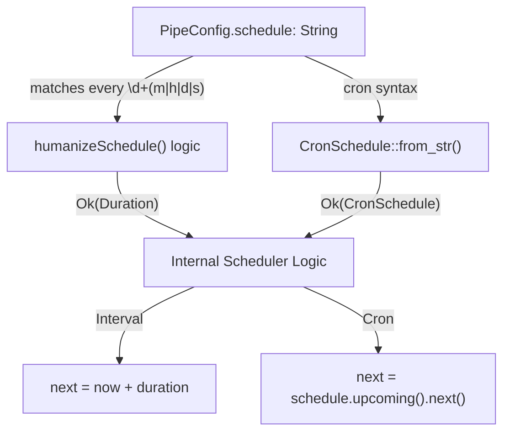
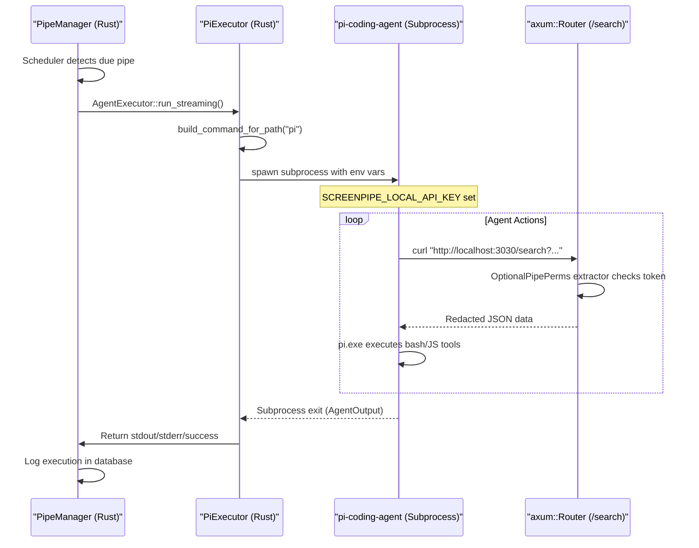

<!-- source: DeepWiki mcp.deepwiki.com · repo screenpipe/screenpipe · page 4.2 Pipes System · fetched 2026-10-27 -->

# Pipes System

<details>
<summary>Relevant source files</summary>

The following files were used as context for generating this wiki page:

- [apps/screenpipe-app-tauri/components/chat/source-citation-footer.test.tsx](apps/screenpipe-app-tauri/components/chat/source-citation-footer.test.tsx)
- [apps/screenpipe-app-tauri/components/chat/source-citation-footer.tsx](apps/screenpipe-app-tauri/components/chat/source-citation-footer.tsx)
- [apps/screenpipe-app-tauri/components/pipe-install-dialog.tsx](apps/screenpipe-app-tauri/components/pipe-install-dialog.tsx)
- [apps/screenpipe-app-tauri/components/pipe-store.tsx](apps/screenpipe-app-tauri/components/pipe-store.tsx)
- [apps/screenpipe-app-tauri/components/settings/pipes-section.tsx](apps/screenpipe-app-tauri/components/settings/pipes-section.tsx)
- [apps/screenpipe-app-tauri/components/standalone-chat.tsx](apps/screenpipe-app-tauri/components/standalone-chat.tsx)
- [apps/screenpipe-app-tauri/docs/media/pipe-card-actions-hover.png](apps/screenpipe-app-tauri/docs/media/pipe-card-actions-hover.png)
- [apps/screenpipe-app-tauri/docs/media/pipe-card-actions-hover.svg](apps/screenpipe-app-tauri/docs/media/pipe-card-actions-hover.svg)
- [apps/screenpipe-app-tauri/e2e/helpers/reporter-utils.ts](apps/screenpipe-app-tauri/e2e/helpers/reporter-utils.ts)
- [apps/screenpipe-app-tauri/e2e/helpers/test-utils.ts](apps/screenpipe-app-tauri/e2e/helpers/test-utils.ts)
- [apps/screenpipe-app-tauri/e2e/specs/chat-source-file-preview.spec.ts](apps/screenpipe-app-tauri/e2e/specs/chat-source-file-preview.spec.ts)
- [apps/screenpipe-app-tauri/e2e/specs/focus-server.spec.ts](apps/screenpipe-app-tauri/e2e/specs/focus-server.spec.ts)
- [apps/screenpipe-app-tauri/e2e/specs/home-window.spec.ts](apps/screenpipe-app-tauri/e2e/specs/home-window.spec.ts)
- [apps/screenpipe-app-tauri/e2e/specs/pipe-continuous-chat.spec.ts](apps/screenpipe-app-tauri/e2e/specs/pipe-continuous-chat.spec.ts)
- [apps/screenpipe-app-tauri/e2e/specs/pipes-mcp-connections.spec.ts](apps/screenpipe-app-tauri/e2e/specs/pipes-mcp-connections.spec.ts)
- [apps/screenpipe-app-tauri/e2e/specs/pipes.spec.ts](apps/screenpipe-app-tauri/e2e/specs/pipes.spec.ts)
- [apps/screenpipe-app-tauri/e2e/specs/timeline.spec.ts](apps/screenpipe-app-tauri/e2e/specs/timeline.spec.ts)
- [apps/screenpipe-app-tauri/lib/__tests__/source-citations.test.ts](apps/screenpipe-app-tauri/lib/__tests__/source-citations.test.ts)
- [apps/screenpipe-app-tauri/lib/cache.ts](apps/screenpipe-app-tauri/lib/cache.ts)
- [apps/screenpipe-app-tauri/lib/hooks/__tests__/timeline-liveness.test.ts](apps/screenpipe-app-tauri/lib/hooks/__tests__/timeline-liveness.test.ts)
- [apps/screenpipe-app-tauri/lib/hooks/timeline-liveness.ts](apps/screenpipe-app-tauri/lib/hooks/timeline-liveness.ts)
- [apps/screenpipe-app-tauri/lib/hooks/use-auto-suggestions.ts](apps/screenpipe-app-tauri/lib/hooks/use-auto-suggestions.ts)
- [apps/screenpipe-app-tauri/lib/hooks/use-pipe-favorites.ts](apps/screenpipe-app-tauri/lib/hooks/use-pipe-favorites.ts)
- [apps/screenpipe-app-tauri/lib/source-citations.ts](apps/screenpipe-app-tauri/lib/source-citations.ts)
- [apps/screenpipe-app-tauri/scripts/eval-workflow-workspace.ts](apps/screenpipe-app-tauri/scripts/eval-workflow-workspace.ts)
- [apps/screenpipe-app-tauri/scripts/workflow-timing-fixture.test.ts](apps/screenpipe-app-tauri/scripts/workflow-timing-fixture.test.ts)
- [apps/screenpipe-app-tauri/scripts/workflow-timing-fixture.ts](apps/screenpipe-app-tauri/scripts/workflow-timing-fixture.ts)
- [apps/screenpipe-app-tauri/scripts/workflow-workspace-eval.md](apps/screenpipe-app-tauri/scripts/workflow-workspace-eval.md)
- [apps/screenpipe-app-tauri/src-tauri/src/pi.rs](apps/screenpipe-app-tauri/src-tauri/src/pi.rs)
- [apps/screenpipe-app-tauri/src-tauri/src/suggestions.rs](apps/screenpipe-app-tauri/src-tauri/src/suggestions.rs)
- [apps/screenpipe-workflows-web/scripts/check-workflow-timing-browser.cjs](apps/screenpipe-workflows-web/scripts/check-workflow-timing-browser.cjs)
- [crates/screenpipe-core/Cargo.toml](crates/screenpipe-core/Cargo.toml)
- [crates/screenpipe-core/assets/extensions/workflow-workspace.test.ts](crates/screenpipe-core/assets/extensions/workflow-workspace.test.ts)
- [crates/screenpipe-core/assets/extensions/workflow-workspace.ts](crates/screenpipe-core/assets/extensions/workflow-workspace.ts)
- [crates/screenpipe-core/assets/pipes/legacy-workflow-prompts/before-review-ownership-workflow-review.md](crates/screenpipe-core/assets/pipes/legacy-workflow-prompts/before-review-ownership-workflow-review.md)
- [crates/screenpipe-core/assets/pipes/workflow-deepen/pipe.md](crates/screenpipe-core/assets/pipes/workflow-deepen/pipe.md)
- [crates/screenpipe-core/assets/pipes/workflow-maintain/pipe.md](crates/screenpipe-core/assets/pipes/workflow-maintain/pipe.md)
- [crates/screenpipe-core/assets/pipes/workflow-review/output.md](crates/screenpipe-core/assets/pipes/workflow-review/output.md)
- [crates/screenpipe-core/assets/pipes/workflow-review/pipe.md](crates/screenpipe-core/assets/pipes/workflow-review/pipe.md)
- [crates/screenpipe-core/assets/skills/screenpipe-workflow-maintenance/SKILL.md](crates/screenpipe-core/assets/skills/screenpipe-workflow-maintenance/SKILL.md)
- [crates/screenpipe-core/src/agents/bash_env.rs](crates/screenpipe-core/src/agents/bash_env.rs)
- [crates/screenpipe-core/src/agents/mod.rs](crates/screenpipe-core/src/agents/mod.rs)
- [crates/screenpipe-core/src/agents/pi.rs](crates/screenpipe-core/src/agents/pi.rs)
- [crates/screenpipe-core/src/pipes/builtin_migrations.rs](crates/screenpipe-core/src/pipes/builtin_migrations.rs)
- [crates/screenpipe-core/src/pipes/favorites.rs](crates/screenpipe-core/src/pipes/favorites.rs)
- [crates/screenpipe-core/src/pipes/mod.rs](crates/screenpipe-core/src/pipes/mod.rs)
- [crates/screenpipe-core/src/workflows/evidence.rs](crates/screenpipe-core/src/workflows/evidence.rs)
- [crates/screenpipe-core/src/workflows/mod.rs](crates/screenpipe-core/src/workflows/mod.rs)
- [crates/screenpipe-core/src/workflows/workspace.rs](crates/screenpipe-core/src/workflows/workspace.rs)
- [crates/screenpipe-engine/src/pipe_store.rs](crates/screenpipe-engine/src/pipe_store.rs)
- [crates/screenpipe-engine/src/pipes_api.rs](crates/screenpipe-engine/src/pipes_api.rs)
- [crates/screenpipe-engine/src/routes/pipe_store.rs](crates/screenpipe-engine/src/routes/pipe_store.rs)
- [crates/screenpipe-engine/src/routes/workflow_catalog.rs](crates/screenpipe-engine/src/routes/workflow_catalog.rs)
- [crates/screenpipe-engine/src/routes/workflow_workspace.rs](crates/screenpipe-engine/src/routes/workflow_workspace.rs)
- [crates/screenpipe-engine/tests/workflow_timing_e2e.rs](crates/screenpipe-engine/tests/workflow_timing_e2e.rs)

</details>


## Purpose and Scope

The Pipes System enables scheduled AI workflows that query Screenpipe's captured data and perform automated actions. A pipe is a directory containing a `pipe.md` file (prompt and YAML configuration). The `PipeManager` parses these files, schedules execution based on cron or interval syntax, and delegates to an `AgentExecutor` (typically the Pi coding agent) that runs the prompt with access to Screenpipe's local API. [crates/screenpipe-core/src/pipes/mod.rs:5-11]()

For information about the Pi agent that executes pipes, see [Pi Coding Agent](#4.1). For Model Context Protocol (MCP) integration, see [MCP Server](#4.3).

---

## Pipe.md File Format

A pipe is defined by a single `pipe.md` file stored in `~/.screenpipe/pipes/{pipe_name}/pipe.md`. [crates/screenpipe-core/src/pipes/mod.rs:7-9]() The file consists of:

1.  **YAML frontmatter** (required) — configuration enclosed in `---` delimiters. [apps/screenpipe-app-tauri/components/settings/pipes-section.tsx:157-168]()
2.  **Markdown body** — the prompt that the AI agent executes. [apps/screenpipe-app-tauri/components/settings/pipes-section.tsx:154-156]()

### Example Pipe

```markdown
---
schedule: every 30m
enabled: true
model: claude-3-5-sonnet
permissions:
  allow:
    - Api(GET /search)
    - App(Chrome, Slack)
    - Content(ocr, audio)
  time: "09:00-17:00"
---

Query the last 30 minutes of screen data for coding activity.
If I worked on a GitHub issue, update the issue with time spent.
```

### Configuration Fields

| Field | Type | Default | Description |
| :--- | :--- | :--- | :--- |
| `schedule` | string | `"every 1h"` | `"every 30m"`, `"every 2h"`, `"daily"`, `"manual"`, or cron syntax. [crates/screenpipe-core/src/pipes/mod.rs:155-157]() |
| `enabled` | boolean | `true` | Whether the pipe runs on schedule. [crates/screenpipe-core/src/pipes/mod.rs:158-159]() |
| `agent` | string | `"pi"` | CLI agent to execute prompt. [crates/screenpipe-core/src/pipes/mod.rs:160-162]() |
| `model` | string | `"claude-haiku-4-5"` | LLM model name. [crates/screenpipe-core/src/pipes/mod.rs:163-165]() |
| `preset` | string/array | `[]` | AI preset IDs from `store.bin` (overrides model/provider). [crates/screenpipe-core/src/pipes/mod.rs:169-178]() |
| `permissions` | struct | `reader` | Unified permissions: `Api()`, `App()`, `Window()`, `Content()`. [crates/screenpipe-core/src/pipes/mod.rs:187-209]() |
| `connections` | string[] | `[]` | Connections (e.g. `["slack"]`) the pipe can query credentials for. [crates/screenpipe-core/src/pipes/mod.rs:180-185]() |
| `timeout` | integer | `300` | Execution timeout in seconds. [crates/screenpipe-core/src/pipes/mod.rs:211-214]() |
| `artifacts` | struct[] | `[]` | Declares files produced by the pipe for the Artifacts library. [crates/screenpipe-core/src/pipes/mod.rs:133-143]()

**Sources:**
[crates/screenpipe-core/src/pipes/mod.rs:150-220](), [apps/screenpipe-app-tauri/components/settings/pipes-section.tsx:139-213]()

---

## Scheduling System

### Schedule Syntax

The `schedule` field accepts several formats:
1.  **Interval syntax**: `"every 30m"`, `"every 2h"`, `"every 5s"`. [apps/screenpipe-app-tauri/components/settings/pipes-section.tsx:188]()
2.  **Cron syntax**: Standard 5-part cron strings parsed via `CronSchedule::from_str`. [crates/screenpipe-core/src/pipes/mod.rs:31-35]()
3.  **Manual**: Set `schedule: manual` to run only via API or event triggers. [crates/screenpipe-core/src/pipes/mod.rs:53]()

### Event Triggers
Pipes can run when a `WorkflowEvent` fires. This is configured via the `trigger` block in frontmatter. [crates/screenpipe-core/src/pipes/mod.rs:50-80]()
*   **events**: Built-in event names (e.g., `crm_update_from_social`). [crates/screenpipe-core/src/pipes/mod.rs:60-62]()
*   **sources**: Per-app "watch" triggers that fire when a connected app (e.g., Obsidian) produces a new item. [crates/screenpipe-core/src/pipes/mod.rs:104-124]()

### Diagram: Schedule Parsing


**Sources:**
[crates/screenpipe-core/src/pipes/mod.rs:27-80](), [apps/screenpipe-app-tauri/components/settings/pipes-section.tsx:160-168]()

---

## PipeManager

The `PipeManager` [crates/screenpipe-core/src/pipes/mod.rs:9]() is the central orchestrator for the Pipes system. It is responsible for:
*   **Scanning and Reloading**: Periodically scans the `~/.screenpipe/pipes/` directory for `pipe.md` files and reloads their configurations. [crates/screenpipe-engine/src/pipes_api.rs:123-125]()
*   **Scheduling**: Manages the execution schedule for all enabled pipes, using `cron::Schedule` for cron-based schedules and `chrono::Duration` for interval-based schedules. [crates/screenpipe-core/src/pipes/mod.rs:31-38]()
*   **Execution Delegation**: When a pipe is due, it delegates its execution to an `AgentExecutor` (e.g., `PiExecutor`). [crates/screenpipe-core/src/pipes/mod.rs:10-11]()
*   **Execution Logging**: Records the outcome of each pipe execution in the database, including stdout, stderr, and success status. [crates/screenpipe-core/src/pipes/mod.rs:1270-1275]()
*   **Bundled Pipe Management**: Handles the installation and migration of bundled pipes. [crates/screenpipe-core/src/pipes/mod.rs:181-198]()

### Diagram: PipeManager Overview
```mermaid
graph TD
    subgraph "Screenpipe Application"
        PM[PipeManager]
        DB[SQLite Database]
        FS[Filesystem (~/.screenpipe/pipes)]
        AE[AgentExecutor (e.g., PiExecutor)]
        API[Local HTTP API]
    end

    FS -- "Reads pipe.md" --> PM
    PM -- "Parses config" --> PM
    PM -- "Schedules execution" --> PM
    PM -- "Delegates execution" --> AE
    AE -- "Executes prompt" --> API
    API -- "Queries data" --> DB
    AE -- "Returns result" --> PM
    PM -- "Logs execution" --> DB
```

**Sources:**
[crates/screenpipe-core/src/pipes/mod.rs:5-11](), [crates/screenpipe-engine/src/pipes_api.rs:123-125](), [crates/screenpipe-core/src/pipes/mod.rs:31-38](), [crates/screenpipe-core/src/pipes/mod.rs:1270-1275](), [crates/screenpipe-core/src/pipes/mod.rs:181-198]()

---

## Execution Lifecycle

### Context Header Injection
Before executing, Screenpipe prepends a context header to the prompt containing temporal and environment data. [apps/screenpipe-app-tauri/components/settings/pipes-section.tsx:185-195]()
*   **Time range**: ISO 8601 start/end timestamps based on the schedule interval.
*   **Current date/time** and user timezone.
*   **Screenpipe API base URL**: `http://localhost:3030`.
*   **Output directory**: Path where the pipe can write persistent files.

### Execution Flow Diagram



**Sources:**
[crates/screenpipe-core/src/agents/pi.rs:157-195](), [crates/screenpipe-core/src/pipes/mod.rs:5-11](), [apps/screenpipe-app-tauri/src-tauri/src/pi.rs:153-195](), [crates/screenpipe-engine/src/pipes_api.rs:135-205]()

---

## 3-Layer Security & Permissions

Pipes use a "Deny → Allow → Default → Reject" evaluation model. [crates/screenpipe-core/src/pipes/permissions.rs:26]() Rules use a typed `Type(specifier)` syntax. [crates/screenpipe-core/src/pipes/permissions.rs:8-24]()

### 1. Permission Rules
Rules are parsed into the `PermissionRule` enum: [crates/screenpipe-core/src/pipes/permissions.rs:47-58]()
*   **Api**: `Api(METHOD /path)` — HTTP endpoint access.
*   **App**: `App(name)` — Data from specific applications (case-insensitive substring match). [crates/screenpipe-core/src/pipes/permissions.rs:53]()
*   **Window**: `Window(glob)` — Data from matching window titles. [crates/screenpipe-core/src/pipes/permissions.rs:55]()
*   **Content**: `Content(type)` — Content types: `ocr`, `audio`, `input`, `accessibility`. [crates/screenpipe-core/src/pipes/permissions.rs:57]()

### 2. Environment Isolation
The `PiExecutor` passes a `SCREENPIPE_PIPE_PERMISSIONS` environment variable to the agent subprocess. [crates/screenpipe-core/src/pipes/permissions.rs:147-148]() This JSON blob contains the resolved `PipePermissions` including `allow_rules` and `deny_rules`. [crates/screenpipe-core/src/pipes/permissions.rs:148-181]()

### 3. Server-Side Enforcement
The Screenpipe server uses request extensions to extract `PipePermissions` from the bearer token.
*   **Search Filtering**: The `/search` handler respects rules. If a pipe is restricted to certain apps, the server filters the SQL query results. [crates/screenpipe-core/src/pipes/permissions.rs:173-180]()
*   **Endpoint Gating**: Requests are checked against `DEFAULT_ALLOWED_ENDPOINTS` (e.g., `/search`, `/activity-summary`, `/notify`) unless explicitly overridden. [crates/screenpipe-core/src/pipes/permissions.rs:125-139]()

**Sources:**
[crates/screenpipe-core/src/pipes/permissions.rs:5-181]()

---

## Bundled Pipe Migrations

Screenpipe includes a set of "bundled" pipes [crates/screenpipe-core/src/pipes/mod.rs:89-174]() that are installed by default or on user request. To ensure these pipes remain up-to-date without overwriting user customizations, a migration system is in place.

The `migrate_builtin_pipe_text` function [crates/screenpipe-core/src/pipes/builtin_migrations.rs:194]() applies surgical fragment swaps to installed `pipe.md` files. This means:
*   **Surgical Fixes**: Only specific, known-broken sections of the prompt are replaced. [crates/screenpipe-core/src/pipes/builtin_migrations.rs:9-11]()
*   **Preservation of Customization**: User edits and `memory.md` lessons are never overwritten. [crates/screenpipe-core/src/pipes/builtin_migrations.rs:9-11]()
*   **Source of Truth**: Replacement text is derived directly from the shipped bundled prompt using functions like `section_between` [crates/screenpipe-core/src/pipes/builtin_migrations.rs:48-52]() and `line_starting_with` [crates/screenpipe-core/src/pipes/builtin_migrations.rs:57-59]() to prevent discrepancies.

Each `FragmentSwap` [crates/screenpipe-core/src/pipes/builtin_migrations.rs:26-34]() includes a `why` field to document the reason for the migration, aiding in debugging and support.

**Sources:**
[crates/screenpipe-core/src/pipes/mod.rs:89-174](), [crates/screenpipe-core/src/pipes/builtin_migrations.rs:1-117]()

---

## Pipe Store & Discovery

The Pipe Store provides a marketplace for installing and managing pipes.

### Pipe Store UI
The `PipeStore` component handles discovery and installation. [apps/screenpipe-app-tauri/components/pipe-store.tsx:73-91]()
*   **Normalization**: The UI normalizes raw API responses into `StorePipe` objects. [apps/screenpipe-app-tauri/components/pipe-store.tsx:74-92]()
*   **Permission Preview**: Before installation, users can view required permissions like `ocr`, `audio`, or `connections`. [apps/screenpipe-app-tauri/components/pipe-store.tsx:144-152]()
*   **Risk Assessment**: The system calculates a risk level ("safe", "warning", "high") based on whether the publisher is verified and the extent of data access requested. [apps/screenpipe-app-tauri/components/pipe-store.tsx:175-181]()

### Local Management
Users manage installed pipes via the `PipesSection` in settings. [apps/screenpipe-app-tauri/components/settings/pipes-section.tsx:7-66]()
*   **Manual Run**: Triggers immediate execution via `run_pipe_now` handler. [crates/screenpipe-engine/src/pipes_api.rs:138-143]()
*   **Logs**: Displays previous execution logs, parsing NDJSON output into a chat-like format for readability via `parsePipeNdjsonToMessages`. [apps/screenpipe-app-tauri/lib/pipe-ndjson-to-chat.ts:64-99]()
*   **Circuit Breaker**: The `PresetFallbackRegistry` handles failures in AI presets, tripping a circuit breaker if a provider fails (e.g., rate limits) to allow fallback to secondary models. [crates/screenpipe-core/src/pipes/preset_fallback.rs:171-185]()

**Sources:**
[apps/screenpipe-app-tauri/components/pipe-store.tsx:73-224](), [apps/screenpipe-app-tauri/components/settings/pipes-section.tsx:7-66](), [crates/screenpipe-engine/src/pipes_api.rs:68-121](), [crates/screenpipe-core/src/pipes/preset_fallback.rs:5-185]()

---

## Key Components Reference

| Code Entity | File Path | Role |
| :--- | :--- | :--- |
| `PipeManager` | [crates/screenpipe-core/src/pipes/mod.rs:9]() | Orchestrates pipe scanning, configuration parsing, and scheduling. |
| `PipeConfig` | [crates/screenpipe-core/src/pipes/mod.rs:151]() | Struct representing the parsed YAML frontmatter of a `pipe.md`. |
| `PiExecutor` | [crates/screenpipe-core/src/agents/pi.rs:157]() | Implementation of `AgentExecutor` for the Pi coding agent. |
| `PipePermissions` | [crates/screenpipe-core/src/pipes/permissions.rs:148]() | Resolved permission set for a pipe passed to the agent. |
| `TriggerConfig` | [crates/screenpipe-core/src/pipes/mod.rs:65]() | Configuration for event-based pipe execution. |
| `ArtifactDeclaration` | [crates/screenpipe-core/src/pipes/mod.rs:134]() | Declares files produced by a pipe for the UI Artifacts library. |
| `PresetFallbackRegistry` | [crates/screenpipe-core/src/pipes/preset_fallback.rs:171]() | Manages circuit breakers for AI preset fallbacks. |

**Sources:**
[crates/screenpipe-core/src/pipes/mod.rs](), [crates/screenpipe-core/src/agents/pi.rs](), [crates/screenpipe-core/src/pipes/permissions.rs](), [crates/screenpipe-core/src/pipes/preset_fallback.rs]()

---

