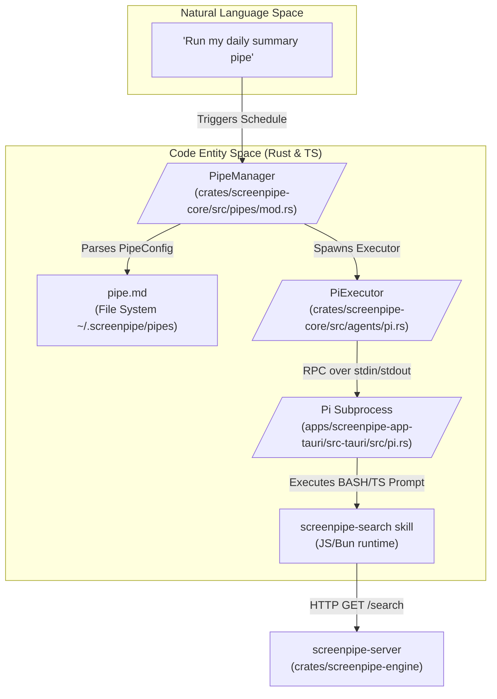
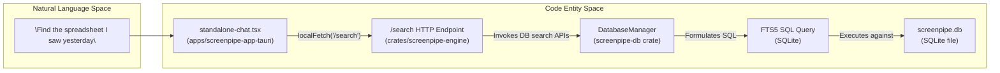

<!-- source: DeepWiki mcp.deepwiki.com · repo screenpipe/screenpipe · page 9 Glossary · fetched 2026-10-27 -->

# Glossary

Relevant source files

The following files were used as context for generating this wiki page:

- [LICENSE.md](LICENSE.md)
- [README.md](README.md)
- [apps/screenpipe-app-tauri/components/settings/general-settings.tsx](apps/screenpipe-app-tauri/components/settings/general-settings.tsx)
- [apps/screenpipe-app-tauri/components/settings/privacy-section.tsx](apps/screenpipe-app-tauri/components/settings/privacy-section.tsx)
- [apps/screenpipe-app-tauri/components/settings/recording-settings.tsx](apps/screenpipe-app-tauri/components/settings/recording-settings.tsx)
- [apps/screenpipe-app-tauri/components/update-banner.tsx](apps/screenpipe-app-tauri/components/update-banner.tsx)
- [apps/screenpipe-app-tauri/e2e/COVERAGE.md](apps/screenpipe-app-tauri/e2e/COVERAGE.md)
- [apps/screenpipe-app-tauri/e2e/coverage-map.json](apps/screenpipe-app-tauri/e2e/coverage-map.json)
- [apps/screenpipe-app-tauri/lib/hooks/use-settings.tsx](apps/screenpipe-app-tauri/lib/hooks/use-settings.tsx)
- [apps/screenpipe-app-tauri/lib/utils/tauri.ts](apps/screenpipe-app-tauri/lib/utils/tauri.ts)
- [apps/screenpipe-app-tauri/src-tauri/src/commands.rs](apps/screenpipe-app-tauri/src-tauri/src/commands.rs)
- [apps/screenpipe-app-tauri/src-tauri/src/embedded_server.rs](apps/screenpipe-app-tauri/src-tauri/src/embedded_server.rs)
- [apps/screenpipe-app-tauri/src-tauri/src/feedback_upload.rs](apps/screenpipe-app-tauri/src-tauri/src/feedback_upload.rs)
- [apps/screenpipe-app-tauri/src-tauri/src/health.rs](apps/screenpipe-app-tauri/src-tauri/src/health.rs)
- [apps/screenpipe-app-tauri/src-tauri/src/main.rs](apps/screenpipe-app-tauri/src-tauri/src/main.rs)
- [apps/screenpipe-app-tauri/src-tauri/src/process_exit.rs](apps/screenpipe-app-tauri/src-tauri/src/process_exit.rs)
- [apps/screenpipe-app-tauri/src-tauri/src/recording.rs](apps/screenpipe-app-tauri/src-tauri/src/recording.rs)
- [apps/screenpipe-app-tauri/src-tauri/src/recording/db_wedge.rs](apps/screenpipe-app-tauri/src-tauri/src/recording/db_wedge.rs)
- [apps/screenpipe-app-tauri/src-tauri/src/server_core.rs](apps/screenpipe-app-tauri/src-tauri/src/server_core.rs)
- [apps/screenpipe-app-tauri/src-tauri/src/store.rs](apps/screenpipe-app-tauri/src-tauri/src/store.rs)
- [apps/screenpipe-app-tauri/src-tauri/src/tray.rs](apps/screenpipe-app-tauri/src-tauri/src/tray.rs)
- [apps/screenpipe-app-tauri/src-tauri/src/updates.rs](apps/screenpipe-app-tauri/src-tauri/src/updates.rs)
- [crates/screenpipe-audio/src/audio_manager/builder.rs](crates/screenpipe-audio/src/audio_manager/builder.rs)
- [crates/screenpipe-audio/src/audio_manager/device_monitor.rs](crates/screenpipe-audio/src/audio_manager/device_monitor.rs)
- [crates/screenpipe-audio/src/audio_manager/manager.rs](crates/screenpipe-audio/src/audio_manager/manager.rs)
- [crates/screenpipe-audio/src/audio_manager/reconciliation.rs](crates/screenpipe-audio/src/audio_manager/reconciliation.rs)
- [crates/screenpipe-audio/src/core/device.rs](crates/screenpipe-audio/src/core/device.rs)
- [crates/screenpipe-audio/src/core/e2e_ghost_word_silent_room.rs](crates/screenpipe-audio/src/core/e2e_ghost_word_silent_room.rs)
- [crates/screenpipe-audio/src/core/mod.rs](crates/screenpipe-audio/src/core/mod.rs)
- [crates/screenpipe-audio/src/core/run_record_and_transcribe.rs](crates/screenpipe-audio/src/core/run_record_and_transcribe.rs)
- [crates/screenpipe-audio/src/core/stream.rs](crates/screenpipe-audio/src/core/stream.rs)
- [crates/screenpipe-audio/src/device/device_manager.rs](crates/screenpipe-audio/src/device/device_manager.rs)
- [crates/screenpipe-audio/src/metrics.rs](crates/screenpipe-audio/src/metrics.rs)
- [crates/screenpipe-audio/src/transcription/deepgram/batch.rs](crates/screenpipe-audio/src/transcription/deepgram/batch.rs)
- [crates/screenpipe-audio/src/transcription/engine.rs](crates/screenpipe-audio/src/transcription/engine.rs)
- [crates/screenpipe-audio/src/transcription/openai_compatible/batch.rs](crates/screenpipe-audio/src/transcription/openai_compatible/batch.rs)
- [crates/screenpipe-audio/src/transcription/stt.rs](crates/screenpipe-audio/src/transcription/stt.rs)
- [crates/screenpipe-audio/tests/audio_pipeline_benchmark/smart_mode_benchmark.rs](crates/screenpipe-audio/tests/audio_pipeline_benchmark/smart_mode_benchmark.rs)
- [crates/screenpipe-config/src/recording.rs](crates/screenpipe-config/src/recording.rs)
- [crates/screenpipe-db/src/storage/bulk/cache.rs](crates/screenpipe-db/src/storage/bulk/cache.rs)
- [crates/screenpipe-db/src/storage/bulk/elements.rs](crates/screenpipe-db/src/storage/bulk/elements.rs)
- [crates/screenpipe-db/src/storage/bulk/elements/lifecycle.rs](crates/screenpipe-db/src/storage/bulk/elements/lifecycle.rs)
- [crates/screenpipe-db/src/storage/bulk/lifecycle.rs](crates/screenpipe-db/src/storage/bulk/lifecycle.rs)
- [crates/screenpipe-db/src/storage/bulk/tests.rs](crates/screenpipe-db/src/storage/bulk/tests.rs)
- [crates/screenpipe-db/src/storage/diagnostics.rs](crates/screenpipe-db/src/storage/diagnostics.rs)
- [crates/screenpipe-db/src/storage/import.rs](crates/screenpipe-db/src/storage/import.rs)
- [crates/screenpipe-db/src/storage/in_place.rs](crates/screenpipe-db/src/storage/in_place.rs)
- [crates/screenpipe-db/src/storage/lifecycle.rs](crates/screenpipe-db/src/storage/lifecycle.rs)
- [crates/screenpipe-db/src/storage/mod.rs](crates/screenpipe-db/src/storage/mod.rs)
- [crates/screenpipe-db/src/storage/parity.rs](crates/screenpipe-db/src/storage/parity.rs)
- [crates/screenpipe-db/src/storage/reclaim.rs](crates/screenpipe-db/src/storage/reclaim.rs)
- [crates/screenpipe-db/src/storage/sealing.rs](crates/screenpipe-db/src/storage/sealing.rs)
- [crates/screenpipe-db/tests/in_place_migration.rs](crates/screenpipe-db/tests/in_place_migration.rs)
- [crates/screenpipe-db/tests/migration_foreign_keys.rs](crates/screenpipe-db/tests/migration_foreign_keys.rs)
- [crates/screenpipe-db/tests/migration_source_recovery.rs](crates/screenpipe-db/tests/migration_source_recovery.rs)
- [crates/screenpipe-engine/src/bin/screenpipe-engine.rs](crates/screenpipe-engine/src/bin/screenpipe-engine.rs)
- [crates/screenpipe-engine/src/cli/mod.rs](crates/screenpipe-engine/src/cli/mod.rs)
- [crates/screenpipe-engine/src/lib.rs](crates/screenpipe-engine/src/lib.rs)
- [crates/screenpipe-engine/src/recording_config.rs](crates/screenpipe-engine/src/recording_config.rs)
- [crates/screenpipe-engine/src/routes/mod.rs](crates/screenpipe-engine/src/routes/mod.rs)
- [crates/screenpipe-engine/src/server.rs](crates/screenpipe-engine/src/server.rs)
- [docs/COVERAGE.md](docs/COVERAGE.md)
- [docs/coverage/CORE.md](docs/coverage/CORE.md)
- [docs/coverage/core-engine-map.json](docs/coverage/core-engine-map.json)

This page provides detailed definitions and code mappings for important Screenpipe-specific terms, jargon, abbreviations, and domain concepts. It is targeted at engineers onboarding into the Screenpipe codebase, providing precise references to file paths, functions, and classes for each term to facilitate deep understanding and exploration.

---

## Core System Concepts

### 1. Pi Agent (Pi)
The core AI orchestrator subsystem responsible for running coding-agent operations, natural language queries, and skill execution. It runs as a subprocess communicating over JSON-RPC on stdin/stdout and manages multi-session chat with a stateful queue of assistant messages.

- **Code Pointers:**
  - Subprocess wrapper: `apps/screenpipe-app-tauri/src-tauri/src/pi.rs` [apps/screenpipe-app-tauri/src-tauri/src/pi.rs:21-40]()
  - Pi Agent logic and executor: `crates/screenpipe-core/src/agents/pi.rs` [crates/screenpipe-core/src/agents/pi.rs:21-24]()
  - Frontend hooks for conversation state: `apps/screenpipe-app-tauri/components/standalone-chat.tsx` [apps/screenpipe-app-tauri/components/standalone-chat.tsx:50-60]()

- **Implementation Details:**
  - Uses `BufReader` to handle lossy UTF-8 data from the process stdout.
  - Supports Windows `.cmd` shim invocation with `cmd.exe /C`.
  - Maintains session titles prefixed by `TITLE_SESSION_PREFIX`.
  - Frontend interacts via `PiManager` and hooks for chat state.
  
- **Sources:**  
  `apps/screenpipe-app-tauri/src-tauri/src/pi.rs`, `crates/screenpipe-core/src/agents/pi.rs`, `apps/screenpipe-app-tauri/components/standalone-chat.tsx`

### 2. Pipes
A new automation feature allowing scheduled or triggered AI workflows defined by a markdown file with YAML frontmatter and inline prompt text. Pipes declare triggers, permissions, and output artifacts.

- **Code Pointers:**
  - Pipe logic: `crates/screenpipe-core/src/pipes/mod.rs` [crates/screenpipe-core/src/pipes/mod.rs:7-181]()
  - Pipe config: `PipeConfig` struct inside above.
  - Settings UI interaction: `apps/screenpipe-app-tauri/components/settings/pipes-section.tsx`

- **Data Flow:**
  - PipeManager scans pipes directory in the user's `.screenpipe/pipes/` folder.
  - Parses `pipe.md` files for metadata and prompt body.
  - Schedules execution using cron-like triggers.
  - Spawns the Pi Agent executor (e.g., `PiExecutor`) to run pipe commands.
  - Pipes output artifacts track generated files and UI listing.

- **Sources:**  
  `crates/screenpipe-core/src/pipes/mod.rs`, `apps/screenpipe-app-tauri/components/settings/pipes-section.tsx`

### 3. ImmediateTx (SQLite Immediate Transaction)
A specialized transaction wrapper to prevent SQLite WAL deadlocks by acquiring an immediate write lock up-front. Essential for multi-writer concurrent access patterns on the database.

- **Code Pointers:**
  - Mentioned in the `screenpipe-db` crate configuration [apps/screenpipe-app-tauri/src-tauri/Cargo.toml:136]()

- **Mechanism:**
  - Uses a `BEGIN IMMEDIATE` SQLite transaction.
  - Performs explicit ROLLBACK before returning the connection to the pool.
  - Additional concurrency control via Rust semaphores in-memory.
  - Designed for constant 24/7 recording with OCR, audio, UI events writing simultaneously.

- **Sources:**  
  `apps/screenpipe-app-tauri/src-tauri/Cargo.toml`

### 4. Accessibility Tree (a11y)
The platform-provided semantic structure of the UI with text, controls, and metadata that is preferable for capture over OCR because it is structured and faster.

- **Code Pointers:**
  - Main crate: `screenpipe-a11y` (included from dependencies) [apps/screenpipe-app-tauri/src-tauri/Cargo.toml:134]()
  - Search setting uses `"content_type": "accessibility"` [apps/screenpipe-app-tauri/components/settings/pipes-section.tsx:204]()

- **Platform Implementation:**
  - Uses native OS accessibility APIs: `uiautomation` on Windows and `accessibility-sys` on macOS.
  - Provides a semantic alternative to costly OCR fallback.
  - Enables capturing window contents with structured data.

- **Sources:**  
  `apps/screenpipe-app-tauri/src-tauri/Cargo.toml`, `apps/screenpipe-app-tauri/components/settings/pipes-section.tsx`

### 5. AI Gateway
An HTTP proxy service hosted on Cloudflare Workers that abstracts and routes language model API calls for Screenpipe, enabling unified authentication, rate limiting, cost tracking, and provider selection.

- **Code Pointers:**
  - API URL reference: `SCREENPIPE_API_URL` constant [crates/screenpipe-core/src/agents/pi.rs:23]()
  - AI provider preset configuration: `AIPreset` type [apps/screenpipe-app-tauri/lib/hooks/use-settings.tsx:49-82]()

- **Logic:**
  - Routes authenticated requests with user tokens.
  - Returns catalog of models with capabilities and context window sizes.
  - Supports providers like Anthropic, OpenAI, Gemini, and built-in Screenpipe Cloud endpoints.

- **Sources:**  
  `crates/screenpipe-core/src/agents/pi.rs`, `apps/screenpipe-app-tauri/lib/hooks/use-settings.tsx`

---

## Technical Mapping: Natural Language to Code

### Diagram 1: AI Execution & Pipe Lifecycle

This diagram connects the concept of running an AI Pipe with the corresponding Rust and TypeScript modules.

**Sources:**  
`crates/screenpipe-core/src/pipes/mod.rs` [7-30](), `apps/screenpipe-app-tauri/src-tauri/src/pi.rs` [76-80](), `apps/screenpipe-app-tauri/components/settings/pipes-section.tsx` [153-168]()

---

## Key Terms Table

| Term | Definition | Code Pointer |
|------|------------|--------------|
| **FTS5** | SQLite Full-Text Search extension used for indexing OCR text and transcripts in the local database. | `screenpipe-db` crate [apps/screenpipe-app-tauri/src-tauri/Cargo.toml:136]() |
| **MCP** | Model Context Protocol, interface allowing AI models like Claude to query Screenpipe screen and audio data directly. | `packages/screenpipe-mcp` + settings [apps/screenpipe-app-tauri/components/settings/pipes-section.tsx:172-181]() |
| **VAD** | Voice Activity Detection; algorithm to identify and segment human speech from silence in captured audio streams. | `screenpipe-audio` crate [apps/screenpipe-app-tauri/src-tauri/Cargo.toml:135]() |
| **Bun** | The bundled JavaScript runtime within Screenpipe used to run the Pi Agent and pipes workflows efficiently without external dependencies. | `bunCheck` command invocation [apps/screenpipe-app-tauri/lib/utils/tauri.ts:39-46]() |
| **Diarization** | Process to separate audio streams into distinct speaker partitions for speaker identification and transcription. | `screenpipe-audio` [apps/screenpipe-app-tauri/src-tauri/Cargo.toml:135]() |
| **Sync Token** | User authentication token used in cloud sync and API gateway requests to validate identity and bill usage. | Referenced in authentication modules [apps/screenpipe-app-tauri/src-tauri/src/main.rs:41]() |
| **Enterprise Policy** | Administrative policies configured for enterprise deployments to enforce settings like UI visibility and recorder access control. | `enterprise_policy.rs` [apps/screenpipe-app-tauri/src-tauri/src/main.rs:51]() |
| **Tinfoil** | A security/privacy module managing enclave attestation and local PII redaction in immutable Rust pipelines. | `tinfoil` crate [Cargo.toml:133]() |

---

## Data Flow & Architecture

### Diagram 2: Search Data Flow from Query to Database

This diagram maps a user's natural language search query down to database operations involving FTS5 and SQLite.

**Sources:**  
`apps/screenpipe-app-tauri/components/standalone-chat.tsx` [109-124](), `apps/screenpipe-app-tauri/components/settings/pipes-section.tsx` [198-213](), `apps/screenpipe-app-tauri/src-tauri/Cargo.toml` [136]()

---

## Domain Concepts

### Event-Driven Capture
Screenpipe uses an event-driven model for capturing screen frames instead of constant video recording. This involves monitoring OS accessibility events, window focus changes, mouse and keyboard activity, and falls back to OCR for unstructured text extraction.

- **Implementation:**  
  The core capture system relies on accessibility tree extraction as primary, falling back to OCR if needed. This reduces CPU and storage usage significantly while maintaining effective capture.  
  [apps/screenpipe-app-tauri/components/settings/pipes-section.tsx:147-150]()  
  This behavior is highlighted conceptually in the [README.md:109-114]() overview.

### Local-First Privacy
Screenpipe maintains a strict local-first design: all screen captures, audio recordings, and databases reside on the user's device by default. Network features like cloud AI calls or sync are opt-in and segregated. Data can be filtered through local redaction before leaving the device.

- **Implementation:**  
  The `screenpipe-redact` crate is used to perform efficient local text and image redaction based on ONNX/CoreML/DirectML models. Secrets and vault management support further privacy filtering.  
  [apps/screenpipe-app-tauri/src-tauri/Cargo.toml:142-149]()  
  [README.md:17-18]()

### Connection Lifecycle
Connections represent external services (Slack, Google Calendar, OAuth providers) integrated with Screenpipe. Pipes can declare required connections in frontmatter, and the system manages OAuth flow, token storage, and revocation asynchronously.

- **Code Pointers:**  
  Connections logic mostly in `screenpipe-connect` crate [apps/screenpipe-app-tauri/src-tauri/Cargo.toml:138]()  
  OAuth integrations available in `chatgpt_oauth` module [apps/screenpipe-app-tauri/src-tauri/src/main.rs:44]() and Pipe `TriggerConfig` [crates/screenpipe-core/src/pipes/mod.rs:67-82]()

- **Mechanism:**  
  Connection auth states are managed by the Connection trait implementations with frontends providing trigger flows and tokens. Pipes validate connection availability before execution.

### CoreAudio Process Tap (macOS)
Introduced in macOS 14.4+, this API allows Screenpipe to capture system audio on a per-process basis without installing virtual audio drivers, making it easier and more secure to isolate audio from Zoom, Teams, or other apps.

- **Implementation:**  
  Used within the audio capture layer of Screenpipe, specifically leveraging CoreAudio APIs for per-process isolation.  
  Referenced in: [apps/screenpipe-app-tauri/src-tauri/src/main.rs:40-41]()

---

# Summary Table of Important Terms

| Term | Description | Primary Code Location |
|-------|-------------|----------------------|
| Pi Agent | AI agent subprocess running commands and chat using JSON-RPC | `src-tauri/src/pi.rs` |
| Pipes | User-defined YAML+Markdown AI workflows scheduled with cron | `crates/screenpipe-core/src/pipes/mod.rs` |
| ImmediateTx | SQLite transaction type using `BEGIN IMMEDIATE` to prevent deadlocks | `screenpipe-db` crate config |
| Accessibility Tree (a11y) | OS-provided semantic UI structure for capture | `screenpipe-a11y` crate |
| AI Gateway | Cloudflare Workers proxy routing multi-provider LLM calls | `lib/hooks/use-settings.tsx` |
| FTS5 | Full-text index for fast search on OCR & transcripts | `screenpipe-db` crate |
| MCP | Model Context Protocol integration for third-party AI tools | `packages/screenpipe-mcp` |
| VAD | Voice activity detection in audio processing pipeline | `screenpipe-audio` crate |
| Bun | Embedded JS runtime bundled with Screenpipe for pipe and Pi execution | `lib/utils/tauri.ts` |
| Diarization | Speaker separation in audio capture | `screenpipe-audio` crate |
| Sync Token | Auth token for user identification in sync & gateway | `src-tauri/src/main.rs` |
| Enterprise Policy | Admin-side configuration for corporate deployments | `src-tauri/src/main.rs` |
| Tinfoil | Privacy redaction enclave/service for PII removal | `tinfoil` crate |

---

**Sources:**  
- `apps/screenpipe-app-tauri/src-tauri/src/pi.rs`  
- `crates/screenpipe-core/src/pipes/mod.rs`  
- `apps/screenpipe-app-tauri/src-tauri/Cargo.toml`  
- `apps/screenpipe-app-tauri/components/settings/pipes-section.tsx`  
- `apps/screenpipe-app-tauri/lib/hooks/use-settings.tsx`  
- `apps/screenpipe-app-tauri/src-tauri/src/main.rs`  
- `README.md`