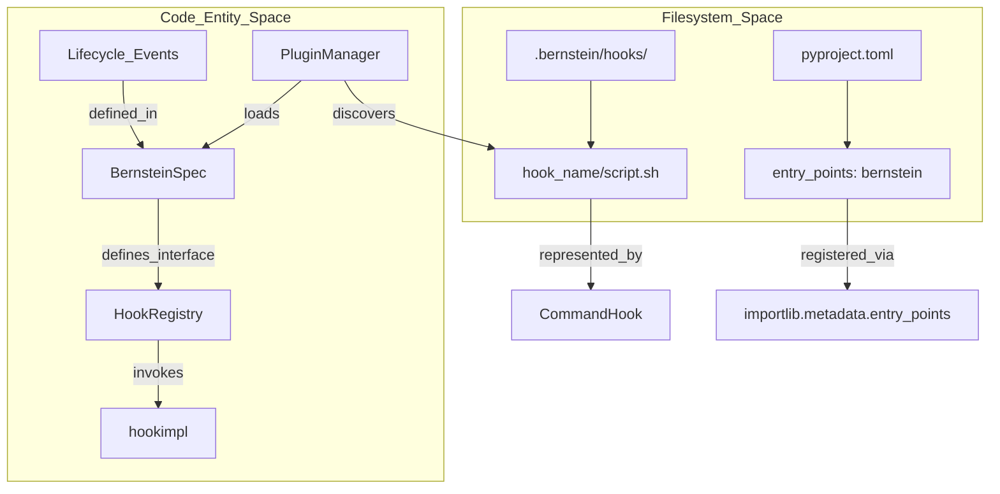
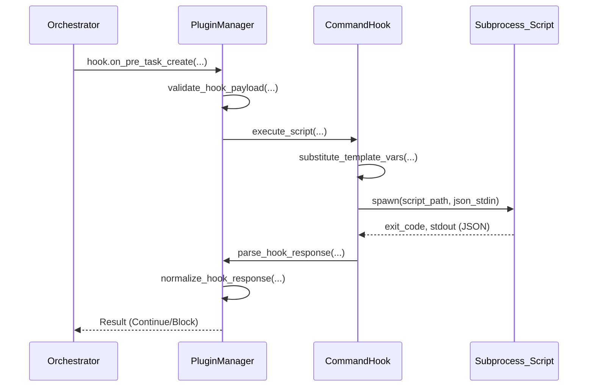

<!-- source: DeepWiki mcp.deepwiki.com · repo sipyourdrink-ltd/bernstein · page 10.2 Plugin System · fetched 2026-10-27 -->

# Plugin System

Relevant source files

The following files were used as context for generating this wiki page:

- [src/bernstein/benchmark/swe_bench.py](src/bernstein/benchmark/swe_bench.py)
- [src/bernstein/bridges/openclaw_gateway.py](src/bernstein/bridges/openclaw_gateway.py)
- [src/bernstein/cli/commands/quickstart_cmd.py](src/bernstein/cli/commands/quickstart_cmd.py)
- [src/bernstein/cli/dashboard_actions.py](src/bernstein/cli/dashboard_actions.py)
- [src/bernstein/cli/run_confirm.py](src/bernstein/cli/run_confirm.py)
- [src/bernstein/cli/status.py](src/bernstein/cli/status.py)
- [src/bernstein/core/agents/claude_agent_card.py](src/bernstein/core/agents/claude_agent_card.py)
- [src/bernstein/core/agents/claude_message_normalizer.py](src/bernstein/core/agents/claude_message_normalizer.py)
- [src/bernstein/core/orchestration/run_report.py](src/bernstein/core/orchestration/run_report.py)
- [src/bernstein/core/persistence/file_health.py](src/bernstein/core/persistence/file_health.py)
- [src/bernstein/core/plugins_core/plugin_installer.py](src/bernstein/core/plugins_core/plugin_installer.py)
- [src/bernstein/core/security/command_policy.py](src/bernstein/core/security/command_policy.py)
- [src/bernstein/core/security/policy_engine.py](src/bernstein/core/security/policy_engine.py)
- [src/bernstein/core/security/rule_enforcer.py](src/bernstein/core/security/rule_enforcer.py)
- [src/bernstein/core/security/secrets.py](src/bernstein/core/security/secrets.py)
- [src/bernstein/core/security/vault_injector.py](src/bernstein/core/security/vault_injector.py)
- [src/bernstein/eval/scenario_runner.py](src/bernstein/eval/scenario_runner.py)
- [src/bernstein/plugins/hookspecs.py](src/bernstein/plugins/hookspecs.py)
- [src/bernstein/plugins/manager.py](src/bernstein/plugins/manager.py)
- [tests/unit/test_api_compat.py](tests/unit/test_api_compat.py)
- [tests/unit/test_cache_break_correlator.py](tests/unit/test_cache_break_correlator.py)
- [tests/unit/test_capacity_wake.py](tests/unit/test_capacity_wake.py)
- [tests/unit/test_cascading_token_counter.py](tests/unit/test_cascading_token_counter.py)
- [tests/unit/test_context_activation.py](tests/unit/test_context_activation.py)
- [tests/unit/test_event_sink_killswitch.py](tests/unit/test_event_sink_killswitch.py)
- [tests/unit/test_hook_exit_codes.py](tests/unit/test_hook_exit_codes.py)
- [tests/unit/test_metrics.py](tests/unit/test_metrics.py)
- [tests/unit/test_migration_reversibility_and_large_file_gates.py](tests/unit/test_migration_reversibility_and_large_file_gates.py)
- [tests/unit/test_permission_rules.py](tests/unit/test_permission_rules.py)
- [tests/unit/test_plugin_installer.py](tests/unit/test_plugin_installer.py)
- [tests/unit/test_quality_gate_coalescer.py](tests/unit/test_quality_gate_coalescer.py)

Bernstein employs a robust, event-driven plugin architecture powered by [pluggy](https://pluggy.readthedocs.io). This system allows for modular extensions of the orchestrator's behavior, including custom security reviews, specialized agent loaders, and third-party integrations without modifying the core codebase [src/bernstein/plugins/manager.py:1-20]().

## Architecture and Data Flow

The plugin system is centered around the `PluginManager`, which manages the lifecycle of plugins and dispatches events to registered hooks [src/bernstein/plugins/manager.py:50-54](). Bernstein uses a "Command Hook" pattern where plugins can be either native Python classes or standalone executable scripts located in the `.bernstein/hooks/` directory [src/bernstein/plugins/manager.py:163-170]().

### Hook Registry and Lifecycle
Events are defined as hook specifications in the `BernsteinSpec` class [src/bernstein/plugins/hookspecs.py:97-122](). These specifications define the interface for lifecycle events such as task creation, agent spawning, and task completion [src/bernstein/plugins/hookspecs.py:124-194]().

### Natural Language to Code Entity Space: Plugin Discovery
The following diagram illustrates how high-level plugin concepts map to specific code entities and filesystem structures.

Sources: [src/bernstein/plugins/manager.py:16-20](), [src/bernstein/plugins/manager.py:163-170](), [src/bernstein/plugins/hookspecs.py:97-122]()

## Key Lifecycle Events

Plugins can subscribe to various events to monitor or gate the orchestration process:

| Event | Trigger Point | Purpose |
| :--- | :--- | :--- |
| `on_pre_task_create` | Before a task is persisted | Validation and blocking of invalid tasks [src/bernstein/plugins/hookspecs.py:135-141]() |
| `on_agent_spawned` | After agent process starts | Telemetry and session tracking [src/bernstein/plugins/hookspecs.py:175-182]() |
| `on_task_completed` | When task enters `done` state | Post-processing or downstream triggers [src/bernstein/plugins/hookspecs.py:155-162]() |
| `on_task_failed` | When task enters `failed` state | Error analysis and alerting [src/bernstein/plugins/hookspecs.py:165-172]() |
| `on_evolve_proposal` | During self-evolution loops | Auditing system upgrades [src/bernstein/plugins/hookspecs.py:195-202]() |

Sources: [src/bernstein/plugins/hookspecs.py:124-212]()

## The Plugin Manager

The `PluginManager` class is responsible for the discovery and execution of hooks. It supports both synchronous and asynchronous execution (via `ThreadPoolExecutor`) for background tasks [src/bernstein/plugins/manager.py:14-17]().

### Execution Flow: Hook Dispatch
This diagram shows the sequence of a hook invocation, bridging the logic of the `PluginManager` to the execution of a `CommandHook`.

Sources: [src/bernstein/plugins/manager.py:22-29](), [src/bernstein/plugins/manager.py:163-212](), [src/bernstein/plugins/hookspecs.py:107-122]()

## Implementation Details

### Hook Protocol and Interactive Elicitation
Hooks communicate via JSON over `stdin`/`stdout`. A unique feature is the **Elicitation Protocol**, which allows a hook script to request human input during execution [src/bernstein/plugins/hookspecs.py:50-85]().
*   **Input (stdin)**: Arguments passed as a single-line JSON object [src/bernstein/plugins/hookspecs.py:115-116]().
*   **Elicitation**: If a hook needs clarification, it can trigger an `ElicitationRequest` which the CLI/TUI renders for the user [src/bernstein/plugins/hookspecs.py:50-70]().
*   **Exit Codes**: Code `0` indicates success; code `2` indicates a **blocking failure** that halts the orchestration pipeline [src/bernstein/plugins/hookspecs.py:107-112]().

### Security and Policy Enforcement
The `PluginManager` integrates with a `PluginPolicy` engine to ensure only authorized plugins run in trusted environments [src/bernstein/plugins/manager.py:30-36]().
*   **Policy Violation**: If a plugin is not allowed by the `PluginPolicy`, a `PluginPolicyViolation` is raised [src/bernstein/plugins/manager.py:32-35]().
*   **Trust Checks**: The manager verifies if the workspace is trusted before loading local directory hooks [src/bernstein/plugins/manager.py:36]().

Sources: [src/bernstein/plugins/manager.py:86-92](), [src/bernstein/plugins/hookspecs.py:17-47](), [src/bernstein/plugins/hookspecs.py:107-122]()

## Custom Plugins and Installation

### Plugin Installation Sources
Bernstein supports installing plugins from multiple sources via the `PluginSource` union [src/bernstein/core/plugins_core/plugin_installer.py:139-143]():
*   **GitHub**: Downloads assets from releases [src/bernstein/core/plugins_core/plugin_installer.py:54-72]().
*   **Git**: Clones repositories directly [src/bernstein/core/plugins_core/plugin_installer.py:76-89]().
*   **npm**: Uses `npm pack` for JavaScript-based tools [src/bernstein/core/plugins_core/plugin_installer.py:93-106]().
*   **File/Directory**: Local archives or development folders [src/bernstein/core/plugins_core/plugin_installer.py:110-136]().

### Creating a Plugin
To create a custom plugin:
1.  Define a class and implement hooks from `BernsteinSpec` [src/bernstein/plugins/hookspecs.py:97]().
2.  Use the `@hookimpl` decorator to mark implementation methods [src/bernstein/plugins/__init__.py]().
3.  Register the plugin in your `pyproject.toml` entry points or place it in the `.bernstein/hooks/` directory for script-based execution [src/bernstein/plugins/manager.py:163-170]().

Sources: [src/bernstein/plugins/hookspecs.py:97-122](), [src/bernstein/core/plugins_core/plugin_installer.py:1-18](), [src/bernstein/plugins/manager.py:1-20]()

---

