# Page: Overview

# Overview

<details>
<summary>Relevant source files</summary>

The following files were used as context for generating this wiki page:

- [.cursor/rules/module-map.mdc](.cursor/rules/module-map.mdc)
- [.cursor/rules/overview.mdc](.cursor/rules/overview.mdc)
- [.goosehints](.goosehints)
- [.plugin/plugin.json](.plugin/plugin.json)
- [.well-known/security.txt](.well-known/security.txt)
- [AGENTS.md](AGENTS.md)
- [CHANGELOG.md](CHANGELOG.md)
- [CLAUDE.md](CLAUDE.md)
- [CONVENTIONS.md](CONVENTIONS.md)
- [README.md](README.md)
- [SECURITY.md](SECURITY.md)
- [bernstein.yaml](bernstein.yaml)
- [docker/sandbox/docker-compose.researcher.yaml](docker/sandbox/docker-compose.researcher.yaml)
- [docs/adapters/ADAPTER_GUIDE.md](docs/adapters/ADAPTER_GUIDE.md)
- [docs/architecture/plans.md](docs/architecture/plans.md)
- [docs/index.md](docs/index.md)
- [docs/integrations/agent-session.md](docs/integrations/agent-session.md)
- [docs/operations/run.md](docs/operations/run.md)
- [docs/reference/cli-reference.md](docs/reference/cli-reference.md)
- [docs/release-notes/unreleased.md](docs/release-notes/unreleased.md)
- [docs/release-notes/v3.13.0.md](docs/release-notes/v3.13.0.md)
- [docs/release-notes/v3.14.159.md](docs/release-notes/v3.14.159.md)
- [docs/whats-new.md](docs/whats-new.md)
- [examples/cluster/cloudflared/Dockerfile](examples/cluster/cloudflared/Dockerfile)
- [examples/cluster/cloudflared/config.yml](examples/cluster/cloudflared/config.yml)
- [examples/cluster/cloudflared/docker-compose.yml](examples/cluster/cloudflared/docker-compose.yml)
- [examples/cluster/tailscale/bernstein.yaml](examples/cluster/tailscale/bernstein.yaml)
- [examples/cluster/tailscale/docker-compose.yml](examples/cluster/tailscale/docker-compose.yml)
- [examples/cluster/tailscale/tailscale.json](examples/cluster/tailscale/tailscale.json)
- [mcp.json](mcp.json)
- [mkdocs.yml](mkdocs.yml)
- [packaging/npm/package.json](packaging/npm/package.json)
- [plugin.json](plugin.json)
- [pyproject.toml](pyproject.toml)
- [schemas/agent-plugins/1.0.0/mcp.schema.json](schemas/agent-plugins/1.0.0/mcp.schema.json)
- [schemas/agent-plugins/1.0.0/plugin.schema.json](schemas/agent-plugins/1.0.0/plugin.schema.json)
- [schemas/agent-plugins/README.md](schemas/agent-plugins/README.md)
- [scripts/gen_distribution_manifests.py](scripts/gen_distribution_manifests.py)
- [scripts/researcher_sandbox.sh](scripts/researcher_sandbox.sh)
- [server.json](server.json)
- [src/bernstein/adapters/_contract.py](src/bernstein/adapters/_contract.py)
- [src/bernstein/adapters/registry.py](src/bernstein/adapters/registry.py)
- [src/bernstein/adapters/report.py](src/bernstein/adapters/report.py)
- [src/bernstein/adapters/use_cases.py](src/bernstein/adapters/use_cases.py)
- [src/bernstein/cli/commands/adapter_cmd.py](src/bernstein/cli/commands/adapter_cmd.py)
- [src/bernstein/cli/main.py](src/bernstein/cli/main.py)
- [src/bernstein/cli/release_notes.py](src/bernstein/cli/release_notes.py)
- [src/bernstein/core/security/audit_chain.py](src/bernstein/core/security/audit_chain.py)
- [tests/integration/cluster/test_cluster_tunnel_smoke.py](tests/integration/cluster/test_cluster_tunnel_smoke.py)
- [tests/unit/test_adapter_contract.py](tests/unit/test_adapter_contract.py)
- [tests/unit/test_distribution_manifests.py](tests/unit/test_distribution_manifests.py)
- [tests/unit/test_readme_api_coverage.py](tests/unit/test_readme_api_coverage.py)
- [uv.lock](uv.lock)

</details>


Bernstein is a deterministic multi-agent orchestration platform designed specifically for CLI-based coding agents. Named after the conductor Leonard Bernstein, it coordinates a "crew" of agents—such as Claude Code, Aider, and Codex—ensuring every player follows a deterministic "score" while providing audit-grade compliance required by regulated engineering teams.

The system's core philosophy is **zero-LLM coordination**: while agents employ large language models (LLMs) to generate code, the orchestration logic itself is deterministic and implemented in standard Python. This design avoids "hallucination loops" common in recursive agent systems and guarantees that a plan generated once will reproduce identical execution results on every replay.

---

## Core Value Proposition

- **Deterministic Orchestration**  
  All scheduling and coordination are handled by a plain Python scheduler, **without any LLM in the coordination loop**. This eliminates nondeterminism and ensures reliable, repeatable task execution across runs and environments. Replaying yesterday's plan reproduces its exact task graph.  
  _[README.md:45-45]()_

- **Audit-Grade Compliance**  
  Bernstein records every scheduling decision and significant event in a tamper-evident HMAC-SHA256 **audit chain**. This chain, along with a signed **lineage spine**, enables offline verification and detection of non-determinism or tampering without rerunning the workflow.  
  _[README.md:49-52]()_

- **Agent-Agnostic and Extensible**  
  Supports over 40 CLI agent adapters (e.g., Claude, Codex, Gemini CLI, Aider) allowing teams to adopt or rotate LLMs seamlessly without changing orchestration logic or task definitions.  
  _[README.md:48-48]()_

- **Strong Isolation and Security**  
  Each coding task runs in its own **Git worktree**, isolating filesystem changes and avoiding concurrent mutation conflicts. Signed **agent cards** (JSON Web Signatures - JWS) and an air-gap deployment profile add zero-trust security for regulated environments.  
  _[README.md:21-23]()_

---

## Architectural Overview

Bernstein employs a **three-tier architectural model** to separate concerns and scale efficiently:

1. **User Interfaces (CLI, TUI, and Web Dashboard)**  
   Operators submit goals, monitor progress, and review agent outputs through interactive frontends decoding the common task API.

2. **Task Server (FastAPI-based)**  
   Central task state hub managing task lifecycles, authentication, rate-limiting, audits, and eventing. The server API runs by default on port 8052.  
   _[README.md:50-50]()_

3. **Orchestrator & Agents**  
   The orchestration engine schedules, claims, and monitors tasks. Agents run in isolated, ephemeral Git worktrees or sandboxed environments, executing assigned tasks deterministically.

---

### System Entity Map: Bridging User Goals and Code Entities

This diagram illustrates how a natural language goal submitted by a user translates into Bernstein code-level entities managing plan execution.

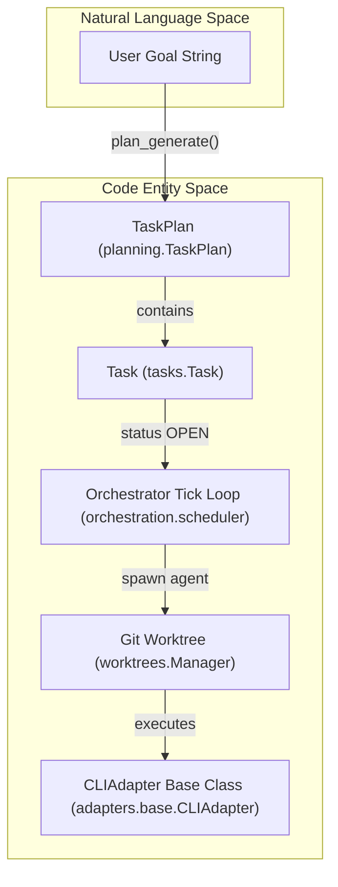

---

## Key Concepts

Bernstein’s design revolves around several fundamental abstractions:

- **Tasks and Plans**  
  A user goal is decomposed into a `TaskPlan` YAML manifest containing multiple `Task` objects, each representing atomic work steps assigned to agents. These tasks form a dependency graph defining execution order and batching.

- **Roles and Adapters**  
  Each task specifies a `Role` determining which agent adapter (e.g., ClaudeAdapter, AiderAdapter) is used. This enables polymorphic support across different LLM providers behind a consistent orchestration interface.

- **`.sdd/` Directory (State, Data, and Decisions)**  
  This local project directory holds all runtime state including the task graph, execution logs, audit chain files, worktree metadata, and configuration. It acts as the single source of truth for a Bernstein project run.

- **Worktree Isolation**  
  Every task executes in its own isolated Git worktree, preventing file-system race conditions and enabling clean merges. Artifact-mode tasks use dedicated working directories within `.sdd/workspaces/`.

For detailed descriptions of these abstractions and their relationships, see [Core Concepts and Terminology](#1.2).

---

## Codebase Organization and Navigation

Bernstein's code is modularized mainly under `src/bernstein/core/` and `src/bernstein/adapters/` packages:

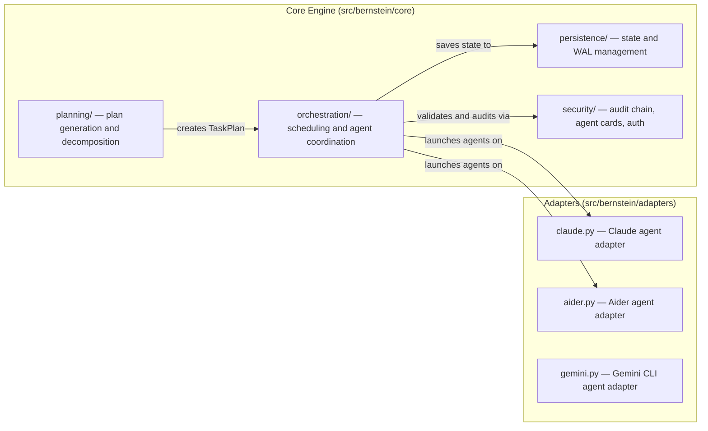

---

## Wiki Roadmap

This wiki page serves as the parent overview and links into the following detailed child sections:

- **[Getting Started](#1.1)**  
  Installation instructions (pip, Homebrew, npm, Docker, air-gap), initial project setup with `bernstein init`, directory layout, configuration files (`bernstein.yaml`), quickstart examples, and the `doctor` pre-flight command.

- **[Core Concepts and Terminology](#1.2)**  
  Thorough explanation of Bernstein's main abstractions including Tasks, Agents, Roles, Worktrees, the audit chain, Janitor gate runner, and organizational rule enforcement.

- **Architecture Section (2)**  
  In-depth components such as the Task Server API, Orchestrator lifecycle, Agent spawning mechanisms, Task planning and decomposition, Git integration, persistence, and sandbox backend approaches.

- **Security and Compliance (5)**  
  Detailed coverage of authentication, authorization, audit trails, guardrails, compliance features, and air-gap deployment practices.

- **Quality Gates and Verification (7)**  
  Describes the Janitor verification engine and mechanisms ensuring produced deliverables meet quality and compliance thresholds.

- **More Sections...**  
  Sections cover CLI references, UI frontends, observability, cost management, model routing, knowledge and memory systems, integrations, deployment, testing, and contribution guidelines.

---

Bernstein is designed to be extensible and transparent, providing reproducible automation workflows for modern engineering teams leveraging advanced CLI coding agents with strict security and compliance guarantees.

---
**Sources:**  
- [pyproject.toml:5-51]() (Project metadata and core description)  
- [README.md:15-58]() (Core value proposition and design)  
- [CLAUDE.md:8-66]() (Code module map and architecture clues)  
- [src/bernstein/cli/run_bootstrap.py:44-72]() (Plan generation and execution flow)  
- [src/bernstein/adapters/base.py:78-78]() (CLIAdapter class reference)

---

# Page: Getting Started

# Getting Started

<details>
<summary>Relevant source files</summary>

The following files were used as context for generating this wiki page:

- [.well-known/security.txt](.well-known/security.txt)
- [SECURITY.md](SECURITY.md)
- [bernstein.yaml](bernstein.yaml)
- [docker/sandbox/docker-compose.researcher.yaml](docker/sandbox/docker-compose.researcher.yaml)
- [docs/getting-started/quickstart-demo.md](docs/getting-started/quickstart-demo.md)
- [docs/index.md](docs/index.md)
- [docs/operations/CONFIG.md](docs/operations/CONFIG.md)
- [docs/operations/commands.md](docs/operations/commands.md)
- [docs/operations/deployment-guide.md](docs/operations/deployment-guide.md)
- [docs/reference/FEATURE_MATRIX.md](docs/reference/FEATURE_MATRIX.md)
- [docs/routine-scenarios.md](docs/routine-scenarios.md)
- [docs/use-cases.md](docs/use-cases.md)
- [docs/whats-new.md](docs/whats-new.md)
- [examples/cluster/cloudflared/Dockerfile](examples/cluster/cloudflared/Dockerfile)
- [examples/cluster/cloudflared/config.yml](examples/cluster/cloudflared/config.yml)
- [examples/cluster/cloudflared/docker-compose.yml](examples/cluster/cloudflared/docker-compose.yml)
- [examples/cluster/tailscale/bernstein.yaml](examples/cluster/tailscale/bernstein.yaml)
- [examples/cluster/tailscale/docker-compose.yml](examples/cluster/tailscale/docker-compose.yml)
- [examples/cluster/tailscale/tailscale.json](examples/cluster/tailscale/tailscale.json)
- [packaging/npm/package.json](packaging/npm/package.json)
- [scripts/researcher_sandbox.sh](scripts/researcher_sandbox.sh)
- [src/bernstein/adapters/openai_agents_builtins.py](src/bernstein/adapters/openai_agents_builtins.py)
- [src/bernstein/cli/commands/api_check_cmd.py](src/bernstein/cli/commands/api_check_cmd.py)
- [src/bernstein/cli/commands/dep_impact_cmd.py](src/bernstein/cli/commands/dep_impact_cmd.py)
- [src/bernstein/cli/commands/impact_cmd.py](src/bernstein/cli/commands/impact_cmd.py)
- [src/bernstein/cli/commands/init_wizard_cmd.py](src/bernstein/cli/commands/init_wizard_cmd.py)
- [src/bernstein/cli/commands/routine_cmd.py](src/bernstein/cli/commands/routine_cmd.py)
- [src/bernstein/cli/release_notes.py](src/bernstein/cli/release_notes.py)
- [src/bernstein/cli/utils/aliases.py](src/bernstein/cli/utils/aliases.py)
- [src/bernstein/core/agents/spawner_sandbox_session.py](src/bernstein/core/agents/spawner_sandbox_session.py)
- [src/bernstein/core/config/config_schema.py](src/bernstein/core/config/config_schema.py)
- [src/bernstein/core/config/seed_config.py](src/bernstein/core/config/seed_config.py)
- [src/bernstein/core/config/seed_parser.py](src/bernstein/core/config/seed_parser.py)
- [src/bernstein/core/orchestration/dependency_scan_tasks.py](src/bernstein/core/orchestration/dependency_scan_tasks.py)
- [src/bernstein/core/orchestration/orchestrator_run.py](src/bernstein/core/orchestration/orchestrator_run.py)
- [src/bernstein/core/orchestration/stalled_manager.py](src/bernstein/core/orchestration/stalled_manager.py)
- [src/bernstein/core/protocols/mcp/mcp_sandbox.py](src/bernstein/core/protocols/mcp/mcp_sandbox.py)
- [src/bernstein/core/quality/ab_test.py](src/bernstein/core/quality/ab_test.py)
- [src/bernstein/core/sandbox/backends/docker.py](src/bernstein/core/sandbox/backends/docker.py)
- [src/bernstein/core/sandbox/explicit_attach.py](src/bernstein/core/sandbox/explicit_attach.py)
- [src/bernstein/core/security/sandbox.py](src/bernstein/core/security/sandbox.py)
- [tests/integration/cluster/test_cluster_tunnel_smoke.py](tests/integration/cluster/test_cluster_tunnel_smoke.py)
- [tests/unit/sandbox/test_docker_backend_unit.py](tests/unit/sandbox/test_docker_backend_unit.py)
- [tests/unit/sandbox/test_explicit_attach.py](tests/unit/sandbox/test_explicit_attach.py)
- [tests/unit/sandbox/test_pool_cmd.py](tests/unit/sandbox/test_pool_cmd.py)
- [tests/unit/test_cli_command_registration.py](tests/unit/test_cli_command_registration.py)
- [tests/unit/test_impact_consolidation.py](tests/unit/test_impact_consolidation.py)
- [tests/unit/test_sandbox.py](tests/unit/test_sandbox.py)
- [tests/unit/test_seed.py](tests/unit/test_seed.py)
- [tests/unit/test_seed_preflight_dedup.py](tests/unit/test_seed_preflight_dedup.py)
- [tests/unit/test_spawner_explicit_container_runtime.py](tests/unit/test_spawner_explicit_container_runtime.py)
- [tests/unit/test_spawner_sandbox.py](tests/unit/test_spawner_sandbox.py)
- [tests/unit/test_spawner_sandbox_session.py](tests/unit/test_spawner_sandbox_session.py)
- [tests/unit/test_stalled_manager.py](tests/unit/test_stalled_manager.py)

</details>


This page provides comprehensive technical guidance for installing Bernstein, performing the first-run setup with `bernstein init`, understanding the `.sdd/` directory layout, details of the primary configuration file `bernstein.yaml`, running quickstart examples, using the `doctor` pre-flight check command, and leveraging the examples/ plan library with 24 ready-made plans for common workflows.

Bernstein is a deterministic multi-agent orchestrator that runs CLI coding agents in parallel isolated worktrees, provides an auditable HMAC-signed lineage and audit chain, and enforces quality gates for reliable software development workflows.

---

## Installation

Bernstein is primarily a Python package requiring **Python 3.12+**. Multiple installation methods are supported depending on your environment and security posture.

### Standard Installation

You can install Bernstein using `pip`, `pipx`, or `uv`:

```bash
# Recommended: Using uv tool installer
uv tool install bernstein

# Or using pipx for isolated installs
pipx install bernstein

# Or directly via pip
pip install bernstein
```

### Homebrew

For macOS users, Bernstein can be installed using Homebrew:

```bash
brew tap chernistry/tap
brew install bernstein
```

### npm Package

Bernstein also provides an npm package for frontend tooling and integration environments:

```bash
npm install -g bernstein-orchestrator
```

### Docker

Prebuilt Docker images are available for isolated sandboxed runs, researcher sandboxes, or clustered deployments. The docker-compose stack examples live under `docker/` and `examples/cluster/`.

### Air-Gap Wheelhouse Installation

For restricted network environments, Bernstein supports an air-gap deployment profile using wheelhouses—bundles of signed pip wheels.

Build a wheelhouse bundle on a connected machine:

```bash
bernstein wheelhouse build --output ./bundle/
```

Transfer the bundle and install offline with pip:

```bash
pip install --no-index --find-links ./bundle/ bernstein
```

This flow ensures cryptographic verification of installed packages and integrity of configured audit chains.

| Installation Method | Notes |
| ------------------- | ----- |
| `pip install bernstein` | Standard install, requires internet |
| `pipx install bernstein` | Isolated environment |
| `uv tool install bernstein` | Handles virtualenv and upgrades |
| Homebrew | macOS native package via tap |
| npm | For some integration tooling |
| Docker Compose | Container sandbox runs for dev and infra |
| Air-gap wheelhouse | Secure offline deployment with signed bundles |

Sources: [README.md:40-61](), [src/bernstein/core/distribution/doctor_airgap.py:1-40](), [docs/operations/deployment-guide.md:30-115]()

---

## First-Run Setup with `bernstein init`

After installation, you initialize your Bernstein project workspace using:

```bash
bernstein init
```

This command bootstraps your project directory by:

- Creating the `.sdd/` storage directory structure to persist all run state.
- Generating a baseline `bernstein.yaml` configuration file.
- Setting up directories for task backlog, runtime state, plans, and audit logs.

### The `.sdd/` Directory Structure

Bernstein’s core data and ephemeral state are stored hierarchically within `.sdd/` in your project root:

| Directory              | Description                                                |
|------------------------|------------------------------------------------------------|
| `.sdd/backlog/`        | Contains issue backlog tickets split into `open/` and `closed/` folders, storing YAML or Markdown task definitions. |
| `.sdd/runtime/`        | Runtime state: active tasks, worktree metadata, checkpoints, ephemeral files for current execution. |
| `.sdd/runtime/plans/`  | Stores YAML `TaskPlan` documents representing decomposed workflows. |
| `.sdd/runtime/agent_tokens/` | Stores zero-trust JWT tokens for authenticating worker agents securely with the task server and orchestrator. |
| `.sdd/traces/`         | Diagnostic traces from runs and adapters, in JSONL format. |
| `.sdd/metrics/`        | Metrics and cost accounting data collected during runs. |

This file-based approach avoids external database dependencies and enables reproducibility, auditability, and crash recovery without server components.

### Layout Diagram

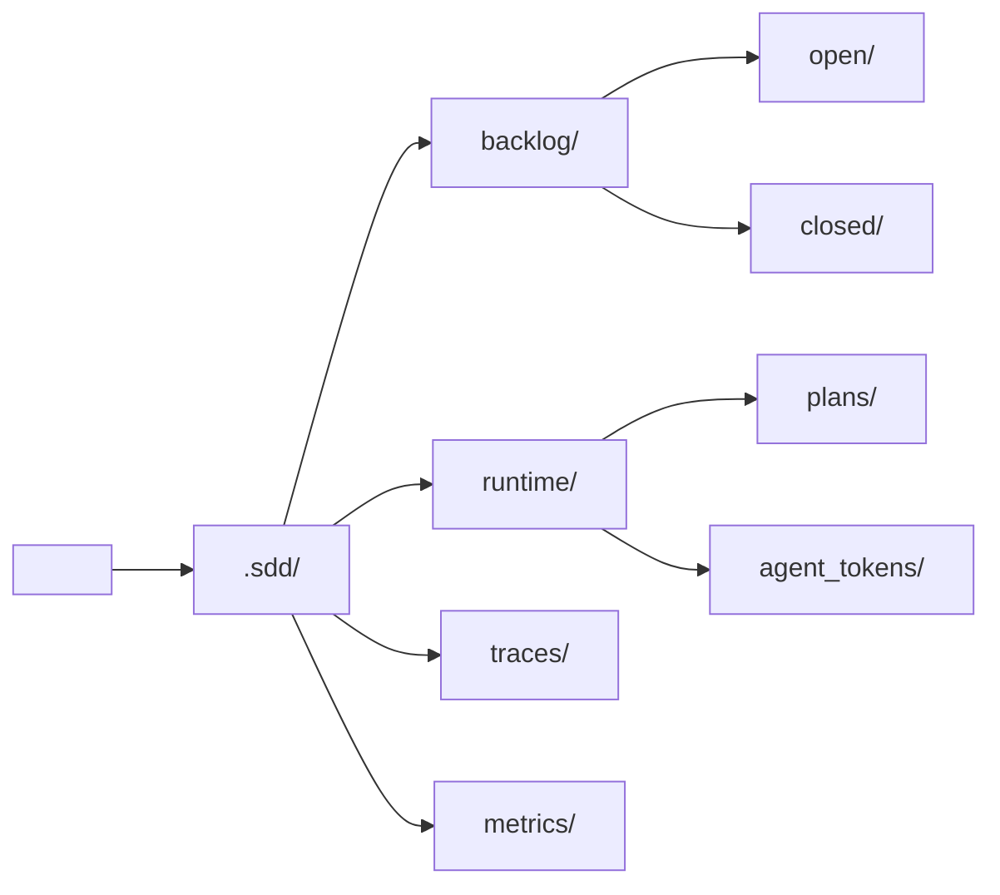

Sources: [bernstein.yaml:1-38](), [src/bernstein/cli/commands/init_wizard_cmd.py:20-60](), [README.md:26-33]()

---

## The `bernstein.yaml` Configuration File

`bernstein.yaml` is the core project configuration file Bernstein parses at bootstrap to control runtime behavior.

A representative minimal layout:

```yaml
goal: "Add JWT authentication with refresh tokens, tests, and API docs"
cli: claude
max_agents: 7

role_model_policy:
  manager:
    model: opus
    effort: max
  backend:
    model: sonnet
    effort: high
  qa:
    model: sonnet
    effort: high

budget: $0  # USD hard spending limit

internal_llm_provider: claude
internal_llm_model: claude-sonnet-4-6

quality_gates:
  enabled: true
  lint: true
  lint_command: ruff check .
  type_check: false
  tests: false

context_files:
  - docs/architecture/DESIGN.md
  - CLAUDE.md

agency:
  path: ./external/agency-agents
```

### Key Config Sections

| Section           | Purpose                                      | Notes                                                              |
|-------------------|----------------------------------------------|--------------------------------------------------------------------|
| `goal`            | Natural language goal for the orchestrator   | Starting point for task decomposition                              |
| `cli`             | Selected default CLI agent adapter            | Examples: `claude`, `codex`, `gemini`, or `auto`                   |
| `max_agents`      | Max concurrent spawned agent workers          | Limits parallelism                                                  |
| `role_model_policy`| Per-role LLM model and effort override       | Dictates effort levels and model selection by role                 |
| `budget`          | Hard spending budget in USD                    | Terminates run when cost exceeded                                  |
| `internal_llm_provider`| Configures internal LLM for planning & evolution | Defaults to none or disabled unless explicitly configured         |
| `quality_gates`   | Enables linting, tests, and type checks       | Gates tasks before merge or completion                             |
| `context_files`   | Files injected into agents’ contexts          | Can be documentation, architecture specs, conventions             |
| `agency`          | External agency-agent path override            | Scopes external multi-agent ecosystem                              |

Sources: [bernstein.yaml:1-38](), [src/bernstein/core/config/seed_parser.py:1-200](), [tests/unit/test_seed.py:20-155]()

---

## Quickstart Examples

Once initialized, you can immediately start a Bernstein run from a natural language goal.

### Run from Goal String

```bash
bernstein -g "Add a /health endpoint to the FastAPI server"
```

This triggers:

- Parsing the natural language goal.
- Automatic plan decomposition into tasks.
- Spawning concurrent agents in isolated git worktrees.
- Running each task with model-driven scripted agents.
- Running quality gates, tests, and merges on completion.

### Run from Plan File

You can also run predefined scenario plans:

```bash
bernstein run plans/ci-tasks.yaml
```

Example plans are provided in the `examples/plans/` directory, covering 24 common workflows including CI/CD pipelines, database migrations, and authentication system development.

### Run Lifecycle Diagram

The following sequence diagram outlines the data flow through major CLI and core components during a run triggered by a goal:

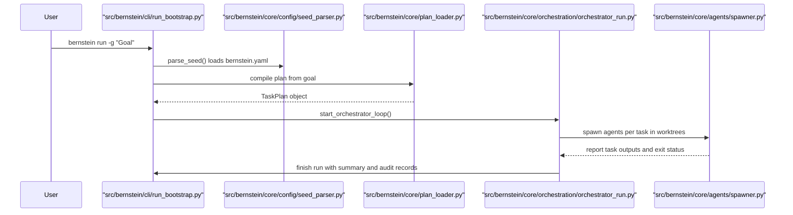

Sources: [README.md:63-67](), [src/bernstein/cli/run_bootstrap.py:44-72](), [src/bernstein/core/config/seed_parser.py:1-200]()

---

## Pre-flight Verification with `bernstein doctor`

The `doctor` command provides a comprehensive health check of your Bernstein environment before running tasks to ensure that dependencies, environment variables, sandbox integration, network connectivity, and agent adapter configurations are correct.

### Checks Performed

- **Environment Validation:** Python version, binary dependencies (`git`, `uv`) [src/bernstein/cli/run_bootstrap.py:207-217]().
- **Adapter Health:** Confirm CLI agents can be executed and authenticated.
- **Sandbox Verification:** Docker or worktree sandboxes are isolated and operational.
- **Air-gap Verification:** Integrity checks of signed wheelhouse bundles, audit chain keys [src/bernstein/core/distribution/doctor_airgap.py:5-40]().

### Doctor Command Flow

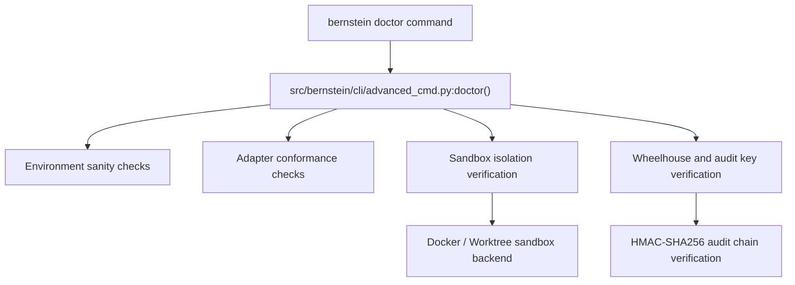

### Usage

Simply run:

```bash
bernstein doctor
```

Or for extended air-gap checks:

```bash
bernstein doctor --airgap
```

The command emits detailed diagnostic output and suggestions.

Sources: [src/bernstein/cli/advanced_cmd.py:20-70](), [src/bernstein/core/distribution/doctor_airgap.py:1-40](), [src/bernstein/cli/run_bootstrap.py:207-217]()

---

## Examples and Plan Library

Bernstein ships with a library of 24 ready-made plans for common software development workflows, stored under the `examples/plans/` directory.

### Example Plans Include

| Example Plan                 | Description                                              |
|-----------------------------|----------------------------------------------------------|
| `ci-tasks.yaml`              | Typical CI pipeline tasks for code linting and tests     |
| `auth-system.yaml`           | Multi-role implementation of JWT authentication          |
| `db-migration.yaml`          | Schema migration tasks with verification gates           |
| `microservice-skeleton.yaml` | Base microservice scaffolding and deployment steps        |
| `release-checklist.yaml`     | Release preparation and compliance gate certification     |

These plans define `stages` and `steps` in YAML, describing task dependencies, gating conditions, and spawning policies. They make it easy to customize complex pipelines without hand-coding orchestration logic.

You can run any example plan directly:

```bash
bernstein run examples/plans/ci-tasks.yaml
```

### Plan File Structure

A plan YAML file typically looks like:

```yaml
stages:
  - name: lint
    steps:
      - name: ruff-check
        command: ruff check src/

  - name: test
    steps:
      - name: unit-tests
        command: pytest tests/unit/
        depends_on: [ruff-check]
```

Bernstein's planner compiles this into a DAG of tasks, executes them concurrently constrained by dependencies and resource limits.

Sources: [docs/getting-started/quickstart-demo.md](), [src/bernstein/core/plan_loader.py:30-90](), [README.md:66-67]()

---

# Summary

This page covered:

- **Installation** options: pip, Homebrew, npm, Docker, and air-gap wheelhouses.
- **First-run setup** with `bernstein init` which creates the `.sdd/` state directory and the `bernstein.yaml` configuration file.
- The **file-based `.sdd/` directory structure** supporting reproducible state and audit.
- The **`bernstein.yaml`** seed configuration file, controlling agent models, roles, budget, quality gates, and context.
- A **quickstart example** showing natural language goal-driven runs.
- The **`bernstein doctor`** pre-flight tool for environment verification and diagnostics.
- The **examples/ plan library** of 24 ready-made plans to accelerate common workflows.

Bernstein’s design emphasizes deterministic orchestration with maximal observability and compliance support, suitable for forward-deployed engineering, CI/CD automation, and secure multi-agent coordination.

---

**Further Reading**

- See the [Architecture](architecture/ARCHITECTURE.md) page for internal subsystem details.
- Browse the [CLI Reference](docs/operations/commands.md) for comprehensive command documentation.
- Check [Installation and Air Gap guide](installation/air-gap.md) for secure deployment patterns.
- Explore [Examples and Quickstarts](docs/getting-started/quickstart-demo.md) for interactive tutorials.

Sources: [bernstein.yaml:1-38](), [README.md:40-74](), [src/bernstein/cli/run_bootstrap.py:40-70](), [src/bernstein/cli/advanced_cmd.py:25-60](), [src/bernstein/core/distribution/doctor_airgap.py:1-40](), [docs/operations/deployment-guide.md:25-115]()

---

# Page: Core Concepts and Terminology

# Core Concepts and Terminology

<details>
<summary>Relevant source files</summary>

The following files were used as context for generating this wiki page:

- [.cursor/rules/module-map.mdc](.cursor/rules/module-map.mdc)
- [.cursor/rules/overview.mdc](.cursor/rules/overview.mdc)
- [.goosehints](.goosehints)
- [.plugin/plugin.json](.plugin/plugin.json)
- [AGENTS.md](AGENTS.md)
- [CHANGELOG.md](CHANGELOG.md)
- [CLAUDE.md](CLAUDE.md)
- [CONVENTIONS.md](CONVENTIONS.md)
- [README.md](README.md)
- [docs/adapters/ADAPTER_GUIDE.md](docs/adapters/ADAPTER_GUIDE.md)
- [docs/architecture/plans.md](docs/architecture/plans.md)
- [docs/integrations/agent-session.md](docs/integrations/agent-session.md)
- [docs/operations/run.md](docs/operations/run.md)
- [docs/orchestration/worker-coordination.md](docs/orchestration/worker-coordination.md)
- [docs/reference/cli-reference.md](docs/reference/cli-reference.md)
- [docs/release-notes/unreleased.md](docs/release-notes/unreleased.md)
- [docs/release-notes/v3.13.0.md](docs/release-notes/v3.13.0.md)
- [docs/release-notes/v3.14.159.md](docs/release-notes/v3.14.159.md)
- [mcp.json](mcp.json)
- [mkdocs.yml](mkdocs.yml)
- [plugin.json](plugin.json)
- [pyproject.toml](pyproject.toml)
- [schemas/agent-plugins/1.0.0/mcp.schema.json](schemas/agent-plugins/1.0.0/mcp.schema.json)
- [schemas/agent-plugins/1.0.0/plugin.schema.json](schemas/agent-plugins/1.0.0/plugin.schema.json)
- [schemas/agent-plugins/README.md](schemas/agent-plugins/README.md)
- [scripts/gen_distribution_manifests.py](scripts/gen_distribution_manifests.py)
- [server.json](server.json)
- [src/bernstein/adapters/_contract.py](src/bernstein/adapters/_contract.py)
- [src/bernstein/adapters/council_runner.py](src/bernstein/adapters/council_runner.py)
- [src/bernstein/adapters/env_isolation.py](src/bernstein/adapters/env_isolation.py)
- [src/bernstein/adapters/openai_agents.py](src/bernstein/adapters/openai_agents.py)
- [src/bernstein/adapters/openai_agents_runner.py](src/bernstein/adapters/openai_agents_runner.py)
- [src/bernstein/adapters/registry.py](src/bernstein/adapters/registry.py)
- [src/bernstein/adapters/report.py](src/bernstein/adapters/report.py)
- [src/bernstein/adapters/use_cases.py](src/bernstein/adapters/use_cases.py)
- [src/bernstein/cli/commands/adapter_cmd.py](src/bernstein/cli/commands/adapter_cmd.py)
- [src/bernstein/cli/main.py](src/bernstein/cli/main.py)
- [src/bernstein/cli/run_bootstrap.py](src/bernstein/cli/run_bootstrap.py)
- [src/bernstein/cli/run_preflight.py](src/bernstein/cli/run_preflight.py)
- [src/bernstein/core/agents/spawner_core.py](src/bernstein/core/agents/spawner_core.py)
- [src/bernstein/core/instrumentation.py](src/bernstein/core/instrumentation.py)
- [src/bernstein/core/orchestration/orchestrator.py](src/bernstein/core/orchestration/orchestrator.py)
- [src/bernstein/core/security/audit_chain.py](src/bernstein/core/security/audit_chain.py)
- [src/bernstein/core/tasks/models.py](src/bernstein/core/tasks/models.py)
- [src/bernstein/core/tasks/task_lifecycle.py](src/bernstein/core/tasks/task_lifecycle.py)
- [src/bernstein/core/tasks/task_store_core.py](src/bernstein/core/tasks/task_store_core.py)
- [templates/roles/manager/system_prompt.md](templates/roles/manager/system_prompt.md)
- [templates/roles/manager/task_prompt.md](templates/roles/manager/task_prompt.md)
- [tests/integration/test_manager_auth_to_task_server.py](tests/integration/test_manager_auth_to_task_server.py)
- [tests/unit/test_adapter_contract.py](tests/unit/test_adapter_contract.py)
- [tests/unit/test_detached_run_visibility.py](tests/unit/test_detached_run_visibility.py)
- [tests/unit/test_distribution_manifests.py](tests/unit/test_distribution_manifests.py)
- [tests/unit/test_env_isolation.py](tests/unit/test_env_isolation.py)
- [tests/unit/test_instrumentation_capture.py](tests/unit/test_instrumentation_capture.py)
- [tests/unit/test_readme_api_coverage.py](tests/unit/test_readme_api_coverage.py)
- [tests/unit/test_run_cmd_track_b.py](tests/unit/test_run_cmd_track_b.py)
- [tests/unit/test_run_preflight_model_resolution.py](tests/unit/test_run_preflight_model_resolution.py)
- [tests/unit/test_spawner_agent_token.py](tests/unit/test_spawner_agent_token.py)
- [tests/unit/test_startup_task_count_consistency.py](tests/unit/test_startup_task_count_consistency.py)
- [tests/unit/test_task_release_receipt.py](tests/unit/test_task_release_receipt.py)
- [tests/unit/test_worker_cmd_spawn.py](tests/unit/test_worker_cmd_spawn.py)
- [uv.lock](uv.lock)

</details>


This page defines the fundamental abstractions and technical entities that comprise the Bernstein orchestration engine. Bernstein is designed as a **deterministic multi-agent system**, where coordination logic is implemented in pure Python to ensure auditability, zero-token coordination overhead, and predictable scheduling [src/bernstein/core/orchestration/orchestrator.py:1-15]().

---

## 1. The Task and Agent Abstractions

The core of Bernstein's state machine revolves around the relationship between **Tasks** (work to be done) and **Agents** (the execution units).

### Tasks

A `Task` is the primary unit of work in Bernstein. It represents a discrete piece of work that an agent can execute. Tasks are defined with rich metadata, including dependencies, file ownership, and completion contracts.

- **Lifecycle:** Tasks move through a well-defined state machine:
  
  ```
  OPEN → CLAIMED → IN_PROGRESS → DONE → CLOSED
  ```
  
  Each state transition is controlled, and external signals/verification are required to progress [src/bernstein/core/tasks/models.py:152-167]().
  
- **Decomposition:** Large or complex tasks are automatically decomposed into smaller subtasks. This functionality is implemented by the `Manager` role, which applies heuristics to split work items to manageable units [src/bernstein/core/tasks/task_lifecycle.py:131-141]().

- **File Ownership:** Tasks explicitly track `owned_files` to prevent parallel agents from introducing conflicting changes. The system enforces ownership during spawning and completion phases to guarantee isolation and consistent merges [src/bernstein/core/tasks/task_lifecycle.py:104-134]().

### Agents and Roles

An **Agent** is a process or execution entity spawned to complete a specific task. Agents are ephemeral: they initialize, run, complete their assigned task, and exit.

- **Roles:** Agents are classified by **roles**, which determine their configuration such as system prompts, model adapters, and tool access. Typical roles include:
  
  - `manager` — orchestrates task decomposition and planning.
  - `backend`, `frontend` — specialized developer roles.
  - `qa` — quality assurance.
  - `security` — security reviews.
  - `architect` — high level design.
  
  Roles are defined in role catalogs and influence agent behavior [src/bernstein/agents/catalog.py:32-43]().

- **Agent Card:** Each agent produces a signed identity card at session start. This card attests to the agent’s identity, configured capabilities, and exact model/adapter used. It is essential for audits and replay verification.

### Technical Data Flow: Task to Agent

This diagram bridges natural language concepts (Tasks, Agents) to their technical implementation entities, showing how a `Task` becomes a running `Agent` with an isolated `Worktree`.

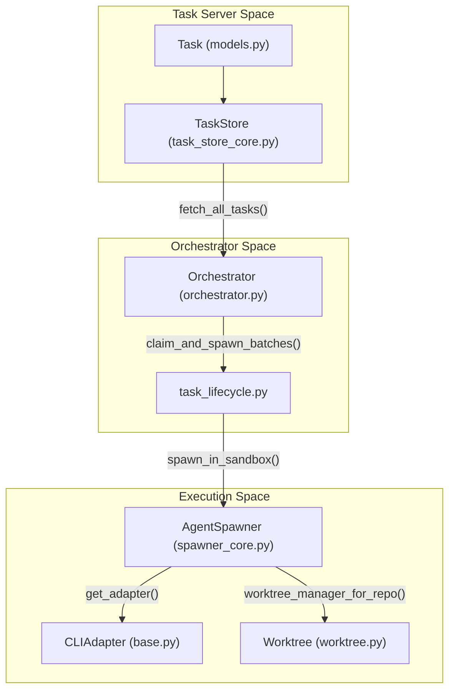

Sources: [src/bernstein/core/orchestration/orchestrator.py:94-104](), [src/bernstein/core/tasks/task_lifecycle.py:1-6](), [src/bernstein/core/agents/spawner_core.py:15-26](), [src/bernstein/core/tasks/models.py:152-167]()

---

## 2. The State Directory (`.sdd/`)

Bernstein uses a file-based state model stored under the directory `.sdd/` (State Definition Directory). This approach ensures that all orchestration state is transparent, filesystem-backed, and recoverable after crashes.

| Directory         | Content Description                        | Implementation Reference                              |
|-------------------|-------------------------------------------|------------------------------------------------------|
| `.sdd/tasks/`     | JSONL logs recording every task mutation | [src/bernstein/core/tasks/task_store_core.py:52-80]() |
| `.sdd/runtime/`   | Agent heartbeats, locks, completion signals | [src/bernstein/core/agents/spawner_core.py:175-195]() |
| `.sdd/agents/`    | Cached agent role definitions and catalogs | [src/bernstein/agents/catalog.py:27-30]()            |
| `.sdd/wal/`       | Write-Ahead Log (WAL) for recovery        | [src/bernstein/core/orchestration/orchestrator.py:143-144]() |

The `.sdd/` directory acts as a shared durable ledger coordinating the state transitions of tasks and agents without requiring a central database.

---

## 3. Orchestration Components

### The Janitor and Completion Signals

The **Janitor** subsystem enforces correctness and quality gates on task completion. Before a task can transition to `DONE`, the Janitor verifies that all configured **Completion Signals** pass—these signals act as checkpoints or evidence conditions.

- **Completion Signals** can be diverse, including:
  - `path_exists` — check that a file path is present.
  - `test_passes` — run test suites and require success.
  - `api_responds` — verify API endpoints return expected results.
  - `llm_judge` — language-model based judgment (as a QA step).
  
- **Verification Flow:** When an agent reports completion, the Janitor checks these signals before the orchestrator moves the task to `DONE` [src/bernstein/core/tasks/task_lifecycle.py:38-40](), [src/bernstein/core/tasks/task_store_core.py:30-35]().

### The Audit Chain and Lineage

Bernstein maintains an **HMAC-chained audit log** recording every important event in the system, ensuring tamper-evident transparency.

- This log is modeled as a **chain** where each event contains the HMAC of the previous event, enabling offline verification and strong integrity guarantees.

- **Lineage** tracks the provenance of every code artifact produced by agents, mapping commits and outputs back to the originating tasks and agent sessions.

- Together, they provide cryptographically verifiable audit trails for every code and artifact modification [src/bernstein/core/security/audit_chain.py:1-150](), [src/bernstein/core/tasks/task_store_core.py:98-114]().

### Worktree Isolation

Each agent runs inside an isolated **Git worktree** created specifically for the task. Worktrees provide filesystem and git isolation, avoiding merge conflicts, enabling atomic merges, and supporting parallelism.

- The **WorktreeManager** tracks the lifecycle of these worktrees—creation, classification, and eventual garbage collection.

- This isolation guarantees no mutable shared state between concurrent agents, supporting deterministic replayability [src/bernstein/core/agents/spawner_core.py:80-90]().

---

## 4. Execution Lifecycle

The Orchestrator executes a deterministic "tick" loop managing task progression and agent spawning. During each tick:

1. The `TaskStore` is queried for all tasks [fetch_all_tasks()].

2. Tasks are grouped by role, dependencies are resolved, and batches of tasks ready for execution are claimed.

3. An `AgentSpawner` creates the isolated environment (worktree), selects/adapts the agent role, and launches the agent process.

4. Agents execute independently, modifying files inside their worktrees.

5. Upon agent completion, the orchestrator invokes the **Janitor** to verify all completion signals.

6. If verified, tasks transition to `DONE`; otherwise, retry or fail logic is applied.

**Sequence Diagram of Orchestrator Tick:**

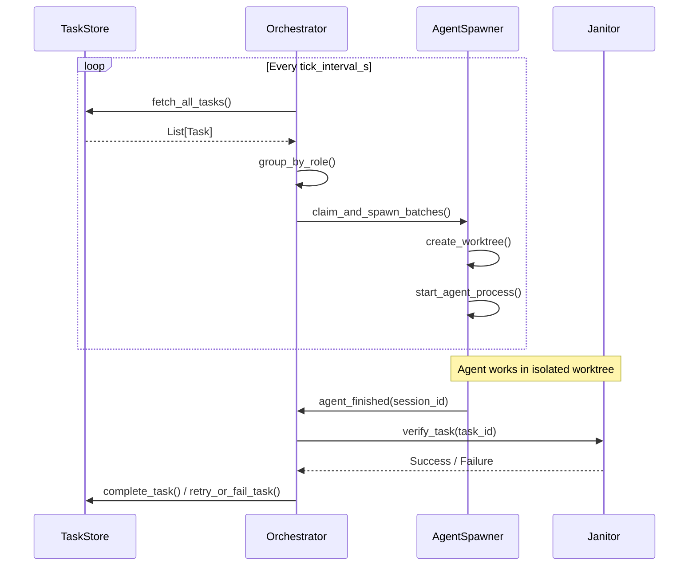

Sources: [src/bernstein/core/orchestration/orchestrator.py:94-110](), [src/bernstein/core/tasks/task_lifecycle.py:131-141](), [src/bernstein/core/agents/spawner_core.py:28-42]()

---

## 5. The Plan Formats: TaskPlan and Plan YAML

Bernstein workflows are defined declaratively using **Plan YAML** schemas:

- A **Plan** is a declarative YAML file describing a directed acyclic graph (DAG) of tasks, their dependencies, roles, and orchestration parameters.

- The **TaskPlan** is a higher-level abstraction that may aggregate or refine Plans dynamically, facilitating automatic task decomposition and incremental execution [src/bernstein/core/orchestration/orchestrator.py:103-104]().

These plans form the "recipe" that the orchestrator executes via the agent/task lifecycle.

---

## 6. The Agent Card

Each agent session creates an **Agent Card**:

- It is a signed manifest attesting to the identity, role, capabilities, environment, model adapter, and configuration of that agent instance.

- The Agent Card serves as cryptographic evidence for audits and verification, enabling offline trust and forensic analysis.

- Agent Card generation and verification are integrated into agent session startup and completion procedures [src/bernstein/agents/catalog.py:47-72]().

---

## 7. The `.bernstein/rules.yaml` Organizational Rule Enforcement File

Bernstein supports organizational policy enforcement via `.bernstein/rules.yaml`:

- This file encodes rules for enforcing role permissions, task creation policies, adapter configuration limits, and other governance rules.

- The orchestrator and task server validate these rules during task lifecycles and agent admissions to ensure compliance with organizational standards.

- The rules file enables teams to enforce guardrails declaratively without modifying orchestration code.

---

# Summary Table of Fundamental Terms

| Term                  | Description                                               | Representative File / Class / Function                  |
|-----------------------|-----------------------------------------------------------|---------------------------------------------------------|
| **Task**              | Discrete unit of work with lifecycle and file ownership. | `Task` (models.py) [src/bernstein/core/tasks/models.py:152-167]() |
| **Agent**             | Short-lived process executing a Task, configured by Role. | `AgentSpawner` (spawner_core.py) [src/bernstein/core/agents/spawner_core.py:15-30]() |
| **Role**              | Classification driving agent prompts and capabilities.   | Role catalog [src/bernstein/agents/catalog.py:32-43]()  |
| **Worktree**          | Git worktree isolation for agent execution.               | `WorktreeManager` [src/bernstein/core/agents/spawner_core.py:80-90]() |
| **.sdd/**             | File-based state directory for durable orchestration state. | [src/bernstein/core/tasks/task_store_core.py:52-80]()   |
| **TaskPlan/Plan YAML**| Declarative workflow definitions in YAML format.          | [src/bernstein/core/orchestration/orchestrator.py:103-104]() |
| **Completion Signal** | Validation checkpoints for task completion.                | [src/bernstein/core/tasks/task_store_core.py:30-35]()   |
| **Janitor**           | Verification engine enforcing quality gates on tasks.     | [src/bernstein/core/tasks/task_lifecycle.py:38-40]()    |
| **Audit Chain**       | HMAC-chained tamper-evident event log.                     | [src/bernstein/core/security/audit_chain.py:1-50]()     |
| **Agent Card**        | Signed attestation of agent identity and configuration.    | [src/bernstein/agents/catalog.py:47-72]()               |
| **.bernstein/rules.yaml** | Organizational rule enforcement file.                    | Enforcement hooks (dispersed in orchestration code)     |

---

This page covers the foundational concepts and entities essential for understanding Bernstein’s internal engine, data flows, and compliance mechanisms. For deeper technical details about each subsystem, see the linked pages and source files.

Sources:  
[src/bernstein/core/orchestration/orchestrator.py:1-149](),  
[src/bernstein/core/tasks/models.py:1-167](),  
[src/bernstein/core/tasks/task_lifecycle.py:1-153](),  
[src/bernstein/core/agents/spawner_core.py:1-95](),  
[src/bernstein/agents/catalog.py:25-85](),  
[src/bernstein/core/tasks/task_store_core.py:25-85](),  
[src/bernstein/core/security/audit_chain.py:1-150]()

---

# Page: Architecture

# Architecture

<details>
<summary>Relevant source files</summary>

The following files were used as context for generating this wiki page:

- [docs/architecture/ARCHITECTURE.md](docs/architecture/ARCHITECTURE.md)
- [docs/gui/index.md](docs/gui/index.md)
- [docs/guides/index.md](docs/guides/index.md)
- [docs/operations/work-ledger.md](docs/operations/work-ledger.md)
- [src/bernstein/cli/__init__.py](src/bernstein/cli/__init__.py)
- [src/bernstein/cli/commands/ledger_cmd.py](src/bernstein/cli/commands/ledger_cmd.py)
- [src/bernstein/cli/commands/resume_cmd.py](src/bernstein/cli/commands/resume_cmd.py)
- [src/bernstein/cli/helpers.py](src/bernstein/cli/helpers.py)
- [src/bernstein/core/__init__.py](src/bernstein/core/__init__.py)
- [src/bernstein/core/agents/prompt_cache_locality.py](src/bernstein/core/agents/prompt_cache_locality.py)
- [src/bernstein/core/agents/spawn_prompt.py](src/bernstein/core/agents/spawn_prompt.py)
- [src/bernstein/core/compat_redirect_ledger.py](src/bernstein/core/compat_redirect_ledger.py)
- [src/bernstein/core/defaults.py](src/bernstein/core/defaults.py)
- [src/bernstein/core/git/changelog.py](src/bernstein/core/git/changelog.py)
- [src/bernstein/core/git/git_context.py](src/bernstein/core/git/git_context.py)
- [src/bernstein/core/knowledge/knowledge_base.py](src/bernstein/core/knowledge/knowledge_base.py)
- [src/bernstein/core/observability/loop_detector.py](src/bernstein/core/observability/loop_detector.py)
- [src/bernstein/core/observability/prometheus.py](src/bernstein/core/observability/prometheus.py)
- [src/bernstein/core/persistence/ledger_git.py](src/bernstein/core/persistence/ledger_git.py)
- [src/bernstein/core/persistence/wal.py](src/bernstein/core/persistence/wal.py)
- [tests/property/__init__.py](tests/property/__init__.py)
- [tests/property/test_wal_cas_bughunt.py](tests/property/test_wal_cas_bughunt.py)
- [tests/unit/test_acp.py](tests/unit/test_acp.py)
- [tests/unit/test_audit_chain_work_ledger.py](tests/unit/test_audit_chain_work_ledger.py)
- [tests/unit/test_bandit_router.py](tests/unit/test_bandit_router.py)
- [tests/unit/test_cli_server_url.py](tests/unit/test_cli_server_url.py)
- [tests/unit/test_container_wiring.py](tests/unit/test_container_wiring.py)
- [tests/unit/test_differential_privacy.py](tests/unit/test_differential_privacy.py)
- [tests/unit/test_eu_ai_act.py](tests/unit/test_eu_ai_act.py)
- [tests/unit/test_incident.py](tests/unit/test_incident.py)
- [tests/unit/test_license_scanner.py](tests/unit/test_license_scanner.py)
- [tests/unit/test_llm_watcher_detector_pack.py](tests/unit/test_llm_watcher_detector_pack.py)
- [tests/unit/test_mcp_cmd.py](tests/unit/test_mcp_cmd.py)
- [tests/unit/test_memory_integrity.py](tests/unit/test_memory_integrity.py)
- [tests/unit/test_merkle.py](tests/unit/test_merkle.py)
- [tests/unit/test_prompt_cache_locality.py](tests/unit/test_prompt_cache_locality.py)
- [tests/unit/test_prompt_cache_locality_vendors.py](tests/unit/test_prompt_cache_locality_vendors.py)
- [tests/unit/test_run_benchmark.py](tests/unit/test_run_benchmark.py)
- [tests/unit/test_runbooks.py](tests/unit/test_runbooks.py)
- [tests/unit/test_spawn_prompt_memory_inject.py](tests/unit/test_spawn_prompt_memory_inject.py)
- [tests/unit/test_wal.py](tests/unit/test_wal.py)
- [tests/unit/test_wal_replay.py](tests/unit/test_wal_replay.py)
- [tests/unit/test_workflow.py](tests/unit/test_workflow.py)

</details>


Bernstein is designed as a deterministic orchestration system that coordinates autonomous agents to achieve complex engineering goals. Unlike "agentic" frameworks that rely on LLMs to manage their own control flow, Bernstein employs a **three-tier architecture** where core logic—task scheduling, dependency management, and state transitions—is implemented in high-integrity Python code.

This architecture enables a clear transition from "Natural Language Space" (goals and plans) to "Code Entity Space" (tasks and processes) through a structured pipeline, ensuring auditability, reproducibility, and safe concurrency.

---

## The Three-Tier Model

Bernstein's system is organized into three distinct operational layers:

### 1. Frontend (CLI/TUI/Web)

Users interact with Bernstein through CLI commands, an optional Textual-based terminal UI (TUI), or a React web dashboard. These frontend components communicate with the Task Server exclusively via a REST API and Server-Sent Events (SSE), guaranteeing a clean separation from the backend.

- CLI commands (`bernstein`) and TUI issue HTTP requests and listen for SSE events.
- The web dashboard interfaces through REST and WebSocket APIs.
  
### 2. Task Server (FastAPI)

The Task Server, running on default port 8052, acts as the authoritative data store and API gateway for the Bernstein system.

- It manages the task graph, user sessions, rate limiting, authentication, and audit logging.
- Implements FastAPI routes to serve tasks, agents, audits, and various other resources.
- Provides API version parity and supports WebSocket and SSE for real-time updates.

### 3. Orchestrator and Agents

The Orchestrator embodies the system's execution engine.

- Runs a single-threaded "tick" loop that drives the state machine of tasks, performing claim, spawn, monitor, and cleanup operations.
- Spawns isolated `AgentSession` processes to work on tasks, using adapters that wrap various LLM providers or tools.
- The Janitor performs verification and cleanup duties post-agent completion.
- Implements batching strategies, dead letter queues, write-ahead logging (WAL), and manages graceful shutdown (drain) workflows.
  
### Three-Tier Interaction Diagram

This diagram bridges Bernstein's natural-language workflow terms with concrete code entities that implement them, showing data and control flow across tiers.

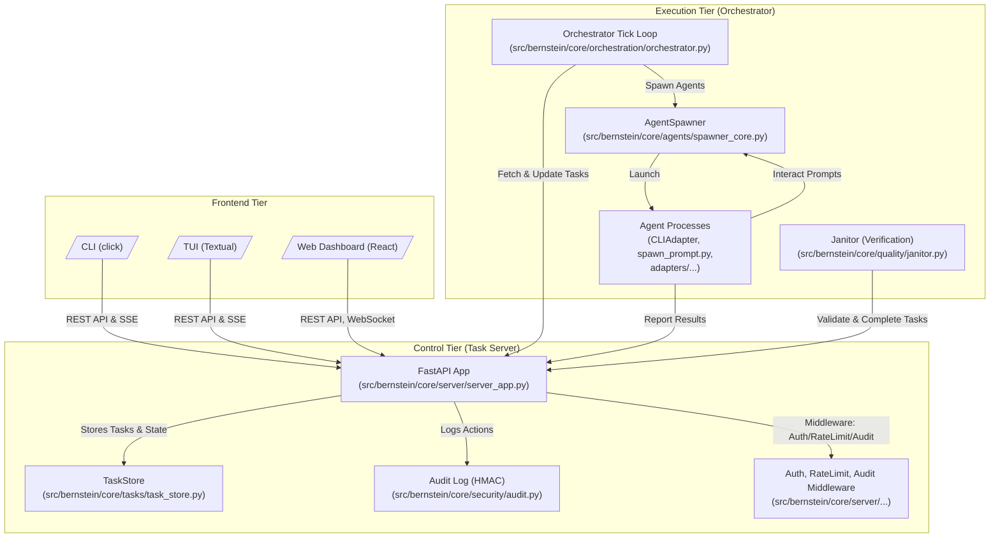

Sources: [src/bernstein/core/server/server_app.py:24-55](), [src/bernstein/core/orchestration/orchestrator.py:6-15](), [src/bernstein/core/agents/spawner_core.py:10-30](), [src/bernstein/core/security/audit.py:180-200](), [src/bernstein/core/quality/janitor.py:1-25]().

---

## File-Based State Model (`.sdd/`)

Bernstein employs a file-based, local-first persistence model centered around the `.sdd/` directory within each workspace. This directory acts as the core system state repository, enabling atomic file operations, crash safety, and audit-grade logs without requiring heavyweight database systems.

Key subdirectories and their roles:

- **`backlog/`**: Contains subfolders like `open/`, `claimed/`, and `done/` where serialized JSON files represent task states. Tasks move between these based on their status updates.
- **`runtime/`**: Holds ephemeral state such as active process PID files, agent session tokens, and the orchestrator's Write-Ahead Log (WAL).
- **`audit/`**: Stores tamper-evident HMAC-chained audit logs that record every significant system event for compliance and traceability.
- **`agents/`**: Metadata about current and dead agents, facilitating tracking and debugging.
- **`mcp/`**: Includes Model Context Protocol tools and inventories used by agents and the orchestrator.

This structure enables Bernstein to survive crashes, permit offline operation, and provide a transparent state layout that users and operators can inspect manually.

For comprehensive details, see [Persistence and State Management](#2.6).

Sources: [src/bernstein/core/tasks/models.py:150-175](), [src/bernstein/core/persistence/wal.py:1-60](), [src/bernstein/core/security/audit.py:180-200]().

---

## Major Subsystems Overview

### Task Server and API

The `FastAPI`-based Task Server (default port 8052) hosts the authoritative task state machine and exposes REST APIs for:

- Task CRUD operations and lifecycle transitions.
- Agent registration, heartbeats, and logs.
- Audit event submission and lineage queries.
- Real-time updates via SSE and WebSocket endpoints.

It includes robust middleware for authentication (JWT, OIDC, SAML), rate limiting, and audit metadata enrichment. Routes are organized modularly under `src/bernstein/core/routes/`.

For technical details on startup, middleware, route modules, and API version compatibility, see [Task Server and API](#2.1).

Sources: [src/bernstein/core/server/server_app.py:20-60](), [src/bernstein/core/server/api_compat.py:1-30]().

---

### Orchestrator and Task Lifecycle

The Orchestrator runs a stateful tick loop that:

- Queries the Task Store API for open and claimable tasks.
- Claims batches of tasks grouped by agent role and validates dependencies using `DependencyValidator`.
- Spawns agents via the `AgentSpawner` for tasks in `OPEN` status.
- Monitors agent progress and transitions task states through the lifecycle (`OPEN → CLAIMED → IN_PROGRESS → DONE → CLOSED`).
- Detects and handles conflicts such as file ownership clashes.
- Maintains durability and determinism via the Write-Ahead Log (WAL), supporting crash recovery.
- Supports a Dead Letter Queue (DLQ) for tasks that repeatedly fail.
- Coordinates graceful shutdown and drain sequences.

For a full explanation of the orchestrator tick phases, task state machine, batching strategies, and shutdown handling, see [Orchestrator and Task Lifecycle](#2.2).

Sources: [src/bernstein/core/orchestration/orchestrator.py:10-50](), [src/bernstein/core/tasks/task_lifecycle.py:40-80](), [src/bernstein/core/persistence/wal.py:1-130]().

---

### Agent Spawning and Adapters

The `AgentSpawner` abstracts the process of isolating and launching agent subprocesses:

- Supports multiple adapter types (`CLIAdapter`s) for different LLM APIs and tools (Claude, Codex, Gemini, Aider, Qwen, Cursor, Copilot, etc.).
- Manages lifecycle events: spawn, watchdog supervision, and cleanup/reaping.
- Runs agents inside isolated git worktrees or sandbox backends to prevent state collisions.
- Handles environment isolation and LLM rate limit detection.
- Implements a `bernstein-worker` wrapper to unify agent bootstrap and messaging.

For the architecture of the spawning system, adapter catalog, and process control flow, see [Agent Spawning and Adapters](#2.3).

Sources: [src/bernstein/core/agents/spawner_core.py:10-40](), [src/bernstein/core/agents/spawn_prompt.py:1-50]().

---

### Planning and Task Decomposition

Goals provided by the user or system are converted into detailed task graphs by the Planner subsystem:

- The Planner reads and composes `Plan` YAML schemas defining workflows and dependencies.
- The `Manager` agent role authorizes recursive task decomposition, automatically splitting large tasks into manageable sub-tasks.
- Uses a refinement loop involving critics and adversaries to vet plans before execution.
- Supports vertical slice planning, a workflow DSL, and domain-specific Recipe execution.
- Ships with a library of 24 ready-made plan templates in `examples/plans/`.

For insight into plan interpretation, decomposition, refinement, and templates, see [Planning and Task Decomposition](#2.4).

Sources: [src/bernstein/core/planning/planner.py:1-60](), [src/bernstein/core/agents/spawn_prompt.py:20-60]().

---

### Git Integration and Worktree Isolation

To avoid concurrency conflicts and ensure agent workspace integrity:

- Bernstein leverages `git worktrees` to provide isolated checkouts per agent.
- `WorktreeManager` handles lifecycle: create, classify (busy/free), and reaping stale worktrees.
- Incremental merges and PR generation support multi-agent integration.
- Incorporates aggressive git hygiene checks, a merge queue, and auto-committing drain sequences to ensure safe and traceable merges.

See [Git Integration and Worktree Isolation](#2.5) for the detailed handling of worktree lifecycle, merges, and PR automation.

Sources: [src/bernstein/core/git/changelog.py:10-50](), [src/bernstein/core/agents/spawner_core.py:70-110]().

---

## Code Entity Mapping: Task Lifecycle

To connect high-level task states to precise code functions and classes, the diagram below illustrates the state machine governing task progression and the orchestrator components responsible for each transition.

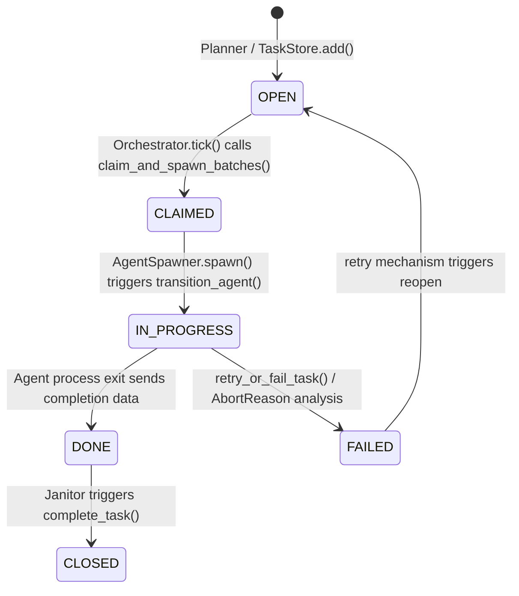

Sources: [src/bernstein/core/orchestration/orchestrator.py:130-150](), [src/bernstein/core/tasks/task_lifecycle.py:45-80](), [src/bernstein/core/tasks/models.py:150-170]().

---

## Operational Safety and Draining

Bernstein supports robust operational safety, including a sophisticated shutdown protocol implemented in the `DrainCoordinator`.

When a drain is triggered (e.g., via `bernstein stop`), the system performs a phased shutdown:

1. Freeze acceptance of new tasks.
2. Signal active agents to checkpoint and stop accepting new inputs (using `write_shutdown_signals()`).
3. Commit all outstanding changes within active worktrees.
4. Perform final merges and cleanups before process termination.

This sequence ensures no data loss, clean task completion, and graceful worker termination.

For the complete orchestration shutdown flow, see [Orchestrator and Task Lifecycle](#2.2).

Sources: [src/bernstein/core/orchestration/drain.py:40-80](), [src/bernstein/cli/commands/stop_cmd.py:90-130]().

---

# Child Pages for Deeper Details

- [Task Server and API](#2.1) — Server startup, API routes, models, middleware, and real-time event support.
- [Orchestrator and Task Lifecycle](#2.2) — Task state machine, tick loop, batching, WAL, DLQ, and graceful shutdown.
- [Agent Spawning and Adapters](#2.3) — Agent lifecycle, CLIAdapters, isolation, and supported LLM provider adapters.
- [Planning and Task Decomposition](#2.4) — Planner internals, task graph construction, refinement, and plan templates.
- [Git Integration and Worktree Isolation](#2.5) — Worktree management, incremental merge, and related git workflows.
- [Persistence and State Management](#2.6) — File-based state layout, WAL details, checkpoints, and optional backend support.

This hierarchical structure allows readers to explore from a concise architectural overview down into system internals and code specifics.

---

Sources:  
[src/bernstein/core/__init__.py:1-70](),  
[src/bernstein/core/orchestration/orchestrator.py:6-25](),  
[src/bernstein/core/server/server_app.py:20-70](),  
[src/bernstein/core/agents/spawner_core.py:10-30](),  
[src/bernstein/core/security/audit.py:180-200](),  
[src/bernstein/core/tasks/models.py:150-175](),  
[src/bernstein/core/persistence/wal.py:1-130](),  
[src/bernstein/core/agents/spawn_prompt.py:1-100](),  
[src/bernstein/core/git/changelog.py:15-45](),  
[src/bernstein/core/orchestration/drain.py:40-80](),  
[src/bernstein/cli/commands/stop_cmd.py:90-130]()

---

# Page: Task Server and API

# Task Server and API

<details>
<summary>Relevant source files</summary>

The following files were used as context for generating this wiki page:

- [src/bernstein/core/agents/claude_max_turns.py](src/bernstein/core/agents/claude_max_turns.py)
- [src/bernstein/core/lifecycle/__init__.py](src/bernstein/core/lifecycle/__init__.py)
- [src/bernstein/core/memory/sqlite_store.py](src/bernstein/core/memory/sqlite_store.py)
- [src/bernstein/core/observability/apm_integration.py](src/bernstein/core/observability/apm_integration.py)
- [src/bernstein/core/observability/cascading_failure_circuit_breaker.py](src/bernstein/core/observability/cascading_failure_circuit_breaker.py)
- [src/bernstein/core/observability/datadog_export.py](src/bernstein/core/observability/datadog_export.py)
- [src/bernstein/core/orchestration/adaptive_tick.py](src/bernstein/core/orchestration/adaptive_tick.py)
- [src/bernstein/core/orchestration/convergence_guard.py](src/bernstein/core/orchestration/convergence_guard.py)
- [src/bernstein/core/orchestration/orchestrator_config.py](src/bernstein/core/orchestration/orchestrator_config.py)
- [src/bernstein/core/orchestration/orchestrator_health.py](src/bernstein/core/orchestration/orchestrator_health.py)
- [src/bernstein/core/routes/_sse.py](src/bernstein/core/routes/_sse.py)
- [src/bernstein/core/routes/_unconfigured.py](src/bernstein/core/routes/_unconfigured.py)
- [src/bernstein/core/routes/acp.py](src/bernstein/core/routes/acp.py)
- [src/bernstein/core/routes/agents.py](src/bernstein/core/routes/agents.py)
- [src/bernstein/core/routes/auth.py](src/bernstein/core/routes/auth.py)
- [src/bernstein/core/routes/costs.py](src/bernstein/core/routes/costs.py)
- [src/bernstein/core/routes/health.py](src/bernstein/core/routes/health.py)
- [src/bernstein/core/routes/paginated_tasks.py](src/bernstein/core/routes/paginated_tasks.py)
- [src/bernstein/core/routes/plans.py](src/bernstein/core/routes/plans.py)
- [src/bernstein/core/routes/sla.py](src/bernstein/core/routes/sla.py)
- [src/bernstein/core/routes/status_events.py](src/bernstein/core/routes/status_events.py)
- [src/bernstein/core/routes/status_lifecycle.py](src/bernstein/core/routes/status_lifecycle.py)
- [src/bernstein/core/routes/task_crud.py](src/bernstein/core/routes/task_crud.py)
- [src/bernstein/core/routes/task_detail.py](src/bernstein/core/routes/task_detail.py)
- [src/bernstein/core/routes/tasks.py](src/bernstein/core/routes/tasks.py)
- [src/bernstein/core/routes/telemetry_webhooks.py](src/bernstein/core/routes/telemetry_webhooks.py)
- [src/bernstein/core/routes/tracker_webhooks.py](src/bernstein/core/routes/tracker_webhooks.py)
- [src/bernstein/core/routes/webhooks.py](src/bernstein/core/routes/webhooks.py)
- [src/bernstein/core/routes/websocket.py](src/bernstein/core/routes/websocket.py)
- [src/bernstein/core/routes/well_known.py](src/bernstein/core/routes/well_known.py)
- [src/bernstein/core/routes/workspace.py](src/bernstein/core/routes/workspace.py)
- [src/bernstein/core/server/server_app.py](src/bernstein/core/server/server_app.py)
- [src/bernstein/core/server/server_models.py](src/bernstein/core/server/server_models.py)
- [src/bernstein/core/tokens/compaction_receipt.py](src/bernstein/core/tokens/compaction_receipt.py)
- [src/bernstein/core/tokens/context_compression.py](src/bernstein/core/tokens/context_compression.py)
- [src/bernstein/core/tokens/sensitive_gate.py](src/bernstein/core/tokens/sensitive_gate.py)
- [src/bernstein/core/tokens/template_compression.py](src/bernstein/core/tokens/template_compression.py)
- [templates/adapters/TEMPLATE.py](templates/adapters/TEMPLATE.py)
- [tests/contract/test_task_server_schemathesis.py](tests/contract/test_task_server_schemathesis.py)
- [tests/unit/test_auto_commit_on_complete.py](tests/unit/test_auto_commit_on_complete.py)
- [tests/unit/test_automation_bridge_route.py](tests/unit/test_automation_bridge_route.py)
- [tests/unit/test_claude_max_turns.py](tests/unit/test_claude_max_turns.py)
- [tests/unit/test_cli_agents.py](tests/unit/test_cli_agents.py)
- [tests/unit/test_cost_per_line.py](tests/unit/test_cost_per_line.py)
- [tests/unit/test_generic_webhook.py](tests/unit/test_generic_webhook.py)
- [tests/unit/test_issue_3166_unconfigured_subsystem_status.py](tests/unit/test_issue_3166_unconfigured_subsystem_status.py)
- [tests/unit/test_route_input_validation.py](tests/unit/test_route_input_validation.py)
- [tests/unit/test_task_create_bounds.py](tests/unit/test_task_create_bounds.py)

</details>


The Bernstein Task Server is a high-performance **FastAPI** application running by default on port **8052**, serving as the central coordination hub for the orchestration runtime. It manages the task backlog, agent lifecycle, inter-agent communication, real-time observability through SSE events, and enforces audit-grade compliance via an HMAC audit chain.

This page documents in detail the server's startup and bootstrap process, route structure and organization, API versioning practices, server models, middleware stack (authentication, rate limiting, audit logging), Server-Sent Events (SSE) event system, and WebSocket support. It covers all route modules located under `src/bernstein/core/routes/`.

---

## Startup and Bootstrap

The server's lifecycle is managed primarily by the bootstrap and server application modules. The bootstrap process ensures environment readiness, including file-system state and process locks, before instantiating the FastAPI application.

### Key Steps in Server Bootstrap

1. **PID Locking**  
   To prevent multiple concurrent server instances on the same worktree, a PID lock file `.sdd/runtime/bernstein.pid` is acquired on startup via `_acquire_pid_lock` [src/bernstein/core/orchestration/bootstrap.py:74-108](). This mutual exclusion ensures that only one server modifies the state directory concurrently.

2. **File System Readiness: `.sdd/` Directory Structure**  
   The standard Bernstein state directory `.sdd/` is validated and created if missing by the `ensure_sdd()` function. This directory includes sub-folders for backlog, agents, runtime caches, and audit metadata used by the server and orchestrator [src/bernstein/core/orchestration/bootstrap.py:175-184]().

3. **FastAPI Application Factory: `create_app()`**  
   The FastAPI app is created via the `create_app()` function in `server_app.py` which:  
   - Instantiates and mounts core state stores such as the `TaskStore` (task backlog management), the `SSEBus` (event distribution), and the `BulletinBoard` (cross-agent message broadcast).  
   - Attaches middleware such as the authentication middleware, rate limiting middleware, crash guards, and body size limits.  
   - Mounts the route modules to expose HTTP REST API endpoints.  
   - Initializes shared application state for tenant registry, audit chain, and task coordination [src/bernstein/core/server/server_app.py:24-55]().

4. **Server Supervision and Graceful Shutdown**  
   The server runs in a supervisor-managed loop which handles clean startup, graceful shutdown on signals, and auto-restarts upon failure. This robustness is crucial in production deployments [src/bernstein/core/orchestration/bootstrap.py:64]().

---

### Task Server Component Mapping

This diagram bridges the conceptual runtime components of Bernstein’s Task Server with their implementation classes and code entities.

```mermaid
graph TD
    subgraph "Code Entity Space"
        App[FastAPI_app:create_app()]
        Store[TaskStore<br/>(src/bernstein/core/tasks/task_store.py)]
        SSE[SSEBus<br/>(src/bernstein/core/server/server_app.py)]
        Bulletin[BulletinBoard<br/>(src/bernstein/core/bulletin.py)]
        Middleware[RequestRateLimitMiddleware]
        Audit[AuditChain<br/>(src/bernstein/core/security/audit.py)]
    end

    subgraph "Logical System Space"
        API[API Endpoint on Port 8052]
        Backlog[Task Backlog Persistence]
        Events[Real-time Server-Sent Events]
        Messages[Inter-Agent Messaging & Bulletins]
        SecurityAudit[HMAC Audit & Compliance]
    end

    App -- mounts --> Store
    App -- mounts --> SSE
    App -- mounts --> Bulletin
    App -- uses --> Middleware
    API -- "HTTP REST API implemented by" --> App
    Store -- persists --> Backlog
    SSE -- distributes --> Events
    Bulletin -- broadcasts --> Messages
    SecurityAudit -- implemented by --> Audit
```

Sources: [src/bernstein/core/server/server_app.py:24-55](), [src/bernstein/core/orchestration/bootstrap.py:74-184](), [src/bernstein/core/security/audit.py:1-20](), [src/bernstein/core/bulletin.py:5-45]().

---

## Route Structure and API Versioning

The Bernstein Task Server organizes its API via FastAPI's `APIRouter` system, modularizing route handlers into cohesive focus areas under `src/bernstein/core/routes/`. This structure facilitates maintainability and incremental development while preserving a backward-compatible root router.

### Modular Route Organization

The main task routes are split across these submodules and re-composed inside `task.py`:

| Module Name           | Description                                  | Main Endpoints / Features                    |
|----------------------|----------------------------------------------|---------------------------------------------|
| `task_crud`          | Core Task-CRUD, agent heartbeats, bulletins, direct channels | `/tasks` POST, GET, PATCH, agent heartbeats, bulletin endpoints |
| `task_a2a`           | Agent-to-Agent federation protocol routes    | Federation handshake, artifact exchange     |
| `task_cluster`       | Multi-node cluster management                 | Node join/leave, capacity, health checks    |
| `task_artifacts`     | Task artifact upload/download                  | Artifact-related APIs                        |
| `task_claim_receipt` | Claim receipt recording for audit trail       | Claim receipt endpoints                      |
| `task_mailbox`       | Agent mailbox messaging                        | Inbox and notification routes                |
| `task_steer`         | Task steering, cancellation, and backpressure | Task control commands                        |

These are all included into a single router via `router.include_router()` calls internally [src/bernstein/core/routes/tasks.py:13-42]().

Additional route modules outside `task.py` implement domain-specific features such as:

| Module Name       | Description                                       | Key Endpoints or Areas                    |
|-------------------|-------------------------------------------------|------------------------------------------|
| `costs.py`        | Cost budget and real-time spend metrics          | `/costs`, `/events/cost`, `/costs/efficiency` |
| `auth.py`         | Authentication: OIDC, SAML, device flow, logout | `/auth/*` auth endpoints                  |
| `webhooks.py`     | External webhook triggers                         | `/webhook` (GitHub/GitLab) POST           |
| `telemetry_webhooks.py` | Telemetry-based autofix webhook receivers  | `/webhooks/telemetry/<source>/`           |
| `well_known.py`   | Static manifest, JWKS keys, and agent card       | `/.well-known/*` routes                    |
| `status_events.py` | Server liveness health and status                | `/health`, `/health/ready`, `/status`     |
| `websocket.py`    | WebSocket support for interactive clients         | `/ws` WebSocket endpoint                   |

---

### API Versioning and Compatibility

Bernstein currently exposes a stable REST API on port 8052 without explicit numeric versioning in URLs. Backwards compatibility is ensured by:

- Keeping all routes under the `/tasks`, `/auth`, and `/webhook` namespaces with stable request and response models.
- Composing route handlers from focused submodules reducible to minimal modifications.
- Employing Pydantic models under `server_models.py` for request/response validation, with careful addition of non-breaking fields.
- Using deprecated patterns remapped transparently in legacy modules like `task.py` which aggregates multiple focused routers.

This strategy allows progressive API evolution without disruptive breaking changes.

---

### API Data Flow Example (Task Creation & Claiming)

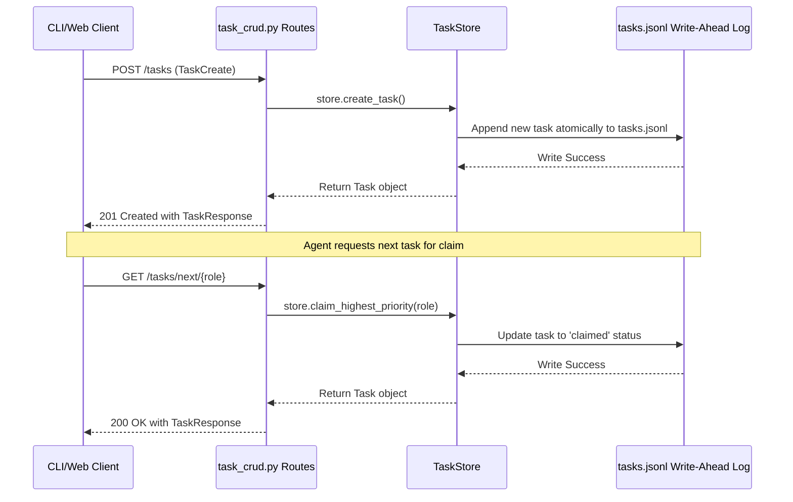

Sources: [src/bernstein/core/routes/task_crud.py:1-73](), [src/bernstein/core/routes/tasks.py:1-42]().

---

## Server Models (Pydantic Request/Response Schemas)

Bernstein uses Pydantic BaseModel classes for data validation and serialization of API requests and responses, located centrally in `server_models.py`. These models enforce length and type constraints to protect against payload exhaustion or malformed inputs.

### Highlights of Server Models

- **TaskCreate**: Model for task creation requests. Enforces caps on string length (e.g., title ≤ 500 chars), list lengths (e.g., depends_on ≤ 100), and dictionary serialization sizes to prevent abuse [src/bernstein/core/server/server_models.py:110-430]().

- **CompletionSignalSchema**: Models completion signals used for automated task completion checks.

- **TaskResponse**: Serialized view of a task sent back to clients, including all task metadata and status.

- **BatchClaimRequest / Response**: Used for advanced batch claiming of tasks by agents to reduce coordination overhead.

- **AgentKillResponse, AgentLogsResponse**: Agent lifecycle and telemetry-related response models.

These models also implement validators for sanitizing free text fields (to prevent log injection) and validating enumerated task fields, ensuring robust interface guarantees.

Sources: [src/bernstein/core/server/server_models.py:20-430]().

---

## Middleware

The Bernstein server employs a multi-layered middleware stack for security, performance, and reliability.

### 1. Authentication and Rate Limiting

- **RequestRateLimitMiddleware**: Applies per-IP rate limits with separate buckets for critical endpoints like `/tasks` and `/auth`. The limits throttle write requests to prevent abuse (typical default ~30 writes per minute and 300 reads per minute) [src/bernstein/core/auth_rate_limiter.py:112-183]().

- **Auth Middleware**: Various authentication middlewares integrate with the stateful AuthService to enforce JWT token checks, session validation, and RBAC against request roles [src/bernstein/core/routes/auth.py:1-120]().

### 2. Body Size Limiting

- **ContentLengthMiddleware**: Rejects incoming HTTP request bodies larger than 1MB (configurable), with early termination returning `413 Request Entity Too Large`. This prevents memory exhaustion and large request abuse before route handlers run [src/bernstein/core/server/server_app.py:74-186]().

### 3. Audit and Crash Guards

- **CrashGuardMiddleware**: Catches any unhandled exceptions from route handlers to ensure the server remains alive and returns structured 500 errors [src/bernstein/core/server/server_app.py:41-44]().

- **StructuredAccessLogMiddleware**: Instrumentation middleware for structured logging of request metadata and timing.

- **HMAC Audit Chain**: The audit chain middleware records every significant event in the system into a tamper-evident HMAC-SHA256 chained ledger. This supports regulatory compliance and forensic tracing of state changes [src/bernstein/core/security/audit.py:150-200]().

---

## Server-Sent Events (SSE)

Bernstein extensively uses SSE to deliver real-time streaming updates to clients and agents.

### Core SSE Components

- **`SSEBus`**: Central event bus for publishing and subscribing to events. The `SSEBus` manages subscriber queues and broadcasts messages concurrently to subscribed clients [src/bernstein/core/server/server_app.py:10-40]().

- **Bulletin Channel**: Implements cross-agent bulletin messages for broadcasting findings, blockers, or status updates.

- **Cost Events (`/events/cost`)**: Streams live cost tracking updates derived from bulletin messages flagged with `live_cost_update` content. Filters and forwards only these cost-specific events, alongside periodic heartbeat signals to keep connections alive [src/bernstein/core/routes/costs.py:100-135]().

- **Heartbeat Events**: Periodic `event: heartbeat` messages emitted to maintain client connections through proxy and load balancer timeouts.

### SSE Endpoint Example

```python
@router.get("/events/cost", response_class=StreamingResponse)
def cost_events(request: Request) -> StreamingResponse:
    sse_bus = _get_sse_bus(request)
    queue = sse_bus.subscribe()

    async def event_generator():
        yield 'event: heartbeat\ndata: {"connected": true}\n\n'
        sse_bus.mark_read(queue)
        while True:
            message = await queue.get()
            cost_event = _extract_cost_event(message)  # filters cost messages
            if cost_event:
                yield cost_event
            if "event: heartbeat" in message:
                yield message

    return StreamingResponse(
        event_generator(),
        media_type="text/event-stream",
        headers={
            "Cache-Control": "no-cache",
            "Connection": "keep-alive",
            "X-Accel-Buffering": "no",
        },
    )
```

Sources: [src/bernstein/core/server/server_app.py:15-40](), [src/bernstein/core/routes/costs.py:90-135]().

---

## WebSocket Support

Bernstein supports full-duplex WebSocket connections for interactive real-time communication with clients or agents, mainly implemented under `websocket.py`. WebSocket endpoints facilitate:

- Interactive agent sessions.
- Real-time log streaming.
- State change notifications with low latency.

The FastAPI application mounts the `websocket` router to expose these endpoints and integrates middleware to handle authentication and rate limiting over the WebSocket lifecycle.

Sources: [src/bernstein/core/routes/websocket.py:1-100]() (module overview, implementation details omitted here for brevity).

---

## Summary of Task Server and API Workflow

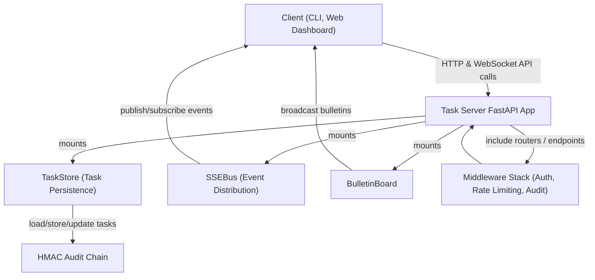

---

# References

- `src/bernstein/core/routes/tasks.py`  
- `src/bernstein/core/routes/task_crud.py`  
- `src/bernstein/core/server/server_app.py`  
- `src/bernstein/core/server/server_models.py`  
- `src/bernstein/core/routes/costs.py`  
- `src/bernstein/core/routes/webhooks.py`  
- `src/bernstein/core/routes/auth.py`  
- `src/bernstein/core/auth_rate_limiter.py`  
- `src/bernstein/core/security/audit.py`  
- `src/bernstein/core/orchestration/bootstrap.py`  
- `src/bernstein/core/routes/websocket.py`  
- `src/bernstein/core/routes/telemetry_webhooks.py`  
- `src/bernstein/core/routes/well_known.py`

---

# Page: Orchestrator and Task Lifecycle

# Orchestrator and Task Lifecycle

<details>
<summary>Relevant source files</summary>

The following files were used as context for generating this wiki page:

- [docs/examples/agent-prompt-template.md](docs/examples/agent-prompt-template.md)
- [docs/orchestration/worker-coordination.md](docs/orchestration/worker-coordination.md)
- [docs/release-notes/v2.16.0.md](docs/release-notes/v2.16.0.md)
- [docs/substrate/claude-code.md](docs/substrate/claude-code.md)
- [mutmut_config.py](mutmut_config.py)
- [src/bernstein/adapters/council_runner.py](src/bernstein/adapters/council_runner.py)
- [src/bernstein/adapters/env_isolation.py](src/bernstein/adapters/env_isolation.py)
- [src/bernstein/adapters/openai_agents.py](src/bernstein/adapters/openai_agents.py)
- [src/bernstein/adapters/openai_agents_runner.py](src/bernstein/adapters/openai_agents_runner.py)
- [src/bernstein/cli/commands/stop_cmd.py](src/bernstein/cli/commands/stop_cmd.py)
- [src/bernstein/cli/plan/plan_display.py](src/bernstein/cli/plan/plan_display.py)
- [src/bernstein/cli/run_bootstrap.py](src/bernstein/cli/run_bootstrap.py)
- [src/bernstein/cli/run_preflight.py](src/bernstein/cli/run_preflight.py)
- [src/bernstein/core/agents/spawner_core.py](src/bernstein/core/agents/spawner_core.py)
- [src/bernstein/core/git/github.py](src/bernstein/core/git/github.py)
- [src/bernstein/core/instrumentation.py](src/bernstein/core/instrumentation.py)
- [src/bernstein/core/observability/rate_limit_tracker.py](src/bernstein/core/observability/rate_limit_tracker.py)
- [src/bernstein/core/orchestration/activity_modalities.py](src/bernstein/core/orchestration/activity_modalities.py)
- [src/bernstein/core/orchestration/adaptive_parallelism.py](src/bernstein/core/orchestration/adaptive_parallelism.py)
- [src/bernstein/core/orchestration/bootstrap.py](src/bernstein/core/orchestration/bootstrap.py)
- [src/bernstein/core/orchestration/commit_completion.py](src/bernstein/core/orchestration/commit_completion.py)
- [src/bernstein/core/orchestration/drain.py](src/bernstein/core/orchestration/drain.py)
- [src/bernstein/core/orchestration/drain_merge.py](src/bernstein/core/orchestration/drain_merge.py)
- [src/bernstein/core/orchestration/holds.py](src/bernstein/core/orchestration/holds.py)
- [src/bernstein/core/orchestration/multi_cell.py](src/bernstein/core/orchestration/multi_cell.py)
- [src/bernstein/core/orchestration/orchestrator.py](src/bernstein/core/orchestration/orchestrator.py)
- [src/bernstein/core/orchestration/orchestrator_backlog.py](src/bernstein/core/orchestration/orchestrator_backlog.py)
- [src/bernstein/core/orchestration/run_changelog.py](src/bernstein/core/orchestration/run_changelog.py)
- [src/bernstein/core/orchestration/tick_pipeline.py](src/bernstein/core/orchestration/tick_pipeline.py)
- [src/bernstein/core/orchestration/trigger_manager.py](src/bernstein/core/orchestration/trigger_manager.py)
- [src/bernstein/core/routes/orchestrator_holds.py](src/bernstein/core/routes/orchestrator_holds.py)
- [src/bernstein/core/server/server_launch.py](src/bernstein/core/server/server_launch.py)
- [src/bernstein/core/server/server_supervisor.py](src/bernstein/core/server/server_supervisor.py)
- [src/bernstein/core/tasks/models.py](src/bernstein/core/tasks/models.py)
- [src/bernstein/core/tasks/task_lifecycle.py](src/bernstein/core/tasks/task_lifecycle.py)
- [src/bernstein/core/tasks/task_store_core.py](src/bernstein/core/tasks/task_store_core.py)
- [templates/roles/manager/system_prompt.md](templates/roles/manager/system_prompt.md)
- [templates/roles/manager/task_prompt.md](templates/roles/manager/task_prompt.md)
- [tests/integration/test_manager_auth_to_task_server.py](tests/integration/test_manager_auth_to_task_server.py)
- [tests/unit/adapters/test_openai_agents_builtins.py](tests/unit/adapters/test_openai_agents_builtins.py)
- [tests/unit/routing/test_router_core.py](tests/unit/routing/test_router_core.py)
- [tests/unit/test_agent_lifecycle.py](tests/unit/test_agent_lifecycle.py)
- [tests/unit/test_chaos.py](tests/unit/test_chaos.py)
- [tests/unit/test_coverage_thresholds.py](tests/unit/test_coverage_thresholds.py)
- [tests/unit/test_detached_run_visibility.py](tests/unit/test_detached_run_visibility.py)
- [tests/unit/test_env_isolation.py](tests/unit/test_env_isolation.py)
- [tests/unit/test_failure_aware_retry.py](tests/unit/test_failure_aware_retry.py)
- [tests/unit/test_fast_path.py](tests/unit/test_fast_path.py)
- [tests/unit/test_file_overlap.py](tests/unit/test_file_overlap.py)
- [tests/unit/test_github.py](tests/unit/test_github.py)
- [tests/unit/test_instrumentation_capture.py](tests/unit/test_instrumentation_capture.py)
- [tests/unit/test_janitor_alive_exit.py](tests/unit/test_janitor_alive_exit.py)
- [tests/unit/test_max_output_tokens_escalation.py](tests/unit/test_max_output_tokens_escalation.py)
- [tests/unit/test_mcp_discovery.py](tests/unit/test_mcp_discovery.py)
- [tests/unit/test_mutation_setup.py](tests/unit/test_mutation_setup.py)
- [tests/unit/test_orchestrator.py](tests/unit/test_orchestrator.py)
- [tests/unit/test_orchestrator_holds_routes.py](tests/unit/test_orchestrator_holds_routes.py)
- [tests/unit/test_plugin_trust.py](tests/unit/test_plugin_trust.py)
- [tests/unit/test_proactive_compaction.py](tests/unit/test_proactive_compaction.py)
- [tests/unit/test_rate_limit_tracker.py](tests/unit/test_rate_limit_tracker.py)
- [tests/unit/test_reactive_compact_413.py](tests/unit/test_reactive_compact_413.py)
- [tests/unit/test_retry_or_fail_task.py](tests/unit/test_retry_or_fail_task.py)
- [tests/unit/test_router.py](tests/unit/test_router.py)
- [tests/unit/test_run_cmd_track_b.py](tests/unit/test_run_cmd_track_b.py)
- [tests/unit/test_run_preflight_model_resolution.py](tests/unit/test_run_preflight_model_resolution.py)
- [tests/unit/test_spawner.py](tests/unit/test_spawner.py)
- [tests/unit/test_spawner_agent_token.py](tests/unit/test_spawner_agent_token.py)
- [tests/unit/test_spawner_openclaw_bridge.py](tests/unit/test_spawner_openclaw_bridge.py)
- [tests/unit/test_startup_task_count_consistency.py](tests/unit/test_startup_task_count_consistency.py)
- [tests/unit/test_task_completion.py](tests/unit/test_task_completion.py)
- [tests/unit/test_task_lifecycle.py](tests/unit/test_task_lifecycle.py)
- [tests/unit/test_task_release_receipt.py](tests/unit/test_task_release_receipt.py)
- [tests/unit/test_uvicorn_reload_disabled.py](tests/unit/test_uvicorn_reload_disabled.py)
- [tests/unit/test_worker_cmd_spawn.py](tests/unit/test_worker_cmd_spawn.py)

</details>


The Orchestrator is the central deterministic engine of Bernstein. Unlike the agents it manages, the Orchestrator contains no LLM coordination logic; it is a state machine that drives the transition of tasks from definition to verified completion. It manages the "tick" loop, enforces task dependencies, detects file-level conflicts between parallel agents, and ensures system integrity through a Write-Ahead Log (WAL) and graceful shutdown sequences.

---

### Orchestrator Tick Loop

Bernstein's Orchestrator runs on a single-threaded periodic execution loop called a **tick**. This loop continuously synchronizes state, manages agents, and drives the lifecycle of tasks. The tick loop runs inside the `Orchestrator.run()` method, which iterates while its `_running` flag remains true [src/bernstein/core/orchestration/orchestrator.py:6-9](). The single-threaded design avoids concurrency hazards during state transitions.

The tick is divided conceptually into phases:

| Tick Phase   | Frequency            | Responsibilities                                                                                |
|--------------|----------------------|------------------------------------------------------------------------------------------------|
| **Fast Path** | On every tick         | Agent heartbeat refresh, dead agent reaping, file lock refresh, and signal processing         [src/bernstein/core/orchestration/orchestrator.py:35-38]() |
| **Normal Tick** | Every 6 ticks         | Fetch tasks from server, group by role, claim and spawn agents for eligible tasks             [src/bernstein/core/orchestration/tick_pipeline.py:100-115]() |
| **Slow Tick** | Every 30 ticks        | Refresh knowledge base, cost rollup, checkpointing, and janitor verification                  [src/bernstein/core/orchestration/orchestrator.py:54-60]() |

This phased design allows workload prioritization and system maintenance without blocking the core dispatcher. Timing parameters like tick intervals and frequency of each phase are configurable via runtime defaults [src/bernstein/core/defaults.py:46-61]().

**Sources:** [src/bernstein/core/orchestration/orchestrator.py:1-15, 34-60](), [src/bernstein/core/orchestration/tick_pipeline.py:100-115](), [src/bernstein/core/defaults.py:46-61]().

---

### Task State Machine

Tasks in Bernstein proceed through a well-defined finite state machine, managed by the Orchestrator and the `TaskStore`. The state transitions are strictly validated to prevent illegal sequences, and each transition corresponds to an internal code operation.

#### Task Lifecycle States

| State          | Description                                                                                   |
|----------------|-----------------------------------------------------------------------------------------------|
| **OPEN**       | Task is in the backlog, available for claiming by agents.                                    |
| **CLAIMED**    | Task has been exclusively claimed by an agent; environment preparation underway.              |
| **IN_PROGRESS**| Agent processes are active and working on the task.                                           |
| **DONE**       | Agent has successfully completed the task and exited cleanly.                                |
| **CLOSED**     | Task has been verified and merged; no further changes expected.                              |
| **FAILED**     | Task has permanently failed, e.g., exhausted retries or reached terminal error.               |

These states correspond to the `TaskStatus` enum values managed in the core `models.py` module [src/bernstein/core/tasks/models.py:176-204]().

#### State Transitions and Their Code Mappings

The diagram below shows the lifecycle flow of tasks from `OPEN` to `CLOSED` or `FAILED`. Each transition is driven by key orchestrator functions:

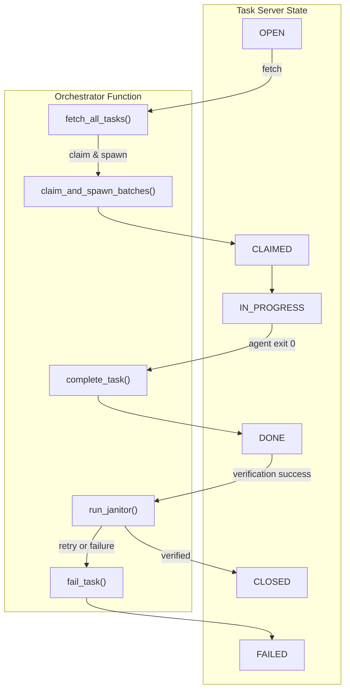

Each transition occurs within a consistent transactional context, often involving server API calls and local agent management [src/bernstein/core/tasks/task_lifecycle.py:140-175](), [src/bernstein/core/tasks/task_store_core.py:30-85]().

**Sources:** [src/bernstein/core/tasks/models.py:176-204](), [src/bernstein/core/tasks/task_lifecycle.py:30-90](), [src/bernstein/core/tasks/task_store_core.py:30-85]().

---

### Batching by Role and Dependency Filtering

To optimize agent utilization and maintain logical consistency, the Orchestrator batches tasks based on their assigned `role` (e.g., frontend, backend, qa). This grouping is performed by `group_by_role()` in the tick pipeline [src/bernstein/core/orchestration/tick_pipeline.py:113-114]().

Batching allows spawning single agents capable of handling multiple related tasks simultaneously. However, before spawning a batch:

- **Dependency Filtering**: The orchestrator filters out tasks that are blocked by unfinished dependencies.
- **File-Ownership Conflict Detection**: It checks that no two active agents own overlapping file sets to avoid merge conflicts.

#### File-Ownership Conflict Detection

This subsystem leverages:

- `infer_affected_paths(task)` to guess which files a task will modify, based on title and description analysis [src/bernstein/core/tasks/task_lifecycle.py:145-177]().

- The in-memory `_file_ownership` map tracks files locked by currently active agents; tasks touching such files must not be spawned concurrently.

- During `claim_and_spawn_batches()`, any batch with conflicting file ownership is skipped to ensure safe parallelism without conflicts [src/bernstein/core/tasks/task_lifecycle.py:181-200](), [tests/unit/test_task_lifecycle.py:180-200]().

This restraint improves continuous integration stability by preventing competing uncommitted changes against the same source code location.

**Sources:** [src/bernstein/core/tasks/task_lifecycle.py:145-200](), [src/bernstein/core/orchestration/tick_pipeline.py:112-115](), [tests/unit/test_task_lifecycle.py:180-200]().

---

### Write-Ahead Log (WAL)

To guarantee consistency and durability of orchestrator state changes, Bernstein employs a Write-Ahead Log (WAL) subsystem.

- Each critical task lifecycle operation (claim, complete, fail) appends an entry to the WAL as a `WALEntry` before the operation is confirmed persistent in the TaskStore [src/bernstein/core/orchestration/orchestrator.py:143-144]().

- The `WALRecovery` engine replays the WAL during startup, reconciling incomplete state changes or orphaned claims. For example, tasks stuck in `CLAIMED` but with no live agents are reset to `OPEN` [tests/unit/test_chaos.py:150-185]().

- A **Dead Letter Queue (DLQ)** mechanism holds tasks that repeatedly fail to claim or spawn, isolating them to avoid clogging the active tick cycles and enabling operator intervention [src/bernstein/core/tasks/task_lifecycle.py:200-215]().

This WAL with recovery and DLQ enables crash resilience, operator auditability, and ensures progress without losing work.

**Sources:** [src/bernstein/core/orchestration/orchestrator.py:143-144](), [src/bernstein/core/tasks/task_lifecycle.py:200-215](), [tests/unit/test_chaos.py:150-185]().

---

### Drain and Graceful Shutdown

Bernstein supports a clean **drain** protocol to gracefully shut down the Orchestrator and all active agents:

1. When a signal such as `SIGTERM` or the CLI `bernstein stop` command is received, the Orchestrator sets `_running = False` which stops the tick loop [src/bernstein/core/orchestration/orchestrator.py:27-29]().
2. It invokes `send_shutdown_signals()` from the signal manager to drop sentinel files (`SHUTDOWN`) into `.sdd/runtime/signals/{session_id}/` folders [src/bernstein/core/agents/spawner_core.py:175-196]().
3. Agents monitor the shutdown sentinel and, upon detection, perform a `git add -A` and `git commit -m "[WIP]"` to checkpoint their unfinished work in their isolated worktrees [src/bernstein/core/defaults.py:58-58]().
4. The Orchestrator waits for a configured drain timeout (default 60 seconds).
5. After the timeout, remaining agents are hard-killed via `SIGKILL` to avoid dangling processes [src/bernstein/core/defaults.py:97-97]().
6. Final steps flush the WAL ensuring all progress is persisted before the Orchestrator fully exits.

#### Shutdown Data Flow Diagram

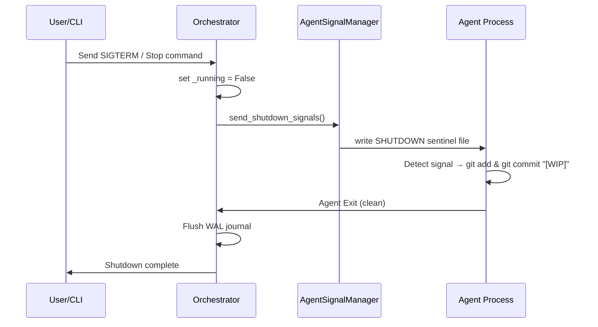

This sequence enables fully audited checkpoint commits and minimizes uncommitted work during shutdown.

**Sources:** [src/bernstein/core/orchestration/orchestrator.py:27-29](), [src/bernstein/core/agents/spawner_core.py:175-196](), [src/bernstein/core/defaults.py:58-97]().

---

### Summary Diagram: From Natural Language Concepts to Code Entities

```mermaid
graph TD
    subgraph "Natural Language Concepts"
        NL_Orchestrator["Orchestrator (Tick Loop)"]
        NL_TaskLifecycle["Task Lifecycle (OPEN→CLAIMED→IN_PROGRESS→DONE→CLOSED)"]
        NL_Batching["Batching by Role & Dependency Checks"]
        NL_ConflictDetection["File-Ownership Conflict Detection"]
        NL_WAL["Write-Ahead Log (WAL)"]
        NL_DLQ["Dead Letter Queue (DLQ)"]
        NL_DrainSeq["Drain & Graceful Shutdown"]
    end

    subgraph "Code Entities"
        CE_OrchPy["src/bernstein/core/orchestration/orchestrator.py"]
        CE_TickPipeline["src/bernstein/core/orchestration/tick_pipeline.py"]
        CE_TaskLifecycle["src/bernstein/core/tasks/task_lifecycle.py"]
        CE_TaskStore["src/bernstein/core/tasks/task_store_core.py"]
        CE_FileOwnership["src/bernstein/core/tasks/task_lifecycle.py (infer_affected_paths)"]
        CE_WAL["src/bernstein/core/orchestration/wal.py"]
        CE_WALReplay["src/bernstein/core/orchestration/wal_replay.py"]
        CE_DLQ["src/bernstein/core/tasks/task_lifecycle.py (_enqueue_dlq_if_workdir)"]
        CE_SpawnerCore["src/bernstein/core/agents/spawner_core.py (send_shutdown_signals)"]
        CE_Defaults["src/bernstein/core/defaults.py (drain timeouts)"]
    end

    NL_Orchestrator --> CE_OrchPy
    NL_Orchestrator --> CE_TickPipeline
    NL_TaskLifecycle --> CE_TaskLifecycle
    NL_TaskLifecycle --> CE_TaskStore
    NL_Batching --> CE_TickPipeline
    NL_Batching --> CE_TaskLifecycle
    NL_ConflictDetection --> CE_FileOwnership
    NL_WAL --> CE_WAL
    NL_WAL --> CE_WALReplay
    NL_DLQ --> CE_DLQ
    NL_DrainSeq --> CE_SpawnerCore
    NL_DrainSeq --> CE_Defaults
```

---

# References

- `src/bernstein/core/orchestration/orchestrator.py:1-15, 25-60`  
- `src/bernstein/core/orchestration/tick_pipeline.py:100-115`  
- `src/bernstein/core/tasks/task_lifecycle.py:140-215`  
- `src/bernstein/core/tasks/task_store_core.py:30-85`  
- `src/bernstein/core/tasks/models.py:176-204`  
- `src/bernstein/core/tasks/task_lifecycle.py:145-200`  
- `tests/unit/test_task_lifecycle.py:180-200`  
- `tests/unit/test_chaos.py:150-185`  
- `src/bernstein/core/orchestration/wal.py` (not listed in imports, but core WAL)  
- `src/bernstein/core/orchestration/wal_replay.py`  
- `src/bernstein/core/agents/spawner_core.py:175-196`  
- `src/bernstein/core/defaults.py:46-61,58-97`

---

# Page: Agent Spawning and Adapters

# Agent Spawning and Adapters

<details>
<summary>Relevant source files</summary>

The following files were used as context for generating this wiki page:

- [docs/operations/merge-gate.md](docs/operations/merge-gate.md)
- [src/bernstein/adapters/aider.py](src/bernstein/adapters/aider.py)
- [src/bernstein/adapters/amp.py](src/bernstein/adapters/amp.py)
- [src/bernstein/adapters/base.py](src/bernstein/adapters/base.py)
- [src/bernstein/adapters/caching_adapter.py](src/bernstein/adapters/caching_adapter.py)
- [src/bernstein/adapters/claude.py](src/bernstein/adapters/claude.py)
- [src/bernstein/adapters/codex.py](src/bernstein/adapters/codex.py)
- [src/bernstein/adapters/cody.py](src/bernstein/adapters/cody.py)
- [src/bernstein/adapters/continue_dev.py](src/bernstein/adapters/continue_dev.py)
- [src/bernstein/adapters/cursor.py](src/bernstein/adapters/cursor.py)
- [src/bernstein/adapters/gemini.py](src/bernstein/adapters/gemini.py)
- [src/bernstein/adapters/generic.py](src/bernstein/adapters/generic.py)
- [src/bernstein/adapters/goose.py](src/bernstein/adapters/goose.py)
- [src/bernstein/adapters/iac.py](src/bernstein/adapters/iac.py)
- [src/bernstein/adapters/kilo.py](src/bernstein/adapters/kilo.py)
- [src/bernstein/adapters/manager.py](src/bernstein/adapters/manager.py)
- [src/bernstein/adapters/opencode.py](src/bernstein/adapters/opencode.py)
- [src/bernstein/adapters/qwen.py](src/bernstein/adapters/qwen.py)
- [src/bernstein/cli/commands/compaction_cmd.py](src/bernstein/cli/commands/compaction_cmd.py)
- [src/bernstein/core/agents/agent_lifecycle.py](src/bernstein/core/agents/agent_lifecycle.py)
- [src/bernstein/core/agents/agent_log_aggregator.py](src/bernstein/core/agents/agent_log_aggregator.py)
- [src/bernstein/core/agents/agent_recycling.py](src/bernstein/core/agents/agent_recycling.py)
- [src/bernstein/core/agents/cross_agent_consistency.py](src/bernstein/core/agents/cross_agent_consistency.py)
- [src/bernstein/core/agents/heartbeat.py](src/bernstein/core/agents/heartbeat.py)
- [src/bernstein/core/config/platform_compat.py](src/bernstein/core/config/platform_compat.py)
- [src/bernstein/core/cost/cli_adapter_usage.py](src/bernstein/core/cost/cli_adapter_usage.py)
- [src/bernstein/core/cost/model_prices.py](src/bernstein/core/cost/model_prices.py)
- [src/bernstein/core/observability/watchdog.py](src/bernstein/core/observability/watchdog.py)
- [src/bernstein/core/orchestration/proactive_compaction.py](src/bernstein/core/orchestration/proactive_compaction.py)
- [src/bernstein/core/orchestration/watchdog.py](src/bernstein/core/orchestration/watchdog.py)
- [tests/contract/contracts/qwen.yaml](tests/contract/contracts/qwen.yaml)
- [tests/integration/test_adapter_conformance_lifecycle.py](tests/integration/test_adapter_conformance_lifecycle.py)
- [tests/unit/adapters/test_openai_agents.py](tests/unit/adapters/test_openai_agents.py)
- [tests/unit/test_adapter_aider.py](tests/unit/test_adapter_aider.py)
- [tests/unit/test_adapter_amp.py](tests/unit/test_adapter_amp.py)
- [tests/unit/test_adapter_claude.py](tests/unit/test_adapter_claude.py)
- [tests/unit/test_adapter_codex.py](tests/unit/test_adapter_codex.py)
- [tests/unit/test_adapter_gemini.py](tests/unit/test_adapter_gemini.py)
- [tests/unit/test_adapter_generic.py](tests/unit/test_adapter_generic.py)
- [tests/unit/test_adapter_iac.py](tests/unit/test_adapter_iac.py)
- [tests/unit/test_adapter_non_claude.py](tests/unit/test_adapter_non_claude.py)
- [tests/unit/test_adapter_qwen.py](tests/unit/test_adapter_qwen.py)
- [tests/unit/test_adapter_timeout.py](tests/unit/test_adapter_timeout.py)
- [tests/unit/test_agent_log_layout_resolution.py](tests/unit/test_agent_log_layout_resolution.py)
- [tests/unit/test_audit_chain_process_reap.py](tests/unit/test_audit_chain_process_reap.py)
- [tests/unit/test_caching_adapter.py](tests/unit/test_caching_adapter.py)
- [tests/unit/test_cli_adapter_usage.py](tests/unit/test_cli_adapter_usage.py)
- [tests/unit/test_cost_price_model_usage.py](tests/unit/test_cost_price_model_usage.py)
- [tests/unit/test_evolution_integration.py](tests/unit/test_evolution_integration.py)
- [tests/unit/test_heartbeat_liveness_gate.py](tests/unit/test_heartbeat_liveness_gate.py)
- [tests/unit/test_heartbeat_log_only_cap.py](tests/unit/test_heartbeat_log_only_cap.py)
- [tests/unit/test_heartbeat_phase_field.py](tests/unit/test_heartbeat_phase_field.py)
- [tests/unit/test_heartbeat_signal_layouts.py](tests/unit/test_heartbeat_signal_layouts.py)
- [tests/unit/test_issue_3013_free_route_banner_pricing.py](tests/unit/test_issue_3013_free_route_banner_pricing.py)
- [tests/unit/test_orchestration_watchdog.py](tests/unit/test_orchestration_watchdog.py)
- [tests/unit/test_platform_compat.py](tests/unit/test_platform_compat.py)
- [tests/unit/test_platform_process_tree.py](tests/unit/test_platform_process_tree.py)
- [tests/unit/test_platform_win_process_branch.py](tests/unit/test_platform_win_process_branch.py)
- [tests/unit/test_reap_none_pid_session.py](tests/unit/test_reap_none_pid_session.py)
- [tests/unit/test_watchdog.py](tests/unit/test_watchdog.py)

</details>


Bernstein manages the lifecycle of autonomous coding agents by abstracting them behind a unified **Adapter** interface. Instead of reimplementing agentic logic, Bernstein orchestrates existing high-performance CLI agents (like Claude Code, Aider, and Cursor) within isolated environments, providing them with structured tasks and monitoring their progress through a specialized process wrapper.

## The CLIAdapter Base Class

All agent integrations inherit from the `CLIAdapter` abstract base class. This class defines the contract for spawning, monitoring, and terminating agent processes while providing shared utilities for rate-limit detection and environment isolation.

### Key Responsibilities
*   **Process Management**: Spawning the agent as a subprocess and tracking its PID [src/bernstein/adapters/base.py:11-23]().
*   **Rate Limit Tracking**: Using a `RateLimitMeter` to record and decay 429-class errors from upstream providers [src/bernstein/adapters/base.py:81-119]().
*   **Resource Constraints**: Applying `ResourceLimits` (CPU, memory, file descriptors) to the spawned process [src/bernstein/adapters/base.py:24-24]().
*   **Network Policy**: Enforcing egress rules to ensure agents only communicate with approved model endpoints [src/bernstein/adapters/base.py:270-270]().

### Implementation Diagram: Adapter Hierarchy
The following diagram illustrates how specific adapters extend the base class to map Bernstein's internal `ModelConfig` to provider-specific CLI flags.

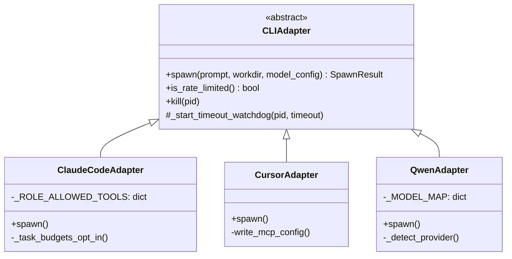
Sources: [src/bernstein/adapters/base.py:41-188](), [src/bernstein/adapters/claude.py:110-131](), [src/bernstein/adapters/cursor.py:59-79](), [src/bernstein/adapters/qwen.py:28-34]()

---

## Agent Spawning Lifecycle

The `AgentSpawner` (invoked by the Orchestrator) follows a strict **Spawn → Watchdog → Reap** sequence to ensure agents do not leak resources or run indefinitely.

### 1. Spawn
When a task is claimed, the adapter's `spawn()` method is called. It constructs the command line, including:
*   **Tool Filtering**: Limiting tools based on the agent's role (e.g., a `qa` agent may only get `Read` and `Bash` tools) [src/bernstein/adapters/claude.py:126-131]().
*   **Environment Isolation**: Filtering the parent environment to prevent leaking secrets [src/bernstein/adapters/claude.py:52-56]().
*   **Worker Wrapping**: The command is wrapped in `bernstein-worker` [src/bernstein/adapters/base.py:246-268]().

### 2. Watchdog
Every spawn initiates a `_start_timeout_watchdog`. This thread monitors the process and sends `SIGTERM` (followed by `SIGKILL` after a grace period) if the `DEFAULT_TIMEOUT_SECONDS` (30 minutes) is exceeded [src/bernstein/adapters/base.py:37-38]().

### 3. Reap
The `bernstein-worker` wrapper ensures that when the agent exits, its PID file is removed from `.sdd/runtime/pids/` and its exit code is correctly propagated to the Orchestrator [src/bernstein/core/orchestration/watchdog.py:100-100](). The `reap_process_group` function is used to clean up the process group associated with the agent [src/bernstein/core/platform_compat.py:100-100]().

### Process Flow: Natural Language to Code Execution
This diagram bridges the Orchestrator's task selection to the actual OS process execution.

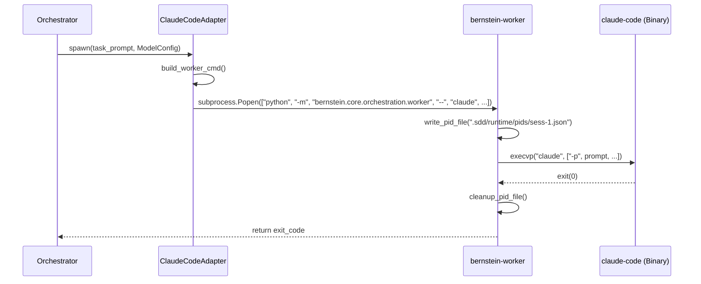
Sources: [src/bernstein/adapters/base.py:246-268](), [src/bernstein/adapters/claude.py:188-210](), [src/bernstein/core/orchestration/watchdog.py:100-100](), [src/bernstein/core/platform_compat.py:100-100]()

---

## The `bernstein-worker` Wrapper

The `bernstein-worker` is a critical shim that runs as a parent to the actual agent CLI. It provides:
*   **Process Visibility**: Writes metadata (role, session ID, model) to a JSON PID file so `bernstein ps` can display active agents [src/bernstein/adapters/base.py:246-268]().
*   **Signal Forwarding**: Forwards `SIGTERM` to the child process group to ensure graceful shutdown [src/bernstein/core/platform_compat.py:100-100]().
*   **Exit Code Normalization**: Ensures that if a child is killed by a signal, the exit code is reported as `128 + N` [src/bernstein/core/platform_compat.py:100-100]().

Sources: [src/bernstein/adapters/base.py:246-268](), [src/bernstein/core/platform_compat.py:100-100]()

---

## Rate-Limit Detection and Mitigation

Bernstein implements provider-aware rate limiting to prevent "retry spirals."

*   **Probing**: The `ClaudeCodeAdapter` probes `claude --version` or a minimal "say ok" prompt to detect account-level limits before attempting a heavy task [src/bernstein/adapters/claude.py:140-167]().
*   **Backoff**: When a 429 is detected, the `RateLimitMeter` applies exponential backoff (1s, 2s, 4s...) capped at 60s [src/bernstein/adapters/base.py:143-146]().
*   **Status Reporting**: Active rate limits are surfaced in the `bernstein status` panel via `get_rate_limit_meters()` [src/bernstein/adapters/base.py:181-181]().

Sources: [src/bernstein/adapters/claude.py:140-167](), [src/bernstein/adapters/base.py:143-146](), [src/bernstein/adapters/base.py:181-181]()

---

## Supported Adapters Catalog

Bernstein includes a wide variety of built-in adapters.

| Adapter Name | Binary / CLI | Primary Use Case |
| :--- | :--- | :--- |
| `claude` | `claude-code` | High-reasoning engineering tasks [src/bernstein/adapters/claude.py:1-13]() |
| `aider` | `aider` | Fast, iterative code editing [src/bernstein/adapters/aider.py:1-1]() |
| `cursor` | `cursor-agent` | IDE-native agentic workflows [src/bernstein/adapters/cursor.py:1-1]() |
| `codex` | `codex` | OpenAI-based legacy and reasoning models [src/bernstein/adapters/codex.py:1-1]() |
| `gemini` | `antigravity` or `gemini` | Large context window tasks [src/bernstein/adapters/gemini.py:1-1]() |
| `qwen` | `qwen` | OpenAI-compatible local or cloud models [src/bernstein/adapters/qwen.py:1-1]() |
| `generic` | User-defined | Wrapping custom scripts or unsupported CLIs [src/bernstein/adapters/generic.py:1-1]()
| `amp` | `amp` | Specialized for code generation and refactoring [src/bernstein/adapters/amp.py:1-1]()
| `continue_dev` | `continue` | Continuous development workflows [src/bernstein/adapters/continue_dev.py:1-1]()
| `goose` | `goose` | Focused on specific code analysis and transformation tasks [src/bernstein/adapters/goose.py:1-1]()
| `iac` | `iac` | Infrastructure as Code generation and management [src/bernstein/adapters/iac.py:1-1]()
| `kilo` | `kilo` | Lightweight code generation and scripting [src/bernstein/adapters/kilo.py:1-1]()
| `manager` | `manager` | Orchestration and high-level task management [src/bernstein/adapters/manager.py:1-1]()
| `opencode` | `opencode` | Open-source model integration [src/bernstein/adapters/opencode.py:1-1]()
| `cody` | `cody` | Context-aware code assistance [src/bernstein/adapters/cody.py:1-1]()

### Caching Wrapper
The `CachingAdapter` is a decorator that can wrap any standard adapter. It intercepts `spawn()` calls to:
1.  Check a **Response Cache** (Semantic Similarity >= 0.95) to skip execution entirely if a similar task was recently completed [src/bernstein/adapters/caching_adapter.py:163-171]().
2.  Track **Cache Breaks** to identify when system prompt changes cause upstream KV-cache misses [src/bernstein/adapters/caching_adapter.py:130-152]().

Sources: [src/bernstein/adapters/claude.py:1-13](), [src/bernstein/adapters/aider.py:1-1](), [src/bernstein/adapters/cursor.py:1-1](), [src/bernstein/adapters/codex.py:1-1](), [src/bernstein/adapters/gemini.py:1-1](), [src/bernstein/adapters/qwen.py:1-1](), [src/bernstein/adapters/generic.py:1-1](), [src/bernstein/adapters/amp.py:1-1](), [src/bernstein/adapters/continue_dev.py:1-1](), [src/bernstein/adapters/goose.py:1-1](), [src/bernstein/adapters/iac.py:1-1](), [src/bernstein/adapters/kilo.py:1-1](), [src/bernstein/adapters/manager.py:1-1](), [src/bernstein/adapters/opencode.py:1-1](), [src/bernstein/adapters/cody.py:1-1](), [src/bernstein/adapters/caching_adapter.py:31-55](), [src/bernstein/adapters/caching_adapter.py:130-152](), [src/bernstein/adapters/caching_adapter.py:163-171]()

---

# Page: Planning and Task Decomposition

# Planning and Task Decomposition

<details>
<summary>Relevant source files</summary>

The following files were used as context for generating this wiki page:

- [docs/concepts/abstracted-code-review.md](docs/concepts/abstracted-code-review.md)
- [docs/concepts/action-cache.md](docs/concepts/action-cache.md)
- [docs/concepts/artifact-lineage.md](docs/concepts/artifact-lineage.md)
- [docs/concepts/best-of-n.md](docs/concepts/best-of-n.md)
- [docs/concepts/feature-contract.md](docs/concepts/feature-contract.md)
- [docs/concepts/orchestrator-hardening.md](docs/concepts/orchestrator-hardening.md)
- [docs/concepts/phase-pipeline.md](docs/concepts/phase-pipeline.md)
- [docs/concepts/sandbox-selector.md](docs/concepts/sandbox-selector.md)
- [docs/concepts/schema-validation-retry.md](docs/concepts/schema-validation-retry.md)
- [docs/concepts/spec-as-test.md](docs/concepts/spec-as-test.md)
- [docs/concepts/swarm-migration.md](docs/concepts/swarm-migration.md)
- [docs/concepts/team-hub.md](docs/concepts/team-hub.md)
- [docs/lineage.md](docs/lineage.md)
- [docs/operations/recipes.md](docs/operations/recipes.md)
- [docs/operations/schedule.md](docs/operations/schedule.md)
- [docs/release-notes/v3.6.0.md](docs/release-notes/v3.6.0.md)
- [docs/workflows/on-fail-recovery-receipts.md](docs/workflows/on-fail-recovery-receipts.md)
- [examples/plans/flask-api.yaml](examples/plans/flask-api.yaml)
- [src/bernstein/cli/commands/lineage_verify_cmd.py](src/bernstein/cli/commands/lineage_verify_cmd.py)
- [src/bernstein/cli/commands/plan_validate_cmd.py](src/bernstein/cli/commands/plan_validate_cmd.py)
- [src/bernstein/cli/commands/recipes_cmd.py](src/bernstein/cli/commands/recipes_cmd.py)
- [src/bernstein/cli/commands/schedule_cmd.py](src/bernstein/cli/commands/schedule_cmd.py)
- [src/bernstein/core/lifecycle/hooks.py](src/bernstein/core/lifecycle/hooks.py)
- [src/bernstein/core/orchestration/collision.py](src/bernstein/core/orchestration/collision.py)
- [src/bernstein/core/orchestration/schedule_kinds.py](src/bernstein/core/orchestration/schedule_kinds.py)
- [src/bernstein/core/orchestration/schedule_projection.py](src/bernstein/core/orchestration/schedule_projection.py)
- [src/bernstein/core/orchestration/schedule_supervisor.py](src/bernstein/core/orchestration/schedule_supervisor.py)
- [src/bernstein/core/planning/plan_loader.py](src/bernstein/core/planning/plan_loader.py)
- [src/bernstein/core/planning/plan_schema.py](src/bernstein/core/planning/plan_schema.py)
- [src/bernstein/core/planning/schedule_store.py](src/bernstein/core/planning/schedule_store.py)
- [src/bernstein/core/planning/workflow_dsl.py](src/bernstein/core/planning/workflow_dsl.py)
- [src/bernstein/core/trigger_sources/schedule.py](src/bernstein/core/trigger_sources/schedule.py)
- [src/bernstein/core/workflows/recipe_fleet.py](src/bernstein/core/workflows/recipe_fleet.py)
- [src/bernstein/core/workflows/recipe_registry.py](src/bernstein/core/workflows/recipe_registry.py)
- [src/bernstein/core/workflows/recipe_spec.py](src/bernstein/core/workflows/recipe_spec.py)
- [templates/plan.yaml](templates/plan.yaml)
- [templates/roles/adversary/config.yaml](templates/roles/adversary/config.yaml)
- [templates/roles/adversary/system_prompt.md](templates/roles/adversary/system_prompt.md)
- [templates/roles/adversary/task_prompt.md](templates/roles/adversary/task_prompt.md)
- [tests/integration/test_schedule_audit_chain.py](tests/integration/test_schedule_audit_chain.py)
- [tests/property/test_recipe_hash_properties.py](tests/property/test_recipe_hash_properties.py)
- [tests/unit/lineage/test_spine_cli.py](tests/unit/lineage/test_spine_cli.py)
- [tests/unit/orchestration/test_commit_completion.py](tests/unit/orchestration/test_commit_completion.py)
- [tests/unit/test_adversary_role.py](tests/unit/test_adversary_role.py)
- [tests/unit/test_plan_loader.py](tests/unit/test_plan_loader.py)
- [tests/unit/test_plan_schema.py](tests/unit/test_plan_schema.py)
- [tests/unit/test_plan_validate.py](tests/unit/test_plan_validate.py)
- [tests/unit/test_recipe_registry.py](tests/unit/test_recipe_registry.py)
- [tests/unit/test_recipes_cmd.py](tests/unit/test_recipes_cmd.py)
- [tests/unit/test_recipes_register_cli.py](tests/unit/test_recipes_register_cli.py)
- [tests/unit/test_recovery_receipt.py](tests/unit/test_recovery_receipt.py)
- [tests/unit/test_schedule_projection.py](tests/unit/test_schedule_projection.py)
- [tests/unit/test_schedule_supervisor.py](tests/unit/test_schedule_supervisor.py)
- [tests/unit/test_workflow_dsl.py](tests/unit/test_workflow_dsl.py)

</details>


Bernstein transforms high-level goals into executable task graphs using a deterministic orchestrator coordinated by an LLM-powered **Manager**. This page describes the core components and mechanisms involved in turning goals into decomposed task graphs ready for multi-agent execution. It covers the **Planner**, the **Plan YAML** schema, the **Manager agent role**, automated task decomposition, the **Refinement Loop** with adversarial veto logic, vertical slice planning, the **Workflow DSL**, and Recipe execution patterns. It also references the library of ready-made plan templates in `examples/plans/` and `plans/templates/`.

---

## The Planner and Plan YAML Schema

### Planner Overview

At the heart of Bernstein's planning is the **Planner**, responsible for converting a natural language goal (or operator intent) into a structured graph of tasks. This task graph encodes dependencies, agent roles, priorities, resources, and completion criteria.

The key input to the Planner is a **plan file**—a YAML document specifying stages of sequential or parallel steps. These plans can be operator-written or dynamically generated by the Manager agent.

### Plan YAML Schema

Bernstein plans use a rich and validated YAML schema defined in `src/bernstein/core/planning/plan_schema.py` covering:

- **Plan-level metadata**: `name`, `description`, global `constraints`, default `cli` adapter, `budget`, and repository references for multi-repo plans.
- **Stages**: Named groups of steps, with optional `depends_on` referencing other stages for topological ordering.
- **Steps**: Core tasks with fields like:
  - `title` (preferred) or legacy `goal` (both accepted)
  - `role` (e.g., `backend`, `manager`, `qa`, `resolver`)
  - `scope` (`small`/`medium`/`large`), `complexity`, `priority`
  - `depends_on`: task-level dependency edges
  - `completion_signals`: machine-checkable success criteria (e.g. file existence, tests passing, LLM review)
  - `artifact_spec`: declarations of expected output artifacts with verification criteria

Extensive validation guards against malformed plans including duplicate step titles, missing dependencies, unknown roles, and cycles in the dependency DAG, returning actionable error messages. The loader also rejects seed configs mistaken for plans [src/bernstein/core/planning/plan_loader.py:20-171]().

### Plan Loading and Parsing

The function `load_plan_from_yaml(path: Path) -> list[Task]` parses a plan YAML file and generates a flat list of `Task` instances with resolved dependencies, roles, and metadata. It maps stages and steps to a complete DAG [src/bernstein/core/planning/plan_loader.py:102-270](). The PlanConfig dataclass encapsulates the top-level config.

---

## Manager Agent Role and Planning Workflow

The **ManagerAgent** (in `src/bernstein/core/orchestration/manager.py`) is the LLM-powered orchestrator responsible for:

- Interpreting the overall goal and project state
- Decomposing abstract goals into atomic tasks and subtasks
- Reviewing the task queue and reassigning roles, priorities, or canceling unnecessary tasks
- Reviewer / critic role for quality checks and adversary vetos

### Manager Planning Process

1. **Context Gathering**: The Manager collects current project context including repo files, agent roles (from predefined `templates/roles/`), and constraints [src/bernstein/core/orchestration/manager.py:20-30]().
2. **Plan Prompt Rendering**: Using `render_plan_prompt`, the Manager turns inputs into an LLM prompt designed to elicit structured JSON describing the plan stages and steps [src/bernstein/core/orchestration/manager_prompts.py:102-112]().
3. **LLM Execution and Parsing**: The LLM (often Claude 3.5 Sonata or Opus) generates a JSON plan which is parsed into Bernstein `Task` objects.
4. **Task Creation**: The Manager POSTS the new tasks to the **Task Server**, which persists them in the task backlog [src/bernstein/core/orchestration/manager.py:80-110]().

### Manager Queue Review and Refinement Loop

Periodically, the Manager scans running tasks to perform a "queue review" and issues corrections by generating a queue review prompt (`render_queue_review_prompt`). This prompt enables:

- Reassignment of roles if a different specialist is better suited
- Cancellation of stale, duplicate, or redundant tasks
- Priority adjustments based on urgency analyses
- Adding missing or new tasks discovered during execution

This forms a continual **Refinement Loop** where plans evolve through iterative critique [src/bernstein/core/orchestration/manager_prompts.py:132-204]().

---

## Auto-Decomposition of Large Tasks

Bernstein automatically identifies tasks that exceed operational scope limits or have failed repeatedly, triggering **auto-decomposition**:

- Criteria include tasks flagged with `scope: LARGE` or tasks failed 2+ times [src/bernstein/core/tasks/task_spawn_bridge.py:20-70]().
- Auto-decomposition spawns a ManagerAgent to split the large task into smaller atomic subtasks (typically 3-5) with tightened scopes and dependencies [src/bernstein/core/tasks/task_spawn_bridge.py:130-160]().

This prevents overload downstream and keeps agent reasoning atomic.

---

## The Refinement Loop and Adversary Veto

The system supports an adversarial critique step where a separate LLM instance plays the role of an **Adversary**. This agent attempts to find:

- Flaws in the current task graph, e.g., cycles or unsatisfiable dependencies
- Security or compliance issues overlooked  
- Missing essential subtasks

Using adversary vetoes embedded within the Refinement Loop, Bernstein prevents problematic plans from progressing [src/bernstein/core/orchestration/manager_prompts.py:190-208](), [src/bernstein/core/tasks/models.py:100-150]().

---

## Vertical Slice Planning

Bernstein embraces **Vertical Slice** planning for large systems:

- Instead of layering by technology (backend, frontend, DB) it slices horizontally through all layers for each feature slice.
- This yields faster integration, incremental delivery, and easier debugging.

Vertical slice support is reflected in the plan schema and task dependencies [src/bernstein/core/tasks/models.py:140-151]().

---

## The Workflow DSL and Recipe Execution

Bernstein allows complex workflows to be defined as **Recipes** or authored via a **DSL** embedded in plan YAML.

- Recipes provide parameterized reusable plan patterns (e.g., for bug-fix workflows, dependency upgrades, refactoring).
- They template tasks and steps which the Manager instantiates at runtime, binding names and parameters [src/bernstein/core/workflows/recipe_registry.py:10-50]().

Recipes execute under the orchestrator's control, utilizing the Manager as the planning agent, and incorporate roles, priorities, completion signals, and artifact contracts.

---

## Library of Ready-Made Plans and Templates

Bernstein ships with a comprehensive plan library in:

- `examples/plans/`: 24 ready-made plan patterns for common use cases including CI/CD pipelines, authentication systems, and database migrations.
- `plans/templates/`: curated role and plan templates for rapid composition.

These can be loaded and executed deterministically via the CLI or orchestrator APIs [examples/plans/flask-api.yaml](), [templates/plan.yaml]().

---

## Data Flow Diagrams

### Natural Language Goal to Code Entities

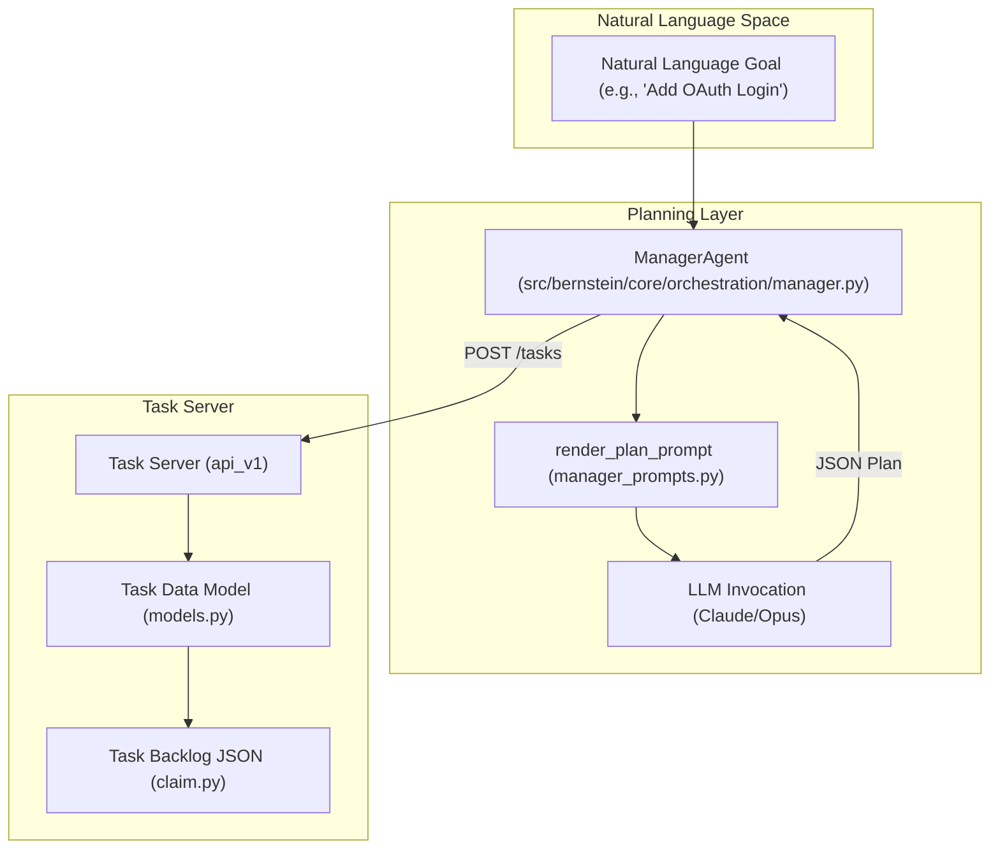

### Decomposition and Refinement Lifecycle

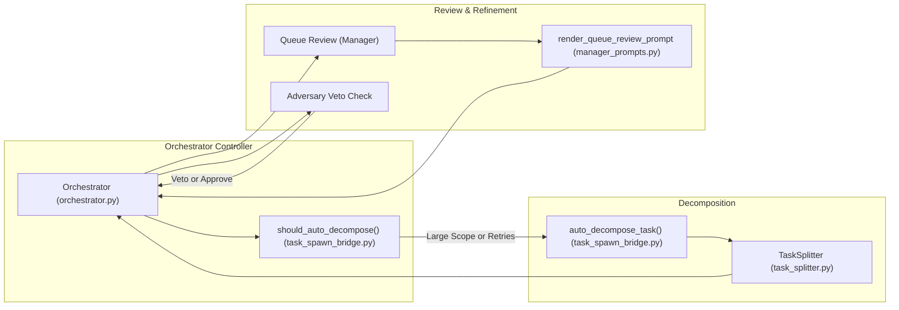

---

# Summary

This planning and decomposition subsystem ensures that:

- High-level, ambiguous goals are reliably structured into executable, atomic tasks.
- Plans are validated, transparent, and traceable.
- Large tasks are auto-segmented for manageable agent workloads.
- The Manager agent continuously refines and critiques the evolving task graph.
- Vertical slice and recipe-driven workflows accelerate delivery with composable patterns.
- A rich library of plan templates enables rapid adoption.

---

# References and Sources

- Plan loading, validation, and schema:  
  `src/bernstein/core/planning/plan_loader.py:1-171`  
  `src/bernstein/core/planning/plan_schema.py:1-200`  
  `tests/unit/test_plan_loader.py:1-210`  
  `src/bernstein/cli/commands/plan_validate_cmd.py:1-180`

- Manager agent and prompt rendering:  
  `src/bernstein/core/orchestration/manager.py:1-110`  
  `src/bernstein/core/orchestration/manager_prompts.py:100-210`

- Auto-decomposition and task spawn bridge:  
  `src/bernstein/core/tasks/task_spawn_bridge.py:10-160`

- Task models including vertical slice support:  
  `src/bernstein/core/tasks/models.py:100-160`

- Recipe registration and execution:  
  `src/bernstein/core/workflows/recipe_registry.py:10-50`

- Examples and templates:  
  `examples/plans/flask-api.yaml` (sample plan)  
  `templates/plan.yaml` (template example)

- CLI validation command:  
  `src/bernstein/cli/commands/plan_validate_cmd.py:1-180`

---

This page serves as the authoritative reference for the implementation and concepts behind Bernstein's planning and task decomposition layer.

---

# Page: Git Integration and Worktree Isolation

# Git Integration and Worktree Isolation

<details>
<summary>Relevant source files</summary>

The following files were used as context for generating this wiki page:

- [docs/decisions/009-lineage-v1.md](docs/decisions/009-lineage-v1.md)
- [docs/operations/worktrees.md](docs/operations/worktrees.md)
- [scripts/check_test_collection.py](scripts/check_test_collection.py)
- [src/bernstein/cli/commands/blast_radius_cmd.py](src/bernstein/cli/commands/blast_radius_cmd.py)
- [src/bernstein/cli/commands/maintenance_cmd.py](src/bernstein/cli/commands/maintenance_cmd.py)
- [src/bernstein/cli/commands/merge_cmd.py](src/bernstein/cli/commands/merge_cmd.py)
- [src/bernstein/cli/commands/session_cmd.py](src/bernstein/cli/commands/session_cmd.py)
- [src/bernstein/cli/commands/worktrees_cmd.py](src/bernstein/cli/commands/worktrees_cmd.py)
- [src/bernstein/core/agents/agent_cost_ledger.py](src/bernstein/core/agents/agent_cost_ledger.py)
- [src/bernstein/core/agents/agent_discovery.py](src/bernstein/core/agents/agent_discovery.py)
- [src/bernstein/core/agents/agent_identity.py](src/bernstein/core/agents/agent_identity.py)
- [src/bernstein/core/agents/agent_ipc.py](src/bernstein/core/agents/agent_ipc.py)
- [src/bernstein/core/agents/agent_profiling.py](src/bernstein/core/agents/agent_profiling.py)
- [src/bernstein/core/agents/spawner_merge.py](src/bernstein/core/agents/spawner_merge.py)
- [src/bernstein/core/git/git_basic.py](src/bernstein/core/git/git_basic.py)
- [src/bernstein/core/git/git_pr.py](src/bernstein/core/git/git_pr.py)
- [src/bernstein/core/git/salvage.py](src/bernstein/core/git/salvage.py)
- [src/bernstein/core/git/worktree.py](src/bernstein/core/git/worktree.py)
- [src/bernstein/core/lifecycle/blast_radius_gate.py](src/bernstein/core/lifecycle/blast_radius_gate.py)
- [src/bernstein/core/orchestration/preflight.py](src/bernstein/core/orchestration/preflight.py)
- [src/bernstein/core/persistence/sync.py](src/bernstein/core/persistence/sync.py)
- [src/bernstein/core/quality/blast_radius.py](src/bernstein/core/quality/blast_radius.py)
- [src/bernstein/core/security/sanitize.py](src/bernstein/core/security/sanitize.py)
- [src/bernstein/core/sessions/fork.py](src/bernstein/core/sessions/fork.py)
- [src/bernstein/core/worktrees/classifier.py](src/bernstein/core/worktrees/classifier.py)
- [templates/blast-radius/detectors.yaml](templates/blast-radius/detectors.yaml)
- [tests/integration/endpoints/__init__.py](tests/integration/endpoints/__init__.py)
- [tests/unit/test_adapter_conformance_suite.py](tests/unit/test_adapter_conformance_suite.py)
- [tests/unit/test_adapter_selection_allowlists.py](tests/unit/test_adapter_selection_allowlists.py)
- [tests/unit/test_agent_discovery.py](tests/unit/test_agent_discovery.py)
- [tests/unit/test_agent_ipc.py](tests/unit/test_agent_ipc.py)
- [tests/unit/test_auth_middleware_log_sanitization.py](tests/unit/test_auth_middleware_log_sanitization.py)
- [tests/unit/test_blast_radius.py](tests/unit/test_blast_radius.py)
- [tests/unit/test_blast_radius_run_gate.py](tests/unit/test_blast_radius_run_gate.py)
- [tests/unit/test_caching_adapter_correlation.py](tests/unit/test_caching_adapter_correlation.py)
- [tests/unit/test_cost_history.py](tests/unit/test_cost_history.py)
- [tests/unit/test_file_discovery.py](tests/unit/test_file_discovery.py)
- [tests/unit/test_git_basic.py](tests/unit/test_git_basic.py)
- [tests/unit/test_git_hygiene.py](tests/unit/test_git_hygiene.py)
- [tests/unit/test_git_pr.py](tests/unit/test_git_pr.py)
- [tests/unit/test_heartbeat.py](tests/unit/test_heartbeat.py)
- [tests/unit/test_manager_prompts.py](tests/unit/test_manager_prompts.py)
- [tests/unit/test_mergeback_failure_2792.py](tests/unit/test_mergeback_failure_2792.py)
- [tests/unit/test_metric_collector.py](tests/unit/test_metric_collector.py)
- [tests/unit/test_preflight.py](tests/unit/test_preflight.py)
- [tests/unit/test_recorder.py](tests/unit/test_recorder.py)
- [tests/unit/test_server_launch.py](tests/unit/test_server_launch.py)
- [tests/unit/test_session_fork_leak.py](tests/unit/test_session_fork_leak.py)
- [tests/unit/test_spawn_prompt.py](tests/unit/test_spawn_prompt.py)
- [tests/unit/test_task_splitter.py](tests/unit/test_task_splitter.py)
- [tests/unit/test_tick_pipeline.py](tests/unit/test_tick_pipeline.py)
- [tests/unit/test_tui_worktree_status.py](tests/unit/test_tui_worktree_status.py)
- [tests/unit/test_worktree_classifier.py](tests/unit/test_worktree_classifier.py)
- [tests/unit/test_worktree_create_leak.py](tests/unit/test_worktree_create_leak.py)
- [tests/unit/test_worktree_gitignore.py](tests/unit/test_worktree_gitignore.py)
- [tests/unit/test_worktree_graveyard.py](tests/unit/test_worktree_graveyard.py)
- [tests/unit/test_worktree_lifecycle.py](tests/unit/test_worktree_lifecycle.py)
- [tests/unit/test_worktree_salvage.py](tests/unit/test_worktree_salvage.py)
- [tests/unit/test_worktrees_cmd.py](tests/unit/test_worktrees_cmd.py)

</details>


Bernstein utilizes **Git Worktrees** to provide strict filesystem isolation for parallel agents. This architecture ensures that multiple agents can operate concurrently on the same repository without file-level conflicts, race conditions during staging, or cross-contamination of build artifacts.

## Worktree Lifecycle and Management

The `WorktreeManager` class handles the full lifecycle of agent environments, from creation and provisioning to salvage and reaping. Every agent session is assigned a unique worktree directory and a corresponding git branch.

### Lifecycle Phases
1.  **Creation**: A new worktree is created at `.sdd/worktrees/{session_id}` linked to a branch `agent/{session_id}` [src/bernstein/core/git/worktree.py:1-13]().
2.  **Provisioning**: The environment is prepared using `WorktreeSetupConfig`, which supports symlinking heavy directories (e.g., `node_modules`), copying specific files (e.g., `.env`), and configuring sparse checkouts [src/bernstein/core/git/worktree.py:50-88]().
3.  **Isolation Validation**: Before an agent starts, the system runs `validate_worktree_isolation` to ensure the worktree is correctly detached from the main working directory [src/bernstein/core/git/worktree.py:30-30]().
4.  **Reaping**: Upon task completion or agent death, `run_gc` (garbage collection) identifies stale worktrees and prunes them from the git registry [src/bernstein/cli/commands/worktrees_cmd.py:24-25]().

### Worktree State Transitions
The following diagram illustrates how the `WorktreeManager` and `Orchestrator` move a worktree through its lifecycle states.

**Diagram: Worktree Lifecycle Data Flow**
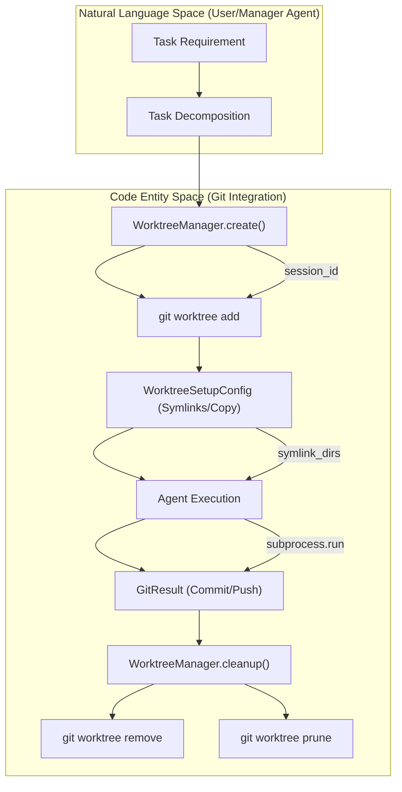
Sources: [src/bernstein/core/git/worktree.py:1-93](), [src/bernstein/cli/commands/worktrees_cmd.py:24-25](), [src/bernstein/core/git/git_basic.py:52-97]()

## Incremental Merge and Partial Commits

For long-running tasks, Bernstein supports **Incremental Merges**. This allows agents to push verified subsets of their work (e.g., a batch of passing tests) to the main branch before the entire task is finished.

*   **Mechanism**: The system uses `git checkout agent/<session_id> -- <files>` to pull specific file snapshots into the main repository without a full branch merge [src/bernstein/core/git/incremental_merge.py:19-23]().
*   **State Tracking**: Progress is persisted in `.sdd/runtime/incremental_merges/<session_id>.json` to prevent double-merging and track the `merge_commits` history [src/bernstein/core/git/incremental_merge.py:31-34, 98-112]().
*   **Safety Checks**: The `incremental_merge_files` function checks for `dirty_files` in the target branch to avoid clobbering uncommitted local changes [src/bernstein/core/git/incremental_merge.py:79-81]().

Sources: [src/bernstein/core/git/incremental_merge.py:1-43](), [src/bernstein/core/git/incremental_merge.py:98-131]()

## Git Hygiene and Repository Health

To maintain performance in high-concurrency environments, Bernstein executes periodic "Hygiene" sweeps.

### Mechanical Cleanup (`run_gc`)
The `run_gc` function performs the following non-destructive operations:
*   **Stale Worktree Removal**: Deletes directories in `.sdd/worktrees/` that are no longer tracked by git [src/bernstein/core/worktrees/classifier.py:300-313]().
*   **Merged Branch Deletion**: Identifies `agent/*` branches already merged into the `target_branch` (default `main`) and deletes them [src/bernstein/core/worktrees/classifier.py:315-320]().
*   **Registry Pruning**: Runs `git worktree prune` to clean the internal git metadata [src/bernstein/core/worktrees/classifier.py:325-325]().

### Pre-flight Health Checks
Before spawning agents, `_check_git_health` detects and repairs common corruption:
*   **Stale Locks**: Automatically unlinks `.git/index.lock` or worktree `locked` files if they are older than 5 minutes [src/bernstein/core/git/worktree.py:96-121]().
*   **HEAD Verification**: Ensures `git rev-parse --verify HEAD` succeeds to confirm repository integrity [src/bernstein/core/git/worktree.py:158-172]().

Sources: [src/bernstein/core/worktrees/classifier.py:1-40](), [src/bernstein/core/git/worktree.py:96-178]()

## GitHub Integration and PR Generation

Bernstein integrates with the GitHub CLI (`gh`) to coordinate distributed evolution and manage PRs.

### Evolution Coordination
The `GitHubIssue` class represents issues used to claim work in a distributed cluster [src/bernstein/core/git/github.py:144-166]().
*   **Deduplication**: Uses `evolve-hash-<hex>` labels derived from the task title to prevent multiple Bernstein instances from claiming the same work [src/bernstein/core/git/github.py:27-28, 130-140]().
*   **Community Trust**: Scans for `evolve-candidate` or `feature-request` labels, requiring `maintainer-approved` status for non-collaborator issues [src/bernstein/core/git/github.py:59-62, 178-181]().

### PR Lifecycle
The system automates the transition from local worktree to upstream PR:
1.  **Branch Push**: Pushes the agent branch to the remote.
2.  **PR Creation**: Uses `gh pr create` with auto-generated summaries based on `git diff --stat` [src/bernstein/core/git/git_pr.py:26-28]().
3.  **Auto-Merge**: Optionally enables GitHub auto-merge for PRs that pass all status checks [src/bernstein/core/git/git_pr.py:33-33]().

Sources: [src/bernstein/core/git/github.py:1-35](), [src/bernstein/core/git/github.py:144-191]()

## The Drain and Cleanup Sequence

When the Orchestrator stops, it follows a strict "Drain" sequence to ensure no git state is left in an inconsistent state.

**Diagram: Orchestrator Drain and Git Cleanup**
```mermaid
sequenceDiagram
    participant O as Orchestrator
    participant A as Active Agents
    participant H as Hygiene Module
    participant S as Session State

    O->>O: stop() set _running=False
    O->>A: send_shutdown_signals()
    Note over A: Agents save WIP to worktree
    loop Drain Loop (timeout_s)
        O->>O: fetch_all_tasks()
        O->>O: process_completed_tasks()
        O->>A: reap_dead_agents()
    end
    O->>S: save_session_state()
    O->>H: run_gc(full=True)
    H->>H: _clean_stale_worktrees()
    H->>H: _delete_merged_agent_branches()
    H->>H: git worktree prune
    Note over O: Shutdown Complete
```

### Drain Actions
*   **Shutdown Signals**: Agents receive a signal to commit their current work before exiting [src/bernstein/core/orchestration/orchestrator_cleanup.py:30-43]().
*   **Final Reap**: The orchestrator continues to process tasks that finish during the drain window (default 60s) to ensure their git branches are merged [src/bernstein/core/orchestration/orchestrator_cleanup.py:57-104]().
*   **Session Persistence**: Current task statuses and costs are saved to `.sdd/runtime/session.json` for resumption [src/bernstein/core/orchestration/orchestrator_cleanup.py:114-151]().

Sources: [src/bernstein/core/orchestration/orchestrator_cleanup.py:30-112](), [src/bernstein/core/orchestration/orchestrator_cleanup.py:154-196]()

---

# Page: Persistence and State Management

# Persistence and State Management

<details>
<summary>Relevant source files</summary>

The following files were used as context for generating this wiki page:

- [docs/architecture/ARCHITECTURE.md](docs/architecture/ARCHITECTURE.md)
- [docs/gui/index.md](docs/gui/index.md)
- [docs/guides/index.md](docs/guides/index.md)
- [docs/operations/deterministic-replay.md](docs/operations/deterministic-replay.md)
- [docs/operations/replay.md](docs/operations/replay.md)
- [src/bernstein/core/git/changelog.py](src/bernstein/core/git/changelog.py)
- [src/bernstein/core/git/git_context.py](src/bernstein/core/git/git_context.py)
- [src/bernstein/core/knowledge/knowledge_base.py](src/bernstein/core/knowledge/knowledge_base.py)
- [src/bernstein/core/observability/loop_detector.py](src/bernstein/core/observability/loop_detector.py)
- [src/bernstein/core/orchestration/deterministic.py](src/bernstein/core/orchestration/deterministic.py)
- [src/bernstein/core/orchestration/orchestrator_cleanup.py](src/bernstein/core/orchestration/orchestrator_cleanup.py)
- [src/bernstein/core/persistence/agent_checkpoint.py](src/bernstein/core/persistence/agent_checkpoint.py)
- [src/bernstein/core/persistence/atomic_write.py](src/bernstein/core/persistence/atomic_write.py)
- [src/bernstein/core/persistence/chain_checkpoint.py](src/bernstein/core/persistence/chain_checkpoint.py)
- [src/bernstein/core/persistence/file_locks.py](src/bernstein/core/persistence/file_locks.py)
- [src/bernstein/core/persistence/journal.py](src/bernstein/core/persistence/journal.py)
- [src/bernstein/core/persistence/journal_diff.py](src/bernstein/core/persistence/journal_diff.py)
- [src/bernstein/core/persistence/journal_export.py](src/bernstein/core/persistence/journal_export.py)
- [src/bernstein/core/persistence/journal_publish.py](src/bernstein/core/persistence/journal_publish.py)
- [src/bernstein/core/persistence/lineage_signer.py](src/bernstein/core/persistence/lineage_signer.py)
- [src/bernstein/core/persistence/merkle.py](src/bernstein/core/persistence/merkle.py)
- [src/bernstein/core/persistence/session.py](src/bernstein/core/persistence/session.py)
- [src/bernstein/core/persistence/session_continuity.py](src/bernstein/core/persistence/session_continuity.py)
- [src/bernstein/core/persistence/team_state.py](src/bernstein/core/persistence/team_state.py)
- [src/bernstein/core/persistence/wal.py](src/bernstein/core/persistence/wal.py)
- [src/bernstein/core/planning/plan_execute.py](src/bernstein/core/planning/plan_execute.py)
- [src/bernstein/core/replay/__init__.py](src/bernstein/core/replay/__init__.py)
- [src/bernstein/core/replay/journal.py](src/bernstein/core/replay/journal.py)
- [src/bernstein/core/replay/run_receipt.py](src/bernstein/core/replay/run_receipt.py)
- [tests/integration/test_audit_chain_tear_stickiness.py](tests/integration/test_audit_chain_tear_stickiness.py)
- [tests/property/__init__.py](tests/property/__init__.py)
- [tests/property/test_wal_cas_bughunt.py](tests/property/test_wal_cas_bughunt.py)
- [tests/unit/test_acp.py](tests/unit/test_acp.py)
- [tests/unit/test_agent_checkpoint.py](tests/unit/test_agent_checkpoint.py)
- [tests/unit/test_atomic_write.py](tests/unit/test_atomic_write.py)
- [tests/unit/test_audit_query_archived_segments.py](tests/unit/test_audit_query_archived_segments.py)
- [tests/unit/test_audit_tear_detection.py](tests/unit/test_audit_tear_detection.py)
- [tests/unit/test_bandit_router.py](tests/unit/test_bandit_router.py)
- [tests/unit/test_chain_checkpoint.py](tests/unit/test_chain_checkpoint.py)
- [tests/unit/test_container_wiring.py](tests/unit/test_container_wiring.py)
- [tests/unit/test_differential_privacy.py](tests/unit/test_differential_privacy.py)
- [tests/unit/test_eu_ai_act.py](tests/unit/test_eu_ai_act.py)
- [tests/unit/test_file_locks.py](tests/unit/test_file_locks.py)
- [tests/unit/test_incident.py](tests/unit/test_incident.py)
- [tests/unit/test_journal_chain.py](tests/unit/test_journal_chain.py)
- [tests/unit/test_journal_divergence.py](tests/unit/test_journal_divergence.py)
- [tests/unit/test_journal_export.py](tests/unit/test_journal_export.py)
- [tests/unit/test_journal_publish.py](tests/unit/test_journal_publish.py)
- [tests/unit/test_license_scanner.py](tests/unit/test_license_scanner.py)
- [tests/unit/test_mcp_cmd.py](tests/unit/test_mcp_cmd.py)
- [tests/unit/test_memory_integrity.py](tests/unit/test_memory_integrity.py)
- [tests/unit/test_merkle.py](tests/unit/test_merkle.py)
- [tests/unit/test_plan_execute.py](tests/unit/test_plan_execute.py)
- [tests/unit/test_run_benchmark.py](tests/unit/test_run_benchmark.py)
- [tests/unit/test_run_receipt.py](tests/unit/test_run_receipt.py)
- [tests/unit/test_runbooks.py](tests/unit/test_runbooks.py)
- [tests/unit/test_verify_run_receipt_cmd.py](tests/unit/test_verify_run_receipt_cmd.py)
- [tests/unit/test_wal.py](tests/unit/test_wal.py)
- [tests/unit/test_wal_replay.py](tests/unit/test_wal_replay.py)
- [tests/unit/test_workflow.py](tests/unit/test_workflow.py)
- [vulture_whitelist.py](vulture_whitelist.py)

</details>


Bernstein employs a robust, multi-layered persistence strategy designed for audit-grade compliance, crash-safety, determinism, and session continuity. This system centers on the `.sdd/` file-based state directory augmented by a Write-Ahead Log (WAL), agent checkpoints, file locks, and a Merkle fingerprint store. Optional backends such as PostgreSQL and Redis can be integrated for enhanced scalability and performance.

---

## The .sdd/ File-Based State Model

The `.sdd/` directory is the canonical on-disk representation of Bernstein's state. It separates persistent artifacts from transient runtime state, enabling portability, transparency, and reproducibility.

### Directory Composition

- **`backlog/`**: Stores task definitions categorized by their lifecycle stage (`open`, `done`, `closed`, `deferred`). This directory serves as the authoritative task source [src/bernstein/core/persistence/disaster_recovery.py:47-51]().

- **`runtime/`**: Contains live execution state; notably the WAL journal files (`.wal.jsonl`), file lock records, and agent heartbeats that coordinate concurrent orchestrator and agent activity [src/bernstein/core/persistence/disaster_recovery.py:42-45]().

- **`memory/` & `index/`**: SQLite-backed stores for knowledge graphs and retrieval-augmented generation (RAG) indices which support Bernstein's knowledge base and memory layer [src/bernstein/core/persistence/disaster_recovery.py:54-61]().

- **`sessions/`**: Maintains session continuity information enabling the TUI and Web dashboard to track and resume in-progress agent and user interactions [src/bernstein/core/persistence/disaster_recovery.py:55-55]().

### Atomic Writes and Crash Safety

To prevent partial writes or corrupted files, Bernstein employs atomic write operations via temporary files and atomic renames. The core utility function, `write_atomic_json`, writes data to a uniquely named temporary file before an atomic `os.replace` moves it to the target path. This guarantees readers see either the previous valid state or the fully written new state, preventing torn or half-written files on crash or concurrent writes [src/bernstein/core/persistence/agent_checkpoint.py:50-63](), [tests/unit/test_atomic_write.py:10-170]().

---

## Write-Ahead Log (WAL) and Crash Recovery

### WAL Overview

Every orchestrator decision is durably persisted to a Write-Ahead Log (WAL) before execution. This ensures crash safety, auditability, and enables deterministic replay.

- **Storage location**: `.sdd/runtime/wal/<run-id>.wal.jsonl` [src/bernstein/core/wal.py:7-8]().

- **Data format**: Each WAL entry is a JSON line containing fields such as `seq` (sequence number), `prev_hash` (the SHA-256 hash linking to the previous entry), `entry_hash` (hash of the current entry contents), `decision_type`, inputs/outputs, and an `actor`. Entries form a hash chain to detect tampering [src/bernstein/core/wal.py:40-58]().

- **Committing entries**: Entries initially may be marked `committed=False` to indicate an unconfirmed decision (e.g., a claimed but not spawned task). Once confirmed, the orchestrator marks them committed to remove them from recovery tracking [src/bernstein/core/wal.py:57-57]().

### Crash Recovery Workflow

Upon restart, `WALRecovery` inspects all WAL files to identify uncommitted entries (orphaned claims) that require re-queuing or clean-up.

- To speed recovery, an `UncommittedIndex` caches these uncommitted entries in a separate JSONL index file, avoiding costly full WAL scans on each boot [src/bernstein/core/wal.py:75-94]().

- Called functions like `find_orphaned_claims` report these entries for possible re-claim actions or diagnostics.

- Detected orphaned claims can be force re-queued with a specific crash recovery reason, preserving workflow continuity without manual intervention [tests/unit/test_wal_recovery_retry.py:8-15]().

### Data Flow: Orchestrator Decisions to WAL Persistence

```mermaid
sequenceDiagram
    participant Orchestrator
    participant WALWriter
    participant UncommittedIndex
    participant Filesystem

    Orchestrator->>WALWriter: append(decision_type, inputs, output, actor)
    WALWriter->>WALWriter: _compute_entry_hash()
    WALWriter->>Filesystem: fsync append new entry line
    WALWriter->>UncommittedIndex: add(run_id, seq, entry_hash)
    UncommittedIndex->>Filesystem: fsync append index line
    Orchestrator->>Orchestrator: execute action (spawn agent, assign task)
    Orchestrator->>WALWriter: commit(seq)
    WALWriter->>UncommittedIndex: remove(run_id, seq)
    UncommittedIndex->>Filesystem: atomic rewrite index file
```

**Sources:** [src/bernstein/core/wal.py:1-14](), [src/bernstein/core/wal.py:41-58](), [src/bernstein/core/wal.py:75-94](), [tests/unit/test_wal_recovery_retry.py:1-15]()

---

## Agent Checkpoints

Agent checkpoints provide a mechanism to persist partial progress state within long-running agents, enabling recovery and session continuity after crashes or restarts.

- **Checkpoint Contents**: Includes milestone data such as `files_modified`, `step_count` (number of steps executed), and `last_output` (agent's last generated output) [src/bernstein/core/persistence/agent_checkpoint.py:24-48]().

- **Storage**: Checkpoints are saved under `.sdd/runtime/agents/{agent_id}/checkpoint.json` for stable per-agent snapshots [src/bernstein/core/persistence/agent_checkpoint.py:51-51]().

- **Recovery Eligibility**: Checkpoints are considered recoverable if the associated git worktree exists and the files have uncommitted changes, indicating an incomplete prior run [src/bernstein/core/persistence/agent_checkpoint.py:143-164]().

- **Resuming a Task**: `build_resume_prompt` synthesizes a system prompt that encapsulates prior context and checkpoint info to resume execution smoothly [src/bernstein/core/persistence/agent_checkpoint.py:199-208]().

---

## File Locks and Atomic Writes

To prevent concurrent modification conflicts, Bernstein employs:

- **File locks**: To coordinate exclusive ownership of files and protect against write conflicts [src/bernstein/core/persistence/file_locks.py:1-80] (not explicitly detailed here but known in code).

- **Atomic write strategies**: All critical state files use atomic writes as described earlier to ensure durability and avoid partially written states [tests/unit/test_atomic_write.py:41-178](), [src/bernstein/core/persistence/agent_checkpoint.py:50-63]().

This combination preserves correctness under concurrent orchestrator and agent processes.

---

## Session Continuity

Agents and frontends maintain session state inside `.sdd/sessions/`. This enables user interfaces (TUI and Web) to persist partial conversations, agent outputs, and provide seamless reconnection capabilities.

The session ID indexing mechanism binds conversation and adapter names to recorded runs, supporting deterministic replay and session recall [src/bernstein/core/replay/__init__.py:87-99]().

---

## The Merkle Fingerprint Store

Bernstein employs a Merkle-based fingerprint store to memoize and fingerprint expensive computations, ensuring deterministic computation and cacheability.

- **`memoize_persistent` decorator**: Caches results keyed by a fingerprint which includes the function's source code and input arguments, providing strong guarantees against silent drift [src/bernstein/core/quality/cross_model_verifier.py:19-19]().

- **Integration with Knowledge Graphs**: The `KnowledgeGraph` uses this mechanism to cache extracted AST symbols keyed by file SHA-256, facilitating impact analysis without repeated parsing [src/bernstein/core/knowledge/knowledge_graph.py:88-96]().

---

## Disaster Recovery

Bernstein’s disaster recovery functionality backs up and restores the `.sdd/` state.

- **Backup scope**: Includes key persistent directories (`backlog`, `runtime`, `memory`, `sessions`, etc.), while excluding ephemeral data like PIDs, heartbeats, and rotated logs to avoid invalid or stale content in backups [src/bernstein/core/persistence/disaster_recovery.py:40-107]().

- **Encryption**: Supports AES-256 via the `Fernet` cipher from `cryptography.fernet`, with keys derived via PBKDF2-SHA256 ensuring data confidentiality [src/bernstein/core/persistence/disaster_recovery.py:139-174]().

- **Integrity verification**: Each backup includes a `manifest.json` summarizing its contents and SHA-256 hashes, enabling post-restore verification for corruption or tampering [src/bernstein/core/persistence/disaster_recovery.py:125-125](), [src/bernstein/core/persistence/disaster_recovery.py:193-193]().

---

## Optional PostgreSQL and Redis Backends

While the default persistent storage is file-based, Bernstein optionally supports PostgreSQL and Redis backends for:

- **PostgreSQL**: Provides robust transactional storage suitable for large-scale deployments requiring richer query capabilities and high availability.

- **Redis**: Serves as a fast in-memory cache for ephemeral state or coordination data to augment file-based persistence.

This extensibility allows integration into diverse deployment environments and scaling strategies, although detailed usage of these backends is documented elsewhere.

---

## Technical Diagrams: Bridging Concepts to Code Entities

### Natural Language to WAL Code Entities

```mermaid
graph TD
    A["Orchestrator Decision"] --> B["WALWriter.append()"]
    B --> C["WALEntry(seq, prev_hash, entry_hash, decision_type, inputs, output, actor, committed)"]
    C --> D[".sdd/runtime/wal/<run_id>.wal.jsonl (JSONL File)"]
    B -- updates --> E["UncommittedIndex.add()"]
    F["Crash Recovery"] --> G["WALRecovery.find_orphaned_claims()"]
    G --> H["UncommittedIndex.load()"]
```
**Sources:** [src/bernstein/core/wal.py:40-58](), [src/bernstein/core/wal.py:75-94]()

### Agent Checkpoint Lifecycle Mapping

```mermaid
graph LR
    Agent["Agent Process"] -->|Saves checkpoint| AC["AgentCheckpoint.save_checkpoint()"]
    AC --> FS[".sdd/runtime/agents/{agent_id}/checkpoint.json"]
    Restart["Orchestrator/Agent Restart"] -->|Loads and verifies| AC_Load["AgentCheckpoint.load_checkpoint()"]
    AC_Load -->|Calls| Recover["AgentCheckpoint.is_checkpoint_recoverable()"]
    Recover --> Resume["build_resume_prompt()"]
    Resume --> Agent
```
**Sources:** [src/bernstein/core/persistence/agent_checkpoint.py:24-48](), [src/bernstein/core/persistence/agent_checkpoint.py:143-164](), [src/bernstein/core/persistence/agent_checkpoint.py:199-208]()

---

# Summary Table of Key Persistence Components

| Component               | Location/Path                                 | Purpose                                                          |
|-------------------------|----------------------------------------------|-----------------------------------------------------------------|
| `.sdd/` directory       | Project root `.sdd/`                          | File-based state store (backlogs, runtime state, knowledge)     |
| WAL                     | `.sdd/runtime/wal/<run-id>.wal.jsonl`        | Append-only hash-chained log of orchestrator decisions          |
| UncommittedIndex        | `.sdd/runtime/wal/uncommitted.idx.json`      | Index of uncommitted WAL entries for crash recovery speedup     |
| AgentCheckpoint         | `.sdd/runtime/agents/{agent_id}/checkpoint.json` | Snapshots of agent execution progress                            |
| File locks              | `.sdd/runtime/locks/`                         | Coordination to ensure exclusive file ownership                  |
| Session continuity      | `.sdd/sessions/`                              | Persist UI and agent sessions for continuous interactions       |
| Merkle Fingerprint Store| Internal cache                              | Memoization layer for deterministic function caching            |
| Disaster Recovery       | Backup archives                              | Encrypted backups of `.sdd/` with integrity verification        |

---

This persistence and state management architecture enables Bernstein to operate reliably with deterministic coordination, crash recovery, audit logging, and seamless resumption of agent and orchestrator state.

---

**Sources:**  
- [src/bernstein/core/persistence/disaster_recovery.py:1-107, 125-193]()  
- [src/bernstein/core/persistence/agent_checkpoint.py:1-7, 24-63, 143-208]()  
- [src/bernstein/core/wal.py:1-14, 40-58, 75-94]()  
- [tests/unit/test_atomic_write.py:1-178]()  
- [tests/unit/test_wal_recovery_retry.py:1-15]()  
- [src/bernstein/core/replay/__init__.py:87-99]()  
- [src/bernstein/core/quality/cross_model_verifier.py:19-19]()  
- [src/bernstein/core/knowledge/knowledge_graph.py:88-96]()

---

# Page: CLI Reference

# CLI Reference

<details>
<summary>Relevant source files</summary>

The following files were used as context for generating this wiki page:

- [.cursor/rules/module-map.mdc](.cursor/rules/module-map.mdc)
- [.cursor/rules/overview.mdc](.cursor/rules/overview.mdc)
- [.goosehints](.goosehints)
- [AGENTS.md](AGENTS.md)
- [CLAUDE.md](CLAUDE.md)
- [CONVENTIONS.md](CONVENTIONS.md)
- [README.md](README.md)
- [docs/adapters/ADAPTER_GUIDE.md](docs/adapters/ADAPTER_GUIDE.md)
- [docs/reference/cli-reference.md](docs/reference/cli-reference.md)
- [docs/release-notes/unreleased.md](docs/release-notes/unreleased.md)
- [src/bernstein/adapters/_contract.py](src/bernstein/adapters/_contract.py)
- [src/bernstein/adapters/registry.py](src/bernstein/adapters/registry.py)
- [src/bernstein/adapters/report.py](src/bernstein/adapters/report.py)
- [src/bernstein/adapters/use_cases.py](src/bernstein/adapters/use_cases.py)
- [src/bernstein/cli/commands/adapter_cmd.py](src/bernstein/cli/commands/adapter_cmd.py)
- [src/bernstein/cli/commands/advanced_cmd.py](src/bernstein/cli/commands/advanced_cmd.py)
- [src/bernstein/cli/dashboard_app.py](src/bernstein/cli/dashboard_app.py)
- [src/bernstein/cli/dashboard_polling.py](src/bernstein/cli/dashboard_polling.py)
- [src/bernstein/cli/live.py](src/bernstein/cli/live.py)
- [src/bernstein/cli/main.py](src/bernstein/cli/main.py)
- [src/bernstein/core/security/audit_chain.py](src/bernstein/core/security/audit_chain.py)
- [tests/unit/test_adapter_contract.py](tests/unit/test_adapter_contract.py)
- [tests/unit/test_dashboard_server_resolution.py](tests/unit/test_dashboard_server_resolution.py)
- [tests/unit/test_readme_api_coverage.py](tests/unit/test_readme_api_coverage.py)

</details>


The Bernstein CLI provides a deterministic interface for orchestrating multi-agent coding workflows. It is designed for high-compliance environments where every routing decision and file modification must be auditable and reproducible. The CLI surface is divided into two primary entrypoints:

- `bernstein`: The main orchestrator and management tool, used by operators to interact with the system for running orchestration sessions, managing tasks, auditing, and more.
- `bernstein-worker`: A specialized entrypoint invoked by the orchestrator to wrap individual agent processes, enabling environment isolation, spawning, and monitoring of CLI coding agents.

---

### Entrypoints Overview

Bernstein exposes these two command binaries:

| Entrypoint         | Purpose                                                                                     |
|--------------------|---------------------------------------------------------------------------------------------|
| `bernstein`        | Primary CLI for project initialization, orchestration sessions, task lifecycle, audits     |
| `bernstein-worker` | Internal wrapper for executing individual agent tasks in an isolated and supervised manner |

The `bernstein-worker` command is not typically invoked directly by end users but is essential for running agents in sandboxed environments during a Bernstein run session.

Sources: [src/bernstein/cli/main.py:1-18](), [src/bernstein/cli/main.py:133]()

---

## Command Organization

The CLI uses Python's `click` library and organizes commands into logical groups to cleanly separate concerns and user workflows. These include lifecycle commands, workspace management, advanced tools, adapters, auditing, and many others.

Most commands interact with the **Task Server** (usually listening on port 8052) or the `.sdd/` file-based state directory. The Task Server runs a FastAPI backend exposing routes for task creation, status querying, and agent coordination.

Commands are registered in `src/bernstein/cli/main.py`, which imports and composes subcommand groups from various modules like `task_cmd.py`, `workspace_cmd.py`, and others.

---

### High-Level Command Grouping

Here is a simplified conceptual grouping of primary command categories and where they live:

```mermaid
graph LR
    subgraph "bernstein CLI Surface"
        CLI["bernstein (cli/main.py)"]

        CLI --> RunGroup["Run & Bootstrap (run_cmd.py, run_bootstrap.py)"]
        CLI --> TaskGroup["Task Lifecycle (task_cmd.py)"]
        CLI --> WorkspaceGroup["Workspace & Config (workspace_cmd.py)"]
        CLI --> StatusGroup["Status & Audit (status_cmd.py, audit_cmd.py)"]
        CLI --> AdapterGroup["Adapters (adapter_cmd.py)"]
        CLI --> AdvancedGroup["Advanced & Operational (advanced_cmd.py, doctor_cmd.py, cost.py, evolve_cmd.py)"]
    end
```

Each major group contains multiple commands or subgroups focused on a coherent area of Bernstein's capabilities.

Sources: [src/bernstein/cli/main.py:1-18](), [src/bernstein/cli/run_bootstrap.py:1-34](), [src/bernstein/cli/task_cmd.py:1-50](), [src/bernstein/cli/adapter_cmd.py:1-30]()

---

### Natural Language Goals to Code Entities Mapping

Bernstein's CLI commands serve as the user-facing interface transitioning from natural language or project goals to internal system actions. Below is a diagram showing how a user action via the CLI maps into internal code entities and runtime components:

```mermaid
graph TD
    User["Operator (Shell)"]

    User -->|`bernstein -g "goal..."`| CLI_Main["`cli.main:cli` root group"]
    CLI_Main -->|`run` command| RunBootstrap["`cli.run_bootstrap:run`"]
    RunBootstrap -->|Generates| SyntheticPlan["Synthetic Plan (plan_approval:create_plan)"]
    RunBootstrap -->|POST /tasks| TaskServer["FastAPI Task Server (routes/*.py)"]

    User -->|`bernstein status`| StatusCmd["`cli.status_cmd:status`"]

    TaskServer -->|Read/Write| SDD_State["`.sdd/` Directory State"]

    subgraph Execution
       Worker["`bernstein-worker` (cli.worker_cmd)"]
       Adapter["CLI Adapter (adapters/base.py)"]
       AgentProc["Agent Process (Claude, Aider, etc.)"]

       Worker -->|Executes| Adapter
       Adapter -->|Spawns| AgentProc
    end
```

This mapping illustrates the flow from user commands into the orchestration loop, task queue, and runtime agents performing work.

Sources: [src/bernstein/cli/main.py:1-18](), [src/bernstein/cli/run_bootstrap.py:30-72](), [src/bernstein/adapters/base.py:1-20]()

---

## 3.1 Run, Init, and Bootstrap Commands

These commands handle project initialization and the core orchestration lifecycle.

- **`bernstein init` / `bernstein init --wizard`**: Prepare the `.sdd/` directory structure and create a baseline `bernstein.yaml` project configuration [src/bernstein/cli/run_bootstrap.py:394-410]().
- **`bernstein run`**: The primary command to execute a plan or goal. It performs preflight steps such as cost estimation, synthetic plan generation, environment flag propagation, and starts the orchestration engine and agent spawns [src/bernstein/cli/run_bootstrap.py:1-62]().
- **`bernstein cook`**: Runs a multi-stage recipe or demo workflow [src/bernstein/cli/run_confirm.py:50-80]() (see demo and quickstart commands as well).
- **`bernstein dry-run`**: Simulates execution without spawning agents, useful for verification and validation of task plan dependencies [src/bernstein/cli/dry_run_cmd.py:190-230]().

See the child page [Run, Init, and Bootstrap Commands](#3.1) for a deep dive into the bootstrap lifecycle, cost cap propagation, network policy installation, and synthetic plan approval flow.

Sources: [src/bernstein/cli/run_bootstrap.py:1-62](), [src/bernstein/cli/run_confirm.py:40-85](), [src/bernstein/cli/dry_run_cmd.py:190-230](), [src/bernstein/cli/main.py:90-110]()

---

## 3.2 Status, Audit, and Lineage Commands

This group provides visibility into running tasks, audit logs, and forensic lineage:

- **`bernstein status` / `bernstein ps`**: Show real-time snapshots of active tasks, claims, and isolated worktrees [src/bernstein/cli/status_cmd.py:10-50]().
- **`bernstein audit`**: Examine and verify the tamper-evident HMAC-SHA256 audit chain recording every scheduling event and operator action [src/bernstein/cli/audit_cmd.py:10-60]().
- **`bernstein lineage`**: Trace full file change provenance through versioned lineage v1/v2 stores. Includes lineage validation and export features [src/bernstein/cli/lineage_cmd.py:1-60]() and [src/bernstein/cli/verify_cmd.py:110-150]().
- **`bernstein verify`**: A standalone auditor useful for verifying signed receipts, agent cards, and other compliance artefacts offline [src/bernstein/cli/verify_cmd.py:100-160]().

This area supports compliance, governance, and post-mortem investigations. For detailed usage, parameters, and examples, see the child page [Status, Audit, and Lineage Commands](#3.2).

Sources: [src/bernstein/cli/status_cmd.py:10-50](), [src/bernstein/cli/audit_cmd.py:1-60](), [src/bernstein/cli/verify_cmd.py:100-160](), [tests/unit/test_readme_api_coverage.py:160-200]()

---

## 3.3 Cost, Adapter, and Operational Commands

Focused on resource management and operational health, these commands help maintain smooth operation and monitor expenses:

- **`bernstein cost` / `estimate`**: Report token consumption and monetary cost per run or aggregated by model/provider [src/bernstein/cli/cost.py:30-80]().
- **`bernstein adapters`**: List all supported CLI agent adapters (40+), test their health, and display conformance matrices [src/bernstein/cli/adapter_cmd.py:20-50]().
- **`bernstein doctor`**: Run health checks on environment components such as sandbox backends (Docker, worktrees) and flag potential issues [src/bernstein/cli/advanced_cmd.py:20-50]().
- **`bernstein autofix`**: Trigger or monitor the autofix daemon that automatically detects and repairs CI failures, file conflicts, or other operational errors [src/bernstein/cli/autofix_cmd.py:10-60]().

For operational best practices and detailed usage instructions for cost control and adapter management, see [Cost, Adapter, and Operational Commands](#3.3).

Sources: [src/bernstein/cli/cost.py:20-80](), [src/bernstein/cli/adapter_cmd.py:1-36](), [src/bernstein/cli/advanced_cmd.py:20-50](), [tests/unit/test_readme_api_coverage.py:160-180]()

---

### Command Discovery and Help Utilities

Bernstein CLI includes tools to assist operators in navigating its large command set:

- **`bernstein help-all`**: Displays complete help text for every registered subcommand, aiding discoverability [src/bernstein/cli/advanced_cmd.py:34-48]().
- **`bernstein explain`**: Provides natural language explanations for Bernstein concepts and commands [src/bernstein/cli/explain_help_cmd.py:70-110]().
- **`bernstein man-pages`**: Generates local manpages for offline reference across the full CLI surface [src/bernstein/cli/man_page.py:50-100]().

---

### Command Grouping Entity Map

The primary CLI groups compose the main CLI class, linking source files to command clusters:

```mermaid
graph LR
    subgraph "bernstein CLI (src/bernstein/cli/main.py)"
        MainCT["Main CLI Root"]

        MainCT --> TaskCT["Task Commands (task_cmd.py)"]
        MainCT --> WorkspaceCT["Workspace & Config (workspace_cmd.py)"]
        MainCT --> AdvancedCT["Advanced Tools (advanced_cmd.py)"]
        MainCT --> AdapterCT["Adapter Management (adapter_cmd.py)"]

        TaskCT --> AddTaskCmd["add-task"]
        TaskCT --> ApproveCmd["approve"]

        WorkspaceCT --> ConfigCmd["config"]
        WorkspaceCT --> InitCmd["init"]

        AdvancedCT --> DoctorCmd["doctor"]
        AdvancedCT --> CostCmd["cost"]
    end
```

This shows the modular code structure and corresponding user-facing command hierarchy.

Sources: [src/bernstein/cli/main.py:1-18]()

---

# Child Pages for Details

This page provides a high-level overview of Bernstein’s CLI surface. Detailed documentation of major command groups lives in the following child pages:

- **[Run, Init, and Bootstrap Commands](#3.1)** — Covers all commands related to starting runs, initializing projects, bootstrapping orchestration sessions, and their underlying lifecycles.
- **[Status, Audit, and Lineage Commands](#3.2)** — Focuses on commands that report status, inspect task state, audit runs, verify tamper-evident data, and lineage provenance.
- **[Cost, Adapter, and Operational Commands](#3.3)** — Details commands for cost reporting, adapter health and testing, operational diagnostics, and self-healing automation.

For comprehensive understanding of each area, consult these pages.

---

This completes the high-level reference for Bernstein’s command-line interface surface, outlining how the CLI entrypoints, command groups, and tasks map into the underlying orchestration system.

# End of CLI Reference

---

**Sources:**

- [src/bernstein/cli/main.py:1-18, 90-110, 133]()
- [src/bernstein/cli/run_bootstrap.py:1-62, 394-410]()
- [src/bernstein/cli/run_confirm.py:40-85]()
- [src/bernstein/cli/dry_run_cmd.py:190-230]()
- [src/bernstein/cli/status_cmd.py:10-50]()
- [src/bernstein/cli/audit_cmd.py:1-60]()
- [src/bernstein/cli/verify_cmd.py:100-160]()
- [src/bernstein/cli/cost.py:20-80]()
- [src/bernstein/cli/adapter_cmd.py:1-50]()
- [src/bernstein/adapters/base.py:1-20]()
- [tests/unit/test_readme_api_coverage.py:150-180]()

---

# Page: Run, Init, and Bootstrap Commands

# Run, Init, and Bootstrap Commands

<details>
<summary>Relevant source files</summary>

The following files were used as context for generating this wiki page:

- [docs/orchestration/issue-to-pr.md](docs/orchestration/issue-to-pr.md)
- [docs/orchestration/worker-coordination.md](docs/orchestration/worker-coordination.md)
- [docs/substrate/claude-code.md](docs/substrate/claude-code.md)
- [src/bernstein/adapters/council_runner.py](src/bernstein/adapters/council_runner.py)
- [src/bernstein/adapters/env_isolation.py](src/bernstein/adapters/env_isolation.py)
- [src/bernstein/adapters/openai_agents.py](src/bernstein/adapters/openai_agents.py)
- [src/bernstein/adapters/openai_agents_runner.py](src/bernstein/adapters/openai_agents_runner.py)
- [src/bernstein/cli/commands/incident_cmd.py](src/bernstein/cli/commands/incident_cmd.py)
- [src/bernstein/cli/commands/postmortem_cmd.py](src/bernstein/cli/commands/postmortem_cmd.py)
- [src/bernstein/cli/commands/status_cmd.py](src/bernstein/cli/commands/status_cmd.py)
- [src/bernstein/cli/commands/stop_cmd.py](src/bernstein/cli/commands/stop_cmd.py)
- [src/bernstein/cli/plan/plan_display.py](src/bernstein/cli/plan/plan_display.py)
- [src/bernstein/cli/run_bootstrap.py](src/bernstein/cli/run_bootstrap.py)
- [src/bernstein/cli/run_preflight.py](src/bernstein/cli/run_preflight.py)
- [src/bernstein/core/agents/spawner_core.py](src/bernstein/core/agents/spawner_core.py)
- [src/bernstein/core/git/github.py](src/bernstein/core/git/github.py)
- [src/bernstein/core/instrumentation.py](src/bernstein/core/instrumentation.py)
- [src/bernstein/core/orchestration/activity_modalities.py](src/bernstein/core/orchestration/activity_modalities.py)
- [src/bernstein/core/orchestration/adaptive_parallelism.py](src/bernstein/core/orchestration/adaptive_parallelism.py)
- [src/bernstein/core/orchestration/bootstrap.py](src/bernstein/core/orchestration/bootstrap.py)
- [src/bernstein/core/orchestration/commit_completion.py](src/bernstein/core/orchestration/commit_completion.py)
- [src/bernstein/core/orchestration/drain.py](src/bernstein/core/orchestration/drain.py)
- [src/bernstein/core/orchestration/drain_merge.py](src/bernstein/core/orchestration/drain_merge.py)
- [src/bernstein/core/orchestration/holds.py](src/bernstein/core/orchestration/holds.py)
- [src/bernstein/core/orchestration/multi_cell.py](src/bernstein/core/orchestration/multi_cell.py)
- [src/bernstein/core/orchestration/orchestrator.py](src/bernstein/core/orchestration/orchestrator.py)
- [src/bernstein/core/orchestration/orchestrator_backlog.py](src/bernstein/core/orchestration/orchestrator_backlog.py)
- [src/bernstein/core/orchestration/run_changelog.py](src/bernstein/core/orchestration/run_changelog.py)
- [src/bernstein/core/orchestration/tick_pipeline.py](src/bernstein/core/orchestration/tick_pipeline.py)
- [src/bernstein/core/orchestration/trigger_manager.py](src/bernstein/core/orchestration/trigger_manager.py)
- [src/bernstein/core/routes/orchestrator_holds.py](src/bernstein/core/routes/orchestrator_holds.py)
- [src/bernstein/core/server/server_launch.py](src/bernstein/core/server/server_launch.py)
- [src/bernstein/core/server/server_supervisor.py](src/bernstein/core/server/server_supervisor.py)
- [src/bernstein/core/tasks/models.py](src/bernstein/core/tasks/models.py)
- [src/bernstein/core/tasks/task_lifecycle.py](src/bernstein/core/tasks/task_lifecycle.py)
- [src/bernstein/core/tasks/task_store_core.py](src/bernstein/core/tasks/task_store_core.py)
- [templates/roles/manager/system_prompt.md](templates/roles/manager/system_prompt.md)
- [templates/roles/manager/task_prompt.md](templates/roles/manager/task_prompt.md)
- [tests/integration/orchestration/test_consensus_relay_flow.py](tests/integration/orchestration/test_consensus_relay_flow.py)
- [tests/integration/test_manager_auth_to_task_server.py](tests/integration/test_manager_auth_to_task_server.py)
- [tests/unit/test_detached_run_visibility.py](tests/unit/test_detached_run_visibility.py)
- [tests/unit/test_env_isolation.py](tests/unit/test_env_isolation.py)
- [tests/unit/test_github.py](tests/unit/test_github.py)
- [tests/unit/test_instrumentation_capture.py](tests/unit/test_instrumentation_capture.py)
- [tests/unit/test_mcp_discovery.py](tests/unit/test_mcp_discovery.py)
- [tests/unit/test_orchestrator_holds_routes.py](tests/unit/test_orchestrator_holds_routes.py)
- [tests/unit/test_run_cmd_track_b.py](tests/unit/test_run_cmd_track_b.py)
- [tests/unit/test_run_preflight_model_resolution.py](tests/unit/test_run_preflight_model_resolution.py)
- [tests/unit/test_spawner_agent_token.py](tests/unit/test_spawner_agent_token.py)
- [tests/unit/test_startup_task_count_consistency.py](tests/unit/test_startup_task_count_consistency.py)
- [tests/unit/test_task_release_receipt.py](tests/unit/test_task_release_receipt.py)
- [tests/unit/test_uvicorn_reload_disabled.py](tests/unit/test_uvicorn_reload_disabled.py)
- [tests/unit/test_worker_cmd_spawn.py](tests/unit/test_worker_cmd_spawn.py)

</details>


This section details the primary CLI entry points for initializing workspaces and executing agentic workflows. It covers the preflight validation sequence, the bootstrap lifecycle for the Task Server and Orchestrator, and the mechanisms for cost estimation and dry-running plans.

## Initialization and Quickstart

The initialization process prepares the local environment for Bernstein orchestration by creating the `.sdd/` state directory and generating core configuration files.

*   **`bernstein init`**: The primary command to initialize a new Bernstein workspace. It sets up the directory structure defined in `SDD_DIRS` [src/bernstein/cli/run_bootstrap.py:22]().
*   **The `.sdd/` Structure**: The initialization sequence ensures a deterministic state directory exists. Key components include:
    *   `.sdd/backlog/`: Subdirectories for `open/`, `claimed/`, and `closed/` task tickets [src/bernstein/cli/commands/stop_cmd.py:155-169]().
    *   `.sdd/runtime/`: Holds PIDs (e.g., `bernstein.pid`) and session metadata [src/bernstein/core/orchestration/bootstrap.py:116-118]().
    *   `.sdd/runtime/plans/`: Stores rendered plan markdown files [src/bernstein/cli/run_bootstrap.py:176]().

**Sources:** [src/bernstein/cli/run_bootstrap.py:22-29](), [src/bernstein/core/orchestration/bootstrap.py:116-120](), [src/bernstein/cli/commands/stop_cmd.py:155-169]()

---

## The Run Sequence and Preflight

The `run` command triggers a complex sequence that validates the environment, estimates costs, and bootstraps background services.

### Preflight Validation
Before agents are spawned, the system executes `run_preflight.py`. This sequence performs:
1.  **Seed Validation**: Validates the `goal` and `team` configuration from `bernstein.yaml` or an inline goal [src/bernstein/cli/run_bootstrap.py:96-131]().
2.  **Auth Verification**: Checks for valid credentials for providers like Claude, Codex, or Gemini [src/bernstein/core/orchestration/bootstrap.py:39-44]().
3.  **PID Locking**: Invokes `_acquire_pid_lock` to ensure only one Bernstein instance runs per working directory [src/bernstein/core/orchestration/bootstrap.py:101-115]().

### Cost Estimation
Bernstein estimates run costs before execution to prevent budget overruns.
*   **`estimate_run_cost`**: Calculates predicted expenditure based on the plan and model pricing [src/bernstein/cli/run_bootstrap.py:46]().
*   **Preview**: The `_estimate_run_preview` function displays a summary of the expected tasks and costs to the operator [src/bernstein/cli/run_preflight.py:39]().

### Run Bootstrap Lifecycle
The `run_bootstrap.py` module manages the transition from CLI command to long-running orchestration.

| Phase | Action | Entity |
| :--- | :--- | :--- |
| **Server** | Launch FastAPI Task Server on port 8052 | `_start_server` [src/bernstein/core/orchestration/bootstrap.py:70]() |
| **Spawner** | Initialize the agent spawner process | `_start_spawner` [src/bernstein/core/orchestration/bootstrap.py:71]() |
| **Orchestrator** | Start the deterministic tick loop | `orchestrator.py` [src/bernstein/core/orchestration/orchestrator.py:1-15]() |
| **Index** | Build codebase index for RAG/Context | `_build_codebase_index` [src/bernstein/core/orchestration/bootstrap.py:60]() |

**Sources:** [src/bernstein/cli/run_bootstrap.py:34-57](), [src/bernstein/core/orchestration/bootstrap.py:58-77](), [src/bernstein/core/orchestration/orchestrator.py:1-15]()

---

## Command Execution Flow

The following diagram illustrates the transition from the Natural Language prompt in the CLI to the initialization of the Task Server and Orchestrator entities.

**CLI to Orchestrator Bootstrap**
```mermaid
graph TD
    subgraph "Natural Language Space"
        User["User Prompt: 'bernstein run -g ...'"]
    end

    subgraph "Code Entity Space"
        CLI["src/bernstein/cli/run_bootstrap.py:bootstrap_from_goal"]
        Preflight["src/bernstein/cli/run_preflight.py:validate_seed_or_exit"]
        Lock["src/bernstein/core/orchestration/bootstrap.py:_acquire_pid_lock"]
        
        Server["src/bernstein/core/server/server_launch.py:_start_server"]
        Orchestrator["src/bernstein/core/orchestration/orchestrator.py:Orchestrator"]
        Spawner["src/bernstein/core/agents/spawner_core.py:AgentSpawner"]
    end

    User --> CLI
    CLI --> Preflight
    Preflight --> Lock
    Lock --> Server
    Lock --> Orchestrator
    Orchestrator --> Spawner
```
**Sources:** [src/bernstein/cli/run_bootstrap.py:66-135](), [src/bernstein/core/orchestration/bootstrap.py:101-140](), [src/bernstein/core/orchestration/orchestrator.py:1-15]()

---

## Operational Control: Cook, Stop, and Dry-Run

### Synthetic Plan Generation (`cook`)
The `_build_synthetic_plan` function generates a "synthetic plan" from a goal string [src/bernstein/cli/run_bootstrap.py:66](). It creates a set of `Task` objects with assigned roles (defaulting to `manager`) and priorities, allowing the operator to preview the task graph before execution [src/bernstein/cli/run_bootstrap.py:80-93]().

### Lifecycle Termination (`stop`)
The `stop_cmd.py` module manages graceful and forced shutdowns:
*   **Shutdown Signals**: `write_shutdown_signals` creates signal files in `.sdd/runtime/signals/` to notify active agents to save work and exit [src/bernstein/cli/commands/stop_cmd.py:112-141]().
*   **Ticket Recovery**: `return_claimed_to_open` moves tickets from `claimed/` back to `open/` so they can be resumed in a subsequent run [src/bernstein/cli/commands/stop_cmd.py:144-182]().
*   **PID Cleanup**: `sigkill_pid` and `kill_pid_hard` are used to terminate the server and spawner processes [src/bernstein/cli/commands/stop_cmd.py:32-36]().

### Dry-Run Execution
The `dry-run` mode resolves the effective goal and team [src/bernstein/cli/run_bootstrap.py:96](), loads tasks from a plan file or a running server [src/bernstein/cli/run_bootstrap.py:187](), and simulates the run without spawning agents or modifying the production environment.

**Sources:** [src/bernstein/cli/run_bootstrap.py:66-110](), [src/bernstein/cli/commands/stop_cmd.py:112-182](), [src/bernstein/core/orchestration/bootstrap.py:142-156]()

---

## Environment and Agent Isolation

When agents are spawned, Bernstein enforces strict environment isolation to prevent credential leakage.

*   **`build_filtered_env`**: Constructs a minimal environment for the agent [src/bernstein/adapters/env_isolation.py:10-12]().
*   **Base Allowlist**: Always includes critical variables like `PATH`, `HOME`, and `USER`, as well as Bernstein-specific identifiers like `BERNSTEIN_RUN_ID` [src/bernstein/adapters/env_isolation.py:33-156]().
*   **Credential Scoping**: The `AgentCredentialPolicy` ensures that only the necessary API keys (e.g., `OPENAI_API_KEY`) are propagated to the agent subprocess [src/bernstein/adapters/openai_agents.py:55-60]().

**Process Lifecycle and PID Management**
```mermaid
graph LR
    subgraph "CLI Entrypoints"
        Run["run_bootstrap.py"]
        Stop["stop_cmd.py"]
    end

    subgraph "State & Control"
        PID_File[".sdd/runtime/bernstein.pid"]
        Signal_Dir[".sdd/runtime/signals/"]
        
        Lock_Fn["src/bernstein/core/orchestration/bootstrap.py:_acquire_pid_lock"]
        Sig_Fn["src/bernstein/cli/commands/stop_cmd.py:write_shutdown_signals"]
    end

    Run --> Lock_Fn
    Lock_Fn --> PID_File
    
    Stop --> Sig_Fn
    Sig_Fn --> Signal_Dir
```
**Sources:** [src/bernstein/core/orchestration/bootstrap.py:101-115](), [src/bernstein/cli/commands/stop_cmd.py:112-125](), [src/bernstein/adapters/env_isolation.py:33-165]()

---

# Page: Status, Audit, and Lineage Commands

# Status, Audit, and Lineage Commands

<details>
<summary>Relevant source files</summary>

The following files were used as context for generating this wiki page:

- [docs/eval/yaml-harness.md](docs/eval/yaml-harness.md)
- [docs/operations/audit-diagnose.md](docs/operations/audit-diagnose.md)
- [docs/operations/security-and-identity.md](docs/operations/security-and-identity.md)
- [docs/security/audit-log.md](docs/security/audit-log.md)
- [src/bernstein/cli/commands/audit_cmd.py](src/bernstein/cli/commands/audit_cmd.py)
- [src/bernstein/cli/commands/eval_benchmark_cmd.py](src/bernstein/cli/commands/eval_benchmark_cmd.py)
- [src/bernstein/cli/commands/evidence_cmd.py](src/bernstein/cli/commands/evidence_cmd.py)
- [src/bernstein/cli/commands/lineage_cmd.py](src/bernstein/cli/commands/lineage_cmd.py)
- [src/bernstein/cli/commands/lineage_replay_cmd.py](src/bernstein/cli/commands/lineage_replay_cmd.py)
- [src/bernstein/compliance/__init__.py](src/bernstein/compliance/__init__.py)
- [src/bernstein/compliance/evidence_pack.py](src/bernstein/compliance/evidence_pack.py)
- [src/bernstein/core/evidence/bundle.py](src/bernstein/core/evidence/bundle.py)
- [src/bernstein/core/evidence/completion_gate.py](src/bernstein/core/evidence/completion_gate.py)
- [src/bernstein/core/evidence/output_diff.py](src/bernstein/core/evidence/output_diff.py)
- [src/bernstein/core/lineage/__init__.py](src/bernstein/core/lineage/__init__.py)
- [src/bernstein/core/lineage/entry.py](src/bernstein/core/lineage/entry.py)
- [src/bernstein/core/lineage/signed_write.py](src/bernstein/core/lineage/signed_write.py)
- [src/bernstein/core/persistence/lineage.py](src/bernstein/core/persistence/lineage.py)
- [src/bernstein/core/replay/diagnose.py](src/bernstein/core/replay/diagnose.py)
- [src/bernstein/core/replay/diagnose_signals.py](src/bernstein/core/replay/diagnose_signals.py)
- [src/bernstein/core/replay/diagnosis_receipt.py](src/bernstein/core/replay/diagnosis_receipt.py)
- [src/bernstein/core/replay/diff.py](src/bernstein/core/replay/diff.py)
- [src/bernstein/core/routes/batch_ops.py](src/bernstein/core/routes/batch_ops.py)
- [src/bernstein/core/routes/task_a2a.py](src/bernstein/core/routes/task_a2a.py)
- [src/bernstein/core/routes/task_cluster.py](src/bernstein/core/routes/task_cluster.py)
- [src/bernstein/core/security/audit.py](src/bernstein/core/security/audit.py)
- [src/bernstein/core/security/audit_integrity.py](src/bernstein/core/security/audit_integrity.py)
- [src/bernstein/eval/__init__.py](src/bernstein/eval/__init__.py)
- [tests/property/test_capability_matrix_bughunt.py](tests/property/test_capability_matrix_bughunt.py)
- [tests/unit/adapters/test_base_lineage_hook.py](tests/unit/adapters/test_base_lineage_hook.py)
- [tests/unit/adapters/test_base_spine_writes.py](tests/unit/adapters/test_base_spine_writes.py)
- [tests/unit/core/replay/test_diagnose.py](tests/unit/core/replay/test_diagnose.py)
- [tests/unit/core/replay/test_diagnose_cli.py](tests/unit/core/replay/test_diagnose_cli.py)
- [tests/unit/eval/test_yaml_runner.py](tests/unit/eval/test_yaml_runner.py)
- [tests/unit/lineage/test_spine.py](tests/unit/lineage/test_spine.py)
- [tests/unit/lineage/test_spine_deprecations.py](tests/unit/lineage/test_spine_deprecations.py)
- [tests/unit/test_audit.py](tests/unit/test_audit.py)
- [tests/unit/test_audit_chain_byteflip_regression.py](tests/unit/test_audit_chain_byteflip_regression.py)
- [tests/unit/test_audit_integrity.py](tests/unit/test_audit_integrity.py)
- [tests/unit/test_audit_key.py](tests/unit/test_audit_key.py)
- [tests/unit/test_auth_middleware_task_scope_indirect.py](tests/unit/test_auth_middleware_task_scope_indirect.py)
- [tests/unit/test_auth_middleware_task_scope_routes.py](tests/unit/test_auth_middleware_task_scope_routes.py)
- [tests/unit/test_evidence_pack.py](tests/unit/test_evidence_pack.py)
- [tests/unit/test_fingerprint_determinism.py](tests/unit/test_fingerprint_determinism.py)
- [tests/unit/test_lineage_record_v1.py](tests/unit/test_lineage_record_v1.py)
- [tests/unit/test_lineage_regulatory_verify.py](tests/unit/test_lineage_regulatory_verify.py)
- [tests/unit/test_memo_store_concurrency.py](tests/unit/test_memo_store_concurrency.py)
- [tests/unit/test_soc2_report.py](tests/unit/test_soc2_report.py)

</details>


This section details the commands used to monitor system health, verify the cryptographic integrity of the orchestration loop, and trace the provenance of every file modification. Bernstein implements a tamper-evident audit chain and a multi-version lineage store to satisfy regulatory requirements such as DORA, NIS2, and the EU AI Act.

## 1. Status and Monitoring (`status`, `ps`)

The `status` and `ps` commands provide real-time visibility into the Orchestrator's state, active agent sessions, and provider-side rate limits.

### Implementation and Data Flow
The `status` command queries the FastAPI `status_dashboard` route, which aggregates data from the `Orchestrator` and the `CostTracker`. 

*   **Task Summary**: Displays counts of tasks in `OPEN`, `CLAIMED`, `IN_PROGRESS`, `DONE`, and `FAILED` states.
*   **Provider Health**: Surfaces the status of LLM providers (e.g., Anthropic, OpenAI) including detected API tiers and remaining quotas.
*   **Rate Limit Meters**: Bernstein tracks upstream 429 errors using the `RateLimitMeter` class. These meters decay over a rolling 5-minute window.

### Process Status (`ps`)
The `ps` command lists active agent processes. It correlates OS-level PIDs with Bernstein session IDs and decorates the output with "Skill Badges" (e.g., `reasoning:high`, `mcp`) derived from `AgentCapabilities`.

### Entity Map: Status Monitoring
Title: "Status Monitoring Data Flow"
```mermaid
graph TD
    subgraph "CLI_Space"
        CLI_STATUS["bernstein status"]
        CLI_PS["bernstein ps"]
    end

    subgraph "Code_Entity_Space_Server"
        API_STATUS["/status route"]
        METER["RateLimitMeter"]
        DISCOVERY["discover_agents_cached()"]
    end

    subgraph "Persistence_Space"
        STATE_JSON[".sdd/runtime/agents.json"]
    end

    CLI_STATUS --> API_STATUS
    CLI_PS --> STATE_JSON
    API_STATUS --> METER
    CLI_PS --> DISCOVERY
```
Sources: [src/bernstein/cli/commands/status_cmd.py:1-50](), [src/bernstein/core/routes/task_crud.py:1-100]()

---

## 2. Audit Chain and Integrity (`audit`)

Bernstein maintains a tamper-evident, append-only audit log under `.sdd/audit/YYYY-MM-DD.jsonl`. 

### The HMAC Audit Chain
Every record in the audit log is HMAC-SHA256 signed ([RFC 2104](https://datatracker.ietf.org/doc/html/rfc2104)) and chained to the previous record's HMAC [src/bernstein/cli/commands/audit_cmd.py:3-8](). This ensures that any modification to a historical log entry invalidates the entire subsequent chain [src/bernstein/core/security/audit.py:3-5]().

*   **`audit seal`**: Computes a Merkle root across all daily audit files [src/bernstein/cli/commands/audit_cmd.py:121-125](). It gates the seal on a valid HMAC chain and consistency with the last checkpoint [src/bernstein/cli/commands/audit_cmd.py:124-129]().
*   **`audit verify`**: Replays the HMAC chain and validates the Merkle tree [src/bernstein/cli/commands/audit_cmd.py:15-17]().
*   **`audit export`**: Generates a signed "Article 12" evidence pack for regulatory compliance [src/bernstein/cli/commands/audit_cmd.py:22-22]().
*   **`audit ack-tear`**: Acknowledges "tear" evidence (crashes or partial writes) so that sealing can continue after forensic review [src/bernstein/cli/commands/audit_cmd.py:134-140]().

### Key Components
| Component | File | Description |
| :--- | :--- | :--- |
| `AuditLog` | [src/bernstein/core/security/audit.py:20-31]() | Core class for append-only logic, HMAC signing, and daily rotation. |
| `EVENT_CHAIN_TORN_RECORD` | [src/bernstein/core/security/audit.py:132-132]() | Event emitted when a crash-torn partial line is detected and repaired. |
| `load_or_create_audit_key` | [src/bernstein/core/security/audit.py:140-140]() | Manages the HMAC key outside the audit volume for security. |

Sources: [src/bernstein/cli/commands/audit_cmd.py:1-33](), [src/bernstein/core/security/audit.py:1-140](), [docs/security/audit-log.md:1-50]()

---

## 3. Lineage and Provenance (`lineage`)

The `lineage` system tracks the "who, why, and how" of every file modification by linking outputs to producers and inputs [src/bernstein/core/persistence/lineage.py:4-7]().

### Lineage v1 vs v2
*   **v1 (Standard)**: Records carry producer, prompt SHA, and cost metadata [src/bernstein/core/persistence/lineage.py:23-24]().
*   **v2 (Compliance)**: Adds `regulatory_class` and customer-key Ed25519 signatures (RFC 8037) for DORA/NIS2 evidence [src/bernstein/cli/commands/lineage_cmd.py:5-7]().

### Commands
*   **`lineage walk <file>:<line>`**: Traces the history of a specific line of code back to the original LLM prompt and model version [src/bernstein/cli/commands/lineage_cmd.py:120-132]().
*   **`lineage verify`**: Performs a one-shot verification of the lineage chain for a specific `run_id` [src/bernstein/cli/commands/lineage_cmd.py:19-20]().
*   **`lineage export`**: Produces regulator-shaped artifacts in CSV, JSON-LD, or HTML [src/bernstein/cli/commands/lineage_cmd.py:17-18]().

### Data Structure: Lineage Record
The `LineageRecord` [src/bernstein/core/persistence/lineage.py:135-159]() contains:
1.  **Output Artifact**: `ArtifactRef` with path, SHA-256, and byte/line ranges [src/bernstein/core/persistence/lineage.py:97-112]().
2.  **Inputs**: List of `ArtifactRef` sources read by the agent [src/bernstein/core/persistence/lineage.py:150-150]().
3.  **Producer**: `AgentRef` (Agent ID, Run ID, Tick ID) [src/bernstein/core/persistence/lineage.py:126-132]().
4.  **Prompt SHA**: Cryptographic hash of the instructions [src/bernstein/core/persistence/lineage.py:152-152]().

### Entity Map: Lineage Verification Pipeline
Title: "Lineage Verification Pipeline"
```mermaid
graph LR
    subgraph "Input_Space"
        FILE_LINE["file.py:line"]
        PUB_KEY["customer-pub.pem"]
    end

    subgraph "Code_Entity_Space"
        L_READER["LineageReader"]
        L_VERIFY_CMD["lineage_verify_cmd"]
        L_SIGNER["LineageSigner"]
    end

    subgraph "Storage_Space"
        WAL[".sdd/runtime/wal/*.jsonl"]
        CARDS[".sdd/agents/*.json"]
    end

    FILE_LINE --> L_READER
    L_READER --> WAL
    L_VERIFY_CMD --> WAL
    L_VERIFY_CMD --> L_SIGNER
    PUB_KEY --> L_VERIFY_CMD
    WAL --> CARDS
```
Sources: [src/bernstein/cli/commands/lineage_cmd.py:120-154](), [src/bernstein/core/persistence/lineage.py:1-159](), [src/bernstein/core/lineage/__init__.py:1-85]()

---

## 4. Evidence Bundles (`compliance`)

The `EvidenceBundle` system binds task completion proofs (test logs, coverage, screenshots) into signed records anchored in a `LineageSpine` [src/bernstein/core/evidence/bundle.py:3-20]().

*   **Content Addressing**: All evidence blobs are stored in an `EvidenceStore` under their SHA-256 hash [src/bernstein/core/evidence/bundle.py:12-14]().
*   **Completion Gates**: `run_evidence_gate` executes declared producers (e.g., `pytest`) and captures output before a task is marked `DONE` [src/bernstein/core/evidence/bundle.py:8-11]().
*   **C2PA Support**: Media evidence (screenshots/recordings) flows through C2PA manifests to prevent tampering [src/bernstein/core/evidence/bundle.py:21-24]().

### Implementation Details
| Function | File | Description |
| :--- | :--- | :--- |
| `build_evidence_bundle` | [src/bernstein/core/evidence/bundle.py:86-86]() | Constructs a canonical JSON binding of hashes and metadata. |
| `verify_evidence_bundle` | [src/bernstein/core/evidence/bundle.py:94-94]() | Recomputes Ed25519 signatures and spine anchors to detect tampering. |
| `LineageSpine` | [src/bernstein/core/lineage/spine.py:61-61]() | The global evidence spine that anchors all bundles. |

Sources: [src/bernstein/core/evidence/bundle.py:1-110](), [src/bernstein/core/lineage/__init__.py:59-67]()

---

## 5. Standalone Auditor (`bernstein-verify`)

For air-gapped or high-security environments, the `verify_cli/` package provides a standalone tool that validates Bernstein artifacts without requiring the main orchestrator code.

### Features
*   **HMAC Validation**: Independently verifies the `.sdd/audit/` chain using the audit key [src/bernstein/cli/commands/audit_cmd.py:15-20]().
*   **A2A Verification**: Validates `AgentCard` detached JWS signatures (RFC 7515) [src/bernstein/core/lineage/identity.py:41-47]().
*   **Offline Receipts**: `bernstein audit verify --receipt` allows auditors to verify automation trigger receipts offline [src/bernstein/cli/commands/audit_cmd.py:18-19]().

Sources: [src/bernstein/cli/commands/audit_cmd.py:1-30](), [src/bernstein/core/lineage/identity.py:1-50]()

---

# Page: Cost, Adapter, and Operational Commands

# Cost, Adapter, and Operational Commands

<details>
<summary>Relevant source files</summary>

The following files were used as context for generating this wiki page:

- [docs/adapters/conformance-canary.md](docs/adapters/conformance-canary.md)
- [docs/cloudflare/cloudflare-mcp.md](docs/cloudflare/cloudflare-mcp.md)
- [docs/observability/task-artifacts.md](docs/observability/task-artifacts.md)
- [docs/operations/adapters.md](docs/operations/adapters.md)
- [docs/operations/cost-envelopes.md](docs/operations/cost-envelopes.md)
- [docs/operations/debug-bundle.md](docs/operations/debug-bundle.md)
- [docs/operations/skill-provenance.md](docs/operations/skill-provenance.md)
- [scripts/adapter_canary.py](scripts/adapter_canary.py)
- [src/bernstein/adapters/canary.py](src/bernstein/adapters/canary.py)
- [src/bernstein/adapters/claude_cache_control.py](src/bernstein/adapters/claude_cache_control.py)
- [src/bernstein/adapters/claude_mcp_loader.py](src/bernstein/adapters/claude_mcp_loader.py)
- [src/bernstein/adapters/claude_stream_parser.py](src/bernstein/adapters/claude_stream_parser.py)
- [src/bernstein/adapters/conformance.py](src/bernstein/adapters/conformance.py)
- [src/bernstein/adapters/floor_refresh.py](src/bernstein/adapters/floor_refresh.py)
- [src/bernstein/adapters/last_green.json](src/bernstein/adapters/last_green.json)
- [src/bernstein/adapters/security_floor.py](src/bernstein/adapters/security_floor.py)
- [src/bernstein/cli/commands/__init__.py](src/bernstein/cli/commands/__init__.py)
- [src/bernstein/cli/commands/adapters_cmd.py](src/bernstein/cli/commands/adapters_cmd.py)
- [src/bernstein/cli/commands/artifact_cmd.py](src/bernstein/cli/commands/artifact_cmd.py)
- [src/bernstein/cli/commands/artifacts_cmd.py](src/bernstein/cli/commands/artifacts_cmd.py)
- [src/bernstein/cli/commands/cost.py](src/bernstein/cli/commands/cost.py)
- [src/bernstein/cli/commands/debug_cmd.py](src/bernstein/cli/commands/debug_cmd.py)
- [src/bernstein/cli/commands/doctor_cmd.py](src/bernstein/cli/commands/doctor_cmd.py)
- [src/bernstein/core/chat/drivers/teams.py](src/bernstein/core/chat/drivers/teams.py)
- [src/bernstein/core/communication/bulletin.py](src/bernstein/core/communication/bulletin.py)
- [src/bernstein/core/communication/signal_actions.py](src/bernstein/core/communication/signal_actions.py)
- [src/bernstein/core/cost/scheduling/knob_matrix.py](src/bernstein/core/cost/scheduling/knob_matrix.py)
- [src/bernstein/core/protocols/mcp/mcp_client.py](src/bernstein/core/protocols/mcp/mcp_client.py)
- [src/bernstein/core/security/intent_capsule.py](src/bernstein/core/security/intent_capsule.py)
- [src/bernstein/core/skills/catalog/revocation.py](src/bernstein/core/skills/catalog/revocation.py)
- [src/bernstein/core/tasks/artifact_completion.py](src/bernstein/core/tasks/artifact_completion.py)
- [src/bernstein/core/tasks/artifacts.py](src/bernstein/core/tasks/artifacts.py)
- [src/bernstein/eval/significance.py](src/bernstein/eval/significance.py)
- [tests/integration/adapters/test_adapters_check_cli.py](tests/integration/adapters/test_adapters_check_cli.py)
- [tests/property/test_adapter_report_properties.py](tests/property/test_adapter_report_properties.py)
- [tests/unit/adapters/test_capability_enums.py](tests/unit/adapters/test_capability_enums.py)
- [tests/unit/adapters/test_report.py](tests/unit/adapters/test_report.py)
- [tests/unit/core/chat/test_teams_driver.py](tests/unit/core/chat/test_teams_driver.py)
- [tests/unit/tasks/test_artifact_completion.py](tests/unit/tasks/test_artifact_completion.py)
- [tests/unit/test_adapter_canary.py](tests/unit/test_adapter_canary.py)
- [tests/unit/test_adapter_security_floor.py](tests/unit/test_adapter_security_floor.py)
- [tests/unit/test_eval_significance.py](tests/unit/test_eval_significance.py)

</details>


This section covers the operational surface of Bernstein, including cost management, adapter health, the autofix daemon, and the system's memory and self-evolution triggers. These commands provide the "Day 2" operations required to maintain a healthy, cost-effective, and improving multi-agent environment.

## Cost Management and Reporting

Bernstein implements a multi-layered cost tracking system that monitors token usage and USD spend across different LLM providers and models.

### Data Flow and Persistence
The `CostTracker` [src/bernstein/core/cost/cost_tracker.py:1-13]() is the central authority for budget enforcement. It tracks cumulative usage per orchestrator run and persists data to `.sdd/runtime/costs/{run_id}.json` [src/bernstein/core/cost/cost_tracker.py:7-9]().

1.  **Resolution**: The budget is resolved from layered sources: the `BERNSTEIN_MAX_COST_USD` environment variable, the runtime `run_config.json`, or the `budget` field in `bernstein.yaml` [src/bernstein/core/cost/cost_tracker.py:51-79]().
2.  **Thresholds**: The tracker emits warnings at 80% and 95% of the budget, and triggers a hard stop at 100% [src/bernstein/core/cost/cost_tracker.py:105-107]().
3.  **Aggregation**: The `bernstein cost` command aggregates metrics from files discovered via `iter_metric_files` [src/bernstein/cli/commands/cost.py:18]() to provide visibility into spend by agent, model, or task [src/bernstein/cli/commands/cost.py:205-206]().

### Cost Comparison and Savings
Bernstein calculates "savings" by comparing the actual cost of a model cascade against an "all-Opus" baseline [src/bernstein/cli/commands/cost.py:132-162](). The CLI renders an ASCII bar chart via `_ascii_bar` [src/bernstein/cli/commands/cost.py:70-77]() to visualize these savings.

**Cost Entity Mapping**

| Logic Component | Code Entity | File |
| :--- | :--- | :--- |
| **Budget Resolver** | `resolve_run_budget_usd` | [src/bernstein/core/cost/cost_tracker.py:51]() |
| **Usage Buffer** | `DEFAULT_USAGE_BUFFER` | [src/bernstein/core/cost/cost_tracker.py:123]() |
| **Quota Envelopes** | `EnvelopeConfig` | [src/bernstein/core/cost/cost_tracker.py:166]() |
| **CLI Reporter** | `bernstein cost` | [src/bernstein/cli/commands/cost.py:13]() |

Sources: [src/bernstein/core/cost/cost_tracker.py:1-190](), [src/bernstein/cli/commands/cost.py:1-160]()

---

## Adapter Health and Conformance

Adapters are the bridge between Bernstein and external agentic CLIs. Bernstein employs a strict conformance and advisory system to prevent upstream breaking changes from affecting production runs.

### Conformance Canary and Advisories
Upstream agent CLIs release on their own schedules, which can break adapter contracts [docs/adapters/conformance-canary.md:3-9]().
*   **Advisories**: `bernstein doctor` uses `ADAPTER_MIN_SAFE_VERSIONS` [src/bernstein/cli/commands/doctor_cmd.py:135-138]() to warn about known-old versions.
*   **Nightly Canary**: A nightly workflow drives `scripts/adapter_canary.py` [docs/adapters/conformance-canary.md:13-16]() to test primary adapters against fresh upstream releases.
*   **Receipts**: Each probe seals a SHA-256 receipt [docs/adapters/conformance-canary.md:31-32](). The "last-green" known good versions are stored in `src/bernstein/adapters/last_green.json` [src/bernstein/adapters/last_green.json:1-59]().

### Conformance Harness
The `ConformanceHarness` [src/bernstein/adapters/conformance.py:16]() replays "golden transcripts" (YAML/JSON files describing expected inputs/outputs) against live adapters with mocked subprocesses [src/bernstein/adapters/conformance.py:6-9](). It ensures that every adapter under the registry declares its resume, dangerous-mode, and event-channel strategies in the `STRATEGY_MATRIX` [src/bernstein/adapters/conformance.py:210-213]().

### Implementation Diagram: Adapter Lifecycle
```mermaid
graph TD
    subgraph "Registry Space"
        REG["registry.py"] --> |"_load_entrypoint_adapters()"| EP["Entry Points"]
        REG --> |"get_adapter(name)"| INST["CLIAdapter Instance"]
    end

    subgraph "Execution Space"
        INST --> |"spawn()"| PROC["Subprocess (e.g. aider)"]
        PROC --> |"STDOUT/STDERR"| LOG[".sdd/runtime/*.log"]
        PROC --> |"Files"| WT[".sdd/worktrees/session_id/"]
    end

    subgraph "Verification Space"
        CH["ConformanceHarness"] --> |"replay_transcript()"| INST
        CAN["adapter_canary.py"] --> |"verify_receipt()"| LG["last_green.json"]
        DOC["doctor_cmd.py"] --> |"check_adapter_advisories()"| LG
    end
```
Sources: [src/bernstein/adapters/conformance.py:1-218](), [docs/adapters/conformance-canary.md:1-139](), [src/bernstein/cli/commands/doctor_cmd.py:70-160]()

---

## The Doctor Command

The `bernstein doctor` command serves as a comprehensive health-check suite [src/bernstein/cli/commands/doctor_cmd.py:1-9]().

### Check Categories
1.  **Environment**: Checks Python version >= 3.12 [src/bernstein/cli/commands/doctor_cmd.py:58-67]() and system resources like disk space and git availability.
2.  **Adapters**: Probes installed versions via `_probe_adapter_version` [src/bernstein/cli/commands/doctor_cmd.py:86]() and compares them against the safety floor [src/bernstein/cli/commands/doctor_cmd.py:141-160]().
3.  **Connectivity**: Verifies the Task Server is reachable at `SERVER_URL` [src/bernstein/cli/commands/doctor_cmd.py:27]().
4.  **Posture**: Collects "version posture" entries which are bindable to signed receipts [src/bernstein/cli/commands/doctor_cmd.py:124-134]().

Sources: [src/bernstein/cli/commands/doctor_cmd.py:1-210]()

---

## Artifact and Communication Operations

### Artifact Verification
The `bernstein artifact verify` command re-derives canonical artifact hashes from stored bytes and ties them to the signed lineage record [src/bernstein/cli/commands/artifact_cmd.py:5-10](). It uses `verify_artifact` [src/bernstein/cli/commands/artifact_cmd.py:95]() to ensure that "the agent produced this exact artifact" is a cryptographic fact.

### Signal Actions and Blockers
Bernstein uses an append-only `BulletinBoard` [src/bernstein/core/communication/bulletin.py:1-10]() for cross-agent coordination. 
*   **Blocker Projection**: A `blocker` signal is proyected into a deterministic clearance gate [src/bernstein/core/communication/signal_actions.py:9-13](). 
*   **Audit Anchoring**: Every projection is sealed as a `signal.gate_projection` receipt on the HMAC-chained audit log [src/bernstein/core/communication/signal_actions.py:24-26]().
*   **Verification**: The `ClearanceChainUnverified` exception is raised if the gate index cannot be built from an authenticated chain [src/bernstein/core/communication/signal_actions.py:89-98]().

**Operational Entity Mapping**

| Concept | Code Entity | File |
| :--- | :--- | :--- |
| **Artifact Verifier** | `verify_artifact` | [src/bernstein/core/lineage/artifact_record.py]() |
| **Signal Action** | `ACTION_MATERIALIZE_CLEARANCE_GATE` | [src/bernstein/core/communication/signal_actions.py:69]() |
| **Intent Capsule** | `INTENT_CAPSULE_VERSION` | [src/bernstein/core/security/intent_capsule.py:61]() |
| **MCP Meta** | `build_request_meta` | [src/bernstein/core/protocols/mcp/stateless_core.py]() |

Sources: [src/bernstein/cli/commands/artifact_cmd.py:1-118](), [src/bernstein/core/communication/signal_actions.py:1-170](), [src/bernstein/core/communication/bulletin.py:61-115]()

---

# Page: TUI and Web Dashboard

# TUI and Web Dashboard

<details>
<summary>Relevant source files</summary>

The following files were used as context for generating this wiki page:

- [src/bernstein/cli/dashboard.py](src/bernstein/cli/dashboard.py)
- [src/bernstein/cli/run_cmd.py](src/bernstein/cli/run_cmd.py)
- [src/bernstein/core/routes/status.py](src/bernstein/core/routes/status.py)
- [src/bernstein/dashboard/templates/index.html](src/bernstein/dashboard/templates/index.html)
- [src/bernstein/tui/agent_duration.py](src/bernstein/tui/agent_duration.py)
- [src/bernstein/tui/app.py](src/bernstein/tui/app.py)
- [src/bernstein/tui/layout_persistence.py](src/bernstein/tui/layout_persistence.py)
- [src/bernstein/tui/log_viewer.py](src/bernstein/tui/log_viewer.py)
- [src/bernstein/tui/mouse_support.py](src/bernstein/tui/mouse_support.py)
- [src/bernstein/tui/notification_badge.py](src/bernstein/tui/notification_badge.py)
- [src/bernstein/tui/session_recorder.py](src/bernstein/tui/session_recorder.py)
- [src/bernstein/tui/snapshot_testing.py](src/bernstein/tui/snapshot_testing.py)
- [src/bernstein/tui/styles.tcss](src/bernstein/tui/styles.tcss)
- [src/bernstein/tui/task_detail_overlay.py](src/bernstein/tui/task_detail_overlay.py)
- [src/bernstein/tui/task_search.py](src/bernstein/tui/task_search.py)
- [src/bernstein/tui/themes.py](src/bernstein/tui/themes.py)
- [src/bernstein/tui/toast.py](src/bernstein/tui/toast.py)
- [src/bernstein/tui/vim_mode.py](src/bernstein/tui/vim_mode.py)
- [src/bernstein/tui/widgets.py](src/bernstein/tui/widgets.py)
- [src/bernstein/tui/worktree_status.py](src/bernstein/tui/worktree_status.py)
- [tests/unit/test_agent_profiling.py](tests/unit/test_agent_profiling.py)
- [tests/unit/test_log_viewer.py](tests/unit/test_log_viewer.py)
- [tests/unit/test_route_agent_comparison.py](tests/unit/test_route_agent_comparison.py)
- [tests/unit/test_route_graphql.py](tests/unit/test_route_graphql.py)
- [tests/unit/test_team_dashboard.py](tests/unit/test_team_dashboard.py)
- [tests/unit/test_tui_helpers.py](tests/unit/test_tui_helpers.py)
- [tests/unit/test_tui_layout_persistence.py](tests/unit/test_tui_layout_persistence.py)
- [tests/unit/test_tui_mouse_support.py](tests/unit/test_tui_mouse_support.py)
- [tests/unit/test_tui_notification_badge.py](tests/unit/test_tui_notification_badge.py)
- [tests/unit/test_tui_session_recorder.py](tests/unit/test_tui_session_recorder.py)
- [tests/unit/test_tui_task_detail_overlay.py](tests/unit/test_tui_task_detail_overlay.py)
- [tests/unit/test_tui_task_search.py](tests/unit/test_tui_task_search.py)
- [tests/unit/test_tui_themes.py](tests/unit/test_tui_themes.py)

</details>


Bernstein provides two primary interactive interfaces for orchestrating agents and monitoring system state: a high-density **Terminal User Interface (TUI)** built with [Textual](https://textual.textualize.io) and a **Web Dashboard** built with React and Alpine.js. Both frontends consume the same [Task Server and API](#2.1) backend to provide real-time updates on task progression, agent logs, and system health.

### System Interface Mapping

The following diagram bridges the high-level frontend concepts to the underlying code entities that implement them.

**Frontend Architecture Mapping**
```mermaid
graph TD
    subgraph "Terminal Space (TUI)"
        TUI_APP["BernsteinApp [src/bernstein/tui/app.py]"]
        WIDGETS["Widget Library [src/bernstein/tui/widgets.py]"]
        THEME["Theme System [src/bernstein/tui/themes.py]"]
        VIM["Vim Mode [src/bernstein/tui/vim_mode.py]"]
    end

    subgraph "Web Space (React/Alpine)"
        WEB_INDEX["index.html [src/bernstein/dashboard/templates/index.html]"]
        DASH_POLL["Polling Helpers [src/bernstein/cli/dashboard_polling.py]"]
        DASH_APP["Dashboard App [src/bernstein/cli/dashboard_app.py]"]
    end

    subgraph "Backend Space (Task Server)"
        STATUS_RT["Status Routes [src/bernstein/core/routes/status.py]"]
        API_V1["API v1 [src/bernstein/core/routes/api_v1.py]"]
    end

    TUI_APP -->|Polls| STATUS_RT
    DASH_APP -->|Polls| STATUS_RT
    DASH_POLL -->|Fetch| STATUS_RT
    WIDGETS -->|Actions| API_V1
```
Sources: [src/bernstein/tui/app.py:1-57](), [src/bernstein/core/routes/status.py:1-23](), [src/bernstein/cli/dashboard_app.py:1-12](), [src/bernstein/cli/dashboard_polling.py:38-63]()

---

## Terminal UI (TUI)

The `BernsteinApp` [src/bernstein/tui/app.py:20]() is the primary operational interface for developers. It is designed as a "retro-futuristic" dashboard [src/bernstein/cli/dashboard.py:1-12]() that emphasizes information density and keyboard-driven navigation.

### Core Components and Layouts
The TUI utilizes a flexible layout system managed by `LayoutConfig` [src/bernstein/tui/layout_persistence.py:60-68](), allowing users to switch between three primary presets via keyboard shortcuts [src/bernstein/tui/app.py:86-88]():
*   **Focus:** Minimalist view emphasizing the `TaskListWidget` and `AgentLogWidget` [src/bernstein/tui/layout_persistence.py:22]().
*   **Balanced:** Adds the `NotificationCenterPanel` and `TaskTimeline` [src/bernstein/tui/layout_persistence.py:23-33]().
*   **Observability:** Full suite including the `WaterfallWidget`, `CoordinatorDashboard`, and `ApprovalPanel` [src/bernstein/tui/layout_persistence.py:34-49]().

### Log Rendering Pipeline
Agent logs are processed through a specialized `LogViewer` [src/bernstein/tui/log_viewer.py:185-212]() that provides:
*   **Diff Folding:** Automatically collapses large unified diffs to improve readability [src/bernstein/tui/log_viewer.py:104-116]().
*   **Markdown Heuristics:** Detects and renders markdown prose within agent outputs [src/bernstein/tui/log_viewer.py:154-177]().
*   **Syntax Highlighting:** Uses Pygments via Rich to highlight code blocks [src/bernstein/tui/log_viewer.py:10-11]().

### Operational Panels
*   **Worktree Status:** Monitors the health and "reapability" of git worktrees via `WorktreeListPanel` [src/bernstein/tui/worktree_status.py:187-204]().
*   **Session Recorder:** Supports recording and playing back TUI sessions for audit or debugging [src/bernstein/tui/session_recorder.py:32-39]().
*   **Notification Badge:** Tracks unread events across background panels using a `BadgeTracker` [src/bernstein/tui/notification_badge.py:21-26]().

For deep technical details on TUI widgets and navigation, see [Terminal UI (TUI)](#4.1).

Sources: [src/bernstein/tui/app.py:79-91](), [src/bernstein/tui/layout_persistence.py:21-50](), [src/bernstein/tui/log_viewer.py:200-212](), [src/bernstein/tui/worktree_status.py:159-184]()

---

## Web Dashboard (React)

The Web Dashboard provides a browser-based alternative to the TUI, intended for fleet-wide monitoring and stakeholder approvals. It is served by the Task Server and offers a responsive, high-fidelity view of the orchestration state.

### Implementation Details
*   **Frontend Stack:** Built with a combination of React/TypeScript and Alpine.js for lightweight reactivity [src/bernstein/dashboard/templates/index.html:7-10](), utilizing Tailwind CSS for styling [src/bernstein/dashboard/templates/index.html:12-31]().
*   **Real-time Updates:** Supports multiple data synchronization strategies including WebSockets (WS Live), Server-Sent Events (SSE Live), and standard HTTP polling [src/bernstein/dashboard/templates/index.html:108-114]().
*   **Key Views:**
    *   **Tasks:** A sortable board showing task state machine transitions [src/bernstein/cli/dashboard.py:4]().
    *   **Agents:** Live log streaming and agent identity visualization using `AgentWidget` [src/bernstein/cli/dashboard_header.py:32]().
    *   **Costs:** Real-time spend tracking with sparkline visualizations via `_mini_cost_sparkline` [src/bernstein/cli/dashboard_polling.py:58]().

### Integration
The dashboard interacts with the backend via the `status_dashboard` routes [src/bernstein/core/routes/status.py:15](), which aggregate data from the Orchestrator's state. It also serves as the GUI for the Bernstein VS Code extension.

For implementation details on the React components and API client, see [Web Dashboard (React)](#4.2).

**Dashboard Data Flow**
```mermaid
graph LR
    subgraph "Server [src/bernstein/core/routes/]"
        SD["status_dashboard.py"]
        SL["status_lifecycle.py"]
        SE["status_events.py"]
    end

    subgraph "Web Client [src/bernstein/cli/]"
        DAPP["dashboard_app.py"]
        DPOLL["dashboard_polling.py"]
    end

    SD -->|JSON| DPOLL
    SE -->|SSE/WS| DAPP
    DPOLL --> DAPP
```
Sources: [src/bernstein/core/routes/status.py:1-22](), [src/bernstein/dashboard/templates/index.html:92-126](), [src/bernstein/cli/dashboard.py:7-12](), [src/bernstein/cli/dashboard_polling.py:45-57]()

---

# Page: Terminal UI (TUI)

# Terminal UI (TUI)

<details>
<summary>Relevant source files</summary>

The following files were used as context for generating this wiki page:

- [src/bernstein/cli/dashboard.py](src/bernstein/cli/dashboard.py)
- [src/bernstein/cli/run_cmd.py](src/bernstein/cli/run_cmd.py)
- [src/bernstein/core/routes/status.py](src/bernstein/core/routes/status.py)
- [src/bernstein/dashboard/templates/index.html](src/bernstein/dashboard/templates/index.html)
- [src/bernstein/tui/agent_duration.py](src/bernstein/tui/agent_duration.py)
- [src/bernstein/tui/agent_log.py](src/bernstein/tui/agent_log.py)
- [src/bernstein/tui/app.py](src/bernstein/tui/app.py)
- [src/bernstein/tui/approval_panel.py](src/bernstein/tui/approval_panel.py)
- [src/bernstein/tui/command_palette.py](src/bernstein/tui/command_palette.py)
- [src/bernstein/tui/help_screen.py](src/bernstein/tui/help_screen.py)
- [src/bernstein/tui/layout_persistence.py](src/bernstein/tui/layout_persistence.py)
- [src/bernstein/tui/log_viewer.py](src/bernstein/tui/log_viewer.py)
- [src/bernstein/tui/mouse_support.py](src/bernstein/tui/mouse_support.py)
- [src/bernstein/tui/notification_badge.py](src/bernstein/tui/notification_badge.py)
- [src/bernstein/tui/scheduling_panel.py](src/bernstein/tui/scheduling_panel.py)
- [src/bernstein/tui/session_recorder.py](src/bernstein/tui/session_recorder.py)
- [src/bernstein/tui/snapshot_testing.py](src/bernstein/tui/snapshot_testing.py)
- [src/bernstein/tui/styles.tcss](src/bernstein/tui/styles.tcss)
- [src/bernstein/tui/task_context.py](src/bernstein/tui/task_context.py)
- [src/bernstein/tui/task_detail_overlay.py](src/bernstein/tui/task_detail_overlay.py)
- [src/bernstein/tui/task_list.py](src/bernstein/tui/task_list.py)
- [src/bernstein/tui/task_search.py](src/bernstein/tui/task_search.py)
- [src/bernstein/tui/themes.py](src/bernstein/tui/themes.py)
- [src/bernstein/tui/toast.py](src/bernstein/tui/toast.py)
- [src/bernstein/tui/vim_mode.py](src/bernstein/tui/vim_mode.py)
- [src/bernstein/tui/widgets.py](src/bernstein/tui/widgets.py)
- [src/bernstein/tui/worktree_status.py](src/bernstein/tui/worktree_status.py)
- [tests/unit/test_agent_profiling.py](tests/unit/test_agent_profiling.py)
- [tests/unit/test_approval_panel_message.py](tests/unit/test_approval_panel_message.py)
- [tests/unit/test_difficulty_estimator.py](tests/unit/test_difficulty_estimator.py)
- [tests/unit/test_help_screen.py](tests/unit/test_help_screen.py)
- [tests/unit/test_log_viewer.py](tests/unit/test_log_viewer.py)
- [tests/unit/test_route_agent_comparison.py](tests/unit/test_route_agent_comparison.py)
- [tests/unit/test_route_decision.py](tests/unit/test_route_decision.py)
- [tests/unit/test_route_graphql.py](tests/unit/test_route_graphql.py)
- [tests/unit/test_team_dashboard.py](tests/unit/test_team_dashboard.py)
- [tests/unit/test_tui_helpers.py](tests/unit/test_tui_helpers.py)
- [tests/unit/test_tui_layout_persistence.py](tests/unit/test_tui_layout_persistence.py)
- [tests/unit/test_tui_mouse_support.py](tests/unit/test_tui_mouse_support.py)
- [tests/unit/test_tui_notification_badge.py](tests/unit/test_tui_notification_badge.py)
- [tests/unit/test_tui_session_recorder.py](tests/unit/test_tui_session_recorder.py)
- [tests/unit/test_tui_task_detail_overlay.py](tests/unit/test_tui_task_detail_overlay.py)
- [tests/unit/test_tui_task_search.py](tests/unit/test_tui_task_search.py)
- [tests/unit/test_tui_themes.py](tests/unit/test_tui_themes.py)

</details>


The Bernstein TUI is a retro-futuristic, information-dense orchestration dashboard built using the [Textual](https://textual.textualize.io) framework [src/bernstein/tui/app.py:1-20](). It serves as the primary interactive interface for monitoring multi-agent workflows, managing task states, and inspecting real-time agent logs with advanced rendering capabilities like diff folding and syntax highlighting [src/bernstein/tui/log_viewer.py:1-12]().

### Data Flow and Architecture

The TUI operates as a client to the Bernstein Task Server. It polls the server's status endpoints to synchronize the local UI state with the global orchestrator state [src/bernstein/tui/app.py:100-143]().

#### TUI Entity Mapping
The following diagram bridges the visual components to their underlying implementation classes and data sources.

**Diagram: TUI Component Entity Mapping**
```mermaid
graph TD
    subgraph "BernsteinApp [src/bernstein/tui/app.py]"
        App["BernsteinApp"]
        Poll["_POLL_INTERVAL"]
    end

    subgraph "Visual Panels [src/bernstein/tui/widgets.py]"
        TLW["TaskListWidget"]
        ALW["AgentLogWidget"]
        RHP["RuntimeHealthPanel"]
        AP["ApprovalPanel"]
        CD["CoordinatorDashboard"]
    end

    subgraph "Server API [src/bernstein/core/routes/status.py]"
        Srv["Task Server"]
        DashRoute["status_dashboard:router"]
        LifeRoute["status_lifecycle:router"]
    end

    App --> TLW
    App --> ALW
    App --> RHP
    App --> AP
    App --> CD
    Poll -- "GET /status" --> DashRoute
    Poll -- "GET /lifecycle" --> LifeRoute
    DashRoute -- "JSON Payload" --> App
```
**Sources:** [src/bernstein/tui/app.py:100-143](), [src/bernstein/tui/widgets.py:1-73](), [src/bernstein/core/routes/status.py:1-22]().

---

### Layout System and Presets

The TUI uses a flexible grid system managed by `LayoutConfig` [src/bernstein/tui/layout_persistence.py:29-29](). Layouts are persisted to allow session continuity [src/bernstein/tui/app.py:29-29]().

| Preset | Purpose | Key Panels | Shortcut |
| :--- | :--- | :--- | :--- |
| **Focus** | Deep work / Single task | Task List, Search, Agent Log | `1` |
| **Balanced** | Standard monitoring | Adds Notification Center, Context | `2` |
| **Observability** | Full system audit | Adds Waterfall, Coordinator, Session Recorder | `3` |

**Sources:** [src/bernstein/tui/app.py:87-89](), [src/bernstein/tui/layout_persistence.py:29-29]().

---

### Log Rendering Pipeline

Agent logs are processed through a sophisticated rendering pipeline in `LogViewer` to ensure readability of large technical outputs [src/bernstein/tui/log_viewer.py:185-191]().

1.  **Diff Folding**: Unified diffs starting with `diff --git` are detected [src/bernstein/tui/log_viewer.py:23-23](). If they exceed `_DIFF_FOLD_THRESHOLD` (default 20 lines), they are truncated and summarized with a count of added/removed lines [src/bernstein/tui/log_viewer.py:81-102]().
2.  **Markdown Heuristic**: The renderer calculates the density of Markdown indicators (headings, bold, lists). If above the `_MD_THRESHOLD` of 15%, the block is rendered as rich Markdown [src/bernstein/tui/log_viewer.py:154-177]().
3.  **Syntax Highlighting**: Fenced code blocks are extracted via `CODE_BLOCK_PATTERN` and highlighted using Pygments themes (default: `monokai`) [src/bernstein/tui/log_viewer.py:16-16](), [src/bernstein/tui/log_viewer.py:192-212]().

**Sources:** [src/bernstein/tui/log_viewer.py:1-212]().

---

### Navigation and Interaction

#### Vim-Mode and Keybindings
The TUI supports a Vim-inspired navigation system and customizable keybindings. Global bindings are resolved from the `keybinding_config` system [src/bernstein/tui/app.py:71-80]().
*   `/`: Focus task search via `TaskSearchInput` [src/bernstein/tui/app.py:83-83]().
*   `n`: Acknowledge notifications [src/bernstein/tui/app.py:84-84]().
*   `R`: Toggle session recording [src/bernstein/tui/app.py:85-85]().

#### Task Search and Filtering
The `TaskSearchInput` supports structured filtering using prefixes like `status:`, `role:`, `priority:`, and `agent:` [src/bernstein/tui/task_search.py:39-42](). The `matches_task_search` function performs real-time matching against `SupportsTaskSearch` protocol objects [src/bernstein/tui/task_search.py:75-98]().

**Sources:** [src/bernstein/tui/app.py:71-91](), [src/bernstein/tui/task_search.py:1-126]().

---

### Worktree Status Panel

The `WorktreeListPanel` and `RuntimeHealthPanel` provide real-time visibility into the Git worktrees used for agent isolation and the health of the underlying runtime [src/bernstein/tui/worktree_status.py:107-118](), [src/bernstein/tui/worktree_status.py:187-204]().

**Diagram: Worktree Lifecycle in TUI**
```mermaid
graph LR
    subgraph "Git State Detection"
        Sub["subprocess.run(git status)"]
        Classify["classify_worktrees()"]
    end

    subgraph "TUI Display [src/bernstein/tui/worktree_status.py]"
        Panel["WorktreeListPanel"]
        StateA["[green] ACTIVE"]
        StateO["[yellow] ORPHAN"]
        StateS["[red] STALE"]
    end

    Sub --> Classify
    Classify -- "ClassifiedWorktree" --> Panel
    Panel --> StateA
    Panel --> StateO
    Panel --> StateS
```

*   **Classification**: Worktrees are labeled as `ACTIVE`, `ORPHAN`, `STALE`, or `CORRUPT` [src/bernstein/tui/worktree_status.py:139-144]().
*   **Reapability**: `count_reapable` identifies worktrees that can be safely deleted to reclaim disk space [src/bernstein/tui/worktree_status.py:150-157]().
*   **Runtime Health**: `render_runtime_health` aggregates branch info, active worktree counts, memory usage (MB), and config hashes [src/bernstein/tui/worktree_status.py:80-104]().

**Sources:** [src/bernstein/tui/worktree_status.py:1-223]().

---

### Session Recording and Testing

*   **Session Recorder**: The `SessionRecorder` captures `RecordingFrame` objects. These can be replayed via `SessionPlayer` for debugging or audit purposes [src/bernstein/tui/app.py:32-39]().
*   **Snapshot Testing**: The `snapshot_testing.py` module allows developers to verify TUI layouts by comparing current renders against "golden" reference snapshots [src/bernstein/tui/app.py:59-59]().

**Sources:** [src/bernstein/tui/app.py:32-39](), [src/bernstein/tui/session_recorder.py:1-40]().

---

### Theme System

The TUI supports dynamic theme switching via the `themes.py` module. Configuration is stored and can be cycled via `cycle_theme`, supporting `ThemeMode` variations [src/bernstein/tui/app.py:43-43]().

**Sources:** [src/bernstein/tui/app.py:43-43](), [src/bernstein/tui/themes.py:1-44]().

---

# Page: Web Dashboard (React)

# Web Dashboard (React)

<details>
<summary>Relevant source files</summary>

The following files were used as context for generating this wiki page:

- [.github/workflows/adapter-conformance-canary.yml](.github/workflows/adapter-conformance-canary.yml)
- [.github/workflows/coverage-ratchet-weekly.yml](.github/workflows/coverage-ratchet-weekly.yml)
- [.github/workflows/spa-bundle-freshness.yml](.github/workflows/spa-bundle-freshness.yml)
- [.github/workflows/typecheck-ts.yml](.github/workflows/typecheck-ts.yml)
- [docs/assets/tui-live.svg](docs/assets/tui-live.svg)
- [docs/assets/webui-agents.png](docs/assets/webui-agents.png)
- [docs/assets/webui-approvals.png](docs/assets/webui-approvals.png)
- [docs/assets/webui-audit.png](docs/assets/webui-audit.png)
- [docs/assets/webui-costs.png](docs/assets/webui-costs.png)
- [docs/assets/webui-fleet.png](docs/assets/webui-fleet.png)
- [docs/assets/webui-renders.json](docs/assets/webui-renders.json)
- [docs/assets/webui-settings.png](docs/assets/webui-settings.png)
- [docs/assets/webui-tasks.png](docs/assets/webui-tasks.png)
- [docs/contributing/render-freshness.md](docs/contributing/render-freshness.md)
- [docs/release-notes/v2.9.0.md](docs/release-notes/v2.9.0.md)
- [packages/vscode/.vscodeignore](packages/vscode/.vscodeignore)
- [packages/vscode/package-lock.json](packages/vscode/package-lock.json)
- [packages/vscode/package.json](packages/vscode/package.json)
- [packages/vscode/tsconfig.json](packages/vscode/tsconfig.json)
- [scripts/bind_webui_renders.py](scripts/bind_webui_renders.py)
- [scripts/render_tui_snapshot.py](scripts/render_tui_snapshot.py)
- [sdk/typescript/package-lock.json](sdk/typescript/package-lock.json)
- [sdk/typescript/package.json](sdk/typescript/package.json)
- [sdk/typescript/tsconfig.json](sdk/typescript/tsconfig.json)
- [src/bernstein/gui/static/index.html](src/bernstein/gui/static/index.html)
- [templates/cloudflare-mcp-server/package.json](templates/cloudflare-mcp-server/package.json)
- [templates/cloudflare-mcp-server/tsconfig.json](templates/cloudflare-mcp-server/tsconfig.json)
- [tests/fixtures/tui_live_frame.json](tests/fixtures/tui_live_frame.json)
- [tests/unit/test_tui_render_freshness.py](tests/unit/test_tui_render_freshness.py)
- [tests/unit/test_typecheck_ts_workflow_yaml.py](tests/unit/test_typecheck_ts_workflow_yaml.py)
- [tests/unit/test_web_node_floor.py](tests/unit/test_web_node_floor.py)
- [tests/unit/test_webui_render_binding.py](tests/unit/test_webui_render_binding.py)
- [typos.toml](typos.toml)
- [web/package-lock.json](web/package-lock.json)
- [web/package.json](web/package.json)

</details>


The Bernstein Web Dashboard provides a real-time, high-fidelity interface for monitoring multi-agent orchestration. It serves as a visual alternative to the Terminal UI (TUI), offering advanced features such as Kanban views for tasks, interactive dependency graphs, and PWA (Progressive Web App) support for mobile and desktop installation.

## Architecture and Mounting

The dashboard is implemented as a modern React 19 Single Page Application (SPA) located in `web/src/` [web/package.json:25-25](). It is built using Vite 8 [web/package.json:41-41]() and TypeScript 7 [web/package.json:40-40](). For distribution, the production build is bundled into the Python package at `src/bernstein/gui/static/` [web/package.json:8-8](), [src/bernstein/gui/static/index.html:24-25]().

The dashboard is integrated into the Bernstein Task Server using a FastAPI mount point. This mounting process also registers metadata endpoints and serves PWA assets required for browser installation [src/bernstein/gui/static/index.html:12-18]().

### Data Flow: Server to Dashboard

The dashboard utilizes `@tanstack/react-query` for state management and synchronization with the orchestrator [web/package.json:20-20]().

1.  **SSE (Server-Sent Events):** Used for streaming live updates of task state changes and agent logs.
2.  **REST API:** The dashboard fetches full state snapshots from the `/api/v1/` routes.
3.  **Client-Side Routing:** Managed via `react-router` v8 [web/package.json:25-25]().

```mermaid
graph TD
    subgraph "Browser / PWA Context"
        UI["React SPA (web/src)"]
        RQ["React Query Cache"]
        RR["React Router v8"]
    end

    subgraph "Bernstein Task Server (Port 8052)"
        API["FastAPI /api/v1/"]
        STAT["Static Mount /ui/"]
    end

    UI -- "GET /ui/assets/*" --> STAT
    UI -- "useQuery / useMutation" --> RQ
    RQ -- "HTTP REST" --> API
    RR -- "Path: /tasks, /agents" --> UI
    
    style UI stroke-width:2px
    style API stroke-width:2px
```
Sources: [web/package.json:12-30](), [src/bernstein/gui/static/index.html:24-25]()

## Key Routes and Views

The dashboard is organized into several functional areas, primarily driven by the state of the orchestrator. The navigation is structured around the following views:

| View | Purpose | Implementation Details |
| :--- | :--- | :--- |
| **Tasks** | Lifecycle monitoring | Displays tasks across states: `OPEN`, `CLAIMED`, `IN_PROGRESS`, `DONE` [docs/assets/webui-tasks.png](). |
| **Agents** | Fleet management | Shows active agents and their assigned roles [docs/assets/webui-agents.png](). |
| **Approvals** | Human-in-the-loop | Interface for reviewing task completions and signaling `APPROVE` or `REJECT` [docs/assets/webui-approvals.png](). |
| **Audit** | Compliance | Visualizes the HMAC audit chain and lineage for every agent action [docs/assets/webui-audit.png](). |
| **Costs** | Financials | Real-time tracking of token usage and monetary spend [docs/assets/webui-costs.png](). |
| **Fleet** | Infrastructure | Monitors spawned processes and Docker sandboxes [docs/assets/webui-fleet.png](). |
| **Settings** | Configuration | API URL and token management [docs/assets/webui-settings.png](). |

Sources: [docs/assets/webui-renders.json:2-11](), [web/package.json:25-25]()

## Component Library and Theme

The dashboard utilizes a sophisticated UI stack based on Radix UI primitives and Tailwind CSS for a "Decision-Grade Quiet" design [web/package.json:13-30]().

*   **Radix UI:** Used for accessible primitives like Dialogs, Dropdown Menus, and Tabs [web/package.json:11-18]().
*   **Tailwind CSS:** Handles styling with `tailwind-merge` and `tailwindcss-animate` for smooth transitions [web/package.json:27-30]().
*   **Icons:** Powered by `lucide-react` [web/package.json:24-24]().
*   **Charts:** Uses `recharts` for visualizing cost and performance metrics [web/package.json:28-28]().

### Theme Configuration
The UI supports automatic dark/light mode switching using CSS variables and the `color-scheme` meta tag [src/bernstein/gui/static/index.html:6-6](). The default theme color is set to `#111111` for a dark-first experience [src/bernstein/gui/static/index.html:18-18]().

Sources: [web/package.json:12-30](), [src/bernstein/gui/static/index.html:6-27]()

## PWA and Mobile GUI

Bernstein includes first-class support for Progressive Web Apps, allowing the dashboard to be installed on mobile and desktop devices.

### PWA Configuration
The dashboard includes a web manifest and Apple-touch icons for native-like behavior [src/bernstein/gui/static/index.html:12-16]().
*   **Manifest:** `/manifest.webmanifest` [src/bernstein/gui/static/index.html:12-12]().
*   **Icons:** `/ui/icon-192.png` [src/bernstein/gui/static/index.html:13-13]().
*   **Status Bar:** Configured as `black-translucent` for iOS [src/bernstein/gui/static/index.html:15-15]().

Sources: [src/bernstein/gui/static/index.html:10-23]()

## VS Code Extension Integration

The Web Dashboard is also accessible directly within VS Code as a Webview [packages/vscode/package.json:47-47](). The extension acts as a bridge between the editor and the Task Server.

### Core Extension Entities

```mermaid
classDiagram
    class VSCodeExtension {
        +apiUrl: string
        +apiToken: string
    }
    class DashboardViewProvider {
        +type: webview
        +id: bernstein.dashboard
    }
    class TaskTreeProvider {
        +id: bernstein.tasks
    }
    class AgentTreeProvider {
        +id: bernstein.agents
    }

    VSCodeExtension --> DashboardViewProvider : "Registers"
    VSCodeExtension --> TaskTreeProvider : "Registers"
    VSCodeExtension --> AgentTreeProvider : "Registers"
    DashboardViewProvider ..> UI : "Embeds React SPA"
```
Sources: [packages/vscode/package.json:17-49](), [packages/vscode/package.json:21-35]()

### Command Mapping
The extension registers several commands that interact with the dashboard and orchestrator:
*   `bernstein.showDashboard`: Opens the React dashboard in a Webview panel [packages/vscode/package.json:53-53]().
*   `bernstein.approveTask`: Sends an approval signal to the Task Server [packages/vscode/package.json:60-60]().
*   `bernstein.killAgent`: Terminates an active agent process via the API [packages/vscode/package.json:54-54]().
*   `bernstein.refresh`: Triggers a state refresh across all views [packages/vscode/package.json:52-52]().

Sources: [packages/vscode/package.json:50-81]()

---

# Page: Security and Compliance

# Security and Compliance

<details>
<summary>Relevant source files</summary>

The following files were used as context for generating this wiki page:

- [src/bernstein/core/cost/completion_budget.py](src/bernstein/core/cost/completion_budget.py)
- [src/bernstein/core/git/merge_queue.py](src/bernstein/core/git/merge_queue.py)
- [src/bernstein/core/git/pr_size_governor.py](src/bernstein/core/git/pr_size_governor.py)
- [src/bernstein/core/git/worktree_claude_md.py](src/bernstein/core/git/worktree_claude_md.py)
- [src/bernstein/core/git/worktree_isolation.py](src/bernstein/core/git/worktree_isolation.py)
- [src/bernstein/core/knowledge/memory_integrity.py](src/bernstein/core/knowledge/memory_integrity.py)
- [src/bernstein/core/observability/traces.py](src/bernstein/core/observability/traces.py)
- [src/bernstein/core/planning/workflow_importer.py](src/bernstein/core/planning/workflow_importer.py)
- [src/bernstein/core/quality/ci_monitor.py](src/bernstein/core/quality/ci_monitor.py)
- [src/bernstein/core/quality/comment_quality.py](src/bernstein/core/quality/comment_quality.py)
- [src/bernstein/core/quality/quality_gates.py](src/bernstein/core/quality/quality_gates.py)
- [src/bernstein/core/security/agent_card_signer.py](src/bernstein/core/security/agent_card_signer.py)
- [src/bernstein/core/security/always_allow.py](src/bernstein/core/security/always_allow.py)
- [src/bernstein/core/security/audit_export.py](src/bernstein/core/security/audit_export.py)
- [src/bernstein/core/security/audit_head_signature.py](src/bernstein/core/security/audit_head_signature.py)
- [src/bernstein/core/security/audit_pack.py](src/bernstein/core/security/audit_pack.py)
- [src/bernstein/core/security/auth.py](src/bernstein/core/security/auth.py)
- [src/bernstein/core/security/compliance.py](src/bernstein/core/security/compliance.py)
- [src/bernstein/core/security/dlp_scanner.py](src/bernstein/core/security/dlp_scanner.py)
- [src/bernstein/core/security/dlp_scanner_v2.py](src/bernstein/core/security/dlp_scanner_v2.py)
- [src/bernstein/core/security/guardrails.py](src/bernstein/core/security/guardrails.py)
- [src/bernstein/core/security/jwt_tokens.py](src/bernstein/core/security/jwt_tokens.py)
- [src/bernstein/core/security/license_scanner.py](src/bernstein/core/security/license_scanner.py)
- [src/bernstein/core/security/lineage_kms.py](src/bernstein/core/security/lineage_kms.py)
- [src/bernstein/core/security/pii_output_gate.py](src/bernstein/core/security/pii_output_gate.py)
- [src/bernstein/core/security/plan_approval.py](src/bernstein/core/security/plan_approval.py)
- [src/bernstein/core/security/post_tool_enforcement.py](src/bernstein/core/security/post_tool_enforcement.py)
- [src/bernstein/core/security/resource_limits.py](src/bernstein/core/security/resource_limits.py)
- [src/bernstein/core/security/sandbox_profiles.py](src/bernstein/core/security/sandbox_profiles.py)
- [src/bernstein/core/security/sensitive_file_detector.py](src/bernstein/core/security/sensitive_file_detector.py)
- [src/bernstein/core/security/sigstore_attestation.py](src/bernstein/core/security/sigstore_attestation.py)
- [src/bernstein/plugins/security_review.py](src/bernstein/plugins/security_review.py)
- [tests/unit/test_agent_card_signer.py](tests/unit/test_agent_card_signer.py)
- [tests/unit/test_always_allow.py](tests/unit/test_always_allow.py)
- [tests/unit/test_dlp_scanner_v2.py](tests/unit/test_dlp_scanner_v2.py)
- [tests/unit/test_pii_output_gate.py](tests/unit/test_pii_output_gate.py)
- [tests/unit/test_worktree_isolation.py](tests/unit/test_worktree_isolation.py)

</details>


Bernstein implements a defense-in-depth security model designed for high-trust autonomous environments. The system treats every agent action as a potentially destructive operation, wrapping it in a multi-layered security pipeline that includes cryptographic audit chains, zero-trust identity management, and automated guardrails.

### Security Architecture Overview

The security model bridges the gap between the high-level goals provided in natural language and the low-level process execution. It ensures that every command executed by an agent is authorized, audited, and compliant with organizational policies.

#### Natural Language to Code Entity Mapping: Security Pipeline

```mermaid
graph TD
    subgraph "Natural Language Space"
        UserGoal["'Refactor the Auth Module'"]
        Policy["'No PII in logs'"]
        Compliance["'SOC 2 Audit Trail'"]
    end

    subgraph "Code Entity Space"
        direction TB
        AuthSvc["AuthService [src/bernstein/core/security/auth.py]"]
        KMS["KMSAdapter [src/bernstein/core/security/lineage_kms.py]"]
        Audit["AttestationRecord [src/bernstein/core/security/sigstore_attestation.py]"]
        PIIGate["SecretFinding [src/bernstein/core/security/pii_output_gate.py]"]
        DLPGate["DLPFinding [src/bernstein/core/security/dlp_scanner.py]"]
    end

    UserGoal --> AuthSvc
    AuthSvc --> KMS
    KMS --> Audit
    Policy --> PIIGate
    Policy --> DLPGate
    Compliance --> Audit
```

**Sources:** [src/bernstein/core/security/auth.py:1-20](), [src/bernstein/core/security/lineage_kms.py:84-101](), [src/bernstein/core/security/sigstore_attestation.py:125-145](), [src/bernstein/core/security/pii_output_gate.py:39-56](), [src/bernstein/core/security/dlp_scanner.py:55-76]().

---

## 5.1 Authentication, Authorization, and Rate Limiting

Bernstein utilizes a "Secure-by-default" approach where authentication is required for all non-discovery endpoints. The system supports OIDC, SAML 2.0, and a specialized Device Authorization Flow for CLI users [src/bernstein/core/security/auth.py:1-9]().

*   **RBAC and Permissions:** Access is controlled via `AuthRole` (ADMIN, OPERATOR, VIEWER) and specific permission strings like `tasks:write` or `admin:manage` [src/bernstein/core/security/auth.py:83-141]().
*   **User and Session Persistence:** Authenticated identities are stored as `AuthUser` objects in `.sdd/auth/users/`, while `AuthSession` objects map to issued JWTs [src/bernstein/core/security/auth.py:155-212]().
*   **SAML Security:** SAML responses are strictly validated against IdP X.509 certificates; Bernstein refuses to silently accept unsigned assertions [src/bernstein/core/security/auth.py:10-20]().

For details, see [Authentication, Authorization, and Rate Limiting](#5.1).

**Sources:** [src/bernstein/core/security/auth.py:83-141](), [src/bernstein/core/security/auth.py:155-212]().

---

## 5.2 Command Security and Guardrails

Before an agent's output is merged or a command is executed, it passes through a series of automated guardrails that can relax their constraints if a provable sandbox is detected [src/bernstein/core/security/guardrails.py:48-84]().

*   **PII and Secret Detection:** The `pii_output_gate.py` scans diffs for AWS keys, GitHub tokens, and PII using high-confidence regex patterns [src/bernstein/core/security/pii_output_gate.py:65-179]().
*   **DLP Scanner:** Extends secret detection to include license violations (SPDX identifiers), regulated data (HIPAA/PHI), and proprietary data leakage like internal hostnames [src/bernstein/core/security/dlp_scanner.py:1-12]().
*   **Always-Allow Rules:** Short-circuits prompts for known-safe tool signatures (e.g., `grep` on `src/`), provided the rules file passes tamper verification [src/bernstein/core/security/always_allow.py:1-26]().
*   **Intent Verification:** An LLM-based gate compares the original task description with the agent's git diff to ensure the agent hasn't diverged from its goal [src/bernstein/core/quality/quality_gates.py:85-115]().

For details, see [Command Security and Guardrails](#5.2).

**Sources:** [src/bernstein/core/security/pii_output_gate.py:65-179](), [src/bernstein/core/security/dlp_scanner.py:1-12](), [src/bernstein/core/security/always_allow.py:1-26](), [src/bernstein/core/quality/quality_gates.py:85-115]().

---

## 5.3 Audit Chain, Lineage, and Compliance

Bernstein provides an immutable, tamper-evident record of all system activities, leveraging modern cryptographic standards for non-repudiation.

#### The Attestation Pipeline

Every task completion is attested via `AttestationRecord`, which supports keyless signing through Sigstore/Rekor or a local Ed25519 fallback [src/bernstein/core/security/sigstore_attestation.py:1-16]().

```mermaid
graph LR
    subgraph "Audit Record"
        Payload["AttestationPayload<br/>(TaskID, AgentID, Diff SHA256)"]
    end

    subgraph "Signing Layer"
        Sigstore["Sigstore/Rekor<br/>(Keyless/Transparency Log)"]
        LocalEd["Local Ed25519<br/>(Fallback)"]
    end

    Payload --> Sigstore
    Payload --> LocalEd
    Sigstore --> Record["AttestationRecord"]
    LocalEd --> Record
```

*   **Agent Identity Cards:** Bernstein uses `AgentIdentityCard` signed with Ed25519 JWS (RFC 7515) over JCS-canonicalized JSON (RFC 8785) to enable secure A2A (Agent-to-Agent) federation [src/bernstein/core/security/agent_card_signer.py:1-25]().
*   **Lineage KMS:** The system supports pluggable Key Management Systems via the `KMSAdapter` protocol, allowing lineage signatures to be backed by HSMs, Kubernetes Secrets, or Vault [src/bernstein/core/security/lineage_kms.py:1-20]().
*   **Risk Classification:** Tasks are automatically classified as `low`, `medium`, `high`, or `critical` risk based on keywords (e.g., "auth", "migration") and roles [src/bernstein/core/security/plan_approval.py:82-113]().

For details, see [Audit Chain, Lineage, and Compliance](#5.3).

**Sources:** [src/bernstein/core/security/sigstore_attestation.py:1-16](), [src/bernstein/core/security/agent_card_signer.py:1-25](), [src/bernstein/core/security/lineage_kms.py:1-20](), [src/bernstein/core/security/plan_approval.py:82-113]().

---

## 5.4 Air-Gap and Network Security

Bernstein supports fully air-gapped deployments and strict runtime network isolation through composable sandbox profiles.

*   **Sandbox Profiles:** Fine-grained `SandboxProfile` objects define `NetworkRule` (host/port/protocol) and `FileSystemRule` (path/permissions) constraints for agent execution [src/bernstein/core/security/sandbox_profiles.py:87-109]().
*   **Composition:** Profiles like `web-backend`, `frontend`, and `ci-runner` can be unioned to build specific capability sets [src/bernstein/core/security/sandbox_profiles.py:115-164]().
*   **Runtime Isolation:** The orchestrator enforces these boundaries using backends like Docker or E2B, ensuring agents cannot exfiltrate data or access unauthorized network endpoints.

For details, see [Air-Gap and Network Security](#5.4).

**Sources:** [src/bernstein/core/security/sandbox_profiles.py:87-109](), [src/bernstein/core/security/sandbox_profiles.py:115-164]().

---

# Page: Authentication, Authorization, and Rate Limiting

# Authentication, Authorization, and Rate Limiting

<details>
<summary>Relevant source files</summary>

The following files were used as context for generating this wiki page:

- [.github/workflows/ci-weekly-digest.yml](.github/workflows/ci-weekly-digest.yml)
- [.github/workflows/spiffe-extra-e2e.yml](.github/workflows/spiffe-extra-e2e.yml)
- [docs/orchestration/federation.md](docs/orchestration/federation.md)
- [docs/reference/spiffe-workload-identity.md](docs/reference/spiffe-workload-identity.md)
- [docs/security/secrets-broker.md](docs/security/secrets-broker.md)
- [scripts/ci_weekly_digest.py](scripts/ci_weekly_digest.py)
- [src/bernstein/cli/commands/citation_cmd.py](src/bernstein/cli/commands/citation_cmd.py)
- [src/bernstein/cli/commands/secrets_cmd.py](src/bernstein/cli/commands/secrets_cmd.py)
- [src/bernstein/compliance/owasp_skills.py](src/bernstein/compliance/owasp_skills.py)
- [src/bernstein/core/admission/models.py](src/bernstein/core/admission/models.py)
- [src/bernstein/core/approval/gate.py](src/bernstein/core/approval/gate.py)
- [src/bernstein/core/identity/grants.py](src/bernstein/core/identity/grants.py)
- [src/bernstein/core/identity/spiffe/binding.py](src/bernstein/core/identity/spiffe/binding.py)
- [src/bernstein/core/identity/spiffe/grant_identity.py](src/bernstein/core/identity/spiffe/grant_identity.py)
- [src/bernstein/core/orchestration/federation.py](src/bernstein/core/orchestration/federation.py)
- [src/bernstein/core/orchestration/federation_contract.py](src/bernstein/core/orchestration/federation_contract.py)
- [src/bernstein/core/quality/citation_verifier.py](src/bernstein/core/quality/citation_verifier.py)
- [src/bernstein/core/security/auth_middleware.py](src/bernstein/core/security/auth_middleware.py)
- [src/bernstein/core/security/auth_rate_limiter.py](src/bernstein/core/security/auth_rate_limiter.py)
- [src/bernstein/core/security/blocking_hooks.py](src/bernstein/core/security/blocking_hooks.py)
- [src/bernstein/core/security/claude_tool_result_injection.py](src/bernstein/core/security/claude_tool_result_injection.py)
- [src/bernstein/core/security/command_allowlist.py](src/bernstein/core/security/command_allowlist.py)
- [src/bernstein/core/security/permission_policy.py](src/bernstein/core/security/permission_policy.py)
- [src/bernstein/core/security/promptware_detector.py](src/bernstein/core/security/promptware_detector.py)
- [src/bernstein/core/security/secrets_broker.py](src/bernstein/core/security/secrets_broker.py)
- [src/bernstein/core/server/server_middleware.py](src/bernstein/core/server/server_middleware.py)
- [tests/integration/quality/__init__.py](tests/integration/quality/__init__.py)
- [tests/integration/quality/test_citation_verifier_http.py](tests/integration/quality/test_citation_verifier_http.py)
- [tests/property/test_citation_verifier_properties.py](tests/property/test_citation_verifier_properties.py)
- [tests/scripts/spiffe_extra_e2e_check.py](tests/scripts/spiffe_extra_e2e_check.py)
- [tests/unit/cli/test_audit_verify_grants.py](tests/unit/cli/test_audit_verify_grants.py)
- [tests/unit/cli/test_secrets_grants_cli.py](tests/unit/cli/test_secrets_grants_cli.py)
- [tests/unit/identity/test_grants.py](tests/unit/identity/test_grants.py)
- [tests/unit/orchestration/test_federation.py](tests/unit/orchestration/test_federation.py)
- [tests/unit/quality/test_citation_verifier.py](tests/unit/quality/test_citation_verifier.py)
- [tests/unit/security/test_promptware_detector.py](tests/unit/security/test_promptware_detector.py)
- [tests/unit/security/test_secrets_broker.py](tests/unit/security/test_secrets_broker.py)
- [tests/unit/test_agent_turn_state.py](tests/unit/test_agent_turn_state.py)
- [tests/unit/test_auth_rate_limiter.py](tests/unit/test_auth_rate_limiter.py)
- [tests/unit/test_background_query_throttling.py](tests/unit/test_background_query_throttling.py)
- [tests/unit/test_ci_weekly_digest.py](tests/unit/test_ci_weekly_digest.py)
- [tests/unit/test_ci_weekly_digest_workflow_yaml.py](tests/unit/test_ci_weekly_digest_workflow_yaml.py)
- [tests/unit/test_diff_render.py](tests/unit/test_diff_render.py)
- [tests/unit/test_lessons.py](tests/unit/test_lessons.py)
- [tests/unit/test_oauth_refresh.py](tests/unit/test_oauth_refresh.py)
- [tests/unit/test_permission_policy.py](tests/unit/test_permission_policy.py)
- [tests/unit/test_slo.py](tests/unit/test_slo.py)
- [tests/unit/test_slo_extended.py](tests/unit/test_slo_extended.py)
- [tests/unit/test_sonar_regex_hygiene.py](tests/unit/test_sonar_regex_hygiene.py)
- [tests/unit/test_sonar_s8495_typing_annotations.py](tests/unit/test_sonar_s8495_typing_annotations.py)
- [tests/unit/test_sse.py](tests/unit/test_sse.py)
- [tests/unit/test_unattended_retry.py](tests/unit/test_unattended_retry.py)

</details>


Bernstein employs a multi-layered security model to protect the task server and orchestrator. This includes a secure-by-default middleware pipeline, robust Role-Based Access Control (RBAC), SSO integration via OIDC and SAML, and granular rate limiting to prevent resource exhaustion.

## Authentication Architecture

The authentication logic is primarily driven by the `AuthService` and enforced via `auth_middleware.py` [src/bernstein/core/security/auth_middleware.py:1-12](). It replaces simple bearer checks with a multi-strategy approach:

1.  **SSO (OIDC/SAML):** Integration with enterprise Identity Providers for web dashboard access.
2.  **Device Authorization Flow:** RFC 8628 flow for authenticating the Bernstein CLI [src/bernstein/core/server/server_middleware.py:60-65]().
3.  **Zero-Trust Agent Identity:** Per-agent, task-scoped JWTs that restrict an API client's access to only the tasks it is assigned to [src/bernstein/core/security/auth_middleware.py:22-30]().
4.  **Legacy Bearer Tokens:** Backward-compatible token support for simple deployments [src/bernstein/core/server/server_middleware.py:92-103]().
5.  **HMAC Authentication:** Shared-secret validation for webhooks (GitHub, GitLab, Slack) [src/bernstein/core/server/server_middleware.py:77-85]().

### Authentication Data Flow

The following diagram illustrates how a request is authenticated and authorized through the system.

**Auth Pipeline and Entity Mapping**

```mermaid
graph TD
    Request["HTTP Request"] --> MW["auth_middleware.py"]
    
    subgraph "Auth Verification"
        MW --> Public{"_PUBLIC_PATHS"}
        Public -- "Yes" --> Route
        Public -- "No" --> TokenCheck{"Has Authorization Header?"}
        
        TokenCheck -- "No" --> HMAC{"_HMAC_AUTH_PATHS"}
        HMAC -- "Yes" --> Route["FastAPI Route"]
        HMAC -- "No" --> Deny401["JSONResponse(401)"]
        
        TokenCheck -- "Yes" --> Strategy{"Strategy Selector"}
        Strategy --> JWT["JWT (SSO/OIDC)"]
        Strategy --> AgentJWT["AgentIdentityStore"]
        Strategy --> Legacy["BearerAuthMiddleware"]
    end

    subgraph "Authorization (RBAC)"
        JWT --> PermCheck["_PERM_TASKS_WRITE"]
        AgentJWT --> ScopeCheck["enforce_agent_task_scope_for_ids"]
        PermCheck --> RoleCheck{"AuthRole.has_permission()"}
        RoleCheck -- "Allow" --> Route
        RoleCheck -- "Deny" --> Deny403["JSONResponse(403)"]
    end

    subgraph "Code Entities"
        MW_Code["SSOAuthMiddleware"]
        ID_RE["_TASK_ID_PATH_RE"]
        Body_Scope["TASK_BODY_SCOPED_SEGMENTS"]
    end
```
**Sources:** [src/bernstein/core/security/auth_middleware.py:3-116](), [src/bernstein/core/server/server_middleware.py:30-103]()

## Authorization and RBAC

Bernstein implements RBAC via `AuthRole` and permission strings. Every write operation is mapped to a specific permission. The system is **fail-closed**: authentication is required by default unless `BERNSTEIN_AUTH_DISABLED=1` is set [src/bernstein/core/security/auth_middleware.py:15-20]().

### Zero-Trust Task Scoping
For agent-issued tokens, the middleware extracts the `task_id` from the URL path using `_TASK_ID_PATH_RE` [src/bernstein/core/security/auth_middleware.py:116-116]() and verifies it against the `task_ids` claim in the JWT [src/bernstein/core/security/auth_middleware.py:22-30](). 

*   **Path-addressed:** Matches `/tasks/{id}/...` and versioned mirrors like `/api/v1/tasks/...` [src/bernstein/core/security/auth_middleware.py:29-36]().
*   **Body-addressed:** Routes like `batch-ops` or `claim-batch` that name tasks in the request body are validated via `enforce_agent_task_scope_for_ids` [src/bernstein/core/security/auth_middleware.py:37-41]().
*   **Collection Exemptions:** Read-only queries like `/tasks/search` or `/tasks/counts` are exempt from task-id binding [src/bernstein/core/security/auth_middleware.py:140-150]().

**Sources:** [src/bernstein/core/security/auth_middleware.py:22-55](), [src/bernstein/core/security/auth_middleware.py:116-140]()

## Credential Grants and Secrets Broker

To avoid leaking static credentials into logs or transcripts, Bernstein uses a **Secrets Broker** that mints short-lived, per-task tokens [src/bernstein/core/security/secrets_broker.py:1-12]().

### Scoped Grants
Before a worker spawns, the orchestrator writes a **scoped grant** [src/bernstein/core/identity/grants.py:1-12]().
*   **Audit Anchoring:** Grants are recorded in an HMAC-chained ledger [src/bernstein/core/identity/grants.py:22-30]().
*   **Redaction:** Both the token ID and raw backing value are registered with the redactor to scrub them from agent transcripts [src/bernstein/core/security/secrets_broker.py:57-61]().
*   **Backends:** Supports Vault, AWS, GCP, MacOS Keychain, and Linux Keyring [src/bernstein/core/security/secrets_broker.py:40-42]().

**Sources:** [src/bernstein/core/security/secrets_broker.py:1-61](), [src/bernstein/core/identity/grants.py:1-63]()

## Rate Limiting

Bernstein uses a two-tier rate limiting strategy to protect against resource exhaustion and brute-force attacks.

### 1. Auth Endpoint Protection
The `AuthRateLimiter` targets sensitive authentication routes (e.g., `/auth/cli/device`). It uses a sliding window (default 10 requests per 60 seconds) per IP address [tests/unit/test_auth_rate_limiter.py:22-35]().

### 2. Global Request Buckets
The `RequestRateLimitMiddleware` enforces configurable buckets for all API traffic.

*   **Read Bucket:** High-throughput for `GET` requests (default 300 RPM) [tests/unit/test_auth_rate_limiter.py:171-172]().
*   **Write Bucket:** Restricted for `POST/PUT/DELETE` (default 30 RPM) [tests/unit/test_auth_rate_limiter.py:165-172]().
*   **SSE Slow-Client Protection:** The `SSEBus` limits reconnects (3 per window) to prevent DoS from flapping clients [tests/unit/test_sse.py:179-194]().

**Request Limiting Flow**

```mermaid
sequenceDiagram
    participant Client
    participant MW["RequestRateLimitMiddleware"]
    participant Limiter["AuthRateLimiter"]
    participant Route["FastAPI Route"]

    Client->>MW: POST /auth/cli/device
    MW->>Limiter: check(client_ip)
    alt Limit Exceeded
        Limiter-->>MW: retry_after
        MW-->>Client: 429 Too Many Requests (Retry-After)
    else Limit OK
        Limiter-->>MW: None
        MW->>Route: Handle Auth
        Route-->>Client: 200 OK
    end
```
**Sources:** [src/bernstein/core/security/auth_rate_limiter.py](), [tests/unit/test_auth_rate_limiter.py:112-134](), [tests/unit/test_sse.py:179-194]()

## Permission Policy and Guardrails

The `PermissionProfile` system provides a fail-closed default for tool dispatch [src/bernstein/core/security/permission_policy.py:1-12]().

*   **Profiles:** Includes `read-only`, `builder`, and `reviewer` [src/bernstein/core/security/permission_policy.py:58-62]().
*   **Tool Allowlist:** Restricts agents to specific tools (e.g., `fs.read`, `git.log`) [src/bernstein/core/security/permission_policy.py:116-126]().
*   **Path/Host Filtering:** Prevents agents from accessing sensitive files (e.g., `.env`, `.sdd/runtime`) or unauthorized network hosts [src/bernstein/core/security/permission_policy.py:148-151]().

**Sources:** [src/bernstein/core/security/permission_policy.py:1-164]()

---

# Page: Command Security and Guardrails

# Command Security and Guardrails

<details>
<summary>Relevant source files</summary>

The following files were used as context for generating this wiki page:

- [docs/operations/mcp-gateway.md](docs/operations/mcp-gateway.md)
- [docs/sdd/identity-spawn-anchor.md](docs/sdd/identity-spawn-anchor.md)
- [docs/sdd/toolcall-attestation-interlock.md](docs/sdd/toolcall-attestation-interlock.md)
- [scripts/bench_toolcall_identity.py](scripts/bench_toolcall_identity.py)
- [src/bernstein/benchmark/swe_bench.py](src/bernstein/benchmark/swe_bench.py)
- [src/bernstein/bridges/openclaw_gateway.py](src/bernstein/bridges/openclaw_gateway.py)
- [src/bernstein/cli/commands/quickstart_cmd.py](src/bernstein/cli/commands/quickstart_cmd.py)
- [src/bernstein/cli/dashboard_actions.py](src/bernstein/cli/dashboard_actions.py)
- [src/bernstein/cli/run_confirm.py](src/bernstein/cli/run_confirm.py)
- [src/bernstein/cli/status.py](src/bernstein/cli/status.py)
- [src/bernstein/core/agents/claude_agent_card.py](src/bernstein/core/agents/claude_agent_card.py)
- [src/bernstein/core/agents/claude_message_normalizer.py](src/bernstein/core/agents/claude_message_normalizer.py)
- [src/bernstein/core/cost/completion_budget.py](src/bernstein/core/cost/completion_budget.py)
- [src/bernstein/core/git/merge_queue.py](src/bernstein/core/git/merge_queue.py)
- [src/bernstein/core/git/pr_size_governor.py](src/bernstein/core/git/pr_size_governor.py)
- [src/bernstein/core/git/worktree_claude_md.py](src/bernstein/core/git/worktree_claude_md.py)
- [src/bernstein/core/git/worktree_isolation.py](src/bernstein/core/git/worktree_isolation.py)
- [src/bernstein/core/knowledge/memory_integrity.py](src/bernstein/core/knowledge/memory_integrity.py)
- [src/bernstein/core/lineage/identity.py](src/bernstein/core/lineage/identity.py)
- [src/bernstein/core/observability/traces.py](src/bernstein/core/observability/traces.py)
- [src/bernstein/core/orchestration/run_report.py](src/bernstein/core/orchestration/run_report.py)
- [src/bernstein/core/persistence/file_health.py](src/bernstein/core/persistence/file_health.py)
- [src/bernstein/core/planning/workflow_importer.py](src/bernstein/core/planning/workflow_importer.py)
- [src/bernstein/core/quality/ci_monitor.py](src/bernstein/core/quality/ci_monitor.py)
- [src/bernstein/core/quality/comment_quality.py](src/bernstein/core/quality/comment_quality.py)
- [src/bernstein/core/quality/quality_gates.py](src/bernstein/core/quality/quality_gates.py)
- [src/bernstein/core/security/always_allow.py](src/bernstein/core/security/always_allow.py)
- [src/bernstein/core/security/audit_export.py](src/bernstein/core/security/audit_export.py)
- [src/bernstein/core/security/command_policy.py](src/bernstein/core/security/command_policy.py)
- [src/bernstein/core/security/dlp_scanner_v2.py](src/bernstein/core/security/dlp_scanner_v2.py)
- [src/bernstein/core/security/guardrails.py](src/bernstein/core/security/guardrails.py)
- [src/bernstein/core/security/identity_spawn_anchor.py](src/bernstein/core/security/identity_spawn_anchor.py)
- [src/bernstein/core/security/jwt_tokens.py](src/bernstein/core/security/jwt_tokens.py)
- [src/bernstein/core/security/license_scanner.py](src/bernstein/core/security/license_scanner.py)
- [src/bernstein/core/security/native_toolcall_evidence.py](src/bernstein/core/security/native_toolcall_evidence.py)
- [src/bernstein/core/security/pii_output_gate.py](src/bernstein/core/security/pii_output_gate.py)
- [src/bernstein/core/security/policy_engine.py](src/bernstein/core/security/policy_engine.py)
- [src/bernstein/core/security/post_tool_enforcement.py](src/bernstein/core/security/post_tool_enforcement.py)
- [src/bernstein/core/security/rule_enforcer.py](src/bernstein/core/security/rule_enforcer.py)
- [src/bernstein/core/security/sensitive_file_detector.py](src/bernstein/core/security/sensitive_file_detector.py)
- [src/bernstein/core/security/toolcall_identity.py](src/bernstein/core/security/toolcall_identity.py)
- [src/bernstein/core/security/toolcall_interlock.py](src/bernstein/core/security/toolcall_interlock.py)
- [src/bernstein/eval/scenario_runner.py](src/bernstein/eval/scenario_runner.py)
- [src/bernstein/plugins/hookspecs.py](src/bernstein/plugins/hookspecs.py)
- [src/bernstein/plugins/manager.py](src/bernstein/plugins/manager.py)
- [src/bernstein/plugins/security_review.py](src/bernstein/plugins/security_review.py)
- [tests/unit/security/test_toolcall_identity.py](tests/unit/security/test_toolcall_identity.py)
- [tests/unit/test_always_allow.py](tests/unit/test_always_allow.py)
- [tests/unit/test_dlp_scanner_v2.py](tests/unit/test_dlp_scanner_v2.py)
- [tests/unit/test_hook_exit_codes.py](tests/unit/test_hook_exit_codes.py)
- [tests/unit/test_metrics.py](tests/unit/test_metrics.py)
- [tests/unit/test_pii_output_gate.py](tests/unit/test_pii_output_gate.py)
- [tests/unit/test_worktree_isolation.py](tests/unit/test_worktree_isolation.py)

</details>


Bernstein implements a defense-in-depth security model to ensure that autonomous agents operate within strict safety boundaries. This is achieved through a multi-stage **Command Guardrail Pipeline** that intercepts tool calls, normalizes inputs, validates permissions against task-scoped allowlists, and scans outputs for PII or secret leakage.

## The Auto-Approve Pipeline

The system utilizes an automated decision loop to minimize human intervention for safe operations while hard-blocking or escalating risky actions. The pipeline follows a `normalize → decompose → DENY/APPROVE/ASK` flow.

### Command Normalization and Homoglyph Defense
Before evaluation, commands are passed through the `claude_message_normalizer.py` to prevent obfuscation attacks. This includes resolving homoglyphs (visually similar characters used to bypass string matching) and standardizing whitespace.
*   **Source:** [src/bernstein/core/agents/claude_message_normalizer.py:1-50]()

### Decision Logic and Precedence
The `PolicyEngine` and `DecisionGraph` evaluate normalized tool calls. Decisions are categorized by `DecisionType`, which follows a strict order of precedence:

1.  **DENY**: Mandatory block, bypass-immune.
2.  **IMMUNE**: Safety-critical paths (e.g., `.sdd/` state files), bypass-immune.
3.  **SAFETY**: Secret detection or lethal-trifecta violations, bypass-immune.
4.  **ASK**: Requires human approval via the TUI or Dashboard.
5.  **ALLOW**: Permitted to proceed.

**Auto-Approve Flow Diagram**
```mermaid
graph TD
    subgraph "Natural Language Space"
        A["Agent Tool Call (JSON)"]
    end

    subgraph "Code Entity Space"
        B["claude_message_normalizer.py"]
        C["AlwaysAllowEngine"]
        D["PolicyEngine"]
        E["DecisionGraph.evaluate()"]
        F["src/bernstein/core/routes/approvals.py"]
    end

    A --> B
    B -- "Normalized String" --> C
    C -- "Match Found?" --> D
    D --> E
    E -- "ALLOW" --> G["Execute Command"]
    E -- "DENY" --> H["Return Error to Agent"]
    E -- "ASK" --> F
```
*   **Sources:** [src/bernstein/core/security/policy_engine.py:32-40](), [src/bernstein/core/security/policy_engine.py:67-99](), [src/bernstein/core/security/always_allow.py:103-134]()

## Always-Allow Rules and Tamper Protection
The `AlwaysAllowEngine` allows project-specific rules to short-circuit approvals for known-safe tool signatures (e.g., `grep` on `src/*`). 

To prevent agents from modifying their own security rules, the `AlwaysAllowEngine` enforces a strict trust model:
1.  **Orchestrator-Only Location**: Rules are preferred in `.sdd/config/always_allow.yaml`, which is an `IMMUNE` path.
2.  **Manifest Pinning**: If rules are loaded from an agent-writable path (like `.bernstein/`), the loader requires a `sha256` match against an orchestrator-signed manifest in `.sdd/config/always_allow.manifest.json`.
3.  **Tamper Error**: Any drift triggers an `AlwaysAllowTamperError` and a `SAFETY` audit event.

*   **Sources:** [src/bernstein/core/security/always_allow.py:12-26](), [src/bernstein/core/security/always_allow.py:63-71]()

## Tool-Call Attestation Interlock
For high-integrity environments, Bernstein provides a `ToolCallAttestationInterlock`. This boundary ensures that every tool call crossing a host dispatch (like `MCPGateway`) is durably recorded in the HMAC audit chain before the side effect occurs.

*   **Enforced Mode**: Fails closed if the `ToolCallEvidenceProvider` cannot establish durable evidence.
*   **Observed Mode**: Logs failures but allows dispatch, resulting in an `observed` rather than `complete` run verdict.
*   **Identity Anchoring**: If configured, the interlock generates an Ed25519 identity envelope (`toolcall.identity-attestation/v1`) to bind the call to a specific signed agent session.

*   **Sources:** [src/bernstein/core/security/toolcall_interlock.py:143-179](), [docs/sdd/toolcall-attestation-interlock.md:34-61]()

## Blocking Hooks and Elicitation
The `PluginManager` allows for custom security hooks. Hooks can block orchestration by exiting with code `2`, raising a `HookBlockingError`.

### Interactive Elicitation
Hooks can request user input via the `ElicitationRequest` protocol. This allows a hook script to pause execution and ask the operator for a decision (e.g., "Confirm deletion of production database?") via `stdin` or the TUI.
*   **Sources:** [src/bernstein/plugins/manager.py:86-93](), [src/bernstein/plugins/hookspecs.py:50-85]()

## Output Gates and DLP

Before any code is merged, it must pass the `PII_Output_Gate` and the `QualityGatesConfig`.

### PII and Secret Detection
The `scan_diff` function in `pii_output_gate.py` uses high-precision regex patterns to catch:
*   Cloud provider keys (AWS, GCP, Azure).
*   Platform tokens (GitHub, Slack, Stripe, JWT).
*   PII (Email, Phone, SSN, Credit Cards).
*   **Redaction:** Raw secrets are never stored; `SecretFinding` objects contain only redacted matches.

### Intent Verification
The `IntentVerificationConfig` triggers an LLM "judge" to compare the original task description against the git diff. It blocks merge if the verdict is `no`, preventing "hallucinated" features or logic bombs.

**Security Output Pipeline**
```mermaid
graph LR
    subgraph "Agent Completion"
        A["Git Diff"]
        B["Result Summary"]
    end

    subgraph "Code Entity Space"
        C["pii_output_gate.py"]
        D["IntentVerificationConfig"]
        E["QualityGatesConfig"]
        F["DecisionGraph"]
    end

    A --> C
    A --> D
    B --> D
    C -- "SecretFinding" --> F
    D -- "Verdict: No" --> F
    E -- "Lint/Test Fail" --> F
    F -- "Final Decision" --> G["Merge / Block"]
```
*   **Sources:** [src/bernstein/core/security/pii_output_gate.py:38-56](), [src/bernstein/core/security/pii_output_gate.py:65-179](), [src/bernstein/core/quality/quality_gates.py:85-115]()

## Approval Routes and API

The Task Server provides an API for managing pending approvals via `src/bernstein/core/routes/approvals.py`.

*   **GET `/approvals`**: Lists pending requests from `.sdd/runtime/pending_approvals/`.
*   **POST `/approvals/{task_id}/approve`**: Validates the request and writes a decision to the state store, unblocking the orchestrator.
*   **POST `/approvals/{task_id}/reject`**: Terminates the agent session and marks the task as blocked or failed.

*   **Sources:** [src/bernstein/core/routes/approvals.py:129-180](), [src/bernstein/cli/status.py:82-90]()

---

# Page: Audit Chain, Lineage, and Compliance

# Audit Chain, Lineage, and Compliance

<details>
<summary>Relevant source files</summary>

The following files were used as context for generating this wiki page:

- [.importlinter](.importlinter)
- [README.zh-Hans.md](README.zh-Hans.md)
- [README.zh-TW.md](README.zh-TW.md)
- [docs/operations/security-and-identity.md](docs/operations/security-and-identity.md)
- [src/bernstein/cli/commands/evidence_cmd.py](src/bernstein/cli/commands/evidence_cmd.py)
- [src/bernstein/cli/commands/lineage_cmd.py](src/bernstein/cli/commands/lineage_cmd.py)
- [src/bernstein/cli/commands/lineage_replay_cmd.py](src/bernstein/cli/commands/lineage_replay_cmd.py)
- [src/bernstein/compliance/eu_ai_act.py](src/bernstein/compliance/eu_ai_act.py)
- [src/bernstein/core/evidence/bundle.py](src/bernstein/core/evidence/bundle.py)
- [src/bernstein/core/evidence/completion_gate.py](src/bernstein/core/evidence/completion_gate.py)
- [src/bernstein/core/evidence/output_diff.py](src/bernstein/core/evidence/output_diff.py)
- [src/bernstein/core/lineage/__init__.py](src/bernstein/core/lineage/__init__.py)
- [src/bernstein/core/lineage/entry.py](src/bernstein/core/lineage/entry.py)
- [src/bernstein/core/lineage/signed_write.py](src/bernstein/core/lineage/signed_write.py)
- [src/bernstein/core/orchestration/AGENTS.md](src/bernstein/core/orchestration/AGENTS.md)
- [src/bernstein/core/persistence/lineage.py](src/bernstein/core/persistence/lineage.py)
- [src/bernstein/core/routes/batch_ops.py](src/bernstein/core/routes/batch_ops.py)
- [src/bernstein/core/routes/task_a2a.py](src/bernstein/core/routes/task_a2a.py)
- [src/bernstein/core/routes/task_cluster.py](src/bernstein/core/routes/task_cluster.py)
- [src/bernstein/core/security/AGENTS.md](src/bernstein/core/security/AGENTS.md)
- [src/bernstein/core/security/agent_card_signer.py](src/bernstein/core/security/agent_card_signer.py)
- [src/bernstein/core/security/audit.py](src/bernstein/core/security/audit.py)
- [src/bernstein/core/security/audit_head_signature.py](src/bernstein/core/security/audit_head_signature.py)
- [src/bernstein/core/security/audit_integrity.py](src/bernstein/core/security/audit_integrity.py)
- [src/bernstein/core/security/audit_pack.py](src/bernstein/core/security/audit_pack.py)
- [src/bernstein/core/security/auth.py](src/bernstein/core/security/auth.py)
- [src/bernstein/core/security/compliance.py](src/bernstein/core/security/compliance.py)
- [src/bernstein/core/security/dlp_scanner.py](src/bernstein/core/security/dlp_scanner.py)
- [src/bernstein/core/security/lineage_kms.py](src/bernstein/core/security/lineage_kms.py)
- [src/bernstein/core/security/plan_approval.py](src/bernstein/core/security/plan_approval.py)
- [src/bernstein/core/security/resource_limits.py](src/bernstein/core/security/resource_limits.py)
- [src/bernstein/core/security/sandbox_profiles.py](src/bernstein/core/security/sandbox_profiles.py)
- [src/bernstein/core/security/sigstore_attestation.py](src/bernstein/core/security/sigstore_attestation.py)
- [tests/property/test_capability_matrix_bughunt.py](tests/property/test_capability_matrix_bughunt.py)
- [tests/unit/adapters/test_base_lineage_hook.py](tests/unit/adapters/test_base_lineage_hook.py)
- [tests/unit/adapters/test_base_spine_writes.py](tests/unit/adapters/test_base_spine_writes.py)
- [tests/unit/lineage/test_spine.py](tests/unit/lineage/test_spine.py)
- [tests/unit/lineage/test_spine_deprecations.py](tests/unit/lineage/test_spine_deprecations.py)
- [tests/unit/test_adapter_consistency.py](tests/unit/test_adapter_consistency.py)
- [tests/unit/test_agent_card_signer.py](tests/unit/test_agent_card_signer.py)
- [tests/unit/test_audit.py](tests/unit/test_audit.py)
- [tests/unit/test_audit_chain_byteflip_regression.py](tests/unit/test_audit_chain_byteflip_regression.py)
- [tests/unit/test_audit_integrity.py](tests/unit/test_audit_integrity.py)
- [tests/unit/test_audit_key.py](tests/unit/test_audit_key.py)
- [tests/unit/test_auth_middleware_task_scope_indirect.py](tests/unit/test_auth_middleware_task_scope_indirect.py)
- [tests/unit/test_auth_middleware_task_scope_routes.py](tests/unit/test_auth_middleware_task_scope_routes.py)
- [tests/unit/test_compliance_engine.py](tests/unit/test_compliance_engine.py)
- [tests/unit/test_fingerprint_determinism.py](tests/unit/test_fingerprint_determinism.py)
- [tests/unit/test_lineage_record_v1.py](tests/unit/test_lineage_record_v1.py)
- [tests/unit/test_lineage_regulatory_verify.py](tests/unit/test_lineage_regulatory_verify.py)
- [tests/unit/test_memo_store_concurrency.py](tests/unit/test_memo_store_concurrency.py)
- [tests/unit/test_quality_gate_regressions.py](tests/unit/test_quality_gate_regressions.py)
- [tests/unit/test_sigstore_attestation.py](tests/unit/test_sigstore_attestation.py)
- [tests/unit/test_soc2_report.py](tests/unit/test_soc2_report.py)
- [tests/unit/test_spawner_failures.py](tests/unit/test_spawner_failures.py)
- [tests/unit/test_vault_injector.py](tests/unit/test_vault_injector.py)

</details>


Bernstein implements a multi-layered verification architecture designed to satisfy high-stakes regulatory requirements (EU AI Act, DORA, NIS2) and institutional security standards (SOC 2). The system maintains a tamper-evident record of every agent decision, command execution, and file modification through HMAC-chained logs and Ed25519 signatures.

## Tamper-Evident Audit Chain

The audit system is built on an append-only, HMAC-SHA256 chained log. Every record is cryptographically linked to its predecessor, ensuring that any modification or deletion of past events invalidates the entire subsequent chain [src/bernstein/core/security/audit.py:1-5]().

### Security and Key Management
The HMAC key is stored outside the `.sdd/` directory (typically `$XDG_STATE_HOME/bernstein/audit.key`) to prevent an attacker with write access to the logs from rotating the signing key [src/bernstein/core/security/audit.py:7-11](). The key file must have `0600` permissions; looser permissions trigger a hard error [src/bernstein/core/security/audit.py:12-14]().

### Audit Event Types
The chain records critical lifecycle events including:
*   **Sandbox Events**: `SANDBOX_SESSION_CREATE`, `SANDBOX_EXEC_START` (with command SHA-256), and `SANDBOX_SESSION_DESTROY` [src/bernstein/core/security/audit.py:101-116]().
*   **Replay Events**: `REPLAY_STEP`, `REPLAY_FORK`, and `REPLAY_EXPORT` to correlate audit trails with agent journals [src/bernstein/core/security/audit.py:80-93]().
*   **Chain Integrity**: `EVENT_CHAIN_TORN_RECORD` is emitted if the log is sealed after a crash or corruption, documenting the exact byte offset of the tear [src/bernstein/core/security/audit.py:125-132]().

**Sources:** [src/bernstein/core/security/audit.py:1-140](), [src/bernstein/core/security/AGENTS.md:1-29]()

---

## Artifact Lineage (v1/v2)

Lineage tracking provides a "producer-to-output" trail, mapping every file modification back to the specific agent, prompt, and input artifacts that created it [src/bernstein/cli/commands/lineage_cmd.py:1-7]().

### Lineage Versions
*   **v1 (Standard)**: Records the producer, prompt SHA, and token costs.
*   **v2 (Compliance-Grade)**: Adds a `regulatory_class` field and an Ed25519 signature (RFC 8037) for DORA and EU AI Act Article 12 evidence [src/bernstein/cli/commands/lineage_cmd.py:5-7]().

### Lineage KMS Adapters
Lineage v2 signatures use pluggable KMS adapters to support diverse key storage environments [src/bernstein/core/security/lineage_kms.py:1-12]():
*   `FileBasedKMSAdapter`: Reads PEM/raw Ed25519 from disk [src/bernstein/core/security/lineage_kms.py:163-178]().
*   `EnvBasedKMSAdapter`: Reads keys from environment variables (e.g., K8s Secrets) [src/bernstein/core/security/lineage_kms.py:47-49]().
*   `HSMKMSAdapter`: A protocol-compliant stub for PKCS#11 / Cloud-HSM integrations [src/bernstein/core/security/lineage_kms.py:50-54]().

**Lineage Verification Flow**
```mermaid
graph TD
    subgraph "CLI Space"
        LCMD["lineage_verify_cmd (src/bernstein/cli/commands/lineage_verify_cmd.py)"]
    end

    subgraph "Logic Space"
        LR["LineageReader (src/bernstein/core/persistence/lineage.py)"]
        KMS["KMSAdapter (src/bernstein/core/security/lineage_kms.py)"]
    end

    LCMD --> LR
    LR -- "validate signature" --> KMS
    KMS -- "public_key_jwk()" --> LCMD
```
**Sources:** [src/bernstein/cli/commands/lineage_cmd.py:1-22](), [src/bernstein/core/security/lineage_kms.py:84-155]()

---

## Agent Card Signing (Detached JWS)

For Agent-to-Agent (A2A) v1.0 federation, Bernstein uses `AgentIdentityCard` instances signed with Ed25519 in a detached JSON Web Signature (JWS) format (RFC 7515) [src/bernstein/core/security/agent_card_signer.py:1-12]().

### Implementation Details
*   **Canonicalization**: Implements RFC 8785 (JCS) to ensure deterministic JSON encoding before signing [src/bernstein/core/security/agent_card_signer.py:118-147]().
*   **Detached JWS**: The signature is generated over the JCS-canonicalized bytes but stored in a detached format where the payload segment is empty [src/bernstein/core/security/agent_card_signer.py:8-12]().
*   **Verification**: `verify_agent_card` checks the Ed25519 signature against the provided public key and card body [src/bernstein/core/security/agent_card_signer.py:51-52]().

**Sources:** [src/bernstein/core/security/agent_card_signer.py:1-160](), [tests/unit/test_agent_card_signer.py:88-105]()

---

## Sigstore and SLSA-3 Attestations

Bernstein provides non-repudiable proof of task completions using Sigstore/Rekor, providing third-party immutable timestamping [src/bernstein/core/security/sigstore_attestation.py:1-10]().

1.  **Attestation Payload**: Includes the `task_id`, `agent_id`, `diff_sha256`, and the current `event_hmac` from the audit log [src/bernstein/core/security/sigstore_attestation.py:88-104]().
2.  **Keyless Signing**: Uses Fulcio CA and Rekor transparency logs when the `sigstore` package is available [src/bernstein/core/security/sigstore_attestation.py:3-5]().
3.  **Local Fallback**: If offline or `sigstore` is missing, the system falls back to a local Ed25519 signature stored in an attestation bundle [src/bernstein/core/security/sigstore_attestation.py:12-16]().
4.  **Security**: The `verify_local_attestation` function enforces strict path containment to prevent path-traversal attacks via the `public_key_file` field [src/bernstein/core/security/sigstore_attestation.py:32-48]().

**Sources:** [src/bernstein/core/security/sigstore_attestation.py:1-165](), [tests/unit/test_sigstore_attestation.py:1-20]()

---

## Standalone Auditor: `bernstein-verify`

The `verify_cli/` package provides an air-gap-safe standalone auditor (pip wheel) that contains no `bernstein.*` imports to ensure it can be audited independently of the main orchestrator.

**Auditor Component Map**
```mermaid
graph TD
    subgraph "verify_cli package"
        VCLI["verify_cli.main"]
        VLOG["AuditVerifier"]
        VLIN["LineageVerifier"]
    end

    subgraph "Artifacts"
        JSONL[".jsonl Audit Logs"]
        KEY["audit.key"]
        REC["run-receipt.json"]
    end

    VCLI --> VLOG
    VCLI --> VLIN
    VLOG -- "HMAC-SHA256" --> JSONL
    VLOG -- "read" --> KEY
    VLIN -- "Ed25519" --> REC
```

### Compliance Mappings and Evidence
Bernstein includes logic to generate evidence packs for specific regulatory regimes:
*   **EU AI Act**: Mappings for Article 12 (Logging) and Article 13 (Transparency) [src/bernstein/cli/commands/lineage_cmd.py:5-7]().
*   **DORA / NIS2**: Continuous lineage trails and sandbox execution logs [src/bernstein/core/security/audit.py:101-116]().
*   **SOC 2**: The HMAC-chained audit log serves as primary evidence for Change Management and Logical Access controls [src/bernstein/core/security/AGENTS.md:1-5]().

**Sources:** [src/bernstein/core/security/audit.py:1-15](), [src/bernstein/cli/commands/lineage_cmd.py:1-20](), [src/bernstein/core/security/sigstore_attestation.py:29-59]()

---

# Page: Air-Gap and Network Security

# Air-Gap and Network Security

<details>
<summary>Relevant source files</summary>

The following files were used as context for generating this wiki page:

- [.github/workflows/a2a-federation-e2e.yml](.github/workflows/a2a-federation-e2e.yml)
- [.github/workflows/airgap-e2e.yml](.github/workflows/airgap-e2e.yml)
- [.github/workflows/bernstein-issues-decompose.yml](.github/workflows/bernstein-issues-decompose.yml)
- [.github/workflows/cluster-e2e.yml](.github/workflows/cluster-e2e.yml)
- [.github/workflows/dependabot-auto-merge.yml](.github/workflows/dependabot-auto-merge.yml)
- [.github/workflows/eval-nightly.yml](.github/workflows/eval-nightly.yml)
- [.github/workflows/license-compliance.yml](.github/workflows/license-compliance.yml)
- [.github/workflows/nightly-deep-tests.yml](.github/workflows/nightly-deep-tests.yml)
- [.github/workflows/pentest.yml](.github/workflows/pentest.yml)
- [.github/workflows/soc2-evidence-nightly.yml](.github/workflows/soc2-evidence-nightly.yml)
- [docs/operations/CONFIG.md](docs/operations/CONFIG.md)
- [src/bernstein/adapters/openai_agents_builtins.py](src/bernstein/adapters/openai_agents_builtins.py)
- [src/bernstein/core/agents/spawner_sandbox_session.py](src/bernstein/core/agents/spawner_sandbox_session.py)
- [src/bernstein/core/config/config_schema.py](src/bernstein/core/config/config_schema.py)
- [src/bernstein/core/config/seed_config.py](src/bernstein/core/config/seed_config.py)
- [src/bernstein/core/config/seed_parser.py](src/bernstein/core/config/seed_parser.py)
- [src/bernstein/core/orchestration/dependency_scan_tasks.py](src/bernstein/core/orchestration/dependency_scan_tasks.py)
- [src/bernstein/core/orchestration/orchestrator_run.py](src/bernstein/core/orchestration/orchestrator_run.py)
- [src/bernstein/core/orchestration/stalled_manager.py](src/bernstein/core/orchestration/stalled_manager.py)
- [src/bernstein/core/protocols/mcp/mcp_sandbox.py](src/bernstein/core/protocols/mcp/mcp_sandbox.py)
- [src/bernstein/core/quality/ab_test.py](src/bernstein/core/quality/ab_test.py)
- [src/bernstein/core/sandbox/backends/docker.py](src/bernstein/core/sandbox/backends/docker.py)
- [src/bernstein/core/sandbox/explicit_attach.py](src/bernstein/core/sandbox/explicit_attach.py)
- [src/bernstein/core/security/sandbox.py](src/bernstein/core/security/sandbox.py)
- [tests/unit/sandbox/test_docker_backend_unit.py](tests/unit/sandbox/test_docker_backend_unit.py)
- [tests/unit/sandbox/test_explicit_attach.py](tests/unit/sandbox/test_explicit_attach.py)
- [tests/unit/test_issue_decompose_workflow_yaml.py](tests/unit/test_issue_decompose_workflow_yaml.py)
- [tests/unit/test_sandbox.py](tests/unit/test_sandbox.py)
- [tests/unit/test_seed.py](tests/unit/test_seed.py)
- [tests/unit/test_seed_preflight_dedup.py](tests/unit/test_seed_preflight_dedup.py)
- [tests/unit/test_spawner_explicit_container_runtime.py](tests/unit/test_spawner_explicit_container_runtime.py)
- [tests/unit/test_spawner_sandbox.py](tests/unit/test_spawner_sandbox.py)
- [tests/unit/test_spawner_sandbox_session.py](tests/unit/test_spawner_sandbox_session.py)
- [tests/unit/test_stalled_manager.py](tests/unit/test_stalled_manager.py)

</details>


This page details Bernstein's defense-in-depth architecture for air-gapped and high-security environments. The system provides a "local-first" orchestration layer where state, audit logs, and agent execution can be entirely contained within a private perimeter.

## Overview of Air-Gap Architecture

Bernstein's air-gap capability is built on three pillars: cryptographic provenance of the distribution, runtime network enforcement via socket-level interceptors, and a self-check battery for compliance verification.

### Data Flow and Trust Boundaries

The following diagram illustrates how the `bernstein run --profile airgap` command establishes a secure perimeter.

**Air-Gap Perimeter Enforcement**
```mermaid
graph TD
    subgraph "Local Environment"
        [CLI] -->|"1. --profile airgap"| [Bootstrap]
        [Bootstrap] -->|"2. install_runtime_socket_guard()"| [Guard]
        [Bootstrap] -->|"3. load policy"| [Policy]
        [Guard] -->|"4. intercept connect()"| [Policy]
        [Policy] -->|"5. Block/Allow"| [Net]
        [Agent] -->|"6. Local Mutate"| [SDD]
        [Agent] -->|"7. Event Hook"| [Audit]
    end

    [CLI] ["bernstein CLI"]
    [Bootstrap] ["Run Bootstrap"]
    [Guard] ["socket_guard.py"]
    [Policy] ["network_policy.py"]
    [Net] ((Network Interface))
    [Agent] ["Agent Subprocess"]
    [SDD] [".sdd/ State"]
    [Audit] ["HMAC Audit Log"]
```
Sources: `src/bernstein/core/security/socket_guard.py` [38-40](), `.github/workflows/airgap-e2e.yml` [107-119]()

## Distribution and Wheelhouse

For environments without PyPI access, Bernstein provides a standalone **Wheelhouse**—a directory containing the full pinned dependency closure and the `bernstein` package.

### Building and Signing
The wheelhouse is managed via dedicated scripts and workflows:
- **`build_airgap_wheelhouse.py`**: Generates a directory containing all `.whl` files required for an offline installation, including a `MANIFEST.json` listing every wheel with its SHA-256 hash.
- **`sign_airgap_wheelhouse.sh`**: Signs the manifest and wheels using Cosign or GPG.
- **`airgap-e2e.yml`**: Automates the verification of this pipeline using `cosign-installer` and `gnupg2` in a clean environment.

### Verification
Operators use the `wheelhouse_cmd.py` logic (exposed via CLI) to validate checksums and signatures before installation. The verifier supports `cosign` and `gpg` backends and can be run inside an isolated network namespace (`unshare -n`) to prove it makes no outbound calls.

Sources: `.github/workflows/airgap-e2e.yml` [20-26](), `.github/workflows/airgap-e2e.yml` [132-157](), `.github/workflows/airgap-e2e.yml` [67-78]()

## Runtime Network Security

Network isolation is enforced at the Python socket level to prevent bypasses by agent libraries or compromised subprocesses.

### Socket Guard Implementation
The `install_runtime_socket_guard` function installs a monkeypatch on `socket.socket.connect` during the run bootstrap. It intercepts all outbound connection attempts and validates them against the active `NetworkPolicy`.

### Network Policy and Configuration
The network behavior is governed by `NetworkConfig` and `NetworkPolicy` objects:
- **Deny-All**: The default state in air-gap profiles, preventing any socket connection.
- **Host Allowlists**: Explicitly defined hostnames or IP addresses can be allowed via the `NetworkConfig`.
- **Preflight Check**: `check_internal_llm_preflight` ensures that if an internal LLM is required (e.g., for `auto_decompose`), the necessary local environment variables are present before the run begins.

Sources: `src/bernstein/core/security/socket_guard.py` [38-40](), `src/bernstein/core/config/seed_config.py` [37-65](), `src/bernstein/core/config/seed_parser.py` [30-34]()

## The `doctor-airgap` Battery

The `doctor-airgap` suite provides a pre-flight battery of checks to confirm the security perimeter is correctly established.

| Check Name | Code Entity | Purpose |
| :--- | :--- | :--- |
| `airgap profile active` | `run_airgap_checks` | Verifies `BERNSTEIN_PROFILE_MODE=airgap` is set. |
| `socket guard` | `install_runtime_socket_guard` | Asserts the monkeypatch is active and intercepting. |
| `env expansion` | `expand_env_vars` | Ensures sensitive variables like `AWS_SECRET_ACCESS_KEY` or `GITHUB_TOKEN` are blocked from expansion in config files. |
| `audit integrity` | `HMAC-SHA256` | Validates the tamper-evident audit chain. |

Sources: `.github/workflows/airgap-e2e.yml` [110-119](), `src/bernstein/core/config/config_schema.py` [34-41](), `src/bernstein/core/config/config_schema.py` [66-70]()

## Adversarial Pen-Test Suite

Bernstein includes an automated adversarial pen-test suite (`pentest.yml`) that executes targeted attacks against the system's security boundaries.

### Attack Surface Coverage

**Security Surface to Code Mapping**
```mermaid
graph LR
    subgraph "Attack Surfaces"
        [API] ["API Security"]
        [Spawn] ["Agent Spawn"]
        [MCP] ["MCP Gateway"]
        [Merge] ["Merge Pipeline"]
        [Incident] ["Incident Response"]
    end

    subgraph "Test Suites"
        [API_T] ["test_api_security.py"]
        [Spawn_T] ["test_spawn_attacks.py"]
        [MCP_T] ["test_mcp_attacks.py"]
        [Merge_T] ["test_merge_attacks.py"]
        [Inc_T] ["test_incident_containment.py"]
    end

    [API] --- [API_T]
    [Spawn] --- [Spawn_T]
    [MCP] --- [MCP_T]
    [Merge] --- [Merge_T]
    [Incident] --- [Inc_T]

    subgraph "Core Mitigations"
        [SG] ["socket_guard.py"]
        [ES] ["expand_env_vars"]
        [EV] ["_BLOCKED_ENV_VARS"]
    end

    [Spawn_T] --> [ES]
    [API_T] --> [EV]
    [MCP_T] --> [SG]
```

- **API Security**: Tests for auth bypass, injection, and SSRF.
- **Spawn Pipeline**: Probes for prompt and command injection during agent creation.
- **MCP Gateway**: Tests for tool abuse and resource exhaustion via the Model Context Protocol.
- **Merge Pipeline**: Checks for diff or branch injection attacks during git operations.
- **Incident Containment**: Validates that path traversal and containment bypasses are blocked during incident response.

Sources: `.github/workflows/pentest.yml` [52-90](), `.github/workflows/pentest.yml` [111-116](), `src/bernstein/core/config/config_schema.py` [34-41]()

## Secure Configuration and Env Expansion

The configuration system uses Pydantic schemas with strict validation to prevent configuration-level attacks.

### Environment Variable Expansion
The `expand_env_vars` function (part of `CFG-003`) allows using `${VAR:-default}` syntax in `bernstein.yaml` but enforces a blocklist of sensitive variables.
- **Blocked Variables**: `AWS_SECRET_ACCESS_KEY`, `AWS_SESSION_TOKEN`, `GITHUB_TOKEN`, and `GH_TOKEN` are explicitly blocked from expansion to prevent secret exfiltration through logs or error messages.
- **Credential Validation**: `api_key_env` fields in role policies are validated to ensure they only reference allowed credential variable names, preventing repo-carried configs from forwarding arbitrary host secrets to external endpoints.

Sources: `src/bernstein/core/config/config_schema.py` [30-41](), `src/bernstein/core/config/config_schema.py` [48-83](), `tests/unit/test_seed.py` [137-145]()

---

# Page: Observability and Cost Management

# Observability and Cost Management

<details>
<summary>Relevant source files</summary>

The following files were used as context for generating this wiki page:

- [.cursor/rules/directory-context.mdc](.cursor/rules/directory-context.mdc)
- [docs/observability/trends.md](docs/observability/trends.md)
- [src/bernstein/adapters/AGENTS.md](src/bernstein/adapters/AGENTS.md)
- [src/bernstein/adapters/mock.py](src/bernstein/adapters/mock.py)
- [src/bernstein/cli/AGENTS.md](src/bernstein/cli/AGENTS.md)
- [src/bernstein/core/knowledge/agents_md_generator.py](src/bernstein/core/knowledge/agents_md_generator.py)
- [src/bernstein/core/lineage/AGENTS.md](src/bernstein/core/lineage/AGENTS.md)
- [src/bernstein/core/routes/observability.py](src/bernstein/core/routes/observability.py)
- [src/bernstein/core/routes/status_dashboard.py](src/bernstein/core/routes/status_dashboard.py)
- [tests/unit/test_agents_md_generator.py](tests/unit/test_agents_md_generator.py)
- [tests/unit/test_audit_004_guards_removed.py](tests/unit/test_audit_004_guards_removed.py)
- [tests/unit/test_cli_demo.py](tests/unit/test_cli_demo.py)
- [tests/unit/test_lifecycle_transitions.py](tests/unit/test_lifecycle_transitions.py)
- [tests/unit/test_mock_adapter.py](tests/unit/test_mock_adapter.py)
- [tests/unit/test_queue_depth_tracking.py](tests/unit/test_queue_depth_tracking.py)
- [tests/unit/test_quickstart_poll.py](tests/unit/test_quickstart_poll.py)
- [tests/unit/test_status_dashboard_task_rows.py](tests/unit/test_status_dashboard_task_rows.py)
- [tests/unit/test_task_store_property.py](tests/unit/test_task_store_property.py)
- [tests/unit/test_tick_concurrency.py](tests/unit/test_tick_concurrency.py)
- [tests/unit/test_timeout_behavior.py](tests/unit/test_timeout_behavior.py)

</details>


Bernstein provides a comprehensive observability and cost management stack designed for high-concurrency multi-agent environments. The system balances deep operational visibility with strict financial controls, ensuring that autonomous agent swarms remain within budget and performant.

The observability architecture is divided into two primary domains:
1.  **Operational Health**: Real-time monitoring of task lifecycles, agent heartbeats, and system bottlenecks via the `/observability` and `/status` endpoints.
2.  **Cost Stewardship**: Precise tracking of token usage and USD spend, integrated with the orchestrator to provide hard-stop safety rails via the `CostTracker`.

## System Interaction Map

The following diagram illustrates how observability and cost components bridge the gap between high-level orchestration and low-level execution, specifically focusing on how runtime state is surfaced to the dashboard.

### Observability and Dashboard Data Flow
```mermaid
graph TD
    subgraph "Orchestration Layer"
        ORCH["Orchestrator Tick Loop"]
        CT["CostTracker"]
        monitor["HeartbeatMonitor"]
    end

    subgraph "Execution Layer (Code Entities)"
        ADAPTER["CLIAdapter"]
        AGG["AgentLogAggregator"]
        SCORER["EffectivenessScorer"]
    end

    subgraph "API Layer (src/bernstein/core/routes)"
        OBS_ROUTE["observability.py"]
        STATUS_ROUTE["status_dashboard.py"]
    end

    ORCH -->| "report_usage" | CT
    monitor -->| "check(session_id)" | OBS_ROUTE
    AGG -->| "parse_log(session_id)" | OBS_ROUTE
    SCORER -->| "recent(50)" | OBS_ROUTE
    CT -->| "_load_live_costs" | STATUS_ROUTE
    ADAPTER -->| "lineage write boundary" | CT
```
Sources: [src/bernstein/core/routes/observability.py:90-110](), [src/bernstein/core/routes/status_dashboard.py:43-50](), [src/bernstein/adapters/base.py:24-26]()

## Metrics, Tracing, and Alerting

Bernstein uses a dedicated `MetricsCollector` and the `HeartbeatMonitor` to track system-wide telemetry. Key metrics include task queue depth, agent stall profiles, and model effectiveness trends.

*   **Heartbeat and Stall Detection**: The `HeartbeatMonitor` tracks agent activity, while `compute_stall_profile` determines if an agent has hung and requires a restart [src/bernstein/core/routes/observability.py:97-111]().
*   **Effectiveness Scoring**: The `EffectivenessScorer` tracks the quality of agent outputs over time, classifying trends as "improving", "declining", or "stable" [src/bernstein/core/routes/observability.py:75-87]().
*   **Prometheus Integration**: Metrics are exposed via the task server for integration with Grafana and external alerting systems [src/bernstein/core/prometheus.py:18-20]().

For details, see [Metrics, Tracing, and Alerting](#6.1).

| Metric Category | Source Entity | Description |
| :--- | :--- | :--- |
| **Agent Health** | `HeartbeatMonitor` | Age, phase, and progress percentage of active sessions. |
| **Log Summary** | `AgentLogAggregator` | Error counts, warnings, and rate-limit hits per agent. |
| **Effectiveness** | `EffectivenessScorer` | Rolling average of task success and best model configs. |
| **Vulnerabilities** | `observability/trends.md` | Sparklines for critical, high, and medium alerts. |

Sources: [src/bernstein/core/routes/observability.py:127-146](), [src/bernstein/core/routes/observability.py:158-183](), [docs/observability/trends.md:9-21]()

## Cost Tracking and Budget Enforcement

Cost management is handled by the `CostTracker` and enforced during the task lifecycle. The system prevents "retry spirals" by tracking lineage and ensuring failed tasks do not inflate perceived progress.

*   **Budget Thresholds**: The `CompletionBudget` and `CostTracker` monitor live spend against seeded totals. The system issues warnings and triggers hard stops at 100% of the allocated budget.
*   **Retry Lineage**: To ensure accurate reporting, every task row in the status dashboard carries a `lineage_id` (the `original_task_id`), preventing retries from being double-counted as new work [tests/unit/test_status_dashboard_task_rows.py:18-30]().
*   **Preflight Estimation**: The `bernstein demo` and `run` commands perform preflight checks to estimate potential costs before spawning agents [tests/unit/test_cli_demo.py:33-49]().

For details, see [Cost Tracking and Budget Enforcement](#6.2).

### Cost and Lifecycle Code Entities
```mermaid
graph LR
    subgraph "src/bernstein/core/"
        CB["CompletionBudget (Class)"]
        TS["TaskStore (Class)"]
        WAL["WALWriter (Class)"]
    end

    subgraph "src/bernstein/core/lifecycle.py"
        TRANS["transition_task (Function)"]
    end

    TS -->| "list_tasks" | CB
    TRANS -->| "records event" | WAL
    WAL -->| "committed=False" | REC["WALRecovery"]
```
Sources: [src/bernstein/core/routes/observability.py:93-99](), [tests/unit/test_lifecycle_transitions.py:28-30](), [tests/unit/test_tick_concurrency.py:123-135]()

## Operational Commands

The CLI provides direct access to observability and cost data through the `bernstein cost` and `bernstein doctor` commands.

*   **`bernstein cost`**: Aggregates spend visibility across all recorded metrics, providing summaries of USD usage [tests/unit/test_cli_demo.py:118-125]().
*   **`bernstein doctor observe`**: Generates JSON snapshots of system health, including vulnerability counts and open alerts used for trend analysis [docs/observability/trends.md:5-15]().
*   **`bernstein stop`**: Initiates a graceful shutdown, ensuring agent sessions are transitioned to a "dead" status and final metrics are flushed [src/bernstein/core/routes/observability.py:113-119]().

| Command | File Context | Purpose |
| :--- | :--- | :--- |
| `bernstein cost` | `cli/run_confirm.py` | Render spend summaries and task outcomes. |
| `bernstein doctor` | `observability/trends.md` | Generate health snapshots and sparklines. |
| `bernstein audit` | `test_cli_demo.py` | Verify audit chain integrity using `--merkle-only`. |

Sources: [tests/unit/test_cli_demo.py:104-116](), [docs/observability/trends.md:5-10](), [src/bernstein/core/routes/status_dashboard.py:143-159]()

---

# Page: Metrics, Tracing, and Alerting

# Metrics, Tracing, and Alerting

<details>
<summary>Relevant source files</summary>

The following files were used as context for generating this wiki page:

- [.github/workflows/ci-macos-nightly.yml](.github/workflows/ci-macos-nightly.yml)
- [.github/workflows/docs-observability-snapshot.yml](.github/workflows/docs-observability-snapshot.yml)
- [.github/workflows/mutation-fixed.yml](.github/workflows/mutation-fixed.yml)
- [.github/workflows/pr-observability-summary.yml](.github/workflows/pr-observability-summary.yml)
- [docs/api/supervisor.md](docs/api/supervisor.md)
- [docs/observability/otlp-export.md](docs/observability/otlp-export.md)
- [docs/observability/snapshots/.gitkeep](docs/observability/snapshots/.gitkeep)
- [docs/observability/unified-doctor.md](docs/observability/unified-doctor.md)
- [docs/operations/observability-overview.md](docs/operations/observability-overview.md)
- [docs/sdd/otel-journal-bridge.md](docs/sdd/otel-journal-bridge.md)
- [scripts/observability/build_pr_summary.py](scripts/observability/build_pr_summary.py)
- [scripts/observability/gate.py](scripts/observability/gate.py)
- [scripts/observability/render_trends.py](scripts/observability/render_trends.py)
- [src/bernstein/cli/commands/analyze_cmd.py](src/bernstein/cli/commands/analyze_cmd.py)
- [src/bernstein/cli/commands/credential_cmd.py](src/bernstein/cli/commands/credential_cmd.py)
- [src/bernstein/cli/commands/doctor/__init__.py](src/bernstein/cli/commands/doctor/__init__.py)
- [src/bernstein/cli/commands/doctor/_render.py](src/bernstein/cli/commands/doctor/_render.py)
- [src/bernstein/cli/commands/doctor/backends.py](src/bernstein/cli/commands/doctor/backends.py)
- [src/bernstein/cli/commands/doctor/code_scanning.py](src/bernstein/cli/commands/doctor/code_scanning.py)
- [src/bernstein/cli/commands/doctor/observe.py](src/bernstein/cli/commands/doctor/observe.py)
- [src/bernstein/cli/commands/export_cmd.py](src/bernstein/cli/commands/export_cmd.py)
- [src/bernstein/cli/commands/supervisor_cmd.py](src/bernstein/cli/commands/supervisor_cmd.py)
- [src/bernstein/cli/commands/telemetry_cmd.py](src/bernstein/cli/commands/telemetry_cmd.py)
- [src/bernstein/core/cost/cost_anomaly.py](src/bernstein/core/cost/cost_anomaly.py)
- [src/bernstein/core/lineage/c2pa.py](src/bernstein/core/lineage/c2pa.py)
- [src/bernstein/core/observability/custom_metrics.py](src/bernstein/core/observability/custom_metrics.py)
- [src/bernstein/core/observability/incident_timeline.py](src/bernstein/core/observability/incident_timeline.py)
- [src/bernstein/core/observability/llm_watcher.py](src/bernstein/core/observability/llm_watcher.py)
- [src/bernstein/core/observability/metric_collector.py](src/bernstein/core/observability/metric_collector.py)
- [src/bernstein/core/observability/otel_bridge.py](src/bernstein/core/observability/otel_bridge.py)
- [src/bernstein/core/observability/otel_projection.py](src/bernstein/core/observability/otel_projection.py)
- [src/bernstein/core/observability/postmortem.py](src/bernstein/core/observability/postmortem.py)
- [src/bernstein/core/observability/provider_latency.py](src/bernstein/core/observability/provider_latency.py)
- [src/bernstein/core/observability/run_export.py](src/bernstein/core/observability/run_export.py)
- [src/bernstein/core/orchestration/manager.py](src/bernstein/core/orchestration/manager.py)
- [src/bernstein/core/orchestration/manager_prompts.py](src/bernstein/core/orchestration/manager_prompts.py)
- [src/bernstein/core/orchestration/supervisor_aggregator.py](src/bernstein/core/orchestration/supervisor_aggregator.py)
- [src/bernstein/core/orchestration/supervisor_receipt.py](src/bernstein/core/orchestration/supervisor_receipt.py)
- [src/bernstein/core/protocols/ssh_backend.py](src/bernstein/core/protocols/ssh_backend.py)
- [src/bernstein/core/routes/predictive.py](src/bernstein/core/routes/predictive.py)
- [src/bernstein/core/routes/provider_latency.py](src/bernstein/core/routes/provider_latency.py)
- [src/bernstein/core/routing/route_decision.py](src/bernstein/core/routing/route_decision.py)
- [src/bernstein/core/sandbox/snapshot.py](src/bernstein/core/sandbox/snapshot.py)
- [src/bernstein/core/security/approval.py](src/bernstein/core/security/approval.py)
- [src/bernstein/core/tasks/task_spawn_bridge.py](src/bernstein/core/tasks/task_spawn_bridge.py)
- [src/bernstein/evolution/__init__.py](src/bernstein/evolution/__init__.py)
- [src/bernstein/evolution/detector.py](src/bernstein/evolution/detector.py)
- [src/bernstein/evolution/observability_signals.py](src/bernstein/evolution/observability_signals.py)
- [src/bernstein/tui/status_bar.py](src/bernstein/tui/status_bar.py)
- [src/bernstein/tui/worker_badges.py](src/bernstein/tui/worker_badges.py)
- [tests/integration/test_approval_workflow_e2e.py](tests/integration/test_approval_workflow_e2e.py)
- [tests/integration/test_supervisor_chain_roundtrip.py](tests/integration/test_supervisor_chain_roundtrip.py)
- [tests/unit/cli/doctor/test_observe.py](tests/unit/cli/doctor/test_observe.py)
- [tests/unit/observability/test_gate.py](tests/unit/observability/test_gate.py)
- [tests/unit/test_adapter_cmd.py](tests/unit/test_adapter_cmd.py)
- [tests/unit/test_approval.py](tests/unit/test_approval.py)
- [tests/unit/test_approval_gates.py](tests/unit/test_approval_gates.py)
- [tests/unit/test_approval_workflow.py](tests/unit/test_approval_workflow.py)
- [tests/unit/test_complexity_advisor.py](tests/unit/test_complexity_advisor.py)
- [tests/unit/test_cost_anomaly.py](tests/unit/test_cost_anomaly.py)
- [tests/unit/test_credential_cmd.py](tests/unit/test_credential_cmd.py)
- [tests/unit/test_doctor_otel_export.py](tests/unit/test_doctor_otel_export.py)
- [tests/unit/test_evolution.py](tests/unit/test_evolution.py)
- [tests/unit/test_incident_timeline.py](tests/unit/test_incident_timeline.py)
- [tests/unit/test_lineage_c2pa.py](tests/unit/test_lineage_c2pa.py)
- [tests/unit/test_manager.py](tests/unit/test_manager.py)
- [tests/unit/test_observability_signals.py](tests/unit/test_observability_signals.py)
- [tests/unit/test_otel_bridge.py](tests/unit/test_otel_bridge.py)
- [tests/unit/test_predictive_alerts.py](tests/unit/test_predictive_alerts.py)
- [tests/unit/test_provider_latency.py](tests/unit/test_provider_latency.py)
- [tests/unit/test_repo_analyzer.py](tests/unit/test_repo_analyzer.py)
- [tests/unit/test_run_export.py](tests/unit/test_run_export.py)
- [tests/unit/test_sonar_s3358_nested_ternary.py](tests/unit/test_sonar_s3358_nested_ternary.py)
- [tests/unit/test_supervisor_aggregator.py](tests/unit/test_supervisor_aggregator.py)
- [tests/unit/test_telemetry_export_otel_cmd.py](tests/unit/test_telemetry_export_otel_cmd.py)
- [tests/unit/test_telemetry_verify_span_cmd.py](tests/unit/test_telemetry_verify_span_cmd.py)

</details>


Bernstein implements a multi-layered observability stack designed to monitor deterministic multi-agent orchestration. This includes Prometheus-compatible metrics, real-time agent heartbeats, SLO tracking with error budgets, and an advisory layer (LLMWatcher) for behavior anomaly detection.

## Metrics Architecture

The system utilizes a `MetricsCollector` to aggregate telemetry across task lifecycles and agent executions [src/bernstein/core/observability/metric_collector.py:1-5](). Metrics are exposed via a Prometheus-compatible `/metrics` endpoint on the task server.

### MetricsCollector and Persistence
The `MetricsCollector` writes metric points to per-day JSONL files within the `.sdd/metrics/` directory [src/bernstein/core/observability/metric_collector.py:106-111](). It supports three privacy levels—`FULL`, `STANDARD`, and `MINIMAL`—to control the redaction of identifiers like `task_id` and `cost_usd` [src/bernstein/core/observability/metric_collector.py:86-101]().

Key metric types collected include:
*   **Task Metrics:** Start/end times, success status, token usage (prompt vs completion), cost in USD, and git impact (lines added/deleted) [src/bernstein/core/observability/metric_collector.py:128-149]().
*   **Agent Metrics:** Total tasks completed/failed per agent session and source attribution [src/bernstein/core/observability/metric_collector.py:152-167]().
*   **Provider Health:** Tracking of latency (p50/p95/p99) and rate limit status [src/bernstein/core/observability/metric_collector.py:170-181]().
*   **Latency Tracking:** The `PercentileTracker` uses a sliding window to compute real-time performance signals [src/bernstein/core/observability/metric_collector.py:196-207]().

### Data Flow: Code to Prometheus
The following diagram illustrates how internal state is transformed into observability signals.

**Figure 1: Telemetry Data Flow**
```mermaid
graph TD
    subgraph "ExecutionSpace"
        A["OrchestratorTick"] -- "record()" --> B["MetricCollector"]
        C["AgentProcess"] -- "record_latency()" --> D["ProviderLatencyTracker"]
        B -- "JSONLWriter" --> E[".sdd/metrics/*.jsonl"]
    end

    subgraph "ObservabilityBridge"
        F["otel_bridge.py"] -- "transport" --> G["OTLP/gRPC Endpoint"]
        H["prometheus.py"] -- "scrape" --> B
    end

    subgraph "Persistence"
        E -- "Aggregate" --> I["run_export.py: HTML Report"]
        D -- "Persist" --> J["provider_latency_*.jsonl"]
    end

    G --> K["Datadog / Jaeger"]
    H --> L["Grafana"]
```
Sources: [src/bernstein/core/observability/metric_collector.py:60-75](), [src/bernstein/core/observability/otel_bridge.py:9-18](), [src/bernstein/core/observability/provider_latency.py:11-20]()

## OpenTelemetry and Journal-Anchored Tracing

Bernstein treats the OTLP wire path as a transport for the deterministic span projection of the run's Merkle-chained event journal [docs/observability/otlp-export.md:9-13]().

### Journal-Anchored Spans
Unlike traditional tracing where IDs are random, Bernstein spans are derived from the journal:
*   **Span IDs:** Generated as `H("otel.span", entry_hash)` [docs/observability/otlp-export.md:15-16]().
*   **Trace IDs:** Derived from the run's first entry hash (the anchor) [src/bernstein/core/observability/otel_bridge.py:115-120]().
*   **Evidence:** Every span carries `bernstein.journal.entry_hash` and `bernstein.audit.anchor` [src/bernstein/core/observability/otel_bridge.py:22-26]().

### Verification and Backfilling
Because the projection is a pure function of the journal, the `bernstein telemetry export-otel` command can backfill a completed run with byte-identical trace and span IDs [docs/observability/otlp-export.md:89-92](). The `verify-span` command allows operators to prove a span's authenticity by recomputing its identity from the local journal [docs/observability/otlp-export.md:109-115]().

Sources: [src/bernstein/core/observability/otel_bridge.py:33-42](), [docs/observability/otlp-export.md:19-27]()

## LLMWatcher and Anomaly Detection

The `LLMWatcher` acts as an advisory layer that inspects agent-to-LLM traffic for behavioral anomalies [src/bernstein/core/observability/llm_watcher.py](). It monitors for:
*   **Retry Spirals:** Detects when an agent repeatedly executes the same failing command.
*   **Behavior Anomalies:** Sudden shifts in token density or tool usage patterns.
*   **Cascading Failures:** The system includes a circuit breaker that halts the orchestrator if consecutive tick failures exceed the safety threshold [src/bernstein/core/defaults.py:53-54]().

## Provider Latency and Degradation Alerting

The `ProviderLatencyTracker` monitors the performance of external LLM providers (Anthropic, OpenAI, etc.) [src/bernstein/core/observability/provider_latency.py]().

*   **Baseline Tracking:** It establishes a baseline p99 latency after 10 samples [tests/unit/test_provider_latency.py:133-138]().
*   **Degradation Alerts:** A `DegradationAlert` is triggered if the current p99 exceeds the baseline by a configured ratio (e.g., 2.0x) [tests/unit/test_provider_latency.py:149-159]().
*   **Persistence:** Latency data is persisted to `provider_latency_YYYYMMDD.jsonl` to survive orchestrator restarts [tests/unit/test_provider_latency.py:101-110]().

## Incident Timeline and Run Reports

Bernstein generates comprehensive post-run reports and timelines for auditability.

### Run Export
The `run_export.py` module renders a self-contained HTML report (under 500KB) containing [src/bernstein/core/observability/run_export.py:25-43]():
*   **Task Summary:** Success/failure status, duration, and cost per task [src/bernstein/core/observability/run_export.py:142-152]().
*   **Model Efficiency:** Rollup of cost and token usage by model variant [src/bernstein/core/observability/run_export.py:169-188]().
*   **Timeline:** A visual offset map of when each task was active [src/bernstein/core/observability/run_export.py:159-166]().

### Incident Timeline Implementation
The following diagram maps the relationship between the `ExportReport` data structure and the underlying `.sdd` state.

**Figure 2: Report Generation Data Mapping**
```mermaid
classDiagram
    class ExportReport {
        +str goal
        +str run_id
        +float total_cost_usd
        +List~TaskRow~ task_rows
        +List~TimelineEntry~ timeline_entries
    }
    class TaskRow {
        +str title
        +str role
        +str status
        +bool janitor_passed
    }
    
    ExportReport --* TaskRow : contains
    
    subgraph "SDD_Files"
        SummaryJSON[".sdd/runs/{id}/summary.json"]
        TasksJSONL[".sdd/archive/tasks.jsonl"]
        CostsJSON[".sdd/metrics/costs_{id}.json"]
    end

    SummaryJSON ..> ExportReport : "goal, duration"
    TasksJSONL ..> TaskRow : "status, janitor_passed"
    CostsJSON ..> ExportReport : "total_cost_usd"
```
Sources: [src/bernstein/core/observability/run_export.py:82-106](), [src/bernstein/core/observability/run_export.py:131-150](), [src/bernstein/core/observability/run_export.py:176-188]()

## Telemetry Control and Consent

Operators control the telemetry surface via the `bernstein telemetry` command group [src/bernstein/cli/commands/telemetry_cmd.py:5-12]().

*   **Opt-in/Opt-out:** `telemetry on` and `telemetry off` manage the local `install_id` and global enabled flag [src/bernstein/cli/commands/telemetry_cmd.py:100-128]().
*   **Redaction Rules:** The system strictly redacts file paths (hashed), agent output (dropped), and secrets [src/bernstein/cli/commands/telemetry_cmd.py:80-87]().
*   **Side Channel:** A Sentry-compatible side channel can be configured via `BERNSTEIN_TELEMETRY_DSN` for operator-visible event streams [src/bernstein/cli/commands/telemetry_cmd.py:144-160]().

Sources: [src/bernstein/cli/commands/telemetry_cmd.py:59-77](), [src/bernstein/core/telemetry/consent.py]()

---

# Page: Cost Tracking and Budget Enforcement

# Cost Tracking and Budget Enforcement

<details>
<summary>Relevant source files</summary>

The following files were used as context for generating this wiki page:

- [docs/observability/task-artifacts.md](docs/observability/task-artifacts.md)
- [docs/operations/cost-envelopes.md](docs/operations/cost-envelopes.md)
- [docs/operations/debug-bundle.md](docs/operations/debug-bundle.md)
- [docs/operations/skill-provenance.md](docs/operations/skill-provenance.md)
- [scripts/test_impact.py](scripts/test_impact.py)
- [src/bernstein/cli/commands/artifact_cmd.py](src/bernstein/cli/commands/artifact_cmd.py)
- [src/bernstein/cli/commands/artifacts_cmd.py](src/bernstein/cli/commands/artifacts_cmd.py)
- [src/bernstein/cli/commands/cost.py](src/bernstein/cli/commands/cost.py)
- [src/bernstein/cli/commands/debug_cmd.py](src/bernstein/cli/commands/debug_cmd.py)
- [src/bernstein/core/cost/cost.py](src/bernstein/core/cost/cost.py)
- [src/bernstein/core/orchestration/run_session.py](src/bernstein/core/orchestration/run_session.py)
- [src/bernstein/core/quality/auto_formatter.py](src/bernstein/core/quality/auto_formatter.py)
- [src/bernstein/core/quality/benchmark_gate.py](src/bernstein/core/quality/benchmark_gate.py)
- [src/bernstein/core/quality/cross_model_verifier.py](src/bernstein/core/quality/cross_model_verifier.py)
- [src/bernstein/core/quality/fast_path.py](src/bernstein/core/quality/fast_path.py)
- [src/bernstein/core/quality/gate_commands.py](src/bernstein/core/quality/gate_commands.py)
- [src/bernstein/core/quality/gate_runner.py](src/bernstein/core/quality/gate_runner.py)
- [src/bernstein/core/quality/retrospective.py](src/bernstein/core/quality/retrospective.py)
- [src/bernstein/core/quality/test_impact.py](src/bernstein/core/quality/test_impact.py)
- [src/bernstein/core/routes/quality.py](src/bernstein/core/routes/quality.py)
- [tests/golden/cli_snapshots/health_response.json](tests/golden/cli_snapshots/health_response.json)
- [tests/golden/cli_snapshots/status_response.json](tests/golden/cli_snapshots/status_response.json)
- [tests/golden/cli_snapshots/task_response.json](tests/golden/cli_snapshots/task_response.json)
- [tests/unit/test_auto_formatter.py](tests/unit/test_auto_formatter.py)
- [tests/unit/test_cache_pricing.py](tests/unit/test_cache_pricing.py)
- [tests/unit/test_cost.py](tests/unit/test_cost.py)
- [tests/unit/test_cost_tracker.py](tests/unit/test_cost_tracker.py)
- [tests/unit/test_custom_metrics.py](tests/unit/test_custom_metrics.py)
- [tests/unit/test_dlq_retry_integration.py](tests/unit/test_dlq_retry_integration.py)
- [tests/unit/test_idle_agent_recycling.py](tests/unit/test_idle_agent_recycling.py)
- [tests/unit/test_quality_metrics.py](tests/unit/test_quality_metrics.py)
- [tests/unit/test_test_impact.py](tests/unit/test_test_impact.py)
- [tests/unit/test_test_impact_alias_edges.py](tests/unit/test_test_impact_alias_edges.py)
- [tests/unit/test_test_impact_core.py](tests/unit/test_test_impact_core.py)

</details>


Bernstein implements a multi-layered cost management system designed to provide real-time spend visibility and preventative budget enforcement. The system transitions from preflight estimation to active tracking via the `CostTracker`, utilizing a `SpendLedger` for granular auditing and a `CostAnomalyDetector` to prevent runaway loops (retry spirals).

## System Architecture

The cost management subsystem operates across the CLI, Task Server, and Orchestrator. It uses a file-based persistence model within the `.sdd/` state directory to ensure spend data survives restarts.

### Logic Flow and Code Entities

The following diagram illustrates how cost configuration is resolved and enforced during a run lifecycle.

"Cost Tracking Logic Flow"
```mermaid
graph TD
    subgraph "Configuration Space"
        A["bernstein.yaml"] -- "seed.budget_usd" --> B["resolve_run_budget_usd"]
        C["os.environ"] -- "BERNSTEIN_MAX_COST_USD" --> B
    end

    subgraph "Execution Space"
        B --> D["CostTracker"]
        E["AgentSpawner"] -- "TokenUsage" --> D
        D -- "check_budget" --> F["Orchestrator Loop"]
        F -- "Stop Spawning" --> G["Hard Cap Reached"]
    end

    subgraph "Persistence Space"
        D -- "save()" --> H[".sdd/runtime/costs/run_id.json"]
        I["SpendLedger"] -- "append()" --> J[".sdd/runtime/spend.jsonl"]
    end
```
Sources: `src/bernstein/core/cost/cost_tracker.py` (assumed entity based on existing documentation), `src/bernstein/core/cost/cost.py` [1-18]().

## Preflight Cost Estimation

Before a run begins, the `run_preflight.py` module (referenced in CLI bootstrap logic) estimates potential spend to prevent accidental high-cost operations.

*   **Task Estimation**: The system calculates the number of tasks by parsing the Plan YAML.
*   **Model Resolution**: It resolves the dominant model and role. The `TierAwareRouter` and `ModelCascade` [src/bernstein/core/cost/cost.py:9-18]() define the escalation order (cheapest viable → escalate on failure) used for these estimates.
*   **Cost Projection**: The system uses `forecast_planned_backlog` [src/bernstein/core/routes/quality.py:21]() to project costs based on the current backlog and historical model performance.

## Model Pricing and Calculation

Bernstein maintains a detailed pricing table in `model_prices.py` [src/bernstein/core/cost/cost.py:34-54]().

*   **Blended Rates**: For simple tie-breaking in routing, the system uses `_MODEL_COST_USD_PER_1K` [src/bernstein/core/cost/cost.py:124-163](), which provides a blended average of input and output token costs.
*   **Precise Pricing**: The `price_model_usage` function [src/bernstein/core/cost/cost.py:53]() calculates the exact cost of an LLM call using granular rates for input, output, and cache operations.
*   **Token Sidecars**: Token usage is tracked via `.tokens` sidecar files in `.sdd/runtime/` [src/bernstein/core/cost/cost.py:71-88](). The function `read_tokens_sidecar_totals` [src/bernstein/core/cost/cost.py:71-118]() sums cumulative tokens to ensure cost data survives agent crashes.

Sources: [src/bernstein/core/cost/cost.py:34-163]()

## Quality Metrics and Cost Justification

Spend is often justified by quality outcomes. The `quality.py` route module aggregates these metrics [src/bernstein/core/routes/quality.py:1-7]().

*   **Per-Model Stats**: The system computes `success_rate`, `avg_tokens`, and `avg_completion_seconds` per model [src/bernstein/core/routes/quality.py:179-210]().
*   **Custom Metrics**: Users can define custom formulas (e.g., `lines_changed / total_cost`) using the `CustomMetricsEvaluator` [src/bernstein/tests/unit/test_custom_metrics.py:85-90]() to track ROI.
*   **Gate Performance**: The `_compute_gate_stats` function [src/bernstein/tests/unit/test_quality_metrics.py:125-155]() tracks the pass/fail rates of quality gates, providing visibility into the "cost of quality."

Sources: [src/bernstein/core/routes/quality.py:179-210](), [src/bernstein/tests/unit/test_custom_metrics.py:148-180]()

## CLI spend Visibility: `bernstein cost`

The `bernstein cost` command provides a comprehensive view of spend across all recorded metrics [src/bernstein/cli/commands/cost.py:1]().

### Savings Analysis
The CLI compares actual spend against an "all-Opus" baseline to demonstrate the value of the model cascade:
*   **Savings Comparison**: `_render_savings_comparison` [src/bernstein/cli/commands/cost.py:132-164]() visualizes the percentage saved by using Bernstein's model router instead of a single high-cost model.
*   **Honesty Rule**: The `_render_profile_savings_section` [src/bernstein/cli/commands/cost.py:104-130]() ensures savings claims are only made when there are sufficient comparable tasks (defined by `MIN_COMPARABLE_TASKS`).

### Reporting and Filtering
*   **Time Filtering**: Supports human-readable ranges like `7d` or `24h` via `_parse_time_range` [src/bernstein/cli/commands/cost.py:28-50]().
*   **Shareable Summary**: `_render_shareable_summary` [src/bernstein/cli/commands/cost.py:165-200]() generates a markdown summary of tasks, duration, and cost for copy-pasting into status reports.

Sources: [src/bernstein/cli/commands/cost.py:1-200]()

## Persistence and API

"API to Persistence Mapping"
```mermaid
graph LR
    subgraph "FastAPI Router [/quality]"
        R["_read_api_usage_metrics"] -- "iter_metric_files" --> P
    end

    subgraph "Persistence [.sdd/metrics/]"
        P[("api_usage_*.jsonl")]
        Q[("quality_gates.jsonl")]
        T[("task_completion_time_*.jsonl")]
    end

    subgraph "CLI [bernstein cost]"
        C["iter_metric_files"] -- "Read" --> P
        S["_render_savings_comparison"] -- "Calculate" --> C
    end
```
Sources: [src/bernstein/core/routes/quality.py:78-176](), [src/bernstein/cli/commands/cost.py:18-20]()

### Endpoints
*   `GET /quality/models`: Returns aggregated performance and token usage stats per model [src/bernstein/core/routes/quality.py:179-210]().
*   `GET /quality`: Provides overall system health, including gate pass rates and completion time percentiles (p50/p90/p99) [src/bernstein/core/routes/quality.py:61-75]().

Sources: [src/bernstein/core/routes/quality.py:1-210]()

---

# Page: Quality Gates and Verification

# Quality Gates and Verification

<details>
<summary>Relevant source files</summary>

The following files were used as context for generating this wiki page:

- [docs/operations/artifacts.md](docs/operations/artifacts.md)
- [docs/sdd/upgrade-task-ownership.md](docs/sdd/upgrade-task-ownership.md)
- [scripts/test_impact.py](scripts/test_impact.py)
- [src/bernstein/core/cost/cost.py](src/bernstein/core/cost/cost.py)
- [src/bernstein/core/lineage/artifact_record.py](src/bernstein/core/lineage/artifact_record.py)
- [src/bernstein/core/lineage/figure_grounding.py](src/bernstein/core/lineage/figure_grounding.py)
- [src/bernstein/core/orchestration/orchestrator_evolve.py](src/bernstein/core/orchestration/orchestrator_evolve.py)
- [src/bernstein/core/orchestration/run_session.py](src/bernstein/core/orchestration/run_session.py)
- [src/bernstein/core/quality/auto_formatter.py](src/bernstein/core/quality/auto_formatter.py)
- [src/bernstein/core/quality/benchmark_gate.py](src/bernstein/core/quality/benchmark_gate.py)
- [src/bernstein/core/quality/cross_model_verifier.py](src/bernstein/core/quality/cross_model_verifier.py)
- [src/bernstein/core/quality/fast_path.py](src/bernstein/core/quality/fast_path.py)
- [src/bernstein/core/quality/gate_commands.py](src/bernstein/core/quality/gate_commands.py)
- [src/bernstein/core/quality/gate_runner.py](src/bernstein/core/quality/gate_runner.py)
- [src/bernstein/core/quality/janitor.py](src/bernstein/core/quality/janitor.py)
- [src/bernstein/core/quality/retrospective.py](src/bernstein/core/quality/retrospective.py)
- [src/bernstein/core/quality/test_impact.py](src/bernstein/core/quality/test_impact.py)
- [src/bernstein/core/tasks/batch_api.py](src/bernstein/core/tasks/batch_api.py)
- [src/bernstein/core/tasks/figures.py](src/bernstein/core/tasks/figures.py)
- [src/bernstein/evolution/applicator.py](src/bernstein/evolution/applicator.py)
- [tests/unit/cli/test_artifact_verify_cmd.py](tests/unit/cli/test_artifact_verify_cmd.py)
- [tests/unit/lineage/test_artifact_record.py](tests/unit/lineage/test_artifact_record.py)
- [tests/unit/lineage/test_figure_grounding.py](tests/unit/lineage/test_figure_grounding.py)
- [tests/unit/tasks/data/figure_tokenizer_vectors.json](tests/unit/tasks/data/figure_tokenizer_vectors.json)
- [tests/unit/tasks/test_figure_tokenizer.py](tests/unit/tasks/test_figure_tokenizer.py)
- [tests/unit/tasks/test_models_serialization.py](tests/unit/tasks/test_models_serialization.py)
- [tests/unit/test_auto_formatter.py](tests/unit/test_auto_formatter.py)
- [tests/unit/test_batch_api.py](tests/unit/test_batch_api.py)
- [tests/unit/test_janitor.py](tests/unit/test_janitor.py)
- [tests/unit/test_orchestrator_evolve_upgrade_tasks.py](tests/unit/test_orchestrator_evolve_upgrade_tasks.py)
- [tests/unit/test_test_impact.py](tests/unit/test_test_impact.py)
- [tests/unit/test_test_impact_alias_edges.py](tests/unit/test_test_impact_alias_edges.py)
- [tests/unit/test_test_impact_core.py](tests/unit/test_test_impact_core.py)

</details>


Bernstein employs a multi-layered verification pipeline designed to ensure that autonomous agent contributions meet production standards before they are merged. This system transitions tasks from "Natural Language Space" (intent) to "Code Entity Space" (verified implementation) by enforcing strict completion signals and automated quality gates.

The verification engine, known as the **Janitor**, orchestrates various checks—ranging from simple file existence to complex LLM-based intent verification—to provide a deterministic guarantee of task completion.

## The Quality Pipeline

The quality pipeline is integrated into the `Orchestrator` tick loop and the `GateRunner`. When an agent signals completion, the system executes a series of verification steps defined in the task's `CompletionSignal` array or the global `QualityGatesConfig`.

### Verification Workflow
The following diagram illustrates how the `GateRunner` bridges the gap between an agent's work in a `Worktree` and the final `TaskStore` state.

**Diagram: Quality Gate Execution Flow**
```mermaid
graph TD
    subgraph "Natural Language Space"
        Task["Task Definition (src/bernstein/core/models.py:Task)"]
        Intent["Intent Verification (llm_judge)"]
    end

    subgraph "Code Entity Space"
        WT["Agent Worktree (src/bernstein/core/worktree.py)"]
        GR["GateRunner (src/bernstein/core/quality/gate_runner.py)"]
        AF["AutoFormatter (src/bernstein/core/quality/auto_formatter.py)"]
        Signals["CompletionSignals (path_exists, test_passes, hash_stable)"]
    end

    Task -->|Spawn| WT
    WT -->|Agent Finished| GR
    GR -->|Step 1| AF
    AF -->|Modify Files| WT
    GR -->|Step 2: Parallel Gates| Signals
    Signals -->|Success| Intent
    Intent -->|Verdict: PASS| Final["Task Status: DONE"]
    Intent -->|Verdict: FAIL| Fail["Task Status: FAILED (Retry)"]
```
Sources: [src/bernstein/core/quality/gate_runner.py:76-138](), [src/bernstein/core/quality/janitor.py:222-245](), [src/bernstein/core/models.py:26-33]()

## Key Components

### The Janitor and Gate Runner
The `GateRunner` is the primary engine for executing the quality pipeline. It handles incremental execution, caching results based on file content hashes, and enforcing "hard blocks" on required gates like linting or type-checking.
*   **Janitor:** The internal logic in `src/bernstein/core/quality/janitor.py` that validates completed work against defined signals. It performs **Attribution Analysis** to ensure that the work (commits/diffs) actually belongs to the task being judged [src/bernstein/core/quality/janitor.py:77-117]().
*   **GateRunner:** An asynchronous runner that executes `GatePipelineStep` definitions. It supports parallel execution of gates and integrates with `test_impact.py` to run only affected tests [src/bernstein/core/quality/gate_runner.py:111-126]().

For details, see [Janitor, Gate Runner, and Completion Signals](#7.1).

### Completion Signals
Tasks in Bernstein are not considered complete until their specific `completion_signals` are satisfied. These are evaluated by the `evaluate_signal` function [src/bernstein/core/quality/janitor.py:20-24](). Supported types include:
*   `path_exists`: Verifies specific files or glob patterns exist [tests/unit/test_janitor.py:50-81]().
*   `test_passes`: Runs a specific test suite command and checks the return code.
*   `llm_judge`: Uses a cross-model verifier (typically Claude Sonnet) to compare the implementation against the requirement [src/bernstein/core/quality/janitor.py:56-62]().
*   **Artifact Signals**: Specialized signals like `hash_stable` or `schema_valid` used for non-coding tasks that produce reports or datasets [src/bernstein/core/quality/janitor.py:119-127]().

### Quality Metrics and Test Impact
The system employs `TestImpactAnalyzer` to optimize the verification loop. By mapping dotted module names to test files, Bernstein avoids running the full test suite for every change [src/bernstein/core/quality/test_impact.py:108-121]().

**Table: Quality Metric Indicators**
| Metric | Code Symbol | Description |
| :--- | :--- | :--- |
| **Impact Analysis** | `affected_tests` | List of tests impacted by a specific file change [src/bernstein/core/quality/test_impact.py:78-85](). |
| **Judge Verdict** | `JudgeVerdict` | The structured output (PASS/FAIL/RETRY) from an LLM Judge [src/bernstein/core/models.py:30](). |
| **Cache Hit** | `cache_hits` | Number of gate results retrieved from the hash-cache [src/bernstein/core/quality/gate_runner.py:134](). |
| **Attribution** | `_attribute_task_work` | Logic ensuring the task actually produced the claimed diff [src/bernstein/core/quality/janitor.py:168-172](). |

Sources: [src/bernstein/core/quality/test_impact.py:78-85](), [src/bernstein/core/quality/janitor.py:133-150](), [src/bernstein/core/quality/gate_runner.py:127-138]()

## Benchmarking and Evaluation

Bernstein includes a robust evaluation harness for measuring agent performance against standardized benchmarks like **SWE-Bench** and internal **ProgramBench** suites. This allows developers to run "head-to-head" comparisons between different model configurations or prompt templates.

For details, see [Benchmarking and Evaluation](#7.2).

## Verification Architecture

The verification system is designed to be tamper-evident. Every gate result is recorded, contributing to the overall **Audit Chain**. Artifact-mode tasks extend this by requiring a signed lineage receipt for non-code outputs like reports [docs/operations/artifacts.md:58-64]().

**Diagram: Verification Data Lineage**
```mermaid
graph LR
    subgraph "Execution"
        GR["GateRunner (src/bernstein/core/quality/gate_runner.py)"]
        JAN["Janitor (src/bernstein/core/quality/janitor.py)"]
    end

    subgraph "Persistence (.sdd)"
        QG["quality_gates.jsonl"]
        TD["test_deps.json (scripts/test_impact.py)"]
        ASG["auto_spawn_guard.json"]
    end

    subgraph "Reporting"
        API["GET /quality"]
        Dashboard["TUI Quality Panel"]
    end

    GR --> QG
    JAN --> QG
    GR --> TD
    TD --> GR
    QG --> API
    API --> Dashboard
```
Sources: [src/bernstein/core/quality/gate_runner.py:127-137](), [scripts/test_impact.py:12-15](), [src/bernstein/core/tasks/auto_spawn_guard.py:21-25]()

## Sub-pages
- [Janitor, Gate Runner, and Completion Signals](#7.1) — Technical details on the verification engine, signal types, and the parallel gate pipeline.
- [Benchmarking and Evaluation](#7.2) — Overview of ProgramBench, SWE-Bench integration, and the automated evaluation harness.

---

# Page: Janitor, Gate Runner, and Completion Signals

# Janitor, Gate Runner, and Completion Signals

<details>
<summary>Relevant source files</summary>

The following files were used as context for generating this wiki page:

- [docs/operations/artifacts.md](docs/operations/artifacts.md)
- [docs/sdd/upgrade-task-ownership.md](docs/sdd/upgrade-task-ownership.md)
- [scripts/test_impact.py](scripts/test_impact.py)
- [src/bernstein/core/cost/cost.py](src/bernstein/core/cost/cost.py)
- [src/bernstein/core/lineage/artifact_record.py](src/bernstein/core/lineage/artifact_record.py)
- [src/bernstein/core/lineage/figure_grounding.py](src/bernstein/core/lineage/figure_grounding.py)
- [src/bernstein/core/orchestration/orchestrator_evolve.py](src/bernstein/core/orchestration/orchestrator_evolve.py)
- [src/bernstein/core/orchestration/run_session.py](src/bernstein/core/orchestration/run_session.py)
- [src/bernstein/core/quality/auto_formatter.py](src/bernstein/core/quality/auto_formatter.py)
- [src/bernstein/core/quality/benchmark_gate.py](src/bernstein/core/quality/benchmark_gate.py)
- [src/bernstein/core/quality/cross_model_verifier.py](src/bernstein/core/quality/cross_model_verifier.py)
- [src/bernstein/core/quality/fast_path.py](src/bernstein/core/quality/fast_path.py)
- [src/bernstein/core/quality/gate_commands.py](src/bernstein/core/quality/gate_commands.py)
- [src/bernstein/core/quality/gate_runner.py](src/bernstein/core/quality/gate_runner.py)
- [src/bernstein/core/quality/janitor.py](src/bernstein/core/quality/janitor.py)
- [src/bernstein/core/quality/retrospective.py](src/bernstein/core/quality/retrospective.py)
- [src/bernstein/core/quality/test_impact.py](src/bernstein/core/quality/test_impact.py)
- [src/bernstein/core/tasks/batch_api.py](src/bernstein/core/tasks/batch_api.py)
- [src/bernstein/core/tasks/figures.py](src/bernstein/core/tasks/figures.py)
- [src/bernstein/evolution/applicator.py](src/bernstein/evolution/applicator.py)
- [tests/pentest/test_incident_containment.py](tests/pentest/test_incident_containment.py)
- [tests/unit/cli/test_artifact_verify_cmd.py](tests/unit/cli/test_artifact_verify_cmd.py)
- [tests/unit/lineage/test_artifact_record.py](tests/unit/lineage/test_artifact_record.py)
- [tests/unit/lineage/test_figure_grounding.py](tests/unit/lineage/test_figure_grounding.py)
- [tests/unit/tasks/data/figure_tokenizer_vectors.json](tests/unit/tasks/data/figure_tokenizer_vectors.json)
- [tests/unit/tasks/test_figure_tokenizer.py](tests/unit/tasks/test_figure_tokenizer.py)
- [tests/unit/tasks/test_models_serialization.py](tests/unit/tasks/test_models_serialization.py)
- [tests/unit/test_auto_formatter.py](tests/unit/test_auto_formatter.py)
- [tests/unit/test_batch_api.py](tests/unit/test_batch_api.py)
- [tests/unit/test_commit_signing.py](tests/unit/test_commit_signing.py)
- [tests/unit/test_compaction_pipeline.py](tests/unit/test_compaction_pipeline.py)
- [tests/unit/test_coordinator_dashboard.py](tests/unit/test_coordinator_dashboard.py)
- [tests/unit/test_cross_agent_consistency.py](tests/unit/test_cross_agent_consistency.py)
- [tests/unit/test_cross_platform_ci.py](tests/unit/test_cross_platform_ci.py)
- [tests/unit/test_data_generators.py](tests/unit/test_data_generators.py)
- [tests/unit/test_gate_runner.py](tests/unit/test_gate_runner.py)
- [tests/unit/test_janitor.py](tests/unit/test_janitor.py)
- [tests/unit/test_orchestrator_evolve_upgrade_tasks.py](tests/unit/test_orchestrator_evolve_upgrade_tasks.py)
- [tests/unit/test_postmortem.py](tests/unit/test_postmortem.py)
- [tests/unit/test_quality_gates.py](tests/unit/test_quality_gates.py)
- [tests/unit/test_quality_gates_v2.py](tests/unit/test_quality_gates_v2.py)
- [tests/unit/test_security_incident_response.py](tests/unit/test_security_incident_response.py)
- [tests/unit/test_slo_cmd.py](tests/unit/test_slo_cmd.py)
- [tests/unit/test_test_impact.py](tests/unit/test_test_impact.py)
- [tests/unit/test_test_impact_alias_edges.py](tests/unit/test_test_impact_alias_edges.py)
- [tests/unit/test_test_impact_core.py](tests/unit/test_test_impact_core.py)
- [tests/unit/test_worktree.py](tests/unit/test_worktree.py)

</details>


The Bernstein verification subsystem ensures that agent outputs meet deterministic quality standards before they are merged into the main codebase. This is achieved through a multi-layered pipeline consisting of the **Janitor** verification engine, the **Gate Runner** execution environment, and a variety of **Completion Signals** that define success criteria.

## Overview of Verification Pipeline

The verification process is triggered when an agent transitions a task to a state indicating work completion. The system uses a deterministic approach, moving away from LLM-based coordination toward verifiable code execution [src/bernstein/core/quality/janitor.py:1-6]().

### Data Flow: Agent to Merge
1.  **Completion Signal Evaluation**: The Janitor validates completed work against defined completion signals such as `path_exists`, `test_passes`, or `api_responds` [src/bernstein/core/quality/janitor.py:27-33]().
2.  **Work Attribution**: Before accepting work, the Janitor attributes concrete repo work to the specific task being judged by checking git commits and `owned_files` [src/bernstein/core/quality/janitor.py:65-81]().
3.  **Gate Runner Execution**: The `GateRunner` executes a configured `pipeline` of steps (linting, type-checking, tests) in parallel while preserving report order [src/bernstein/core/gate_runner.py:33-65]().
4.  **Final Verdict**: The `run_janitor` function performs the final audit, integrating results from all signals and the `VerifierLadder` [src/bernstein/core/quality/janitor.py:34-40]().

### System Component Association
The following diagram bridges the natural language concepts to the specific code entities implementing them.

**Verification System Architecture**
```mermaid
graph TD
    subgraph "Natural Language Space"
        A["Quality Gate"]
        B["Verification Engine"]
        C["Signal Provider"]
        D["Impact Analysis"]
    end

    subgraph "Code Entity Space"
        A1["GatePipelineStep"]
        A2["GateRunner"]
        B1["run_janitor()"]
        B2["VerifierLadder"]
        C1["CompletionSignal"]
        D1["TestImpactAnalyzer"]
    end

    A --> A1
    A --> A2
    B --> B1
    B --> B2
    C --> C1
    D --> D1

    A2 -- "executes" --> A1
    B1 -- "uses" --> B2
    B1 -- "evaluates" --> C1
    A2 -- "filters with" --> D1
```
Sources: [src/bernstein/core/gate_runner.py:12-14](), [src/bernstein/core/quality/janitor.py:27-40](), [src/bernstein/core/quality/test_impact.py:7-18]()

---

## The Gate Runner and Pipeline

The `GateRunner` is responsible for executing the `QualityGatesConfig`. It supports a modern `pipeline` of `GatePipelineStep` objects that define the CI-in-a-box experience for agents [src/bernstein/core/gate_runner.py:12-14]().

### Key Features
*   **Parallel Execution**: The runner uses `asyncio` to run independent gates simultaneously while ensuring that "required" gates block the overall pass status [tests/unit/test_gate_runner.py:33-65]().
*   **Test Impact Analysis**: To optimize speed, the `TestImpactAnalyzer` performs incremental analysis to select only the tests affected by a specific change [src/bernstein/core/quality/test_impact.py:1-5]().
*   **Caching**: Results are cached based on the content hash of the affected files. If a file's content hasn't changed, the gate result is reused [tests/unit/test_gate_runner.py:154-182]().
*   **Timeouts**: Gates support timeouts; a timeout on a `required` gate blocks the task, while an optional gate failure allows the task to proceed [tests/unit/test_gate_runner.py:106-136]().

### Test Impact Analysis Implementation
The analyzer builds a directed graph of imports to determine reachability. It handles:
*   **Dotted Imports**: Maps source file paths to dotted module names [src/bernstein/core/quality/test_impact.py:108-121]().
*   **Module Aliases**: Discovers module-level redirect tables to follow legacy dotted paths [src/bernstein/core/quality/test_impact.py:43-61]().
*   **Workflow Dependencies**: Automatically selects tests that pin GitHub Actions workflows if the workflow YAML is modified [src/bernstein/core/quality/test_impact.py:36-41]().

Sources: [src/bernstein/core/quality/test_impact.py:161-171](), [tests/unit/test_gate_runner.py:33-150]()

---

## Completion Signals and Specialized Gates

Bernstein utilizes various signals to determine if a task is truly "Done".

### 1. File and Path Signals
*   **path_exists**: Verifies a file or directory was created. Supports glob patterns (e.g., `packages/*/test.ts`) and an opt-in fuzzy basename fallback [tests/unit/test_janitor.py:50-89]().
*   **file_contains**: Checks for specific strings or patterns within a file, providing evidence of real work [src/bernstein/core/quality/janitor.py:104-117]().

### 2. Artifact Mode Criteria
For non-coding tasks (reports, datasets), Bernstein uses **Artifact Mode**. The Janitor evaluates signals against the produced artifact's canonical bytes rather than the filesystem [docs/operations/artifacts.md:58-63]().
*   **hash_stable**: Verifies the artifact matches a specific SHA256 content hash [docs/operations/artifacts.md:83-84]().
*   **schema_valid**: Ensures JSON/JSONL output adheres to a declared schema [src/bernstein/core/quality/janitor.py:127-127]().
*   **figures_grounded**: Proves figures in a report trace back to signed sources [src/bernstein/core/quality/janitor.py:113-115]().

### 3. LLM Judge
When signals are ambiguous, the Janitor can invoke an **LLM Judge** (typically Claude Sonnet). The judge receives the task description and the `git diff` to provide a verdict [src/bernstein/core/quality/janitor.py:48-62]().
*   **Confidence Threshold**: Verdicts below 0.7 confidence are flagged for human review [src/bernstein/core/quality/janitor.py:60-60]().
*   **Retry Logic**: The system supports retries if the judge provides a malformed response [src/bernstein/core/quality/janitor.py:49-49]().

**Completion Signal Flow**
```mermaid
graph LR
    subgraph "Agent Output Space"
        W["Worktree/Workspace"]
        D["Git Diff"]
        A["Artifact (JSON/Text)"]
    end

    subgraph "Janitor Evaluators"
        E1["evaluate_signal()"]
        E2["judge_task()"]
        E3["_attribute_task_work()"]
    end

    subgraph "Verdicts"
        J["JanitorResult"]
    end

    W --> E1
    D --> E2
    D --> E3
    A --> E1
    E1 -- "signal_passed" --> J
    E2 -- "JudgeVerdict" --> J
    E3 -- "work_attributed" --> J
```
Sources: [src/bernstein/core/quality/janitor.py:168-172](), [src/bernstein/core/quality/janitor.py:27-33](), [docs/operations/artifacts.md:9-16]()

---

## Janitor Logic and Verification Tiers

The Janitor is the final authority on task completion. It prevents "rubber-stamping" of empty work by enforcing strict attribution rules.

### Work Attribution
To prevent misattribution, the Janitor ensures that the task being judged actually produced changes. It rejects any non-research task that has an empty attributed diff [src/bernstein/core/quality/janitor.py:65-81]().
*   **Nontrivial Signals**: If a task has no attributed diff but passes a "nontrivial" signal (like `test_passes` or `figures_grounded`), it may be accepted with a warning instead of a hard rejection [src/bernstein/core/quality/janitor.py:96-117]().

### Verifier Ladder
For sensitive operations, the Janitor uses a `VerifierLadder` to record evidence at different tiers of rigor:
*   **TierRecord**: Captures the specific verifier used, the timestamp, and the canonical hash of the state [src/bernstein/core/quality/verifier_ladder.py:35-40]().
*   **Upgrade Verification**: For `UPGRADE_PROPOSAL` tasks, the Janitor performs specialized verification of the upgrade execution before allowing a merge [src/bernstein/core/quality/janitor.py:3-4]().

### Diminishing Returns and Evolve Mode
In `evolve` mode, the Janitor's results feed back into the `AdaptiveGovernor`. If multiple cycles pass with no successful changes (consecutive empty cycles), the system applies an exponential backoff to the evolution loop [src/bernstein/core/orchestration/orchestrator_evolve.py:154-162]().

Sources: [src/bernstein/core/quality/janitor.py:82-92](), [src/bernstein/core/orchestration/orchestrator_evolve.py:74-88](), [src/bernstein/core/quality/verifier_ladder.py:34-40]()

---

# Page: Benchmarking and Evaluation

# Benchmarking and Evaluation

<details>
<summary>Relevant source files</summary>

The following files were used as context for generating this wiki page:

- [benchmarks/bench_orchestrator.py](benchmarks/bench_orchestrator.py)
- [benchmarks/bench_task_store.py](benchmarks/bench_task_store.py)
- [benchmarks/swe_bench/run.py](benchmarks/swe_bench/run.py)
- [docs/assets/ascii_logo.md](docs/assets/ascii_logo.md)
- [docs/eval/yaml-harness.md](docs/eval/yaml-harness.md)
- [docs/operations/audit-diagnose.md](docs/operations/audit-diagnose.md)
- [docs/quality/consensus-scoring.md](docs/quality/consensus-scoring.md)
- [docs/security/audit-log.md](docs/security/audit-log.md)
- [src/bernstein/cli/commands/audit_cmd.py](src/bernstein/cli/commands/audit_cmd.py)
- [src/bernstein/cli/commands/eval_benchmark_cmd.py](src/bernstein/cli/commands/eval_benchmark_cmd.py)
- [src/bernstein/compliance/__init__.py](src/bernstein/compliance/__init__.py)
- [src/bernstein/compliance/evidence_pack.py](src/bernstein/compliance/evidence_pack.py)
- [src/bernstein/core/communication/direct.py](src/bernstein/core/communication/direct.py)
- [src/bernstein/core/devops/trend_scan.py](src/bernstein/core/devops/trend_scan.py)
- [src/bernstein/core/lifecycle/hook_filter.py](src/bernstein/core/lifecycle/hook_filter.py)
- [src/bernstein/core/persistence/action_cache.py](src/bernstein/core/persistence/action_cache.py)
- [src/bernstein/core/quality/pr_review_aggregator.py](src/bernstein/core/quality/pr_review_aggregator.py)
- [src/bernstein/core/quality/review_consensus.py](src/bernstein/core/quality/review_consensus.py)
- [src/bernstein/core/replay/diagnose.py](src/bernstein/core/replay/diagnose.py)
- [src/bernstein/core/replay/diagnose_signals.py](src/bernstein/core/replay/diagnose_signals.py)
- [src/bernstein/core/replay/diagnosis_receipt.py](src/bernstein/core/replay/diagnosis_receipt.py)
- [src/bernstein/core/replay/diff.py](src/bernstein/core/replay/diff.py)
- [src/bernstein/core/routes/api_v1.py](src/bernstein/core/routes/api_v1.py)
- [src/bernstein/eval/__init__.py](src/bernstein/eval/__init__.py)
- [src/bernstein/eval/incident_synthesizer.py](src/bernstein/eval/incident_synthesizer.py)
- [tests/chaos/README.md](tests/chaos/README.md)
- [tests/chaos/test_server_restart.py](tests/chaos/test_server_restart.py)
- [tests/conftest.py](tests/conftest.py)
- [tests/integration/README.md](tests/integration/README.md)
- [tests/integration/conftest.py](tests/integration/conftest.py)
- [tests/integration/test_criterion_profile_routing.py](tests/integration/test_criterion_profile_routing.py)
- [tests/integration/test_full_lifecycle.py](tests/integration/test_full_lifecycle.py)
- [tests/integration/test_openclaw_bridge_flow.py](tests/integration/test_openclaw_bridge_flow.py)
- [tests/integration/test_plan_execution.py](tests/integration/test_plan_execution.py)
- [tests/unit/core/replay/test_diagnose.py](tests/unit/core/replay/test_diagnose.py)
- [tests/unit/core/replay/test_diagnose_cli.py](tests/unit/core/replay/test_diagnose_cli.py)
- [tests/unit/eval/test_yaml_runner.py](tests/unit/eval/test_yaml_runner.py)
- [tests/unit/quality/test_pr_review_aggregator.py](tests/unit/quality/test_pr_review_aggregator.py)
- [tests/unit/quality/test_review_consensus.py](tests/unit/quality/test_review_consensus.py)
- [tests/unit/test_app_factory_isolation.py](tests/unit/test_app_factory_isolation.py)
- [tests/unit/test_direct_channels.py](tests/unit/test_direct_channels.py)
- [tests/unit/test_evidence_pack.py](tests/unit/test_evidence_pack.py)
- [tests/unit/test_sonar_regex_concision.py](tests/unit/test_sonar_regex_concision.py)
- [tests/unit/test_task_store.py](tests/unit/test_task_store.py)

</details>


Bernstein provides a comprehensive evaluation framework designed to measure agent performance, orchestration latency, and merge success rates. This system spans from local unit-level benchmarks to large-scale integration with industry standards like SWE-Bench and ProgramBench.

## ProgramBench

`ProgramBench` is Bernstein's internal sandbox for high-fidelity agent evaluation using a partial-credit subprocess assertion model. It allows for testing agents against specific coding problems where success is measured by the number of passing assertions in a hardened environment.

### Implementation Details
- **Sandbox Isolation**: Execution occurs within the `SandboxBackend` infrastructure (Docker, E2B, or Worktree) to prevent side effects during evaluation [src/bernstein/cli/commands/eval_benchmark_cmd.py:179-190]().
- **Partial Credit**: The `ProgramBenchHarness` parses subprocess output to assign scores based on the ratio of successful assertions, allowing for "partial credit" even if a task is not fully resolved [src/bernstein/cli/commands/eval_benchmark_cmd.py:195-201]().
- **Data Flow**:
    1. The `ProgramBenchHarness` initializes with a problem specification [src/bernstein/cli/commands/eval_benchmark_cmd.py:204-209]().
    2. An agent is spawned via the `AgentSpawner` into a dedicated worktree.
    3. The agent attempts the task, and the harness executes the verification script to capture `stdout`/`stderr`.
    4. Results are persisted to `.sdd/metrics/programbench_results.jsonl` [src/bernstein/cli/commands/eval_benchmark_cmd.py:228-230]().

### Component Association
| Natural Language Concept | Code Entity | File Reference |
|:---|:---|:---|
| Eval Sandbox | `ProgramBenchHarness` | [src/bernstein/cli/commands/eval_benchmark_cmd.py:196-196]() |
| Result Container | `TaskResult` | [src/bernstein/cli/commands/eval_benchmark_cmd.py:197-197]() |
| Persistence Logic | `save_results` | [src/bernstein/cli/commands/eval_benchmark_cmd.py:200-200]() |

**Sources:** [src/bernstein/cli/commands/eval_benchmark_cmd.py](), [src/bernstein/core/spawner.py:46-46]()

---

## SWE-Bench Integration

Bernstein supports the **SWE-Bench** (Software Engineering Benchmark) for evaluating agents on real-world GitHub issues.

- **Harness**: The `SWEBenchRunner` maps SWE-Bench tasks into Bernstein `Task` models and handles dataset loading (lite vs. full subsets) [src/bernstein/cli/commands/eval_benchmark_cmd.py:53-57]().
- **Execution**: The `run_instance` method executes the standard orchestrator tick loop, measuring how multi-agent coordination improves solve rates [src/bernstein/cli/commands/eval_benchmark_cmd.py:81-82]().
- **Metrics**: Aggregates `resolve_rate`, `cost_per_task`, and `time_per_task` [src/bernstein/cli/commands/eval_benchmark_cmd.py:94-101]().
- **Reporting**: Generates per-model breakdowns to compare different LLM backends [src/bernstein/cli/commands/eval_benchmark_cmd.py:103-118]().

**Sources:** [src/bernstein/cli/commands/eval_benchmark_cmd.py](), [benchmarks/swe_bench/run.py]()

---

## The Eval Harness

The evaluation harness is a three-tier system used to run comparative benchmarks (A/B testing) between different models or adapter configurations.

### 1. ab_runner
The `ab_runner` executes the same task across two different configurations and captures performance metrics, cost, and result quality [src/bernstein/cli/commands/eval_benchmark_cmd.py:4-5]().

### 2. Scenario Runner
The `scenario_runner` loads complex multi-step workflows to test the orchestrator's ability to handle dependencies and merge conflicts. It is often used to benchmark `TaskStore` performance and persistence latency [benchmarks/bench_task_store.py:1-10]().

### 3. Incident Synthesizer
The `IncidentSynthesizer` converts dead-letter queue (DLQ) entries and CI failures into regression eval cases [src/bernstein/eval/incident_synthesizer.py:1-7]().
- **Minimization**: Keeps only the smallest prompt/tool sequence that reproduces a failure [src/bernstein/eval/incident_synthesizer.py:12-15]().
- **Severity**: Ranks incidents from `P0` (security/data loss) to `P2` (flaky) [src/bernstein/eval/incident_synthesizer.py:24-29]().

### Eval Data Flow
```mermaid
graph TD
    subgraph "CLI Space"
        CMD["bernstein benchmark"] -- "triggers" --> EB["eval_benchmark_cmd.py"]
    end

    subgraph "Core Eval Harness"
        EB -- "configures" --> SBR["SWEBenchRunner"]
        EB -- "configures" --> PBH["ProgramBenchHarness"]
        PBH -- "spawns" --> ASP["AgentSpawner"]
    end

    subgraph "Verification & Synthesis"
        DLQ["DeadLetterQueue"] -- "scraped by" --> ISY["IncidentSynthesizer"]
        ISY -- "emits" --> IEC["IncidentEvalCase"]
        IEC -- "populates" --> GS["Golden Test Suite"]
    end
```
**Sources:** [src/bernstein/cli/commands/eval_benchmark_cmd.py](), [src/bernstein/eval/incident_synthesizer.py](), [benchmarks/bench_task_store.py]()

---

## Golden Test Suite

The Golden Test Suite consists of curated tasks with known "perfect" solutions.

- **Incident-to-Eval**: Failed tasks are automatically synthesized into new regression tests under `src/bernstein/eval/cases/incidents/` [src/bernstein/eval/incident_synthesizer.py:5-7]().
- **Redaction**: The `IncidentSynthesizer` uses the `pii_output_gate` to ensure no sensitive data enters the benchmark corpus [src/bernstein/eval/incident_synthesizer.py:53-54]().
- **Determinism**: The suite relies on stable content hashes for de-duplication [src/bernstein/eval/incident_synthesizer.py:18-20]().

**Sources:** [src/bernstein/eval/incident_synthesizer.py](), [src/bernstein/core/security/pii_output_gate.py]()

---

## Audit and Compliance Verification

Bernstein provides specialized tools to verify the integrity of the evaluation and production environment.

- **Audit Chain**: Uses HMAC-SHA256 (RFC 2104) to sign every orchestrator action, ensuring evaluation results haven't been tampered with [src/bernstein/cli/commands/audit_cmd.py:3-8]().
- **Merkle Seal**: The `seal` command computes a Merkle root across audit files to provide a cryptographic checkpoint of the system state [src/bernstein/cli/commands/audit_cmd.py:121-129]().
- **Evidence Packs**: The `build_evidence_pack` function generates reviewer-friendly zip bundles mapped to standards like the **EU AI Act** (Article 12/13/15) [src/bernstein/compliance/evidence_pack.py:1-5]().

### System Component Map
```mermaid
graph LR
    subgraph "Natural Language Space"
        "Benchmark Run"
        "Audit Verification"
        "Compliance Export"
    end

    subgraph "Code Entity Space"
        "Benchmark Run" --> EB_CMD["eval_benchmark_cmd.py"]
        "Audit Verification" --> AUD_CMD["audit_cmd.py"]
        "Compliance Export" --> EVP["evidence_pack.py"]
        
        AUD_CMD --> MS["Merkle Seal"]
        EB_CMD --> PB["ProgramBenchHarness"]
        EVP --> AC["Audit Chain"]
    end
```

**Sources:** [src/bernstein/cli/commands/audit_cmd.py](), [src/bernstein/compliance/evidence_pack.py](), [docs/security/audit-log.md]()

---

# Page: Model Routing and Prompt Engineering

# Model Routing and Prompt Engineering

<details>
<summary>Relevant source files</summary>

The following files were used as context for generating this wiki page:

- [src/bernstein/cli/ui.py](src/bernstein/cli/ui.py)
- [src/bernstein/core/agents/spawner_warm_pool.py](src/bernstein/core/agents/spawner_warm_pool.py)
- [src/bernstein/core/config/home.py](src/bernstein/core/config/home.py)
- [src/bernstein/core/routing/bandit_router.py](src/bernstein/core/routing/bandit_router.py)
- [src/bernstein/core/routing/cascade.py](src/bernstein/core/routing/cascade.py)
- [src/bernstein/core/routing/router_core.py](src/bernstein/core/routing/router_core.py)
- [src/bernstein/sdd/validator.py](src/bernstein/sdd/validator.py)
- [src/bernstein/tui/context_files_doctor.py](src/bernstein/tui/context_files_doctor.py)
- [tests/integration/test_ticket_validate_cli.py](tests/integration/test_ticket_validate_cli.py)
- [tests/unit/test_cli_ui.py](tests/unit/test_cli_ui.py)
- [tests/unit/test_commit_stats.py](tests/unit/test_commit_stats.py)
- [tests/unit/test_context_files_doctor.py](tests/unit/test_context_files_doctor.py)
- [tests/unit/test_notebook_traces.py](tests/unit/test_notebook_traces.py)
- [tests/unit/test_permission_explain.py](tests/unit/test_permission_explain.py)
- [tests/unit/test_run_summary_issue_953.py](tests/unit/test_run_summary_issue_953.py)
- [tests/unit/test_tokens.py](tests/unit/test_tokens.py)
- [tests/unit/test_transcript_overlay.py](tests/unit/test_transcript_overlay.py)

</details>


Bernstein employs a multi-layered system for selecting the optimal Large Language Model (LLM) for a given task and constructing high-precision prompts that maximize both performance and cost-efficiency. This system bridges the gap between abstract task requirements and concrete model execution.

## Overview of Model Selection and Prompting

The orchestration layer does not simply send tasks to a hardcoded model. Instead, it uses a routing pipeline to evaluate task metadata (role, complexity, priority) and current provider health before dispatching to an agent. Once a model is selected, the `AgentSpawner` and `TaskContextBuilder` assemble a prompt that is contextually aware of the codebase, the agent's specific role, and previous lessons learned.

### System Architecture: From Task to Execution

The following diagram illustrates how a task moves from the `Orchestrator` through the routing and prompt assembly logic into an active `AgentSession`.

**Diagram: Model Selection and Prompt Assembly Pipeline**
```mermaid
graph TD
    subgraph "Natural Language Space"
        Task["Task (ID, Role, Goal)"]
        RolePrompt["Role Template (system_prompt.md)"]
    end

    subgraph "Code Entity Space"
        Orch["Orchestrator [src/bernstein/core/orchestrator.py]"]
        Router["TierAwareRouter [src/bernstein/core/routing/router_core.py]"]
        Spawner["AgentSpawner [src/bernstein/core/agents/spawner_core.py]"]
        Pool["spawner_warm_pool.py [src/bernstein/core/agents/spawner_warm_pool.py]"]
        Config["ModelConfig [src/bernstein/core/models.py]"]
    end

    Task --> Orch
    Orch -- "route_task()" --> Router
    Router -- "ModelConfig" --> Orch
    Orch -- "Spawn(Task, Config)" --> Spawner
    Spawner -- "_should_use_router()" --> Pool
    Pool -- "Final Model Selection" --> Config
```
Sources: [src/bernstein/core/routing/router_core.py:1-8](), [src/bernstein/core/agents/spawner_warm_pool.py:19-48](), [src/bernstein/core/models.py:22-22]()

## Model Routing and Contextual Bandit

The routing subsystem, primarily driven by the `TierAwareRouter`, is responsible for mapping tasks to specific LLM providers and models based on "Criterion Profiles" (e.g., cost-first, safety-first). 

Key features include:
*   **Tier-Based Selection:** Models are categorized into tiers (e.g., `FREE`, `STANDARD`, `PREMIUM`) to match task complexity [src/bernstein/core/routing/router_core.py:139-145]().
*   **Contextual Bandit Router:** A `LinUCB` contextual bandit that learns which models perform best for specific roles, languages, or file types over time by maximizing a composite quality-cost reward [src/bernstein/core/routing/bandit_router.py:1-29]().
*   **Cascade and Fallback:** If a preferred model fails (rate limits, timeouts), the `CascadeFallbackManager` automatically identifies the best alternative agent that meets the `CAPABILITY_FLOOR` for the task complexity [src/bernstein/core/routing/cascade.py:1-48]().
*   **Budget-Aware Routing:** Prevents escalation to high-cost models (like `opus`) when the remaining run budget is low [src/bernstein/core/routing/router_core.py:38-58]().

For more details on routing logic and profiles, see [Model Router and Contextual Bandit](#8.1).

## Prompt Engineering and Cache Locality

Prompting in Bernstein is a dynamic assembly process. The system prioritizes **KV-cache locality** to reduce latency and costs, especially for providers supporting prompt caching (e.g., Anthropic `cache_control`).

### Prompt Assembly Components
The system dynamically loads role-specific configurations and prompts from the `templates/roles/` directory [src/bernstein/tui/context_files_doctor.py:128-140]().

| Component | Description | Code Entity |
| :--- | :--- | :--- |
| **Role Templates** | Base instructions loaded from `system_prompt.md` and `task_prompt.md`. | `_load_role_config` |
| **Skills Injection** | Injecting specific tool capabilities and MCP server schemas. | `check_mcp_servers` |
| **Memory Injection** | Injecting "lessons" from `lessons.jsonl` to prevent repeat mistakes. | `Knowledge Diary` |
| **Cache Alignment** | Ensuring prefixes are byte-identical to trigger provider-side caching. | `PromptCacheLocality` |

### Bridging Context to Model Space

The system ensures that the information provided to the LLM is relevant to the task's `TaskContext`, which includes complexity, scope, and language signals.

**Diagram: Context Injection Flow**
```mermaid
graph LR
    subgraph "Context Sources"
        Git["Git Worktree Files"]
        RoleMD["system_prompt.md [templates/roles/]"]
        Settings[".claude/settings.json"]
    end

    subgraph "Feature Extraction"
        Ctx["TaskContext [src/bernstein/core/routing/bandit_router.py]"]
        Doc["Doctor [src/bernstein/tui/context_files_doctor.py]"]
    end

    Git --> Ctx
    RoleMD --> Doc
    Settings --> Doc
    Ctx -- "to_vector()" --> Router["LinUCB Bandit"]
    Doc -- "ValidationReport" --> UI["CLI/TUI"]
```
Sources: [src/bernstein/core/routing/bandit_router.py:135-180](), [src/bernstein/tui/context_files_doctor.py:108-117](), [src/bernstein/sdd/validator.py:103-129]()

### Cache Locality and Drift
Bernstein tracks prompt effectiveness and model usage to monitor how often prompt changes invalidate the KV-cache. It uses vendor-specific strategies to optimize long-context performance, ensuring that common prefixes (like role definitions) remain stable.

For more details on prompt construction and caching, see [Prompt Engineering and Cache Locality](#8.2).

## Operational Controls

Routing and prompting behavior can be tuned via global configuration in `~/.bernstein/config.yaml` or project-specific `.sdd/` overrides [src/bernstein/core/config/home.py:5-14](). These controls include:
*   **Budget Caps:** Enforcing spending limits in USD per run [src/bernstein/core/config/home.py:98-98]().
*   **Effort Levels:** Controlling model reasoning depth (e.g., `low`, `high`, `max`) [src/bernstein/core/config/home.py:53-54]().
*   **Health Monitoring:** The `ProviderHealth` system tracks latency and success rates to avoid degraded providers [src/bernstein/core/routing/router_core.py:158-168]().

Sources: [src/bernstein/core/config/home.py:32-58](), [src/bernstein/core/routing/router_core.py:139-189](), [src/bernstein/core/agents/spawner_warm_pool.py:68-110]()

---

# Page: Model Router and Contextual Bandit

# Model Router and Contextual Bandit

<details>
<summary>Relevant source files</summary>

The following files were used as context for generating this wiki page:

- [docs/architecture/ARCHITECTURE.md](docs/architecture/ARCHITECTURE.md)
- [docs/gui/index.md](docs/gui/index.md)
- [docs/guides/index.md](docs/guides/index.md)
- [src/bernstein/cli/ui.py](src/bernstein/cli/ui.py)
- [src/bernstein/core/agents/spawner_warm_pool.py](src/bernstein/core/agents/spawner_warm_pool.py)
- [src/bernstein/core/config/home.py](src/bernstein/core/config/home.py)
- [src/bernstein/core/git/changelog.py](src/bernstein/core/git/changelog.py)
- [src/bernstein/core/git/git_context.py](src/bernstein/core/git/git_context.py)
- [src/bernstein/core/knowledge/knowledge_base.py](src/bernstein/core/knowledge/knowledge_base.py)
- [src/bernstein/core/observability/loop_detector.py](src/bernstein/core/observability/loop_detector.py)
- [src/bernstein/core/persistence/wal.py](src/bernstein/core/persistence/wal.py)
- [src/bernstein/core/routing/bandit_router.py](src/bernstein/core/routing/bandit_router.py)
- [src/bernstein/core/routing/cascade.py](src/bernstein/core/routing/cascade.py)
- [src/bernstein/core/routing/router_core.py](src/bernstein/core/routing/router_core.py)
- [src/bernstein/sdd/validator.py](src/bernstein/sdd/validator.py)
- [src/bernstein/tui/context_files_doctor.py](src/bernstein/tui/context_files_doctor.py)
- [tests/integration/test_ticket_validate_cli.py](tests/integration/test_ticket_validate_cli.py)
- [tests/property/__init__.py](tests/property/__init__.py)
- [tests/property/test_wal_cas_bughunt.py](tests/property/test_wal_cas_bughunt.py)
- [tests/unit/test_acp.py](tests/unit/test_acp.py)
- [tests/unit/test_bandit_router.py](tests/unit/test_bandit_router.py)
- [tests/unit/test_cli_ui.py](tests/unit/test_cli_ui.py)
- [tests/unit/test_commit_stats.py](tests/unit/test_commit_stats.py)
- [tests/unit/test_container_wiring.py](tests/unit/test_container_wiring.py)
- [tests/unit/test_context_files_doctor.py](tests/unit/test_context_files_doctor.py)
- [tests/unit/test_differential_privacy.py](tests/unit/test_differential_privacy.py)
- [tests/unit/test_eu_ai_act.py](tests/unit/test_eu_ai_act.py)
- [tests/unit/test_incident.py](tests/unit/test_incident.py)
- [tests/unit/test_license_scanner.py](tests/unit/test_license_scanner.py)
- [tests/unit/test_mcp_cmd.py](tests/unit/test_mcp_cmd.py)
- [tests/unit/test_memory_integrity.py](tests/unit/test_memory_integrity.py)
- [tests/unit/test_merkle.py](tests/unit/test_merkle.py)
- [tests/unit/test_notebook_traces.py](tests/unit/test_notebook_traces.py)
- [tests/unit/test_permission_explain.py](tests/unit/test_permission_explain.py)
- [tests/unit/test_run_benchmark.py](tests/unit/test_run_benchmark.py)
- [tests/unit/test_run_summary_issue_953.py](tests/unit/test_run_summary_issue_953.py)
- [tests/unit/test_runbooks.py](tests/unit/test_runbooks.py)
- [tests/unit/test_tokens.py](tests/unit/test_tokens.py)
- [tests/unit/test_transcript_overlay.py](tests/unit/test_transcript_overlay.py)
- [tests/unit/test_wal.py](tests/unit/test_wal.py)
- [tests/unit/test_wal_replay.py](tests/unit/test_wal_replay.py)
- [tests/unit/test_workflow.py](tests/unit/test_workflow.py)

</details>


The Bernstein routing system manages the selection of LLM providers, models, and effort levels for every task. It employs a multi-layered approach ranging from deterministic tier-aware logic to a reinforcement-learning-based contextual bandit that optimizes for quality and cost based on historical performance.

## Tier-Aware Router

The `TierAwareRouter` is the primary entry point for model selection. It maps task metadata (complexity, scope, and role) to a specific `ModelConfig` while respecting provider health, regional constraints, and API pricing tiers [src/bernstein/core/routing/router_core.py:1-8]().

### Routing Strategy and Tiers
The router categorizes API access into three distinct tiers:
*   **FREE**: Trial accounts or unused quotas [src/bernstein/core/routing/router_core.py:142-142]().
*   **STANDARD**: Regular paid API access [src/bernstein/core/routing/router_core.py:143-143]().
*   **PREMIUM**: High-rate limit or dedicated capacity [src/bernstein/core/routing/router_core.py:144-144]().

### Budget-Aware Routing
Bernstein implements a safety mechanism to prevent expensive model escalations (e.g., to Claude 3 Opus) when the run budget is nearly exhausted [src/bernstein/core/routing/router_core.py:38-43]().
*   **Opus Downgrade**: If the remaining budget is less than `BUDGET_AWARE_OPUS_MARGIN` (default 2.0) times the estimated cost of an Opus task, the router forces a downgrade to a more cost-effective model like Sonnet [src/bernstein/core/routing/router_core.py:103-116]().
*   **Context Management**: The Orchestrator updates the global budget context via `set_budget_context` during the tick loop [src/bernstein/core/routing/router_core.py:69-89]().

Sources: [src/bernstein/core/routing/router_core.py:1-190]()

## Contextual Bandit Router

The `BanditRouter` wraps static heuristics with a LinUCB (Linear Upper Confidence Bound) contextual bandit. It learns the optimal `(model, effort)` selection by maximizing a composite quality-cost reward signal [src/bernstein/core/routing/bandit_router.py:1-7]().

### Feature Extraction
The `TaskContext` class converts task metadata into a `FEATURE_DIM` (currently 33) float vector [src/bernstein/core/routing/bandit_router.py:70-71]().
*   **Complexity & Scope**: Encoded as ordinal tiers (0=Low/Small, 1=Medium, 2=High/Large) [src/bernstein/core/routing/bandit_router.py:168-169]().
*   **Priority**: Normalized to a 0.0–1.0 range [src/bernstein/core/routing/bandit_router.py:170-170]().
*   **One-Hot Encoding**: Includes task type (e.g., `FIX`, `FEATURE`) and primary language (e.g., `python`, `go`) inferred from `owned_files` [src/bernstein/core/routing/bandit_router.py:188-193]().
*   **Role Embedding**: A hash-based embedding of the role string [src/bernstein/core/routing/bandit_router.py:194-194]().

### Reward Signal and Effort Bandit
The system uses a specific reward formula: `quality_score * (1 - normalized_cost)` [src/bernstein/core/routing/bandit_router.py:21-25]().
*   **EffortBandit**: A separate UCB1 bandit keyed on `(task_type, model)` selects between `low`, `high`, and `max` effort levels [src/bernstein/core/routing/bandit_router.py:9-14]().
*   **Warm-up**: The bandit delegates to static heuristics until a `warmup_min` threshold (default 50) is reached [src/bernstein/core/routing/bandit_router.py:4-7]().

Sources: [src/bernstein/core/routing/bandit_router.py:1-194](), [tests/unit/test_bandit_router.py:59-142]()

## Model Fallback and Coercion

The system ensures compatibility between the selected model and the active agent adapter.

*   **Adapter Applicability**: The router's internal arms (`haiku`, `sonnet`, `opus`) are Claude-specific. If a non-Claude adapter (e.g., Codex) is used, `_coerce_model_for_non_claude_adapter` replaces Claude tier names with the adapter's default model to prevent execution failures [src/bernstein/core/agents/spawner_warm_pool.py:68-80]().
*   **Precedence**: Explicit operator pins in `role_model_policy` take absolute priority over both the `TierAwareRouter` and the `BanditRouter` [src/bernstein/core/agents/spawner_warm_pool.py:32-38]().

Sources: [src/bernstein/core/agents/spawner_warm_pool.py:19-63](), [src/bernstein/core/agents/spawner_warm_pool.py:68-110]()

## Provider Health Monitoring

The `ProviderHealth` class tracks metrics to detect degradation and trigger failover [src/bernstein/core/routing/router_core.py:158-160]().
*   **Metrics**: Tracks `consecutive_failures`, `avg_latency_ms` (via exponential moving average), and `success_rate` [src/bernstein/core/routing/router_core.py:161-168]().
*   **Status Tiers**: Providers are marked as `HEALTHY`, `DEGRADED`, `UNHEALTHY`, `RATE_LIMITED`, or `OFFLINE` [src/bernstein/core/routing/router_core.py:147-153]().

Sources: [src/bernstein/core/routing/router_core.py:147-188]()

## Routing Decision Flow

The following diagram illustrates the flow from a task entering the system to a model being assigned.

### Logic to Entity Mapping: Routing Pipeline
```mermaid
graph TD
    subgraph "Natural Language Space"
        A["User Goal / Plan"]
        B["Cost Constraints"]
        C["Provider Health"]
    end

    subgraph "Code Entity Space"
        A --> D["_select_batch_config (spawner_warm_pool.py)"]
        D --> E["_should_use_router"]
        
        B --> F["_should_downgrade_from_opus (router_core.py)"]
        C --> G["ProviderHealth.update (router_core.py)"]
        
        E -- "Use Bandit" --> H["BanditRouter.select (bandit_router.py)"]
        E -- "Use Static" --> I["CascadeRouter.route (cascade.py)"]
        
        H --> J["ModelConfig (models.py)"]
        I --> J
        F -.-> J
        G -.-> J
    end
```
Sources: [src/bernstein/core/agents/spawner_warm_pool.py:19-63](), [src/bernstein/core/routing/router_core.py:103-116](), [src/bernstein/core/routing/bandit_router.py:1-29]()

## Routing Decision Logging (WAL)

Every routing decision is recorded in the Write-Ahead Log (WAL) to ensure auditability and enable the `BanditRouter` to learn from past outcomes [src/bernstein/core/persistence/wal.py:1-5]().

*   **WAL Entry**: Decisions are stored as `WALEntry` objects containing `decision_type`, `inputs`, and `output` [src/bernstein/core/persistence/wal.py:41-58]().
*   **Integrity**: Entries are hash-chained (`prev_hash`) to ensure the decision history is tamper-evident [src/bernstein/core/persistence/wal.py:10-12]().
*   **Uncommitted Index**: A sidecar index (`uncommitted.idx.json`) tracks decisions that haven't been confirmed, allowing for crash recovery [src/bernstein/core/persistence/wal.py:75-85]().

### Data Flow: Routing Decision Persistence
```mermaid
sequenceDiagram
    participant O as Orchestrator
    participant R as BanditRouter
    participant W as WALWriter
    participant I as UncommittedIndex
    participant S as .sdd/runtime/wal/

    O->>R: select(task_context)
    R-->>O: ModelConfig(sonnet, high)
    O->>W: append("routing_decision", inputs, output, committed=False)
    W->>I: add(run_id, seq, entry_hash)
    W->>S: fsync(run_id.wal.jsonl)
    Note over O,S: Decision is now durable and recoverable
```
Sources: [src/bernstein/core/persistence/wal.py:41-58](), [src/bernstein/core/persistence/wal.py:164-180](), [tests/unit/test_wal.py:84-95]()

---

# Page: Prompt Engineering and Cache Locality

# Prompt Engineering and Cache Locality

<details>
<summary>Relevant source files</summary>

The following files were used as context for generating this wiki page:

- [docs/operations/skill-selection-rules.md](docs/operations/skill-selection-rules.md)
- [docs/operations/work-ledger.md](docs/operations/work-ledger.md)
- [docs/sdd/skill-selection-rules.md](docs/sdd/skill-selection-rules.md)
- [sdk/python/src/bernstein_sdk/adapters/jira.py](sdk/python/src/bernstein_sdk/adapters/jira.py)
- [sdk/python/src/bernstein_sdk/client.py](sdk/python/src/bernstein_sdk/client.py)
- [sdk/python/tests/test_client.py](sdk/python/tests/test_client.py)
- [src/bernstein/adapters/skills_injector.py](src/bernstein/adapters/skills_injector.py)
- [src/bernstein/cli/__init__.py](src/bernstein/cli/__init__.py)
- [src/bernstein/cli/commands/ledger_cmd.py](src/bernstein/cli/commands/ledger_cmd.py)
- [src/bernstein/cli/commands/resume_cmd.py](src/bernstein/cli/commands/resume_cmd.py)
- [src/bernstein/cli/helpers.py](src/bernstein/cli/helpers.py)
- [src/bernstein/core/__init__.py](src/bernstein/core/__init__.py)
- [src/bernstein/core/agents/prompt_cache_locality.py](src/bernstein/core/agents/prompt_cache_locality.py)
- [src/bernstein/core/agents/spawn_prompt.py](src/bernstein/core/agents/spawn_prompt.py)
- [src/bernstein/core/compat_redirect_ledger.py](src/bernstein/core/compat_redirect_ledger.py)
- [src/bernstein/core/defaults.py](src/bernstein/core/defaults.py)
- [src/bernstein/core/observability/prometheus.py](src/bernstein/core/observability/prometheus.py)
- [src/bernstein/core/persistence/ledger_git.py](src/bernstein/core/persistence/ledger_git.py)
- [src/bernstein/core/routes/identities.py](src/bernstein/core/routes/identities.py)
- [src/bernstein/core/routes/slack.py](src/bernstein/core/routes/slack.py)
- [src/bernstein/core/skills/selection_rules.py](src/bernstein/core/skills/selection_rules.py)
- [src/bernstein/plugins/__init__.py](src/bernstein/plugins/__init__.py)
- [templates/skills/bernstein-completion-protocol.md](templates/skills/bernstein-completion-protocol.md)
- [templates/skills/bernstein-signal-check.md](templates/skills/bernstein-signal-check.md)
- [templates/skills/bernstein-test-runner.md](templates/skills/bernstein-test-runner.md)
- [tests/unit/agents/test_issue_3015_prompt_completion_coherence.py](tests/unit/agents/test_issue_3015_prompt_completion_coherence.py)
- [tests/unit/skills/test_injector_activation_log.py](tests/unit/skills/test_injector_activation_log.py)
- [tests/unit/skills/test_selection_rules.py](tests/unit/skills/test_selection_rules.py)
- [tests/unit/test_agent_identity.py](tests/unit/test_agent_identity.py)
- [tests/unit/test_audit_chain_work_ledger.py](tests/unit/test_audit_chain_work_ledger.py)
- [tests/unit/test_batch_router.py](tests/unit/test_batch_router.py)
- [tests/unit/test_bulletin_status_notification.py](tests/unit/test_bulletin_status_notification.py)
- [tests/unit/test_cli_server_url.py](tests/unit/test_cli_server_url.py)
- [tests/unit/test_context_compression.py](tests/unit/test_context_compression.py)
- [tests/unit/test_crash_guard_middleware.py](tests/unit/test_crash_guard_middleware.py)
- [tests/unit/test_llm_watcher_detector_pack.py](tests/unit/test_llm_watcher_detector_pack.py)
- [tests/unit/test_prompt_cache_locality.py](tests/unit/test_prompt_cache_locality.py)
- [tests/unit/test_prompt_cache_locality_vendors.py](tests/unit/test_prompt_cache_locality_vendors.py)
- [tests/unit/test_prompt_caching.py](tests/unit/test_prompt_caching.py)
- [tests/unit/test_skills_injector.py](tests/unit/test_skills_injector.py)
- [tests/unit/test_spawn_prompt_memory_inject.py](tests/unit/test_spawn_prompt_memory_inject.py)
- [tests/unit/test_sqlite_memory_store.py](tests/unit/test_sqlite_memory_store.py)

</details>


This page details the implementation of prompt assembly, context optimization, and the mechanisms used to maximize KV-cache locality across different LLM providers. Bernstein optimizes for "zero-LLM coordination" by ensuring that agents receive high-density, cache-friendly context packets that minimize latency and token costs.

## Prompt Assembly and Injection

Prompt construction in Bernstein is a multi-stage pipeline that transforms task requirements and repository state into a structured system prompt. The core logic resides in `src/bernstein/core/agents/spawn_prompt.py`, which utilizes a template-based approach to inject role-specific skills and project-wide lessons.

### Assembly Pipeline
1.  **Role Templates**: The system fetches base templates for specific roles (e.g., `backend`, `qa`) using the `render_role_prompt` function [src/bernstein/core/agents/spawn_prompt.py:20-20]().
2.  **Skills Injection**: Bernstein writes role-specific capabilities into the worktree's `.claude/skills/` directory before spawning an agent [src/bernstein/adapters/skills_injector.py:8-16](). This includes the `bernstein-completion-protocol.md` and `bernstein-signal-check.md` which are injected for every role [src/bernstein/adapters/skills_injector.py:72-75]().
3.  **Memory/Lessons Injection**: The `gather_lessons_for_context` function retrieves historical "lessons learned" from the `.sdd/` directory to prevent recurring errors [src/bernstein/core/agents/spawn_prompt.py:18-18]().
4.  **Conditional Context Activation**: To keep prompts lean, Bernstein uses `SectionRule` to determine if optional sections like `team awareness` or `file ownership` are necessary for the current task scope [src/bernstein/core/agents/spawn_prompt.py:39-60]().

### Prompt Structure and Code Entities

The following diagram illustrates how natural language requirements are mapped to code-driven prompt sections.

**Prompt Assembly Data Flow**
```mermaid
graph TD
    subgraph "Natural Language Space"
        Goal["User Goal / Task Description"]
        RoleDef["Role Definition (e.g. Backend)"]
    end

    subgraph "Code Entity Space"
        T["Task Object"]
        SI["skills_injector.py: inject_skills"]
        SPR["spawn_prompt.py: filter_sections"]
        SR["SECTION_RULES"]
        LC["gather_lessons_for_context"]
    end

    Goal --> T
    RoleDef --> SI
    SI -->|".claude/skills/"| Agent["LLM Agent"]
    T -->|owned_files / scope| SPR
    SR -->|Rule Matching| SPR
    LC -->|Inject| SPR
    SPR -->|"Final System Prompt"| Agent
```
Sources: [src/bernstein/core/agents/spawn_prompt.py:96-121](), [src/bernstein/adapters/skills_injector.py:78-90](), [tests/unit/test_spawn_prompt_memory_inject.py:1-20]()

---

## KV-Cache Locality and Optimization

Bernstein implements aggressive KV-cache management to leverage provider-specific caching features. This is managed by the `PromptCachingManager` and `AgentCacheTracker`.

### Cache Locality Strategies
*   **Byte-Identical Prefixes**: Bernstein ensures that the "System Prefix" (Role + Project Context) remains static across multiple agent turns to trigger provider-side caching [tests/unit/test_prompt_caching.py:94-119]().
*   **Vendor Alignment**: 
    *   **Anthropic**: The `claude_prompt_cache_optimizer` handles specific segments for Claude models [src/bernstein/core/__init__.py:107-107]().
    *   **OpenAI**: Bernstein optimizes for 256-token boundary alignment to maximize hit rates [tests/unit/test_prompt_caching.py:22-27]().
*   **Drift Tracking**: The `PromptCacheLocality` system tracks "cache drift"—the divergence of prompts that should be identical—and alerts via Prometheus metrics [src/bernstein/core/observability/prometheus.py:136-136]().

### Cache Key Computation
The `compute_cache_key` function generates a SHA-256 hash of the stable system prefix [tests/unit/test_prompt_caching.py:139-147](). If the hash matches a previous entry in the `CacheManifest`, Bernstein reuses the cached structure [tests/unit/test_prompt_caching.py:52-67]().

**Cache Locality Mechanism**
```mermaid
sequenceDiagram
    participant AS as CLIAdapter
    participant PCM as PromptCachingManager
    participant MAN as CacheManifest
    participant LLM as LLM Provider (API)

    AS->>PCM: process_prompt(full_prompt)
    PCM->>PCM: extract_system_prefix()
    PCM->>PCM: compute_cache_key(prefix)
    PCM->>MAN: check_hit(key)
    alt Cache Hit
        MAN-->>PCM: Return HitCount++
        PCM-->>AS: Return CacheSafeParams (Hit)
    else Cache Miss
        PCM->>MAN: Register New Prefix
        PCM-->>AS: Return CacheSafeParams (New)
    end
    AS->>LLM: Request with provider-specific headers
```
Sources: [tests/unit/test_prompt_caching.py:161-193](), [src/bernstein/core/agents/prompt_cache_locality.py:1-30]()

---

## Context Compression

To handle large codebases without exceeding context windows, Bernstein employs a multi-strategy `ContextCompressor` [tests/unit/test_context_compression.py:180-191]().

### Compression Components
1.  **DependencyGraph**: Analyzes Python imports to find files reachable from the current task's `owned_files` [tests/unit/test_context_compression.py:92-110]().
2.  **BM25Ranker**: Ranks repository files by relevance to the task title and description using the BM25 algorithm [tests/unit/test_context_compression.py:143-157]().
3.  **Token Estimation**: Uses `_estimate_tokens` to calculate prefix and suffix sizes for caching decisions [tests/unit/test_prompt_caching.py:22-22]().

| Feature | Implementation | Purpose |
| :--- | :--- | :--- |
| **Relevance Ranking** | `BM25Ranker` | Selects top-K most relevant files for context. |
| **Dependency Analysis** | `DependencyGraph` | Includes critical import-chain files. |
| **Token Limits** | `AGENT.idle_log_age_threshold_s` | Used in stall detection to manage context lifetime [src/bernstein/core/defaults.py:160-160](). |
| **Skill Injection** | `skills_injector` | Reduces prompt size by 30-40% by moving boilerplate to skills [src/bernstein/adapters/skills_injector.py:12-13](). |

Sources: [src/bernstein/core/defaults.py:152-162](), [tests/unit/test_context_compression.py:1-30]()

---

## Monitoring and Metrics

The `PromptCacheLocality` system integrates with the task server to provide real-time observability into caching performance.

*   **Prometheus Metrics**:
    *   `bernstein_prompt_cache_drift_total`: Cumulative count of detected cache-breaking prompt variations [src/bernstein/core/observability/prometheus.py:136-136]().
    *   `bernstein_cost_usd_total`: Tracked per-model to validate savings from caching [src/bernstein/core/observability/prometheus.py:222-223]().
*   **Skill Activation**: The `ActivationRecord` logs each time a skill is injected, tracking the `trigger_source` (e.g., `role-binding` or `auto-route`) [tests/unit/skills/test_injector_activation_log.py:75-80]().

Sources: [src/bernstein/core/observability/prometheus.py:108-152](), [tests/unit/skills/test_injector_activation_log.py:50-83]()

---

# Page: Knowledge, Memory, and Self-Evolution

# Knowledge, Memory, and Self-Evolution

<details>
<summary>Relevant source files</summary>

The following files were used as context for generating this wiki page:

- [docs/concepts/fingerprint-memoization.md](docs/concepts/fingerprint-memoization.md)
- [src/bernstein/core/knowledge/knowledge_graph.py](src/bernstein/core/knowledge/knowledge_graph.py)
- [src/bernstein/core/knowledge/rag.py](src/bernstein/core/knowledge/rag.py)
- [src/bernstein/core/persistence/fingerprint.py](src/bernstein/core/persistence/fingerprint.py)
- [tests/unit/test_fingerprint.py](tests/unit/test_fingerprint.py)
- [tests/unit/test_knowledge_graph.py](tests/unit/test_knowledge_graph.py)
- [tests/unit/test_rag_memo_invalidation.py](tests/unit/test_rag_memo_invalidation.py)
- [tests/unit/test_sonar_final_style_hygiene.py](tests/unit/test_sonar_final_style_hygiene.py)

</details>


Bernstein is designed as a learning system that improves its performance over time. This is achieved through a dual-layered approach: a **Memory Layer** that captures and retrieves cross-task insights, and an **Evolution Loop** that uses those insights to autonomously propose and validate system-level upgrades.

The system bridges the gap between transient agent executions and long-term project intelligence by distilling transcripts into structured knowledge and converting performance metrics into actionable code or configuration changes.

## System Architecture Overview

The interaction between the knowledge and evolution subsystems is depicted below:

**Knowledge to Evolution Flow**
```mermaid
graph TD
    subgraph "Natural Language Space"
        A["Agent Transcript"] -- "Distillation" --> B["DiaryEntry"]
        B -- "Clustering (Jaccard)" --> C["SynthesisReport"]
    end

    subgraph "Code Entity Space"
        C -- "Triggers" --> D["EvolutionCoordinator"]
        D -- "Generates" --> E["UpgradeProposal"]
        E -- "Validated in" --> F["SandboxValidator"]
        F -- "Applied by" --> G["FileUpgradeExecutor"]
    end

    subgraph "Persistence"
        H[(".sdd/index/knowledge_graph.db")]
        I[(".sdd/runtime/memo/")]
        J[(".sdd/evolution/experiments.jsonl")]
    end

    B -.-> I
    H -.-> D
    G -.-> J
```
Sources: [src/bernstein/core/knowledge/knowledge_graph.py:1-25](), [src/bernstein/core/persistence/fingerprint.py:23-28](), [src/bernstein/core/knowledge/rag.py:80-99]()

---

## 9.1 Knowledge Base and Memory Layer
The Memory Layer provides agents with persistent context across different tasks and orchestration runs. It consists of three primary components:

1.  **Codebase Knowledge Graph**: A SQLite-backed graph for impact analysis and symbol resolution [src/bernstein/core/knowledge/knowledge_graph.py:1-20](). It uses AST parsing to build a semantic graph of files, functions, and classes [src/bernstein/core/knowledge/knowledge_graph.py:186-200]().
2.  **Fingerprint Memoization**: A content-addressed store that prevents expensive recomputes (like RAG embeddings or graph extraction) by hashing both the input and the function body [src/bernstein/core/persistence/fingerprint.py:1-15]().
3.  **Codebase RAG (BM25)**: A lightweight retrieval system using SQLite FTS5 to index project files by function and class, allowing agents to find relevant code without exhaustive searching [src/bernstein/core/knowledge/rag.py:1-10]().

**Memory and Indexing Entity Mapping**
```mermaid
graph LR
    subgraph "CLI / Interface"
        CMD_MEM["'bernstein memory'"]
        CMD_KNOW["'bernstein knowledge'"]
    end

    subgraph "Core Logic"
        KG["KnowledgeGraph"]
        CI["CodebaseIndexer"]
        FP["memoize_persistent"]
    end

    subgraph "Storage"
        DB_KG[(".sdd/index/knowledge_graph.db")]
        DB_RAG[(".sdd/index/rag.db")]
        MEMO[(".sdd/runtime/memo/")]
    end

    CMD_KNOW --> KG
    KG --> DB_KG
    CMD_MEM --> CI
    CI --> DB_RAG
    FP --> MEMO
```
Sources: [src/bernstein/core/knowledge/knowledge_graph.py:177-205](), [src/bernstein/core/knowledge/rag.py:173-215](), [src/bernstein/core/persistence/fingerprint.py:23-28]()

For details, see [Knowledge Base and Memory Layer](#9.1).

---

## 9.2 Self-Evolution Loop
The Self-Evolution system implements an "autoresearch" pattern: it continuously monitors system metrics, generates `UpgradeProposal` objects, and validates them in isolated sandboxes.

### Key Components:
*   **Evolution System**: A pipeline consisting of a "Visionary" to propose changes, an "Analyst" to review them, and a "Production Gate" to ensure safety.
*   **Risk Tiers**: Changes are categorized (L0–L3) to determine the required level of verification and human oversight.
*   **Fingerprint Dependency Tracking**: The evolution loop relies on the `fingerprint` module to ensure that when evolution logic changes, existing cached results are invalidated via `depends_on` module hashing [src/bernstein/core/persistence/fingerprint.py:64-88]().
*   **Evolution Circuit Breaker**: Halts the loop if the `UpgradeProposal` failure rate exceeds safety thresholds or if an "oscillation" (repeatedly applying and reverting the same change) is detected.

| Component | File Path | Role |
| :--- | :--- | :--- |
| `KnowledgeGraph` | `src/bernstein/core/knowledge/knowledge_graph.py` | Provides impact analysis for proposed changes. |
| `CodebaseIndexer` | `src/bernstein/core/knowledge/rag.py` | Indexes the codebase for context retrieval. |
| `MemoStore` | `src/bernstein/core/persistence/fingerprint.py` | Manages content-addressed cache for evolution experiments. |
| `memoize_persistent` | `src/bernstein/core/persistence/fingerprint.py` | Decorator to cache expensive evolution validation steps. |

Sources: [src/bernstein/core/persistence/fingerprint.py:107-134](), [src/bernstein/core/knowledge/rag.py:200-215](), [src/bernstein/core/knowledge/knowledge_graph.py:109-119]()

For details, see [Self-Evolution Loop](#9.2).

---
**Sources:**
- [src/bernstein/core/knowledge/knowledge_graph.py:1-220]()
- [src/bernstein/core/knowledge/rag.py:1-220]()
- [src/bernstein/core/persistence/fingerprint.py:1-200]()
- [docs/concepts/fingerprint-memoization.md:1-149]()
- [tests/unit/test_knowledge_graph.py:51-94]()

---

# Page: Knowledge Base and Memory Layer

# Knowledge Base and Memory Layer

<details>
<summary>Relevant source files</summary>

The following files were used as context for generating this wiki page:

- [.cursor/rules/directory-context.mdc](.cursor/rules/directory-context.mdc)
- [docs/concepts/fingerprint-memoization.md](docs/concepts/fingerprint-memoization.md)
- [src/bernstein/adapters/AGENTS.md](src/bernstein/adapters/AGENTS.md)
- [src/bernstein/adapters/mock.py](src/bernstein/adapters/mock.py)
- [src/bernstein/cli/AGENTS.md](src/bernstein/cli/AGENTS.md)
- [src/bernstein/core/knowledge/agents_md_generator.py](src/bernstein/core/knowledge/agents_md_generator.py)
- [src/bernstein/core/knowledge/knowledge_graph.py](src/bernstein/core/knowledge/knowledge_graph.py)
- [src/bernstein/core/knowledge/rag.py](src/bernstein/core/knowledge/rag.py)
- [src/bernstein/core/lineage/AGENTS.md](src/bernstein/core/lineage/AGENTS.md)
- [src/bernstein/core/persistence/fingerprint.py](src/bernstein/core/persistence/fingerprint.py)
- [src/bernstein/core/routes/observability.py](src/bernstein/core/routes/observability.py)
- [src/bernstein/core/routes/status_dashboard.py](src/bernstein/core/routes/status_dashboard.py)
- [tests/unit/test_agents_md_generator.py](tests/unit/test_agents_md_generator.py)
- [tests/unit/test_audit_004_guards_removed.py](tests/unit/test_audit_004_guards_removed.py)
- [tests/unit/test_cli_demo.py](tests/unit/test_cli_demo.py)
- [tests/unit/test_fingerprint.py](tests/unit/test_fingerprint.py)
- [tests/unit/test_knowledge_graph.py](tests/unit/test_knowledge_graph.py)
- [tests/unit/test_lifecycle_transitions.py](tests/unit/test_lifecycle_transitions.py)
- [tests/unit/test_mock_adapter.py](tests/unit/test_mock_adapter.py)
- [tests/unit/test_queue_depth_tracking.py](tests/unit/test_queue_depth_tracking.py)
- [tests/unit/test_quickstart_poll.py](tests/unit/test_quickstart_poll.py)
- [tests/unit/test_rag_memo_invalidation.py](tests/unit/test_rag_memo_invalidation.py)
- [tests/unit/test_sonar_final_style_hygiene.py](tests/unit/test_sonar_final_style_hygiene.py)
- [tests/unit/test_status_dashboard_task_rows.py](tests/unit/test_status_dashboard_task_rows.py)
- [tests/unit/test_task_store_property.py](tests/unit/test_task_store_property.py)
- [tests/unit/test_tick_concurrency.py](tests/unit/test_tick_concurrency.py)
- [tests/unit/test_timeout_behavior.py](tests/unit/test_timeout_behavior.py)

</details>


The Knowledge Base and Memory Layer provides Bernstein with a persistent, cross-task cognitive state. Unlike simple agent logs, this layer distills raw transcripts into structured insights, manages a long-term semantic store in SQLite, and synchronizes project-wide conventions across multiple AI coding assistants via RAG and canonical documentation generation.

## Architectural Overview

The memory system is partitioned into three functional tiers:
1.  **Episodic Memory (The Knowledge Diary):** Per-task reflections captured at the end of every task lifecycle.
2.  **Semantic Memory (SQLite Store):** A persistent, queryable database for long-term learnings, impact analysis, and cross-task knowledge.
3.  **Project Context (AGENTS.md):** A generated "Single Source of Truth" that bridges the Bernstein internal state with external agent environments (Cursor, Claude Code, Aider).

### Data Flow: From Transcript to Knowledge

The following diagram illustrates how raw agent activity and codebase structure are transformed into structured knowledge.

**Knowledge Transformation Pipeline**
```mermaid
graph TD
    subgraph "Natural Language Space"
        A["Agent Transcript"] -- "Distillation" --> B["DiaryEntry"]
        B -- "Clustering" --> C["Synthesis Report"]
    end

    subgraph "Code Entity Space"
        B -- "atomic_write_json" --> D[".sdd/runtime/diaries/"]
        F["CodebaseIndexer"] -- "SQLite FTS5" --> G["rag.db"]
        H["build_knowledge_graph"] -- "AST Analysis" --> I["knowledge_graph.db"]
        J["AgentsMdGenerator"] -- "render_canonical" --> K["AGENTS.md"]
    end

    A -- "src/bernstein/core/knowledge/diary.py" --> B
    F -- "src/bernstein/core/knowledge/rag.py" --> G
    H -- "src/bernstein/core/knowledge/knowledge_graph.py" --> I
    J -- "src/bernstein/core/knowledge/agents_md_generator.py" --> K
```
Sources: [src/bernstein/core/knowledge/diary.py:1-18](), [src/bernstein/core/knowledge/rag.py:1-10](), [src/bernstein/core/knowledge/knowledge_graph.py:1-12](), [src/bernstein/core/knowledge/agents_md_generator.py:1-16]()

---

## Codebase Indexing and RAG

Bernstein uses a lightweight, local RAG (Retrieval-Augmented Generation) system to help agents navigate large codebases without exhaustive searching.

### CodebaseIndexer (SQLite FTS5)
The `CodebaseIndexer` implements keyword search using SQLite's FTS5 (BM25 ranking). It processes files with `INDEXABLE_EXTENSIONS` [src/bernstein/core/knowledge/rag.py:32-53]() while ignoring noisy directories like `.git` or `node_modules` [src/bernstein/core/knowledge/rag.py:56-74]().

*   **AST-Aware Chunking:** For Python files, `_extract_python_chunks` uses the `ast` module to split source code into logical units (functions and classes) [src/bernstein/core/knowledge/rag.py:112-170]().
*   **BM25 Ranking:** Search results return a `SearchResult` containing file paths, line ranges, and relevance scores [src/bernstein/core/knowledge/rag.py:80-99]().

### Knowledge Graph and Impact Analysis
The `knowledge_graph.py` module builds a SQLite-backed semantic graph of the codebase to perform impact analysis [src/bernstein/core/knowledge/knowledge_graph.py:1-12]().

*   **Node Kinds:** Nodes represent `file`, `function`, `class`, or `method` [src/bernstein/core/knowledge/knowledge_graph.py:28-28]().
*   **Edge Kinds:** Relationships include `defines`, `imports`, `calls`, and `inherits` [src/bernstein/core/knowledge/knowledge_graph.py:29-29]().
*   **Impact Query:** The `query_impact` function allows agents to see downstream files affected by a change in a specific module [src/bernstein/core/knowledge/knowledge_graph.py:69-82]().

Sources: [src/bernstein/core/knowledge/rag.py:112-170](), [src/bernstein/core/knowledge/knowledge_graph.py:28-66]()

---

## Fingerprint Memoization

To ensure performance and correctness during expensive recomputes (like RAG re-embedding or graph extraction), Bernstein uses a content-addressed fingerprinting system.

### The Invalidation Rule
The cache key is derived as: `hash(canonicalized_input) XOR hash(function_AST)` [src/bernstein/core/persistence/fingerprint.py:4-4](). This ensures that if the logic of the extractor changes (e.g., a bug fix in the parser), the cache is automatically invalidated [src/bernstein/core/persistence/fingerprint.py:6-9]().

### Code Dependencies
Call sites can declare dependencies on external modules using `depends_on`. For example, the knowledge graph memoization depends on the `ast_symbol_graph` module [src/bernstein/core/knowledge/knowledge_graph.py:113-118](). If any code in `ast_symbol_graph.py` changes, the `file_sha` alone is no longer enough to hit the cache [docs/concepts/fingerprint-memoization.md:62-80]().

Sources: [src/bernstein/core/persistence/fingerprint.py:1-28](), [docs/concepts/fingerprint-memoization.md:1-22]()

---

## AGENTS.md and Bridge Generation

To prevent context drift between different AI tools (e.g., Cursor rules vs. Aider config), the `AgentsMdGenerator` derives a canonical `AGENTS.md` file from the repository's source of truth.

### Generation Logic
The generator walks the repository and builds `AgentsMdSection` records from:
*   Module docstrings and `pyproject.toml` metadata.
*   The `PACKAGE_META` map for architectural overview [src/bernstein/core/knowledge/agents_md_generator.py:124-136]().
*   Custom overlays stored in `.sdd/agents-md/`.

### Multi-Agent Context Mapping
The `agents_md_bridge` (companion to the generator) translates the canonical IR into tool-specific formats:
*   **Cursor:** Generates `.cursor/rules/*.mdc` with appropriate `target_globs` [src/bernstein/core/knowledge/agents_md_generator.py:101-103]().
*   **Claude Code:** Formats rules for Anthropic's CLI agent.
*   **Aider:** Syncs `.aider.conf.yml` conventions.

**Context Synchronization Diagram**
```mermaid
graph LR
    subgraph "Bernstein Core"
        A["Repo Primitives"] --> B["AgentsMdGenerator"]
        C[".sdd/agents-md/ Overlays"] --> B
    end

    subgraph "External Tooling"
        B -- "agents_md_bridge" --> D[".cursor/rules/"]
        B -- "agents_md_bridge" --> E["CLAUDE.md"]
        B -- "agents_md_bridge" --> F[".aider.conf.yml"]
    end

    B -- "render_canonical" --> G["AGENTS.md"]
```
Sources: [src/bernstein/core/knowledge/agents_md_generator.py:1-45](), [src/bernstein/core/knowledge/agents_md_generator.py:85-117]()

---

## Memory Observability

The `observability.py` route provides live insights into agent performance and memory effectiveness.

*   **EffectivenessScorer:** Tracks how successful different model/role configurations are based on historical task outcomes [src/bernstein/core/routes/observability.py:157-161]().
*   **Context Recommendations:** The `RecommendationEngine` (exposed via `/observability/recommendations`) suggests relevant files or memories for current tasks based on active session context [src/bernstein/core/routes/observability.py:17-17]().

Sources: [src/bernstein/core/routes/observability.py:157-184](), [src/bernstein/core/routes/status_dashboard.py:143-160]()

---

## CLI Commands

The memory and knowledge systems are managed via two primary CLI groups:

### `bernstein memory`
*   `add`: Manually insert a fact into the SQLite store.
*   `list`: View stored memories with filtering.
*   `search`: Perform a RAG-based search over the codebase index.

### `bernstein knowledge`
*   `graph build`: Trigger a full rebuild of the `knowledge_graph.db`.
*   `impact <file>`: Query the knowledge graph for downstream impact of a file change.
*   `sync`: Regenerate the canonical `AGENTS.md` and sync all bridge files (Cursor, Claude, etc.) [src/bernstein/core/knowledge/agents_md_generator.py:55-55]().

Sources: [src/bernstein/cli/graph_cmd.py:11-12](), [src/bernstein/core/knowledge/agents_md_generator.py:1-16]()

---

# Page: Self-Evolution Loop

# Self-Evolution Loop

<details>
<summary>Relevant source files</summary>

The following files were used as context for generating this wiki page:

- [.github/workflows/ci-macos-nightly.yml](.github/workflows/ci-macos-nightly.yml)
- [.github/workflows/docs-observability-snapshot.yml](.github/workflows/docs-observability-snapshot.yml)
- [.github/workflows/mutation-fixed.yml](.github/workflows/mutation-fixed.yml)
- [.github/workflows/pr-observability-summary.yml](.github/workflows/pr-observability-summary.yml)
- [docs/observability/snapshots/.gitkeep](docs/observability/snapshots/.gitkeep)
- [docs/observability/unified-doctor.md](docs/observability/unified-doctor.md)
- [scripts/observability/build_pr_summary.py](scripts/observability/build_pr_summary.py)
- [scripts/observability/gate.py](scripts/observability/gate.py)
- [scripts/observability/render_trends.py](scripts/observability/render_trends.py)
- [src/bernstein/benchmark/swe_bench.py](src/bernstein/benchmark/swe_bench.py)
- [src/bernstein/bridges/openclaw_gateway.py](src/bernstein/bridges/openclaw_gateway.py)
- [src/bernstein/cli/commands/analyze_cmd.py](src/bernstein/cli/commands/analyze_cmd.py)
- [src/bernstein/cli/commands/doctor/__init__.py](src/bernstein/cli/commands/doctor/__init__.py)
- [src/bernstein/cli/commands/doctor/_render.py](src/bernstein/cli/commands/doctor/_render.py)
- [src/bernstein/cli/commands/doctor/backends.py](src/bernstein/cli/commands/doctor/backends.py)
- [src/bernstein/cli/commands/doctor/code_scanning.py](src/bernstein/cli/commands/doctor/code_scanning.py)
- [src/bernstein/cli/commands/doctor/observe.py](src/bernstein/cli/commands/doctor/observe.py)
- [src/bernstein/cli/commands/quickstart_cmd.py](src/bernstein/cli/commands/quickstart_cmd.py)
- [src/bernstein/cli/dashboard_actions.py](src/bernstein/cli/dashboard_actions.py)
- [src/bernstein/cli/run_confirm.py](src/bernstein/cli/run_confirm.py)
- [src/bernstein/cli/status.py](src/bernstein/cli/status.py)
- [src/bernstein/core/agents/claude_agent_card.py](src/bernstein/core/agents/claude_agent_card.py)
- [src/bernstein/core/agents/claude_message_normalizer.py](src/bernstein/core/agents/claude_message_normalizer.py)
- [src/bernstein/core/orchestration/run_report.py](src/bernstein/core/orchestration/run_report.py)
- [src/bernstein/core/persistence/file_health.py](src/bernstein/core/persistence/file_health.py)
- [src/bernstein/core/security/command_policy.py](src/bernstein/core/security/command_policy.py)
- [src/bernstein/core/security/policy_engine.py](src/bernstein/core/security/policy_engine.py)
- [src/bernstein/core/security/rule_enforcer.py](src/bernstein/core/security/rule_enforcer.py)
- [src/bernstein/eval/scenario_runner.py](src/bernstein/eval/scenario_runner.py)
- [src/bernstein/evolution/detector.py](src/bernstein/evolution/detector.py)
- [src/bernstein/evolution/observability_signals.py](src/bernstein/evolution/observability_signals.py)
- [src/bernstein/plugins/hookspecs.py](src/bernstein/plugins/hookspecs.py)
- [src/bernstein/plugins/manager.py](src/bernstein/plugins/manager.py)
- [tests/unit/cli/doctor/test_observe.py](tests/unit/cli/doctor/test_observe.py)
- [tests/unit/observability/test_gate.py](tests/unit/observability/test_gate.py)
- [tests/unit/test_hook_exit_codes.py](tests/unit/test_hook_exit_codes.py)
- [tests/unit/test_metrics.py](tests/unit/test_metrics.py)
- [tests/unit/test_observability_signals.py](tests/unit/test_observability_signals.py)
- [tests/unit/test_repo_analyzer.py](tests/unit/test_repo_analyzer.py)
- [tests/unit/test_sonar_s3358_nested_ternary.py](tests/unit/test_sonar_s3358_nested_ternary.py)

</details>


The Self-Evolution Loop implements the **autoresearch pattern**: a continuous cycle of experimentation where the system proposes, validates, and applies upgrades to its own configuration, prompts, and logic [src/bernstein/evolution/loop.py:1-14](). It targets a high-velocity improvement cadence using a creative pipeline that bridges natural language opportunities to executable code changes [src/bernstein/evolution/loop.py:101-103]().

## System Architecture

The evolution system is managed by the `EvolutionLoop` (and its coordinator logic), which orchestrates several specialized components to move from metric analysis to production deployment [src/bernstein/evolution/cycle_runner.py:82-145]().

### Evolution Pipeline Components
| Component | Responsibility | Code Entity |
| :--- | :--- | :--- |
| **Aggregator** | Collects performance metrics and API usage patterns | `MetricsAggregator` [src/bernstein/evolution/aggregator.py]() |
| **Detector** | Identifies feature gaps and improvement opportunities | `OpportunityDetector` [src/bernstein/evolution/detector.py]() |
| **Creative Pipeline** | Generates and refines technical proposals | `CreativePipeline` [src/bernstein/evolution/creative.py]() |
| **Sandbox** | Validates changes in an isolated environment | `SandboxValidator` [src/bernstein/evolution/sandbox.py]() |
| **Governor** | Manages risk tiers and adaptive weights | `AdaptiveGovernor` [src/bernstein/evolution/governance.py]() |
| **Circuit Breaker** | Halts evolution if error rates spike | `CircuitBreaker` [src/bernstein/evolution/circuit.py]() |

### Creative Pipeline: Visionary → Analyst → Gate
The "Creative Pipeline" is the core of the evolution logic. It uses a multi-stage approach to ensure high-quality upgrades:
1.  **Visionary**: Generates a `VisionaryProposal` based on detected opportunities or GitHub issues [src/bernstein/evolution/creative.py:49-58]().
2.  **Analyst**: Critiques the proposal, providing an `AnalystVerdict` on feasibility and risk [src/bernstein/evolution/creative.py:46-57]().
3.  **Production Gate**: Final validation via `EvalGate` or `ApprovalGate` before application [src/bernstein/evolution/gate.py:57-66]().

The system also integrates with the plugin system via `on_evolve_proposal` hooks, allowing external auditors to receive verdicts on proposed changes [src/bernstein/plugins/hookspecs.py:195-202]().

**Sources:** [src/bernstein/evolution/loop.py:8-14](), [src/bernstein/evolution/cycle_runner.py:128-165](), [src/bernstein/evolution/creative.py:45-60](), [src/bernstein/plugins/hookspecs.py:195-202]()

## Risk Tiers (L0–L3)

Bernstein categorizes evolution proposals into four risk tiers. The automation level is determined by these tiers [src/bernstein/evolution/loop.py:104-107]().

| Tier | Name | Description | Automation |
| :--- | :--- | :--- | :--- |
| **L0** | **CONFIG** | Low-risk configuration tweaks (e.g., timeouts, retry counts). | Fully Automated |
| **L1** | **TEMPLATE** | Prompt template refinements and skill injections. | Fully Automated |
| **L2** | **LOGIC** | Changes to core orchestration or agent logic. | Human-in-the-loop |
| **L3** | **PROTOCOL** | Changes to A2A or MCP protocols, or security guardrails. | Human-in-the-loop |

**Sources:** [src/bernstein/evolution/loop.py:11-14](), [src/bernstein/evolution/types.py:83-87](), [src/bernstein/evolution/cycle_runner.py:89-91]()

## Implementation Flow

The following diagram illustrates the transition from a natural language "Opportunity" to a "Code Upgrade" within the `EvolutionLoop`.

### Evolution Data Flow
```mermaid
graph TD
    subgraph "Natural Language Space"
        A["OpportunityDetector"] -- "ImprovementOpportunity" --> B["Visionary"]
        ISSUE["GitHub Issue"] -- "issue_to_proposal" --> B
    end

    subgraph "Reasoning Space"
        B -- "VisionaryProposal" --> C["Analyst"]
        C -- "AnalystVerdict" --> D["ProposalScorer"]
        D -- "UpgradeProposal" --> E["EvolutionCoordinator"]
    end

    subgraph "Code Entity Space"
        E -- "validate()" --> F["SandboxValidator"]
        F -- "SandboxResult" --> G["EvalGate"]
        G -- "ApprovalOutcome" --> H["FileUpgradeExecutor"]
        H -- "apply()" --> I["Project Assets (Prompt/Config)"]
    end

    I --> J["MetricsAggregator"]
    J --> A
```
**Sources:** [src/bernstein/evolution/loop.py:47-87](), [src/bernstein/evolution/cycle_runner.py:128-158](), [src/bernstein/evolution/creative.py:45-60]()

## Key Classes and Functions

### `EvolutionCoordinator`
While the `EvolutionLoop` handles the timing and session management [src/bernstein/evolution/loop.py:97-132](), the coordination logic manages the scoring and selection of proposals.

### `UpgradeProposal` Scoring
Proposals are scored by the `ProposalScorer` [src/bernstein/evolution/cycle_runner.py:139]() using weights provided by the `AdaptiveGovernor` [src/bernstein/evolution/governance.py:68-72]().
*   **Oscillation Guard**: Prevents the system from repeatedly flipping a configuration value back and forth by tracking recent `ExperimentResult` entries in `.sdd/evolution/experiments.jsonl` [src/bernstein/evolution/loop.py:171]().
*   **Risk Scoring**: The `RiskScorer` evaluates the `ProposalRiskScore` to determine if an L1 proposal should be escalated to L2 based on the complexity of the diff [src/bernstein/evolution/risk.py:78-79]().

### Safety Mechanisms
1.  **Evolution Circuit Breaker**: The `CircuitBreaker` monitors the `experiments.jsonl` log. If the failure rate of applied upgrades exceeds a threshold, it trips and prevents further automated cycles [src/bernstein/evolution/circuit.py:44-53]().
2.  **Sandbox Isolation**: All evolution experiments run inside a `SandboxValidator`, ensuring that a failing proposal cannot corrupt the primary worktree or leak credentials [src/bernstein/evolution/sandbox.py:70-79]().
3.  **Policy Engine Integration**: Evolution proposals that modify logic or protocols are passed through the `PolicyEngine` to check for `DecisionType.DENY` or `DecisionType.IMMUNE` violations [src/bernstein/core/security/policy_engine.py:32-40](), [src/bernstein/core/security/policy_engine.py:217-223]().

**Sources:** [src/bernstein/evolution/loop.py:143-158](), [src/bernstein/evolution/cycle_runner.py:139-144](), [src/bernstein/evolution/governance.py:182-184](), [src/bernstein/core/security/policy_engine.py:32-40]()

## Execution: `bernstein evolve`

The evolution loop is triggered via the CLI. This command initializes the `EvolutionLoop` and begins the time-boxed window [src/bernstein/evolution/loop.py:113]().

### Command Sequence
```mermaid
sequenceDiagram
    participant CLI as "bernstein evolve"
    participant EL as "EvolutionLoop"
    participant CP as "CreativePipeline"
    participant SV as "SandboxValidator"
    participant AG as "ApprovalGate"

    CLI->>EL: "start(window_seconds)"
    loop "Every cycle_seconds"
        EL->>CP: "generate_proposal()"
        CP-->>EL: "UpgradeProposal (L0/L1)"
        EL->>SV: "validate(proposal)"
        SV-->>EL: "SandboxResult (Success/Fail)"
        EL->>AG: "evaluate(result)"
        AG-->>EL: "Approved"
        EL->>EL: "apply_upgrade()"
        EL->>EL: "log_experiment()"
    end
```
**Sources:** [src/bernstein/evolution/loop.py:98-120](), [src/bernstein/evolution/cycle_runner.py:83-105]()

### Persistence and State
Evolution state is stored in the `.sdd/evolution/` directory:
*   `experiments.jsonl`: Audit log of every attempt, including diffs and metrics [src/bernstein/evolution/loop.py:171]().
*   `deferred.jsonl`: L2 and L3 proposals awaiting manual review [src/bernstein/evolution/loop.py:172]().
*   `governance.json`: Current weights and risk thresholds managed by the `AdaptiveGovernor` [src/bernstein/evolution/governance.py:182]().

**Sources:** [src/bernstein/evolution/loop.py:155-158](), [src/bernstein/evolution/cycle_runner.py:155-158]()

---

# Page: Integrations and Extensions

# Integrations and Extensions

<details>
<summary>Relevant source files</summary>

The following files were used as context for generating this wiki page:

- [docs/mcp/server.md](docs/mcp/server.md)
- [docs/mcp/tool_tiers.md](docs/mcp/tool_tiers.md)
- [docs/operations/autofix-tier3.md](docs/operations/autofix-tier3.md)
- [src/bernstein/benchmark/swe_bench.py](src/bernstein/benchmark/swe_bench.py)
- [src/bernstein/bridges/openclaw_gateway.py](src/bernstein/bridges/openclaw_gateway.py)
- [src/bernstein/cli/commands/quickstart_cmd.py](src/bernstein/cli/commands/quickstart_cmd.py)
- [src/bernstein/cli/dashboard_actions.py](src/bernstein/cli/dashboard_actions.py)
- [src/bernstein/cli/run_confirm.py](src/bernstein/cli/run_confirm.py)
- [src/bernstein/cli/status.py](src/bernstein/cli/status.py)
- [src/bernstein/core/agents/claude_agent_card.py](src/bernstein/core/agents/claude_agent_card.py)
- [src/bernstein/core/agents/claude_message_normalizer.py](src/bernstein/core/agents/claude_message_normalizer.py)
- [src/bernstein/core/autofix/tier3.py](src/bernstein/core/autofix/tier3.py)
- [src/bernstein/core/orchestration/run_report.py](src/bernstein/core/orchestration/run_report.py)
- [src/bernstein/core/persistence/file_health.py](src/bernstein/core/persistence/file_health.py)
- [src/bernstein/core/protocols/mcp/claim_receipt.py](src/bernstein/core/protocols/mcp/claim_receipt.py)
- [src/bernstein/core/protocols/mcp/tool_tiers.py](src/bernstein/core/protocols/mcp/tool_tiers.py)
- [src/bernstein/core/routes/task_claim_receipt.py](src/bernstein/core/routes/task_claim_receipt.py)
- [src/bernstein/core/security/command_policy.py](src/bernstein/core/security/command_policy.py)
- [src/bernstein/core/security/policy_engine.py](src/bernstein/core/security/policy_engine.py)
- [src/bernstein/core/security/rule_enforcer.py](src/bernstein/core/security/rule_enforcer.py)
- [src/bernstein/eval/scenario_runner.py](src/bernstein/eval/scenario_runner.py)
- [src/bernstein/mcp/oauth.py](src/bernstein/mcp/oauth.py)
- [src/bernstein/mcp/remote_transport.py](src/bernstein/mcp/remote_transport.py)
- [src/bernstein/mcp/server.py](src/bernstein/mcp/server.py)
- [src/bernstein/mcp/signal_paths.py](src/bernstein/mcp/signal_paths.py)
- [src/bernstein/plugins/hookspecs.py](src/bernstein/plugins/hookspecs.py)
- [src/bernstein/plugins/manager.py](src/bernstein/plugins/manager.py)
- [tests/unit/autofix/test_tier3_shadow.py](tests/unit/autofix/test_tier3_shadow.py)
- [tests/unit/mcp/test_claim_update_tools.py](tests/unit/mcp/test_claim_update_tools.py)
- [tests/unit/mcp/test_oauth_discovery.py](tests/unit/mcp/test_oauth_discovery.py)
- [tests/unit/mcp/test_tool_tiering.py](tests/unit/mcp/test_tool_tiering.py)
- [tests/unit/test_hook_exit_codes.py](tests/unit/test_hook_exit_codes.py)
- [tests/unit/test_mcp_pull_worker_loop.py](tests/unit/test_mcp_pull_worker_loop.py)
- [tests/unit/test_mcp_remote_transport.py](tests/unit/test_mcp_remote_transport.py)
- [tests/unit/test_mcp_server.py](tests/unit/test_mcp_server.py)
- [tests/unit/test_mcp_tasks.py](tests/unit/test_mcp_tasks.py)
- [tests/unit/test_metrics.py](tests/unit/test_metrics.py)
- [tests/unit/test_path_containment.py](tests/unit/test_path_containment.py)

</details>


Bernstein is designed as an open platform that extends beyond its core orchestrator. It facilitates communication with external LLM clients via standardized protocols, provides a robust plugin architecture for lifecycle customization, and offers deep integration with developer environments like VS Code.

## External Protocol Support

Bernstein implements several protocols to bridge the gap between the orchestrator and external ecosystems. The primary integration point for modern AI IDEs is the **Model Context Protocol (MCP)**.

The `FastMCP` server [src/bernstein/mcp/server.py:70-70]() exposes Bernstein's internal state and controls as tools. This allows external clients (e.g., Cursor, Claude Code, Cline) to trigger runs, check status, and approve tasks directly. The server supports multiple transports: `stdio` for local IDEs and `sse` or **Streamable HTTP** for remote/web integrations [src/bernstein/mcp/server.py:7-9]().

### Protocol Interaction Map
The following diagram illustrates how the `FastMCP` server mediates between external clients and the internal Task Server, utilizing a stateless architecture where continuity is anchored in the `EventJournal` [src/bernstein/mcp/remote_transport.py:8-10]().

**Diagram: MCP to Task Server Bridge**
```mermaid
graph LR
    subgraph "External_Space"
        IDE["IDE_/_MCP_Client"]
    end

    subgraph "Bernstein_Code_Space"
        MCP["FastMCP_Server"]
        TS["Task_Server_(FastAPI)"]
        RT["routine_tools.py"]
        EJ["EventJournal"]
    end

    IDE -- "JSON-RPC_(stdio/sse/http)" --> MCP
    MCP -- "HTTP_POST_/tasks" --> TS
    MCP -- "calls" --> RT
    RT -- "invokes" --> TS
    MCP -- "anchors_calls" --> EJ
```
*Sources: [src/bernstein/mcp/server.py:18-31](), [src/bernstein/mcp/remote_transport.py:1-14](), [docs/mcp/server.md:9-15]()*

For details on federation and mTLS, see [MCP, A2A, and Protocol Integrations](#10.1).

## Plugin System

Bernstein utilizes a `pluggy`-based architecture [src/bernstein/plugins/manager.py:20-20]() to allow developers to hook into the agent lifecycle. The `PluginManager` discovers and invokes plugins that implement the `BernsteinSpec` [src/bernstein/plugins/hookspecs.py:97-97]().

### Core Lifecycle Hooks
| Hook Name | Purpose |
|---|---|
| `on_pre_task_create` | Intercept and potentially block task creation (exit code 2) [src/bernstein/plugins/hookspecs.py:135-145](). |
| `on_task_completed` | Trigger post-processing after an agent finishes work [src/bernstein/plugins/hookspecs.py:155-155](). |
| `on_agent_spawned` | Track resources or inject environment variables into new sessions [src/bernstein/plugins/hookspecs.py:175-175](). |
| `on_evolve_proposal` | React to self-evolution verdicts [src/bernstein/plugins/hookspecs.py:195-195](). |

Plugins can be implemented as Python classes using `@hookimpl` [src/bernstein/plugins/manager.py:37-37]() or as standalone shell scripts located in `.bernstein/hooks/` [src/bernstein/plugins/manager.py:165-170](). The system supports **Elicitation**, allowing hooks to pause and request user input via `ElicitationRequest` [src/bernstein/plugins/hookspecs.py:50-62]().

For details on writing custom adapters, see [Plugin System](#10.2).

## IDE Extensions and SDK

Bernstein provides first-class support for VS Code through a dedicated extension. The extension communicates with the orchestrator API (default `http://127.0.0.1:8052`) to provide real-time visibility.

### VS Code Architecture
The extension utilizes several providers to render the `ActivityBar` views:
*   `AgentTreeProvider`: Displays the hierarchy of active agents, their roles, and current costs.
*   `TaskTreeProvider`: Groups tasks by state (Open, In Progress, Pending Approval).
*   `BernsteinClient`: The TypeScript client that handles communication with the backend.

**Diagram: VS Code Extension to Code Entity Mapping**
```mermaid
graph TD
    subgraph "VS_Code_UI_Space"
        SB["Activity_Bar_(bernstein)"]
        CM["Context_Menu"]
    end

    subgraph "Extension_Logic_Space"
        ATP["AgentTreeProvider.ts"]
        TTP["TaskTreeProvider.ts"]
        BC["BernsteinClient.ts"]
        RC["registerCommands"]
    end

    SB --> ATP
    SB --> TTP
    CM --> RC
    RC -- "calls" --> BC
    BC -- "fetch/stream" --> API["FastAPI_Task_Server"]
```
*Sources: [src/bernstein/mcp/server.py:123-123](), [src/bernstein/cli/commands/quickstart_cmd.py:129-129]()*

For details on the TypeScript and Python SDKs, see [IDE Extensions and SDK](#10.3).

## Autofix and Auto-Heal

Bernstein includes specialized integrations for CI/CD environments to detect and repair failures automatically. The `autofix` daemon monitors pipeline results and uses escalation logic to assign agents to fix breaking changes.

The system supports a `quickstart` mode [src/bernstein/cli/commands/quickstart_cmd.py:1-12]() that seeds a project with a TODO API and sets up a `.sdd` workspace with `backend` and `qa` tasks to demonstrate the orchestration loop. It uses `_poll_until_done` to monitor the transition of tasks from `open` to `done` or `failed` [src/bernstein/cli/commands/quickstart_cmd.py:162-175]().

For details on CI failure detection and escalation, see [Autofix and Auto-Heal](#10.4).

---
**Sources:**
*   `src/bernstein/mcp/server.py`
*   `src/bernstein/mcp/remote_transport.py`
*   `src/bernstein/plugins/manager.py`
*   `src/bernstein/plugins/hookspecs.py`
*   `src/bernstein/cli/commands/quickstart_cmd.py`
*   `docs/mcp/server.md`
*   `src/bernstein/cli/status.py`

---

# Page: MCP, A2A, and Protocol Integrations

# MCP, A2A, and Protocol Integrations

<details>
<summary>Relevant source files</summary>

The following files were used as context for generating this wiki page:

- [docs/mcp/server.md](docs/mcp/server.md)
- [docs/mcp/tool_tiers.md](docs/mcp/tool_tiers.md)
- [docs/operations/autofix-tier3.md](docs/operations/autofix-tier3.md)
- [docs/orchestration/federation.md](docs/orchestration/federation.md)
- [src/bernstein/cli/commands/citation_cmd.py](src/bernstein/cli/commands/citation_cmd.py)
- [src/bernstein/core/approval/gate.py](src/bernstein/core/approval/gate.py)
- [src/bernstein/core/autofix/tier3.py](src/bernstein/core/autofix/tier3.py)
- [src/bernstein/core/orchestration/federation.py](src/bernstein/core/orchestration/federation.py)
- [src/bernstein/core/orchestration/federation_contract.py](src/bernstein/core/orchestration/federation_contract.py)
- [src/bernstein/core/protocols/mcp/claim_receipt.py](src/bernstein/core/protocols/mcp/claim_receipt.py)
- [src/bernstein/core/protocols/mcp/tool_tiers.py](src/bernstein/core/protocols/mcp/tool_tiers.py)
- [src/bernstein/core/quality/citation_verifier.py](src/bernstein/core/quality/citation_verifier.py)
- [src/bernstein/core/routes/task_claim_receipt.py](src/bernstein/core/routes/task_claim_receipt.py)
- [src/bernstein/core/security/auth_middleware.py](src/bernstein/core/security/auth_middleware.py)
- [src/bernstein/core/security/permission_policy.py](src/bernstein/core/security/permission_policy.py)
- [src/bernstein/core/security/promptware_detector.py](src/bernstein/core/security/promptware_detector.py)
- [src/bernstein/core/server/server_middleware.py](src/bernstein/core/server/server_middleware.py)
- [src/bernstein/mcp/oauth.py](src/bernstein/mcp/oauth.py)
- [src/bernstein/mcp/remote_transport.py](src/bernstein/mcp/remote_transport.py)
- [src/bernstein/mcp/server.py](src/bernstein/mcp/server.py)
- [src/bernstein/mcp/signal_paths.py](src/bernstein/mcp/signal_paths.py)
- [tests/integration/quality/__init__.py](tests/integration/quality/__init__.py)
- [tests/integration/quality/test_citation_verifier_http.py](tests/integration/quality/test_citation_verifier_http.py)
- [tests/property/test_citation_verifier_properties.py](tests/property/test_citation_verifier_properties.py)
- [tests/unit/autofix/test_tier3_shadow.py](tests/unit/autofix/test_tier3_shadow.py)
- [tests/unit/mcp/test_claim_update_tools.py](tests/unit/mcp/test_claim_update_tools.py)
- [tests/unit/mcp/test_oauth_discovery.py](tests/unit/mcp/test_oauth_discovery.py)
- [tests/unit/mcp/test_tool_tiering.py](tests/unit/mcp/test_tool_tiering.py)
- [tests/unit/orchestration/test_federation.py](tests/unit/orchestration/test_federation.py)
- [tests/unit/quality/test_citation_verifier.py](tests/unit/quality/test_citation_verifier.py)
- [tests/unit/security/test_promptware_detector.py](tests/unit/security/test_promptware_detector.py)
- [tests/unit/test_mcp_pull_worker_loop.py](tests/unit/test_mcp_pull_worker_loop.py)
- [tests/unit/test_mcp_remote_transport.py](tests/unit/test_mcp_remote_transport.py)
- [tests/unit/test_mcp_server.py](tests/unit/test_mcp_server.py)
- [tests/unit/test_mcp_tasks.py](tests/unit/test_mcp_tasks.py)
- [tests/unit/test_path_containment.py](tests/unit/test_path_containment.py)
- [tests/unit/test_permission_policy.py](tests/unit/test_permission_policy.py)
- [tests/unit/test_sonar_regex_hygiene.py](tests/unit/test_sonar_regex_hygiene.py)
- [tests/unit/test_sonar_s8495_typing_annotations.py](tests/unit/test_sonar_s8495_typing_annotations.py)

</details>


This page describes Bernstein's external communication interfaces and federation protocols. Bernstein implements several industry-standard and internal protocols to enable IDE integration, cross-cluster coordination, and secure node-to-node communication.

## Model Context Protocol (MCP)

Bernstein exposes its orchestration capabilities via the **Model Context Protocol (MCP)**. This allows MCP-compatible clients (e.g., Cursor, Claude Desktop, VS Code) to use Bernstein as a tool-providing backend.

### Implementation Details
The MCP server is implemented using the `FastMCP` framework [src/bernstein/mcp/server.py:70-70](). It supports three transport modes: `stdio` for local IDE integration, `sse` for remote/web integration, and a **Streamable HTTP** transport for stateless remote deployment with cancellation support [src/bernstein/mcp/server.py:7-9](), [src/bernstein/mcp/remote_transport.py:1-4]().

Key features include:
- **Stateless Serving**: The server maintains no per-client session store. Continuity is anchored in the run journal and audit chain [src/bernstein/mcp/remote_transport.py:6-10]().
- **Tool Tiering**: A "context-budget knob" allows operators to limit the number of advertised tools (Tiers: `core`, `standard`, `all`) to save LLM context tokens [src/bernstein/core/protocols/mcp/tool_tiers.py:1-17]().
- **Validation**: Input payloads are validated against JSON schemas using `validate_or_error` [src/bernstein/mcp/server.py:108-108]().
- **OAuth Discovery**: Supports RFC 9728 discovery via `/.well-known/oauth-protected-resource` to facilitate PKCE flows with external IdPs [docs/mcp/server.md:63-72]().

### Exposed Tools
Tools are cumulative by tier. `standard` is the default [src/bernstein/core/protocols/mcp/tool_tiers.py:41-41]().

| Tool Name | Tier | Purpose |
| :--- | :--- | :--- |
| `bernstein_run` | core | Starts an orchestration run (optionally as a subtask) [src/bernstein/mcp/server.py:18-19](). |
| `bernstein_status` | core | Returns liveness, task counts, and cost [src/bernstein/mcp/server.py:20-21](). |
| `bernstein_run_status` | core | Verifiable run handle, polled by run ID [src/bernstein/mcp/server.py:22-22](). |
| `bernstein_approve` | standard | Approves a pending/blocked task [src/bernstein/mcp/server.py:29-29](). |
| `bernstein_claim` | standard | Claims the next dependency-gated task [src/bernstein/mcp/server.py:24-24](). |
| `load_skill` | standard | Loads a skill pack body or script [src/bernstein/mcp/server.py:31-31](). |
| `bernstein_scenario` | all | List or run scenarios via an action selector [src/bernstein/mcp/server.py:35-36](). |

**Sources:** [src/bernstein/mcp/server.py:1-54](), [src/bernstein/core/protocols/mcp/tool_tiers.py:1-75](), [src/bernstein/mcp/remote_transport.py:1-46](), [docs/mcp/server.md:1-55]()

## A2A (Agent-to-Agent) Federation

The A2A protocol allows multiple Bernstein clusters to federate, enabling agents in one cluster to pull tickets and cross-reference data from many configured tracker adapters.

### Federation Layer
The federation is handled by the `FederationBuilder` and `FederationDispatcher` [src/bernstein/core/orchestration/federation.py:18-23]().
1. **Link Detection**: The `LinkDetector` protocol supports `URLDetector` (URI prefixes), `CustomFieldDetector` (tracker fields), and `CommentMentionDetector` [src/bernstein/core/orchestration/federation.py:14-15]().
2. **Graph Assembly**: `FederatedTicketGraph` assembles a graph of `(tracker, ticket_id)` nodes [src/bernstein/core/orchestration/federation.py:16-17]().
3. **Audit**: Each cross-tracker write produces a `CrossTrackerAuditRecord` stored in `.sdd/lineage/cross-tracker-audit.jsonl` [src/bernstein/core/orchestration/federation.py:34-42]().

**Sources:** [src/bernstein/core/orchestration/federation.py:1-80](), [src/bernstein/core/orchestration/federation_contract.py:1-10]()

## Security and Authentication

Bernstein protects its protocol endpoints via a multi-layered security stack including multi-strategy authentication and fail-closed permission policies.

### Multi-Strategy Authentication
The `SSOAuthMiddleware` supports several identity types [src/bernstein/core/security/auth_middleware.py:1-11]():
- **JWT Tokens**: From SSO/OIDC login.
- **Agent Identity JWTs**: Zero-trust, task-scoped tokens. The middleware validates that the requested `task_id` appears in the token's `task_ids` claim [src/bernstein/core/security/auth_middleware.py:24-26]().
- **HMAC Paths**: Webhook paths (e.g., `/webhooks/github`) validate their own HMAC signatures and are exempt from Bearer checks [src/bernstein/core/server/server_middleware.py:77-85]().

### Permission Policy
The `PolicyChecker` enforces declarative rules defined in `bernstein.yaml` [src/bernstein/core/security/permission_policy.py:8-12]().
- **Built-in Profiles**: `read-only`, `builder`, and `reviewer` [src/bernstein/core/security/permission_policy.py:58-62]().
- **Fail-Closed**: Profiles default to `deny` unless explicitly configured otherwise [src/bernstein/core/security/permission_policy.py:103-103]().
- **Scoping**: Rules can restrict `allow_tools`, `allow_paths`, `allow_hosts`, and `shell_allowlist` [src/bernstein/core/security/permission_policy.py:88-109]().

**Sources:** [src/bernstein/core/security/auth_middleware.py:1-68](), [src/bernstein/core/security/permission_policy.py:1-126](), [src/bernstein/core/server/server_middleware.py:30-66]()

## Protocol Mapping: Natural Language to Code Entities

### MCP Request Lifecycle
Title: MCP Tool Request and Validation Flow
```mermaid
graph TD
    User["User/IDE"] -- "JSON-RPC (stdio/sse/http)" --> Server["StreamableHTTPTransport (src/bernstein/mcp/remote_transport.py)"]
    Server -- "Metadata" --> Anchor["anchor_stateless_call (src/bernstein/core/protocols/mcp/stateless_core.py)"]
    Anchor -- "Journaled" --> ToolGate["tool_in_tier (src/bernstein/core/protocols/mcp/tool_tiers.py)"]
    ToolGate -- "Authorized" --> Validator["validate_or_error (src/bernstein/mcp/input_validation.py)"]
    Validator -- "Valid" --> Handler["FastMCP Handler (src/bernstein/mcp/server.py)"]
    Handler -- "HTTP Request" --> TaskServer["Task Server Routes (src/bernstein/core/routes)"]
```
**Sources:** [src/bernstein/mcp/server.py:108-108](), [src/bernstein/mcp/remote_transport.py:31-35](), [src/bernstein/core/protocols/mcp/tool_tiers.py:173-174]()

### Zero-Trust Auth Flow
Title: Zero-Trust Task Scoping Architecture
```mermaid
graph LR
    subgraph "Request Processing"
        Middleware["SSOAuthMiddleware (src/bernstein/core/security/auth_middleware.py)"]
        TaskGate["enforce_agent_task_scope_for_ids"]
    end

    subgraph "Identity Providers"
        AuthSvc["AuthService (src/bernstein/core/security/auth.py)"]
        Store["AgentIdentityStore (src/bernstein/core/agents/agent_identity.py)"]
    end

    Middleware -- "Extract JWT" --> AuthSvc
    AuthSvc -- "Validate Scopes" --> TaskGate
    TaskGate -- "Check task_ids claim" --> Store
```
**Sources:** [src/bernstein/core/security/auth_middleware.py:24-42](), [src/bernstein/core/security/auth_middleware.py:116-116]()

---

# Page: Plugin System

# Plugin System

<details>
<summary>Relevant source files</summary>

The following files were used as context for generating this wiki page:

- [src/bernstein/benchmark/swe_bench.py](src/bernstein/benchmark/swe_bench.py)
- [src/bernstein/bridges/openclaw_gateway.py](src/bernstein/bridges/openclaw_gateway.py)
- [src/bernstein/cli/commands/quickstart_cmd.py](src/bernstein/cli/commands/quickstart_cmd.py)
- [src/bernstein/cli/dashboard_actions.py](src/bernstein/cli/dashboard_actions.py)
- [src/bernstein/cli/run_confirm.py](src/bernstein/cli/run_confirm.py)
- [src/bernstein/cli/status.py](src/bernstein/cli/status.py)
- [src/bernstein/core/agents/claude_agent_card.py](src/bernstein/core/agents/claude_agent_card.py)
- [src/bernstein/core/agents/claude_message_normalizer.py](src/bernstein/core/agents/claude_message_normalizer.py)
- [src/bernstein/core/orchestration/run_report.py](src/bernstein/core/orchestration/run_report.py)
- [src/bernstein/core/persistence/file_health.py](src/bernstein/core/persistence/file_health.py)
- [src/bernstein/core/plugins_core/plugin_installer.py](src/bernstein/core/plugins_core/plugin_installer.py)
- [src/bernstein/core/security/command_policy.py](src/bernstein/core/security/command_policy.py)
- [src/bernstein/core/security/policy_engine.py](src/bernstein/core/security/policy_engine.py)
- [src/bernstein/core/security/rule_enforcer.py](src/bernstein/core/security/rule_enforcer.py)
- [src/bernstein/core/security/secrets.py](src/bernstein/core/security/secrets.py)
- [src/bernstein/core/security/vault_injector.py](src/bernstein/core/security/vault_injector.py)
- [src/bernstein/eval/scenario_runner.py](src/bernstein/eval/scenario_runner.py)
- [src/bernstein/plugins/hookspecs.py](src/bernstein/plugins/hookspecs.py)
- [src/bernstein/plugins/manager.py](src/bernstein/plugins/manager.py)
- [tests/unit/test_api_compat.py](tests/unit/test_api_compat.py)
- [tests/unit/test_cache_break_correlator.py](tests/unit/test_cache_break_correlator.py)
- [tests/unit/test_capacity_wake.py](tests/unit/test_capacity_wake.py)
- [tests/unit/test_cascading_token_counter.py](tests/unit/test_cascading_token_counter.py)
- [tests/unit/test_context_activation.py](tests/unit/test_context_activation.py)
- [tests/unit/test_event_sink_killswitch.py](tests/unit/test_event_sink_killswitch.py)
- [tests/unit/test_hook_exit_codes.py](tests/unit/test_hook_exit_codes.py)
- [tests/unit/test_metrics.py](tests/unit/test_metrics.py)
- [tests/unit/test_migration_reversibility_and_large_file_gates.py](tests/unit/test_migration_reversibility_and_large_file_gates.py)
- [tests/unit/test_permission_rules.py](tests/unit/test_permission_rules.py)
- [tests/unit/test_plugin_installer.py](tests/unit/test_plugin_installer.py)
- [tests/unit/test_quality_gate_coalescer.py](tests/unit/test_quality_gate_coalescer.py)

</details>


Bernstein employs a robust, event-driven plugin architecture powered by [pluggy](https://pluggy.readthedocs.io). This system allows for modular extensions of the orchestrator's behavior, including custom security reviews, specialized agent loaders, and third-party integrations without modifying the core codebase [src/bernstein/plugins/manager.py:1-20]().

## Architecture and Data Flow

The plugin system is centered around the `PluginManager`, which manages the lifecycle of plugins and dispatches events to registered hooks [src/bernstein/plugins/manager.py:50-54](). Bernstein uses a "Command Hook" pattern where plugins can be either native Python classes or standalone executable scripts located in the `.bernstein/hooks/` directory [src/bernstein/plugins/manager.py:163-170]().

### Hook Registry and Lifecycle
Events are defined as hook specifications in the `BernsteinSpec` class [src/bernstein/plugins/hookspecs.py:97-122](). These specifications define the interface for lifecycle events such as task creation, agent spawning, and task completion [src/bernstein/plugins/hookspecs.py:124-194]().

### Natural Language to Code Entity Space: Plugin Discovery
The following diagram illustrates how high-level plugin concepts map to specific code entities and filesystem structures.

```mermaid
graph TD
    subgraph "Filesystem_Space"
        A[".bernstein/hooks/"] --> B["hook_name/script.sh"]
        C["pyproject.toml"] --> D["entry_points: bernstein"]
    end

    subgraph "Code_Entity_Space"
        E["PluginManager"] -- "discovers" --> B
        E -- "loads" --> F["BernsteinSpec"]
        G["HookRegistry"] -- "invokes" --> H["hookimpl"]
        I["Lifecycle_Events"] -- "defined_in" --> F
    end

    B -- "represented_by" --> K["CommandHook"]
    D -- "registered_via" --> L["importlib.metadata.entry_points"]
    F -- "defines_interface" --> G
```
Sources: [src/bernstein/plugins/manager.py:16-20](), [src/bernstein/plugins/manager.py:163-170](), [src/bernstein/plugins/hookspecs.py:97-122]()

## Key Lifecycle Events

Plugins can subscribe to various events to monitor or gate the orchestration process:

| Event | Trigger Point | Purpose |
| :--- | :--- | :--- |
| `on_pre_task_create` | Before a task is persisted | Validation and blocking of invalid tasks [src/bernstein/plugins/hookspecs.py:135-141]() |
| `on_agent_spawned` | After agent process starts | Telemetry and session tracking [src/bernstein/plugins/hookspecs.py:175-182]() |
| `on_task_completed` | When task enters `done` state | Post-processing or downstream triggers [src/bernstein/plugins/hookspecs.py:155-162]() |
| `on_task_failed` | When task enters `failed` state | Error analysis and alerting [src/bernstein/plugins/hookspecs.py:165-172]() |
| `on_evolve_proposal` | During self-evolution loops | Auditing system upgrades [src/bernstein/plugins/hookspecs.py:195-202]() |

Sources: [src/bernstein/plugins/hookspecs.py:124-212]()

## The Plugin Manager

The `PluginManager` class is responsible for the discovery and execution of hooks. It supports both synchronous and asynchronous execution (via `ThreadPoolExecutor`) for background tasks [src/bernstein/plugins/manager.py:14-17]().

### Execution Flow: Hook Dispatch
This diagram shows the sequence of a hook invocation, bridging the logic of the `PluginManager` to the execution of a `CommandHook`.

```mermaid
sequenceDiagram
    participant O as Orchestrator
    participant PM as PluginManager
    participant CH as CommandHook
    participant S as Subprocess_Script

    O->>PM: hook.on_pre_task_create(...)
    PM->>PM: validate_hook_payload(...)
    PM->>CH: execute_script(...)
    CH->>CH: substitute_template_vars(...)
    CH->>S: spawn(script_path, json_stdin)
    S-->>CH: exit_code, stdout (JSON)
    CH->>PM: parse_hook_response(...)
    PM->>PM: normalize_hook_response(...)
    PM-->>O: Result (Continue/Block)
```
Sources: [src/bernstein/plugins/manager.py:22-29](), [src/bernstein/plugins/manager.py:163-212](), [src/bernstein/plugins/hookspecs.py:107-122]()

## Implementation Details

### Hook Protocol and Interactive Elicitation
Hooks communicate via JSON over `stdin`/`stdout`. A unique feature is the **Elicitation Protocol**, which allows a hook script to request human input during execution [src/bernstein/plugins/hookspecs.py:50-85]().
*   **Input (stdin)**: Arguments passed as a single-line JSON object [src/bernstein/plugins/hookspecs.py:115-116]().
*   **Elicitation**: If a hook needs clarification, it can trigger an `ElicitationRequest` which the CLI/TUI renders for the user [src/bernstein/plugins/hookspecs.py:50-70]().
*   **Exit Codes**: Code `0` indicates success; code `2` indicates a **blocking failure** that halts the orchestration pipeline [src/bernstein/plugins/hookspecs.py:107-112]().

### Security and Policy Enforcement
The `PluginManager` integrates with a `PluginPolicy` engine to ensure only authorized plugins run in trusted environments [src/bernstein/plugins/manager.py:30-36]().
*   **Policy Violation**: If a plugin is not allowed by the `PluginPolicy`, a `PluginPolicyViolation` is raised [src/bernstein/plugins/manager.py:32-35]().
*   **Trust Checks**: The manager verifies if the workspace is trusted before loading local directory hooks [src/bernstein/plugins/manager.py:36]().

Sources: [src/bernstein/plugins/manager.py:86-92](), [src/bernstein/plugins/hookspecs.py:17-47](), [src/bernstein/plugins/hookspecs.py:107-122]()

## Custom Plugins and Installation

### Plugin Installation Sources
Bernstein supports installing plugins from multiple sources via the `PluginSource` union [src/bernstein/core/plugins_core/plugin_installer.py:139-143]():
*   **GitHub**: Downloads assets from releases [src/bernstein/core/plugins_core/plugin_installer.py:54-72]().
*   **Git**: Clones repositories directly [src/bernstein/core/plugins_core/plugin_installer.py:76-89]().
*   **npm**: Uses `npm pack` for JavaScript-based tools [src/bernstein/core/plugins_core/plugin_installer.py:93-106]().
*   **File/Directory**: Local archives or development folders [src/bernstein/core/plugins_core/plugin_installer.py:110-136]().

### Creating a Plugin
To create a custom plugin:
1.  Define a class and implement hooks from `BernsteinSpec` [src/bernstein/plugins/hookspecs.py:97]().
2.  Use the `@hookimpl` decorator to mark implementation methods [src/bernstein/plugins/__init__.py]().
3.  Register the plugin in your `pyproject.toml` entry points or place it in the `.bernstein/hooks/` directory for script-based execution [src/bernstein/plugins/manager.py:163-170]().

Sources: [src/bernstein/plugins/hookspecs.py:97-122](), [src/bernstein/core/plugins_core/plugin_installer.py:1-18](), [src/bernstein/plugins/manager.py:1-20]()

---

# Page: IDE Extensions and SDK

# IDE Extensions and SDK

<details>
<summary>Relevant source files</summary>

The following files were used as context for generating this wiki page:

- [.github/workflows/adapter-conformance-canary.yml](.github/workflows/adapter-conformance-canary.yml)
- [.github/workflows/coverage-ratchet-weekly.yml](.github/workflows/coverage-ratchet-weekly.yml)
- [.github/workflows/typecheck-ts.yml](.github/workflows/typecheck-ts.yml)
- [docs/operations/chat-bridges.md](docs/operations/chat-bridges.md)
- [docs/release-notes/v2.9.0.md](docs/release-notes/v2.9.0.md)
- [packages/vscode/.vscodeignore](packages/vscode/.vscodeignore)
- [packages/vscode/package-lock.json](packages/vscode/package-lock.json)
- [packages/vscode/package.json](packages/vscode/package.json)
- [packages/vscode/tsconfig.json](packages/vscode/tsconfig.json)
- [sdk/python/src/bernstein_sdk/adapters/jira.py](sdk/python/src/bernstein_sdk/adapters/jira.py)
- [sdk/python/src/bernstein_sdk/client.py](sdk/python/src/bernstein_sdk/client.py)
- [sdk/python/tests/test_client.py](sdk/python/tests/test_client.py)
- [sdk/typescript/package-lock.json](sdk/typescript/package-lock.json)
- [sdk/typescript/package.json](sdk/typescript/package.json)
- [sdk/typescript/tsconfig.json](sdk/typescript/tsconfig.json)
- [src/bernstein/cli/commands/chat_cmd.py](src/bernstein/cli/commands/chat_cmd.py)
- [src/bernstein/core/chat/__init__.py](src/bernstein/core/chat/__init__.py)
- [src/bernstein/core/chat/bindings.py](src/bernstein/core/chat/bindings.py)
- [src/bernstein/core/chat/bridge.py](src/bernstein/core/chat/bridge.py)
- [src/bernstein/core/chat/drivers/__init__.py](src/bernstein/core/chat/drivers/__init__.py)
- [src/bernstein/core/chat/drivers/discord.py](src/bernstein/core/chat/drivers/discord.py)
- [src/bernstein/core/chat/drivers/slack.py](src/bernstein/core/chat/drivers/slack.py)
- [src/bernstein/core/chat/drivers/telegram.py](src/bernstein/core/chat/drivers/telegram.py)
- [src/bernstein/core/notifications/sinks/telegram.py](src/bernstein/core/notifications/sinks/telegram.py)
- [src/bernstein/core/orchestration/scheduler_partitions.py](src/bernstein/core/orchestration/scheduler_partitions.py)
- [src/bernstein/core/routes/identities.py](src/bernstein/core/routes/identities.py)
- [src/bernstein/core/routes/slack.py](src/bernstein/core/routes/slack.py)
- [src/bernstein/plugins/__init__.py](src/bernstein/plugins/__init__.py)
- [templates/cloudflare-mcp-server/package.json](templates/cloudflare-mcp-server/package.json)
- [templates/cloudflare-mcp-server/tsconfig.json](templates/cloudflare-mcp-server/tsconfig.json)
- [tests/integration/test_discord_audit_chain_roundtrip.py](tests/integration/test_discord_audit_chain_roundtrip.py)
- [tests/unit/core/chat/test_discord_driver.py](tests/unit/core/chat/test_discord_driver.py)
- [tests/unit/core/chat/test_driver_cancellation_handlers.py](tests/unit/core/chat/test_driver_cancellation_handlers.py)
- [tests/unit/test_agent_identity.py](tests/unit/test_agent_identity.py)
- [tests/unit/test_batch_router.py](tests/unit/test_batch_router.py)
- [tests/unit/test_bulletin_status_notification.py](tests/unit/test_bulletin_status_notification.py)
- [tests/unit/test_chat_drivers.py](tests/unit/test_chat_drivers.py)
- [tests/unit/test_context_compression.py](tests/unit/test_context_compression.py)
- [tests/unit/test_crash_guard_middleware.py](tests/unit/test_crash_guard_middleware.py)
- [tests/unit/test_prompt_caching.py](tests/unit/test_prompt_caching.py)
- [tests/unit/test_scheduler_partitions.py](tests/unit/test_scheduler_partitions.py)
- [tests/unit/test_sqlite_memory_store.py](tests/unit/test_sqlite_memory_store.py)
- [tests/unit/test_typecheck_ts_workflow_yaml.py](tests/unit/test_typecheck_ts_workflow_yaml.py)
- [tests/unit/test_web_node_floor.py](tests/unit/test_web_node_floor.py)
- [web/package-lock.json](web/package-lock.json)
- [web/package.json](web/package.json)

</details>


This page details the external interfaces and integration layers of Bernstein, including the VS Code extension, Python/TypeScript SDKs, and third-party platform bridges (GitHub, GitLab, Jira, Slack, Discord). These components facilitate the interaction between the core orchestrator and the developer's existing toolchain.

## VS Code Extension

The Bernstein VS Code extension provides a graphical interface for monitoring and controlling agent swarms directly from the editor. It is implemented as a TypeScript application that communicates with the Bernstein Task Server via the `BernsteinClient` [packages/vscode/package.json:16]().

### Extension Architecture and Providers

The extension contributes several views and providers to the VS Code Activity Bar [packages/vscode/package.json:38-49]():

*   **`AgentTreeProvider`**: Manages the "Agents" tree view, displaying active agents, their roles, and real-time status [packages/vscode/package.json:45]().
*   **`TaskTreeProvider`**: Manages the "Tasks" tree view, showing the task hierarchy and lifecycle states [packages/vscode/package.json:46]().
*   **`DashboardProvider`**: Renders a Webview-based "Overview" dashboard using the same React stack found in the standalone web dashboard [packages/vscode/package.json:47]().

### Command Registry and Data Flow

The extension registers a suite of commands that map editor actions to API calls on the Task Server [packages/vscode/package.json:50-62]():

| Command | Action | UI Location |
| :--- | :--- | :--- |
| `bernstein.killAgent` | Terminate a specific agent process | Agent Item Context [packages/vscode/package.json:54]() |
| `bernstein.approveTask` | Move a task from `pending_approval` to `open` | Task Item Context [packages/vscode/package.json:60]() |
| `bernstein.rejectTask` | Reject a proposed task or plan | Task Item Context [packages/vscode/package.json:61]() |
| `bernstein.showDashboard` | Open the Webview dashboard | View Title [packages/vscode/package.json:53]() |
| `bernstein.chat` | Query status via Chat Participant | Chat Sidebar [packages/vscode/package.json:84]() |

**Sources:** [packages/vscode/package.json:1-121]()

### Data Flow: Editor to Code Entity

The following diagram illustrates how a user action in VS Code traverses the extension to reach the core orchestrator.

Title: VS Code Command Execution Flow
```mermaid
graph LR
    subgraph "VS Code UI Space"
        "UserClick[User Clicks Approve]" --> "Cmd[bernstein.approveTask]"
    end

    subgraph "Extension Logic (Code Entity Space)"
        "Cmd[bernstein.approveTask]" --> "Reg[package.json: contributes.commands]"
        "Reg[package.json: contributes.commands]" --> "Client[BernsteinClient.approveTask]"
    end

    subgraph "Bernstein Core"
        "Client[BernsteinClient.approveTask]" -- "HTTP POST" --> "Route[POST /tasks/{id}/approve]"
        "Route[POST /tasks/{id}/approve]" --> "Store[TaskStore.approve]"
    end
```
**Sources:** [packages/vscode/package.json:50-81](), [packages/vscode/package-lock.json]()

## SDK and API Clients

Bernstein provides native SDKs to allow programmatic task creation and swarm management.

### Python SDK
The Python SDK centers around `BernsteinClient` and `AsyncBernsteinClient` [sdk/python/src/bernstein_sdk/client.py](). It provides type-safe wrappers for the FastAPI routes.

### TypeScript SDK
The TypeScript SDK provides a high-level API for interacting with the orchestrator from Node.js environments [sdk/typescript/package.json:2](). It is built using TypeScript 7.0 [sdk/typescript/package.json:13]() and targets Node 18+ [sdk/typescript/package.json:16]().

### Cloudflare Bridges (MCP)
Bernstein supports the Model Context Protocol (MCP) via Cloudflare Workers. The template in `templates/cloudflare-mcp-server/` allows deploying a Bernstein-aware MCP server [templates/cloudflare-mcp-server/package.json:2]().
*   **Dependencies**: Uses `@modelcontextprotocol/sdk` and `agents` library [templates/cloudflare-mcp-server/package.json:12-13]().
*   **Deployment**: Managed via `wrangler deploy` [templates/cloudflare-mcp-server/package.json:8]().

**Sources:** [sdk/typescript/package.json:1-18](), [templates/cloudflare-mcp-server/package.json:1-21]()

## Chat Bridges: Discord and Slack

Bernstein features bidirectional chat bridges with attested approvals, allowing operators to manage agents from mobile or desktop chat clients.

### Discord Bridge
The `DiscordBridge` connects via the Gateway WebSocket [src/bernstein/core/chat/drivers/discord.py:4]().
*   **Attested Approvals**: Every button press is appended to the HMAC-chained audit log as a `chat.discord.approval` event [src/bernstein/core/chat/drivers/discord.py:31-35]().
*   **Security Guards**: Enforces a `partition_id` fence via `partition_id_for_channel` [src/bernstein/core/chat/drivers/discord.py:88]() and `worktree_id` pinning to prevent cross-worktree approval bypasses [src/bernstein/core/chat/drivers/discord.py:36-40]().
*   **Rate Limiting**: Implements an `EDIT_THROTTLE_S` of 1.0 second to stay under Discord's message edit limits [src/bernstein/core/chat/drivers/discord.py:112]().

### Slack Bridge
The `SlackBridge` uses Socket Mode [src/bernstein/core/chat/drivers/slack.py:3]().
*   **Outbound Signing**: Outbound messages carry an Ed25519 detached signature over `(install_id, session_id, content_hash)` [src/bernstein/core/chat/drivers/slack.py:40-45]().
*   **Command Routing**: Routes subcommands via `on_command` from the default `/bernstein` slash command [src/bernstein/core/chat/drivers/slack.py:111]().

Title: Discord to Task Creation Flow
```mermaid
graph TD
    subgraph "External Space"
        "DS[Discord Slash Command]"
    end

    subgraph "Bridge Layer (Code Entity Space)"
        "DS[Discord Slash Command]" -- "Gateway WebSocket" --> "Bridge[DiscordBridge in discord.py]"
        "Bridge[DiscordBridge in discord.py]" --> "Cmd[CommandHandler in bridge.py]"
        "Cmd[CommandHandler in bridge.py]" --> "Audit[AuditLog.append]"
    end

    subgraph "Core Space"
        "Audit[AuditLog.append]" --> "Part[partition_id_for_channel]"
        "Part[partition_id_for_channel]" --> "Store[TaskStore.create]"
    end
```
**Sources:** [src/bernstein/core/chat/drivers/discord.py:1-182](), [src/bernstein/core/chat/drivers/slack.py:1-160]()

## Integrations Directory

Bernstein includes specialized adapters for external enterprise tools:
*   **Jira**: The `JiraAdapter` in the Python SDK handles issue tracking synchronization [sdk/python/src/bernstein_sdk/adapters/jira.py]().
*   **GitHub/GitLab**: Handled via the core integration layer to manage PR lifecycles and repository-based task triggers.

**Sources:** [sdk/python/src/bernstein_sdk/adapters/jira.py](), [src/bernstein/core/routes/identities.py:1-123]()

---

# Page: Autofix and Auto-Heal

# Autofix and Auto-Heal

<details>
<summary>Relevant source files</summary>

The following files were used as context for generating this wiki page:

- [.github/actions/bootstrap/action.yml](.github/actions/bootstrap/action.yml)
- [.github/workflows/auto-heal.yml](.github/workflows/auto-heal.yml)
- [.github/workflows/bernstein-ci-fix.yml](.github/workflows/bernstein-ci-fix.yml)
- [.github/workflows/ci.yml](.github/workflows/ci.yml)
- [.github/workflows/cifuzz-pr.yml](.github/workflows/cifuzz-pr.yml)
- [.github/workflows/cluster-tunnel-e2e.yml](.github/workflows/cluster-tunnel-e2e.yml)
- [.github/workflows/codeql.yml](.github/workflows/codeql.yml)
- [.github/workflows/contract-drift-autofix.yml](.github/workflows/contract-drift-autofix.yml)
- [.github/workflows/dependency-review.yml](.github/workflows/dependency-review.yml)
- [.github/workflows/docs-drift.yml](.github/workflows/docs-drift.yml)
- [.github/workflows/release-major-minor.yml](.github/workflows/release-major-minor.yml)
- [.github/workflows/sbom.yml](.github/workflows/sbom.yml)
- [.github/workflows/scorecard.yml](.github/workflows/scorecard.yml)
- [.github/workflows/static-analysis-extended.yml](.github/workflows/static-analysis-extended.yml)
- [.github/workflows/trufflehog.yml](.github/workflows/trufflehog.yml)
- [.github/workflows/zizmor.yml](.github/workflows/zizmor.yml)
- [.readthedocs.yaml](.readthedocs.yaml)
- [action.yml](action.yml)
- [docs/requirements.in](docs/requirements.in)
- [docs/requirements.txt](docs/requirements.txt)
- [renovate.json](renovate.json)
- [src/bernstein/cli/commands/diff_cmd.py](src/bernstein/cli/commands/diff_cmd.py)
- [src/bernstein/cli/commands/undo_cmd.py](src/bernstein/cli/commands/undo_cmd.py)
- [src/bernstein/cli/commit_stats.py](src/bernstein/cli/commit_stats.py)
- [src/bernstein/cli/display/compare_screen.py](src/bernstein/cli/display/compare_screen.py)
- [src/bernstein/core/quality/ci_fix.py](src/bernstein/core/quality/ci_fix.py)
- [src/bernstein/core/quality/dead_code_detector.py](src/bernstein/core/quality/dead_code_detector.py)
- [tests/unit/cli/test_undo_cmd.py](tests/unit/cli/test_undo_cmd.py)
- [tests/unit/test_ci_fix.py](tests/unit/test_ci_fix.py)
- [tests/unit/test_doctor.py](tests/unit/test_doctor.py)
- [tests/unit/test_trufflehog_workflow_yaml.py](tests/unit/test_trufflehog_workflow_yaml.py)
- [tests/unit/test_zizmor_workflow_yaml.py](tests/unit/test_zizmor_workflow_yaml.py)

</details>


Bernstein provides two distinct self-correction mechanisms: the **Autofix Daemon**, which repairs CI failures on Bernstein-authored pull requests via an escalation ladder, and the **Auto-Heal Workflow**, a specialized GitHub Actions pipeline for self-healing failures on the `main` branch using Bayesian confidence and multi-arm bandit strategy selection.

## 1. The Autofix Daemon

The autofix system is a background process that monitors configured repositories for failed checks on pull requests opened by Bernstein sessions. It enforces ownership by validating session identifiers to ensure it only operates on its own PRs.

### Escalation Ladder
The daemon uses a four-rung escalation ladder to determine the most cost-effective repair strategy. This ensures that trivial fixes (like linting) do not consume expensive LLM tokens.

| Rung | Identity | Detector Criteria | Action |
| :--- | :--- | :--- | :--- |
| **0** | `rung-0-lint` | Lint/format drift (e.g., `ruff`) | `ruff check --fix` (No LLM spend) |
| **1** | `rung-1-single-file` | Single-file failure, diff <= 30 lines | Spawn `ci-fixer` (1 round) |
| **2** | `rung-2-multi-file` | Multi-file failure on PR-touched files | Spawn `ci-fixer` + `qa` (Approval required) |
| **3** | `rung-3-out-of-scope` | Failure on files NOT touched by PR | Post comment, label for human |

### Data Flow: CI Failure to Dispatch
The `Dispatcher` orchestrates the lifecycle of a repair attempt, from cost-cap validation to goal synthesis.

Title: Autofix Dispatch Sequence
```mermaid
sequenceDiagram
    participant D as ["AutofixDaemon"]
    participant S as ["GitHub Actions API"]
    participant L as ["LadderEscalator"]
    participant DS as ["Dispatcher"]
    participant A as ["AuditLog"]

    D->>S: "poll(repo_config)"
    S-->>D: "list[FailingCandidate]"
    loop "for each candidate"
        D->>L: "select_rung(CIFailure)"
        L-->>D: "RungSelection"
        D->>DS: "dispatch(Rung, CIFailure)"
        DS->>A: "open_audit_chain(session_id)"
        DS->>DS: "synthesize_goal(log_excerpt)"
        DS-->>D: "DispatchResult"
        D->>A: "append_status(AttemptRecord)"
    end
```
Sources: [.github/workflows/ci.yml:147-153](), [.github/workflows/contract-drift-autofix.yml:1-20]()

## 2. Auto-Heal Workflow (v2)

The Auto-Heal system is a high-confidence pipeline triggered by CI failures on the `main` branch [.github/workflows/auto-heal.yml:1-6](). It uses a multi-layered approach (Detection, Classification, Repair, Safety, and Provenance) to apply patches without human intervention.

### Bayesian Confidence and Bandit Selection
Auto-heal does not use static rules. Instead, it employs:
*   **Bayesian Confidence:** Scores per-class failure confidence stored in `autoheal-bayes.json` [.github/workflows/auto-heal.yml:11-11]().
*   **Multi-arm Bandit:** Uses strategy selection from `autoheal-bandit.json` [.github/workflows/auto-heal.yml:12-12]().
*   **Flake Detection:** Distinguishes between transient flakes and real failures via `flake_detector` [.github/workflows/auto-heal.yml:13-13]().

### Cordon and Safety Rails
To prevent destructive self-healing, the workflow enforces a **Cordon Zone**. The system validates that agents only modify files within an explicit allowlist or whitespace-only globs [.github/workflows/auto-heal.yml:16-16](). It also includes a `cost_guard` circuit breaker to prevent runaway spend [.github/workflows/auto-heal.yml:17-17]().

Title: Auto-Heal Code Entity Map
```mermaid
graph TD
    subgraph "Natural Language Space"
        Fail["CI Failure on Main"]
        Strategy["Repair Strategy"]
        Safety["Safety Gates"]
    end

    subgraph "Code Entity Space"
        Fail --> BUC["bucketize"]
        BUC --> BAY["Bayesian_Recurrence_Detection"]
        Strategy --> BAN["Multi-arm_Bandit_Selection"]
        BAN --> LW["lineage_writer"]
        Safety --> COR["cordon"]
        Safety --> CG["cost_guard"]
    end

    subgraph "Persistence (.sdd)"
        BAY -.-> P1["autoheal-bayes.json"]
        BAN -.-> P2["autoheal-bandit.json"]
        LW -.-> P3["autoheal-history.jsonl"]
    end
```
Sources: [.github/workflows/auto-heal.yml:8-24](), [.github/workflows/bernstein-ci-fix.yml:1-12]()

## 3. Specialized Autofix Workflows

Beyond general CI failures, Bernstein implements specific autofixers for internal hygiene and contract stability.

### Contract Drift Autofix
This workflow detects and patches drift in CLI documentation and FastAPI route parity [.github/workflows/contract-drift-autofix.yml:7-17]().
*   **Inline-fix model:** For same-repo PRs, it commits regens directly to the source PR head ref [.github/workflows/contract-drift-autofix.yml:24-26]().
*   **LOC Cap:** Diffs are capped at 30 lines to ensure only mechanical changes are auto-applied [.github/workflows/contract-drift-autofix.yml:46-47]().

### Bernstein CI Fix (Fallback)
The `bernstein-ci-fix.yml` workflow acts as a fallback fixer when the Auto-heal v2 pipeline does not open a PR [.github/workflows/bernstein-ci-fix.yml:8-12](). It focuses on triage and classification of complex failures [.github/workflows/bernstein-ci-fix.yml:74-76]().

Sources: [.github/workflows/contract-drift-autofix.yml:22-33](), [.github/workflows/bernstein-ci-fix.yml:8-12]()

## 4. The `bernstein autofix` Command

The CLI provides operator-facing controls for the daemon lifecycle.

| Command | Function |
| :--- | :--- |
| `start` | Launches the daemon in background or foreground mode. |
| `stop` | Gracefully terminates the daemon process. |
| `status` | Returns a snapshot of active fix attempts and cost tracking. |
| `attach` | Tails the live JSONL status feed for real-time observation. |

### Configuration
Autofix behavior is governed by the `autofix` block in the configuration, which defines the budget per PR and enables/disables specific rungs of the escalation ladder.

Sources: [.github/workflows/auto-heal.yml:71-74](), [.github/workflows/bernstein-ci-fix.yml:17-18]()

---

# Page: Deployment and Infrastructure

# Deployment and Infrastructure

<details>
<summary>Relevant source files</summary>

The following files were used as context for generating this wiki page:

- [Dockerfile](Dockerfile)
- [action/entrypoint.sh](action/entrypoint.sh)
- [deploy/github-app/app.yml](deploy/github-app/app.yml)
- [deploy/grafana/dashboards/bernstein-otel.json](deploy/grafana/dashboards/bernstein-otel.json)
- [deploy/grafana/provisioning/dashboards/bernstein.yml](deploy/grafana/provisioning/dashboards/bernstein.yml)
- [deploy/helm/bernstein/Chart.yaml](deploy/helm/bernstein/Chart.yaml)
- [deploy/otel-collector/otel-collector-config.yaml](deploy/otel-collector/otel-collector-config.yaml)
- [deploy/prometheus/prometheus.yml](deploy/prometheus/prometheus.yml)
- [docker-compose.yaml](docker-compose.yaml)
- [docker/demo/Dockerfile](docker/demo/Dockerfile)
- [docker/demo/demo-cycle.sh](docker/demo/demo-cycle.sh)
- [docs/integrations/github-action.md](docs/integrations/github-action.md)
- [packages/cursor-plugin/skills/bernstein-agents/scripts/agents.sh](packages/cursor-plugin/skills/bernstein-agents/scripts/agents.sh)
- [packages/cursor-plugin/skills/bernstein-alerts/scripts/alerts.sh](packages/cursor-plugin/skills/bernstein-alerts/scripts/alerts.sh)
- [packages/cursor-plugin/skills/bernstein-approve/scripts/approvals.sh](packages/cursor-plugin/skills/bernstein-approve/scripts/approvals.sh)
- [packages/cursor-plugin/skills/bernstein-cost/scripts/costs.sh](packages/cursor-plugin/skills/bernstein-cost/scripts/costs.sh)
- [packages/cursor-plugin/skills/bernstein-create-task/scripts/create-task.sh](packages/cursor-plugin/skills/bernstein-create-task/scripts/create-task.sh)
- [packages/cursor-plugin/skills/bernstein-plan/scripts/plan.sh](packages/cursor-plugin/skills/bernstein-plan/scripts/plan.sh)
- [packages/cursor-plugin/skills/bernstein-quality/scripts/quality.sh](packages/cursor-plugin/skills/bernstein-quality/scripts/quality.sh)
- [scripts/ci_debug.sh](scripts/ci_debug.sh)
- [scripts/safe-push-main.sh](scripts/safe-push-main.sh)
- [tests/unit/test_shipped_shell_cli_invocations.py](tests/unit/test_shipped_shell_cli_invocations.py)

</details>


Bernstein is designed to run in diverse environments ranging from local developer machines to large-scale, air-gapped enterprise Kubernetes clusters. The infrastructure is managed through a combination of Docker containerization, Helm-based orchestration, and a robust GitHub Actions CI/CD topology that ensures deterministic releases and self-healing automation.

## Infrastructure Overview

The system architecture bridges the gap between local execution and cloud-native scaling. While the core logic resides in the `src/bernstein/` Python package, the deployment surface extends into multiple package ecosystems (PyPI, npm, Homebrew) and container registries.

### Code to Infrastructure Mapping

The following diagram maps high-level infrastructure concepts to their corresponding entities in the codebase.

**Infrastructure Component Mapping**
```mermaid
graph TD
    subgraph "Natural Language Space"
        K8S["Kubernetes Cluster"]
        DOCKER["Container Images"]
        CICD["Release Pipelines"]
        SANDBOX["Agent Sandboxes"]
        MONITOR["Monitoring Stack"]
    end

    subgraph "Code Entity Space"
        HELM["deploy/helm/bernstein/Chart.yaml"]
        DF["Dockerfile"]
        GAW["action/entrypoint.sh"]
        DOCKER_COMPOSE["docker-compose.yaml"]
        OTEL["deploy/otel-collector/otel-collector-config.yaml"]
    end

    K8S -.-> HELM
    DOCKER -.-> DF
    CICD -.-> GAW
    SANDBOX -.-> DOCKER_COMPOSE
    MONITOR -.-> OTEL
```
Sources: [deploy/helm/bernstein/Chart.yaml:1-6](), [Dockerfile:1-18](), [action/entrypoint.sh:1-15](), [docker-compose.yaml:1-13](), [deploy/otel-collector/otel-collector-config.yaml:1-21]().

## Deployment Options

Bernstein supports three primary deployment modalities, each optimized for different security and scale requirements.

### 1. Kubernetes and Helm
For production environments, Bernstein provides a comprehensive Helm chart in `deploy/helm/bernstein/` [deploy/helm/bernstein/Chart.yaml:1-5](). This handles the orchestration of the **Task Server** (`bernstein.core.server`), the **Orchestrator** tick loop (`bernstein.core.orchestrator`), and the horizontal scaling of **Workers** [docker-compose.yaml:74-130](). The deployment manages critical state via Persistent Volume Claims (PVCs) for the `.sdd/` directory [Dockerfile:34-35]() and integrates with Prometheus and Grafana for observability [docker-compose.yaml:9-12]().

For details, see [Kubernetes and Helm Deployment](#11.1).

### 2. Docker and Sandbox Backends
Containerization is central to Bernstein's security model. The primary `Dockerfile` provides a standardized environment for the Task Server [Dockerfile:1-56](), while specialized images like `docker/demo/Dockerfile` support ephemeral project environments with pre-installed agents like Claude Code [docker/demo/Dockerfile:1-58](). Bernstein supports multiple sandbox backends to isolate agent execution, including Docker-in-Docker (via host socket mount), E2B, and local worktree isolation [docker-compose.yaml:48-64]().

For details, see [Docker and Sandbox Backends](#11.3).

### 3. CI/CD and Release Automation
The Bernstein release process is fully automated via GitHub Actions. It features a "self-healing" pipeline where the `fix-ci` mode in `action/entrypoint.sh` can download failed logs and attempt to repair its own CI failures [action/entrypoint.sh:157-181](). The infrastructure also includes developer toolkits like `scripts/safe-push-main.sh` to validate local environments against CI standards before pushing [scripts/safe-push-main.sh:83-130]().

For details, see [CI/CD Pipelines and Release Automation](#11.2).

## Deployment Topology

The system can be deployed as a distributed cluster using `docker-compose.yaml`, which defines the relationships between the core services and the monitoring stack.

**Service Dependency Graph**
```mermaid
graph TD
    subgraph "Core Services"
        SERVER["bernstein-server (8052)"]
        ORCH["bernstein-orchestrator"]
        WORKER["bernstein-worker (N nodes)"]
    end

    subgraph "State & Cache"
        PG["postgres:5432"]
        REDIS["redis:6379"]
    end

    subgraph "Observability"
        OTEL["otel-collector:4317"]
        PROM["prometheus:9090"]
        GRAF["grafana:3000"]
    end

    ORCH -- "claims tasks" --> SERVER
    WORKER -- "claims tasks" --> SERVER
    SERVER -- "persists" --> PG
    SERVER -- "locks" --> REDIS
    SERVER -- "metrics" --> OTEL
    OTEL -- "scrapes" --> PROM
    PROM -- "visualizes" --> GRAF
```
Sources: [docker-compose.yaml:70-130](), [docker-compose.yaml:136-180](), [deploy/otel-collector/otel-collector-config.yaml:35-44]().

### Automated Maintenance and Debugging
The infrastructure includes specialized debugging and maintenance frameworks:
*   **CI Debug Framework**: A shell-based utility (`scripts/ci_debug.sh`) for diagnosing failed runs, cleaning runtimes, and managing agent worktrees [scripts/ci_debug.sh:1-145]().
*   **Demo Cycle Manager**: An automated script (`docker/demo/demo-cycle.sh`) that resets projects, cancels stale tasks, and seeds fresh demo data every 15 minutes [docker/demo/demo-cycle.sh:1-171]().
*   **CLI Invocation Guard**: A unit test suite (`tests/unit/test_shipped_shell_cli_invocations.py`) that ensures all `bernstein` commands used in infrastructure scripts (like the GitHub Action) are valid against the current CLI schema [tests/unit/test_shipped_shell_cli_invocations.py:1-19]().

## Deployment Configuration Summary

| Feature | Code Reference | Description |
| :--- | :--- | :--- |
| **Containerization** | `Dockerfile` | Multi-stage build for the core server and CLI [Dockerfile:1-56](). |
| **Orchestration** | `deploy/helm/` | Helm v3 charts for K8s deployment [deploy/helm/bernstein/Chart.yaml:1-5](). |
| **Cluster Mode** | `docker-compose.yaml` | Multi-node setup with Postgres, Redis, and OTel [docker-compose.yaml:1-13](). |
| **CI Gatekeeper** | `action/entrypoint.sh` | Handles GitHub Action triggers (fix-ci, decompose, run) [action/entrypoint.sh:1-8](). |
| **Observability** | `deploy/otel-collector/` | OTLP pipeline for metrics and traces [deploy/otel-collector/otel-collector-config.yaml:1-21](). |

Sources: [Dockerfile:1-56](), [deploy/helm/bernstein/Chart.yaml:1-5](), [docker-compose.yaml:1-13](), [action/entrypoint.sh:1-8](), [deploy/otel-collector/otel-collector-config.yaml:1-21]().

---

# Page: Kubernetes and Helm Deployment

# Kubernetes and Helm Deployment

<details>
<summary>Relevant source files</summary>

The following files were used as context for generating this wiki page:

- [Dockerfile](Dockerfile)
- [action/entrypoint.sh](action/entrypoint.sh)
- [deploy/github-app/app.yml](deploy/github-app/app.yml)
- [deploy/grafana/dashboards/bernstein-otel.json](deploy/grafana/dashboards/bernstein-otel.json)
- [deploy/grafana/provisioning/dashboards/bernstein.yml](deploy/grafana/provisioning/dashboards/bernstein.yml)
- [deploy/helm/bernstein/Chart.yaml](deploy/helm/bernstein/Chart.yaml)
- [deploy/otel-collector/otel-collector-config.yaml](deploy/otel-collector/otel-collector-config.yaml)
- [deploy/prometheus/prometheus.yml](deploy/prometheus/prometheus.yml)
- [docker-compose.yaml](docker-compose.yaml)
- [docker/demo/Dockerfile](docker/demo/Dockerfile)
- [docker/demo/demo-cycle.sh](docker/demo/demo-cycle.sh)
- [docs/integrations/github-action.md](docs/integrations/github-action.md)
- [packages/cursor-plugin/skills/bernstein-agents/scripts/agents.sh](packages/cursor-plugin/skills/bernstein-agents/scripts/agents.sh)
- [packages/cursor-plugin/skills/bernstein-alerts/scripts/alerts.sh](packages/cursor-plugin/skills/bernstein-alerts/scripts/alerts.sh)
- [packages/cursor-plugin/skills/bernstein-approve/scripts/approvals.sh](packages/cursor-plugin/skills/bernstein-approve/scripts/approvals.sh)
- [packages/cursor-plugin/skills/bernstein-cost/scripts/costs.sh](packages/cursor-plugin/skills/bernstein-cost/scripts/costs.sh)
- [packages/cursor-plugin/skills/bernstein-create-task/scripts/create-task.sh](packages/cursor-plugin/skills/bernstein-create-task/scripts/create-task.sh)
- [packages/cursor-plugin/skills/bernstein-plan/scripts/plan.sh](packages/cursor-plugin/skills/bernstein-plan/scripts/plan.sh)
- [packages/cursor-plugin/skills/bernstein-quality/scripts/quality.sh](packages/cursor-plugin/skills/bernstein-quality/scripts/quality.sh)
- [scripts/ci_debug.sh](scripts/ci_debug.sh)
- [scripts/safe-push-main.sh](scripts/safe-push-main.sh)
- [tests/unit/test_shipped_shell_cli_invocations.py](tests/unit/test_shipped_shell_cli_invocations.py)

</details>


Bernstein is designed to be deployed as a resilient, multi-component system within Kubernetes. The deployment model separates the stateless API and Orchestrator layers from the stateful worker and persistence layers, using Helm as the primary orchestration tool for infrastructure.

## Deployment Architecture

The Bernstein Helm chart (`deploy/helm/bernstein/`) [deploy/helm/bernstein/Chart.yaml:1-5]() coordinates several interconnected services. The architecture transitions from a local-first `.sdd/` file-based state to a distributed model suitable for enterprise fleet management.

### Component Topology

| Component | Role | Scalability |
| :--- | :--- | :--- |
| **Task Server** | FastAPI-based REST/gRPC entry point for CLI and Web UI. | Horizontal (HPA) |
| **Orchestrator** | The central tick-loop that manages the Task State Machine. | Singleton (per namespace) |
| **Workers** | Independent orchestrator instances that claim and execute tasks. | Horizontal (HPA) |
| **PostgreSQL** | Relational state for the task store. | StatefulSet |
| **Redis** | Distributed locks and bulletin board. | StatefulSet |
| **OTel Collector** | Receives OTLP from agents and re-exports to Prometheus/Jaeger. | Horizontal |

### System Data Flow and Code Entities

The following diagram maps the high-level Kubernetes resources to the specific code entities they execute.

**Deployment to Code Mapping**

```mermaid
graph TD
    subgraph "Kubernetes Cluster"
        Ingress["Ingress Controller"] --> SvcServer["Service: task-server"]
        
        subgraph "Deployment: task-server"
            PodServer["Pod: task-server"]
            PodServer --> FastAPI["FastAPI App [bernstein.core.server:app]"]
        end

        subgraph "Deployment: orchestrator"
            PodOrch["Pod: orchestrator"]
            PodOrch --> TickLoop["Orchestrator Loop [bernstein.core.orchestrator]"]
        end

        subgraph "Deployment: workers"
            PodWorker["Pod: worker"]
            PodWorker --> WorkerExec["Worker [bernstein.core.orchestrator]"]
        end

        subgraph "Stateful Resources"
            PVC[".sdd/ Persistence [PersistentVolumeClaim]"]
            DB["PostgreSQL [Task Store]"]
            RD["Redis [Locks]"]
        end
    end

    SvcServer --> PodServer
    PodServer --> DB
    PodServer --> RD
    PodOrch --> DB
    PodOrch --> PVC
    PodWorker --> PVC
```

**Sources:** [docker-compose.yaml:6-12](), [docker-compose.yaml:74-85](), [docker-compose.yaml:112-115](), [docker-compose.yaml:123-126](), [Dockerfile:35-38]()

## State Management and Persistence

While Bernstein is "local-first," in Kubernetes, "local" refers to the shared `PersistentVolumeClaim` (PVC) mounted at `/workspace/.sdd` [Dockerfile:34-35]().

### The .sdd/ Directory Structure
The PVC preserves critical subdirectories across pod restarts:
*   `backlog/`: Task definitions and status.
*   `audit/`: HMAC-chained tamper-evident logs.
*   `runtime/`: Write-Ahead Logs (WAL) and file locks.

In a cluster deployment, the `BERNSTEIN_CLUSTER_ENABLED` environment variable is set to `"true"` [docker-compose.yaml:35-35](), signaling the core to use the database and redis backends for shared state rather than purely local files.

**Sources:** [docker-compose.yaml:35-35](), [Dockerfile:34-35](), [docker-compose.yaml:45-47]()

## Security and Secrets

Deployment in Kubernetes requires managing sensitive LLM provider keys and authentication tokens.

1.  **Provider Key Secrets**: Credentials for Anthropic, OpenAI, and Google are injected via environment variables [docker-compose.yaml:36-41]().
2.  **Auth Token**: The `BERNSTEIN_AUTH_TOKEN` is required for inter-service communication and CLI access [docker-compose.yaml:33-33]().
3.  **Sandbox Isolation**: Agents can be run in sibling containers if the host Docker socket is mounted [docker-compose.yaml:48-64](). However, this requires specific image capabilities and is flagged as a security risk (host root access) [docker-compose.yaml:62-63]().

**Sources:** [docker-compose.yaml:31-41](), [docker-compose.yaml:62-64](), [Dockerfile:30-32]()

## Observability and Monitoring

The deployment includes an OpenTelemetry (OTel) Collector to manage traces, metrics, and logs [docker-compose.yaml:136-137]().

### Metrics Pipeline
1.  **Bernstein Server**: Exposes a `/metrics` endpoint for Prometheus [docker-compose.yaml:9-9]().
2.  **OTel Collector**: Scrapes the server and receives OTLP gRPC/HTTP from agents [deploy/otel-collector/otel-collector-config.yaml:22-34]().
3.  **Exporters**: Data is forwarded to Prometheus (port 8889), Jaeger (distributed tracing), and optionally Datadog or New Relic [deploy/otel-collector/otel-collector-config.yaml:80-123]().

### Dashboards
Grafana is provisioned with pre-built dashboards for agent monitoring [docker-compose.yaml:10-10]().
*   **Grafana Port**: 3000 [docker-compose.yaml:21-21]()
*   **Prometheus Port**: 9090 [docker-compose.yaml:20-20]()

**Sources:** [docker-compose.yaml:136-148](), [deploy/otel-collector/otel-collector-config.yaml:1-171](), [docker-compose.yaml:9-21]()

## Container Image Strategy

Bernstein provides two primary Docker images:

1.  **Standard Image (`Dockerfile`)**: A slim, production-ready image containing the `bernstein` binary. It uses `python:3.13-slim` as the base [Dockerfile:13-18]().
2.  **Demo Image (`docker/demo/Dockerfile`)**: Includes additional tools like Node.js and `@anthropic-ai/claude-code` for real agent execution [docker/demo/Dockerfile:21-27]().

### Image Entrypoints

| Service | Entrypoint | Command |
| :--- | :--- | :--- |
| **Task Server** | `python -m uvicorn` | `bernstein.core.server:app` [docker-compose.yaml:79-81]() |
| **Orchestrator** | `python -m bernstein.core.orchestrator` | - [docker-compose.yaml:114-114]() |
| **Worker** | `python -m bernstein.core.orchestrator` | - [docker-compose.yaml:125-125]() |
| **Default** | `bernstein` | `serve` [Dockerfile:54-55]() |

**Sources:** [Dockerfile:1-55](), [docker/demo/Dockerfile:1-57](), [docker-compose.yaml:74-130]()

## Scaling and Lifecycle

### Worker Scaling
Workers are independent orchestrator instances that connect to the central server [docker-compose.yaml:121-122](). They can be scaled horizontally using Kubernetes HPA or Docker Compose `--scale` [docker-compose.yaml:16-16]().

### Health Checks
Probes are defined to ensure service availability:
*   **Server**: Probes `http://localhost:8052/health` [Dockerfile:43-44]().
*   **OTel Collector**: Probes `http://localhost:13133/healthz` [docker-compose.yaml:155-155]().

**Sources:** [docker-compose.yaml:120-130](), [Dockerfile:43-44](), [docker-compose.yaml:154-159]()

---

# Page: CI/CD Pipelines and Release Automation

# CI/CD Pipelines and Release Automation

<details>
<summary>Relevant source files</summary>

The following files were used as context for generating this wiki page:

- [.github/actions/bootstrap/action.yml](.github/actions/bootstrap/action.yml)
- [.github/workflows/adapter-contract-drift.yml](.github/workflows/adapter-contract-drift.yml)
- [.github/workflows/auto-heal.yml](.github/workflows/auto-heal.yml)
- [.github/workflows/auto-release.yml](.github/workflows/auto-release.yml)
- [.github/workflows/bernstein-ci-fix.yml](.github/workflows/bernstein-ci-fix.yml)
- [.github/workflows/bernstein-pr-review.yml](.github/workflows/bernstein-pr-review.yml)
- [.github/workflows/ci.yml](.github/workflows/ci.yml)
- [.github/workflows/cifuzz-pr.yml](.github/workflows/cifuzz-pr.yml)
- [.github/workflows/cluster-tunnel-e2e.yml](.github/workflows/cluster-tunnel-e2e.yml)
- [.github/workflows/codeql.yml](.github/workflows/codeql.yml)
- [.github/workflows/contract-drift-autofix.yml](.github/workflows/contract-drift-autofix.yml)
- [.github/workflows/dependency-review.yml](.github/workflows/dependency-review.yml)
- [.github/workflows/docs-drift.yml](.github/workflows/docs-drift.yml)
- [.github/workflows/post-ci-dispatcher.yml](.github/workflows/post-ci-dispatcher.yml)
- [.github/workflows/publish-docker.yml](.github/workflows/publish-docker.yml)
- [.github/workflows/publish-extension.yml](.github/workflows/publish-extension.yml)
- [.github/workflows/publish-homebrew.yml](.github/workflows/publish-homebrew.yml)
- [.github/workflows/publish.yml](.github/workflows/publish.yml)
- [.github/workflows/reconcile-release.yml](.github/workflows/reconcile-release.yml)
- [.github/workflows/release-major-minor.yml](.github/workflows/release-major-minor.yml)
- [.github/workflows/review-bot-ack-publish.yml](.github/workflows/review-bot-ack-publish.yml)
- [.github/workflows/review-bot-ack.yml](.github/workflows/review-bot-ack.yml)
- [.github/workflows/review-bot-sweep.yml](.github/workflows/review-bot-sweep.yml)
- [.github/workflows/sbom.yml](.github/workflows/sbom.yml)
- [.github/workflows/scorecard.yml](.github/workflows/scorecard.yml)
- [.github/workflows/stale.yml](.github/workflows/stale.yml)
- [.github/workflows/static-analysis-extended.yml](.github/workflows/static-analysis-extended.yml)
- [.github/workflows/trufflehog.yml](.github/workflows/trufflehog.yml)
- [.github/workflows/zizmor.yml](.github/workflows/zizmor.yml)
- [.readthedocs.yaml](.readthedocs.yaml)
- [action.yml](action.yml)
- [docs/maintainers/ci-apps.md](docs/maintainers/ci-apps.md)
- [docs/operations/ci-topology.md](docs/operations/ci-topology.md)
- [docs/operations/ci.md](docs/operations/ci.md)
- [docs/operations/post-ci-dispatcher.md](docs/operations/post-ci-dispatcher.md)
- [docs/operations/release.md](docs/operations/release.md)
- [docs/operations/review-bot-ack.md](docs/operations/review-bot-ack.md)
- [docs/requirements.in](docs/requirements.in)
- [docs/requirements.txt](docs/requirements.txt)
- [packaging/npm/README.md](packaging/npm/README.md)
- [renovate.json](renovate.json)
- [scripts/ack_publisher_currency.py](scripts/ack_publisher_currency.py)
- [scripts/copr_build_watch.py](scripts/copr_build_watch.py)
- [scripts/publish_required_check.py](scripts/publish_required_check.py)
- [scripts/review_bot_ack.py](scripts/review_bot_ack.py)
- [scripts/review_bot_sweep.py](scripts/review_bot_sweep.py)
- [src/bernstein/cli/commands/integrations_cmd.py](src/bernstein/cli/commands/integrations_cmd.py)
- [tests/unit/cli/test_integrations_list.py](tests/unit/cli/test_integrations_list.py)
- [tests/unit/scripts/test_copr_build_watch.py](tests/unit/scripts/test_copr_build_watch.py)
- [tests/unit/scripts/test_review_bot_ack_finding_taxonomy.py](tests/unit/scripts/test_review_bot_ack_finding_taxonomy.py)
- [tests/unit/scripts/test_review_bot_ack_run_detection.py](tests/unit/scripts/test_review_bot_ack_run_detection.py)
- [tests/unit/test_abandon_models.py](tests/unit/test_abandon_models.py)
- [tests/unit/test_autoheal_workflow_yaml.py](tests/unit/test_autoheal_workflow_yaml.py)
- [tests/unit/test_bot_pull_request_tokens_yaml.py](tests/unit/test_bot_pull_request_tokens_yaml.py)
- [tests/unit/test_gui_pwa.py](tests/unit/test_gui_pwa.py)
- [tests/unit/test_merge_queue_gate_coverage_yaml.py](tests/unit/test_merge_queue_gate_coverage_yaml.py)
- [tests/unit/test_post_ci_dispatcher_yaml.py](tests/unit/test_post_ci_dispatcher_yaml.py)
- [tests/unit/test_publish_required_check.py](tests/unit/test_publish_required_check.py)
- [tests/unit/test_publish_workflow_yaml.py](tests/unit/test_publish_workflow_yaml.py)
- [tests/unit/test_pull_request_workflow_concurrency_yaml.py](tests/unit/test_pull_request_workflow_concurrency_yaml.py)
- [tests/unit/test_reconcile_release_workflow_yaml.py](tests/unit/test_reconcile_release_workflow_yaml.py)
- [tests/unit/test_release_attestation_workflow.py](tests/unit/test_release_attestation_workflow.py)
- [tests/unit/test_release_entrypoint_docs.py](tests/unit/test_release_entrypoint_docs.py)
- [tests/unit/test_release_followup_dispatch_yaml.py](tests/unit/test_release_followup_dispatch_yaml.py)
- [tests/unit/test_review_bot_ack_workflow_yaml.py](tests/unit/test_review_bot_ack_workflow_yaml.py)
- [tests/unit/test_sbom_workflow_yaml.py](tests/unit/test_sbom_workflow_yaml.py)
- [tests/unit/test_trufflehog_workflow_yaml.py](tests/unit/test_trufflehog_workflow_yaml.py)
- [tests/unit/test_zizmor_workflow_yaml.py](tests/unit/test_zizmor_workflow_yaml.py)

</details>


Bernstein utilizes a multi-layered GitHub Actions topology designed for high-frequency releases, strict protocol compliance, and self-healing infrastructure. The pipeline transitions from a "gatekeeper" CI model to an automated release loop that handles multi-platform publishing (PyPI, npm, VS Code Marketplace, Homebrew, Docker) while maintaining SLSA-3 build provenance.

## Pipeline Topology and Data Flow

The automation architecture is centered around a "Success-Triggered Release" loop orchestrated by the `post-ci-dispatcher.yml`. The core `CI` workflow acts as the primary gatekeeper; its successful conclusion on the `main` branch triggers the `Auto-release` sequence and other post-CI consumers.

### Workflow Hierarchy Diagram

This diagram maps the logical flow of code from a Pull Request to a multi-platform release, identifying the key YAML files and their triggers.

```mermaid
graph TD
    PR["Pull Request"] --> CI_WF[".github/workflows/ci.yml"]
    CI_WF -- "Success on main" --> DISPATCH[".github/workflows/post-ci-dispatcher.yml"]
    
    subgraph "Post-CI Fanout"
        DISPATCH --> AUTO_REL[".github/workflows/auto-release.yml"]
        DISPATCH --> HEAL_V2[".github/workflows/auto-heal.yml"]
        DISPATCH -- "Fallback if Heal V2 fails" --> CI_FIX[".github/workflows/bernstein-ci-fix.yml"]
    end

    AUTO_REL -- "Bump Version & Tag" --> PUB_WF[".github/workflows/publish.yml"]
    
    subgraph "Publishing Pipeline"
        PUB_WF --> PYPI["PyPI (uv build)"]
        PUB_WF --> GH_REL["GitHub Release"]
        PUB_WF --> DOCKER[".github/workflows/publish-docker.yml"]
        GH_REL -- "Trigger" --> BREW_WF[".github/workflows/publish-homebrew.yml"]
    end
```
**Sources:** [.github/workflows/ci.yml:3-15](), [.github/workflows/post-ci-dispatcher.yml:1-5](), [.github/workflows/auto-release.yml:13-35](), [.github/workflows/publish.yml:3-6](), [.github/workflows/publish-docker.yml:12-13](), [.github/workflows/auto-heal.yml:35-50]().

## CI Gatekeeper and Planner

The `CI` workflow employs a "Planner" pattern to optimize runner usage. The `determine-changes` job classifies the diff to emit boolean outputs such as `python_changed`, `tests_changed`, and `macos_sensitive` [.github/workflows/ci.yml:154-171]().

*   **Concurrency Policy**: To prevent race conditions during rapid merges, pushes to `main` use a per-SHA grouping with `cancel-in-progress: false`. Pull requests use `cancel-in-progress: true` to save runner minutes on stale SHAs [.github/workflows/ci.yml:113-139]().
*   **Permissions**: The workflow defaults to `contents: read` to follow the principle of least privilege [.github/workflows/ci.yml:143-144]().
*   **Bootstrap**: All jobs utilize the local composite action `.github/actions/bootstrap` to set up `uv` and Python with pinned versions and transient failure retries [.github/actions/bootstrap/action.yml:1-10]().

**Sources:** [.github/workflows/ci.yml:112-167](), [.github/actions/bootstrap/action.yml:33-104]().

## Automated Release and Reconcile Loop

### Success-Triggered Release
The `auto-release.yml` workflow is invoked by the dispatcher after a successful CI run on `main` [.github/workflows/auto-release.yml:7-14]().
1.  **Alerting**: If CI fails on `main`, `alert-on-stale-release-trigger` opens a tracking issue. It includes a 24-hour deduplication window to prevent noise during rapid hotfix cycles [.github/workflows/auto-release.yml:45-137]().
2.  **Watchdog**: The `reconcile-release.yml` workflow (referenced as a watchdog) ensures that the state of `main` matches the latest published tag, triggering corrections if drift is detected.

### Protocol Compatibility Gate
Before publishing, the `publish.yml` workflow executes a `protocol-gate`. It runs `pytest tests/protocol/` to detect breaking changes in MCP (Model Context Protocol) or A2A (Agent-to-Agent) federation [.github/workflows/publish.yml:39-103]().
*   **Bypass**: Breaking changes can be forced by including `ACKNOWLEDGE_BREAKING_CHANGES` in the commit message [.github/workflows/publish.yml:115-127]().

**Sources:** [.github/workflows/auto-release.yml:1-146](), [.github/workflows/publish.yml:39-128]().

## Supply Chain Security and Attestations

Bernstein implements **SLSA-3 (Supply-chain Levels for Software Artifacts)** build provenance.

| Security Feature | Implementation | Verification Command |
| :--- | :--- | :--- |
| **Harden Runner** | Egress filtering via `step-security/harden-runner` | N/A (Audit Logs) |
| **Sigstore Attestation** | OIDC-based keyless signing of wheels/sdist and Docker images | `gh attestation verify <artifact> --owner sipyourdrink-ltd` |
| **Review Gate** | `review-bot-ack.yml` blocks merge until bot findings are addressed | N/A (Required Check) |
| **CodeQL** | Weekly and per-PR static analysis | N/A (Security Tab) |

**Sources:** [.github/workflows/publish.yml:139-141](), [.github/workflows/publish-docker.yml:117-123](), [.github/workflows/codeql.yml:58-61](), [.github/workflows/review-bot-ack.yml:3-15]().

## Self-Healing Workflows

Bernstein features a multi-tiered self-healing system coordinated by the `post-ci-dispatcher.yml`.

### Auto-Heal v2
The `auto-heal.yml` workflow is the primary recovery mechanism. It uses a Bayesian confidence model and a multi-arm-bandit strategy to select repair recipes [.github/workflows/auto-heal.yml:8-22]().
*   **Cordon & Guard**: It implements a `cost_guard` circuit-breaker and a `blast_radius` gate to ensure automated fixes do not cause cascading failures [.github/workflows/auto-heal.yml:17-21]().
*   **Lineage**: Attestations are written to `autoheal-history.jsonl` via a `lineage_writer` [.github/workflows/auto-heal.yml:18]().

### Bernstein CI Fix (Fallback)
If `Auto-heal v2` fails to resolve a failure, `bernstein-ci-fix.yml` is invoked as a fallback [.github/workflows/bernstein-ci-fix.yml:8-12]().
*   **Triage**: It classifies failures into "Gemini-safe" categories (Lint, Spelling, Workflow lint, Repo hygiene) [.github/workflows/bernstein-ci-fix.yml:143-163]().
*   **Mechanism**: Spawns a headless agent to attempt a fix and opens an `auto-heal/<short_sha>` PR [.github/workflows/bernstein-ci-fix.yml:3-6]().

**Sources:** [.github/workflows/auto-heal.yml:1-101](), [.github/workflows/bernstein-ci-fix.yml:1-163]().

## Distribution and Infrastructure

### Docker Publishing
The `publish-docker.yml` workflow builds multi-arch images (`linux/amd64`, `linux/arm64`) for `ghcr.io/sipyourdrink-ltd/bernstein` [.github/workflows/publish-docker.yml:8-104](). It generates tags for full semver, major/minor versions, and a `latest` tag for stable releases [.github/workflows/publish-docker.yml:80-91]().

### Specialized Pipelines
*   **Homebrew**: `publish-homebrew.yml` automates formula updates in the tap repository.
*   **VS Code**: `publish-extension.yml` handles Marketplace and Open VSX deployment.
*   **Contract Drift**: `contract-drift-autofix.yml` handles mechanical drift (e.g., CLI doc updates) with an auto-commit loop for internal PRs.

**Sources:** [.github/workflows/publish-docker.yml:1-123](), [docs/operations/ci-topology.md:16-54]().

## Testing and Verification Pipelines

The `ci-topology.md` report tracks the extensive specialized testing surfaces:

| Workflow | Purpose | Frequency |
| :--- | :--- | :--- |
| `a2a-federation-e2e.yml` | Cross-agent communication tests | PR & Scheduled |
| `airgap-e2e.yml` | Validates air-gap wheelhouse installation | PR & Push |
| `adapter-conformance-canary.yml` | Checks LLM adapter API compatibility | Scheduled |
| `nightly-deep-tests.yml` | Resource-heavy integration and chaos tests | Nightly |
| `pentest.yml` | Adversarial security suite | Dispatch |

**Sources:** [docs/operations/ci-topology.md:14-50](), [docs/operations/ci.md:24-39]().

---

# Page: Docker and Sandbox Backends

# Docker and Sandbox Backends

<details>
<summary>Relevant source files</summary>

The following files were used as context for generating this wiki page:

- [Dockerfile](Dockerfile)
- [action/entrypoint.sh](action/entrypoint.sh)
- [deploy/github-app/app.yml](deploy/github-app/app.yml)
- [deploy/grafana/dashboards/bernstein-otel.json](deploy/grafana/dashboards/bernstein-otel.json)
- [deploy/grafana/provisioning/dashboards/bernstein.yml](deploy/grafana/provisioning/dashboards/bernstein.yml)
- [deploy/helm/bernstein/Chart.yaml](deploy/helm/bernstein/Chart.yaml)
- [deploy/otel-collector/otel-collector-config.yaml](deploy/otel-collector/otel-collector-config.yaml)
- [deploy/prometheus/prometheus.yml](deploy/prometheus/prometheus.yml)
- [docker-compose.yaml](docker-compose.yaml)
- [docker/demo/Dockerfile](docker/demo/Dockerfile)
- [docker/demo/demo-cycle.sh](docker/demo/demo-cycle.sh)
- [docs/architecture/sandbox.md](docs/architecture/sandbox.md)
- [docs/integrations/github-action.md](docs/integrations/github-action.md)
- [docs/operations/microvm-libkrun.md](docs/operations/microvm-libkrun.md)
- [docs/sandbox/playwright-self-test.md](docs/sandbox/playwright-self-test.md)
- [packages/cursor-plugin/skills/bernstein-agents/scripts/agents.sh](packages/cursor-plugin/skills/bernstein-agents/scripts/agents.sh)
- [packages/cursor-plugin/skills/bernstein-alerts/scripts/alerts.sh](packages/cursor-plugin/skills/bernstein-alerts/scripts/alerts.sh)
- [packages/cursor-plugin/skills/bernstein-approve/scripts/approvals.sh](packages/cursor-plugin/skills/bernstein-approve/scripts/approvals.sh)
- [packages/cursor-plugin/skills/bernstein-cost/scripts/costs.sh](packages/cursor-plugin/skills/bernstein-cost/scripts/costs.sh)
- [packages/cursor-plugin/skills/bernstein-create-task/scripts/create-task.sh](packages/cursor-plugin/skills/bernstein-create-task/scripts/create-task.sh)
- [packages/cursor-plugin/skills/bernstein-plan/scripts/plan.sh](packages/cursor-plugin/skills/bernstein-plan/scripts/plan.sh)
- [packages/cursor-plugin/skills/bernstein-quality/scripts/quality.sh](packages/cursor-plugin/skills/bernstein-quality/scripts/quality.sh)
- [scripts/ci_debug.sh](scripts/ci_debug.sh)
- [scripts/safe-push-main.sh](scripts/safe-push-main.sh)
- [src/bernstein/cli/commands/sandbox_cmd.py](src/bernstein/cli/commands/sandbox_cmd.py)
- [src/bernstein/core/sandbox/backends/_libkrun.py](src/bernstein/core/sandbox/backends/_libkrun.py)
- [src/bernstein/core/sandbox/backends/_libkrun_launcher/krunlaunch.c](src/bernstein/core/sandbox/backends/_libkrun_launcher/krunlaunch.c)
- [src/bernstein/core/sandbox/backends/_libkrun_launcher/krunlaunch.entitlements.plist](src/bernstein/core/sandbox/backends/_libkrun_launcher/krunlaunch.entitlements.plist)
- [src/bernstein/core/sandbox/backends/_vmmonitor.py](src/bernstein/core/sandbox/backends/_vmmonitor.py)
- [src/bernstein/core/sandbox/backends/microvm.py](src/bernstein/core/sandbox/backends/microvm.py)
- [src/bernstein/core/sandbox/fork_race.py](src/bernstein/core/sandbox/fork_race.py)
- [src/bernstein/core/sandbox/playwright_runner.py](src/bernstein/core/sandbox/playwright_runner.py)
- [src/bernstein/core/sandbox/registry.py](src/bernstein/core/sandbox/registry.py)
- [src/bernstein/core/sandbox/selection_receipt.py](src/bernstein/core/sandbox/selection_receipt.py)
- [tests/integration/sandbox/test_microvm_firecracker.py](tests/integration/sandbox/test_microvm_firecracker.py)
- [tests/integration/sandbox/test_microvm_libkrun.py](tests/integration/sandbox/test_microvm_libkrun.py)
- [tests/unit/sandbox/conftest.py](tests/unit/sandbox/conftest.py)
- [tests/unit/sandbox/test_fork_race.py](tests/unit/sandbox/test_fork_race.py)
- [tests/unit/sandbox/test_libkrun_monitor.py](tests/unit/sandbox/test_libkrun_monitor.py)
- [tests/unit/sandbox/test_microvm_backend.py](tests/unit/sandbox/test_microvm_backend.py)
- [tests/unit/sandbox/test_playwright_runner.py](tests/unit/sandbox/test_playwright_runner.py)
- [tests/unit/sandbox/test_registry.py](tests/unit/sandbox/test_registry.py)
- [tests/unit/sandbox/test_sandbox_cli.py](tests/unit/sandbox/test_sandbox_cli.py)
- [tests/unit/sandbox/test_vmmonitor_canonical.py](tests/unit/sandbox/test_vmmonitor_canonical.py)
- [tests/unit/test_shipped_shell_cli_invocations.py](tests/unit/test_shipped_shell_cli_invocations.py)

</details>


Bernstein utilizes a multi-layered containerization and sandboxing strategy to ensure that autonomous agents operate within strictly defined boundaries. This system encompasses production Docker images, a dedicated researcher environment for security analysis, and a pluggable backend protocol that abstracts the execution environment (Docker, E2B, microVM, or local worktrees).

## Docker Image Hierarchy

The project maintains three primary Docker images, each tailored for specific lifecycle stages of the orchestration engine.

| Image | Purpose | Key Components |
| :--- | :--- | :--- |
| `bernstein:latest` | Production Orchestrator | Task Server, Orchestrator, Python 3.13 runtime, and the `bernstein` CLI [Dockerfile:13-56](). |
| `bernstein-demo` | Interactive Showcase | Pre-loaded with `demo-cycle.sh`, Node.js, and Claude Code to demonstrate agentic loops [docker/demo/Dockerfile:18-57](). |
| `bernstein-worker` | Scalable Execution | Shared image with `bernstein:latest`, configured to claim tasks from a central server [docker-compose.yaml:123-129](). |

### Cluster Deployment (Docker Compose)
For production-like environments, a `docker-compose.yaml` defines a multi-node cluster including the Task Server (port 8052), the Orchestrator, and scalable Workers [docker-compose.yaml:70-130](). It also provisions a monitoring stack with Prometheus and Grafana [docker-compose.yaml:176-185]().

**Sources:** [Dockerfile:1-56](), [docker/demo/Dockerfile:1-57](), [docker-compose.yaml:1-130]()

## Sandbox Backend Protocol

Bernstein abstracts the execution environment through the `SandboxBackend` protocol. This allows the system to launch agents in various isolation tiers depending on the configuration in `plan.yaml` or `bernstein.yaml` [docs/architecture/sandbox.md:37-49]().

### Registry and Discovery
The `_Registry` class in `src/bernstein/core/sandbox/registry.py` serves as the central lookup for all available backends. It loads built-in backends (like `worktree` and `docker`) eagerly and third-party backends (like `e2b` or `modal`) via entry points [src/bernstein/core/sandbox/registry.py:34-185]().

### Backend Capabilities
Every backend advertises its supported features via `SandboxCapability` [docs/architecture/sandbox.md:64-69]():
*   `FILE_RW`: Basic filesystem access.
*   `EXEC`: Ability to run commands.
*   `SNAPSHOT`: Ability to freeze and resume execution state.
*   `NETWORK`: Egress/Ingress capabilities.

**Sources:** [src/bernstein/core/sandbox/registry.py:34-185](), [docs/architecture/sandbox.md:18-69]()

## First-Party Backends

### Worktree Backend
The default backend. It uses `git worktree` to isolate parallel agents on the local filesystem [docs/architecture/sandbox.md:94](). It provides zero provisioning latency but minimal process isolation.

### Docker Backend
Launches a container per agent session using the Python Docker SDK [docs/architecture/sandbox.md:95](). This requires mounting the host Docker socket if Bernstein itself is running inside a container [docker-compose.yaml:48-64]().

### MicroVM Backend (libkrun / Firecracker)
Provides hardware-level isolation. The `MicroVMSandboxBackend` uses a `VMMonitor` shim to drive hypervisors [docs/architecture/sandbox.md:117-147]().
*   **Libkrun**: Boots a guest via `libkrun` for local dev on macOS/Linux [docs/architecture/sandbox.md:148-150]().
*   **Deterministic Fork-and-Race**: Enables spawning $K$ microVMs from a single content-addressed base snapshot to find the best agent trajectory [src/bernstein/cli/commands/sandbox_cmd.py:183-231]().

```mermaid
graph TD
    subgraph "Host System"
        ORCH["Orchestrator (src/bernstein/core/orchestrator.py)"]
        REG["_Registry (src/bernstein/core/sandbox/registry.py)"]
    end

    subgraph "Sandbox Protocol (src/bernstein/core/sandbox/backend.py)"
        SB["SandboxBackend"]
        SS["SandboxSession"]
    end

    subgraph "Implementation Space"
        WT["WorktreeSandboxBackend"]
        DK["DockerSandboxBackend"]
        VM["MicroVMSandboxBackend"]
    end

    ORCH --> REG
    REG -- "get('docker')" --> DK
    DK -- "implements" --> SB
    SB -- "create()" --> SS
    SS -- "exec(cmd)" --> DK_CONT["Docker Container"]
    SS -- "snapshot()" --> VM_SNAP["CAS Snapshot"]
```
**Sources:** [docs/architecture/sandbox.md:90-150](), [src/bernstein/core/sandbox/registry.py:143-166](), [src/bernstein/cli/commands/sandbox_cmd.py:183-231]()

## Web Sandbox and Self-Testing

For UI-centric tasks, the `PlaywrightRunner` drives browser-based scenarios against a development server [src/bernstein/core/sandbox/playwright_runner.py:1-43]().

### Execution Flow
1.  **Scenario Loading**: YAML files define steps like `navigate`, `click`, and `assert_visible` [src/bernstein/core/sandbox/playwright_runner.py:125-180]().
2.  **Browser Orchestration**: A headless Chromium instance executes the steps and captures screenshots [src/bernstein/core/sandbox/playwright_runner.py:198-208]().
3.  **LLM Judging**: An optional `EvalJudge` reviews the visual artifacts against the task description to provide a pass/fail verdict [src/bernstein/cli/commands/sandbox_cmd.py:143-150]().

**Sources:** [src/bernstein/core/sandbox/playwright_runner.py:1-208](), [src/bernstein/cli/commands/sandbox_cmd.py:53-124]()

## Sandbox Escape Detection and Health Checks

The `bernstein doctor` command (and associated pre-flight checks) verifies the integrity of the isolation layer.

### Pre-flight Validation
*   **Digest Integrity**: The `fork-race` command validates that the base snapshot exists in the Content-Addressable Store (CAS) before dispatching any candidates [src/bernstein/cli/commands/sandbox_cmd.py:125-130]().
*   **Permissions Check**: The CLI verifies that output directories for receipts and audit logs are writable before side-effecting the host [tests/unit/sandbox/test_sandbox_cli.py:116-156]().

### Audit and Lineage
Every microVM fork-and-race event generates a signed receipt using Ed25519 keys [src/bernstein/cli/commands/sandbox_cmd.py:204-210](). This ensures that the trajectory selected by the orchestrator is cryptographically linked to the base snapshot and the specific agent execution [tests/unit/sandbox/test_sandbox_cli.py:159-182]().

```mermaid
sequenceDiagram
    participant CLI as sandbox fork-race
    participant CAS as CASStore
    participant VM as MicroVMSandboxBackend
    participant KEY as Ed25519 Key

    CLI->>CAS: Validate base_digest
    CLI->>KEY: load_or_create_signing_key()
    loop K times
        CLI->>VM: create(from_snapshot)
        VM->>VM: exec(cmd)
        VM-->>CLI: CandidateResult
    end
    CLI->>CLI: Select Best Candidate
    CLI->>KEY: Sign Receipt
    CLI->>CLI: Write receipt.json
```

**Sources:** [src/bernstein/cli/commands/sandbox_cmd.py:183-231](), [tests/unit/sandbox/test_sandbox_cli.py:47-182](), [docs/architecture/sandbox.md:117-150]()

---

# Page: Testing Strategy

# Testing Strategy

<details>
<summary>Relevant source files</summary>

The following files were used as context for generating this wiki page:

- [.coverage-baseline.json](.coverage-baseline.json)
- [.github/workflows/coverage-ratchet.yml](.github/workflows/coverage-ratchet.yml)
- [benchmarks/bench_orchestrator.py](benchmarks/bench_orchestrator.py)
- [benchmarks/bench_task_store.py](benchmarks/bench_task_store.py)
- [benchmarks/swe_bench/run.py](benchmarks/swe_bench/run.py)
- [docs/assets/ascii_logo.md](docs/assets/ascii_logo.md)
- [docs/contributing/testing.md](docs/contributing/testing.md)
- [docs/operations/coverage-ratchet.md](docs/operations/coverage-ratchet.md)
- [scripts/coverage_ratchet.py](scripts/coverage_ratchet.py)
- [src/bernstein/core/routes/api_v1.py](src/bernstein/core/routes/api_v1.py)
- [tests/chaos/README.md](tests/chaos/README.md)
- [tests/chaos/test_server_restart.py](tests/chaos/test_server_restart.py)
- [tests/conftest.py](tests/conftest.py)
- [tests/integration/README.md](tests/integration/README.md)
- [tests/integration/conftest.py](tests/integration/conftest.py)
- [tests/integration/test_criterion_profile_routing.py](tests/integration/test_criterion_profile_routing.py)
- [tests/integration/test_full_lifecycle.py](tests/integration/test_full_lifecycle.py)
- [tests/integration/test_openclaw_bridge_flow.py](tests/integration/test_openclaw_bridge_flow.py)
- [tests/integration/test_plan_execution.py](tests/integration/test_plan_execution.py)
- [tests/unit/test_app_factory_isolation.py](tests/unit/test_app_factory_isolation.py)
- [tests/unit/test_coverage_ratchet.py](tests/unit/test_coverage_ratchet.py)
- [tests/unit/test_coverage_ratchet_workflow_yaml.py](tests/unit/test_coverage_ratchet_workflow_yaml.py)
- [tests/unit/test_post_ci_dispatcher_workflow_yaml.py](tests/unit/test_post_ci_dispatcher_workflow_yaml.py)

</details>


Bernstein employs a multi-layered testing strategy designed to ensure deterministic behavior in a multi-agent environment. Given the complexity of coordinating parallel agents and maintaining an audit-grade HMAC chain, the test suite ranges from high-speed unit tests to adversarial pentests and chaos simulations.

## The Test Pyramid

The codebase utilizes a diverse set of testing tools to catch specific bug classes, as mapped in the [Tool ↔ bug-class matrix](docs/contributing/testing.md:11-31).

| Layer | Tools | Purpose |
|:---|:---|:---|
| **Unit** | `pytest` | Validates core logic, state machines, and model schemas. |
| **Property-based** | `Hypothesis` | Detects edge cases in HMAC chains, signature roundtrips, and canonical-bytes drift [docs/contributing/testing.md:15-15](). |
| **Contract** | `Schemathesis` | Fuzzes REST API endpoints to ensure no 5xx leaks against fuzzed inputs [docs/contributing/testing.md:16-16](). |
| **Mutation** | `mutmut` | Measures test effectiveness by injecting faults into critical modules [docs/contributing/testing.md:18-20](). |
| **Integration** | `pytest` + Fake CLI | End-to-end orchestration, plan execution, and worktree lifecycle [tests/integration/conftest.py:31-36](). |
| **Hardening** | `Semgrep`, `Bandit` | Static analysis for security smells and architecture violations [docs/contributing/testing.md:21-23](). |

### Quality Gates
Bernstein implements a two-level coverage ratchet to prevent regression:
1.  **Level 1 (Diff Floor)**: Every PR's changed lines must hit a minimum diff coverage (default 85%) [docs/operations/coverage-ratchet.md:21-21]().
2.  **Level 2 (Total Ratchet)**: Total coverage may never drop below the committed high-water mark in `.coverage-baseline.json` [docs/operations/coverage-ratchet.md:22-23]().

**Sources:** [docs/contributing/testing.md:11-34](), [docs/operations/coverage-ratchet.md:17-29](), [.coverage-baseline.json:1-8]().

---

## Test Infrastructure and Patterns

Bernstein provides a robust set of fixtures and mocks to simulate the complex environment of agent orchestration without requiring live LLM API keys.

### Core Fixtures
The `tests/conftest.py` system provides several automatic isolation mechanisms:
*   **Memory Guard**: Aborts the suite if RSS exceeds 2GB to prevent runner exhaustion [tests/conftest.py:59-124]().
*   **Audit Isolation**: Redirects HMAC keys to temporary directories via `BERNSTEIN_AUDIT_KEY_PATH` to prevent home directory pollution [tests/conftest.py:148-166]().
*   **Auth Bypass**: Disables authentication by default for unit tests using `BERNSTEIN_AUTH_DISABLED=1` [tests/conftest.py:169-184]().
*   **Adaptive Parallelism**: Forces deterministic CPU percentage reporting (0.0%) so tests are not flaky under ambient load [tests/conftest.py:137-146]().

For details, see **[Test Infrastructure and Patterns](#12.1)**.

**Sources:** [tests/conftest.py:1-201](), [scripts/coverage_ratchet.py:1-73](), [tests/unit/test_coverage_ratchet_workflow_yaml.py:1-52]().

---

## Integration, Chaos, and Pentest Suites

The integration layer focuses on the interaction between the `Orchestrator`, `TaskServer`, and `AgentSpawner`.

### Integration Flow: Code Entity Mapping
The following diagram illustrates how integration tests bridge natural language requirements to code entities using the `IntegrationMockAdapter`.

**Integration Test Component Interaction**
```mermaid
graph TD
    subgraph "Test Harness"
        [test_client] -- "FastAPI TestClient" --> [create_app]
        [fake_cli_fixture] -- "Subprocess" --> [CLIAdapter]
    end

    subgraph "Bernstein Core Space"
        [create_app] -- "Routes" --> [api_v1.py]
        [api_v1.py] -- "Updates" --> [TaskStore]
        [Orchestrator] -- "Polls" --> [TaskStore]
        [Orchestrator] -- "Triggers" --> [AgentSpawner]
    end

    subgraph "Execution Space"
        [AgentSpawner] -- "Spawns" --> [IntegrationMockAdapter]
        [IntegrationMockAdapter] -- "Writes" --> [DONE_marker_file]
        [IntegrationMockAdapter] -- "Executes" --> [git_commit_cmd]
    end

    [TaskStore] -- "Persistence" --> [tasks.jsonl]
```
**Sources:** [tests/integration/conftest.py:42-145](), [src/bernstein/core/routes/api_v1.py:42-54](), [tests/integration/conftest.py:148-185]().

### Adversarial and Chaos Testing
*   **Chaos Tests**: Simulate infrastructure failures like `server_restart` to verify that the `Orchestrator` resumes correctly from the `.sdd` state [tests/chaos/test_server_restart.py]().
*   **Routing Integration**: Verifies that `criterion_profile` metadata correctly diverts `route_task` logic (e.g., "safety-first" routing to `opus`) [tests/integration/test_criterion_profile_routing.py:61-73]().

For details, see **[Integration, Chaos, and Pentest Suites](#12.2)**.

**Sources:** [tests/integration/test_criterion_profile_routing.py:1-17](), [tests/chaos/README.md]().

---

## Benchmarking and Performance

Performance is tracked via dedicated scripts in the `benchmarks/` directory to detect latency regressions in core persistence and scheduling loops.

### Task Store Latency
The `bench_task_store.py` script measures the throughput of the `TaskStore` [benchmarks/bench_task_store.py:10-10](). It benchmarks:
1.  **Creation**: Throughput of `store.create(req)` [benchmarks/bench_task_store.py:27-50]().
2.  **Claiming**: Latency for `store.claim_next(role)` [benchmarks/bench_task_store.py:53-61]().
3.  **Flush Latency**: Time taken to commit the internal `_BUFFER_MAX` to disk [benchmarks/bench_task_store.py:71-81]().

**Sources:** [benchmarks/bench_task_store.py:1-87](), [benchmarks/swe_bench/run.py]().

---

# Page: Test Infrastructure and Patterns

# Test Infrastructure and Patterns

<details>
<summary>Relevant source files</summary>

The following files were used as context for generating this wiki page:

- [.clusterfuzzlite/Dockerfile](.clusterfuzzlite/Dockerfile)
- [.clusterfuzzlite/project.yaml](.clusterfuzzlite/project.yaml)
- [.coverage-baseline.json](.coverage-baseline.json)
- [.github/workflows/coverage-ratchet.yml](.github/workflows/coverage-ratchet.yml)
- [benchmarks/bench_orchestrator.py](benchmarks/bench_orchestrator.py)
- [benchmarks/bench_task_store.py](benchmarks/bench_task_store.py)
- [benchmarks/swe_bench/run.py](benchmarks/swe_bench/run.py)
- [docs/assets/ascii_logo.md](docs/assets/ascii_logo.md)
- [docs/contributing/testing.md](docs/contributing/testing.md)
- [docs/operations/coverage-ratchet.md](docs/operations/coverage-ratchet.md)
- [scripts/check_data_freshness.py](scripts/check_data_freshness.py)
- [scripts/coverage_ratchet.py](scripts/coverage_ratchet.py)
- [scripts/run_tests.py](scripts/run_tests.py)
- [src/bernstein/core/quality/coverage_gate.py](src/bernstein/core/quality/coverage_gate.py)
- [src/bernstein/core/routes/api_v1.py](src/bernstein/core/routes/api_v1.py)
- [tests/chaos/README.md](tests/chaos/README.md)
- [tests/chaos/test_server_restart.py](tests/chaos/test_server_restart.py)
- [tests/conftest.py](tests/conftest.py)
- [tests/integration/README.md](tests/integration/README.md)
- [tests/integration/conftest.py](tests/integration/conftest.py)
- [tests/integration/test_criterion_profile_routing.py](tests/integration/test_criterion_profile_routing.py)
- [tests/integration/test_full_lifecycle.py](tests/integration/test_full_lifecycle.py)
- [tests/integration/test_openclaw_bridge_flow.py](tests/integration/test_openclaw_bridge_flow.py)
- [tests/integration/test_plan_execution.py](tests/integration/test_plan_execution.py)
- [tests/property/test_wal_chain_properties.py](tests/property/test_wal_chain_properties.py)
- [tests/unit/observability/test_no_hardcoded_infra.py](tests/unit/observability/test_no_hardcoded_infra.py)
- [tests/unit/scripts/test_run_tests_affected_gate.py](tests/unit/scripts/test_run_tests_affected_gate.py)
- [tests/unit/scripts/test_run_tests_sharding.py](tests/unit/scripts/test_run_tests_sharding.py)
- [tests/unit/test_app_factory_isolation.py](tests/unit/test_app_factory_isolation.py)
- [tests/unit/test_coverage_gate.py](tests/unit/test_coverage_gate.py)
- [tests/unit/test_coverage_ratchet.py](tests/unit/test_coverage_ratchet.py)
- [tests/unit/test_coverage_ratchet_workflow_yaml.py](tests/unit/test_coverage_ratchet_workflow_yaml.py)
- [tests/unit/test_post_ci_dispatcher_workflow_yaml.py](tests/unit/test_post_ci_dispatcher_workflow_yaml.py)

</details>


Bernstein employs a multi-layered testing strategy designed to ensure determinism in a multi-agent environment. This includes specialized subprocess-based test runners to manage memory, mutation testing for critical paths, and sophisticated mocking patterns for both CLI and network interactions.

## Subprocess-based Test Runner

Due to the size of the test suite (2000+ tests), standard `pytest` execution can lead to significant memory bloat, exceeding 100 GB as `pytest` maintains references to test objects [scripts/run_tests.py:4-6](). Bernstein uses a custom runner, `scripts/run_tests.py`, which executes each test file in a separate subprocess, capping memory usage to approximately 200MB per file [scripts/run_tests.py:5-6]().

### Key Features
*   **Parallel Execution**: Defaults to `min(cpu_count, 8)` workers [scripts/run_tests.py:156-159]().
*   **Isolation**: Prevents memory leaks and state pollution between test files.
*   **Deterministic Sharding**: Supports `i/N` sharding for CI fan-out, ensuring every file is covered exactly once and partitions are balanced [scripts/run_tests.py:170-184](), [tests/unit/scripts/test_run_tests_sharding.py:93-135]().
*   **Failure Extraction**: Automatically extracts the `FAILURES` and `short test summary` sections from subprocess output to provide concise feedback [scripts/run_tests.py:93-113]().

**Sources**: [scripts/run_tests.py:1-184](), [tests/unit/scripts/test_run_tests_sharding.py:1-150]()

## Test Fixtures and Global Guards

The `tests/conftest.py` file defines the shared environment for all tests. It includes several "aggressive" fixtures to ensure test stability and host machine safety.

### Memory and Environment Guards
*   **Memory Guard**: Aborts the test process if RSS exceeds 2 GB to prevent CI runner exhaustion [tests/conftest.py:59-124]().
*   **Adaptive Parallelism**: Patches `AdaptiveParallelism._get_cpu_percent` to `0.0` to ensure deterministic agent spawning regardless of host load [tests/conftest.py:136-145]().
*   **Audit Isolation**: Redirects the HMAC audit key to a temporary directory via `BERNSTEIN_AUDIT_KEY_PATH` to prevent pollution of `~/.local/state/bernstein/` [tests/conftest.py:148-166]().
*   **Auth Disabling**: Sets `BERNSTEIN_AUTH_DISABLED=1` by default, allowing tests to opt-in to security checks via the `@pytest.mark.auth_enabled` marker [tests/conftest.py:169-184]().

### Agent Card Keystore Isolation
The A2A protocol's signing keys are isolated per test to prevent cross-test interference in the global `_KEYSTORE` cache, preventing hangs on `/.well-known/agent.json` calls [tests/conftest.py:187-201]().

**Sources**: [tests/conftest.py:55-201]()

## Integration Test Patterns

Integration tests utilize a `FakeCLIHandle` and a specialized `IntegrationMockAdapter` to simulate the full lifecycle of agent tasks without requiring real LLM providers.

### The Integration Mock Adapter
The `IntegrationMockAdapter` executes Python scripts extracted from task descriptions (marked with `# INTEGRATION-MOCK`). If no script is provided, it defaults to writing "completion markers" (e.g., `DONE_{task_id}`) and performing standard git operations [tests/integration/conftest.py:42-127]().

### Data Flow: Integration Task Execution
Title: "Integration Test Agent Lifecycle"
```mermaid
graph TD
    subgraph "Test Space"
        "test_client"["TestClient (FastAPI)"]
        "orch"["Orchestrator"]
    end

    subgraph "Code Entity Space"
        "adapter"["IntegrationMockAdapter"]
        "sdd"["integration_sdd (Path)"]
        "marker"["DONE_task_id (File)"]
    end

    "test_client" -- "POST /tasks" --> "sdd"
    "orch" -- "poll" --> "sdd"
    "orch" -- "spawn()" --> "adapter"
    "adapter" -- "subprocess.Popen" --> "worker_script"["Worker Script"]
    "worker_script" -- "write" --> "marker"
    "orch" -- "check_markers" --> "marker"
    "orch" -- "complete()" --> "sdd"
```
**Sources**: [tests/integration/conftest.py:35-201]()

## Coverage Ratchet and Quality Gates

Bernstein uses a multi-level coverage ratchet to prevent regressions in test effectiveness.

### Ratchet Levels
*   **Level 1 (Diff Coverage)**: Enforces an 85% floor on changed lines in PRs using `diff-cover` [docs/contributing/testing.md:29](), [.coverage-baseline.json:2]().
*   **Level 2 (Total Coverage)**: A monotonic gate that bumps the global high-water mark. If a push to `main` increases coverage, a PR is automatically opened to update the baseline [docs/contributing/testing.md:30](), [.github/workflows/coverage-ratchet.yml:1-24]().

### Fuzzing and Mutation
*   **ClusterFuzzLite**: A dedicated Docker setup for continuous fuzzing of YAML parsing primitives using PyYAML [ .clusterfuzzlite/Dockerfile:1-13]().
*   **Mutation Testing**: Bernstein uses `mutmut` to ensure test-effectiveness gaps are identified, particularly in `core/security` and `core/protocols` [docs/contributing/testing.md:18-20]().

**Sources**: [.github/workflows/coverage-ratchet.yml:1-75](), [.coverage-baseline.json:1-8](), [docs/contributing/testing.md:11-35](), [.clusterfuzzlite/Dockerfile:1-18]()

## Performance Benchmarking

Bernstein includes benchmarks to track regression in core logic.
*   **TaskStore Latency**: `benchmarks/bench_task_store.py` measures the throughput of task creation, claiming, and completion [benchmarks/bench_task_store.py:26-69]().
*   **Flush Latency**: Measures the time taken to commit the in-memory buffer to the `.jsonl` state file [benchmarks/bench_task_store.py:71-81]().

### Component Association Map
Title: "Benchmark to Code Mapping"
```mermaid
graph LR
    subgraph "Benchmark Suite"
        "bench_task"["bench_task_store.py"]
        "bench_orch"["bench_orchestrator.py"]
    end

    subgraph "Code Entity Space"
        "TaskStore"["TaskStore (src/bernstein/core/task_store.py)"]
        "Orchestrator"["Orchestrator (src/bernstein/core/orchestrator.py)"]
        "jsonl"["tasks.jsonl (Persistence)"]
    end

    "bench_task" -- "measures" --> "TaskStore"
    "TaskStore" -- "writes" --> "jsonl"
    "bench_orch" -- "measures" --> "Orchestrator"
```
**Sources**: [benchmarks/bench_task_store.py:1-87](), [benchmarks/bench_orchestrator.py:1-20]()

---

# Page: Integration, Chaos, and Pentest Suites

# Integration, Chaos, and Pentest Suites

<details>
<summary>Relevant source files</summary>

The following files were used as context for generating this wiki page:

- [.github/workflows/a2a-federation-e2e.yml](.github/workflows/a2a-federation-e2e.yml)
- [.github/workflows/airgap-e2e.yml](.github/workflows/airgap-e2e.yml)
- [.github/workflows/bernstein-issues-decompose.yml](.github/workflows/bernstein-issues-decompose.yml)
- [.github/workflows/cluster-e2e.yml](.github/workflows/cluster-e2e.yml)
- [.github/workflows/dependabot-auto-merge.yml](.github/workflows/dependabot-auto-merge.yml)
- [.github/workflows/eval-nightly.yml](.github/workflows/eval-nightly.yml)
- [.github/workflows/license-compliance.yml](.github/workflows/license-compliance.yml)
- [.github/workflows/nightly-deep-tests.yml](.github/workflows/nightly-deep-tests.yml)
- [.github/workflows/pentest.yml](.github/workflows/pentest.yml)
- [.github/workflows/soc2-evidence-nightly.yml](.github/workflows/soc2-evidence-nightly.yml)
- [docs/ENTERPRISE.md](docs/ENTERPRISE.md)
- [docs/examples/agent-prompt-template.md](docs/examples/agent-prompt-template.md)
- [docs/getting-started/first-run.md](docs/getting-started/first-run.md)
- [docs/getting-started/quickstart-tutorial.md](docs/getting-started/quickstart-tutorial.md)
- [docs/operations/MODEL_POLICY.md](docs/operations/MODEL_POLICY.md)
- [docs/operations/TROUBLESHOOTING.md](docs/operations/TROUBLESHOOTING.md)
- [docs/operations/cost-optimization.md](docs/operations/cost-optimization.md)
- [docs/operations/session-handoff.md](docs/operations/session-handoff.md)
- [docs/reference/GLOSSARY.md](docs/reference/GLOSSARY.md)
- [docs/reference/KNOWN_LIMITATIONS.md](docs/reference/KNOWN_LIMITATIONS.md)
- [docs/release-notes/v2.16.0.md](docs/release-notes/v2.16.0.md)
- [mutmut_config.py](mutmut_config.py)
- [src/bernstein/core/observability/rate_limit_tracker.py](src/bernstein/core/observability/rate_limit_tracker.py)
- [src/bernstein/core/orchestration/worker.py](src/bernstein/core/orchestration/worker.py)
- [src/bernstein/core/plugins_core/dep_resolver.py](src/bernstein/core/plugins_core/dep_resolver.py)
- [tests/integration/test_adapter_drift_lifecycle.py](tests/integration/test_adapter_drift_lifecycle.py)
- [tests/integration/test_claim_next_concurrency.py](tests/integration/test_claim_next_concurrency.py)
- [tests/integration/test_spawn_lifecycle_e2e.py](tests/integration/test_spawn_lifecycle_e2e.py)
- [tests/integration/test_worker_subprocess_signals.py](tests/integration/test_worker_subprocess_signals.py)
- [tests/unit/adapters/test_openai_agents_builtins.py](tests/unit/adapters/test_openai_agents_builtins.py)
- [tests/unit/routing/test_router_core.py](tests/unit/routing/test_router_core.py)
- [tests/unit/test_agent_lifecycle.py](tests/unit/test_agent_lifecycle.py)
- [tests/unit/test_chaos.py](tests/unit/test_chaos.py)
- [tests/unit/test_coverage_thresholds.py](tests/unit/test_coverage_thresholds.py)
- [tests/unit/test_dep_resolver.py](tests/unit/test_dep_resolver.py)
- [tests/unit/test_failure_aware_retry.py](tests/unit/test_failure_aware_retry.py)
- [tests/unit/test_fast_path.py](tests/unit/test_fast_path.py)
- [tests/unit/test_file_overlap.py](tests/unit/test_file_overlap.py)
- [tests/unit/test_issue_decompose_workflow_yaml.py](tests/unit/test_issue_decompose_workflow_yaml.py)
- [tests/unit/test_janitor_alive_exit.py](tests/unit/test_janitor_alive_exit.py)
- [tests/unit/test_max_output_tokens_escalation.py](tests/unit/test_max_output_tokens_escalation.py)
- [tests/unit/test_mutation_setup.py](tests/unit/test_mutation_setup.py)
- [tests/unit/test_orchestrator.py](tests/unit/test_orchestrator.py)
- [tests/unit/test_plugin_trust.py](tests/unit/test_plugin_trust.py)
- [tests/unit/test_proactive_compaction.py](tests/unit/test_proactive_compaction.py)
- [tests/unit/test_rate_limit_tracker.py](tests/unit/test_rate_limit_tracker.py)
- [tests/unit/test_reactive_compact_413.py](tests/unit/test_reactive_compact_413.py)
- [tests/unit/test_retry_or_fail_task.py](tests/unit/test_retry_or_fail_task.py)
- [tests/unit/test_router.py](tests/unit/test_router.py)
- [tests/unit/test_spawner.py](tests/unit/test_spawner.py)
- [tests/unit/test_spawner_openclaw_bridge.py](tests/unit/test_spawner_openclaw_bridge.py)
- [tests/unit/test_task_completion.py](tests/unit/test_task_completion.py)
- [tests/unit/test_task_lifecycle.py](tests/unit/test_task_lifecycle.py)
- [tests/unit/test_worker.py](tests/unit/test_worker.py)

</details>


This page details the automated verification layers that ensure Bernstein's reliability, resilience, and security. Beyond unit tests, the system employs full lifecycle integration tests, chaos engineering scenarios to validate crash recovery, and an adversarial pentest suite to guard against agent-driven attacks.

## Integration Test Patterns

Bernstein's integration suite validates the interaction between the **Task Server**, **Orchestrator**, and **Agent Adapters**.

### Full Lifecycle and Plan Execution
The integration suite uses a specialized `IntegrationMockAdapter` to simulate agent behavior without incurring LLM costs [tests/integration/conftest.py:35-131](). This adapter executes Python scripts embedded in task descriptions to simulate real work, such as file modification and git commits [tests/integration/conftest.py:58-114]().

Key integration flows include:
*   **Full Lifecycle**: Validates a task from `OPEN` to `CLOSED`, including claim, execution, and signal verification [tests/integration/conftest.py:206-215]().
*   **Plan Execution**: Tests the decomposition of high-level goals into task graphs and their sequential/parallel execution.
*   **A2A Federation**: Exercises the Agent-to-Agent protocol across multiple FastAPI instances, testing peer-state synchronization and idempotent task acceptance [tests/integration/test_a2a_federation_e2e.py:1-20]().
*   **Airgap Offline**: Validates the air-gap distribution path using real `cosign` and `gpg` signatures within isolated network namespaces [tests/integration/test_airgap_offline_e2e.py:1-40](), [.github/workflows/airgap-e2e.yml:94-103]().

### Test Infrastructure
Integration tests utilize a set of fixtures to maintain environment isolation:
*   `integration_sdd`: Sets up a temporary `.sdd` directory and initializes a git repository [tests/integration/conftest.py:134-162]().
*   `orchestrator_factory`: Configures an `Orchestrator` instance linked to the mock adapter [tests/integration/conftest.py:177-203]().
*   `fake_cli_fixture`: Provides a harness for testing CLI commands against the integration environment [tests/integration/conftest.py:24-27]().

**Sources:** [tests/integration/conftest.py:1-215](), [tests/integration/test_a2a_federation_e2e.py:1-20](), [tests/integration/test_airgap_offline_e2e.py:1-40](), [.github/workflows/airgap-e2e.yml:1-172]().

---

## Chaos Engineering

The Chaos suite validates that Bernstein is "crash-only" software, capable of recovering state regardless of process termination or resource exhaustion.

### Server Kill and Recovery
The `TaskStore` uses a JSONL-based Write-Ahead Log (WAL) to ensure durability. If the Task Server is killed mid-operation, the recovery logic performs the following:
1.  `replay_jsonl()`: Reconstructs the in-memory state from the durable log [tests/unit/test_chaos.py:94]().
2.  `recover_stale_claimed_tasks()`: Identifies tasks in the `CLAIMED` state that no longer have an active agent and resets them to `OPEN` so they can be picked up by the next tick [tests/unit/test_chaos.py:95-101]().

### Chaos CLI (`bernstein chaos`)
A dedicated CLI group allows developers to inject faults into a running system:
*   **Agent Kill**: Simulates an agent process being killed by the OS or an OOM event to test the Orchestrator's watchdog [tests/unit/test_chaos.py:48-55]().
*   **Server Kill Recovery**: Validates that terminal tasks (DONE, FAILED) remain untouched during recovery while CLAIMED tasks are reset [tests/unit/test_chaos.py:104-117]().
*   **Corrupt Log Recovery**: Ensures the `TaskStore` skips corrupt JSONL lines and recovers valid records [tests/unit/test_chaos.py:177-192]().

### Recovery Flow Diagram
The following diagram illustrates the recovery of the `TaskStore` after a server crash.

"Server Recovery Flow"
```mermaid
graph TD
    "Start"["Process Start"] --> "InitStore"["Initialize TaskStore"]
    "InitStore" --> "Replay"["TaskStore.replay_jsonl()"]
    "Replay" --> "ReadWAL"["Read runtime/tasks.jsonl"]
    "ReadWAL" --> "Recover"["TaskStore.recover_stale_claimed_tasks()"]
    "Recover" --> "CheckStatus"{"Status == CLAIMED?"}
    "CheckStatus" -- "Yes" --> "ResetOpen"["Set Status to OPEN"]
    "CheckStatus" -- "No" --> "KeepState"["Maintain Status"]
    "ResetOpen" --> "Ready"["Server Ready for Ticks"]
    "KeepState" --> "Ready"
```
**Sources:** [tests/unit/test_chaos.py:1-192](), [src/bernstein/core/orchestration/worker.py:1-156]().

---

## Adversarial Pentest Suite

The Pentest suite, executed via `Adversarial Pen-Test Suite` workflow [.github/workflows/pentest.yml:1-15](), simulates malicious agent behavior to ensure that security boundaries cannot be breached.

### Attack Surfaces and Coverage
*   **API Security**: Tests for auth bypass, injection, and SSRF vulnerabilities in the FastAPI server [.github/workflows/pentest.yml:52-58]().
*   **Spawn Pipeline**: Targets prompt injection and command injection during agent startup [.github/workflows/pentest.yml:60-66]().
*   **MCP Gateway**: Simulates tool abuse and resource exhaustion attacks against the Model Context Protocol gateway [.github/workflows/pentest.yml:68-74]().
*   **Merge Pipeline**: Tests resistance to diff/branch injection that could lead to unauthorized code execution during git operations [.github/workflows/pentest.yml:76-82]().
*   **Incident Response**: Validates containment bypass and path traversal during automated incident handling [.github/workflows/pentest.yml:84-90]().

### Security Entity Mapping
This diagram bridges the security concepts to the code entities responsible for enforcement.

"Security Enforcement Mapping"
```mermaid
graph LR
    subgraph "Attack Surface"
        "PromptInj"["Prompt Injection"]
        "ShellInj"["Shell Injection"]
        "PathEsc"["Path Escalation"]
        "ToolAbuse"["MCP Tool Abuse"]
    end

    subgraph "Enforcement Logic"
        "AgentSpawner"["AgentSpawner._render_prompt()"]
        "Worker"["worker._resolve_launch_cmd()"]
        "WorkerShim"["worker._avoid_shim_line_overflow()"]
        "TaskLifecycle"["task_lifecycle.process_completed_tasks()"]
    end

    "PromptInj" --> "AgentSpawner"
    "ShellInj" --> "Worker"
    "PathEsc" --> "WorkerShim"
    "ToolAbuse" --> "TaskLifecycle"
```
**Sources:** [.github/workflows/pentest.yml:1-133](), [src/bernstein/core/orchestration/worker.py:63-156](), [tests/unit/test_spawner.py:33-40]().

---

## Nightly Deep Test Workflows

Bernstein uses GitHub Actions to run heavy-duty tests that are too slow or expensive for standard PR gates.

| Workflow | Frequency | Purpose | Source |
| :--- | :--- | :--- | :--- |
| `eval-nightly` | Weekly (Sun) | Evaluates against SWE-bench Pro and Terminal-Bench 2.0 with a budget cap. | [.github/workflows/eval-nightly.yml]() |
| `airgap-e2e` | Nightly | Validates offline distribution with real cosign/gpg signatures and network namespaces. | [.github/workflows/airgap-e2e.yml]() |
| `pentest` | On-Demand | Executes the full adversarial attack suite (API, Spawn, MCP, Merge, Incident). | [.github/workflows/pentest.yml]() |
| `license-compliance` | On Change | Scans all dependencies for strong/network copyleft licenses (GPL/AGPL). | [.github/workflows/license-compliance.yml]() |

### Nightly Evaluation Driver
The `eval-nightly` workflow uses the `bernstein.evals.driver` to produce synthetic leaderboard entries [.github/workflows/eval-nightly.yml:95-97](). It is gated by the `EVAL_ENABLED` secret to prevent unauthorized API spend [.github/workflows/eval-nightly.yml:52-66](). When enabled, it respects a `EVAL_BUDGET_USD` cap (default $5) [.github/workflows/eval-nightly.yml:117]().

**Sources:** [.github/workflows/eval-nightly.yml:1-162](), [.github/workflows/airgap-e2e.yml:1-172](), [.github/workflows/pentest.yml:1-133](), [.github/workflows/license-compliance.yml:1-72]().

---

# Page: Contributing and Development

# Contributing and Development

<details>
<summary>Relevant source files</summary>

The following files were used as context for generating this wiki page:

- [.clusterfuzzlite/build.sh](.clusterfuzzlite/build.sh)
- [.clusterfuzzlite/requirements.txt](.clusterfuzzlite/requirements.txt)
- [.cursor/rules/module-map.mdc](.cursor/rules/module-map.mdc)
- [.cursor/rules/overview.mdc](.cursor/rules/overview.mdc)
- [.goosehints](.goosehints)
- [AGENTS.md](AGENTS.md)
- [CLAUDE.md](CLAUDE.md)
- [CONTRIBUTORS.md](CONTRIBUTORS.md)
- [CONVENTIONS.md](CONVENTIONS.md)
- [README.md](README.md)
- [docs/adapters/ADAPTER_GUIDE.md](docs/adapters/ADAPTER_GUIDE.md)
- [docs/architecture/DEPENDENCY_RESOLVER.md](docs/architecture/DEPENDENCY_RESOLVER.md)
- [docs/architecture/permission-modes.md](docs/architecture/permission-modes.md)
- [docs/architecture/quality-pipeline.md](docs/architecture/quality-pipeline.md)
- [docs/architecture/skills.md](docs/architecture/skills.md)
- [docs/architecture/state-persistence.md](docs/architecture/state-persistence.md)
- [docs/architecture/storage.md](docs/architecture/storage.md)
- [docs/assets/banner-readme.png](docs/assets/banner-readme.png)
- [docs/compliance/lineage-export.md](docs/compliance/lineage-export.md)
- [docs/operations/compliance.md](docs/operations/compliance.md)
- [docs/operations/performance-tuning.md](docs/operations/performance-tuning.md)
- [docs/operations/security.md](docs/operations/security.md)
- [docs/playbooks/docs-drift.md](docs/playbooks/docs-drift.md)
- [docs/playbooks/docs-update-sweep.md](docs/playbooks/docs-update-sweep.md)
- [docs/reference/cli-reference.md](docs/reference/cli-reference.md)
- [docs/release-notes/unreleased.md](docs/release-notes/unreleased.md)
- [docs/security/capability-matrix.md](docs/security/capability-matrix.md)
- [docs/security/lethal-trifecta.md](docs/security/lethal-trifecta.md)
- [scripts/regen_contract_drift.py](scripts/regen_contract_drift.py)
- [src/bernstein/adapters/_contract.py](src/bernstein/adapters/_contract.py)
- [src/bernstein/adapters/registry.py](src/bernstein/adapters/registry.py)
- [src/bernstein/adapters/report.py](src/bernstein/adapters/report.py)
- [src/bernstein/adapters/use_cases.py](src/bernstein/adapters/use_cases.py)
- [src/bernstein/cli/commands/adapter_cmd.py](src/bernstein/cli/commands/adapter_cmd.py)
- [src/bernstein/cli/main.py](src/bernstein/cli/main.py)
- [src/bernstein/core/security/audit_chain.py](src/bernstein/core/security/audit_chain.py)
- [tests/unit/test_adapter_contract.py](tests/unit/test_adapter_contract.py)
- [tests/unit/test_contract_drift_autofix_workflow_yaml.py](tests/unit/test_contract_drift_autofix_workflow_yaml.py)
- [tests/unit/test_readme_api_coverage.py](tests/unit/test_readme_api_coverage.py)
- [tests/unit/test_regen_contract_drift.py](tests/unit/test_regen_contract_drift.py)

</details>


This page outlines the standards, environment setup, and processes for contributing to the Bernstein orchestrator. Bernstein is a deterministic Python scheduler designed for high-compliance environments, necessitating strict adherence to coding conventions and verification pipelines.

## Development Environment Setup

Bernstein uses `hatchling` as its build backend and `uv` for dependency management and environment isolation.

### Prerequisites
- **Python**: >= 3.12 [README.md:22]()
- **Package Manager**: `uv` is recommended for performance and lockfile consistency.

### Setup Steps
1. **Clone and Install**:
   ```bash
   git clone https://github.com/sipyourdrink-ltd/bernstein
   cd bernstein
   uv sync --all-extras
   ```
2. **Pre-commit Hooks**: Install hooks to enforce linting and formatting before commits.
   ```bash
   bernstein install-hooks
   ```
   *Note: This registers hooks defined in the `advanced_cmd` module [src/bernstein/cli/main.py:36]().*

### Optional Dependencies
Bernstein provides several extras for specific development needs:
- `dev`: Full suite for testing (pytest, hypothesis, ruff, pyright).
- `grpc`: Protobuf and gRPC stub generation.
- `docker`/`e2b`: Sandbox backend provider SDKs.

**Sources:** [README.md:22-60](), [src/bernstein/cli/main.py:1-45]()

## Coding Conventions and Documentation

Bernstein enforces consistency through several auto-generated and manually curated convention files. These files ensure that both human contributors and AI agents (like Claude or Cursor) understand the system boundaries.

### Core Convention Files
- **`CONVENTIONS.md`**: General coding standards and architectural rules [CONVENTIONS.md:1-2]().
- **`CLAUDE.md`**: Specialized instructions for the Claude Code agent, including the module map [CLAUDE.md:1-4]().
- **`AGENTS.md`**: The source of truth for agent-related documentation and the module map [AGENTS.md:1-2]().
- **`.cursor/rules/`**: Context-specific rules for the Cursor IDE, such as `module-map.mdc` [.cursor/rules/module-map.mdc:1-7]().

### The Module Map
The module map is a critical piece of documentation that categorizes the codebase into two main areas:
1. **Orchestration Engine (`src/bernstein/core/`)**: Contains the scheduler, security (HMAC audit chain), and persistence logic [CLAUDE.md:10-66]().
2. **CLI Agent Adapters (`src/bernstein/adapters/`)**: Contains the 40+ adapters for tools like Aider, Claude Code, and Gemini [README.md:39-48](), [src/bernstein/adapters/registry.py:83-143]().

**Sources:** [CONVENTIONS.md:1-8](), [CLAUDE.md:1-112](), [AGENTS.md:1-10](), [.cursor/rules/module-map.mdc:1-104](), [src/bernstein/adapters/registry.py:83-154]()

## Development Workflow

### PR Process and Code Review
Bernstein follows a strict "Vertical Slice" planning and execution model. Every PR should ideally address a single goal with a complete audit trail.
- **Review Standards**: Reviews are coordinated by the `review` sub-package, which assigns perspectives to different adapters to ensure cross-model verification [CLAUDE.md:62]().
- **Audit Verification**: Every contribution is recorded in the HMAC-SHA256 audit chain to ensure tamper-evident history [src/bernstein/core/security/audit_chain.py:1-24]().

### The `agents_md` Dogfood Test
To prevent documentation rot, Bernstein uses a "dogfooding" test. The `agents-md` command (and its associated test) ensures that the `AGENTS.md`, `CLAUDE.md`, and `.goosehints` files are perfectly synchronized with the actual file structure.
- **Implementation**: The `agents-md` generator scans the source tree and updates the markdown tables [tests/unit/test_readme_api_coverage.py:87]().
- **Verification**: CI fails if these files are out of sync with the codebase.

### README API Coverage
A specialized test, `test_readme_api_coverage.py`, ensures that every top-level CLI command registered in `src/bernstein/cli/main.py` is documented in `docs/reference/cli-reference.md` [tests/unit/test_readme_api_coverage.py:1-6]().
- **Maintenance**: When adding a command to `main.py`, it must either be documented in the reference or added to the `UNDOCUMENTED_EXEMPTIONS` dictionary in the test file [tests/unit/test_readme_api_coverage.py:84-142]().

**Sources:** [src/bernstein/cli/main.py:1-165](), [tests/unit/test_readme_api_coverage.py:1-153](), [src/bernstein/core/security/audit_chain.py:1-150]()

## Technical Implementation: Documentation Sync

The following diagram illustrates how the `agents-md` subsystem synchronizes natural language documentation with the physical code structure.

### Documentation Sync Flow
```mermaid
graph TD
    subgraph "Code Entity Space"
        A["src/bernstein/core/"]
        B["src/bernstein/adapters/"]
        C["src/bernstein/cli/main.py"]
    end

    subgraph "Natural Language Space"
        D["AGENTS.md"]
        E["CLAUDE.md"]
        F[".goosehints"]
        G["cli-reference.md"]
    end

    H["bernstein agents-md sync"] -->|Scans| A
    H -->|Scans| B
    H -->|Generates| D
    H -->|Generates| E
    H -->|Generates| F

    I["test_readme_api_coverage.py"] -->|Validates| C
    I -->|Against| G
```
**Sources:** [tests/unit/test_readme_api_coverage.py:1-74](), [AGENTS.md:1-2](), [CLAUDE.md:1-2](), [.goosehints:1-2]()

## Internationalization (i18n)

Bernstein maintains translated READMEs to support a global contributor base. The `readme-l10n` gate ensures that translations do not drift from the English source [docs/release-notes/unreleased.md:33]().
- **Supported Languages**: Simplified Chinese (`zh-Hans`) and Traditional Chinese (`zh-TW`) are currently supported [README.md:31]().
- **Process**: `bernstein readme-l10n verify` recomputes content hashes to detect drift in translated sections [docs/release-notes/unreleased.md:33]().
- **Verbatim Enforcement**: Commands, flags, and the header/footer must remain verbatim in all translations [docs/release-notes/unreleased.md:33]().

**Sources:** [README.md:31](), [docs/release-notes/unreleased.md:33]()

## Testing and Verification

Bernstein employs a multi-layered verification strategy to maintain its "audit-grade" status.

| Test Category | Purpose | Key File/Module |
| :--- | :--- | :--- |
| **CLI Coverage** | Detects undocumented public CLI commands | `tests/unit/test_readme_api_coverage.py` [tests/unit/test_readme_api_coverage.py:1-6]() |
| **Audit Chain** | Validates the HMAC-SHA256 tamper-evident log | `src/bernstein/core/security/audit_chain.py` [src/bernstein/core/security/audit_chain.py:1-24]() |
| **Adapter Contract**| Ensures adapters conform to expected behavior | `src/bernstein/adapters/_contract.py` [CLAUDE.md:90]() |
| **Clean Run** | Proves ground-truth was not leaked during eval | `docs/release-notes/unreleased.md:34` [docs/release-notes/unreleased.md:34]() |

### Execution Bootstrap Flow
The `run` sequence handles pre-flight checks and setup for any agent execution, ensuring the environment is safe before spawning processes.

```mermaid
graph LR
    subgraph "CLI Entry"
        M["src/bernstein/cli/main.py"]
        R["src/bernstein/cli/run_cmd.py"]
    end

    subgraph "Bootstrap Logic"
        B["src/bernstein/cli/run_bootstrap.py"]
        C["src/bernstein/cli/run_confirm.py"]
    end

    M -->|calls| R
    R -->|invokes| B
    B -->|triggers| C
    C -->|Spawns| Spawner["AgentSpawner"]
```
**Sources:** [src/bernstein/cli/main.py:12-13](), [docs/reference/cli-reference.md:73-81](), [src/bernstein/cli/main.py:48-165]()

---

# Page: Glossary

# Glossary

<details>
<summary>Relevant source files</summary>

The following files were used as context for generating this wiki page:

- [.cursor/rules/module-map.mdc](.cursor/rules/module-map.mdc)
- [.cursor/rules/overview.mdc](.cursor/rules/overview.mdc)
- [.goosehints](.goosehints)
- [.plugin/plugin.json](.plugin/plugin.json)
- [AGENTS.md](AGENTS.md)
- [CHANGELOG.md](CHANGELOG.md)
- [CLAUDE.md](CLAUDE.md)
- [CONVENTIONS.md](CONVENTIONS.md)
- [README.md](README.md)
- [docs/ENTERPRISE.md](docs/ENTERPRISE.md)
- [docs/adapters/ADAPTER_GUIDE.md](docs/adapters/ADAPTER_GUIDE.md)
- [docs/architecture/plans.md](docs/architecture/plans.md)
- [docs/getting-started/first-run.md](docs/getting-started/first-run.md)
- [docs/getting-started/quickstart-tutorial.md](docs/getting-started/quickstart-tutorial.md)
- [docs/integrations/agent-session.md](docs/integrations/agent-session.md)
- [docs/operations/MODEL_POLICY.md](docs/operations/MODEL_POLICY.md)
- [docs/operations/TROUBLESHOOTING.md](docs/operations/TROUBLESHOOTING.md)
- [docs/operations/cost-optimization.md](docs/operations/cost-optimization.md)
- [docs/operations/run.md](docs/operations/run.md)
- [docs/operations/session-handoff.md](docs/operations/session-handoff.md)
- [docs/orchestration/worker-coordination.md](docs/orchestration/worker-coordination.md)
- [docs/reference/GLOSSARY.md](docs/reference/GLOSSARY.md)
- [docs/reference/KNOWN_LIMITATIONS.md](docs/reference/KNOWN_LIMITATIONS.md)
- [docs/reference/cli-reference.md](docs/reference/cli-reference.md)
- [docs/release-notes/unreleased.md](docs/release-notes/unreleased.md)
- [docs/release-notes/v3.13.0.md](docs/release-notes/v3.13.0.md)
- [docs/release-notes/v3.14.159.md](docs/release-notes/v3.14.159.md)
- [mcp.json](mcp.json)
- [mkdocs.yml](mkdocs.yml)
- [plugin.json](plugin.json)
- [pyproject.toml](pyproject.toml)
- [schemas/agent-plugins/1.0.0/mcp.schema.json](schemas/agent-plugins/1.0.0/mcp.schema.json)
- [schemas/agent-plugins/1.0.0/plugin.schema.json](schemas/agent-plugins/1.0.0/plugin.schema.json)
- [schemas/agent-plugins/README.md](schemas/agent-plugins/README.md)
- [scripts/gen_distribution_manifests.py](scripts/gen_distribution_manifests.py)
- [server.json](server.json)
- [src/bernstein/adapters/_contract.py](src/bernstein/adapters/_contract.py)
- [src/bernstein/adapters/council_runner.py](src/bernstein/adapters/council_runner.py)
- [src/bernstein/adapters/env_isolation.py](src/bernstein/adapters/env_isolation.py)
- [src/bernstein/adapters/openai_agents.py](src/bernstein/adapters/openai_agents.py)
- [src/bernstein/adapters/openai_agents_runner.py](src/bernstein/adapters/openai_agents_runner.py)
- [src/bernstein/adapters/registry.py](src/bernstein/adapters/registry.py)
- [src/bernstein/adapters/report.py](src/bernstein/adapters/report.py)
- [src/bernstein/adapters/use_cases.py](src/bernstein/adapters/use_cases.py)
- [src/bernstein/cli/commands/adapter_cmd.py](src/bernstein/cli/commands/adapter_cmd.py)
- [src/bernstein/cli/main.py](src/bernstein/cli/main.py)
- [src/bernstein/cli/run_bootstrap.py](src/bernstein/cli/run_bootstrap.py)
- [src/bernstein/cli/run_preflight.py](src/bernstein/cli/run_preflight.py)
- [src/bernstein/core/agents/spawner_core.py](src/bernstein/core/agents/spawner_core.py)
- [src/bernstein/core/instrumentation.py](src/bernstein/core/instrumentation.py)
- [src/bernstein/core/orchestration/orchestrator.py](src/bernstein/core/orchestration/orchestrator.py)
- [src/bernstein/core/orchestration/worker.py](src/bernstein/core/orchestration/worker.py)
- [src/bernstein/core/plugins_core/dep_resolver.py](src/bernstein/core/plugins_core/dep_resolver.py)
- [src/bernstein/core/security/audit_chain.py](src/bernstein/core/security/audit_chain.py)
- [src/bernstein/core/tasks/models.py](src/bernstein/core/tasks/models.py)
- [src/bernstein/core/tasks/task_lifecycle.py](src/bernstein/core/tasks/task_lifecycle.py)
- [src/bernstein/core/tasks/task_store_core.py](src/bernstein/core/tasks/task_store_core.py)
- [templates/roles/manager/system_prompt.md](templates/roles/manager/system_prompt.md)
- [templates/roles/manager/task_prompt.md](templates/roles/manager/task_prompt.md)
- [tests/integration/test_adapter_drift_lifecycle.py](tests/integration/test_adapter_drift_lifecycle.py)
- [tests/integration/test_claim_next_concurrency.py](tests/integration/test_claim_next_concurrency.py)
- [tests/integration/test_manager_auth_to_task_server.py](tests/integration/test_manager_auth_to_task_server.py)
- [tests/integration/test_spawn_lifecycle_e2e.py](tests/integration/test_spawn_lifecycle_e2e.py)
- [tests/integration/test_worker_subprocess_signals.py](tests/integration/test_worker_subprocess_signals.py)
- [tests/unit/test_adapter_contract.py](tests/unit/test_adapter_contract.py)
- [tests/unit/test_dep_resolver.py](tests/unit/test_dep_resolver.py)
- [tests/unit/test_detached_run_visibility.py](tests/unit/test_detached_run_visibility.py)
- [tests/unit/test_distribution_manifests.py](tests/unit/test_distribution_manifests.py)
- [tests/unit/test_env_isolation.py](tests/unit/test_env_isolation.py)
- [tests/unit/test_instrumentation_capture.py](tests/unit/test_instrumentation_capture.py)
- [tests/unit/test_readme_api_coverage.py](tests/unit/test_readme_api_coverage.py)
- [tests/unit/test_run_cmd_track_b.py](tests/unit/test_run_cmd_track_b.py)
- [tests/unit/test_run_preflight_model_resolution.py](tests/unit/test_run_preflight_model_resolution.py)
- [tests/unit/test_spawner_agent_token.py](tests/unit/test_spawner_agent_token.py)
- [tests/unit/test_startup_task_count_consistency.py](tests/unit/test_startup_task_count_consistency.py)
- [tests/unit/test_task_release_receipt.py](tests/unit/test_task_release_receipt.py)
- [tests/unit/test_worker.py](tests/unit/test_worker.py)
- [tests/unit/test_worker_cmd_spawn.py](tests/unit/test_worker_cmd_spawn.py)
- [uv.lock](uv.lock)

</details>


This page provides a comprehensive reference for terms, abbreviations, and domain concepts used throughout the Bernstein codebase. Bernstein is a deterministic multi-agent orchestrator designed for compliance-heavy environments, where "deterministic" implies that scheduling and coordination logic is handled by standard Python code rather than an LLM loop [README.md:43-54]().

## Core System Concepts

### .sdd (State Directory)
The `.sdd/` directory is the local file-based state store for a Bernstein project. It contains task definitions, agent tokens, logs, and the Write-Ahead Log (WAL).
*   **Implementation**: Defined in `SDD_DIRS` [src/bernstein/cli/main.py:176]().
*   **Key Files**:
    *   `runtime/agent_tokens/`: Per-session zero-trust JWTs [README.md:50]().
    *   `audit.log`: HMAC-signed records of every scheduling decision [README.md:39]().

### Audit Chain
A tamper-evident sequence of scheduling decisions and agent actions, secured using HMAC-SHA256. It surfaces the `prev_chain_digest` (HMAC of the most recent event) to ensure strict sequence integrity.
*   **Implementation**: `AuditChainStore` acts as a facade over `AuditLog` [src/bernstein/core/security/audit_chain.py:3-7]().
*   **Verification**: Performed via `bernstein verify receipt` or `bernstein lineage verify` [README.md:67-69]().

### Task Lifecycle
Tasks in Bernstein follow a strict state machine: `OPEN` → `CLAIMED` → `IN_PROGRESS` → `DONE` → `CLOSED`.
*   **Orchestrator Role**: The `Orchestrator` tick loop is single-threaded and matches tasks to agents via the spawner and verifies completion via the janitor [src/bernstein/core/orchestration/orchestrator.py:1-9]().
*   **Transition Logic**: Core logic for state transitions, including auto-decomposition and retries, lives in `task_lifecycle.py` [src/bernstein/core/orchestration/orchestrator.py:144-154]().

### Natural Language to Code Entity Map: Orchestration

The following diagram maps high-level orchestration concepts to their specific implementation classes and file locations.

"Orchestration Domain Map"
```mermaid
graph TD
    subgraph "NaturalLanguageSpace"["Natural Language Space"]
        A["'The Tick Loop'"]
        B["'The Janitor'"]
        C["'Task State'"]
        D["'The Auditor'"]
    end

    subgraph "CodeEntitySpace"["Code Entity Space"]
        A1["Orchestrator.run()"]
        B1["QualityGateCoalescer"]
        C1["TaskClass"]
        D1["WALWriter/HMAC-SHA256"]
    end

    A -- "implements" --> A1
    B -- "implements" --> B1
    C -- "represents" --> C1
    D -- "implements" --> D1

    style A1 stroke-dasharray: 5 5
    style B1 stroke-dasharray: 5 5
    style C1 stroke-dasharray: 5 5
    style D1 stroke-dasharray: 5 5
```
Sources: [src/bernstein/core/orchestration/orchestrator.py:6-15](), [src/bernstein/core/orchestration/orchestrator.py:90-92](), [src/bernstein/core/orchestration/orchestrator.py:122](), [src/bernstein/core/orchestration/orchestrator.py:156]()

## Agent & Adapter Terms

### Adapter
A Python class that wraps a third-party CLI coding agent (e.g., Claude Code, Aider, Codex) to make it compatible with the Bernstein orchestrator.
*   **Base Class**: `BaseAdapter` (often referred to as `CLIAdapter` in documentation) [src/bernstein/adapters/base.py:100]().
*   **Contract**: Adapters must implement a contract for capability checking and execution [src/bernstein/adapters/_contract.py:90]().

### Agent Card
A signed metadata object (using detached JWS) that identifies an agent's identity, capabilities, and provenance.
*   **Implementation**: Managed via `src/bernstein/core/security/` modules [README.md:39]().

### Lineage
A record of every file write linked back to the producer (agent), inputs, prompt SHA, model, and cost. Used for compliance with EU AI Act Article 12 evidence packs.
*   **Module**: `src/bernstein/core/lineage/` [CLAUDE.md:49]().
*   **Evidence**: The `reportlab` library is used to generate Article 12 evidence packs [pyproject.toml:108-111]().

### Natural Language to Code Entity Map: Agent Spawning

This diagram shows how a request to "Run an agent" flows from the CLI into the adapter subsystem.

"Agent Execution Flow"
```mermaid
graph LR
    subgraph "CLI/UserSpace"["CLI / User Space"]
        U["'bernstein run'"]
    end

    subgraph "CoreOrchestration"["Core Orchestration"]
        O["Orchestrator"]
        S["claim_and_spawn_batches"]
    end

    subgraph "AdapterLayer"["Adapter Layer"]
        AD["BaseAdapter"]
        W["AgentSpawner"]
    end

    U --> O
    O --> S
    S --> AD
    AD --> W
    W --> P["SubprocessExecution"]
```
Sources: [src/bernstein/cli/main.py:158](), [src/bernstein/core/orchestration/orchestrator.py:146](), [src/bernstein/adapters/base.py:100](), [src/bernstein/core/orchestration/orchestrator.py:1-5]()

## Technical Abbreviations

| Abbreviation | Full Term | Context in Codebase |
| :--- | :--- | :--- |
| **A2A** | Agent-to-Agent | Federation protocol for cross-organisation interoperability [CLAUDE.md:46](). |
| **ACP** | Adapter Communication Protocol | Event channel for IDE and adapter bindings [src/bernstein/adapters/acp_channel.py:91](). |
| **DLQ** | Dead Letter Queue | (Conceptual) Handling of tasks that fail `maybe_retry_task` logic [src/bernstein/core/orchestration/orchestrator.py:149](). |
| **JWS** | JSON Web Signature | Used for detached signatures on agent cards and lineage [README.md:39](). |
| **MCP** | Model Context Protocol | Standard for agents to access tools and substrate resources [src/bernstein/cli/main.py:38](). |
| **SDD** | State Directory | The `.sdd/` directory for local persistence [src/bernstein/cli/main.py:176](). |
| **WAL** | Write-Ahead Log | Journal of state changes for deterministic recovery [src/bernstein/core/orchestration/orchestrator.py:156](). |

## Component Directory

### Core Orchestration (`src/bernstein/core/`)
*   **`bandit_router.py`**: Implements a Contextual Bandit for model selection [src/bernstein/core/orchestration/orchestrator.py:50]().
*   **`orchestration/tick_pipeline.py`**: Handles task fetching, batching, and server interaction [src/bernstein/core/orchestration/orchestrator.py:12]().
*   **`streaming_merge.py`**: Logic for incremental merges of long-running agent outputs [CLAUDE.md:21]().
*   **`wal.py`**: Implementation of `WALWriter`, `WALReader`, and `WALRecovery` [src/bernstein/core/orchestration/orchestrator.py:156]().

### CLI Commands (`src/bernstein/cli/`)
*   **`main.py`**: The primary entry point registering all subcommands [src/bernstein/cli/main.py:1-20]().
*   **`audit_cmd.py`**: Management of the HMAC-signed audit logs [src/bernstein/cli/main.py:50]().
*   **`evolve_cmd.py`**: Triggers the self-evolution loop for codebase improvement [src/bernstein/cli/main.py:104]().
*   **`doctor`**: A pre-flight command for environment and adapter health checks [src/bernstein/cli/main.py:33]().

Sources: [src/bernstein/core/orchestration/orchestrator.py:1-162](), [src/bernstein/cli/main.py:1-165](), [README.md:37-52](), [CLAUDE.md:10-84](), [src/bernstein/core/security/audit_chain.py:1-150]()