# Page: Overview

# Overview

<details>
<summary>Relevant source files</summary>

The following files were used as context for generating this wiki page:

- [LICENSE](LICENSE)
- [NOTICE](NOTICE)
- [README.md](README.md)
- [README.ru.md](README.ru.md)
- [creative-director/SKILL.md](creative-director/SKILL.md)

</details>


This page describes what the Creative Director Skill repository is, what problem it solves, and how its components fit together at a high level. For detailed documentation of any specific phase or module, follow the links in the relevant sections below.

---

## Purpose

The Creative Director Skill v2.0 is a structured, AI-executable creative process implemented entirely in markdown files. It accepts a brief in any format — text, voice transcript, PDF, raw notes — and runs a five-phase pipeline that produces scored, refined advertising concepts in a presentation-ready format.

It is not a general brainstorming prompt. It enforces the workflow discipline used by top-tier advertising agencies (Droga5, Wieden+Kennedy, Mother): insight before ideas, structured methodology over free association, and **calibration against the canon** of 571 legendary campaigns to ensure originality.

The repository is platform-agnostic. The entire logic lives in markdown files with no runtime dependencies. It works with Claude Projects, Claude Code, Cursor, Windsurf, or any AI agent that accepts structured instructions. For details on integration and invocation, see [Getting Started](#1.1).

Sources: [README.md:1-16](), [creative-director/SKILL.md:1-16]()

---

## What's New in v2.0

Version 2.0 introduces a massive expansion of the underlying data and evaluation frameworks:

*   **571-Case Library:** A structured database of legendary campaigns (1950–2025) used for pattern calibration and originality benchmarking [README.md:35]().
*   **17-Axis Schema:** Every card in the library is tagged across 17 axes (pattern, industry, emotion, budget, etc.) [README.md:36]().
*   **6 MOCs (Maps of Content):** Automated indices for fast lookup by pattern, emotion, format, industry, budget, and chronology [README.md:37]().
*   **Pollard 7-Level Taxonomy:** Replaces the 3-level system to precisely define idea scope (Business, Brand, Tagline, Advertising, Campaign, Non-advertising, Execution) [README.md:40]().
*   **3-Tier Emotion Hierarchy:** A system for moving from generic "happy" ads to Tier 3 complex, contradictory emotions like "bittersweet pride" [README.md:41]().
*   **Activation Toolkit:** Specific logic for non-advertising ideas and PR stunts with a "remove the campaign" diagnostic test [README.md:42]().
*   **Empirical Originality Cap:** If 3+ canonical cases use the same mechanic, the originality score is capped at 7 to prevent AI hallucination of "newness" [README.md:57]().
*   **Case-Soaking RESTART:** A recovery loop for when ideation plateaus, requiring the system to read 8-12 canonical cards to reset its standards [README.md:58]().
*   **Pre-Mortem:** A final failure-simulation step before delivery to surface likely risks [README.md:43]().

Sources: [README.md:33-43]()

---

## Repository File Structure

**Diagram: File tree mapped to system roles**

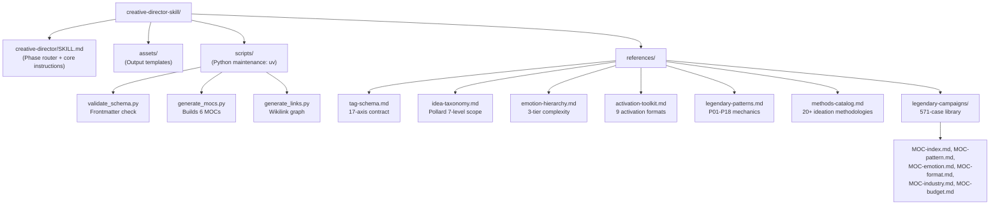

Sources: [README.md:81-97](), [README.ru.md:81-97]()

`SKILL.md` is the sole orchestration point [creative-director/SKILL.md:27-37](). It sequences operations and delegates to reference modules. The `scripts/` directory contains Python tools managed via `uv` to maintain the integrity of the campaign library and its MOCs [README.md:39](). For a detailed map of all reference files, see [Reference Files Guide](#7.1). For details on the maintenance scripts, see [Maintenance Scripts](#7.2).

---

## The Five-Phase Pipeline

**Diagram: Phase sequence with Canon Calibration**

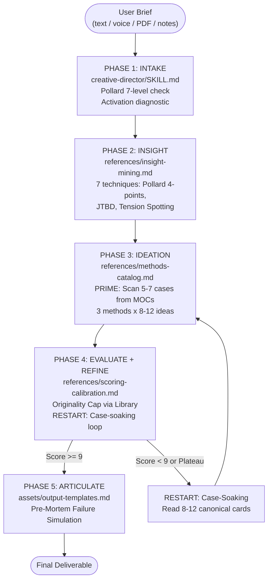

Sources: [README.md:50-59](), [creative-director/SKILL.md:27-133]()

### Phase Summary

| Phase | Core Logic File | Key V2.0 Addition |
|---|---|---|
| **1 · Intake** | `SKILL.md` | Pollard 7-level `idea_type` classification [creative-director/SKILL.md:52-62]() |
| **2 · Insight** | `references/insight-mining.md` | Cultural/Category/Human Tension spotting [creative-director/SKILL.md:78-81]() |
| **3 · Ideation** | `references/methods-catalog.md` | **Canon Priming**: Scanning relevant MOCs before generating [creative-director/SKILL.md:99]() |
| **4 · Evaluate** | `references/scoring-calibration.md` | **Originality Cap**: 3+ existing cases = max score 7 [README.md:57]() |
| **5 · Articulate** | `assets/output-templates.md` | **Pre-Mortem**: Simulate failure before final delivery [README.md:43]() |

For a high-level description of the entire creative pipeline, see [Creative Process](#2). Each phase is detailed in its respective child page (e.g., [Phase 1: Intake](#2.1)).

---

## Evaluation & Originality Calibration

**Diagram: Empirical Originality and Scoring**

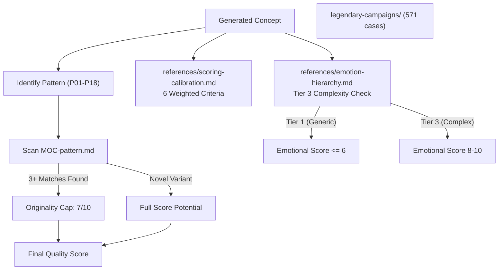

Sources: [README.md:57](), [creative-director/SKILL.md:143-149]()

The system uses three parallel scoring approaches:
1.  **6 Weighted Criteria:** Originality (0.25), Strategic Fit (0.20), Emotional Response (0.20), Feasibility (0.15), Scalability (0.10), Simplicity (0.10) [creative-director/SKILL.md:143-149]().
2.  **HumanKind Scale:** 1–10 scale measuring human impact [README.md:57]().
3.  **Grey Scale:** 1–10 scale measuring creative "heat" [README.md:57]().

For a detailed reference on scoring and calibration, see [Evaluation System](#4).

---

## Methodology Credits

The system is built on published methodologies from named practitioners:

*   **SIT / TRIZ** — Jacob Goldenberg / Genrich Altshuller
*   **Lateral Thinking / PO** — Edward de Bono
*   **7-Level Taxonomy / Four Points** — Mark Pollard [creative-director/SKILL.md:77]()
*   **JTBD** — Clayton Christensen [creative-director/SKILL.md:78]()
*   **Storytelling** — Nancy Duarte (Sparkline), Pixar (Story Spine)
*   **Creative Constitution** — Voskresensky / IKRA

Sources: [README.md:26-27](), [creative-director/SKILL.md:77-78]()

---

## License

The Creative Director Skill is licensed under the Creative Commons Attribution 4.0 International (CC BY 4.0) license [LICENSE:1-2](). Any use, copy, or derivative of this skill, including the 571-case legendary campaigns library, must credit Serge Shima as the author [NOTICE:4-9](). For full details, see [Licensing and Attribution](#1.2).

Sources: [LICENSE:1-2](), [NOTICE:4-9]()

---

# Page: Getting Started

# Getting Started

<details>
<summary>Relevant source files</summary>

The following files were used as context for generating this wiki page:

- [README.md](README.md)
- [README.ru.md](README.ru.md)
- [creative-director/SKILL.md](creative-director/SKILL.md)

</details>


This page covers how to install the Creative Director Skill into a supported AI environment and how to invoke it. It includes all five invocation modes, example prompts, and a reference for structuring a brief. For a conceptual explanation of what the skill does and why it works the way it does, see [Overview](#1). For a detailed walkthrough of the five phases the skill executes after it receives a brief, see [Ideation Methods Reference](#3).

---

## Supported Platforms

The skill is implemented entirely in Markdown. There is no compiled code, no server, and no API key required beyond your chosen AI platform. Any AI agent that accepts structured system instructions can run it.

| Platform | Integration Method |
|---|---|
| **Claude Projects** | Upload all files to the Project knowledge base. |
| **Claude Code** | Clone repo; files are read from the working directory. |
| **Cursor / Windsurf** | Clone repo; files are read from the working directory. |
| **GPTs / Gemini** | Provide `SKILL.md` as system context; include reference files in context window. |

**Known Limitation (Claude Projects):** In Project mode, Claude may auto-trigger the skill instructions if the system prompt is set to follow the `SKILL.md` file. Ensure the context window includes the `references/` directory for full functionality.

Sources: [README.md:11-16](), [creative-director/SKILL.md:5-12]()

---

## Installation

### Step 1: Clone the Repository

```bash
git clone https://github.com/smixs/creative-director-skill.git
```

All operational files live under `creative-director/`. The root-level `README.md` and `README.ru.md` are documentation only.

### Step 2: Platform-Specific Setup

**Claude Projects**
Upload every file inside `creative-director/` to the Project's knowledge base. `SKILL.md` is the entry point. It references other files using `[[wikilinks]]`, which Claude Projects resolves automatically across the uploaded knowledge base.

**Claude Code / Cursor / Windsurf**
Copy or keep the `creative-director/` folder in your project. The AI agent reads the files from the filesystem.

Sources: [README.md:83-97](), [creative-director/SKILL.md:52-52]()

---

## File Layout and Entry Point

The diagram below maps the file structure to the function each file serves during execution, bridging the natural language request to specific code-like markdown entities.

**Diagram: System Architecture and Data Flow**

```mermaid
graph TD
    subgraph "Entry Point"
        SKILL["creative-director/SKILL.md"]
    end

    subgraph "Phase 1: Intake"
        TAX["references/idea-taxonomy.md"]
        ACT["references/activation-toolkit.md"]
    end

    subgraph "Phase 2: Insight"
        IM["references/insight-mining.md"]
    end

    subgraph "Phase 3: Ideation"
        MSM["references/method-selection-matrix.md"]
        MC["references/methods-catalog.md"]
        MOC_IND["references/legendary-campaigns/MOC-industry.md"]
        MOC_BUD["references/legendary-campaigns/MOC-budget.md"]
        MOC_EMO["references/legendary-campaigns/MOC-emotion.md"]
        LP["references/legendary-patterns.md"]
        SF["references/storytelling-frameworks.md"]
    end

    subgraph "Phase 4: Evaluate"
        SC["references/scoring-calibration.md"]
        CC["references/creative-constitution.md"]
        TAX_P4["references/idea-taxonomy.md"]
        LP_P4["references/legendary-patterns.md"]
    end

    SKILL -->|"classify via Pollard 7-level"| TAX
    SKILL -->|"activation diagnostic"| ACT
    SKILL -->|"load techniques"| IM
    SKILL -->|"prime against MOCs"| MOC_IND
    SKILL -->|"prime against MOCs"| MOC_BUD
    SKILL -->|"prime against MOCs"| MOC_EMO
    SKILL -->|"select triplet"| MSM
    MSM -->|"execute method"| MC
    SKILL -->|"tension test"| LP
    SKILL -->|"load storytelling frameworks"| SF
    SKILL -->|"score ideas"| SC
    SKILL -->|"apply feedback rules"| CC
    SKILL -->|"idea level check"| TAX_P4
    SKILL -->|"pattern calibration / Pre-Mortem"| LP_P4
```

Sources: [creative-director/SKILL.md:40-128](), [README.md:50-59](), [README.md:83-97]()

---

## Invocation Modes

The `Phase Router` in `SKILL.md` determines the starting point based on user input.

**Diagram: Invocation Mode Routing**

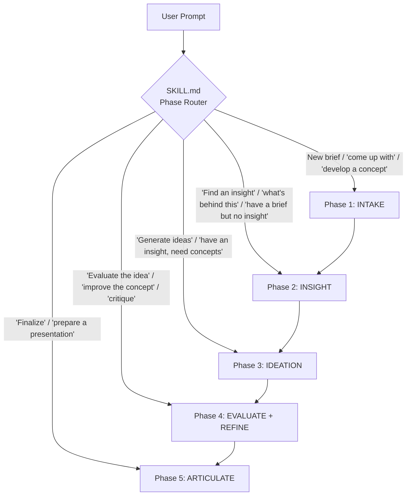

Sources: [creative-director/SKILL.md:27-37]()

### Mode 1: Full Creative Cycle
Provide a brief. The skill runs all five phases sequentially.
*   **Prompt:** "Come up with a campaign for [brand]. Target audience: [who]. Business objective: [objective]. Communication objective: [objective]. Constraints: [constraints]."

### Mode 2: Insight Mining Only
Skips to Phase 2 to find the human truth or tension.
*   **Prompt:** "Find a consumer insight for [category]. The context is [context]. Target audience: [who]."

### Mode 3: Evaluate an Existing Idea
Jumps to Phase 4 to score a concept against the 6 weighted criteria and HumanKind scale.
*   **Prompt:** "Evaluate this concept: [description]. The brief objective was [goal]. Target audience: [who]. Product: [product]."

### Mode 4: Quick Ideation
Rapid generation of concepts (often 5-8) without the full recursive refinement loop.
*   **Prompt:** "Need 5 quick concepts for [brand] social media posts about [topic]. The insight is [insight]."

### Mode 5: Activation / PR-Stunt
Specifically targets the `non_advertising` level of the Pollard taxonomy.
*   **Prompt:** "Develop a PR-stunt or brand utility for [brand] that solves [problem]. Target audience: [who]. Business objective: [objective]."

Sources: [creative-director/SKILL.md:32-37](), [README.md:50-59]()

---

## What to Include in a Brief

The `Phase 1: INTAKE` process extracts specific DNA from your prompt. Including these fields reduces follow-up questions.

| Field | Code Reference / Taxonomy | Requirement |
|---|---|---|
| **Product/Brand** | `Product/brand, category` | Mandatory |
| **Target Audience** | `Target audience (who makes the decision? age, income, what frustrates them?)` | Mandatory |
| **Objectives** | `Business objective and communication objective` | Mandatory |
| **Constraints** | `Constraints (budget, channels, timelines, tone of voice, must-have elements)` | Recommended |
| **Competitive Context** | `Competitive context` | Recommended |
| **Required Idea Level** | `Pollard 7-level taxonomy` | Determined by skill, can be specified |
| **Activation Test** | `non_advertising` vs `execution` | If brief mentions activation/stunt/utility |

**Pollard 7-Level Taxonomy Reference:**
The skill classifies every request into one of these levels: `business`, `brand`, `tagline`, `advertising`, `campaign`, `non_advertising`, or `execution`. This is detailed in `[[references/idea-taxonomy.md]]`. The skill also performs an `Activation diagnostic` if the brief mentions activation/stunt/utility, using `[[references/activation-toolkit.md]]`.

Sources: [creative-director/SKILL.md:40-66](), [creative-director/references/idea-taxonomy.md:1-15](), [creative-director/references/activation-toolkit.md:1-10]()

---

## Known Limitations

*   **Auto-trigger:** In Claude Projects, the AI may start the process as soon as a brief-like document is uploaded.
*   **Unverified URLs:** All `source_url` fields in the `legendary-campaigns/` library are unverified due to environment egress blocks during the enrichment phase.
*   **Static Library:** The 571-case library is a static markdown collection. To update it, you must run the maintenance scripts in `creative-director/scripts/`.
*   **No Media/Production:** The skill is a creative director, not a media planner or producer. It does not handle budget allocation or production timelines.

Sources: [creative-director/SKILL.md:14-16](), [README.md:27-28]()

---

# Page: Licensing and Attribution

# Licensing and Attribution

<details>
<summary>Relevant source files</summary>

The following files were used as context for generating this wiki page:

- [.mailmap](.mailmap)
- [LICENSE](LICENSE)
- [NOTICE](NOTICE)

</details>


This page details the licensing terms for the Creative Director Skill codebase and its associated assets, including the 571-case legendary campaigns library. It also covers the attribution requirements and the `.mailmap` configuration used for consolidating author identities in the Git history.

## Creative Commons Attribution 4.0 International (CC BY 4.0)

The Creative Director Skill, including all its code and the comprehensive 571-case legendary campaigns library, is licensed under the Creative Commons Attribution 4.0 International Public License (CC BY 4.0) [LICENSE:1-396](). This license permits users to share and adapt the material for any purpose, even commercially, provided that appropriate attribution is given.

The key terms of the CC BY 4.0 license include:
*   **Attribution**: You must give appropriate credit, provide a link to the license, and indicate if changes were made. You may do so in any reasonable manner, but not in any way that suggests the licensor endorses you or your use.
*   **No additional restrictions**: You may not apply legal terms or technological measures that legally restrict others from doing anything the license permits.

For the full text of the license, refer to the `LICENSE` file in the repository [LICENSE:1-396]() or visit [https://creativecommons.org/licenses/by/4.0/](https://creativecommons.org/licenses/by/4.0).

Sources:
*   [LICENSE:1-396]()

## Attribution Requirements (NOTICE)

In addition to the general CC BY 4.0 requirements, specific attribution details are provided in the `NOTICE` file [NOTICE:1-11](). Any use, copy, or derivative of this skill, including the 571-case legendary campaigns library, *must* credit the author as specified.

The required attribution details are:
*   **Author**: Serge Shima
*   **Contact Information**:
    *   Telegram: `https://t.me/aimastersme`
    *   Website: `https://sergeshima.com`
    *   Website: `https://aimasters.me`
*   **Source**: `https://github.com/smixs/creative-director-skill`

This information is explicitly stated in the `NOTICE` file [NOTICE:1-11]().

### Attribution Flow
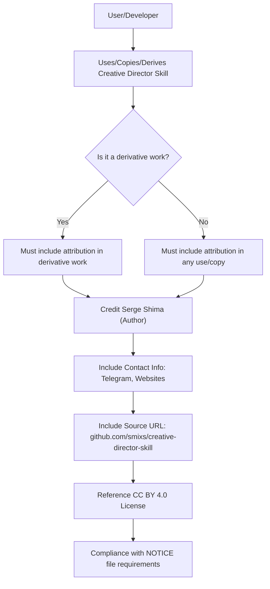
Sources:
*   [NOTICE:1-11]()

## Git Author Identity Consolidation (.mailmap)

The repository uses a `.mailmap` file [mailmap:1-3]() to consolidate various author identities that may appear in the Git history. This ensures that contributions from the same individual or entity are correctly attributed to a single, canonical identity in tools like `git log` or `git shortlog`.

The `.mailmap` file maps different email addresses and names to a preferred canonical name and email. For this repository, it consolidates contributions from different aliases of the primary author and the AI assistant used during development.

### Current `.mailmap` Configuration

The `.mailmap` file contains the following mappings:
*   `smixs <mixshima@gmail.com>` is the canonical identity for `Claude <noreply@anthropic.com>` [mailmap:1]().
*   `smixs <mixshima@gmail.com>` is the canonical identity for `claude <noreply@anthropic.com>` [mailmap:2]().

This means that any commits made by `Claude <noreply@anthropic.com>` or `claude <noreply@anthropic.com>` will be displayed as `smixs <mixshima@gmail.com>` when Git history is viewed with `--use-mailmap`.

### `.mailmap` Consolidation Process
```mermaid
graph TD
    A[Git Commit Author: "Claude <noreply@anthropic.com>"] --> B{Git Log --use-mailmap}
    C[Git Commit Author: "claude <noreply@anthropic.com>"] --> B
    D[Git Commit Author: "smixs <mixshima@gmail.com>"] --> B
    B --> E[Read .mailmap file]
    E --> F{Mapping Rules}
    F -- "smixs <mixshima@gmail.com> <== Claude <noreply@anthropic.com>" --> G[Canonical Author: "smixs <mixshima@gmail.com>"]
    F -- "smixs <mixshima@gmail.com> <== claude <noreply@anthropic.com>" --> G
    F -- "No mapping needed" --> G
    G --> H[Consolidated Git History Output]

    style A fill:#f9f,stroke:#333,stroke-width:2px
    style C fill:#f9f,stroke:#333,stroke-width:2px
    style D fill:#9cf,stroke:#333,stroke-width:2px
    style G fill:#9cf,stroke:#333,stroke-width:2px
```
Sources:
*   [mailmap:1-3]()

---

# Page: Creative Process

# Creative Process

<details>
<summary>Relevant source files</summary>

The following files were used as context for generating this wiki page:

- [README.md](README.md)
- [assets/pipeline-phases.webp](assets/pipeline-phases.webp)
- [creative-director/SKILL.md](creative-director/SKILL.md)

</details>


This page describes the five-phase creative pipeline as a whole: how the phases connect, the valid entry points that allow bypassing earlier phases, the recursive refinement loop in Phase 4, and the conditions that terminate the loop. It is the navigational parent for the individual phase pages.

For platform integration and invocation examples, see [Getting Started](#1.1). For the detailed scoring system that operates inside Phase 4, see [Evaluation System](#4). For output format selection in Phase 5, see [Output & Narrative Formats](#6).

---

## Pipeline Overview

The creative process is defined in [`creative-director/SKILL.md`](creative-director/SKILL.md) as a five-phase sequence. Each phase maps to a distinct set of reference files that the orchestrator loads when that phase executes.

**Five-Phase Pipeline — File Mapping**

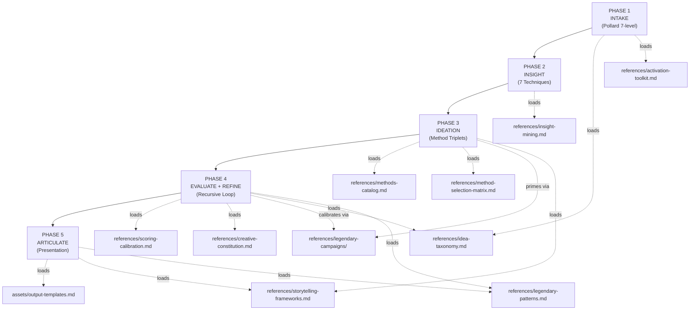

Sources: [`creative-director/SKILL.md:27-200`](), [`README.md:37-43`]()

---

## Phase Router

Before executing any phase, `SKILL.md` determines the starting phase from the user's request context. This logic is defined at [`creative-director/SKILL.md:27-36`]().

**Phase Router — Trigger Conditions**

| Trigger pattern | Starting phase |
|---|---|
| New brief / request / "come up with" / "develop a concept" | Phase 1: INTAKE |
| "Find an insight" / "what's behind this" / have a brief but no insight | Phase 2: INSIGHT |
| "Generate ideas" / have an insight, need concepts | Phase 3: IDEATION |
| "Evaluate the idea" / "improve the concept" / "critique" | Phase 4: EVALUATE + REFINE |
| "Finalize" / "prepare a presentation" | Phase 5: ARTICULATE |
| Full cycle (standard request) | Phase 1 → 2 → 3 → 4 → 5 |

Sources: [`creative-director/SKILL.md:27-36`]()

---

## Entry Points

The pipeline supports multiple valid entry points. A user can jump in at Phase 2, 3, or 4 depending on what they already have. The default entry is Phase 1.

**Pipeline Entry Points**

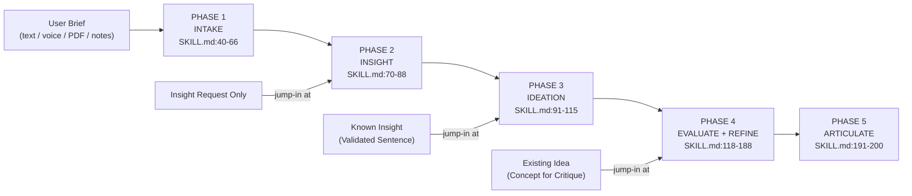

Sources: [`creative-director/SKILL.md:27-36`](), [`README.md:61`]()

---

## Phase Summaries

| Phase | Label | Primary output | Reference files loaded |
|---|---|---|---|
| 1 | INTAKE | Extracted brief DNA, `idea_type` (Pollard 7-level) | `references/idea-taxonomy.md`, `references/activation-toolkit.md` |
| 2 | INSIGHT | Standardized insight sentence + tension | `references/insight-mining.md` |
| 3 | IDEATION | 8–12 ideas (primed against canon) | `references/methods-catalog.md`, `references/method-selection-matrix.md`, `references/storytelling-frameworks.md` |
| 4 | EVALUATE + REFINE | Scored top-3, RESTART (case-soaking), Pre-Mortem | `references/scoring-calibration.md`, `references/creative-constitution.md`, `references/legendary-campaigns/`, `references/idea-taxonomy.md`, `references/legendary-patterns.md` |
| 5 | ARTICULATE | Formatted deliverable with narrative framing | `assets/output-templates.md`, `references/storytelling-frameworks.md`, `references/legendary-patterns.md` |

Each phase is documented in detail in its own child page: [Phase 1: Intake](#2.1), [Phase 2: Insight Mining](#2.2), [Phase 3: Ideation](#2.3), [Phase 4: Evaluate & Refine](#2.4), [Phase 5: Articulate](#2.5).

Sources: [`creative-director/SKILL.md:40-200`]()

---

## The Recursive Refinement Loop (Phase 4)

Phase 4 is non-linear. After an initial evaluation, the system refines ideas through up to 5 passes. If a plateau is reached, it triggers a **RESTART** via **Case-Soaking**.

**Phase 4 Recursive Loop & Restart Logic**

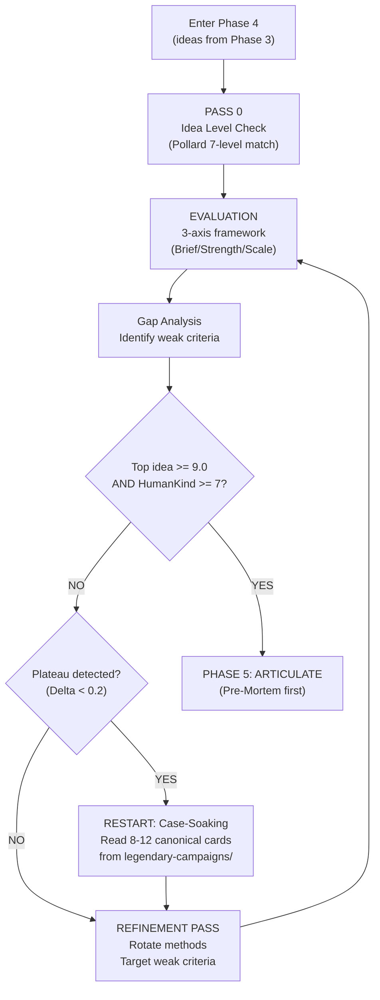

Sources: [`creative-director/SKILL.md:118-188`](), [`README.md:42`]()

---

## Exit Conditions

Three conditions terminate the recursive loop and advance to Phase 5. These are defined at [`creative-director/SKILL.md:183-188`]().

| Condition | Label | Action |
|---|---|---|
| Top idea score `>= 9.0` AND `HumanKind >= 7` | **(a) Threshold met** | Exit immediately; deliver final output |
| 5 passes completed without reaching threshold | **(b) Max passes** | Deliver best available with honest assessment |
| Two consecutive passes with score delta `< 0.2` | **(c) Plateau** | Trigger RESTART or exit with plateau note |

Sources: [`creative-director/SKILL.md:183-188`]()

---

## Anti-Pitfall Rules

Several hard constraints enforce process integrity. These are defined at [`creative-director/SKILL.md:251-262`]().

| Rule | Scope | What it prevents |
|---|---|---|
| **Insight-first** | Phase 2 | No ideation without a validated consumer tension. |
| **Structural methods** | Phase 3 | Prevents "free association" by forcing SIT, TRIZ, etc. |
| **Empirical Originality Cap** | Phase 4 | If 3+ canonical cases use the mechanic, score is capped at 7. |
| **Anti-inflation rules** | Phase 4 | No 9+ scores without naming a real-world benchmark. |
| **Kill Your Darlings** | Phase 4 | The system must argue against its own favorite ideas. |
| **Pre-Mortem** | Phase 5 | Simulating failure modes before final delivery. |

Sources: [`creative-director/SKILL.md:251-262`](), [`README.md:52-60`]()

---

## Idea Level Scope (Pollard 7-Level)

The system uses the **Pollard 7-level taxonomy** to ensure the creative output matches the business requirement. Mismatches (e.g., an `execution` for a `brand` brief) are flagged at Phase 4 PASS 0.

| Level | Description | Lifespan |
|---|---|---|
| `business` | What the company does that is novel | Foundational |
| `brand` | What the company stands for | 5-10+ years |
| `tagline` | Brand idea compressed to ≤5 words | 5-10+ years |
| `advertising` | Central thought across all comms | 3-5 years |
| `campaign` | Seasonal or product-specific expression | 3-12 months |
| `non_advertising` | Activation/utility that lives without ads | Variable |
| `execution` | Specific channel/format mechanic | Days-weeks |

Sources: [`creative-director/references/idea-taxonomy.md:7-141`](), [`creative-director/SKILL.md:52-62`]()

---

# Page: Phase 1: Intake

# Phase 1: Intake

<details>
<summary>Relevant source files</summary>

The following files were used as context for generating this wiki page:

- [creative-director/SKILL.md](creative-director/SKILL.md)
- [creative-director/references/activation-toolkit.md](creative-director/references/activation-toolkit.md)
- [creative-director/references/idea-taxonomy.md](creative-director/references/idea-taxonomy.md)

</details>


Phase 1: Intake is the first phase of the five-phase creative pipeline. Its purpose is to parse an incoming brief — in any format — and extract the structured information the system needs to proceed. This phase identifies the product DNA, audience tensions, and determines the required idea scope using the **Pollard 7-level taxonomy**.

---

## Role in the Pipeline

Phase 1 is triggered whenever the system receives a new brief or a request that implies starting from scratch. The phase router in `SKILL.md` routes any prompt containing phrases like "come up with," "develop a concept," or a raw brief to this phase first.

**Diagram: Phase Router Decision Tree (SKILL.md)**

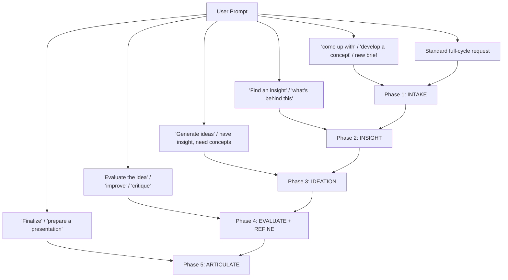

Sources: [creative-director/SKILL.md:27-37]()

---

## Extracted Fields

The system systematically extracts six categories of information from the incoming material. All fields are required to establish the strategic "anchor" before ideation begins.

| Field | What Is Extracted | Code Reference |
|---|---|---|
| **Product / Category** | Product name, brand, and industry vertical. | [creative-director/SKILL.md:43-43]() |
| **Target Audience** | Decision-maker profile: age, income, and frustrations/pain points. | [creative-director/SKILL.md:44-44]() |
| **Objectives** | Both the Business Objective and the Communication Objective. | [creative-director/SKILL.md:45-45]() |
| **Constraints** | Budget, channels, timelines, tone of voice, and must-have elements. | [creative-director/SKILL.md:46-46]() |
| **Competitive Context** | Key competitors and category conventions. | [creative-director/SKILL.md:47-47]() |
| **Idea Level** | Classification using the Pollard 7-level taxonomy. | [creative-director/SKILL.md:48-48]() |

Sources: [creative-director/SKILL.md:42-48]()

---

## Handling Incomplete Data

If the incoming material does not provide enough information to populate all fields, the system does not proceed. Instead, it asks **3–5 precise questions**. The questioning style is designed to avoid "strategic fluff" by targeting specific data points.

> **Rule:** Not "tell me about the TA," but "who makes the purchase decision? age, income, main pain point?"

Sources: [creative-director/SKILL.md:50-50]()

**Diagram: Intake Completeness Gate**

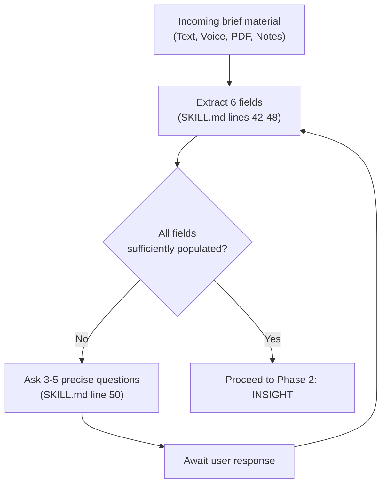

Sources: [creative-director/SKILL.md:42-50]()

---

## The Pollard 7-Level Taxonomy

A core function of Intake is mapping the brief to the `idea_type` enum defined in the 17-axis schema. This prevents "level mismatch"—where a client asks for a brand platform but receives a single execution. The full reference for this taxonomy is `references/idea-taxonomy.md`.

| Level (`idea_type`) | When Required | Lifespan |
|---|---|---|
| `business` | New venture, repositioning the entire company. | Years (foundational) |
| `brand` | Rebranding, brand platform development. | 5–10+ years |
| `tagline` | Crystallizing the brand idea into ≤5 words. | 5–10+ years |
| `advertising` | Central creative thought across all communications. | 3–5 years |
| `campaign` | Seasonal campaign, product launch, promo. | 3–12 months |
| `non_advertising` | Activation/utility/cultural object that lives without ads. | Varies |
| `execution` | One-off channel/format/mechanic. | Days–weeks |

Sources: [creative-director/references/idea-taxonomy.md:7-143](), [creative-director/SKILL.md:52-62]()

### Activation Diagnostic Test

When a brief mentions an activation, stunt, or utility, the system applies a specific diagnostic test to distinguish between a standalone concept and a mere ad vehicle. This test is detailed in `references/activation-toolkit.md`.

> **The Test:** "Remove the campaign — does it still have meaning?"
> - **Yes:** Classified as `non_advertising`. The thing has standalone value (e.g., *Spotify Wrapped*).
> - **No:** Classified as `execution`. It is a creative vehicle for an ad message (e.g., *Oreo-patterned referee jerseys*).

Sources: [creative-director/references/activation-toolkit.md:9-28](), [creative-director/SKILL.md:64-64]()

---

## Data Flow & Downstream Impact

The output of Phase 1 is a structured brief summary that serves as the "source of truth" for the recursive refinement loop.

**Diagram: Intake Output to Code Entities**

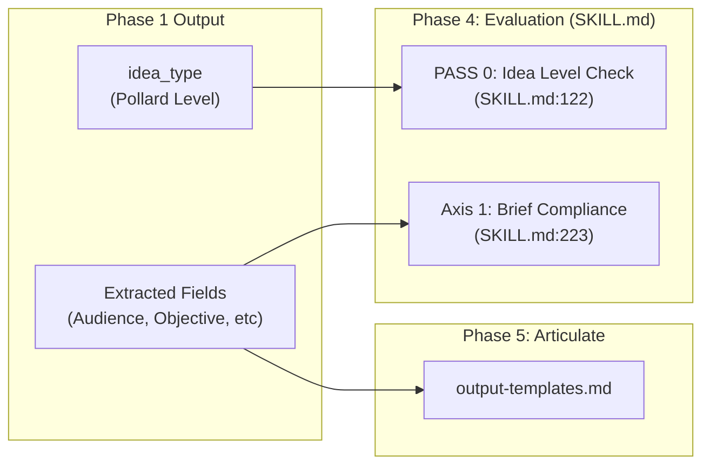

Sources: [creative-director/SKILL.md:122-128](), [creative-director/SKILL.md:223-224]()

1.  **Phase 2 (Insight):** Uses audience pain points and competitive context to find tensions.
2.  **Phase 4 (Evaluate):** Uses the `idea_type` in **PASS 0** to verify if generated ideas match the required level (e.g., ensuring a `brand` brief didn't result in a mere `execution`). This check is performed at [creative-director/SKILL.md:122-128]().
3.  **Phase 5 (Articulate):** Populates the "Brief Summary" section of the final deliverable.

Sources: [creative-director/SKILL.md:122-128]()

---

# Page: Phase 2: Insight Mining

# Phase 2: Insight Mining

<details>
<summary>Relevant source files</summary>

The following files were used as context for generating this wiki page:

- [creative-director/SKILL.md](creative-director/SKILL.md)
- [creative-director/references/insight-mining.md](creative-director/references/insight-mining.md)

</details>


Phase 2 is the mandatory insight discovery step in the five-phase creative pipeline. It transforms the structured brief extracted in Phase 1 into a single, validated insight sentence that anchors all ideation work in Phase 3. This page documents the seven techniques applied, the output format, and the quality gate that must be passed before proceeding.

For the overall pipeline flow and how phases connect, see [Creative Process](). For the Intake phase that produces the inputs consumed here, see [Phase 1: Intake](). For what happens to the validated insight downstream, see [Phase 3: Ideation]().

---

## Role in the Pipeline

Phase 2 is enforced as a hard prerequisite. The system's core principle is "insight before ideas." [creative-director/SKILL.md:21]()

The Phase Router in `SKILL.md` determines when Phase 2 runs:

| Trigger condition | Starting phase |
|---|---|
| New brief / "come up with" / "develop a concept" | Phase 1 → **Phase 2** → Phase 3 |
| "Find an insight" / "what's behind this" / brief but no insight | **Phase 2** directly |
| Already have an insight | Jump to Phase 3 |
| Already have an idea | Jump to Phase 4 |

[creative-director/SKILL.md:29-36]()

When Phase 2 is the entry point (e.g., a user requests insight mining only), the pipeline terminates after outputting the validated insight rather than continuing to ideation.

**Sources:** [creative-director/SKILL.md:21](), [creative-director/SKILL.md:29-36]()

---

## Inputs and Outputs

**Inputs consumed from Phase 1:**
- Product/brand and category.
- Target audience definition (decision-maker, age, income, pain points).
- Business objective and communication objective.
- Constraints (budget, channels, tone).
- Competitive context.
- Required idea level from **Pollard 7-level taxonomy**.

[creative-director/SKILL.md:42-52]()

**Output produced for Phase 3:**
- One validated insight sentence in the canonical format: `"[Audience] wants [X], but [Y stands in the way], because [Z]"`

[creative-director/SKILL.md:87]()

---

## Reference File

Phase 2 loads a single primary reference module:

```
Load: [[references/insight-mining.md]]
```

[creative-director/SKILL.md:72]()

This file contains the full specification for all seven techniques. `SKILL.md` references it at runtime; no other file loads `insight-mining.md` directly.

**Diagram: insight-mining.md loading and scope**

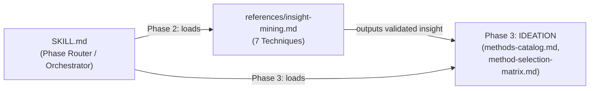

**Sources:** [creative-director/SKILL.md:72-88](), [creative-director/SKILL.md:91-93]()

---

## The Seven Techniques

`insight-mining.md` defines seven techniques applied in sequence. The first five form an ordered pipeline; techniques 6 and 7 act as a validation gate and a formatter.

**Diagram: technique sequence in insight-mining.md**

```mermaid
flowchart TD
    T1["1. Mark Pollard Four Points\nProblem → Insight → Advantage → Strategy"]
    T2["2. JTBD\nFunctional / Social / Emotional job layers"]
    T3["3. Tension Spotting\nCultural / Category / Human tension"]
    T4["4. HMW\n3 formulations: broad / medium / narrow"]
    T5["5. Abstraction Laddering\nOptimal rung: one above obvious"]
    T6["6. Assumption Mapping\n2x2: importance vs confidence"]
    T7["7. Insight Quality Test\n6-point checklist"]
    FMT["Insight Format\n\"[Audience] wants [X], but [Y], because [Z]\""]

    T1 --> T2
    T2 --> T3
    T3 --> T4
    T4 --> T5
    T5 --> T6
    T6 --> T7
    T7 -->|"passes all 6 checks"| FMT
    T7 -->|"fails 2+ checks"| T1
```

**Sources:** [creative-director/SKILL.md:74-88](), [creative-director/references/insight-mining.md:1-157]()

---

### Technique 1: Mark Pollard Four Points

A four-step sequential framework used to establish strategic logic. Each step must be derived from the previous one.

| Step | Definition |
|---|---|
| **Problem** | The real human or business problem, not a symptom. |
| **Insight** | A hidden truth everyone feels but no one has articulated. |
| **Advantage** | The single specific brand strength relevant to the insight. |
| **Strategy** | One directive sentence: *what* to do, not *how*. |

[creative-director/SKILL.md:76](), [creative-director/references/insight-mining.md:7-26]()

---

### Technique 2: JTBD (Jobs To Be Done)

Reframes the question from "what does the product do?" to "what job does the consumer hire this communication for?" Three job layers are analyzed:

- **Functional**: The physical action performed.
- **Social**: How it shapes external perception.
- **Emotional**: The internal feeling it produces.

[creative-director/SKILL.md:77](), [creative-director/references/insight-mining.md:29-44]()

---

### Technique 3: Tension Spotting

Finds the gap between how things should be and how they actually are. Three tension types are specified:

| Type | Definition |
|---|---|
| **Cultural** | What society says vs. what it actually does. |
| **Category** | What the category promises vs. what it delivers. |
| **Human** | What a person wants vs. what stands in the way. |

[creative-director/SKILL.md:78-81](), [creative-director/references/insight-mining.md:49-67]()

---

### Technique 4: HMW (How Might We)

Produces three question formulations at different levels of abstraction: **Broad**, **Medium**, and **Narrow**. The medium level is typically the most productive for campaign ideation.

[creative-director/SKILL.md:82](), [creative-director/references/insight-mining.md:70-91]()

The three HMW formulations generated here serve a downstream purpose: if Phase 4 reaches a scoring plateau or fails to meet the threshold, the system can **RESTART** with a *different* HMW from this set. [creative-director/SKILL.md:179-180]()

---

### Technique 5: Abstraction Laddering

Navigates the ladder between concrete and abstract to find the optimal problem frame.
- Moving **up** ("why?"): expands the solution space.
- Moving **down** ("how exactly?"): narrows to specifics.
**Rule**: The optimal rung is typically one level above the obvious.

[creative-director/SKILL.md:83](), [creative-director/references/insight-mining.md:94-110]()

---

### Technique 6: Assumption Mapping

Surfaces and stress-tests assumptions embedded in the brief. Assumptions are mapped on a 2x2 matrix of **Importance** vs **Confidence**. The "High Importance / Low Confidence" quadrant is the priority zone for insight mining.

[creative-director/references/insight-mining.md:113-127]()

---

### Technique 7: Insight Quality Test

A six-point checklist that acts as the quality gate.
- **Does this refresh one's view of the world?**
- **Does the person hear it and say "yes, exactly, but I've never put it that way"?**

[creative-director/SKILL.md:85](), [creative-director/references/insight-mining.md:130-142]()

---

## Output: The Insight Format

A validated insight is expressed as a single sentence in this canonical structure:

```
"[Audience] wants [X], but [Y stands in the way], because [Z]"
```

[creative-director/SKILL.md:87]()

The three-part structure enforces completeness:
- **X** — the desire.
- **Y** — the barrier.
- **Z** — the reason for the barrier (the "why" that provides depth).

**Sources:** [creative-director/SKILL.md:87](), [creative-director/references/insight-mining.md:145-156]()

---

## Data Flow Through the Technique Sequence

**Diagram: data entities flowing through insight-mining.md techniques**

```mermaid
flowchart TD
    BRIEF_DATA["Brief Data\n(product, audience, objective,\nconstraints, competitive context)"]

    subgraph IM_FILE["references/insight-mining.md"]
        MP["Mark Pollard Four Points\nProblem / Insight / Advantage / Strategy"]
        JTBD["JTBD\nFunctional / Social / Emotional jobs"]
        TS["Tension Spotting\nCultural / Category / Human tension"]
        HMW["HMW\nbroad / medium / narrow formulations"]
        AL["Abstraction Laddering\nup x2 → down x1"]
        AM["Assumption Mapping\n2x2 importance vs confidence"]
        QT["Insight Quality Test\n6-point checklist"]
    end

    INSIGHT_FMT["Validated Insight\n\"[Audience] wants X, but Y, because Z\""]
    PHASE3["Phase 3: IDEATION\n(methods-catalog.md)"]
    PHASE4["Phase 4: EVALUATE + REFINE\n(HMW restart pool)"]

    BRIEF_DATA --> MP
    MP --> JTBD
    JTBD --> TS
    TS --> HMW
    HMW --> AL
    AL --> AM
    AM --> QT
    QT -->|"passes"| INSIGHT_FMT
    QT -->|"fails 2+ checks"| MP

    INSIGHT_FMT --> PHASE3
    HMW -->|"HMW pool retained for restart"| PHASE4
```

**Sources:** [creative-director/references/insight-mining.md:1-157](), [creative-director/SKILL.md:72-88](), [creative-director/SKILL.md:176-182]()

---

# Page: Phase 3: Ideation

# Phase 3: Ideation

<details>
<summary>Relevant source files</summary>

The following files were used as context for generating this wiki page:

- [assets/methods-20.webp](assets/methods-20.webp)
- [creative-director/SKILL.md](creative-director/SKILL.md)
- [creative-director/references/legendary-campaigns/MOC-index.md](creative-director/references/legendary-campaigns/MOC-index.md)

</details>


## Purpose and Scope

This page documents Phase 3 of the creative pipeline: Ideation. It covers how the system primes itself against the canon of legendary advertising, assembles a method triplet for each pass, generates 8–12 ideas from a validated insight, applies the serial-order bias rule, and performs the Tension Test on each concept.

For the method rotation rules that govern how the triplet changes across recursive passes, see [Method Selection & Rotation](3.2). For a complete reference of all individual methods and their inputs/outputs, see [Methods Catalog](3.1). For how the generated ideas are scored and refined in the next stage, see [Phase 4: Evaluate & Refine](2.4).

Sources: [creative-director/SKILL.md:91-114]()

---

## Position in the Pipeline

Phase 3 receives a validated insight from Phase 2 and passes a set of 8-12 ideas to Phase 4. A critical pre-generation step involves "priming against the canon" using the 571-case library to ensure anti-derivative thinking.

**Diagram: Phase 3 context and data flow**

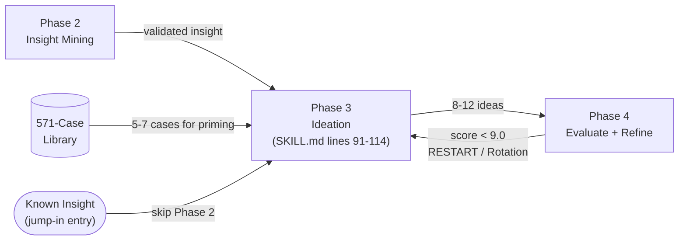

Sources: [creative-director/SKILL.md:91-114](), [creative-director/SKILL.md:27-36]()

---

## Priming Against the Canon

Before generating any ideas, the system performs a mandatory priming step to avoid "inventing from zero" and to detect potential saturation.

1.  **Select Relevant MOC:** Based on the brief context, the system opens the most relevant Map of Content (MOC) from `references/legendary-campaigns/`:
    *   `MOC-industry.md` for industry-specific context.
    *   `MOC-budget.md` for budget-constrained tasks.
    *   `MOC-emotion.md` for specific emotional intents.
    *   `MOC-index.md` is also available as a general index [creative-director/references/legendary-campaigns/MOC-index.md:1-1]().
2.  **Scan 5-7 Cases:** It reviews the Insight, Mechanic, and "Why it worked" sections of 5-7 canonical cards.
3.  **Anti-Derivative Goal:** The goal is to identify existing patterns (P01-P18) to ensure generation aims at the "gap" rather than repeating high-saturation mechanics.
4.  **Remixing:** Borrowing mechanics across categories (e.g., a P11 absurd mechanic from a beverage ad applied to a beauty brief) is explicitly encouraged.

Sources: [creative-director/SKILL.md:100-100](), [creative-director/references/legendary-campaigns/MOC-index.md:1-1]()

---

## Method Triplet Selection

Every Ideation pass uses exactly three methods drawn from three different categories. This is a hard rule enforced to prevent free-association traps.

| Slot | Category | Role | Example Methods |
|------|----------|------|-----------------|
| **Primary** | Structural | Systematic skeleton/transformation | SIT, SCAMPER, TRIZ, Morphological Analysis |
| **Secondary** | Association / Collision | Conceptual depth and surprise | Bisociation, Random Entry, Synectics, Forced Connections |
| **Stimulus** | Inversion / Perturbation | Breaking habitual patterns | Reverse Brainstorming, Worst Idea, Provocation PO, Oblique Strategies |

Sources: [creative-director/SKILL.md:101-105]()

### Task-Type Routing

`method-selection-matrix.md` maps task types to a recommended triplet. If the task type is ambiguous, the **default triplet** is used.

| Task Type | Primary | Secondary | Stimulus |
|-----------|---------|-----------|----------|
| New brand launch / rebrand | SIT | Bisociation | Provocation PO |
| Seasonal / promo campaign | SCAMPER | Forced Connections | Oblique Strategies |
| Digital / social campaign | SIT | Random Entry | Worst Idea |
| **Default (ambiguous)** | **SIT** | **Bisociation** | **Oblique Strategies** |

Sources: [creative-director/SKILL.md:101-105]()

---

## Rotation Rules Across Passes

When Phase 3 is re-entered from Phase 4 (recursive refinement), the system must rotate methods. The same method may **never** appear in two consecutive passes.

**Pass-by-pass switching logic:**

| Pass | Action |
|------|--------|
| **Pass 1** | Use recommended triplet from routing table. |
| **Pass 2** | Advance Primary method in its cycle (e.g., SIT → SCAMPER). |
| **Pass 3** | Advance Secondary method in its cycle. |
| **Pass 4+** | Advance Stimulus and add a Volume method (e.g., Crazy 8s). |

Sources: [creative-director/SKILL.md:101-105]()

---

## Idea Generation Algorithm

The system follows a strict five-step algorithm to produce the idea set.

**Diagram: SKILL.md Ideation Algorithm (Natural Language to Code Entity)**

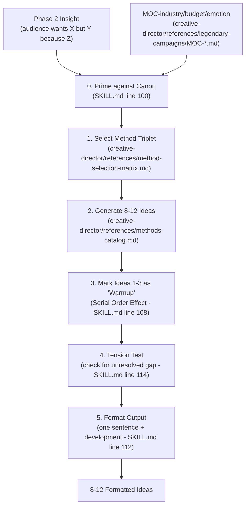

Sources: [creative-director/SKILL.md:97-114]()

### The Tension Test

For each generated idea, the system must verify it carries an **unresolved tension** (Cultural, Category, or Human). If the idea resolves the tension too cleanly, it is flagged as weak/unoriginal. Great work lives in the unresolved gap between the audience's want and the barrier.

Sources: [creative-director/SKILL.md:114-114]()

### Serial-Order Bias Rule

Ideas 1–3 are explicitly labeled as **"conventional warmup"**. Per the serial order effect, later ideas (5–12+) are statistically more original. The system biases its focus toward these later concepts during evaluation.

Sources: [creative-director/SKILL.md:108-108]()

### Required Idea Format

Each idea must be formulated as:
1.  **One sentence** (The "Big Idea" or central thought).
2.  **2–3 lines of development** (The mechanic, visual execution, or channel application).

Sources: [creative-director/SKILL.md:112-112]()

---

## Module Dependencies

Phase 3 is the primary consumer of the `methods-catalog.md` and the `legendary-campaigns/` library for priming.

**Diagram: Phase 3 Orchestration and File Dependencies**

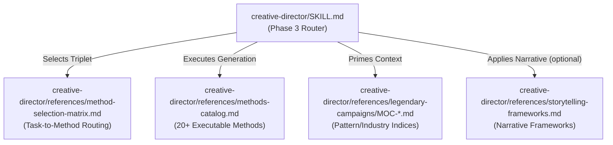

Sources: [creative-director/SKILL.md:93-95]()

---

# Page: Phase 4: Evaluate & Refine

# Phase 4: Evaluate & Refine

<details>
<summary>Relevant source files</summary>

The following files were used as context for generating this wiki page:

- [assets/scoring-loop.webp](assets/scoring-loop.webp)
- [creative-director/SKILL.md](creative-director/SKILL.md)
- [creative-director/references/creative-constitution.md](creative-director/references/creative-constitution.md)
- [creative-director/references/emotion-hierarchy.md](creative-director/references/emotion-hierarchy.md)

</details>


Phase 4 is the recursive evaluation and improvement engine of the creative pipeline. It applies three parallel scoring systems to rank generated concepts, identifies weak areas, triggers targeted re-ideation using different methods, and loops until a quality threshold is met or a stopping condition is reached.

This page documents the mechanics of the evaluation loop itself. For the detailed rubric behind each scoring criterion, see the [Scoring Calibration](#4.1). For the full three-layer compliance and quality framework, see the [Creative Constitution](#4.2). For the methods applied during refinement passes, see the [Ideation Methods Reference](#3).

---

## Entry Points

Phase 4 can be entered in two ways:

| Entry Path | Context |
|---|---|
| Sequential pipeline | Automatically follows Phase 3 (Ideation) |
| Direct jump-in | User submits an existing idea with "evaluate this" or "improve this concept" |

When entering directly, the system skips Phases 1–3 and begins at PASS 0 using the submitted idea as input. See [Creative Process](#2) for the full pipeline entry-point map.

Sources: [creative-director/SKILL.md:31-32]()

---

## Phase 4 Overview

**Title diagram: Phase 4 Internal Flow**

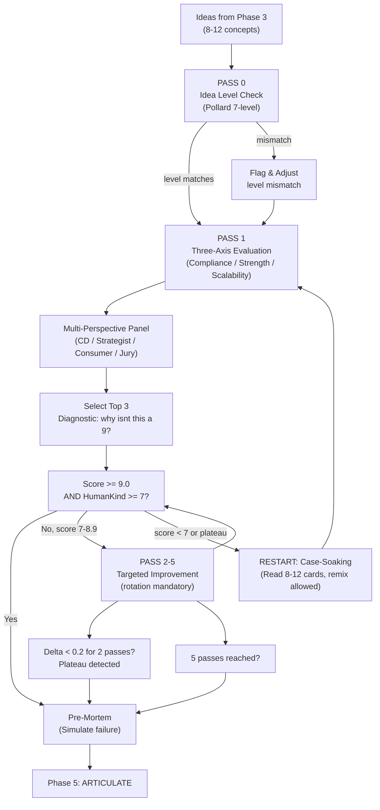

Sources: [creative-director/SKILL.md:118-188]()

---

## PASS 0: Idea Level Check

Before any scoring begins, the system verifies that the level of the generated ideas matches the `idea_type` requirement established in Phase 1.

| Required Level | Verification Criteria |
|---|---|
| `business` / `brand` | Must scale for years; answers "what does the company stand for?" |
| `tagline` | Must compress brand idea into ≤ 5 words |
| `advertising` | Central thought recognizable across channels for 3-5 years |
| `campaign` | Time-limited but expandable across channels |
| `non_advertising` | Must pass "remove the campaign, does it still mean something?" test |
| `execution` | Specific, one-off channel/format/mechanic |

A mismatch is flagged and the ideas are adjusted before scoring proceeds. This prevents wasting evaluation cycles on ideas that are structurally misaligned with the brief's objective.

Sources: [creative-director/SKILL.md:122-132]()

---

## PASS 1: Three-Axis Evaluation

The full evaluation runs three independent axes in parallel. All three contribute to the final assessment of each concept.

**Title diagram: Three-Axis Scoring Architecture**

```mermaid
graph TD
    IDEA["Creative Concept"]

    IDEA --> AX1
    IDEA --> AX2
    IDEA --> AX3

    subgraph AX1["Axis 1 · Brief Compliance (pass/fail gate)"]
        Q1["1. Is there an idea? (one sentence)"]
        Q2["2. Conveys intended message?"]
        Q3["3. Responds to insight?"]
        Q4["4. Suits target audience?"]
        Q5["5. Mandatory elements included?"]
        Q6["6. Legal and ethics compliance?"]
        Q7["7. Brand voice preserved?"]
        Q8["8. Supported by product attributes?"]
    end

    subgraph AX2["Axis 2 · Idea Strength (6 weighted criteria)"]
        OR["Originality × 0.25\n(Empirical Cap applied)"]
        SF["Strategic Fit × 0.20"]
        ER["Emotional Response × 0.20\n(Tier 1/2/3 check)"]
        FE["Feasibility × 0.15"]
        SC["Scalability × 0.10"]
        SI["Simplicity × 0.10"]
        WS["Weighted Score (1-10)"]
        HK["HumanKind Score (1-10)"]
        OR & SF & ER & FE & SC & SI --> WS
    end

    subgraph AX3["Axis 3 · Scalability (4 questions)"]
        SQ1["How long-lasting?"]
        SQ2["Abstracts up/down?"]
        SQ3["Deploys across channels?"]
        SQ4["Executions form a unified system?"]
    end

    AX1 -->|"any FAIL"| REJECT["Concept rejected"]
    AX1 -->|"all PASS"| COMBINE["Combined Assessment"]
    WS --> COMBINE
    HK --> COMBINE
    AX3 --> COMBINE
```

Sources: [creative-director/SKILL.md:135-163](), [creative-director/references/creative-constitution.md:7-82]()

### Axis 1: Brief Compliance (Pass/Fail Gate)

This axis is a binary filter. If any single question fails, the concept is ineligible for further scoring regardless of creative merit.

The eight questions are defined in `creative-constitution.md` Layer 1:

| # | Question | Fail Example |
|---|---|---|
| 1 | Is there an idea (one sentence)? | Describing the mechanic without a central thought |
| 2 | Does it convey the intended message? | Beautiful visuals, unclear proposition |
| 3 | Does it respond to the insight? | Insight about loneliness, execution shows a party |
| 4 | Does it suit the target audience? | Brief for 45+, ad speaks to Gen Z |
| 5 | Are mandatory elements included? | Missing logo placement or legal disclaimer |
| 6 | Does it comply with legislation/ethics? | Medical product promising guaranteed cure |
| 7 | Is the brand voice preserved? | Luxury brand using slang |
| 8 | Is it supported by product attributes? | "We care" with no functional backing |

Sources: [creative-director/references/creative-constitution.md:7-82](), [creative-director/SKILL.md:137-142]()

### Axis 2: Idea Strength

Two parallel scores are calculated:

**Six Weighted Criteria Score**
The primary score (1–10) is calculated using the formula:
`Total = (Originality × 0.25) + (Strategic Fit × 0.20) + (Emotional Response × 0.20) + (Feasibility × 0.15) + (Scalability × 0.10) + (Simplicity × 0.10)`

Two critical constraints apply here:
1.  **Empirical Originality Cap:** If the idea's mechanic matches 3+ canonical cases in the `legendary-campaigns/` library (saturation), the `Originality` score is capped at **7**.
2.  **Emotion Tier Check:** `Emotional Response` score 9+ requires a Tier 3 emotion (two emotions in unresolved tension). Tier 1 emotions (happy/sad) cap the score at **6**. This is detailed in `references/emotion-hierarchy.md`.

Sources: [creative-director/SKILL.md:143-147](), [creative-director/references/emotion-hierarchy.md:81-90]()

**HumanKind Score (Leo Burnett)**
A parallel holistic score (1–10) evaluating the idea's impact on people and culture. Rule: HumanKind < 7 is not presentable.

Sources: [creative-director/references/scoring-calibration.md:77-93]()

### Multi-Perspective Panel

After axes are assessed, a four-role panel evaluates each concept independently:

| Role | Focus | Key Question |
|---|---|---|
| **CD** | Craft, originality, simplicity | Would I put this in my portfolio? |
| **Strategist** | Brief fit, insight, target audience | Does this solve the client's problem? |
| **Consumer** | First reaction, emotion | Would I stop scrolling? Would I share this? |
| **Jury** | Novelty for industry, case potential | Will this make the Cannes shortlist? |

Sources: [creative-director/SKILL.md:156-165](), [creative-director/references/scoring-calibration.md:166-194]()

---

## PASS 2–5: Targeted Improvement

If no concept reaches the exit threshold, the system enters a recursive refinement loop.

**Title diagram: Recursive Refinement Loop**

```mermaid
flowchart TD
    TOP3["Top 3 Concepts\n(from PASS 1)"]
    WEAK["Identify weak criteria\n(score < 8)"]
    NEWMETHOD["Apply targeted improvement\nusing a DIFFERENT method\n(rotation mandatory)"]
    RESCORE["Recalculate Scores\n+ Pattern Calibration"]
    DELTA{"Delta >= 0.3?"}
    PLATEAU_CHECK{"2 consecutive passes\nwith delta < 0.2?"}
    GATE2["Score >= 9.0\nAND HumanKind >= 7?"]
    RESTART["RESTART: Case-Soaking\n(Read 8-12 cards)"]

    TOP3 --> WEAK
    WEAK --> NEWMETHOD
    NEWMETHOD --> RESCORE
    RESCORE --> DELTA
    DELTA -->|"No"| PLATEAU_CHECK
    PLATEAU_CHECK -->|"Yes"| PREMORT["Pre-Mortem"]
    PLATEAU_CHECK -->|"No"| GATE2
    GATE2 -->|"Yes"| PREMORT
    GATE2 -->|"No, score < 7"| RESTART
    RESTART --> TOP3
```

Sources: [creative-director/SKILL.md:167-187]()

### RESTART via Case-Soaking
When ideas plateau or score < 7, the system triggers a **RESTART**. It reads 8-12 canonical cards from the `legendary-campaigns/` library to "soak" in high-quality insights. Combining or remixing existing patterns is explicitly allowed during this phase.

Sources: [creative-director/SKILL.md:181-182]()

---

## Pre-Mortem & Stopping Conditions

Before exiting Phase 4, the system performs a **Pre-Mortem**: it simulates failure and surfaces the most likely failure modes (e.g., "client will be afraid of the legal risk," "audience will find it tone-dead"). The template for this is found in `references/legendary-patterns.md`.

**Stopping Conditions:**
1.  **Score ≥ 9.0 AND HumanKind ≥ 7.**
2.  **Max 5 passes reached.**
3.  **Plateau:** Two consecutive passes with delta < 0.2.

Sources: [creative-director/SKILL.md:183-188]()

---

## Module Dependencies

**Title diagram: Phase 4 Code Entity Mapping**

```mermaid
graph LR
    SKILL["creative-director/SKILL.md\n(Phase 4 Router)"]
    SC["creative-director/references/scoring-calibration.md\n(Rubrics & Anchors)"]
    CC["creative-director/references/creative-constitution.md\n(Compliance & Feedback)"]
    EH["creative-director/references/emotion-hierarchy.md\n(Tier 1/2/3 Logic)"]
    LP["creative-director/references/legendary-patterns.md\n(Pre-Mortem & P01-P18)"]
    LCL["creative-director/references/legendary-campaigns/\n(Saturation Check)"]

    SKILL --> SC
    SKILL --> CC
    SKILL --> EH
    SKILL --> LP
    SKILL --> LCL
```

Sources: [creative-director/SKILL.md:118-120]()

---

# Page: Phase 5: Articulate

# Phase 5: Articulate

<details>
<summary>Relevant source files</summary>

The following files were used as context for generating this wiki page:

- [creative-director/SKILL.md](creative-director/SKILL.md)
- [creative-director/assets/output-templates.md](creative-director/assets/output-templates.md)

</details>


Phase 5 is the final stage of the creative pipeline. Its purpose is to format the surviving top concepts into a structured deliverable using a predefined output template. This page documents the entry conditions, template selection logic, the four templates in `assets/output-templates.md`, the application of storytelling frameworks from `references/storytelling-frameworks.md`, and the mandatory **Pre-Mortem** step that precedes final delivery.

This page covers the formatting and output layer. For the evaluation logic that determines which concepts reach Phase 5, see [Phase 4: Evaluate & Refine](#3.4).

---

## Entry Conditions

Phase 5 is triggered from three exit paths in Phase 4, or directly by the user.

**Diagram: Entry Paths into Phase 5**

```mermaid
flowchart TD
    P4["Phase 4: EVALUATE + REFINE"]

    C1{"Top idea score >= 9.0\nAND HumanKind >= 7?"}
    C2{"5 passes completed?"}
    C3{"Score delta < 0.2\nfor 2 consecutive passes?"}

    DIRECT["User invokes directly:\n'Finalize' / 'Prepare a presentation'"]

    P5["PHASE 5: ARTICULATE\nassets/output-templates.md\nreferences/storytelling-frameworks.md"]

    P4 --> C1
    C1 -->|"Yes"| P5
    C1 -->|"No"| C2
    C2 -->|"Yes — max passes"| P5
    C2 -->|"No"| C3
    C3 -->|"Yes — plateau"| P5
    C3 -->|"No"| P4

    DIRECT --> P5
```

Sources: [creative-director/SKILL.md:178-200](), [creative-director/SKILL.md:34-36]()

---

## Module Dependencies

Phase 5 orchestrates the final output by loading template definitions and narrative frameworks.

**Diagram: Phase 5 Code Entity Map**

```mermaid
graph LR
    SKILL["SKILL.md\n(Phase Router)"]

    subgraph "Output Formatting"
        OT["assets/output-templates.md\n(Template Definitions)"]
        SF["references/storytelling-frameworks.md\n(Narrative Frameworks)"]
    end

    subgraph "Final Quality Gate"
        PM["references/legendary-patterns.md\n(Pre-Mortem Template)"]
    end

    SKILL -->|"Finalize / Phase 5"| OT
    SKILL -->|"Storytelling Tasks"| SF
    SKILL -->|"Pre-delivery Gate"| PM

    OT --> T1["Creative Concept One-Pager"]
    OT --> T2["Top-3 Presentation Format"]
    OT --> T3["Campaign Platform"]
    OT --> T4["Quick Brief Response"]
```

Sources: [creative-director/SKILL.md:35-36](), [creative-director/SKILL.md:191-200](), [creative-director/SKILL.md:202-205]()

---

## Pre-Mortem Step

Before final articulation, the system must perform a **Pre-Mortem**. This is a psychological safety check where the system imagines the campaign has failed and works backward to identify the most likely causes.

The Pre-Mortem uses the template defined in `legendary-patterns.md` [creative-director/references/legendary-patterns.md:251-263]():
1. **The Post-Mortem from the Future**: Imagine it is one year later and the campaign was a disaster.
2. **Failure Modes**: List 3-5 specific reasons why (e.g., "The cultural tension was too niche," "The mechanic was too complex for a 6-second skip").
3. **Mitigation**: Adjust the final articulation to address these risks.

Sources: [creative-director/SKILL.md:202-205](), [creative-director/references/legendary-patterns.md:251-263]()

---

## Template Selection

The template is chosen based on the task type identified during Phase 1 or the specific user request.

| Request Type | Template |
|---|---|
| Full creative brief (standard full cycle) | **Top-3 Presentation Format** |
| Single idea elaboration | **Creative Concept One-Pager** |
| Strategic platform / major campaign | **Campaign Platform** |
| Social post, banner, simple execution | **Quick Brief Response** |

Sources: [creative-director/assets/output-templates.md:198-207](), [creative-director/SKILL.md:195-199]()

---

## The Four Templates

### 1. Creative Concept One-Pager
Template for presenting a single idea with full development [creative-director/assets/output-templates.md:7-9]().

**Key Components:**
- **Insight**: One sentence following the `[audience] wants [X], but [Y stands in the way], because [Z]` format [creative-director/assets/output-templates.md:15]().
- **Idea**: The essence of the concept in one sentence [creative-director/assets/output-templates.md:18]().
- **Key Visual / Hero Execution**: Describes what the person sees in the first 3 seconds [creative-director/assets/output-templates.md:23-24]().
- **How It Lives**: Specific actions across multiple channels [creative-director/assets/output-templates.md:26-29]().
- **3 Executions**: Detailed descriptions of three specific executions [creative-director/assets/output-templates.md:31-34]().
- **Evaluation**: Includes scores (weighted, HumanKind, Grey) and a rationale [creative-director/assets/output-templates.md:36-40]().

Sources: [creative-director/assets/output-templates.md:7-47]()

### 2. Top-3 Presentation Format (Primary)
The primary working template for responding to a creative brief, presenting three ideas with scores, discarded directions, a recommendation, and a process description [creative-director/assets/output-templates.md:50-53]().

**Key Components:**
- **Brief**: A summary paragraph of the product/brand, target audience, objective, constraints, and channels [creative-director/assets/output-templates.md:57-58]().
- **Insight & Tension**: Insight follows the `[audience] wants X, but Y, because Z` format, and tension identifies cultural, category, or human tension [creative-director/assets/output-templates.md:61-64]().
- **Idea Structure**: For each of the three ideas, it includes Concept, Visualization, Media/Channels, Tagline, and a detailed evaluation table with scores for Originality, Strategic Fit, Emotional Response, Feasibility, Scalability, Simplicity, Weighted Score, HumanKind, and Grey, along with a rationale [creative-director/assets/output-templates.md:68-88]().
- **Discarded Directions**: At least two directions that were explored and why they were discarded [creative-director/assets/output-templates.md:102-105]().
- **Recommendation**: Which idea to develop, why, and what's needed next [creative-director/assets/output-templates.md:107-108]().
- **Process**: Records methods used, recursion passes, and the stop reason [creative-director/assets/output-templates.md:110-113]().

Sources: [creative-director/assets/output-templates.md:50-113]()

### 3. Campaign Platform
Template for a strategic campaign platform, used when the task requires a systemic approach including architecture, channel matrix, and results measurement [creative-director/assets/output-templates.md:123-125]().

**Key Components:**
- **Strategic Foundation**: Objective, Insight, Territory, and Positioning [creative-director/assets/output-templates.md:129-133]().
- **Concept**: Big Idea, Tagline, Visual Language, and Tone of Voice (with example phrase) [creative-director/assets/output-templates.md:135-139]().
- **Campaign Architecture**: A table mapping Big Idea, Campaign Ideas, and Key Executions to their respective channels [creative-director/assets/output-templates.md:141-147]().
- **Execution Matrix**: A table detailing Channel, Format, Essence, and KPI for each execution [creative-director/assets/output-templates.md:149-152]().
- **Measurement**: How Awareness, Engagement, Conversion, and Brand Lift will be measured [creative-director/assets/output-templates.md:154-158]().
- **Evaluation**: Score, HumanKind, Grey, and rationale [creative-director/assets/output-templates.md:160-161]().

Sources: [creative-director/assets/output-templates.md:123-162]()

### 4. Quick Brief Response
A lightweight format for quick tasks, presenting five concepts with scores and a recommendation [creative-director/assets/output-templates.md:171-174]().

**Key Components:**
- **Brief**: A short task description [creative-director/assets/output-templates.md:176]().
- **Insight**: One sentence [creative-director/assets/output-templates.md:178]().
- **5 Concepts**: Each with a name, 1-2 line description, and score [creative-director/assets/output-templates.md:181-185]().
- **Recommendation**: Which concept to choose and why [creative-director/assets/output-templates.md:188]().

Sources: [creative-director/assets/output-templates.md:171-189]()

---

## Storytelling Frameworks

If the task involves narrative (e.g., film scripts, long-form drama), Phase 5 applies one of six frameworks from `storytelling-frameworks.md` to structure the "Visualization" or "How it Lives" sections. The `SKILL.md` [creative-director/SKILL.md:96-96]() loads `references/storytelling-frameworks.md` for such tasks.

| Framework | Best For |
|---|---|
| **Story Spine** | Quick cause-and-effect (Pixar 8-line) |
| **Sparkline** | Contrast between "What is" and "What could be" |
| **Freytag's Pyramid** | Classic 5-act dramatic arc |
| **Monroe's Motivated Sequence** | Persuasion and Direct Response (5 stages) |
| **Hero's Journey** | Brand as the "Guide" for the customer "Hero" |

Sources: [creative-director/SKILL.md:96-96](), [creative-director/references/storytelling-frameworks.md:1-131]()

---

## Final Output Structure

Regardless of the template, the `SKILL.md` orchestration ensures the final response follows this logical flow:

**Diagram: Articulation Flow**

```mermaid
sequenceDiagram
    participant S as SKILL.md
    participant PM as Pre-Mortem
    participant OT as Output Templates
    participant U as User

    S->>PM: Run Pre-Mortem (Failure Simulation)
    PM-->>S: Identify Failure Modes & Mitigations
    S->>OT: Apply Template (e.g., Top-3)
    OT->>OT: Fill Insight Formula
    OT->>OT: Fill Evaluation Tables
    OT->>OT: Log Process (Methods/Passes)
    S->>U: Final Presentation
```

Sources: [creative-director/SKILL.md:292-311](), [creative-director/SKILL.md:202-205]()

---

# Page: Ideation Methods Reference

# Ideation Methods Reference

<details>
<summary>Relevant source files</summary>

The following files were used as context for generating this wiki page:

- [assets/methods-20.webp](assets/methods-20.webp)
- [creative-director/SKILL.md](creative-director/SKILL.md)

</details>


This page provides a high-level overview of the ideation methodology system used by the Creative Director skill. It outlines the categories of creative methods, how they are selected and rotated during the ideation process, and introduces the method selection matrix. For detailed information on each method and the selection logic, please refer to the linked child pages.

The ideation process is primarily handled in [Phase 3: Ideation](#2.3) of the Creative Director's pipeline, where methods are applied to generate a diverse set of ideas.

---

## SCOPING: This page has child pages

This is a PARENT page. The following child pages exist and will cover their topics in detail:
- [Methods Catalog](#3.1) — Comprehensive reference for all 20+ creative methodologies by category: Structural Templates (SIT, SCAMPER, TRIZ, Morphological Analysis), Association/Collision, Inversion/Disruption, Recombination/Perturbation, Volume Generation, and Bonus methods. Each documented as an executable card.
- [Method Selection & Rotation](#3.2) — Document the method-selection-matrix: task types mapped to recommended triplets, default triplet, pass-by-pass rotation rules for Primary/Secondary/Stimulus categories, hard constraints, restart logic, and category compatibility.

---

## Overview of the Ideation Methodology System

The Creative Director skill employs a structured approach to ideation, moving beyond free association to leverage established creative methodologies. This system is designed to generate novel and useful ideas by applying a diverse set of cognitive operations. The core of this system is a catalog of over 20 methods, categorized by their underlying creative mechanism.

For details on each method, see [Methods Catalog](#3.1).

---

## Method Categories

The ideation methods are organized into six categories, each representing a distinct approach to idea generation. This categorization helps in selecting a balanced set of methods for each ideation pass, ensuring a broad exploration of the problem space. The categories are:

1.  **Structural Templates:** Methods that apply deterministic operators to the components and environment of a product or problem.
2.  **Association / Collision:** Methods that generate ideas by connecting disparate concepts or forcing unexpected juxtapositions.
3.  **Inversion / Disruption:** Methods that challenge assumptions or reverse conventional thinking to uncover new perspectives.
4.  **Recombination / Perturbation:** Methods that introduce controlled changes or re-arrange existing elements to create new combinations.
5.  **Volume Generation:** Methods focused on rapidly producing a large quantity of initial ideas.
6.  **Bonus Methods:** Advanced or specialized methods for specific ideation challenges.

This categorization is defined in `creative-director/references/methods-catalog.md` [creative-director/references/methods-catalog.md:1-8]().

**Diagram: Method Categories from `methods-catalog.md`**

```mermaid
graph TD
    CATALOG["creative-director/references/methods-catalog.md"]

    CATALOG --> A["Category A: Structural Templates\nMethods 1–4"]
    CATALOG --> B["Category B: Association / Collision\nMethods 5–8"]
    CATALOG --> C["Category C: Inversion / Disruption\nMethods 9–11"]
    CATALOG --> D["Category D: Recombination / Perturbation\nMethods 12–14"]
    CATALOG --> E["Category E: Volume Generation\nMethods 15–17"]
    CATALOG --> F["Category F: Bonus Methods\nMethods 18–20"]

    A --> A1["1. SIT / Goldenberg Templates"]
    A --> A2["2. SCAMPER"]
    A --> A3["3. TRIZ: 10 Advertising Principles"]
    A --> A4["4. Morphological Analysis"]

    B --> B1["5. Bisociation"]
    B --> B2["6. Random Entry / Random Word"]
    B --> B3["7. Forced Connections"]
    B --> B4["8. Synectics"]

    C --> C1["9. Reverse Brainstorming"]
    C --> C2["10. Worst Possible Idea"]
    C --> C3["11. Provocation PO"]

    D --> D1["12. Oblique Strategies"]
    D --> D2["13. Six Thinking Hats"]
    D --> D3["14. Disney Creative Strategy"]

    E --> E1["15. Crazy 8s"]
    E --> E2["16. Brainwriting 6-3-5"]
    E --> E3["17. Starbursting"]

    F --> F1["18. First Principles Thinking"]
    F --> F2["19. Lateral Thinking Toolkit"]
    F --> F3["20. Design Sprint Sketch"]
```

Sources: [creative-director/references/methods-catalog.md:1-8]()

---

## Method Selection and Rotation

The Creative Director skill does not randomly select ideation methods. Instead, it uses a sophisticated selection and rotation mechanism to ensure a balanced and effective ideation process. This involves:

-   **Method Selection Matrix:** A mapping of task types to recommended triplets of methods, ensuring that the chosen methods are appropriate for the specific creative challenge.
-   **Default Triplet:** A standard set of methods used when no specific task type is identified.
-   **Pass-by-Pass Rotation Rules:** Guidelines for rotating methods across multiple ideation passes, ensuring diversity and preventing creative stagnation.
-   **Hard Constraints and Restart Logic:** Rules that govern when certain methods can or cannot be used, and how to reset the selection process if needed.
-   **Category Compatibility:** Ensuring that selected methods from different categories complement each other.

This system is crucial for generating a wide range of ideas and is detailed in [Method Selection & Rotation](#3.2). The selection process is invoked during `Phase 3: IDEATION` [creative-director/SKILL.md:93-106]().

**Diagram: Method Selection and Pipeline Integration**

```mermaid
graph TD
    START[Start Ideation Phase 3] --> PRIME[Prime against Canon\n(MOCs)]
    PRIME --> SELECT_METHODS[Select 3 Methods from method-selection-matrix.md]
    SELECT_METHODS --> M1[Method 1: Structural]
    SELECT_METHODS --> M2[Method 2: Association/Collision]
    SELECT_METHODS --> M3[Method 3: Inversion/Perturbation]
    M1 --> GENERATE_IDEAS[Generate 8-12 Ideas]
    M2 --> GENERATE_IDEAS
    M3 --> GENERATE_IDEAS
    GENERATE_IDEAS --> MARK_WARMUP[Mark first 3 ideas as "conventional warmup"]
    MARK_WARMUP --> TIE_INSIGHT[Tie each idea to specific Insight/Tension]
    TIE_INSIGHT --> FORMULATE_IDEA[Formulate idea: 1 sentence + 2-3 lines development]
    FORMULATE_IDEA --> TENSION_TEST[Tension Test: check for unresolved tension]
    TENSION_TEST --> END[End Ideation Pass]

    subgraph References
        MOC_REF["references/legendary-campaigns/MOC-*.md"]
        MSM_REF["references/method-selection-matrix.md"]
        MC_REF["references/methods-catalog.md"]
        LP_REF["references/legendary-patterns.md"]
    end

    PRIME -- "Scan 5-7 cases" --> MOC_REF
    SELECT_METHODS -- "Uses rules from" --> MSM_REF
    M1 -- "Details from" --> MC_REF
    M2 -- "Details from" --> MC_REF
    M3 -- "Details from" --> MC_REF
    TENSION_TEST -- "References" --> LP_REF
```

Sources: [creative-director/SKILL.md:93-117](), [creative-director/references/method-selection-matrix.md](), [creative-director/references/methods-catalog.md]()

---

## Quick-Reference Selection Matrix

The following matrix provides a high-level overview of how different ideation methods are recommended based on the current creative situation. This is a simplified view; the full machine-readable routing table with detailed rules is found in [Method Selection & Rotation](#3.2).

**Diagram: Method Routing by Situation**

```mermaid
flowchart TD
    SITUATION["Identify Situation"]

    SITUATION --> S1["Starting out,\nneed volume"]
    SITUATION --> S2["Hit a dead end"]
    SITUATION --> S3["Need one\nstrong idea"]
    SITUATION --> S4["Have an idea,\nneed refinement"]
    SITUATION --> S5["Category is\noversaturated"]
    SITUATION --> S6["Need\nconcretization"]
    SITUATION --> S7["Need a breakthrough\nbeyond boundaries"]

    S1 --> M1["SIT Templates (1)\nMorphological Analysis (4)\nCrazy 8s (15)"]
    S2 --> M2["Random Entry (6)\nOblique Strategies (12)\nProvocation PO (11)"]
    S3 --> M3["Bisociation (5)\nSynectics (8)\nFirst Principles (18)"]
    S4 --> M4["Six Thinking Hats (13)\nDisney Strategy (14)\nBrainwriting 6-3-5 (16)"]
    S5 --> M5["First Principles (18)\nReverse Brainstorming (9)\nChallenge / Lateral Thinking (19)"]
    S6 --> M6["Design Sprint Sketch (20)\nStarbursting (17)"]
    S7 --> M7["Provocation PO (11)\nWorst Possible Idea (10)\nFantasy Analogy / Synectics (8)"]
```

Sources: [creative-director/references/methods-catalog.md:464-474]()

---

## Method Roles in the Pipeline

The ideation methods are primarily invoked during `Phase 3: IDEATION` [creative-director/SKILL.md:93-117]() for generating new ideas. However, some methods also play a role in `Phase 4: EVALUATE + REFINE` [creative-director/SKILL.md:119-128]() for perturbing, refining, or concretizing existing ideas. The diagram below illustrates how methods are distributed across these phases.

**Diagram: Method-to-Phase Mapping**

```mermaid
graph LR
    subgraph PHASE3["Phase 3: Ideation (SKILL.md:93)"]
        direction TB
        GEN_STRUCT["Structural Generation\n1. SIT\n2. SCAMPER\n3. TRIZ\n4. Morphological Analysis"]
        GEN_ASSOC["Associative Generation\n5. Bisociation\n6. Random Entry\n7. Forced Connections\n8. Synectics"]
        GEN_INV["Inversion Generation\n9. Reverse Brainstorming\n10. Worst Possible Idea\n11. Provocation PO"]
        GEN_VOL["Volume Generation\n15. Crazy 8s\n16. Brainwriting 6-3-5\n17. Starbursting"]
    end

    subgraph PHASE4["Phase 4: Evaluate & Refine (SKILL.md:119)"]
        direction TB
        PERTURB["Perturbation between passes\n12. Oblique Strategies"]
        REFINE["Idea Refinement\n13. Six Thinking Hats\n14. Disney Creative Strategy"]
        CONCRETE["Concretization\n20. Design Sprint Sketch"]
    end

    subgraph BONUS["Bonus / Meta (methods-catalog.md)"]
        direction TB
        META["18. First Principles Thinking\n19. Lateral Thinking Toolkit"]
    end

    MSM["references/method-selection-matrix.md\n(routing logic)"]

    MSM -->|"selects triplet for each pass"| PHASE3
    MSM -->|"rotation rules"| PHASE4

    PHASE3 -->|"ideas flow into"| PHASE4
    BONUS -->|"applicable in both phases"| PHASE3
    BONUS -->|"applicable in both phases"| PHASE4
```

Sources: [creative-director/SKILL.md:93-117](), [creative-director/SKILL.md:119-128](), [creative-director/references/methods-catalog.md:1-8](), [creative-director/references/methods-catalog.md:266-283](), [creative-director/references/methods-catalog.md:286-325](), [creative-director/references/methods-catalog.md:440-461]()

---

# Page: Methods Catalog

# Methods Catalog

<details>
<summary>Relevant source files</summary>

The following files were used as context for generating this wiki page:

- [README.md](README.md)
- [assets/methods-20.webp](assets/methods-20.webp)

</details>


This page provides a comprehensive technical reference for the 20+ creative methodologies available in the system. Each method is treated as an executable "card" with a specific input, transformation process, and output format. These methods are categorized by their cognitive function: structural templates, associative collisions, inversions, perturbations, and volume generation.

## 1. Structural Templates
These methods provide the generative skeleton for an idea. They rely on the "Closed World" principle, where all elements are drawn from the product's immediate environment to ensure brand relevance.

| Method | Key Principle | Primary Use Case |
| :--- | :--- | :--- |
| **SIT (Systematic Inventive Thinking)** | 6 recurring patterns (Subtraction, Multiplication, etc.) | High-efficiency coverage of standard ad patterns. |
| **SCAMPER** | 7 transformation operators (Substitute, Combine, Adapt, etc.) | Finding new angles for existing products/campaigns. |
| **TRIZ** | Resolving contradictions via 10 specific principles. | Briefs with insurmountable constraints or tensions. |
| **Morphological Analysis** | Combining values across 5-7 independent parameters. | Generating a high volume of diverse concept directions. |

### Implementation Detail: SIT / Goldenberg Templates
The SIT method is often the first method invoked in a session because 89% of award-winning ads follow these structural patterns.
*   **Process:** Lists components (Product, User, Environment) and applies patterns like **Task Unification** (e.g., packaging becomes media) or **Attribute Dependency** (e.g., "The more X, the more Y").
*   **File Reference:** [creative-director/references/methods-catalog.md:12-34]()

### Implementation Detail: Morphological Analysis
*   **Data Flow:** Takes a brief → breaks into dimensions (Tone, Mechanic, Channel, Hero, Proof) → lists 4-6 values per dimension → performs random selection to create combinations.
*   **File Reference:** [creative-director/references/methods-catalog.md:94-113]()

**Sources:** [creative-director/references/methods-catalog.md:10-113]()

---

## 2. Association / Collision
These methods generate creative "sparks" by colliding the product's world with a donor world or random stimuli.

*   **Bisociation:** Colliding two unrelated "matrices of thought" to find a shared structural intersection. [creative-director/references/methods-catalog.md:117-142]()
*   **Random Entry:** Using a completely random word/image as a lens to view the problem, forcing the brain to create a bridge. [creative-director/references/methods-catalog.md:144-162]()
*   **Forced Connections:** Taking two objects (Product + Random Object) and listing attributes of both to find a "Third Object" idea. [creative-director/references/methods-catalog.md:164-181]()
*   **Synectics (Analogical Thinking):** Using four types of analogies (Personal, Direct, Symbolic, Fantasy) to reframe the problem. [creative-director/references/methods-catalog.md:183-196]()

**Sources:** [creative-director/references/methods-catalog.md:115-196]()

---

## 3. Inversion / Disruption
These methods work by breaking habitual patterns or looking at the problem from the "wrong" end.

*   **Reverse Brainstorming:** Instead of "How to solve X?", ask "How to achieve the worst possible version of X?". The resulting "sabotage" ideas are then flipped back into solutions. [creative-director/references/methods-catalog.md:201-219]()
*   **Worst Possible Idea:** Intentionally generating bad, illegal, or embarrassing ideas to lower the "inner critic" threshold and find hidden truths. [creative-director/references/methods-catalog.md:221-238]()
*   **Provocation PO:** Using Edward de Bono's "PO" operator to make a statement that contradicts experience (e.g., "Cars should have square wheels") and using it as a stepping stone to a new concept. [creative-director/references/methods-catalog.md:240-261]()

**Sources:** [creative-director/references/methods-catalog.md:199-261]()

---

## 4. Recombination / Perturbation
Methods designed to inject "productive noise" into the creative process to prevent the system from settling into a local optimum.

*   **Oblique Strategies:** Based on Brian Eno’s deck. Short, cryptic instructions (e.g., "Honor thy error as a hidden intention") that force a change in creative direction. [creative-director/references/methods-catalog.md:266-283]()
*   **Six Thinking Hats:** De Bono’s framework for parallel thinking. The system simulates different perspectives (White: Data, Red: Emotion, Black: Risks, Yellow: Benefits, Green: Ideas, Blue: Process). [creative-director/references/methods-catalog.md:285-306]()
*   **Disney Creative Strategy:** A three-stage filter moving from **The Dreamer** (unlimited ideas) to **The Realist** (implementation) to **The Critic** (finding holes). [creative-director/references/methods-catalog.md:308-326]()

**Sources:** [creative-director/references/methods-catalog.md:264-326]()

---

## 5. Volume Generation & Bonus Methods
These are used in Pass 4+ or when a rapid volume of variations is required.

*   **Crazy 8s:** Generating 8 distinct sketches/concepts in rapid succession (simulated as 8 high-speed text prompts). [creative-director/references/methods-catalog.md:330-346]()
*   **Brainwriting 6-3-5:** A collaborative simulation where 6 "virtual personas" generate 3 ideas every 5 minutes, building on the previous persona's work. [creative-director/references/methods-catalog.md:348-368]()
*   **First Principles:** Breaking the product down to its fundamental "physical" truths and rebuilding the message from scratch, ignoring all category conventions. [creative-director/references/methods-catalog.md:372-388]()
*   **Lateral Thinking Toolkit:** A set of "quick-hit" operators: Challenge, Alternatives, Concept Fan, and Provocation. [creative-director/references/methods-catalog.md:390-410]()

**Sources:** [creative-director/references/methods-catalog.md:328-410]()

---

## 6. System Mapping: Natural Language to Code Entities

The following diagrams bridge the gap between the natural language descriptions of these methods and how they are handled as data entities within the system.

### Diagram: Method Entity Mapping
This diagram shows how a method name in the catalog maps to specific executable sections and logic used by the Phase 3 ideation engine.

```mermaid
graph TD
    subgraph "Natural Language Space"
        M_NAME["Method Name (e.g., 'SIT')"]
        M_DESC["Essence & Examples"]
    end

    subgraph "Code Entity Space (methods-catalog.md)"
        E_CARD["Executable Card (Markdown Block)"]
        E_INPUT["Input Definition"]
        E_PROC["Process Steps (1-4)"]
        E_OUT["Output Constraint"]
    end

    subgraph "Orchestration (SKILL.md)"
        P3["Phase 3: Ideation Logic"]
        ROT["Method Selection Matrix"]
    end

    M_NAME --> E_CARD
    M_DESC -.-> E_CARD
    
    ROT -- "Selects" --> E_CARD
    E_CARD -- "Provides Instructions to" --> P3
    P3 -- "Applies" --> E_PROC
    E_INPUT -- "Filters" --> P3
```
**Sources:** [creative-director/references/methods-catalog.md:1-8](), [SKILL.md]()

### Diagram: Method Execution Data Flow
This diagram tracks the data flow as a method card is processed by the AI during an ideation pass.

```mermaid
flowchart LR
    INSIGHT["Validated Insight\n(from Phase 2)"] --> P3_ENGINE["Phase 3 Engine\n(SKILL.md)"]
    
    subgraph "Method Injection"
        M_CAT["references/methods-catalog.md"]
        M_MAT["references/method-selection-matrix.md"]
    end

    M_MAT -- "Determines Triplet" --> P3_ENGINE
    M_CAT -- "Loads Card Text" --> P3_ENGINE
    
    P3_ENGINE -- "Apply SIT Pattern" --> IDEAS["8-12 Idea Fragments"]
    IDEAS -- "Format as" --> OUTPUT["Concept One-Pager\n(Output Templates)"]
```
**Sources:** [creative-director/references/methods-catalog.md:4-6](), [creative-director/references/method-selection-matrix.md](), [SKILL.md]()

---

## 7. Summary Table of Methods

| Category | Method | Logic Type |
| :--- | :--- | :--- |
| **Structural** | SIT | Deductive (Closed World) |
| **Structural** | SCAMPER | Transformative |
| **Structural** | TRIZ | Dialectic (Contradiction) |
| **Association** | Bisociation | Collisional |
| **Association** | Synectics | Analogical |
| **Inversion** | Reverse Brainstorm | Oppositional |
| **Perturbation** | Oblique Strategies | Random/Provocative |
| **Volume** | Brainwriting 6-3-5 | Iterative/Recursive |

**Sources:** [creative-director/references/methods-catalog.md:1-410]()

---

# Page: Method Selection & Rotation

# Method Selection & Rotation

<details>
<summary>Relevant source files</summary>

The following files were used as context for generating this wiki page:

- [assets/methods-20.webp](assets/methods-20.webp)
- [creative-director/SKILL.md](creative-director/SKILL.md)

</details>


This page documents how the system selects a triplet of three ideation methods at the start of each Phase 3 ideation pass, and how that triplet changes on subsequent passes during Phase 4's recursive refinement loop. It covers the routing table, the default fallback triplet, rotation order per category, hard constraints, and restart logic.

For details on the individual methods referenced here, see [Methods Catalog](#3.1). For how Phase 3 uses the selected triplet to generate ideas, see [Phase 3: Ideation](#2.3). For how passes are triggered and exit conditions are determined, see [Phase 4: Evaluate & Refine](#2.4).

The logic described here lives in `creative-director/references/method-selection-matrix.md`, which is loaded by `SKILL.md` during Phase 3 routing [creative-director/SKILL.md:94]().

---

## The Method Triplet

Every ideation pass uses exactly three methods, one from each functional category:

| Role | Category Label | Function |
|---|---|---|
| **Primary** | Structural | Provides the generative skeleton — constrains how ideas are built |
| **Secondary** | Association | Adds conceptual depth through semantic connections |
| **Stimulus** | Perturbation | Breaks habitual thinking; injects an unexpected angle |

Running three complementary methods per pass avoids the dead ends of using a single technique in isolation [creative-director/references/method-selection-matrix.md:1-4](). The category labels (Primary, Secondary, Stimulus) are the naming convention used throughout the system.

**Sources:** [creative-director/references/method-selection-matrix.md:1-4]()

---

## Routing Table

The routing table in `method-selection-matrix.md` maps twelve named task types to recommended triplets [creative-director/references/method-selection-matrix.md:7-48](). `SKILL.md` consults this table after Phase 1 Intake determines the task type [creative-director/SKILL.md:102]().

| Task Type | Primary (Structural) | Secondary (Association) | Stimulus (Perturbation) |
|---|---|---|---|
| New brand launch / rebrand | SIT | Bisociation | Provocation PO |
| Seasonal / promo campaign | SCAMPER | Forced Connections | Oblique Strategies |
| Digital / social campaign | SIT | Random Entry | Worst Idea |
| Product innovation / new feature launch | TRIZ | Bisociation | Reverse Brainstorm |
| Brand awareness / top-of-mind | Morphological Analysis | Synectics | Oblique Strategies |
| Behavior change / social impact | TRIZ | Synectics | Provocation PO |
| B2B / corporate | SIT | Bisociation | Oblique Strategies |
| Event / activation / experiential | Morphological Analysis | Forced Connections | Worst Idea |
| Packaging / POS / retail | SCAMPER | Bisociation | Reverse Brainstorm |
| Content / storytelling series | Morphological Analysis | Synectics | Oblique Strategies |
| Crisis response / reputation | SIT | Forced Connections | Reverse Brainstorm |
| Challenger brand / disruption | TRIZ | Random Entry | Provocation PO |

Each assignment reflects a structural rationale. For example, crisis tasks use SIT as Primary because SIT forces reduction to minimum necessary message elements [creative-director/references/methods-catalog.md:14-35](). Challenger tasks use TRIZ as Primary because TRIZ is built around resolving fundamental contradictions [creative-director/references/methods-catalog.md:65-91]().

**Sources:** [creative-director/references/method-selection-matrix.md:7-48](), [creative-director/references/methods-catalog.md:14-91](), [creative-director/SKILL.md:102]()

---

## Default Triplet

When the task type is ambiguous or does not match any row in the routing table, the system falls back to a fixed default defined in the selection matrix [creative-director/references/method-selection-matrix.md:52-60]():

| Role | Method |
|---|---|
| Primary | **SIT** |
| Secondary | **Bisociation** |
| Stimulus | **Oblique Strategies** |

This triplet is the "universal combination": SIT supplies structural discipline, Bisociation supplies conceptual depth, and Oblique Strategies supply an exit from habitual thinking [creative-director/references/method-selection-matrix.md:52-60]().

**Sources:** [creative-director/references/method-selection-matrix.md:52-60]()

---

## Rotation Rules Between Passes

When an ideation pass scores below threshold and Phase 4 triggers another pass, the triplet is not reused — it rotates according to fixed cycles defined per category [creative-director/references/method-selection-matrix.md:64-72]().

### Rotation Cycles

Each category has an ordered cycle of four methods. Rotation advances one step forward in the cycle on each relevant pass.

**Diagram: Rotation Cycles by Category**

```mermaid
graph LR
  subgraph "Primary (Structural)"
    SIT["SIT"] --> SCAMPER["SCAMPER"] --> TRIZ["TRIZ"] --> MORPH["Morphological Analysis"] --> SIT
  end
  subgraph "Secondary (Association)"
    BIS["Bisociation"] --> SYN["Synectics"] --> RAND["Random Entry"] --> FORCE["Forced Connections"] --> BIS
  end
  subgraph "Stimulus (Perturbation)"
    OBL["Oblique Strategies"] --> PROV["Provocation PO"] --> WORST["Worst Idea"] --> REV["Reverse Brainstorm"] --> OBL
  end
```

**Sources:** [creative-director/references/method-selection-matrix.md:64-72]()

### Pass-by-Pass Logic

Each pass advances exactly one category's method, leaving the others unchanged, until pass 4+ where all three are potentially in motion and a Volume method is added [creative-director/references/method-selection-matrix.md:74-86]().

| Pass | Primary | Secondary | Stimulus | Notes |
|---|---|---|---|---|
| **1** | From routing table | From routing table | From routing table | Initial recommended triplet |
| **2** | Next in cycle | Unchanged | Unchanged | Primary advances |
| **3** | Unchanged (from pass 2) | Next in cycle | Unchanged | Secondary advances |
| **4+** | Unchanged | Unchanged | Next in cycle | Stimulus advances; Volume method added |

On pass 4 and beyond, a Volume method (e.g., `Crazy 8s` or `Brainwriting 6-3-5`) is added as a fourth generation element to increase the number of concept variants [creative-director/references/method-selection-matrix.md:84-86]().

**Sources:** [creative-director/references/method-selection-matrix.md:74-86]()

---

## Hard Constraints

Three rules override all other rotation logic [creative-director/references/method-selection-matrix.md:81-86]():

1. **No consecutive repeats:** The same method must not appear in two consecutive passes in any role.
2. **Full restart on score < 7 or quality plateau:** All three methods switch simultaneously, and the HMW (How Might We) framing must also shift level (e.g., from product level to user level).
3. **Volume method is additive:** When a Volume method is engaged (pass 4+), it joins the triplet as a fourth element rather than displacing a slot.

**Sources:** [creative-director/references/method-selection-matrix.md:81-86]()

---

## Category Compatibility

Certain pairings are explicitly recommended or flagged for caution in the matrix [creative-director/references/method-selection-matrix.md:89-106]().

| Pairing | Status | Rationale |
|---|---|---|
| **SIT + Bisociation** | Recommended | SIT provides the skeleton; Bisociation fills it with meaning. |
| **TRIZ + Synectics** | Recommended | TRIZ formulates the contradiction; Synectics resolves it via analogy. |
| **Random Entry + Worst Idea** | Caution | Two sources of chaos; high risk of losing conceptual focus. |

**Sources:** [creative-director/references/method-selection-matrix.md:89-106]()

---

## System Integration Diagram

The following diagram maps how `SKILL.md`, `method-selection-matrix.md`, and `methods-catalog.md` interact during method selection.

**Diagram: File-Level Routing for Method Selection**

```mermaid
flowchart TD
  SKILLMD["SKILL.md\n(Phase Router)"]
  MSM["method-selection-matrix.md"]
  MC["methods-catalog.md"]

  SKILLMD -->|"Phase 3 entry:\ntask type determined in Phase 1"| ROUTE["Section 1: Routing Table\n(method-selection-matrix.md:7-48)"]
  SKILLMD -->|"task type ambiguous"| DEFAULT["Section 2: Default Triplet\n(method-selection-matrix.md:52-60)"]

  ROUTE --> TRIPLET["Selected Triplet\n(Primary / Secondary / Stimulus)"]
  DEFAULT --> TRIPLET

  TRIPLET --> EXEC["Execute methods against insight\n→ 8-12 ideas"]

  SKILLMD -->|"Phase 4: score below threshold"| ROT["Section 3: Rotation Rules\n(method-selection-matrix.md:64-86)"]
  ROT -->|"advance one category per pass\nor full restart if plateau"| TRIPLET

  TRIPLET -->|"method name lookup"| MC
  MC -->|"Category A: Structural\nSIT, SCAMPER, TRIZ"| CATA["methods-catalog.md:10-113"]
  MC -->|"Category B: Association\nBisociation, Synectics"| CATB["methods-catalog.md:115-196"]
  MC -->|"Category C: Inversion\nReverse Brainstorm, Worst Idea"| CATC["methods-catalog.md:199-261"]
  MC -->|"Category E: Volume\nCrazy 8s"| CATE["methods-catalog.md:328-368"]
```

**Sources:** [creative-director/references/method-selection-matrix.md:1-106](), [creative-director/references/methods-catalog.md:1-368](), [creative-director/SKILL.md:94]()

---

## Rotation State Machine

The complete state machine for method rotation across passes.

**Diagram: Pass Rotation State Machine**

```mermaid
stateDiagram-v2
  [*] --> Pass1 : "Phase 3 triggered"
  Pass1 : "Pass 1\nRouting table triplet"
  Pass2 : "Pass 2\nPrimary -> next in cycle"
  Pass3 : "Pass 3\nSecondary -> next in cycle"
  Pass4plus : "Pass 4+\nStimulus -> next in cycle\n+ Volume method"
  Restart : "Full Restart\nAll three methods switch\nHMW level changes"
  Exit : "Exit to Phase 5"

  Pass1 --> Exit : "score >= 9"
  Pass1 --> Pass2 : "score < 9"
  Pass1 --> Restart : "score < 7 or plateau"

  Pass2 --> Exit : "score >= 9"
  Pass2 --> Pass3 : "score < 9"
  Pass2 --> Restart : "score < 7 or plateau"

  Pass3 --> Exit : "score >= 9"
  Pass3 --> Pass4plus : "score < 9"
  Pass3 --> Restart : "score < 7 or plateau"

  Pass4plus --> Exit : "score >= 9 or 5 passes reached"
  Pass4plus --> Restart : "score < 7 or plateau"

  Restart --> Pass1 : "new triplet selected"
```

**Sources:** [creative-director/references/method-selection-matrix.md:74-86](), [creative-director/SKILL.md:119-128]()

---

# Page: Evaluation System

# Evaluation System

<details>
<summary>Relevant source files</summary>

The following files were used as context for generating this wiki page:

- [assets/scoring-loop.webp](assets/scoring-loop.webp)
- [assets/why-averaged.webp](assets/why-averaged.webp)
- [creative-director/references/creative-constitution.md](creative-director/references/creative-constitution.md)

</details>


This page describes the complete evaluation architecture used in Phase 4 of the creative pipeline. It covers how the three parallel scoring systems operate, how they combine into a three-axis final summary, the empirical originality cap, and how the sub-systems relate to each other.

For the per-criterion scoring descriptors, calibration anchors, and anti-inflation rules, see [Scoring Calibration](#4.1). For the brief compliance checklist, creative quality principles, and feedback template, see [Creative Constitution](#4.2). For how Phase 4 uses this system recursively, see [Phase 4: Evaluate & Refine](#2.4).

---

## Overview

The evaluation system is implemented across two reference files:

| File | Role |
|---|---|
| `creative-director/references/scoring-calibration.md` | Six weighted criteria rubric, HumanKind Scale, Grey Scale, calibration anchors, anti-inflation rules, CAT panel simulation, and empirical originality cap. |
| `creative-director/references/creative-constitution.md` | Brief Compliance gate (Layer 1), Creative Quality principles (Layer 2), Scalability assessment (Layer 3), feedback rules and template. |

Both files are invoked during Phase 4 by `creative-director/SKILL.md`. They share an evaluation layer — the three-axis summary defined in `scoring-calibration.md` maps directly to the three layers of `creative-constitution.md`.

Sources: [creative-director/references/scoring-calibration.md:1-5](), [creative-director/references/creative-constitution.md:1-4]()

---

## System Architecture

**Diagram: Evaluation Sub-System Interactions**

```mermaid
graph TD
    SKILL["creative-director/SKILL.md\n(Phase 4 orchestrator)"]

    SKILL -->|"invokes"| SC["references/scoring-calibration.md"]
    SKILL -->|"invokes"| CC["references/creative-constitution.md"]

    subgraph SC_SYSTEMS["references/scoring-calibration.md"]
        SIX["Six Weighted Criteria\n(Axis 2: Idea Strength)"]
        HK["HumanKind Scale\n(Leo Burnett, 1-10)"]
        GR["Grey Scale\n(Grey Group, 1-10)"]
        CAT["CAT Panel Simulation\n(4 perspectives)"]
        ANTI["Anti-Inflation Rules\n(7 rules)"]
        CAP["Empirical Originality Cap\n(Case Library Saturation)"]
        SIX & HK & GR --> CAT
        CAT --> ANTI
        ANTI --> CAP
    end

    subgraph CC_LAYERS["references/creative-constitution.md"]
        L1["Layer 1: Brief Compliance\n(8 pass/fail questions)\n(Axis 1: gate)"]
        L2["Layer 2: Creative Quality\n(7 principles, 1-10)\n(feeds Axis 2)"]
        L3["Layer 3: Scalability\n(4 questions)\n(Axis 3)"]
        FB["Feedback Rules + Template"]
        L1 --> L2 --> L3
        L3 --> FB
    end

    SC_SYSTEMS -->|"Axis 1, 2, 3 summary"| AXES["Three-Axis Final Summary"]
    CC_LAYERS -->|"Axis 1, 2, 3 summary"| AXES

    AXES --> GAP["Gap Analysis Diagnostic"]
    GAP --> REFINE["Flag for Refinement\nor Advance to Phase 5"]
```

Sources: [creative-director/references/scoring-calibration.md:197-249](), [creative-director/references/creative-constitution.md:1-10]()

---

## Three Parallel Scoring Systems

When a concept enters Phase 4, three scoring systems run independently before being combined.

### 1. Six Weighted Criteria

Defined in `scoring-calibration.md`. Each criterion is scored 1–10 and then multiplied by its weight to produce a single **Weighted Score**. For details on each criterion, see [Scoring Calibration](#4.1).

| Criterion | Weight | What It Measures |
|---|---|---|
| Originality | 0.25 | Novelty for the category and culture |
| Strategic Fit | 0.20 | Brief alignment and audience relevance |
| Emotional Response | 0.20 | Strength and specificity of the emotional reaction |
| Feasibility | 0.15 | Realizability within budget, timeline, resources |
| Scalability | 0.10 | Potential across time, channels, and markets |
| Simplicity | 0.10 | Speed of comprehension on first contact |

Interpretation thresholds from `scoring-calibration.md` [creative-director/references/scoring-calibration.md:207-212](): **8+** (Excellent), **6–7** (Good), **5–6** (Average), **Below 5** (Weak).

### 2. HumanKind Scale (Leo Burnett)

Defined in `scoring-calibration.md` [creative-director/references/scoring-calibration.md:77-94](). A 1–10 scale evaluating the idea's impact on people and culture. A score of **7+** (HumanKind Act) is considered Cannes-shortlist level. For detailed descriptors, see [Scoring Calibration](#4.1).

### 3. Grey Scale (Grey Group)

Defined in `scoring-calibration.md` [creative-director/references/scoring-calibration.md:98-115](). Focuses on the quality of the creative work itself, ranging from **1** (Toxic) to **10** (Grand Prix / Best in the World). For detailed descriptors, see [Scoring Calibration](#4.1).

Sources: [creative-director/references/scoring-calibration.md:7-115]()

---

## Three-Axis Final Summary

After the three parallel scoring systems produce their scores, the results are mapped onto three axes. This structure appears in `scoring-calibration.md` section 7 [creative-director/references/scoring-calibration.md:197-249]() and mirrors the three layers of `creative-constitution.md`.

**Diagram: Three-Axis Summary — File Mapping**

```mermaid
graph LR
    subgraph AXIS1["Axis 1: Brief Compliance (gate)"]
        A1A["scoring-calibration.md\n§7 Axis 1"]
        A1B["creative-constitution.md\nLayer 1: 8 pass/fail questions"]
    end

    subgraph AXIS2["Axis 2: Idea Strength"]
        A2A["scoring-calibration.md\n§1 Six Weighted Criteria\n§2 HumanKind Scale\n§3 Grey Scale"]
        A2B["creative-constitution.md\nLayer 2: 7 Creative Quality principles"]
    end

    subgraph AXIS3["Axis 3: Scalability and Idea Level"]
        A3A["scoring-calibration.md\n§7 Axis 3"]
        A3B["creative-constitution.md\nLayer 3: 4 scalability questions"]
    end

    AXIS1 --> AXIS2
    AXIS2 --> AXIS3
```

### Axis 1: Brief Compliance (Pass/Fail Gate)

This is a **binary filter**. Any single failure eliminates the concept from further evaluation. The eight questions from `creative-constitution.md` Layer 1 [creative-director/references/creative-constitution.md:7-82]() define the checkpoints, including: Is there an idea? Does it suit the audience? Is the brand voice preserved? For a detailed breakdown of these questions, see [Creative Constitution](#4.2).

### Axis 2: Idea Strength

The combined output of the Weighted Score, HumanKind Scale, and Grey Scale. The seven Creative Quality principles from `creative-constitution.md` Layer 2 [creative-director/references/creative-constitution.md:85-176]() (Insight Depth, Surprise, Simplicity, etc.) feed into this axis. For a detailed breakdown of these principles, see [Creative Constitution](#4.2).

### Axis 3: Scalability and Idea Level

Assesses the potential for development across time and channels. The **Idea Level Matching** check ensures the proposed concept matches the scope required by the brief (Big Idea vs. Campaign Idea vs. Execution Idea) [creative-director/references/scoring-calibration.md:224-249](). For details on the scalability questions, see [Creative Constitution](#4.2).

Sources: [creative-director/references/scoring-calibration.md:197-249](), [creative-director/references/creative-constitution.md:7-213]()

---

## Gap Analysis & Empirical Originality Cap

### Gap Analysis Diagnostic
After scores are combined, a gap analysis detects divergence between the CD, Strategist, Consumer, and Jury perspectives [creative-director/references/scoring-calibration.md:165-194](). If the discrepancy exceeds 2 points, a diagnostic flag is raised (e.g., "Clever but doesn't matter to people"). For more on the CAT Panel Simulation, see [Scoring Calibration](#4.1).

### Empirical Originality Cap
A critical feature in v2.0 is the **Empirical Originality Cap** [creative-director/references/scoring-calibration.md:133-142](). If an idea matches a pattern in the case library (e.g., P01-P18) that has reached high saturation (50+ cases), its Originality score is hard-capped.
*   **Saturation > 50 cases**: Originality cap = 6.
*   **Saturation > 100 cases**: Originality cap = 4.

This forces the system to move beyond "advertising clichés" and seek truly novel territories. For more on the originality cap and saturation, see [Scoring Calibration](#4.1).

Sources: [creative-director/references/scoring-calibration.md:133-142](), [creative-director/references/scoring-calibration.md:165-194]()

---

## Anti-Inflation Rules & Feedback

The system applies seven rules to prevent systematic score inflation [creative-director/references/scoring-calibration.md:145-162](), such as the **Specificity Test** (replace the brand with a competitor) and the **"Would I share this?" Test**. For a full list of anti-inflation rules, see [Scoring Calibration](#4.1).

Final feedback must follow the structured template in `creative-constitution.md` [creative-director/references/creative-constitution.md:247-283](), including a "GUT REACTION", "ON-BRIEF" status, and the "YES BUT WHAT IF..." forward-looking direction. For details on the feedback rules and template, see [Creative Constitution](#4.2).

Sources: [creative-director/references/scoring-calibration.md:145-162](), [creative-director/references/creative-constitution.md:247-283]()

---

# Page: Scoring Calibration

# Scoring Calibration

<details>
<summary>Relevant source files</summary>

The following files were used as context for generating this wiki page:

- [assets/scoring-loop.webp](assets/scoring-loop.webp)
- [assets/why-averaged.webp](assets/why-averaged.webp)
- [creative-director/references/emotion-hierarchy.md](creative-director/references/emotion-hierarchy.md)

</details>


## Purpose and Scope

This page documents the rubric defined in [creative-director/references/scoring-calibration.md](), which is the reference used during Phase 4 (Evaluate & Refine) to score creative concepts. It covers:

- Per-criterion descriptors for the six weighted criteria.
- HumanKind Scale (Leo Burnett) level definitions.
- Grey Scale (Grey Group) level definitions.
- Calibration anchors from real-world campaigns.
- Seven anti-inflation rules, including the empirical saturation cap.
- Four-perspective panel simulation (Consensual Assessment Technique).
- Three-axis final summary structure.

This page is specifically about *how scores are assigned and validated*. For the broader evaluation architecture — how the three scoring systems interact, what the Brief Compliance gate checks, and how scores feed back into the refinement loop — see the Evaluation System overview at [5](). For the Creative Constitution's complementary rubric (Brief Compliance gate, Creative Quality principles, Scalability questions, mandatory feedback rules), see [5.2]().

Sources: [creative-director/references/scoring-calibration.md:1-5]()

---

## Where This File Fits

`scoring-calibration.md` is loaded by `SKILL.md` during Phase 4. It is one of two evaluation references; the other is `creative-constitution.md`. The two share an evaluation layer.

**Diagram: scoring-calibration.md in the Phase 4 Evaluation Stack**

```mermaid
flowchart TD
    SC["references/scoring-calibration.md"]
    CC["references/creative-constitution.md"]
    SKILL["SKILL.md (orchestrator)"]
    P4["Phase 4 · Evaluate & Refine"]
    GATE{"Score >= 9?"}
    P3["Phase 3 · Ideation (re-run)"]
    P5["Phase 5 · Articulate"]

    SKILL -->|"Phase 4 rubric"| SC
    SKILL -->|"Phase 4 rubric"| CC
    SC <-->|"shared evaluation layer"| CC
    P4 --> SC
    P4 --> CC
    P4 --> GATE
    GATE -->|"Yes"| P5
    GATE -->|"No"| P3
```

Sources: [creative-director/references/scoring-calibration.md:1-5]()

---

## 1. Six Weighted Criteria

The weighted score is computed as:

```
Total = Originality     × 0.25
      + Strategic Fit   × 0.20
      + Emotional Response × 0.20
      + Feasibility     × 0.15
      + Scalability     × 0.10
      + Simplicity      × 0.10
```

Interpretation thresholds: **8+** excellent · **6–7** good · **5–6** average · **below 5** weak.

**Diagram: Six Criteria — Weights and File Mapping**

```mermaid
graph LR
    subgraph "scoring-calibration.md · Section 1"
        OR["Originality\n× 0.25"]
        SF["StrategicFit\n× 0.20"]
        ER["EmotionalResponse\n× 0.20"]
        FE["Feasibility\n× 0.15"]
        SC["Scalability\n× 0.10"]
        SI["Simplicity\n× 0.10"]
    end
    OR & SF & ER & FE & SC & SI --> WS["WeightedScore\n(Axis 2 output)"]
    WS --> GATE["Score >= 9 gate\nin SKILL.md"]
```

Sources: [creative-director/references/scoring-calibration.md:207-218]()

---

### 1.1 Originality (weight 0.25)

Evaluates novelty for the category and culture. Highest weight because category-template work fails regardless of other criteria.

| Score | Descriptor | Calibration Signal |
|-------|------------|-------------------|
| 1–2 | Pure category template. Any brand could run it. | Bank + handshake, car on mountain road |
| 3 | Minimal differentiation; doesn't exceed genre conventions | Different font, identical thought |
| 4–5 | Noticeable attempt; viewer guesses the payoff | Expected twist, "not bad for the category" |
| 6–7 | Fresh authorial voice; a competitor can't swap their logo in without losing meaning | |
| 8–9 | Unexpected; nothing like it existed in category; people retell it | Burger King "Whopper Detour" |
| 10 | Creates a new genre or format; changes category rules | Dove Real Beauty, Old Spice "The Man Your Man Could Smell Like" |

Sources: [creative-director/references/scoring-calibration.md:9-19]()

---

### 1.2 Strategic Fit (weight 0.20)

Evaluates alignment between the idea and the brief's objective, audience, and business logic.

| Score | Descriptor | Calibration Signal |
|-------|------------|-------------------|
| 1–2 | Doesn't solve the brief's objective; brand could be swapped without change | Idea exists in a vacuum |
| 3 | Formally touches the topic but misses audience or objective | Answering the wrong question |
| 4–5 | Formally on-brief but imprecise; insight is superficial | Audience too broad/narrow |
| 6–7 | Clearly on-brief; audience relevant, objective addressed, insight works | Satisfies the client |
| 8–9 | On-brief AND adds something the client needed but didn't ask for | Always #LikeAGirl |
| 10 | Redefines the task entirely | Apple "Think Different" |

Sources: [creative-director/references/scoring-calibration.md:20-30]()

---

### 1.3 Emotional Response (weight 0.20)

Evaluates strength and specificity of the emotional reaction produced. The `emotional_response` score is directly tied to the [emotion-hierarchy.md:81-91]() tier system.

| Tier | `emotional_response` score range |
|------|----------------------------------|
| Tier 1 | ≤ 6 |
| Tier 2 | 6 – 8 |
| Tier 3 | 8 – 10 |

Score 9+ requires a Tier 3 emotion. If the nominated emotion cannot be expressed as a compound (two tensions in coexistence), the score cannot exceed 8 regardless of execution quality.

| Score | Descriptor | Calibration Signal |
|-------|------------|-------------------|
| 1–2 | No reaction; viewer scrolls past without finishing | Wall of text, boredom |
| 3 | Noticed but no feeling; background noise | |
| 4–5 | Slight interest or smile; forgotten within a minute | Unnamed "positive" feeling |
| 6–7 | Specific named emotion (curiosity, nostalgia, pride, surprise); remembered one day | |
| 8–9 | Strong reaction: laughter, tears, anger, "lump in throat," "goosebumps" | Thai Life Insurance ads |
| 10 | Cultural moment; people discuss and share for years | John Lewis Christmas |

Sources: [creative-director/references/scoring-calibration.md:31-41](), [creative-director/references/emotion-hierarchy.md:81-91]()

---

### 1.4 Feasibility (weight 0.15)

Evaluates realizability given budget, timeline, and available resources.

| Score | Descriptor | Calibration Signal |
|-------|------------|-------------------|
| 1–2 | Unrealizable with given constraints; requires non-existent tech or 10× budget | |
| 3 | Technically possible but compromises destroy the idea's essence | |
| 4–5 | Theoretically possible; risky, expensive, many dependencies | Production eats entire budget |
| 6–7 | Realizable with reasonable effort; clear plan, understood risks | |
| 8–9 | Elegantly realizable; minimal dependencies, maximum control | "Share a Coke" — print names on cans |
| 10 | Executable tomorrow with minimal resources for maximum impact | "Why hasn't anyone done this before?" |

Sources: [creative-director/references/scoring-calibration.md:42-52]()

---

### 1.5 Scalability (weight 0.10)

Evaluates potential for development across time, channels, and markets.

| Score | Descriptor | Calibration Signal |
|-------|------------|-------------------|
| 1–2 | One-time execution; no series, no development | Done and forgotten |
| 3 | Can repeat 1–2 times with diminishing returns | Second time won't surprise |
| 4–5 | 2–3 variations; limited to one channel; market adaptation is problematic | |
| 6–7 | Season-long series; works across 3+ channels; adaptable with localization | |
| 8–9 | Platform for years; infinite series; international without losing meaning | Spotify Wrapped |
| 10 | Cultural platform that outgrows advertising | Nike "Just Do It" (30+ years), Red Bull Stratos |

Sources: [creative-director/references/scoring-calibration.md:53-63]()

---

### 1.6 Simplicity (weight 0.10)

Evaluates how quickly the idea is understood without aid.

| Score | Descriptor | Calibration Signal |
|-------|------------|-------------------|
| 1–2 | Requires instructions; complex mechanics; three steps, two conditions | |
| 3 | Understandable with effort; need to reread or ask | |
| 4–5 | Understandable after explanation; doesn't self-read | |
| 6–7 | Immediately understandable; 30 seconds; a nuance unfolds | |
| 8–9 | One sentence or one image; can be retold in 5 seconds | |
| 10 | So simple it seems obvious in retrospect | Coca-Cola "Share a Coke" — names on cans |

Sources: [creative-director/references/scoring-calibration.md:64-74]()

---

## 2. HumanKind Scale (Leo Burnett)

A second-pass filter applied after the six criteria. Evaluates cultural and human impact.

> **Important calibration note:** Most professional work falls in the 4–6 range. A score of 7+ is Cannes shortlist territory. Do not inflate.

| Score | Level | Description | Anchor Example |
|-------|-------|-------------|----------------|
| 1 | Destructive | Actively harms the brand; people reject or boycott | Pepsi Kendall Jenner |
| 2 | No Idea | Formal budget fulfillment; product in frame, logo at end | Typical stock-photo banner "20% off" |
| 3 | Invisible | No interest, no emotion; wallpaper; cliché | Bank ad "we're close by" with handshake |
| 4 | No Brand Purpose | Some idea but unclear why the brand exists | Product demo with no "why" |
| 5 | Brand Purpose | Mission clear, meaningful communication, no breakthrough | IKEA "The Wonderful Everyday" |
| 6 | Intelligent Idea | Smart, engaging, not channel-bound; idea bigger than the format | Burger King "Whopper Detour" |
| 7 | HumanKind Act | Changes thoughts, feelings, or actions; highest craft | Nike "Dream Crazy" (Kaepernick) |
| 8 | Changes Thinking | Useful, becomes part of people's lives; they're grateful | Spotify Wrapped |
| 9 | Changes Living | Inspires lifestyle change; people act differently | Dove "Real Beauty" (full campaign) |
| 10 | Changes the World | Global social change | Theoretical ceiling |

Sources: [creative-director/references/scoring-calibration.md:77-94]()

---

## 3. Grey Scale (Grey Group)

An alternative scale focused on craft quality rather than cultural impact. Run in parallel with the HumanKind Scale.

> **Calibration note:** The median for a quality agency is 5–6. Consistently higher scores indicate you are flattering, not evaluating.

| Score | Level | Description |
|-------|-------|-------------|
| 1 | Toxic | Harms brand and people; offensive or dangerous |
| 2 | Careless | Sloppy, unprofessional; visible errors |
| 3 | Dull | Boring, predictable; no response whatsoever |
| 4 | Expected | Category-expected; not embarrassing but not proud |
| 5 | Capable | Professional but unremarkable; solid without ambition |
| 6 | Gratifying | Pleasant; something hooks; above average |
| 7 | Original | Fresh, memorable; potential for local festivals |
| 8 | Best in category | Best of year in category; competitors are envious; Cannes shortlist |
| 9 | Best in show | Cannes shortlist / D&AD Pencil; industry talks about it |
| 10 | Best in the world | Grand Prix; sets standard for years |

Sources: [creative-director/references/scoring-calibration.md:98-116]()

---

## 4. Calibration Anchors

Fixed-point real campaigns used for comparison during every evaluation. Before assigning any score, mentally compare the concept against the campaign at that level.

**Diagram: Anchor Campaigns by Score Level**

```mermaid
graph TD
    subgraph "Level 10 · Grand Prix / Cultural Shift"
        A1["Fearless Girl\n(McCann / State Street)"]
        A2["Dumb Ways to Die\n(McCann Melbourne / Metro Trains)"]
    end
    subgraph "Level 9-9.5 · Cannes Gold / D&AD Pencil"
        B1["Dove Real Beauty Sketches\n(Ogilvy)"]
        B2["Burger King Moldy Whopper\n(INGO / David / Publicis)"]
        B3["Nike Dream Crazy\n(Wieden+Kennedy)"]
    end
    subgraph "Level 8-8.5 · Cannes Silver-Bronze"
        C1["Spotify Wrapped\n(in-house)"]
        C2["IKEA ThisAbles\n(McCann Tel Aviv)"]
        C3["Always #LikeAGirl\n(Leo Burnett)"]
    end
    subgraph "Level 7-7.5 · Solid Professional"
        D1["Regional agency work\nClear insight, professional execution\nNo cultural breakthrough"]
    end
    subgraph "Level 6 and below · Category Average"
        E1["Professional but predictable\nNot remembered after one week"]
    end
```

Sources: [creative-director/references/scoring-calibration.md:119-142]()

---

## 5. Anti-Inflation Rules

Seven rules applied to every evaluation batch. AI models have a systematic tendency to inflate scores. These rules are constraints, not suggestions.

| Rule | Name | Description |
|------|------|-------------|
| 1 | **Real Analogues Test** | Before assigning 9+, name 3 real Cannes-winning campaigns at that level. Is the idea genuinely comparable? |
| 2 | **Batch Control** | If all ideas in a batch score 8+, recalibrate the entire batch from scratch. |
| 3 | **Normal Distribution** | Average score for a batch of 10 ideas must be 5–6. |
| 4 | **Specificity Test** | Replace brand with competitor. If it works identically — Originality is 5 at most. |
| 5 | **"Would I share this?"** | Mentally show to a non-advertising friend. No mention at dinner → score below 7. |
| 6 | **First Reaction** | Record initial score. If it rises > 2 points after analysis, you are rationalizing. |
| 7 | **Empirical Saturation Cap** | If the idea uses a pattern with >20 cases in the library (e.g., P15), cap Originality at 7. |

Sources: [creative-director/references/scoring-calibration.md:145-162]()

---

## 6. Multi-Perspective Panel (CAT Simulation)

The Consensual Assessment Technique requires independent evaluation from four simulated perspectives before comparing results. Discrepancies are diagnostic signals, not errors.

**Diagram: Four-Perspective Evaluation Flow**

```mermaid
flowchart TD
    CONCEPT["Creative Concept"]
    CD_P["CreativeDirector perspective\nFocus: originality, craft,\nvisual language, tone of voice\nQuestion: Would I put this in my portfolio?"]
    ST_P["Strategist perspective\nFocus: brief alignment, insight depth,\naudience fit, business logic\nQuestion: Does this solve the client's problem?"]
    CO_P["Consumer perspective\nFocus: first reaction, comprehensibility,\nemotional response, desire to engage\nQuestion: Would I stop scrolling?"]
    JU_P["JuryMember perspective\nFocus: industry novelty, craft,\nscale, case potential\nQuestion: Will this make the Cannes shortlist?"]

    CONCEPT --> CD_P & ST_P & CO_P & JU_P

    CD_P --> SCORES["Independent Scores"]
    ST_P --> SCORES
    CO_P --> SCORES
    JU_P --> SCORES

    SCORES --> GAP{"Discrepancy\n> 2 points?"}
    GAP -->|"Yes"| DIAG["Investigate discrepancy pattern\n(see table below)"]
    GAP -->|"No"| ALIGN{"Score level?"}
    ALIGN -->|"High"| STRONG["Strong consensus idea"]
    ALIGN -->|"Average"| SAFE["Safe but unambitious"]
```

Sources: [creative-director/references/scoring-calibration.md:165-194]()

### Discrepancy Pattern Table

| Pattern | Diagnosis |
|---------|-----------|
| CD high, Consumer low | "Advertising idea" — industry loves it, people don't |
| Consumer high, Jury low | Mass appeal without creative novelty; it works but doesn't surprise |
| Strategist high, CD low | Strategically sound but dull in execution; needs better craft |
| Jury high, Strategist low | "Festival work" — created for awards, not business |

Sources: [creative-director/references/scoring-calibration.md:188-194]()

---

## 7. Three-Axis Final Summary

The final evaluation output is organized on three axes, each serving a distinct function.

**Diagram: Three-Axis Summary Structure (scoring-calibration.md Section 7)**

```mermaid
graph TD
    EVAL["Evaluation Output"]

    AX1["Axis 1 · Brief Compliance\n(binary gate)\nFails any checkpoint → idea rejected"]
    AX2["Axis 2 · Idea Strength\n(weighted score)\nOriginality 0.25 + StrategicFit 0.20\n+ EmotionalResponse 0.20 + Feasibility 0.15\n+ Scalability 0.10 + Simplicity 0.10"]
    AX3["Axis 3 · Scalability & Idea Level\n(4 questions)\nChannels / Iterations / Markets / Flight lifespan"]

    EVAL --> AX1 & AX2 & AX3

    AX1 -->|"all PASS"| PROCEED["Proceed to Axis 2 + 3"]
    AX1 -->|"any FAIL"| REJECT["Concept rejected regardless of creative strength"]

    AX3 --> LEVEL["Idea Level Assessment"]
    LEVEL --> BIG["BigIdea — defines brand for years\ne.g. Dove Real Beauty, Nike Just Do It"]
    LEVEL --> CAMP["CampaignIdea — specific campaign within a BigIdea\ne.g. Dove Real Beauty Sketches"]
    LEVEL --> EXEC["ExecutionIdea — specific execution within a campaign\ne.g. Dove Girls Unstoppable"]

    LEVEL --> MATCH{"Level matches\nbrief objective?"}
    MATCH -->|"Mismatch"| LOWER["Lowers StrategicFit score\neven if idea is strong"]
    MATCH -->|"Match"| OK["Proceed normally"]
```

Sources: [creative-director/references/scoring-calibration.md:197-249]()

---

# Page: Creative Constitution

# Creative Constitution

<details>
<summary>Relevant source files</summary>

The following files were used as context for generating this wiki page:

- [creative-director/references/creative-constitution.md](creative-director/references/creative-constitution.md)

</details>


This page documents the evaluation framework defined in [creative-director/references/creative-constitution.md](), which operates as one of two parallel scoring systems applied during Phase 4 (Evaluate & Refine). Its role is to provide structured, principled critique of each generated concept across three sequential layers: a binary compliance gate, a qualitative quality score, and a strategic scalability assessment.

For the numerical scoring rubrics (weighted six-criteria score, HumanKind Scale, Grey Scale) used alongside this framework, see [Scoring Calibration (5.1)](). For a description of how Phase 4 orchestrates both systems together, see [Phase 4: Evaluate & Refine (3.4)]().

---

## Role in the Evaluation System

The Creative Constitution is invoked by `SKILL.md` during Phase 4 alongside `scoring-calibration.md`. The two modules share an evaluation layer — neither calls the other directly, but both contribute to the same per-concept assessment pass.

**Diagram: creative-constitution.md in Phase 4 Context**

```mermaid
flowchart TD
    SKILL["SKILL.md\nPhase 4 orchestration"]
    SC["references/scoring-calibration.md\nWeighted criteria + HumanKind + Grey Scale"]
    CC["references/creative-constitution.md\nLayer 1 gate + Layer 2 quality + Layer 3 scalability"]
    CONCEPT["Creative Concept"]
    COMBINED["Combined Assessment\n→ rescore or advance to Phase 5"]

    SKILL --> CONCEPT
    CONCEPT --> SC
    CONCEPT --> CC
    SC --> COMBINED
    CC --> COMBINED
```

Sources: [creative-director/references/creative-constitution.md:1-5]()

---

## Three-Layer Structure

**Diagram: Three-Layer Evaluation Flow in creative-constitution.md**

```mermaid
flowchart TD
    CONCEPT["Creative Concept"]

    subgraph L1["Layer 1: Brief Compliance — creative-constitution.md lines 7-82"]
        Q1["1. Is there an idea?"]
        Q2["2. Does it convey the message?"]
        Q3["3. Does it respond to the insight?"]
        Q4["4. Does it suit the audience?"]
        Q5["5. Are mandatory elements included?"]
        Q6["6. Legislation and ethics?"]
        Q7["7. Is the brand voice preserved?"]
        Q8["8. Supported by product attributes?"]
        GATE{"All 8 PASS?"}
    end

    subgraph L2["Layer 2: Creative Quality — creative-constitution.md lines 85-176"]
        P1["Insight Depth"]
        P2["Surprise"]
        P3["Simplicity"]
        P4["Emotional Specificity"]
        P5["Anti-Cliche"]
        P6["Memorability"]
        P7["Craft Ambition"]
        SCORE["Expert Score 1-10"]
    end

    subgraph L3["Layer 3: Scalability — creative-constitution.md lines 179-213"]
        S1["1. Is the idea long-lasting?"]
        S2["2. Does it abstract up and down?"]
        S3["3. Does it deploy across channels?"]
        S4["4. Do executions form a system?"]
    end

    REJECT["Concept rejected —\nnot eligible for quality scoring"]
    FEEDBACK["Structured Feedback Template\n+ 6 Feedback Rules"]

    CONCEPT --> L1
    Q1 & Q2 & Q3 & Q4 & Q5 & Q6 & Q7 & Q8 --> GATE
    GATE -->|"Any FAIL"| REJECT
    GATE -->|"All PASS"| L2
    P1 & P2 & P3 & P4 & P5 & P6 & P7 --> SCORE
    SCORE --> L3
    L3 --> FEEDBACK
```

Sources: [creative-director/references/creative-constitution.md:7-265]()

---

## Layer 1: Brief Compliance

[creative-director/references/creative-constitution.md:7-82]()

Eight binary questions. **A single failure disqualifies the concept from Layer 2 scoring.** The gate enforces "brief first, creative second."

| # | Question | Pass Condition | Common Fail Pattern |
|---|----------|----------------|---------------------|
| 1 | Is there an idea? | Formulated in one sentence containing a twist or position [creative-director/references/creative-constitution.md:15-15]() | Describes mechanics or plot instead of the central thought [creative-director/references/creative-constitution.md:16-16]() |
| 2 | Does it convey the intended message? | Consumer can retell the proposition in their own words [creative-director/references/creative-constitution.md:24-24]() | Beautiful execution, unclear offer or brand role [creative-director/references/creative-constitution.md:25-25]() |
| 3 | Does it respond to the insight? | Insight from the brief is felt in the final work [creative-director/references/creative-constitution.md:33-33]() | Insight present in strategy deck, absent in execution [creative-director/references/creative-constitution.md:34-34]() |
| 4 | Does it suit the target audience? | Audience recognizes themselves in language, codes, references [creative-director/references/creative-constitution.md:42-42]() | Great idea aimed at the wrong demographic [creative-director/references/creative-constitution.md:43-43]() |
| 5 | Are mandatory elements included? | Logo, disclaimer, copy, packshot, product name all present [creative-director/references/creative-constitution.md:51-51]() | Missing disclaimer; logo misplaced [creative-director/references/creative-constitution.md:52-52]() |
| 6 | Legislation and ethics? | No category restriction violations, no deceptive claims [creative-director/references/creative-constitution.md:60-60]() | Medical product promising guaranteed cure [creative-director/references/creative-constitution.md:61-61]() |
| 7 | Is the brand voice preserved? | Cover the logo — tone and visual still identify the brand [creative-director/references/creative-constitution.md:69-69]() | Copy could belong to any brand in the category [creative-director/references/creative-constitution.md:70-70]() |
| 8 | Supported by product attributes? | Emotional promise tied to a specific product function [creative-director/references/creative-constitution.md:78-78]() | "We care" with no functional proof [creative-director/references/creative-constitution.md:79-79]() |

**Key diagnostic for question 1:** if explaining the idea takes more than one sentence [creative-director/references/creative-constitution.md:17-17](), or if the idea cannot be separated from a specific format, it is an execution — not an idea [creative-director/references/creative-constitution.md:17-17]().

Sources: [creative-director/references/creative-constitution.md:7-82]()

---

## Layer 2: Creative Quality

[creative-director/references/creative-constitution.md:85-176]()

Seven principles, each scored 1–10. **The final score is not an arithmetic average** — it is an expert judgment weighted by each principle's relevance to the specific task [creative-director/references/creative-constitution.md:87-87]().

**Diagram: Layer 2 Principles with Diagnostic Entry Points**

```mermaid
flowchart LR
    subgraph PRINCIPLES["Layer 2 — Seven Principles"]
        ID["Insight Depth\n—\nHidden truth vs. observation\nDoes it contain tension?"]
        SU["Surprise\n—\nTwist that changes perception\nFirst reaction: surprise or nod?"]
        SI["Simplicity\n—\nExplainable in 10 seconds\nNo instructions needed"]
        ES["Emotional Specificity\n—\nNameable precise emotion\nTier 1/2/3 depth"]
        AC["Anti-Cliche\n—\nSpecificity Test:\nReplace logo — does anything break?"]
        ME["Memorability\n—\nOne detail that sticks\nRetellable in one sentence"]
        CA["Craft Ambition\n—\nCraft amplifies idea\nvs. merely dresses it up"]
    end

    ID & SU & SI & ES & AC & ME & CA --> SCORE["Expert Score 1-10\n(task-weighted)"]
```

Sources: [creative-director/references/creative-constitution.md:85-176]()

### Principle Details

**1. Insight Depth**
Diagnostic: "Would a person say 'yes, exactly, but I've never put it that way'?" [creative-director/references/creative-constitution.md:91-91](). An insight contains internal contradiction or tension. An observation does not.

**2. Surprise**
Diagnostic: "Did the client expect exactly this?" [creative-director/references/creative-constitution.md:104-104](). Predictable advertising is invisible advertising. The first idea that comes to mind in a category automatically fails.

**3. Simplicity**
Diagnostic: "Can it be formulated in one sentence without instructions?" [creative-director/references/creative-constitution.md:117-117](). Multi-step mechanics and context-dependent understanding are red flags.

**4. Emotional Specificity**
Three-tier depth model [creative-director/references/creative-constitution.md:129-136]():
| Tier | Description | Example |
|------|-------------|---------|
| 1 | Pleasant — baseline | "Beautiful views, pleasant" |
| 2 | Interesting — good | "Made me think about travel differently" |
| 3 | Deeply moving — excellent | Lump in the throat from recognition |

**5. Anti-Cliché**
Three tests applied [creative-director/references/creative-constitution.md:143-150]():
- **Specificity Test**: Replace the brand with a competitor. Does anything break?
- **Why This Brand**: Could only this brand say this?
- **Unexpectedness Test**: Is this the first solution that comes to mind in the category?

**6. Memorability**
Requirement: one detail (image, phrase, sound, situation) that acts as a memory anchor [creative-director/references/creative-constitution.md:158-158](). If the work cannot be retold to a friend in one sentence, it will not be remembered.

**7. Craft Ambition**
Key distinction: craft that *amplifies* the idea (Apple "Shot on iPhone" — remove craft, the idea ceases to exist) vs. craft that *dresses up* the idea (strong idea survives without the production quality) [creative-director/references/creative-constitution.md:172-175]().

Sources: [creative-director/references/creative-constitution.md:89-175]()

---

## Layer 3: Scalability

[creative-director/references/creative-constitution.md:179-213]()

Four questions determine whether the concept has strategic potential beyond a single execution. This layer maps to the "Scalability" axis in the three-axis final summary.

| # | Question | Good Signal | Bad Signal |
|---|----------|-------------|------------|
| 1 | Is the idea long-lasting? | New executions possible for years on one platform (e.g., Dove Real Beauty) [creative-director/references/creative-constitution.md:184-184]() | Exhausted after one season; tied to a specific event or trend [creative-director/references/creative-constitution.md:185-185]() |
| 2 | Does it abstract up and down? | Works from global manifesto to specific push notification ("Just Do It") [creative-director/references/creative-constitution.md:191-191]() | Only works at one level of abstraction [creative-director/references/creative-constitution.md:192-192]() |
| 3 | Does it deploy across channels? | Lives in video, static, outdoor, event, social — each channel adds a layer [creative-director/references/creative-constitution.md:198-198]() | "You have to see it in video" [creative-director/references/creative-constitution.md:199-199]() |
| 4 | Do executions form a unified system? | Each execution is self-contained but recognizable as part of something bigger [creative-director/references/creative-constitution.md:205-205]() | Disjointed ideas sharing only a logo and font [creative-director/references/creative-constitution.md:206-206]() |

**Note on question 1:** A long-running execution series is not a Big Idea. If new spots repeat the same format without generating a new platform layer, that is a series, not a platform [creative-director/references/creative-constitution.md:188-188]().

Sources: [creative-director/references/creative-constitution.md:179-213]()

---

## Feedback Rules

[creative-director/references/creative-constitution.md:217-243]()

Six rules, mandatory for every feedback pass. Based on the IKRA/Voskresensky methodology.

| # | Rule | Key Distinction |
|---|------|-----------------|
| 1 | Reasoned Criticism | "Here's why: [specific principle]" — not "I don't like it" [creative-director/references/creative-constitution.md:220-221]() |
| 2 | Critique the Work, Not the Person | "This idea has a weak X" — not "you came up with something bad" [creative-director/references/creative-constitution.md:224-225]() |
| 3 | Don't Touch Execution Details | Critique idea, strategy, message — leave execution decisions to the responsible party [creative-director/references/creative-constitution.md:228-229]() |
| 4 | The Sandwich Rule | Praise (strong, specific) → Critique (reasoned, directional) → Praise (softer) [creative-director/references/creative-constitution.md:232-233]() |
| 5 | Lead with Positive Comments | What was done right first; enables the author to know what to preserve [creative-director/references/creative-constitution.md:236-237]() |
| 6 | Don't Abandon the Creative | Point a direction, give a new stimulus — draft 1 is not the end [creative-director/references/creative-constitution.md:240-243]() |

Sources: [creative-director/references/creative-constitution.md:217-243]()

---

## Feedback Template

[creative-director/references/creative-constitution.md:247-283]()

A structured template applied after a full pass through all three layers. Each field maps to a specific layer or rule.

**Diagram: Feedback Template Fields Mapped to Evaluation Layers**

```mermaid
flowchart LR
    subgraph TEMPLATE["Feedback Template — creative-constitution.md lines 251-265"]
        GUT["GUT REACTION\nFirst emotion within 3 seconds"]
        ONBRIEF["ON-BRIEF\nPass/fail on Layer 1 questions"]
        SURPRISE["SURPRISE\nWhat is unexpected?"]
        CRAFT["CRAFT\nAmplifies or dresses up?"]
        OWNABLE["OWNABLE\nSpecificity Test result"]
        VERDICT["VERDICT\nFinal score + rationale\ngrounded in Layer 2 principles"]
        WHATIF["YES BUT WHAT IF...\nOne concrete improvement move"]
    end

    L1["Layer 1: Brief Compliance"] --> ONBRIEF
    L2A["Layer 2: Surprise"] --> SURPRISE
    L2B["Layer 2: Craft Ambition"] --> CRAFT
    L2C["Layer 2: Anti-Cliche"] --> OWNABLE
    L2D["Layer 2: All principles"] --> VERDICT
    L3["Layer 3: Scalability"] --> VERDICT
    RULE5["Rule 5: Lead with positive"] --> GUT
    RULE6["Rule 6: Don't abandon"] --> WHATIF
```

Sources: [creative-director/references/creative-constitution.md:247-283]()

The `"YES BUT WHAT IF..."` field is the operationalization of Feedback Rule 6: it must be a **concrete move**, not an abstract direction [creative-director/references/creative-constitution.md:240-243](). Example: "what if the final scene shows not abstract care, but a specific product function in action" — this closes a specific Layer 1 failure (question 8) and strengthens a specific Layer 2 criterion (Anti-Cliché) [creative-director/references/creative-constitution.md:282-283]().

---

## Relationship to Scoring Calibration

The Creative Constitution and `scoring-calibration.md` are the two modules that share the evaluation layer in Phase 4. They are complementary but distinct:

| Dimension | creative-constitution.md | scoring-calibration.md |
|-----------|--------------------------|------------------------|
| Primary mode | Qualitative, principle-based | Quantitative, rubric-based |
| Layer 1 output | Pass / Fail per question | Pass / Fail per brief criterion |
| Layer 2 output | Expert score (task-weighted) | Weighted score across 6 fixed criteria |
| Additional scales | — | HumanKind Scale (1–10), Grey Scale (1–10) |
| Feedback artifact | Structured 7-field template | Four-perspective panel simulation |

Sources: [creative-director/references/creative-constitution.md:1-5](), [creative-director/references/scoring-calibration.md]()

---

# Page: Legendary Campaigns Library

# Legendary Campaigns Library

<details>
<summary>Relevant source files</summary>

The following files were used as context for generating this wiki page:

- [assets/case-library.webp](assets/case-library.webp)
- [creative-director/references/legendary-campaigns/MOC-index.md](creative-director/references/legendary-campaigns/MOC-index.md)
- [creative-director/references/legendary-campaigns/README.md](creative-director/references/legendary-campaigns/README.md)

</details>


The **Legendary Campaigns Library** is a curated repository of 571 advertising campaigns spanning from 1950 to 2025, tagged across 17 axes [creative-director/references/legendary-campaigns/README.md:3](). It serves as the empirical foundation for the `creative-director` skill, moving the AI from "hallucinated creativity" to "case-based reasoning" [creative-director/references/legendary-campaigns/README.md:3-4](). By grounding every generation in the "canon" of advertising, the system ensures that ideas are not just novel in a vacuum, but original relative to the history of the industry.

## Purpose and Integration
The library is not a passive reference but is deeply integrated into the five-phase creative pipeline.

*   **Pattern Calibration:** Every new idea is mapped against the 18 core creative patterns (P01–P18) to determine its structural lineage. For details, see [P01–P18 Pattern Reference](#5.1).
*   **Originality Benchmarking:** The system uses the library to detect "saturation." If an idea uses a mechanic already represented by 3+ canonical cases, its originality score is empirically capped.
*   **Case-Soaking (RESTART):** When ideation plateaus or fails to meet quality thresholds, the system triggers a "RESTART" where it "soaks" in 8–12 relevant cards to re-calibrate its sense of what a strong insight feels like.

### System Data Flow
The following diagram illustrates how the library entities interact with the core execution logic.

```mermaid
graph TD
    subgraph "Natural Language Space"
        Brief["User Brief"]
        Idea["Generated Concept"]
    end

    subgraph "Code Entity Space (creative-director)"
        Skill["SKILL.md (Phase Router)"]
        Library["legendary-campaigns/cards/"]
        MOCs["MOC-index.md, MOC-pattern.md, etc."]
        Schema["tag-schema.md (17-axis contract)"]
        
        Skill -->|Phase 3: Prime| MOCs
        Skill -->|Phase 4: Calibrate| Library
        Library -.->|Validates Against| Schema
        MOCs -->|Links to| Library
    end

    Brief --> Skill
    Skill --> Idea
    Idea -->|Saturation Check| Library
```
Sources: [creative-director/references/legendary-campaigns/README.md:1-18]()

## Card Anatomy
Every campaign in the library is documented as a markdown "card" with a standardized structure to ensure machine-readability and consistent analysis [creative-director/references/legendary-campaigns/README.md:20-29]().

| Section | Description |
|:---|:---|
| **17-Axis Frontmatter** | YAML metadata including `pattern`, `industry`, `emotion_tier`, `budget`, and `idea_type` [creative-director/references/legendary-campaigns/README.md:22](). |
| **Insight** | The human truth the campaign exploits (one sentence) [creative-director/references/legendary-campaigns/README.md:24](). |
| **Mechanic** | What was actually executed [creative-director/references/legendary-campaigns/README.md:25](). |
| **Why it worked** | Psychological / cultural / structural reason [creative-director/references/legendary-campaigns/README.md:26](). |
| **Steal** | Pattern-level borrow strategy [creative-director/references/legendary-campaigns/README.md:27](). |
| **Related** | Auto-generated wikilinks (pattern hub + 2 sibling cards + emotion match) [creative-director/references/legendary-campaigns/README.md:28-29](). |

Sources: [creative-director/references/legendary-campaigns/README.md:20-29]()

## The Six MOCs (Maps of Content)
To facilitate rapid lookup during the "Priming" step of Phase 3, the library is indexed across six dimensions [creative-director/references/legendary-campaigns/README.md:10-15](). These files are auto-generated by `scripts/generate_mocs.py` [creative-director/references/legendary-campaigns/MOC-index.md:3](). For details, see [Maps of Content (MOCs)](#5.3).

1.  **MOC-index:** Chronological list of all 571 cases [creative-director/references/legendary-campaigns/MOC-index.md:1-7]().
2.  **MOC-pattern:** Grouped by the P01–P18 mechanics [creative-director/references/legendary-campaigns/README.md:11]().
3.  **MOC-emotion:** Organized by the 3-tier emotion hierarchy [creative-director/references/legendary-campaigns/README.md:12]().
4.  **MOC-format:** Grouped by category (film/integrated/stunt_pr/...) [creative-director/references/legendary-campaigns/README.md:13]().
5.  **MOC-industry:** Grouped by industry vertical [creative-director/references/legendary-campaigns/README.md:14]().
6.  **MOC-budget:** Grouped by budget (low/medium/high) [creative-director/references/legendary-campaigns/README.md:15]().

Sources: [creative-director/references/legendary-campaigns/README.md:10-15](), [creative-director/references/legendary-campaigns/MOC-index.md:3]()

## Originality Pressure & Saturation
The library tracks the "saturation" of creative patterns. This creates "originality pressure" on the AI: if a pattern is overused (e.g., P11: Absurd as Carrier), the system requires a higher degree of structural novelty to award a high originality score [creative-director/references/legendary-campaigns/README.md:48-58]().

```mermaid
graph LR
    subgraph "Saturation Map"
        P11["P11 (Absurd as Carrier)"] -- "High Saturation" --> Cap["Originality Cap = 7"]
        P01["P01 (Format as Idea)"] -- "Low Saturation" --> Room["Room for Novelty"]
    end

    subgraph "Evaluation Logic"
        Check["Phase 4: Evaluate & Refine"]
        Check -->|Scan Library| P11
        Check -->|Scan Library| P01
    end
```
Sources: [creative-director/references/legendary-campaigns/README.md:48-58]()

## Confidence & Quality System
Not all data in the library is equal. Every card contains a `quality` and `confidence` field to signal its reliability [creative-director/references/legendary-campaigns/README.md:60-69]():

*   **`canonical`**: ★ in source list + full pattern-file content [creative-director/references/legendary-campaigns/README.md:64]().
*   **`full`**: Non-★ but well-documented from training knowledge [creative-director/references/legendary-campaigns/README.md:65]().
*   **`stub_enriched`**: Limited source detail, sections constructed from inference [creative-director/references/legendary-campaigns/README.md:66]().
*   **`stub_minimal`**: `verification_required: true`, sections may have TODOs [creative-director/references/legendary-campaigns/README.md:67]().

Cards with `confidence: low` should be cross-checked against external sources before citing in client work [creative-director/references/legendary-campaigns/README.md:69]().

Sources: [creative-director/references/legendary-campaigns/README.md:60-69]()

---

### Child Pages
- [P01–P18 Pattern Reference](#5.1) — Detailed reference for all 18 creative patterns (P01–P18) from `legendary-patterns.md`: core mechanic, why it works, canonical examples, stealing strategy, and saturation count for each. Also covers the Pre-Mortem template.
- [Campaign Cards by Brand](#5.2) — Reference guide to the 571 campaign cards organized by brand/industry cluster (Nike, Apple, Coca-Cola, Burger King, Adidas, Budweiser, Burberry, British Airways, Beats, Axe and 50+ others). Explains `ripgrep` cross-axis filtering and navigating the flat `cards/` namespace.
- [Maps of Content (MOCs)](#5.3) — Reference for the six generated indexes — MOC-index, MOC-pattern, MOC-emotion, MOC-format, MOC-industry, MOC-budget: what each slices by, how they are regenerated, and how the skill uses them for priming and saturation checks.

---

# Page: P01–P18 Pattern Reference

# P01–P18 Pattern Reference

<details>
<summary>Relevant source files</summary>

The following files were used as context for generating this wiki page:

- [creative-director/references/legendary-campaigns/MOC-pattern.md](creative-director/references/legendary-campaigns/MOC-pattern.md)
- [creative-director/references/legendary-campaigns/README.md](creative-director/references/legendary-campaigns/README.md)

</details>


This page provides a detailed technical reference for the 18 creative patterns (P01–P18) that form the backbone of the Creative Director Skill's pattern recognition system. These patterns are used to categorize the 571-case library, calibrate the originality of new ideas, and provide a "stealing strategy" for creative execution.

## Purpose and Scope

The pattern system serves as a calibration instrument. Every strong idea generated by the system is mapped to one or more of these 18 patterns. This mapping allows the system to:
1.  **Verify Mechanics:** Determine if the underlying logic of an idea has been proven successful in the past [creative-director/references/legendary-patterns.md:5-5]().
2.  **Measure Saturation:** Calculate how "crowded" a creative space is based on the number of canonical cases in the library [creative-director/references/legendary-patterns.md:7-7]().
3.  **Adjust Originality Pressure:** If a pattern is highly saturated (e.g., P03 with 45+ cases), the system increases the scoring threshold for "Originality" [creative-director/references/legendary-patterns.md:7-7]().

### Data Flow: From Library to Calibration

The following diagram illustrates how the `legendary-patterns.md` definitions interact with the `MOC-pattern.md` index and the individual campaign cards.

**Pattern-to-Code Entity Mapping**
```mermaid
graph TD
    subgraph "Natural Language Space"
        P_DEF["legendary-patterns.md (Definitions)"]
        P_STRAT["Stealing Strategy"]
        P_SAT["Saturation Logic"]
    end

    subgraph "Code Entity Space"
        MOC_P["MOC-pattern.md (Index)"]
        CARD["cards/*.md (Campaign Data)"]
        TAGS["tag-schema.md (pattern enum)"]
    end

    P_DEF -->|Defines| TAGS
    TAGS -->|Validates| CARD
    CARD -->|Aggregated by| MOC_P
    MOC_P -->|Updates| P_SAT
    P_STRAT -->|Informs| PHASE_3["Phase 3: Ideation"]
```
Sources: [creative-director/references/legendary-patterns.md:1-9](), [creative-director/references/legendary-campaigns/MOC-pattern.md:1-15]()

---

## P01–P09: Structural & Identity Patterns

### P01 — Format as Idea
*   **Core Mechanic:** The medium or platform constraint becomes the concept itself. The ad cannot exist in any other format without losing its meaning [creative-director/references/legendary-patterns.md:19-19]().
*   **Why it works:** Novelty is structural. The audience cannot separate "the idea" from "the container" [creative-director/references/legendary-patterns.md:21-21]().
*   **Stealing Strategy:** Audit native constraints (size, timing, interaction). Make a limitation load-bearing [creative-director/references/legendary-patterns.md:28-28]().
*   **Saturation:** 6 cases [creative-director/references/legendary-campaigns/MOC-pattern.md:7-13]().

### P02 — Enemy or Conflict
*   **Core Mechanic:** The brand builds communication around an opponent (competitor, habit, or stereotype) [creative-director/references/legendary-patterns.md:36-36]().
*   **Why it works:** Humans organize identity around opposition. A clear enemy makes the brand's position legible [creative-director/references/legendary-patterns.md:38-38]().
*   **Stealing Strategy:** Name the enemy precisely. Avoid vague targets like "the category" [creative-director/references/legendary-patterns.md:45-45]().
*   **Saturation:** 15 cases [creative-director/references/legendary-campaigns/MOC-pattern.md:15-30]().

### P03 — Behavior Inversion
*   **Core Mechanic:** Identify an arbitrary category rule and violate it literally [creative-director/references/legendary-patterns.md:53-53]().
*   **Why it works:** Category codes are learned. Breaking them signals confidence and reframes the brand [creative-director/references/legendary-patterns.md:55-55]().
*   **Stealing Strategy:** List visual/tonal conventions. Pick the one most taken for granted and invert it [creative-director/references/legendary-patterns.md:62-62]().
*   **Saturation:** 45 cases (High Saturation) [creative-director/references/legendary-campaigns/MOC-pattern.md:32-66]().

### P04 — Brand as Activist
*   **Core Mechanic:** The brand takes a position on a social/political issue and acts on it at cost [creative-director/references/legendary-patterns.md:70-70]().
*   **Why it works:** Costly actions are credible; stated values are cheap [creative-director/references/legendary-patterns.md:72-72]().
*   **Stealing Strategy:** The action must cost something visible. Avoid issues without an authentic stake [creative-director/references/legendary-patterns.md:79-79]().
*   **Saturation:** 28 cases [creative-director/references/legendary-campaigns/MOC-pattern.md:71-100]().

### P05 — Cultural Hijack
*   **Core Mechanic:** Inserting the brand into a live cultural event or news cycle. Speed is the primary asset [creative-director/references/legendary-patterns.md:87-87]().
*   **Why it works:** Borrows concentrated attention at marginal cost [creative-director/references/legendary-patterns.md:89-89]().
*   **Stealing Strategy:** Build reactive capability before the moment. Trap: speed without relevance [creative-director/references/legendary-patterns.md:96-96]().
*   **Saturation:** 35 cases [creative-director/references/legendary-campaigns/MOC-pattern.md:102-137]().

### P06 — Limitation as Power
*   **Core Mechanic:** A genuine weakness or structural constraint is reframed as a defining advantage [creative-director/references/legendary-patterns.md:104-104]().
*   **Why it works:** Admitting weakness signals honesty and preempts competitor attacks [creative-director/references/legendary-patterns.md:106-106]().
*   **Stealing Strategy:** Find what the brand cannot compete on. Turn that into the claim [creative-director/references/legendary-patterns.md:113-113]().
*   **Saturation:** 9 cases [creative-director/references/legendary-campaigns/MOC-pattern.md:139-148]().

### P07 — Invisible Brand
*   **Core Mechanic:** Minimal logo or product presence. Narrative carries the full weight [creative-director/references/legendary-patterns.md:121-121]().
*   **Why it works:** Restraint signals confidence. Audiences recognize excessive branding as insecurity [creative-director/references/legendary-patterns.md:123-123]().
*   **Stealing Strategy:** Remove the logo from the first 80% of the execution. If it fails, the idea isn't strong enough [creative-director/references/legendary-patterns.md:130-130]().
*   **Saturation:** 12 cases [creative-director/references/legendary-campaigns/MOC-pattern.md:150-162]().

### P08 — Craft as Message
*   **Core Mechanic:** The obsession with how the ad is made (art direction, copy, production) becomes the proof of brand quality [creative-director/references/legendary-patterns.md:137-137]().
*   **Why it works:** Effort is a proxy for value. Extreme craft suggests extreme product care [creative-director/references/legendary-patterns.md:139-139]().
*   **Stealing Strategy:** Choose a medium and push it to an "impossible" level of detail [creative-director/references/legendary-patterns.md:146-146]().
*   **Saturation:** 18 cases [creative-director/references/legendary-campaigns/MOC-pattern.md:164-182]().

### P09 — User as Co-Author
*   **Core Mechanic:** The brand provides a tool, prompt, or "unfinished" asset for the audience to complete [creative-director/references/legendary-patterns.md:153-153]().
*   **Why it works:** Endowment effect. People value what they help build [creative-director/references/legendary-patterns.md:155-155]().
*   **Stealing Strategy:** Don't ask for "content"; ask for a specific choice or contribution [creative-director/references/legendary-patterns.md:162-162]().
*   **Saturation:** 22 cases [creative-director/references/legendary-campaigns/MOC-pattern.md:184-206]().

---

## P10–P18: Execution & Narrative Patterns

| ID | Pattern Name | Core Mechanic | Saturation |
|:---|:---|:---|:---|
| **P10** | **Serialization & Ritual** | Creating a recurring format or "event" that the audience anticipates. | 14 cases |
| **P11** | **Absurd as Carrier** | Using surrealism or non-sequiturs to bypass logical defense mechanisms. | 31 cases |
| **P12** | **Social Experiment** | Setting up a real-world scenario to observe human behavior on camera. | 25 cases |
| **P13** | **Truth Telling** | Radical honesty about the product, the category, or the customer's life. | 29 cases |
| **P14** | **Product as Proof** | The product's performance in an extreme test is the only message. | 19 cases |
| **P15** | **Benefit Hyperbole** | Taking a single product benefit to its most illogical, extreme conclusion. | 41 cases |
| **P16** | **Long-form Drama** | Using cinematic storytelling depth to build emotional resonance. | 17 cases |
| **P17** | **Design as Idea** | The visual system or physical product design *is* the communication. | 11 cases |
| **P18** | **Tech as Canvas** | Using emerging technology (AI, AR, etc.) as the primary creative driver. | 15 cases |

Sources: [creative-director/references/legendary-campaigns/MOC-pattern.md:208-410](), [creative-director/references/legendary-patterns.md:170-300]() (Note: Descriptions truncated for brevity; full details in source).

---

## System Integration: Pre-Mortem Template

Before an idea is finalized, it must pass the **Pre-Mortem**. This is a mandatory step in Phase 4 and 5 [creative-director/references/legendary-patterns.md:9-9]().

### Pre-Mortem Logic Flow
```mermaid
graph TD
    subgraph "Phase 4: Evaluate"
        IDEA["Selected Concept"]
        PM_EXEC["Execute Pre-Mortem Template"]
    end

    subgraph "Failure Vectors"
        V1["The 'So What?' Test"]
        V2["The 'Cringe' Factor"]
        V3["The 'Execution Trap'"]
    end

    IDEA --> PM_EXEC
    PM_EXEC --> V1
    PM_EXEC --> V2
    PM_EXEC --> V3

    V1 -->|Fail| RESTART["Case-Soaking RESTART"]
    V2 -->|Fail| REFINE["Apply Perturbation Method"]
    V3 -->|Fail| SIMPLIFY["Simplicity as Violence"]
```

**Template Fields:**
1.  **The "So What?" Test:** If this appears in a feed, why would a cynical person stop? [creative-director/references/legendary-patterns.md:315-315]()
2.  **The Misinterpretation:** How could this be read as offensive or out of touch? [creative-director/references/legendary-patterns.md:317-317]()
3.  **The "Just an Ad" Risk:** Does it feel like a brand talking to itself? [creative-director/references/legendary-patterns.md:319-319]()

Sources: [creative-director/references/legendary-patterns.md:310-325]()

---

## Pattern Saturation & Originality Cap

The system enforces an **Originality Cap** based on the `MOC-pattern.md` counts.

*   **Low Saturation (<10 cases):** System allows for structural "stealing" of the mechanic with minimal modification.
*   **High Saturation (>40 cases):** (e.g., P03, P15). The system triggers a mandatory **Pattern Calibration** step. The AI must explicitly state how the new idea differs from the 3 most recent canonical cases in that pattern [creative-director/references/legendary-patterns.md:7-7]().

Sources: [creative-director/references/legendary-campaigns/MOC-pattern.md:1-5](), [creative-director/references/legendary-patterns.md:5-10]()

---

# Page: Campaign Cards by Brand

# Campaign Cards by Brand

<details>
<summary>Relevant source files</summary>

The following files were used as context for generating this wiki page:

- [creative-director/references/legendary-campaigns/cards/adidas-d-rose-jump-store-2012.md](creative-director/references/legendary-campaigns/cards/adidas-d-rose-jump-store-2012.md)
- [creative-director/references/legendary-campaigns/cards/always-like-a-girl-2014.md](creative-director/references/legendary-campaigns/cards/always-like-a-girl-2014.md)
- [creative-director/references/legendary-campaigns/cards/apple-1984-1984.md](creative-director/references/legendary-campaigns/cards/apple-1984-1984.md)
- [creative-director/references/legendary-campaigns/cards/apple-think-different-1997.md](creative-director/references/legendary-campaigns/cards/apple-think-different-1997.md)
- [creative-director/references/legendary-campaigns/cards/avis-we-try-harder-1962.md](creative-director/references/legendary-campaigns/cards/avis-we-try-harder-1962.md)
- [creative-director/references/legendary-campaigns/cards/bmw-the-hire-2001.md](creative-director/references/legendary-campaigns/cards/bmw-the-hire-2001.md)
- [creative-director/references/legendary-campaigns/cards/budweiser-whassup-1999.md](creative-director/references/legendary-campaigns/cards/budweiser-whassup-1999.md)
- [creative-director/references/legendary-campaigns/cards/burger-king-mcwhopper-proposal-2015.md](creative-director/references/legendary-campaigns/cards/burger-king-mcwhopper-proposal-2015.md)

</details>


This page serves as a technical reference for the 571 individual campaign cards stored within the `creative-director/references/legendary-campaigns/cards/` directory. These cards represent the "canon" used by the system for pattern calibration, originality benchmarking, and case-soaking during the creative process.

### Card Anatomy and Schema
Each card is a Markdown file containing a 17-axis YAML frontmatter block followed by four standardized content sections. This structure allows for both human readability and programmatic filtering.

| Section | Purpose |
| :--- | :--- |
| **Frontmatter** | Metadata for filtering (Brand, Pattern, Industry, Emotion, Budget, etc.) [creative-director/references/tag-schema.md:1-100]() |
| **Insight** | The underlying human, category, or cultural truth the campaign addressed. |
| **Mechanic** | The creative execution or "how it works" in practice. |
| **Why it worked** | Strategic analysis of the campaign's success. |
| **Steal** | The portable "creative logic" that can be applied to other briefs. |

**Sources:** [creative-director/references/legendary-campaigns/cards/adidas-d-rose-jump-store-2012.md:1-50](), [creative-director/references/legendary-campaigns/cards/always-like-a-girl-2014.md:1-53]()

---

### Major Brand Clusters

The library is organized into clusters of high-volume brands that have defined advertising history.

#### Apple (10+ Cards)
Apple's library spans from the 1984 Super Bowl ad to modern product-as-proof executions.
*   **Key Examples:**
    *   `apple-1984-1984.md`: Announcing Macintosh as an act of liberation against corporate control [creative-director/references/legendary-campaigns/cards/apple-1984-1984.md:33-41]().
    *   `apple-think-different-1997.md`: Restating Apple's identity through aligning with visionaries [creative-director/references/legendary-campaigns/cards/apple-think-different-1997.md:39-41]().

#### Adidas (Example Card)
Adidas cards often feature experiential and performance-based mechanics.
*   **Key Example:**
    *   `adidas-d-rose-jump-store-2012.md`: Product-as-proof through a participatory mechanic, where the price is performance [creative-director/references/legendary-campaigns/cards/adidas-d-rose-jump-store-2012.md:37-39]().

#### Always (Example Card)
Always campaigns frequently address social insights and purpose-driven narratives.
*   **Key Example:**
    *   `always-like-a-girl-2014.md`: A social experiment revealing the internalized insult of "like a girl" [creative-director/references/legendary-campaigns/cards/always-like-a-girl-2014.md:37-38]().

#### Avis (Example Card)
Avis is a classic example of turning a perceived weakness into a brand strength.
*   **Key Example:**
    *   `avis-we-try-harder-1962.md`: Acknowledging the #2 position to Hertz and making it a service promise [creative-director/references/legendary-campaigns/cards/avis-we-try-harder-1962.md:39-40]().

#### BMW (Example Card)
BMW campaigns often push boundaries in branded content and digital engagement.
*   **Key Example:**
    *   `bmw-the-hire-2001.md`: Inventing the branded content model with a series of short action films [creative-director/references/legendary-campaigns/cards/bmw-the-hire-2001.md:36-37]().

#### Budweiser (Example Card)
Budweiser campaigns frequently tap into cultural rituals and social bonding.
*   **Key Example:**
    *   `budweiser-whassup-1999.md`: Amplifying a male friendship ritual into a pop-culture phenomenon [creative-director/references/legendary-campaigns/cards/budweiser-whassup-1999.md:36-37]().

#### Burger King (Example Card)
Burger King is known for provocative stunts that leverage competitor dynamics.
*   **Key Example:**
    *   `burger-king-mcwhopper-proposal-2015.md`: Designing a public invitation where the competitor's only options benefit the challenger [creative-director/references/legendary-campaigns/cards/burger-king-mcwhopper-proposal-2015.md:40-41]().

**Sources:** [creative-director/references/legendary-campaigns/cards/apple-1984-1984.md:1-53](), [creative-director/references/legendary-campaigns/cards/apple-think-different-1997.md:1-53](), [creative-director/references/legendary-campaigns/cards/adidas-d-rose-jump-store-2012.md:1-52](), [creative-director/references/legendary-campaigns/cards/always-like-a-girl-2014.md:1-53](), [creative-director/references/legendary-campaigns/cards/avis-we-try-harder-1962.md:1-57](), [creative-director/references/legendary-campaigns/cards/bmw-the-hire-2001.md:1-53](), [creative-director/references/legendary-campaigns/cards/budweiser-whassup-1999.md:1-53](), [creative-director/references/legendary-campaigns/cards/burger-king-mcwhopper-proposal-2015.md:1-53]()

---

### Technical Navigation and Filtering

The system treats the `cards/` directory as a flat namespace to simplify programmatic access. Filtering is achieved through the 17-axis schema defined in `tag-schema.md`.

#### Cross-Axis Filtering with Ripgrep
To find specific campaign types across the library, use `rg` (ripgrep) to scan the frontmatter:

```bash
# Find all "Automotive" campaigns with "High" budget
rg -l "industry: automotive" creative-director/references/legendary-campaigns/cards/ | xargs rg -l "budget: high"

# Find campaigns using Pattern P11 (Absurd) in the "Alcohol" industry
rg -l "pattern:.*P11" creative-director/references/legendary-campaigns/cards/ | xargs rg -l "industry: alcohol"
```

#### Mapping System Entities to Code
The following diagram illustrates how the natural language concept of a "Brand Cluster" is represented in the file system and schema.

**Diagram: Campaign Card Entity Mapping**
```mermaid
graph TD
    subgraph "Natural Language Space"
        NL_Brand["Brand Name (e.g., 'Apple')"]
        NL_Industry["Industry Cluster (e.g., 'Tech/Telco')"]
        NL_CreativePattern["Creative Pattern (e.g., 'P16: Long-form Drama')"]
        NL_Insight["Strategic Insight"]
    end

    subgraph "Code Entity Space"
        FE_Brand["YAML Frontmatter: brand: <brand_name>"]
        FE_Industry["YAML Frontmatter: industry: <industry_name>"]
        FE_Pattern["YAML Frontmatter: pattern: [<pattern_id>, ...]"]
        MD_Insight["Markdown Section: ## Insight"]
        CardFile["File: creative-director/references/legendary-campaigns/cards/<id>.md"]
    end

    NL_Brand --> FE_Brand
    NL_Industry --> FE_Industry
    NL_CreativePattern --> FE_Pattern
    NL_Insight --> MD_Insight

    CardFile -- "contains" --> FE_Brand
    CardFile -- "contains" --> FE_Industry
    CardFile -- "contains" --> FE_Pattern
    CardFile -- "contains" --> MD_Insight

    style CardFile fill:#ace,stroke:#333,stroke-width:2px
```
This diagram shows how a natural language concept like "Brand Name" maps directly to the `brand` field in the YAML frontmatter of a campaign card file [creative-director/references/legendary-campaigns/cards/apple-1984-1984.md:4](). Similarly, "Industry Cluster" maps to the `industry` field [creative-director/references/legendary-campaigns/cards/apple-1984-1984.md:9](), and "Creative Pattern" to the `pattern` array [creative-director/references/legendary-campaigns/cards/apple-1984-1984.md:10](). The "Strategic Insight" is found in the dedicated Markdown section `## Insight` [creative-director/references/legendary-campaigns/cards/apple-1984-1984.md:33]().

**Sources:** [creative-director/references/tag-schema.md:1-50](), [creative-director/references/legendary-campaigns/cards/apple-1984-1997.md:1-54]()

---

### Data Flow: Card to Process
Campaign cards are not static references; they are injected into the creative pipeline during specific phases.

**Diagram: Campaign Card Integration into Creative Pipeline**
```mermaid
graph LR
    subgraph "Phase 3: Ideation"
        MOC_Industry["MOC-industry.md (Index by Industry)"] --> CaseScanning["Case Scanning (5-7 relevant cards)"]
        CaseScanning --> IdeaGeneration["Idea Generation (Priming)"]
    end

    subgraph "Phase 4: Evaluation & Refine"
        CardFiles["cards/*.md (Full Library)"] --> OriginalityCap["Originality Cap Check"]
        OriginalityCap --> Scoring["Scoring (Brief Compliance, Idea Strength, Scalability)"]
    end

    subgraph "Phase 4: Recursive Restart"
        Scoring -- "Score < 7 or Low Originality" --> CaseSoaking["Case-Soaking (Read 8-12 diverse cards)"]
        CaseSoaking --> Remixing["Remixing & Re-ideation"]
    end
    
    style MOC_Industry fill:#ace,stroke:#333,stroke-width:2px
    style CardFiles fill:#ace,stroke:#333,stroke-width:2px
```
1.  **Ideation (Phase 3):** The system scans 5-7 cases from relevant Maps of Content (MOCs) (e.g., `MOC-industry.md`) to prime the model before generation. This ensures the AI is exposed to successful examples within the relevant domain.
2.  **Evaluation (Phase 4):** The entire library of `cards/*.md` acts as a saturation map. If a newly generated idea too closely mirrors a "Mechanic" or "Steal" in an existing card, an empirical originality cap is applied, potentially reducing its score.
3.  **Restart (Phase 4):** If the creative process plateaus (e.g., low scores or originality), the `RESTART` protocol triggers "case-soaking." During this, the system reads 8-12 canonical cards, often from diverse industries or patterns, to force new neural pathways and break creative blocks.

**Sources:** [creative-director/references/legendary-campaigns/cards/adidas-d-rose-jump-store-2012.md:45-49](), [creative-director/references/legendary-campaigns/cards/always-like-a-girl-2014.md:46-49](), [creative-director/references/legendary-campaigns/cards/apple-1984-1984.md:45-49](), [creative-director/references/legendary-campaigns/cards/apple-think-different-1997.md:46-49](), [creative-director/references/legendary-campaigns/cards/avis-we-try-harder-1962.md:50-53](), [creative-director/references/legendary-campaigns/cards/bmw-the-hire-2001.md:46-49](), [creative-director/references/legendary-campaigns/cards/budweiser-whassup-1999.md:46-49](), [creative-director/references/legendary-campaigns/cards/burger-king-mcwhopper-proposal-2015.md:46-49]()

---

# Page: Maps of Content (MOCs)

# Maps of Content (MOCs)

<details>
<summary>Relevant source files</summary>

The following files were used as context for generating this wiki page:

- [creative-director/references/legendary-campaigns/MOC-budget.md](creative-director/references/legendary-campaigns/MOC-budget.md)
- [creative-director/references/legendary-campaigns/MOC-emotion.md](creative-director/references/legendary-campaigns/MOC-emotion.md)
- [creative-director/references/legendary-campaigns/MOC-format.md](creative-director/references/legendary-campaigns/MOC-format.md)
- [creative-director/references/legendary-campaigns/MOC-index.md](creative-director/references/legendary-campaigns/MOC-index.md)
- [creative-director/references/legendary-campaigns/MOC-industry.md](creative-director/references/legendary-campaigns/MOC-industry.md)
- [creative-director/references/legendary-campaigns/MOC-pattern.md](creative-director/references/legendary-campaigns/MOC-pattern.md)

</details>


This page details the six Maps of Content (MOCs) used within the Creative Director Skill. These MOCs are automatically generated indexes of the 571 legendary campaign cards, slicing the library by different attributes. They serve as crucial tools for priming the AI during ideation and for performing saturation checks to ensure originality.

## Overview of MOCs

The Creative Director Skill utilizes six distinct MOCs, each categorizing the legendary campaign cards based on a specific facet of the campaigns. These MOCs are:

*   `MOC-index.md`: A comprehensive index of all campaign cards, ordered chronologically by year, then alphabetically by brand and campaign name. [creative-director/references/legendary-campaigns/MOC-index.md:1-581]()
*   `MOC-pattern.md`: Organizes campaigns by their primary creative pattern (P01-P18). This MOC is vital for understanding and applying structural ideation methods. [creative-director/references/legendary-campaigns/MOC-pattern.md:1-1098]()
*   `MOC-emotion.md`: Categorizes campaigns by the dominant emotion they evoke, using the skill's 3-tier emotion hierarchy. This is used for emotional priming and ensuring emotional resonance. [creative-director/references/legendary-campaigns/MOC-emotion.md:1-586]()
*   `MOC-format.md`: Groups campaigns by their primary media format (e.g., film, OOH/print, digital product). This helps in selecting relevant examples for specific output formats. [creative-director/references/legendary-campaigns/MOC-format.md:1-596]()
*   `MOC-industry.md`: Arranges campaigns by the industry they belong to (e.g., alcohol, automotive, tech). This is useful for industry-specific priming and competitive analysis. [creative-director/references/legendary-campaigns/MOC-industry.md:1-628]()
*   `MOC-budget.md`: Classifies campaigns by their estimated budget level (low, medium, high). This allows for budget-appropriate ideation and reference. [creative-director/references/legendary-campaigns/MOC-budget.md:1-586]()

Each MOC file explicitly states that it is auto-generated and should not be edited by hand [creative-director/references/legendary-campaigns/MOC-budget.md:3]().

### MOC Structure

Each MOC file follows a consistent structure:
1.  A header indicating the MOC type.
2.  A note about auto-generation.
3.  The total number of cards indexed.
4.  Categorized sections (e.g., "## low (70 cases)" for `MOC-budget.md` [creative-director/references/legendary-campaigns/MOC-budget.md:7](), "## P01 (6 cases)" for `MOC-pattern.md` [creative-director/references/legendary-campaigns/MOC-pattern.md:7]()).
5.  Within each section, a list of campaign cards, each formatted as a wikilink to its respective card file, followed by the brand, year, format, emotion, budget, and awards. For example: `[[cards/metro-trains-dumb-ways-to-die-2012.md|Dumb Ways to Die]] — Metro Trains Melbourne · 2012 · film · melancholic_joy · low · cannes_grand_prix` [creative-director/references/legendary-campaigns/MOC-budget.md:8]().

## Regeneration Process

The MOCs are dynamically generated by the `generate_mocs.py` script [creative-director/references/legendary-campaigns/MOC-budget.md:3](). This script ensures that the MOCs are always up-to-date with any changes or additions to the legendary campaign cards.

### Diagram: MOC Regeneration Workflow

```mermaid
graph TD
    A["User Edits/Adds Campaign Cards (e.g., cards/new-campaign.md)"] --> B{{"scripts/validate_schema.py"}};
    B -- "Validates card structure" --> C{{"scripts/generate_mocs.py"}};
    C -- "Reads all cards in 'creative-director/references/legendary-campaigns/cards/'" --> D["Extracts frontmatter (pattern, emotion, format, industry, budget)"];
    D -- "Sorts and groups cards by each MOC criterion" --> E["Generates MOC-index.md"];
    D -- "Sorts and groups cards by each MOC criterion" --> F["Generates MOC-pattern.md"];
    D -- "Sorts and groups cards by each MOC criterion" --> G["Generates MOC-emotion.md"];
    D -- "Sorts and groups cards by each MOC criterion" --> H["Generates MOC-format.md"];
    D -- "Sorts and groups cards by each MOC criterion" --> I["Generates MOC-industry.md"];
    D -- "Sorts and groups cards by each MOC criterion" --> J["Generates MOC-budget.md"];
    E & F & G & H & I & J -- "Writes updated MOC files to 'creative-director/references/legendary-campaigns/'" --> K["Updated MOCs"];
```
Sources:
[creative-director/references/legendary-campaigns/MOC-budget.md:3]()

## Usage in the Skill

The MOCs play a critical role in two main aspects of the Creative Director Skill: priming and saturation checks.

### Priming

During the Ideation phase (Phase 3), the AI is "primed" with 5-7 relevant cases from the legendary campaigns library. The MOCs facilitate the selection of these cases by allowing the skill to quickly identify campaigns that match specific criteria from the brief. For example:

*   If the brief specifies a "low" budget, `MOC-budget.md` can be queried to retrieve relevant low-budget campaigns.
*   If a particular emotional tone is desired, `MOC-emotion.md` helps find campaigns that successfully evoked that emotion.
*   If the task requires a specific media format, `MOC-format.md` provides examples.
*   If the AI is struggling with a particular creative pattern, `MOC-pattern.md` can provide examples of that pattern in action.

This targeted priming helps the AI generate ideas that are aligned with the brief's requirements and leverage proven creative strategies.

### Saturation Checks

The MOCs are also instrumental in performing "saturation checks" during the Evaluate & Refine phase (Phase 4). Each MOC implicitly tracks the "saturation" of certain creative attributes. For instance, `MOC-pattern.md` contains a count of how many campaigns fall under each pattern (e.g., "P01 (6 cases)" [creative-director/references/legendary-campaigns/MOC-pattern.md:7](), "P02 (15 cases)" [creative-director/references/legendary-campaigns/MOC-pattern.md:15]()). This information, combined with the `legendary-patterns.md` file, helps in:

*   **Identifying overused patterns**: If a generated idea heavily relies on a pattern that is already highly saturated in the library, it might be flagged for lower originality.
*   **Encouraging novel combinations**: By understanding which patterns are less saturated or how different attributes combine, the skill can guide the AI towards more original and less conventional ideas.
*   **Empirical Originality Cap**: The saturation data from MOCs contributes to the "empirical originality cap" mechanism, which prevents the AI from endlessly generating variations of already common ideas.

### Diagram: MOCs in Skill Workflow

```mermaid
graph TD
    A["User Brief"] --> B["Phase 1: Intake"];
    B -- "Extracts requirements (budget, emotion, format, industry, desired pattern)" --> C["Phase 3: Ideation"];
    C -- "Queries MOCs for relevant examples" --> D["MOC-budget.md"];
    C -- "Queries MOCs for relevant examples" --> E["MOC-emotion.md"];
    C -- "Queries MOCs for relevant examples" --> F["MOC-format.md"];
    C -- "Queries MOCs for relevant examples" --> G["MOC-industry.md"];
    C -- "Queries MOCs for relevant examples" --> H["MOC-pattern.md"];
    D & E & F & G & H -- "Provides 5-7 priming cases" --> I["AI Generates Ideas"];
    I --> J["Phase 4: Evaluate & Refine"];
    J -- "Checks generated ideas against MOCs for saturation" --> D;
    J -- "Checks generated ideas against MOCs for saturation" --> E;
    J -- "Checks generated ideas against MOCs for saturation" --> F;
    J -- "Checks generated ideas against MOCs for saturation" --> G;
    J -- "Checks generated ideas against MOCs for saturation" --> H;
    J -- "Uses saturation data for originality scoring" --> K["Refined Ideas / Feedback"];
```
Sources:
[creative-director/references/legendary-campaigns/MOC-budget.md:7]()
[creative-director/references/legendary-campaigns/MOC-emotion.md:7]()
[creative-director/references/legendary-campaigns/MOC-format.md:7]()
[creative-director/references/legendary-campaigns/MOC-industry.md:7]()
[creative-director/references/legendary-campaigns/MOC-pattern.md:7]()

---

# Page: Output & Narrative Formats

# Output & Narrative Formats

<details>
<summary>Relevant source files</summary>

The following files were used as context for generating this wiki page:

- [creative-director/SKILL.md](creative-director/SKILL.md)
- [creative-director/assets/output-templates.md](creative-director/assets/output-templates.md)

</details>


This page provides an overview of how the Creative Director skill presents its finished work. It covers the four standardized output templates used for delivering creative concepts and the six storytelling frameworks employed for narrative framing. This page serves as a high-level parent, linking to dedicated child pages for detailed information on each topic.

The selection of an appropriate output template and, optionally, a storytelling framework, occurs during **Phase 5: ARTICULATE** of the creative pipeline [SKILL.md:36-36](). This phase is responsible for structuring the final creative output based on the task type and desired level of detail.

## Output Templates

The Creative Director skill utilizes four distinct output templates, each designed for different task types and levels of detail. These templates ensure consistency, clarity, and completeness in the delivered creative work. The choice of template depends on the complexity of the brief and the required scope of the response.

The four templates are:
*   **Creative Concept One-Pager**: For detailed presentation of a single idea.
*   **Top-3 Presentation Format**: The primary working template for comprehensive brief responses, presenting multiple ideas with recommendations.
*   **Campaign Platform**: For strategic, systemic campaign approaches.
*   **Quick Brief Response**: A lightweight format for simple, rapid tasks.

For details on the structure, required fields, filling rules, and selection guidance for each template, see [Output Templates](#6.1).

### Output Template Selection Flow

```mermaid
graph TD
    A[Start: Creative Task] --> B{Task Type?};
    B -- "Full creative brief" --> C["Top-3 Presentation Format"];
    B -- "Presenting a single idea" --> D["Creative Concept One-Pager"];
    B -- "Strategic platform / major campaign" --> E["Campaign Platform"];
    B -- "Post, banner, simple task" --> F["Quick Brief Response"];
    C --> G[Deliver Output];
    D --> G;
    E --> G;
    F --> G;
    B -- "Doesn't fit exactly" --> C;
```
Sources: [creative-director/assets/output-templates.md:198-207]()

## Storytelling Frameworks

In addition to structured output templates, the Creative Director skill can apply various storytelling frameworks to enhance the narrative framing of creative concepts. These frameworks provide established structures for developing compelling stories, which can be crucial for engaging audiences and communicating the essence of an idea effectively. The application of these frameworks is particularly relevant for "storytelling tasks" during the Ideation phase [SKILL.md:96-96]().

The six narrative frameworks available are:
*   **Story Spine**
*   **Sparkline**
*   **Freytag's Pyramid**
*   **Monroe's Motivated Sequence**
*   **Pixar Rules**
*   **Hero's Journey**

For detailed information on the structure, timing guidance per ad format, and use cases for each framework, see [Storytelling Frameworks](#6.2).

### Integration of Output Templates and Storytelling Frameworks

```mermaid
graph TD
    subgraph "Creative Director Skill"
        A[Phase 4: Evaluate & Refine] --> B{Task Requires Output?};
        B -- "Yes" --> C[Phase 5: Articulate];
        C --> D{Select Output Template};
        D -- "Based on task complexity" --> E["Output Templates (e.g., Top-3, One-Pager)"];
        C --> F{Apply Storytelling Framework?};
        F -- "If storytelling task" --> G["Storytelling Frameworks (e.g., Story Spine, Hero's Journey)"];
        E --> H[Generate Final Output];
        G --> H;
    end
```
Sources:
[SKILL.md:36-36]()
[SKILL.md:96-96]()
[creative-director/assets/output-templates.md:1-211]()

---

# Page: Output Templates

# Output Templates

<details>
<summary>Relevant source files</summary>

The following files were used as context for generating this wiki page:

- [creative-director/assets/output-templates.md](creative-director/assets/output-templates.md)

</details>


This page documents the four output presentation formats defined in `creative-director/assets/output-templates.md`. These templates are the final delivery layer of the creative pipeline — they are invoked exclusively during **Phase 5: Articulate** based on task type. For details on how Phase 5 selects and applies these templates, see [Phase 5: Articulate](). For the narrative framing layer that can be layered on top of output text, see [Storytelling Frameworks]().

---

## Role in the Pipeline

Output templates sit at the terminal end of the five-phase creative pipeline. The system routes to `assets/output-templates.md` only after evaluation is complete and at least one concept has cleared the scoring threshold (or the maximum pass/plateau exit condition has been triggered).

**Template selection diagram:**

```mermaid
flowchart TD
    P5["Phase 5: Articulate\n(Final Dispatch)"]
    P5 --> SEL{"Task type?"}
    SEL -->|"Full creative brief"| T2["output-templates.md\nTop-3 Presentation Format"]
    SEL -->|"Single concept elaboration"| T1["output-templates.md\nCreative Concept One-Pager"]
    SEL -->|"Strategic platform / major campaign"| T3["output-templates.md\nCampaign Platform"]
    SEL -->|"Post, banner, simple task"| T4["output-templates.md\nQuick Brief Response"]
    SEL -->|"No exact match"| T2
```

Sources: [creative-director/assets/output-templates.md:198-207]()

---

## Template Selection Reference

| Situation | Template |
|-----------|----------|
| Full creative brief | Top-3 Presentation Format |
| Presenting a single idea in depth | Creative Concept One-Pager |
| Strategic platform / major campaign | Campaign Platform |
| Social post, banner, simple task | Quick Brief Response |
| No exact match | Top-3 Presentation (default) |

When no situation fits exactly, the Top-3 Presentation Format is used as the base and adapted to context [creative-director/assets/output-templates.md:207-207]().

Sources: [creative-director/assets/output-templates.md:198-207]()

---

## Template 1: Creative Concept One-Pager

**Purpose:** Present a single idea with full development in one document. Used when elaborating on a specific concept selected from a prior session, or when a client requests a deep-dive on one direction [creative-director/assets/output-templates.md:7-9]().

**Sections:**

| Field | Content rule |
|---|---|
| `[CONCEPT NAME]` | Heading — the name of the concept [creative-director/assets/output-templates.md:12-12]() |
| `Insight` | Strictly follows formula: "the audience wants X, but Y prevents them, because Z" [creative-director/assets/output-templates.md:15-15]() |
| `Idea` | One sentence — the essence of the concept [creative-director/assets/output-templates.md:18-18]() |
| `Tagline` | Optional; include only if applicable [creative-director/assets/output-templates.md:21-21]() |
| `Key Visual / Hero Execution` | Describes what the viewer sees in the **first 3 seconds** — a specific frame or scene, not an abstract mood [creative-director/assets/output-templates.md:24-24]() |
| `How It Lives` | Channel-by-channel breakdown of what specifically happens in each medium [creative-director/assets/output-templates.md:26-29]() |
| `3 Executions` | Three concrete executions, each named and described in 2–3 lines [creative-director/assets/output-templates.md:31-34]() |
| `Evaluation` | Weighted score, HumanKind score, Grey level, plus a rationale in 2–3 lines [creative-director/assets/output-templates.md:36-40]() |

**Filling rules:**
- The insight must follow the "wants X, but Y, because Z" formula exactly [creative-director/assets/output-templates.md:44-44]().
- Key Visual must describe a specific frame or scene — not mood or atmosphere [creative-director/assets/output-templates.md:45-45]().
- Evaluation rationale is mandatory; scores without rationale are treated as incomplete [creative-director/assets/output-templates.md:46-46]().

Sources: [creative-director/assets/output-templates.md:7-47]()

---

## Template 2: Top-3 Presentation Format

**Purpose:** The primary working template for a full creative brief response. Delivers three scored ideas, discarded directions, a recommendation, and a process log [creative-director/assets/output-templates.md:50-52](). This is the default template when task type is ambiguous [creative-director/assets/output-templates.md:207-207]().

**Structure diagram:**

```mermaid
flowchart TD
    ROOT["Top-3 Presentation Format"]
    ROOT --> BRIEF["Brief\n(one paragraph: product, audience,\nobjective, constraints, channels)"]
    ROOT --> INSIGHT["Insight\n(wants X, but Y, because Z)"]
    ROOT --> TENSION["Tension\n(cultural / category / human context)\nnote: separate from Insight"]
    ROOT --> I1["IDEA #1: [NAME] — Recommendation\n(always the recommended concept)"]
    ROOT --> I2["IDEA #2: [NAME]"]
    ROOT --> I3["IDEA #3: [NAME]"]
    ROOT --> DISC["Discarded Directions\n(minimum two, each with one-line rationale)"]
    ROOT --> REC["Recommendation\n(which idea, why, next step)"]
    ROOT --> PROC["Process\n(methods used, pass count, stop reason)"]

    I1 --> EVAL1["Evaluation Table\n+ Rationale"]
    I2 --> EVAL2["Evaluation Table\n+ Rationale"]
    I3 --> EVAL3["Evaluation Table\n+ Rationale"]
```

**Per-idea evaluation table:**

| Criterion | Score |
|-----------|-------|
| Originality | X.X |
| Strategic Fit | X.X |
| Emotional Response | X.X |
| Feasibility | X.X |
| Scalability | X.X |
| Simplicity | X.X |
| **Weighted Score** | **X.X** |
| HumanKind | X |
| Grey | [level] |

**Filling rules:**
- Idea #1 is always the recommended concept. If a different idea is the recommendation, reorder so it appears first [creative-director/assets/output-templates.md:116-116]().
- `Tension` is distinct from `Insight`: Insight describes the audience; Tension describes the cultural or category context [creative-director/assets/output-templates.md:117-117]().
- At least two discarded directions must be listed, each with a one-line explanation of why it was rejected [creative-director/assets/output-templates.md:118-118]().
- The `Process` section logs which ideation methods were applied, how many recursion passes ran, and the stop reason (`9+ threshold` / `max passes` / `plateau`) [creative-director/assets/output-templates.md:109-113]().

Sources: [creative-director/assets/output-templates.md:50-119]()

---

## Template 3: Campaign Platform

**Purpose:** Strategic campaign architecture for large-scale briefs requiring a systemic approach: multi-level idea hierarchy, channel matrix, and measurement framework [creative-director/assets/output-templates.md:122-124]().

**Structure:**

| Section | Contents |
|---|---|
| `Strategic Foundation` | Business + communication objective; Insight formula; Creative territory; Positioning statement [creative-director/assets/output-templates.md:129-133]() |
| `Concept` | Big Idea (one sentence); Tagline; Visual Language description; Tone of Voice (3–4 adjectives + one example phrase) [creative-director/assets/output-templates.md:135-139]() |
| `Campaign Architecture` | Table mapping idea levels (Big Idea → Campaign Ideas → Key Executions) to channels [creative-director/assets/output-templates.md:141-147]() |
| `Execution Matrix` | Per-channel table: format, essence of what happens, KPI [creative-director/assets/output-templates.md:149-152]() |
| `Measurement` | How to measure Awareness, Engagement, Conversion, Brand Lift [creative-director/assets/output-templates.md:154-158]() |
| `Evaluation` | Score / HumanKind / Grey + rationale [creative-director/assets/output-templates.md:160-161]() |

**Filling rules:**
- Strategic Foundation is always populated first. Without it, the concept section has no grounding [creative-director/assets/output-templates.md:165-165]().
- Every row in the Execution Matrix must be actionable — vague descriptions are not acceptable [creative-director/assets/output-templates.md:166-166]().
- Tone of Voice must include an example phrase. Adjectives alone are insufficient [creative-director/assets/output-templates.md:167-167]().

Sources: [creative-director/assets/output-templates.md:122-168]()

---

## Template 4: Quick Brief Response

**Purpose:** Lightweight format for simple, fast-turnaround tasks (social posts, banners, short messages). Compensates for brevity by delivering five concepts instead of three [creative-director/assets/output-templates.md:171-173]().

**Structure:**

```
## Brief: [short task description — one line]
## Insight: [one sentence]
## 5 Concepts:
1. **[Name]**: [description in 1-2 lines] | Score: X.X
2. **[Name]**: [description in 1-2 lines] | Score: X.X
3. **[Name]**: [description in 1-2 lines] | Score: X.X
4. **[Name]**: [description in 1-2 lines] | Score: X.X
5. **[Name]**: [description in 1-2 lines] | Score: X.X
## Recommendation: [number] — [why]
```

**Filling rules:**
- Brief must fit in one line. If it requires more explanation, the Top-3 Presentation Format should be used instead [creative-director/assets/output-templates.md:192-192]().
- Always five concepts — not three. The higher volume offsets the reduced depth per concept [creative-director/assets/output-templates.md:193-193]().
- Recommendation is mandatory. A list without a recommendation is not a deliverable [creative-director/assets/output-templates.md:194-194]().

Sources: [creative-director/assets/output-templates.md:171-195]()

---

## Template Structural Comparison

The following diagram maps the four templates against their key structural components, illustrating what each includes and omits.

**Template component coverage:**

```mermaid
graph LR
    subgraph "output-templates.md"
        OPG["one-pager\n(Template 1)"]
        T3P["top-3-format\n(Template 2)"]
        CPL["campaign-platform\n(Template 3)"]
        QBR["quick-brief-response\n(Template 4)"]
    end

    subgraph "Components"
        INS["Insight formula"]
        EVT["Evaluation table\n(6 criteria + HumanKind + Grey)"]
        TEN["Tension field"]
        ARC["Campaign architecture table"]
        EXM["Execution matrix"]
        MSR["Measurement section"]
        DIS["Discarded directions"]
        PRC["Process log\n(methods + pass count)"]
        REC["Recommendation"]
        KV["Key visual description"]
        EXE["3 executions"]
    end

    OPG --> INS
    OPG --> EVT
    OPG --> KV
    OPG --> EXE

    T3P --> INS
    T3P --> EVT
    T3P --> TEN
    T3P --> DIS
    T3P --> PRC
    T3P --> REC

    CPL --> INS
    CPL --> EVT
    CPL --> ARC
    CPL --> EXM
    CPL --> MSR

    QBR --> INS
    QBR --> REC
```

Sources: [creative-director/assets/output-templates.md:1-207]()

---

## Insight Formula

All four templates require an `Insight` field. The formula is consistent across every template [creative-director/assets/output-templates.md:44-44]():

> **The audience wants X, but Y prevents them, because Z.**

This is not a free-form statement. Deviating from the formula is treated as an incomplete fill.

Sources: [creative-director/assets/output-templates.md:15, 61, 131, 178]()

---

## Evaluation Fields

Templates 1, 2, and 3 include an evaluation block. The scoring fields map directly to the systems documented in the [Evaluation System]():

| Field | Source system |
|---|---|
| Weighted Score (X.X / 10) | Six weighted criteria — see [Scoring Calibration]() |
| HumanKind (X / 10) | Leo Burnett HumanKind Scale — see [Scoring Calibration]() |
| Grey ([level]) | Grey Group Grey Scale — see [Scoring Calibration]() |
| Rationale | Required explanation per concept; enforced by [Creative Constitution]() |

The Quick Brief Response (Template 4) records only the weighted score inline per concept — it does not include HumanKind or Grey level entries due to its lightweight nature [creative-director/assets/output-templates.md:182-186]().

Sources: [creative-director/assets/output-templates.md:36-40, 75-88, 160-162, 182-186]()

---

# Page: Storytelling Frameworks

# Storytelling Frameworks

<details>
<summary>Relevant source files</summary>

The following files were used as context for generating this wiki page:

- [README.md](README.md)
- [creative-director/assets/output-templates.md](creative-director/assets/output-templates.md)

</details>


This page documents the six narrative frameworks defined in `creative-director/references/storytelling-frameworks.md`. These frameworks are applied during **Phase 5: Articulate** to structure and present final creative concepts. They are practical templates, not theory — each is intended to be applied directly to a brief and a validated concept.

For coverage of *how* Phase 5 selects and applies these frameworks within the output, see [Phase 3.5: Articulate](). For the output formats that narrative framing is applied to, see [Output Templates]().

---

## Role in the Pipeline

`storytelling-frameworks.md` is loaded by `SKILL.md` exclusively during Phase 5. It is not consulted during ideation or evaluation. It serves as a narrative structural layer that wraps the core idea to make it "pitch-ready" or "production-ready."

**Figure: storytelling-frameworks.md in the Five-Phase Pipeline**

```mermaid
flowchart LR
    P4["Phase 4\nEvaluate & Refine"]
    P5["Phase 5\nArticulate"]
    SF["references/storytelling-frameworks.md\n6 Narrative Frameworks"]
    OT["assets/output-templates.md\n4 Output Formats"]
    OUT["Final Deliverable"]

    P4 -->|"score >= 9 or exit condition"| P5
    P5 -->|"narrative framing"| SF
    P5 -->|"format selection"| OT
    SF --> OUT
    OT --> OUT
```

Sources: [creative-director/references/storytelling-frameworks.md:1-3](), [SKILL.md:53-59]()

---

## Framework Overview

Six frameworks are defined. Each serves a distinct persuasion or narrative goal.

| # | Framework | Author / Origin | Primary Purpose | Format Suitability |
|---|-----------|-----------------|-----------------|-------------------|
| 1 | **Story Spine** | Kenn Adams / Pixar | Cause-and-effect narrative assembly | 15 / 30 / 60 sec |
| 2 | **Sparkline** | Nancy Duarte — *Resonate* | Contrast-driven behavior change | 15 / 30 / 60 sec |
| 3 | **Freytag's Pyramid** | Gustav Freytag | Emotional climax storytelling | 30 / 60 sec |
| 4 | **Monroe's Motivated Sequence** | Alan Monroe | Action / direct response persuasion | 15 / 30 / 60 sec |
| 5 | **Pixar Rules** | Pixar / Emma Coats | Post-write quality checklist | Any (post-check) |
| 6 | **Hero's Journey** | Joseph Campbell / Donald Miller | Brand-as-guide, long-term image | 30 / 60 sec |

Sources: [creative-director/references/storytelling-frameworks.md:7-131]()

---

## Framework Selection Map

**Figure: Use-Case to Framework Routing**

```mermaid
graph TD
    BRIEF["Creative Brief / Concept Type"]

    BRIEF --> DR["Direct Response\nor Fundraising"]
    BRIEF --> SOCIAL["Behavior Change\nor Social Impact"]
    BRIEF --> IMAGE["Brand Image\nor Long-term Emotion"]
    BRIEF --> EMOTIONAL["Emotional Narrative\nwith Budget"]
    BRIEF --> QUICK["Quick Structure\nAny Format"]
    BRIEF --> QUALITY["Post-Write\nQuality Check"]

    DR --> MMS["Monroe's Motivated Sequence\n(Attention→Need→Satisfaction→Visualization→Action)"]
    SOCIAL --> SPARK["Sparkline\n(what-is / what-could-be alternation)"]
    IMAGE --> HJ["Hero's Journey\n(Customer=Hero, Brand=Guide)"]
    EMOTIONAL --> FP["Freytag's Pyramid\n(5-act arc with climax)"]
    QUICK --> SS["Story Spine\n(8-line cause-and-effect template)"]
    QUALITY --> PR["Pixar Rules\n(7-point checklist applied after scripting)"]
```

Sources: [creative-director/references/storytelling-frameworks.md:27-28](), [creative-director/references/storytelling-frameworks.md:48-49](), [creative-director/references/storytelling-frameworks.md:69-70](), [creative-director/references/storytelling-frameworks.md:90-91](), [creative-director/references/storytelling-frameworks.md:109-110](), [creative-director/references/storytelling-frameworks.md:130-131]()

---

## Framework Details

### 1. Story Spine

[creative-director/references/storytelling-frameworks.md:7-28]()

**Origin:** Kenn Adams, popularized by Pixar.

**Mechanism:** An eight-line sequential template where each line is causally linked to the previous. The constraint forces logical plot continuity and eliminates disconnected scenes.

| Line | Prompt | Role |
|------|--------|------|
| 1 | Once upon a time… | Hero + world establishment |
| 2 | Every day… | Status quo / routine |
| 3 | But one day… | Inciting incident — brand entry point |
| 4 | Because of that… | First consequence |
| 5 | Because of that… | Second consequence, escalation |
| 6 | Because of that… | Third consequence, peak tension |
| 7 | Until finally… | Climax / resolution |
| 8 | And ever since… | New normal |

**Timing guidance:**
- **15 sec:** Only lines 3–7. Enter at conflict; no time for exposition.
- **30 sec:** All 8 lines. Lines 1–2: ~5–7 sec; chain: 15–18 sec; finale: 5–7 sec.
- **60 sec:** All 8, expanded. Expand "because of that" to 4–5 links, each a separate scene.

Sources: [creative-director/references/storytelling-frameworks.md:7-28]()

---

### 2. Sparkline

[creative-director/references/storytelling-frameworks.md:31-49]()

**Origin:** Nancy Duarte, *Resonate*.

**Mechanism:** Rhythmic alternation between "what is" (present pain) and "what could be" (desired future). Each alternation amplifies contrast. The brand closes as the bridge between the two states.

| Stage | Content |
|-------|---------|
| 1 | What is — recognizable current pain |
| 2 | What could be — first glimmer of possibility |
| 3 | What is — deeper pain, more specific |
| 4 | What could be — clearer future vision |
| 5 | New reality — brand as the enabling transition |

**Timing guidance:**
- **15 sec:** 1 switch. What is (5s) → What could be (7s) → Brand (3s).
- **30 sec:** 2 switches. Building rhythm of contrasts.
- **60 sec:** 3–4 switches. Each cycle deepens both pain and hope.

Sources: [creative-director/references/storytelling-frameworks.md:31-49]()

---

### 3. Freytag's Pyramid

[creative-director/references/storytelling-frameworks.md:52-70]()

**Origin:** Gustav Freytag, 19th century.

**Mechanism:** Classic five-act arc. Requires a defined emotional climax; scripts without a peak moment are considered unmemorable. The brand typically appears during the falling action — when the viewer is at maximum emotional openness.

```mermaid
graph LR
    E["Exposition\nWorld + Characters"] --> RA["Rising Action\nComplications Accumulate"]
    RA --> CL["Climax\nPeak / Turning Point"]
    CL --> FA["Falling Action\nConsequences + Realization"]
    FA --> DN["Denouement\nNew Normal + Brand"]
```

**Timing guidance:**
- **15 sec:** Climax at 8–10 sec mark. Exposition compressed to 3–4 sec; denouement 2–3 sec.
- **30 sec:** Climax at 18–22 sec mark. Room for proper rising action and emotional falling action.
- **60 sec:** Full pyramid. Exposition up to 15s; rising action 20s; climax 5–8s; falling + denouement 15–20s.

Sources: [creative-director/references/storytelling-frameworks.md:52-70]()

---

### 4. Monroe's Motivated Sequence

[creative-director/references/storytelling-frameworks.md:73-91]()

**Origin:** Alan Monroe, 1930s.

**Mechanism:** A five-stage persuasion funnel. Each stage is a prerequisite for the next. Unlike narrative frameworks, this one explicitly drives toward a specific viewer action.

| Stage | Function |
|-------|----------|
| 1. Attention | Hook — shocking fact, question, or micro-story |
| 2. Need | Identify and personalize the problem |
| 3. Satisfaction | Present the solution (product/brand) |
| 4. Visualization | Show life *with* the solution — the "try-on" moment |
| 5. Action | Clear, unambiguous CTA |

**Timing guidance:**
- **15 sec:** Attention + Need + Action. Solution implied through brand; 3 beats only.
- **30 sec:** All 5 compressed. Visualization: one vivid scene.
- **60 sec:** All 5, extended. Visualization stage can occupy 15–20 sec.

Sources: [creative-director/references/storytelling-frameworks.md:73-91]()

---

### 5. Pixar Rules (Top 7 for Advertising)

[creative-director/references/storytelling-frameworks.md:94-110]()

**Origin:** Pixar team, collected by Emma Coats.

**Mechanism:** Not a narrative structure. A seven-point post-write quality checklist applied *after* a script or concept is complete.

| # | Rule | Advertising Application |
|---|------|------------------------|
| 1 | Admire struggle, not success | Show the character's effort, not just the win |
| 2 | Polar opposites | Build conflict through contrast with strengths |
| 3 | End before middle | Write from punchline backward |
| 4 | Simplify and focus | Every frame must carry weight in short formats |
| 5 | Essence | If not expressible in one sentence, the plot is loose |
| 6 | Discount first 5 ideas | The real concept lives past the obvious iterations |
| 7 | Opinions | Neutral characters are invisible to audiences |

Sources: [creative-director/references/storytelling-frameworks.md:94-110]()

---

### 6. Hero's Journey

[creative-director/references/storytelling-frameworks.md:113-131]()

**Origin:** Joseph Campbell (monomyth); advertising adaptation by Donald Miller (*StoryBrand*).

**Core principle:** The customer is the hero. The brand is the guide. A brand that casts itself as the hero loses the audience.

| Stage | Role |
|-------|------|
| 1. Ordinary World | Customer's current context |
| 2. Call to Adventure | Problem or opportunity disrupting status quo |
| 3. Meeting the Guide | Brand appears — as mentor/tool, not protagonist |
| 4. Crossing the Threshold | Customer takes first step with the product |
| 5. Transformation | Life has changed; customer is different |
| 6. Return with the Gift | New status quo; ability to share the story |

Sources: [creative-director/references/storytelling-frameworks.md:113-131]()

---

## Cross-Framework Timing Reference

A consolidated reference for ad format constraints across all applicable frameworks.

| Framework | 15 sec | 30 sec | 60 sec |
|-----------|--------|--------|--------|
| Story Spine | Lines 3–7 only | Full 8 lines | Expand chain to 4–5 links |
| Sparkline | 1 switch | 2 switches | 3–4 switches |
| Freytag's Pyramid | Climax at 8–10s | Climax at 18–22s | Climax at ~35–43s |
| Monroe's Motivated Sequence | 3 stages (Att/Need/Action) | All 5, compressed | All 5, Visualization 15–20s |
| Pixar Rules | Post-check (any) | Post-check (any) | Post-check (any) |
| Hero's Journey | Not recommended | Stages 1, 2, 4, 5 | All 6 stages |

Sources: [creative-director/references/storytelling-frameworks.md:21-27](), [creative-director/references/storytelling-frameworks.md:42-48](), [creative-director/references/storytelling-frameworks.md:63-69](), [creative-director/references/storytelling-frameworks.md:84-91](), [creative-director/references/storytelling-frameworks.md:125-130]()

---

## File Location and System Role

**Figure: storytelling-frameworks.md in the Module Dependency Graph**

```mermaid
graph TD
    SKILL["SKILL.md\nPhase Router / Orchestrator"]
    SF["references/storytelling-frameworks.md\n6 Narrative Frameworks"]
    OT["assets/output-templates.md\n4 Output Formats"]
    P5["Phase 5: Articulate"]
    OUTPUT["Final Deliverable"]

    SKILL -->|"Phase 5 narrative framing"| SF
    SKILL -->|"Phase 5 format selection"| OT
    SF --> P5
    OT --> P5
    P5 --> OUTPUT
```

- **File:** `creative-director/references/storytelling-frameworks.md`
- **Invoked by:** `SKILL.md` during Phase 5 only.
- **Does not call** any other reference file; it is a terminal dependency.
- **Parallel module at Phase 5:** `assets/output-templates.md`.

Sources: [creative-director/references/storytelling-frameworks.md:1-6](), [SKILL.md:53-59]()

---

# Page: System Architecture

# System Architecture

<details>
<summary>Relevant source files</summary>

The following files were used as context for generating this wiki page:

- [README.md](README.md)
- [creative-director/SKILL.md](creative-director/SKILL.md)
- [creative-director/references/legendary-campaigns/README.md](creative-director/references/legendary-campaigns/README.md)

</details>


This page describes the technical structure of the Creative Director Skill repository: how files are organized, how `SKILL.md` acts as the sole orchestration point, the role of the 571-case library, and the maintenance pipeline that ensures schema integrity. For details on the five-phase process, see [Creative Process](#2). For details on the evaluation scoring system, see [Evaluation System](#4).

---

## Repository Layout

The repository is structured as a modular, platform-agnostic system where logic is separated from data (the campaign library) and orchestration.

```
creative-director/
├── SKILL.md                          ← Orchestrator + Phase Router
├── assets/
│   └── output-templates.md           ← Phase 5 presentation formats
├── scripts/                          ← Maintenance scripts (Python/uv)
│   ├── validate_schema.py            ← Frontmatter validator
│   ├── generate_mocs.py              ← MOC rebuilder
│   └── generate_links.py             ← Wikilink generator
└── references/
    ├── tag-schema.md                 ← 17-axis frontmatter contract
    ├── idea-taxonomy.md              ← Pollard 7-level taxonomy
    ├── emotion-hierarchy.md          ← Tier 1/2/3 + 30+ specific emotion values
    ├── activation-toolkit.md         ← 9 activation formats + Non-ad vs Execution test
    ├── legendary-patterns.md         ← P01-P18 mechanics + Pre-Mortem template
    ├── insight-mining.md             ← Phase 2 techniques
    ├── methods-catalog.md            ← Phase 3 method library
    ├── method-selection-matrix.md    ← Phase 3 routing logic
    ├── scoring-calibration.md        ← Phase 4 scoring rubrics
    ├── creative-constitution.md      ← Phase 4 evaluation framework
    ├── storytelling-frameworks.md    ← Phase 5 narrative framing
    ├── legendary-campaigns/          ← 571-case library
    │   ├── MOC-*.md                  ← 6 Maps of Content
    │   └── cards/                    ← Individual campaign files
    └── ...                           ← Other reference modules
```

Sources: [README.md:83-97](), [creative-director/references/legendary-campaigns/README.md:7-18]()

---

## SKILL.md as the Sole Orchestrator

`creative-director/SKILL.md` is the primary entry point. It contains the **Phase Router**, which inspects user intent to determine the entry phase [creative-director/SKILL.md:27-36](), and acts as a module loader using `[[wikilink]]` directives to pull in specific reference files only when needed.

**Diagram: System Orchestration and Data Flow**

```mermaid
graph TD
    "User Prompt" --> S["creative-director/SKILL.md\n(Phase Router)"]
    
    subgraph "Phase Logic"
        S -->|"Phase 1"| IT["references/idea-taxonomy.md"]
        S -->|"Phase 1"| AT["references/activation-toolkit.md"]
        S -->|"Phase 2"| IM["references/insight-mining.md"]
        S -->|"Phase 3"| MC["references/methods-catalog.md"]
        S -->|"Phase 3"| MSM["references/method-selection-matrix.md"]
        S -->|"Phase 3"| SF["references/storytelling-frameworks.md"]
        S -->|"Phase 4"| SC["references/scoring-calibration.md"]
        S -->|"Phase 4"| CC["references/creative-constitution.md"]
        S -->|"Phase 5"| OT["assets/output-templates.md"]
    end

    subgraph "Knowledge & Calibration"
        S -->|"Priming/Saturation"| MOC["references/legendary-campaigns/MOC-*.md"]
        MOC -->|"Lookup"| CARDS["references/legendary-campaigns/cards/*.md"]
        CARDS -.->|"Validated by"| TS["references/tag-schema.md"]
        S -->|"Pattern Reference"| LP["references/legendary-patterns.md"]
        S -->|"Emotion Reference"| EH["references/emotion-hierarchy.md"]
    end
```

Sources: [creative-director/SKILL.md:27-37](), [creative-director/SKILL.md:53](), [creative-director/SKILL.md:65](), [creative-director/SKILL.md:72-73](), [creative-director/SKILL.md:94-96](), [creative-director/SKILL.md:100](), [creative-director/SKILL.md:115]()

---

## The 17-Axis Frontmatter Contract

The system relies on a strict metadata contract defined in `tag-schema.md`. Every campaign card in the library must adhere to this schema to ensure the AI can perform precise filtering (e.g., by budget, emotion tier, or Pollard 7-level idea type).

| Axis Type | Key Fields | Purpose |
|---|---|---|
| **Structural** | `id`, `pattern`, `idea_type` | Identification and mechanical classification. |
| **Strategic** | `industry`, `goal`, `insight_domain` | Matching cases to the current brief's context. |
| **Creative** | `emotion`, `emotion_tier`, `risk` | Calibrating the "feeling" and safety of ideas. |
| **Commercial** | `budget`, `duration`, `channel` | Ensuring feasibility within constraints. |
| **Quality** | `quality_score`, `awards`, `scalability` | Benchmarking against the best in the industry. |

Sources: [README.md:35-36](), [creative-director/references/tag-schema.md:7-33](), [creative-director/references/tag-schema.md:118-126]()

---

## Maintenance Pipeline

To keep the 571-case library healthy and navigable, the system uses three Python scripts managed via `uv` [README.md:39]().

1.  **`validate_schema.py`**: Validates all card frontmatter against the enums and types in `tag-schema.md` [README.md:88]().
2.  **`generate_mocs.py`**: Scans the `cards/` directory and rebuilds the six Maps of Content (Index, Pattern, Emotion, Format, Industry, Budget) [README.md:89]().
3.  **`generate_links.py`**: Idempotently generates the `## Related` section for every card, creating wikilinks to pattern hubs and sibling campaigns [README.md:90]().

**Diagram: Maintenance Script Pipeline**

```mermaid
graph LR
    subgraph "Developer Actions"
        E["Edit/Add .md Cards"]
    end

    subgraph "scripts/"
        V["validate_schema.py"]
        M["generate_mocs.py"]
        L["generate_links.py"]
    end

    E --> V
    V -->|"If valid"| M
    M --> L
    L -->|"Update cards"| CARDS["references/legendary-campaigns/cards/"]
```

Sources: [creative-director/references/legendary-campaigns/README.md:76-83]()

---

## Platform-Agnostic Design

The system is designed for maximum portability. It uses standard Markdown and YAML, making it compatible with any modern AI environment:

*   **Claude Projects:** Upload the folder; the model uses `SKILL.md` as the system prompt and navigates references via the knowledge base.
*   **Claude Code / Cursor / Windsurf:** The agent reads the files directly from the local workspace.
*   **LLM API (GPT-4/Gemini):** Files can be attached as context or concatenated into a long-context prompt.

The `[[wikilink]]` syntax acts as a universal retrieval hint for the model to "load" the relevant module during specific phases [creative-director/SKILL.md:72-120]().

Sources: [README.md:1-16](), [creative-director/references/legendary-campaigns/README.md:30-47]()

---

## Extending the System

The modular architecture allows for individual components to be swapped or updated with minimal friction:

*   **Add Campaigns:** Add a new `.md` file to `cards/` and run the maintenance pipeline.
*   **Modify Schema:** Update `tag-schema.md`, adjust cards, and re-validate.
*   **Update Methods:** Edit `methods-catalog.md` to add new creative techniques without touching the evaluation logic.
*   **Swap Evaluation:** Replace `scoring-calibration.md` to use a different agency's internal scoring rubric.

For deep dives into specific files, see:
*   [Reference Files Guide](#7.1) — Detailed map of every reference file.
*   [Maintenance Scripts](#7.2) — Technical reference for Python automation.

Sources: [creative-director/references/tag-schema.md:3-4](), [creative-director/references/legendary-campaigns/README.md:76-83]()

---

# Page: Reference Files Guide

# Reference Files Guide

<details>
<summary>Relevant source files</summary>

The following files were used as context for generating this wiki page:

- [creative-director/references/activation-toolkit.md](creative-director/references/activation-toolkit.md)
- [creative-director/references/creative-constitution.md](creative-director/references/creative-constitution.md)
- [creative-director/references/emotion-hierarchy.md](creative-director/references/emotion-hierarchy.md)
- [creative-director/references/idea-taxonomy.md](creative-director/references/idea-taxonomy.md)
- [creative-director/references/insight-mining.md](creative-director/references/insight-mining.md)

</details>


This page provides a detailed technical map of the reference files located in `creative-director/references/`. These files constitute the "knowledge base" and "contractual logic" of the Creative Director Skill, governing everything from metadata validation to the selection of creative methodologies.

## Reference Architecture Overview

The reference files are not merely documentation; they are active components that the system loads during specific phases of the creative pipeline. They provide the enums, scoring rubrics, and structural templates that transform raw LLM output into professional-grade creative strategy.

### System Data Flow

The following diagram illustrates how reference files are ingested across the five-phase pipeline.

**Diagram: Reference File Ingestion Pipeline**
```mermaid
graph TD
    subgraph "Phase 1: Intake"
        P1["SKILL.md"] --> P1_A["idea-taxonomy.md"]
        P1_A --> P1_B["activation-toolkit.md"]
    end

    subgraph "Phase 2: Insight"
        P2["SKILL.md"] --> P2_A["insight-mining.md"]
    end

    subgraph "Phase 3: Ideation"
        P3["SKILL.md"] --> P3_A["method-selection-matrix.md"]
        P3_A --> P3_B["methods-catalog.md"]
        P3_B --> P3_C["legendary-patterns.md"]
    end

    subgraph "Phase 4: Evaluate"
        P4["SKILL.md"] --> P4_A["scoring-calibration.md"]
        P4_A --> P4_B["creative-constitution.md"]
        P4_B --> P4_C["emotion-hierarchy.md"]
        P4_C --> P4_D["tag-schema.md"]
    end

    subgraph "Phase 5: Articulate"
        P5["SKILL.md"] --> P5_A["storytelling-frameworks.md"]
    end

    P1_B -.->|"Validates idea_type"| P4_D
    P3_C -.->|"Pattern Calibration"| P4_A
```
Sources: [creative-director/references/tag-schema.md:1-40](), [creative-director/references/idea-taxonomy.md:1-10](), [creative-director/references/activation-toolkit.md:1-17]()

---

## 1. Core Taxonomy & Contracts

These files define the fundamental structure of the data and the "rules of the game" for what constitutes an idea.

### `tag-schema.md` (The Frontmatter Contract)
This is the single source of truth for the 17-axis metadata schema used in the `legendary-campaigns/cards/`. It defines strict enums for fields like `industry`, `pattern` (P01–P18), `idea_type`, and `emotion_tier`.
*   **Implementation:** Used by `scripts/validate_schema.py` to ensure all 571+ cards remain valid and queryable.
*   **Key Enums:** `industry` (25+ values), `pattern` (18 values), `media_epoch`, and `risk`.
*   **Sources:** [creative-director/references/tag-schema.md:1-213]()

### `idea-taxonomy.md` (Pollard 7-Level)
Based on Mark Pollard's framework, this file prevents "level-mixing" (e.g., providing an execution when a brand idea was requested).
*   **Levels:** Business, Brand, Tagline, Advertising, Campaign, Non-advertising, Execution.
*   **Function:** Used in **Phase 1** to categorize the brief and in **Phase 4** to ensure the generated idea matches the required scope. The `idea_type` field in card frontmatter maps directly to this taxonomy [creative-director/references/idea-taxonomy.md:7]().
*   **Sources:** [creative-director/references/idea-taxonomy.md:1-143]()

### `emotion-hierarchy.md`
Provides a 3-tier hierarchy of 30+ emotional values.
*   **Tier 1:** Generic/Forgettable emotions like `happy`, `sad`, `angry` [creative-director/references/emotion-hierarchy.md:7-17]().
*   **Tier 2:** Specific/Memorable emotions like `nostalgic`, `defiant`, `proud` [creative-director/references/emotion-hierarchy.md:22-43]().
*   **Tier 3:** Complex/Greatness emotions, which are two emotions in unresolved tension, such as `bittersweet_pride`, `ironic_sincerity` [creative-director/references/emotion-hierarchy.md:46-62]().
*   **Function:** Used to tag ideas with emotional resonance and match them against the `emotion` field in the `tag-schema.md`. In Phase 4, for the "Emotional Response" scoring criterion, the tier determines the score range [creative-director/references/emotion-hierarchy.md:81-91](). During Pre-Mortem, Tier 1 emotions are flagged as a risk [creative-director/references/emotion-hierarchy.md:126-127]().
*   **Sources:** [creative-director/references/emotion-hierarchy.md:1-135]()

---

## 2. Strategy & Ideation Toolkits

These files govern the "how" of the creative process—the specific techniques used to find insights and generate concepts.

### `insight-mining.md`
Contains the executable instructions for the seven primary insight techniques.
*   **Techniques:** Mark Pollard's Four Points [creative-director/references/insight-mining.md:7-24](), JTBD (Jobs To Be Done) for Advertising [creative-director/references/insight-mining.md:28-45](), Tension Spotting [creative-director/references/insight-mining.md:48-67](), HMW (How Might We) [creative-director/references/insight-mining.md:70-91](), Abstraction Laddering [creative-director/references/insight-mining.md:94-109](), and Assumption Mapping [creative-director/references/insight-mining.md:112-123]().
*   **Standard Format:** The document implicitly guides towards a structured insight format by detailing how to identify problems, insights, advantages, and strategies.
*   **Sources:** [creative-director/references/insight-mining.md:1-123]()

### `methods-catalog.md`
A comprehensive library of 20+ ideation methodologies.
*   **Structural Templates:** SIT/Goldenberg (Subtraction, Task Unification), SCAMPER, TRIZ.
*   **Association:** Bisociation, Random Entry, Forced Connections.
*   **Inversion:** Reverse Brainstorming, Provocation PO.
*   **Sources:** [creative-director/references/methods-catalog.md:1-131]()

### `method-selection-matrix.md`
The logic engine that decides which methods to use. It maps 12 different task types (e.g., "Low Budget Stunt" vs. "Brand Repositioning") to specific "Method Triplets" to ensure variety and rotation across passes.
*   **Sources:** [creative-director/references/method-selection-matrix.md:1-50]() (Note: Reference based on summary in Overview).

---

## 3. Evaluation & Pattern Logic

These files provide the "Critical Director" persona with the tools to judge and refine work.

### `legendary-patterns.md` (P01–P18)
Defines the 18 recurring patterns found in award-winning work.
*   **Function:** Used for **Pattern Calibration**. If an idea falls into a highly saturated pattern (e.g., P03 Behavior Inversion with 44 cases), the system triggers an "Originality Pressure" warning.
*   **Pre-Mortem:** Includes a template to identify failure modes before finalization.
*   **Sources:** [creative-director/references/legendary-patterns.md:1-115]()

### `scoring-calibration.md`
The definitive rubric for the three scoring systems.
*   **HumanKind Scale (1–10):** Focuses on "Changing Behavior."
*   **Grey Scale (1–10):** Focuses on "The Idea" vs "The Execution."
*   **Weighted Criteria:** Six axes including Originality, Tension, and Simplicity.
*   **Sources:** [creative-director/references/tag-schema.md:200-202]()

### `creative-constitution.md`
A structured set of principles for evaluating and critiquing creative work, based on the Voskresensky/IKRA approach [creative-director/references/creative-constitution.md:4]().
*   **Layer 1: Brief Compliance (pass/fail):** Eight mandatory questions that act as filters. If an idea fails even one, it's not ready for creative quality evaluation [creative-director/references/creative-constitution.md:7-10](). Examples include "Is there an idea?" [creative-director/references/creative-constitution.md:11-19]() and "Does it convey the intended message?" [creative-director/references/creative-constitution.md:20-28]().
*   **Function:** Ensures foundational requirements are met before deeper evaluation.
*   **Sources:** [creative-director/references/creative-constitution.md:1-82]()

### `activation-toolkit.md`
A specialized guide for "Non-advertising" ideas.
*   **The Critical Test:** "Remove the campaign—does the activation still have meaning?" [creative-director/references/activation-toolkit.md:13](). This test determines if an idea is `non_advertising` or `execution` [creative-director/references/activation-toolkit.md:15-16]().
*   **9 Formats:** Describes formats like Experiential [creative-director/references/activation-toolkit.md:36-50](), Shopper & Retail [creative-director/references/activation-toolkit.md:53-65](), Promo [creative-director/references/activation-toolkit.md:68-81](), PR Stunts [creative-director/references/activation-toolkit.md:84-96](), and Creative Commerce [creative-director/references/activation-toolkit.md:100-112](). Each format includes mechanics, best use cases, pattern triggers, canonical examples, and risks.
*   **Function:** Used in Phase 1 Intake when the brief mentions activation, and in Phase 4 when `idea_type` has been tagged [creative-director/references/activation-toolkit.md:28-29]().
*   **Sources:** [creative-director/references/activation-toolkit.md:1-117]()

### `storytelling-frameworks.md`
This file is not provided in the given content, but based on the table of contents, it would contain reference for narrative frameworks.

---

## Technical Mapping: Code to Concept

The following diagram maps the Natural Language concepts found in the reference files to the specific Code Entities (enums and logic) used by the system.

**Diagram: Concept to Code Entity Mapping**
```mermaid
graph LR
    subgraph "Natural Language Space"
        NLS1["'The man your man could smell like'"]
        NLS2["'Don't Buy This Jacket'"]
        NLS3["'Behavior Inversion'"]
        NLS4["'Pride in achievement shadowed by cost'"]
        NLS5["'Activation has standalone value'"]
        NLS6["'Idea fits in one sentence'"]
    end

    subgraph "Code Entity Space (tag-schema.md & logic)"
        CE1["idea_type: advertising"]
        CE2["pattern: P04 (Brand as Activist)"]
        CE3["pattern: P03"]
        CE4["quality: canonical"]
        CE5["quality_score: 10"]
        CE6["emotion_tier: bittersweet_pride"]
        CE7["idea_type: non_advertising"]
        CE8["creative_constitution.brief_compliance.has_idea: Pass"]
    end

    NLS1 --> CE1
    NLS2 --> CE2
    NLS3 --> CE3
    NLS4 --> CE6
    NLS5 --> CE7
    NLS6 --> CE8

    CE1 --> CE4
    CE2 --> CE5
```
Sources: [creative-director/references/tag-schema.md:88-106](), [creative-director/references/idea-taxonomy.md:68-85](), [creative-director/references/legendary-patterns.md:51-81](), [creative-director/references/emotion-hierarchy.md:52](), [creative-director/references/activation-toolkit.md:15](), [creative-director/references/creative-constitution.md:15]()

## Interrelation Summary Table

| File | Primary Phase | Interdependence |
| :--- | :--- | :--- |
| `tag-schema.md` | Phase 4 (Eval) | Validates `legendary-campaigns/` cards |
| `idea-taxonomy.md` | Phase 1 (Intake) | Sets the `idea_type` for the whole run |
| `emotion-hierarchy.md` | Phase 4 (Eval) | Influences `emotional_response` score; used in Pre-Mortem |
| `insight-mining.md` | Phase 2 (Insight) | Provides techniques for insight generation |
| `methods-catalog.md` | Phase 3 (Ideation) | Executed by `method-selection-matrix.md` |
| `method-selection-matrix.md` | Phase 3 (Ideation) | Selects method triplets for ideation |
| `scoring-calibration.md` | Phase 4 (Eval) | Defines rubrics for idea evaluation |
| `creative-constitution.md` | Phase 4 (Eval) | Provides pass/fail criteria and quality principles |
| `legendary-patterns.md`| Phase 4 (Eval) | Used for Pattern Calibration vs Library |
| `activation-toolkit.md`| Phase 1 & 3 | Triggers `non_advertising` logic |
| `storytelling-frameworks.md` | Phase 5 (Articulate) | Provides narrative structures for output |

Sources: [creative-director/references/tag-schema.md:1-33](), [creative-director/references/idea-taxonomy.md:1-8](), [creative-director/references/activation-toolkit.md:1-17](), [creative-director/references/emotion-hierarchy.md:124-127](), [creative-director/references/insight-mining.md:1-4](), [creative-director/references/creative-constitution.md:1-4]()

---

# Page: Maintenance Scripts

# Maintenance Scripts

<details>
<summary>Relevant source files</summary>

The following files were used as context for generating this wiki page:

- [README.md](README.md)
- [creative-director/references/legendary-campaigns/MOC-index.md](creative-director/references/legendary-campaigns/MOC-index.md)
- [creative-director/references/legendary-campaigns/README.md](creative-director/references/legendary-campaigns/README.md)

</details>


The Creative Director Skill utilizes a suite of Python maintenance scripts located in `creative-director/scripts/` to ensure the integrity and navigability of the 571-case campaign library. These scripts enforce the 17-axis frontmatter contract defined in `tag-schema.md`, regenerate the six Maps of Content (MOCs), and idempotently update cross-references between campaign cards.

## Run Pipeline

The maintenance workflow follows a strict sequential pipeline to maintain data consistency. Developers should run these scripts after adding new cards or modifying existing metadata.

1.  **Edit/Add Cards**: Modify markdown files in `references/legendary-campaigns/cards/`.
2.  **Validate Schema**: Run `validate_schema.py` to catch enum mismatches or missing required fields.
3.  **Regenerate MOCs**: Run `generate_mocs.py` to rebuild the six index files.
4.  **Regenerate Links**: Run `generate_links.py` to update the `## Related` sections within each card.

### Dependency Management (PEP 723)
All scripts use PEP 723 inline dependency metadata [creative-director/scripts/validate_schema.py:1-4](), allowing them to be executed via `uv run` without manual environment management. They primarily depend on `pyyaml` for frontmatter parsing.
Sources: [README.md:39](), [creative-director/scripts/validate_schema.py:1-4]()

---

## Schema Validation (`validate_schema.py`)

The `validate_schema.py` script acts as the primary gatekeeper for the library's data quality. It parses the natural language definitions in `tag-schema.md` to extract valid enum values and applies them to every card in the library.

### Key Logic and Constraints
-   **Required Fields**: Enforces the presence of 23 mandatory keys [creative-director/scripts/validate_schema.py:18-23]().
-   **Dynamic Enum Extraction**: It uses regex to scrape allowed values directly from the markdown headers and bullet points in `tag-schema.md` [creative-director/scripts/validate_schema.py:53-104]().
-   **Cardinality Checks**: Validates that list fields (like `pattern` or `emotion`) contain the correct number of entries (e.g., 1–3 patterns) [creative-director/scripts/validate_schema.py:26-31]().
-   **Type Safety**: Ensures `year` is an integer between 1950–2025 and `quality_score` is 1–10 [creative-director/scripts/validate_schema.py:138-147]().

### Diagram: Schema Validation Flow
This diagram illustrates how `validate_schema.py` bridges the "Natural Language Space" of the schema document to the "Code Entity Space" of the card frontmatter.

```mermaid
graph TD
    subgraph "Natural Language Space"
        SchemaMD["tag-schema.md"]
    end

    subgraph "validate_schema.py"
        ParseSchema["parse_schema()"]
        ValidateCard["validate_card()"]
        ID_RE["ID_RE (Regex)"]
    end

    subgraph "Code Entity Space (Campaign Cards)"
        CardFM["YAML Frontmatter"]
        RequiredFields["REQUIRED_FIELDS"]
    end

    SchemaMD -- "Scraped for Enums" --> ParseSchema
    ParseSchema -- "Populates" --> AllowedSets["schema dict"]
    CardFM -- "Input" --> ValidateCard
    AllowedSets -- "Validation Logic" --> ValidateCard
    ID_RE -- "Enforces Kebab-Case" --> ValidateCard
    RequiredFields -- "Existence Check" --> ValidateCard
```
Sources: [creative-director/scripts/validate_schema.py:14-23](), [creative-director/scripts/validate_schema.py:53-104](), [creative-director/scripts/validate_schema.py:107-163]()

---

## MOC Generation (`generate_mocs.py`)

The `generate_mocs.py` script aggregates data across the entire library to rebuild the six primary Maps of Content located in `references/legendary-campaigns/`.

### Implementation Details
The script parses all cards and groups them into specialized dictionaries to generate the following files:
1.  **MOC-index**: Sorted by Year (DESC) and Quality Score (DESC) [creative-director/scripts/generate_mocs.py:78-89]().
2.  **MOC-pattern**: Grouped by P01–P18 patterns [creative-director/scripts/generate_mocs.py:91-112]().
3.  **MOC-emotion**: Grouped by `emotion_tier` (3 → 2 → 1) [creative-director/scripts/generate_mocs.py:115-133]().
4.  **MOC-format**: Grouped by media category [creative-director/scripts/generate_mocs.py:136-154]().
5.  **MOC-industry**: Alphabetical grouping by industry [creative-director/scripts/generate_mocs.py:157-171]().
6.  **MOC-budget**: Grouped by low/medium/high [creative-director/scripts/generate_mocs.py:174-192]().

### Data Flow
The script uses `load_cards()` to create a list of dictionaries representing the frontmatter of every card [creative-director/scripts/generate_mocs.py:195-208](). This list is then passed to specific generators (e.g., `generate_moc_pattern`) which return formatted markdown lines for writing to disk.
Sources: [creative-director/scripts/generate_mocs.py:15-20](), [creative-director/scripts/generate_mocs.py:44-59](), [creative-director/scripts/generate_mocs.py:78-192](), [creative-director/references/legendary-campaigns/MOC-index.md:3]()

---

## Link Generation (`generate_links.py`)

The `generate_links.py` script maintains the relational integrity of the library by idempotently updating the `## Related` section at the bottom of every campaign card.

### Relationship Logic
The script builds links based on three criteria [creative-director/scripts/generate_links.py:29-61]():
-   **Pattern Link**: A link to the primary pattern's section in `MOC-pattern.md`.
-   **Siblings**: The top two cards (by `quality_score`) that share the same primary pattern.
-   **Emotion Match**: For Tier 3 (high-intensity) cards, it finds another Tier 3 card sharing the same specific emotion.

### Idempotent Updates
The `update_card()` function uses a regex pattern `^## Related\b.*?(?=^## |\Z)` to locate the existing Related section and replace it, or append a new one if it does not exist [creative-director/scripts/generate_links.py:64-78]().

### Diagram: Link Association Logic
This diagram shows how the script associates disparate card entities into a relational graph.

```mermaid
graph LR
    subgraph "Card Entity Space"
        SourceCard["Source Card FM"]
        AllCards["all_cards list"]
    end

    subgraph "generate_links.py"
        BuildRelated["build_related_section()"]
        UpdateCard["update_card()"]
    end

    SourceCard -- "pattern[0]" --> BuildRelated
    AllCards -- "Filter by Pattern" --> BuildRelated
    AllCards -- "Filter by Emotion (Tier 3)" --> BuildRelated
    BuildRelated -- "Generated Markdown" --> UpdateCard
    UpdateCard -- "Regex Replace" --> SourceCard
```
Sources: [creative-director/scripts/generate_links.py:29-61](), [creative-director/scripts/generate_links.py:64-78]()

---

## Extending the System

### Adding New Cards
To add a card, create a new `.md` file in `references/legendary-campaigns/cards/`. Ensure the filename matches the `id` field in the frontmatter. Run the full pipeline to integrate the card into the MOCs and link it to siblings.
Sources: [creative-director/references/legendary-campaigns/README.md:76-83]()

### Modifying the Schema
To add a new industry or media category:
1.  Update the bulleted list in `references/tag-schema.md`.
2.  Run `validate_schema.py` to ensure existing cards remain compliant.
3.  If adding a new MOC axis, a new `generate_moc_x` function must be added to `generate_mocs.py`.
Sources: [creative-director/scripts/validate_schema.py:53-104](), [creative-director/scripts/generate_mocs.py:15-20]()

---

# Page: Glossary

# Glossary

<details>
<summary>Relevant source files</summary>

The following files were used as context for generating this wiki page:

- [README.md](README.md)
- [creative-director/SKILL.md](creative-director/SKILL.md)
- [creative-director/references/emotion-hierarchy.md](creative-director/references/emotion-hierarchy.md)
- [creative-director/references/idea-taxonomy.md](creative-director/references/idea-taxonomy.md)
- [creative-director/references/legendary-campaigns/README.md](creative-director/references/legendary-campaigns/README.md)

</details>


This page provides definitions for codebase-specific terms, domain concepts, and technical jargon used within the **Creative Director Skill v2.0**. It serves as a bridge between advertising industry strategy and the technical implementation of the five-phase creative pipeline.

## System Orchestration

### SKILL.md
The primary entry point and "brain" of the repository. It contains the system prompt, instructions, and the logic for the **Phase Router**. It orchestrates the flow of data between different reference files and governs the recursive refinement loop.
[creative-director/SKILL.md:1-17]()

### Phase Router
The logic block within `SKILL.md` that determines the system's entry point based on the user's prompt. It maps natural language requests to one of the five pipeline phases (Intake, Insight, Ideation, Evaluate, Articulate).
[creative-director/SKILL.md:27-38]()

### MOC (Map of Content)
Markdown files that serve as indices for the 571-case library. They allow the system to quickly "scan the canon" by grouping campaign cards by specific axes like pattern, emotion, or industry.
[creative-director/references/legendary-campaigns/README.md:10-15]()

### uv (PEP 723)
The Python package installer and resolver used to run the maintenance scripts. The scripts use inline metadata (PEP 723) to manage dependencies without requiring a global virtual environment.
[creative-director/README.md:39]()

---

## Strategic Frameworks

### Pollard 7-level Taxonomy
A framework created by Mark Pollard used to classify the "level" of a creative idea. This prevents "level mismatch" (e.g., delivering a one-off execution when the client asked for a brand platform). The `idea_type` field in card frontmatter maps directly to this taxonomy.
[creative-director/references/idea-taxonomy.md:1-8]()

| Level | `idea_type` Enum | Focus |
| :--- | :--- | :--- |
| **Business** | `business` | What the company does that is novel. |
| **Brand** | `brand` | What the company stands for. |
| **Tagline** | `tagline` | The brand idea in ≤ 5 words. |
| **Advertising** | `advertising` | The central thought governing all comms. |
| **Campaign** | `campaign` | Subset of the ad idea for a specific window. |
| **Non-advertising** | `non_advertising` | A useful object/behavior (not an ad). |
| **Execution** | `execution` | Specific channel/format/style decisions. |

**Sources:** [creative-director/references/idea-taxonomy.md:7-142](), [creative-director/SKILL.md:52-62]()

### Big/Campaign/Execution Idea
These are specific `idea_type` values within the Pollard 7-level taxonomy, representing different scopes of creative work.
*   **Big Idea:** Often corresponds to `brand` or `advertising` idea, a foundational concept.
*   **Campaign Idea:** A specific application of an advertising idea for a limited period.
*   **Execution Idea:** The concrete manifestation of a campaign idea in a specific channel or format.
[creative-director/SKILL.md:49]()

### Insight & Tension
An **Insight** is a "human truth" formatted as: *"[audience] wants [X], but [Y stands in the way], because [Z]"*.
A **Tension** is the friction point that makes the insight powerful. The system identifies three types:
*   **Cultural:** Society's expectations vs. reality.
*   **Category:** What the industry promises vs. delivers.
*   **Human:** Internal conflict within the consumer.
The `Tension test` is applied to each generated idea in Phase 3 to check if it carries an unresolved tension.
[creative-director/SKILL.md:78-88](), [creative-director/SKILL.md:115-116]()

### HMW (How Might We)
A problem-framing technique used in Phase 2 (Insight Mining) to rephrase insights into actionable questions. The skill generates 3 formulations at different levels of abstraction (broad / medium / narrow).
[creative-director/SKILL.md:83-83]()

### JTBD (Jobs To Be Done)
A framework used in Phase 2 (Insight Mining) to understand what "job" a consumer hires a product or communication to do.
[creative-director/SKILL.md:78-78]()

### Abstraction Laddering
A technique used in Phase 2 (Insight Mining) to choose the optimal "rung" between abstract and concrete for an insight, ensuring it is neither too vague nor too specific.
[creative-director/SKILL.md:84-84]()

### P01-P18
Refers to the 18 creative patterns or mechanics documented in `legendary-patterns.md`. These patterns are used for priming, pattern calibration, and originality benchmarking.
[creative-director/README.md:36]()

### non_advertising vs execution
A diagnostic test within the `activation toolkit` to determine the true nature of an activation idea. If removing the campaign still leaves the activation with meaning, it's a `non_advertising` idea; otherwise, it's an `execution`.
[creative-director/SKILL.md:65-65]()

### activation toolkit
A reference file (`activation-toolkit.md`) containing 9 activation formats and the `non_advertising` vs `execution` test.
[creative-director/README.md:42]()

---

## Technical Entity Space

### Card & Frontmatter
A **Card** is a single markdown file in `legendary-campaigns/cards/` representing a real-world advertising campaign. Each card contains **Frontmatter**: a YAML block of 17 metadata axes (e.g., `pattern`, `emotion_tier`, `quality_score`) used for filtering and calibration.
[creative-director/references/legendary-campaigns/README.md:21-22]()

### 17-Axis Schema
The authoritative contract defined in `tag-schema.md`. It dictates the required fields and allowed enum values for every campaign card. The `validate_schema.py` script enforces this contract.
[creative-director/README.md:36]()

### quality_score
A field within the 17-axis schema that represents the overall quality assessment of a campaign card.
[creative-director/references/tag-schema.md:40-42]()

### emotion_tier
A field within the 17-axis schema that categorizes the emotional complexity of a campaign's core emotion into Tier 1 (Generic), Tier 2 (Specific), or Tier 3 (Complex/Greatness). This directly influences the `emotional_response` score.
[creative-director/references/emotion-hierarchy.md:1-120]()

### insight_domain
A field within the 17-axis schema that classifies the primary domain of the insight (e.g., `human_nature`, `cultural_trend`, `category_truth`).
[creative-director/references/tag-schema.md:40-42]()

### media_epoch
A field within the 17-axis schema that categorizes the historical media context in which a campaign was launched (e.g., `broadcast_era`, `digital_native`).
[creative-director/references/tag-schema.md:40-42]()

### Saturation Map
A table within `legendary-campaigns/README.md` that indicates the density of campaigns for each P01-P18 pattern, informing the `originality cap`.
[creative-director/references/legendary-campaigns/README.md:48-58]()

### Originality Cap
An empirical limit placed on an idea's `originality` score (usually capped at 7/10) if the **Saturation Map** shows 3+ canonical cases in the library using the same mechanic/pattern.
[creative-director/references/legendary-campaigns/README.md:48-58]()

### Steal
A section within each campaign card that describes a pattern-level borrowing strategy, indicating how the core mechanic or insight can be adapted.
[creative-director/references/legendary-campaigns/README.md:27]()

### Mechanic
A section within each campaign card that describes what was actually executed in the campaign.
[creative-director/references/legendary-campaigns/README.md:26]()

### wikilinks
Internal links within markdown files, denoted by `[[filename]]` or `[[filename#section]]`, used to connect related reference files and campaign cards. The `generate_links.py` script rebuilds these links.
[creative-director/README.md:39]()

### stub/full/canonical
These are `quality` values for campaign cards, indicating their completeness and authority:
*   `canonical`: Gold standard, fully documented, often award-winning.
*   `full`: Well-documented, but not necessarily canonical.
*   `stub_enriched`: Limited source detail, sections constructed from inference.
*   `stub_minimal`: Minimal detail, `verification_required: true`.
[creative-director/references/legendary-campaigns/README.md:64-68]()

### confidence
A field within campaign cards (`high/medium/low`) indicating the reliability of the card's content. Cards with `confidence: low` require manual verification.
[creative-director/references/legendary-campaigns/README.md:62-69]()

### System Data Flow
The following diagram illustrates how natural language inputs are transformed into structured code entities through the pipeline.

**Title: Natural Language to Code Entity Mapping**
```mermaid
graph TD
    UserPrompt["User Prompt (Natural Language)"] --> Router["SKILL.md (Phase Router)"]
    
    subgraph "Entity Transformation"
        Router -->|Phase 1: Intake| Taxonomy["idea_type (Pollard Enum)"]
        Router -->|Phase 2: Insight| InsightFormat["Insight (Tension Format)"]
        Router -->|Phase 3: Ideation| Methods["methods-catalog.md (Executable Card)"]
    end

    subgraph "Data Calibration"
        Taxonomy --> Schema["tag-schema.md (Axis Contract)"]
        Methods --> Library["cards/*.md (Campaign Cards)"]
        Library --> MOC["MOC-*.md (Maps of Content)"]
    end

    Schema -.->|Enforced by| Script["validate_schema.py"]
    Library -.->|Analyzed for| Saturation["Saturation Map"]
```
**Sources:** [creative-director/SKILL.md:27-48](), [creative-director/references/tag-schema.md:1-42](), [creative-director/references/legendary-campaigns/README.md:1-18]()

---

## Evaluation & Refinement

### Case-Soaking & RESTART
A recovery mechanism used in Phase 4 when ideation plateaus. The system "soaks" in 8-12 canonical cards from the library to re-calibrate its sense of quality before a **RESTART** (generating a fresh batch of ideas).
[creative-director/README.md:58]()

### Pre-Mortem
A step performed before final delivery where the system simulates failure modes for the recommended idea, asking "Why did this fail?" to surface risks like brief non-compliance or cultural backlash. This is also a template in `legendary-patterns.md`.
[creative-director/README.md:44]()

### Pattern Calibration
A step in Phase 4 where a new idea is compared against its closest P01-P18 pattern in the library to articulate how it differs and ensure originality.
[creative-director/references/legendary-campaigns/README.md:46-46]()

### HumanKind Scale
A 1–10 scale (by Leo Burnett) measuring an idea's impact on human behavior, used as one of the scoring systems in Phase 4.
[creative-director/SKILL.md:56]()

### Grey Scale
A 1–10 scale measuring the "business" or "rational" strength of an idea, used as one of the scoring systems in Phase 4.
[creative-director/SKILL.md:56]()

### Brief Compliance
A pass/fail gate in Phase 4, consisting of eight questions to ensure the idea directly addresses the brief's requirements.
[creative-director/references/creative-constitution.md:1-8]()

### Gap Analysis
A process within Phase 4 evaluation where the system identifies weaknesses in an idea's scoring criteria and targets them for recursive refinement.
[creative-director/SKILL.md:57]()

### Pipeline Execution Logic
The diagram below shows the recursive relationship between the evaluation criteria and the library.

**Title: Evaluation and Calibration Loop**
```mermaid
graph LR
    subgraph "Phase 4: Evaluate"
        Criteria["6 Weighted Criteria"] --> HK["HumanKind Scale"]
        HK --> Originality["Originality Check"]
    end

    subgraph "Calibration Engine"
        Originality -->|Lookup| PatternMap["legendary-patterns.md"]
        PatternMap -->|Compare| Cards["cards/*.md"]
        Cards -->|Count| Saturation["Saturation Count"]
    end

    Saturation -->|If > 3| Cap["Originality Cap (7)"]
    Saturation -->|If Plateau| Soak["Case-Soaking RESTART"]
    
    Cap --> Refine["Recursive Refinement"]
    Soak --> Refine
```
**Sources:** [creative-director/SKILL.md:118-135](), [creative-director/references/scoring-calibration.md:1-74](), [creative-director/references/legendary-campaigns/README.md:48-58]()

---

## Creative Methodologies

### SIT (Systematic Inventive Thinking)
A **Structural Template** method for ideation that relies on "Closed World" principles, transforming existing product elements rather than inventing from zero.
[creative-director/SKILL.md:103]()

### SCAMPER
A **Structural Template** method for ideation, an acronym for Substitute, Combine, Adapt, Modify (Magnify, Minify), Put to another use, Eliminate, Reverse/Rearrange.
[creative-director/SKILL.md:103]()

### TRIZ (Theory of Inventive Problem Solving)
A **Structural Template** method for ideation that uses a contradiction matrix and 40 inventive principles to solve technical problems, adapted for creative challenges.
[creative-director/SKILL.md:103]()

### Bisociation
An **Association/Collision** method that forces a "donor world" or an unrelated matrix of thought onto the product to spark novel intersections.
[creative-director/SKILL.md:104]()

### Synectics
An **Association/Collision** method that uses analogies (personal, direct, symbolic, fantasy) to make the strange familiar and the familiar strange, fostering new perspectives.
[creative-director/SKILL.md:104]()

### Oblique Strategies
An **Inversion/Perturbation** method, a set of cards with aphorisms or cryptic remarks designed to break creative blocks by encouraging lateral thinking.
[creative-director/SKILL.md:105]()

### Provocation PO
An **Inversion/Perturbation** method from Edward de Bono's Lateral Thinking, where "PO" (as in "suppose") is used to introduce a statement that is known to be false or impossible, to generate new ideas.
[creative-director/SKILL.md:105]()

### Simplicity as Violence
A core principle of the skill: "The best ideas can be explained in one sentence." If an idea requires complex instructions or multiple steps, it is "killed" or refined.
[creative-director/SKILL.md:21]()

### Kill Your Darlings
A Phase 4 instruction where the AI must argue against its own favorite ideas to identify hidden weaknesses or "flabby" logic.
[creative-director/README.md:77]()

---
**Sources:**
* [creative-director/SKILL.md]()
* [creative-director/README.md]()
* [creative-director/references/tag-schema.md]()
* [creative-director/references/idea-taxonomy.md]()
* [creative-director/references/emotion-hierarchy.md]()
* [creative-director/references/methods-catalog.md]()
* [creative-director/references/scoring-calibration.md]()
* [creative-director/references/creative-constitution.md]()
* [creative-director/references/legendary-campaigns/README.md]()
* [creative-director/references/legendary-patterns.md]()
* [creative-director/references/activation-toolkit.md]()