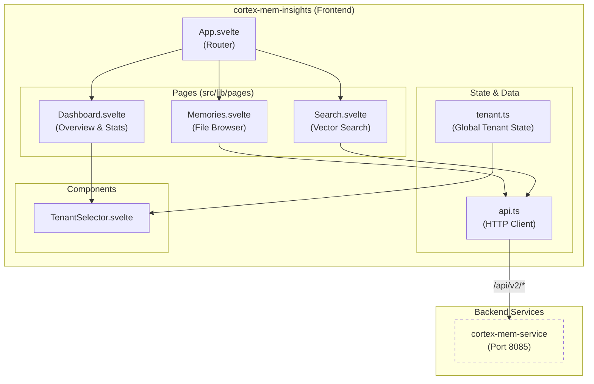
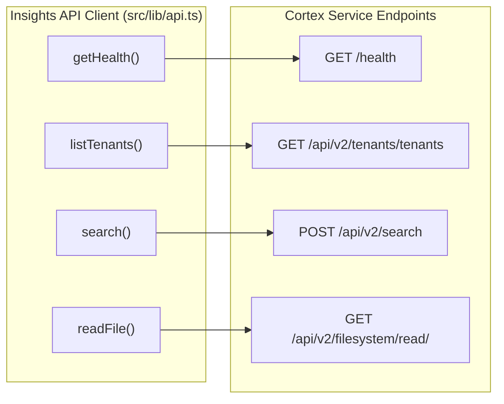

<!-- source: DeepWiki mcp.deepwiki.com · repo sopaco/cortex-mem · page 4.4 Web Dashboard · fetched 2026-10-27 -->

# Web Dashboard

<details>
<summary>Relevant source files</summary>

The following files were used as context for generating this wiki page:

- [cortex-mem-insights/README.md](cortex-mem-insights/README.md)
- [cortex-mem-insights/bun.lock](cortex-mem-insights/bun.lock)
- [cortex-mem-insights/package.json](cortex-mem-insights/package.json)
- [cortex-mem-insights/svelte.config.js](cortex-mem-insights/svelte.config.js)
- [cortex-mem-insights/vite.config.ts](cortex-mem-insights/vite.config.ts)

</details>


The **cortex-mem-insights** application is a web-based observability dashboard built with **Svelte 5** and **Vite**. It provides a graphical interface for monitoring and managing the Cortex Memory system, allowing users to browse stored memories, perform vector searches, and monitor service health in real-time.

This page covers the high-level architecture, the API client implementation, and a feature overview. For detailed documentation on specific dashboard modules, see:
- [Memory Browser](#4.4.1) — File browsing, editing, and vector search.
- [Dashboard & Monitoring](#4.4.2) — Service health, tenant statistics, and storage metrics.
- [Analytics & Statistics](#4.4.3) — Data distribution and system usage trends.

---

## System Architecture

The dashboard is designed as a modern reactive frontend that communicates with the `cortex-mem-service` backend. It can be run as a standard Vite development server or compiled into a standalone native executable using **Bun**.

### Component Hierarchy



**Sources**: [cortex-mem-insights/README.md:98-118](), [cortex-mem-insights/package.json:1-29](), [cortex-mem-insights/vite.config.ts:1-19]()

### Technical Stack
| Layer | Technology | Purpose |
| :--- | :--- | :--- |
| **UI Framework** | Svelte 5 | Reactive UI using Runes (`$state`, `$derived`) |
| **Build Tool** | Vite | Development server and production bundling |
| **Runtime** | Bun | Package management and standalone server execution |
| **Routing** | svelte-routing | Client-side navigation |
| **Proxy** | Vite Proxy | Redirects `/api/v2` and `/health` to backend |

**Sources**: [cortex-mem-insights/package.json:19-28](), [cortex-mem-insights/vite.config.ts:9-18](), [cortex-mem-insights/README.md:120-125]()

---

## API Client & Integration

The dashboard interacts with the core service through a centralized API client located in `src/lib/api.ts`. This client abstracts the HTTP communication, providing type-safe methods for the UI components.

### Service Mapping



**Sources**: [cortex-mem-insights/README.md:146-159](), [cortex-mem-insights/src/lib/api.ts:1-160]() (implied by README documentation)

### Core Data Structures
The client handles several key TypeScript interfaces that mirror the backend's domain models:
- `HealthStatus`: Service version, status, and LLM availability [cortex-mem-insights/README.md:163-168]().
- `TenantInfo`: Statistics including memory counts and storage size [cortex-mem-insights/README.md:186-193]().
- `FileEntryResponse`: Metadata for the memory filesystem browser [cortex-mem-insights/README.md:170-176]().
- `SearchResult`: Vector search matches with relevance scores [cortex-mem-insights/README.md:178-184]().

---

## Dashboard Features

### 1. System Overview & Tenants
The main dashboard provides a high-level view of the entire system. It monitors the `cortex-mem-service` health status and provides a **Tenants Overview** table showing resource usage (memories, sessions, agents) across different tenants.
For details, see [Dashboard & Monitoring](#4.4.2).

### 2. Memory & File Browser
The insights tool includes a dual-panel layout for exploring the memory filesystem. Users can navigate through `User`, `Session`, `Agent`, and `Resources` roots to view, edit, and save memory files directly in the browser.
For details, see [Memory Browser](#4.4.1).

### 3. Vector Search Interface
A dedicated search page allows for semantic queries against the vector database. It supports:
- **Scope Selection**: Filtering by All, User, Session, or Agent.
- **Limit Control**: Adjusting the number of returned results.
- **Relevance Visualization**: Displaying scores and content snippets.
For details, see [Memory Browser](#4.4.1).

### 4. Standalone Server
Beyond a standard web app, `cortex-mem-insights` includes a `server.ts` file that allows it to run as a standalone binary. This server supports CLI arguments for port configuration and API target overrides.

**Example Command**:
```bash
# Run standalone server on custom port
bun run serve --port 8159 --api-target http://localhost:8085
```

**Sources**: [cortex-mem-insights/README.md:127-142](), [cortex-mem-insights/package.json:10-17]()

---

